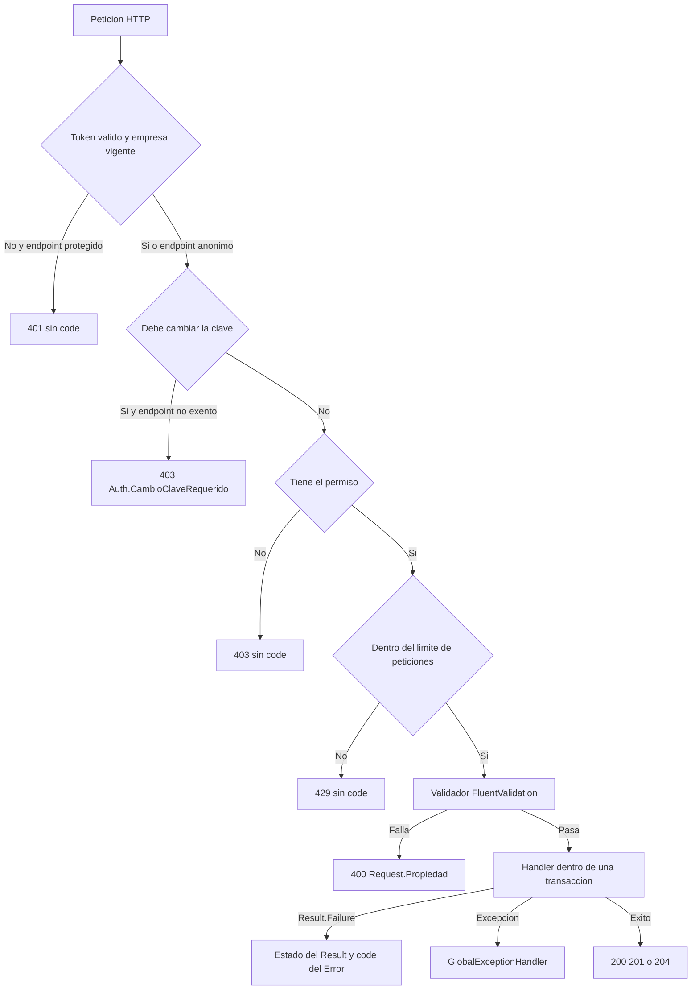

# Catálogo de reglas de negocio — Parte A: administración y seguridad

| | |
|---|---|
| **Sistema** | SOFIA — Sistema Optimizado Farmacéutico con Inteligencia Artificial |
| **Versión del documento** | 1.1 |
| **Fecha** | 2026-10-14 |
| **Backend** | `sofia-apis`, rama `main`, commit `43f5529` |
| **Frontend** | `sofia-web-spa`, rama `main`, commit `eeffbb6` |
| **Método** | Lectura de código (handlers, validadores, entidades, configuración EF Core, scripts DbUp, controladores, interceptores y archivos `es.json` del SPA). No se ejecutó la aplicación ni se llamó a la API. |

## Historial de cambios

### Versión 1.1 (2026-10-14)

Reconciliación con el código actual (`sofia-apis` `00991bc` → `43f5529`, `sofia-web-spa` `31af681` → `eeffbb6`). No se renumeró ninguna regla ni se agregaron reglas nuevas.

| Apartado o ID | Decía | Dice ahora | Commit |
|---|---|---|---|
| RN-EMP-010 | Los datos de la sede eran opcionales al registrar: sin ellos la dirección y la licencia quedaban como «Por definir»; el validador no tenía reglas; la pantalla no enviaba esos campos. | La dirección de la sede principal es obligatoria (hasta 255 caracteres, recortada); la pantalla la pide y la envía; la licencia, si no se informa, queda vacía en vez de «Por definir» (`CreateSedePrincipal`); nombre de sede sigue opcional. Textos nuevos `empresa.register.direccionSede*`, `empresa.form.maxLength255` y `empresa.notifications.direccionSedeInvalida`. | `9dd1705` (apis) y `2f82346` (spa) para la dirección; `41f0a05` (apis) para la licencia vacía |
| RN-EMP-011 | Cita `RegistrarEmpresaCommandHandler.cs:75-118`. | `:75-120`. | `9dd1705`, `41f0a05` |
| RN-SUC-004 | La licencia era obligatoria sin excepción. | Sigue siendo obligatoria al crear y editar, salvo la sede principal creada por el registro, que nace con licencia vacía y debe informarla en su primera edición. | `41f0a05` |
| RN-SUC-002, RN-SUC-003, RN-SUC-004 | Citas a `Sucursal.cs:62-65`, `:67-70` y `:72-75` (guards de `Update`). | `:84-87`, `:89-92` y `:94-97`, por el método nuevo `CreateSedePrincipal`. | `41f0a05` |
| RN-SUC-008 | Cita `DeleteSucursalCommandHandler.cs:11-17`. | `:12-18`. | `27597cd` |
| RN-SUC-009 | Eliminar una sucursal no comprobaba dependencias (devolvía siempre 204). | Bloquea con 409 `Sucursal.InUse` si la referencian empleados, cuentas, roles, stock, sesiones de caja, series fiscales, ventas, transferencias, cuarentena DIGEMID u órdenes magistrales; la pantalla muestra `sucursales.detail.delete-in-use` ante cualquier 409. | `27597cd` (apis), `01b8260` (spa) |
| Sección 12.1 | Mencionaba `VentaConfiguration.cs` como archivo con cambios sin commitear. | Sin cambios locales; ese archivo ya está commiteado. | `358935e` |
| Sección 12.3, hallazgos 3 y 7 | Dos pantallas deciden por estado; sucursal figuraba entre las eliminaciones sin dependencias. | Tres pantallas (se suma sucursales); la sucursal sale del hallazgo 7. | `27597cd`, `01b8260` |
| Sección 13 | 119 ocurrencias de 64 códigos literales. | 122 de 65 (nuevo `Sucursal.InUse`; `Sucursal.Nombre` y `Sucursal.Direccion` suman una ocurrencia cada uno); la entidad `Sucursal` se vincula también a RN-EMP-010. | `27597cd`, `41f0a05` |

Este documento es la parte A de cuatro del catálogo de reglas de negocio. Cubre los módulos de administración y seguridad: reglas transversales (`GEN`), autenticación y sesión (`AUT`), roles y permisos (`ROL`), cuentas de usuario (`CTA`), empresas y suscripción (`EMP`), sucursales (`SUC`), empleados (`EPL`), series fiscales como maestro (`SER`) y las reglas genéricas de carga masiva y exportación a Excel (`IMP`).

Quedan fuera (los cubren las otras partes): catálogos farmacéuticos, inventario, recetas, ventas, caja, devoluciones, comprobantes emitidos (`CMP`), dashboard y módulos sin pantalla.

## Convenciones de este documento

**Prefijos de ruta.** Para que las tablas sean legibles, las ubicaciones usan estos prefijos (siempre seguidos de `archivo:línea`):

| Prefijo | Ruta real |
|---|---|
| `APP/` | `sofia-apis/src/SOFIA.Application/` |
| `DOM/` | `sofia-apis/src/SOFIA.Domain/` |
| `INF/` | `sofia-apis/src/SOFIA.Infrastructure/` |
| `API/` | `sofia-apis/src/SOFIA.API/` |
| `DBUP/` | `sofia-apis/src/SOFIA.DbUp/Scripts/` |
| `SPA/` | `sofia-web-spa/src/app/` |
| `I18N/` | `sofia-web-spa/public/i18n/` |

**Columnas.** `Código de error` es el valor exacto de la propiedad `code` de la respuesta; `—` significa que la regla no devuelve error (es un cálculo, un valor por defecto o un comportamiento automático). `HTTP` es el estado que realmente devuelve la API según el mapeo de la sección 1. `Mensaje en el SPA (es)` es el texto exacto que ve el usuario con su clave i18n y archivo; cuando el código no tiene traducción se indica «Sin traducción» y el texto genérico que termina viendo.

**Una regla, varias ubicaciones.** Cuando la misma regla se aplica en validador, entidad e índice de base de datos, aparece una sola vez con todas sus ubicaciones y todos los códigos posibles. El primer código es el que devuelve la API en el flujo normal; los demás solo aparecen si se salta la capa anterior.

---

## 1. Cómo se convierten los errores en respuestas HTTP

### 1.1 El resultado de un handler

Todos los handlers devuelven `Result` o `Result<T>`. Un fallo lleva un `Error(Code, Message, Type)` y, aparte, un `StatusCode` numérico:

- `Result.Failure(error, statusCode = 400)` y `Result.Failure<T>(error, statusCode = 400)`: si el handler no pasa el segundo argumento, el estado es **400** (`DOM/Common/Result.cs:32-33`).
- `ToProblemResult()` construye un `ProblemDetails` con `status = result.StatusCode`, `detail = Error.Message` y la extensión `code = Error.Code`, y responde con ese mismo estado (`API/Extensions/ResultExtensions.cs:13-23`).
- **El `ErrorType` (`Validation`, `NotFound`, `Conflict`, `Unauthorized`, `Forbidden`) no interviene en el estado HTTP**: el mapeo solo lee `result.StatusCode` (`API/Extensions/ResultExtensions.cs:17,22`; enum en `DOM/Common/Error.cs:16-24`). Por eso un `Error.Conflict(...)` devuelto sin estado explícito sale como **400**, no como 409. En este documento la columna HTTP refleja el estado real, no el tipo. Los casos de este alcance donde tipo y estado no coinciden están listados en «Pendientes y No verificado».
- Éxito: `Result<T>` → **200** con el valor; `Result` → **204** sin cuerpo (`API/Extensions/ResultExtensions.cs:7-11`). Algunos controladores lo sustituyen por 201 (`CreatedAtAction`) o por `Ok(...)`.

Forma del cuerpo de error (campos que escribe SOFIA):

```json
{ "status": 409, "detail": "Another branch already uses this license number.", "code": "Sucursal.NumeroLicencia.Duplicado" }
```

### 1.2 Validadores FluentValidation

`ValidationBehavior` ejecuta todos los validadores registrados para el request antes del handler. Si hay algún fallo (`APP/Common/Behaviors/ValidationBehavior.cs:27-47`):

- `code` = `"{NombreDelRequest}.{PropertyName del PRIMER fallo}"` (línea 30). Si fallan varias propiedades, el código solo nombra la primera, en el orden en que el validador declara sus reglas.
- `detail` = todos los mensajes de fallo unidos con `"; "` (línea 31).
- Estado **400** (líneas 41 y 46).
- En reglas sobre colecciones (`RuleForEach`), el nombre de propiedad incluye el índice: por ejemplo `CargaMasivaRolesCommand.Rows[0].NombreRol`.

Orden del pipeline de MediatR: `SanitizationBehavior` → `ValidationBehavior` → `TransactionBehavior` → `AuditBehavior` (`APP/DependencyInjection.cs:16-19`).

### 1.3 Errores de dominio propagados

Las entidades devuelven `Result.Failure(Error.Validation("Entidad.Campo", ...))`. Los handlers los propagan con `Result.Failure<T>(result.Error)` o devolviendo el mismo `Result`, sin estado explícito, así que salen como **400** con el código de la entidad (por ejemplo `APP/Sucursales/Commands/CreateSucursal/CreateSucursalCommandHandler.cs:27-30`). En el flujo normal el validador se ejecuta antes y es su código el que llega al cliente; el código de la entidad solo aparece si el validador no cubre el caso.

### 1.4 Excepciones (GlobalExceptionHandler)

`API/Infrastructure/GlobalExceptionHandler.cs` traduce las excepciones que escapan de un handler. Todas estas respuestas añaden `traceId` al cuerpo (líneas 117-127):

| Excepción | Código | HTTP | Fuente |
|---|---|---|---|
| `DbUpdateConcurrencyException` (RowVersion desactualizado) | `Concurrency.Conflict` | 409 | `GlobalExceptionHandler.cs:31-34,83-89` |
| `DbUpdateException` con `SqlException` 2601 o 2627 (índice o restricción única) | `Db.Duplicado` | 409 | `GlobalExceptionHandler.cs:36-39,100-102` |
| `DbUpdateException` con `SqlException` 547 cuyo mensaje contiene «CHECK constraint» | `Db.ValorInvalido` | 400 | `GlobalExceptionHandler.cs:103` |
| `DbUpdateException` con `SqlException` 547 (resto: clave foránea) | `Db.ReferenciaInvalida` | 409 | `GlobalExceptionHandler.cs:104` |
| `ExcelImportException` | el de la excepción (`CargaMasiva.*`) | 400 | `GlobalExceptionHandler.cs:41-44` |
| `BadHttpRequestException` con estado 413 | `Request.TooLarge` | 413 | `GlobalExceptionHandler.cs:47-54` |
| `BadHttpRequestException` con otro estado | `Request.Invalid` | el de la excepción | `GlobalExceptionHandler.cs:47-54` |
| Cualquier otra | sin `code` (título «Error del Servidor», `traceId`) | 500 | `GlobalExceptionHandler.cs:57-79` |

### 1.5 Respuestas que no pasan por un handler

| Origen | Código | HTTP | Fuente |
|---|---|---|---|
| Token de acceso ausente, vencido, mal firmado, con sello de seguridad obsoleto, cuenta inactiva o empresa no vigente | sin `code` | 401 | `INF/DependencyInjection.cs:59-132` |
| Falta el permiso `[HasPermission]` o la política por defecto | sin `code` | 403 | `INF/Authentication/PermissionAuthorizationHandler.cs:17-56`, `INF/DependencyInjection.cs:149-151` |
| Cuenta obligada a cambiar la clave | `Auth.CambioClaveRequerido` | 403 | `API/Infrastructure/PasswordChangeRequiredMiddleware.cs:12-27` |
| Falta la cabecera `X-SOFIA-CSRF` | `Auth.Csrf` | 403 | `API/Infrastructure/RequireCsrfHeaderAttribute.cs:12-31` |
| Límite de peticiones superado | sin `code` | 429 | `API/Extensions/RateLimitingExtensions.cs:14` |
| Cuerpo JSON ilegible, tipos incorrectos o atributos de validación del modelo (`[ExportHeaders]`, `[ExportLabel]`, `[ExportDateFormat]`, `[JsonRequired]`) | sin `code` (respuesta automática de `[ApiController]`) | 400 | `API/Infrastructure/ExportHeadersAttribute.cs:12-17`, `ExportLabelAttribute.cs:11-13`, `ExportDateFormatAttribute.cs:9-13` |
| El controlador responde directamente `Unauthorized()` o `BadRequest("texto")` | sin `code` | 401 / 400 | por ejemplo `API/Controllers/AuthController.cs:39-42`, `API/Controllers/RolesController.cs:208-211` |

Orden de los middlewares: cabeceras reenviadas → registro de peticiones → manejador de excepciones → cabeceras de seguridad → HSTS → redirección HTTPS → CORS → autenticación → cambio de clave obligatorio → autorización → límite de peticiones → controladores (`API/Program.cs:114-134`).



---

## 2. Cómo muestra el SPA un error

1. **No existe un traductor global de códigos.** `ErrorNotifierService` solo abre un aviso (snackbar) con el texto que le pasa cada pantalla (`SPA/core/services/shared/error-notifier.service.ts:26-28`). No hay interceptor que muestre errores.
2. **Cada pantalla decide el texto.** Las pantallas declaran un mapa propio `código → clave i18n` (constantes `ERROR_KEYS`, `SAVE_ERROR_KEYS`, `LOGIN_ERROR_KEYS`, `CARGA_MASIVA_ERROR_KEYS`) y un mensaje genérico de respaldo. Si el código de la respuesta no está en el mapa de esa pantalla, el usuario ve el genérico (por ejemplo «Error al guardar el rol»). Ejemplo: `SPA/pages/seguridad/cuentas-detail/cuentas-detail.component.ts:23-29,222-226`.
3. **El mensaje del backend (`detail`) nunca se muestra.** Ninguna pantalla lee `error.detail`; solo se leen `error.code`, `status` y `traceId` (búsqueda de `error?.detail` y `error.detail` en `sofia-web-spa/src/app`: sin resultados). Por tanto, «Sin traducción» en este documento significa que el usuario ve el mensaje genérico de la pantalla, no el texto en inglés de la API.
4. **Códigos de base de datos.** La utilidad `saveErrorKey` añade, después del mapa de la pantalla, la traducción de `Db.Duplicado`, `Db.ReferenciaInvalida` y `Db.ValorInvalido` (`SPA/shared/utils/save-error-key.util.ts:4-15`). De las pantallas de este alcance solo la usan el detalle de Empleados y el de Sucursales; las demás muestran su genérico.
5. **Referencia de soporte.** `showServerError(err, mensaje)` muestra el mensaje y, si la respuesta trae `traceId`, añade «Referencia: <traceId>» con botón de copiar durante 10 segundos; si no hay `traceId` se comporta como un aviso normal de 5 segundos (`SPA/core/services/shared/error-notifier.service.ts:34-46`; texto `generic-labels.trace-ref` = «Referencia», `I18N/es.json`). Solo las respuestas del `GlobalExceptionHandler` traen `traceId`.
6. **Sesión (interceptor).** `SPA/core/interceptors/auth.interceptor.ts`:
   - 403 con código `Auth.CambioClaveRequerido` → navega a `/cambiar-clave` (líneas 30-33).
   - 401 en un endpoint que no es de autenticación → pide un token nuevo a `/auth/refresh` una sola vez y repite la petición; si el refresco falla, cierra la sesión local y navega a `/auth/login` (líneas 34-63). El interceptor no muestra ningún texto; la pantalla que originó la petición muestra su genérico.
   - 401 en `/auth/refresh` o `/auth/logout` → borra la sesión local en silencio (líneas 40-45).
7. **Validación en el formulario.** Los formularios aplican validadores de Angular antes de llamar a la API y muestran el error bajo el campo (por ejemplo `general.errors.required` = «Este campo es obligatorio», `I18N/es.json`). Cuando el formulario ya impide el caso, la tabla lo indica como «Formulario:» y añade qué se vería si la API lo rechazara.
8. **Claves definidas pero sin uso.** `errors.forbidden`, `errors.unauthorized`, `errors.notFound`, `errors.serverError` y `errors.networkError` existen en `I18N/es.json` pero ningún archivo de `src/app` las usa. `errors.concurrencyConflict` solo se usa en pantallas de POS, caja y stock (fuera de este alcance). `showSmartErrors` está definido y no tiene llamadas (`SPA/core/services/shared/error-notifier.service.ts:18-24`).

Mensajes genéricos de respaldo de las pantallas de este alcance:

| Pantalla | Operación | Texto | Clave y archivo |
|---|---|---|---|
| Inicio de sesión | Cualquier rechazo 4xx sin mapa | «Credenciales inválidas. Verifica tu usuario y contraseña.» | `auth.invalidCredentials`, `I18N/auth/es.json` |
| Inicio de sesión | Sin respuesta, 408 o 5xx | «No pudimos conectar con el servidor. Verifica tu conexión a internet e inténtalo de nuevo en unos minutos.» | `auth.serviceUnavailable`, `I18N/auth/es.json` |
| Inicio de sesión, recuperar y restablecer | 429 | «Demasiados intentos. Espera un minuto e inténtalo de nuevo.» | `auth.recovery.tooManyRequests`, `I18N/auth/es.json` |
| Recuperar contraseña | Error | «No se pudo procesar la solicitud. Inténtalo de nuevo.» | `auth.forgotPage.error`, `I18N/auth/es.json` |
| Restablecer contraseña | Error | «No se pudo restablecer la contraseña. Inténtalo de nuevo.» | `auth.resetPage.error`, `I18N/auth/es.json` |
| Cambiar contraseña | Error | «No se pudo cambiar la contraseña. Inténtalo de nuevo.» | `cambiarClave.errors.save`, `I18N/cambiar-clave/es.json` |
| Registro de empresa | Error | «Error al registrar la empresa» | `empresa.notifications.registerError`, `I18N/empresa/es.json` |
| Empresa (detalle) | Guardar / cargar | «Error al actualizar la empresa» / «Error al cargar la empresa» | `empresa.detail.save-error`, `empresa.detail.load-error`, `I18N/empresa/es.json` |
| Empresas (búsqueda y exportación) | Error | «Error al buscar empresas» | `empresa.search.search-error`, `I18N/empresa/es.json` |
| Roles (detalle) | Guardar / eliminar / cargar | «Error al guardar el rol» / «Error al eliminar el rol» / «Error al cargar el rol» | `roles.detail.save-error`, `roles.detail.delete-error`, `roles.detail.load-error`, `I18N/roles/es.json` |
| Roles (búsqueda y exportación) | Error | «Error al buscar roles» | `roles.search.search-error`, `I18N/roles/es.json` |
| Cuentas (detalle) | Guardar / eliminar / cargar | «Error al guardar la cuenta» / «Error al eliminar la cuenta» / «Error al cargar la cuenta» | `cuentas.detail.save-error`, `cuentas.detail.delete-error`, `cuentas.detail.load-error`, `I18N/cuentas/es.json` |
| Cuentas (sucursales adicionales) | Asignar / quitar | «Error al asignar la sucursal» / «Error al eliminar la sucursal» | `cuentas.sucursales.assign-error`, `cuentas.sucursales.remove-error`, `I18N/cuentas/es.json` |
| Sucursales (detalle) | Guardar / eliminar / cargar | «Error al guardar la sucursal» / «Error al eliminar la sucursal» / «Error al cargar la sucursal» | `sucursales.detail.save-error`, `sucursales.detail.delete-error`, `sucursales.detail.load-error`, `I18N/sucursales/es.json` |
| Empleados (detalle) | Guardar / eliminar / cargar | «Error al guardar el empleado» / «Error al eliminar el empleado» / «Error al cargar el empleado» | `empleados.detail.save-error`, `empleados.detail.delete-error`, `empleados.detail.load-error`, `I18N/empleados/es.json` |
| Series fiscales (detalle) | Guardar / eliminar / cargar | «Error al guardar la serie fiscal» / «Error al eliminar la serie fiscal» / «Error al cargar la serie fiscal» | `seriesFiscales.detail.save-error`, `seriesFiscales.detail.delete-error`, `seriesFiscales.detail.load-error`, `I18N/series-fiscales/es.json` |
| Series fiscales (búsqueda / exportación) | Error | «Error al buscar series fiscales» / «Error al exportar las series fiscales» | `seriesFiscales.search.search-error`, `seriesFiscales.search.export-error`, `I18N/series-fiscales/es.json` |
| Carga masiva | Vista previa / guardar / plantilla | «Error al procesar el archivo» / «Error al guardar los registros» / «Error al descargar la plantilla. Intenta de nuevo.» | `carga-masiva.preview-error`, `carga-masiva.save-error`, `carga-masiva.download-error`, `I18N/es.json` |

En el resto del documento estos textos se citan con su clave la primera vez en cada tabla y después como «genérico de guardar», «genérico de eliminar», etc.

---

## 3. Reglas transversales (`GEN`)

Reglas que se aplican a todos los módulos sin que cada handler las programe: aislamiento por empresa, borrado lógico, auditoría, transacciones, autenticación del token, autorización por permiso, límites de peticiones y traducción de errores de base de datos. Las hacen cumplir el `ApplicationDbContext`, los behaviors de MediatR, los middlewares y el `GlobalExceptionHandler`.

### 3.1 Datos: multiempresa, borrado lógico y auditoría

| ID | Regla | Tipo | Dónde se aplica | Código de error | HTTP | Mensaje en el SPA (es) |
|---|---|---|---|---|---|---|
| RN-GEN-001 | **Aislamiento por empresa.** Toda consulta sobre una entidad que hereda de `BaseEntity` solo devuelve filas cuyo `TenantId` es igual a la empresa del token (`empresaId`). Si la petición no tiene empresa (anónima o tarea en segundo plano) o la fila tiene `TenantId` nulo, no coincide ninguna fila. Solo se salta de forma explícita con `IgnoreQueryFilters([QueryFilters.Tenant])` en flujos anteriores a conocer la empresa (inicio de sesión, refresco, registro, recuperación). Efecto visible: un registro de otra empresa se comporta como inexistente (códigos `*.NotFound`). | Autorización | `INF/Persistence/ApplicationDbContext.cs:66-67,82-86,98-109`; `APP/Common/Models/QueryFilters.cs:10-11` | — | — | — |
| RN-GEN-002 | **Las filas eliminadas no se leen.** Filtro global `IsDeleted = 0` sobre toda entidad `BaseEntity`. Se salta solo con `IgnoreQueryFilters([QueryFilters.SoftDelete])` o `IgnoreQueryFilters()`. | Automática | `INF/Persistence/ApplicationDbContext.cs:95-96`; `APP/Common/Models/QueryFilters.cs:8` | — | — | — |
| RN-GEN-003 | **Borrado lógico.** Eliminar una entidad auditable no borra la fila: al guardar, el estado `Deleted` se convierte en `Modified` y se marca `IsDeleted = true`, `DeletedAt = ahora (UTC)` y `DeletedBy = usuario del token` (o `"SYSTEM"` si no hay usuario). | Automática | `INF/Persistence/ApplicationDbContext.cs:145-150`; `DOM/Common/BaseEntity.cs:13-15` | — | — | — |
| RN-GEN-004 | **Empresa asignada automáticamente.** Al insertar una entidad `BaseEntity` sin `TenantId`, se le asigna la empresa del token. Si la entidad ya trae `TenantId` (por ejemplo en el registro público) se respeta. Sin empresa en el token no se asigna nada. | Automática | `INF/Persistence/ApplicationDbContext.cs:136-137,168-178`; columna `TenantId` añadida a todas las tablas con `IsDeleted` en `DBUP/0005_Empresa_MultiTenant.sql:54-70` | — | — | — |
| RN-GEN-005 | **Quién y cuándo.** Al insertar se graban `CreatedBy` (nombre de usuario del token o `"SYSTEM"`) y `CreatedAt` (UTC); al modificar, `LastModifiedBy` y `LastModifiedAt`. | Automática | `INF/Persistence/ApplicationDbContext.cs:132-144`; `DOM/Common/IAuditableEntity.cs:5-8`; `API/Services/CurrentUser.cs:16-18` | — | — | — |
| RN-GEN-006 | **Fechas en UTC.** Toda propiedad `DateTime` se guarda convertida a UTC y se lee marcada como UTC (para que el JSON lleve la «Z»). Un valor sin zona se interpreta como UTC. | Automática | `INF/Persistence/ApplicationDbContext.cs:69-76,191-203` | — | — | — |
| RN-GEN-007 | **Eventos de dominio a la bandeja de salida.** Antes de guardar, cada evento de dominio pendiente de una entidad se convierte en una fila de `SistemaOutboxEvento` (tipo = nombre completo de la clase, contenido = JSON del evento) y los eventos se limpian de la entidad. Si la fila de outbox no pasa su validación se descarta sin error. | Automática | `INF/Persistence/ApplicationDbContext.cs:114-130,160-163` | — | — | — |
| RN-GEN-008 | **Filtros por rango de fechas en UTC.** Los filtros «desde/hasta» sobre fechas son inclusivos en ambos extremos (`>=` y `<=`); los límites se normalizan a UTC (un valor local se convierte, uno sin zona se toma como UTC) y viajan como parámetros. | Cálculo | `APP/Common/Extensions/QueryableExtensions.cs:8-38` | — | — | — |
| RN-GEN-009 | **Paginación acotada.** El número de página mínimo es 1 (valores menores se tratan como 1). El tamaño de página se ajusta al rango 1 a 10 000. Un número de página enorme devuelve una página vacía en vez de fallar. | Límite | `APP/Common/Models/PaginationLimits.cs:6-10`; `APP/Common/Models/PaginatedList.cs:8-9,17-21` | — | — | — |

### 3.2 Pipeline de cada petición

| ID | Regla | Tipo | Dónde se aplica | Código de error | HTTP | Mensaje en el SPA (es) |
|---|---|---|---|---|---|---|
| RN-GEN-010 | **Limpieza de HTML en la entrada.** Antes de validar, toda propiedad de texto de primer nivel del request se pasa por un saneador que no admite ninguna etiqueta, atributo, propiedad CSS ni esquema de URL. No se sanean las propiedades llamadas (sin distinguir mayúsculas) `password`, `passwordhash`, `token`, `recoverytoken`, `secretkey`, `hash`, `newpassword` y `confirmpassword`. No se recorren objetos anidados ni listas (por ejemplo las filas de una carga masiva). | Automática | `APP/Common/Behaviors/SanitizationBehavior.cs:10-14,22-40`; `INF/Services/HtmlSanitizerService.cs:12-20`; registro en `APP/DependencyInjection.cs:16` | — | — | — |
| RN-GEN-011 | **Validación previa del request.** Si existe un validador FluentValidation para el request y alguna regla falla, el handler no se ejecuta. El código es `{Request}.{Propiedad del primer fallo}` y el detalle une todos los mensajes con «; ». | Formato | `APP/Common/Behaviors/ValidationBehavior.cs:12-47` | `{Request}.{Propiedad}` (cada validador se detalla en su módulo) | 400 | Sin traducción general: cada pantalla usa su mapa o su genérico (sección 2). Solo `CreateSerieFiscalCommand.PrefijoSerie` y `UpdateSerieFiscalCommand.PrefijoSerie` tienen traducción en este alcance (RN-SER-004). |
| RN-GEN-012 | **Todo comando es transaccional.** Cada request que implementa `ICommand`, `ICommand<T>` o `IAuditableCommand` se ejecuta dentro de una transacción de base de datos con estrategia de reintento; si el handler lanza una excepción se revierte todo. Un `Result.Failure` sin excepción no revierte: la transacción se confirma con lo que el handler ya hubiera guardado (por ejemplo el contador de intentos fallidos del inicio de sesión). Las consultas (`IRequest` sin marcador) no abren transacción. | Integridad | `APP/Common/Behaviors/TransactionBehavior.cs:16-37`; `APP/Common/Interfaces/ICommand.cs:8,11`; `APP/Common/Interfaces/IAuditableCommand.cs:7` | — | — | — |
| RN-GEN-013 | **Auditoría de seguridad automática.** Cuando un comando que implementa `IAuditableCommand` termina con éxito y el token identifica a un empleado, se inserta en la misma transacción un evento en `Auditoria_Eventos_Seguridad` con: empleado que actúa, tabla afectada, id del registro, tipo de acción, detalle breve sin datos personales (se guarda en `Payload_Nuevo`) e IP del cliente. Si el comando devuelve `null` como entrada de auditoría no se registra nada. Si la entrada es inválida se lanza una excepción y se revierte todo el comando. Eventos de este alcance: `PERMISO_ASIGNAR`, `PERMISO_REVOCAR`, `ROL_ASIGNAR_CUENTA`, `ROL_QUITAR_CUENTA`, `ROL_SUCURSALES`, `ROL_CREAR`, `ROL_ACTUALIZAR`, `ROL_ELIMINAR`, `CUENTA_REGISTRAR`, `CUENTA_ACTUALIZAR`, `CUENTA_ELIMINAR`, `CUENTA_SUC_ASIGNAR`, `CUENTA_SUC_QUITAR`, `CLAVE_CAMBIAR`, `CLAVE_RESTABLECER`, `SERIE_CREAR`, `SERIE_ACTUALIZAR`, `SERIE_ELIMINAR`, `EMPRESA_ACTUALIZAR`. No se auditan por este mecanismo: sucursales, empleados, carga masiva de roles, inicio y cierre de sesión. | Automática | `APP/Common/Behaviors/AuditBehavior.cs:16-47`; `APP/Common/Models/AuditEventos.cs:6-29`; `APP/Common/Models/AuditTablas.cs:6-14`; `APP/DependencyInjection.cs:19` | — (entrada inválida: excepción) | 500 si la entrada es inválida | Genérico de la pantalla. |
| RN-GEN-014 | **Forma mínima de un evento de auditoría.** Empleado obligatorio; tabla afectada obligatoria y de hasta 50 caracteres; id de registro obligatorio; tipo de acción obligatorio y de hasta 20 caracteres; IP de hasta 45 caracteres. La fecha del evento es la hora UTC actual si no se indica. La entidad no tiene métodos de modificación ni de borrado. Estos códigos nunca llegan al cliente: en el behavior se convierten en excepción (RN-GEN-013) y en el restablecimiento de clave el evento inválido se omite en silencio. | Obligatoriedad | `DOM/Entities/AuditoriaEventoSeguridad.cs:5,33-66,76`; `DBUP/0001_Initial_Schema.sql:485-492,500`; `APP/Security/Commands/ResetPassword/ResetPasswordCommandHandler.cs:40-44` | `AuditoriaEventoSeguridad.EmpleadoId`, `AuditoriaEventoSeguridad.TablaAfectada`, `AuditoriaEventoSeguridad.RegistroIdAfectado`, `AuditoriaEventoSeguridad.TipoAccion`, `AuditoriaEventoSeguridad.DireccionIp` | No llegan como respuesta (500 sin `code` vía RN-GEN-013) | Sin traducción (no llegan al SPA). |

### 3.3 Autenticación y autorización de cada petición

| ID | Regla | Tipo | Dónde se aplica | Código de error | HTTP | Mensaje en el SPA (es) |
|---|---|---|---|---|---|---|
| RN-GEN-015 | **Denegación por defecto.** Todo endpoint sin metadatos de autorización exige un usuario autenticado. Solo son anónimos los marcados con `[AllowAnonymous]`: `POST auth/login`, `auth/refresh`, `auth/logout`, `auth/forgot-password`, `auth/reset-password`, `POST empresas/registrar` y `GET /health`. | Autorización | `INF/DependencyInjection.cs:149-151`; `API/Controllers/AuthController.cs:20,34,71,106,115`; `API/Controllers/EmpresasController.cs:19`; `API/Program.cs:137-143` | sin `code` | 401 | Ninguno propio: el interceptor intenta refrescar la sesión y, si falla, lleva a «Iniciar sesión» (sección 2, punto 6). |
| RN-GEN-016 | **Validez del token de acceso.** El token debe estar firmado con HS256 y la clave configurada, con emisor y audiencia correctos y sin vencer; se toleran 30 segundos de desfase de reloj. La duración se fija con la clave de configuración `Jwt:ExpiryMinutes`. | Autorización | `INF/DependencyInjection.cs:62-73`; `INF/Authentication/JwtProvider.cs:49-58` | sin `code` | 401 | Igual que RN-GEN-015. |
| RN-GEN-017 | **Sello de seguridad.** En cada petición autenticada se comprueba en base de datos que exista una cuenta con el id del token (`sub`), el mismo `securityStamp` del token, activa y no eliminada. Si no, el token se rechaza aunque no haya vencido. El sello cambia cuando se cambia o restablece la clave, al cerrar sesión, al asignar o quitar un rol, al cambiar la sucursal base del empleado y al detectar la reutilización de un token de refresco. | Autorización | `INF/DependencyInjection.cs:81-109`; emisión del claim en `INF/Authentication/JwtProvider.cs:30`; rotaciones en `DOM/Entities/Cuenta.cs:71,100,121` | sin `code` | 401 | Igual que RN-GEN-015. |
| RN-GEN-018 | **Empresa vigente en cada petición.** El token debe traer `empresaId` y la empresa debe estar vigente (RN-EMP-014). El resultado se guarda en caché 1 minuto por empresa, de modo que una suspensión o un vencimiento corta el acceso de los tokens vivos en ese plazo como máximo. | Autorización | `INF/DependencyInjection.cs:26,113-130`; `APP/Security/EmpresaVigencia.cs:13-26` | sin `code` | 401 | Igual que RN-GEN-015. Tras el redireccionamiento, el inicio de sesión muestra el mensaje de RN-AUT-009. |
| RN-GEN-019 | **Cambio de clave obligatorio.** Mientras la cuenta tenga `Requiere_Cambio_Clave` activo, cualquier endpoint autenticado responde 403, salvo los marcados `[AllowDuringPasswordChange]` (`GET auth/me` y `POST auth/change-password`) y los anónimos. El indicador se lee de la base de datos en cada petición, así que un cambio forzado por un administrador se aplica también a los tokens vivos. | Estado | `API/Infrastructure/PasswordChangeRequiredMiddleware.cs:12-27`; `APP/Security/PasswordChangePolicy.cs:8-11`; `INF/DependencyInjection.cs:111,202-218`; `API/Controllers/AuthController.cs:55,87`; `API/Program.cs:130` | `Auth.CambioClaveRequerido` | 403 | El interceptor navega a «Cambiar contraseña» (`SPA/core/interceptors/auth.interceptor.ts:30-33`) y el guard impide salir de ella (`SPA/core/auth/password-change.guard.ts:41-45`). La pantalla muestra «Tu contraseña fue asignada por un administrador. Debes cambiarla antes de continuar.» (`cambiarClave.forced`, `I18N/cambiar-clave/es.json`). |
| RN-GEN-020 | **Autorización por permiso.** Un endpoint con `[HasPermission("Módulo", "Acción")]` exige que alguno de los roles del token tenga ese permiso (módulo y acción comparados sin distinguir mayúsculas, sin espacios sobrantes). Sin roles en el token, o sin `empresaId`, se deniega. Los permisos se leen de `Seguridad_Permisos_Rol` por nombre de rol. | Autorización | `INF/Authentication/HasPermissionAttribute.cs:6`; `INF/Authentication/PermissionPolicyProvider.cs:15-37`; `INF/Authentication/PermissionAuthorizationHandler.cs:21-29,38-55,58-79` | sin `code` | 403 | Sin traducción: genérico de la pantalla. El SPA lo evita antes: oculta acciones con `*appPermiso` y, al entrar a una ruta sin permiso de lectura, muestra «No tienes permisos para acceder a esta pantalla.» (`errors.forbiddenPage`, `I18N/es.json`; `SPA/core/auth/permission.guard.ts:26-30`). |
| RN-GEN-021 | **El rol Admin lo puede todo.** Un token con el rol llamado `Admin` (sin distinguir mayúsculas) pasa cualquier comprobación de permiso sin consultar la tabla de permisos. | Autorización | `INF/Authentication/PermissionAuthorizationHandler.cs:31-36`; `DOM/Entities/Rol.cs:10,21`; `API/Services/CurrentUser.cs:30-32` | — | — | — |
| RN-GEN-022 | **Caché de permisos.** Los permisos de cada rol se guardan en memoria 5 minutos, con clave por empresa y nombre de rol en mayúsculas (los nombres de rol se repiten entre empresas). Se invalida de inmediato al asignar o revocar un permiso y al eliminar un rol, pero solo en la instancia que atiende la petición. | Automática | `INF/Authentication/MemoryPermissionCache.cs:9,11-20`; `APP/Common/Extensions/PermissionCacheExtensions.cs:8-15` | — | — | — |
| RN-GEN-023 | **Sucursales accesibles.** Un usuario Admin accede a todas las sucursales de su empresa. Cualquier otro accede a: su sucursal base (claim `sucursalId`), las sucursales asignadas a su cuenta y las asignadas a sus roles; el conjunto se cruza con las sucursales no eliminadas de la empresa, de modo que una asignación obsoleta o ajena no da acceso. Sin autenticación el conjunto es vacío. Se calcula una vez por petición. | Autorización | `APP/Common/Services/SucursalAccess.cs:12-56`; `APP/Common/Extensions/QueryableExtensions.cs:41-55`; `APP/Common/Interfaces/ISucursalAccess.cs:4-9` | — | — | — |
| RN-GEN-024 | **Contexto obligatorio del usuario.** Los handlers que necesitan la empresa, la sucursal o el empleado los leen del token. Si el dato falta o el usuario no está autenticado devuelven un error de tipo `Unauthorized`; si no es un GUID válido, uno de tipo `Validation`. Como se propagan sin estado explícito, en los handlers de este alcance (crear sucursal, carga masiva de sucursales) la respuesta es 400. `Auth.Sucursal` y `Auth.Empleado` los usan handlers de otros módulos; su estado depende de cómo los propague cada uno. | Autorización | `APP/Common/Extensions/CurrentUserExtensions.cs:8-51`; usos: `APP/Sucursales/Commands/CreateSucursal/CreateSucursalCommandHandler.cs:14-18`, `APP/Sucursales/Commands/CargaMasivaSucursales/CargaMasivaSucursalesCommandHandler.cs:15-19` | `Auth.Empresa`, `Auth.Sucursal`, `Auth.Empleado` | 400 en este alcance | Sin traducción: genérico de la pantalla («Error al guardar la sucursal», `sucursales.detail.save-error`, `I18N/sucursales/es.json`; «Error al guardar los registros», `carga-masiva.save-error`, `I18N/es.json`). |

### 3.4 Límites y protección de la API

| ID | Regla | Tipo | Dónde se aplica | Código de error | HTTP | Mensaje en el SPA (es) |
|---|---|---|---|---|---|---|
| RN-GEN-025 | **Límite general.** Cualquier endpoint sin política propia admite 200 peticiones por minuto por IP (ventana fija), con hasta 10 en cola. | Límite | `API/Extensions/RateLimitingExtensions.cs:14-24`; `API/Program.cs:98,132` | sin `code` | 429 | Sin traducción: genérico de la pantalla. |
| RN-GEN-026 | **Límite de credenciales.** Inicio de sesión, cambio de clave, recuperación y restablecimiento admiten 10 peticiones por minuto por IP, sin cola. | Límite | `API/Extensions/RateLimitingExtensions.cs:26-32`; `API/Controllers/AuthController.cs:19,85,105,114` | sin `code` | 429 | Inicio de sesión, recuperar y restablecer: «Demasiados intentos. Espera un minuto e inténtalo de nuevo.» (`auth.recovery.tooManyRequests`, `I18N/auth/es.json`). Cambiar contraseña: «No se pudo cambiar la contraseña. Inténtalo de nuevo.» (`cambiarClave.errors.save`, `I18N/cambiar-clave/es.json`). |
| RN-GEN-027 | **Límite de registro de empresas.** El registro público admite 5 peticiones por hora por IP, sin cola. | Límite | `API/Extensions/RateLimitingExtensions.cs:34-40`; `API/Controllers/EmpresasController.cs:20` | sin `code` | 429 | Sin traducción: «Error al registrar la empresa» (`empresa.notifications.registerError`, `I18N/empresa/es.json`). |
| RN-GEN-028 | **Límite de endpoints de IA.** La política `ai-endpoints` admite 10 peticiones por minuto por empresa (o por IP si no hay empresa en el token), con hasta 2 en cola. Se aplica en `RecetasController` (lo documenta la parte de recetas). | Límite | `API/Extensions/RateLimitingExtensions.cs:42-49,55-58`; `API/Controllers/RecetasController.cs:49` | sin `code` | 429 | Fuera de este alcance. |
| RN-GEN-029 | **IP real del cliente.** La IP usada para límites, registros y auditoría es la de la conexión; la cabecera `X-Forwarded-For` solo se acepta si viene de un proxy listado en `ForwardedHeaders:KnownProxies`. Sin proxies configurados se ignora. | Automática | `API/Program.cs:81-95,114`; `API/Extensions/RateLimitingExtensions.cs:52-53`; `API/Services/CurrentUser.cs:27` | — | — | — |
| RN-GEN-030 | **Cabeceras de seguridad.** Toda respuesta lleva `X-Content-Type-Options: nosniff`, `X-Frame-Options: DENY`, `Referrer-Policy: strict-origin-when-cross-origin`, `X-Permitted-Cross-Domain-Policies: none` y una `Content-Security-Policy` que solo declara `default-src` y `frame-ancestors` en `none`. Las rutas bajo `/api` llevan además `Cache-Control: no-store`. | Automática | `API/Infrastructure/SecurityHeadersMiddleware.cs:8-25`; `API/Program.cs:118` | — | — | — |
| RN-GEN-031 | **HTTPS.** Se redirige a HTTPS y, fuera del entorno de desarrollo, se envía HSTS con vigencia de 365 días e inclusión de subdominios. | Automática | `API/Program.cs:32-36,120-125` | — | — | — |
| RN-GEN-032 | **Orígenes permitidos (CORS).** En desarrollo solo se aceptan `http://localhost:4200` y `https://localhost:4200`. En otros entornos solo los orígenes de la clave `AllowedOrigins`; si está vacía la API no arranca. Se permiten credenciales (cookie de refresco). | Autorización | `API/Program.cs:39-64,127` | — | — | — |
| RN-GEN-033 | **Configuración mínima del token.** La API no arranca si `Jwt:SecretKey` está vacía o mide menos de 32 bytes, o si faltan `Jwt:Issuer` o `Jwt:Audience`. | Integridad | `INF/Authentication/JwtOptions.cs:8,15-31`; `INF/DependencyInjection.cs:54-57` | — (excepción de arranque) | — | — |
| RN-GEN-034 | **Estado del servicio.** `GET /health` es anónimo y solo devuelve el estado y la hora; no expone versión ni entorno. | Automática | `API/Program.cs:137-143` | — | 200 | — |

### 3.5 Errores de infraestructura traducidos

| ID | Regla | Tipo | Dónde se aplica | Código de error | HTTP | Mensaje en el SPA (es) |
|---|---|---|---|---|---|---|
| RN-GEN-035 | **Conflicto de concurrencia.** Si al guardar una fila con `RowVersion` otra operación la cambió antes, la petición se rechaza. Tablas con `RowVersion`: `Inventario_Sucursal`, `Ventas_Cabecera`, `Transferencias_Cab`, `POS_Sesiones_Caja` y `RefreshTokens`. En este alcance solo `RefreshTokens` la tiene, y sus handlers capturan la excepción (RN-AUT-019, RN-AUT-022). | Integridad | `API/Infrastructure/GlobalExceptionHandler.cs:12,31-34,83-89`; `DBUP/0019_Concurrency_RowVersion.sql:2-20`; `INF/Persistence/Configurations/RefreshTokenConfiguration.cs:29` | `Concurrency.Conflict` | 409 | En las pantallas de este alcance: sin traducción, genérico de la pantalla. (En POS, caja y stock: «Otra operación modificó estos datos al mismo tiempo. Actualiza la pantalla e inténtalo de nuevo.», `errors.concurrencyConflict`, `I18N/es.json`.) |
| RN-GEN-036 | **Valor único repetido.** Si la base de datos rechaza un guardado por un índice o restricción única (errores SQL 2601 o 2627) que el handler no comprobó antes, la petición se rechaza. En el registro del servidor solo se anota el nombre de la restricción, nunca los valores. | Unicidad | `API/Infrastructure/GlobalExceptionHandler.cs:15,19-20,36-39,91-102,111-115` | `Db.Duplicado` | 409 | Detalle de Empleados y de Sucursales: «Ya existe un registro con ese mismo valor. Revisa los datos e inténtalo de nuevo.» (`errors.dbDuplicado`, `I18N/es.json`). Resto de pantallas de este alcance: sin traducción, genérico de la pantalla. |
| RN-GEN-037 | **Valor fuera de rango en base de datos.** Si la base de datos rechaza un guardado por una restricción `CHECK` (error SQL 547 con «CHECK constraint»). | Integridad | `API/Infrastructure/GlobalExceptionHandler.cs:17,21,103` | `Db.ValorInvalido` | 400 | Detalle de Empleados y de Sucursales: «Uno de los valores está fuera del rango permitido.» (`errors.dbValorInvalido`, `I18N/es.json`). Resto: genérico de la pantalla. |
| RN-GEN-038 | **Referencia inexistente o en uso.** Si la base de datos rechaza un guardado por una clave foránea (error SQL 547 sin «CHECK constraint»). | Integridad | `API/Infrastructure/GlobalExceptionHandler.cs:16,21,104` | `Db.ReferenciaInvalida` | 409 | Detalle de Empleados y de Sucursales: «El registro hace referencia a datos que ya no existen o todavía está en uso.» (`errors.dbReferenciaInvalida`, `I18N/es.json`). Resto: genérico de la pantalla. |
| RN-GEN-039 | **Cuerpo demasiado grande o ilegible.** Si el servidor web rechaza el cuerpo por superar el tamaño permitido del endpoint, responde 413; si no puede leerlo, responde con el estado de la excepción. | Límite | `API/Infrastructure/GlobalExceptionHandler.cs:13-14,47-54` | `Request.TooLarge`, `Request.Invalid` | 413 / el de la excepción | Carga masiva: «El archivo supera el tamaño máximo de 5 MB.» (`carga-masiva.errors.too-large` con `maxMb = 5`, `I18N/es.json`). `Request.Invalid`: sin traducción, genérico de la pantalla. |
| RN-GEN-040 | **Error inesperado.** Cualquier excepción no prevista se registra con su `traceId` y se responde con un texto fijo que no revela detalles internos, más el `traceId` para soporte. | Automática | `API/Infrastructure/GlobalExceptionHandler.cs:57-79` | sin `code` | 500 | Genérico de la pantalla; las pantallas que usan `showServerError` añaden «Referencia: <traceId>». En el inicio de sesión: «No pudimos conectar con el servidor. Verifica tu conexión a internet e inténtalo de nuevo en unos minutos.» (`auth.serviceUnavailable`, `I18N/auth/es.json`). |
| RN-GEN-041 | **Cuerpo con forma inválida.** Un JSON mal formado, un tipo incorrecto, un campo marcado como requerido en el modelo (por ejemplo `NivelJerarquia` al actualizar un rol) o un atributo de validación del modelo incumplido se rechaza antes de llegar al handler, sin `code`. | Formato | `API/Controllers/RolesController.cs:230`; atributos en `API/Infrastructure/Export*Attribute.cs`; controladores con `[ApiController]` | sin `code` | 400 | Sin traducción: genérico de la pantalla. |

## 4. Autenticación y sesión (`AUT`)

Cubre el inicio de sesión, la renovación de la sesión con token de refresco, el cierre de sesión, el perfil del usuario, el cambio de contraseña y la recuperación por correo. La sesión usa un token de acceso (JWT, en memoria y `localStorage` del SPA) y un token de refresco que viaja solo en una cookie `HttpOnly`. Endpoints en `API/Controllers/AuthController.cs`; pantallas «Iniciar sesión», «Recupera tu contraseña», restablecer contraseña y «Cambiar contraseña».

### 4.1 Inicio de sesión

| ID | Regla | Tipo | Dónde se aplica | Código de error | HTTP | Mensaje en el SPA (es) |
|---|---|---|---|---|---|---|
| RN-AUT-001 | El usuario es obligatorio y admite hasta 50 caracteres. | Obligatoriedad | `APP/Security/Commands/Login/LoginCommandValidator.cs:9-11` | `LoginCommand.NombreUsuario` | 400 | Formulario: «El usuario es obligatorio» (`auth.errors.usuarioRequired`, `I18N/auth/es.json`). Si la API lo rechaza: «Credenciales inválidas. Verifica tu usuario y contraseña.» (`auth.invalidCredentials`, `I18N/auth/es.json`). |
| RN-AUT-002 | La contraseña es obligatoria. | Obligatoriedad | `APP/Security/Commands/Login/LoginCommandValidator.cs:13-14` | `LoginCommand.Password` | 400 | Formulario: «La contraseña es obligatoria» (`auth.errors.passwordRequired`, `I18N/auth/es.json`). Si la API lo rechaza: «Credenciales inválidas. Verifica tu usuario y contraseña.» (`auth.invalidCredentials`). |
| RN-AUT-003 | El usuario debe existir, no estar eliminado y tener la cuenta activa. El nombre de usuario se busca en todas las empresas (el inicio de sesión no pide empresa). La respuesta es idéntica a la de una clave incorrecta. | Estado | `APP/Security/Commands/Login/LoginCommandHandler.cs:30-45` | `Auth.InvalidCredentials` | 401 | «Credenciales inválidas. Verifica tu usuario y contraseña.» (`auth.invalidCredentials`, `I18N/auth/es.json`; `SPA/pages/auth/login/login.component.ts:21-28`). |
| RN-AUT-004 | **Tiempo de respuesta uniforme.** La contraseña siempre se verifica con BCrypt, contra el hash real o contra uno ficticio si el usuario no existe, para que el tiempo de respuesta no revele si la cuenta existe. | Automática | `APP/Security/Commands/Login/LoginCommandHandler.cs:20-23,38-39` | — | — | — |
| RN-AUT-005 | Una cuenta bloqueada (fecha `Bloqueado_Hasta` futura) no puede iniciar sesión aunque la clave sea correcta. No suma intentos y responde igual que una clave incorrecta para no confirmar que la cuenta existe. | Estado | `APP/Security/Commands/Login/LoginCommandHandler.cs:47-52` | `Auth.InvalidCredentials` | 401 | «Credenciales inválidas. Verifica tu usuario y contraseña.» (`auth.invalidCredentials`). El SPA no informa del bloqueo. |
| RN-AUT-006 | Una contraseña incorrecta registra un intento fallido en la cuenta y se guarda aunque la petición termine en error. | Estado | `APP/Security/Commands/Login/LoginCommandHandler.cs:54-60` | `Auth.InvalidCredentials` | 401 | «Credenciales inválidas. Verifica tu usuario y contraseña.» (`auth.invalidCredentials`). |
| RN-AUT-007 | **Bloqueo por intentos.** Al llegar a 5 intentos fallidos la cuenta queda bloqueada 15 minutos. Si el bloqueo anterior ya venció, el contador vuelve a 0 antes de sumar el nuevo fallo. | Cálculo | `DOM/Entities/Cuenta.cs:77-90`; columnas `Intentos_Fallidos` y `Bloqueado_Hasta` en `DBUP/0001_Initial_Schema.sql:799-800` | — | — | — |
| RN-AUT-008 | La sucursal base del empleado debe pertenecer a la misma empresa que la cuenta; si no, no se emite token. | Integridad | `APP/Security/Commands/Login/LoginCommandHandler.cs:62-66`; `DOM/Entities/Cuenta.cs:134-135` | `Auth.InvalidCredentials` | 401 | «Credenciales inválidas. Verifica tu usuario y contraseña.» (`auth.invalidCredentials`). |
| RN-AUT-009 | La empresa de la cuenta debe estar vigente (RN-EMP-014). Solo se comprueba después de validar la contraseña, para no dar pistas a quien prueba claves. | Estado | `APP/Security/Commands/Login/LoginCommandHandler.cs:68-73`; `APP/Security/EmpresaVigencia.cs:9-10` | `Auth.EmpresaNoVigente` | 403 | «La suscripción de tu empresa no está activa o ha vencido. Comunícate con soporte para reactivarla.» (`auth.empresaNoVigente`, `I18N/auth/es.json`; `SPA/pages/auth/login/login.component.ts:15-17`). |
| RN-AUT-010 | Un inicio de sesión correcto pone el contador de intentos en 0, quita el bloqueo, emite un token de acceso y un token de refresco con 7 días de vigencia, y devuelve si la cuenta debe cambiar su clave. | Automática | `APP/Security/Commands/Login/LoginCommandHandler.cs:18,75-86`; `DOM/Entities/Cuenta.cs:92-96`; `API/Controllers/AuthController.cs:29-30` | — | 200 | Si debe cambiar la clave, el SPA abre «Cambiar contraseña»; si no, el panel principal (`SPA/pages/auth/login/login.component.ts:74-76`). |
| RN-AUT-011 | **Contenido del token de acceso.** Lleva: id de cuenta (`sub`), nombre de usuario, nombre completo, nombre de la empresa, id de empleado, sucursal base, sello de seguridad, empresa (siempre la de la cuenta, nunca la de la sucursal), `pwd_change = "true"` si debe cambiar la clave, y un claim por cada rol. Solo se incluyen roles vivos de la misma empresa que la cuenta. | Cálculo | `INF/Authentication/JwtProvider.cs:16-47`; `APP/Security/Commands/Login/LoginCommandHandler.cs:32-35` | — | — | — |
| RN-AUT-012 | **Token de refresco en cookie.** El token de refresco nunca va en el cuerpo: se envía en la cookie `refresh_token`, `HttpOnly`, `Secure`, `SameSite=None`, con la misma fecha de vencimiento que el token. En base de datos solo se guarda su hash SHA-256, que es único. | Automática | `API/Extensions/RefreshTokenCookieExtensions.cs:5-21`; `APP/Security/TokenHasher.cs:9-13,22-23`; `INF/Persistence/Configurations/RefreshTokenConfiguration.cs:17-19,31`; `DBUP/0006_RefreshTokens.sql:5,22` | — | — | — |

### 4.2 Renovación y cierre de sesión

| ID | Regla | Tipo | Dónde se aplica | Código de error | HTTP | Mensaje en el SPA (es) |
|---|---|---|---|---|---|---|
| RN-AUT-013 | Renovar y cerrar sesión exigen la cabecera `X-SOFIA-CSRF` con algún valor. | Autorización | `API/Infrastructure/RequireCsrfHeaderAttribute.cs:9-31`; `API/Controllers/AuthController.cs:35,72` | `Auth.Csrf` | 403 | Sin traducción. El SPA siempre envía la cabecera (`SPA/core/auth/auth.service.ts:36,89,115`); si faltara, el refresco fallaría y el usuario sería llevado a «Iniciar sesión» sin mensaje. |
| RN-AUT-014 | Renovar exige la cookie `refresh_token`. Sin cookie se responde 401 sin cuerpo de error propio; con la cookie vacía falla el validador. | Obligatoriedad | `API/Controllers/AuthController.cs:38-42`; `APP/Security/Commands/RefreshToken/RefreshTokenCommandValidator.cs:13` | sin `code` (sin cookie); `RefreshTokenCommand.Token` (cookie vacía) | 401 / 400 | Sin traducción: el interceptor cierra la sesión local y lleva a «Iniciar sesión» sin mensaje (`SPA/core/interceptors/auth.interceptor.ts:51-63`). |
| RN-AUT-015 | El token de refresco debe existir y no estar vencido (`ExpiresAt` posterior a la hora actual). | Estado | `APP/Security/Commands/RefreshToken/RefreshTokenCommandHandler.cs:22-33,116-117` | `Auth.InvalidRefreshToken` | 401 | Sin traducción: cierre de sesión local y redirección a «Iniciar sesión» sin mensaje. |
| RN-AUT-016 | **Detección de robo de sesión.** Un token de refresco ya revocado se rechaza. Si además fue revocado hace más de 30 segundos (periodo de gracia para dos pestañas que renuevan a la vez), se considera copia de la cookie: se revocan todos los tokens de refresco de la cuenta y se cambia su sello de seguridad, lo que invalida también los tokens de acceso vivos. | Estado | `APP/Security/Commands/RefreshToken/RefreshTokenCommandHandler.cs:35-51,102-114`; `DOM/Entities/RefreshToken.cs:8,35` | `Auth.InvalidRefreshToken` | 401 | Sin traducción: redirección a «Iniciar sesión» sin mensaje. |
| RN-AUT-017 | Al renovar se vuelve a comprobar que la cuenta exista, esté activa y no eliminada, que su sucursal base sea de la misma empresa y que la empresa esté vigente. Si la empresa no está vigente el token se rechaza pero no se revoca, para que al reactivarla no parezca un robo. | Estado | `APP/Security/Commands/RefreshToken/RefreshTokenCommandHandler.cs:53-77` | `Auth.InvalidRefreshToken` | 401 | Sin traducción: redirección a «Iniciar sesión» sin mensaje. |
| RN-AUT-018 | **Rotación.** Cada renovación revoca el token de refresco usado y emite un par nuevo (token de acceso y token de refresco de 7 días). El token de acceso nuevo refleja los roles, la sucursal base y el indicador de cambio de clave actuales. | Automática | `APP/Security/Commands/RefreshToken/RefreshTokenCommandHandler.cs:18,79-86,98`; `DOM/Entities/RefreshToken.cs:29-33`; `API/Controllers/AuthController.cs:50-51` | — | 200 | — |
| RN-AUT-019 | Si dos renovaciones usan el mismo token a la vez, solo una obtiene el par nuevo; la otra recibe error y no se crea una segunda sesión (control por `RowVersion`). | Integridad | `APP/Security/Commands/RefreshToken/RefreshTokenCommandHandler.cs:88-96`; `DOM/Entities/RefreshToken.cs:18-19`; `INF/Persistence/Configurations/RefreshTokenConfiguration.cs:29`; `DBUP/0019_Concurrency_RowVersion.sql:18-19` | `Auth.InvalidRefreshToken` | 401 | Sin traducción. El SPA agrupa las renovaciones simultáneas de una misma pestaña en una sola petición (`SPA/core/auth/auth.service.ts:84-97`). |
| RN-AUT-020 | **Cierre de sesión anónimo e idempotente.** No exige token de acceso válido. Identifica la cuenta por el token de acceso (si es válido) o por la cookie de refresco (si no ha vencido, aunque ya esté rotada). Si no identifica ninguna cuenta responde éxito igualmente. La cookie se borra siempre. | Automática | `API/Controllers/AuthController.cs:69-81`; `APP/Security/Commands/Logout/LogoutCommandHandler.cs:16-42`; `API/Extensions/RefreshTokenCookieExtensions.cs:11-13` | — | 204 | El SPA borra la sesión local y los datos guardados del usuario y navega a «Iniciar sesión» aunque la llamada falle (`SPA/core/auth/auth.service.ts:113-123`). |
| RN-AUT-021 | Cerrar sesión revoca todos los tokens de refresco activos de la cuenta y cambia su sello de seguridad: se cierran todas las sesiones de esa cuenta en todos los dispositivos. | Estado | `APP/Security/Commands/Logout/LogoutCommandHandler.cs:69-82`; `APP/Security/RefreshTokenRevocation.cs:10-21`; `DOM/Entities/Cuenta.cs:100` | — | — | — |
| RN-AUT-022 | Si una renovación simultánea cambia un token mientras se cierra la sesión, el cierre recarga los datos y lo reintenta hasta 3 veces, incluyendo el token recién emitido. | Integridad | `APP/Security/Commands/Logout/LogoutCommandHandler.cs:12,49-64` | — (al tercer fallo: `Concurrency.Conflict`) | 409 al tercer fallo | Ninguno: el SPA ignora el error del cierre de sesión (`SPA/core/auth/auth.service.ts:115-118`). |
| RN-AUT-023 | **Perfil del usuario.** `GET auth/me` devuelve los roles y los permisos distintos (módulo y acción) de la cuenta del token. Sigue disponible aunque la cuenta deba cambiar su clave. Si el id del token no es válido responde 401; si la cuenta no se encuentra, 404. | Autorización | `API/Controllers/AuthController.cs:54-67`; `APP/Security/Queries/GetProfile/GetProfileQueryHandler.cs:13-40` | `Cuenta.NotFound` | 404 (401 sin `code` si el claim no es válido) | «No se pudieron cargar tus permisos. Recarga la página o vuelve a iniciar sesión.» (`errors.permissionsLoad`, `I18N/es.json`; `SPA/core/auth/permission.guard.ts:31`). |

### 4.3 Cambio de contraseña

| ID | Regla | Tipo | Dónde se aplica | Código de error | HTTP | Mensaje en el SPA (es) |
|---|---|---|---|---|---|---|
| RN-AUT-024 | La cuenta que cambia su clave es siempre la del token; no se puede indicar otra. Si el token no trae un id válido se responde 401. | Autorización | `API/Controllers/AuthController.cs:90-95`; `APP/Security/Commands/ChangePassword/ChangePasswordCommandValidator.cs:9-10` | sin `code` (claim inválido); `ChangePasswordCommand.CuentaId` | 401 / 400 | Sin traducción: «No se pudo cambiar la contraseña. Inténtalo de nuevo.» (`cambiarClave.errors.save`, `I18N/cambiar-clave/es.json`). |
| RN-AUT-025 | La contraseña actual es obligatoria. | Obligatoriedad | `APP/Security/Commands/ChangePassword/ChangePasswordCommandValidator.cs:12-13` | `ChangePasswordCommand.CurrentPassword` | 400 | Formulario: «Este campo es obligatorio» (`general.errors.required`, `I18N/es.json`). Si la API lo rechaza: genérico `cambiarClave.errors.save`. |
| RN-AUT-026 | La nueva contraseña es obligatoria y debe tener al menos 8 caracteres. Es la misma longitud mínima que al crear una cuenta, registrar una empresa y restablecer la clave. No hay más requisitos de complejidad. | Formato | `APP/Security/Commands/ChangePassword/ChangePasswordCommandValidator.cs:16-18` | `ChangePasswordCommand.NewPassword` | 400 | Formulario: «Este campo es obligatorio» (`general.errors.required`) o «Debe tener al menos 8 caracteres» (`cambiarClave.errors.minLength` con `min = 8`, `I18N/cambiar-clave/es.json`; constante en `SPA/pages/cambiar-clave/cambiar-clave.component.ts:12`). Si la API lo rechaza: genérico `cambiarClave.errors.save`. |
| RN-AUT-027 | La nueva contraseña debe ser distinta de la actual (comparación exacta, distingue mayúsculas). | Formato | `APP/Security/Commands/ChangePassword/ChangePasswordCommandValidator.cs:19` | `ChangePasswordCommand.NewPassword` | 400 | Formulario: «La nueva contraseña debe ser distinta de la actual» (`cambiarClave.errors.sameAsCurrent`, `I18N/cambiar-clave/es.json`). Si la API lo rechaza: genérico `cambiarClave.errors.save`. |
| RN-AUT-028 | La cuenta debe existir, estar activa y no eliminada. | Estado | `APP/Security/Commands/ChangePassword/ChangePasswordCommandHandler.cs:16-23` | `Auth.InvalidCredentials` | 401 | Sin traducción: el interceptor intenta renovar la sesión; si no puede, lleva a «Iniciar sesión». |
| RN-AUT-029 | La contraseña actual debe coincidir con la guardada. Se responde 400 y no 401 para que el cliente no lo confunda con una sesión vencida. | Estado | `APP/Security/Commands/ChangePassword/ChangePasswordCommandHandler.cs:25-29` | `Auth.ClaveActualIncorrecta` | 400 | «La contraseña actual es incorrecta» (`cambiarClave.errors.wrongCurrent`, `I18N/cambiar-clave/es.json`; `SPA/pages/cambiar-clave/cambiar-clave.component.ts:15-17`). |
| RN-AUT-030 | **Efectos del cambio.** Se guarda el nuevo hash, se cambia el sello de seguridad, se apaga «debe cambiar la clave», se anula cualquier token de recuperación pendiente, se revocan todos los tokens de refresco de la cuenta y se borra la cookie. Todas las sesiones quedan cerradas, incluida la actual. Se audita como `CLAVE_CAMBIAR`. | Automática | `APP/Security/Commands/ChangePassword/ChangePasswordCommandHandler.cs:31-36`; `DOM/Entities/Cuenta.cs:68-75`; `API/Controllers/AuthController.cs:96-99`; `APP/Security/Commands/ChangePassword/ChangePasswordCommand.cs:8-9` | — | 204 | «Contraseña actualizada. Inicia sesión con tu nueva contraseña.» (`cambiarClave.success`, `I18N/cambiar-clave/es.json`) y redirección a «Iniciar sesión». |
| RN-AUT-031 | Las contraseñas nunca se guardan en claro: se almacena un hash BCrypt (variante «enhanced»). | Automática | `INF/Authentication/PasswordHasher.cs:7-10` | — | — | — |

### 4.4 Recuperación y restablecimiento de contraseña

| ID | Regla | Tipo | Dónde se aplica | Código de error | HTTP | Mensaje en el SPA (es) |
|---|---|---|---|---|---|---|
| RN-AUT-032 | Para pedir la recuperación, el usuario es obligatorio y admite hasta 50 caracteres. El controlador descarta el resultado del comando, así que un fallo de este validador también responde 200 con el mensaje uniforme. | Obligatoriedad | `APP/Security/Commands/ForgotPassword/ForgotPasswordCommandValidator.cs:7-9`; `API/Controllers/AuthController.cs:107-111` | `ForgotPasswordCommand.NombreUsuario` (no llega al cliente) | 200 | Formulario: «El usuario es obligatorio» (`auth.errors.usuarioRequired`, `I18N/auth/es.json`); el campo no admite más de 50 caracteres. |
| RN-AUT-033 | **Respuesta uniforme.** La solicitud de recuperación responde siempre lo mismo, exista o no la cuenta, para no permitir enumerar usuarios. | Automática | `APP/Security/Commands/ForgotPassword/ForgotPasswordCommandHandler.cs:40-41`; `API/Controllers/AuthController.cs:109-110` | — | 200 | «Si el usuario existe y tiene un correo registrado, recibirás un enlace para restablecer tu contraseña. Revisa tu bandeja de entrada: el enlace es válido por 1 hora.» (`auth.forgotPage.sent`, `I18N/auth/es.json`). |
| RN-AUT-034 | Solo se genera un enlace si la cuenta existe, no está eliminada y está activa, su empleado no está eliminado y tiene correo, y la empresa está vigente. En cualquier otro caso no se genera ni se envía nada. | Estado | `APP/Security/Commands/ForgotPassword/ForgotPasswordCommandHandler.cs:18-25` | — | 200 | El mismo mensaje de RN-AUT-033. |
| RN-AUT-035 | **Token de recuperación.** Es aleatorio (32 bytes, codificado en Base64 seguro para URL), vence 1 hora después de generarse y sustituye a cualquier token anterior de la cuenta. En base de datos solo se guarda su hash SHA-256. | Cálculo | `APP/Security/TokenHasher.cs:16-23`; `DOM/Entities/Cuenta.cs:104-109`; `APP/Security/Commands/ForgotPassword/ForgotPasswordCommandHandler.cs:27-29`; columnas en `DBUP/0001_Initial_Schema.sql:795-796` | — | — | — |
| RN-AUT-036 | **Correo de recuperación.** Se envía al correo del empleado con asunto «Restablece tu contraseña de SOFIA». El enlace es `{URL del frontend}/auth/reset-password#token=…&usuario=…`: el token viaja en el fragmento de la URL, que el navegador no envía a los servidores. Los valores se codifican para HTML. Si el envío falla solo se registra una advertencia; el token sigue siendo válido durante su hora. En Desarrollo y Pruebas, sin proveedor de correo configurado, el mensaje se descarta. | Automática | `APP/Security/Commands/ForgotPassword/ForgotPasswordCommandHandler.cs:31-37`; `APP/Security/PasswordRecoveryEmail.cs:8,13-27`; `INF/Email/FrontendLinks.cs:8-9`; `INF/Email/DisabledEmailSender.cs:8-15`; `INF/DependencyInjection.cs:157-176` | — | — | — |
| RN-AUT-037 | Para restablecer, son obligatorios el usuario, el token y la nueva contraseña; la nueva contraseña debe tener al menos 8 caracteres. | Obligatoriedad | `APP/Security/Commands/ResetPassword/ResetPasswordCommandValidator.cs:9-17` | `ResetPasswordCommand.NombreUsuario`, `ResetPasswordCommand.Token`, `ResetPasswordCommand.NewPassword` | 400 | Formulario: «La contraseña es obligatoria» (`auth.errors.passwordRequired`), «Debe tener al menos 8 caracteres» (`auth.resetPage.minLength` con `min = 8`), «Las contraseñas no coinciden» (`auth.resetPage.mismatch`). Si el enlace llega sin token o sin usuario: «Este enlace de recuperación está incompleto o ya fue usado. Solicita uno nuevo.» (`auth.resetPage.invalidLink`). Todas en `I18N/auth/es.json`. Si la API lo rechaza: «No se pudo restablecer la contraseña. Inténtalo de nuevo.» (`auth.resetPage.error`). |
| RN-AUT-038 | El token debe ser el vigente de esa cuenta: la cuenta existe y no está eliminada, tiene un token de recuperación, no ha vencido y su hash coincide (comparación en tiempo constante). Un usuario inexistente recibe la misma respuesta que un token incorrecto. | Estado | `APP/Security/Commands/ResetPassword/ResetPasswordCommandHandler.cs:17-34`; `DOM/Entities/Cuenta.cs:10-11,111-118` | `Auth.InvalidToken` | 400 | «El enlace no es válido o ya expiró. Solicita uno nuevo.» (`auth.resetPage.invalidToken`, `I18N/auth/es.json`; `SPA/pages/auth/reset-password/reset-password.component.ts:20-22`). |
| RN-AUT-039 | **Efectos del restablecimiento.** Se guarda el nuevo hash, se cambia el sello de seguridad, se apaga «debe cambiar la clave», el token queda consumido (un solo uso), el contador de intentos vuelve a 0 y se quita el bloqueo, y se revocan todos los tokens de refresco. Se registra el evento `CLAVE_RESTABLECER` con el empleado dueño de la cuenta como actor. El handler no vuelve a comprobar que la cuenta esté activa ni que la empresa esté vigente (eso se comprobó al emitir el token). | Automática | `DOM/Entities/Cuenta.cs:120-126`; `APP/Security/Commands/ResetPassword/ResetPasswordCommandHandler.cs:29-46` | — | 204 | «Contraseña restablecida. Inicia sesión con tu nueva contraseña.» (`auth.resetPage.success`, `I18N/auth/es.json`) y redirección a «Iniciar sesión». |

## 5. Roles y permisos (`ROL`)

Un rol agrupa permisos (pares módulo y acción) y, opcionalmente, sucursales. Los roles son propios de cada empresa. Endpoints en `API/Controllers/RolesController.cs`; pantallas «Roles» (búsqueda, detalle con pestañas de permisos y sucursales, y carga masiva). Los genéricos de esta pantalla son «Error al guardar el rol» (`roles.detail.save-error`), «Error al eliminar el rol» (`roles.detail.delete-error`) y «Error al cargar el rol» (`roles.detail.load-error`), todos en `I18N/roles/es.json`.

| ID | Regla | Tipo | Dónde se aplica | Código de error | HTTP | Mensaje en el SPA (es) |
|---|---|---|---|---|---|---|
| RN-ROL-001 | **Permisos exigidos.** Consultar roles, el catálogo de permisos, los permisos y sucursales de un rol y exportar: `Seguridad:Leer`. Crear, descargar plantilla, previsualizar y cargar masivamente: `Seguridad:Crear`. Editar: `Seguridad:Actualizar`. Eliminar: `Seguridad:Eliminar`. Asignar o quitar un rol a una cuenta: `Seguridad:AsignarRoles`. Asignar o revocar permisos y definir las sucursales del rol: `Seguridad:GestionarPermisos`. | Autorización | `API/Controllers/RolesController.cs:26,48,56,66,74,82,92,102,118,126,136,144,152,160,193,202,220` | sin `code` | 403 | Ver RN-GEN-020. |
| RN-ROL-002 | El nombre del rol es obligatorio y admite hasta 50 caracteres. | Obligatoriedad | `APP/Security/Commands/Roles/CreateRol/CreateRolCommandValidator.cs:9-11`; `DOM/Entities/Rol.cs:46-54`; `INF/Persistence/Configurations/RolConfiguration.cs:19-22`; `DBUP/0001_Initial_Schema.sql:814` | `CreateRolCommand.NombreRol`; `Rol.Nombre` (entidad) | 400 | Formulario: «Este campo es obligatorio» (`general.errors.required`, `I18N/es.json`). El formulario admite hasta 100 caracteres (`SPA/pages/roles/roles-detail/roles-detail.component.ts:90`), así que un nombre de 51 a 100 llega a la API: sin traducción, «Error al guardar el rol» (`roles.detail.save-error`). |
| RN-ROL-003 | La descripción es opcional y admite hasta 255 caracteres. | Formato | `APP/Security/Commands/Roles/CreateRol/CreateRolCommandValidator.cs:13-14`; `APP/Security/Commands/Roles/UpdateRol/UpdateRolCommandValidator.cs:12-13`; `INF/Persistence/Configurations/RolConfiguration.cs:24-26`; `DBUP/0001_Initial_Schema.sql:815` | `CreateRolCommand.Descripcion`, `UpdateRolCommand.Descripcion` | 400 | Formulario: el campo no admite más de 255 caracteres. Si la API lo rechaza: genérico de guardar. |
| RN-ROL-004 | El nivel de jerarquía debe ser mayor o igual a 0; si no se indica al crear vale 0. Al editar es un dato requerido del cuerpo. La API no usa el nivel para autorizar nada: solo ordena el listado. | Formato | `APP/Security/Commands/Roles/CreateRol/CreateRolCommandValidator.cs:16-17`; `APP/Security/Commands/Roles/UpdateRol/UpdateRolCommandValidator.cs:15-16`; `DOM/Entities/Rol.cs:43`; `API/Controllers/RolesController.cs:230`; `DBUP/0001_Initial_Schema.sql:816` | `CreateRolCommand.NivelJerarquia`, `UpdateRolCommand.NivelJerarquia` | 400 | Formulario: exige un valor mínimo de 1, más estricto que la API (`SPA/pages/roles/roles-detail/roles-detail.component.ts:92`); el único mensaje del campo es «Este campo es obligatorio» (`general.errors.required`). Si la API lo rechaza: genérico de guardar. |
| RN-ROL-005 | El nombre del rol es único dentro de la empresa entre los roles no eliminados. | Unicidad | `APP/Security/Commands/Roles/CreateRol/CreateRolCommandHandler.cs:13-19`; índice `UX_Seguridad_Roles_Tenant_Nombre_Rol` en `INF/Persistence/Configurations/RolConfiguration.cs:47-49` y `DBUP/0020_SoftDeleteAware_Uniques_And_Checks.sql:48-49` | `Rol.DuplicateName`; `Db.Duplicado` (carrera entre dos altas) | 400; 409 | Sin traducción: «Error al guardar el rol» (`roles.detail.save-error`, `I18N/roles/es.json`). |
| RN-ROL-006 | El nombre de un rol no se puede cambiar después de crearlo: la edición solo acepta descripción y nivel. | Estado | `APP/Security/Commands/Roles/UpdateRol/UpdateRolCommand.cs:9`; `DOM/Entities/Rol.cs:65-69` | — | — | «El nombre del rol es un identificador del sistema y no puede modificarse.» (`roles.detail.nombreRolHint`, `I18N/roles/es.json`). |
| RN-ROL-007 | Toda operación sobre un rol exige que exista en la empresa y no esté eliminado. Al editar, además, el id es obligatorio. | Integridad | `APP/Security/Commands/Roles/UpdateRol/UpdateRolCommandValidator.cs:9-10`; `UpdateRolCommandHandler.cs:12-18`; `DeleteRol/DeleteRolCommandHandler.cs:13-20`; `AssignPermission/AssignPermissionToRolCommandHandler.cs:15-23`; `AssignRol/AssignRolToUserCommandHandler.cs:28-34`; `SetSucursales/SetRolSucursalesCommandHandler.cs:14-20`; `APP/Security/Queries/Roles/GetRolById/GetRolByIdQueryHandler.cs:13-25`; `GetPermissions/GetPermissionsByRolQueryHandler.cs:13-17`; `GetRolSucursales/GetRolSucursalesQueryHandler.cs:15-21` | `Rol.NotFound`; `UpdateRolCommand.Id` | 404; 400 | Sin traducción: genérico de la operación en Roles («Error al cargar el rol», «Error al guardar el rol», «Error al eliminar el rol», «Error al cargar los permisos» `roles.permisos.load-error`, «Error al cargar las sucursales» `roles.configuracion.sucursales-load-error`). Al asignar un rol desde Cuentas: «Error al guardar la cuenta» (`cuentas.detail.save-error`, `I18N/cuentas/es.json`). |
| RN-ROL-008 | No se puede eliminar un rol que tiene cuentas no eliminadas vinculadas. | Integridad | `APP/Security/Commands/Roles/DeleteRol/DeleteRolCommandHandler.cs:22-25` | `Rol.InUse` | 400 | Sin traducción: «Error al eliminar el rol» (`roles.detail.delete-error`, `I18N/roles/es.json`). |
| RN-ROL-009 | Eliminar un rol es un borrado lógico. Después se invalida la caché de permisos de ese nombre de rol, para que un rol nuevo con el mismo nombre no herede permisos en caché. Se audita como `ROL_ELIMINAR`; crear y editar se auditan como `ROL_CREAR` y `ROL_ACTUALIZAR` con el nivel como detalle. | Automática | `APP/Security/Commands/Roles/DeleteRol/DeleteRolCommandHandler.cs:27-32`; `DeleteRolCommand.cs:11-12`; `CreateRol/CreateRolCommand.cs:12-13`; `UpdateRol/UpdateRolCommand.cs:11-12` | — | 204 | — |
| RN-ROL-010 | **No autopromoción.** Quien no es Admin no puede añadir permisos a un rol que tiene asignado. | Autorización | `APP/Security/Commands/Roles/AssignPermission/AssignPermissionToRolCommandHandler.cs:25-29` | `Rol.PermisosPropios` | 403 | «No se pueden ampliar los permisos de un rol que la propia cuenta tiene asignado» (`roles.detail.permisos-propios-error`, `I18N/roles/es.json`; `SPA/pages/roles/roles-detail/roles-detail.component.ts:299-305`). |
| RN-ROL-011 | Un permiso (módulo y acción) no se puede asignar dos veces al mismo rol. | Unicidad | `APP/Security/Commands/Roles/AssignPermission/AssignPermissionToRolCommandHandler.cs:31-43`; restricción `UQ_Rol_Modulo_Accion` en `DBUP/0001_Initial_Schema.sql:849` e `INF/Persistence/Configurations/PermisoRolConfiguration.cs:38-40` | `Permiso.Duplicate` | 400 | Sin traducción: «Error al guardar el rol». La pantalla solo envía los permisos nuevos respecto de los cargados (`roles-detail.component.ts:226-239`). |
| RN-ROL-012 | Volver a asignar un permiso que había sido revocado restaura la misma fila en lugar de crear otra (la restricción única no distingue filas eliminadas). | Automática | `APP/Security/Commands/Roles/AssignPermission/AssignPermissionToRolCommandHandler.cs:31-36,45-52` | — | 200 | — |
| RN-ROL-013 | Un permiso necesita rol, módulo y acción; módulo y acción admiten hasta 50 caracteres en base de datos. No hay validador de request para esta operación y el handler no contrasta el módulo ni la acción con el catálogo de permisos. | Obligatoriedad | `DOM/Entities/PermisoRol.cs:21-34`; `INF/Persistence/Configurations/PermisoRolConfiguration.cs:23-31`; `DBUP/0001_Initial_Schema.sql:838-840` | `Permiso.RolId`, `Permiso.Modulo`, `Permiso.Accion` | 400 | Sin traducción: «Error al guardar el rol». La pantalla solo ofrece los pares del catálogo. |
| RN-ROL-014 | Para revocar, el permiso debe existir y no estar ya revocado. Revocar es un borrado lógico. | Integridad | `APP/Security/Commands/Roles/RevokePermission/RevokePermissionFromRolCommandHandler.cs:13-19,26-27` | `Permiso.NotFound` | 404 | Sin traducción: «Error al guardar el rol». |
| RN-ROL-015 | Asignar o revocar un permiso invalida de inmediato la caché de permisos de ese rol en la empresa (RN-GEN-022) y se audita como `PERMISO_ASIGNAR` o `PERMISO_REVOCAR`. | Automática | `APP/Security/Commands/Roles/AssignPermission/AssignPermissionToRolCommandHandler.cs:50,62`; `RevokePermission/RevokePermissionFromRolCommandHandler.cs:31-34`; `AssignPermissionToRolCommand.cs:12-13`; `RevokePermissionFromRolCommand.cs:11-12` | — | — | — |
| RN-ROL-016 | **Catálogo de permisos.** Los permisos que se pueden asignar son exactamente los pares módulo y acción declarados con `[HasPermission]` en los controladores de la API, agrupados por módulo y ordenados alfabéticamente. | Cálculo | `API/Controllers/RolesController.cs:102-116` | — | 200 | — |
| RN-ROL-017 | **Sucursales del rol.** Definirlas reemplaza el conjunto completo (una lista vacía las quita todas). El rol debe existir y todas las sucursales indicadas (sin repetidos) deben pertenecer a la empresa y no estar eliminadas. Se audita como `ROL_SUCURSALES` con la cantidad. | Integridad | `APP/Security/Commands/Roles/SetSucursales/SetRolSucursalesCommandHandler.cs:14-39`; `SetRolSucursalesCommand.cs:10-11`; clave y referencias en `DBUP/0008_RolesSucursales.sql:4-6` | `Rol.NotFound`, `Sucursal.NotFound` | 404 | Sin traducción: «Error al guardar el rol». |
| RN-ROL-018 | Al consultar las sucursales de un rol se listan todas las sucursales no eliminadas de la empresa, ordenadas por nombre, indicando cuáles están asignadas. | Cálculo | `APP/Security/Queries/Roles/GetRolSucursales/GetRolSucursalesQueryHandler.cs:23-34` | — | 200 | — |
| RN-ROL-019 | El listado de roles filtra por nombre y descripción (contiene) y por nivel desde/hasta (inclusivo), ordena por nivel de mayor a menor y pagina de 25 en 25 por defecto. | Cálculo | `APP/Security/Queries/Roles/GetRoles/GetRolesQueryHandler.cs:12-39`; `GetRolesQuery.cs:13-14` | — | 200 | — |
| RN-ROL-020 | **Carga masiva (guardado).** La lista de filas debe cumplir los límites de RN-IMP-006. En cada fila: nombre obligatorio de hasta 50 caracteres, descripción de hasta 255 y nivel mayor o igual a 0. | Formato | `APP/Security/Commands/Roles/CargaMasivaRoles/CargaMasivaRolesCommandValidator.cs:10-16` | `CargaMasivaRolesCommand.Rows`, `CargaMasivaRolesCommand.Rows[i].NombreRol`, `CargaMasivaRolesCommand.Rows[i].Descripcion`, `CargaMasivaRolesCommand.Rows[i].NivelJerarquia` | 400 | Ver RN-IMP-006 y RN-IMP-007. |
| RN-ROL-021 | Al guardar la carga masiva, las filas cuyo nombre ya existe en la empresa (sin distinguir mayúsculas) o se repite en una fila anterior del archivo se omiten sin error; la respuesta indica cuántas se guardaron. La carga masiva de roles no genera eventos de auditoría. | Unicidad | `APP/Security/Commands/Roles/CargaMasivaRoles/CargaMasivaRolesCommandHandler.cs:14-30`; `CargaMasivaRolesCommand.cs:6` | — | 200 | «Se guardaron {{count}} registros correctamente» (`carga-masiva.save-success`, `I18N/es.json`). |
| RN-ROL-022 | **Carga masiva (vista previa).** Por fila se marca: nombre obligatorio (`required`); más de 50 caracteres (`max-length`); nombre ya existente en la empresa (`duplicate`); nombre repetido en el archivo (`duplicate-in-file`); nivel obligatorio (`required`), no entero (`invalid-integer`) o menor que 1 (`min-value`). La vista previa exige nivel mínimo 1, mientras que el guardado acepta 0 (RN-ROL-020); la descripción no se valida en la vista previa. Columnas de la plantilla: `NombreRol`, `Descripcion`, `NivelJerarquia`. | Formato | `APP/Security/Queries/Roles/PreviewImportRoles/PreviewImportRolesQueryHandler.cs:13-49`; `API/Controllers/RolesController.cs:197,213` | Códigos de fila (no son `code` HTTP): `required`, `max-length`, `duplicate`, `duplicate-in-file`, `invalid-integer`, `min-value` | 200 | «El campo '{{field}}' es obligatorio», «'{{field}}' no puede superar los {{max}} caracteres», «El valor '{{value}}' del campo '{{field}}' ya existe en el sistema», «El valor '{{value}}' del campo '{{field}}' está duplicado en el archivo», «'{{field}}' debe ser un número entero», «'{{field}}' debe ser mayor o igual a {{min}}» (`carga-masiva.validation.*`, `I18N/es.json`). |
| RN-ROL-023 | La exportación a Excel usa los mismos filtros del listado y las columnas nombre, descripción y nivel; está sujeta a RN-IMP-008 y RN-IMP-009. | Cálculo | `API/Controllers/RolesController.cs:160-191` | Ver RN-IMP-008 | — | «Error al buscar roles» (`roles.search.search-error`, `I18N/roles/es.json`). |

---

## 6. Cuentas de usuario (`CTA`)

Una cuenta da acceso al sistema a un empleado: tiene nombre de usuario, contraseña, roles y, opcionalmente, sucursales adicionales a la sucursal base del empleado. Endpoints en `API/Controllers/CuentasController.cs` (y dos equivalentes de asignación de rol en `RolesController`); pantallas «Cuentas» (búsqueda y detalle). Genéricos: «Error al guardar la cuenta» (`cuentas.detail.save-error`), «Error al eliminar la cuenta» (`cuentas.detail.delete-error`), en `I18N/cuentas/es.json`.

| ID | Regla | Tipo | Dónde se aplica | Código de error | HTTP | Mensaje en el SPA (es) |
|---|---|---|---|---|---|---|
| RN-CTA-001 | **Permisos exigidos.** Consultar: `Seguridad:Leer`. Crear: `Seguridad:Crear`. Editar y asignar o quitar sucursales: `Seguridad:Actualizar`. Eliminar: `Seguridad:Eliminar`. Asignar o quitar roles: `Seguridad:AsignarRoles`. | Autorización | `API/Controllers/CuentasController.cs:18,40,48,58,70,78,86,94,102`; `API/Controllers/RolesController.cs:82,92` | sin `code` | 403 | Ver RN-GEN-020. |
| RN-CTA-002 | Para crear una cuenta el empleado es obligatorio. | Obligatoriedad | `APP/Security/Commands/Register/RegisterAccountCommandValidator.cs:9-10`; `DOM/Entities/Cuenta.cs:40-43` | `RegisterAccountCommand.EmpleadoId`; `Cuenta.EmpleadoId` (entidad) | 400 | Formulario: «Este campo es obligatorio» (`general.errors.required`, `I18N/es.json`). Si la API lo rechaza: «Error al guardar la cuenta» (`cuentas.detail.save-error`). |
| RN-CTA-003 | El nombre de usuario es obligatorio y admite hasta 50 caracteres. | Obligatoriedad | `APP/Security/Commands/Register/RegisterAccountCommandValidator.cs:12-14`; `DOM/Entities/Cuenta.cs:45-48`; `INF/Persistence/Configurations/CuentaConfiguration.cs:23-26`; `DBUP/0001_Initial_Schema.sql:793` | `RegisterAccountCommand.NombreUsuario`; `Cuenta.Usuario` (entidad) | 400 | Formulario: «Este campo es obligatorio» (`general.errors.required`) o «La longitud máxima es de 100 caracteres» (`general.errors.maxLength` con `max = 100`): el formulario limita a 50 pero el mensaje dice 100 (`SPA/pages/seguridad/cuentas-detail/cuentas-detail.component.ts:99`; plantilla, líneas 47-50). Si la API lo rechaza: genérico de guardar. |
| RN-CTA-004 | La contraseña inicial es obligatoria y debe tener al menos 8 caracteres. | Formato | `APP/Security/Commands/Register/RegisterAccountCommandValidator.cs:16-18`; `DOM/Entities/Cuenta.cs:50-53` | `RegisterAccountCommand.Password`; `Cuenta.Password` (entidad) | 400 | Formulario: exige de 8 a 128 caracteres (`cuentas-detail.component.ts:100`); solo tiene mensaje para el caso vacío: «Este campo es obligatorio» (`general.errors.required`). Si la API lo rechaza: genérico de guardar. |
| RN-CTA-005 | El empleado debe existir en la empresa y no estar eliminado. | Integridad | `APP/Security/Commands/Register/RegisterAccountCommandHandler.cs:18-19,27-30`; referencia `FK_Cuentas_Empleado` en `DBUP/0001_Initial_Schema.sql:809` | `Empleado.NotFound` | 404 | Sin traducción: «Error al guardar la cuenta» (`cuentas.detail.save-error`). |
| RN-CTA-006 | Un empleado solo puede tener una cuenta no eliminada. | Unicidad | `APP/Security/Commands/Register/RegisterAccountCommandHandler.cs:20-21,32-35`; índice `UX_Seguridad_Cuentas_Empleado_ID` en `INF/Persistence/Configurations/CuentaConfiguration.cs:71-73` y `DBUP/0020_SoftDeleteAware_Uniques_And_Checks.sql:71-72` | `Auth.DuplicateAccount`; `Db.Duplicado` (carrera) | 409 | Sin traducción: «Error al guardar la cuenta» (`cuentas.detail.save-error`). |
| RN-CTA-007 | El nombre de usuario es único en todo el sistema, no solo en la empresa, entre cuentas no eliminadas (el inicio de sesión no pide empresa). Aplica también al registro público de empresas. | Unicidad | `APP/Security/Commands/Register/RegisterAccountCommandHandler.cs:22-25,37-40`; `APP/Empresas/Commands/RegistrarEmpresa/RegistrarEmpresaCommandHandler.cs:40-46`; índice `UX_Seguridad_Cuentas_Nombre_Usuario` en `INF/Persistence/Configurations/CuentaConfiguration.cs:66-69` y `DBUP/0020_SoftDeleteAware_Uniques_And_Checks.sql:67-68` | `Auth.DuplicateUsername`; `Db.Duplicado` (carrera) | 409 | En Cuentas: sin traducción, «Error al guardar la cuenta» (`cuentas.detail.save-error`). En el registro de empresa: «El usuario ya está en uso. Elige otro.» (`empresa.notifications.usuarioDuplicado`, `I18N/empresa/es.json`). |
| RN-CTA-008 | **Valores iniciales.** Una cuenta creada por un administrador nace activa, con 0 intentos fallidos, con sello de seguridad nuevo y obligada a cambiar la clave en su primer ingreso. Pertenece a la empresa de quien la crea. Se audita como `CUENTA_REGISTRAR`. | Automática | `DOM/Entities/Cuenta.cs:38,55-65`; `APP/Security/Commands/Register/RegisterAccountCommandHandler.cs:42-45`; `RegisterAccountCommand.cs:15-16`; valores por defecto en `DBUP/0001_Initial_Schema.sql:797-801`; `API/Controllers/CuentasController.cs:50-55` | — | 201 | — |
| RN-CTA-009 | Para consultar, editar o eliminar, la cuenta debe existir en la empresa y no estar eliminada. Al editar, el id es obligatorio. | Integridad | `APP/Security/Commands/Cuentas/UpdateCuenta/UpdateCuentaCommandValidator.cs:7`; `UpdateCuentaCommandHandler.cs:14-21`; `DeleteCuenta/DeleteCuentaCommandHandler.cs:14-21`; `APP/Security/Queries/Cuentas/GetCuentaById/GetCuentaByIdQueryHandler.cs:14-24` | `Cuenta.NotFound`; `UpdateCuentaCommand.Id` | 404; 400 | Sin traducción: «Error al cargar la cuenta» (`cuentas.detail.load-error`), «Error al guardar la cuenta» o «Error al eliminar la cuenta». |
| RN-CTA-010 | **Cuentas de administrador protegidas.** Solo un Admin puede editar o eliminar una cuenta que tiene el rol Admin. | Autorización | `APP/Security/Commands/Cuentas/UpdateCuenta/UpdateCuentaCommandHandler.cs:23-27`; `DeleteCuenta/DeleteCuentaCommandHandler.cs:23-26`; `DOM/Entities/Cuenta.cs:131` | `Cuenta.AdminProtegida` | 403 | «Solo un administrador puede modificar o eliminar la cuenta de un administrador» (`cuentas.errors.admin-protegida`, `I18N/cuentas/es.json`). |
| RN-CTA-011 | **Qué se puede editar.** Solo tres cosas: activar o desactivar la cuenta (solo cambia si el valor enviado difiere del actual), obligar a cambiar la clave en el próximo ingreso (solo se puede encender; se apaga cuando el usuario cambia o restablece su clave) y poner a 0 los intentos fallidos quitando el bloqueo. El nombre de usuario y el empleado no se pueden cambiar. Se audita como `CUENTA_ACTUALIZAR`. | Estado | `APP/Security/Commands/Cuentas/UpdateCuenta/UpdateCuentaCommandHandler.cs:29-42`; `UpdateCuentaCommand.cs:8-15`; `DOM/Entities/Cuenta.cs:92-102` | — | 204 | — |
| RN-CTA-012 | Una cuenta desactivada deja de poder iniciar sesión, renovar la sesión, cambiar la clave y usar tokens de acceso vivos (se comprueba en cada petición). | Estado | `APP/Security/Commands/Login/LoginCommandHandler.cs:41-45`; `APP/Security/Commands/RefreshToken/RefreshTokenCommandHandler.cs:59`; `ChangePassword/ChangePasswordCommandHandler.cs:18`; `INF/DependencyInjection.cs:98-101` | Ver RN-AUT-003, RN-AUT-017, RN-AUT-028 y RN-GEN-017 | 401 | Ver esas reglas. |
| RN-CTA-013 | Eliminar una cuenta es un borrado lógico. Se audita como `CUENTA_ELIMINAR`. El nombre de usuario y el empleado quedan libres para una cuenta nueva (los índices únicos ignoran las eliminadas). | Automática | `APP/Security/Commands/Cuentas/DeleteCuenta/DeleteCuentaCommandHandler.cs:28-29`; `DeleteCuentaCommand.cs:10-11`; `INF/Persistence/Configurations/CuentaConfiguration.cs:66-73` | — | 204 | — |
| RN-CTA-014 | Para asignar o quitar roles o sucursales, la cuenta debe existir en la empresa y no estar eliminada. | Integridad | `APP/Security/Commands/Roles/AssignRol/AssignRolToUserCommandHandler.cs:13-20`; `RemoveRol/RemoveRolFromUserCommandHandler.cs:13-20`; `APP/Security/Commands/Cuentas/AssignSucursal/AssignSucursalToCuentaCommandHandler.cs:12-19`; `RemoveSucursal/RemoveSucursalFromCuentaCommandHandler.cs:12-19` | `Auth.CuentaNotFound` | 404 | «La cuenta no existe» (`cuentas.errors.cuenta-not-found`, `I18N/cuentas/es.json`). |
| RN-CTA-015 | **Nadie cambia sus propios roles.** No se puede asignar ni quitar un rol a la cuenta del propio usuario que hace la operación. | Autorización | `APP/Security/Commands/Roles/AssignRol/AssignRolToUserCommandHandler.cs:22-26`; `RemoveRol/RemoveRolFromUserCommandHandler.cs:22-25` | `Rol.AutoAsignacion` | 403 | «Una cuenta no puede modificar sus propios roles» (`cuentas.errors.auto-asignacion`, `I18N/cuentas/es.json`). |
| RN-CTA-016 | **El rol Admin está reservado.** Solo un Admin puede asignar o quitar el rol Admin. Como nadie puede quitarse sus propios roles, siempre queda al menos el Admin que actúa. | Autorización | `APP/Security/Commands/Roles/AssignRol/AssignRolToUserCommandHandler.cs:36-39`; `RemoveRol/RemoveRolFromUserCommandHandler.cs:33-37`; `DOM/Entities/Rol.cs:21` | `Rol.AdminReservado` | 403 | «Solo un administrador puede asignar o quitar el rol Admin» (`cuentas.errors.admin-reservado`, `I18N/cuentas/es.json`). |
| RN-CTA-017 | El rol a asignar debe existir (RN-ROL-007). Asignar un rol que la cuenta ya tiene no cambia nada; quitar un rol que la cuenta no tiene responde éxito sin cambios. | Estado | `APP/Security/Commands/Roles/AssignRol/AssignRolToUserCommandHandler.cs:28-34,41`; `RemoveRol/RemoveRolFromUserCommandHandler.cs:27-31`; `DOM/Entities/Cuenta.cs:137-152`; clave primaria en `DBUP/0001_Initial_Schema.sql:831-833` | `Rol.NotFound` | 404 | Sin traducción: «Error al guardar la cuenta» (`cuentas.detail.save-error`). |
| RN-CTA-018 | Asignar o quitar un rol cambia el sello de seguridad de la cuenta: su token de acceso actual deja de servir y los roles nuevos se aplican en la siguiente renovación de sesión. Se audita como `ROL_ASIGNAR_CUENTA` o `ROL_QUITAR_CUENTA`. | Automática | `APP/Security/Commands/Roles/AssignRol/AssignRolToUserCommandHandler.cs:43-44`; `RemoveRol/RemoveRolFromUserCommandHandler.cs:41-42`; `AssignRolToUserCommand.cs:11-12`; `RemoveRolFromUserCommand.cs:11-12` | — | 204 (200 en los endpoints de `RolesController`) | — |
| RN-CTA-019 | **Sucursales adicionales.** La sucursal a asignar debe existir en la empresa y no estar eliminada. Asignar una ya asignada o quitar una no asignada no cambia nada y responde éxito. Se audita como `CUENTA_SUC_ASIGNAR` o `CUENTA_SUC_QUITAR`. El efecto sobre el acceso se calcula en cada petición (RN-GEN-023), sin invalidar el token. | Integridad | `APP/Security/Commands/Cuentas/AssignSucursal/AssignSucursalToCuentaCommandHandler.cs:21-29`; `RemoveSucursal/RemoveSucursalFromCuentaCommandHandler.cs:21`; `DOM/Entities/Cuenta.cs:154-169`; `AssignSucursalToCuentaCommand.cs:9-10`; `RemoveSucursalFromCuentaCommand.cs:9-10`; clave y referencias en `DBUP/0007_CuentasSucursales.sql:9-11` | `Sucursal.NotFound` | 404 | «La sucursal no existe» (`cuentas.errors.sucursal-not-found`, `I18N/cuentas/es.json`). |
| RN-CTA-020 | El listado de cuentas filtra por usuario y por nombre del empleado (contiene), por activa y por bloqueada (bloqueada significa fecha de bloqueo posterior a la hora actual), ordena por usuario y pagina de 25 en 25 por defecto. | Cálculo | `APP/Security/Queries/Cuentas/GetCuentas/GetCuentasQueryHandler.cs:22-60`; `GetCuentasQuery.cs:14-15` | — | 200 | «Error al buscar cuentas» (`cuentas.search.search-error`, `I18N/cuentas/es.json`) si la consulta falla. |

---

## 7. Empresas y suscripción (`EMP`)

La empresa es el inquilino (tenant) del sistema: todo dato pertenece a una empresa. Se crea con el registro público, que entrega 30 días de prueba, y su vigencia condiciona el acceso de todas sus cuentas. Endpoints en `API/Controllers/EmpresasController.cs`; pantallas «Registrar Empresa» (pública) y «Empresas» (búsqueda y detalle). El componente `EmpresaMaintenanceComponent` existe pero no está enrutado (`SPA/pages/empresa/empresa.routes.ts:3-14`). Genéricos: «Error al registrar la empresa» (`empresa.notifications.registerError`) y «Error al actualizar la empresa» (`empresa.detail.save-error`), en `I18N/empresa/es.json`.

| ID | Regla | Tipo | Dónde se aplica | Código de error | HTTP | Mensaje en el SPA (es) |
|---|---|---|---|---|---|---|
| RN-EMP-001 | **Permisos exigidos.** El registro es anónimo (con el límite de RN-GEN-027). Consultar y exportar: `Empresas:Leer`. Editar: `Empresas:Actualizar`. | Autorización | `API/Controllers/EmpresasController.cs:19-20,34,56,64,73` | sin `code` | 403 | Ver RN-GEN-020. |
| RN-EMP-002 | El nombre de la empresa es obligatorio y admite hasta 200 caracteres, al registrar y al editar. | Obligatoriedad | `APP/Empresas/Commands/RegistrarEmpresa/RegistrarEmpresaCommandValidator.cs:15-17`; `UpdateEmpresa/UpdateEmpresaCommandValidator.cs:14-16`; `DOM/Entities/Empresa.cs:41-44,73-76`; `INF/Persistence/Configurations/EmpresaConfiguration.cs:20-22`; `DBUP/0005_Empresa_MultiTenant.sql:10` | `RegistrarEmpresaCommand.NombreEmpresa`, `UpdateEmpresaCommand.Nombre`; `Empresa.Nombre` (entidad) | 400 | Registro: «Este campo es obligatorio» (`empresa.form.required`, `I18N/empresa/es.json`); el formulario limita a 200. Detalle: «Este campo es obligatorio» (`general.errors.required`, `I18N/es.json`); el formulario limita a 150, más estricto que la API (`SPA/pages/empresa/empresa-detail/empresa-detail.component.ts:55`). Si la API lo rechaza: genérico de la pantalla. |
| RN-EMP-003 | **RUC al registrar.** Obligatorio, exactamente 11 caracteres y todos dígitos. No se valida dígito verificador ni prefijo. | Formato | `APP/Empresas/Commands/RegistrarEmpresa/RegistrarEmpresaCommandValidator.cs:28-31`; `DOM/ValueObjects/Ruc.cs:11-23`; `RegistrarEmpresaCommandHandler.cs:24-28`; `INF/Persistence/Configurations/EmpresaConfiguration.cs:24-30`; `DBUP/0005_Empresa_MultiTenant.sql:11` | `RegistrarEmpresaCommand.RUC`; `Ruc.Vacio`, `Ruc.Invalido` (value object) | 400 | Formulario: «Este campo es obligatorio» (`empresa.form.required`) o «El RUC debe tener exactamente 11 dígitos numéricos» (`empresa.form.rucFormat`, `I18N/empresa/es.json`). Si la API lo rechaza: sin traducción, «Error al registrar la empresa». |
| RN-EMP-004 | **RUC al editar.** Es opcional: si se envía (no nulo) debe tener exactamente 11 dígitos; si se envía nulo, la empresa queda sin RUC. | Formato | `APP/Empresas/Commands/UpdateEmpresa/UpdateEmpresaCommandValidator.cs:18-21`; `UpdateEmpresaCommandHandler.cs:24-26`; `DOM/Entities/Empresa.cs:78-90`; `DOM/ValueObjects/Ruc.cs:11-23` | `UpdateEmpresaCommand.RUC`; `Ruc.Vacio`, `Ruc.Invalido` | 400 | El formulario de detalle solo limita el RUC a 20 caracteres, sin exigir 11 dígitos (`SPA/pages/empresa/empresa-detail/empresa-detail.component.ts:56`), y envía el texto tal cual (línea 112). Un RUC con otro formato, o el campo vaciado, llega a la API: sin traducción, «Error al actualizar la empresa» (`empresa.detail.save-error`). |
| RN-EMP-005 | El RUC es único en todo el sistema (es el identificador ante SUNAT), no solo dentro de una empresa. La comprobación del handler ignora empresas eliminadas; el índice de base de datos no las ignora. | Unicidad | `APP/Empresas/Commands/RegistrarEmpresa/RegistrarEmpresaCommandHandler.cs:31-38`; `UpdateEmpresa/UpdateEmpresaCommandHandler.cs:27-34`; índice `IX_Empresas_RUC` en `DBUP/0005_Empresa_MultiTenant.sql:26-28`; `INF/Persistence/Configurations/EmpresaConfiguration.cs:48-51` | `Empresa.RUC.Duplicado`; `Db.Duplicado` (carrera o RUC de una empresa eliminada) | 409 | Registro: «Ya existe una empresa registrada con este RUC» (`empresa.notifications.rucDuplicado`, `I18N/empresa/es.json`). Detalle: sin traducción, «Error al actualizar la empresa». |
| RN-EMP-006 | El usuario administrador es obligatorio y debe tener entre 4 y 50 caracteres. Debe ser único en todo el sistema (RN-CTA-007). | Formato | `APP/Empresas/Commands/RegistrarEmpresa/RegistrarEmpresaCommandValidator.cs:19-22`; `RegistrarEmpresaCommandHandler.cs:40-46` | `RegistrarEmpresaCommand.Usuario`; `Auth.DuplicateUsername` | 400; 409 | Formulario: «Este campo es obligatorio» (`empresa.form.required`) o «El usuario debe tener al menos 4 caracteres» (`empresa.form.usuarioMin`). Duplicado: «El usuario ya está en uso. Elige otro.» (`empresa.notifications.usuarioDuplicado`). Todas en `I18N/empresa/es.json`. |
| RN-EMP-007 | La contraseña del administrador es obligatoria y debe tener al menos 8 caracteres. | Formato | `APP/Empresas/Commands/RegistrarEmpresa/RegistrarEmpresaCommandValidator.cs:24-26` | `RegistrarEmpresaCommand.Password` | 400 | Formulario: «Este campo es obligatorio» (`empresa.form.required`) o «La contraseña debe tener al menos 8 caracteres» (`empresa.form.passwordMin`, `I18N/empresa/es.json`). |
| RN-EMP-008 | Los nombres y el apellido paterno del administrador son obligatorios, de hasta 75 caracteres cada uno; el apellido materno es opcional, de hasta 75. | Obligatoriedad | `APP/Empresas/Commands/RegistrarEmpresa/RegistrarEmpresaCommandValidator.cs:33-42`; `DOM/Entities/Empleado.cs:50-58` | `RegistrarEmpresaCommand.AdminNombres`, `RegistrarEmpresaCommand.AdminApellidoPaterno`, `RegistrarEmpresaCommand.AdminApellidoMaterno`; `Empleado.Nombres`, `Empleado.ApellidoPaterno` (entidad) | 400 | Formulario: «Este campo es obligatorio» (`empresa.form.required`) o «Máximo 75 caracteres» (`empresa.form.maxLength75`, `I18N/empresa/es.json`). |
| RN-EMP-009 | El correo del administrador es obligatorio, de hasta 254 caracteres y con formato de correo válido. Es el destino del enlace de recuperación de contraseña. | Formato | `APP/Empresas/Commands/RegistrarEmpresa/RegistrarEmpresaCommandValidator.cs:44-47`; `DOM/Entities/Empleado.cs:8,60-64,131-135` | `RegistrarEmpresaCommand.AdminEmail`; `Empleado.Email.Invalido` (entidad) | 400 | Formulario: «Este campo es obligatorio» (`empresa.form.required`), «Ingresa un correo electrónico válido» (`empresa.form.emailFormat`) o «Máximo 254 caracteres» (`empresa.form.maxLength254`); ayuda «Lo usarás para recuperar tu contraseña» (`empresa.register.adminEmailHint`). Todas en `I18N/empresa/es.json`. |
| RN-EMP-010 | **Sede principal del registro.** La dirección de la sede principal es **obligatoria** (no vacía ni solo espacios) y admite hasta 255 caracteres; el handler la guarda recortada. El nombre y el número de licencia de la sede son opcionales: sin nombre la sede se llama «Sede Principal»; sin licencia (vacía o solo espacios) la sede se crea con la licencia **vacía** (`CreateSedePrincipal`) y pasa a ser obligatoria la primera vez que se edita la sucursal (RN-SUC-004); con licencia se crea con ella recortada. La pantalla de registro envía la dirección y no envía nombre ni licencia. | Obligatoriedad | `APP/Empresas/Commands/RegistrarEmpresa/RegistrarEmpresaCommandValidator.cs:49-51`; `RegistrarEmpresaCommand.cs:22` (dirección), `:24-27` (opcionales); `RegistrarEmpresaCommandHandler.cs:85-91`; `DOM/Entities/Sucursal.cs:56-76` (`CreateSedePrincipal`); `SPA/pages/empresa/empresa-register/empresa-register.component.ts:60` (campo), `:77-86` (envío); `empresa-register.component.html:79-97` | `RegistrarEmpresaCommand.DireccionSede`; `Sucursal.Nombre`, `Sucursal.Direccion` (entidad) | 400 | Formulario: campo «Dirección de la sede principal» (`empresa.register.direccionSede`), con ayuda «Aparecerá en el encabezado de tus boletas» (`empresa.register.direccionSedeHint`); requerido y con al menos un carácter que no sea espacio → «Este campo es obligatorio» (`empresa.form.required`); más de 255 → «Máximo 255 caracteres» (`empresa.form.maxLength255`). Si la API rechaza la dirección (código `RegistrarEmpresaCommand.DireccionSede`, mapa `empresa-register.component.ts:22-26`): «Ingresa la dirección de la sede principal (máximo 255 caracteres)» (`empresa.notifications.direccionSedeInvalida`). Todas en `I18N/empresa/es.json`. |
| RN-EMP-011 | **Alta completa en una sola transacción.** El registro crea la empresa, su sede principal, el empleado administrador (con su correo), su cuenta (no obligada a cambiar la clave), un rol `Admin` propio de la empresa con descripción «Administrador de la empresa», y asigna ese rol a la cuenta. Todo queda marcado con el id de la nueva empresa. Si algo falla no se crea nada. | Integridad | `APP/Empresas/Commands/RegistrarEmpresa/RegistrarEmpresaCommandHandler.cs:48-69,75-120`; `DOM/Entities/Empresa.cs:67`; `RegistrarEmpresaCommand.cs:12` | — | 201 | — |
| RN-EMP-012 | **Periodo de prueba.** Una empresa nueva nace en estado `TrialActivo`, con inicio de prueba en el momento del registro y vencimiento 30 días después. `ExigirRegistroReceta` nace apagado. | Cálculo | `DOM/Entities/Empresa.cs:37,57-66` | — | — | «Crea tu empresa y obtén 1 mes de prueba gratis» (`empresa.register.subtitle`, `I18N/empresa/es.json`). |
| RN-EMP-013 | **Sesión inmediata tras el registro.** La respuesta trae un token de acceso y deja la cookie de refresco de 7 días, igual que un inicio de sesión. | Automática | `APP/Empresas/Commands/RegistrarEmpresa/RegistrarEmpresaCommandHandler.cs:20,64-72`; `API/Controllers/EmpresasController.cs:30-31` | — | 201 | «Empresa registrada correctamente. ¡Bienvenido!» (`empresa.notifications.registerSuccess`, `I18N/empresa/es.json`) y entrada al panel principal. |
| RN-EMP-014 | **Vigencia de la empresa.** Una empresa está vigente si no está eliminada y, además, su estado es `Activo`, o es `TrialActivo` con fecha de vencimiento posterior a la hora actual. No está vigente si está `Suspendido`, `Cancelado`, con la prueba vencida, o si no existe. En estado `Activo` la fecha de vencimiento no se evalúa. De la vigencia dependen el inicio de sesión (RN-AUT-009), la renovación (RN-AUT-017), la recuperación de clave (RN-AUT-034) y cada petición autenticada (RN-GEN-018). | Estado | `DOM/Entities/Empresa.cs:27-33`; `APP/Security/EmpresaVigencia.cs:13-26` | Ver reglas citadas | — | Ver RN-AUT-009. |
| RN-EMP-015 | **Estados y transiciones de la suscripción.** Estados: `TrialActivo` (0), `Activo` (1), `Suspendido` (2), `Cancelado` (3). La entidad define: activar la suscripción (pasa a `Activo` y fija el vencimiento a hoy más los días indicados, 365 por defecto), suspender, cancelar y extender la prueba (solo si sigue en `TrialActivo`). **Pendiente:** ningún handler ni endpoint invoca estas operaciones (solo las pruebas automáticas); hoy el estado solo puede cambiarse directamente en la base de datos. | Estado | `DOM/Entities/Empresa.cs:6-12,94-110`; `DBUP/0005_Empresa_MultiTenant.sql:12-14` | — | — | Sin pantalla. |
| RN-EMP-016 | La política «exigir registro de receta» de la empresa está apagada por defecto y solo se cambia en base de datos; no hay endpoint ni pantalla para modificarla. La consume el módulo de ventas (otra parte del catálogo). | Estado | `DOM/Entities/Empresa.cs:24-25,65`; `DBUP/0025_Receta_Flexible_Verificacion.sql:2-3`; `INF/Persistence/Configurations/EmpresaConfiguration.cs:42-44` | — | — | Sin pantalla. |
| RN-EMP-017 | Para consultar o editar, la empresa debe existir, no estar eliminada y ser la del usuario: por el aislamiento de RN-GEN-001 un usuario solo ve y edita su propia empresa. Solo se pueden editar el nombre y el RUC; estado y fechas no. Se audita como `EMPRESA_ACTUALIZAR` sin incluir nombre ni RUC en el detalle. | Integridad | `APP/Empresas/Commands/UpdateEmpresa/UpdateEmpresaCommandHandler.cs:16-22,37-43`; `UpdateEmpresaCommand.cs:11-19`; `APP/Empresas/Queries/GetEmpresaById/GetEmpresaByIdQueryHandler.cs:13-19` | `Empresa.NotFound` | 404 | Sin traducción: «Error al cargar la empresa» (`empresa.detail.load-error`) o «Error al actualizar la empresa» (`empresa.detail.save-error`), `I18N/empresa/es.json`. |
| RN-EMP-018 | El listado filtra por nombre (contiene), estado y vencimiento desde/hasta (inclusivo), ordena por nombre y pagina de 25 en 25. Cada fila informa si está vigente y cuántas sucursales no eliminadas tiene. La exportación usa los mismos filtros y las columnas nombre, RUC, estado, vigente (texto «sí/no» que envía el cliente, máximo 20 caracteres), inicio de prueba y vencimiento con formato fijo `dd/MM/yyyy`, y cantidad de sucursales; está sujeta a RN-IMP-008 a RN-IMP-010. | Cálculo | `APP/Empresas/Queries/GetEmpresas/GetEmpresasQueryHandler.cs:15-55`; `API/Controllers/EmpresasController.cs:73-110` | Ver RN-IMP-008 | — | «Error al buscar empresas» (`empresa.search.search-error`, `I18N/empresa/es.json`). |

---

## 8. Sucursales (`SUC`)

Una sucursal es un local de la empresa, con su número de licencia y, opcionalmente, un gerente. Es la referencia de empleados, cuentas, roles, series fiscales, stock y ventas. Endpoints en `API/Controllers/SucursalesController.cs`; pantallas «Sucursales» (búsqueda, detalle y carga masiva). Genéricos: «Error al guardar la sucursal» (`sucursales.detail.save-error`), «Error al eliminar la sucursal» (`sucursales.detail.delete-error`), «Error al cargar la sucursal» (`sucursales.detail.load-error`), en `I18N/sucursales/es.json`. El detalle usa `saveErrorKey`, por lo que también traduce los códigos `Db.*` (RN-GEN-036 a RN-GEN-038).

| ID | Regla | Tipo | Dónde se aplica | Código de error | HTTP | Mensaje en el SPA (es) |
|---|---|---|---|---|---|---|
| RN-SUC-001 | **Permisos exigidos.** Consultar y exportar: `Sucursales:Leer`. Crear, plantilla, previsualizar y carga masiva: `Sucursales:Crear`. Editar: `Sucursales:Actualizar`. Eliminar: `Sucursales:Eliminar`. Listar las sucursales permitidas (`GET sucursales/permitidas`): cualquier usuario autenticado. | Autorización | `API/Controllers/SucursalesController.cs:21,29,46,55,64,72,80,114,124,138` | sin `code` | 403 | Ver RN-GEN-020. |
| RN-SUC-002 | El nombre es obligatorio y admite hasta 100 caracteres. | Obligatoriedad | `APP/Sucursales/Commands/CreateSucursal/CreateSucursalCommandValidator.cs:13-15`; `UpdateSucursal/UpdateSucursalCommandValidator.cs:15-17`; `DOM/Entities/Sucursal.cs:30-33,84-87`; `INF/Persistence/Configurations/SucursalConfiguration.cs:19-21`; `DBUP/0001_Initial_Schema.sql:9` | `CreateSucursalCommand.Nombre`, `UpdateSucursalCommand.Nombre`; `Sucursal.Nombre` (entidad) | 400 | Formulario: «Este campo es obligatorio» (`general.errors.required`, `I18N/es.json`); el campo limita a 100. Si la API lo rechaza: sin traducción, «Error al guardar la sucursal». |
| RN-SUC-003 | La dirección física es obligatoria y admite hasta 255 caracteres. | Obligatoriedad | `APP/Sucursales/Commands/CreateSucursal/CreateSucursalCommandValidator.cs:17-19`; `UpdateSucursal/UpdateSucursalCommandValidator.cs:19-21`; `DOM/Entities/Sucursal.cs:35-38,89-92`; `INF/Persistence/Configurations/SucursalConfiguration.cs:23-26`; `DBUP/0001_Initial_Schema.sql:10` | `CreateSucursalCommand.DireccionFisica`, `UpdateSucursalCommand.DireccionFisica`; `Sucursal.Direccion` (entidad) | 400 | Formulario: «Este campo es obligatorio» (`general.errors.required`); el campo limita a 255. API: genérico de guardar. |
| RN-SUC-004 | El número de licencia es obligatorio y admite hasta 50 caracteres al crear y al editar. Única excepción: la sede principal que crea el registro de empresa nace con la licencia vacía (RN-EMP-010); como la edición la exige, la primera edición de esa sucursal debe informarla. | Obligatoriedad | `APP/Sucursales/Commands/CreateSucursal/CreateSucursalCommandValidator.cs:21-23`; `UpdateSucursal/UpdateSucursalCommandValidator.cs:23-25`; `DOM/Entities/Sucursal.cs:40-43,94-97`; la excepción: `DOM/Entities/Sucursal.cs:56-76`; `INF/Persistence/Configurations/SucursalConfiguration.cs:28-31`; `DBUP/0001_Initial_Schema.sql:11` | `CreateSucursalCommand.NumeroLicencia`, `UpdateSucursalCommand.NumeroLicencia`; `Sucursal.Licencia` (entidad) | 400 | Formulario: «Este campo es obligatorio» (`general.errors.required`); el campo limita a 50. API: genérico de guardar. |
| RN-SUC-005 | El número de licencia es único dentro de la empresa entre sucursales no eliminadas. | Unicidad | `APP/Sucursales/Commands/CreateSucursal/CreateSucursalCommandHandler.cs:32-37`; `UpdateSucursal/UpdateSucursalCommandHandler.cs:21-26`; índice `UX_Sucursales_Empresa_Licencia` en `INF/Persistence/Configurations/SucursalConfiguration.cs:41-43` y `DBUP/0005_Empresa_MultiTenant.sql:81-83` | `Sucursal.NumeroLicencia.Duplicado`; `Db.Duplicado` (carrera) | 409 | «Ya existe una sucursal con ese número de licencia.» (`sucursales.detail.duplicate-licencia`, `I18N/sucursales/es.json`). Para `Db.Duplicado`: «Ya existe un registro con ese mismo valor. Revisa los datos e inténtalo de nuevo.» (`errors.dbDuplicado`, `I18N/es.json`). |
| RN-SUC-006 | El gerente es opcional. Si se indica, debe ser un empleado de la misma empresa (al editar solo se comprueba si el gerente cambia). | Integridad | `APP/Sucursales/Commands/CreateSucursal/CreateSucursalCommandHandler.cs:39-43`; `UpdateSucursal/UpdateSucursalCommandHandler.cs:28-33`; referencia `FK_Sucursal_Gerente` en `DBUP/0001_Initial_Schema.sql:40-41` | `Empleado.NotFound` | 404 | Sin traducción: «Error al guardar la sucursal». |
| RN-SUC-007 | Una sucursal nueva pertenece a la empresa del token (RN-GEN-024). | Automática | `APP/Sucursales/Commands/CreateSucursal/CreateSucursalCommandHandler.cs:14-25`; `DOM/Entities/Sucursal.cs:45-53`; referencia `FK_Sucursales_Empresa` en `DBUP/0005_Empresa_MultiTenant.sql:37-39` | `Auth.Empresa` | 400 | Sin traducción: «Error al guardar la sucursal». |
| RN-SUC-008 | Para consultar, editar o eliminar, la sucursal debe existir en la empresa y no estar eliminada. Al editar, el id es obligatorio. El mismo código lo devuelven otros módulos cuando referencian una sucursal inexistente (RN-EPL-003, RN-CTA-019, RN-ROL-017, RN-SER-002). | Integridad | `APP/Sucursales/Commands/UpdateSucursal/UpdateSucursalCommandValidator.cs:12-13`; `UpdateSucursalCommandHandler.cs:13-19`; `DeleteSucursal/DeleteSucursalCommandHandler.cs:12-18`; `APP/Sucursales/Queries/GetById/GetSucursalByIdQueryHandler.cs:12-20` | `Sucursal.NotFound`; `UpdateSucursalCommand.Id` | 404; 400 | Sin traducción en Sucursales: «Error al cargar la sucursal», «Error al guardar la sucursal» o «Error al eliminar la sucursal». |
| RN-SUC-009 | Eliminar una sucursal es un borrado lógico con **validación de dependencias** (bloqueo duro): si algún registro no eliminado la referencia, no se elimina y la API responde conflicto. Se comprueban, en este orden, empleados con esa sucursal base, cuentas con la sucursal asignada, roles con la sucursal asignada, stock por sucursal (lotes en sucursal), sesiones de caja, series fiscales, ventas, transferencias (como origen o destino), inventario en cuarentena DIGEMID y órdenes de producción magistral. Si no hay referencias, responde 204. Los listados de empleados y de series fiscales siguen ocultando los registros cuya sucursal está eliminada (RN-EPL-017, RN-SER-014), lo que ahora solo puede ocurrir con sucursales eliminadas antes de este control. | Integridad | `APP/Sucursales/Commands/DeleteSucursal/DeleteSucursalCommandHandler.cs:20-25` (guard), `:34-44` (consultas de referencia), `:27-31` (borrado y éxito) | `Sucursal.InUse` | 409 / 204 | Éxito: «Sucursal eliminada correctamente» (`sucursales.detail.delete-success`, `I18N/sucursales/es.json`). Conflicto: «No puedes eliminar esta sucursal porque tiene empleados, usuarios, roles, stock, ventas u otros registros asociados.» (`sucursales.detail.delete-in-use`, `I18N/sucursales/es.json`); la pantalla lo muestra ante cualquier 409 al eliminar, sin mirar el código (`SPA/pages/sucursales/sucursales-detail/sucursales-detail.component.ts:197-203`). Cualquier otro fallo: «Error al eliminar la sucursal» (`sucursales.detail.delete-error`). |
| RN-SUC-010 | **Sucursales permitidas.** El selector de sucursal de cada usuario lista solo las sucursales a las que tiene acceso (RN-GEN-023), ordenadas por nombre. | Autorización | `APP/Sucursales/Queries/GetSucursalesPermitidas/GetSucursalesPermitidasQueryHandler.cs:14-21`; `API/Controllers/SucursalesController.cs:63-70` | — | 200 | — |
| RN-SUC-011 | El listado filtra por nombre, número de licencia y dirección (contiene), ordena por nombre y pagina de 10 en 10 por defecto. La exportación usa los mismos filtros y las columnas nombre, dirección, licencia y gerente; está sujeta a RN-IMP-008 y RN-IMP-009. | Cálculo | `APP/Sucursales/Queries/GetSucursalesWithPagination/GetSucursalesWithPaginationQueryHandler.cs:13-45`; `GetSucursalesWithPaginationQuery.cs:11-12`; `API/Controllers/SucursalesController.cs:80-112` | Ver RN-IMP-008 | — | «Error al buscar sucursales» (`sucursales.search.search-error`, `I18N/sucursales/es.json`). |
| RN-SUC-012 | **Carga masiva (guardado).** La lista de filas debe cumplir RN-IMP-006. En cada fila: nombre obligatorio de hasta 100 caracteres, dirección obligatoria de hasta 255 y licencia obligatoria de hasta 50. Las sucursales se crean en la empresa del token y sin gerente. Las filas cuya licencia ya existe en la empresa (sin distinguir mayúsculas) o se repite en una fila anterior se omiten sin error; la respuesta indica cuántas se guardaron. | Formato | `APP/Sucursales/Commands/CargaMasivaSucursales/CargaMasivaSucursalesCommandValidator.cs:10-16`; `CargaMasivaSucursalesCommandHandler.cs:15-38` | `CargaMasivaSucursalesCommand.Rows`, `CargaMasivaSucursalesCommand.Rows[i].Nombre`, `CargaMasivaSucursalesCommand.Rows[i].DireccionFisica`, `CargaMasivaSucursalesCommand.Rows[i].NumeroLicencia`; `Auth.Empresa` | 400 | Ver RN-IMP-006 y RN-IMP-007. |
| RN-SUC-013 | **Carga masiva (vista previa).** Por fila se marca: nombre obligatorio (`required`) o de más de 100 caracteres (`max-length`); dirección obligatoria o de más de 255; licencia obligatoria, de más de 50, ya existente en la empresa (`duplicate`) o repetida en el archivo (`duplicate-in-file`). Columnas de la plantilla: `Nombre`, `DireccionFisica`, `NumeroLicencia`. | Formato | `APP/Sucursales/Queries/PreviewImportSucursales/PreviewImportSucursalesQueryHandler.cs:13-50`; `API/Controllers/SucursalesController.cs:19` | Códigos de fila: `required`, `max-length`, `duplicate`, `duplicate-in-file` | 200 | «El campo '{{field}}' es obligatorio», «'{{field}}' no puede superar los {{max}} caracteres», «El valor '{{value}}' del campo '{{field}}' ya existe en el sistema», «El valor '{{value}}' del campo '{{field}}' está duplicado en el archivo» (`carga-masiva.validation.*`, `I18N/es.json`). |

---

## 9. Empleados (`EPL`)

El empleado es la persona que trabaja en la empresa; tiene una sucursal base y puede tener una cuenta de usuario. Su correo es el destino de la recuperación de contraseña. Endpoints en `API/Controllers/EmpleadosController.cs`; pantallas «Empleados» (búsqueda y detalle; no hay carga masiva). Genéricos: «Error al guardar el empleado» (`empleados.detail.save-error`), «Error al eliminar el empleado» (`empleados.detail.delete-error`), «Error al cargar el empleado» (`empleados.detail.load-error`), en `I18N/empleados/es.json`. El detalle usa `saveErrorKey`, por lo que también traduce los códigos `Db.*`.

| ID | Regla | Tipo | Dónde se aplica | Código de error | HTTP | Mensaje en el SPA (es) |
|---|---|---|---|---|---|---|
| RN-EPL-001 | **Permisos exigidos.** Consultar y exportar: `Empleados:Leer`. Crear: `Empleados:Crear`. Editar: `Empleados:Actualizar`. Eliminar: `Empleados:Eliminar`. | Autorización | `API/Controllers/EmpleadosController.cs:15,23,31,41,55,63` | sin `code` | 403 | Ver RN-GEN-020. |
| RN-EPL-002 | La sucursal base es obligatoria. Al editar, el id del empleado también. | Obligatoriedad | `APP/Empleados/Commands/CreateEmpleado/CreateEmpleadoCommandValidator.cs:13-14`; `UpdateEmpleado/UpdateEmpleadoCommandValidator.cs:13-17`; `DOM/Entities/Empleado.cs:45-48,88-91`; referencia `FK_Empleados_Sucursal` en `DBUP/0001_Initial_Schema.sql:24,37` | `CreateEmpleadoCommand.Sucursal_Base_ID`, `UpdateEmpleadoCommand.Sucursal_Base_ID`, `UpdateEmpleadoCommand.Id`; `Empleado.Sucursal` (entidad) | 400 | Formulario: «Este campo es obligatorio» (`general.errors.required`, `I18N/es.json`) bajo el selector de sucursal. Si la API lo rechaza: sin traducción, «Error al guardar el empleado». |
| RN-EPL-003 | La sucursal base debe existir en la empresa y no estar eliminada (al editar solo se comprueba si la sucursal cambia). | Integridad | `APP/Empleados/Commands/CreateEmpleado/CreateEmpleadoCommandHandler.cs:14-19`; `UpdateEmpleado/UpdateEmpleadoCommandHandler.cs:22,32-37` | `Sucursal.NotFound` | 404 | Sin traducción: «Error al guardar el empleado». |
| RN-EPL-004 | Los nombres son obligatorios y admiten hasta 75 caracteres. | Obligatoriedad | `APP/Empleados/Commands/CreateEmpleado/CreateEmpleadoCommandValidator.cs:16-18`; `UpdateEmpleado/UpdateEmpleadoCommandValidator.cs:19-21`; `DOM/Entities/Empleado.cs:50-53,93-96`; `INF/Persistence/Configurations/EmpleadoConfiguration.cs:19-22`; `DBUP/0001_Initial_Schema.sql:25` | `CreateEmpleadoCommand.Nombres`, `UpdateEmpleadoCommand.Nombres`; `Empleado.Nombres` (entidad) | 400 | Formulario: «Este campo es obligatorio» (`general.errors.required`); el campo limita a 75. API: genérico de guardar. |
| RN-EPL-005 | El apellido paterno es obligatorio y admite hasta 75 caracteres. | Obligatoriedad | `APP/Empleados/Commands/CreateEmpleado/CreateEmpleadoCommandValidator.cs:20-22`; `UpdateEmpleado/UpdateEmpleadoCommandValidator.cs:23-25`; `DOM/Entities/Empleado.cs:55-58,98-101`; `INF/Persistence/Configurations/EmpleadoConfiguration.cs:24-27`; `DBUP/0001_Initial_Schema.sql:26` | `CreateEmpleadoCommand.Apellido_Paterno`, `UpdateEmpleadoCommand.Apellido_Paterno`; `Empleado.ApellidoPaterno` (entidad) | 400 | Formulario: «Este campo es obligatorio» (`general.errors.required`); el campo limita a 75. API: genérico de guardar. |
| RN-EPL-006 | El apellido materno es opcional y admite hasta 75 caracteres. Si llega vacío o en blanco se guarda como nulo (nunca un texto de relleno); si tiene valor se guarda sin espacios sobrantes. | Formato | `APP/Empleados/Commands/CreateEmpleado/CreateEmpleadoCommandValidator.cs:24-25`; `UpdateEmpleado/UpdateEmpleadoCommandValidator.cs:27-28`; `DOM/Entities/Empleado.cs:18-19,120-122`; `INF/Persistence/Configurations/EmpleadoConfiguration.cs:29-32`; `DBUP/0026_Empleados_Apellido_Materno_Opcional.sql:2-3` | `CreateEmpleadoCommand.Apellido_Materno`, `UpdateEmpleadoCommand.Apellido_Materno` | 400 | El campo limita a 75. API: genérico de guardar. |
| RN-EPL-007 | La licencia profesional es opcional y admite hasta 50 caracteres. | Formato | `APP/Empleados/Commands/CreateEmpleado/CreateEmpleadoCommandValidator.cs:27-28`; `UpdateEmpleado/UpdateEmpleadoCommandValidator.cs:30-31`; `INF/Persistence/Configurations/EmpleadoConfiguration.cs:36-38`; `DBUP/0001_Initial_Schema.sql:28` | `CreateEmpleadoCommand.Licencia_Prof`, `UpdateEmpleadoCommand.Licencia_Prof` | 400 | El campo limita a 50. API: genérico de guardar. |
| RN-EPL-008 | Si se indica, la licencia profesional es única dentro de la empresa entre empleados no eliminados. | Unicidad | `APP/Empleados/Commands/CreateEmpleado/CreateEmpleadoCommandHandler.cs:38-42`; `UpdateEmpleado/UpdateEmpleadoCommandHandler.cs:40-44`; índice `UX_Empleados_Tenant_Licencia_Prof` en `INF/Persistence/Configurations/EmpleadoConfiguration.cs:55-57` (creado por `DBUP/0015_TenantScoped_UniqueIndexes.sql:9,55-61` a partir de `DBUP/0001_Initial_Schema.sql:855-857`) | `Empleado.LicenciaProf.Duplicado`; `Db.Duplicado` (carrera) | 409 | «Ya existe un empleado con esa licencia profesional.» (`empleados.detail.duplicate-licencia`, `I18N/empleados/es.json`). Para `Db.Duplicado`: «Ya existe un registro con ese mismo valor. Revisa los datos e inténtalo de nuevo.» (`errors.dbDuplicado`, `I18N/es.json`). |
| RN-EPL-009 | El correo es opcional. Si se indica: hasta 254 caracteres y formato de correo (el validador usa la comprobación estándar; la entidad exige además `texto@texto.texto` sin espacios). Se guarda sin espacios sobrantes y en minúsculas; un valor en blanco se guarda como nulo. | Formato | `APP/Empleados/Commands/CreateEmpleado/CreateEmpleadoCommandValidator.cs:30-33`; `UpdateEmpleado/UpdateEmpleadoCommandValidator.cs:33-36`; `DOM/Entities/Empleado.cs:8,60-64,103-107,124-135`; `INF/Persistence/Configurations/EmpleadoConfiguration.cs:40-43`; `DBUP/0022_Empleados_Email.sql:2-3` | `CreateEmpleadoCommand.Email`, `UpdateEmpleadoCommand.Email`; `Empleado.Email.Invalido` (entidad) | 400 | Formulario y código `Empleado.Email.Invalido`: «Ingresa un correo electrónico válido.» (`empleados.detail.invalid-email`, `I18N/empleados/es.json`). Códigos del validador: sin traducción, «Error al guardar el empleado». Ayuda del campo: «Opcional. Se usa para enviar el enlace de recuperación de contraseña.» (`empleados.fields.email-hint`). |
| RN-EPL-010 | Si se indica, el correo es único dentro de la empresa entre empleados no eliminados, sin distinguir mayúsculas. El mismo correo puede existir en otra empresa. | Unicidad | `APP/Empleados/Commands/CreateEmpleado/CreateEmpleadoCommandHandler.cs:44-50`; `UpdateEmpleado/UpdateEmpleadoCommandHandler.cs:46-49,83-89`; índice `UX_Empleados_Tenant_Email` en `INF/Persistence/Configurations/EmpleadoConfiguration.cs:59-61` y `DBUP/0022_Empleados_Email.sql:6-9` | `Empleado.Email.Duplicado`; `Db.Duplicado` (carrera) | 409 | «Ya existe un empleado con ese correo electrónico en tu empresa.» (`empleados.detail.duplicate-email`, `I18N/empleados/es.json`). |
| RN-EPL-011 | **Nadie cambia su propia sucursal base.** La sucursal base define la sucursal de la sesión, así que un usuario no puede moverse a sí mismo. | Autorización | `APP/Empleados/Commands/UpdateEmpleado/UpdateEmpleadoCommandHandler.cs:22-30` | `Empleado.SucursalBase.AutoAsignacion` | 403 | Sin traducción: «Error al guardar el empleado» (`empleados.detail.save-error`). |
| RN-EPL-012 | Al cambiar la sucursal base de un empleado se cambia el sello de seguridad de sus cuentas: los tokens de acceso vivos, que llevan la sucursal anterior, dejan de servir. | Automática | `APP/Empleados/Commands/UpdateEmpleado/UpdateEmpleadoCommandHandler.cs:65-76` | — | — | — |
| RN-EPL-013 | Para consultar, editar o eliminar, el empleado debe existir en la empresa y no estar eliminado. | Integridad | `APP/Empleados/Commands/UpdateEmpleado/UpdateEmpleadoCommandHandler.cs:14-20`; `DeleteEmpleado/DeleteEmpleadoCommandHandler.cs:12-19`; `APP/Empleados/Queries/GetById/GetEmpleadoByIdQueryHandler.cs:12-20` | `Empleado.NotFound` | 404 | Sin traducción: «Error al cargar el empleado», «Error al guardar el empleado» o «Error al eliminar el empleado». |
| RN-EPL-014 | No se puede eliminar a un empleado que es gerente de una sucursal. | Integridad | `APP/Empleados/Commands/DeleteEmpleado/DeleteEmpleadoCommandHandler.cs:21-26` | `Empleado.EsGerente` | 409 | «No se puede eliminar un empleado que gerencia una sucursal. Asigna otro gerente primero.» (`empleados.detail.delete-manager`, `I18N/empleados/es.json`). La pantalla muestra este texto ante cualquier 409 al eliminar, sin mirar el código (`SPA/pages/empleados/empleados-detail/empleados-detail.component.ts:225-231`). |
| RN-EPL-015 | Eliminar un empleado es un borrado lógico. El handler no comprueba si tiene una cuenta de usuario ni otras referencias. | Estado | `APP/Empleados/Commands/DeleteEmpleado/DeleteEmpleadoCommandHandler.cs:28-32` | — | 204 | — |
| RN-EPL-016 | El nombre completo es «nombres + apellido paterno + apellido materno», omitiendo las partes vacías. | Cálculo | `DOM/Entities/Empleado.cs:26-27`; `APP/Empleados/Queries/GetEmpleadosWithPagination/GetEmpleadosWithPaginationQueryHandler.cs:67` | — | — | — |
| RN-EPL-017 | El listado no muestra empleados cuya sucursal base fue eliminada. Filtra por sucursal, término libre (nombres, apellidos o licencia), nombres, apellidos, licencia y nombre de sucursal (contiene); ordena por apellido paterno, materno y nombres; pagina de 10 en 10 por defecto. Si se envía el filtro de sucursal no puede ser el GUID vacío. La exportación usa los filtros de nombres, apellidos, licencia y sucursal, con las columnas nombres, apellido paterno, apellido materno, licencia, correo y sucursal (RN-IMP-008 y RN-IMP-009). | Cálculo | `APP/Empleados/Queries/GetEmpleadosWithPagination/GetEmpleadosWithPaginationQueryHandler.cs:13-72`; `GetEmpleadosWithPaginationQuery.cs:11-19`; `GetEmpleadosWithPaginationQueryValidator.cs:7-9`; `API/Controllers/EmpleadosController.cs:63-98` | `GetEmpleadosWithPaginationQuery.SucursalId` | 400 | «Error al buscar empleados» (`empleados.search.search-error`, `I18N/empleados/es.json`). |
| RN-EPL-018 | Un empleado nuevo pertenece a la empresa del token. Editar reemplaza todos los datos del empleado, incluida la huella biométrica (dato binario opcional), con lo que llega en la petición. | Automática | `APP/Empleados/Commands/CreateEmpleado/CreateEmpleadoCommandHandler.cs:21-31`; `DOM/Entities/Empleado.cs:29-30,66-76,109-115`; `DBUP/0001_Initial_Schema.sql:29` | — | 201 / 204 | — |

---

## 10. Series fiscales: maestro y numeración (`SER`)

Una serie fiscal define, para una sucursal y un tipo de comprobante, el prefijo (por ejemplo `B001`) y el último correlativo emitido. La emisión del comprobante dentro de una venta o una devolución pertenece a otra parte del catálogo (`CMP`); aquí se cubre el maestro y el mecanismo de numeración. Endpoints en `API/Controllers/SeriesFiscalesController.cs`; pantallas «Series fiscales» (búsqueda y detalle). Genéricos: «Error al guardar la serie fiscal» (`seriesFiscales.detail.save-error`), «Error al eliminar la serie fiscal» (`seriesFiscales.detail.delete-error`), en `I18N/series-fiscales/es.json`.

| ID | Regla | Tipo | Dónde se aplica | Código de error | HTTP | Mensaje en el SPA (es) |
|---|---|---|---|---|---|---|
| RN-SER-001 | **Permisos exigidos.** Consultar y exportar: `SeriesFiscales:Leer`. Crear: `SeriesFiscales:Crear`. Editar: `SeriesFiscales:Actualizar`. Eliminar: `SeriesFiscales:Eliminar`. | Autorización | `API/Controllers/SeriesFiscalesController.cs:14,17,25,33,43,51,59` | sin `code` | 403 | Ver RN-GEN-020. |
| RN-SER-002 | La sucursal es obligatoria y debe existir en la empresa sin estar eliminada. Al editar, el id de la serie es obligatorio. | Integridad | `APP/SeriesFiscales/Commands/CreateSerieFiscal/CreateSerieFiscalCommandValidator.cs:10-11`; `UpdateSerieFiscal/UpdateSerieFiscalCommandValidator.cs:10-14`; `APP/SeriesFiscales/Common/SerieFiscalConflictChecker.cs:21-25`; `DOM/Entities/SunatSerieFiscal.cs:100-103`; referencia `FK_Series_Sucursal` en `DBUP/0001_Initial_Schema.sql:556` | `CreateSerieFiscalCommand.SucursalId`, `UpdateSerieFiscalCommand.SucursalId`, `UpdateSerieFiscalCommand.Id`; `Sucursal.NotFound`; `SunatSerieFiscal.SucursalId` (entidad) | 400; 404 | Formulario: «Este campo es obligatorio» (`general.errors.required`, `I18N/es.json`). `Sucursal.NotFound`: «La sucursal seleccionada no existe.» (`seriesFiscales.errors.sucursalNoEncontrada`, `I18N/series-fiscales/es.json`). Resto: genérico de guardar. |
| RN-SER-003 | Solo se pueden configurar series de Boleta, Factura, Nota de crédito y Proforma. Ticket y Nota de débito existen en el enumerado pero no se aceptan. En base de datos el tipo se guarda con su código (`03`, `01`, `07`, `PR`; también existen `00` y `08`). | Formato | `APP/SeriesFiscales/Commands/CreateSerieFiscal/CreateSerieFiscalCommandValidator.cs:13-14`; `UpdateSerieFiscal/UpdateSerieFiscalCommandValidator.cs:16-17`; `DOM/Entities/SunatSerieFiscal.cs:13-14,105-108`; `DOM/Enums/TipoComprobante.cs:7-12`; `INF/Persistence/Configurations/SunatSerieFiscalConfiguration.cs:26-30`; restricción `CHK_Tipo_Comprobante` en `DBUP/0018_SeriesFiscales_UniqueNumbering.sql:6-7` | `CreateSerieFiscalCommand.TipoComprobante`, `UpdateSerieFiscalCommand.TipoComprobante`; `SunatSerieFiscal.TipoComprobante` (entidad) | 400 | El formulario solo ofrece tipos válidos. Si la API lo rechaza: sin traducción, «Error al guardar la serie fiscal». |
| RN-SER-004 | **Prefijo de la serie.** Obligatorio, exactamente 4 caracteres, solo letras mayúsculas A–Z y dígitos (expresión `^[A-Z0-9]{4}$`). Además, según el tipo: Boleta empieza con `B`; Factura con `F`; Nota de crédito con `B` o `F` (la letra del comprobante que revierte); Proforma no tiene restricción de letra. | Formato | `APP/SeriesFiscales/Commands/CreateSerieFiscal/CreateSerieFiscalCommandValidator.cs:16-19`; `UpdateSerieFiscal/UpdateSerieFiscalCommandValidator.cs:19-22`; `DOM/Entities/SunatSerieFiscal.cs:31-47,110-113,128-129`; `INF/Persistence/Configurations/SunatSerieFiscalConfiguration.cs:32-35`; `DBUP/0001_Initial_Schema.sql:545` | `CreateSerieFiscalCommand.PrefijoSerie`, `UpdateSerieFiscalCommand.PrefijoSerie`; `SunatSerieFiscal.PrefijoSerie` (entidad) | 400 | Formulario y códigos del validador: «El prefijo debe tener 4 caracteres en mayúsculas y empezar con la letra que exige el tipo de comprobante.» (`seriesFiscales.errors.prefijoInvalido`, `I18N/series-fiscales/es.json`; `SPA/pages/series-fiscales/series-fiscales-detail/series-fiscales-detail.component.ts:40-41`). Ayuda: «4 caracteres en mayúsculas. Boleta empieza con B, Factura con F, Nota de Crédito con B o F.» (`seriesFiscales.detail.prefijo-hint`). |
| RN-SER-005 | El correlativo actual debe ser un entero mayor o igual a 0 (0 por defecto). Representa el último número emitido: el siguiente comprobante usa ese valor más 1. | Formato | `APP/SeriesFiscales/Commands/CreateSerieFiscal/CreateSerieFiscalCommandValidator.cs:21-22`; `UpdateSerieFiscal/UpdateSerieFiscalCommandValidator.cs:24-25`; `DOM/Entities/SunatSerieFiscal.cs:115-118`; `DBUP/0001_Initial_Schema.sql:546` | `CreateSerieFiscalCommand.CorrelativoActual`, `UpdateSerieFiscalCommand.CorrelativoActual`; `SunatSerieFiscal.CorrelativoActual` (entidad) | 400 | Formulario: «El correlativo debe ser un número entero mayor o igual a 0.» (`seriesFiscales.errors.correlativoInvalido`); ayuda «Último número emitido; el siguiente comprobante usará este valor + 1.» (`seriesFiscales.detail.correlativo-hint`). Ambas en `I18N/series-fiscales/es.json`. API: genérico de guardar. |
| RN-SER-006 | El estado solo puede ser `Activa` o `Inactiva` (texto exacto). | Estado | `APP/SeriesFiscales/Commands/CreateSerieFiscal/CreateSerieFiscalCommandValidator.cs:24-25`; `UpdateSerieFiscal/UpdateSerieFiscalCommandValidator.cs:27-28`; `DOM/Entities/SunatSerieFiscal.cs:9-10,29,120-123`; `DBUP/0001_Initial_Schema.sql:547` | `CreateSerieFiscalCommand.EstadoSerie`, `UpdateSerieFiscalCommand.EstadoSerie`; `SunatSerieFiscal.EstadoSerie` (entidad) | 400 | El formulario solo ofrece los dos valores. API: sin traducción, genérico de guardar. |
| RN-SER-007 | Dentro de la empresa no puede haber dos series no eliminadas del mismo tipo de comprobante con el mismo prefijo, aunque sean de sucursales distintas. | Unicidad | `APP/SeriesFiscales/Common/SerieFiscalConflictChecker.cs:27-32,50-53`; `CreateSerieFiscal/CreateSerieFiscalCommandHandler.cs:31-38`; `UpdateSerieFiscal/UpdateSerieFiscalCommandHandler.cs:43-50`; índice `UX_SUNAT_Series_Fiscales_Tenant_Tipo_Prefijo` en `DBUP/0018_SeriesFiscales_UniqueNumbering.sql:10-13` e `INF/Persistence/Configurations/SunatSerieFiscalConfiguration.cs:61-64` | `SerieFiscal.PrefijoDuplicado` (también si se pierde la carrera contra el índice) | 409 | «Ya existe otra serie de este tipo de comprobante con ese prefijo.» (`seriesFiscales.errors.prefijoDuplicado`, `I18N/series-fiscales/es.json`). |
| RN-SER-008 | Cada sucursal puede tener como máximo una serie `Activa` por tipo de comprobante. No hay límite de series inactivas. | Unicidad | `APP/SeriesFiscales/Common/SerieFiscalConflictChecker.cs:34-44,55-57`; índice `UX_SUNAT_Series_Fiscales_Sucursal_Tipo_Activa` en `DBUP/0018_SeriesFiscales_UniqueNumbering.sql:16-19` e `INF/Persistence/Configurations/SunatSerieFiscalConfiguration.cs:66-70` | `SerieFiscal.ActivaDuplicada` (también si se pierde la carrera contra el índice) | 409 | «La sucursal ya tiene una serie activa de este tipo. Desactívala antes de activar otra.» (`seriesFiscales.errors.activaDuplicada`, `I18N/series-fiscales/es.json`). |
| RN-SER-009 | Para consultar, editar o eliminar, la serie debe existir en la empresa y no estar eliminada. | Integridad | `APP/SeriesFiscales/Commands/UpdateSerieFiscal/UpdateSerieFiscalCommandHandler.cs:14-20`; `DeleteSerieFiscal/DeleteSerieFiscalCommandHandler.cs:13-19`; `APP/SeriesFiscales/Queries/GetSerieFiscalById/GetSerieFiscalByIdQueryHandler.cs:13-21` | `SerieFiscal.NotFound` | 404 | Al guardar: «La serie fiscal no existe.» (`seriesFiscales.errors.noEncontrada`). Al cargar: «Error al cargar la serie fiscal» (`seriesFiscales.detail.load-error`). Al eliminar: «Error al eliminar la serie fiscal». Todas en `I18N/series-fiscales/es.json`. |
| RN-SER-010 | **Serie con comprobantes emitidos.** Si la serie ya emitió algún comprobante no eliminado, solo se puede cambiar su estado: no se puede cambiar la sucursal, el tipo, el prefijo ni el correlativo, porque alteraría la numeración fiscal ya emitida. | Estado | `APP/SeriesFiscales/Commands/UpdateSerieFiscal/UpdateSerieFiscalCommandHandler.cs:22-27`; `DOM/Entities/SunatSerieFiscal.cs:94-96` | `SerieFiscal.ConComprobantes` | 409 | «La serie ya emitió comprobantes: solo puedes cambiar su estado.» (`seriesFiscales.errors.conComprobantes`); aviso previo en el formulario: «Esta serie ya emitió comprobantes: solo puedes cambiar su estado.» (`seriesFiscales.detail.locked-hint`). Ambas en `I18N/series-fiscales/es.json`. |
| RN-SER-011 | No se puede eliminar una serie que ya emitió comprobantes. | Integridad | `APP/SeriesFiscales/Commands/DeleteSerieFiscal/DeleteSerieFiscalCommandHandler.cs:21-26` | `SerieFiscal.InUse` | 409 | «No se puede eliminar una serie que ya emitió comprobantes. Puedes desactivarla.» (`seriesFiscales.detail.delete-in-use`, `I18N/series-fiscales/es.json`). La pantalla lo muestra ante cualquier 409 al eliminar (`series-fiscales-detail.component.ts:233-239`). |
| RN-SER-012 | Eliminar una serie sin comprobantes es un borrado lógico. Crear, editar y eliminar se auditan como `SERIE_CREAR`, `SERIE_ACTUALIZAR` y `SERIE_ELIMINAR`; el detalle incluye tipo, prefijo, correlativo y estado. | Automática | `APP/SeriesFiscales/Commands/DeleteSerieFiscal/DeleteSerieFiscalCommandHandler.cs:28-29`; `DeleteSerieFiscalCommand.cs:8-9`; `CreateSerieFiscal/CreateSerieFiscalCommand.cs:14-15`; `UpdateSerieFiscal/UpdateSerieFiscalCommand.cs:15-16` | — | 201 / 204 | — |
| RN-SER-013 | **Numeración atómica.** El siguiente número de una serie se obtiene con una sola instrucción que suma 1 a `Correlativo_Actual` y devuelve el valor nuevo, de modo que dos emisiones simultáneas nunca reciben el mismo número. La usan la emisión de comprobantes de venta y de devolución (parte `CMP`), donde además existe un índice único por serie y correlativo. | Cálculo | `INF/Persistence/ApplicationDbContext.cs:180-188`; `APP/Common/Interfaces/IApplicationDbContext.cs:64`; usos en `APP/Ventas/Common/VentaComprobanteGenerator.cs:44` y `APP/Devoluciones/Commands/ProcesarDevolucion/ProcesarDevolucionCommandHandler.cs:199`; índice en `DBUP/0018_SeriesFiscales_UniqueNumbering.sql:22-24` | — | — | — |
| RN-SER-014 | El listado no muestra series cuya sucursal fue eliminada. Filtra por sucursal, tipo, estado y prefijo (contiene; el texto buscado se pasa a mayúsculas); ordena por prefijo y tipo; pagina de 10 en 10 por defecto. Cada fila indica si la serie ya tiene comprobantes. La exportación usa los mismos filtros y las columnas prefijo, tipo, sucursal, correlativo, estado y fecha de creación; los textos de tipo y estado y el formato de fecha los envía el cliente (RN-IMP-008, RN-IMP-009 y RN-IMP-011). | Cálculo | `APP/SeriesFiscales/Queries/GetSeriesFiscales/GetSeriesFiscalesQueryHandler.cs:16-71`; `GetSeriesFiscalesQuery.cs:14-15`; `API/Controllers/SeriesFiscalesController.cs:59-104` | Ver RN-IMP-008 | — | «Error al buscar series fiscales» (`seriesFiscales.search.search-error`) o «Error al exportar las series fiscales» (`seriesFiscales.search.export-error`), `I18N/series-fiscales/es.json`. |

---

## 11. Carga masiva y exportación a Excel: reglas genéricas (`IMP`)

Reglas comunes a todas las cargas masivas (subir un `.xlsx`, ver la vista previa y guardar las filas válidas) y a todas las exportaciones a Excel, sea cual sea el módulo. Las reglas de cada columna pertenecen al módulo que importa (en este alcance: RN-ROL-020 a RN-ROL-022 y RN-SUC-012 a RN-SUC-013). La pantalla común es `SPA/shared/components/carga-masiva-page/carga-masiva-page.component.ts`; su zona de carga indica «Solo archivos .xlsx (máx. 5 MB y 5000 filas)» (`carga-masiva.upload-zone-hint`, `I18N/es.json`).

| ID | Regla | Tipo | Dónde se aplica | Código de error | HTTP | Mensaje en el SPA (es) |
|---|---|---|---|---|---|---|
| RN-IMP-001 | El archivo debe tener extensión `.xlsx` (sin distinguir mayúsculas). | Formato | `INF/Excel/ExcelReaderService.cs:17-20,169-170`; `APP/Common/Excel/ExcelImportException.cs:8` | `CargaMasiva.Archivo.Invalido` | 400 | «El archivo no es un Excel .xlsx válido. Descarga la plantilla y vuelve a intentarlo.» (`carga-masiva.errors.invalid-file`, `I18N/es.json`). El SPA lo comprueba antes de enviar (`carga-masiva-page.component.ts:98-101`). |
| RN-IMP-002 | El contenido debe ser un libro Excel real: debe empezar con la firma ZIP (`50 4B 03 04`), poder abrirse como archivo comprimido y como libro. Un archivo renombrado o dañado se rechaza. | Formato | `INF/Excel/ExcelReaderService.cs:13,29,32-40,116-127,159-162` | `CargaMasiva.Archivo.Invalido` | 400 | «El archivo no es un Excel .xlsx válido. Descarga la plantilla y vuelve a intentarlo.» (`carga-masiva.errors.invalid-file`). |
| RN-IMP-003 | **Protección contra archivos bomba.** Al descomprimir, el contenido total no puede superar 50 MB, y ninguna parte de más de 1 MB puede expandirse más de 100 veces su tamaño comprimido. Se mide descomprimiendo de verdad, no con los tamaños declarados. | Límite | `INF/Excel/ExcelReaderService.cs:11,130-157`; `APP/Common/Excel/ImportLimits.cs:10-12`; `ExcelImportException.cs:9` | `CargaMasiva.Archivo.ExcedeDescompresion` | 400 | «El archivo excede los límites de contenido permitidos. Revisa que sea una plantilla válida.» (`carga-masiva.errors.decompression`, `I18N/es.json`). |
| RN-IMP-004 | El archivo subido para la vista previa y el cuerpo JSON del guardado no pueden superar 5 MB cada uno. | Límite | `APP/Common/Excel/ImportLimits.cs:6`; atributos `RequestSizeLimit` y `RequestFormLimits` en `API/Controllers/RolesController.cs:204-205,222` y `API/Controllers/SucursalesController.cs:31-32,48`; traducción en RN-GEN-039 | `Request.TooLarge` | 413 | «El archivo supera el tamaño máximo de 5 MB.» (`carga-masiva.errors.too-large` con `maxMb = 5`, `I18N/es.json`). El SPA lo comprueba antes de enviar y también lo muestra ante cualquier 413 (`carga-masiva-page.component.ts:13-15,27,102-105`). |
| RN-IMP-005 | El archivo no puede tener más de 5000 filas con datos (sin contar la cabecera ni las filas vacías). | Límite | `INF/Excel/ExcelReaderService.cs:62-67`; `APP/Common/Excel/ImportLimits.cs:8`; `ExcelImportException.cs:10` | `CargaMasiva.Filas.Excedidas` | 400 | «El archivo supera el máximo de 5000 filas. Divídelo en varios archivos.» (`carga-masiva.errors.too-many-rows` con `maxRows = 5000`, `I18N/es.json`). |
| RN-IMP-006 | Al guardar, la lista de filas no puede estar vacía ni tener más de 5000 elementos. | Límite | `APP/Common/Excel/ImportRowsRuleExtensions.cs:8-11`; aplicado en cada `CargaMasiva*CommandValidator` (en este alcance: `APP/Security/Commands/Roles/CargaMasivaRoles/CargaMasivaRolesCommandValidator.cs:10` y `APP/Sucursales/Commands/CargaMasivaSucursales/CargaMasivaSucursalesCommandValidator.cs:10`) | `CargaMasiva{Entidad}Command.Rows` | 400 | «El archivo supera el máximo de 5000 filas. Divídelo en varios archivos.» (`carga-masiva.errors.too-many-rows`): el SPA asocia ese texto a cualquier código que termine en `.Rows`, también si la lista llega vacía (`carga-masiva-page.component.ts:31`). Antes de enviar, si no hay filas válidas muestra «No hay filas válidas para guardar» (`carga-masiva.no-valid-rows`, `I18N/es.json`). |
| RN-IMP-007 | Al guardar, cada fila se vuelve a validar con las reglas del módulo; si alguna fila no cumple, no se guarda ninguna y el código indica la primera fila y campo inválidos. | Formato | `APP/Common/Behaviors/ValidationBehavior.cs:30`; validadores `CargaMasiva*CommandValidator` de cada módulo | `CargaMasiva{Entidad}Command.Rows[i].{Campo}` | 400 | «Algunas filas tienen datos inválidos. Vuelve a subir el archivo y revisa la vista previa.» (`carga-masiva.errors.invalid-rows`, `I18N/es.json`; `carga-masiva-page.component.ts:32`). |
| RN-IMP-008 | Una exportación no puede superar 10 000 filas: si la consulta filtrada tiene más, no se genera el archivo y se pide aplicar filtros. | Límite | `API/Extensions/ExportExtensions.cs:8-13`; `APP/Common/Models/PaginationLimits.cs:6`; usos en este alcance: `API/Controllers/RolesController.cs:177-180`, `EmpresasController.cs:90-93`, `SucursalesController.cs:97-100`, `EmpleadosController.cs:81-84`, `SeriesFiscalesController.cs:76-79` | `Export.TooManyRows` | 400 | Sin traducción: genérico de búsqueda o exportación de cada pantalla (por ejemplo «Error al buscar roles», `roles.search.search-error`, `I18N/roles/es.json`; en Series fiscales «Error al exportar las series fiscales», `seriesFiscales.search.export-error`). |
| RN-IMP-009 | Los títulos de columna de una exportación los envía el cliente ya traducidos: como máximo 50 títulos, ninguno nulo y cada uno de hasta 100 caracteres. | Límite | `API/Infrastructure/ExportHeadersAttribute.cs:9-17`; uso en los `*ExportRequest` (por ejemplo `API/Controllers/RolesController.cs:232`) | sin `code` (mensaje del modelo `Export.Headers.Invalid`) | 400 | Sin traducción: genérico de búsqueda o exportación de la pantalla. |
| RN-IMP-010 | Las etiquetas de celda que envía el cliente para una exportación (por ejemplo «Sí» y «No») admiten hasta 20 caracteres. | Límite | `API/Infrastructure/ExportLabelAttribute.cs:9-13`; uso en `API/Controllers/EmpresasController.cs:110` | sin `code` (mensaje del modelo `Export.Label.Invalid`) | 400 | Sin traducción: genérico de la pantalla. |
| RN-IMP-011 | El formato de fecha que envía el cliente para una exportación debe ser uno de estos cuatro, escrito exactamente así: `dd/MM/yyyy`, `MM/dd/yyyy`, `dd/MM/yyyy HH:mm`, `MM/dd/yyyy HH:mm`. | Formato | `API/Infrastructure/ExportDateFormatAttribute.cs:9-13`; uso en `API/Controllers/SeriesFiscalesController.cs:98` | sin `code` (mensaje del modelo `Export.DateFormat.Invalid`) | 400 | Sin traducción: genérico de exportación de la pantalla. |
| RN-IMP-012 | **Lectura del archivo.** Se lee solo la primera hoja. La primera fila es la cabecera: los títulos se comparan sin distinguir mayúsculas y sin espacios sobrantes; si un título se repite vale la primera columna. Solo se leen las columnas esperadas por el módulo; si falta una columna, su valor es nulo en todas las filas. Los valores se leen como texto sin espacios sobrantes y una celda vacía es un valor nulo. Las filas sin ningún valor en las columnas esperadas se ignoran. Cada fila conserva su número real en la hoja para mostrarlo en la vista previa. | Automática | `INF/Excel/ExcelReaderService.cs:44,48-114`; `APP/Common/Excel/ExcelRow.cs:3` | — | — | — |
| RN-IMP-013 | La vista previa exige adjuntar un archivo no vacío. | Obligatoriedad | `API/Controllers/RolesController.cs:208-211`; `API/Controllers/SucursalesController.cs:35-38` | sin `code` (texto plano «Debe adjuntar un archivo Excel.») | 400 | Sin traducción: «Error al procesar el archivo» (`carga-masiva.preview-error`, `I18N/es.json`). El SPA siempre envía un archivo. |
| RN-IMP-014 | **Resultado de la vista previa.** Cada fila devuelve sus datos y una lista de errores con código, campo y parámetros; una fila es válida si no tiene errores. El resultado informa el total de filas, las válidas y las que tienen error. El SPA solo envía a guardar las filas válidas. | Cálculo | `APP/Common/Excel/PreviewResult.cs:5-8`; `PreviewRowResult.cs:5-8`; `ValidationError.cs:3-6`; `SPA/shared/components/carga-masiva-page/carga-masiva-page.component.ts:63-65,138-146` | — | 200 | Errores por fila: `carga-masiva.validation.{código}` (`I18N/es.json`); resumen «{{count}} filas con error» (`carga-masiva.error-rows`). |
| RN-IMP-015 | **Búsqueda por nombre en cargas masivas.** Cuando una carga referencia otro catálogo por nombre, la comparación no distingue mayúsculas; si el nombre existe más de una vez se considera ambiguo y no se resuelve a ningún registro. Lo usan módulos de otras partes del catálogo. | Cálculo | `APP/Common/Excel/ImportNameLookup.cs:6-30` | — | — | — |
| RN-IMP-016 | **Plantilla.** La plantilla descargable es un libro con una hoja «Plantilla» que solo contiene la fila de cabecera con los nombres de columna del módulo, en negrita, texto blanco sobre azul y centrado. | Automática | `INF/Excel/ExcelTemplateGenerator.cs:7-20,64-75` | — | 200 | Si la descarga falla: «Error al descargar la plantilla. Intenta de nuevo.» (`carga-masiva.download-error`, `I18N/es.json`). |
| RN-IMP-017 | **Formato del archivo exportado.** Libro con una hoja «Data»: cabecera con el mismo estilo de la plantilla, filas alternas sombreadas, columnas ajustadas al contenido. Los nulos salen como celda vacía; números, fechas y booleanos conservan su tipo. | Automática | `INF/Excel/ExcelTemplateGenerator.cs:22-62` | — | 200 | — |

---

## 12. Pendientes y «No verificado»

### 12.1 En curso (sin commitear)

Ninguna. Al 2026-10-14 `git status --short` no muestra cambios locales en `sofia-apis` (`43f5529`) ni en `sofia-web-spa` (`eeffbb6`). En la versión 1.0 este apartado indicaba que `INF/Persistence/Configurations/VentaConfiguration.cs` tenía cambios sin commitear; ya están commiteados (`358935e`) y ese archivo sigue sin citarse aquí porque pertenece al módulo de ventas.

### 12.2 No verificado

| Tema | Por qué no se verificó |
|---|---|
| Cuerpo exacto de las respuestas 401 (token inválido), 403 (sin permiso), 429 (límite) y 400 de validación del modelo | Las genera el framework, no código de SOFIA; el encargo no incluía llamar a la API. Se documenta solo que no llevan `code`, porque ningún archivo de SOFIA lo escribe en esos casos. |
| Estados HTTP posibles de `Request.Invalid` | Dependen del `StatusCode` de `BadHttpRequestException` que lance el servidor web (`API/Infrastructure/GlobalExceptionHandler.cs:50-53`). |
| Efecto del saneador de HTML sobre una contraseña actual que contenga caracteres como `<` o `>` | `CurrentPassword` no está en la lista de propiedades excluidas (`APP/Common/Behaviors/SanitizationBehavior.cs:10-14`; `APP/Security/Commands/ChangePassword/ChangePasswordCommand.cs:6`), así que pasa por el saneador antes de compararse. Qué caracteres altera exactamente la librería no se probó. |
| Si un mismo empleado puede ser gerente de dos sucursales | El modelo EF declara la relación uno a uno (`INF/Persistence/Configurations/SucursalConfiguration.cs:36-39`), pero los scripts DbUp no crean un índice único sobre `Gerente_ID` y los handlers no lo comprueban. No se ejecutó para confirmarlo. |
| Inicio de sesión de una cuenta cuyo empleado fue eliminado | El handler de eliminar empleado no toca la cuenta (RN-EPL-015). Por lectura, el empleado eliminado no se cargaría y fallaría la comprobación de sucursal base (RN-AUT-008), pero no se ejecutó. |
| Límite de tamaño del cuerpo en endpoints sin `RequestSizeLimit` | No hay configuración propia en `API/Program.cs`; aplica el valor por defecto del servidor web, que no está en el código. |
| Números de línea de las claves i18n | Las traducciones se citan por clave y archivo, como pide la regla 4; no se citan líneas de los `es.json`. |

### 12.3 Hallazgos para revisar

1. **Tipo de error y estado HTTP no coinciden** (el estado sale del segundo argumento de `Result.Failure`, no del tipo): `Rol.DuplicateName`, `Rol.InUse` y `Permiso.Duplicate` son de tipo `Conflict` pero responden **400** (RN-ROL-005, RN-ROL-008, RN-ROL-011); `Auth.Empresa` es de tipo `Unauthorized` pero responde **400** al crear o cargar sucursales (RN-GEN-024).
2. **El SPA nunca muestra el mensaje del backend.** Todo código sin entrada en el mapa de la pantalla termina en un genérico («Error al guardar…»). Códigos de negocio de este alcance sin texto propio: `Rol.DuplicateName`, `Rol.InUse`, `Rol.NotFound`, `Permiso.Duplicate`, `Permiso.NotFound`, `Auth.DuplicateAccount`, `Auth.DuplicateUsername` (en Cuentas), `Empleado.NotFound`, `Cuenta.NotFound`, `Empresa.NotFound`, `Empresa.RUC.Duplicado` (en el detalle de empresa), `Empleado.SucursalBase.AutoAsignacion`, `Sucursal.NotFound` (en Sucursales, Empleados y Roles), `Export.TooManyRows`, `Auth.Empresa`, `Auth.Csrf`, `Auth.InvalidRefreshToken`, `Concurrency.Conflict` y `Db.*` (salvo en Empleados y Sucursales), y todos los códigos de validador salvo el prefijo de serie fiscal.
3. **Tres pantallas deciden por estado y no por código:** al eliminar un empleado, una serie fiscal o una sucursal, cualquier 409 muestra el mensaje de «es gerente», de «ya emitió comprobantes» o de «tiene registros asociados» (RN-EPL-014, RN-SER-011, RN-SUC-009), también si el 409 fuera un `Db.ReferenciaInvalida` o un `Concurrency.Conflict`.
4. **Formulario y API con límites distintos:** nombre de rol (formulario 100, API 50, RN-ROL-002); nivel de jerarquía (formulario y vista previa de carga mínimo 1, API y guardado de carga mínimo 0, RN-ROL-004 y RN-ROL-022); usuario de la cuenta (el mensaje dice 100, el límite es 50, RN-CTA-003); contraseña inicial de la cuenta sin mensaje para menos de 8 caracteres (RN-CTA-004); nombre de empresa en el detalle (formulario 150, API 200, RN-EMP-002); RUC en el detalle de empresa (el formulario no exige 11 dígitos y envía el campo vacío como texto vacío, que la API rechaza, RN-EMP-004).
5. **Recuperación de contraseña:** el controlador descarta el resultado del comando, así que un usuario vacío o de más de 50 caracteres también responde 200 (RN-AUT-032).
6. **Suscripción sin operaciones expuestas:** activar, suspender, cancelar y extender la prueba existen en la entidad pero ningún endpoint las invoca (RN-EMP-015); tampoco hay forma de cambiar `ExigirRegistroReceta` desde la API (RN-EMP-016). En estado `Activo` la fecha de vencimiento no se evalúa (RN-EMP-014).
7. **Eliminaciones sin comprobar dependencias:** empleado con cuenta (RN-EPL-015); la sucursal dejó de estar en este grupo en la versión 1.1 (RN-SUC-009, `27597cd`). No hay regla que impida a un usuario eliminar su propia cuenta (RN-CTA-013) ni eliminar un rol `Admin` sin cuentas vinculadas (RN-ROL-008 solo bloquea roles con cuentas).
8. **Unicidad del RUC:** el handler ignora empresas eliminadas, pero el índice `IX_Empresas_RUC` no (RN-EMP-005); reutilizar el RUC de una empresa eliminada acabaría en `Db.Duplicado`.
9. **Permisos sin catálogo en el servidor:** al asignar un permiso no se valida que el módulo y la acción existan en el catálogo (RN-ROL-013).
10. **Componente no enrutado:** `EmpresaMaintenanceComponent` (`SPA/pages/empresa/empresa-maintenance/`) no aparece en ninguna ruta; sus validaciones (nombre hasta 200, RUC de 11 dígitos) no llegan al usuario.
11. **Claves i18n sin uso** en `I18N/es.json`: `errors.forbidden`, `errors.unauthorized`, `errors.notFound`, `errors.serverError`, `errors.networkError`.

### 12.4 Discrepancias con los inventarios CSV

- El script del inventario solo detecta `Error.<Tipo>(...)`. Faltan en los CSV, y se documentan aquí: `Auth.Csrf` (constante en `API/Infrastructure/RequireCsrfHeaderAttribute.cs:10`, RN-AUT-013); los mensajes de modelo `Export.Headers.Invalid`, `Export.Label.Invalid` y `Export.DateFormat.Invalid` (RN-IMP-009 a RN-IMP-011); y los códigos de fila de la vista previa (`required`, `max-length`, `duplicate`, `duplicate-in-file`, `invalid-integer`, `min-value`), que no son códigos HTTP.
- `Error.NullValue` (`"Error.NullValue"`, `DOM/Common/Error.cs:6`) está definido y no tiene ningún uso en `sofia-apis/src`; no genera regla.
- `Email.Disabled` (`INF/Email/DisabledEmailSender.cs:14`) queda fuera de las carpetas de este alcance; se menciona en RN-AUT-036 porque nunca llega al cliente.
- Los códigos de `DOM/Entities/AuditoriaEventoSeguridad.cs` se cubren aquí (RN-GEN-014) por ser parte de la auditoría automática, aunque el prefijo `AUD` (consulta de auditoría) pertenece a otra parte.

---

## 13. Tabla de cobertura

Inventario de partida: las filas de `docs/_inventario/codigos-error-ocurrencias.csv`, `codigos-error-no-literales.csv` y `validadores.csv` cuya fuente está en este alcance, más las entidades y scripts DbUp relacionados. Resultado: 122 ocurrencias de 65 códigos literales (en la versión 1.0 eran 119 de 64; los CSV no se regeneraron y las tres ocurrencias nuevas se contaron a mano: `Sucursal.InUse` en `DeleteSucursalCommandHandler.cs:23` y `Sucursal.Nombre` y `Sucursal.Direccion` en `Sucursal.CreateSedePrincipal`), 10 códigos no literales y 20 validadores, todos con regla; 203 reglas en total (GEN 41, AUT 39, ROL 23, CTA 20, EMP 18, SUC 13, EPL 18, SER 14, IMP 17).

### 13.1 Códigos de error literales

| Código de error | Ocurrencias en el inventario | Regla(s) |
|---|---|---|
| `AuditoriaEventoSeguridad.DireccionIp` | 1 | RN-GEN-014 |
| `AuditoriaEventoSeguridad.EmpleadoId` | 1 | RN-GEN-014 |
| `AuditoriaEventoSeguridad.RegistroIdAfectado` | 1 | RN-GEN-014 |
| `AuditoriaEventoSeguridad.TablaAfectada` | 2 | RN-GEN-014 |
| `AuditoriaEventoSeguridad.TipoAccion` | 2 | RN-GEN-014 |
| `Auth.CambioClaveRequerido` | 1 | RN-GEN-019 |
| `Auth.ClaveActualIncorrecta` | 1 | RN-AUT-029 |
| `Auth.CuentaNotFound` | 4 | RN-CTA-014 |
| `Auth.DuplicateAccount` | 1 | RN-CTA-006 |
| `Auth.DuplicateUsername` | 2 | RN-CTA-007, RN-EMP-006 |
| `Auth.Empleado` | 2 | RN-GEN-024 |
| `Auth.Empresa` | 2 | RN-GEN-024, RN-SUC-007, RN-SUC-012 |
| `Auth.EmpresaNoVigente` | 1 | RN-AUT-009 |
| `Auth.InvalidCredentials` | 5 | RN-AUT-003, RN-AUT-005, RN-AUT-006, RN-AUT-008, RN-AUT-028 |
| `Auth.InvalidRefreshToken` | 1 | RN-AUT-015, RN-AUT-016, RN-AUT-017, RN-AUT-019 |
| `Auth.InvalidToken` | 1 | RN-AUT-038 |
| `Auth.Sucursal` | 2 | RN-GEN-024 |
| `Cuenta.AdminProtegida` | 2 | RN-CTA-010 |
| `Cuenta.EmpleadoId` | 1 | RN-CTA-002 |
| `Cuenta.NotFound` | 4 | RN-AUT-023, RN-CTA-009 |
| `Cuenta.Password` | 1 | RN-CTA-004 |
| `Cuenta.Usuario` | 1 | RN-CTA-003 |
| `Empleado.ApellidoPaterno` | 2 | RN-EMP-008, RN-EPL-005 |
| `Empleado.Email.Duplicado` | 2 | RN-EPL-010 |
| `Empleado.Email.Invalido` | 1 | RN-EMP-009, RN-EPL-009 |
| `Empleado.EsGerente` | 1 | RN-EPL-014 |
| `Empleado.LicenciaProf.Duplicado` | 2 | RN-EPL-008 |
| `Empleado.Nombres` | 2 | RN-EMP-008, RN-EPL-004 |
| `Empleado.NotFound` | 6 | RN-CTA-005, RN-SUC-006, RN-EPL-013 |
| `Empleado.Sucursal` | 2 | RN-EPL-002 |
| `Empleado.SucursalBase.AutoAsignacion` | 1 | RN-EPL-011 |
| `Empresa.Nombre` | 2 | RN-EMP-002 |
| `Empresa.NotFound` | 2 | RN-EMP-017 |
| `Empresa.RUC.Duplicado` | 2 | RN-EMP-005 |
| `Export.TooManyRows` | 1 | RN-IMP-008 |
| `Permiso.Accion` | 1 | RN-ROL-013 |
| `Permiso.Duplicate` | 1 | RN-ROL-011 |
| `Permiso.Modulo` | 1 | RN-ROL-013 |
| `Permiso.NotFound` | 1 | RN-ROL-014 |
| `Permiso.RolId` | 1 | RN-ROL-013 |
| `Rol.AdminReservado` | 2 | RN-CTA-016 |
| `Rol.AutoAsignacion` | 2 | RN-CTA-015 |
| `Rol.DuplicateName` | 1 | RN-ROL-005 |
| `Rol.InUse` | 1 | RN-ROL-008 |
| `Rol.Nombre` | 2 | RN-ROL-002 |
| `Rol.NotFound` | 8 | RN-ROL-007, RN-ROL-017, RN-CTA-017 |
| `Rol.PermisosPropios` | 1 | RN-ROL-010 |
| `Ruc.Invalido` | 1 | RN-EMP-003, RN-EMP-004 |
| `Ruc.Vacio` | 1 | RN-EMP-003, RN-EMP-004 |
| `SerieFiscal.ActivaDuplicada` | 2 | RN-SER-008 |
| `SerieFiscal.ConComprobantes` | 1 | RN-SER-010 |
| `SerieFiscal.InUse` | 1 | RN-SER-011 |
| `SerieFiscal.NotFound` | 3 | RN-SER-009 |
| `SerieFiscal.PrefijoDuplicado` | 2 | RN-SER-007 |
| `Sucursal.Direccion` | 3 | RN-SUC-003, RN-EMP-010 |
| `Sucursal.InUse` | 1 | RN-SUC-009 |
| `Sucursal.Licencia` | 2 | RN-SUC-004 |
| `Sucursal.Nombre` | 3 | RN-SUC-002, RN-EMP-010 |
| `Sucursal.NotFound` | 8 | RN-ROL-017, RN-CTA-019, RN-SUC-008, RN-EPL-003, RN-SER-002 |
| `Sucursal.NumeroLicencia.Duplicado` | 2 | RN-SUC-005 |
| `SunatSerieFiscal.CorrelativoActual` | 1 | RN-SER-005 |
| `SunatSerieFiscal.EstadoSerie` | 1 | RN-SER-006 |
| `SunatSerieFiscal.PrefijoSerie` | 1 | RN-SER-004 |
| `SunatSerieFiscal.SucursalId` | 1 | RN-SER-002 |
| `SunatSerieFiscal.TipoComprobante` | 1 | RN-SER-003 |

### 13.2 Códigos no literales resueltos

| Expresión en el inventario | Valor real | Regla(s) |
|---|---|---|
| code (ValidationBehavior.cs:31) | `{Request}.{Propiedad}` | RN-GEN-011 y la regla de cada validador (13.3) |
| ConcurrencyConflictCode (GlobalExceptionHandler.cs:87) | `Concurrency.Conflict` | RN-GEN-035, RN-AUT-022 |
| DuplicadoCode (GlobalExceptionHandler.cs:102) | `Db.Duplicado` | RN-GEN-036, RN-ROL-005, RN-CTA-006, RN-CTA-007, RN-EMP-005, RN-SUC-005, RN-EPL-008, RN-EPL-010 |
| ReferenciaInvalidaCode (GlobalExceptionHandler.cs:104) | `Db.ReferenciaInvalida` | RN-GEN-038 |
| ValorInvalidoCode (GlobalExceptionHandler.cs:103) | `Db.ValorInvalido` | RN-GEN-037 |
| RequestTooLargeCode (GlobalExceptionHandler.cs:51) | `Request.TooLarge` | RN-GEN-039, RN-IMP-004 |
| RequestInvalidCode (GlobalExceptionHandler.cs:52) | `Request.Invalid` | RN-GEN-039 |
| ExcelImportException.ArchivoInvalido (ExcelReaderService.cs:170) | `CargaMasiva.Archivo.Invalido` | RN-IMP-001, RN-IMP-002 |
| ExcelImportException.ArchivoExcedeDescompresion (ExcelReaderService.cs:152) | `CargaMasiva.Archivo.ExcedeDescompresion` | RN-IMP-003 |
| ExcelImportException.FilasExcedidas (ExcelReaderService.cs:64) | `CargaMasiva.Filas.Excedidas` | RN-IMP-005 |
| No está en el inventario (RequireCsrfHeaderAttribute.ErrorCode) | `Auth.Csrf` | RN-AUT-013 |

Las otras 4 filas de `codigos-error-no-literales.csv` (`LaboratorioDuplicateChecker` y `ProveedorDuplicateChecker`) pertenecen a la parte de catálogos.

### 13.3 Validadores FluentValidation

| Validador (request) | Archivo | Regla(s) |
|---|---|---|
| `CreateEmpleadoCommand` | `APP/Empleados/Commands/CreateEmpleado/CreateEmpleadoCommandValidator.cs` | RN-EPL-002, RN-EPL-004, RN-EPL-005, RN-EPL-006, RN-EPL-007, RN-EPL-009 |
| `UpdateEmpleadoCommand` | `APP/Empleados/Commands/UpdateEmpleado/UpdateEmpleadoCommandValidator.cs` | RN-EPL-002, RN-EPL-004, RN-EPL-005, RN-EPL-006, RN-EPL-007, RN-EPL-009 |
| `GetEmpleadosWithPaginationQuery` | `APP/Empleados/Queries/GetEmpleadosWithPagination/GetEmpleadosWithPaginationQueryValidator.cs` | RN-EPL-017 |
| `RegistrarEmpresaCommand` | `APP/Empresas/Commands/RegistrarEmpresa/RegistrarEmpresaCommandValidator.cs` | RN-EMP-002, RN-EMP-003, RN-EMP-006, RN-EMP-007, RN-EMP-008, RN-EMP-009, RN-EMP-010, RN-EMP-011 |
| `UpdateEmpresaCommand` | `APP/Empresas/Commands/UpdateEmpresa/UpdateEmpresaCommandValidator.cs` | RN-EMP-002, RN-EMP-004, RN-EMP-017 |
| `ChangePasswordCommand` | `APP/Security/Commands/ChangePassword/ChangePasswordCommandValidator.cs` | RN-AUT-024, RN-AUT-025, RN-AUT-026, RN-AUT-027 |
| `UpdateCuentaCommand` | `APP/Security/Commands/Cuentas/UpdateCuenta/UpdateCuentaCommandValidator.cs` | RN-CTA-009, RN-CTA-011 |
| `ForgotPasswordCommand` | `APP/Security/Commands/ForgotPassword/ForgotPasswordCommandValidator.cs` | RN-AUT-032 |
| `LoginCommand` | `APP/Security/Commands/Login/LoginCommandValidator.cs` | RN-AUT-001, RN-AUT-002 |
| `RefreshTokenCommand` | `APP/Security/Commands/RefreshToken/RefreshTokenCommandValidator.cs` | RN-AUT-014 |
| `RegisterAccountCommand` | `APP/Security/Commands/Register/RegisterAccountCommandValidator.cs` | RN-CTA-002, RN-CTA-003, RN-CTA-004, RN-CTA-008 |
| `ResetPasswordCommand` | `APP/Security/Commands/ResetPassword/ResetPasswordCommandValidator.cs` | RN-AUT-037 |
| `CargaMasivaRolesCommand` | `APP/Security/Commands/Roles/CargaMasivaRoles/CargaMasivaRolesCommandValidator.cs` | RN-ROL-020, RN-ROL-021, RN-IMP-006 |
| `CreateRolCommand` | `APP/Security/Commands/Roles/CreateRol/CreateRolCommandValidator.cs` | RN-ROL-002, RN-ROL-003, RN-ROL-004 |
| `UpdateRolCommand` | `APP/Security/Commands/Roles/UpdateRol/UpdateRolCommandValidator.cs` | RN-ROL-003, RN-ROL-004, RN-ROL-007 |
| `CreateSerieFiscalCommand` | `APP/SeriesFiscales/Commands/CreateSerieFiscal/CreateSerieFiscalCommandValidator.cs` | RN-GEN-011, RN-SER-002, RN-SER-003, RN-SER-004, RN-SER-005, RN-SER-006 |
| `UpdateSerieFiscalCommand` | `APP/SeriesFiscales/Commands/UpdateSerieFiscal/UpdateSerieFiscalCommandValidator.cs` | RN-GEN-011, RN-SER-002, RN-SER-003, RN-SER-004, RN-SER-005, RN-SER-006 |
| `CargaMasivaSucursalesCommand` | `APP/Sucursales/Commands/CargaMasivaSucursales/CargaMasivaSucursalesCommandValidator.cs` | RN-SUC-012, RN-IMP-006 |
| `CreateSucursalCommand` | `APP/Sucursales/Commands/CreateSucursal/CreateSucursalCommandValidator.cs` | RN-SUC-002, RN-SUC-003, RN-SUC-004 |
| `UpdateSucursalCommand` | `APP/Sucursales/Commands/UpdateSucursal/UpdateSucursalCommandValidator.cs` | RN-SUC-002, RN-SUC-003, RN-SUC-004, RN-SUC-008 |

### 13.4 Entidades, value objects y enums

| Elemento | Archivo | Regla(s) |
|---|---|---|
| `Empresa`, `EstadoEmpresa` | `DOM/Entities/Empresa.cs` | RN-EMP-002, RN-EMP-004, RN-EMP-011, RN-EMP-012, RN-EMP-014, RN-EMP-015, RN-EMP-016 |
| `Ruc` (value object) | `DOM/ValueObjects/Ruc.cs` | RN-EMP-003, RN-EMP-004 |
| `Sucursal` | `DOM/Entities/Sucursal.cs` | RN-SUC-002, RN-SUC-003, RN-SUC-004, RN-SUC-007, RN-EMP-010 (`CreateSedePrincipal`) |
| `Empleado` | `DOM/Entities/Empleado.cs` | RN-EPL-002, RN-EPL-004 a RN-EPL-006, RN-EPL-009, RN-EPL-016, RN-EPL-018, RN-EMP-008, RN-EMP-009 |
| `Cuenta` | `DOM/Entities/Cuenta.cs` | RN-AUT-007, RN-AUT-008, RN-AUT-010, RN-AUT-030, RN-AUT-035, RN-AUT-038, RN-AUT-039, RN-CTA-002 a RN-CTA-004, RN-CTA-008, RN-CTA-010, RN-CTA-011, RN-CTA-017, RN-CTA-019 |
| `Rol` | `DOM/Entities/Rol.cs` | RN-GEN-021, RN-ROL-002, RN-ROL-004, RN-ROL-006, RN-CTA-016 |
| `PermisoRol` | `DOM/Entities/PermisoRol.cs` | RN-ROL-013 |
| `CuentaRol` | `DOM/Entities/CuentaRol.cs` | RN-CTA-017 (tabla de unión; la entidad no tiene validaciones) |
| `CuentaSucursal` | `DOM/Entities/CuentaSucursal.cs` | RN-CTA-019 (tabla de unión; sin validaciones) |
| `RolSucursal` | `DOM/Entities/RolSucursal.cs` | RN-ROL-017 (tabla de unión; sin validaciones) |
| `RefreshToken` | `DOM/Entities/RefreshToken.cs` | RN-AUT-012, RN-AUT-016, RN-AUT-018, RN-AUT-019 |
| `SunatSerieFiscal` | `DOM/Entities/SunatSerieFiscal.cs` | RN-SER-002 a RN-SER-006, RN-SER-010 |
| `TipoComprobante` | `DOM/Enums/TipoComprobante.cs` | RN-SER-003 |
| `AuditoriaEventoSeguridad` | `DOM/Entities/AuditoriaEventoSeguridad.cs` | RN-GEN-014 |
| `BaseEntity`, `IAuditableEntity`, `Result`, `Error` | `DOM/Common/` | Sección 1; RN-GEN-001 a RN-GEN-005 |

### 13.5 Handlers sin regla propia

Los handlers de consulta que solo devuelven datos sin condiciones de negocio adicionales (`GetCuentaById`, `GetRolById`, `GetPermissionsByRol`, `GetEmpresaById`, `GetSucursalById`, `GetEmpleadoById`, `GetSerieFiscalById`) quedan cubiertos por la regla de «debe existir» de su módulo. No queda ningún command de este alcance sin regla.

---

## 14. Fuentes

Backend (`sofia-apis`, commit `43f5529`):

- `src/SOFIA.Domain/Common/`: `Error.cs`, `Result.cs`, `BaseEntity.cs`, `IAuditableEntity.cs`, `EnumExtensions.cs`.
- `src/SOFIA.Domain/Entities/`: `Empresa.cs`, `Sucursal.cs`, `Empleado.cs`, `Cuenta.cs`, `Rol.cs`, `PermisoRol.cs`, `CuentaRol.cs`, `CuentaSucursal.cs`, `RolSucursal.cs`, `RefreshToken.cs`, `SunatSerieFiscal.cs`, `AuditoriaEventoSeguridad.cs`.
- `src/SOFIA.Domain/ValueObjects/Ruc.cs`; `src/SOFIA.Domain/Enums/TipoComprobante.cs`.
- `src/SOFIA.Application/DependencyInjection.cs`.
- `src/SOFIA.Application/Common/`: `Behaviors/` (`SanitizationBehavior.cs`, `ValidationBehavior.cs`, `TransactionBehavior.cs`, `AuditBehavior.cs`), `Excel/` (todos sus archivos), `Extensions/` (`CurrentUserExtensions.cs`, `DbUpdateExceptionExtensions.cs`, `PermissionCacheExtensions.cs`, `QueryableExtensions.cs`), `Models/` (`AuditEntry.cs`, `AuditEventos.cs`, `AuditTablas.cs`, `PaginatedList.cs`, `PaginationLimits.cs`, `QueryFilters.cs`), `Services/SucursalAccess.cs`, `Interfaces/` (`ICurrentUser.cs`, `ICommand.cs`, `IAuditableCommand.cs`, `ISucursalAccess.cs`, `IPermissionCache.cs`, `ISanitizer.cs`, `IFrontendLinks.cs`, `IJwtProvider.cs`, `IApplicationDbContext.cs`).
- `src/SOFIA.Application/Security/`: todos los archivos de `Commands/` (ChangePassword, ForgotPassword, Login, Logout, RefreshToken, Register, ResetPassword, Cuentas, Roles) y de `Queries/` (GetProfile, Cuentas, Roles), más `EmpresaVigencia.cs`, `PasswordChangePolicy.cs`, `PasswordRecoveryEmail.cs`, `RefreshTokenRevocation.cs`, `TokenHasher.cs` y los DTO.
- `src/SOFIA.Application/Empresas/`, `Sucursales/`, `Empleados/`, `SeriesFiscales/`: todos sus archivos.
- `src/SOFIA.Infrastructure/`: `DependencyInjection.cs`; `Persistence/ApplicationDbContext.cs`; `Persistence/Configurations/` (`CuentaConfiguration.cs`, `CuentaRolConfiguration.cs`, `EmpleadoConfiguration.cs`, `EmpresaConfiguration.cs`, `PermisoRolConfiguration.cs`, `RefreshTokenConfiguration.cs`, `RolConfiguration.cs`, `SucursalConfiguration.cs`, `SunatSerieFiscalConfiguration.cs`); `Persistence/Converters/EnumDescriptionConverter.cs`; `Authentication/` (todos sus archivos); `Excel/ExcelReaderService.cs`, `Excel/ExcelTemplateGenerator.cs`; `Services/HtmlSanitizerService.cs`; `Email/FrontendLinks.cs`, `Email/DisabledEmailSender.cs`.
- `src/SOFIA.API/`: `Program.cs`; `Services/CurrentUser.cs`; `Extensions/` (`ResultExtensions.cs`, `RateLimitingExtensions.cs`, `RefreshTokenCookieExtensions.cs`, `ExportExtensions.cs`); `Infrastructure/` (`GlobalExceptionHandler.cs`, `PasswordChangeRequiredMiddleware.cs`, `SecurityHeadersMiddleware.cs`, `RequireCsrfHeaderAttribute.cs`, `AllowDuringPasswordChangeAttribute.cs`, `ExportHeadersAttribute.cs`, `ExportLabelAttribute.cs`, `ExportDateFormatAttribute.cs`); `Controllers/` (`AuthController.cs`, `CuentasController.cs`, `RolesController.cs`, `EmpresasController.cs`, `SucursalesController.cs`, `EmpleadosController.cs`, `SeriesFiscalesController.cs`).
- Scripts DbUp en `src/SOFIA.DbUp/Scripts/`: `0001_Initial_Schema.sql`, `0002_SeedBaseRoles.sql`, `0005_Empresa_MultiTenant.sql`, `0006_RefreshTokens.sql`, `0007_CuentasSucursales.sql`, `0008_RolesSucursales.sql`, `0015_TenantScoped_UniqueIndexes.sql`, `0018_SeriesFiscales_UniqueNumbering.sql`, `0019_Concurrency_RowVersion.sql`, `0020_SoftDeleteAware_Uniques_And_Checks.sql`, `0022_Empleados_Email.sql`, `0025_Receta_Flexible_Verificacion.sql`, `0026_Empleados_Apellido_Materno_Opcional.sql`.

Frontend (`sofia-web-spa`, commit `eeffbb6`):

- `src/app/core/`: `services/shared/error-notifier.service.ts`, `interceptors/auth.interceptor.ts`, `auth/auth.service.ts`, `auth/permission.guard.ts`, `auth/password-change.guard.ts`, `responses/common-error-response.ts`.
- `src/app/shared/`: `utils/save-error-key.util.ts`, `components/carga-masiva-page/carga-masiva-page.component.ts`, `components/server-error-snackbar/server-error-snackbar.component.ts`.
- `src/app/pages/`: `auth/login`, `auth/forgot-password`, `auth/reset-password`, `cambiar-clave`, `empresa/` (register, detail, maintenance, search y `empresa.routes.ts`), `roles/` (detail, search), `seguridad/` (cuentas-detail, cuentas-search), `sucursales/` (detail, search), `empleados/` (detail, search), `series-fiscales/` (detail, search): componentes `.ts` y sus plantillas `.html`.
- Textos: `public/i18n/es.json` y `public/i18n/{auth,cambiar-clave,empresa,cuentas,roles,sucursales,empleados,series-fiscales}/es.json`.

Inventarios: `docs/_inventario/codigos-error-ocurrencias.csv`, `codigos-error-no-literales.csv`, `validadores.csv`, `entidades.csv`, `enums.csv`, `rutas-spa.csv`, `scripts-dbup.csv`.
