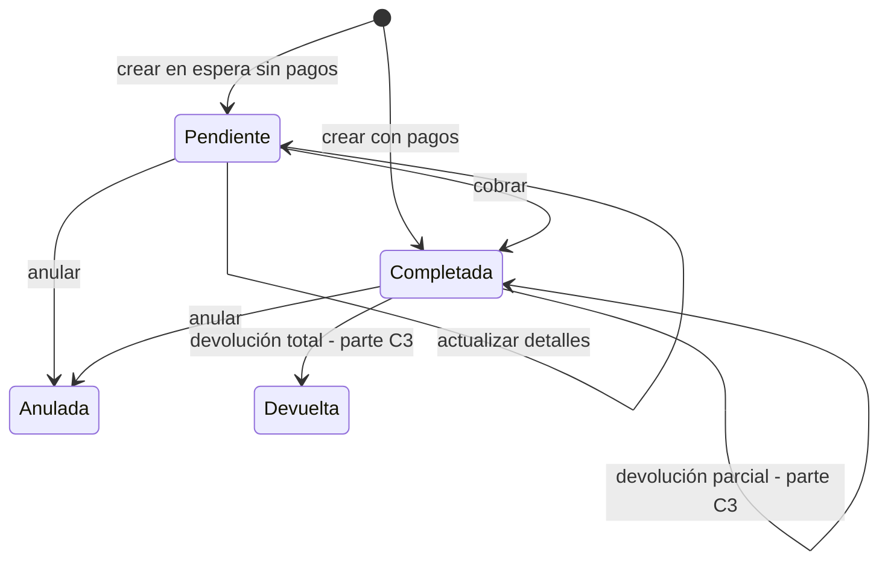

# Catálogo de reglas de negocio — Parte C2: ventas y comprobantes

| | |
|---|---|
| **Sistema** | SOFIA — Sistema Optimizado Farmacéutico con Inteligencia Artificial |
| **Versión del documento** | 1.1 |
| **Fecha** | 2026-10-14 |
| **Backend** | `sofia-apis`, rama `main`, commit `43f5529` |
| **Frontend** | `sofia-web-spa`, rama `main`, commit `eeffbb6` |
| **Método** | Lectura de código (controlador, validadores, handlers, entidades, configuraciones EF, scripts DbUp, componentes Angular y archivos `es.json`). No se ejecutó la aplicación ni se llamó a la API. |

## Historial de cambios

### Versión 1.1 (2026-10-14)

Reconciliación con el código actual (`sofia-apis` `9dd1705` → `43f5529`, `sofia-web-spa` `2f82346` → `eeffbb6`). Los archivos de ventas, comprobantes y `pages/pos` no cambiaron en ese tramo (`pages/pos` y `public/i18n/pos` ya estaban en la línea base `063817c`); cambian solo una regla marcada «En curso», el apartado 5.2 y una nota sobre el borrado de pacientes.

| Apartado o ID | Decía | Dice ahora | Commit |
|---|---|---|---|
| RN-VEN-022 | Marcada **En curso (sin commitear)** porque otra sesión editaba el registro de precios de proveedor (`HistorialPrecioProveedor.cs`, `CerrarVigencia`, `RegistrarPrecioProveedorCommandHandler.cs`). | Sin marca. La lectura de la venta no cambió (`VentaDetalleFactory.cs:307-318`); se aclara cómo se llena el historial: el registro de precio guarda el costo neto y cierra el precio abierto anterior del mismo proveedor y producto, y la lectura de la venta no filtra por proveedor. | `606cb69` (apis), `9cbbe58` (spa) |
| RN-VEN-025 | Solo describía el vínculo de la venta con el paciente. | Agrega que un paciente con ventas no eliminadas ya no se puede eliminar (409 `Paciente.InUse`). | `27597cd`, `01b8260` |
| 5.1, punto 7 | El cliente de la venta eliminado se trataba como caso posible. | Se aclara que desde `27597cd` ese caso solo puede venir de datos eliminados antes de ese commit; el punto sigue **No verificado**. | `27597cd` |
| 5.2 | Había cambios locales de otra sesión en proveedores y precios (backend y frontend), `README.md`, `angular.json` e `index.html`; el commit `2f82346` era más nuevo que la línea base. | Ninguno: `git status --short` está limpio en los dos repositorios; todo lo anterior está commiteado. | `606cb69`, `9cbbe58`, `8f36125`, `43f5529`, `eeffbb6` |
| Revisión de `27597cd` y `41f0a05` | — | `27597cd` agrega guardas de borrado en pacientes, medicamentos, sucursales, profesionales, ingredientes y proveedores; solo el de pacientes y el de sucursales miran ventas y no cambian ninguna regla de este documento más allá de RN-VEN-025. `41f0a05` solo cambia el registro de empresa. | `27597cd`, `41f0a05` |

## 1. Alcance y convenciones

Este documento cataloga las reglas de negocio que el código hace cumplir en el punto de venta: Ventas (`VEN`: crear, dejar en espera, actualizar una venta en espera, cobrarla, anularla y consultarla) y Comprobantes emitidos al vender (`CMP`: la boleta que se genera al cobrar). Quedan fuera, por pertenecer a la parte C3: apertura, cierre y arqueo de caja; devoluciones y notas de crédito; dashboard. El maestro de series fiscales es la parte A (prefijo `SER`).

Las reglas transversales (aislamiento por empresa, borrado lógico, paginación, transacciones, auditoría, permisos, concurrencia, errores de base de datos, exportación) las documenta la parte A y se citan por su ID. La forma en que una regla se convierte en respuesta HTTP y la forma en que el SPA resuelve un código de error están descritas en las secciones 2 y 3 de [01b-catalogos.md](./01b-catalogos.md#2-cómo-se-convierte-una-regla-en-respuesta-http); el formato de las tablas es el de [01c1-inventario-y-recetas.md](./01c1-inventario-y-recetas.md). Aquí solo se agrega lo que es distinto en estos módulos (sección 2).

**Abreviaturas de ruta** (las mismas de las partes B y C1; todas son rutas reales):

| Abreviatura | Ruta completa |
|---|---|
| `APP/` | `sofia-apis/src/SOFIA.Application/` |
| `DOM/` | `sofia-apis/src/SOFIA.Domain/Entities/` |
| `API/` | `sofia-apis/src/SOFIA.API/Controllers/` |
| `CFG/` | `sofia-apis/src/SOFIA.Infrastructure/Persistence/Configurations/` |
| `DBUP/` | `sofia-apis/src/SOFIA.DbUp/Scripts/` |
| `SPA/` | `sofia-web-spa/src/app/` |
| `I18N/` | `sofia-web-spa/public/i18n/` |

**Alias propios de este documento** (todos con el prefijo de ruta indicado):

| Alias | Archivo |
|---|---|
| `CRE-H`, `CRE-V` | `APP/Ventas/Commands/CreateVenta/CreateVentaCommandHandler.cs`, `CreateVentaCommandValidator.cs` |
| `COM-H`, `COM-V` | `APP/Ventas/Commands/CompletarVenta/CompletarVentaCommandHandler.cs`, `CompletarVentaCommandValidator.cs` |
| `ACT-H`, `ACT-V` | `APP/Ventas/Commands/ActualizarVentaPendiente/ActualizarVentaPendienteCommandHandler.cs`, `ActualizarVentaPendienteCommandValidator.cs` |
| `ANU-H`, `ANU-V` | `APP/Ventas/Commands/AnularVenta/AnularVentaCommandHandler.cs`, `AnularVentaCommandValidator.cs` |
| `FAC` | `APP/Ventas/Common/VentaDetalleFactory.cs` |
| `UPD` | `APP/Ventas/Common/VentaDetalleUpdater.cs` |
| `GEN` | `APP/Ventas/Common/VentaComprobanteGenerator.cs` |
| `SEG` | `APP/Ventas/Common/VentaSeguroProcessor.cs` |
| `VER` | `APP/Ventas/Common/VentaRecetaVerificacion.cs` |
| `PAGF` | `APP/Ventas/Common/VentaPagoFactory.cs` |
| `Q-LIST`, `Q-DET` | `APP/Ventas/Queries/GetVentas/GetVentasQueryHandler.cs`, `APP/Ventas/Queries/GetVentaById/GetVentaByIdQueryHandler.cs` |
| `Q-LOT`, `Q-PRES`, `Q-CFG` | `APP/Ventas/Queries/GetLotesDisponiblesVenta/GetLotesDisponiblesVentaQueryHandler.cs`, `APP/Ventas/Queries/GetPresentacionesProductoVenta/GetPresentacionesProductoVentaQueryHandler.cs`, `APP/Ventas/Queries/GetConfiguracionVenta/GetConfiguracionVentaQueryHandler.cs` |
| `CTRL` | `API/VentasController.cs` |
| `NV` | `SPA/pages/pos/nueva-venta/nueva-venta.component` (`.ts` o `.html`, según el número de línea citado) |
| `VD` | `SPA/pages/pos/venta-detail/venta-detail.component` |
| `VS` | `SPA/pages/pos/search/ventas-search.component` |
| `ES` | `I18N/pos/es.json` (clave raíz `pos`; todas las claves de este documento se escriben con el prefijo `pos.`) |

**Reglas de la parte A a las que se remite**

| Regla | Tema |
|---|---|
| RN-GEN-001, RN-GEN-002, RN-GEN-003 | Aislamiento por empresa, filas eliminadas no visibles, borrado lógico |
| RN-GEN-005, RN-GEN-006 | Quién y cuándo se grabó; fechas en UTC |
| RN-GEN-007 | Eventos de dominio a la bandeja de salida |
| RN-GEN-008 | Filtros de fecha inclusivos, normalizados a UTC |
| RN-GEN-009 | Paginación acotada |
| RN-GEN-010 | Limpieza de HTML en los textos de primer nivel del request |
| RN-GEN-011 | Un validador que falla impide que se ejecute el handler; código `{Request}.{Propiedad}` |
| RN-GEN-012, RN-GEN-013 | Comandos transaccionales (un `Result.Failure` no revierte) y auditoría de seguridad |
| RN-GEN-020 | Falta de permiso |
| RN-GEN-024 | `Auth.Sucursal` / `Auth.Empleado` |
| RN-GEN-035 | Conflicto de concurrencia (`Concurrency.Conflict`) |
| RN-GEN-036, RN-GEN-037, RN-GEN-038 | `Db.Duplicado`, `Db.ValorInvalido`, `Db.ReferenciaInvalida` |
| RN-GEN-041 | Cuerpo con forma inválida |
| RN-IMP-008 a RN-IMP-011 | Exportación a Excel (10 000 filas, títulos, etiquetas, formato de fecha) |
| RN-SER-004, RN-SER-005, RN-SER-008, RN-SER-010, RN-SER-013 | Prefijo, correlativo, una serie activa por tipo y sucursal, serie con comprobantes, numeración atómica |
| RN-EMP-003, RN-EMP-004, RN-EMP-016 | RUC de la empresa y política «exigir registro de receta» |
| RN-STK-004, RN-STK-011, RN-STK-017 | Cantidad no negativa, versión de fila del stock, definición de stock vendible |
| RN-LOT-006 | Definición de lote vencido |
| RN-REC-031 | Máximo de dispensaciones de una receta (`Venta.Receta.Agotada`) |
| RN-PRE-001 a RN-PRE-015 | Presentaciones de venta (catálogo) |
| RN-PAC-002 a RN-PAC-004 | Tipo y formato del documento del paciente |

## 2. Diferencias con el comportamiento común de las partes B y C1

1. **Un `Result.Failure` sin código HTTP explícito responde 400 aunque el error sea de tipo `NotFound` o `Forbidden`** (`Result.Failure(error, statusCode = 400)`, `sofia-apis/src/SOFIA.Domain/Common/Result.cs:32-33`; `sofia-apis/src/SOFIA.API/Extensions/ResultExtensions.cs:13-23`). En ventas esto es la norma: solo `Venta.NotFound`, `Venta.Anular` (venta inexistente), `Venta.Completar` (venta inexistente), `Venta.Actualizar` (venta inexistente), `Paciente.NotFound`, `Aseguradora.NotFound` y `Venta.Caja.NoPropia` llevan un número explícito. Por eso `Venta.Lote`, `Venta.Presentacion` y todos los `Forbidden` de venta de otra sucursal responden 400, no 404 ni 403. La columna «HTTP» de este documento indica siempre el número real.
2. **Un `Result.Failure` no revierte la transacción** (RN-GEN-012) y **ninguno de los comandos de venta guarda antes de validar**: el stock se descuenta en memoria y solo se persiste con el `SaveChanges` final, de modo que un fallo de validación no deja stock descontado. La única escritura inmediata es el aumento del correlativo de la serie (RN-CMP-004).
3. **Códigos HTTP de éxito.** Crear venta y completar venta devuelven **200** con `{ ventaId, comprobante }` (el handler de crear pasa 201 a `Result.Success`, pero `ToActionResult` para `Result<T>` siempre produce `OkObjectResult`; `CRE-H:80`, `sofia-apis/src/SOFIA.API/Extensions/ResultExtensions.cs:7-8`). Actualizar los detalles de una venta en espera y anular responden **204** (`sofia-apis/src/SOFIA.API/Extensions/ResultExtensions.cs:10-11`).
4. **Auditoría.** Solo anular venta implementa `IAuditableCommand` (evento `VENTA_ANULAR`, RN-GEN-013); crear, completar y actualizar no generan evento de auditoría (RN-VEN-061).
5. **Cada pantalla del POS traduce los errores con su propio mapa de códigos** y no usa `saveErrorKey` ni los códigos `Db.*`:
   - Cobrar y dejar en espera (`NV`, `ventaErrorMessage`): mapa `VENTA_ERROR_KEYS` (`NV.ts:72-97`); lo que no está en el mapa muestra «Ocurrió un error al procesar la venta.» (`pos.messages.ventaError`, `ES:328`). Los avisos de las consultas de apoyo (catálogo, lotes, presentaciones) pasan por el mismo mapa y, si el código no está, usan su propio texto (`ES:330-332`).
   - Detalle de venta (`VD`): al anular solo reconoce `Venta.Anular.ConDevoluciones`, `Venta.Anular.SinSesionAbierta` y `Concurrency.Conflict` (`VD.ts:19-23`); el resto muestra «Error al anular la venta.» (`pos.ventasDetail.anularError`, `ES:101`). Cualquier fallo al abrir una venta muestra «Error al cargar la venta» (`pos.ventasDetail.loadError`, `ES:79`).
   - Listado y exportación (`VS`): cualquier fallo muestra «Error al buscar ventas» (`pos.ventasSearch.searchError`, `ES:64`).
6. **Textos compartidos** que se citan (`I18N/es.json`): `errors.concurrencyConflict` «Otra operación modificó estos datos al mismo tiempo. Actualiza la pantalla e inténtalo de nuevo.»; `general.errors.required` «Este campo es obligatorio». El mapa de cobro incluye `Concurrency.Conflict` → `errors.concurrencyConflict` (`NV.ts:96`).
7. **Orden en que se evalúan las condiciones al crear una venta** (determina cuál error ve el usuario cuando fallan varias): permiso (RN-GEN-020) → validador (RN-VEN-008 a RN-VEN-010, RN-VEN-039 a RN-VEN-042) → sucursal y empleado del token (RN-VEN-002) → paciente existe (RN-VEN-025) → caja (RN-VEN-003 a RN-VEN-005) → aseguradora existe (RN-VEN-047) → por cada línea y en este orden: cuarentena, lote existe, lote vencido, producto existe, receta (política, existencia, paciente, número), stock en la sucursal, presentación y precio, stock suficiente, costo → máximo de dispensaciones de las recetas usadas (RN-REC-031) → si hay pagos: verificación de receta, pagos válidos, suma y vuelto, comprobante (RUC y serie), reclamo de seguro (`CRE-H:20-76`, `FAC:31-88`, `CRE-H:84-119`).

---

## 3. Ventas (`VEN`)

Una venta registra la salida de productos de una sucursal, a nombre de un cajero y, opcionalmente, de un cliente (paciente). Entidades `Venta` (tabla `Ventas_Cabecera`), `DetalleVenta` (`Ventas_Detalle`), `VentaPago` (`Ventas_Pagos`) y `VentaReclamoSeguro` (`Ventas_Reclamos_Seguro`); controlador `VentasController`; pantallas `/pos` (listado), `/pos/nueva` (terminal de venta, también para retomar una venta en espera con `?continuar={id}`) y `/pos/:id` (detalle). Textos en `I18N/pos/es.json` (la carpeta mezcla textos de caja y de ventas; aquí solo se citan los de ventas). La nota de crédito, el reembolso, la apertura y el cierre de caja y el arqueo son de la parte C3.

**Endpoints** (`CTRL`, todos exigen permiso `[HasPermission]`; ver RN-VEN-001):

| Operación | Endpoint | Permiso | Handler | Éxito |
|---|---|---|---|---|
| Listar | `GET api/v1/ventas` | `Ventas:Leer` | `GetVentasQueryHandler` | 200 |
| Detalle | `GET api/v1/ventas/{id}` | `Ventas:Leer` | `GetVentaByIdQueryHandler` | 200 |
| Crear (cobrada o en espera) | `POST api/v1/ventas` | `Ventas:Crear` | `CreateVentaCommandHandler` | 200 |
| Lotes disponibles | `GET api/v1/ventas/lotes-disponibles` | `Ventas:Crear` | `GetLotesDisponiblesVentaQueryHandler` | 200 |
| Presentaciones del producto | `GET api/v1/ventas/presentaciones` | `Ventas:Crear` | `GetPresentacionesProductoVentaQueryHandler` | 200 |
| Configuración de venta | `GET api/v1/ventas/configuracion` | `Ventas:Crear` | `GetConfiguracionVentaQueryHandler` | 200 |
| Cobrar una venta en espera | `PUT api/v1/ventas/{id}/completar` | `Ventas:Actualizar` | `CompletarVentaCommandHandler` | 200 |
| Actualizar los detalles de una venta en espera | `PUT api/v1/ventas/{id}/detalles` | `Ventas:Actualizar` | `ActualizarVentaPendienteCommandHandler` | 204 |
| Anular | `PUT api/v1/ventas/{id}/anular` | `Ventas:Anular` | `AnularVentaCommandHandler` | 204 |
| Exportar a Excel | `POST api/v1/ventas/exportar` | `Ventas:Leer` | `GetVentasQueryHandler` (reutilizado) | archivo `ventas.xlsx` |

**Estados de una venta** (`sofia-apis/src/SOFIA.Domain/Enums/EstadoVenta.cs`: `Completada`, `Anulada`, `Devuelta`, `Pendiente`; en la base se guarda el nombre como texto, `CFG/VentaConfiguration.cs:43-47`):

### 3.1 Acceso y precondiciones para vender

| ID | Regla | Tipo | Dónde se aplica | Código de error | HTTP | Mensaje en el SPA (es) |
|---|---|---|---|---|---|---|
| RN-VEN-001 | Cada operación exige un permiso del módulo `Ventas`: `Leer` (listar, ver detalle, exportar), `Crear` (crear la venta **y** las tres consultas de apoyo del POS: lotes disponibles, presentaciones y configuración, para que vender no dependa de permisos de inventario), `Actualizar` (cobrar una venta en espera y actualizar sus detalles) y `Anular` (anular). El permiso `Anular` es aparte de `Actualizar`: el script `0017` se lo concedió a todo rol que ya tenía `Ventas:Actualizar`. | Autorización | `CTRL:20`, `:29`, `:38`, `:48`, `:57`, `:66`, `:75`, `:84`, `:93`, `:102`; `DBUP/0017_Permiso_Ventas_Anular.sql:1-9` | — (ver RN-GEN-020) | Ver RN-GEN-020 | Ver RN-GEN-020. El botón «Nueva Venta POS» solo se muestra con `Crear` (`VS.html:17`); «Cobrar Venta» exige `Crear` **y** `Actualizar` (`VD.ts:99-102`, porque reabre el POS y completa la venta); «Anular Venta» exige `Anular` (`VD.ts:90-96`). Las rutas lo comprueban: `/pos` y `/pos/:id` exigen `Ventas:Leer` y `/pos/nueva` además `Ventas:Crear`; si falta, el SPA redirige al tablero con «No tienes permisos para acceder a esta pantalla.» (`errors.forbiddenPage`, `I18N/es.json:151`; `SPA/core/auth/permission.guard.ts:11-30`, `SPA/core/auth/route-permissions.ts:20`, `:53-57`). Un rechazo por permiso en cobrar o dejar en espera muestra «Ocurrió un error al procesar la venta.» (`pos.messages.ventaError`). |
| RN-VEN-002 | La sucursal y el empleado de la venta no se eligen: salen del token. Crear, cobrar, actualizar, anular (venta cobrada), listar, ver detalle y las consultas de apoyo necesitan la sucursal del token (`Auth.Sucursal`); crear, cobrar y anular una venta cobrada necesitan además el empleado (`Auth.Empleado`). Una venta queda registrada en la sucursal base del cajero y a su nombre (`Venta.SucursalId`, `Venta.EmpleadoId`); cobrar una venta en espera no cambia el empleado que la registró. | Autorización | `CRE-H:20-34`; `COM-H:20-26`, `:47-51`; `ACT-H:17-23`; `ANU-H:28-34`, `:106-110`; `Q-LIST:19-25`; `Q-DET:17-23`; `Q-LOT:17-21`; `Q-CFG:14-18`; `DOM/Venta.cs:13-14`, `:47-55` (guards `Venta.SucursalId` / `Venta.EmpleadoId`, inalcanzables por API porque el token siempre trae ambos) | `Auth.Sucursal` · `Auth.Empleado` (RN-GEN-024) · `Venta.SucursalId` · `Venta.EmpleadoId` (entidad) | Ver RN-GEN-024 · 400 | `Auth.Sucursal`: «No se pudo determinar el contexto de sucursal asignada del usuario.» (`pos.messages.contextError`, `ES:314`; `NV.ts:95`), solo en el terminal de venta y sus consultas de apoyo. `Auth.Empleado` y, en las demás pantallas, `Auth.Sucursal`: sin traducción → el genérico de la pantalla (cobrar `pos.messages.ventaError`; anular `pos.ventasDetail.anularError`; listar `pos.ventasSearch.searchError`; detalle `pos.ventasDetail.loadError`). |
| RN-VEN-003 | **Para crear una venta —cobrada o en espera— se necesita una sesión de caja:** el comando debe traer `SesionId`. Sin él la venta se rechaza. | Obligatoriedad | `CRE-H:134-137`; `DOM/Venta.cs:16` (la columna `Sesion_ID` admite NULL: `DBUP/0001_Initial_Schema.sql:342`) | `Venta.Caja` | 400 | Sin traducción → «Ocurrió un error al procesar la venta.» (`pos.messages.ventaError`). El SPA no deja llegar a esa llamada: si el cajero no tiene caja abierta, el terminal no muestra el catálogo y solo muestra «Debes aperturar la caja del turno antes de procesar una venta.» (`pos.checkout.cajaRequeridaAviso`, `ES:205`; `NV.html:13-23`) con el botón «Aperturar Caja» solo si tiene el permiso `POS:AperturarCaja`; además `puedeProcesar` y `puedeGuardarPendiente` exigen una sesión (`NV.ts:246-265`). |
| RN-VEN-004 | La sesión indicada debe existir (no eliminada) y estar en estado `Abierta`. Una sesión cerrada, cuadrada o inexistente se rechaza con el mismo código que la falta de sesión. | Integridad | `CRE-H:139-145` | `Venta.Caja` | 400 | Sin traducción → `pos.messages.ventaError`. |
| RN-VEN-005 | La sesión debe ser **del propio cajero y de su sucursal**: el efectivo de la venta tiene que caer en su propio cajón. Si la sesión es de otro empleado o de otra sucursal, 403. Esta regla solo se aplica al crear; al cobrar una venta en espera la sesión la elige el servidor (RN-VEN-006). | Autorización | `CRE-H:147-150` | `Venta.Caja.NoPropia` | 403 | «La caja seleccionada pertenece a otro cajero o sucursal. Recarga la página para usar tu propia caja abierta.» (`pos.messages.cajaNoPropia`, `ES:343`; `NV.ts:80`). |
| RN-VEN-006 | Cobrar una venta en espera exige que quien cobra tenga **su propia caja abierta en la sucursal de la venta**: el servidor la busca (la del empleado del token, en la sucursal del token, en estado `Abierta`, no eliminada) y **reasigna la venta a esa sesión**, sea cual fuere la sesión con la que se guardó en espera. El efectivo cobrado cuenta en el arqueo de esa sesión (vínculo con la parte C3). Esta comprobación va antes que las de cobertura, líneas, pagos y comprobante. | Integridad | `COM-H:53-57`, `:126-134`; `DOM/Venta.cs:187-203` | `Venta.Caja.SinSesionAbierta` · `Venta.Caja` (guard de `AsignarSesion`, inalcanzable: el estado ya se comprobó y la sesión no es vacía) | 400 | «Necesitas tener tu propia caja abierta en esta sucursal para cobrar la venta.» (`pos.messages.cajaSinSesionAbierta`, `ES:344`; `NV.ts:81`). |
| RN-VEN-007 | Para cobrar la empresa debe tener RUC y la sucursal una serie de boleta activa (se comprueba al emitir el comprobante, después de armar las líneas y los pagos): el detalle es RN-CMP-002 y RN-CMP-003. Vender **en espera** no los necesita. | Integridad | `CRE-H:104-108`; `COM-H:90-94`; `GEN:15-28` | Ver RN-CMP-002 y RN-CMP-003 | 400 | Ver RN-CMP-002 y RN-CMP-003. |

### 3.2 Líneas de venta (producto, lote, cantidad, precio y costo)

Cada línea del comando (`CreateVentaDetailDto`) trae `LoteId`, `Cantidad`, `RecetaId` (opcional) y `PresentacionVentaId` (opcional) (`APP/Ventas/Commands/CreateVenta/CreateVentaCommand.cs:28-32`). **El cliente no envía precio ni costo**: ambos los resuelve el servidor (RN-VEN-019, RN-VEN-022). No existen descuentos (RN-VEN-023).

| ID | Regla | Tipo | Dónde se aplica | Código de error | HTTP | Mensaje en el SPA (es) |
|---|---|---|---|---|---|---|
| RN-VEN-008 | Toda venta nueva y todo reemplazo de los detalles de una venta en espera deben tener al menos una línea. Al **cobrar** una venta en espera sin reenviar las líneas se usan las ya guardadas; si se reenvía la lista, no puede venir vacía (la comprobación está en la entidad, porque el validador de cobrar no revisa las líneas). | Obligatoriedad | `CRE-V:16-17`; `ACT-V:11-12`; `DOM/Venta.cs:57-60` (guard `Venta.Detalles` de crear, inalcanzable por API), `:169-172` (guard de reemplazar; alcanzable al cobrar con `Detalles: []`) | `CreateVentaCommand.Detalles` · `ActualizarVentaPendienteCommand.Detalles` · `Venta.Detalles` (cobrar con lista vacía; crear, entidad) | 400 | Sin traducción → `pos.messages.ventaError`. El SPA no permite cobrar ni dejar en espera con el carrito vacío (`puedeProcesar`, `puedeGuardarPendiente`, `NV.ts:246-265`). |
| RN-VEN-009 | Cada línea debe traer un lote (identificador no vacío). El validador lo exige al crear y al actualizar los detalles; al cobrar con líneas reenviadas no hay validador de líneas y un lote vacío o desconocido cae en RN-VEN-011. | Obligatoriedad | `CRE-V:19-22`; `ACT-V:14-17`; `DOM/DetalleVenta.cs:32-35` (guard `DetalleVenta.LoteId`, inalcanzable: antes responde `Venta.Lote`); columna `Lote_ID NOT NULL` y clave foránea `FK_VentaDet_Lote` en `DBUP/0001_Initial_Schema.sql:364`, `:377` | `CreateVentaCommand.Detalles[i].LoteId` · `ActualizarVentaPendienteCommand.Detalles[i].LoteId` (con el índice de la línea) · `DetalleVenta.LoteId` (entidad) · `Db.ReferenciaInvalida` (RN-GEN-038) | 400 · 409 | Sin traducción → `pos.messages.ventaError`. |
| RN-VEN-010 | La cantidad de cada línea debe ser mayor que 0 (admite decimales). Al crear y al actualizar la rechaza el validador; al cobrar con líneas reenviadas la rechaza la entidad `DetalleVenta`. La base de datos repite la regla y guarda la cantidad **en unidades base** con 2 decimales (`DECIMAL(8,2)`). | Integridad | `CRE-V:22`; `ACT-V:16`; `DOM/DetalleVenta.cs:37-40`; `CHK_Ventas_Detalle_Cantidad_Vendida CHECK (Cantidad_Vendida > 0)` en `DBUP/0020_SoftDeleteAware_Uniques_And_Checks.sql:97-98` y `CFG/DetalleVentaConfiguration.cs:27-29`, `:67`; columna en `DBUP/0001_Initial_Schema.sql:366` | `CreateVentaCommand.Detalles[i].Cantidad` · `ActualizarVentaPendienteCommand.Detalles[i].Cantidad` · `DetalleVenta.Cantidad` (cobrar con líneas reenviadas) · `Db.ValorInvalido` (RN-GEN-037) | 400 | Formulario: si la cantidad ingresada es 0 o negativa, «Ingresa una cantidad válida para agregar el producto.» (`pos.messages.cantidadPrecioInvalidos`, `ES:333`; `NV.ts:653-656`); en el carrito los botones no bajan de 1 unidad o presentación (`NV.ts:821`). Backend: sin traducción → `pos.messages.ventaError`. Qué ocurre con más de 2 decimales: **No verificado** (sección 5.1). |
| RN-VEN-011 | El lote debe existir en la empresa **y tener una fila de stock en la sucursal del cajero**; el producto del lote debe existir. Las tres comprobaciones responden con el mismo código. Un lote que existe pero solo tiene stock en otra sucursal se rechaza aquí (el stock de otra sucursal no se puede vender). | Integridad | `FAC:50-56` (fila de stock de la sucursal), `:175-182` (lote), `:189-197` (producto), `:122-127` (misma regla al cobrar sin reenviar líneas) | `Venta.Lote` | 400 (el error es de tipo `NotFound` pero no lleva 404) | Sin traducción → `pos.messages.ventaError`. |
| RN-VEN-012 | **Cuarentena.** Un lote con algún registro de cuarentena en estado `Retenido` (no eliminado) no se vende «bajo ninguna circunstancia». Los estados `Liberado`, `Destruido` y `Devuelto` no bloquean. Esta es la primera comprobación de cada línea (antes de comprobar que el lote exista). | Integridad | `FAC:167-173`; `sofia-apis/src/SOFIA.Domain/Enums/EstadoResolucionCuarentena.cs:5-8`; misma definición en la consulta de lotes disponibles `APP/Inventarios/Common/InventarioVendibleExtensions.cs:18-24` (RN-STK-017) | `Venta.Cuarentena` | 400 | Sin traducción → `pos.messages.ventaError`. El catálogo del POS no ofrece esos lotes (RN-VEN-075). |
| RN-VEN-013 | **Lote vencido.** Un lote se vende hasta el final de su día de caducidad: está vencido cuando su caducidad es menor o igual que «ahora menos un día» (definición única de RN-LOT-006). Aplica a cada línea al crear, al actualizar y al cobrar con líneas reenviadas; al cobrar sin reenviar líneas **no se vuelve a comprobar** (el stock ya estaba descontado). | Integridad | `FAC:184-187`; `DOM/LoteInventario.cs:95-99` | `Venta.Lote.Vencido` | 400 | «Uno de los lotes está vencido y no se puede vender. Retíralo del carrito.» (`pos.messages.loteVencido`, `ES:354`; `NV.ts:92`). |
| RN-VEN-014 | **Stock suficiente.** La cantidad de la línea, convertida a unidades base (RN-VEN-017), no puede superar la cantidad física del lote en la sucursal del cajero. Si hay varias líneas del mismo lote en la misma venta, cada una se compara con lo que queda después de las anteriores, porque el descuento se hace sobre la misma fila de stock ya cargada (lectura del código; **No verificado** en ejecución). El API no deduplica líneas ni impone orden de vencimiento (FEFO): el cajero puede elegir cualquier lote vendible. | Integridad | `FAC:66-69`, `:79` | `Venta.Stock` | 400 | Sin traducción → `pos.messages.ventaError`. Antes de enviar, el SPA limita la cantidad: «Stock máximo disponible alcanzado ({{stock}} un.).» (`pos.messages.stockMaxReached`, `ES:310`; `NV.ts:645-648`, `:678-681`, `:822-825`). |
| RN-VEN-015 | **Cómo se descuenta el stock.** Cada línea resta su cantidad **en unidades base** de la fila de stock del lote en la sucursal, en memoria, y el descuento se guarda junto con la venta. Pasa también cuando la venta queda **en espera** (RN-VEN-052): el stock queda reservado desde que se guarda. Al reemplazar los detalles de una venta en espera primero se devuelven al stock todas las líneas anteriores y luego se descuentan las nuevas. Si otra operación cambió la misma fila de stock (otra venta, un ajuste), el guardado se rechaza por la versión de fila (RN-STK-011). | Cálculo | `FAC:79`; `UPD:23-29`; `DOM/InventarioSucursal.cs:13-14`; `DBUP/0019_Concurrency_RowVersion.sql:2-3` | `Concurrency.Conflict` (RN-GEN-035) · `Db.ValorInvalido` (CHECK de cantidad no negativa, RN-STK-004) | 409 · 400 | `Concurrency.Conflict`: «Otra operación modificó estos datos al mismo tiempo. Actualiza la pantalla e inténtalo de nuevo.» (`errors.concurrencyConflict`; `NV.ts:96`). `Db.ValorInvalido` no está en el mapa de cobro → `pos.messages.ventaError`. |
| RN-VEN-016 | **Cobrar sin reenviar las líneas no vuelve a revisar el lote.** Al cobrar una venta en espera sin enviar `Detalles` se conservan las líneas guardadas (el stock ya está descontado): no se vuelve a comprobar cuarentena, vencimiento, stock, precio, pertenencia a la presentación ni el máximo de dispensaciones. Solo se vuelve a juzgar la política de receta de cada línea (RN-VEN-038) y que el lote y el producto sigan existiendo (`Venta.Lote`). Si se reenvían las líneas, se aplica todo de nuevo (RN-VEN-011 a RN-VEN-019). | Integridad | `COM-H:112-123`; `FAC:91-120`, `:122-142` | `Venta.Lote` | 400 | Sin traducción → `pos.messages.ventaError`. El POS siempre reenvía las líneas al cobrar una venta retomada (`NV.ts:1084-1091`). |
| RN-VEN-017 | **Unidad de la cantidad.** Si la línea **no** trae presentación, `Cantidad` está en unidades base. Si trae `PresentacionVentaId`, `Cantidad` está en unidades de esa presentación (por ejemplo 2 cajas) y el servidor calcula `cantidad base = Cantidad × CantidadUnidadesBase de la presentación`; la línea guarda ambas: `Cantidad_Vendida` (base) y `Cantidad_En_Presentacion` (la ingresada, `DECIMAL(12,4)`), más el identificador de la presentación. El stock se descuenta siempre en unidades base. | Cálculo | `FAC:215-242`; `DOM/DetalleVenta.cs:12-16`, `:47-56`; `DBUP/0010_PresentacionesVenta.sql:25-33`; `CFG/DetalleVentaConfiguration.cs:39-44` | — | — | El POS envía la cantidad en presentaciones cuando hay una elegida y en unidades base cuando no (`NV.ts:984-994`). El selector de cantidad limita al máximo entero de presentaciones que caben en el lote (`floorDiv`, `NV.html:203-210`). |
| RN-VEN-018 | **Presentación de venta.** La presentación debe existir (no eliminada) y ser del mismo producto que el lote. Los datos de la presentación (unidades base, precio) los define el catálogo (RN-PRE-001 a RN-PRE-015). | Integridad | `FAC:224-235` | `Venta.Presentacion` (inexistente: tipo `NotFound` sin 404; de otro producto: tipo `Validation`) | 400 · 400 | Sin traducción → `pos.messages.ventaError`. Si falla la carga de presentaciones al elegir un lote: «No se pudieron cargar las presentaciones del producto. Inténtalo nuevamente.» (`pos.messages.presentacionesError`, `ES:332`). |
| RN-VEN-019 | **De dónde sale el precio.** Siempre del catálogo, nunca del cliente (el comando no tiene campo de precio). Sin presentación: precio unitario = `PrecioVentaBase` del medicamento; si es nulo (productos de carga masiva, RN-MED-021) la línea se rechaza. Con presentación: precio unitario base = `PrecioVenta` de la presentación ÷ `CantidadUnidadesBase`, **aunque el medicamento no tenga precio base**. El precio se congela en la línea (`Precio_Fijado_Unidad`, `DECIMAL(10,2)`). El precio 0 no se rechaza en el servidor (solo el nulo). | Cálculo | `FAC:217-222`, `:237-241`; `DOM/DetalleVenta.cs:13`; `CFG/DetalleVentaConfiguration.cs:31-33` | `Venta.SinPrecio` | 400 | «Este producto no tiene precio de venta configurado en el catálogo. Pide a un administrador que lo registre.» (`pos.messages.sinPrecio`, `ES:334`; `NV.ts:73`). El SPA además bloquea agregar al carrito con precio 0 o menor con ese mismo texto (`NV.ts:649-652`) y muestra «Sin precio» en el catálogo (`pos.checkout.sinPrecioCatalogo`, `ES:196`). |
| RN-VEN-020 | **Redondeos y precisión.** El servidor no redondea el precio unitario de la línea: usa el decimal exacto (por ejemplo `PrecioVenta ÷ CantidadUnidadesBase`), y el total de la venta es la suma exacta de `precio × cantidad` de cada línea. Las columnas guardan 2 decimales (`Precio_Fijado_Unidad DECIMAL(10,2)`, `Cantidad_Vendida DECIMAL(8,2)`, `Monto_Total_Bruto DECIMAL(12,2)`); si el cálculo produce más decimales, **cómo los convierte la base (redondea o trunca) y si el total guardado puede diferir de la suma de las líneas guardadas: No verificado** (sección 5.1). El único redondeo explícito de este módulo es el del desglose de IGV (RN-CMP-006). | Cálculo | `FAC:237-241`; `DOM/Venta.cs:160`; `CFG/DetalleVentaConfiguration.cs:27-37`; `CFG/VentaConfiguration.cs:39-41` | `DetalleVenta.PrecioUnitario` (guard de precio negativo, inalcanzable salvo datos corruptos: ni el medicamento ni la presentación admiten precio negativo) | 400 | Sin traducción. |
| RN-VEN-021 | **Total de la venta.** `MontoTotalBruto` = suma de `precio fijado × cantidad vendida` de las líneas, calculado al crear y al reemplazar los detalles. Es el importe con IGV incluido (los precios del catálogo incluyen IGV, RN-CMP-006). No puede ser negativo (restricción de base de datos). | Cálculo | `DOM/Venta.cs:83`, `:160`, `:182`; `CHK_Ventas_Cabecera_Monto_Total_Bruto CHECK (Monto_Total_Bruto >= 0)` en `DBUP/0020_SoftDeleteAware_Uniques_And_Checks.sql:89-90` y `CFG/VentaConfiguration.cs:93`; columna `DECIMAL(12,2) NOT NULL` en `DBUP/0001_Initial_Schema.sql:344` | `Db.ValorInvalido` (RN-GEN-037) | 400 | Sin traducción → `pos.messages.ventaError`. El SPA muestra «Subtotal (Op. Gravada):», «IGV (18%):» y «TOTAL A PAGAR:» calculados en el navegador como `total ÷ 1,18` (`pos.checkout.subtotalLabel`, `igvLabel`, `totalLabel`, `ES:200-202`; `NV.ts:242-243`). |
| RN-VEN-022 | **Costo histórico.** Cada línea guarda el costo por unidad base vigente al vender: del historial de precios de proveedor del producto, el registro cuyo periodo de vigencia incluye el instante de la venta, con inicio más reciente. Si el producto no tiene precio de proveedor vigente, el costo es 0. El costo no se muestra en pantalla. La consulta no filtra por proveedor: si dos proveedores tienen un precio vigente para el mismo producto, se toma el de inicio más reciente. El historial lo llena el registro de precio de proveedor (RN-PRV-018 a RN-PRV-020 en [01b-catalogos.md](./01b-catalogos.md)): guarda el **costo neto** (precio de compra con el descuento aplicado) con vigencia desde el instante del registro y cierra, con ese mismo instante, el precio abierto anterior del mismo proveedor y producto (`APP/Proveedores/Commands/RegistrarPrecioProveedor/RegistrarPrecioProveedorCommandHandler.cs:25-52`; `DOM/HistorialPrecioProveedor.cs:132-142`). Desde `606cb69` ya no hace falta cargar la tabla directamente en la base; esta regla no cambió. | Cálculo | `FAC:71`, `:307-318`; `DOM/DetalleVenta.cs:14`; `CFG/DetalleVentaConfiguration.cs:35-37` | — | — | — |
| RN-VEN-023 | **Descuentos: no existen.** Ni la entidad, ni el comando, ni las tablas, ni el POS tienen campo de descuento (búsqueda de «descuento» en `APP/Ventas`, `DOM`, `DBUP` y `pages/pos`: sin resultados en código de ventas). El único ajuste al monto a cobrar es la cobertura de seguro (RN-VEN-047). | Estado | `APP/Ventas/**`; `DOM/Venta.cs`, `DOM/DetalleVenta.cs` | — | — | Sin pantalla. |
| RN-VEN-024 | **Validaciones del SPA al agregar al carrito** (antes de cualquier llamada), en este orden: (1) la cantidad en unidades base no puede superar la existencia del lote; (2) el precio ingresado debe ser mayor que 0; (3) la cantidad ingresada debe ser mayor que 0. El precio mostrado es de solo lectura: viene del catálogo o de la presentación. Al repetir el mismo lote y la misma presentación se suma a la línea existente, sin pasar de la existencia. | Formato | `NV.ts:631-664`, `:666-695`; `NV.html:215-225` | — (validación local) | — | (1) «Stock máximo disponible alcanzado ({{stock}} un.).» (`pos.messages.stockMaxReached`); (2) «Este producto no tiene precio de venta configurado en el catálogo. Pide a un administrador que lo registre.» (`pos.messages.sinPrecio`); (3) «Ingresa una cantidad válida para agregar el producto.» (`pos.messages.cantidadPrecioInvalidos`). |

### 3.3 Cliente

| ID | Regla | Tipo | Dónde se aplica | Código de error | HTTP | Mensaje en el SPA (es) |
|---|---|---|---|---|---|---|
| RN-VEN-025 | **El cliente es opcional.** Una venta sin cliente (`ClienteId` nulo) se cobra a nombre del «cliente eventual» (RN-CMP-005) y en el listado y el detalle aparece como «Público General». Si se informa un cliente, debe ser un paciente de la empresa no eliminado (búsqueda con filtro de empresa, RN-GEN-001 y RN-GEN-002). Al crear se comprueba siempre; al actualizar los detalles o cobrar con líneas reenviadas solo se comprueba si el cliente **cambió** respecto al de la venta. En sentido inverso, un paciente que es cliente de alguna venta no eliminada no se puede eliminar: la API responde 409 `Paciente.InUse` (RN-PAC-010 en [01b-catalogos.md](./01b-catalogos.md)). | Integridad | `CRE-H:124-127`; `APP/Pacientes/Commands/DeletePaciente/DeletePacienteCommandHandler.cs:39` (consulta de ventas); `UPD:14-19`; `Q-LIST:89`; `Q-DET:72`; columna `Cliente_ID NULL` y clave foránea `FK_VentaCab_Cliente` en `DBUP/0001_Initial_Schema.sql:341`, `:357` (si fallara: RN-GEN-038) | `Paciente.NotFound` · `Db.ReferenciaInvalida` | 404 · 409 | Sin traducción → `pos.messages.ventaError`. El SPA solo permite elegir pacientes devueltos por la búsqueda («Buscar paciente por nombre o documento...», `pos.checkout.clienteSearchPlaceholder`, `ES:169`); sin cliente muestra «Cliente Eventual (Público General)» (`pos.checkout.clienteEventual`, `ES:168`; `NV.html:409`). |
| RN-VEN-026 | **Cuándo el cliente es indispensable.** No existe una regla genérica «cliente obligatorio». En la práctica hace falta cuando se adjunta una receta (la receta debe ser del cliente de la venta: sin cliente, `Venta.Receta.OtroPaciente`, RN-VEN-031) y cuando se vende un producto de receta retenida o estupefaciente (siempre exige receta registrada, RN-VEN-029). Los productos de venta libre y, en empresas flexibles, los de receta simple se pueden vender sin cliente. **No hay umbral de monto** que obligue a identificar al cliente en la boleta: el código no compara el total con ningún límite. | Obligatoriedad | `FAC:244-272`; `GEN:81-91` | `Venta.Receta.OtroPaciente` · `Venta.Receta.Requerida` (ver RN-VEN-029 y RN-VEN-031) | 400 | Ver RN-VEN-029 y RN-VEN-031. |
| RN-VEN-027 | **Actualizar el cliente de una venta en espera.** Al actualizar los detalles y al cobrar con líneas reenviadas, el `ClienteId` del request **reemplaza** al guardado: si no se envía, el cliente de la venta queda en blanco. Al cobrar **sin** reenviar líneas el `ClienteId` del request se ignora y se conserva el guardado. El POS siempre envía el cliente que tiene seleccionado. | Automática | `DOM/Venta.cs:162-185` (`ClienteId = clienteId`, línea 181); `UPD:37`; `COM-H:116-118` | — | — | El POS reenvía el cliente elegido al guardar y al cobrar (`NV.ts:1030`, `:1087`). |

### 3.4 Recetas en la venta

La receta como registro (paciente, médico, número, repeticiones) es el módulo `REC` ([01c1-inventario-y-recetas.md](./01c1-inventario-y-recetas.md#5-recetas-médicas-rec)); aquí se documenta cuándo la venta la exige y qué comprueba. La condición de venta del producto (`VentaLibreOTC`, `RecetaSimple`, `RecetaRetenida`, `Estupefaciente`, RN-MED-007) decide. Para el servidor, «controlado» es todo lo que no sea venta libre ni receta simple, es decir receta retenida y estupefaciente (`FAC:162`).

| ID | Regla | Tipo | Dónde se aplica | Código de error | HTTP | Mensaje en el SPA (es) |
|---|---|---|---|---|---|---|
| RN-VEN-028 | **Política de la empresa `ExigirRegistroReceta`.** El servidor la lee de la empresa de la sucursal del cajero en cada comando (una vez por comando). Apagada (valor al registrar una empresa; solo se cambia en base de datos, RN-EMP-016), los productos de receta simple se pueden vender **sin** receta registrada si el cajero confirma que revisó la receta de papel (RN-VEN-034). Encendida, la receta simple también exige una receta registrada. Si no se puede resolver la empresa de la sucursal, se trata como encendida (estricto). El POS consulta el valor con `GET ventas/configuracion` y, mientras no lo conoce o si la consulta falla, asume estricto. | Estado | `FAC:19-28`; `Q-CFG:14-22`; `CTRL:66-73`; `DBUP/0025_Receta_Flexible_Verificacion.sql:2-3`; `NV.ts:187`, `:366-370` | — | — | Sin mensaje propio: cambia qué avisos muestra el terminal (RN-VEN-037). |
| RN-VEN-029 | **Matriz de exigencia de receta por línea.** Venta libre (OTC): nunca exige receta. Receta simple: exige receta registrada si la política está encendida; si está apagada, se permite sin receta pero la venta queda pendiente de la confirmación «receta verificada» al cobrar (RN-VEN-034). Receta retenida y estupefaciente: exigen siempre una receta registrada (con número, RN-VEN-032), con la política en cualquier valor. Con receta registrada no se pide confirmación (salvo el número de los controlados). La misma matriz se aplica al crear, al actualizar y al cobrar con líneas reenviadas; al cobrar sin reenviar se aplica a las líneas guardadas (RN-VEN-038). | Integridad | `FAC:145-155` (`EvaluateSinReceta`), `:245-272` (`ResolveRecetaAsync`) | `Venta.Receta.Requerida` (receta retenida o estupefaciente sin receta, o receta simple sin receta con la política encendida) | 400 | «Uno de los productos requiere receta médica. Selecciona el cliente y una de sus recetas registradas.» (`pos.messages.recetaRequerida`, `ES:348`; `NV.ts:86`). |
| RN-VEN-030 | **La receta indicada debe existir** (en la empresa, no eliminada). Se comprueba para toda línea que traiga `RecetaId`, también las de venta libre. | Integridad | `FAC:252-264`; `FAC:139-141` (misma comprobación al cobrar sin reenviar líneas, solo para productos controlados); clave foránea `FK_VentaDet_Receta` en `DBUP/0001_Initial_Schema.sql:378` (si fallara: RN-GEN-038) | `Venta.Receta.NoEncontrada` · `Db.ReferenciaInvalida` | 400 (tipo `Validation`) · 409 | «La receta médica seleccionada no existe o fue eliminada.» (`pos.messages.recetaNoEncontrada`, `ES:349`; `NV.ts:87`). |
| RN-VEN-031 | **Receta de otro paciente.** La receta debe pertenecer al cliente de la venta. Se comprueba para toda línea con `RecetaId` (también venta libre) y falla si la venta no tiene cliente. Al cobrar sin reenviar líneas **no** se vuelve a comprobar el paciente. | Integridad | `FAC:266-269` | `Venta.Receta.OtroPaciente` | 400 | «La receta médica no pertenece al cliente de la venta.» (`pos.messages.recetaOtroPaciente`, `ES:350`; `NV.ts:88`). El POS solo ofrece las recetas del cliente elegido (50 como máximo por búsqueda, `NV.ts:873-879`) y las borra al cambiar de cliente (`NV.ts:314-315`). |
| RN-VEN-032 | **Número de receta para controlados.** Una línea de receta retenida o estupefaciente con receta registrada exige que la receta tenga número (no vacío); para venta libre y receta simple el número no se pide. El número lo captura el módulo de recetas (RN-REC-010). | Obligatoriedad | `FAC:157-159`, `:271`, `:139-141` | `Venta.Receta.NumeroRequerido` | 400 | «La receta seleccionada no tiene número de receta. Agrégalo en la receta para vender productos de receta retenida o estupefacientes.» (`pos.messages.recetaNumeroRequerido`, `ES:352`; `NV.ts:90`). Antes de cobrar el POS bloquea el botón y avisa: «Hay productos de receta retenida o estupefacientes: selecciona al cliente y una receta registrada que tenga número de receta.» (`pos.checkout.recetaControladaHint`, `ES:191`) o «La receta seleccionada no tiene número de receta: agrégalo en la receta para vender productos de receta retenida o estupefacientes.» (`pos.checkout.recetaSinNumeroHint`, `ES:192`; `NV.ts:205-212`). |
| RN-VEN-033 | **Dispensaciones: cómo las cuenta la venta.** Para cada receta usada en líneas de productos que no son de venta libre, se cuentan las ventas **distintas** que ya la usaron en líneas de productos que no son de venta libre: ventas no eliminadas y **no anuladas** (cuentan las completadas, las devueltas y las que están en espera), sin contar la venta en espera cuyas líneas se están reemplazando. Una venta con varias líneas de la misma receta es una sola dispensación. Con ese conteo se aplica el máximo de la receta por condición de venta, definido en RN-REC-031 (el código de error y su regla viven allí). Las líneas de venta libre con receta no cuentan ni consumen dispensaciones. Anular una venta devuelve su dispensación (deja de contar). Las recetas no se marcan «usadas» en ninguna columna: el conteo se recalcula con las ventas. | Cálculo | `FAC:275-304`; definición del máximo en `DOM/RecetaMedica.cs:129-144` | `Venta.Receta.Agotada` (RN-REC-031) | 400 | «La receta médica ya fue dispensada el máximo de veces permitido.» (`pos.messages.recetaAgotada`, `ES:351`; `NV.ts:89`). |
| RN-VEN-034 | **Receta verificada: cuándo se exige.** Cuando alguna línea es de receta simple sin receta registrada en una empresa flexible (RN-VEN-029), **cobrar** exige que la petición traiga `RecetaVerificada = true`: el cajero confirma que revisó la receta de papel. Si falta, se rechaza el cobro. Si ninguna línea lo necesita, el valor enviado se ignora y no se guarda nada. **Dejar la venta en espera sin pagos nunca pide la confirmación** (se pide al cobrar). El que cobra es quien responde: al cobrar una venta que otro dejó en espera, la verificación queda a nombre de quien cobra. | Obligatoriedad | `VER:9-19`; `CRE-H:84-90`; `COM-H:120-122` | `Venta.Receta.VerificacionRequerida` | 400 | «Marca "Receta verificada" para confirmar que revisaste la receta del cliente antes de cobrar.» (`pos.messages.recetaVerificacionRequerida`, `ES:353`; `NV.ts:91`). Si el servidor la pide y el POS no la mostraba (regla vieja o borrador antiguo), el POS pasa a modo flexible y muestra la casilla (`NV.ts:1145-1150`). |
| RN-VEN-035 | **Qué se guarda de la verificación.** `Ventas_Cabecera.Empleado_Verifica_Receta_ID` (quién: el empleado que cobra; al crear una venta ya cobrada es el propio cajero, al cobrar una venta en espera es quien la cobra) y `Fecha_Verificacion_Receta` (cuándo, UTC); clave foránea `FK_VentaCab_Empleado_Verifica_Receta`. Solo se guardan cuando la confirmación era necesaria. **El número de la receta de papel no se guarda en ninguna parte**: la línea solo conserva `Receta_ID` cuando hay receta registrada. El detalle de la venta muestra «Verificación de receta»: «Receta verificada por {{nombre}} el {{fecha}}». | Automática | `DOM/Venta.cs:22-23`, `:205-217`; `DBUP/0025_Receta_Flexible_Verificacion.sql:6-16`; `CFG/VentaConfiguration.cs:53-57`, `:88-91`; `Q-DET:112-113`; `VD.html:85-95` | `Venta.EmpleadoVerificaRecetaId` (guard del identificador vacío, inalcanzable: el empleado sale del token) | 400 | «Verificación de receta» y «Receta verificada por {{nombre}} el {{fecha}}» (`pos.ventasDetail.recetaVerificadaLabel`, `recetaVerificadaPor`, `ES:81-82`; fecha con formato `dd/MM/yyyy HH:mm`). |
| RN-VEN-036 | **Una receta por venta en el POS.** El backend admite una receta distinta por línea, pero el terminal solo deja elegir una (o «Sin receta») y **la adjunta a todas las líneas del carrito**, incluidas las de venta libre; por eso las comprobaciones de existencia y de paciente (RN-VEN-030 y RN-VEN-031) se aplican a todo el carrito cuando hay una receta elegida. El selector aparece solo cuando hay un cliente elegido. | Automática | `NV.ts:987-994`, `:873-879`; `NV.html:409-440` | — | — | «Receta médica», «Sin receta» y la ayuda «Receta retenida y estupefacientes siempre exigen una receta registrada con su número.» (`pos.checkout.recetaLabel`, `sinReceta`, `recetaHint`, `ES:171-173`). El enlace «Registrar receta» solo se muestra con `Recetas:Crear` (`NV.html:442-453`). |
| RN-VEN-037 | **Bloqueos del POS por receta antes de cobrar** (el servidor igual los hace cumplir): (a) con un producto controlado en el carrito y sin receta elegida: aviso `recetaControladaHint`; con receta sin número: `recetaSinNumeroHint` (RN-VEN-032); (b) política encendida, producto de receta (no libre) y sin receta elegida: «Hay productos que requieren una receta registrada: selecciona al cliente y su receta antes de cobrar.» (`pos.checkout.recetaPendienteHint`, `ES:190`); (c) política apagada, producto de receta simple, sin receta elegida y sin producto controlado: se muestra la casilla «Receta verificada» con «Confirmas que revisaste la receta física del cliente. Quedará registrado a tu nombre.» (`pos.checkout.recetaVerificadaLabel`, `recetaVerificadaHint`, `ES:193-194`) y el botón «Procesar Venta» queda deshabilitado hasta marcarla. La casilla se desmarca sola cuando el carrito deja de necesitarla y nunca se guarda en borradores. | Formato | `NV.ts:186-212`, `:246-261`, `:352-355`; `NV.html:582-598`, `:818-822` | — (validación local) | — | Los textos de (a), (b) y (c) arriba. Dejar la venta en espera no exige nada de esto (`puedeGuardarPendiente`, `NV.ts:263-265`). |
| RN-VEN-038 | **Cobrar sin reenviar líneas: se vuelve a juzgar cada línea guardada.** El servidor lee la condición de venta actual del producto de cada línea y aplica la matriz de RN-VEN-029 y RN-VEN-032 (existencia de la receta y número para controlados), de modo que si la empresa pasó a «exigir registro de receta» mientras la venta estaba en espera, el cobro se rechaza con `Venta.Receta.Requerida`. No vuelve a comprobar de quién es la receta ni el máximo de dispensaciones. | Integridad | `FAC:91-120`, `:122-142`; `COM-H:116-122` | `Venta.Receta.Requerida` · `Venta.Receta.NoEncontrada` · `Venta.Receta.NumeroRequerido` · `Venta.Receta.VerificacionRequerida` · `Venta.Lote` | 400 | Los de RN-VEN-029, RN-VEN-030, RN-VEN-032 y RN-VEN-034. |

### 3.5 Pagos y cobertura de seguro

Un pago es una fila de `Ventas_Pagos` (método, monto, número de operación). Solo se registran al **cobrar** (crear una venta con pagos o cobrar una venta en espera); una venta en espera no tiene pagos. El vuelto no se guarda: se obtiene como `suma de pagos − monto a pagar`.

| ID | Regla | Tipo | Dónde se aplica | Código de error | HTTP | Mensaje en el SPA (es) |
|---|---|---|---|---|---|---|
| RN-VEN-039 | **Al menos un pago para cobrar.** Crear exige ≥1 pago salvo que el estado pedido sea `Pendiente`; cobrar una venta en espera siempre exige ≥1. Crear con estado `Pendiente` **y** con pagos cobra de inmediato (RN-VEN-051). | Obligatoriedad | `CRE-V:25-27`; `COM-V:12-13`; `DOM/Venta.cs:226-229` (guard `Venta.Pagos` «At least one payment is required», inalcanzable por API) | `CreateVentaCommand.Pagos` · `CompletarVentaCommand.Pagos` · `Venta.Pagos` (entidad) | 400 | Sin traducción → `pos.messages.ventaError`. El botón «Procesar Venta» queda deshabilitado mientras el pago no cubra el total (`puedeProcesar`, `NV.ts:246-261`). |
| RN-VEN-040 | **Métodos de pago.** Cuatro: `Efectivo` (0), `YapePlin` (1), `Tarjeta` (2) y `Transferencia` (3); el validador exige un valor del enumerado. En la base se guarda el texto `EFECTIVO`, `YAPE_PLIN`, `TARJETA` o `TRANSFERENCIA` (`Metodo_Pago VARCHAR(50)`, sin restricción CHECK). El POS no distingue tarjeta de débito y de crédito. | Formato | `CRE-V:31`; `COM-V:17`; `sofia-apis/src/SOFIA.Domain/Enums/MetodoPago.cs:5-10`; `CFG/VentaPagoConfiguration.cs:25-29`; `DBUP/0001_Initial_Schema.sql:739` | `CreateVentaCommand.Pagos[i].MetodoPago` · `CompletarVentaCommand.Pagos[i].MetodoPago` | 400 | Opciones: «Efectivo», «Yape / Plin», «Tarjeta Débito/Crédito» y «Transferencia» (`pos.checkout.efectivo`, `yapePlin`, `tarjeta`, `transferencia`, `ES:181-184`). Un valor inválido no llega desde el POS (sale de la lista fija, `NV.ts:123`). |
| RN-VEN-041 | **Monto mínimo y máximo de cada pago.** Mínimo: mayor que 0 (validador, entidad y restricción de base de datos); se guarda con 2 decimales (`DECIMAL(12,2)`). **No hay máximo por pago**: el límite lo imponen la suma y el vuelto (RN-VEN-043 y RN-VEN-044). No hay máximo de cantidad de pagos. | Integridad | `CRE-V:32`; `COM-V:18`; `DOM/VentaPago.cs:25-28` (inalcanzable por API); `CHK_Ventas_Pagos_Monto_Pagado CHECK (Monto_Pagado > 0)` en `DBUP/0020_SoftDeleteAware_Uniques_And_Checks.sql:93-94` y `CFG/VentaPagoConfiguration.cs:33-35`, `:65` | `CreateVentaCommand.Pagos[i].MontoPagado` · `CompletarVentaCommand.Pagos[i].MontoPagado` · `VentaPago.MontoPagado` · `Db.ValorInvalido` (RN-GEN-037) | 400 | Sin traducción → `pos.messages.ventaError`. En el POS los campos de monto tienen mínimo 0 y paso 0,01 (`NV.html:671-672`, `:703-704`, `:767-768`) y un monto de 0 no cubre el total, por lo que no se llega a enviar. |
| RN-VEN-042 | **Número de operación obligatorio para todo pago que no sea en efectivo** (yape/plin, tarjeta y transferencia); el efectivo no lo lleva. Un texto vacío o solo con espacios cuenta como faltante. Máximo 100 caracteres. No hay unicidad del número. El validador responde antes que la entidad; ambos cuentan el mismo caso. | Obligatoriedad | `CRE-V:33`, `:37-41` (la regla usa el nombre de propiedad fijo `Pagos.ReferenciaRequerida` para que el código no dependa del índice del pago); `COM-V:19`, `:23-27`; `DOM/VentaPago.cs:30-33`, `:35-38`, `:89-91` (inalcanzables por API); columna `Referencia_Operacion VARCHAR(100)` en `DBUP/0001_Initial_Schema.sql:741`, `CFG/VentaPagoConfiguration.cs:36-38` | `CreateVentaCommand.Pagos.ReferenciaRequerida` · `CompletarVentaCommand.Pagos.ReferenciaRequerida` · `CreateVentaCommand.Pagos[i].ReferenciaOperacion` · `CompletarVentaCommand.Pagos[i].ReferenciaOperacion` (más de 100) · `Venta.Pagos.ReferenciaRequerida` · `VentaPago.ReferenciaOperacion` (entidad) | 400 | «Ingresa el número de operación de cada pago que no sea en efectivo.» (`pos.messages.referenciaRequerida`, `ES:347`; `NV.ts:83-85`) para los tres primeros códigos. Antes de enviar, el POS muestra «Ingresa el N° de operación para poder cobrar.» (`pos.checkout.referenciaRequerida`, `ES:188`; `NV.html:808-815`) y deshabilita «Procesar Venta» (`NV.ts:238`). El campo «Nro Operación» corta en 100 caracteres (`NV.html:726`, `:781`) y el POS recorta los espacios antes de enviar (`NV.ts:1076`). Más de 100 caracteres: sin traducción → `pos.messages.ventaError`. |
| RN-VEN-043 | **La suma de los pagos debe cubrir el monto a pagar.** Monto a pagar = total de la venta − cobertura de seguro (RN-VEN-047). Si la suma es menor, se rechaza. La comparación es exacta, sin tolerancia de centavos. | Integridad | `DOM/Venta.cs:236-242` | `Venta.Pagos` | 400 | Sin traducción → `pos.messages.ventaError`. El POS deshabilita «Procesar Venta» y muestra la diferencia como «Monto Pendiente:» (`pos.checkout.montoPendienteLabel`, `ES:198`; `NV.html:610-625`). Los textos `pos.messages.montoInsuficiente` y `sumaPagosInsuficiente` (`ES:325-326`) existen en el archivo pero ningún componente los usa. |
| RN-VEN-044 | **Vuelto solo sobre efectivo.** Vuelto = suma de pagos − monto a pagar. Si es mayor que 0 debe haber al menos un pago en efectivo; y no puede superar el efectivo entregado, porque el vuelto sale del cajón. En consecuencia, **los pagos que no son en efectivo no pueden sumar más que el monto a pagar**. El vuelto no se guarda en ninguna columna: el pago en efectivo se registra por el monto que entregó el cliente y el vuelto se descuenta al calcular el arqueo (parte C3). | Cálculo | `DOM/Venta.cs:244-254`; `SPA/pages/pos/utils/vuelto.util.ts:1-7` | `Venta.Pagos` (vuelto sin efectivo) · `Venta.Pagos.VueltoExcedeEfectivo` | 400 | Vuelto que excede el efectivo: «El vuelto no puede ser mayor que el efectivo recibido. Ajusta los montos de pago.» (`pos.messages.vueltoExcedeEfectivo`, `ES:346`; `NV.ts:82`). Vuelto sin efectivo: sin traducción → `pos.messages.ventaError`. El POS muestra «Vuelto a Entregar:» cuando sobra (`pos.checkout.vueltoDisponibleLabel`, `ES:199`) y deshabilita el cobro si el vuelto supera el efectivo (`NV.ts:246-250`); `pos.messages.vueltoSinEfectivoError` (`ES:327`) no se usa. |
| RN-VEN-045 | **Pago dividido.** La API acepta cualquier cantidad de pagos, incluso varios del mismo método. El POS permite dividir («+ Dividir en varios métodos de pago», `pos.checkout.dividirPagoBtn`, `ES:222`) y volver al pago simple («Volver a pago simple», `volverPagoSimpleBtn`, `ES:223`); en modo dividido no deja repetir un método (al elegir uno ya usado, fusiona los montos y conserva el primer número de operación). En pago simple el monto inicial es el monto a pagar. Los pagos no en efectivo con monto y número de operación sobreviven a la recarga de una venta en espera retomada (borrador local); el efectivo escrito nunca se conserva. | Automática | `PAGF:9-25`; `NV.ts:916-977`, `:549-552` | — | — | «Agregar Método de Pago» (`pos.checkout.agregarPagoBtn`, `ES:185`). |
| RN-VEN-046 | **Cobrar fija el estado.** Registrar los pagos cambia la venta a `Completada`. No se pueden registrar pagos en una venta anulada ni devuelta. La fecha del pago es el instante del cobro (UTC). Las filas de pago de una venta que ya estaba guardada (cobrar una venta en espera) se agregan explícitamente al contexto. | Estado | `DOM/Venta.cs:219-224`, `:256-262`; `PAGF:15`; `COM-H:83-88` | `Venta.Pagos` (venta anulada o devuelta) · `VentaPago.FechaPago` (entidad, inalcanzable) | 400 | Sin traducción → `pos.messages.ventaError`. |
| RN-VEN-047 | **Cobertura de aseguradora (implementada en la API; sin pantalla visible).** La petición puede traer `AseguradoraId` y `MontoCubiertoSeguro`. (1) El monto no puede ser negativo, y si es mayor que 0 se exige aseguradora (validador). (2) La aseguradora debe existir en la empresa (no eliminada); sin aseguradora la cobertura vale 0. (3) La cobertura debe estar entre 0 y el total de la venta. (4) Los pagos solo tienen que cubrir `total − cobertura`. (5) Si hay aseguradora **y** monto (aunque sea 0) se crea un reclamo `VentaReclamoSeguro` ligado a la **primera línea** de la venta con estado «Aprobado», el monto cubierto, el copago del paciente (`total − cobertura`) y un código de autorización `AUTH_` + 8 caracteres hexadecimales aleatorios generado por el sistema (no hay integración con la aseguradora). El comprobante se emite por el total completo (RN-CMP-006). Anular la venta no toca el reclamo. | Cálculo | `CRE-V:43-49`; `COM-V:29-35`; `SEG:11-49`; `DOM/Venta.cs:231-237`; `CRE-H:42-46`, `:110-114`; `COM-H:59-63`, `:98-102` | `CreateVentaCommand.MontoCubiertoSeguro` · `CompletarVentaCommand.MontoCubiertoSeguro` · `CreateVentaCommand.AseguradoraId` · `CompletarVentaCommand.AseguradoraId` · `Aseguradora.NotFound` · `Venta.Seguro.MontoInvalido` | 400 · 400 · 400 · 400 · 404 · 400 | «El monto cubierto por el seguro debe estar entre 0 y el total de la venta.» (`pos.messages.seguroMontoInvalido`, `ES:340`; mapa `NV.ts:74-76`); «Selecciona una aseguradora para aplicar la cobertura del seguro.» (`pos.messages.seguroSinAseguradora`, `ES:341`; `NV.ts:77-78`); «La aseguradora seleccionada no existe o fue eliminada.» (`pos.messages.aseguradoraNoEncontrada`, `ES:342`; `NV.ts:79`). **Parcial:** la sección «Cobertura de Seguro (opcional)» del terminal está construida pero oculta (`mostrarAseguradora = false`, `NV.ts:215`; `NV.html:456`), por lo que hoy ningún cobro desde el SPA envía cobertura. |
| RN-VEN-048 | **Guards y restricciones del reclamo de seguro (`VentaReclamoSeguro`, tabla `Ventas_Reclamos_Seguro`).** La entidad exige detalle de venta y aseguradora no vacíos, monto cubierto y copago no negativos, estado obligatorio de hasta 50 caracteres y código de autorización de hasta 100: con los valores que genera la venta, ninguna de estas comprobaciones puede fallar (no hay otra ruta que cree o edite reclamos; `Update` no se usa). En base de datos: clave foránea a la línea (`FK_Reclamo_VentaDet`) y a la aseguradora (`FK_Reclamo_Aseguradora`), importes `DECIMAL(10,2) NOT NULL` y **sin restricciones CHECK ni índice único** (nada impide dos reclamos para la misma línea). Los reclamos los consumen el arqueo, el dashboard y las devoluciones (parte C3). | Integridad | `DOM/VentaReclamoSeguro.cs:28-61` (`Create`); `:74-116` (`Update`, sin uso); `CFG/VentaReclamoSeguroConfiguration.cs:18-43`, `:55-63`; `DBUP/0001_Initial_Schema.sql:444-460` | `VentaReclamoSeguro.DetalleVentaId` · `VentaReclamoSeguro.AseguradoraId` · `VentaReclamoSeguro.MontoCubierto` · `VentaReclamoSeguro.MontoCopagoPaciente` · `VentaReclamoSeguro.EstadoReclamo` · `VentaReclamoSeguro.CodigoAutorizacion` · `Db.ReferenciaInvalida` (RN-GEN-038) | 400 · 409 | Ninguna: no hay ruta que los dispare ni pantalla de reclamos en este flujo. |

### 3.6 Estados, transiciones y código de venta

| ID | Regla | Tipo | Dónde se aplica | Código de error | HTTP | Mensaje en el SPA (es) |
|---|---|---|---|---|---|---|
| RN-VEN-049 | **Estados.** Una venta está `Completada`, `Anulada`, `Devuelta` o `Pendiente` (venta en espera); la base lo impone con `CHK_Venta_Estado` (texto exacto). Transiciones que hace este módulo: crear → `Completada` (con pagos) o `Pendiente` (sin pagos); `Pendiente` → `Completada` (cobrar); `Pendiente` o `Completada` → `Anulada` (anular). `Devuelta` solo la fija el módulo de devoluciones cuando se devolvió todo (parte C3); una devolución parcial deja la venta `Completada`. Una venta `Anulada` o `Devuelta` no vuelve a ningún otro estado. | Estado | `sofia-apis/src/SOFIA.Domain/Enums/EstadoVenta.cs:3-9`; `DBUP/0001_Initial_Schema.sql:345`, `:358`; `CFG/VentaConfiguration.cs:43-47`; `DOM/Venta.cs:148-152` | `Db.ValorInvalido` (RN-GEN-037, si se intentara un estado fuera del conjunto) | 400 | Etiquetas: «Completada», «Anulada», «Devuelta», «Pendiente» (`pos.estado.*`, `ES:49-54`). |
| RN-VEN-050 | **Crear una venta cobrada** (`POST ventas` con pagos): valida (RN-VEN-002 a RN-VEN-005, línea por línea, receta), arma la venta con sus líneas, la deja `Completada` al registrar los pagos, emite la boleta (CMP), crea el reclamo de seguro si corresponde, agrega el evento de dominio `VentaCompletadaEvent` y guarda todo en una sola transacción. Responde 200 con `{ ventaId, comprobante }` (no 201). Si cualquier paso falla, no se guarda nada de la venta (el stock descontado en memoria se descarta). | Automática | `CRE-H:18-81`, `:84-119` | — | 200 | Se abre el diálogo «Venta Procesada Exitosamente» con el comprobante (`pos.comprobante.title`, `ES:239`; `NV.ts:1102-1135`). |
| RN-VEN-051 | **El campo `Estado` del comando.** Por defecto es `Completada`. Se acepta cualquier valor del enumerado, pero solo dos combinaciones prosperan: `Completada` con ≥1 pago (cobra) y `Pendiente` (sin pagos: queda en espera; **con** pagos: cobra de inmediato y queda `Completada`). `Anulada` y `Devuelta` exigen pagos por el validador y luego `RegistrarPagos` los rechaza: no se crea nada. `Completada` sin pagos lo rechaza el validador. | Integridad | `CRE-V:25-27`; `CRE-H:56`, `:67-76`; `DOM/Venta.cs:39-86`, `:221-224` | `CreateVentaCommand.Pagos` (completada sin pagos) · `Venta.Pagos` (anulada o devuelta con pagos) | 400 | Sin traducción → `pos.messages.ventaError`. El POS solo envía `Pendiente` (sin pagos) o el estado por defecto (`NV.ts:1047-1053`, `:1092-1100`). |
| RN-VEN-052 | **Venta en espera: qué reserva y qué no.** Reserva el **stock** (se descuenta de la sucursal al guardar, RN-VEN-015), cuenta como **dispensación** de la receta usada (RN-VEN-033) y queda ligada a la sesión de caja con la que se creó. **No** tiene pagos, **no** tiene comprobante (ni correlativo), **no** pide la confirmación de receta verificada, **no** revisa RUC ni serie, no genera evento de dominio y su código de venta es provisional (RN-VEN-059). Una venta en espera no caduca ni se libera sola: solo se cobra o se anula. | Estado | `CRE-H:62-76`; `FAC:79`, `:279-291`; `DOM/Venta.cs:65-76` | — | — | Al guardar: «Venta guardada en espera. Retómala desde Ventas cuando el cliente vuelva.» (`pos.messages.ventaPendienteGuardada`, `ES:335`) con el botón «Guardar y Atender Siguiente» (`pos.actions.guardarPendiente`, `ES:17`). Los fallos de esta acción usan el mismo mapa y el mismo genérico que cobrar (`NV.ts:1062-1065`). |
| RN-VEN-053 | **Cómo se retoma una venta en espera.** (1) En «Ventas» se filtra por estado «Pendiente» y se abre su código. (2) El detalle muestra «Cobrar Venta» solo si el usuario tiene `Ventas:Crear` y `Ventas:Actualizar`. (3) El botón abre `/pos/nueva?continuar={id}`: el terminal carga la venta (líneas, cliente, receta de la primera línea que tenga) y suma a la existencia de cada lote lo que la propia venta ya tenía reservado. Si al cargarla la venta ya no está pendiente, muestra «Esta venta ya no está en espera; te llevamos a su detalle.» y navega al detalle (`pos.messages.ventaYaNoPendiente`, `ES:339`); si falla la carga: «Error al cargar la venta» (`pos.ventasDetail.loadError`). Mientras se retoma, el terminal muestra «Estás retomando una venta en espera: puedes agregar, quitar o modificar productos antes de cobrar.» (`pos.messages.continuandoVentaPendiente`, `ES:338`). (4) Allí se puede cobrar («Procesar Venta», RN-VEN-056) o guardar los cambios («Actualizar Venta en Espera», RN-VEN-054). Cualquier usuario de la misma sucursal con esos permisos puede retomarla, no solo quien la guardó. El carrito, el cliente y los pagos en curso se guardan como borrador en el navegador de cada cajero (solo identificadores, expira a las 12 horas; es una comodidad local, no una regla del servidor). | Estado | `VD.ts:98-106`; `NV.ts:358-364`, `:402-470`, `:476-523`; `SPA/pages/pos/nueva-venta/pos-draft.ts:1-56`; `Q-LIST:35-38` | — | — | Los de esta columna. |
| RN-VEN-054 | **Actualizar los detalles de una venta en espera** (`PUT ventas/{id}/detalles`, permiso `Ventas:Actualizar`). Exige: venta existente (no eliminada, de la empresa), de la **sucursal del token** y en estado `Pendiente`. Las líneas se validan como al crear (RN-VEN-008 a RN-VEN-019, receta incluida) pero **sin pedir la confirmación de receta verificada**. No exige caja abierta ni toca la sesión. Responde 204. | Integridad | `ACT-H:17-56`; `ACT-V:9-18`; `DOM/Venta.cs:162-185` | `Venta.Actualizar` (tres casos: inexistente; de otra sucursal, tipo `Forbidden` sin número; no pendiente) · `ActualizarVentaPendienteCommand.VentaId` (identificador vacío) · `Venta.ActualizarDetalles` (guard de estado, inalcanzable: el handler ya lo comprobó) · `Paciente.NotFound` (404) | 404, 400 y 400 (`Venta.Actualizar`) · 400 · 400 · 404 | Sin traducción → «Ocurrió un error al procesar la venta.» (`pos.messages.ventaError`). Éxito: «Venta guardada en espera. Retómala desde Ventas cuando el cliente vuelva.» y el terminal queda limpio (`NV.ts:1026-1044`). |
| RN-VEN-055 | **Efecto de reemplazar los detalles.** Se devuelve al stock la cantidad de todas las líneas anteriores (en la sucursal del token, si existe la fila), se arman las líneas nuevas descontando de nuevo, se recalcula el total, se borran las líneas anteriores y se agregan las nuevas; el cliente queda como el enviado (RN-VEN-027). Las líneas anteriores no cuentan para el máximo de dispensaciones de la propia venta. | Cálculo | `UPD:12-50`; `DOM/Venta.cs:162-185` | — | — | — |
| RN-VEN-056 | **Cobrar una venta en espera** (`PUT ventas/{id}/completar`, permiso `Ventas:Actualizar`). Exige: venta existente, de la sucursal del token y `Pendiente`; empleado del token; caja propia abierta (RN-VEN-006). Después: cobertura (RN-VEN-047), líneas y receta (reenviadas o guardadas, RN-VEN-016 y RN-VEN-038), confirmación de receta verificada (RN-VEN-034), pagos (RN-VEN-039 a RN-VEN-044), boleta (CMP) y reclamo de seguro. Registra el evento `VentaCompletadaEvent`, guarda y responde 200 con `{ ventaId, comprobante }`. | Estado | `COM-H:18-109`; `COM-V:8-36` | `Venta.Completar` (tres casos: inexistente; de otra sucursal, tipo `Forbidden` sin número; no pendiente) · `CompletarVentaCommand.VentaId` (identificador vacío) · `Venta.Caja.SinSesionAbierta` (RN-VEN-006) y las de las reglas citadas | 404, 400 y 400 (`Venta.Completar`) · 400 · 400 | Sin traducción para `Venta.Completar` → `pos.messages.ventaError`. Las de las reglas citadas, con sus mensajes. |
| RN-VEN-057 | **Concurrencia sobre la venta.** La venta tiene una versión de fila (`RowVersion`, script `0019`): si dos operaciones parten de la misma lectura —por ejemplo dos cajeros cobrando a la vez la misma venta en espera, o cobrar mientras otro la anula— solo se guarda una y la otra recibe el conflicto. | Integridad | `DOM/Venta.cs:25-26`; `CFG/VentaConfiguration.cs:59-61`; `DBUP/0019_Concurrency_RowVersion.sql:6-7` | `Concurrency.Conflict` (RN-GEN-035) | 409 | «Otra operación modificó estos datos al mismo tiempo. Actualiza la pantalla e inténtalo de nuevo.» (`errors.concurrencyConflict`; `NV.ts:96`; al anular: `VD.ts:22`). |
| RN-VEN-058 | **Moneda y fecha.** Todos los importes son soles (S/); la fecha y hora de la venta se toma del servidor (`Fecha_Hora_UTC`, UTC, RN-GEN-006) y el cliente no puede enviarla. | Automática | `DOM/Venta.cs:73`; `CFG/VentaConfiguration.cs:35-37`; `DBUP/0001_Initial_Schema.sql:343` | — | — | Fechas con formato `dd/MM/yyyy HH:mm` en el detalle (`VD.html:22`). |
| RN-VEN-059 | **Código de venta.** No existe una columna de código: se **deriva** cada vez que se consulta. Si la venta tiene boleta o factura, el código es `{prefijo de la serie}-{correlativo con 8 dígitos}` (por ejemplo `B001-00000042`); si no la tiene (venta en espera), son los primeros 8 caracteres del identificador de la venta, en mayúsculas. Al cobrar una venta en espera el código cambia al número de la boleta. Una venta anulada conserva el código de su boleta. | Cálculo | `Q-LIST:80-84`; `Q-DET:59-61`; `APP/Ventas/Common/ComprobanteVentaFilters.cs:10-11` | — | — | Columna «Código de Venta» (`pos.ventasTable.colCodigo`, `ES:68`). |
| RN-VEN-060 | **Evento de dominio.** Al cobrar (crear con pagos o cobrar una venta en espera) se agrega `VentaCompletadaEvent(VentaId, SucursalId)`, que se guarda en la bandeja de salida (RN-GEN-007). Ningún manejador lo consume hoy. | Automática | `CRE-H:116`; `COM-H:104`; `APP/Ventas/Events/VentaCompletadaEvent.cs:6` | — | — | — |
| RN-VEN-061 | **Auditoría.** Solo anular genera evento de auditoría de seguridad (`VENTA_ANULAR`, tabla `Ventas_Cabecera`, detalle «estado: Anulada»; RN-GEN-013). Crear, cobrar y actualizar no se auditan; la trazabilidad de esas operaciones es `CreatedBy/CreatedAt` y `LastModifiedBy/LastModifiedAt` de las filas (RN-GEN-005). | Automática | `APP/Ventas/Commands/AnularVenta/AnularVentaCommand.cs:10-14`; `APP/Common/Models/AuditEventos.cs:6`; `APP/Common/Models/AuditTablas.cs:6` | — | — | — |

### 3.7 Anulación de una venta

`PUT ventas/{id}/anular` con el motivo como cuerpo JSON (una cadena). Handler `ANU-H`. Desde el commit `358935e` anular una venta **cobrada** exige que quien anula tenga su propia caja abierta (RN-VEN-067). El cálculo del arqueo es de la parte C3; aquí solo se documenta el vínculo (`SesionAnulacionId`).

| ID | Regla | Tipo | Dónde se aplica | Código de error | HTTP | Mensaje en el SPA (es) |
|---|---|---|---|---|---|---|
| RN-VEN-062 | **Quién puede anular.** Cualquier usuario con el permiso `Ventas:Anular` (el rol Admin pasa siempre, RN-GEN-021) que opere en la **misma sucursal** que la venta; no hace falta ser el cajero que la vendió. Una venta de otra sucursal se rechaza aunque el usuario sea Admin, porque se compara con la sucursal del token. | Autorización | `CTRL:75-82`; `ANU-H:28-38` | `Venta.Anular` (tipo `Forbidden` sin número → 400) · `Auth.Sucursal` (RN-GEN-024) | 400 | Sin traducción → «Error al anular la venta.» (`pos.ventasDetail.anularError`, `ES:101`). El botón «Anular Venta» solo aparece si la venta está `Completada` o `Pendiente`, no tiene devoluciones y el usuario tiene `Ventas:Anular` (`VD.ts:90-96`). |
| RN-VEN-063 | **Motivo obligatorio.** El motivo no puede estar vacío ni ser solo espacios y admite como máximo 255 caracteres (límite repetido por la columna). El texto pasa por la limpieza de HTML de RN-GEN-010 antes de validarse. La entidad repite la comprobación de vacío. | Obligatoriedad | `ANU-V:13-14`; `DOM/Venta.cs:101-104` (inalcanzable por API); `Motivo_Anulacion VARCHAR(255) NULL` en `DBUP/0001_Initial_Schema.sql:346` y `CFG/VentaConfiguration.cs:49-51` | `AnularVentaCommand.Motivo` · `AnularVentaCommand.VentaId` (identificador vacío) · `Venta.MotivoAnulacion` (entidad) | 400 | El diálogo exige el motivo: «El motivo es obligatorio.» (`pos.ventasDetail.motivoRequired`, `ES:99`; `SPA/pages/pos/dialogs/anular-venta-dialog/anular-venta-dialog.component.html:10-12`, `.ts:17-19`). El diálogo corta en 255 con `Validators.maxLength(255)` pero sin mensaje propio (el botón no hace nada). Un motivo de solo espacios pasa el diálogo y el backend lo rechaza: «Error al anular la venta.» (`pos.ventasDetail.anularError`). |
| RN-VEN-064 | **La venta debe existir** (en la empresa, no eliminada). | Integridad | `ANU-H:19-26` | `Venta.Anular` (tipo `NotFound`, con 404 explícito) | 404 | Sin traducción → `pos.ventasDetail.anularError`. |
| RN-VEN-065 | **Estados que se pueden anular y estados que no.** Se anulan las ventas `Completada` y `Pendiente`. Una venta ya `Anulada` se rechaza; una `Devuelta` (todo devuelto) se rechaza con el mensaje de devoluciones. Una venta `Completada` con devoluciones parciales también se rechaza (RN-VEN-066). | Estado | `DOM/Venta.cs:89-99`; `ANU-H:41-51` | `Venta.Anular` (ya anulada) · `Venta.Anular.ConDevoluciones` (entidad, venta `Devuelta`) | 400 | `Venta.Anular`: sin traducción → `pos.ventasDetail.anularError`. `Venta.Anular.ConDevoluciones`: ver RN-VEN-066. |
| RN-VEN-066 | **Ventas con devoluciones: no se anulan.** Si alguna línea de la venta tiene una devolución no eliminada, anular se rechaza: las unidades devueltas ya volvieron al stock y se acreditaron con nota de crédito, y anular las restauraría y reembolsaría dos veces. Los cambios se gestionan desde Devoluciones (parte C3). La comprobación va antes que la de caja. | Integridad | `ANU-H:40-51`; `VD.ts:90-96` | `Venta.Anular.ConDevoluciones` | 400 | «Esta venta tiene devoluciones registradas y ya no puede anularse. Gestiona los cambios desde Devoluciones.» (`pos.ventasDetail.anularConDevoluciones`, `ES:102`; `VD.ts:20`). |
| RN-VEN-067 | **Caja propia abierta para anular una venta cobrada** (cambio del commit `358935e`, script `0028`). Si la venta está `Completada`, quien anula necesita una sesión de caja propia: del empleado del token, en la sucursal de la venta, en estado `Abierta`. Esa sesión se guarda en `Ventas_Cabecera.Sesion_Anulacion_ID` (clave foránea a `POS_Sesiones_Caja`, `FK_VentaCab_Sesion_Anulacion`) para que el efectivo devuelto se cuente en el cajón de donde salió (vínculo con el arqueo, parte C3). Una venta `Pendiente` nunca se cobró: no necesita caja y `Sesion_Anulacion_ID` queda vacío. | Integridad | `ANU-H:53-57`, `:98-118`; `DOM/Venta.cs:17`, `:106`; `DBUP/0028_Ventas_Sesion_Anulacion.sql:1-8`; `CFG/VentaConfiguration.cs:32-34`, `:83-86` | `Venta.Anular.SinSesionAbierta` · `Auth.Empleado` (RN-GEN-024) | 400 | «Necesitas tener tu propia caja abierta en esta sucursal para anular una venta cobrada.» (`pos.ventasDetail.anularSinSesionAbierta`, `ES:103`; `VD.ts:21`). `Auth.Empleado`: «Error al anular la venta.» |
| RN-VEN-068 | **Qué se revierte al anular.** (1) **Stock:** cada línea devuelve su cantidad vendida (en unidades base) a la fila de stock del lote en la sucursal; si la fila ya no existe, la línea se omite sin error. (2) **Comprobante:** la boleta o factura de la venta pasa a `Anulado` (RN-CMP-012). (3) **Dispensación de la receta:** se libera sola, porque el conteo de dispensaciones ignora las ventas anuladas (RN-VEN-033). (4) Los **pagos** y el **reclamo de seguro** quedan como estaban: no se crean filas de reverso. | Cálculo | `ANU-H:66-90`; `FAC:279-291` | `Concurrency.Conflict` (RN-GEN-035, la fila de stock tiene versión: RN-STK-011) | 409 | `Concurrency.Conflict`: «Otra operación modificó estos datos al mismo tiempo. Actualiza la pantalla e inténtalo de nuevo.» (`errors.concurrencyConflict`; `VD.ts:22`). |
| RN-VEN-069 | **Qué queda registrado.** `Estado = Anulada`, `Motivo_Anulacion`, `Sesion_Anulacion_ID` (solo ventas cobradas), `LastModifiedBy/At` (RN-GEN-005), la fila de auditoría `VENTA_ANULAR` (RN-VEN-061) y la boleta en estado `Anulado`. La anulación no se informa a SUNAT (no existe el envío; RN-CMP-007). Todo en una sola transacción; responde 204. | Automática | `DOM/Venta.cs:106-108`; `ANU-H:93-95` | — | 204 | «Venta anulada correctamente.» (`pos.ventasDetail.anularSuccess`, `ES:100`); el diálogo avisa «Esta acción revierte el stock descontado. Ingresa el motivo de la anulación.» (`pos.ventasDetail.anularDialogSubtitle`, `ES:97`). El detalle recargado muestra «Motivo de Anulación:» (`ES:80`) y la venta ya no ofrece «Reimprimir Comprobante» (`VD.ts:114-117`). |

### 3.8 Consultas y exportación

| ID | Regla | Tipo | Dónde se aplica | Código de error | HTTP | Mensaje en el SPA (es) |
|---|---|---|---|---|---|---|
| RN-VEN-070 | **Alcance del listado: la sucursal del token.** El listado solo devuelve ventas de la sucursal del usuario (`Sucursal_ID` del token), nunca de otras, y no hay parámetro para cambiarla. | Autorización | `Q-LIST:19-30` | `Auth.Sucursal` (RN-GEN-024) | Ver RN-GEN-024 | `pos.ventasSearch.searchError`. |
| RN-VEN-071 | **Cajero y administrador ven lo mismo.** El código no distingue roles ni limita a «mis ventas»: todo usuario con `Ventas:Leer` ve las ventas de **todos** los empleados de su sucursal; el rol Admin solo evita la comprobación de permiso (RN-GEN-021) y tampoco ve otras sucursales. Para ver las propias, el cajero filtra por «Empleado». **No verificado:** cómo se cambia la sucursal activa del token para consultar otra sede (no es parte de este módulo). | Autorización | `Q-LIST:28-48`; `VS.ts:149-158` | — | — | Sin mensaje. |
| RN-VEN-072 | **Filtros del listado.** Fecha desde y hasta (inclusivas, sobre la fecha-hora de la venta, normalizadas a UTC; RN-GEN-008), estado (exacto), empleado (exacto, por identificador) y cliente (exacto). El POS arma las fechas como inicio y fin del día local (`toLocalDayStartIso`, `toLocalDayEndIso`). Los campos «Empleado» y «Cliente» son buscadores con autocompletado: el cliente se busca por número si el texto son solo dígitos y por nombre en otro caso. Los resultados se ocultan hasta pulsar buscar, y la pantalla recuerda los filtros al volver. | Cálculo | `Q-LIST:33-48`; `APP/Common/Extensions/QueryableExtensions.cs:8-37`; `VS.ts:79-123`, `:149-189` | — | 200 | Filtros «Fecha desde», «Fecha hasta», «Estado», «Empleado» y «Cliente» (`pos.ventasSearch.fieldFechaInicio`, `fieldFechaFin`, `fieldEstado`, `fieldEmpleado`, `fieldCliente`, `ES:58-62`); «Sin resultados» (`autocompleteNoResults`, `ES:63`). Fallo: «Error al buscar ventas» (`pos.ventasSearch.searchError`, `ES:64`). |
| RN-VEN-073 | **Orden, paginación y contenido de cada fila.** Orden por fecha-hora descendente. Pagina con RN-GEN-009 (por defecto página 1 de 10; el POS lo recuerda). Cada fila trae: identificador, código de venta (RN-VEN-059), fecha-hora (UTC), total (`Monto_Total_Bruto`), estado como texto, nombre del empleado (`Nombres` + primer apellido, o «N/A»), nombre del cliente (o «Público General») y cantidad de líneas. Las filas eliminadas no se muestran (RN-GEN-002). | Cálculo | `Q-LIST:50-99`; `APP/Ventas/Queries/GetVentas/GetVentasQuery.cs:11-30` | — | 200 | Columnas: «Código de Venta», «Fecha», «Cliente», «Empleado», «Total (S/)», «Estado», «Ítems» (`pos.ventasTable.*`, `ES:68-74`); el código es el enlace al detalle. |
| RN-VEN-074 | **Detalle de una venta.** Exige que la venta exista (404 `Venta.NotFound`) y sea de la sucursal del token (si no, `Venta.Forbidden`, tipo `Forbidden` sin número → 400). Devuelve cabecera (incluido motivo de anulación y quién verificó la receta), líneas (producto, lote, cantidad en unidades base, precio, subtotal, presentación, receta, cantidad ya devuelta y condición de venta), pagos, el comprobante (RN-CMP-013) y las devoluciones con su nota de crédito (datos de la parte C3). | Cálculo | `Q-DET:25-143` | `Venta.NotFound` · `Venta.Forbidden` | 404 · 400 | Cualquier fallo: «Error al cargar la venta» (`pos.ventasDetail.loadError`, `ES:79`). Títulos: «Productos Vendidos» (`detallesTitle`), «Pagos Registrados» (`pagosTitle`), «Comprobante» (`comprobanteTitle`) (`ES:83-85`). |
| RN-VEN-075 | **Lotes disponibles para vender** (`GET ventas/lotes-disponibles`). Exige `ProductoId` o `ProductoNombre`; sin ninguno, se rechaza. Devuelve el stock **vendible de la sucursal del token** (RN-STK-017: cantidad > 0, lote no vencido, sin retención en cuarentena), del producto indicado y/o cuyo nombre comercial contenga el texto (sin distinguir mayúsculas), ordenado por vencimiento más próximo y luego por número de lote, **máximo 50** lotes, sin paginar. Cada fila trae lote, producto, caducidad, cantidad física, precio de venta base (puede ser nulo) y condición de venta. No impone vender primero el que vence antes. | Cálculo | `Q-LOT:13-62`; `APP/Inventarios/Common/InventarioVendibleExtensions.cs:9-32`; `CTRL:47-55` | `Venta.LotesDisponibles.ProductoRequerido` · `Auth.Sucursal` (RN-GEN-024) | 400 | Fallo de la consulta: «No se pudieron cargar los lotes disponibles. Inténtalo nuevamente.» (`pos.messages.lotesError`, `ES:331`). Etiquetas del catálogo: «Stock Disp:», «Lote:», «P. Unit.» (`pos.checkout.stockAvailable`, `loteLabel`, `colPrecio`, `ES:151-153`). |
| RN-VEN-076 | **Presentaciones de un producto** (`GET ventas/presentaciones?productoId=`). Devuelve todas las presentaciones de venta no eliminadas del producto (identificador, descripción, unidades base, precio), ordenadas por descripción. No usa la sucursal. Un producto sin presentaciones, eliminado o de otra empresa devuelve una lista vacía. | Cálculo | `Q-PRES:11-20`; `CTRL:57-64` | — | 200 | Fallo: «No se pudieron cargar las presentaciones del producto. Inténtalo nuevamente.» (`pos.messages.presentacionesError`, `ES:332`). |
| RN-VEN-077 | **Configuración de venta** (`GET ventas/configuracion`): devuelve solo `ExigirRegistroReceta` (RN-VEN-028). | Estado | `Q-CFG:12-22`; `APP/Ventas/Queries/GetConfiguracionVenta/ConfiguracionVentaDto.cs:3` | `Auth.Sucursal` (RN-GEN-024) | Ver RN-GEN-024 | Un fallo no muestra mensaje: el POS asume el modo estricto (`NV.ts:366-370`). |
| RN-VEN-078 | **Exportación a Excel** (`POST ventas/exportar`, permiso `Ventas:Leer`). Usa los mismos filtros del listado (fechas, estado, empleado, cliente), sin paginar, y las columnas, en este orden: código de venta, fecha-hora, cliente, empleado, total, estado, cantidad de ítems; los títulos los envía el POS ya traducidos. La fecha se formatea con el formato que envía el cliente (`dd/MM/yyyy` en español, `MM/dd/yyyy` en otro idioma) **sobre la fecha-hora en UTC, sin convertir a hora local**. El estado sale como el nombre del enumerado. Los límites de filas, títulos, etiquetas y formato son RN-IMP-008 a RN-IMP-011. | Cálculo | `CTRL:102-148`; `VS.ts:214-237` | `Export.TooManyRows` (RN-IMP-008) | 400 | Cualquier fallo de la exportación muestra «Error al buscar ventas» (`pos.ventasSearch.searchError`). Nombre del archivo descargado: «ventas.xlsx» (`pos.ventasSearch.exportFilename`, `ES:65`). Ver hallazgo 8. |

### 3.9 Entidades y restricciones de base de datos

| ID | Regla | Tipo | Dónde se aplica | Código de error | HTTP | Mensaje en el SPA (es) |
|---|---|---|---|---|---|---|
| RN-VEN-079 | **`Ventas_Cabecera`.** Columnas obligatorias: sucursal, empleado, monto total (`DECIMAL(12,2)`) y estado (`VARCHAR(20)`, por defecto `Completada`). Admiten NULL: cliente, sesión, sesión de anulación, motivo, empleado que verifica la receta y su fecha. Restricciones: `CHK_Venta_Estado` (cuatro estados), `CHK_Ventas_Cabecera_Monto_Total_Bruto` (monto ≥ 0), claves foráneas `FK_VentaCab_Sucursal`, `FK_VentaCab_Empleado`, `FK_VentaCab_Sesion`, `FK_VentaCab_Cliente`, `FK_VentaCab_Sesion_Anulacion`, `FK_VentaCab_Empleado_Verifica_Receta`; columna de versión `RowVersion`. No hay índice único. Como la eliminación de ventas no existe (solo se anulan), las claves foráneas sirven para impedir referencias huérfanas. | Integridad | `DBUP/0001_Initial_Schema.sql:337-359`; `DBUP/0020_SoftDeleteAware_Uniques_And_Checks.sql:89-90`; `DBUP/0019_Concurrency_RowVersion.sql:6-7`; `DBUP/0025_Receta_Flexible_Verificacion.sql:6-16`; `DBUP/0028_Ventas_Sesion_Anulacion.sql:1-8`; `CFG/VentaConfiguration.cs:13-93` | `Db.ValorInvalido` (CHECK) · `Db.ReferenciaInvalida` (clave foránea) · `Concurrency.Conflict` (versión) (RN-GEN-037, RN-GEN-038, RN-GEN-035) | 400 · 409 · 409 | Sin traducción en cobrar (solo `Concurrency.Conflict` está en el mapa) → `pos.messages.ventaError`. |
| RN-VEN-080 | **`Ventas_Detalle`.** Obligatorios: venta, lote, cantidad vendida (`DECIMAL(8,2)`), precio fijado (`DECIMAL(10,2)`) y costo histórico (`DECIMAL(10,2)`). Opcionales: receta, presentación y cantidad en presentación (`DECIMAL(12,4)`). Restricciones: `CHK_Ventas_Detalle_Cantidad_Vendida` (> 0), `CHK_Ventas_Detalle_Precio_Fijado_Unidad` (≥ 0), claves foráneas `FK_VentaDet_Transaccion`, `FK_VentaDet_Lote`, `FK_VentaDet_Receta`, `FK_Detalle_Presentacion`; índice no único `IX_Ventas_Detalle_Transaccion` (rendimiento, 0024). El costo no tiene restricción de signo. | Integridad | `DBUP/0001_Initial_Schema.sql:361-379`; `DBUP/0010_PresentacionesVenta.sql:27-33`; `DBUP/0020_SoftDeleteAware_Uniques_And_Checks.sql:97-100`; `DBUP/0024_VentasDetalle_Comprobantes_Transaccion_Index.sql:2-4`; `CFG/DetalleVentaConfiguration.cs:13-69` | `Db.ValorInvalido` · `Db.ReferenciaInvalida` (RN-GEN-037, RN-GEN-038) | 400 · 409 | Sin traducción → `pos.messages.ventaError`. |
| RN-VEN-081 | **`Ventas_Pagos`.** Obligatorios: venta, método (`VARCHAR(50)`) y monto (`DECIMAL(12,2)`); opcionales: número de operación (`VARCHAR(100)`); fecha de pago con valor por defecto. Restricciones: `CHK_Ventas_Pagos_Monto_Pagado` (> 0), clave foránea `FK_VentaPago_Transaccion`; índice no único `IX_Ventas_Pagos_Transaccion` (0027). **No hay restricción CHECK sobre el método ni sobre la exigencia del número de operación**: esas reglas viven solo en el código (RN-VEN-040 y RN-VEN-042). | Integridad | `DBUP/0001_Initial_Schema.sql:736-751`; `DBUP/0020_SoftDeleteAware_Uniques_And_Checks.sql:93-94`; `DBUP/0027_VentasPagos_Transaccion_Index.sql:2-4`; `CFG/VentaPagoConfiguration.cs:13-65` | `Db.ValorInvalido` · `Db.ReferenciaInvalida` | 400 · 409 | Sin traducción → `pos.messages.ventaError`. |
| RN-VEN-082 | **Índices de rendimiento sin regla de negocio:** `IX_Ventas_Cabecera_Sucursal_Fecha_Estado` (sucursal + fecha + estado; sostiene el listado y los más vendidos) en el script `0012`; `IX_Ventas_Detalle_Transaccion`, `IX_SUNAT_Comprobantes_Emitidos_Transaccion` (script `0024`) e `IX_Ventas_Pagos_Transaccion` (script `0027`). | Automática | `DBUP/0012_VentasCabecera_SucursalFechaEstado_Index.sql:2`; `DBUP/0024_VentasDetalle_Comprobantes_Transaccion_Index.sql:2-9`; `DBUP/0027_VentasPagos_Transaccion_Index.sql:2-4` | — | — | — |
| RN-VEN-083 | **Guards de la entidad `Venta` y reglas que dependen de otro módulo.** Hay comprobaciones de dominio que ninguna ruta de este módulo alcanza (la API o el validador responden antes): `Venta.SucursalId`, `Venta.EmpleadoId`, `Venta.Detalles` al crear (RN-VEN-002, RN-VEN-008), `Venta.ActualizarDetalles` (RN-VEN-054), `Venta.Caja` de `AsignarSesion` (RN-VEN-006), `Venta.Pagos` «at least one payment» (RN-VEN-039), `Venta.EmpleadoVerificaRecetaId` (RN-VEN-035) y `Venta.MotivoAnulacion` (RN-VEN-063). Los códigos `DetalleVenta.NotFound`, `Devolucion.Cantidad.Excedida`, `Devolucion.Venta.EstadoInvalido`, `DevolucionCabecera.Detalles` y `DevolucionDetalle.CantidadDevuelta` están en `Venta.RegistrarDevolucion`, que solo usa el módulo de devoluciones: los detalla la parte C3. | Integridad | `DOM/Venta.cs:47-60`, `:114-158`, `:166`, `:192-197`, `:210` | `Venta.SucursalId` · `Venta.EmpleadoId` · `Venta.Detalles` · `Venta.ActualizarDetalles` · `Venta.Caja` · `Venta.Pagos` · `Venta.EmpleadoVerificaRecetaId` · `Venta.MotivoAnulacion` (inalcanzables); `DetalleVenta.NotFound` · `Devolucion.Cantidad.Excedida` · `Devolucion.Venta.EstadoInvalido` · `DevolucionCabecera.Detalles` · `DevolucionDetalle.CantidadDevuelta` (parte C3) | 400 | Ninguna desde este módulo. |

---

## 4. Comprobantes emitidos al vender (`CMP`)

Al cobrar una venta el sistema genera **una boleta de venta** en el momento, con el número que le toca de la serie de boletas de la sucursal. La boleta se registra localmente en `SUNAT_Comprobantes_Emitidos` (entidad `SunatComprobanteEmitido`); **no se envía a SUNAT** (no existe esa integración: no hay hash, XML, constancia ni URL de verificación). La lógica está en `GEN` (`VentaComprobanteGenerator`). La nota de crédito de una devolución comparte la entidad, el contador de la serie y el índice único con la boleta (RN-CMP-015); su emisión, sus motivos y su relación con la venta son de la parte C3. El maestro de series (prefijo, correlativo inicial, una serie activa por tipo y sucursal) es la parte A, `SER`. No hay pantalla de comprobantes en este alcance: el comprobante se ve en el diálogo posterior al cobro y en el detalle de la venta (`/pos/:id`).

| ID | Regla | Tipo | Dónde se aplica | Código de error | HTTP | Mensaje en el SPA (es) |
|---|---|---|---|---|---|---|
| RN-CMP-001 | **Cuándo y qué se emite.** Se emite exactamente un comprobante, de tipo **boleta**, cada vez que una venta pasa a `Completada` (crear con pagos, o cobrar una venta en espera). Una venta en espera no tiene comprobante. **Las ventas nunca emiten factura**, ni siquiera cuando el cliente tiene RUC: el tipo se fija en `Boleta` y los datos del cliente solo cambian el tipo y número de documento impresos (RN-CMP-005). La anulación y las devoluciones sí reconocen facturas (series de tipo factura existen en el maestro, pero ningún flujo de venta las usa). No hay restricción de base de datos que impida dos comprobantes para la misma venta; el flujo lo evita porque solo una venta `Pendiente` se puede cobrar. | Automática | `GEN:15-29`; `CRE-H:104-108`; `COM-H:90-94`; `APP/Ventas/Common/ComprobanteVentaFilters.cs:10-11` | — | — | Al cobrar se abre el diálogo «Venta Procesada Exitosamente» con «Nº Comprobante:» (tipo y número) y «Estado SUNAT:» (`pos.comprobante.title`, `boletaNumero`, `estadoSunat`, `ES:239-242`). |
| RN-CMP-002 | **La empresa debe tener RUC.** Se lee el RUC de la empresa de la sucursal de la venta; si la empresa no tiene RUC (se puede quitar al editar la empresa, RN-EMP-004) o no se puede resolver la empresa de la sucursal, no se emite y el cobro se rechaza. Es la primera comprobación al emitir (antes de la serie); en ese caso no se consume correlativo. | Integridad | `GEN:17-21`, `:31-39` | `Venta.Empresa.SinRuc` | 400 | «Tu empresa no tiene RUC registrado, por lo que no puede emitir comprobantes. Complétalo en Administración > Empresa para poder cobrar.» (`pos.messages.empresaSinRuc`, `ES:355`; `NV.ts:94`). |
| RN-CMP-003 | **La sucursal debe tener una serie de boletas activa.** Se busca la serie del tipo `Boleta`, de la sucursal de la venta, con estado `Activa` y no eliminada. Si no hay, se rechaza el cobro sin consumir correlativo. Como cada sucursal solo puede tener una serie activa por tipo (RN-SER-008), la elección es única. Una serie `Inactiva` no sirve. | Integridad | `GEN:23-28`; `DBUP/0018_SeriesFiscales_UniqueNumbering.sql:16-20` | `Venta.SerieBoleta.NoConfigurada` | 400 | «Esta sucursal no tiene una serie de boletas activa. Configúrala en SUNAT > Series Fiscales para poder cobrar.» (`pos.messages.serieBoletaNoConfigurada`, `ES:345`; `NV.ts:93`). |
| RN-CMP-004 | **Número del comprobante.** El correlativo se obtiene con una sola instrucción que suma 1 al correlativo actual de la serie y devuelve el valor nuevo (RN-SER-013); así, con el correlativo inicial 0, la primera boleta es la 1. El número se muestra como `{prefijo de la serie}-{correlativo con 8 dígitos}` (por ejemplo `B001-00000001`). Esa instrucción se ejecuta de inmediato, dentro de la transacción del comando, no al guardar: si después del aumento el comando terminara con una excepción (por ejemplo un conflicto de concurrencia al guardar), se revierte todo y el número no se consume; si terminara con un `Result.Failure` sin excepción, la transacción se confirmaría y quedaría un hueco en la numeración (RN-GEN-012). Con el código actual, según la lectura, el único `Result.Failure` posible tras emitir es el del reclamo de seguro, que no tiene entradas que lo provoquen. El correlativo es `INT` y no se comprueba un máximo. | Cálculo | `GEN:14`, `:41-48`, `:66-69`; `sofia-apis/src/SOFIA.Infrastructure/Persistence/ApplicationDbContext.cs:180-188`; `DOM/SunatComprobanteEmitido.cs:178-181` (guard: correlativo > 0); `DBUP/0001_Initial_Schema.sql:546` | `SunatComprobanteEmitido.NumeroCorrelativo` (entidad, inalcanzable) | 400 | El número aparece en «Nº Comprobante:» y como código de venta (RN-VEN-059). |
| RN-CMP-005 | **Cliente de la boleta.** Sin cliente, o con un cliente cuyo número de documento supera los 20 caracteres (el límite de la columna), la boleta va al **cliente eventual**: tipo de documento `-` (varios), número `00000000` y nombre `CLIENTE EVENTUAL`. Con cliente, la boleta lleva su tipo de documento (códigos SUNAT: `1` DNI, `4` carné de extranjería, `6` RUC, `7` pasaporte; los pacientes anteriores a la existencia del tipo, sin tipo, salen con `-`), su número de documento y su nombre y apellidos (hasta 200 caracteres: RN-PAC-005). El tipo de documento se guarda en un solo carácter. | Cálculo | `GEN:11-12`, `:43`, `:81-91`; `sofia-apis/src/SOFIA.Domain/Enums/TipoDocumentoIdentidad.cs:8-13`; `DOM/SunatComprobanteEmitido.cs:186-220`; `DBUP/0001_Initial_Schema.sql:565-567` | `SunatComprobanteEmitido.TipoDocIdentidadCliente` · `SunatComprobanteEmitido.NumeroIdentidadCliente` · `SunatComprobanteEmitido.RazonSocialCliente` (entidad, inalcanzables con los datos que arma el generador) | 400 | La boleta impresa muestra el documento solo si el cliente no es el eventual (`NUMERO_CLIENTE_EVENTUAL`, `SPA/pages/pos/dialogs/comprobante-dialog/comprobante-dialog.component.ts:11`, `:65-70`): «Documento:» (`pos.comprobante.documentoLabel`, `ES:246`). |
| RN-CMP-006 | **Importes de la boleta.** Los precios del catálogo incluyen IGV (tasa fija de 18 %, escrita en el código, no configurable). Total de la boleta = total de la venta (`MontoTotalBruto`, antes de restar la cobertura de seguro). Base gravada = total ÷ 1,18 redondeado a 2 decimales (mitad hacia arriba, «lejos de cero»); IGV = total − base gravada, de modo que base e IGV siempre suman exactamente el total. Monto exonerado = 0 siempre (no hay productos exonerados ni inafectos). Ejemplos: total 10,00 → base 8,47, IGV 1,53; total 100,00 → base 84,75, IGV 15,25. Las entidades exigen que ningún importe sea negativo. | Cálculo | `GEN:46-47`, `:50-58`, `:93-98`; `DOM/SunatComprobanteEmitido.cs:222-246`; columnas `Monto_Gravado_IGV`, `Monto_Exonerado`, `Monto_Total_IGV`, `Monto_Total_Venta` `DECIMAL(12,2)` en `DBUP/0001_Initial_Schema.sql:568-571` | `SunatComprobanteEmitido.MontoGravadoIgv` · `SunatComprobanteEmitido.MontoExonerado` · `SunatComprobanteEmitido.MontoTotalIgv` · `SunatComprobanteEmitido.MontoTotalVenta` (entidad, inalcanzables) | 400 | La pantalla calcula y muestra sus propios importes (`total ÷ 1,18`, sin redondear antes de dar formato a 2 decimales): «Subtotal (Op. Gravada):», «IGV (18%):» y «TOTAL A PAGAR:» (`pos.checkout.subtotalLabel`, `igvLabel`, `totalLabel`, `ES:200-202`; `NV.ts:242-243`). No lee los importes guardados en la boleta. Ver hallazgo 11. |
| RN-CMP-007 | **Estado SUNAT y campos de firma.** La boleta nace con estado `NoEnviado`; el hash de firma, la ruta del XML, la ruta de la constancia (CDR) y la URL de verificación quedan vacíos hasta que se integre un OSE/PSE. Los estados `Aceptado` y `Rechazado` están reservados y nada los asigna; `Anulado` lo asigna la anulación de la venta (RN-CMP-012). La fecha de emisión es el instante de la emisión (UTC). | Estado | `GEN:49-58`, `:66-78`; `sofia-apis/src/SOFIA.Domain/Enums/EstadoComprobanteSunat.cs:4-8`; `DOM/SunatComprobanteEmitido.cs:78` | — | — | «Comprobante registrado. Pendiente de envío a SUNAT.» (`pos.comprobante.subtitle`, `ES:240`). Estados: `NoEnviado` y `Pendiente` → «Pendiente de envío a SUNAT»; `Aceptado` → «Aceptado por SUNAT»; `Rechazado` → «Rechazado por SUNAT»; `Anulado` → «Anulado» (`pos.estadoComprobante.*`, `ES:357-363`; `SPA/pages/pos/models/venta.model.ts:246-251`). |
| RN-CMP-008 | **Guards de la entidad `SunatComprobanteEmitido`** (los usa el generador de la boleta y también la nota de crédito, parte C3). Transacción, serie y correlativo obligatorios (correlativo > 0); tipo de documento del cliente obligatorio de 1 carácter; número del cliente obligatorio de hasta 20; razón social del cliente obligatoria de hasta 200; los cuatro importes ≥ 0; hash ≤ 255; estado obligatorio de hasta 20; rutas XML y CDR y URL de verificación ≤ 500. Con los datos que arma el generador de boletas ninguna puede fallar; `Update` no lo llama ninguna ruta. | Integridad | `DOM/SunatComprobanteEmitido.cs:31-92` (`Create`), `:94-152` (`Update`, sin uso), `:166-283`; `CFG/SunatComprobanteEmitidoConfiguration.cs:20-90` | `SunatComprobanteEmitido.TransaccionId` · `SunatComprobanteEmitido.SerieId` · `SunatComprobanteEmitido.NumeroCorrelativo` · `SunatComprobanteEmitido.TipoDocIdentidadCliente` · `SunatComprobanteEmitido.NumeroIdentidadCliente` · `SunatComprobanteEmitido.RazonSocialCliente` · `SunatComprobanteEmitido.MontoGravadoIgv` · `SunatComprobanteEmitido.MontoExonerado` · `SunatComprobanteEmitido.MontoTotalIgv` · `SunatComprobanteEmitido.MontoTotalVenta` · `SunatComprobanteEmitido.HashFirmaDigital` · `SunatComprobanteEmitido.EstadoAceptacion` · `SunatComprobanteEmitido.RutaArchivoXml` · `SunatComprobanteEmitido.RutaArchivoCdr` · `SunatComprobanteEmitido.UrlPublicaVerificacion` | 400 | Ninguna: no hay ruta que los dispare. |
| RN-CMP-009 | **Un número fiscal se emite una sola vez por serie.** Índice único `UX_SUNAT_Comprobantes_Emitidos_Serie_Correlativo` sobre (serie, correlativo), **sin filtro de eliminados**: un número nunca se reutiliza aunque la fila se elimine. Si dos cobros obtuvieran el mismo número, el segundo guardado se rechaza. | Unicidad | `DBUP/0018_SeriesFiscales_UniqueNumbering.sql:22-24`; `CFG/SunatComprobanteEmitidoConfiguration.cs:112-115` | `Db.Duplicado` (RN-GEN-036) | 409 | Sin traducción en el mapa de cobro → `pos.messages.ventaError`. |
| RN-CMP-010 | **Estructura de `SUNAT_Comprobantes_Emitidos`.** Obligatorios: venta, serie, correlativo, tipo y número de documento del cliente (`VARCHAR(1)` y `VARCHAR(20)`), razón social (`VARCHAR(200)`), los cuatro importes y el estado (`VARCHAR(20)`). Claves foráneas `FK_Comprobante_Venta` y `FK_Comprobante_Serie`; índice no único `IX_SUNAT_Comprobantes_Emitidos_Transaccion` (0024). **No hay restricción CHECK** sobre el estado ni sobre los importes, y el valor por defecto del script para el estado es `Pendiente`, mientras que el código siempre escribe `NoEnviado` (las filas anteriores a ese cambio pueden decir `Pendiente`; el SPA traduce ambos igual). | Integridad | `DBUP/0001_Initial_Schema.sql:559-586`; `DBUP/0024_VentasDetalle_Comprobantes_Transaccion_Index.sql:7-9`; `CFG/SunatComprobanteEmitidoConfiguration.cs:101-119` | `Db.ReferenciaInvalida` (RN-GEN-038) | 409 | Sin traducción → `pos.messages.ventaError`. |
| RN-CMP-011 | **Datos del emisor.** Razón social = nombre de la empresa, RUC = RUC de la empresa y dirección = dirección física de la sucursal de la venta. **No se guardan en la boleta:** se leen de la empresa y la sucursal cada vez que se muestra o reimprime el comprobante, de modo que un cambio posterior de nombre, RUC o dirección cambia lo que dicen las boletas antiguas. | Automática | `GEN:31-39`; `Q-DET:57`, `:96-98`; `APP/Ventas/Common/EmisorComprobante.cs:4` | — | — | La boleta impresa muestra razón social, «RUC:» (`pos.comprobante.rucLabel`, `ES:245`) y dirección (`comprobante-dialog.component.html:60-72`). |
| RN-CMP-012 | **Anular la venta anula su comprobante.** Al anular una venta, la boleta o factura de la venta que no esté ya anulada pasa a estado `Anulado` en el mismo guardado. Las notas de crédito de la venta no se tocan. La anulación es solo local: no se genera comunicación de baja a SUNAT (no existe el envío). Un comprobante ya anulado no se vuelve a anular (el filtro lo excluye antes). | Estado | `ANU-H:66-81`; `DOM/SunatComprobanteEmitido.cs:154-164` | `SunatComprobanteEmitido.YaAnulado` (inalcanzable: la consulta excluye los comprobantes anulados) | 400 | El detalle de la venta anulada muestra el estado «Anulado» (`pos.estadoComprobante.Anulado`, `ES:362`) y deja de ofrecer «Reimprimir Comprobante» (`VD.ts:113-117`). |
| RN-CMP-013 | **Cómo se lee el comprobante de una venta.** El detalle de la venta devuelve su boleta o factura —la de fecha de emisión más antigua si hubiera varias—, nunca las notas de crédito (filtro `EsBoletaOFactura`): tipo, número, estado, URLs, emisor, y tipo, número y nombre del cliente. Al crear o cobrar, la respuesta trae el mismo contenido en `comprobante` (nulo si la venta quedó en espera). | Cálculo | `Q-DET:38-43`, `:89-102`; `APP/Ventas/Common/ComprobanteEmitidoDto.cs:4-16`; `APP/Ventas/Common/ComprobanteVentaFilters.cs:10-11` | — | — | En el detalle: «Nº Comprobante:» con el tipo y el número, y «Estado SUNAT:» (`pos.comprobante.boletaNumero`, `estadoSunat`, `ES:241-242`; `VD.html:102-117`). |
| RN-CMP-014 | **Impresión y reimpresión.** El comprobante se imprime en rollo de 80 mm desde el diálogo posterior al cobro («Imprimir Comprobante») o desde el detalle («Reimprimir Comprobante», no disponible en ventas anuladas). Muestra emisor, tipo y número, fecha, líneas (una línea por presentación imprime «cantidad × presentación (unidades)» y el precio por presentación), cliente y documento, subtotal, IGV y total, pagos, vuelto (solo si es mayor que 0), estado SUNAT y cajero. Los importes impresos los calcula el navegador con los datos de la venta (subtotal = total ÷ 1,18), no se leen de la boleta guardada; el vuelto de una reimpresión se recalcula como pagos menos total (sin considerar la cobertura de seguro). | Cálculo | `SPA/pages/pos/dialogs/comprobante-dialog/comprobante-dialog.component.html:56-155`, `.ts:59-92`; `SPA/pages/pos/services/receipt-print.service.ts:7-74`; `VD.ts:114-157` | — | — | «Imprimir Comprobante», «Reimprimir Comprobante», «Nueva Venta POS», «Volver a Caja POS» (`pos.actions.*`, `ES:10`, `13`, `16`, `20`); «Vuelto:» (`pos.checkout.vueltoCortoLabel`, `ES:221`). |
| RN-CMP-015 | **Datos que comparte con la nota de crédito.** La nota de crédito de una devolución se crea con la misma entidad `SunatComprobanteEmitido`, obtiene su número con el mismo contador atómico de su propia serie (tipo nota de crédito) y queda bajo el mismo índice único; comparte los guards de RN-CMP-008. Todo lo demás —serie de nota de crédito, motivos SUNAT, importes reembolsados— lo detalla la parte C3. | Automática | `APP/Devoluciones/Commands/ProcesarDevolucion/ProcesarDevolucionCommandHandler.cs:199-202` | Ver parte C3 | Ver parte C3 | Ver parte C3. |

---

## 5. Pendientes y «No verificado»

### 5.1 No verificado

| # | Qué no se verificó | Por qué | Reglas afectadas |
|---|---|---|---|
| 1 | Cómo convierte SQL Server los valores con más decimales de los que admiten las columnas (precio unitario `DECIMAL(10,2)`, cantidad `DECIMAL(8,2)`, importe de pago `DECIMAL(12,2)`, total `DECIMAL(12,2)`): si redondea o trunca, y si por eso el total guardado de una venta puede diferir de la suma de sus líneas guardadas (por ejemplo una presentación de 10 unidades que cuesta 10,00 da un precio unitario de 3,333…). | El servidor no redondea esos valores (RN-VEN-020) y el comportamiento depende del controlador de base de datos; no se ejecutó nada ni se consultó la base. | RN-VEN-010, RN-VEN-020, RN-VEN-041, RN-VEN-043 |
| 2 | Que el POS pueda enviar un pago con más de 2 decimales (el monto de pago simple se toma de `montoAPagar()` sin redondear) y que el servidor, que compara decimales exactos, lo acepte o lo rechace. | Depende del punto 1 y del cálculo en coma flotante del navegador; no se ejecutó. | RN-VEN-043, RN-VEN-045 |
| 3 | Que dos líneas del mismo lote en una misma venta se comparen contra el stock ya descontado por la primera. | Se deduce de que la consulta devuelve la entidad ya rastreada; no hay prueba que lo cubra (búsqueda en `SOFIA.UnitTests/Ventas`) ni se ejecutó. El POS nunca envía dos líneas del mismo lote y presentación (las fusiona). | RN-VEN-014 |
| 4 | Respuesta exacta de la API cuando el cuerpo no se puede convertir: método de pago o estado fuera del enumerado, números o fechas mal escritos, `pagos` omitido con estado `Pendiente`, cuerpo de anulación que no es una cadena JSON. | Ocurre en la conversión del cuerpo, antes de los validadores (RN-GEN-041); no se llamó a la API. | RN-VEN-008, RN-VEN-040, RN-VEN-051, RN-VEN-063 |
| 5 | Código HTTP y cuerpo exactos cuando falta el permiso. | Lo genera el middleware de autorización (RN-GEN-020); no se llamó a la API. | RN-VEN-001 |
| 6 | Cómo se cambia la sucursal activa del token para consultar ventas de otra sede, y por tanto si un administrador puede llegar a ver otras sucursales desde el POS. | Está fuera de este módulo (autenticación y sucursales); el listado solo compara con la sucursal del token. | RN-VEN-070, RN-VEN-071 |
| 7 | Qué nombre muestra el listado de ventas cuando el cliente o el empleado de la venta fue eliminado (borrado lógico). Desde `27597cd` la API ya no deja eliminar un paciente con ventas (RN-VEN-025), de modo que el caso del cliente solo puede venir de datos eliminados antes de ese commit; el del empleado sigue siendo posible. | Depende de cómo EF aplica el filtro global a una navegación dentro de una proyección; no se ejecutó. | RN-VEN-073 |
| 8 | Que la exportación a Excel muestre efectivamente el día en UTC (y no el local). | Se lee en el código (`v.FechaHora.ToString(formato)` sobre un valor UTC sin conversión); no se descargó el archivo. | RN-VEN-078 |
| 9 | Comportamiento en ejecución de los conflictos de concurrencia (dos cobros de la misma venta en espera, cobro y anulación a la vez, dos ventas del mismo lote). | Se lee la versión de fila y el mapa de errores del SPA; no se probó con peticiones simultáneas. | RN-VEN-015, RN-VEN-057, RN-VEN-068 |
| 10 | Que los avisos y textos del SPA se vean como se citan. | Los textos se deducen leyendo los componentes y los `es.json`; no se abrió la aplicación. | Columna «Mensaje en el SPA» de todo el documento |

### 5.2 En curso (sin commitear)

Ninguno. Se comprobó con `git status --short` el 2026-10-14: no hay cambios locales en `sofia-apis` (`43f5529`) ni en `sofia-web-spa` (`eeffbb6`). En la versión 1.0 este apartado señalaba que otra sesión editaba el registro de precios de proveedor (`ProveedoresController.cs`, `RegistrarPrecioProveedorCommandHandler.cs`, `RegistrarPrecioProveedorCommandValidator.cs`, `HistorialPrecioProveedor.cs`, la consulta `GetPreciosProveedor/`, `pages/proveedores/*` y `public/i18n/proveedores/*`) y que eso afectaba solo a RN-VEN-022; esos cambios ya están commiteados (`606cb69`, `9cbbe58`) y la regla perdió su marca. Ninguna regla de este documento se apoya en `README.md`, `angular.json` ni `src/index.html`.

La línea base de las reglas de `pages/pos` sigue siendo `063817c`: entre ese commit y `eeffbb6` no cambió ningún archivo de ventas, comprobantes, `pages/pos` ni `public/i18n/pos`.

### 5.3 Hallazgos del código

| # | Hallazgo | Reglas |
|---|---|---|
| 1 | **Los errores `NotFound` y `Forbidden` de venta responden 400 salvo siete códigos con número explícito** (el tipo del error no decide el HTTP, solo el número que pasa el handler). Son 400: lote o presentación inexistentes, venta de otra sucursal al ver, cobrar, actualizar o anular, y todo `Forbidden`; solo llevan número `Venta.NotFound` (404), el `NotFound` de anular, el de cobrar y el de actualizar (404), `Paciente.NotFound` (404), `Aseguradora.NotFound` (404) y `Venta.Caja.NoPropia` (403). | RN-VEN-011, RN-VEN-018, RN-VEN-054, RN-VEN-056, RN-VEN-062, RN-VEN-074 |
| 2 | Crear y cobrar una venta responden **200**, no 201: el 201 que pasa el handler no llega al cliente. | RN-VEN-050 |
| 3 | **Casi todos los rechazos de negocio del cobro se ven como «Ocurrió un error al procesar la venta.»**: no están en el mapa del POS `Venta.Stock`, `Venta.Cuarentena`, `Venta.Lote`, `Venta.Presentacion`, `Venta.Caja`, `Venta.Pagos` (suma insuficiente o vuelto sin efectivo), `Venta.Completar`, `Venta.Actualizar`, `Paciente.NotFound`, `Auth.Empleado`, `Db.*` ni las validaciones de líneas y pagos. El cajero no sabe si falló el stock, la cuarentena, la caja o los pagos. El POS evita la mayoría con validaciones previas, pero no todas (cuarentena, vencimiento entre la búsqueda y el cobro, otra caja). | RN-VEN-003, RN-VEN-004, RN-VEN-011, RN-VEN-012, RN-VEN-014, RN-VEN-018, RN-VEN-043 |
| 4 | **Textos sin uso en `pos/es.json`** (ningún componente los referencia): `pos.messages.montoInsuficiente`, `sumaPagosInsuficiente`, `vueltoSinEfectivoError`, `cartEmptyWarning`, `cajaRequiredWarning`, `cobrarSuccess`, `cobrarError`, `ventaSuccess`, `noStockLocal`, `noStockAnywhere`, `otherBranchAvailableInfo` y todo el grupo `pos.cobrarDialog.*`; también `pos.checkout.montoRecibidoLabel`. Parecen restos de un diálogo de cobro anterior. | RN-VEN-043, RN-VEN-044 |
| 5 | **Seguro:** la API está completa pero la sección está oculta en el POS (`mostrarAseguradora = false`). El código de autorización del reclamo (`AUTH_` + 8 caracteres aleatorios) lo inventa el sistema y el estado siempre es «Aprobado»; el reclamo cuelga de la primera línea de la venta, nada impide dos reclamos para la misma línea, y anular la venta no toca el reclamo. | RN-VEN-047, RN-VEN-048, RN-VEN-068 |
| 6 | **Las ventas nunca emiten factura**: aunque el cliente tenga RUC, el comprobante es boleta; no hay envío a SUNAT (estado `NoEnviado`, sin hash ni XML) y no hay umbral de monto que obligue a identificar al comprador en la boleta. | RN-CMP-001, RN-CMP-007, RN-VEN-026 |
| 7 | **Una venta en espera reserva stock y dispensación de receta sin caducar**: no hay vencimiento ni proceso que la libere; solo se cobra o se anula. | RN-VEN-052 |
| 8 | **La exportación de ventas formatea la fecha en UTC sin convertir a hora local**: con el formato `dd/MM/yyyy`, una venta hecha después de las 19:00 hora de Lima (UTC−5) saldría con la fecha del día siguiente (lectura de código; ver «No verificado» 8). En el listado el SPA da formato con `date` de Angular, que usa la hora del navegador. | RN-VEN-078 |
| 9 | Al actualizar los detalles o cobrar con líneas reenviadas, **omitir `ClienteId` borra el cliente** de la venta; en cambio cobrar sin reenviar líneas lo ignora. | RN-VEN-027 |
| 10 | **Cobrar sin reenviar líneas no revalida** vencimiento, cuarentena, stock, paciente de la receta ni dispensaciones; solo la política de receta. El POS siempre reenvía las líneas, por lo que el caso solo es alcanzable llamando a la API. | RN-VEN-016, RN-VEN-038 |
| 11 | **Importes calculados dos veces**: el POS calcula subtotal e IGV como `total ÷ 1,18` y los imprime; la boleta guarda su propio desglose redondeado. Pueden diferir en un centavo en casos límite. Además, con cobertura de seguro (pantalla oculta) el total impreso es el monto a pagar, mientras la boleta lleva el total completo. | RN-CMP-006, RN-CMP-014 |
| 12 | **Los datos del emisor no se guardan en la boleta**: cambiar el nombre, el RUC o la dirección cambia lo que muestran las boletas anteriores al reimprimirlas. | RN-CMP-011 |
| 13 | El valor por defecto de `Estado_Aceptacion` en el script de base de datos es `Pendiente`, el código escribe `NoEnviado`; el SPA traduce los dos igual. | RN-CMP-010 |
| 14 | El POS adjunta **una sola receta a todas las líneas** del carrito, incluidas las de venta libre, y por eso las valida todas contra el paciente; el API admite una receta por línea. | RN-VEN-036 |
| 15 | `CreateVentaCommand.Estado` acepta cualquier valor del enumerado: `Anulada` o `Devuelta` con pagos se rechazan recién al registrar los pagos, y `Pendiente` con pagos cobra de inmediato. | RN-VEN-051 |
| 16 | **Cajero y administrador ven las mismas ventas** (todas las de su sucursal); no hay una vista «mis ventas» ni acceso a otras sucursales desde esta pantalla. | RN-VEN-070, RN-VEN-071 |
| 17 | El validador de cobrar no revisa las líneas reenviadas: una cantidad 0 o negativa llega a la entidad (`DetalleVenta.Cantidad`) en vez de al validador. | RN-VEN-010 |
| 18 | El número de operación de un pago no es único (ni en el código ni en la base): el mismo número se puede registrar en varias ventas. | RN-VEN-042 |
| 19 | Anular una venta cobrada **no crea ninguna fila de reverso de pagos**: los pagos siguen en la venta anulada y el efectivo devuelto se refleja solo por la sesión de anulación (parte C3). Si la fila de stock de un lote ya no existe, esa línea se omite sin avisar. | RN-VEN-067, RN-VEN-068 |
| 20 | Los precios 0 no se rechazan en el servidor (solo el nulo): un producto con precio 0 se vende, aunque el POS lo bloquea con el aviso «sin precio». | RN-VEN-019 |

---

## 6. Tabla de cobertura

### 6.1 Códigos de error literales (`docs/_inventario/codigos-error-ocurrencias.csv`)

Filas del inventario cuya fuente está en el alcance (`SOFIA.Application/Ventas/**` y las entidades `Venta`, `DetalleVenta`, `VentaPago`, `VentaReclamoSeguro` y `SunatComprobanteEmitido`): **104 ocurrencias de 69 códigos**. Las demás filas de los códigos que se repiten en otros módulos pertenecen a ellos y no se documentan aquí: `Aseguradora.NotFound` (2 más, seguros), `Paciente.NotFound` (6 más, pacientes y otros), `Venta.NotFound` (4 más, en otros módulos), `DevolucionCabecera.Detalles` y `DevolucionDetalle.CantidadDevuelta` (otras entidades de devoluciones). Los códigos que se producen dentro de `Venta.RegistrarDevolucion` (`DetalleVenta.NotFound`, `Devolucion.*`, `DevolucionCabecera.Detalles`, `DevolucionDetalle.CantidadDevuelta`) los usa solo el módulo de devoluciones y los detalla la parte C3 (se anotan en RN-VEN-083).

| Código | Ocurrencias | Regla(s) |
|---|---|---|
| `Aseguradora.NotFound` | 1 (de 3) | RN-VEN-047 |
| `DetalleVenta.Cantidad` | 1 | RN-VEN-010 |
| `DetalleVenta.LoteId` | 1 | RN-VEN-009 |
| `DetalleVenta.NotFound` | 1 | RN-VEN-083 (parte C3) |
| `DetalleVenta.PrecioUnitario` | 1 | RN-VEN-020 |
| `Devolucion.Cantidad.Excedida` | 1 | RN-VEN-083 (parte C3) |
| `Devolucion.Venta.EstadoInvalido` | 1 | RN-VEN-083 (parte C3) |
| `DevolucionCabecera.Detalles` | 1 (de 2) | RN-VEN-083 (parte C3) |
| `DevolucionDetalle.CantidadDevuelta` | 1 (de 3) | RN-VEN-083 (parte C3) |
| `Paciente.NotFound` | 2 (de 8) | RN-VEN-025 (2), RN-VEN-054, RN-VEN-056 |
| `SunatComprobanteEmitido.EstadoAceptacion` | 2 | RN-CMP-008 |
| `SunatComprobanteEmitido.HashFirmaDigital` | 1 | RN-CMP-008 |
| `SunatComprobanteEmitido.MontoExonerado` | 1 | RN-CMP-006, RN-CMP-008 |
| `SunatComprobanteEmitido.MontoGravadoIgv` | 1 | RN-CMP-006, RN-CMP-008 |
| `SunatComprobanteEmitido.MontoTotalIgv` | 1 | RN-CMP-006, RN-CMP-008 |
| `SunatComprobanteEmitido.MontoTotalVenta` | 1 | RN-CMP-006, RN-CMP-008 |
| `SunatComprobanteEmitido.NumeroCorrelativo` | 1 | RN-CMP-004, RN-CMP-008 |
| `SunatComprobanteEmitido.NumeroIdentidadCliente` | 2 | RN-CMP-005, RN-CMP-008 |
| `SunatComprobanteEmitido.RazonSocialCliente` | 2 | RN-CMP-005, RN-CMP-008 |
| `SunatComprobanteEmitido.RutaArchivoCdr` | 1 | RN-CMP-008 |
| `SunatComprobanteEmitido.RutaArchivoXml` | 1 | RN-CMP-008 |
| `SunatComprobanteEmitido.SerieId` | 1 | RN-CMP-008 |
| `SunatComprobanteEmitido.TipoDocIdentidadCliente` | 2 | RN-CMP-005, RN-CMP-008 |
| `SunatComprobanteEmitido.TransaccionId` | 1 | RN-CMP-008 |
| `SunatComprobanteEmitido.UrlPublicaVerificacion` | 1 | RN-CMP-008 |
| `SunatComprobanteEmitido.YaAnulado` | 1 | RN-CMP-012 |
| `Venta.Actualizar` | 3 | RN-VEN-054 |
| `Venta.ActualizarDetalles` | 1 | RN-VEN-054, RN-VEN-083 |
| `Venta.Anular` | 3 | RN-VEN-062 (1), RN-VEN-064 (1), RN-VEN-065 (1) |
| `Venta.Anular.ConDevoluciones` | 2 | RN-VEN-065 (entidad), RN-VEN-066 (handler) |
| `Venta.Anular.SinSesionAbierta` | 1 | RN-VEN-067 |
| `Venta.Caja` | 4 | RN-VEN-003 (1), RN-VEN-004 (1), RN-VEN-006 y RN-VEN-083 (2, guards de `AsignarSesion`) |
| `Venta.Caja.NoPropia` | 1 | RN-VEN-005 |
| `Venta.Caja.SinSesionAbierta` | 1 | RN-VEN-006 |
| `Venta.Completar` | 3 | RN-VEN-056 |
| `Venta.Cuarentena` | 1 | RN-VEN-012 |
| `Venta.Detalles` | 2 | RN-VEN-008 (2), RN-VEN-083 |
| `Venta.EmpleadoId` | 1 | RN-VEN-002, RN-VEN-083 |
| `Venta.EmpleadoVerificaRecetaId` | 1 | RN-VEN-035, RN-VEN-083 |
| `Venta.Empresa.SinRuc` | 1 | RN-CMP-002 (y RN-VEN-007) |
| `Venta.Forbidden` | 1 | RN-VEN-074 |
| `Venta.Lote` | 4 | RN-VEN-011 (3), RN-VEN-016 (1) |
| `Venta.Lote.Vencido` | 1 | RN-VEN-013 |
| `Venta.LotesDisponibles.ProductoRequerido` | 1 | RN-VEN-075 |
| `Venta.MotivoAnulacion` | 1 | RN-VEN-063, RN-VEN-083 |
| `Venta.NotFound` | 1 (de 5) | RN-VEN-074 |
| `Venta.Pagos` | 4 | RN-VEN-046 y RN-VEN-051 (anulada o devuelta), RN-VEN-039 (al menos un pago), RN-VEN-043 (suma insuficiente), RN-VEN-044 (vuelto sin efectivo) |
| `Venta.Pagos.ReferenciaRequerida` | 1 | RN-VEN-042 |
| `Venta.Pagos.VueltoExcedeEfectivo` | 1 | RN-VEN-044 |
| `Venta.Presentacion` | 2 | RN-VEN-018 |
| `Venta.Receta.NoEncontrada` | 2 | RN-VEN-030, RN-VEN-038 |
| `Venta.Receta.NumeroRequerido` | 1 | RN-VEN-032, RN-VEN-038 |
| `Venta.Receta.OtroPaciente` | 1 | RN-VEN-031 |
| `Venta.Receta.Requerida` | 1 | RN-VEN-029, RN-VEN-038 |
| `Venta.Receta.VerificacionRequerida` | 1 | RN-VEN-034, RN-VEN-038 |
| `Venta.Seguro.MontoInvalido` | 1 | RN-VEN-047 |
| `Venta.SerieBoleta.NoConfigurada` | 1 | RN-CMP-003 (y RN-VEN-007) |
| `Venta.SinPrecio` | 1 | RN-VEN-019 |
| `Venta.Stock` | 1 | RN-VEN-014 |
| `Venta.SucursalId` | 1 | RN-VEN-002, RN-VEN-083 |
| `VentaPago.FechaPago` | 2 | RN-VEN-046 |
| `VentaPago.MontoPagado` | 2 | RN-VEN-041 |
| `VentaPago.ReferenciaOperacion` | 2 | RN-VEN-042 |
| `VentaReclamoSeguro.AseguradoraId` | 2 | RN-VEN-048 |
| `VentaReclamoSeguro.CodigoAutorizacion` | 2 | RN-VEN-048 |
| `VentaReclamoSeguro.DetalleVentaId` | 2 | RN-VEN-048 |
| `VentaReclamoSeguro.EstadoReclamo` | 4 | RN-VEN-048 |
| `VentaReclamoSeguro.MontoCopagoPaciente` | 2 | RN-VEN-048 |
| `VentaReclamoSeguro.MontoCubierto` | 2 | RN-VEN-048 |

Códigos no literales (`codigos-error-no-literales.csv`): ninguno pertenece a este alcance. Códigos que no figuran en el inventario por no ser literales de `Error.<Tipo>(...)`: el código dinámico de los validadores (`ValidationBehavior.cs:30`, tabla 6.2), `Auth.Sucursal` y `Auth.Empleado` (RN-GEN-024), `Concurrency.Conflict`, `Db.*`, `Export.TooManyRows` y el HTTP 403/429 de permisos y límites (parte A).

### 6.2 Validadores (`docs/_inventario/validadores.csv`)

| Validador | Regla(s) |
|---|---|
| `CreateVentaCommandValidator` | `Detalles` no vacío: RN-VEN-008; `Detalles[i].LoteId`: RN-VEN-009; `Detalles[i].Cantidad`: RN-VEN-010; `Pagos` no vacío (salvo `Pendiente`): RN-VEN-039; `Pagos[i].MetodoPago`: RN-VEN-040; `Pagos[i].MontoPagado`: RN-VEN-041; `Pagos[i].ReferenciaOperacion` (100) y `Pagos.ReferenciaRequerida`: RN-VEN-042; `MontoCubiertoSeguro` y `AseguradoraId`: RN-VEN-047 |
| `CompletarVentaCommandValidator` | `VentaId`: RN-VEN-056; `Pagos`: RN-VEN-039; `Pagos[i].MetodoPago`, `MontoPagado`, `ReferenciaOperacion`, `Pagos.ReferenciaRequerida`: RN-VEN-040, RN-VEN-041, RN-VEN-042; `MontoCubiertoSeguro` y `AseguradoraId`: RN-VEN-047 |
| `ActualizarVentaPendienteCommandValidator` | `VentaId`: RN-VEN-054; `Detalles`: RN-VEN-008; `Detalles[i].LoteId`: RN-VEN-009; `Detalles[i].Cantidad`: RN-VEN-010 |
| `AnularVentaCommandValidator` | `VentaId` y `Motivo`: RN-VEN-063 |

Las consultas del módulo (`GetVentasQuery`, `GetVentaByIdQuery`, `GetLotesDisponiblesVentaQuery`, `GetPresentacionesProductoVentaQuery`, `GetConfiguracionVentaQuery`) no tienen validador.

### 6.3 Handlers, entidades, servicios y restricciones

| Elemento | Dónde quedó |
|---|---|
| `CreateVentaCommandHandler` | RN-VEN-002 a RN-VEN-005, RN-VEN-007, RN-VEN-008 a RN-VEN-015, RN-VEN-025, RN-VEN-028 a RN-VEN-038, RN-VEN-039 a RN-VEN-048, RN-VEN-050 a RN-VEN-052, RN-VEN-059, RN-VEN-060 |
| `CompletarVentaCommandHandler` | RN-VEN-006, RN-VEN-016, RN-VEN-027, RN-VEN-034, RN-VEN-038, RN-VEN-039 a RN-VEN-047, RN-VEN-056, RN-VEN-057, RN-VEN-060; RN-CMP-001 a RN-CMP-007 |
| `ActualizarVentaPendienteCommandHandler` | RN-VEN-027, RN-VEN-054, RN-VEN-055 |
| `AnularVentaCommandHandler` | RN-VEN-062 a RN-VEN-069, RN-VEN-061; RN-CMP-012 |
| `GetVentasQueryHandler` | RN-VEN-059, RN-VEN-070 a RN-VEN-073, RN-VEN-078 (exportación) |
| `GetVentaByIdQueryHandler` | RN-VEN-074; RN-CMP-011, RN-CMP-013 |
| `GetLotesDisponiblesVentaQueryHandler` | RN-VEN-012, RN-VEN-075 |
| `GetPresentacionesProductoVentaQueryHandler` | RN-VEN-076 |
| `GetConfiguracionVentaQueryHandler` | RN-VEN-028, RN-VEN-077 |
| `VentasController` (permisos, `Exportar`, cuerpos `CompletarVentaBody`, `ActualizarVentaPendienteBody`, `VentaExportRequest`) | RN-VEN-001, RN-VEN-078 |
| `VentaDetalleFactory` | RN-VEN-011 a RN-VEN-022, RN-VEN-028 a RN-VEN-038 |
| `VentaDetalleUpdater` | RN-VEN-025, RN-VEN-027, RN-VEN-055 |
| `VentaPagoFactory` | RN-VEN-045 |
| `VentaRecetaVerificacion` | RN-VEN-034, RN-VEN-035 |
| `VentaSeguroProcessor` | RN-VEN-047, RN-VEN-048 |
| `VentaComprobanteGenerator` | RN-CMP-001 a RN-CMP-007, RN-CMP-011 |
| `ComprobanteEmitidoDto`, `EmisorComprobante`, `ComprobanteVentaFilters` | RN-CMP-011, RN-CMP-013; RN-VEN-059 |
| `DetallesVentaConstruidos`, `VentaCompletadaEvent` | RN-VEN-034; RN-VEN-060 |
| `InventarioVendibleExtensions` (compartida con la parte C1) | RN-VEN-012, RN-VEN-075 |
| `Venta` (guards de `Create`, `Anular`, `ActualizarDetalles`, `AsignarSesion`, `RegistrarVerificacionReceta`, `RegistrarPagos`; `RegistrarDevolucion` es de la parte C3) | RN-VEN-002, RN-VEN-006, RN-VEN-008, RN-VEN-035, RN-VEN-039 a RN-VEN-046, RN-VEN-054, RN-VEN-063, RN-VEN-065, RN-VEN-066, RN-VEN-083 |
| `DetalleVenta` (guards de `Create`) | RN-VEN-009, RN-VEN-010, RN-VEN-017, RN-VEN-020 |
| `VentaPago` (guards de `Create`; `Update` sin uso; `RequiereReferencia`) | RN-VEN-041, RN-VEN-042, RN-VEN-046 |
| `VentaReclamoSeguro` (`Create`; `Update` sin uso) | RN-VEN-047, RN-VEN-048 |
| `SunatComprobanteEmitido` (`Create`, `Anular`; `Update` sin uso) | RN-CMP-004 a RN-CMP-008, RN-CMP-012 |
| Enums `EstadoVenta`, `MetodoPago`, `CondicionVenta`, `EstadoSesion` (estado `Abierta`), `EstadoComprobanteSunat`, `TipoComprobante`, `TipoDocumentoIdentidad`, `EstadoResolucionCuarentena` | RN-VEN-049, RN-VEN-040, RN-VEN-029, RN-VEN-004, RN-CMP-007, RN-CMP-001 y RN-CMP-003, RN-CMP-005, RN-VEN-012 |
| `Ventas_Cabecera`: `CHK_Venta_Estado`, `CHK_Ventas_Cabecera_Monto_Total_Bruto`, `FK_VentaCab_Sucursal`, `FK_VentaCab_Empleado`, `FK_VentaCab_Sesion`, `FK_VentaCab_Cliente`, `FK_VentaCab_Sesion_Anulacion` (0028), `FK_VentaCab_Empleado_Verifica_Receta` (0025), `RowVersion` (0019), `IX_Ventas_Cabecera_Sucursal_Fecha_Estado` (0012) | RN-VEN-079, RN-VEN-082, RN-VEN-057, RN-VEN-067, RN-VEN-035 |
| `Ventas_Detalle`: `CHK_Ventas_Detalle_Cantidad_Vendida`, `CHK_Ventas_Detalle_Precio_Fijado_Unidad`, `FK_VentaDet_Transaccion`, `FK_VentaDet_Lote`, `FK_VentaDet_Receta`, `FK_Detalle_Presentacion` (0010), `IX_Ventas_Detalle_Transaccion` (0024) | RN-VEN-080, RN-VEN-010, RN-VEN-030, RN-VEN-082 |
| `Ventas_Pagos`: `CHK_Ventas_Pagos_Monto_Pagado`, `FK_VentaPago_Transaccion`, `IX_Ventas_Pagos_Transaccion` (0027) | RN-VEN-081, RN-VEN-041, RN-VEN-082 |
| `Ventas_Reclamos_Seguro`: `FK_Reclamo_VentaDet`, `FK_Reclamo_Aseguradora` (sin CHECK ni índice único) | RN-VEN-048 |
| `SUNAT_Comprobantes_Emitidos`: `FK_Comprobante_Venta`, `FK_Comprobante_Serie`, `UX_SUNAT_Comprobantes_Emitidos_Serie_Correlativo` (0018), `IX_SUNAT_Comprobantes_Emitidos_Transaccion` (0024) | RN-CMP-009, RN-CMP-010, RN-VEN-082 |
| Pantallas `/pos`, `/pos/nueva`, `/pos/:id` y diálogos de anular, confirmar venta y comprobante; servicio `VentaService`; utilidad `vuelto.util.ts`; borradores `pos-draft.ts` | RN-VEN-001, RN-VEN-024, RN-VEN-036, RN-VEN-037, RN-VEN-045, RN-VEN-053, RN-VEN-062 a RN-VEN-078, RN-CMP-014 |
| Operaciones de `SOFIA.Application/Ventas` | Todas cubiertas: 4 comandos, 5 consultas y la exportación; no hay ninguna sin asignar |

Total de reglas documentadas: 98 (VEN 83, CMP 15).

---

## 7. Fuentes

Backend (`sofia-apis/src/`):

- `SOFIA.API/Controllers/VentasController.cs`; `SOFIA.API/Extensions/ResultExtensions.cs`, `SOFIA.API/Infrastructure/GlobalExceptionHandler.cs`
- `SOFIA.Application/Ventas/` (todos los archivos: `Commands/`, `Queries/`, `Common/`, `Events/`)
- `SOFIA.Application/Common/` (`Behaviors/ValidationBehavior.cs`, `Behaviors/TransactionBehavior.cs`, `Behaviors/AuditBehavior.cs`, `Extensions/CurrentUserExtensions.cs`, `Extensions/QueryableExtensions.cs`, `Models/PaginatedList.cs`, `Models/PaginationLimits.cs`, `Models/AuditEventos.cs`, `Models/AuditTablas.cs`, `Interfaces/IApplicationDbContext.cs`); `SOFIA.Application/Inventarios/Common/InventarioVendibleExtensions.cs`
- Solo como referencia de lo que se aplica en otros módulos: `SOFIA.Application/Devoluciones/Commands/ProcesarDevolucion/ProcesarDevolucionCommandHandler.cs`, `SOFIA.Application/POS/Common/ArqueoCajaCalculator.cs`
- `SOFIA.Domain/Common/Result.cs`; `SOFIA.Domain/Entities/`: `Venta.cs`, `DetalleVenta.cs`, `VentaPago.cs`, `VentaReclamoSeguro.cs`, `SunatComprobanteEmitido.cs`, `SunatSerieFiscal.cs`, `RecetaMedica.cs`, `LoteInventario.cs`, `PresentacionVenta.cs`, `Empresa.cs`
- `SOFIA.Domain/Enums/`: `EstadoVenta.cs`, `MetodoPago.cs`, `CondicionVenta.cs`, `EstadoComprobanteSunat.cs`, `TipoComprobante.cs`, `TipoDocumentoIdentidad.cs`, `EstadoSesion.cs`, `EstadoResolucionCuarentena.cs`
- `SOFIA.Infrastructure/Persistence/ApplicationDbContext.cs` (`IncrementarCorrelativoSunatAsync`)
- `SOFIA.Infrastructure/Persistence/Configurations/`: `VentaConfiguration.cs`, `DetalleVentaConfiguration.cs`, `VentaPagoConfiguration.cs`, `VentaReclamoSeguroConfiguration.cs`, `SunatComprobanteEmitidoConfiguration.cs`
- Scripts DbUp (`SOFIA.DbUp/Scripts/`): `0001_Initial_Schema.sql` (tablas `Ventas_Cabecera`, `Ventas_Detalle`, `Ventas_Reclamos_Seguro`, `SUNAT_Series_Fiscales`, `SUNAT_Comprobantes_Emitidos`, `Ventas_Pagos`), `0010_PresentacionesVenta.sql`, `0012_VentasCabecera_SucursalFechaEstado_Index.sql`, `0017_Permiso_Ventas_Anular.sql`, `0018_SeriesFiscales_UniqueNumbering.sql`, `0019_Concurrency_RowVersion.sql`, `0020_SoftDeleteAware_Uniques_And_Checks.sql`, `0024_VentasDetalle_Comprobantes_Transaccion_Index.sql`, `0025_Receta_Flexible_Verificacion.sql`, `0027_VentasPagos_Transaccion_Index.sql`, `0028_Ventas_Sesion_Anulacion.sql`

Frontend (`sofia-web-spa/`):

- `src/app/pages/pos/`: `pos.routes.ts`, `nueva-venta/` (`nueva-venta.component.ts`, `.html`, `pos-draft.ts`), `venta-detail/`, `search/ventas-search.component.*`, `dialogs/anular-venta-dialog/`, `dialogs/confirmar-venta-dialog/`, `dialogs/comprobante-dialog/`, `services/venta.service.ts`, `services/receipt-print.service.ts`, `utils/vuelto.util.ts`, `models/venta.model.ts`
- `public/i18n/pos/es.json`, `public/i18n/es.json` (claves `errors.*`)

Documentos: [01a-administracion-y-seguridad.md](./01a-administracion-y-seguridad.md) (reglas GEN, IMP, SER y EMP citadas), [01b-catalogos.md](./01b-catalogos.md) (secciones 2 y 3, reglas MED, PRE y PAC), [01c1-inventario-y-recetas.md](./01c1-inventario-y-recetas.md) (reglas LOT, STK y REC citadas).

Inventarios (`docs/_inventario/`): `codigos-error-ocurrencias.csv`, `codigos-error-no-literales.csv`, `validadores.csv`, `endpoints.csv`, `tablas.csv`, `scripts-dbup.csv`, `commands-queries.csv`, `entidades.csv`, `enums.csv`.
