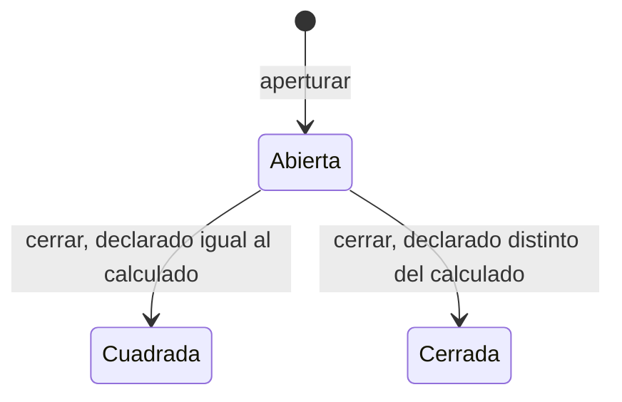
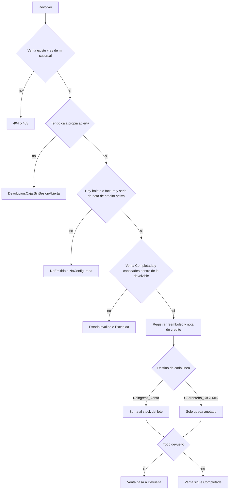

# Catálogo de reglas de negocio — Parte C3: caja, devoluciones y dashboard

| | |
|---|---|
| **Sistema** | SOFIA — Sistema Optimizado Farmacéutico con Inteligencia Artificial |
| **Versión del documento** | 1.0 |
| **Fecha** | 2026-10-08 |
| **Backend** | `sofia-apis`, rama `main`, commit `606cb69` (la línea base de las reglas es `9dd1705`; los commits posteriores solo tocan el historial de precios de proveedor y ningún archivo de caja, devoluciones ni dashboard) |
| **Frontend** | `sofia-web-spa`, rama `main`, commit `9cbbe58` (la línea base de las reglas es `063817c`; los commits posteriores solo tocan el registro de empresa y el historial de precios de proveedor, ningún archivo de `pages/pos`, `pages/sesiones-caja`, `pages/dashboard` ni de sus `es.json`) |
| **Método** | Lectura de código (controladores, validadores, handlers, entidades, configuraciones EF, scripts DbUp, componentes Angular y archivos `es.json`). No se ejecutó la aplicación ni se llamó a la API. |

## 1. Alcance y convenciones

Este documento cataloga las reglas de negocio que el código hace cumplir en tres módulos: Caja (`CAJ`: abrir y cerrar la caja del cajero, arqueo, consulta y exportación de sesiones), Devoluciones (`DEV`: devolver mercadería de una venta cobrada, nota de crédito, reembolso y destino de la mercadería) y Dashboard (`DAS`: las cinco consultas de indicadores de la pantalla de inicio). La venta, el cobro y la anulación son la parte C2 (`VEN`, `CMP`); el stock, los lotes y las recetas son la parte C1; el maestro de series fiscales es la parte A (`SER`).

Las reglas transversales (aislamiento por empresa, borrado lógico, paginación, transacciones, auditoría, permisos, sucursales accesibles, concurrencia, errores de base de datos, exportación) las documenta la parte A y se citan por su ID. La forma en que una regla se convierte en respuesta HTTP y la forma en que el SPA resuelve un código de error están descritas en las secciones 2 y 3 de [01b-catalogos.md](./01b-catalogos.md#2-cómo-se-convierte-una-regla-en-respuesta-http); el formato de las tablas es el de [01c1-inventario-y-recetas.md](./01c1-inventario-y-recetas.md) y [01c2-ventas-y-comprobantes.md](./01c2-ventas-y-comprobantes.md#1-alcance-y-convenciones), cuyas explicaciones generales (HTTP según el número que pasa el handler, mapa de errores por pantalla, textos compartidos) no se repiten aquí. En la columna «Mensaje en el SPA» la expresión «Sin traducción» significa que el usuario ve el mensaje genérico de esa pantalla, y se indica cuál es.

**Abreviaturas de ruta** (las mismas de las partes B, C1 y C2; todas son rutas reales):

| Abreviatura | Ruta completa |
|---|---|
| `APP/` | `sofia-apis/src/SOFIA.Application/` |
| `DOM/` | `sofia-apis/src/SOFIA.Domain/Entities/` |
| `API/` | `sofia-apis/src/SOFIA.API/Controllers/` |
| `CFG/` | `sofia-apis/src/SOFIA.Infrastructure/Persistence/Configurations/` |
| `DBUP/` | `sofia-apis/src/SOFIA.DbUp/Scripts/` |
| `SPA/` | `sofia-web-spa/src/app/` |
| `I18N/` | `sofia-web-spa/public/i18n/` |

**Alias propios de este documento** (todos con el prefijo de ruta indicado):

| Alias | Archivo |
|---|---|
| `APE-C`, `APE-H`, `APE-V` | `APP/POS/Commands/AperturarCaja/AperturarCajaCommand.cs`, `AperturarCajaCommandHandler.cs`, `AperturarCajaCommandValidator.cs` |
| `CIE-C`, `CIE-H`, `CIE-V` | `APP/POS/Commands/CerrarCaja/CerrarCajaCommand.cs`, `CerrarCajaCommandHandler.cs`, `CerrarCajaCommandValidator.cs` |
| `ARQ` | `APP/POS/Common/ArqueoCajaCalculator.cs` |
| `Q-SES`, `Q-SES-V`, `Q-SESID` | `APP/POS/Queries/GetSesiones/GetSesionesQueryHandler.cs`, `GetSesionesQueryValidator.cs`; `APP/POS/Queries/GetSesionById/GetSesionByIdQueryHandler.cs` |
| `CTRL-POS` | `API/POSController.cs` (clase `PosController`, ruta `api/v1/Pos`) |
| `SES` | `DOM/PosSesionCaja.cs` |
| `CFG-SES` | `CFG/PosSesionCajaConfiguration.cs` |
| `PRO-C`, `PRO-H`, `PRO-V` | `APP/Devoluciones/Commands/ProcesarDevolucion/ProcesarDevolucionCommand.cs`, `ProcesarDevolucionCommandHandler.cs`, `ProcesarDevolucionCommandValidator.cs` |
| `CANT` | `APP/Devoluciones/Common/CantidadesDevueltasExtensions.cs` |
| `Q-DEV`, `Q-DEV-V`, `Q-DEVID` | `APP/Devoluciones/Queries/GetDevoluciones/GetDevolucionesQueryHandler.cs`, `GetDevolucionesQueryValidator.cs`; `APP/Devoluciones/Queries/GetDevolucionById/GetDevolucionByIdQueryHandler.cs` |
| `CTRL-DEV` | `API/DevolucionesController.cs` |
| `DCAB`, `DDET`, `VTA` | `DOM/DevolucionCabecera.cs`, `DOM/DevolucionDetalle.cs`, `DOM/Venta.cs` (método `RegistrarDevolucion`) |
| `CFG-DCAB`, `CFG-DDET` | `CFG/DevolucionCabeceraConfiguration.cs`, `CFG/DevolucionDetalleConfiguration.cs` |
| `DAS-C` | `APP/Dashboard/Common/` (`DashboardDias.cs`, `DashboardScopeResolver.cs`, `DashboardScope.cs`, `PagosPorMetodoCalculator.cs`) |
| `DAS-V`, `DAS-CA`, `DAS-I`, `DAS-Q`, `DAS-D` | `APP/Dashboard/Queries/GetDashboardVentas/GetDashboardVentasQueryHandler.cs`, `GetDashboardCaja/GetDashboardCajaQueryHandler.cs`, `GetDashboardInventario/GetDashboardInventarioQueryHandler.cs`, `GetDashboardCuarentena/GetDashboardCuarentenaQueryHandler.cs`, `GetDashboardDevoluciones/GetDashboardDevolucionesQueryHandler.cs` |
| `CTRL-DAS` | `API/DashboardController.cs` |
| `SD`, `SS`, `SSV` | `SPA/pages/sesiones-caja/sesiones-detail/sesiones-detail.component` (`.ts` o `.html`, según el número de línea citado), `SPA/pages/sesiones-caja/sesiones-search/sesiones-search.component`, `SPA/pages/sesiones-caja/services/sesion-caja.service.ts` |
| `AD` | `SPA/pages/pos/dialogs/aperturar-caja-dialog/aperturar-caja-dialog.component` |
| `DVD` | `SPA/pages/pos/dialogs/devolver-venta-dialog/devolver-venta-dialog.component` |
| `VD` | `SPA/pages/pos/venta-detail/venta-detail.component` |
| `NV` | `SPA/pages/pos/nueva-venta/nueva-venta.component` |
| `DASH`, `DASH-L` | `SPA/pages/dashboard/dashboard.component` (`.ts` o `.html`), `SPA/pages/dashboard/dashboard-links.ts` |
| `ESC` | `I18N/sesiones-caja/es.json` (todas las claves se escriben con el prefijo `sesionesCaja.`) |
| `ES` | `I18N/pos/es.json` (todas las claves se escriben con el prefijo `pos.`) |
| `EDA` | `I18N/dashboard/es.json` (todas las claves se escriben con el prefijo `dashboard.`) |

**Reglas de las partes anteriores a las que se remite**

| Regla | Tema |
|---|---|
| RN-GEN-001, RN-GEN-002 | Aislamiento por empresa y filas eliminadas no visibles |
| RN-GEN-005, RN-GEN-006 | Quién y cuándo se grabó; fechas en UTC |
| RN-GEN-008, RN-GEN-009 | Filtros de fecha inclusivos en UTC; paginación acotada |
| RN-GEN-010 | Limpieza de HTML en los textos de primer nivel del request |
| RN-GEN-011 | Un validador que falla impide que se ejecute el handler; código `{Request}.{Propiedad}` |
| RN-GEN-012, RN-GEN-013 | Comandos transaccionales (un `Result.Failure` no revierte) y auditoría de seguridad |
| RN-GEN-020, RN-GEN-021 | Falta de permiso; el rol `Admin` pasa cualquier comprobación |
| RN-GEN-023 | Sucursales accesibles (Admin todas; los demás, base más asignadas a la cuenta y a sus roles) |
| RN-GEN-024 | `Auth.Sucursal` / `Auth.Empleado` |
| RN-GEN-035, RN-GEN-036, RN-GEN-037, RN-GEN-038 | `Concurrency.Conflict`, `Db.Duplicado`, `Db.ValorInvalido`, `Db.ReferenciaInvalida` |
| RN-GEN-041 | Cuerpo con forma inválida |
| RN-IMP-008 a RN-IMP-011 | Exportación a Excel (10 000 filas, títulos, etiquetas, formato de fecha) |
| RN-SER-004, RN-SER-008, RN-SER-013 | Prefijo de la serie, una serie activa por tipo y sucursal, numeración atómica |
| RN-STK-011, RN-STK-017 | Versión de fila del stock; definición de stock vendible |
| RN-LOT-006 | Definición de lote vencido |
| RN-VEN-003 a RN-VEN-006, RN-VEN-033, RN-VEN-044, RN-VEN-047, RN-VEN-066, RN-VEN-067, RN-VEN-068, RN-VEN-083 | Caja requerida al vender, dispensaciones, vuelto, cobertura de seguro, venta con devoluciones, anulación y arqueo (parte C2) |
| RN-CMP-004, RN-CMP-006 a RN-CMP-008, RN-CMP-013, RN-CMP-015 | Número, importes, estado SUNAT, guards y lectura del comprobante (parte C2) |

## 2. Diferencias con el comportamiento común de las partes B, C1 y C2

1. **El HTTP es el número que pasa el handler.** Un `Result.Failure` sin número responde 400 aunque el error sea de tipo `NotFound`, `Forbidden` o `Conflict` (`sofia-apis/src/SOFIA.Domain/Common/Result.cs:32-33`; `sofia-apis/src/SOFIA.API/Extensions/ResultExtensions.cs:13-23`). En estos tres módulos llevan número explícito solo: `PosSesionCaja.YaAbierta` (409), `Caja` (404), `PosSesionCaja.NoPropia` (403), `SesionCaja.NotFound` (404), `Venta.NotFound` al devolver (404), `Devolucion.Venta.OtraSucursal` (403) y `Devolucion.NotFound` (404). Todo lo demás —incluidos `Devolucion.Caja.SinSesionAbierta`, `DetalleVenta.NotFound` y los errores de validación de las entidades— responde 400.
2. **Éxito.** Aperturar caja, cerrar caja y procesar devolución responden **200** con el identificador (un GUID) como cuerpo; no 201 (`API/POSController.cs:17-18`, `:25`; `API/DevolucionesController.cs:15-16`; `sofia-apis/src/SOFIA.API/Extensions/ResultExtensions.cs:7-8`). Las cinco consultas del dashboard responden 200 con el DTO plano (`API/DashboardController.cs:21`, `:30`, `:39`, `:48`, `:57`). **Dos consultas devuelven el objeto `Result` completo en vez del valor** (con `isSuccess`, `error`, `statusCode` y `value`): `GET api/v1/Pos/{id}` (`API/POSController.cs:42`) y `GET api/v1/Devoluciones/{id}` (`API/DevolucionesController.cs:33`); el SPA de sesiones lo sabe y lee `res.value` (`SSV:51-53`, `SD.ts:92-94`).
3. **Auditoría.** Aperturar caja (`CAJA_APERTURAR`), cerrar caja (`CAJA_CERRAR`) y procesar devolución (`DEVOLUCION_PROCESAR`) implementan `IAuditableCommand` (RN-GEN-013): la fila de auditoría se graba en la misma transacción cuando el comando termina con éxito (`APP/Common/Models/AuditEventos.cs:7-9`; `APP/Common/Models/AuditTablas.cs:7`, `:9`). La parte A enumera los eventos de su alcance y no incluye estos tres.
4. **Cada pantalla traduce los errores con su propio mapa de códigos** y ninguna usa los códigos `Db.*` ni `Auth.*`:
   - Abrir caja desde «Sesiones de Caja» (`SD`): mapa `APERTURA_ERROR_KEYS` (`SD.ts:22-25`); genérico «Error al aperturar la sesión» (`sesionesCaja.create.save-error`, `ESC:15`).
   - Abrir caja desde el POS (`AD`): mapa `APERTURA_ERROR_KEYS` (`AD.ts:13-16`); genérico «No se pudo aperturar la caja» (`pos.checkout.aperturarCajaError`, `ES:212`).
   - Cerrar caja (`SD`): mapa `CIERRE_ERROR_KEYS` (`SD.ts:16-19`); genérico «Error al cerrar la sesión» (`sesionesCaja.cierre.save-error`, `ESC:23`).
   - Buscar y exportar sesiones (`SS`): cualquier fallo muestra «Error al buscar sesiones de caja» (`sesionesCaja.search.search-error`, `ESC:5`). Cualquier fallo al abrir el detalle: «Error al cargar la sesión de caja» (`sesionesCaja.detail.load-error`, `ESC:10`).
   - Procesar devolución (`DVD`): mapa `DEVOLVER_ERROR_KEYS` (`DVD.ts:22-32`); genérico «Error al procesar la devolución.» (`pos.devolucion.error`, `ES:131`).
   - Dashboard (`DASH`): cada sección falla por separado con «No se pudo cargar esta sección.» (`dashboard.error.section`, `EDA:13`) y el botón «Reintentar» (`dashboard.error.retry`, `EDA:14`); si fallan los permisos: «No se pudieron cargar tus permisos.» (`dashboard.header.permissionsError`, `EDA:10`) (`DASH.ts:264-271`, `:185-198`).
5. **Textos compartidos** que se citan (`I18N/es.json`): `errors.concurrencyConflict` «Otra operación modificó estos datos al mismo tiempo. Actualiza la pantalla e inténtalo de nuevo.» (línea 158); `errors.forbiddenPage` «No tienes permisos para acceder a esta pantalla.» (línea 151); `actions.new` «Nuevo» (línea 66). Las etiquetas del método de pago son `pos.checkout.efectivo` «Efectivo», `pos.checkout.yapePlin` «Yape / Plin», `pos.checkout.tarjeta` «Tarjeta Débito/Crédito» y `pos.checkout.transferencia` «Transferencia» (`ES:181-184`).
6. **Orden en que se evalúan las condiciones.** Aperturar: permiso → validador (monto ≥ 0) → sucursal del token → empleado del token → ya hay caja abierta (RN-CAJ-002 a RN-CAJ-004). Cerrar: permiso → validador → empleado → la sesión existe → es titular o Admin → se calcula el efectivo esperado → la sesión está abierta y el esperado no es negativo → se guarda (RN-CAJ-007 a RN-CAJ-016). Procesar devolución: permiso → validador → empleado → sucursal → la venta existe → es de la sucursal del token → caja propia abierta → existe boleta o factura y serie de nota de crédito → estado `Completada` y cantidades por línea → motivo y sustento en la entidad → reembolso → stock → nota de crédito → guardar (RN-DEV-002 a RN-DEV-029). El orden decide qué error ve el usuario cuando fallan varias cosas a la vez.

---

## 3. Caja (`CAJ`)

Una sesión de caja (entidad `PosSesionCaja`, tabla `POS_Sesiones_Caja`) es el turno de un cajero: nace con el efectivo con que abre y termina cuando el cajero —o un administrador— declara el efectivo que contó; el sistema compara lo declarado con lo que debería haber (arqueo). **No existe un catálogo de cajas físicas**: la sesión se identifica por cajero y sucursal. Controlador `PosController` (`api/v1/Pos`); pantallas `/sesiones-caja` (búsqueda), `/sesiones-caja/nueva` (abrir caja) y `/sesiones-caja/:id` (detalle y cierre), y el diálogo «Aperturar Caja» del terminal de venta `/pos/nueva`. Textos en `ESC` y `ES`.

**Endpoints** (`CTRL-POS`; ver RN-CAJ-001):

| Operación | Endpoint | Permiso | Handler | Éxito |
|---|---|---|---|---|
| Aperturar | `POST api/v1/Pos/apertura` | `POS:AperturarCaja` | `AperturarCajaCommandHandler` | 200 (GUID de la sesión) |
| Cerrar | `POST api/v1/Pos/cierre` | `POS:CerrarCaja` | `CerrarCajaCommandHandler` | 200 (GUID de la sesión) |
| Listar | `GET api/v1/Pos/sesiones` | `POS:Leer` | `GetSesionesQueryHandler` | 200 |
| Detalle | `GET api/v1/Pos/{id}` | `POS:Leer` | `GetSesionByIdQueryHandler` | 200 (objeto `Result`) |
| Exportar a Excel | `POST api/v1/Pos/sesiones/exportar` | `POS:Leer` | `GetSesionesQueryHandler` (reutilizado) | archivo `sesiones-caja.xlsx` |

**Estados de una sesión** (`sofia-apis/src/SOFIA.Domain/Enums/EstadoSesion.cs`: `Abierta`, `Cerrada`, `Cuadrada`; en la base se guarda el nombre como texto, `CFG-SES:53-57`):

`Cuadrada` y `Cerrada` son finales: no existe ninguna operación para reabrir, corregir o eliminar una sesión (RN-CAJ-010).

### 3.1 Acceso y apertura

| ID | Regla | Tipo | Dónde se aplica | Código de error | HTTP | Mensaje en el SPA (es) |
|---|---|---|---|---|---|---|
| RN-CAJ-001 | **Permisos.** Cada operación exige un permiso del módulo `POS`: `AperturarCaja` (abrir), `CerrarCaja` (cerrar) y `Leer` (listar, ver detalle y exportar). El rol `Admin` pasa siempre (RN-GEN-021). El script `0002` crea los roles base (entre ellos «Cajero») sin permisos y en el código leído no hay otra siembra de permisos de `POS`: los concede el administrador. | Autorización | `CTRL-POS:13`, `:20`, `:28`, `:37-38`, `:45`; `DBUP/0002_SeedBaseRoles.sql:29-32` (rol «Cajero» sin permisos) | — (ver RN-GEN-020) | Ver RN-GEN-020 | Ver RN-GEN-020. El SPA lo refleja: «Nuevo» (`actions.new`, `I18N/es.json:66`) solo se muestra con `AperturarCaja` (`SS.html:19-26`) y «Cerrar Sesión» (`sesionesCaja.actions.cerrar-sesion`, `ESC:55`) solo con `CerrarCaja` (`SD.html:74-82`). Las rutas: `/sesiones-caja` y `/sesiones-caja/:id` exigen `POS:Leer` y `/sesiones-caja/nueva` además `POS:AperturarCaja` (`SPA/core/auth/route-permissions.ts:19`, `:31`); si falta, redirige al tablero con «No tienes permisos para acceder a esta pantalla.» (`errors.forbiddenPage`). El botón «Aperturar Caja» del terminal de venta solo aparece con `POS:AperturarCaja` (RN-VEN-003). Un rechazo por permiso en una operación cae en el genérico de la pantalla (ver sección 2, punto 4). |
| RN-CAJ-002 | **Cajero, sucursal y hora no se eligen.** Al abrir, la sucursal sale del token (claim `sucursalId`, la sucursal base del usuario, RN-GEN-023), el cajero es el empleado del token y la hora de apertura la pone el servidor (UTC, RN-GEN-006). El request solo trae el monto. Una sesión queda, por tanto, siempre a nombre de quien la abre y en su sucursal. Si falta el dato en el token, la apertura se rechaza (la sucursal se comprueba antes que el empleado). | Autorización | `APE-H:16-27`, `:36`; `APE-C:9`; `DOM/PosSesionCaja.cs:32-45` (`SES`) | `Auth.Sucursal` · `Auth.Empleado` (RN-GEN-024) | 400 | Sin traducción → «Error al aperturar la sesión» (`sesionesCaja.create.save-error`, `ESC:15`) o, desde el POS, «No se pudo aperturar la caja» (`pos.checkout.aperturarCajaError`, `ES:212`). Ambas pantallas lo anuncian de antemano: «La caja se abrirá a tu nombre, en tu sucursal activa y con la hora actual.» (`sesionesCaja.create.subtitle`, `ESC:16`) y el campo «Cajero» (o «Empleado» en el POS) aparece bloqueado con el nombre del usuario (`SD.html:20-26`; `AD.html:72-76`, `ES:208`). **No verificado:** cómo se cambia la sucursal activa del token (sección 6.1, punto 5). |
| RN-CAJ-003 | **Monto de apertura.** Es el efectivo con que arranca el cajón: un decimal mayor o igual a 0. Cero es válido. Ni el validador ni la entidad fijan un máximo ni un número de decimales; la base de datos guarda el monto con 2 decimales (`DECIMAL(10,2)` en el script `0001`, es decir hasta 99 999 999,99; EF declara `DECIMAL(12,2)`, ver RN-CAJ-025). Un negativo se rechaza en el validador; la entidad y la restricción `CHK_POS_Sesiones_Caja_Montos` repiten la regla. | Obligatoriedad | `APE-V:7-8`; `DOM/PosSesionCaja.cs:47-50`; `CFG-SES:36-39`, `:94`; `DBUP/0001_Initial_Schema.sql:320`; `DBUP/0020_SoftDeleteAware_Uniques_And_Checks.sql:135-136` | `AperturarCajaCommand.MontoAperturaEfectivo` · `PosSesionCaja.MontoAperturaEfectivo` (entidad, inalcanzable) · `Db.ValorInvalido` (RN-GEN-037) | 400 | Formulario: el monto es obligatorio y no puede ser negativo; si no, «Ingresa un monto válido» (`sesionesCaja.create.monto-requerido`, `ESC:17`; `SD.ts:61-63`; en el POS `pos.checkout.montoAperturaRequired`, `ES:210`; `AD.ts:36`, `AD.html:85-87`), y la petición no sale. El campo parte en 0. El POS permite centavos (`step="0.01"`). Backend: sin traducción → genérico de apertura. Qué hace la base con más de 2 decimales: **No verificado** (sección 6.1, punto 1). |
| RN-CAJ-004 | **Una sola caja abierta por cajero.** Un empleado no puede tener dos sesiones `Abierta` a la vez, **en ninguna sucursal**: antes de crear, el handler busca cualquier sesión abierta (no eliminada) del empleado del token, sea de la sucursal que sea. Si existe, rechaza. La regla se repite en la base con un índice único filtrado (una fila `Abierta` y no eliminada por empleado), de modo que dos aperturas simultáneas no pasan las dos: la segunda recibe el mismo error. El cajero debe cerrar su caja antes de abrir otra. | Unicidad | `APE-H:12`, `:29-34`, `:45-53`, `:58-59`; `DBUP/0019_Concurrency_RowVersion.sql:22-25` (`UX_POS_Sesiones_Caja_Empleado_Abierta`); `CFG-SES:87-90` | `PosSesionCaja.YaAbierta` | 409 | «Ya tienes una caja abierta. Ciérrala antes de abrir otra.» (`sesionesCaja.create.ya-abierta`, `ESC:18`; en el POS `pos.checkout.cajaYaAbierta`, `ES:224`). |
| RN-CAJ-005 | **Resultado de la apertura.** Se crea la sesión en estado `Abierta`, con fecha-hora de apertura, monto de apertura, sin cierre y con los tres campos del arqueo vacíos (`MontoCierreCalculado`, `MontoCierreDeclarado`, `DiferenciaArqueo`). Responde 200 con el identificador. Se audita como `CAJA_APERTURAR` con el detalle «estado: Abierta; apertura: {monto}» (RN-GEN-013). Una caja abierta habilita vender (RN-VEN-003 a RN-VEN-005), cobrar una venta en espera (RN-VEN-006), anular una venta cobrada (RN-VEN-067) y devolver (RN-DEV-005). | Estado | `APE-H:36-55`; `APE-C:11-12`; `DOM/PosSesionCaja.cs:52-59` | — | 200 | «Sesión aperturada correctamente» (`sesionesCaja.create.save-success`, `ESC:14`; `SD.ts:111-114`) y la pantalla vuelve al listado; desde el POS «Caja aperturada correctamente» (`pos.checkout.aperturarCajaSuccess`, `ES:211`; `AD.ts:48-51`), el diálogo se cierra y el terminal vuelve a buscar la caja (`NV.ts:376-390`). |
| RN-CAJ-006 | **Guards de la entidad `PosSesionCaja`.** `Create` exige sucursal y empleado distintos del GUID vacío, fecha de apertura distinta de la fecha por defecto y monto de apertura ≥ 0. `Update` (que ninguna ruta usa) repite esas cuatro y añade: monto de cierre calculado ≥ 0, monto declarado ≥ 0 y cierre no anterior a la apertura. Con los datos que arman los handlers ninguna puede fallar salvo el monto negativo, que el validador ya rechazó antes. | Integridad | `DOM/PosSesionCaja.cs:32-50` (`Create`), `:62-119` (`Update`, sin uso) | `PosSesionCaja.SucursalId` · `PosSesionCaja.EmpleadoId` · `PosSesionCaja.FechaHoraApertura` · `PosSesionCaja.MontoAperturaEfectivo` · `PosSesionCaja.MontoCierreCalculado` · `PosSesionCaja.MontoCierreDeclarado` · `PosSesionCaja.FechaHoraCierre` (entidad, inalcanzables) | 400 | Ninguna: no hay ruta que los dispare. |

### 3.2 Cierre y arqueo

Cerrar la caja es declarar el efectivo que el cajero contó. El sistema calcula por su cuenta el **efectivo esperado** (arqueo), guarda ambos números y la diferencia, y fija el estado final. La lógica del cálculo es `ARQ` (`ArqueoCajaCalculator`), la misma que usa el dashboard para mostrar «Efectivo esperado» (RN-DAS-015).

| ID | Regla | Tipo | Dónde se aplica | Código de error | HTTP | Mensaje en el SPA (es) |
|---|---|---|---|---|---|---|
| RN-CAJ-007 | **Quién puede cerrar: el titular o un administrador.** Solo el cajero que abrió la sesión (empleado del token igual al de la sesión) o un usuario con el rol `Admin` puede cerrarla; un tercero, aunque tenga el permiso `POS:CerrarCaja` y sea de la misma sucursal, recibe 403. El Admin puede cerrar la sesión de cualquier cajero y de cualquier sucursal de su empresa: el cierre no consulta las sucursales accesibles (RN-GEN-023). El permiso `CerrarCaja` sigue siendo necesario para todos salvo el Admin (RN-CAJ-001). | Autorización | `CIE-H:16-20`, `:28-32`; `sofia-apis/src/SOFIA.API/Services/CurrentUser.cs:30-32` (rol `Admin` sin distinguir mayúsculas) | `PosSesionCaja.NoPropia` · `Auth.Empleado` (RN-GEN-024) | 403 · 400 | «Solo el cajero que abrió la caja o un administrador puede cerrarla.» (`sesionesCaja.cierre.no-propia`, `ESC:25`; `SD.ts:17`). `Auth.Empleado`: sin traducción → «Error al cerrar la sesión» (`sesionesCaja.cierre.save-error`, `ESC:23`). El botón «Cerrar Sesión» se muestra a cualquiera con `CerrarCaja` que vea una sesión `Abierta`, sea o no la suya (`SD.html:74-82`): el rechazo llega recién al confirmar. |
| RN-CAJ-008 | **La sesión debe existir** (de la empresa, no eliminada, RN-GEN-001 y RN-GEN-002). El código del error es literalmente `Caja`. Esta comprobación va antes que la de titularidad. | Integridad | `CIE-H:22-26` | `Caja` (tipo `NotFound`) | 404 | Sin traducción → «Error al cerrar la sesión» (`sesionesCaja.cierre.save-error`, `ESC:23`). |
| RN-CAJ-009 | **Monto declarado.** Es el efectivo contado por el cajero al cerrar: decimal mayor o igual a 0, y el identificador de la sesión no puede estar vacío. No hay máximo; la base guarda 2 decimales (RN-CAJ-025). La entidad y la restricción `CHK_POS_Sesiones_Caja_Montos` repiten la regla. El cajero **no ve** el efectivo esperado en el panel de cierre (la ficha de una sesión abierta muestra «—» en calculado y diferencia), pero sí puede verlo antes en el dashboard (RN-DAS-015). | Obligatoriedad | `CIE-V:13-14`; `DOM/PosSesionCaja.cs:133-136`; `CFG-SES:94`; `SD.ts:65-67`, `SD.html:195-205` | `CerrarCajaCommand.SesionId` · `CerrarCajaCommand.MontoCierre` · `PosSesionCaja.MontoCierreDeclarado` (entidad, inalcanzable) · `Db.ValorInvalido` (RN-GEN-037) | 400 | Panel «Cerrar Sesión»: el campo «Monto Cierre Declarado (S/)» (`sesionesCaja.fields.montoCierreDeclarado`, `ESC:33`) es obligatorio y no negativo; si no, «Ingresa el monto declarado al cierre» (`sesionesCaja.cierre.monto-requerido`, `ESC:24`; `SD.ts:65-67`, `:128-131`) y la petición no sale. Backend: sin traducción → «Error al cerrar la sesión». |
| RN-CAJ-010 | **Solo se cierra una sesión `Abierta`; no hay reapertura.** Cerrar una sesión que ya está `Cerrada` o `Cuadrada` se rechaza (la comprobación va después de la de titularidad). Ninguna operación reabre, edita o elimina una sesión: `PosSesionCaja.Update` no la llama ningún handler y el estado final es definitivo. La sesión tiene versión de fila (`RowVersion`, script `0019`): si dos cierres parten de la misma lectura, solo se guarda uno y el otro recibe el conflicto. | Estado | `DOM/PosSesionCaja.cs:123-126`; `CIE-H:36-42`; `CFG-SES:59-61`; `DBUP/0019_Concurrency_RowVersion.sql:14-16` | `PosSesionCaja.Cerrar` · `PosSesionCaja.FechaHoraCierre` (cierre anterior a la apertura, inalcanzable: la hora la pone el servidor) · `Concurrency.Conflict` (RN-GEN-035) | 400 · 400 · 409 | `PosSesionCaja.Cerrar`: sin traducción → «Error al cerrar la sesión» (`sesionesCaja.cierre.save-error`). `Concurrency.Conflict`: «Otra operación modificó estos datos al mismo tiempo. Actualiza la pantalla e inténtalo de nuevo.» (`errors.concurrencyConflict`; `SD.ts:18`). El SPA no ofrece cerrar una sesión que ya no está abierta (`SD.html:74`). |
| RN-CAJ-011 | **Efectivo esperado (fórmula).** `Efectivo esperado = Monto de apertura + Efectivo neto de las ventas que entran (RN-CAJ-012 y RN-CAJ-013) − Efectivo neto de las ventas de otras cajas anuladas desde esta sesión (RN-CAJ-012, caso C) − Reembolsos en efectivo de las devoluciones procesadas en esta sesión (RN-CAJ-014)`. Es la suma, con signo, de lo que entró y salió del cajón. Si la sesión no tiene ventas que entren, el esperado es apertura − reembolsos en efectivo. **Ejemplo** (apertura 100,00): venta V1 de 50,00 cobrada con efectivo de 60,00 (vuelto 10,00) aporta +50,00; venta V2 de 30,00 pagada con tarjeta aporta 0,00; venta V3 de 20,00 cobrada en efectivo en otra caja y anulada desde esta sesión aporta −20,00; venta V4 de 40,00 en efectivo cobrada aquí y anulada después desde otra caja aporta +40,00; devolución con reembolso en efectivo de 15,00. Esperado = 100,00 + (50,00 + 0,00 − 20,00 + 40,00) − 15,00 = **155,00**. | Cálculo | `ARQ:10-54`; `CIE-H:34-36` | — | — | El esperado calculado se ve, después del cierre, en «Monto Cierre Calculado (S/)» (`sesionesCaja.fields.montoCierreCalculado`, `ESC:34`); antes del cierre, en el dashboard como «Efectivo esperado» (`dashboard.caja.expected`, `EDA:53`). |
| RN-CAJ-012 | **Qué ventas entran en el arqueo y con qué signo.** Se consideran las ventas no eliminadas y **no pendientes** (una venta en espera no cobró nada). Según dónde se cobró y dónde se anuló (`Sesion_ID` y `Sesion_Anulacion_ID`, RN-VEN-067): **(A)** cobrada en esta sesión y `Completada` o `Devuelta`: entra con signo +. **(B)** cobrada en esta sesión y `Anulada` **desde esta misma sesión**: no entra (se cobró y se devolvió dentro del mismo cajón: neto 0). **(C)** cobrada en otra sesión y `Anulada` desde esta: entra con signo − (el efectivo salió de este cajón; en la otra sesión sigue contando). **(D)** cobrada en esta sesión y `Anulada` desde **otra** sesión: entra con signo + (el efectivo se cobró aquí y aquí sigue contando). **(E)** cobrada en esta sesión, `Anulada` y sin sesión de anulación (anuladas antes del script `0028`): no entra. Una venta cobrada pertenece a la sesión que la cobró; una venta en espera cobrada después pertenece a la sesión de quien la cobra (RN-VEN-006). Una venta `Devuelta` (devolución total) sigue entrando con signo +; lo que salió se resta aparte como reembolso (RN-CAJ-014). | Cálculo | `ARQ:17-23`; `DOM/Venta.cs:17`, `:106`; `DBUP/0028_Ventas_Sesion_Anulacion.sql:1-8` | — | — | Sin mensaje propio: se refleja en el valor «Monto Cierre Calculado (S/)». |
| RN-CAJ-013 | **Efectivo neto de una venta.** Para cada venta que entra: `Monto a pagar = Total de la venta − Σ cobertura de seguro de la venta` (los reclamos de seguro no eliminados ligados a sus líneas, RN-VEN-047); `Vuelto = el mayor entre 0 y (Σ de todos los pagos − Monto a pagar)`; `Efectivo neto = Σ pagos en efectivo − Vuelto`. Solo cuentan los pagos no eliminados. El vuelto se descuenta **siempre del efectivo**, aunque haya pagos con otros métodos (el vuelto sale del cajón, RN-VEN-044); los pagos con tarjeta, Yape/Plin o transferencia no aportan efectivo. El vuelto no se guarda en ninguna columna: se recalcula así cada vez. En el caso C el efectivo neto de la venta se resta. **Ejemplo con seguro:** total 100,00, cobertura 40,00 → monto a pagar 60,00; el cliente paga 100,00 en efectivo → vuelto 40,00 → efectivo neto 60,00. | Cálculo | `ARQ:32-51`; `APP/Dashboard/Common/PagosPorMetodoCalculator.cs:8-25` (misma regla) | — | — | Sin mensaje propio. |
| RN-CAJ-014 | **Reembolsos en efectivo.** Se restan las devoluciones no eliminadas procesadas **desde esta sesión** (la caja del que procesó la devolución, RN-DEV-019) cuyo método de reembolso es efectivo, por el monto reembolsado (si es nulo, 0). Los reembolsos por Yape/Plin, tarjeta o transferencia no tocan el arqueo. Da igual en qué sesión se cobró la venta devuelta: el dinero sale del cajón de quien devuelve. | Cálculo | `ARQ:13-15`; `PRO-H:44-51`, `:96` | — | — | Sin mensaje propio. |
| RN-CAJ-015 | **Resultado del cierre: diferencia y estado.** `Diferencia de arqueo = Monto declarado − Efectivo esperado`. Si la diferencia es **exactamente 0** la sesión queda `Cuadrada`; con cualquier otra diferencia (aunque sea de un centavo) queda `Cerrada`. **No existe tolerancia.** Un diferencia negativa es **faltante** (se declaró menos de lo esperado) y una positiva **sobrante**; el sistema no guarda una columna de faltante o sobrante ni lo etiqueta: solo guarda la diferencia con signo. Se guardan también el monto declarado, el esperado calculado y la hora de cierre (UTC del servidor). **Ejemplo** (esperado 155,00): declarado 155,00 → diferencia 0,00, `Cuadrada`; declarado 150,00 → −5,00 (faltante), `Cerrada`; declarado 160,00 → +5,00 (sobrante), `Cerrada`. | Cálculo | `DOM/PosSesionCaja.cs:143-147`; `CIE-H:36-42` | — | 200 | «Sesión cerrada correctamente» (`sesionesCaja.cierre.save-success`, `ESC:22`; `SD.ts:135-138`); la pantalla vuelve al listado y el detalle muestra «Diferencia Arqueo (S/)» (`sesionesCaja.fields.diferencia`, `ESC:35`) con signo y 2 decimales, y el estado «Cuadrada» o «Cerrada» (`sesionesCaja.estado.*`, `ESC:49-51`). Los textos «FALTANTE EN CAJA: -S/ {{monto}}» y «SOBRANTE EN CAJA: +S/ {{monto}}» (`pos.reportDialog.faltanteText` y `pos.reportDialog.sobranteText`, `ES:301-302`) no los usa ningún componente. |
| RN-CAJ-016 | **Un efectivo esperado negativo impide cerrar.** Si el cálculo da menos de 0 (por ejemplo, reembolsos en efectivo o anulaciones de ventas de otras cajas mayores que lo que hay en el cajón), la entidad rechaza el cierre y la sesión no se puede cerrar con esta lógica; la base repite la regla en `CHK_POS_Sesiones_Caja_Montos`. El código no ofrece otra vía para cerrarla. | Integridad | `DOM/PosSesionCaja.cs:138-141`; `DBUP/0020_SoftDeleteAware_Uniques_And_Checks.sql:135-136` | `PosSesionCaja.MontoCierreCalculado` · `Db.ValorInvalido` (RN-GEN-037, inalcanzable por el guard previo) | 400 | Sin traducción → «Error al cerrar la sesión» (`sesionesCaja.cierre.save-error`). Ver hallazgo 1 (sección 6.3). |
| RN-CAJ-017 | **Ventas en espera al cerrar.** El cierre no revisa ni bloquea por ventas `Pendiente`: no entran en el arqueo (RN-CAJ-012) y quedan como estaban. Más tarde las puede cobrar cualquier usuario de la sucursal con su propia caja abierta, y entonces cuentan en el arqueo de esa otra sesión (RN-VEN-006). No hay aviso ni confirmación sobre ventas en espera al cerrar. | Estado | `CIE-H:14-44` (sin comprobación); `ARQ:19`; `APP/Ventas/Commands/CompletarVenta/CompletarVentaCommandHandler.cs:126-134` (RN-VEN-006) | — | — | Sin mensaje. |
| RN-CAJ-018 | **El arqueo es una foto del momento del cierre.** El esperado se calcula una sola vez, al cerrar, y se guarda; no se recalcula. Lo que ocurra después con ventas de esa sesión (por ejemplo, anular desde otra caja una venta cobrada en ella) cambia el arqueo de la caja que ejecuta la operación (RN-CAJ-012, casos C y D), no el valor ya guardado en la sesión cerrada. Una sesión cerrada no admite más ventas (RN-VEN-004) ni devoluciones (el reembolso sale de la caja abierta de quien devuelve, RN-DEV-005). | Estado | `CIE-H:34-42`; `DOM/PosSesionCaja.cs:143-147`; `CRE-H:139-145` (`APP/Ventas/Commands/CreateVenta/CreateVentaCommandHandler.cs`) | — | — | Sin mensaje. |
| RN-CAJ-019 | **Respuesta y auditoría del cierre.** Responde 200 con el identificador de la sesión. Se audita como `CAJA_CERRAR` sobre `POS_Sesiones_Caja` con el detalle «cierre desde Abierta; declarado: {monto}» (RN-GEN-013); el esperado y la diferencia no van en el detalle de auditoría, quedan en la sesión. | Automática | `CIE-C:11-14`; `CTRL-POS:25`; `APP/Common/Models/AuditEventos.cs:9`; `APP/Common/Models/AuditTablas.cs:9` | — | 200 | Ver RN-CAJ-015. |

### 3.3 Consulta y exportación de sesiones

| ID | Regla | Tipo | Dónde se aplica | Código de error | HTTP | Mensaje en el SPA (es) |
|---|---|---|---|---|---|---|
| RN-CAJ-020 | **Alcance del listado y del detalle: las sucursales accesibles, de todos los cajeros.** Un usuario no Admin ve las sesiones de las sucursales a las que tiene acceso (su sucursal base, las asignadas a su cuenta y a sus roles; RN-GEN-023) y de **todos** los empleados de esas sucursales, no solo las suyas; el Admin ve las de todas las sucursales de la empresa. No hay una vista «solo mis sesiones» en la pantalla: la API admite filtrar por empleado y por sucursal, pero la pantalla no ofrece ninguno de los dos filtros (RN-CAJ-021). El detalle por identificador aplica el mismo alcance: una sesión de una sucursal no accesible responde como inexistente. | Autorización | `Q-SES:16-17`; `Q-SESID:15-17`, `:37-40`; `APP/Common/Extensions/QueryableExtensions.cs:40-55` | `SesionCaja.NotFound` (solo el detalle) | 404 | Detalle: «Error al cargar la sesión de caja» (`sesionesCaja.detail.load-error`, `ESC:10`; `SD.ts:96-99`). Listado: sin código de error propio. |
| RN-CAJ-021 | **Filtros, orden y paginación del listado.** Filtros opcionales: sucursal (no puede ser el GUID vacío), empleado (no puede ser el GUID vacío), estado de la sesión, y fecha desde y hasta sobre la **fecha-hora de apertura** (inclusivas, normalizadas a UTC; RN-GEN-008). Los filtros de sucursal y empleado se intersectan con el alcance de RN-CAJ-020: pedir una sucursal no accesible devuelve una página vacía, no un error. Orden por apertura descendente; paginación de RN-GEN-009 (por defecto página 1 de 10). La pantalla ofrece solo estado («Estado»), «Apertura desde» y «Apertura hasta» (la pantalla arma las fechas como inicio y fin del día local, `toLocalDayStartIso` y `toLocalDayEndIso`, `SS.ts:68-75`) y los tamaños de página 10, 25 y 50; los resultados se ocultan hasta pulsar «Buscar» y la pantalla recuerda los filtros al volver. El terminal de venta usa este mismo listado, con sucursal y empleado del token y estado `Abierta`, para encontrar la caja del cajero (`NV.ts:376-390`). | Cálculo | `Q-SES:19-32`; `Q-SES-V:9-15`; `API/POSController.cs:28-35`; `SS.ts:42-46`, `:68-101`; `SS.html:30-70`, `:173-179` | `GetSesionesQuery.SucursalId` · `GetSesionesQuery.EmpleadoId` (GUID vacío) | 400 | Filtros «Estado», «Apertura desde» y «Apertura hasta» (`sesionesCaja.fields.estado`, `fechaInicio`, `fechaFin`, `ESC:36-38`); «Búsqueda de Sesiones de Caja» (`sesionesCaja.search.title`, `ESC:4`). Fallo: «Error al buscar sesiones de caja» (`sesionesCaja.search.search-error`, `ESC:5`). |
| RN-CAJ-022 | **Contenido de cada fila y qué muestra la pantalla.** Cada fila trae: identificador, sucursal (identificador y nombre, o vacío si la sucursal ya no existe), cajero (identificador y «Nombres + primer apellido», o vacío), apertura, cierre (nulo si está abierta), monto de apertura, calculado, declarado, diferencia y estado. La tabla de la pantalla muestra solo: «Sucursal» (enlace al detalle), «Cajero», «Apertura», «Cierre» («—» si está abierta), «Monto Apertura» y «Estado»; calculado, declarado y diferencia se ven en el detalle y en la exportación. Las fechas se muestran como `dd/MM/yyyy HH:mm` en la hora del navegador. | Cálculo | `Q-SES:34-52`; `SS.html:98-165` | — | 200 | Columnas: `sesionesCaja.table.*` (`ESC:41-46`); estados `sesionesCaja.estado.*` (`ESC:49-51`); sin filas: `generic-labels.no-results`. |
| RN-CAJ-023 | **Detalle de una sesión** (`GET api/v1/Pos/{id}`, permiso `POS:Leer`). Exige que la sesión exista (no eliminada, de la empresa) y de una sucursal accesible. La respuesta es el objeto `Result` completo, con la sesión en `value`. La pantalla muestra, en solo lectura, sucursal, cajero, apertura, cierre, estado, monto de apertura, declarado, calculado y diferencia (con «—» donde aún no hay dato) y, si está `Abierta` y el usuario tiene `CerrarCaja`, el botón «Cerrar Sesión». | Cálculo | `Q-SESID:13-43`; `API/POSController.cs:37-43`; `SD.html:62-182` | `SesionCaja.NotFound` | 404 | «Error al cargar la sesión de caja» (`sesionesCaja.detail.load-error`, `ESC:10`). Títulos: «Detalle de Sesión» (`sesionesCaja.detail.title`, `ESC:9`) y las etiquetas de `sesionesCaja.fields.*` (`ESC:28-37`). |
| RN-CAJ-024 | **Exportación a Excel** (`POST api/v1/Pos/sesiones/exportar`, permiso `POS:Leer`). Usa los filtros de sucursal, estado y fechas del listado (**no** el de empleado, que el request de exportación no tiene), con el mismo alcance de RN-CAJ-020, sin paginar. Columnas, en orden: sucursal, cajero, apertura, cierre, monto de apertura, monto declarado, monto calculado, diferencia y estado (nombre del enumerado: `Abierta`, `Cerrada` o `Cuadrada`). Los títulos los envía el SPA ya traducidos (RN-IMP-009); la fecha se formatea con el formato que envía el cliente (`dd/MM/yyyy HH:mm` en español, `MM/dd/yyyy HH:mm` en otro idioma, RN-IMP-011) **sobre la fecha-hora en UTC, sin convertir a hora local**, mientras el listado de la pantalla usa la hora del navegador. Si el filtro devuelve más de 10 000 sesiones no se genera el archivo (RN-IMP-008). | Cálculo | `API/POSController.cs:45-86`; `SS.ts:127-153` | `Export.TooManyRows` (RN-IMP-008) | 400 | Cualquier fallo de la exportación muestra «Error al buscar sesiones de caja» (`sesionesCaja.search.search-error`). Archivo descargado: «sesiones-caja.xlsx» (`sesionesCaja.search.export-filename`, `ESC:6`). Ver hallazgo 3 (sección 6.3). |

### 3.4 Entidad y restricciones de base de datos

| ID | Regla | Tipo | Dónde se aplica | Código de error | HTTP | Mensaje en el SPA (es) |
|---|---|---|---|---|---|---|
| RN-CAJ-025 | **`POS_Sesiones_Caja`.** Obligatorios: sucursal, empleado, fecha-hora de apertura (`DATETIME`), monto de apertura y estado (`VARCHAR(20)`, por defecto `Abierta`). Admiten NULL: cierre, calculado, declarado y diferencia. Los cuatro montos son `DECIMAL(10,2)` en el script `0001`; la configuración EF los declara `DECIMAL(12,2)` y ningún script los amplía, de modo que el tope real de la base es 99 999 999,99. Restricciones: `CHK_Estado_Sesion` (`Abierta`, `Cerrada`, `Cuadrada`, texto exacto), `CHK_POS_Sesiones_Caja_Montos` (apertura, calculado y declarado ≥ 0; un NULL no la viola), claves foráneas `FK_POSSesion_Sucursal` y `FK_POSSesion_Empleado`, columna de versión `RowVersion` (script `0019`). No hay restricción sobre la diferencia (puede ser negativa) ni sobre el orden apertura-cierre en la base. Como no existe borrado de sesiones, las claves foráneas solo impiden referencias huérfanas. | Integridad | `DBUP/0001_Initial_Schema.sql:314-335`; `DBUP/0019_Concurrency_RowVersion.sql:14-16`; `DBUP/0020_SoftDeleteAware_Uniques_And_Checks.sql:135-136`; `CFG-SES:13-61`, `:73-81`, `:94` | `Db.ValorInvalido` (CHECK) · `Db.ReferenciaInvalida` (clave foránea) · `Concurrency.Conflict` (versión) (RN-GEN-037, RN-GEN-038, RN-GEN-035) | 400 · 409 · 409 | Sin traducción → genérico de la pantalla (ver sección 2, punto 4); `Concurrency.Conflict` sí se traduce al cerrar (RN-CAJ-010). Qué hace la base con un monto que no cabe en `DECIMAL(10,2)`: **No verificado** (sección 6.1, punto 1). |
| RN-CAJ-026 | **Una sesión abierta por empleado, también en la base.** Índice único filtrado `UX_POS_Sesiones_Caja_Empleado_Abierta` sobre el empleado, solo para filas con estado `Abierta` y no eliminadas: permite cualquier número de sesiones cerradas o cuadradas del mismo empleado y una sola abierta. Es la red de seguridad de RN-CAJ-004; el handler captura esa violación por el nombre del índice y la devuelve como `PosSesionCaja.YaAbierta` (no como `Db.Duplicado`). | Unicidad | `DBUP/0019_Concurrency_RowVersion.sql:22-25`; `CFG-SES:87-90`; `APE-H:12`, `:49-53` | `PosSesionCaja.YaAbierta` | 409 | Ver RN-CAJ-004. |
| RN-CAJ-027 | **Quién referencia a una sesión.** `Ventas_Cabecera.Sesion_ID` (sesión que cobró; `FK_VentaCab_Sesion`) y `Ventas_Cabecera.Sesion_Anulacion_ID` (sesión desde la que se anuló una venta cobrada; `FK_VentaCab_Sesion_Anulacion`, script `0028`), y `Devoluciones_Cabecera.Sesion_ID` (sesión de la que sale el reembolso; `FK_Devolucion_Sesion`, script `0016`, con el índice filtrado `IX_Devoluciones_Sesion`). Esas tres columnas son las que lee el arqueo (RN-CAJ-011 a RN-CAJ-014). Las tres admiten NULL (ventas y devoluciones anteriores a esos scripts). | Integridad | `DBUP/0001_Initial_Schema.sql:342`, `:356`; `DBUP/0016_Devoluciones_Reembolso.sql:2-12`; `DBUP/0028_Ventas_Sesion_Anulacion.sql:1-8`; `ARQ:13-23` | `Db.ReferenciaInvalida` (RN-GEN-038) | 409 | Sin traducción → genérico de la pantalla. |

---

## 4. Devoluciones (`DEV`)

Una devolución registra que el cliente devuelve parte o todo lo que compró en una venta **cobrada** (`Completada`): el sistema valida cuánto se puede devolver por línea, emite una **nota de crédito**, registra el **reembolso** (monto y método, que sale de la caja abierta de quien procesa), repone la mercadería al stock o la marca con destino a cuarentena, y deja constancia de quién autorizó. Entidades `DevolucionCabecera` (tabla `Devoluciones_Cabecera`) y `DevolucionDetalle` (`Devoluciones_Detalle`); controlador `DevolucionesController`. **En el SPA solo existe el diálogo «Procesar devolución»**, que se abre desde el detalle de una venta (`/pos/:id`, botón «Devolver»); las devoluciones registradas se ven ahí mismo, en la sección «Devoluciones / Notas de crédito». **No existe pantalla de listado ni de detalle de devoluciones**: `GET api/v1/Devoluciones` y `GET api/v1/Devoluciones/{id}` son «Solo API (sin pantalla)» (el SPA no los llama: `SPA/pages/pos/services/venta.service.ts:26`, `:79-81` solo usa `POST`). La nota de crédito comparte entidad, contador e índice único con la boleta (RN-CMP-015).

**Endpoints** (`CTRL-DEV`; ver RN-DEV-001):

| Operación | Endpoint | Permiso | Handler | Éxito | Pantalla |
|---|---|---|---|---|---|
| Procesar devolución | `POST api/v1/Devoluciones` | `Devoluciones:ProcesarDevolucion` | `ProcesarDevolucionCommandHandler` | 200 (GUID de la devolución) | Diálogo «Procesar devolución» |
| Listar | `GET api/v1/Devoluciones` | `Devoluciones:Leer` | `GetDevolucionesQueryHandler` | 200 | Solo API (sin pantalla) |
| Detalle | `GET api/v1/Devoluciones/{id}` | `Devoluciones:Leer` | `GetDevolucionByIdQueryHandler` | 200 (objeto `Result`) | Solo API (sin pantalla) |

El campo del request `ComprobanteOrigenId` **lleva el identificador de la venta**, no el del comprobante: el handler busca la boleta o factura de esa venta (`PRO-C:13`, `PRO-H:117-125`; el SPA envía `this.data.venta.id`, `DVD.ts:128`).

### 4.1 Acceso y precondiciones

| ID | Regla | Tipo | Dónde se aplica | Código de error | HTTP | Mensaje en el SPA (es) |
|---|---|---|---|---|---|---|
| RN-DEV-001 | **Permisos y dónde se usan.** Procesar una devolución exige `Devoluciones:ProcesarDevolucion`; listar y ver el detalle de una devolución exigen `Devoluciones:Leer`. El rol `Admin` pasa siempre (RN-GEN-021). Los permisos del módulo `Devoluciones` no los siembra ningún script (RN-CAJ-001). `Devoluciones:Leer` lo usa también el dashboard (RN-DAS-001). | Autorización | `CTRL-DEV:11`, `:19`, `:29` | — (ver RN-GEN-020) | Ver RN-GEN-020 | Ver RN-GEN-020. El botón «Devolver» (`pos.devolucion.btnDevolver`, `ES:106`) solo aparece si la venta está `Completada`, tiene comprobante, queda alguna unidad por devolver y el usuario tiene `Devoluciones:ProcesarDevolucion` (`VD.ts:160-166`, `VD.html:40-44`); para llegar al detalle hace falta `Ventas:Leer` (C2). Un rechazo por permiso al confirmar cae en «Error al procesar la devolución.» (`pos.devolucion.error`, `ES:131`). |
| RN-DEV-002 | **El que procesa y la sucursal salen del token.** El empleado que autoriza la devolución es quien tiene la sesión iniciada (no se pide un supervisor ni un PIN) y la sucursal es la del token. Si falta algún dato, se rechaza (el empleado se comprueba antes que la sucursal). | Autorización | `PRO-H:17-28` | `Auth.Empleado` · `Auth.Sucursal` (RN-GEN-024) | 400 | Sin traducción → «Error al procesar la devolución.» (`pos.devolucion.error`, `ES:131`). |
| RN-DEV-003 | **La venta debe existir** (de la empresa, no eliminada; RN-GEN-001 y RN-GEN-002). | Integridad | `PRO-V:9`; `PRO-H:30-37` | `ProcesarDevolucionCommand.ComprobanteOrigenId` (identificador de venta vacío) · `Venta.NotFound` | 400 · 404 | «La venta ya no existe.» (`pos.devolucion.errors.ventaNotFound`, `ES:138`; `DVD.ts:23`). |
| RN-DEV-004 | **Solo se devuelven ventas de la propia sucursal.** Se compara la sucursal de la venta con la del token: si es otra se rechaza con 403, **también al Admin** (no se consultan las sucursales accesibles). | Autorización | `PRO-H:39-42` | `Devolucion.Venta.OtraSucursal` | 403 | «Solo puedes devolver ventas de tu propia sucursal.» (`pos.devolucion.errors.otraSucursal`, `ES:139`; `DVD.ts:24`). |
| RN-DEV-005 | **Hace falta tu propia caja abierta.** El reembolso sale de la caja de quien procesa: se busca la sesión del empleado del token, en la sucursal del token, en estado `Abierta` y no eliminada (la misma definición que para cobrar y anular, RN-VEN-006 y RN-VEN-067). Se exige siempre, sea cual sea el método de reembolso, y va antes que las comprobaciones de comprobante, estado y cantidades, de modo que sin caja abierta ningún otro de esos errores llega a verse. | Integridad | `PRO-H:44-51` | `Devolucion.Caja.SinSesionAbierta` (tipo `Validation`) | 400 | «Necesitas una caja abierta para procesar la devolución.» (`pos.devolucion.errors.sinSesionAbierta`, `ES:140`; `DVD.ts:25`). El diálogo avisa de antemano: «…el reembolso saldrá de tu caja abierta.» (`pos.devolucion.dialogSubtitle`, `ES:108`). |
| RN-DEV-006 | **Debe haber una boleta o factura que acreditar.** Se toma el comprobante de la venta, no eliminado, cuyo tipo de serie sea boleta o factura (nunca una nota de crédito anterior); si hubiera varios, el de fecha de emisión más antigua. Una venta que nunca se cobró (en espera) no lo tiene. La búsqueda no excluye comprobantes anulados: una venta anulada se detiene después, por su estado (RN-DEV-008). | Integridad | `PRO-H:53-59`, `:118-130` | `Devolucion.ComprobanteOrigen.NoEmitido` (tipo `Validation`) | 400 | «La venta no tiene boleta ni factura emitida que acreditar.» (`pos.devolucion.errors.comprobanteNoEmitido`, `ES:141`; `DVD.ts:26`). |
| RN-DEV-007 | **Debe haber una serie de nota de crédito activa en la sucursal de la venta.** Se busca la serie de tipo nota de crédito, `Activa` y no eliminada, de la sucursal de la venta; como cada sucursal solo puede tener una serie activa por tipo (RN-SER-008), la elección es única. El código **no** compara la serie con el comprobante de origen: aunque la parte A exige que el prefijo de una serie de nota de crédito empiece con `B` o `F` según el comprobante que revierte (RN-SER-004), aquí la única serie activa de la sucursal se usa tanto para devoluciones de boletas como de facturas. La comprobación va antes de las cantidades y no consume correlativo. | Integridad | `PRO-H:132-137` | `Devolucion.SerieNotaCredito.NoConfigurada` (tipo `Validation`) | 400 | «La sucursal no tiene una serie de nota de crédito activa. Configúrala en Series Fiscales.» (`pos.devolucion.errors.serieNcNoConfigurada`, `ES:142`; `DVD.ts:27`). |
| RN-DEV-008 | **Solo se devuelven ventas `Completada`; no hay plazo.** Una venta `Anulada` o `Devuelta` se rechaza. Una venta en espera (`Pendiente`) se detiene antes, con `Devolucion.ComprobanteOrigen.NoEmitido`. El código **no** impone plazo máximo desde la venta ni límite de devoluciones por venta: mientras quede cantidad devolvible, se puede seguir devolviendo. | Estado | `VTA:116-119` | `Devolucion.Venta.EstadoInvalido` (tipo `Validation`) | 400 | «Solo se pueden devolver ventas completadas.» (`pos.devolucion.errors.estadoInvalido`, `ES:143`; `DVD.ts:28`). El botón «Devolver» ni siquiera se ofrece para otros estados (`VD.ts:161-163`). |

### 4.2 Líneas y cantidades

| ID | Regla | Tipo | Dónde se aplica | Código de error | HTTP | Mensaje en el SPA (es) |
|---|---|---|---|---|---|---|
| RN-DEV-009 | **Al menos una línea.** La lista de líneas no puede estar vacía. La entidad de cabecera y el método de la venta repiten la comprobación (inalcanzables por API: el validador responde antes). | Obligatoriedad | `PRO-V:13`; `DCAB:64-67`; `VTA:121-124` | `ProcesarDevolucionCommand.Detalles` · `DevolucionCabecera.Detalles` (entidad y venta, inalcanzables) | 400 | Si no se ingresó ninguna cantidad mayor que 0: «Ingresa al menos una cantidad a devolver.» (`pos.devolucion.sinCantidades`, `ES:129`; `DVD.ts:146-149`) y la petición no sale. El SPA envía solo las líneas con cantidad > 0 (`DVD.ts:132-134`). Backend: sin traducción → «Error al procesar la devolución.» |
| RN-DEV-010 | **Datos de cada línea.** Cada línea trae el identificador de la línea de venta (no vacío), la cantidad devuelta (mayor que 0, admite decimales) y el destino (uno de los dos valores del enumerado). La entidad `DevolucionDetalle` repite las dos primeras (inalcanzables por API). La base guarda la cantidad con 2 decimales (`DECIMAL(8,2)`) y la repite con `CHK_Devoluciones_Detalle_Cantidad_Devuelta` (> 0). | Integridad | `PRO-V:14-19`; `DDET:23-31`; `CFG-DDET:28-31`, `:59`; `DBUP/0001_Initial_Schema.sql:615`; `DBUP/0020_SoftDeleteAware_Uniques_And_Checks.sql:127-128` | `ProcesarDevolucionCommand.Detalles[i].DetalleVentaId` · `ProcesarDevolucionCommand.Detalles[i].CantidadDevuelta` · `ProcesarDevolucionCommand.Detalles[i].DestinoFisicoLogico` (con el índice de la línea) · `DevolucionDetalle.DetalleVentaId` · `DevolucionDetalle.CantidadDevuelta` (entidad) · `Db.ValorInvalido` (RN-GEN-037) | 400 | Formulario: la cantidad de cada línea parte en 0, no puede ser negativa ni superar lo devolvible (RN-DEV-012) y el destino parte en «Reingreso a venta» (`DVD.ts:75-83`). Backend: sin traducción → «Error al procesar la devolución.» Qué hace la base con más de 2 decimales: **No verificado** (sección 6.1, punto 1). |
| RN-DEV-011 | **La línea debe pertenecer a la venta.** Cada identificador de línea se busca entre las líneas de la venta indicada; si no está (inexistente, de otra venta o de otra empresa) se rechaza. La base repite la relación con `FK_DevDet_VentaDet`. | Integridad | `VTA:129-133`; `DBUP/0001_Initial_Schema.sql:626` | `DetalleVenta.NotFound` (tipo `NotFound`, sin número) · `Db.ReferenciaInvalida` (RN-GEN-038) | 400 · 409 | «Una de las líneas ya no pertenece a la venta.» (`pos.devolucion.errors.detalleNotFound`, `ES:145`; `DVD.ts:30`). |
| RN-DEV-012 | **Cantidad máxima devolvible por línea.** `Devolvible = Cantidad vendida de la línea − Σ cantidades ya devueltas de esa línea`, todo en **unidades base** (la cantidad vendida que guarda la venta, no la presentación). Se rechaza si `ya devuelto + a devolver > vendido` (igual al vendido es válido). Solo cuentan las devoluciones anteriores vivas: líneas de devolución no eliminadas cuya cabecera tampoco está eliminada, de cualquier destino. La misma cuenta la usa el detalle de la venta para mostrar «Devuelto» (RN-VEN-074). **Ejemplo:** línea vendida 10; ya devueltas 4 → devolvible 6; pedir 6 es válido y deja la línea completa; pedir 7 → `Devolucion.Cantidad.Excedida`. | Cálculo | `VTA:140-143`; `PRO-H:65`; `CANT:9-20`; `DVD.ts:48-50` | `Devolucion.Cantidad.Excedida` (tipo `Validation`) | 400 | «La cantidad supera lo que queda por devolver en alguna línea. Actualiza la pantalla e inténtalo de nuevo.» (`pos.devolucion.errors.cantidadExcedida`, `ES:144`; `DVD.ts:29`). El diálogo lista solo las líneas con devolvible > 0 (`DVD.ts:71-73`), muestra «Vendido», «Devuelto» y «Devolvible» (`pos.devolucion.colVendido`, `colDevuelto`, `colDevolvible`, `ES:110-112`), limita lo escrito a ese máximo (`DVD.ts:109-115`) y ofrece «Devolver todo lo pendiente» (`pos.devolucion.btnDevolverTodo`, `ES:109`). |
| RN-DEV-013 | **Líneas repetidas.** Si el request trae la misma línea de venta más de una vez, para el tope de RN-DEV-012 se **suman** sus cantidades; luego cada repetición se guarda como una línea de devolución propia (con su cantidad y su destino). El SPA nunca lo hace: arma una línea por línea de venta. | Cálculo | `PRO-H:61-63`, `:157-173` | `Devolucion.Cantidad.Excedida` (si la suma excede) | 400 | Ver RN-DEV-012. |

### 4.3 Motivo y sustento

| ID | Regla | Tipo | Dónde se aplica | Código de error | HTTP | Mensaje en el SPA (es) |
|---|---|---|---|---|---|---|
| RN-DEV-014 | **Motivo SUNAT.** Es obligatorio y de **2 caracteres** (código del catálogo SUNAT de motivos de nota de crédito). El validador solo exige no vacío y como máximo 2; la entidad exige exactamente 2, de modo que un código de 1 carácter pasa el validador y se rechaza después, en la entidad (con el mensaje en inglés «must be exactly 2 characters»). **No se valida contra ningún catálogo**: cualquier par de caracteres se acepta, y tampoco se comprueba que `06` coincida con una devolución total. La base lo guarda en `VARCHAR(2)`, sin restricción. El SPA solo ofrece dos motivos y elige uno solo: `06` «Devolución total» si el cajero devuelve todo lo devolvible en todas las líneas, `07` «Devolución por ítem» en cualquier otro caso (puede cambiarlo a mano). | Formato | `PRO-V:10`; `DCAB:44-52`; `CFG-DCAB:31-35`; `DBUP/0001_Initial_Schema.sql:596`; `DVD.ts:17-19`, `:85-89`, `:100-106` | `ProcesarDevolucionCommand.MotivoSunatCatalogo` · `DevolucionCabecera.MotivoSunatCatalogo` (1 carácter) | 400 | Selector «Motivo SUNAT» (`pos.devolucion.motivoLabel`, `ES:119`) con «06 — Devolución total» y «07 — Devolución por ítem» (`pos.devolucion.motivo.06`, `.07`, `ES:121-122`; `DVD.html:112-120`). Backend: sin traducción → «Error al procesar la devolución.» |
| RN-DEV-015 | **Sustento.** Texto obligatorio (no vacío ni solo espacios) de hasta 255 caracteres; pasa antes por la limpieza de HTML de RN-GEN-010. La entidad repite ambas comprobaciones y la base lo guarda en `VARCHAR(255)`. Describe, en palabras del cajero, por qué se devuelve. | Obligatoriedad | `PRO-V:11`; `DCAB:54-62`; `CFG-DCAB:37-40`; `DBUP/0001_Initial_Schema.sql:597` | `ProcesarDevolucionCommand.SustentoDescriptivo` · `DevolucionCabecera.SustentoDescriptivo` (entidad, inalcanzable) | 400 | Campo «Sustento» (`pos.devolucion.sustentoLabel`, `ES:125`): obligatorio, corta la escritura en 255 y se recorta de espacios; si falta: «El sustento es obligatorio.» (`pos.devolucion.sustentoRequired`, `ES:126`; `DVD.ts:87`, `:150`; `DVD.html:133-143`) y la petición no sale. Backend: sin traducción → «Error al procesar la devolución.» |

### 4.4 Importes y reembolso

| ID | Regla | Tipo | Dónde se aplica | Código de error | HTTP | Mensaje en el SPA (es) |
|---|---|---|---|---|---|---|
| RN-DEV-016 | **Monto devuelto (el crédito).** `Monto devuelto = Σ (cantidad a devolver × precio unitario fijado en la línea de venta)`, redondeado a 2 decimales con `Math.Round` **sin modo explícito, es decir mitad hacia el par** (0,125 → 0,12; 0,135 → 0,14), a diferencia del desglose de IGV, que redondea mitad hacia arriba (RN-CMP-006). Es el importe de la nota de crédito (RN-DEV-021) y no depende del destino de la mercadería ni de cómo pagó el cliente. El precio es el de la venta, por unidad base; no se recalcula con el precio actual. | Cálculo | `VTA:145`, `:157`; `PRO-H:67-71` | — | — | Sin mensaje. El diálogo muestra «Reembolso estimado» = Σ cantidad × precio unitario de la línea, sin redondear ni aplicar la cobertura de seguro (`pos.devolucion.montoEstimado`, `ES:127`; `DVD.ts:94-96`, `DVD.html:146-153`): puede diferir del reembolso real (RN-DEV-017). |
| RN-DEV-017 | **Monto reembolsado al cliente.** `Proporción del cliente = (Total de la venta − Σ cobertura de seguro de la venta) ÷ Total de la venta`, acotada entre 0 y 1; `Monto reembolsado = Monto devuelto × Proporción del cliente`, redondeado a 2 decimales (mitad hacia el par). La parte que cubrió la aseguradora no se paga al cliente. Si el total de la venta es 0 o menos, el reembolso es 0. La proporción es la de toda la venta, no la de cada línea. **Ejemplo:** venta de 10 unidades a 3,00 (total 30,00) con cobertura de seguro de 12,00; se devuelven 4 unidades → monto devuelto 12,00; proporción (30,00 − 12,00) ÷ 30,00 = 0,6; reembolso 12,00 × 0,6 = **7,20** (la nota de crédito va por 12,00). Sin seguro la proporción es 1 y el reembolso es igual al monto devuelto. | Cálculo | `PRO-H:95`, `:140-155` | — | — | Sin mensaje. Se muestra en el detalle de la venta, columna «Reembolsado (S/)» (`pos.devolucion.colMontoReembolsado`, `ES:135`; `VD.html:241-247`). La cobertura de seguro hoy no se captura desde la pantalla (RN-VEN-047). |
| RN-DEV-018 | **Método de reembolso.** El cliente puede recibir el reembolso por cualquiera de los cuatro métodos del sistema: efectivo, Yape/Plin, tarjeta o transferencia. Si el request no lo trae, se asume **efectivo**. **No hay relación con cómo pagó la venta**: el código no compara el método de reembolso con los pagos originales (se puede reembolsar en efectivo una venta pagada con tarjeta, y al revés). Se valida solo que sea un valor del enumerado. | Integridad | `PRO-C:19`; `PRO-V:12`; `CFG-DCAB:53-56` | `ProcesarDevolucionCommand.MetodoReembolso` | 400 | Selector «Método de reembolso» (`pos.devolucion.metodoReembolsoLabel`, `ES:124`), con «Efectivo» (valor inicial), «Yape / Plin», «Tarjeta Débito/Crédito» y «Transferencia» (`pos.checkout.*`, `ES:181-184`; `DVD.ts:34-39`, `:68`, `:88`). Backend: sin traducción → «Error al procesar la devolución.» |
| RN-DEV-019 | **Registro del reembolso y efecto en la caja.** A la devolución se le anota la sesión de caja de quien la procesa (RN-DEV-005), el monto reembolsado (nunca negativo) y el método; el sistema **no mueve dinero**, solo lo registra. Solo el método efectivo afecta al arqueo: se resta del esperado de esa sesión (RN-CAJ-014); los otros tres no. No se comprueba que el cajón tenga efectivo suficiente (RN-CAJ-016 describe qué ocurre si el esperado llega a ser negativo). La base repite la regla de signo con `CHK_Devoluciones_Cabecera_Monto_Reembolsado` y guarda el monto con 2 decimales (`DECIMAL(12,2)`). | Cálculo | `PRO-H:96-100`; `DCAB:136-154`; `CFG-DCAB:46-56`, `:93`; `ARQ:13-15`; `DBUP/0016_Devoluciones_Reembolso.sql:2-5`; `DBUP/0020_SoftDeleteAware_Uniques_And_Checks.sql:131-132` | `DevolucionCabecera.SesionId` · `DevolucionCabecera.MontoReembolsado` (entidad, inalcanzables) · `Db.ValorInvalido` (RN-GEN-037) | 400 | Sin mensaje. En el detalle de la venta: «Método de reembolso» (`pos.devolucion.colMetodoReembolso`, `ES:136`). |

### 4.5 Nota de crédito

| ID | Regla | Tipo | Dónde se aplica | Código de error | HTTP | Mensaje en el SPA (es) |
|---|---|---|---|---|---|---|
| RN-DEV-020 | **Una nota de crédito por devolución, emitida al procesarla.** Se emite exactamente una nota de crédito en la misma operación (no hay devolución sin nota de crédito): entidad `SunatComprobanteEmitido` ligada a la venta, con la serie de nota de crédito de RN-DEV-007 y un correlativo que se obtiene con la misma instrucción atómica que el de las boletas (suma 1 al correlativo de la serie y devuelve el valor nuevo; RN-SER-013, RN-CMP-004). El número se muestra como `{prefijo de la serie}-{correlativo con 8 dígitos}`. Nace con estado `NoEnviado`, sin hash, XML, constancia ni URL (**no se envía a SUNAT**; RN-CMP-007) y con la fecha de emisión del servidor (UTC). El correlativo se consume solo cuando ya se validó todo lo demás; con el código actual no queda ningún `Result.Failure` posible después de consumirlo (los que siguen son inalcanzables), y una excepción al guardar revierte también el aumento. | Automática | `PRO-H:106-110`, `:197-216`; `sofia-apis/src/SOFIA.Infrastructure/Persistence/ApplicationDbContext.cs:180-188` | — (guards en RN-CMP-008 y RN-DEV-033) | 200 | «Devolución procesada y nota de crédito emitida.» (`pos.devolucion.success`, `ES:130`; `DVD.ts:156-160`); el diálogo se cierra y el detalle de la venta se recarga (`VD.ts:168-176`). |
| RN-DEV-021 | **Importes de la nota de crédito.** Total = **monto devuelto** de RN-DEV-016 (el 100 % del crédito, incluida la parte de la aseguradora; no el monto reembolsado). Base gravada = total ÷ 1,18 redondeado a 2 decimales (mitad hacia arriba); IGV = total − base gravada; monto exonerado = 0. La tasa del 18 % está escrita en el código. **Ejemplo:** total 12,00 → base 10,17, IGV 1,83. Un solo desglose para toda la nota, aunque las líneas devueltas sean de productos distintos. | Cálculo | `PRO-H:200`, `:202-207`; `APP/Ventas/Common/VentaComprobanteGenerator.cs:93-98` | `SunatComprobanteEmitido.MontoGravadoIgv` · `SunatComprobanteEmitido.MontoExonerado` · `SunatComprobanteEmitido.MontoTotalIgv` · `SunatComprobanteEmitido.MontoTotalVenta` (entidad, inalcanzables; RN-CMP-008) | 400 | Sin mensaje: el SPA no muestra los importes de la nota de crédito (solo su número, RN-DEV-022). |
| RN-DEV-022 | **Cliente y vínculos de la nota de crédito.** La nota repite el tipo de documento, el número de documento y el nombre del cliente de la boleta o factura que revierte (no se vuelve a leer al paciente). La devolución guarda el comprobante de origen (`Comprobante_Origen_ID`) y la nota de crédito emitida (`Comprobante_NC_ID`); la nota queda ligada a la **misma venta** (`Transaccion_ID`), pero el detalle de la venta nunca la toma como «el comprobante» de la venta (RN-CMP-013) ni cambia el código de la venta (RN-VEN-059). El SPA muestra de cada devolución solo el número de la nota (`{prefijo}-{correlativo con 8 dígitos}`, o «—» si no hay), su fecha (`dd/MM/yyyy HH:mm`), el monto reembolsado y el método; **no imprime ni muestra la nota de crédito como documento**. | Cálculo | `PRO-H:202-215`; `APP/Ventas/Queries/GetVentaById/GetVentaByIdQueryHandler.cs:119-143`; `VD.html:221-266` | — | — | Sección «Devoluciones / Notas de crédito» (`pos.devolucion.sectionTitle`, `ES:132`) con columnas «Nota de crédito», «Fecha», «Reembolsado (S/)» y «Método de reembolso» (`pos.devolucion.colNotaCredito`, `colFecha`, `colMontoReembolsado`, `colMetodoReembolso`, `ES:133-136`). |

### 4.6 Efectos de la devolución

| ID | Regla | Tipo | Dónde se aplica | Código de error | HTTP | Mensaje en el SPA (es) |
|---|---|---|---|---|---|---|
| RN-DEV-023 | **Destino «Reingreso a venta» (`Reingreso_Venta`): la mercadería vuelve al stock.** La cantidad devuelta (unidades base) se **suma** a la fila de stock del **mismo lote** en la **sucursal de la venta**. Si esa fila ya no existe, la línea se omite sin error (la devolución, la nota de crédito y el reembolso se registran igual y el stock no se repone). No se comprueba que el lote siga vigente: un lote que venció o que fue retenido en cuarentena después de la venta recupera su stock físico, pero deja de ser vendible por las reglas de RN-STK-017. El stock tiene versión de fila (RN-STK-011): dos operaciones simultáneas sobre el mismo stock generan conflicto. | Cálculo | `PRO-H:102`, `:175-194` | `Concurrency.Conflict` (RN-GEN-035) | 409 | «Otra operación modificó estos datos al mismo tiempo. Actualiza la pantalla e inténtalo de nuevo.» (`errors.concurrencyConflict`; `DVD.ts:31`). El destino se elige por línea en «Destino» (`pos.devolucion.colDestino`, `ES:114`): «Reingreso a venta» (`pos.devolucion.destino.reingreso`, `ES:116`). |
| RN-DEV-024 | **Destino «Cuarentena DIGEMID» (`Cuarentena_DIGEMID`): solo queda anotado.** La línea de devolución guarda el destino, pero la devolución **no repone stock ni crea un registro de cuarentena**: las unidades salen de la venta y no vuelven a ninguna existencia vendible. El aislamiento formal se registra aparte, con la operación de cuarentena del módulo DIGEMID (`POST api/v1/Digemid/cuarentena`, permiso `DIGEMID:AislarLoteCuarentena`, que acepta el identificador de la línea de devolución como dato opcional `DetalleDevId`), que **no tiene pantalla**. Mientras no se registre allí, el lote no aparece en «Lotes en cuarentena» del dashboard (RN-DAS-022). La nota de crédito y el reembolso se calculan igual que con el otro destino. | Estado | `PRO-H:177-181`; `DDET:11-12`; `DBUP/0001_Initial_Schema.sql:632-652` (`Detalle_Dev_ID`, `FK_Cuarentena_Devolucion`); `APP/DIGEMID/Commands/AislarLoteCuarentena/AislarLoteCuarentenaCommand.cs:7`; `API/DIGEMIDController.cs:20-26` | — | — | Opción «Cuarentena DIGEMID» (`pos.devolucion.destino.cuarentena`, `ES:117`). Ver hallazgo 4 (sección 6.3). |
| RN-DEV-025 | **Efecto en la venta.** Si, sumando lo devuelto antes y lo de esta devolución, **todas** las líneas de la venta quedan devueltas por completo, la venta pasa a `Devuelta` (devolución total); en cualquier otro caso sigue `Completada` (el estado no tiene un valor «parcial»). `Devuelta` es final: no admite más devoluciones (RN-DEV-008) ni anulación (RN-VEN-065 y RN-VEN-066). Los pagos, el total, el comprobante y su estado no cambian. Toda venta con al menos una devolución deja de poder anularse aunque siga `Completada` (RN-VEN-066). La venta se marca como modificada aunque la devolución sea parcial, para mover su versión de fila y que dos devoluciones simultáneas sobre la misma venta entren en conflicto. | Estado | `VTA:148-155`; `APP/Ventas/Commands/AnularVenta/AnularVentaCommandHandler.cs:40-51` (RN-VEN-066) | `Concurrency.Conflict` (RN-GEN-035) | 409 | Etiqueta del estado «Devuelta» (`pos.estado.Devuelta`, `ES:49-54`). `Concurrency.Conflict`: `errors.concurrencyConflict` (`DVD.ts:31`). El detalle recargado muestra la columna «Devuelto» por línea (`VD.html:150`) y deja de ofrecer «Devolver» cuando no queda nada por devolver (`VD.ts:165`). |
| RN-DEV-026 | **Efecto en la receta y la dispensación: ninguno.** Devolver no toca la receta médica ni libera dispensaciones: el conteo de dispensaciones de una receta ignora solo las ventas `Anulada` (RN-VEN-033), así que una venta `Devuelta` o con devoluciones parciales **sigue contando** como dispensación. La única vía que devuelve una dispensación es anular la venta, y una venta con devoluciones no se puede anular. | Estado | `APP/Ventas/Common/VentaDetalleFactory.cs:275-304` (RN-VEN-033); `PRO-H` (sin referencias a recetas) | — | — | Sin mensaje. Ver hallazgo 5 (sección 6.3). |
| RN-DEV-027 | **Quién autorizó.** La devolución guarda como empleado que autoriza al empleado del token (`Empleado_Autoriza_ID`, obligatorio, con `FK_Devolucion_Empleado`). No hay flujo de supervisor: «autorizar» es procesar con la propia sesión (el comentario del código lo dice: un supervisor autoriza iniciando sesión él mismo). | Autorización | `PRO-H:17`, `:79-86`; `DCAB:39-42`; `DBUP/0001_Initial_Schema.sql:595`, `:608` | `DevolucionCabecera.EmpleadoAutorizaId` · `DevolucionCabecera.ComprobanteOrigenId` (entidad, inalcanzables) | 400 | Sin mensaje. |
| RN-DEV-028 | **Todo o nada.** El comando es transaccional (RN-GEN-012): la cabecera, las líneas, el reintegro de stock, la nota de crédito, el cambio de estado de la venta y la auditoría se guardan juntos con un solo `SaveChanges`; si algo falla antes de guardar, no queda nada. La operación no tiene clave de idempotencia: repetir la misma petición (por ejemplo, un doble clic) se resuelve por las cantidades (el segundo intento recibe `Devolucion.Cantidad.Excedida` si ya no queda saldo) o por la versión de fila (`Concurrency.Conflict`). | Integridad | `PRO-H:102-114`; `APP/Common/Behaviors/TransactionBehavior.cs:16-37` | `Concurrency.Conflict` · `Devolucion.Cantidad.Excedida` | 409 · 400 | El botón «Procesar devolución» se deshabilita mientras guarda (`DVD.html:160-170`). Mensajes: ver RN-DEV-012 y RN-DEV-025. |
| RN-DEV-029 | **Respuesta y auditoría.** Responde 200 con el identificador de la devolución. Se audita como `DEVOLUCION_PROCESAR` sobre `Devoluciones_Cabecera` con el detalle «venta: {id de la venta}; items: {número de líneas del request}; reembolso: {método}» (RN-GEN-013). | Automática | `PRO-C:22-23`; `CTRL-DEV:15-16`; `APP/Common/Models/AuditEventos.cs:8`; `APP/Common/Models/AuditTablas.cs:7` | — | 200 | Ver RN-DEV-020. |

### 4.7 Consultas (Solo API, sin pantalla)

| ID | Regla | Tipo | Dónde se aplica | Código de error | HTTP | Mensaje en el SPA (es) |
|---|---|---|---|---|---|---|
| RN-DEV-030 | **Listado de devoluciones — Solo API (sin pantalla).** `GET api/v1/Devoluciones` (permiso `Devoluciones:Leer`) filtra por empleado que autoriza (no puede ser el GUID vacío) y por fecha de devolución desde y hasta (inclusivas, UTC; RN-GEN-008); ordena por fecha descendente y pagina con RN-GEN-009 (por defecto página 1 de 10). El alcance es el de las **sucursales accesibles** del usuario (RN-GEN-023), tomando la sucursal de la venta cuyo comprobante se acredita. Cada fila trae solo: identificador, comprobante de origen, empleado que autoriza, fecha, motivo SUNAT y sustento; **no** trae el monto, el método de reembolso, la nota de crédito, las líneas ni el destino. No existe exportación. | Cálculo | `Q-DEV:14-31`; `Q-DEV-V:7-9`; `CTRL-DEV:19-26` | `GetDevolucionesQuery.EmpleadoAutorizaId` (GUID vacío) | 400 | Sin pantalla: no hay mensaje. |
| RN-DEV-031 | **Detalle de una devolución — Solo API (sin pantalla).** `GET api/v1/Devoluciones/{id}` (permiso `Devoluciones:Leer`) exige que exista (no eliminada) y que la venta de su comprobante esté en una sucursal accesible; devuelve los mismos seis campos del listado, dentro del objeto `Result` completo (con `value`), a diferencia del listado, que devuelve el valor directo. | Cálculo | `Q-DEVID:13-35`; `CTRL-DEV:28-34` | `Devolucion.NotFound` | 404 | Sin pantalla: no hay mensaje. |
| RN-DEV-032 | **Dónde ve el usuario las devoluciones.** Solo en el detalle de la venta (`/pos/:id`): la columna «Devuelto» de cada línea y la sección «Devoluciones / Notas de crédito» con las devoluciones del comprobante de la venta, de la más antigua a la más reciente. Esos datos salen de la consulta de detalle de la venta (RN-VEN-074), no de los dos endpoints de RN-DEV-030 y RN-DEV-031. El dashboard muestra el conteo y el monto del día (RN-DAS-023). | Cálculo | `APP/Ventas/Queries/GetVentaById/GetVentaByIdQueryHandler.cs:55-56`, `:119-143`; `VD.html:150`, `:221-266` | — | — | Ver RN-DEV-022. |

### 4.8 Entidades y restricciones de base de datos

| ID | Regla | Tipo | Dónde se aplica | Código de error | HTTP | Mensaje en el SPA (es) |
|---|---|---|---|---|---|---|
| RN-DEV-033 | **Guards de `DevolucionCabecera`.** `Create` exige: comprobante de origen y empleado que autoriza distintos del GUID vacío; motivo SUNAT no vacío y de exactamente 2 caracteres; sustento no vacío y de hasta 255; al menos una línea. `Update` (que solo llama el handler para fijar el identificador de la nota de crédito) repite las cinco primeras. `RegistrarReembolso` exige sesión distinta del GUID vacío y monto ≥ 0. Con los datos que arma el handler, solo el motivo de 1 carácter puede llegar a fallar (RN-DEV-014); el resto son inalcanzables por API. | Integridad | `DCAB:34-67` (`Create`), `:96-124` (`Update`), `:139-147` (`RegistrarReembolso`) | `DevolucionCabecera.ComprobanteOrigenId` · `DevolucionCabecera.EmpleadoAutorizaId` · `DevolucionCabecera.MotivoSunatCatalogo` · `DevolucionCabecera.SustentoDescriptivo` · `DevolucionCabecera.Detalles` · `DevolucionCabecera.SesionId` · `DevolucionCabecera.MontoReembolsado` | 400 | Sin traducción → «Error al procesar la devolución.» |
| RN-DEV-034 | **Guards de `DevolucionDetalle` y de `Venta.RegistrarDevolucion`.** `DevolucionDetalle.Create` y `Update` exigen línea de venta distinta del GUID vacío y cantidad > 0 (`Update` no lo llama ninguna ruta). `Venta.RegistrarDevolucion` aplica, en este orden: estado `Completada` (RN-DEV-008), al menos una línea (RN-DEV-009), por cada línea la pertenencia (RN-DEV-011), cantidad > 0 (el validador ya lo exigió) y el tope de RN-DEV-012, y al final fija `Devuelta` si corresponde (RN-DEV-025). Son las filas del inventario de códigos de error que la parte C2 dejó señaladas en RN-VEN-083. | Integridad | `DDET:23-31`, `:46-54`; `VTA:114-158` | `DevolucionDetalle.DetalleVentaId` · `DevolucionDetalle.CantidadDevuelta` · `Devolucion.Venta.EstadoInvalido` · `DevolucionCabecera.Detalles` · `DetalleVenta.NotFound` · `Devolucion.Cantidad.Excedida` | 400 | Ver las reglas citadas. |
| RN-DEV-035 | **`Devoluciones_Cabecera`.** Obligatorios: comprobante de origen, empleado que autoriza, motivo (`VARCHAR(2)`) y sustento (`VARCHAR(255)`); fecha de devolución con valor por defecto (`DATETIME`). Admiten NULL: comprobante de la nota de crédito y, agregadas por el script `0016` (por eso las devoluciones anteriores no las tienen), sesión de caja, monto reembolsado (`DECIMAL(12,2)`) y método de reembolso (`VARCHAR(50)`, guardado como `EFECTIVO`, `YAPE_PLIN`, `TARJETA` o `TRANSFERENCIA`). Claves foráneas: `FK_Devolucion_Origen` y `FK_Devolucion_NC` (a `SUNAT_Comprobantes_Emitidos`), `FK_Devolucion_Empleado` (a `Empleados`) y `FK_Devolucion_Sesion` (a `POS_Sesiones_Caja`); restricción `CHK_Devoluciones_Cabecera_Monto_Reembolsado` (monto ≥ 0; un NULL no la viola); índice filtrado `IX_Devoluciones_Sesion` (rendimiento del arqueo). **No hay restricción** sobre el motivo, sobre el método de reembolso ni unicidad: una venta admite varias devoluciones. | Integridad | `DBUP/0001_Initial_Schema.sql:591-608`; `DBUP/0016_Devoluciones_Reembolso.sql:2-12`; `DBUP/0020_SoftDeleteAware_Uniques_And_Checks.sql:131-132`; `CFG-DCAB:13-93`; `sofia-apis/src/SOFIA.Infrastructure/Persistence/Converters/EnumDescriptionConverter.cs` | `Db.ValorInvalido` (CHECK) · `Db.ReferenciaInvalida` (clave foránea) (RN-GEN-037, RN-GEN-038) | 400 · 409 | Sin traducción → «Error al procesar la devolución.» (`pos.devolucion.error`) |
| RN-DEV-036 | **`Devoluciones_Detalle`.** Obligatorios: devolución, línea de venta, cantidad (`DECIMAL(8,2)`) y destino (`VARCHAR(30)`, guardado como `Reingreso_Venta` o `Cuarentena_DIGEMID`). Restricciones: `CHK_Destino_Devolucion` (solo esos dos textos), `CHK_Devoluciones_Detalle_Cantidad_Devuelta` (> 0), claves foráneas `FK_DevDet_Cabecera` y `FK_DevDet_VentaDet`. Al borrar una cabecera, EF borra en cascada sus líneas (no existe operación de borrado de devoluciones). | Integridad | `DBUP/0001_Initial_Schema.sql:611-626`; `DBUP/0020_SoftDeleteAware_Uniques_And_Checks.sql:127-128`; `CFG-DDET:28-59` | `Db.ValorInvalido` · `Db.ReferenciaInvalida` (RN-GEN-037, RN-GEN-038) | 400 · 409 | Sin traducción → «Error al procesar la devolución.» |
| RN-DEV-037 | **Filas de la nota de crédito en `SUNAT_Comprobantes_Emitidos`.** La nota es una fila más de esa tabla y hereda sus restricciones (RN-CMP-009, RN-CMP-010): `UX_SUNAT_Comprobantes_Emitidos_Serie_Correlativo` (un número por serie, sin filtro de eliminados), `FK_Comprobante_Venta`, `FK_Comprobante_Serie` e `IX_SUNAT_Comprobantes_Emitidos_Transaccion`. Una venta tiene así una boleta o factura y cero o más notas de crédito, todas con el mismo `Transaccion_ID`; no existe restricción de base que impida emitir una nota por un monto mayor que el de la boleta (la protección es el tope de cantidades de RN-DEV-012). El script `0018` define la numeración única y `0024` el índice por venta. | Unicidad | `DBUP/0018_SeriesFiscales_UniqueNumbering.sql:22-24`; `DBUP/0024_VentasDetalle_Comprobantes_Transaccion_Index.sql:7-9`; `DBUP/0001_Initial_Schema.sql:559-586` | `Db.Duplicado` (RN-GEN-036) · `Db.ReferenciaInvalida` (RN-GEN-038) | 409 | Sin traducción → «Error al procesar la devolución.» |

---

## 5. Dashboard (`DAS`)

El dashboard es la pantalla de inicio (`/dashboard`): un resumen de ventas, caja, inventario, cuarentena y devoluciones. Son **cinco consultas independientes**, una por módulo de permisos, de modo que cada usuario pide y ve solo las secciones que puede leer (`CTRL-DAS:9`). Todas son de solo lectura, se calculan en cada petición (sin caché ni recarga automática) y no tienen escritura. La ruta `/dashboard` no exige ningún permiso de módulo (no figura en `SPA/core/auth/route-permissions.ts`; `permissionGuard` deja pasar a cualquier usuario autenticado, `SPA/core/auth/permission.guard.ts:11-13`).

**Endpoints** (`CTRL-DAS`; ver RN-DAS-001):

| Sección | Endpoint | Permiso | Handler | Parámetro `hoy` |
|---|---|---|---|---|
| Ventas | `GET api/v1/Dashboard/ventas` | `Ventas:Leer` | `GetDashboardVentasQueryHandler` | Sí |
| Caja | `GET api/v1/Dashboard/caja` | `POS:Leer` | `GetDashboardCajaQueryHandler` | No |
| Inventario | `GET api/v1/Dashboard/inventario` | `Inventarios:Leer` | `GetDashboardInventarioQueryHandler` | Sí |
| Cuarentena | `GET api/v1/Dashboard/cuarentena` | `DIGEMID:Leer` | `GetDashboardCuarentenaQueryHandler` | No |
| Devoluciones | `GET api/v1/Dashboard/devoluciones` | `Devoluciones:Leer` | `GetDashboardDevolucionesQueryHandler` | Sí |

**Qué ve cada rol.** El código distingue **solo al rol `Admin`** (ve todas las sucursales de la empresa); cualquier otro usuario ve las sucursales a las que tiene acceso (RN-GEN-023). No hay diferencia entre «cajero» y otros roles no Admin más allá de los permisos y de las sucursales asignadas: un cajero con una sola sucursal ve los totales de su sucursal, «Mis ventas de hoy» y su caja; un administrador ve el total de la empresa con el desglose por sucursal (si hay más de una).

### 5.1 Reglas comunes

| ID | Regla | Tipo | Dónde se aplica | Código de error | HTTP | Mensaje en el SPA (es) |
|---|---|---|---|---|---|---|
| RN-DAS-001 | **Permisos y secciones visibles.** Cada endpoint exige el permiso de la tabla anterior (el rol `Admin` pasa siempre, RN-GEN-021). El SPA pide y muestra una sección solo si el usuario tiene `Leer` del módulo correspondiente (`Ventas`, `POS`, `Inventarios`, `DIGEMID`, `Devoluciones`); la sección «Inventario» aparece si tiene `Inventarios` o `DIGEMID`. Si no tiene ninguna, la pantalla muestra solo el saludo y el aviso. | Autorización | `CTRL-DAS:15`, `:24`, `:33`, `:42`, `:51`; `DASH.ts:112-127`, `:185-198`, `:264-271`; `DASH.html:46`, `:227`, `:348`, `:543` | — (ver RN-GEN-020) | Ver RN-GEN-020 | «Tu usuario no tiene indicadores disponibles aquí. Usa el menú lateral para ir a tus módulos.» (`dashboard.header.noSections`, `EDA:9`). Saludo «Hola, {{nombre}}» (`dashboard.header.greeting`, `EDA:4`). Si fallan los permisos: «No se pudieron cargar tus permisos.» (`dashboard.header.permissionsError`, `EDA:10`) con «Reintentar». |
| RN-DAS-002 | **Parámetro `hoy` (ventas, inventario, devoluciones).** Es el instante en que empieza el día local de quien consulta. El SPA lo calcula como la medianoche local del navegador y lo envía en ISO UTC. El validador solo comprueba que esté a **36 horas o menos** de la hora actual del servidor (en cualquier sentido); **no** comprueba que sea realmente una medianoche. Si falta, llega el valor por defecto `0001-01-01` y se rechaza (lectura de código; no se llamó a la API). Caja y cuarentena no reciben `hoy`: son fotos del momento. | Formato | `DAS-C` (`DashboardDias.cs:6`, `:8`, `:10`); `GetDashboardVentasQueryValidator.cs:8-10` (igual en `GetDashboardInventarioQueryValidator.cs` y `GetDashboardDevolucionesQueryValidator.cs`); `CTRL-DAS:17`, `:35`, `:53`; `DASH.ts:260-262` | `GetDashboardVentasQuery.Hoy` · `GetDashboardInventarioQuery.Hoy` · `GetDashboardDevolucionesQuery.Hoy` | 400 | Sin traducción → «No se pudo cargar esta sección.» (`dashboard.error.section`, `EDA:13`) en esa sección, con «Reintentar» (`EDA:14`). El mensaje del backend es «Hoy must be the start of the current local day.» (no se muestra). Un reloj del equipo desfasado más de 36 h deja sin datos esas tres secciones. |
| RN-DAS-003 | **Alcance por sucursal.** Las cifras cubren las sucursales no eliminadas de `ISucursalAccess`: para el `Admin`, todas las de la empresa (`empresaCompleta = true`); para los demás, su sucursal base más las asignadas a su cuenta y a sus roles (RN-GEN-023). `multiSucursal` es verdadero cuando el alcance tiene **más de una** sucursal (también para un Admin cuya empresa solo tiene una: falso). Siempre se filtra por la lista explícita de sucursales; si el alcance es vacío, todas las cifras son 0. | Autorización | `DAS-C` (`DashboardScopeResolver.cs:10-22`; `DashboardScope.cs:4-8`) | — | — | La vista multisucursal agrega la tarjeta «Ventas por sucursal» (RN-DAS-011); en la vista de una sola sucursal se ofrecen enlaces a los listados (RN-DAS-014). |
| RN-DAS-004 | **Día, zona horaria y ventanas.** «Hoy» es la ventana semiabierta `[hoy, hoy + 24 h)` expresada en UTC; el día anterior es `[hoy − 24 h, hoy)`, y así hasta 7 días hacia atrás. La zona horaria es la del navegador de quien consulta (dos usuarios en zonas distintas obtienen «hoy» distintos); el servidor no usa su propia zona. Los días son de 24 horas exactas (sin ajuste por horario de verano). Se compara contra la fecha-hora UTC de la venta (`Fecha_Hora_UTC`) y contra la fecha de la devolución (`Fecha_Devolucion`), ambas guardadas en UTC (RN-GEN-006). Un límite pertenece al día que empieza en él, nunca a los dos. | Cálculo | `DAS-C` (`DashboardDias.cs:12-25`; `VentanaDia.cs:4`); `DAS-V:62-68`; `DAS-D:16-24` | — | — | Etiquetas de día del gráfico: `dd/MM` y «Hoy» (`dashboard.tendencia.today`, `EDA:78`). |
| RN-DAS-005 | **Qué ventas cuentan en las cifras de ventas.** Las de las sucursales del alcance, no eliminadas, cuyo estado **no es `Anulada` ni `Pendiente`**: es decir `Completada` y `Devuelta`. El monto es siempre el **total bruto** de la venta (antes de restar la cobertura de seguro y sin restar devoluciones). Una venta en espera no cuenta hasta cobrarse; una anulada deja de contar. | Cálculo | `DAS-V:25-28` | — | — | «Los montos vendidos son brutos: las devoluciones se muestran aparte.» (`dashboard.ventas.grossHint`, `EDA:38`). |

### 5.2 Ventas

| ID | Regla | Tipo | Dónde se aplica | Código de error | HTTP | Mensaje en el SPA (es) |
|---|---|---|---|---|---|---|
| RN-DAS-006 | **«Vendido hoy», «Ayer» y variación.** `Vendido hoy = Σ total bruto de las ventas que cuentan (RN-DAS-005) con fecha en la ventana de hoy`; «Ayer» es lo mismo para la ventana anterior. El SPA calcula la variación: `(hoy − ayer) ÷ ayer × 100`, redondeada a 1 decimal, con signo «+» si es positiva e icono de tendencia; si ayer vendió 0 no hay porcentaje y solo se muestra «Ayer: S/ 0.00». **Ejemplo:** hoy 80,00 y ayer 64,00 → +25,0 %. | Cálculo | `DAS-V:30-39`; `DASH.ts:143-148`; `DASH.html:58-89` | `GetDashboardVentasQuery.Hoy` (RN-DAS-002) | 400 | «Vendido hoy», «vs. ayer», «Ayer» (`dashboard.ventas.soldToday`, `vsYesterday`, `yesterday`, `EDA:18-20`); importes `S/ 0.00`. |
| RN-DAS-007 | **«Comprobantes» y «Ticket promedio».** «Comprobantes» es el **número de ventas** que cuentan hoy (una venta, una boleta; no se cuentan notas de crédito). `Ticket promedio = Vendido hoy ÷ número de ventas de hoy`, redondeado a 2 decimales (mitad hacia el par); 0 si no hubo ventas. **Ejemplo:** 2 ventas por 80,00 → 40,00. | Cálculo | `DAS-V:51`; `DAS-V:76-77` | — | — | «Comprobantes» (`dashboard.ventas.receipts`, `EDA:21`) y «Ticket promedio: S/ …» (`dashboard.ventas.avgTicket`, `EDA:22`). |
| RN-DAS-008 | **«Mis ventas de hoy».** Mismo cálculo que «Vendido hoy» limitado a las ventas cuyo empleado es el del token (en cualquier sucursal del alcance). Si el token no trae empleado, la cifra se omite (nulo) y la tarjeta no aparece. | Cálculo | `DAS-V:87-99`; `DASH.html:99-120` | `Auth.Empleado` (no se devuelve: se omite la cifra) | 200 | «Mis ventas de hoy» y «{{count}} comprobantes» (`dashboard.ventas.mine`, `receiptsCount`, `EDA:23-24`). |
| RN-DAS-009 | **«Ventas en espera».** Número y suma del total bruto de **todas** las ventas `Pendiente` del alcance, de cualquier fecha (una venta en espera no caduca). | Cálculo | `DAS-V:41-44`; `DASH.html:122-139` | — | — | «Ventas en espera» y «Por cobrar: S/ …» (`dashboard.ventas.parked`, `parkedAmount`, `EDA:25-26`). |
| RN-DAS-010 | **«Cobrado por método de pago» (hoy).** Siempre cuatro filas, en el orden efectivo, Yape/Plin, tarjeta y transferencia. Para cada venta que cuenta hoy se suman sus pagos no anulados por método, y al efectivo se le resta el vuelto: `Monto a pagar = total de la venta − cobertura de seguro`; `Vuelto = el mayor entre 0 y (Σ pagos − monto a pagar)` (misma regla del arqueo, RN-CAJ-013). Los pagos se leen a través de las ventas que cuentan, por lo que los pagos de ventas anuladas no se suman aunque sus filas existan; los reembolsos de devoluciones no se restan. **Ejemplo:** venta A de 50,00 pagada con 60,00 en efectivo (vuelto 10,00) y venta B de 30,00 pagada con 20,00 en tarjeta y 10,00 en Yape/Plin → Efectivo 50,00; Yape/Plin 10,00; Tarjeta 20,00; Transferencia 0,00. La barra de cada método es su porcentaje sobre la suma de las cuatro filas (1 decimal). | Cálculo | `DAS-V:101-130`; `DAS-C` (`PagosPorMetodoCalculator.cs:8-25`); `DASH.ts:150-154` | — | — | «Cobrado por método de pago» y «El efectivo ya descuenta el vuelto entregado.» (`dashboard.ventas.byMethod`, `byMethodHint`, `EDA:30-31`); métodos «Efectivo», «Yape / Plin», «Tarjeta», «Transferencia» (`dashboard.metodo.*`, `EDA:41-44`). |
| RN-DAS-011 | **«Ventas por sucursal».** Solo cuando `multiSucursal` es verdadero: una fila por cada sucursal del alcance (ordenadas por nombre, con 0 si no vendió) con el número de ventas y el total de hoy. El pie suma lo mismo que «Vendido hoy» y «Comprobantes». Si el alcance es toda la empresa (Admin) el pie dice «Total empresa»; si no, «Total de tus sucursales». | Cálculo | `DAS-V:55`, `:79-85`; `DASH.html:164-215` | — | — | «Ventas por sucursal», «Sucursal», «Comprobantes», «Vendido», «Total empresa», «Total de tus sucursales» (`dashboard.ventas.byBranch`, `colBranch`, `colReceipts`, `colSold`, `totalCompany`, `totalBranches`, `EDA:32-37`). |
| RN-DAS-012 | **Ventas de los últimos 7 días.** Siete ventanas diarias consecutivas terminando hoy, de la más antigua a hoy, cada una con su total bruto y su número de ventas (mismas ventas de RN-DAS-005). El SPA dibuja barras proporcionales al día de mayor monto y rotula `dd/MM`, con «Hoy» para la última (incluye el día en curso, aún incompleto). | Cálculo | `DAS-V:15`, `:22-36`; `DASH.ts:156-164`; `DASH.html:481-512` | — | — | «Ventas de los últimos 7 días» (`dashboard.tendencia.title`, `EDA:77`); texto accesible «{{dia}}: S/ {{monto}} en {{comprobantes}} comprobantes» (`barAria`, `EDA:79`). |
| RN-DAS-013 | **Productos más vendidos en 7 días.** Los 5 productos con más **unidades base** vendidas en la ventana que va del inicio del primer día de la tendencia al final de hoy, entre las ventas que cuentan; empates por identificador de producto. Para cada uno: unidades (base, no presentaciones), monto (`Σ cantidad × precio fijado en la línea`, redondeado a 2 decimales) y nombre comercial (vacío si el producto ya no existe). Se omiten líneas cuyo lote o producto no existe. | Cálculo | `DAS-V:16`, `:132-161`; `DASH.html:516-536` | — | — | «Productos más vendidos en 7 días», «unidades» y, sin ventas, «Aún no hay ventas en los últimos 7 días.» (`dashboard.top.title`, `units`, `empty`, `EDA:82-84`). |
| RN-DAS-014 | **Enlaces a los listados (solo SPA).** Los botones «Ver ventas de hoy», «Ver mis ventas» y «Ver ventas en espera» solo se ofrecen en la vista de una sola sucursal (los listados de ventas cubren solo la sucursal del usuario, RN-VEN-070). «Ver ventas de hoy» y «Ver mis ventas» abren `/pos` filtrado por el día y por estado **`Completada`**, de modo que no incluyen las ventas `Devuelta` que sí suma la tarjeta «Vendido hoy»; «Ver ventas en espera» filtra por `Pendiente` sin fecha. | Estado | `DASH-L:22-34`; `DASH.ts:139-140`; `DASH.html:79-86`, `:108-118`, `:129-137` | — | — | «Ver ventas de hoy», «Ver mis ventas», «Ver ventas en espera» (`dashboard.ventas.linkToday`, `linkMine`, `linkParked`, `EDA:27-29`). Ver hallazgo 7 (sección 6.3). |

### 5.3 Caja

| ID | Regla | Tipo | Dónde se aplica | Código de error | HTTP | Mensaje en el SPA (es) |
|---|---|---|---|---|---|---|
| RN-DAS-015 | **«Mi caja».** Si el empleado del token tiene una sesión `Abierta` (la más reciente, en cualquier sucursal), se devuelven su id, sucursal, apertura, monto de apertura y el **efectivo esperado** calculado con la misma fórmula que el cierre (RN-CAJ-011 a RN-CAJ-014). Sin sesión abierta, o sin empleado en el token, la cifra es nula. El esperado se calcula solo para la propia caja. No depende del alcance de sucursales. | Cálculo | `DAS-CA:43-72`; `ARQ:11-54` | — | — | Con caja: «Tienes una caja abierta», «Sucursal», «Abierta desde», «Monto de apertura», «Efectivo esperado» y el enlace «Ver mi caja» a `/sesiones-caja/{id}` (`dashboard.caja.open`, `branch`, `since`, `opening`, `expected`, `linkMine`, `EDA:48-54`). Sin caja: «No tienes una caja abierta» y, con `POS:AperturarCaja`, el botón «Abrir caja» (`EDA:49`, `:55`; `DASH.html:277-289`). |
| RN-DAS-016 | **«Cajas abiertas».** Las sesiones `Abierta` de las sucursales del alcance, de todos los cajeros, de la más reciente a la más antigua, **máximo 50**. La respuesta trae sucursal, cajero, apertura y monto de apertura de cada una (también las ajenas), a cualquiera con `POS:Leer`. El SPA muestra la tabla (cajero, sucursal, desde cuándo) solo si hay alguna sesión distinta de la propia, con el enlace «Ver cajas abiertas» a la búsqueda filtrada por estado «Abierta». | Autorización | `DAS-CA:15`, `:22-37`; `DASH.ts:172-178`; `DASH.html:292-336`; `DASH-L:36-41` | — | — | «Cajas abiertas ({{n}})», «Cajero», «Sucursal», «Abierta desde», «Ver cajas abiertas» (`dashboard.caja.openSessions`, `colCashier`, `colBranch`, `colSince`, `linkOpenSessions`, `EDA:56-60`). |

### 5.4 Inventario y cuarentena

| ID | Regla | Tipo | Dónde se aplica | Código de error | HTTP | Mensaje en el SPA (es) |
|---|---|---|---|---|---|---|
| RN-DAS-017 | **Filas que se cuentan.** Las filas de stock (lote × sucursal) de las sucursales del alcance cuya sucursal, lote y producto existen. Un mismo lote presente en dos sucursales cuenta dos veces; las cifras de lotes son por fila de stock, no por lote único. | Cálculo | `DAS-I:21-25` | — | — | Sin mensaje propio. |
| RN-DAS-018 | **«Lotes vencidos con stock».** Filas con cantidad física > 0 y fecha de caducidad **anterior** al inicio de hoy (`hoy`). Un lote que caduca hoy no está vencido (se vende hasta el final de su día, RN-LOT-006; el SPA guarda la caducidad como medianoche local, por lo que la regla coincide con la de venta). Cuentan también los lotes retenidos en cuarentena. | Cálculo | `DAS-I:27-34` | `GetDashboardInventarioQuery.Hoy` (RN-DAS-002) | 400 | «Lotes vencidos con stock» (`dashboard.inventario.expired`, `EDA:64`). |
| RN-DAS-019 | **«Lotes que vencen en 30 / 31 a 60 / 61 a 90 días».** Filas con cantidad física > 0 en tres tramos **disjuntos** sobre la caducidad: `[hoy, hoy + 31 d)`, `[hoy + 31 d, hoy + 61 d)` y `[hoy + 61 d, hoy + 91 d)`; es decir 0 a 30 días, 31 a 60 y 61 a 90 contados desde el día de hoy. **Ejemplo** (hoy = 08/10): caduca el 08/10 → tramo 30; el 07/11 (hoy + 30 d) → tramo 30; el 08/11 → tramo 31 a 60; el 07/01 siguiente (hoy + 91 d) → no cuenta. Las filas de lotes retenidos también cuentan. | Cálculo | `DAS-I:28-37` | `GetDashboardInventarioQuery.Hoy` | 400 | «Lotes que vencen en 30 días o menos», «… en 31 a 60 días», «… en 61 a 90 días» (`dashboard.inventario.expiring30`, `expiring60`, `expiring90`, `EDA:65-67`) y «Ver lotes» (`linkLots`, `EDA:74`). |
| RN-DAS-020 | **«Productos sin stock» (por sucursal).** Se cuentan pares (sucursal, producto) que tienen alguna fila de stock en el alcance **menos** los pares que tienen stock vendible. Stock vendible = cantidad > 0, lote no vencido y sin retención activa en cuarentena (RN-STK-017; el vencimiento aquí se mide a la hora actual del servidor). Por tanto un producto cuyo único stock está vencido, en cuarentena o en 0 cuenta como «sin stock». | Cálculo | `DAS-I:39-50`, `:58`; `APP/Inventarios/Common/InventarioVendibleExtensions.cs:18-32` | — | — | «Productos sin stock» y «Sin unidades vendibles, por sucursal» (`dashboard.inventario.outOfStock`, `perBranchHint`, `EDA:68`, `:71`). |
| RN-DAS-021 | **«Productos con stock bajo» (por sucursal).** Pares (sucursal, producto) cuyo stock vendible total (Σ cantidad física de sus filas vendibles, en unidades base) es mayor que 0 y **menor o igual que 10**. El umbral 10 es una constante del código (no configurable), la misma con que el POS rotula «Stock bajo». **Ejemplo:** un producto con un lote vendible de 6, otro vencido de 20 y otro en cuarentena de 15 → vendible 6 → stock bajo (no «sin stock»). | Cálculo | `DAS-I:14`, `:45-60`; `NV.ts:580`, `:586` | — | — | «Productos con stock bajo» y «{{umbral}} unidades o menos, por sucursal» (`dashboard.inventario.lowStock`, `lowStockHint`, `EDA:69-70`). |
| RN-DAS-022 | **«Lotes en cuarentena».** Número de pares distintos (sucursal, lote) con algún registro de cuarentena en estado `Retenido` en el alcance (un lote aislado en varios pasos cuenta una vez por sucursal). Exige `DIGEMID:Leer`. Una devolución con destino «Cuarentena DIGEMID» solo cuenta aquí cuando alguien registra la cuarentena aparte (RN-DEV-024). | Cálculo | `DAS-Q:15-26`; `CTRL-DAS:42` | — | — | «Lotes en cuarentena» y «Retenidos: no se pueden vender» (`dashboard.inventario.quarantine`, `quarantineHint`, `EDA:72-73`). |

### 5.5 Devoluciones y comportamiento general

| ID | Regla | Tipo | Dónde se aplica | Código de error | HTTP | Mensaje en el SPA (es) |
|---|---|---|---|---|---|---|
| RN-DAS-023 | **«Devoluciones de hoy».** Número de devoluciones (no eliminadas) con fecha de devolución en la ventana de hoy, cuya venta de origen pertenece a una sucursal del alcance, y suma de sus montos reembolsados (nulo = 0), **de cualquier método de reembolso**. Cuenta devoluciones parciales y totales por igual. | Cálculo | `DAS-D:12-29` | `GetDashboardDevolucionesQuery.Hoy` | 400 | «Devoluciones de hoy», «Devoluciones» y «Monto reembolsado: S/ …» (`dashboard.devoluciones.title`, `count`, `refunded`, `EDA:87-89`). |
| RN-DAS-024 | **Carga, errores y actualización.** Cada sección se pide y falla por separado: si una falla muestra «No se pudo cargar esta sección.» con «Reintentar» y las demás siguen visibles. Al entrar y al pulsar «Actualizar» se recalcula «hoy» y se piden de nuevo todas las secciones permitidas; no hay recarga automática. El encabezado muestra «Actualizado a las {{hora}}». Las cinco consultas responden 200 con el DTO plano; un fallo de validación o de permiso llega como error HTTP. | Automática | `DASH.ts:200-208`, `:264-271`; `DASH.html:16-29` | Ver RN-DAS-002 y RN-GEN-020 | 400 · 403 | `dashboard.error.section` (`EDA:13`), `dashboard.error.retry` (`EDA:14`), `dashboard.header.updatedAt` (`EDA:7`), `dashboard.header.refresh` (`EDA:8`). |

---

## 6. Pendientes y «No verificado»

### 6.1 No verificado

| # | Qué no se verificó | Por qué | Reglas afectadas |
|---|---|---|---|
| 1 | Cómo trata SQL Server los valores con más decimales de los que admiten las columnas (monto de apertura y de cierre `DECIMAL(10,2)`, cantidad devuelta `DECIMAL(8,2)`, monto reembolsado `DECIMAL(12,2)`) y qué ocurre con un monto de apertura o de cierre mayor que 99 999 999,99 (la configuración EF declara `DECIMAL(12,2)` pero el script de base de datos define `DECIMAL(10,2)`). | El servidor no redondea ni acota esos valores y el comportamiento depende del controlador de base de datos; no se ejecutó nada ni se consultó la base. | RN-CAJ-003, RN-CAJ-009, RN-CAJ-025, RN-DEV-010, RN-DEV-019 |
| 2 | Si una venta creada mientras otro usuario cierra la misma caja puede quedar ligada a una sesión recién cerrada y quedar fuera del arqueo. | Se deduce de que el cálculo del esperado y el cambio de estado no bloquean las ventas de esa sesión (la versión de fila de la sesión solo protege contra dos cierres); no se probó con peticiones simultáneas. | RN-CAJ-010, RN-CAJ-018 |
| 3 | Comportamiento en ejecución de los conflictos de concurrencia (dos cierres de la misma caja, dos devoluciones de la misma venta, devolución y venta sobre el mismo stock). | Se lee la versión de fila y los mapas de errores; no se probó con peticiones simultáneas. | RN-CAJ-010, RN-DEV-023, RN-DEV-025, RN-DEV-028 |
| 4 | Respuesta exacta de la API cuando el cuerpo no se puede convertir (método de reembolso o destino fuera del enumerado, números mal escritos, `detalles` omitido), cuando se omite `hoy` en el dashboard y cuando falta el permiso (código HTTP y cuerpo). | Ocurre en la conversión del cuerpo o en el middleware de autorización, antes de los validadores (RN-GEN-041, RN-GEN-020); no se llamó a la API. | RN-DEV-010, RN-DEV-018, RN-DAS-002, RN-CAJ-001 |
| 5 | Cómo se cambia la sucursal activa del token (la «sucursal base» con que se abre una caja y se procesa una devolución) y, por tanto, si un administrador puede abrir una caja en otra sede. | Está fuera de este alcance (autenticación y sucursales); las operaciones solo leen la sucursal del token. | RN-CAJ-002, RN-DEV-002, RN-DEV-004 |
| 6 | Qué nombre muestran el listado de sesiones y su exportación cuando la sucursal o el empleado de la sesión fue eliminado. | Depende de cómo EF aplica el filtro global a una unión externa dentro de una proyección; no se ejecutó. | RN-CAJ-022 |
| 7 | Que la exportación de sesiones muestre el día y la hora en UTC (y no en hora local). | Se lee en el código (`ToString(formato)` sobre un valor UTC sin conversión); no se descargó el archivo. | RN-CAJ-024 |
| 8 | Que los avisos y textos del SPA se vean como se citan. | Los textos se deducen leyendo los componentes y los `es.json`; no se abrió la aplicación. | Columna «Mensaje en el SPA» de todo el documento |

### 6.2 En curso (sin commitear)

Se comprobó con `git status --short` en ambos repos y con `git diff --stat` contra la línea base. Ninguna regla de este documento se apoya en un archivo con cambios sin commitear: ninguno de los archivos de `POS`, `Devoluciones`, `Dashboard`, `Domain` (salvo `HistorialPrecioProveedor.cs`, que no interviene), los tres controladores ni `pages/pos`, `pages/sesiones-caja`, `pages/dashboard` y sus `es.json` tiene cambios locales. Los commits posteriores a la línea base (`sofia-apis` `606cb69`, `sofia-web-spa` `9cbbe58`) solo tocan el historial de precios de proveedor y el registro de empresa.

### 6.3 Hallazgos del código

| # | Hallazgo | Reglas |
|---|---|---|
| 1 | **Un efectivo esperado negativo impide cerrar la caja** y no hay otra vía de cierre: si los reembolsos en efectivo o las anulaciones de ventas de otras cajas superan lo que hay en el cajón, la entidad rechaza el cierre con un error en inglés que el SPA muestra como «Error al cerrar la sesión». | RN-CAJ-016, RN-CAJ-011 |
| 2 | **Textos de caja sin uso** en `pos/es.json`: «FALTANTE EN CAJA» y «SOBRANTE EN CAJA» (`pos.reportDialog.faltanteText`, `sobranteText`) y el grupo `pos.dialogs.*` de apertura y cierre. La pantalla de sesiones muestra la diferencia con signo, sin rotularla faltante o sobrante. Además el botón «Cerrar Sesión» se ofrece a quien no es el titular y el rechazo llega recién al confirmar. | RN-CAJ-007, RN-CAJ-015 |
| 3 | **La exportación de sesiones formatea las fechas en UTC** (el listado de la pantalla usa la hora del navegador): una apertura a las 20:00 hora de Lima se exportaría con la hora y el día del día siguiente (lectura de código; ver «No verificado» 7). Además la exportación no admite el filtro por empleado, que sí admite el listado. | RN-CAJ-024 |
| 4 | **El destino «Cuarentena DIGEMID» no repone stock ni crea el registro de cuarentena**: solo queda anotado en la línea de devolución; el aislamiento se registra aparte con una operación sin pantalla. Hasta entonces la mercadería devuelta no figura en «Lotes en cuarentena». | RN-DEV-024, RN-DAS-022 |
| 5 | **Una devolución no libera la dispensación de la receta**: solo anular la venta la libera, y una venta con devoluciones no se puede anular. | RN-DEV-026 |
| 6 | **Validaciones ausentes en devoluciones:** el motivo SUNAT acepta cualquier par de caracteres (no hay catálogo); la serie de nota de crédito no se compara con el comprobante de origen (el prefijo `B`/`F` exigido por RN-SER-004 no se contrasta); no hay plazo máximo ni límite de devoluciones por venta; un `MetodoReembolso` omitido se toma como efectivo; si la fila de stock ya no existe el reintegro se omite sin aviso. | RN-DEV-007, RN-DEV-008, RN-DEV-014, RN-DEV-018, RN-DEV-023 |
| 7 | **Dashboard: la tarjeta «Vendido hoy» incluye ventas `Devuelta`, el enlace «Ver ventas de hoy» no**: el enlace filtra por estado `Completada`, de modo que el listado puede mostrar menos ventas que la tarjeta. La tarjeta «Cobrado por método de pago» tampoco resta reembolsos. | RN-DAS-005, RN-DAS-010, RN-DAS-014 |
| 8 | **Respuestas con forma distinta:** `GET Pos/{id}` y `GET Devoluciones/{id}` devuelven el objeto `Result` completo (el valor va en `value`), mientras el resto de consultas devuelve el valor directo. | RN-CAJ-023, RN-DEV-031 |
| 9 | **Cualquier usuario con `POS:Leer` ve las sesiones de todos los cajeros de sus sucursales**, y el dashboard devuelve el monto de apertura de las cajas ajenas (la pantalla solo muestra cajero, sucursal y hora). No hay vista «mis sesiones». | RN-CAJ-020, RN-DAS-016 |
| 10 | **«Reembolso estimado» del diálogo no coincide siempre con el real:** suma cantidad × precio sin redondear y sin aplicar la cobertura de seguro; el servidor aplica la proporción del cliente y redondea mitad hacia el par (el IGV de la nota usa mitad hacia arriba). | RN-DEV-016, RN-DEV-017, RN-DEV-021 |
| 11 | **Una sola caja abierta por empleado en toda la empresa** (no por sucursal), y la sucursal de la sesión es la del token al abrirla. | RN-CAJ-004 |

---

## 7. Tabla de cobertura

### 7.1 Códigos de error literales (`docs/_inventario/codigos-error-ocurrencias.csv`)

Filas del inventario cuya fuente está en el alcance (`SOFIA.Application/POS/**`, `SOFIA.Application/Devoluciones/**`, `SOFIA.Application/Dashboard/**`, las entidades `PosSesionCaja`, `DevolucionCabecera`, `DevolucionDetalle` y las líneas 114-158 de `Venta.cs`, que es `Venta.RegistrarDevolucion`): **49 ocurrencias de 30 códigos**. El módulo de Dashboard no tiene ningún `Error.<Tipo>(...)` literal. `Venta.NotFound` tiene otras 4 ocurrencias en otros módulos y `Venta.Anular.ConDevoluciones` (en `Venta.cs` y en el anulador de ventas) es de la parte C2 (RN-VEN-066). `DetalleDevolucion.NotFound` es del módulo DIGEMID.

| Código | Ocurrencias | Regla(s) |
|---|---|---|
| `Caja` | 1 | RN-CAJ-008 |
| `DetalleVenta.NotFound` | 1 | RN-DEV-011, RN-DEV-034 |
| `Devolucion.Caja.SinSesionAbierta` | 1 | RN-DEV-005 |
| `Devolucion.Cantidad.Excedida` | 1 | RN-DEV-012, RN-DEV-013, RN-DEV-028, RN-DEV-034 |
| `Devolucion.ComprobanteOrigen.NoEmitido` | 1 | RN-DEV-006, RN-DEV-008 |
| `Devolucion.NotFound` | 1 | RN-DEV-031 |
| `Devolucion.SerieNotaCredito.NoConfigurada` | 1 | RN-DEV-007 |
| `Devolucion.Venta.EstadoInvalido` | 1 | RN-DEV-008, RN-DEV-034 |
| `Devolucion.Venta.OtraSucursal` | 1 | RN-DEV-004 |
| `DevolucionCabecera.ComprobanteOrigenId` | 2 | RN-DEV-027, RN-DEV-033 |
| `DevolucionCabecera.Detalles` | 2 | RN-DEV-009, RN-DEV-033, RN-DEV-034 |
| `DevolucionCabecera.EmpleadoAutorizaId` | 2 | RN-DEV-027, RN-DEV-033 |
| `DevolucionCabecera.MontoReembolsado` | 1 | RN-DEV-019, RN-DEV-033 |
| `DevolucionCabecera.MotivoSunatCatalogo` | 4 | RN-DEV-014, RN-DEV-033 |
| `DevolucionCabecera.SesionId` | 1 | RN-DEV-019, RN-DEV-033 |
| `DevolucionCabecera.SustentoDescriptivo` | 4 | RN-DEV-015, RN-DEV-033 |
| `DevolucionDetalle.CantidadDevuelta` | 3 | RN-DEV-010, RN-DEV-034 |
| `DevolucionDetalle.DetalleVentaId` | 2 | RN-DEV-010, RN-DEV-034 |
| `PosSesionCaja.Cerrar` | 1 | RN-CAJ-010 |
| `PosSesionCaja.EmpleadoId` | 2 | RN-CAJ-006 |
| `PosSesionCaja.FechaHoraApertura` | 2 | RN-CAJ-006 |
| `PosSesionCaja.FechaHoraCierre` | 2 | RN-CAJ-006, RN-CAJ-010 |
| `PosSesionCaja.MontoAperturaEfectivo` | 2 | RN-CAJ-003, RN-CAJ-006 |
| `PosSesionCaja.MontoCierreCalculado` | 2 | RN-CAJ-006, RN-CAJ-016 |
| `PosSesionCaja.MontoCierreDeclarado` | 2 | RN-CAJ-006, RN-CAJ-009 |
| `PosSesionCaja.NoPropia` | 1 | RN-CAJ-007 |
| `PosSesionCaja.SucursalId` | 2 | RN-CAJ-006 |
| `PosSesionCaja.YaAbierta` | 1 | RN-CAJ-004, RN-CAJ-026 |
| `SesionCaja.NotFound` | 1 | RN-CAJ-020, RN-CAJ-023 |
| `Venta.NotFound` | 1 | RN-DEV-003 |

Códigos que no figuran en el inventario por no ser literales de `Error.<Tipo>(...)`: el código dinámico de los validadores (`ValidationBehavior.cs:30`, tabla 7.2), `Auth.Sucursal` y `Auth.Empleado` (RN-GEN-024; RN-CAJ-002, RN-CAJ-007, RN-DEV-002), `Concurrency.Conflict`, `Db.*`, `Export.TooManyRows` y el HTTP 403/429 de permisos y límites (parte A). El inventario `codigos-error-no-literales.csv` no tiene entradas de este alcance.

### 7.2 Validadores (`docs/_inventario/validadores.csv`)

| Validador | Regla(s) |
|---|---|
| `AperturarCajaCommandValidator` | `MontoAperturaEfectivo`: RN-CAJ-003 |
| `CerrarCajaCommandValidator` | `SesionId` y `MontoCierre`: RN-CAJ-009 |
| `GetSesionesQueryValidator` | `SucursalId` y `EmpleadoId` (no GUID vacío): RN-CAJ-021 |
| `ProcesarDevolucionCommandValidator` | `ComprobanteOrigenId`: RN-DEV-003; `MotivoSunatCatalogo`: RN-DEV-014; `SustentoDescriptivo`: RN-DEV-015; `MetodoReembolso`: RN-DEV-018; `Detalles`: RN-DEV-009; `Detalles[i].DetalleVentaId`, `.CantidadDevuelta`, `.DestinoFisicoLogico`: RN-DEV-010 |
| `GetDevolucionesQueryValidator` | `EmpleadoAutorizaId` (no GUID vacío): RN-DEV-030 |
| `GetDashboardVentasQueryValidator`, `GetDashboardInventarioQueryValidator`, `GetDashboardDevolucionesQueryValidator` | `Hoy`: RN-DAS-002 |

Sin validador: `GetSesionByIdQuery`, `GetDevolucionByIdQuery`, `GetDashboardCajaQuery`, `GetDashboardCuarentenaQuery`.

### 7.3 Handlers, entidades, servicios y restricciones

| Elemento | Dónde quedó |
|---|---|
| `AperturarCajaCommandHandler` | RN-CAJ-002 a RN-CAJ-005, RN-CAJ-026 |
| `CerrarCajaCommandHandler` | RN-CAJ-007 a RN-CAJ-010, RN-CAJ-015 a RN-CAJ-019 |
| `ArqueoCajaCalculator` | RN-CAJ-011 a RN-CAJ-014; RN-DAS-015 |
| `GetSesionesQueryHandler` (y exportación) | RN-CAJ-020 a RN-CAJ-022, RN-CAJ-024 |
| `GetSesionByIdQueryHandler` | RN-CAJ-020, RN-CAJ-023 |
| `PosController` (permisos, `ExportarSesiones`, `SesionCajaExportRequest`) | RN-CAJ-001, RN-CAJ-023, RN-CAJ-024 |
| `PosSesionCaja` (`Create`, `Update` sin uso, `Cerrar`) | RN-CAJ-003, RN-CAJ-006, RN-CAJ-009, RN-CAJ-010, RN-CAJ-015, RN-CAJ-016 |
| Enum `EstadoSesion` | RN-CAJ-015, RN-CAJ-025 |
| `POS_Sesiones_Caja`: `CHK_Estado_Sesion`, `CHK_POS_Sesiones_Caja_Montos` (0020), `FK_POSSesion_Sucursal`, `FK_POSSesion_Empleado`, `UX_POS_Sesiones_Caja_Empleado_Abierta` y `RowVersion` (0019) | RN-CAJ-025, RN-CAJ-026, RN-CAJ-010, RN-CAJ-004 |
| Columnas de sesión en `Ventas_Cabecera` (`FK_VentaCab_Sesion`, `FK_VentaCab_Sesion_Anulacion`, 0028) y `Devoluciones_Cabecera` (`FK_Devolucion_Sesion`, `IX_Devoluciones_Sesion`, 0016) | RN-CAJ-027, RN-DEV-035 |
| Pantallas `/sesiones-caja`, `/sesiones-caja/nueva`, `/sesiones-caja/:id`; diálogo `AperturarCajaDialogComponent`; servicio `SesionCajaService` | RN-CAJ-001 a RN-CAJ-005, RN-CAJ-007 a RN-CAJ-010, RN-CAJ-015, RN-CAJ-021 a RN-CAJ-024 |
| `ProcesarDevolucionCommandHandler` | RN-DEV-002 a RN-DEV-029 |
| `CantidadesDevueltasExtensions` | RN-DEV-012 |
| `GetDevolucionesQueryHandler`, `GetDevolucionByIdQueryHandler` | RN-DEV-030, RN-DEV-031, RN-DEV-032 |
| `DevolucionesController` | RN-DEV-001, RN-DEV-029 a RN-DEV-031 |
| `DevolucionCabecera` (`Create`, `Update`, `RegistrarReembolso`) y `DevolucionDetalle` (`Create`, `Update` sin uso) | RN-DEV-033, RN-DEV-034 |
| `Venta.RegistrarDevolucion` | RN-DEV-008, RN-DEV-009, RN-DEV-011, RN-DEV-012, RN-DEV-025, RN-DEV-034 |
| Enums `DestinoDevolucion`, `MetodoPago` (método de reembolso) | RN-DEV-023, RN-DEV-024, RN-DEV-018 |
| `Devoluciones_Cabecera`, `Devoluciones_Detalle` y filas de nota de crédito en `SUNAT_Comprobantes_Emitidos` (0001, 0016, 0018, 0020, 0024) | RN-DEV-035, RN-DEV-036, RN-DEV-037 |
| Diálogo `DevolverVentaDialogComponent`; botón «Devolver» y sección «Devoluciones / Notas de crédito» de `venta-detail` | RN-DEV-001, RN-DEV-005 a RN-DEV-018, RN-DEV-020 a RN-DEV-025, RN-DEV-032 |
| `GetDashboardVentasQueryHandler` | RN-DAS-002 a RN-DAS-014 |
| `GetDashboardCajaQueryHandler` | RN-DAS-015, RN-DAS-016 |
| `GetDashboardInventarioQueryHandler` | RN-DAS-017 a RN-DAS-021 |
| `GetDashboardCuarentenaQueryHandler` | RN-DAS-022 |
| `GetDashboardDevolucionesQueryHandler` | RN-DAS-023 |
| `DashboardController` | RN-DAS-001 |
| `DashboardDias`, `DashboardScopeResolver`, `DashboardScope`, `VentanaDia` | RN-DAS-002 a RN-DAS-004 |
| `PagosPorMetodoCalculator`, `PagoCobrado`, `VentaCobrada` | RN-DAS-010, RN-CAJ-013 |
| Pantalla `/dashboard`, `DashboardService`, `dashboard-links.ts` | RN-DAS-001, RN-DAS-006 a RN-DAS-016, RN-DAS-024 |
| Operaciones de `SOFIA.Application/POS`, `Devoluciones` y `Dashboard` | Todas cubiertas: 2 comandos de caja, 2 consultas de sesión, 1 comando y 2 consultas de devolución, 5 consultas de dashboard (12 en total, más la exportación de sesiones); no hay ninguna sin asignar |

Total de reglas documentadas: 88 (CAJ 27, DEV 37, DAS 24).

---

## 8. Fuentes

Backend (`sofia-apis/src/`):

- `SOFIA.API/Controllers/POSController.cs`, `DevolucionesController.cs`, `DashboardController.cs`, `DIGEMIDController.cs` (solo la operación de cuarentena); `SOFIA.API/Extensions/ResultExtensions.cs`, `ExportExtensions.cs`; `SOFIA.API/Services/CurrentUser.cs`
- `SOFIA.Application/POS/` (todos los archivos: `Commands/`, `Queries/`, `Common/ArqueoCajaCalculator.cs`), `SOFIA.Application/Devoluciones/` (todos), `SOFIA.Application/Dashboard/` (todos: `Common/`, `Queries/`)
- `SOFIA.Application/Common/` (`Behaviors/ValidationBehavior.cs`, `Behaviors/TransactionBehavior.cs`, `Extensions/CurrentUserExtensions.cs`, `Extensions/QueryableExtensions.cs`, `Services/SucursalAccess.cs`, `Interfaces/ISucursalAccess.cs`, `Models/PaginatedList.cs`, `Models/AuditEventos.cs`, `Models/AuditTablas.cs`); `SOFIA.Application/Inventarios/Common/InventarioVendibleExtensions.cs`
- Solo como referencia de lo que se aplica en otros módulos: `SOFIA.Application/Ventas/Commands/AnularVenta/AnularVentaCommandHandler.cs`, `SOFIA.Application/Ventas/Queries/GetVentaById/GetVentaByIdQueryHandler.cs`, `SOFIA.Application/Ventas/Common/VentaComprobanteGenerator.cs`, `SOFIA.Application/Ventas/Common/VentaDetalleFactory.cs`, `SOFIA.Application/DIGEMID/Commands/AislarLoteCuarentena/`
- `SOFIA.Domain/Common/Result.cs`; `SOFIA.Domain/Entities/`: `PosSesionCaja.cs`, `DevolucionCabecera.cs`, `DevolucionDetalle.cs`, `Venta.cs`, `SunatComprobanteEmitido.cs`, `InventarioSucursal.cs`, `LoteInventario.cs`, `DigemidInventarioCuarentena.cs`, `Rol.cs`
- `SOFIA.Domain/Enums/`: `EstadoSesion.cs`, `DestinoDevolucion.cs`, `MetodoPago.cs`
- `SOFIA.Infrastructure/Persistence/Configurations/`: `PosSesionCajaConfiguration.cs`, `DevolucionCabeceraConfiguration.cs`, `DevolucionDetalleConfiguration.cs`; `SOFIA.Infrastructure/Persistence/ApplicationDbContext.cs`, `Converters/EnumDescriptionConverter.cs`
- Scripts DbUp (`SOFIA.DbUp/Scripts/`): `0001_Initial_Schema.sql` (tablas `POS_Sesiones_Caja`, `Devoluciones_Cabecera`, `Devoluciones_Detalle`, `DIGEMID_Inventario_Cuarentena`, `SUNAT_Comprobantes_Emitidos`), `0002_SeedBaseRoles.sql`, `0005_Empresa_MultiTenant.sql`, `0016_Devoluciones_Reembolso.sql`, `0018_SeriesFiscales_UniqueNumbering.sql`, `0019_Concurrency_RowVersion.sql`, `0020_SoftDeleteAware_Uniques_And_Checks.sql`, `0024_VentasDetalle_Comprobantes_Transaccion_Index.sql`, `0028_Ventas_Sesion_Anulacion.sql`

Frontend (`sofia-web-spa/`):

- `src/app/pages/sesiones-caja/` (rutas, `sesiones-search/`, `sesiones-detail/`, `services/sesion-caja.service.ts`, `models/sesion-caja.model.ts`)
- `src/app/pages/pos/`: `dialogs/aperturar-caja-dialog/`, `dialogs/devolver-venta-dialog/`, `venta-detail/`, `nueva-venta/nueva-venta.component.ts`, `services/venta.service.ts`, `models/venta.model.ts`
- `src/app/pages/dashboard/` (`dashboard.component.ts`, `.html`, `dashboard-links.ts`, `services/dashboard.service.ts`, `models/dashboard.model.ts`); `src/app/app.routes.ts`; `src/app/core/auth/` (`route-permissions.ts`, `permission.guard.ts`, `auth.service.ts`); `src/app/shared/directives/permiso.directive.ts`, `src/app/shared/utils/date-only.util.ts`
- `public/i18n/sesiones-caja/es.json`, `public/i18n/pos/es.json`, `public/i18n/dashboard/es.json`, `public/i18n/es.json` (claves `errors.*`, `actions.*`)

Documentos: [01a-administracion-y-seguridad.md](./01a-administracion-y-seguridad.md) (reglas GEN, IMP y SER citadas), [01b-catalogos.md](./01b-catalogos.md) (secciones 2 y 3), [01c1-inventario-y-recetas.md](./01c1-inventario-y-recetas.md) (reglas LOT y STK citadas), [01c2-ventas-y-comprobantes.md](./01c2-ventas-y-comprobantes.md) (reglas VEN y CMP citadas).
