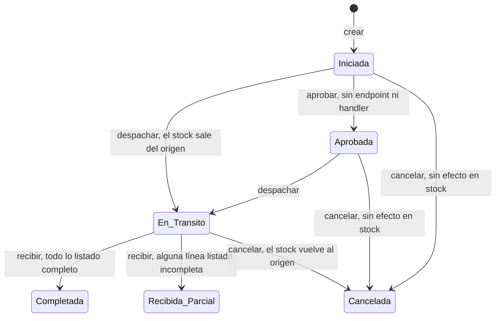
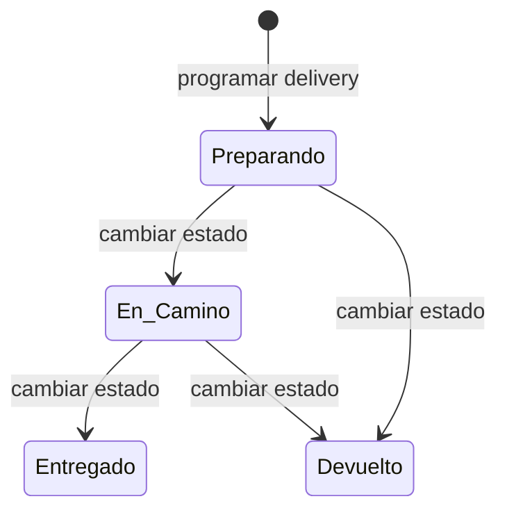
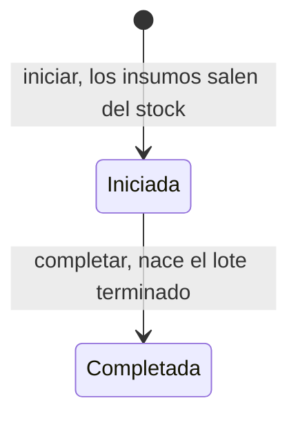
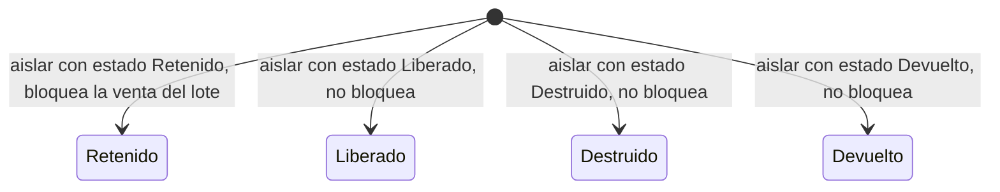

# Catálogo de reglas de negocio — Parte D: módulos que solo tienen API (sin pantalla)

| | |
|---|---|
| **Sistema** | SOFIA — Sistema Optimizado Farmacéutico con Inteligencia Artificial |
| **Versión del documento** | 1.0 |
| **Fecha** | 2026-10-13 |
| **Backend** | `sofia-apis`, rama `main`, commit `27597cd` (la línea base vigente; el documento se empezó sobre `606cb69` y se comprobó con `git diff --stat 606cb69..HEAD` que los commits nuevos no tocan ningún archivo de transferencias, delivery, magistrales, servicios, cuarentena, actas ni auditoría) |
| **Frontend** | `sofia-web-spa`, rama `main`, commit `01b8260` (la línea base vigente) |
| **Método** | Lectura de código (controladores, validadores, handlers, entidades, configuraciones EF, scripts DbUp, búsqueda de llamadas y rutas en el SPA, archivos `es.json`). No se ejecutó la aplicación ni se llamó a la API ni se consultó la base de datos. |

## 1. Alcance y convenciones

Este documento cataloga las reglas de negocio que el código hace cumplir en seis módulos que **existen en el backend pero no tienen pantalla en el SPA**: Transferencias entre sucursales (`TRA`), Delivery (`DEL`), Órdenes magistrales (`MAG`), Servicios e inmunizaciones (`SRV`), Cuarentena y actas de destrucción DIGEMID (`CUA`) y Auditoría (`AUD`). Cada módulo abre con la comprobación «Solo API (sin pantalla)» y su evidencia. Lo que ya cubren las partes anteriores no se repite: el catálogo DIGEMID (`DIG`) es de la parte B, el bloqueo de venta por cuarentena (RN-VEN-012) y la definición de stock vendible (RN-STK-017) son de las partes C1 y C2, y las consultas de devoluciones y el dashboard (que sí lee la cuarentena) son de la parte C3.

Las reglas transversales (aislamiento por empresa, borrado lógico, paginación, transacciones, auditoría automática, permisos, sucursales accesibles, concurrencia, errores de base de datos) las documenta la parte A y se citan por su ID. La forma en que una regla se convierte en respuesta HTTP está descrita en las secciones 2 y 3 de [01b-catalogos.md](./01b-catalogos.md#2-cómo-se-convierte-una-regla-en-respuesta-http); el formato de las tablas es el de [01c3-caja-devoluciones-dashboard.md](./01c3-caja-devoluciones-dashboard.md#1-alcance-y-convenciones), cuyas explicaciones generales no se repiten aquí. En la última columna, como ninguno de estos módulos tiene pantalla, aparece **«Sin pantalla»**; cuando el SPA tiene un texto escrito para ese caso pero ninguna pantalla lo carga, se cita como **«texto existente sin uso»**.

**Estado «Solo API (sin pantalla)» y evidencia.** Se buscó en todo `sofia-web-spa/src/app` (`.ts` y `.html`, incluidos los specs) cualquier llamada HTTP, ruta o servicio que apunte a estos módulos:

| Módulo | Resultado de la búsqueda en el SPA | Evidencia |
|---|---|---|
| Transferencias | **Solo API (sin pantalla).** Ningún servicio llama a `api/v1/transferencias`; no existe ruta ni entrada en el mapa de permisos de rutas. | `SPA/app.routes.ts:15-179` (sin ruta `transferencias`); `SPA/core/auth/route-permissions.ts:2-25` (sin entrada); `docs/_inventario/rutas-spa.csv` (86 rutas, ninguna de estos módulos); `find` sobre `SPA/pages/transferencias`, `SPA/pages/auditoria`, `SPA/pages/servicios` y `SPA/pages/inventarios`: carpetas con subcarpetas vacías y **0 archivos** |
| Delivery | **Solo API (sin pantalla).** Ningún servicio llama a `api/v1/delivery`. El menú lateral **horizontal** lista «Delivery» con la ruta `/delivery`, que no existe: cae en el comodín y redirige a `/dashboard`. Ese menú no se usa con la configuración por defecto (`horizontal: false`). | `SPA/matdash/layouts/full/horizontal/sidebar/sidebar-data.ts:30-34`; `SPA/app.routes.ts:177-180` (comodín); `SPA/matdash/config.ts:20`; el menú vertical (el activo) no lo lista (`SPA/matdash/layouts/full/vertical/sidebar/sidebar-data.ts`, 24 rutas, ninguna de estos módulos) |
| Magistrales | **Solo API (sin pantalla).** Ninguna coincidencia con `magistral` en el SPA. | búsqueda sin resultados en `SPA/` |
| Servicios e inmunizaciones | **Solo API (sin pantalla).** Ningún servicio llama a `api/v1/servicios`. El menú horizontal lista «Servicios» con la ruta `/servicios`, inexistente (mismo comodín). | `SPA/matdash/layouts/full/horizontal/sidebar/sidebar-data.ts:35-39`; `SPA/app.routes.ts:177-180` |
| Cuarentena y actas | **Solo API (sin pantalla)** para registrar cuarentena, consultarla, generar actas y consultarlas: el SPA no llama a `api/v1/digemid/cuarentena`, `acta-destruccion` ni `actas` (su único servicio DIGEMID usa `api/v1/digemid/catalogo`). **El SPA sí lee la cuarentena de forma indirecta:** el dashboard pide `GET api/v1/dashboard/cuarentena` (otro endpoint, parte C3) y muestra la tarjeta «Lotes en cuarentena». | `SPA/pages/digemid-catalogo/services/digemid-catalogo.service.ts:15`; `SPA/pages/dashboard/services/dashboard.service.ts:31-33`; `SPA/pages/dashboard/dashboard.component.ts:116`, `:222-223`; `SPA/pages/dashboard/dashboard.component.html:456` |
| Auditoría | **Solo API (sin pantalla).** Ninguna coincidencia con `anonimiz` ni `auditoria/` en servicios del SPA. | búsqueda sin resultados en `SPA/` (las únicas coincidencias de «auditoria» son carpetas vacías y el archivo de textos) |

Los archivos de textos `I18N/transferencias/es.json` (70 claves), `I18N/servicios/es.json` (67) y `I18N/auditoria/es.json` (9) existen, pero **ningún componente los carga** (no hay página, ruta ni `scope` que los use). Sus claves se citan como «texto existente sin uso». El grupo `pos.transferDialog.*` y las claves `pos.…otherBranchAvailableInfo`, `transferRequestedSuccess` y `transferRequestedError` (`I18N/pos/es.json:226-236`, `:322-324`) tampoco las usa ningún componente (búsqueda en `src` y `public`: solo aparecen en los `es.json` y `en.json`).

**Abreviaturas de ruta** (las mismas de las partes anteriores; todas son rutas reales):

| Abreviatura | Ruta completa |
|---|---|
| `APP/` | `sofia-apis/src/SOFIA.Application/` |
| `DOM/` | `sofia-apis/src/SOFIA.Domain/Entities/` |
| `API/` | `sofia-apis/src/SOFIA.API/Controllers/` |
| `CFG/` | `sofia-apis/src/SOFIA.Infrastructure/Persistence/Configurations/` |
| `DBUP/` | `sofia-apis/src/SOFIA.DbUp/Scripts/` |
| `SPA/` | `sofia-web-spa/src/app/` |
| `I18N/` | `sofia-web-spa/public/i18n/` |

**Alias propios de este documento** (todos con el prefijo de ruta indicado; el sufijo `-C`, `-H`, `-V` es siempre el comando, su handler y su validador):

| Alias | Archivo |
|---|---|
| `CTRL-TRA` | `API/TransferenciasController.cs` |
| `T-CRE-C`, `T-CRE-H`, `T-CRE-V` | `APP/Transferencias/Commands/CreateTransferencia/CreateTransferenciaCommand.cs`, `CreateTransferenciaCommandHandler.cs`, `CreateTransferenciaCommandValidator.cs` |
| `T-DES-C`, `T-DES-H` | `APP/Transferencias/Commands/DespacharTransferencia/DespacharTransferenciaCommand.cs`, `DespacharTransferenciaCommandHandler.cs` |
| `T-REC-C`, `T-REC-H`, `T-REC-V` | `APP/Transferencias/Commands/RecibirTransferencia/RecibirTransferenciaCommand.cs`, `RecibirTransferenciaCommandHandler.cs`, `RecibirTransferenciaCommandValidator.cs` |
| `T-CAN-C`, `T-CAN-H` | `APP/Transferencias/Commands/CancelarTransferencia/CancelarTransferenciaCommand.cs`, `CancelarTransferenciaCommandHandler.cs` |
| `Q-TRA`, `Q-TRAID` | `APP/Transferencias/Queries/GetTransferencias/GetTransferenciasQueryHandler.cs`, `APP/Transferencias/Queries/GetTransferenciaById/GetTransferenciaByIdQueryHandler.cs` |
| `TRF`, `TRD`, `INV` | `DOM/Transferencia.cs`, `DOM/DetalleTransferencia.cs`, `DOM/InventarioSucursal.cs` |
| `CFG-TRF`, `CFG-TRD` | `CFG/TransferenciaConfiguration.cs`, `CFG/DetalleTransferenciaConfiguration.cs` |
| `ETR` | `I18N/transferencias/es.json` (claves con el prefijo `transferencias.`) |
| `CTRL-DEL` | `API/DeliveryController.cs` |
| `D-PRO-H`, `D-PRO-V` | `APP/Delivery/Commands/ProgramarDelivery/ProgramarDeliveryCommandHandler.cs`, `ProgramarDeliveryCommandValidator.cs` |
| `D-EST-C`, `D-EST-H`, `D-EST-V` | `APP/Delivery/Commands/UpdateDeliveryEstado/UpdateDeliveryEstadoCommand.cs`, `UpdateDeliveryEstadoCommandHandler.cs`, `UpdateDeliveryEstadoCommandValidator.cs` |
| `D-UPD-H`, `D-DEL-H` | `APP/Delivery/Commands/UpdateDespachoDelivery/UpdateDespachoDeliveryCommandHandler.cs`, `APP/Delivery/Commands/DeleteDespachoDelivery/DeleteDespachoDeliveryCommandHandler.cs` |
| `Q-DESP`, `Q-DESPID` | `APP/Delivery/Queries/GetDespachos/GetDespachosQueryHandler.cs`, `APP/Delivery/Queries/GetDespachoDeliveryById/GetDespachoDeliveryByIdQueryHandler.cs` |
| `DSP`, `CFG-DSP` | `DOM/DespachoDelivery.cs`, `CFG/DespachoDeliveryConfiguration.cs`; el enumerado es `sofia-apis/src/SOFIA.Domain/Enums/EstadoDespacho.cs` |
| `CTRL-MAG` | `API/MagistralesController.cs` |
| `M-INI-C`, `M-INI-H`, `M-INI-V` | `APP/Magistrales/Commands/IniciarOrdenMagistral/IniciarOrdenMagistralCommand.cs`, `IniciarOrdenMagistralCommandHandler.cs`, `IniciarOrdenMagistralCommandValidator.cs` |
| `M-COM-C`, `M-COM-H`, `M-COM-V` | `APP/Magistrales/Commands/CompletarOrdenMagistral/CompletarOrdenMagistralCommand.cs`, `CompletarOrdenMagistralCommandHandler.cs`, `CompletarOrdenMagistralCommandValidator.cs` |
| `Q-ORD`, `Q-ORD-V`, `Q-ORDID` | `APP/Magistrales/Queries/GetOrdenes/GetOrdenesQueryHandler.cs`, `GetOrdenesQueryValidator.cs`; `APP/Magistrales/Queries/GetOrdenById/GetOrdenByIdQueryHandler.cs` |
| `ORD`, `CON`, `LOT` | `DOM/MagistralOrdenProduccion.cs`, `DOM/MagistralConsumoInsumo.cs`, `DOM/LoteInventario.cs` |
| `CFG-ORD`, `CFG-CON` | `CFG/MagistralOrdenProduccionConfiguration.cs`, `CFG/MagistralConsumoInsumoConfiguration.cs` |
| `CTRL-SRV` | `API/ServiciosController.cs` |
| `S-AGE-H`, `S-AGE-V` | `APP/Servicios/Commands/AgendarServicio/AgendarServicioCommandHandler.cs`, `AgendarServicioCommandValidator.cs` |
| `S-INM-H`, `S-INM-V` | `APP/Servicios/Commands/RegistrarInmunizacion/RegistrarInmunizacionCommandHandler.cs`, `RegistrarInmunizacionCommandValidator.cs` |
| `S-UPS-H`, `S-UPI-H`, `S-DLS-H`, `S-DLI-H` | `APP/Servicios/Commands/UpdateServicio/UpdateServicioCommandHandler.cs`, `UpdateInmunizacion/UpdateInmunizacionCommandHandler.cs`, `DeleteServicio/DeleteServicioCommandHandler.cs`, `DeleteInmunizacion/DeleteInmunizacionCommandHandler.cs` |
| `Q-SRV`, `Q-INMS`, `Q-INMS-V`, `Q-SRVID`, `Q-INMID` | `APP/Servicios/Queries/GetServicios/GetServiciosQueryHandler.cs`, `GetInmunizaciones/GetInmunizacionesQueryHandler.cs`, `GetInmunizaciones/GetInmunizacionesQueryValidator.cs`, `GetServicioById/GetServicioByIdQueryHandler.cs`, `GetInmunizacionById/GetInmunizacionByIdQueryHandler.cs` |
| `AGE`, `INM` | `DOM/ServicioAgenda.cs`, `DOM/ServicioClinicoInmunizacion.cs` |
| `CFG-AGE`, `CFG-INM` | `CFG/ServicioAgendaConfiguration.cs`, `CFG/ServicioClinicoInmunizacionConfiguration.cs` |
| `ESV` | `I18N/servicios/es.json` (claves con el prefijo `servicios.`) |
| `CTRL-DIG` | `API/DIGEMIDController.cs` (clase `DigemidController`; solo las operaciones de cuarentena y actas) |
| `C-AIS-C`, `C-AIS-H`, `C-AIS-V` | `APP/DIGEMID/Commands/AislarLoteCuarentena/AislarLoteCuarentenaCommand.cs`, `AislarLoteCuarentenaCommandHandler.cs`, `AislarLoteCuarentenaCommandValidator.cs` |
| `C-ACT-C`, `C-ACT-H`, `C-ACT-V` | `APP/DIGEMID/Commands/GenerarActaDestruccion/GenerarActaDestruccionCommand.cs`, `GenerarActaDestruccionCommandHandler.cs`, `GenerarActaDestruccionCommandValidator.cs` |
| `Q-CUA`, `Q-CUA-V`, `Q-ACT` | `APP/DIGEMID/Queries/GetCuarentena/GetCuarentenaQueryHandler.cs`, `GetCuarentenaQueryValidator.cs`; `APP/DIGEMID/Queries/GetActas/GetActasQueryHandler.cs` |
| `CUA`, `ACT`, `ACD` | `DOM/DigemidInventarioCuarentena.cs`, `DOM/DigemidActaDestruccion.cs`, `DOM/DigemidActaDetalle.cs`; el enumerado de estados es `sofia-apis/src/SOFIA.Domain/Enums/EstadoResolucionCuarentena.cs` (`ECR`) |
| `CFG-CUA`, `CFG-ACT`, `CFG-ACD` | `CFG/DigemidInventarioCuarentenaConfiguration.cs`, `CFG/DigemidActaDestruccionConfiguration.cs`, `CFG/DigemidActaDetalleConfiguration.cs` |
| `VDF`, `VND` | `APP/Ventas/Common/VentaDetalleFactory.cs`, `APP/Inventarios/Common/InventarioVendibleExtensions.cs` |
| `CTRL-AUD` | `API/AuditoriaController.cs` |
| `A-ANO-C`, `A-ANO-H`, `A-ANO-V` | `APP/Auditoria/Commands/AnonimizarDatos/AnonimizarDatosCommand.cs`, `AnonimizarDatosCommandHandler.cs`, `AnonimizarDatosCommandValidator.cs` |
| `AEV`, `CFG-AEV` | `DOM/AuditoriaEventoSeguridad.cs`, `CFG/AuditoriaEventoSeguridadConfiguration.cs` |
| `AUDB`, `AEVT`, `ATAB` | `APP/Common/Behaviors/AuditBehavior.cs`, `APP/Common/Models/AuditEventos.cs`, `APP/Common/Models/AuditTablas.cs` |
| `EAU` | `I18N/auditoria/es.json` (claves con el prefijo `auditoria.`) |

**Reglas de las partes anteriores a las que se remite**

| Regla | Tema |
|---|---|
| RN-GEN-001, RN-GEN-002, RN-GEN-003 | Aislamiento por empresa, filas eliminadas no visibles, borrado lógico |
| RN-GEN-005, RN-GEN-006 | Quién y cuándo se grabó; fechas en UTC |
| RN-GEN-008, RN-GEN-009 | Filtros de fecha inclusivos en UTC; paginación acotada |
| RN-GEN-010, RN-GEN-011 | Limpieza de HTML en los textos de primer nivel; un validador que falla impide el handler, código `{Request}.{Propiedad}` |
| RN-GEN-012, RN-GEN-013, RN-GEN-014 | Comandos transaccionales (un `Result.Failure` no revierte lo ya guardado); auditoría automática de comandos; forma mínima de un evento de auditoría |
| RN-GEN-015 | Denegación por defecto (los controladores sin `[Authorize]` de este documento quedan cubiertos) |
| RN-GEN-020, RN-GEN-021 | Falta de permiso; el rol `Admin` pasa cualquier comprobación |
| RN-GEN-023 | Sucursales accesibles (Admin todas; los demás, base más asignadas a la cuenta y a sus roles) |
| RN-GEN-024 | `Auth.Sucursal` / `Auth.Empleado` |
| RN-GEN-035, RN-GEN-036, RN-GEN-037, RN-GEN-038 | `Concurrency.Conflict`, `Db.Duplicado`, `Db.ValorInvalido`, `Db.ReferenciaInvalida` |
| RN-GEN-040, RN-GEN-041 | Error inesperado; cuerpo con forma inválida |
| RN-LOT-004, RN-LOT-006, RN-LOT-010 | Largo del número de lote, definición de lote vencido, unicidad del número por producto |
| RN-STK-011, RN-STK-017 | Versión de fila del stock; definición de stock vendible |
| RN-VEN-012 | Un lote con cuarentena `Retenido` no se vende (parte C2) |
| RN-DEV-024, RN-DAS-022 | Devolución con destino «Cuarentena DIGEMID» y tarjeta «Lotes en cuarentena» (parte C3) |

## 2. Diferencias con el comportamiento común de las partes anteriores

1. **El HTTP es el número que pasa el handler.** Un `Result.Failure` sin número responde 400 aunque el error sea de tipo `NotFound`, `Forbidden` o `Conflict` (`sofia-apis/src/SOFIA.Domain/Common/Result.cs:32-33`; `sofia-apis/src/SOFIA.API/Extensions/ResultExtensions.cs:13-23`). Llevan número explícito solo: `Transferencia.NotFound` (404), `Transferencia.SucursalDestinoNotFound` (404), `Transferencia.LoteNotFound` (404), `Venta.NotFound` (404), `Delivery.Venta.SucursalNoPermitida` (403), `Delivery.Venta.Anulada` (409), `Delivery.Venta.YaProgramado` (409), `Delivery` y `NotFound` (404), `Orden.NotFound`, `OrdenMagistral.NotFound`, `Medicamento.NotFound`, `RecetaMedica.NotFound`, `Inventario.NotFound`, `Paciente.NotFound`, `Empleado.NotFound`, `LoteInventario.NotFound`, `DetalleDevolucion.NotFound` (404), `OrdenMagistral.OtraSucursal` (403) y `Auditoria.Anonimizacion.NoImplementada` (501). Todo lo demás responde 400, **incluidos los tres `Transferencia.Forbidden`**: el código declara un error `Forbidden`, pero al no pasar número la API responde 400, no 403 (RN-TRA-012, RN-TRA-015, RN-TRA-021, RN-TRA-026).
2. **Éxito.** Los comandos que devuelven un valor responden **200** con el identificador (un GUID) como cuerpo (`Ok(result.Value)`), salvo crear transferencia, que responde **201** con la cabecera `Location` hacia `GET transferencias/{id}` (`CTRL-TRA:33-40`). Despachar, recibir y cancelar una transferencia devuelven un `Result` sin valor y responden **204** sin cuerpo (`CTRL-TRA:47`, `:55`, `:63`; `sofia-apis/src/SOFIA.API/Extensions/ResultExtensions.cs:10-11`). **Las consultas por identificador de delivery, magistrales y servicios devuelven el objeto `Result` completo** (con `isSuccess`, `error`, `statusCode` y `value`) en vez del valor (`CTRL-DEL:44`, `:58`, `:66`; `CTRL-MAG:41`; `CTRL-SRV:56`, `:69`, `:77`, `:85`, `:98`, `:106`), igual que `GET Pos/{id}` en la parte C3; `GET transferencias/{id}` y los listados devuelven el valor directo.
3. **Ninguna operación de estos cinco módulos operativos es auditable.** Ningún comando de transferencias, delivery, magistrales, servicios ni cuarentena implementa `IAuditableCommand` (búsqueda en `APP/`: la lista completa de comandos auditables está en RN-AUD-006), de modo que ni mover stock entre sucursales, ni consumir insumos, ni aislar un lote, ni generar un acta dejan fila en `Auditoria_Eventos_Seguridad` (RN-GEN-013). Solo quedan los campos de auditoría de cada fila (RN-GEN-005).
4. **Ninguno de estos comandos prueba la pertenencia a la sucursal de la misma forma.** Hay cuatro formas distintas, descritas en cada módulo: la sucursal del token contra la de la fila (transferencias, magistrales: el `Admin` tampoco se salta la comparación), las sucursales accesibles de RN-GEN-023 (delivery al programar, y las consultas de delivery, magistrales y cuarentena), solo la empresa (servicios, actualizar/eliminar delivery, actas) y ninguna (consultas de servicios).
5. **Varios validadores y comandos están sin terminar.** `ProgramarDeliveryCommandValidator`, `AgendarServicioCommandValidator` y `GenerarActaDestruccionCommandValidator` tienen el cuerpo `// TODO: Add validation rules` (`D-PRO-V:9`; `APP/Servicios/Commands/AgendarServicio/AgendarServicioCommandValidator.cs:9`; `C-ACT-V:9`), y `UpdateDespachoDeliveryCommand`, `UpdateServicioCommand` y `UpdateInmunizacionCommand` solo traen el identificador y un `// TODO: Add properties manually`, con handlers que no cambian nada (RN-DEL-012, RN-SRV-017). Las reglas de cada uno se describen con lo que el código hace hoy.
6. **Enumerados en el cuerpo JSON.** En el código del backend no hay ningún `JsonStringEnumConverter` (búsqueda en `sofia-apis/src`), de modo que los enumerados que llegan en un cuerpo JSON (`NuevoEstado`, `ModalidadRegistro`) se esperan como número (por defecto de `System.Text.Json`); en la cadena de consulta (`estadoDespacho`, `estado`) el enlazador acepta el nombre o el número. **No verificado** en ejecución (sección 9.1, punto 7).
7. **Mensajes de error en inglés o español mezclados.** Los mensajes de los errores de estos módulos están escritos en inglés o en español según el archivo; ninguno llega a un usuario porque no hay pantalla. Se citan solo cuando ayudan a identificar el caso.
8. **Orden en que se evalúan las condiciones** (decide qué error ve quien llama cuando fallan varias cosas a la vez): ver la nota al inicio de cada módulo.

---

## 3. Transferencias entre sucursales (`TRA`)

Una transferencia mueve stock de un lote desde la sucursal de **origen** (la del token de quien la crea) hacia otra sucursal de **destino**. Tiene una cabecera (entidad `Transferencia`, tabla `Transferencias_Cab`) y líneas por lote (`DetalleTransferencia`, `Transferencias_Det`). El stock no se toca al crear: sale del origen al **despachar**, entra al destino al **recibir** (total o parcialmente) y vuelve al origen si se **cancela** estando en tránsito. **Solo API (sin pantalla)**: el SPA no llama a ninguno de estos endpoints (sección 1); los textos de `ETR` describen una pantalla de gestión («Gestión de Transferencias de Inventario») que no se construyó. No existe una operación «iniciar»: crear la transferencia la deja en estado `Iniciada`.

**Endpoints** (`CTRL-TRA`, ruta `api/v1/Transferencias`; permisos de `docs/_inventario/endpoints.csv`):

| Operación | Endpoint | Permiso | Handler | Éxito |
|---|---|---|---|---|
| Crear | `POST api/v1/Transferencias` | `Transferencias:Crear` | `CreateTransferenciaCommandHandler` | 201 (GUID, con `Location`) |
| Despachar | `PUT api/v1/Transferencias/{id}/despachar` | `Transferencias:Actualizar` | `DespacharTransferenciaCommandHandler` | 204 |
| Recibir | `PUT api/v1/Transferencias/{id}/recibir` (cuerpo: arreglo `[{loteId, cantidadRecibida}]`) | `Transferencias:Actualizar` | `RecibirTransferenciaCommandHandler` | 204 |
| Cancelar | `PUT api/v1/Transferencias/{id}/cancelar` | `Transferencias:Actualizar` | `CancelarTransferenciaCommandHandler` | 204 |
| Listar | `GET api/v1/Transferencias` | `Transferencias:Leer` | `GetTransferenciasQueryHandler` | 200 |
| Detalle | `GET api/v1/Transferencias/{id}` | `Transferencias:Leer` | `GetTransferenciaByIdQueryHandler` | 200 |

**Estados** (`sofia-apis/src/SOFIA.Domain/Enums/EstadoLogistico.cs`: `Iniciada`, `Aprobada`, `En_Transito`, `Recibida_Parcial`, `Completada`, `Cancelada`; se guardan como texto con el nombre del enumerado, `CFG-TRF:27-30`):

`Completada`, `Recibida_Parcial` y `Cancelada` son finales. `Aprobada` no se alcanza por ninguna ruta de la API (RN-TRA-011).

**Efecto en el stock** (tabla `Inventario_Sucursal`, entidad `InventarioSucursal`; solo se mueve `CantidadFisica`):

| Momento | Origen | Destino |
|---|---|---|
| Crear | sin cambio (solo se comprueba que haya) | sin cambio |
| Despachar | resta `CantidadEnviada` de cada línea | sin cambio |
| Recibir | sin cambio | suma `CantidadRecibida` de cada línea listada con cantidad mayor que 0 (crea la fila de stock si no existe) |
| Cancelar estando `En_Transito` | suma `CantidadEnviada` de cada línea (crea la fila si no existe) | sin cambio |
| Cancelar estando `Iniciada` o `Aprobada` | sin cambio | sin cambio |

La diferencia entre lo enviado y lo recibido **no vuelve a ninguna parte** (RN-TRA-020).

**Orden en que se evalúan las condiciones.** Crear: permiso → validador → sucursal del token → empleado del token → destino distinto del origen → destino existe → por cada línea (stock del lote en el origen existe → hay cantidad suficiente → guards de la línea) → guards de la cabecera → guardar. Despachar: permiso → la transferencia existe → sucursal del token → es el origen → estado `Iniciada` o `Aprobada` → por cada línea (hay stock suficiente) → guardar. Recibir: permiso → validador → la transferencia existe → sucursal del token → es el destino → empleado del token → estado `En_Transito` → por cada línea (pertenece, no negativa, no excede) → guardar el stock del destino. Cancelar: permiso → la transferencia existe → sucursal del token → es el origen → estado cancelable → devolver stock si estaba en tránsito → guardar.

### 3.1 Acceso y creación

| ID | Regla | Tipo | Dónde se aplica | Código de error | HTTP | Mensaje en el SPA (es) |
|---|---|---|---|---|---|---|
| RN-TRA-001 | **Permisos.** Cada operación exige un permiso del módulo `Transferencias`: `Crear` (crear), `Actualizar` (despachar, recibir y cancelar: los tres comparten el mismo permiso) y `Leer` (listar y detalle). El rol `Admin` pasa siempre (RN-GEN-021). Ningún script siembra permisos del módulo `Transferencias` (el script `0002` crea los roles base sin permisos): los concede el administrador. | Autorización | `CTRL-TRA:16`, `:24`, `:32`, `:42`, `:50`, `:58` (y `[Authorize]` en `:13`); `DBUP/0002_SeedBaseRoles.sql:7-37` | — (ver RN-GEN-020) | Ver RN-GEN-020 | Sin pantalla. |
| RN-TRA-002 | **Origen y emisor no se eligen: salen del token.** La sucursal de origen es la sucursal del token (claim `sucursalId`) y el empleado emisor es el empleado del token; el request solo trae el destino y las líneas. Si falta un dato, se rechaza (la sucursal se comprueba antes que el empleado). Un administrador tampoco elige el origen: usa la sucursal base de su token. | Autorización | `T-CRE-H:17-31`; `T-CRE-C:12-14` | `Auth.Sucursal` · `Auth.Empleado` (RN-GEN-024) | 400 | Sin pantalla. |
| RN-TRA-003 | **Destino obligatorio.** La sucursal de destino no puede ser el GUID vacío. | Obligatoriedad | `T-CRE-V:14-15` | `CreateTransferenciaCommand.SucursalDestinoId` | 400 | Sin pantalla. |
| RN-TRA-004 | **Origen y destino deben ser distintos.** Se compara la sucursal del token con el destino pedido. La entidad repite la comprobación, además del origen y destino no vacíos (inalcanzables por API: el token y el validador ya lo garantizan). | Integridad | `T-CRE-H:33-37`; `TRF:37-50` | `Transferencia.SucursalDestino` · `Transferencia.SucursalOrigenId` · `Transferencia.SucursalDestinoId` (entidad, inalcanzables) | 400 | Sin pantalla; texto existente sin uso: «La sucursal de destino debe ser diferente de la sucursal de origen.» (`transferencias.form.errorSameSucursal`, `ETR:49`). |
| RN-TRA-005 | **El destino debe existir.** La búsqueda lleva el filtro de empresa y de eliminados (RN-GEN-001 y RN-GEN-002): una sucursal de otra empresa se informa como inexistente. El handler solo comprueba existencia: no revisa que el usuario tenga acceso a la sucursal destino (RN-GEN-023 no se aplica al destino) ni ningún otro dato de ella. La base repite la relación con `FK_TransCab_Destino`. | Integridad | `T-CRE-H:39-44`; `DBUP/0001_Initial_Schema.sql:203` | `Transferencia.SucursalDestinoNotFound` · `Db.ReferenciaInvalida` (RN-GEN-038) | 404 · 409 | Sin pantalla. |
| RN-TRA-006 | **Al menos una línea, con lote y cantidad.** La lista de líneas no puede estar vacía; cada línea trae un identificador de lote no vacío y una cantidad enviada **mayor que 0** (admite decimales). La entidad de línea y la de cabecera repiten las comprobaciones (inalcanzables por API) y la base repite la cantidad con `CHK_Transferencias_Det_Cantidad_Enviada` (`> 0`) y la guarda con 4 decimales (`DECIMAL(12,4)`). No hay máximo de líneas ni de cantidad. | Obligatoriedad | `T-CRE-V:17-24`; `TRD:18-37`; `TRF:57-60`; `CFG-TRD:29`, `:56-60`; `DBUP/0001_Initial_Schema.sql:213`; `DBUP/0020_SoftDeleteAware_Uniques_And_Checks.sql:103-104` | `CreateTransferenciaCommand.Detalles` · `CreateTransferenciaCommand.Detalles[i].LoteId` · `CreateTransferenciaCommand.Detalles[i].CantidadEnviada` (con el índice de la línea) · `DetalleTransferencia.LoteId` · `DetalleTransferencia.CantidadEnviada` · `Transferencia.Detalles` (entidad, inalcanzables) · `Db.ValorInvalido` (RN-GEN-037) | 400 | Sin pantalla; texto existente sin uso: «Debe agregar al menos un lote para transferir.» (`transferencias.form.errorNoLotes`, `ETR:50`). |
| RN-TRA-007 | **El lote debe tener stock registrado en el origen.** Para cada línea se busca la fila de stock de ese lote en la sucursal de origen; si no existe se rechaza, aunque el lote exista en otra sucursal. La comprobación es solo de existencia de la fila: **no se revisa que el lote esté vencido ni que tenga una cuarentena `Retenido`** (RN-CUA-008), de modo que se pueden transferir lotes vencidos o retenidos. La base repite el vínculo con `FK_TransDet_Lote`. | Integridad | `T-CRE-H:48-57`; `DBUP/0001_Initial_Schema.sql:222` | `Transferencia.LoteNotFound` · `Db.ReferenciaInvalida` (RN-GEN-038) | 404 · 409 | Sin pantalla. |
| RN-TRA-008 | **Stock suficiente al crear.** La cantidad pedida no puede superar la `CantidadFisica` de la fila de stock del origen (igual a la existente es válido). Es el stock físico, no el vendible (RN-STK-017): cuenta lo vencido y lo retenido. El mensaje del error trae la cantidad disponible. **Crear no descuenta ni reserva nada**: dos transferencias pueden pedir el mismo stock, y la que se despache segunda fallará (RN-TRA-014). | Cálculo | `T-CRE-H:59-62` | `Transferencia.StockInsuficiente` | 400 | Sin pantalla; texto existente sin uso: «No puede enviar más de {{count}} unidades disponibles en la sucursal origen.» (`transferencias.form.errorExceedsStock`, `ETR:51`). |
| RN-TRA-009 | **Un mismo lote en varias líneas.** No hay comprobación de duplicados: el mismo lote puede aparecer en varias líneas; al crear, cada línea se compara por separado con el stock (sin acumular), y es el despacho el que acumula (RN-TRA-014). Al recibir, una recepción de ese lote solo afecta a la **primera** línea que lo contiene (RN-TRA-018). La base no tiene restricción de unicidad por (transferencia, lote). | Integridad | `T-CRE-H:49-71`; `TRF:122`; `DBUP/0001_Initial_Schema.sql:208-223` (sin índice único) | `Transferencia.StockInsuficiente` (al despachar, si la suma excede) | 400 | Sin pantalla. |
| RN-TRA-010 | **Resultado de crear.** Se guarda la transferencia en estado `Iniciada` con el empleado emisor, el origen, el destino y sus líneas, y la fecha de despacho puesta provisionalmente en la hora actual UTC (la columna `Fecha_Despacho` es `NOT NULL`; se vuelve a fijar al despachar). Responde **201** con el identificador y la cabecera `Location`. No hay auditoría de seguridad (sección 2, punto 3) ni efecto en el stock. | Estado | `T-CRE-H:73-88`; `TRF:62-69`; `CTRL-TRA:33-40`; `DBUP/0001_Initial_Schema.sql:191` | — | 201 | Sin pantalla; texto existente sin uso: «Transferencia inter-sede creada con éxito.» (`transferencias.messages.createdSuccess`, `ETR:78`). |
| RN-TRA-011 | **El estado `Aprobada` no se alcanza por la API.** La entidad tiene el método `Aprobar` (solo desde `Iniciada`) y la base admite el estado, pero ningún comando, handler ni endpoint lo llama: solo lo usan las pruebas unitarias. Una transferencia sale de `Iniciada` directamente hacia `En_Transito` o `Cancelada`. Despachar acepta `Aprobada` por si algún día existe la aprobación. | Estado | `TRF:80-89`; búsqueda de `.Aprobar()` en `sofia-apis/src` (solo `SOFIA.UnitTests/Transferencias/Domain/TransferenciaTests.cs`) | `Transferencia.EstadoLogistico` (entidad, inalcanzable) | 400 | Sin pantalla; texto existente sin uso: «Aprobada» (`transferencias.status.aprobada`, `ETR:23`). |

### 3.2 Despacho

| ID | Regla | Tipo | Dónde se aplica | Código de error | HTTP | Mensaje en el SPA (es) |
|---|---|---|---|---|---|---|
| RN-TRA-012 | **Solo el personal del origen despacha.** La transferencia debe existir (de la empresa, no eliminada) y la sucursal del token debe ser exactamente la de origen. El rechazo está escrito como `Forbidden` pero **responde 400**, no 403, porque no se pasa número. El `Admin` no se salta la comparación: usa la sucursal base de su token (RN-GEN-023 no interviene). | Autorización | `T-DES-H:16-34`; `CTRL-TRA:43-48` | `Transferencia.NotFound` · `Transferencia.Forbidden` · `Auth.Sucursal` (RN-GEN-024) | 404 · 400 · 400 | Sin pantalla. |
| RN-TRA-013 | **Solo se despacha una transferencia `Iniciada` o `Aprobada`.** Pasa a `En_Transito` y la fecha de despacho se actualiza a la hora actual UTC. Despachar una transferencia ya en tránsito, finalizada o cancelada se rechaza. La comprobación de estado va antes que la de stock. | Estado | `T-DES-H:36-41`; `TRF:91-101` | `Transferencia.EstadoLogistico` | 400 | Sin pantalla; texto existente sin uso: «La transferencia ha sido despachada y se encuentra En Tránsito.» (`transferencias.messages.despachadaSuccess`, `ETR:79`). |
| RN-TRA-014 | **El despacho descuenta el stock del origen.** Para cada línea se vuelve a buscar la fila de stock del origen: si no existe, o no alcanza, se rechaza **todo** el despacho (no se guarda nada, ni el cambio de estado; el mensaje trae la cantidad disponible, 0 si no hay fila) y si alcanza se resta `CantidadEnviada` de `CantidadFisica`. Como la misma fila se modifica en memoria línea a línea, las líneas con el mismo lote se acumulan y la suma excedida se detecta aquí. El stock tiene versión de fila: dos operaciones simultáneas sobre la misma fila generan conflicto. Responde 204. | Cálculo | `T-DES-H:43-59`; `INV:14`, `:48`; `DBUP/0019_Concurrency_RowVersion.sql:2-6` | `Transferencia.StockInsuficiente` · `Concurrency.Conflict` (RN-GEN-035, RN-STK-011) | 400 · 409 | Sin pantalla; texto existente sin uso: «Ocurrió un error al procesar la transferencia.» (`transferencias.messages.errorGeneric`, `ETR:82`). |

### 3.3 Recepción

| ID | Regla | Tipo | Dónde se aplica | Código de error | HTTP | Mensaje en el SPA (es) |
|---|---|---|---|---|---|---|
| RN-TRA-015 | **Solo el personal del destino recibe.** La transferencia debe existir y la sucursal del token debe ser exactamente la de destino; después se exige el empleado del token (será el receptor). Mismo defecto que RN-TRA-012: `Forbidden` responde 400. El `Admin` tampoco se salta la comparación. | Autorización | `T-REC-H:17-43`; `CTRL-TRA:51-56` | `Transferencia.NotFound` · `Transferencia.Forbidden` · `Auth.Sucursal` · `Auth.Empleado` (RN-GEN-024) | 404 · 400 · 400 | Sin pantalla. |
| RN-TRA-016 | **Solo se recibe una transferencia `En_Transito`.** Cualquier otro estado (incluida una ya recibida: no se puede recibir dos veces) se rechaza. El receptor y la hora de recepción se anotan en la cabecera; la entidad repite la exigencia de un receptor no vacío (inalcanzable). | Estado | `T-REC-H:45-50`; `TRF:103-116` | `Transferencia.EstadoLogistico` · `Transferencia.EmpleadoReceptorId` (entidad, inalcanzable) | 400 | Sin pantalla. |
| RN-TRA-017 | **Forma de la recepción.** El cuerpo es un arreglo de pares lote-cantidad (no un objeto) y el identificador viene de la ruta. El arreglo no puede estar vacío; cada elemento trae un lote no vacío y una cantidad recibida **mayor o igual que 0** (0 es válido: «no llegó nada de ese lote»). | Obligatoriedad | `T-REC-V:14-20`; `T-REC-C:10-14`; `CTRL-TRA:52-54` | `RecibirTransferenciaCommand.Id` (inalcanzable: la ruta no admite GUID vacío en la práctica) · `RecibirTransferenciaCommand.Recepciones` · `RecibirTransferenciaCommand.Recepciones[i].LoteId` · `RecibirTransferenciaCommand.Recepciones[i].CantidadRecibida` | 400 | Sin pantalla. |
| RN-TRA-018 | **Reglas por línea recibida.** El lote debe pertenecer a la transferencia (se busca la **primera** línea con ese lote); la cantidad no puede ser negativa (la entidad repite la regla del validador) ni **superar lo enviado** de esa línea (igual es válido). La primera línea que falle aborta toda la recepción y no se guarda nada. La cantidad recibida se guarda en la línea (la base repite el rango con `CHK_Transferencias_Det_Cantidad_Recibida`: entre 0 y lo enviado). | Integridad | `TRF:118-144`; `TRD:41`; `CFG-TRD:34`, `:56-60`; `DBUP/0020_SoftDeleteAware_Uniques_And_Checks.sql:105-106` | `Transferencia.Recepcion` (tres mensajes: lote ajeno, negativa, excede) · `Db.ValorInvalido` (RN-GEN-037) | 400 | Sin pantalla. |
| RN-TRA-019 | **Resultado: `Completada` o `Recibida_Parcial` según las líneas listadas.** Si en **todas las líneas listadas** la cantidad recibida es igual a la enviada, la transferencia queda `Completada`; si en alguna es menor, queda `Recibida_Parcial`. **Las líneas que no se listan se ignoran:** conservan la cantidad recibida en NULL, no suman stock y no cuentan como parciales, de modo que una transferencia de varias líneas puede quedar `Completada` habiéndose recibido solo una parte (ver hallazgo 7, sección 9.3). Ambos estados son finales. | Estado | `TRF:118`, `:138-146`; `T-REC-H:45-50` | — | 204 | Sin pantalla; texto existente sin uso: «Recepción de transferencia registrada correctamente.» (`transferencias.messages.recibidaSuccess`, `ETR:80`); etiquetas «Recibida Completa» y «Recibida Parcial» (`transferencias.status.completada`, `recibidaParcial`, `ETR:25-26`). |
| RN-TRA-020 | **Efecto de recibir en el stock: solo entra lo recibido; la diferencia se pierde.** Por cada línea con cantidad recibida mayor que 0: si el destino ya tiene fila de stock de ese lote se suma; si no, se crea la fila con esa cantidad. Las líneas con 0 o sin listar no tocan el stock. **No existe sustento ni motivo de la diferencia** (el request solo trae lote y cantidad) y lo enviado y no recibido ya salió del origen en el despacho: no vuelve al origen ni se registra como merma, de modo que el stock total entre sucursales baja en esa diferencia. Los textos del SPA hablan de un «sustento obligatorio» de la recepción parcial que el backend no implementa. Si la fila de stock cambió entre la lectura y el guardado, hay conflicto (RN-STK-011). | Cálculo | `T-REC-H:52-56`, `:62-91`; `INV:20-46`, `:50` | `InventarioSucursal.SucursalId` · `InventarioSucursal.LoteId` · `InventarioSucursal.CantidadFisica` (entidad, inalcanzables) · `Concurrency.Conflict` (RN-GEN-035) | 400 · 409 | Sin pantalla; texto existente sin uso, sin contraparte en el backend: «El sustento es obligatorio cuando la cantidad recibida es menor a la enviada.» (`transferencias.dialog.sustentoRequiredError`, `ETR:71`) y «Motivo de la diferencia (merma, rotura, faltante)» (`transferencias.dialog.sustentoLabel`, `ETR:69`). |

### 3.4 Cancelación

| ID | Regla | Tipo | Dónde se aplica | Código de error | HTTP | Mensaje en el SPA (es) |
|---|---|---|---|---|---|---|
| RN-TRA-021 | **Solo el personal del origen cancela.** La transferencia debe existir y la sucursal del token debe ser la de origen; el destino no puede rechazar una transferencia. Mismo defecto que RN-TRA-012: `Forbidden` responde 400. | Autorización | `T-CAN-H:17-35`; `CTRL-TRA:59-64` | `Transferencia.NotFound` · `Transferencia.Forbidden` · `Auth.Sucursal` (RN-GEN-024) | 404 · 400 · 400 | Sin pantalla. |
| RN-TRA-022 | **Estados desde los que se cancela.** Se puede cancelar desde `Iniciada`, `Aprobada` y `En_Transito`. No se cancela una transferencia `Completada`, `Recibida_Parcial` ni ya `Cancelada`; el mensaje indica el estado actual. Cancelada es final. | Estado | `T-CAN-H:37-43`; `TRF:151-160` | `Transferencia.EstadoLogistico` | 400 | Sin pantalla; texto existente sin uso: «La transferencia ha sido cancelada.» (`transferencias.messages.canceladaSuccess`, `ETR:81`). |
| RN-TRA-023 | **Efecto de cancelar en el stock.** Solo si la transferencia estaba `En_Transito` se devuelve al origen la `CantidadEnviada` de cada línea (se suma a la fila existente o se crea si ya no existe). Desde `Iniciada` o `Aprobada` no se mueve stock, porque nunca se descontó. Responde 204. | Cálculo | `T-CAN-H:37`, `:45-52`, `:58-81` | `InventarioSucursal.*` (entidad, inalcanzable) · `Concurrency.Conflict` (RN-GEN-035) | 400 · 409 | Sin pantalla. |
| RN-TRA-024 | **Recibir y cancelar a la vez: solo uno se guarda.** La cabecera tiene versión de fila (`RowVersion`, script `0019`): si dos operaciones parten de la misma lectura en tránsito (por ejemplo, el destino recibe mientras el origen cancela), solo una se guarda y la otra recibe el conflicto. | Integridad | `TRF:20-21`; `CFG-TRF:47-49`; `DBUP/0019_Concurrency_RowVersion.sql:10-11` | `Concurrency.Conflict` (RN-GEN-035) | 409 | Sin pantalla. |

### 3.5 Consultas (Solo API, sin pantalla)

| ID | Regla | Tipo | Dónde se aplica | Código de error | HTTP | Mensaje en el SPA (es) |
|---|---|---|---|---|---|---|
| RN-TRA-025 | **Listado de transferencias.** Devuelve solo las transferencias donde la **sucursal del token es el origen o el destino**; el `Admin` tampoco ve las de otras sucursales (no se usan las sucursales accesibles de RN-GEN-023). Filtros opcionales: `SucursalFiltroId` (transferencias donde esa sucursal sea origen o destino; se suma, con «y», al alcance anterior) y `Estado` (nombre o número del enumerado). Orden por fecha de despacho descendente; paginación de RN-GEN-009 (por defecto página 1 de 10). Cada fila trae identificadores y nombres de ambas sucursales y de ambos empleados, el estado como texto (por ejemplo `En_Transito`), las fechas y las líneas con número de lote del fabricante, cantidad enviada y recibida. No hay validador (un `Estado` inexistente falla antes, RN-GEN-041) ni exportación. | Autorización | `Q-TRA:18-46`, `:48-101`; `docs/_inventario/validadores.csv` (sin `GetTransferenciasQuery`) | `Auth.Sucursal` (RN-GEN-024) | 400 | Sin pantalla; textos existentes sin uso: «Gestión de Transferencias de Inventario» (`transferencias.title`, `ETR:2`), columnas `transferencias.cols.*` (`ETR:14-21`) y etiquetas de estado `transferencias.status.*` (`ETR:21-28`). |
| RN-TRA-026 | **Detalle de una transferencia.** Exige que exista (`Transferencia.NotFound`, 404) y que la sucursal del token sea el origen o el destino; si no, responde `Transferencia.Forbidden` con **400**, distinto del 404: una sucursal de la misma empresa puede así saber que un identificador existe aunque no sea suyo. Devuelve el mismo contenido que el listado para esa fila (el número de lote muestra «Desconocido» si el lote ya no se encuentra). Responde 200 con el valor directo. | Autorización | `Q-TRAID:15-42`, `:44-68` | `Transferencia.NotFound` · `Transferencia.Forbidden` · `Auth.Sucursal` (RN-GEN-024) | 404 · 400 · 400 | Sin pantalla; texto existente sin uso: «Detalle de Transferencia Inter-Sede» (`transferencias.dialog.title`, `ETR:56`). |

### 3.6 Entidades y restricciones de base de datos

| ID | Regla | Tipo | Dónde se aplica | Código de error | HTTP | Mensaje en el SPA (es) |
|---|---|---|---|---|---|---|
| RN-TRA-027 | **Guards de `Transferencia` y `DetalleTransferencia`.** `Transferencia.Create`: origen, destino y emisor distintos del GUID vacío, origen distinto del destino y al menos una línea. `Aprobar`: solo desde `Iniciada` (sin uso, RN-TRA-011). `Despachar`: solo desde `Iniciada` o `Aprobada`. `Recibir`: solo desde `En_Transito`, receptor no vacío y las reglas por línea. `Cancelar`: no desde `Completada`, `Recibida_Parcial` ni `Cancelada`. `DetalleTransferencia.Create`: lote no vacío y cantidad mayor que 0; `RegistrarRecepcion` no tiene guards (los aplica `Recibir`). Con los datos que arman los handlers, solo pueden fallar de verdad las comprobaciones de estado y de recepción. | Integridad | `TRF:31-78`, `:80-160`; `TRD:18-41` | `Transferencia.SucursalOrigenId` · `Transferencia.SucursalDestinoId` · `Transferencia.EmpleadoEmisorId` · `Transferencia.Detalles` · `Transferencia.EstadoLogistico` · `Transferencia.EmpleadoReceptorId` · `Transferencia.Recepcion` · `DetalleTransferencia.LoteId` · `DetalleTransferencia.CantidadEnviada` | 400 | Sin pantalla. |
| RN-TRA-028 | **`Transferencias_Cab`.** Obligatorios: sucursal de origen y de destino, estado (`VARCHAR(30)`), empleado emisor y fecha de despacho (`DATETIME`); admiten NULL el receptor y la fecha de recepción. Restricciones: `CHK_Estado_Logistico` (los seis estados, texto exacto), claves foráneas `FK_TransCab_Origen`, `FK_TransCab_Destino`, `FK_TransCab_Emisor` y `FK_TransCab_Receptor`, y la columna `RowVersion` (script `0019`). No hay restricción que impida origen igual a destino ni unicidad. EF borra en cascada las líneas de una cabecera (no existe operación de borrado de transferencias). | Integridad | `DBUP/0001_Initial_Schema.sql:185-206`; `DBUP/0019_Concurrency_RowVersion.sql:10-11`; `CFG-TRF:11-84` | `Db.ValorInvalido` (CHECK) · `Db.ReferenciaInvalida` (claves foráneas) · `Concurrency.Conflict` (versión) (RN-GEN-037, RN-GEN-038, RN-GEN-035) | 400 · 409 · 409 | Sin pantalla. |
| RN-TRA-029 | **`Transferencias_Det`.** Obligatorios: transferencia, lote y cantidad enviada (`DECIMAL(12,4)`); admite NULL la cantidad recibida. Restricciones: `CHK_Transferencias_Det_Cantidad_Enviada` (`> 0`) y `CHK_Transferencias_Det_Cantidad_Recibida` (entre 0 y la cantidad enviada; un NULL no la viola), ambas del script `0020`, y claves foráneas `FK_TransDet_Cab` y `FK_TransDet_Lote`. Eliminar un lote revisa stock y ventas pero no transferencias (RN-LOT-014, hallazgo 6 de la parte C1); las claves foráneas no se disparan con la eliminación lógica. | Integridad | `DBUP/0001_Initial_Schema.sql:208-223`; `DBUP/0020_SoftDeleteAware_Uniques_And_Checks.sql:103-106`; `CFG-TRD:11-60` | `Db.ValorInvalido` · `Db.ReferenciaInvalida` (RN-GEN-037, RN-GEN-038) | 400 · 409 | Sin pantalla. |
| RN-TRA-030 | **Quién referencia a una transferencia.** Desde el commit `27597cd`, la eliminación de una sucursal se rechaza si tiene transferencias (como origen o destino) con `Sucursal.InUse` (409); esa regla pertenece a la parte B. | Integridad | `APP/Sucursales/Commands/DeleteSucursal/DeleteSucursalCommandHandler.cs:20-44` | `Sucursal.InUse` | 409 | Sin pantalla. |

---

## 4. Delivery (`DEL`)

Un despacho de delivery (entidad `DespachoDelivery`, tabla `Despachos_Delivery`) registra el envío a domicilio de **una venta**: plataforma de servicio, código de rastreo, dirección de entrega, repartidor, URL de la evidencia fotográfica y un estado logístico. Es un registro de seguimiento: no calcula costo de envío, no genera comprobante y no mueve stock. Controlador `DeliveryController` (`api/v1/Delivery`). **Solo API (sin pantalla)**: el SPA no llama a ningún endpoint de delivery y la ruta `/delivery` que lista el menú horizontal no existe (sección 1). Además, el módulo está **a medio hacer**: crear y cambiar el estado funcionan, pero editar los datos del despacho no hace nada (RN-DEL-012) y la consulta por identificador solo devuelve el identificador (RN-DEL-015).

**Endpoints** (`CTRL-DEL`; permisos de `docs/_inventario/endpoints.csv`):

| Operación | Endpoint | Permiso | Handler | Éxito |
|---|---|---|---|---|
| Programar delivery | `POST api/v1/Delivery` | `Delivery:ProgramarDelivery` | `ProgramarDeliveryCommandHandler` | 200 (GUID del despacho) |
| Cambiar estado | `PUT api/v1/Delivery/{id}/estado` | `Delivery:Actualizar` | `UpdateDeliveryEstadoCommandHandler` | 200 (GUID) |
| Listar | `GET api/v1/Delivery/despachos` | `Delivery:Leer` | `GetDespachosQueryHandler` | 200 |
| Detalle | `GET api/v1/Delivery/{id}` | `Delivery:Leer` | `GetDespachoDeliveryByIdQueryHandler` | 200 (objeto `Result`) |
| «Actualizar» despacho | `PUT api/v1/Delivery/{id}` | `Delivery:Actualizar` | `UpdateDespachoDeliveryCommandHandler` (no cambia nada) | 200 (objeto `Result`) |
| Eliminar | `DELETE api/v1/Delivery/{id}` | `Delivery:Eliminar` | `DeleteDespachoDeliveryCommandHandler` | 200 (objeto `Result`) |

**Estados** (`sofia-apis/src/SOFIA.Domain/Enums/EstadoDespacho.cs`: `Preparando`, `En_Camino`, `Entregado`, `Devuelto`; se guardan con el texto de su `Description`, que coincide con el nombre, `CFG-DSP:34`):

`Entregado` y `Devuelto` son finales (RN-DEL-010). El único estado inicial es `Preparando`.

**Orden en que se evalúan las condiciones.** Programar: permiso → validador (vacío) → la venta existe → la sucursal de la venta es accesible → la venta no está anulada → la venta no tiene ya un despacho → guards de la entidad → guardar. Cambiar estado: permiso → validador → el despacho existe → transición válida → guardar.

### 4.1 Programar un delivery

| ID | Regla | Tipo | Dónde se aplica | Código de error | HTTP | Mensaje en el SPA (es) |
|---|---|---|---|---|---|---|
| RN-DEL-001 | **Permisos.** Cada operación exige un permiso del módulo `Delivery`: `ProgramarDelivery` (crear), `Actualizar` (cambiar el estado y la actualización sin efecto), `Leer` (listar y detalle) y `Eliminar`. El rol `Admin` pasa siempre (RN-GEN-021). Ningún script siembra permisos de `Delivery`. `DeliveryController` no declara `[Authorize]` en la clase (a diferencia de `TransferenciasController`): lo cubre la denegación por defecto de RN-GEN-015. | Autorización | `CTRL-DEL:15`, `:22`, `:30`, `:40`, `:48`, `:62`; `DBUP/0002_SeedBaseRoles.sql:7-37` | — (ver RN-GEN-020) | Ver RN-GEN-020 | Sin pantalla. |
| RN-DEL-002 | **El validador de programar está vacío.** `ProgramarDeliveryCommandValidator` solo contiene un `// TODO`: ninguna regla se valida antes del handler y todas las comprobaciones de campos las hace la entidad (RN-DEL-007), con códigos `DespachoDelivery.*` en lugar de `ProgramarDeliveryCommand.*`. Una venta con identificador vacío sale como `Venta.NotFound`. | Obligatoriedad | `D-PRO-V:7-10` | — | — | Sin pantalla. |
| RN-DEL-003 | **La venta debe existir.** Se busca con el filtro de empresa y de eliminados (RN-GEN-001 y RN-GEN-002): la venta de otra empresa se informa como inexistente. Se leen solo su sucursal y su estado. | Integridad | `D-PRO-H:13-21` | `Venta.NotFound` | 404 | Sin pantalla. |
| RN-DEL-004 | **La sucursal de la venta debe ser accesible.** Se aplican las sucursales accesibles del usuario (RN-GEN-023): un `Admin` accede a todas; los demás, a su sucursal base y las asignadas a su cuenta y a sus roles. | Autorización | `D-PRO-H:23-26` | `Delivery.Venta.SucursalNoPermitida` | 403 | Sin pantalla. |
| RN-DEL-005 | **No se programa delivery de una venta anulada.** Solo se rechaza el estado `Anulada`; las ventas `Pendiente` (en espera, aún sin cobrar), `Completada` y `Devuelta` se aceptan. | Estado | `D-PRO-H:28-31` | `Delivery.Venta.Anulada` | 409 | Sin pantalla. |
| RN-DEL-006 | **Una venta tiene como máximo un despacho vivo.** El handler busca antes un despacho no eliminado de esa venta; si hay, rechaza. La base repite la regla con el índice único filtrado `UX_Despachos_Delivery_Transaccion` sobre la venta y las filas no eliminadas (script `0021`): dos programaciones simultáneas no pasan las dos, y la segunda recibe `Db.Duplicado`. Eliminar el despacho (RN-DEL-013) libera la venta para programar otro. | Unicidad | `D-PRO-H:33-36`; `DBUP/0021_Delivery_Unique_Venta.sql:2-5`; `CFG-DSP:67-69` | `Delivery.Venta.YaProgramado` · `Db.Duplicado` (RN-GEN-036) | 409 | Sin pantalla. |
| RN-DEL-007 | **Datos del despacho.** La plataforma de servicio es obligatoria (no vacía ni solo espacios) y de hasta 50 caracteres; la dirección de entrega es obligatoria y de hasta 255; el código de rastreo es opcional y de hasta 100; el nombre del repartidor es opcional y de hasta 150; la URL de la evidencia fotográfica es opcional y de hasta 500. No se valida el formato de la URL, ni que la dirección corresponda a la del paciente de la venta, ni que la plataforma pertenezca a un catálogo. Los textos pasan antes por la limpieza de HTML de RN-GEN-010. La entidad también exige la venta no vacía (inalcanzable: la venta ya se buscó). Los largos se miden sin recortar espacios. | Obligatoriedad | `DSP:29-67` (`Create`); `CFG-DSP:24-50`; `DBUP/0001_Initial_Schema.sql:463-471` | `DespachoDelivery.PlataformaServicio` · `DespachoDelivery.DireccionEntrega` · `DespachoDelivery.CodigoRastreo` · `DespachoDelivery.RepartidorNombre` · `DespachoDelivery.EvidenciaFotograficaUrl` · `DespachoDelivery.VentaId` (inalcanzable) | 400 | Sin pantalla. |
| RN-DEL-008 | **Resultado de programar.** El despacho nace en `Preparando`, ligado a la venta, sin ningún efecto sobre la venta, el stock ni el comprobante. Responde **200** con el identificador del despacho (no 201). No hay auditoría de seguridad (sección 2, punto 3). | Estado | `D-PRO-H:38-48`; `DSP:69-78`; `CTRL-DEL:16-21` | — | 200 | Sin pantalla. |

### 4.2 Estado, consulta y eliminación

| ID | Regla | Tipo | Dónde se aplica | Código de error | HTTP | Mensaje en el SPA (es) |
|---|---|---|---|---|---|---|
| RN-DEL-009 | **Cambiar el estado: el cuerpo manda, no la ruta.** `PUT Delivery/{id}/estado` recibe un cuerpo con `Id` y `NuevoEstado`; el identificador de la ruta **no se usa** (el controlador solo enlaza el cuerpo), de modo que el cuerpo debe repetir el identificador. El validador exige el identificador no vacío y un estado que sea un valor del enumerado. El despacho debe existir (de la empresa, no eliminado). El cambio **no comprueba la sucursal**: quien tenga `Delivery:Actualizar` puede cambiar el estado de un despacho de cualquier sucursal de su empresa (a diferencia de programar, listar y ver el detalle). | Autorización | `CTRL-DEL:22-28`; `D-EST-C:9`; `D-EST-V:13-14`; `D-EST-H:13-17` | `UpdateDeliveryEstadoCommand.Id` · `UpdateDeliveryEstadoCommand.NuevoEstado` · `Delivery` (el código es literalmente `Delivery`) | 400 · 400 · 404 | Sin pantalla. |
| RN-DEL-010 | **Transiciones permitidas.** Solo `Preparando` → `En_Camino`, `Preparando` → `Devuelto`, `En_Camino` → `Entregado` y `En_Camino` → `Devuelto`. `Entregado` y `Devuelto` son finales. Pedir el **mismo** estado actual es válido y no cambia nada (incluso en un estado final), porque la regla solo se evalúa cuando el estado cambia. Cualquier otra transición se rechaza con el mensaje «A dispatch cannot move from {actual} to {nuevo}.». Pasar a `Devuelto` o a `Entregado` no tiene ningún efecto sobre la venta ni el stock. | Estado | `DSP:124-127`, `:139-147`; `D-EST-H:19-23` | `Delivery.Estado.TransicionInvalida` | 400 | Sin pantalla. |
| RN-DEL-011 | **Guards de la entidad al cambiar el estado.** La operación pasa por `DespachoDelivery.Update` con los demás datos sin cambio, de modo que se repiten las comprobaciones de largo y de obligatoriedad de RN-DEL-007 sobre los valores guardados (no pueden fallar con datos creados por la API). | Integridad | `DSP:81-122`; `D-EST-H:19-23` | `DespachoDelivery.PlataformaServicio` · `DespachoDelivery.DireccionEntrega` · `DespachoDelivery.CodigoRastreo` · `DespachoDelivery.RepartidorNombre` · `DespachoDelivery.EvidenciaFotograficaUrl` (inalcanzables) | 400 | Sin pantalla. |
| RN-DEL-012 | **Editar los datos de un despacho no está implementado.** `PUT Delivery/{id}` recibe un comando que solo trae el identificador (`// TODO: Add properties manually`); el handler busca el despacho (si no existe responde `NotFound`, 404) y guarda sin haber cambiado nada, devolviendo **200 con el objeto `Result`** como si hubiera actualizado. Plataforma, rastreo, dirección, repartidor y evidencia no se pueden corregir ni completar después de programar (por ejemplo, la URL de la evidencia solo se puede dar al crear). El controlador toma el identificador de la ruta y descarta el del cuerpo, por lo que la comprobación «El ID de la ruta no coincide» es inalcanzable. | Integridad | `CTRL-DEL:47-59`; `APP/Delivery/Commands/UpdateDespachoDelivery/UpdateDespachoDeliveryCommand.cs:12`; `D-UPD-H:16-27` | `NotFound` (el código es literalmente `NotFound`) | 404 | Sin pantalla. |
| RN-DEL-013 | **Eliminar un despacho.** `DELETE Delivery/{id}` marca el despacho como eliminado (borrado lógico, RN-GEN-003) y responde 200 con el objeto `Result`. No se comprueba la sucursal ni el estado (se puede eliminar un despacho `Entregado`) y no hay auditoría de seguridad. La venta queda libre para programar otro despacho (RN-DEL-006). | Estado | `CTRL-DEL:61-67`; `D-DEL-H:16-27` | `NotFound` (el código es literalmente `NotFound`) | 404 | Sin pantalla. |
| RN-DEL-014 | **Listado de despachos.** `GET Delivery/despachos` devuelve los despachos cuya **venta** pertenece a una sucursal accesible del usuario (RN-GEN-023; `Admin`: todas). Filtros opcionales: estado y fechas desde y hasta sobre la fecha de creación del despacho (ambas inclusivas); a diferencia de otros listados, **no pasa por la normalización a UTC de RN-GEN-008**: se compara la fecha enviada tal cual con la fecha de creación. Ordena por identificador descendente; como los identificadores los genera el código con `Guid.NewGuid()` (no son secuenciales), el orden **no es cronológico**. Cada fila trae solo identificador, venta, estado y dirección de entrega. Paginación de RN-GEN-009 (por defecto página 1 de 10); no hay validador. | Autorización | `Q-DESP:14-38`; `sofia-apis/src/SOFIA.Domain/Common/BaseEntity.cs:28`; `APP/Delivery/Queries/GetDespachos/GetDespachosQuery.cs:9-11` | — | 200 | Sin pantalla. |
| RN-DEL-015 | **Detalle de un despacho: solo devuelve el identificador.** `GET Delivery/{id}` busca el despacho entre los de las sucursales accesibles y responde 200 con el objeto `Result` cuyo `value` contiene **únicamente el identificador** (`DespachoDeliveryDto(Guid Id)`); no devuelve plataforma, rastreo, dirección, repartidor, evidencia ni estado. Si no existe (o es de una sucursal no accesible) responde `NotFound`. Para ver el estado hay que usar el listado. | Cálculo | `Q-DESPID:18-27`; `APP/Delivery/Queries/GetDespachoDeliveryById/GetDespachoDeliveryByIdQuery.cs:15`; `CTRL-DEL:39-45` | `NotFound` (el código es literalmente `NotFound`) | 404 | Sin pantalla. |

### 4.3 Entidad y restricciones de base de datos

| ID | Regla | Tipo | Dónde se aplica | Código de error | HTTP | Mensaje en el SPA (es) |
|---|---|---|---|---|---|---|
| RN-DEL-016 | **`Despachos_Delivery`.** Obligatorios: la venta (columna `Transaccion_ID`), la plataforma (`VARCHAR(50)`), el estado (`VARCHAR(50)`) y la dirección (`VARCHAR(255)`); admiten NULL el código de rastreo (`VARCHAR(100)`), el repartidor (`VARCHAR(150)`) y la URL de evidencia (`VARCHAR(500)`). Restricciones: `CHK_Estado_Despacho` (`Preparando`, `En_Camino`, `Entregado`, `Devuelto`, texto exacto), clave foránea `FK_Delivery_VentaCab` hacia la venta e índice único filtrado `UX_Despachos_Delivery_Transaccion` (script `0021`, RN-DEL-006). No hay otras restricciones: ni sobre el formato de la URL ni sobre las transiciones de estado (las aplica solo el código). | Integridad | `DBUP/0001_Initial_Schema.sql:463-481`; `DBUP/0021_Delivery_Unique_Venta.sql:2-5`; `CFG-DSP:13-69` | `Db.ValorInvalido` (CHECK) · `Db.ReferenciaInvalida` (clave foránea) · `Db.Duplicado` (índice) (RN-GEN-037, RN-GEN-038, RN-GEN-036) | 400 · 409 · 409 | Sin pantalla. |
| RN-DEL-017 | **Sin relación con el resto del negocio.** Un despacho no tiene costo, ni se refleja en el comprobante, ni en el arqueo de caja, ni en el stock. Anular la venta después de programar su delivery no cambia ni elimina el despacho; devolver la venta (parte C3) tampoco; marcar el despacho `Devuelto` no devuelve la venta ni repone stock. Las reglas de cada estado son solo de seguimiento. | Integridad | `D-PRO-H:13-48` (única lectura de la venta); búsqueda de `Despacho` y `Delivery` en `APP/Ventas` y `APP/Devoluciones` sin resultados | — | — | Sin pantalla. |
| RN-DEL-018 | **Quién referencia a un despacho.** No hay ninguna tabla que referencie `Despachos_Delivery`; el dashboard y las pantallas del SPA no lo leen. | Integridad | `DBUP/0001_Initial_Schema.sql` (sin claves foráneas hacia `Despachos_Delivery`); sección 1 | — | — | Sin pantalla. |

---

## 5. Órdenes magistrales (`MAG`)

Una orden magistral (entidad `MagistralOrdenProduccion`, tabla `Magistrales_Ordenes_Produccion`) registra la preparación de una fórmula en la sucursal: al **iniciarla** se descuenta del stock de la sucursal cada insumo (lote de materia prima) y queda anotado en `Magistrales_Consumo_Insumos` (entidad `MagistralConsumoInsumo`); al **completarla** se crea un lote nuevo del producto resultante, con su stock en la misma sucursal. Controlador `MagistralesController` (`api/v1/Magistrales`). **Solo API (sin pantalla)**: ninguna coincidencia con «magistral» en todo el SPA (sección 1). No existe operación para cancelar, anular ni eliminar una orden.

**Endpoints** (`CTRL-MAG`; permisos de `docs/_inventario/endpoints.csv`):

| Operación | Endpoint | Permiso | Handler | Éxito |
|---|---|---|---|---|
| Iniciar orden | `POST api/v1/Magistrales/iniciar` | `Magistrales:IniciarOrdenMagistral` | `IniciarOrdenMagistralCommandHandler` | 200 (GUID de la orden) |
| Completar orden | `POST api/v1/Magistrales/completar` | `Magistrales:CompletarOrdenMagistral` | `CompletarOrdenMagistralCommandHandler` | 200 (GUID de la orden) |
| Listar | `GET api/v1/Magistrales/ordenes` | `Magistrales:Leer` | `GetOrdenesQueryHandler` | 200 |
| Detalle | `GET api/v1/Magistrales/{id}` | `Magistrales:Leer` | `GetOrdenByIdQueryHandler` | 200 (objeto `Result`) |

**Estados** (`ORD:9-10`: `Iniciada` y `Completada`; es un texto libre de hasta 20 caracteres, sin enumerado ni restricción en la base):

`Completada` es final. No hay transición hacia atrás ni cancelación: una orden iniciada y abandonada deja el stock de sus insumos descontado para siempre (RN-MAG-011).

**Efecto en el stock y en otras tablas:**

| Momento | Insumos (lotes de materia prima) | Producto terminado |
|---|---|---|
| Iniciar | resta `CantidadConsumida` a la `CantidadFisica` de cada fila de stock indicada, en la sucursal del token; escribe una fila en `Magistrales_Consumo_Insumos` por insumo | sin cambio; se guarda la orden con la cantidad prevista y sin lote generado |
| Completar | sin cambio | crea un `LoteInventario` nuevo del producto resultante y una fila de stock en la sucursal de la orden con la cantidad de la orden; la orden queda `Completada` con el lote generado |

**Orden en que se evalúan las condiciones.** Iniciar: permiso → validador → sucursal del token → empleado del token → el producto existe → la receta existe (si se envía) → por cada insumo (la fila de stock existe en la sucursal del token → el lote no está vencido → hay stock suficiente → guards del consumo) → guardar. Completar: permiso → validador → sucursal del token → la orden existe → es de la sucursal del token → está `Iniciada` → cantidad válida → guards del lote nuevo → guardar.

### 5.1 Iniciar una orden

| ID | Regla | Tipo | Dónde se aplica | Código de error | HTTP | Mensaje en el SPA (es) |
|---|---|---|---|---|---|---|
| RN-MAG-001 | **Permisos.** Iniciar exige `Magistrales:IniciarOrdenMagistral`, completar `Magistrales:CompletarOrdenMagistral` y las dos consultas `Magistrales:Leer`. El rol `Admin` pasa siempre (RN-GEN-021). Ningún script siembra permisos de `Magistrales`. `MagistralesController` no declara `[Authorize]` en la clase: lo cubre RN-GEN-015. | Autorización | `CTRL-MAG:12`, `:19`, `:27`, `:37`; `DBUP/0002_SeedBaseRoles.sql:7-37` | — (ver RN-GEN-020) | Ver RN-GEN-020 | Sin pantalla. |
| RN-MAG-002 | **Sucursal y químico salen del token.** Al iniciar, la sucursal de la orden (de donde se descuentan los insumos) es la sucursal del token y el «químico preparador» es el empleado del token; no se eligen en el request. Se exige primero la sucursal y luego el empleado. El sistema **no comprueba** que ese empleado sea un profesional químico o tenga registro profesional. | Autorización | `M-INI-H:14-27`; `ORD:50-53` | `Auth.Sucursal` · `Auth.Empleado` (RN-GEN-024) | 400 | Sin pantalla. |
| RN-MAG-003 | **Datos obligatorios de la orden.** El producto resultante no puede ser el GUID vacío; la cantidad a producir es obligatoria (no nula) y mayor que 0; debe haber al menos un insumo («Order must have at least one ingredient.»); cada insumo trae una fila de stock no vacía y una cantidad mayor que 0. La receta es opcional. | Obligatoriedad | `M-INI-V:9-17`; `APP/Magistrales/Commands/IniciarOrdenMagistral/IniciarOrdenMagistralCommand.cs:9-16` | `IniciarOrdenMagistralCommand.ProductoResultanteId` · `IniciarOrdenMagistralCommand.CantidadProducida` · `IniciarOrdenMagistralCommand.Consumos` · `IniciarOrdenMagistralCommand.Consumos[i].InventarioSucursalId` · `IniciarOrdenMagistralCommand.Consumos[i].CantidadConsumida` | 400 | Sin pantalla. |
| RN-MAG-004 | **El producto y la receta deben existir.** El producto resultante debe ser un medicamento de la empresa (no eliminado); si se envía una receta, debe existir en la empresa. Solo se comprueba existencia: no se exige que la receta sea del mismo paciente, que esté vigente o sin usar, ni que el producto sea de condición magistral. Tampoco se compara la lista de insumos con ninguna formulación clínica. | Integridad | `M-INI-H:29-38`; `DBUP/0001_Initial_Schema.sql:710-711` | `Medicamento.NotFound` · `RecetaMedica.NotFound` · `Db.ReferenciaInvalida` (RN-GEN-038) | 404 · 404 · 409 | Sin pantalla. |
| RN-MAG-005 | **Cada insumo se indica por su fila de stock, no por el lote.** `InventarioSucursalId` es el identificador de la fila de `Inventario_Sucursal` (lote en una sucursal), y debe ser de la sucursal del token: una fila de otra sucursal o de otra empresa se informa como inexistente. El mismo insumo repetido en dos líneas se consume dos veces (la comprobación de stock ve lo ya descontado). | Integridad | `M-INI-H:61-71` | `Inventario.NotFound` | 404 | Sin pantalla. |
| RN-MAG-006 | **No se usan insumos con lote vencido.** Se aplica la regla de lote vencido de la venta (RN-LOT-006: un lote es usable hasta el final de su día de caducidad) al instante actual. | Estado | `M-INI-H:108-113`; `LOT:95-99` | `Magistral.Insumo.LoteVencido` | 400 | Sin pantalla. |
| RN-MAG-007 | **Stock suficiente por insumo.** La cantidad consumida no puede superar la `CantidadFisica` de la fila (igual es válido). Es el stock físico, no el vendible (RN-STK-017). El stock tiene versión de fila: una venta o ajuste simultáneo sobre la misma fila genera conflicto. | Cálculo | `M-INI-H:115-117`; `INV:14` | `Inventario.StockInsuficiente` · `Concurrency.Conflict` (RN-GEN-035, RN-STK-011) | 400 · 409 | Sin pantalla. |
| RN-MAG-008 | **La cuarentena no impide usar un lote como insumo.** A diferencia de la venta (RN-VEN-012), el handler no consulta `DIGEMID_Inventario_Cuarentena`: un lote con registro `Retenido` puede consumirse como insumo de una orden (ver RN-CUA-008 y hallazgo 5, sección 9.3). | Integridad | `M-INI-H:60-99` (ninguna consulta de cuarentena) | — | — | Sin pantalla. |
| RN-MAG-009 | **Efecto de iniciar sobre el stock y el consumo.** Por cada insumo: se resta la cantidad a la fila de stock y se guarda un registro de consumo con el lote de materia prima, la cantidad y la unidad de medida, que **siempre es el texto fijo `UND`** (no se toma de la unidad del producto ni de la jerarquía de unidades, y no hay conversión). Todo se guarda al final en una sola operación: si cualquier insumo falla, no se guarda nada (RN-GEN-012; un `Result.Failure` antes de guardar no deja cambios). | Cálculo | `M-INI-H:79-99`, `:101-102`; `CON:18-55` | `MagistralConsumoInsumo.OrdenProduccionId` · `MagistralConsumoInsumo.LoteMateriaPrimaId` · `MagistralConsumoInsumo.CantidadConsumida` · `MagistralConsumoInsumo.UnidadMedida` (entidad, inalcanzables) | 400 | Sin pantalla. |
| RN-MAG-010 | **Resultado de iniciar la orden.** Se crea la orden en estado `Iniciada`, con la sucursal y el químico del token, el producto, la receta (si hay), la cantidad indicada (que se guarda como `CantidadProducida`, aunque aún no se produjo nada), sin lote generado y con la hora actual UTC como fecha de preparación. Responde **200** con el identificador de la orden. No hay auditoría de seguridad (sección 2, punto 3). La entidad repite que sucursal, producto y químico no sean vacíos, que la cantidad sea mayor que 0 y que el estado no esté en blanco ni pase de 20 caracteres (inalcanzables). | Estado | `M-INI-H:40-57`, `:101-104`; `ORD:30-81` | `MagistralOrdenProduccion.SucursalId` · `MagistralOrdenProduccion.ProductoResultanteId` · `MagistralOrdenProduccion.QuimicoPreparadorId` · `MagistralOrdenProduccion.CantidadProducida` · `MagistralOrdenProduccion.EstadoProduccion` (entidad, inalcanzables) | 400 | Sin pantalla. |
| RN-MAG-011 | **No se puede deshacer una orden iniciada.** No existe cancelación, anulación, eliminación ni devolución de insumos: una orden `Iniciada` que nunca se completa deja el stock de sus insumos descontado y el consumo registrado (ver hallazgo 4, sección 9.3). | Estado | `CTRL-MAG:12-42` (solo cuatro endpoints); `ORD:9-10` | — | — | Sin pantalla. |

### 5.2 Completar una orden y consultas

| ID | Regla | Tipo | Dónde se aplica | Código de error | HTTP | Mensaje en el SPA (es) |
|---|---|---|---|---|---|---|
| RN-MAG-012 | **Datos de completar.** El identificador de la orden no puede ser el GUID vacío; el número de lote del fabricante es obligatorio y de **hasta 50 caracteres** (el lote admite 100, RN-LOT-004: este camino es más estricto); la fecha de caducidad no puede estar vencida (lote usable hasta el final de su día de caducidad, RN-LOT-006). Para la caducidad el error no lleva mensaje propio. | Obligatoriedad | `M-COM-V:10-12`; `M-COM-C:9-13` | `CompletarOrdenMagistralCommand.OrdenId` · `CompletarOrdenMagistralCommand.NumeroLoteMfr` · `CompletarOrdenMagistralCommand.FechaCaducidad` | 400 | Sin pantalla. |
| RN-MAG-013 | **La orden debe existir y ser de la sucursal del token.** Se busca con el filtro de empresa y de eliminados; si es de otra sucursal se rechaza con 403 **también al `Admin`** (se compara con la sucursal del token, no con las accesibles). Se exige primero la sucursal del token, después que la orden exista. | Autorización | `M-COM-H:14-32` | `Auth.Sucursal` (RN-GEN-024) · `Orden.NotFound` · `OrdenMagistral.OtraSucursal` | 400 · 404 · 403 | Sin pantalla. |
| RN-MAG-014 | **Solo se completa una orden `Iniciada`.** Completar una orden ya completada se rechaza. La orden no tiene columna de versión de fila: dos completados simultáneos de la misma orden podrían pasar las dos la comprobación (ver «No verificado» 4, sección 9.1). Cualquier empleado con permiso de la sucursal puede completarla, no solo quien la inició. | Estado | `M-COM-H:34-37` | `Orden.Estado` | 400 | Sin pantalla. |
| RN-MAG-015 | **La orden debe tener una cantidad válida.** Se exige que `CantidadProducida` tenga valor y sea mayor que 0; con los datos que guarda iniciar, siempre se cumple (inalcanzable por API). | Integridad | `M-COM-H:39-42` | `Orden.Cantidad` (inalcanzable) | 400 | Sin pantalla. |
| RN-MAG-016 | **El lote terminado.** Se crea un `LoteInventario` del producto resultante con el número de lote indicado, **fecha de fabricación igual a la hora actual** y la caducidad indicada. Se aplican las reglas de la entidad de lote (producto no vacío, número obligatorio y de hasta 100, caducidad no vencida, fabricación no futura ni posterior a la caducidad). **No se comprueba antes que el número de lote exista ya para ese producto**: el índice único `UX_Lotes_Producto_NumeroLote` (producto y número, solo filas no eliminadas) lo rechaza al guardar como `Db.Duplicado` (409), no como `LoteInventario.Duplicate` (la comprobación previa de la pantalla de lotes, RN-LOT-010). | Unicidad | `M-COM-H:44-58`; `LOT:17-60`; `DBUP/0001_Initial_Schema.sql:164` | `LoteInventario.ProductoId` · `LoteInventario.NumeroLoteMfr` · `LoteInventario.FechaCaducidad` · `LoteInventario.FechaFabricacion` (entidad, inalcanzables salvo la unicidad) · `Db.Duplicado` (RN-GEN-036) | 400 · 409 | Sin pantalla. |
| RN-MAG-017 | **Stock del lote terminado y cierre de la orden.** Se crea una fila de stock del lote nuevo en la sucursal de la orden con `CantidadProducida` (la cantidad que se declaró al iniciar; completar no permite informar la cantidad realmente obtenida). La orden queda `Completada` con el lote generado. Responde **200** con el identificador de la orden. Es final. | Cálculo | `M-COM-H:60-88`; `INV:20-46` | `InventarioSucursal.SucursalId` · `InventarioSucursal.LoteId` · `InventarioSucursal.CantidadFisica` (entidad, inalcanzables) | 400 | Sin pantalla. |
| RN-MAG-018 | **Listado de órdenes.** Devuelve las órdenes de las sucursales accesibles del usuario (RN-GEN-023; `Admin`: todas). Filtros opcionales: sucursal (no puede ser el GUID vacío), estado de producción (texto, comparación de igualdad; no se valida que sea `Iniciada` o `Completada`) y fecha de preparación desde y hasta (inclusivas, normalizadas a UTC, RN-GEN-008). Un filtro de sucursal no accesible devuelve una página vacía, no un error. Orden por fecha de preparación descendente; paginación de RN-GEN-009 (por defecto página 1 de 10). Cada fila trae solo identificador, sucursal, producto, cantidad, estado y fecha. | Autorización | `Q-ORD:14-36`; `Q-ORD-V:7-9`; `APP/Magistrales/Queries/GetOrdenes/GetOrdenesQuery.cs:9-11` | `GetOrdenesQuery.SucursalId` (GUID vacío) | 400 | Sin pantalla. |
| RN-MAG-019 | **Detalle de una orden.** Exige que la orden exista y sea de una sucursal accesible; si no, `OrdenMagistral.NotFound`. Responde 200 con el objeto `Result` y los mismos seis campos del listado: **no incluye** los insumos consumidos, el lote generado, la receta ni el químico. | Autorización | `Q-ORDID:15-34`; `CTRL-MAG:36-42` | `OrdenMagistral.NotFound` | 404 | Sin pantalla. |

### 5.3 Entidades y restricciones de base de datos

| ID | Regla | Tipo | Dónde se aplica | Código de error | HTTP | Mensaje en el SPA (es) |
|---|---|---|---|---|---|---|
| RN-MAG-020 | **`Magistrales_Ordenes_Produccion`.** Obligatorios: sucursal, producto resultante y químico preparador; admiten NULL la receta, el lote generado y la cantidad (`DECIMAL(12,4)`); estado de producción `VARCHAR(20)` con valor por defecto `En_Proceso` (el código nunca lo usa: siempre escribe `Iniciada` o `Completada`) y fecha de preparación `DATETIME` con valor por defecto. Claves foráneas: `FK_Magistral_Sucursal`, `FK_Magistral_Receta`, `FK_Magistral_Producto`, `FK_Magistral_Lote` y `FK_Magistral_Quimico`. **No hay `CHECK`** sobre el estado ni sobre la cantidad, ni versión de fila. EF borra en cascada los consumos de una orden (no existe borrado de órdenes). | Integridad | `DBUP/0001_Initial_Schema.sql:692-714`; `CFG-ORD:11-83` | `Db.ReferenciaInvalida` (clave foránea) (RN-GEN-038) | 409 | Sin pantalla. |
| RN-MAG-021 | **`Magistrales_Consumo_Insumos`.** Obligatorios: orden, lote de materia prima, cantidad consumida (`DECIMAL(12,4)`) y unidad de medida (`VARCHAR(20)`). Claves foráneas `FK_Consumo_Orden` y `FK_Consumo_LoteMateria`. Sin `CHECK` sobre la cantidad. Los consumos no tienen consulta propia: no hay endpoint que los liste. | Integridad | `DBUP/0001_Initial_Schema.sql:716-731`; `CFG-CON:11-55` | `Db.ReferenciaInvalida` (RN-GEN-038) | 409 | Sin pantalla. |
| RN-MAG-022 | **Guards de actualización sin uso.** `MagistralOrdenProduccion.Update` solo lo usa completar (con los mismos datos de la orden y el estado `Completada`; el resultado se descarta); `MagistralConsumoInsumo.Update` no lo llama ningún handler. Los códigos de ambos coinciden con los de `Create`. | Integridad | `ORD:83-131`; `CON:58-95`; `M-COM-H:75-83` | `MagistralOrdenProduccion.*` · `MagistralConsumoInsumo.*` (inalcanzables) | 400 | Sin pantalla. |
| RN-MAG-023 | **Quién referencia a una orden o a un producto.** Desde el commit `27597cd`, eliminar un medicamento se rechaza si tiene órdenes magistrales (`Medicamento.InUse`, 409) y eliminar una sucursal se rechaza si tiene órdenes (`Sucursal.InUse`, 409); esas reglas pertenecen a la parte B. | Integridad | `APP/Medicamentos/Commands/DeleteMedicamento/DeleteMedicamentoCommandHandler.cs:20-43`; `APP/Sucursales/Commands/DeleteSucursal/DeleteSucursalCommandHandler.cs:20-44` | `Medicamento.InUse` · `Sucursal.InUse` | 409 | Sin pantalla. |

---

## 6. Servicios e inmunizaciones (`SRV`)

El módulo tiene dos registros independientes: la **agenda de servicios** (entidad `ServicioAgenda`, tabla `Servicios_Agenda`: una cita programada para un paciente con un producto/servicio, opcionalmente ligada a una venta) y el **registro clínico de inmunizaciones** (entidad `ServicioClinicoInmunizacion`, tabla `Servicios_Clinicos_Inmunizacion`: la dosis administrada, con el lote usado, el profesional, la vía, el sitio anatómico y el volumen). Controlador `ServiciosController` (`api/v1/Servicios`). **Solo API (sin pantalla)**: ningún servicio del SPA llama a `api/v1/servicios`; el menú horizontal lista «Servicios» con la ruta `/servicios`, que no existe (sección 1). El archivo `ESV` («Mantenimiento de Servicios») describe otra cosa —un catálogo de servicios con código, categoría y precio, y una carga masiva— que no corresponde a ninguna de las dos tablas y que ningún componente carga. El módulo está **a medio hacer**: agendar y registrar funcionan, pero editar no hace nada (RN-SRV-017), las consultas por identificador solo devuelven el identificador (RN-SRV-016), y **registrar una inmunización no descuenta el lote del stock** (RN-SRV-012). Además, la tabla `Servicios_Agenda` del script de base de datos no tiene cuatro columnas que EF espera (RN-SRV-019).

**Endpoints** (`CTRL-SRV`; permisos de `docs/_inventario/endpoints.csv`):

| Operación | Endpoint | Permiso | Handler | Éxito |
|---|---|---|---|---|
| Agendar servicio | `POST api/v1/Servicios/agenda` | `Servicios:AgendarServicio` | `AgendarServicioCommandHandler` | 200 (GUID) |
| Registrar inmunización | `POST api/v1/Servicios/inmunizacion` | `Servicios:RegistrarInmunizacion` | `RegistrarInmunizacionCommandHandler` | 200 (GUID) |
| Listar agenda | `GET api/v1/Servicios/agenda` | `Servicios:Leer` | `GetServiciosQueryHandler` | 200 |
| Listar inmunizaciones | `GET api/v1/Servicios/inmunizaciones` | `Servicios:Leer` | `GetInmunizacionesQueryHandler` | 200 |
| Detalle de cita | `GET api/v1/Servicios/servicio/{id}` | `Servicios:Leer` | `GetServicioByIdQueryHandler` | 200 (objeto `Result`) |
| «Actualizar» cita | `PUT api/v1/Servicios/servicio/{id}` | `Servicios:Actualizar` | `UpdateServicioCommandHandler` (no cambia nada) | 200 (objeto `Result`) |
| Eliminar cita | `DELETE api/v1/Servicios/servicio/{id}` | `Servicios:Eliminar` | `DeleteServicioCommandHandler` | 200 (objeto `Result`) |
| Detalle de inmunización | `GET api/v1/Servicios/inmunizacion/{id}` | `Servicios:Leer` | `GetInmunizacionByIdQueryHandler` | 200 (objeto `Result`) |
| «Actualizar» inmunización | `PUT api/v1/Servicios/inmunizacion/{id}` | `Servicios:Actualizar` | `UpdateInmunizacionCommandHandler` (no cambia nada) | 200 (objeto `Result`) |
| Eliminar inmunización | `DELETE api/v1/Servicios/inmunizacion/{id}` | `Servicios:Eliminar` | `DeleteInmunizacionCommandHandler` | 200 (objeto `Result`) |

**Estados.** La cita guarda un `EstadoCita` de texto libre (hasta 20 caracteres, valor por defecto `Programada`), sin enumerado, sin lista de valores válidos, sin restricción en la base y **sin ninguna operación que lo cambie** después de crear la cita (la actualización no hace nada). Por eso no hay máquina de estados que dibujar: el único valor que llega a existir es el que se envía al agendar. La inmunización no tiene estado; tiene una **modalidad de registro** (`Corriente` o `Historica`, enumerado `ModalidadRegistro`) que no condiciona ninguna regla (RN-SRV-011).

**Efecto en el stock y en otras tablas.** Ninguno de los dos registros mueve stock, descuenta lote, ni crea ventas o comprobantes. La inmunización guarda la **referencia** al lote usado (`Lote_ID`) y, si se informa, a la venta (`Transaccion_ID`); la cita guarda el producto y, opcionalmente, la venta. No hay vínculo con la receta médica.

**Orden en que se evalúan las condiciones.** Agendar: permiso → validador (vacío) → el paciente existe → el producto existe → la venta existe (si se envía) → guards de la entidad → guardar. Registrar inmunización: permiso → validador → el paciente existe → el empleado existe → el producto existe → el lote existe y es de ese producto → el lote no estaba vencido en la fecha de administración → la venta existe (si se envía) → guards de la entidad → guardar.

### 6.1 Agenda de servicios

| ID | Regla | Tipo | Dónde se aplica | Código de error | HTTP | Mensaje en el SPA (es) |
|---|---|---|---|---|---|---|
| RN-SRV-001 | **Permisos.** Cada operación exige un permiso del módulo `Servicios`: `AgendarServicio`, `RegistrarInmunizacion`, `Leer` (las cuatro consultas), `Actualizar` (las dos actualizaciones) y `Eliminar` (las dos eliminaciones). El rol `Admin` pasa siempre (RN-GEN-021). Ningún script siembra permisos de `Servicios`. `ServiciosController` no declara `[Authorize]` en la clase: lo cubre RN-GEN-015. | Autorización | `CTRL-SRV:18`, `:25`, `:33`, `:42`, `:52`, `:60`, `:73`, `:81`, `:89`, `:102`; `DBUP/0002_SeedBaseRoles.sql:7-37` | — (ver RN-GEN-020) | Ver RN-GEN-020 | Sin pantalla. |
| RN-SRV-002 | **Agendar no tiene validador.** `AgendarServicioCommandValidator` solo contiene un `// TODO`; las comprobaciones son las del handler y la entidad. Los datos del request son: paciente (`ClienteId`), producto, venta opcional, fecha-hora programada y estado de la cita (por defecto `Programada`). | Obligatoriedad | `S-AGE-V:7-10`; `APP/Servicios/Commands/AgendarServicio/AgendarServicioCommand.cs:7` | — | — | Sin pantalla. |
| RN-SRV-003 | **Paciente, producto y venta deben existir.** Las tres búsquedas llevan el filtro de empresa y de eliminados (un identificador de otra empresa se informa como inexistente). Se comprueba solo la existencia: el producto puede ser cualquier medicamento (no se exige que sea un servicio), la venta no se compara con el paciente ni se comprueba su sucursal o su estado. La base repite las relaciones con `FK_Agenda_Cliente`, `FK_Agenda_Producto` y `FK_Agenda_Venta`. | Integridad | `S-AGE-H:12-26`; `DBUP/0001_Initial_Schema.sql:763-765` | `Paciente.NotFound` · `Medicamento.NotFound` · `Venta.NotFound` · `Db.ReferenciaInvalida` (RN-GEN-038) | 404 · 404 · 404 · 409 | Sin pantalla; texto existente sin uso: «Debe seleccionar un paciente de la lista» (`servicios.form.pacienteRequired`, `ESV:30`) y «Debe seleccionar un servicio del catálogo» (`servicios.form.servicioRequired`, `ESV:33`). |
| RN-SRV-004 | **Estado de la cita y fecha: sin reglas.** El estado debe ser un texto no vacío ni solo espacios, de hasta 20 caracteres; cualquier texto es válido. La fecha-hora programada no tiene ninguna comprobación (puede ser pasada o futura, y no hay horario de atención). Un identificador de venta vacío (GUID de ceros) se guarda como «sin venta». No se comprueba que la cita no choque con otra del mismo paciente o producto. La entidad repite que paciente y producto no sean vacíos (inalcanzable: ya se buscaron). | Formato | `AGE:19-54`; `CFG-AGE:33-36`; `DBUP/0001_Initial_Schema.sql:753-761` | `ServicioAgenda.EstadoCita` · `ServicioAgenda.ClienteId` · `ServicioAgenda.ProductoId` (entidad, inalcanzables) | 400 | Sin pantalla. |
| RN-SRV-005 | **Resultado de agendar.** Se guarda la cita y se responde **200** con su identificador (no 201). No hay auditoría de seguridad (sección 2, punto 3). Ver RN-SRV-019: con el script de base de datos actual el guardado fallaría. | Estado | `S-AGE-H:28-38`; `CTRL-SRV:19-24` | — | 200 | Sin pantalla; texto existente sin uso: «Servicio registrado correctamente» (`servicios.notifications.created`, `ESV:57`). |
| RN-SRV-006 | **Listado de la agenda.** Filtros opcionales: estado de la cita (texto, igualdad) y fecha-hora programada desde y hasta (inclusivas, normalizadas a UTC, RN-GEN-008). Orden por fecha programada descendente; paginación de RN-GEN-009 (por defecto página 1 de 10). Cada fila trae identificador, paciente, producto, fecha-hora y estado. **No se filtra por sucursal** (ni la cita ni la inmunización tienen sucursal): ve todas las citas de la empresa quien tenga `Servicios:Leer`. No hay validador. | Autorización | `Q-SRV:14-31`; `APP/Servicios/Queries/GetServicios/GetServiciosQuery.cs:9-11` | — | 200 | Sin pantalla; textos existentes sin uso: «Mantenimiento de Servicios» (`servicios.title`, `ESV:2`) y columnas `servicios.cols.*` (`ESV:7-18`). |

### 6.2 Inmunizaciones

| ID | Regla | Tipo | Dónde se aplica | Código de error | HTTP | Mensaje en el SPA (es) |
|---|---|---|---|---|---|---|
| RN-SRV-007 | **La fecha de administración es obligatoria.** El único `RuleFor` del validador exige que la fecha-hora de administración física no sea el valor por defecto (`0001-01-01`), porque con ella se juzga el vencimiento del lote (RN-SRV-009). | Obligatoriedad | `S-INM-V:7-9` | `RegistrarInmunizacionCommand.FechaAdmnFisica` | 400 | Sin pantalla. |
| RN-SRV-008 | **Paciente, profesional, producto y venta deben existir.** Con el filtro de empresa y de eliminados. El «profesional que administra» es **cualquier empleado** de la empresa: no se exige que sea un profesional de salud ni tenga registro profesional (el catálogo `Profesionales_Salud` no interviene). La venta es opcional y solo se comprueba su existencia. La base repite las relaciones con `FK_Inmunizacion_Cliente`, `FK_Inmunizacion_Prof`, `FK_Inmunizacion_Prod` y `FK_Inmunizacion_Trans`. | Integridad | `S-INM-H:13-27`, `:44-47`; `DBUP/0001_Initial_Schema.sql:405-409` | `Paciente.NotFound` · `Empleado.NotFound` · `Medicamento.NotFound` · `Venta.NotFound` · `Db.ReferenciaInvalida` (RN-GEN-038) | 404 · 404 · 404 · 404 · 409 | Sin pantalla. |
| RN-SRV-009 | **El lote debe existir, ser del producto indicado y no estar vencido al administrar.** El lote se busca por identificador **y** por producto: un lote de otro producto se informa como inexistente. Después se aplica la regla de lote vencido de la venta (RN-LOT-006: un lote es usable hasta el final de su día de caducidad), pero evaluada **en la fecha de administración**, no en la actual; una fecha sin zona horaria se toma como UTC. Así, una inmunización «histórica» puede registrarse con un lote que ya venció después de la dosis. | Estado | `S-INM-H:29-42`, `:63-64`; `LOT:95-99`; `DBUP/0001_Initial_Schema.sql:409` | `LoteInventario.NotFound` · `Inmunizacion.Lote.Vencido` · `Db.ReferenciaInvalida` (RN-GEN-038) | 404 · 400 · 409 | Sin pantalla. |
| RN-SRV-010 | **Datos clínicos de la dosis.** La vía de administración es obligatoria y de hasta 50 caracteres; el sitio anatómico es obligatorio y de hasta 100; el volumen de la dosis debe ser mayor que 0. La fecha de entrega de la hoja informativa al paciente (`FechaEntregaVis`) es opcional. No hay catálogo de vías ni de sitios, ni límite de volumen, ni se comprueba que la fecha de administración no sea futura. La entidad repite que paciente, profesional, producto y lote no sean vacíos (inalcanzable: ya se buscaron). | Obligatoriedad | `INM:28-58`, `:69-124`; `CFG-INM:39-51`; `DBUP/0001_Initial_Schema.sql:384-399` | `ServicioClinicoInmunizacion.ViaAdministracion` · `ServicioClinicoInmunizacion.SitioAnatomico` · `ServicioClinicoInmunizacion.VolumenDosis` · `ServicioClinicoInmunizacion.ClienteId` · `ServicioClinicoInmunizacion.ProfesionalAdmnId` · `ServicioClinicoInmunizacion.ProductoId` · `ServicioClinicoInmunizacion.LoteId` (los cuatro últimos, inalcanzables) | 400 | Sin pantalla. |
| RN-SRV-011 | **Modalidad de registro.** Es obligatoria y solo admite `Corriente` o `Historica` (enumerado con restricción `CHK_Modalidad_Reg` en la base; en el cuerpo JSON se espera como número, sección 2 punto 6). La modalidad solo se guarda: **ninguna regla cambia según sea corriente o histórica** (por ejemplo, no se exige que una corriente sea de hoy). Un identificador de venta vacío se guarda como «sin venta». | Formato | `INM:20`, `:39`, `:65`; `sofia-apis/src/SOFIA.Domain/Enums/ModalidadRegistro.cs:5-9`; `CFG-INM:60-65`; `DBUP/0001_Initial_Schema.sql:404` | `Db.ValorInvalido` (RN-GEN-037); un valor fuera del enumerado falla en la lectura del cuerpo (RN-GEN-041) | 400 | Sin pantalla. |
| RN-SRV-012 | **Registrar una inmunización no consume stock ni revisa existencias.** El handler no lee ni modifica `Inventario_Sucursal`: no comprueba que el lote tenga stock, en qué sucursal, ni descuenta la dosis; tampoco consulta la cuarentena, de modo que un lote `Retenido` (RN-CUA-007) puede registrarse como lote de una inmunización. «Consumo de lote» significa hoy solo «dejar registrado qué lote se usó». Ver hallazgo 3 (sección 9.3). | Integridad | `S-INM-H:11-60` (ninguna lectura de stock ni de cuarentena); búsqueda de `UpdateStock` y `AddStock` en `APP/` (sin coincidencias en `Servicios`) | — | — | Sin pantalla. |
| RN-SRV-013 | **Resultado de registrar.** Se guarda el registro y se responde **200** con su identificador. El registro no tiene sucursal ni quien lo registró (solo `CreatedBy`, RN-GEN-005) y no hay auditoría de seguridad: un registro clínico queda sin rastro en `Auditoria_Eventos_Seguridad`. | Estado | `S-INM-H:49-60`; `CTRL-SRV:26-31` | — | 200 | Sin pantalla. |
| RN-SRV-014 | **Listado de inmunizaciones.** Filtros opcionales: paciente (no puede ser el GUID vacío) y fecha de administración desde y hasta (inclusivas, normalizadas a UTC, RN-GEN-008). Orden por fecha de administración descendente; paginación de RN-GEN-009. Cada fila trae identificador, paciente, fecha y vía de administración. Sin filtro por sucursal. | Autorización | `Q-INMS:14-30`; `Q-INMS-V:7-9`; `APP/Servicios/Queries/GetInmunizaciones/GetInmunizacionesQuery.cs:9-11` | `GetInmunizacionesQuery.ClienteId` (GUID vacío) | 400 | Sin pantalla. |
| RN-SRV-015 | **Quién referencia al lote, al paciente y al producto.** Eliminar un lote revisa stock y ventas, no inmunizaciones (RN-LOT-014, hallazgo 6 de la parte C1). Desde el commit `27597cd`, eliminar un paciente se rechaza si tiene citas o inmunizaciones (`Paciente.InUse`, 409) y eliminar un medicamento se rechaza si tiene citas o inmunizaciones (`Medicamento.InUse`, 409); esas reglas pertenecen a las partes B y C1. | Integridad | `APP/Pacientes/Commands/DeletePaciente/DeletePacienteCommandHandler.cs:24-41`; `APP/Medicamentos/Commands/DeleteMedicamento/DeleteMedicamentoCommandHandler.cs:20-43` | `Paciente.InUse` · `Medicamento.InUse` | 409 | Sin pantalla. |

### 6.3 Consultas por identificador, actualización y eliminación

| ID | Regla | Tipo | Dónde se aplica | Código de error | HTTP | Mensaje en el SPA (es) |
|---|---|---|---|---|---|---|
| RN-SRV-016 | **El detalle de una cita o de una inmunización solo devuelve el identificador.** `GET servicio/{id}` y `GET inmunizacion/{id}` buscan el registro (con el filtro de empresa y de eliminados, sin filtro de sucursal) y responden 200 con el objeto `Result` cuyo `value` contiene únicamente el identificador (`ServicioDto(Guid Id)` e `InmunizacionDto(Guid Id)`). Si no existe, responden `NotFound` (código literal). Para ver los datos hay que usar los listados, que traen solo cuatro o cinco campos. | Cálculo | `Q-SRVID:17-21`; `Q-INMID:17-23`; `APP/Servicios/Queries/GetServicioById/GetServicioByIdQuery.cs:15`; `APP/Servicios/Queries/GetInmunizacionById/GetInmunizacionByIdQuery.cs:15` | `NotFound` (el código es literalmente `NotFound`) | 404 | Sin pantalla; texto existente sin uso: «Detalle del Servicio» (`servicios.form.titleView`, `ESV:27`). |
| RN-SRV-017 | **Actualizar una cita o una inmunización no está implementado.** `PUT servicio/{id}` y `PUT inmunizacion/{id}` exigen que el identificador del cuerpo coincida con el de la ruta (si no, responden 400 con un texto plano «El ID de la ruta no coincide con el comando.», sin código); el comando solo trae el identificador (`// TODO: Add properties manually`) y el handler busca el registro (si no existe, `NotFound`, 404) y guarda sin cambiar nada, respondiendo **200 con el objeto `Result`**. Ninguna cita ni dosis puede corregirse después de creada, ni cambiar el estado de una cita. | Integridad | `CTRL-SRV:59-70`, `:88-99`; `APP/Servicios/Commands/UpdateServicio/UpdateServicioCommand.cs:12`; `APP/Servicios/Commands/UpdateInmunizacion/UpdateInmunizacionCommand.cs:12`; `S-UPS-H:16-27`; `S-UPI-H:16-27` | `NotFound` (el código es literalmente `NotFound`); el 400 por identificador distinto no lleva código | 404 · 400 | Sin pantalla; texto existente sin uso: «Servicio actualizado correctamente» (`servicios.notifications.updated`, `ESV:58`). |
| RN-SRV-018 | **Eliminar una cita o una inmunización.** Marca el registro como eliminado (borrado lógico, RN-GEN-003) y responde 200 con el objeto `Result`. No se comprueba nada más: se puede eliminar una inmunización —un registro clínico— sin motivo ni rastro de auditoría (RN-GEN-013 no aplica) y sin restricción de sucursal. | Estado | `CTRL-SRV:72-78`, `:101-107`; `S-DLS-H:16-28`; `S-DLI-H:16-28` | `NotFound` (el código es literalmente `NotFound`) | 404 | Sin pantalla; texto existente sin uso: «Servicio eliminado correctamente» (`servicios.notifications.deleted`, `ESV:59`). |

### 6.4 Entidades y restricciones de base de datos

| ID | Regla | Tipo | Dónde se aplica | Código de error | HTTP | Mensaje en el SPA (es) |
|---|---|---|---|---|---|---|
| RN-SRV-019 | **`Servicios_Agenda`: el script de base de datos no coincide con el mapeo de EF.** La tabla del script `0001` tiene `Agenda_ID`, `Cliente_ID`, `Producto_ID`, `Venta_ID`, `Fecha_Hora_Programada`, `Estado_Cita` (`VARCHAR(20)`, valor por defecto `Programada`), `CreatedAt`, `CreatedBy` e `IsDeleted`; la configuración EF mapea además `LastModifiedAt`, `LastModifiedBy`, `DeletedAt` y `DeletedBy`, que **ningún script crea** (la tabla es la única de este documento a la que le faltan; los scripts posteriores solo le agregan `TenantId`, por la regla general del script `0005`). EF incluye todas las columnas mapeadas al insertar y al leer, de modo que, si la base se creó solo con los scripts, agendar, listar, consultar y eliminar citas fallarían con un error de columna inexistente (500, RN-GEN-040). **No verificado en ejecución** (sección 9.1, punto 1). Restricciones que sí existen: claves foráneas `FK_Agenda_Cliente`, `FK_Agenda_Producto` y `FK_Agenda_Venta`, e índice `IX_Agenda_Fecha` sobre la fecha programada para filas no eliminadas; no hay `CHECK` sobre el estado. | Integridad | `DBUP/0001_Initial_Schema.sql:753-768`; `CFG-AGE:38-45`; `DBUP/0005_Empresa_MultiTenant.sql:56-69` | `Db.ReferenciaInvalida` (clave foránea) (RN-GEN-038); error de columna inexistente sin mapear (RN-GEN-040) | 409 · 500 | Sin pantalla. |
| RN-SRV-020 | **`Servicios_Clinicos_Inmunizacion`.** Obligatorios: paciente, profesional, producto, lote, vía (`VARCHAR(50)`), sitio (`VARCHAR(100)`), volumen y modalidad (`VARCHAR(20)`); admiten NULL la venta (columna `Transaccion_ID`) y la fecha de entrega de la hoja informativa (`DATE`); la fecha de administración es `DATETIME` con valor por defecto y admite NULL en la base, aunque EF la declara obligatoria. **El volumen de la dosis es `DECIMAL(8,2)` en el script y EF lo declara `DECIMAL(12,4)`:** con 3 o 4 decimales, lo que ocurre al guardar no se verificó (sección 9.1, punto 2). Restricciones: `CHK_Modalidad_Reg` (`Corriente`, `Historica`) y claves foráneas `FK_Inmunizacion_Trans`, `FK_Inmunizacion_Cliente`, `FK_Inmunizacion_Prof`, `FK_Inmunizacion_Prod` y `FK_Inmunizacion_Lote`. Sin `CHECK` sobre el volumen. | Integridad | `DBUP/0001_Initial_Schema.sql:384-411`; `CFG-INM:13-95` | `Db.ValorInvalido` (CHECK) · `Db.ReferenciaInvalida` (claves foráneas) (RN-GEN-037, RN-GEN-038) | 400 · 409 | Sin pantalla. |
| RN-SRV-021 | **Guards de actualización sin uso.** `ServicioAgenda.Update` y `ServicioClinicoInmunizacion.Update` repiten los guards de `Create`, pero ningún handler los llama (las actualizaciones no hacen nada, RN-SRV-017). | Integridad | `AGE:56-90`; `INM:126-164`; búsqueda de `.Update(` en `APP/Servicios` (sin coincidencias) | `ServicioAgenda.*` · `ServicioClinicoInmunizacion.*` (inalcanzables) | 400 | Sin pantalla. |

---

## 7. Cuarentena y actas de destrucción DIGEMID (`CUA`)

Este apartado cubre solo la parte de `DigemidController` que **no** es catálogo (el catálogo es la parte B): aislar un lote en cuarentena y consultar la cuarentena (entidad `DigemidInventarioCuarentena`, tabla `DIGEMID_Inventario_Cuarentena`), y generar y consultar actas de destrucción (entidades `DigemidActaDestruccion`, tabla `DIGEMID_Actas_Destruccion`, y `DigemidActaDetalle`, tabla `DIGEMID_Actas_Detalle`). **Solo API (sin pantalla)** para las cuatro operaciones: el SPA no llama a `api/v1/digemid/cuarentena`, `acta-destruccion` ni `actas`. **Lo único que el SPA hace con la cuarentena** es leerla de forma indirecta a través del dashboard, con otro endpoint (`GET api/v1/dashboard/cuarentena`, permiso `DIGEMID:Leer`), para mostrar la tarjeta «Lotes en cuarentena» (RN-DAS-022); esa consulta lee la misma tabla pero no pasa por este controlador (sección 1). El módulo está **a medio hacer**: se puede aislar un lote y bloquear su venta, pero **no existe ninguna operación para liberarlo** (RN-CUA-009) y el acta de destrucción es solo una cabecera sin lotes ni cantidades (RN-CUA-017).

**Endpoints** (`CTRL-DIG`; permisos de `docs/_inventario/endpoints.csv`):

| Operación | Endpoint | Permiso | Handler | Éxito |
|---|---|---|---|---|
| Aislar lote en cuarentena | `POST api/v1/DIGEMID/cuarentena` | `DIGEMID:AislarLoteCuarentena` | `AislarLoteCuarentenaCommandHandler` | 200 (GUID del registro) |
| Generar acta de destrucción | `POST api/v1/DIGEMID/acta-destruccion` | `DIGEMID:GenerarActaDestruccion` | `GenerarActaDestruccionCommandHandler` | 200 (GUID del acta) |
| Consultar cuarentena | `GET api/v1/DIGEMID/cuarentena` | `DIGEMID:Leer` | `GetCuarentenaQueryHandler` | 200 |
| Consultar actas | `GET api/v1/DIGEMID/actas` | `DIGEMID:Leer` | `GetActasQueryHandler` | 200 |

**Estados de un registro de cuarentena** (`ECR`, `EstadoResolucionCuarentena`: `Retenido`, `Liberado`, `Destruido`, `Devuelto`; es un texto de hasta 20 caracteres con comparación exacta —distingue mayúsculas—, sin restricción en la base). **El estado inicial lo elige quien registra** (viene en el request) y **ningún camino lo cambia después**:

No hay transiciones entre estos cuatro valores: ni la entidad (`Update` sin uso) ni la API (sin endpoint de resolución) permiten pasar de `Retenido` a `Liberado`, `Destruido` o `Devuelto`.

**Cómo un lote retenido bloquea la venta.** Si existe al menos un registro de cuarentena no eliminado con estado `Retenido` para un lote, **en cualquier sucursal de la empresa**, ese lote: (a) no se puede vender (`Venta.Cuarentena`, RN-VEN-012); (b) no cuenta como stock vendible (RN-STK-017: lo excluyen la consulta de lotes disponibles para vender, la lista de medicamentos del POS y el dashboard de inventario); (c) cuenta en «Lotes en cuarentena» del dashboard, una vez por par (sucursal, lote) (RN-DAS-022). Los estados `Liberado`, `Destruido` y `Devuelto` no bloquean. La cantidad aislada no interviene: se bloquea el lote entero (`VDF:167-173`; `VND:9-24`).

**Orden en que se evalúan las condiciones.** Aislar: permiso → validador → sucursal del token → empleado del token → el lote existe → la línea de devolución existe (si se envía) → guards de la entidad → guardar. Generar acta: permiso → validador (vacío) → el regente existe → guards de la entidad → guardar.

### 7.1 Aislar un lote en cuarentena

| ID | Regla | Tipo | Dónde se aplica | Código de error | HTTP | Mensaje en el SPA (es) |
|---|---|---|---|---|---|---|
| RN-CUA-001 | **Permisos.** Aislar exige `DIGEMID:AislarLoteCuarentena`, generar un acta `DIGEMID:GenerarActaDestruccion`, y las dos consultas `DIGEMID:Leer` (el mismo permiso que el catálogo y que la sección «Lotes en cuarentena» del dashboard). El rol `Admin` pasa siempre (RN-GEN-021). Ningún script siembra permisos de `DIGEMID`. `DigemidController` no declara `[Authorize]` en la clase: lo cubre RN-GEN-015. | Autorización | `CTRL-DIG:20`, `:28`, `:36`, `:45`; `DBUP/0002_SeedBaseRoles.sql:7-37` | — (ver RN-GEN-020) | Ver RN-GEN-020 | Sin pantalla. |
| RN-CUA-002 | **Sucursal y empleado salen del token.** La sucursal donde se registra el aislamiento es la del token y el empleado que lo registra es el del token; no se eligen en el request (el comentario del código lo exige para el registro DIGEMID). La sucursal no se compara con las accesibles ni con el stock del lote. Se exige primero la sucursal y luego el empleado. | Autorización | `C-AIS-H:13-24`; `C-AIS-C:7` | `Auth.Sucursal` · `Auth.Empleado` (RN-GEN-024) | 400 | Sin pantalla. |
| RN-CUA-003 | **Datos obligatorios.** El lote no puede ser el GUID vacío; la cantidad aislada debe ser mayor que 0 (admite decimales); el motivo es obligatorio y de hasta 50 caracteres (texto libre); el estado de resolución es obligatorio y debe ser uno de `Retenido`, `Liberado`, `Destruido` o `Devuelto` (el mensaje del validador lista los cuatro). La línea de devolución es opcional. | Obligatoriedad | `C-AIS-V:10-14`; `ECR:4-13`; `C-AIS-C:7` | `AislarLoteCuarentenaCommand.LoteId` · `AislarLoteCuarentenaCommand.CantidadAislada` · `AislarLoteCuarentenaCommand.MotivoAislamiento` · `AislarLoteCuarentenaCommand.EstadoResolucion` | 400 | Sin pantalla. |
| RN-CUA-004 | **El lote y la línea de devolución deben existir.** Ambas búsquedas llevan el filtro de empresa y de eliminados (un identificador de otra empresa se informa como inexistente, para no guardar una referencia ajena). **No se comprueba nada más:** ni que el lote tenga fila de stock en la sucursal del token, ni que la cantidad aislada no supere el stock, ni que la línea de devolución sea de ese lote. La base repite las relaciones con `FK_Cuarentena_Lote` y `FK_Cuarentena_Devolucion`. | Integridad | `C-AIS-H:26-36`; `DBUP/0001_Initial_Schema.sql:649-652` | `LoteInventario.NotFound` · `DetalleDevolucion.NotFound` · `Db.ReferenciaInvalida` (RN-GEN-038) | 404 · 404 · 409 | Sin pantalla. |
| RN-CUA-005 | **Resultado de aislar.** Se guarda un registro con la sucursal y el empleado del token, el lote, la línea de devolución (si hay), la cantidad, el motivo, el estado indicado y la hora actual UTC como fecha de ingreso, y se responde **200** con el identificador. Si el estado indicado es `Retenido` el lote queda bloqueado para la venta de inmediato en toda la empresa (ver arriba). No hay auditoría de seguridad (sección 2, punto 3): un hecho regulado por DIGEMID solo deja `CreatedBy` y `CreatedAt` (RN-GEN-005). | Estado | `C-AIS-H:38-48`; `CUA:24-85`; `CTRL-DIG:21-26` | — | 200 | Sin pantalla. |
| RN-CUA-006 | **Guards de `DigemidInventarioCuarentena`.** `Create`: sucursal, lote y empleado distintos del GUID vacío, cantidad mayor que 0, motivo no vacío y de hasta 50 y estado no vacío y dentro de los cuatro valores (con el mensaje en inglés «Estado Resolucion must be one of: Retenido, Liberado, Destruido, Devuelto.»). `Update` repite los mismos guards pero ningún handler lo llama. Con los datos que arma el handler ninguna puede fallar salvo si el validador no las hubiera cubierto; son inalcanzables. | Integridad | `CUA:24-85` (`Create`), `:87-145` (`Update`, sin uso) | `DigemidInventarioCuarentena.SucursalId` · `DigemidInventarioCuarentena.LoteId` · `DigemidInventarioCuarentena.EmpleadoRegistraId` · `DigemidInventarioCuarentena.CantidadAislada` · `DigemidInventarioCuarentena.MotivoAislamiento` · `DigemidInventarioCuarentena.EstadoResolucion` (entidad, inalcanzables) | 400 | Sin pantalla. |

### 7.2 Efecto sobre la venta, el stock y las devoluciones

| ID | Regla | Tipo | Dónde se aplica | Código de error | HTTP | Mensaje en el SPA (es) |
|---|---|---|---|---|---|---|
| RN-CUA-007 | **Un lote con registro `Retenido` no se vende, en ninguna sucursal.** La venta rechaza el lote si existe un registro `Retenido` no eliminado, sin mirar la sucursal ni la cantidad aislada; las consultas de stock vendible, la lista de lotes disponibles del POS y la tarjeta del dashboard usan la misma definición. Un registro `Liberado`, `Destruido` o `Devuelto` no bloquea, así que **crear un registro «Liberado» no levanta un bloqueo anterior**: mientras exista cualquier `Retenido`, el lote sigue bloqueado. | Integridad | `VDF:167-173`; `VND:9-24`; `APP/Dashboard/Queries/GetDashboardCuarentena/GetDashboardCuarentenaQueryHandler.cs:15-26` | `Venta.Cuarentena` (RN-VEN-012) | 400 | Sin pantalla (el POS la muestra como error genérico de venta, parte C2). |
| RN-CUA-008 | **Aislar no mueve stock y solo la venta respeta la cuarentena.** El aislamiento no descuenta ni traslada nada en `Inventario_Sucursal`: el stock físico sigue contando. Los demás flujos que consumen o mueven lotes **no consultan la cuarentena**: se pueden transferir lotes `Retenido` entre sucursales (RN-TRA-007), consumirlos como insumo de una orden magistral (RN-MAG-008) o registrarlos en una inmunización (RN-SRV-012). Tampoco se comprueba, al aislar, cuánto stock hay para aislar. | Integridad | `C-AIS-H:11-49` (sin lectura de stock); `T-CRE-H:48-57`; `M-INI-H:60-99`; `S-INM-H:29-42` | — | — | Sin pantalla. |
| RN-CUA-009 | **No existe forma de liberar, destruir ni devolver un lote retenido.** Ningún endpoint ni handler cambia el estado de un registro de cuarentena ni lo elimina; la entidad tiene `Update` pero nadie lo llama. Un lote aislado como `Retenido` permanece bloqueado para la venta mientras ese registro exista; la única vía en el código es modificar la base de datos a mano. Ver hallazgo 1 (sección 9.3). | Estado | `CUA:87-145` (`Update` sin uso); búsqueda de `DigemidInventarioCuarentena` en `APP/` (solo `AislarLoteCuarentena` lo crea, `GetCuarentena` y el dashboard lo leen) | — | — | Sin pantalla. |
| RN-CUA-010 | **Un lote puede tener varios registros.** No hay unicidad por lote, sucursal ni línea de devolución: se puede aislar el mismo lote varias veces (por ejemplo, en pasos), en distintas sucursales o con distintos estados. El dashboard cuenta una vez cada par (sucursal, lote) (RN-DAS-022). | Unicidad | `DBUP/0001_Initial_Schema.sql:632-653` (sin índice único); `C-AIS-H:26-46` | — | — | Sin pantalla. |
| RN-CUA-011 | **Devolución con destino «Cuarentena DIGEMID»: comprobado desde este lado.** El único código que crea registros en `DIGEMID_Inventario_Cuarentena` es `AislarLoteCuarentenaCommandHandler`; el procesamiento de una devolución no escribe esa tabla (su método de reintegro solo trata el destino `Reingreso_Venta` y se salta el otro). Por eso una devolución con ese destino **no crea registro de cuarentena**, tal como dice RN-DEV-024; el único vínculo posible es que quien aísle el lote después informe la línea de devolución (`DetalleDevId`), sin que el sistema compare cantidades ni lote. | Integridad | `C-AIS-H:32-45`; `APP/Devoluciones/Commands/ProcesarDevolucion/ProcesarDevolucionCommandHandler.cs:175-194`; `sofia-apis/src/SOFIA.Domain/Enums/DestinoDevolucion.cs:5-9` | `DetalleDevolucion.NotFound` | 404 | Sin pantalla. |
| RN-CUA-012 | **Consulta de cuarentena.** Devuelve los registros de las sucursales accesibles del usuario (RN-GEN-023; `Admin`: todas). Filtros opcionales: sucursal (no puede ser el GUID vacío; una sucursal no accesible devuelve una página vacía), estado de resolución (texto, igualdad exacta; no se valida que sea uno de los cuatro) y fecha de ingreso desde y hasta (inclusivas, normalizadas a UTC, RN-GEN-008). Orden por fecha de ingreso descendente; paginación de RN-GEN-009 (por defecto página 1 de 10). Cada fila trae identificador, sucursal, lote, cantidad, motivo, estado y fecha; **no trae** la línea de devolución ni el empleado que registró. | Autorización | `Q-CUA:14-36`; `Q-CUA-V:7-9`; `APP/DIGEMID/Queries/GetCuarentena/GetCuarentenaQuery.cs:9-11` | `GetCuarentenaQuery.SucursalId` (GUID vacío) | 400 | Sin pantalla. |

### 7.3 Actas de destrucción

| ID | Regla | Tipo | Dónde se aplica | Código de error | HTTP | Mensaje en el SPA (es) |
|---|---|---|---|---|---|---|
| RN-CUA-013 | **Generar acta no tiene validador.** `GenerarActaDestruccionCommandValidator` solo contiene un `// TODO`: el request (número de resolución interna, empresa de residuos, manifiesto de transporte opcional, fecha de ejecución, regente responsable y ruta del acta firmada opcional) se valida únicamente con el handler y la entidad. | Obligatoriedad | `C-ACT-V:7-10`; `C-ACT-C:7` | — | — | Sin pantalla. |
| RN-CUA-014 | **El regente debe existir.** El «regente responsable» se busca entre los empleados de la empresa (filtro de empresa y de eliminados). Puede ser distinto de quien registra el acta, y **cualquier empleado vale**: no se comprueba que sea regente, químico farmacéutico ni que tenga licencia. La base repite la relación con `FK_Acta_Regente`. | Integridad | `C-ACT-H:12-16`; `DBUP/0001_Initial_Schema.sql:670` | `Empleado.NotFound` · `Db.ReferenciaInvalida` (RN-GEN-038) | 404 · 409 | Sin pantalla. |
| RN-CUA-015 | **Datos del acta.** El número de resolución interna es obligatorio y de hasta 50 caracteres; la empresa de residuos biocontaminados es obligatoria y de hasta 150; el manifiesto de transporte es opcional y de hasta 50; el regente no puede ser el GUID vacío (inalcanzable: ya se buscó); la ruta del acta firmada es opcional y de hasta 500 caracteres. **La fecha de ejecución no tiene ninguna comprobación** (puede ser futura o anterior a los hechos); la base guarda solo la fecha (`DATE`). La ruta del PDF es un texto: el sistema no recibe ni guarda el archivo. Los textos pasan antes por la limpieza de HTML de RN-GEN-010. | Obligatoriedad | `ACT:22-74` (`Create`); `CFG-ACT:19-43`; `DBUP/0001_Initial_Schema.sql:655-671` | `DigemidActaDestruccion.NumeroResolucionInterna` · `DigemidActaDestruccion.EmpresaResiduosBiocontaminados` · `DigemidActaDestruccion.ManifiestoTransporteDoc` · `DigemidActaDestruccion.RegenteResponsableId` · `DigemidActaDestruccion.RutaActaFirmadaPdf` | 400 | Sin pantalla. |
| RN-CUA-016 | **El número de resolución es único por empresa.** Dos actas no eliminadas de la misma empresa no pueden tener el mismo número (índice único filtrado `UX_DIGEMID_Actas_Destruccion_Tenant_Numero_Resolucion_Interna`, scripts `0015` y `0020`; el `UNIQUE` global original del script `0001` se reemplazó). El handler **no lo comprueba antes**: la base lo rechaza al guardar y el error global lo informa como `Db.Duplicado`. Un acta eliminada libera su número. | Unicidad | `DBUP/0001_Initial_Schema.sql:657`; `DBUP/0015_TenantScoped_UniqueIndexes.sql:7`; `DBUP/0020_SoftDeleteAware_Uniques_And_Checks.sql:6-7`; `CFG-ACT:67-69` | `Db.Duplicado` (RN-GEN-036) | 409 | Sin pantalla. |
| RN-CUA-017 | **El acta no incluye los lotes destruidos ni cambia nada más.** Generar un acta solo guarda la cabecera. La tabla de detalle (`DIGEMID_Actas_Detalle`: acta, registro de cuarentena y cantidad destruida) **no la escribe nadie**: ningún handler usa su `DbSet` ni crea la entidad. Por tanto el acta no lista qué registros de cuarentena ni qué cantidades se destruyen, no pasa ningún registro a `Destruido` y no toca el stock. Ver hallazgo 2 (sección 9.3). | Integridad | `C-ACT-H:10-30`; `IApplicationDbContext.cs:49` y `ApplicationDbContext.cs:54` (declaración del `DbSet`, sin otros usos en `APP/`); `ACD:17-43` | — | — | Sin pantalla. |
| RN-CUA-018 | **Resultado de generar el acta.** Se guarda la cabecera y se responde **200** con el identificador. No hay auditoría de seguridad (sección 2, punto 3) y el acta no se puede modificar ni eliminar por API (`Update` sin uso, sin endpoints de edición ni borrado). | Estado | `C-ACT-H:18-28`; `ACT:76-126` (`Update`, sin uso); `CTRL-DIG:28-34` | `DigemidActaDestruccion.*` (`Update`, inalcanzables) | 200 | Sin pantalla. |
| RN-CUA-019 | **Consulta de actas.** Devuelve las actas de la empresa; **no se filtra por sucursal** (el acta no tiene sucursal). Filtros opcionales: fecha de ejecución desde y hasta (inclusivas, normalizadas a UTC, RN-GEN-008). Orden por fecha de ejecución descendente; paginación de RN-GEN-009. Cada fila trae identificador, número de resolución, fecha y empresa de residuos; no trae el regente, el manifiesto ni la ruta del PDF. No hay validador ni consulta de una sola acta. | Autorización | `Q-ACT:12-25`; `APP/DIGEMID/Queries/GetActas/GetActasQuery.cs:9-11` | — | 200 | Sin pantalla. |

### 7.4 Entidades y restricciones de base de datos

| ID | Regla | Tipo | Dónde se aplica | Código de error | HTTP | Mensaje en el SPA (es) |
|---|---|---|---|---|---|---|
| RN-CUA-020 | **`DIGEMID_Inventario_Cuarentena`.** Obligatorios: sucursal, lote, cantidad aislada (`DECIMAL(12,4)`), motivo (`VARCHAR(50)`) y empleado que registra; admite NULL la línea de devolución; la fecha de ingreso es `DATETIME` con valor por defecto y el estado `VARCHAR(20)` con valor por defecto `Retenido` (el código siempre envía el estado). Claves foráneas: `FK_Cuarentena_Sucursal`, `FK_Cuarentena_Lote`, `FK_Cuarentena_Empleado` y `FK_Cuarentena_Devolucion`. **No hay `CHECK`** sobre el estado ni sobre la cantidad (a diferencia de `Transferencias_Det`): el conjunto cerrado de estados lo impone solo el código. | Integridad | `DBUP/0001_Initial_Schema.sql:632-653`; `CFG-CUA:11-76` | `Db.ReferenciaInvalida` (claves foráneas) (RN-GEN-038) | 409 | Sin pantalla. |
| RN-CUA-021 | **`DIGEMID_Actas_Destruccion`.** Obligatorios: número de resolución (`VARCHAR(50)`), empresa de residuos (`VARCHAR(150)`), fecha de ejecución (`DATE`) y regente; admiten NULL el manifiesto (`VARCHAR(50)`) y la ruta del PDF (`VARCHAR(500)`). Restricciones: clave foránea `FK_Acta_Regente` e índice único por empresa y número (RN-CUA-016). EF borra en cascada los detalles de un acta (no existe borrado de actas). | Integridad | `DBUP/0001_Initial_Schema.sql:655-671`; `CFG-ACT:11-69` | `Db.Duplicado` (índice) · `Db.ReferenciaInvalida` (clave foránea) (RN-GEN-036, RN-GEN-038) | 409 | Sin pantalla. |
| RN-CUA-022 | **`DIGEMID_Actas_Detalle` y `DigemidActaDetalle`.** Obligatorios: acta, registro de cuarentena y cantidad destruida (`DECIMAL(12,4)`); claves foráneas `FK_ActaDet_Acta` y `FK_ActaDet_Cuarentena`; sin `CHECK` sobre la cantidad. Nadie escribe esta tabla (RN-CUA-017). La entidad tiene guards (acta y registro de cuarentena no vacíos, cantidad mayor que 0) que son inalcanzables. | Integridad | `DBUP/0001_Initial_Schema.sql:673-687`; `CFG-ACD:11-50`; `ACD:17-70` | `DigemidActaDetalle.ActaId` · `DigemidActaDetalle.RegistroCuarentenaId` · `DigemidActaDetalle.CantidadDestruida` (entidad, inalcanzables) | 400 | Sin pantalla. |
| RN-CUA-023 | **Quién referencia a la cuarentena.** Eliminar un lote revisa stock y ventas, no cuarentena (RN-LOT-014, hallazgo 6 de la parte C1). Desde el commit `27597cd`, eliminar una sucursal se rechaza si tiene registros de cuarentena (`Sucursal.InUse`, 409); esa regla pertenece a la parte B. | Integridad | `APP/Sucursales/Commands/DeleteSucursal/DeleteSucursalCommandHandler.cs:20-44` | `Sucursal.InUse` | 409 | Sin pantalla. |

---

## 8. Auditoría (`AUD`)

La auditoría de seguridad es una tabla de eventos (`Auditoria_Eventos_Seguridad`, entidad `AuditoriaEventoSeguridad`) que se escribe sola cuando un comando auditable termina con éxito (RN-GEN-013 y RN-GEN-014, parte A). El único endpoint del módulo `AuditoriaController` (`api/v1/Auditoria`) es la **anonimización de datos**, que **hoy responde 501 y no hace nada**. **Solo API (sin pantalla)**: el SPA no llama a `api/v1/auditoria`; `I18N/auditoria/es.json` («Auditoría del Sistema», 9 claves: búsqueda por acción, entidad o usuario, columnas fecha, usuario, acción, entidad y detalle) describe una pantalla de consulta que no existe, y las carpetas `SPA/pages/auditoria/*` están vacías (sección 1). Tampoco existe ningún endpoint ni consulta que **lea** los eventos de auditoría (RN-AUD-005).

**Endpoint** (`CTRL-AUD`):

| Operación | Endpoint | Permiso | Handler | Respuesta real hoy |
|---|---|---|---|---|
| Anonimizar datos | `POST api/v1/Auditoria/anonimizar` | `Auditoria:AnonimizarDatos` | `AnonimizarDatosCommandHandler` | **501** con el código `Auditoria.Anonimizacion.NoImplementada` |

| ID | Regla | Tipo | Dónde se aplica | Código de error | HTTP | Mensaje en el SPA (es) |
|---|---|---|---|---|---|---|
| RN-AUD-001 | **Permiso.** Anonimizar exige `Auditoria:AnonimizarDatos`. El rol `Admin` pasa siempre (RN-GEN-021). Ningún script siembra el permiso; el rol «Auditor» del script `0002` («Solo Lectura y Reportes») se crea sin permisos. `AuditoriaController` no declara `[Authorize]` en la clase: lo cubre RN-GEN-015. | Autorización | `CTRL-AUD:11`; `DBUP/0002_SeedBaseRoles.sql:35-39` | — (ver RN-GEN-020) | Ver RN-GEN-020 | Sin pantalla. |
| RN-AUD-002 | **Datos del request.** El nombre de la tabla (`Tabla`) y el identificador del registro (`RegistroId`) no pueden estar vacíos (el GUID vacío cuenta como vacío). El texto de `Tabla` pasa antes por la limpieza de HTML de RN-GEN-010. No se valida que la tabla exista ni que esté entre las anonimizables. | Obligatoriedad | `A-ANO-V:11-15`; `A-ANO-C:9` | `AnonimizarDatosCommand.Tabla` · `AnonimizarDatosCommand.RegistroId` | 400 | Sin pantalla. |
| RN-AUD-003 | **Qué responde hoy: 501, sin tocar datos.** El handler no consulta la base ni el usuario: siempre devuelve un fallo de tipo `Failure` con el código `Auditoria.Anonimizacion.NoImplementada` y el número **501**. La respuesta HTTP es un `ProblemDetails` con `status` 501, el detalle «Data anonymization is not implemented yet; no data was changed.» y la extensión `code`. El comentario del código explica la decisión: el 501 evita confirmar falsamente una solicitud de un titular de datos (Ley 29733). Aunque el request sea válido, ningún dato se modifica y no se registra ningún evento de auditoría. | Estado | `A-ANO-H:8-13`; `CTRL-AUD:12-17`; `sofia-apis/src/SOFIA.API/Extensions/ResultExtensions.cs:13-23` | `Auditoria.Anonimizacion.NoImplementada` | 501 | Sin pantalla. |
| RN-AUD-004 | **Orden de evaluación.** Permiso → validador (RN-AUD-002) → handler (501). El comando es transaccional (RN-GEN-012) pero no escribe nada, y como falla no lo recoge `AuditBehavior` (RN-GEN-013 solo audita comandos auditables que terminan con éxito). | Estado | `A-ANO-C:9`; `AUDB:16-21` | — | — | Sin pantalla. |
| RN-AUD-005 | **No existe forma de consultar los eventos.** Ninguna consulta, handler ni endpoint lee `Auditoria_Eventos_Seguridad`: el `DbSet` solo se usa para insertar (en `AuditBehavior` y en el restablecimiento de clave). No hay listado, filtro ni exportación de auditoría, ni siquiera sin pantalla; la tabla solo se puede leer directamente en la base. El permiso de lectura de auditoría tampoco existe (`Auditoria:AnonimizarDatos` es el único permiso del módulo). Ver hallazgo 6 (sección 9.3). | Autorización | búsqueda de `AuditoriasEventosSeguridad` en `sofia-apis/src` (solo `AUDB:44`, `APP/Security/Commands/ResetPassword/ResetPasswordCommandHandler.cs:43`, la interfaz y el contexto); `docs/_inventario/permisos.csv` | — | — | Sin pantalla; textos existentes sin uso en `EAU`: «Auditoría del Sistema» (`auditoria.title`, `EAU:2`), «Buscar por acción, entidad o usuario...» (`auditoria.searchPlaceholder`, `EAU:3`) y «No se encontraron registros de auditoría.» (`auditoria.noData`, `EAU:11`). |
| RN-AUD-006 | **Qué comandos dejan evento (catálogo completo de la tabla `AuditEventos`).** Son 24 tipos de evento; la parte A lista 19 (RN-GEN-013); los 5 que la parte A no lista son `VENTA_ANULAR`, `STOCK_AJUSTAR`, `CAJA_APERTURAR`, `CAJA_CERRAR` y `DEVOLUCION_PROCESAR`. Ninguna operación de transferencias, delivery, magistrales, servicios ni cuarentena figura (sección 2, punto 3). Ver la tabla de abajo. | Automática | `AEVT:6-29`; `ATAB:6-14`; `AUDB:14-48` | — | — | Sin pantalla. |
| RN-AUD-007 | **Contenido de un evento.** Se guardan el empleado que actúa (el del token), la tabla afectada, el identificador del registro, el tipo de acción, un detalle breve sin datos personales en `Payload_Nuevo`, la IP del cliente y la fecha-hora UTC. **`Payload_Anterior` queda siempre en NULL**: el sistema no guarda el valor previo, solo una descripción del hecho (por ejemplo «estado: Anulada»). En el restablecimiento de clave (flujo anónimo que se audita a sí mismo) también `Payload_Nuevo` va en NULL y el actor es el dueño de la cuenta. Un flujo sin empleado en el token no deja evento. | Automática | `AUDB:23-45`; `APP/Security/Commands/ResetPassword/ResetPasswordCommandHandler.cs:39-44`; `AEV:22-80` | — | — | Sin pantalla. |
| RN-AUD-008 | **Guards de `AuditoriaEventoSeguridad.Create`.** Empleado no vacío; tabla afectada no vacía y de hasta 50; registro afectado no vacío; tipo de acción no vacío y de hasta 20; IP de hasta 45. Son los códigos que la parte A ya documenta en RN-GEN-014: nunca llegan al cliente (en `AuditBehavior` se convierten en excepción). Se repiten aquí solo para la cobertura. | Obligatoriedad | `AEV:33-66`; `AUDB:38-42` | `AuditoriaEventoSeguridad.EmpleadoId` · `AuditoriaEventoSeguridad.TablaAfectada` · `AuditoriaEventoSeguridad.RegistroIdAfectado` · `AuditoriaEventoSeguridad.TipoAccion` · `AuditoriaEventoSeguridad.DireccionIp` (ver RN-GEN-014) | No llegan como respuesta (500 vía RN-GEN-013) | Sin traducción (no llegan al SPA). |
| RN-AUD-009 | **Los eventos son de solo agregar.** La entidad solo tiene la fábrica `Create` (comentario del código: «Append-only»); ningún handler modifica ni elimina eventos, y los scripts DbUp no crean disparadores (`TRIGGER`) que lo impidan: la inmutabilidad depende solo del código. La tabla hereda los campos de borrado lógico (`IsDeleted`, `DeletedAt`, `DeletedBy`), que nadie usa. | Integridad | `AEV:5-6`; `DBUP/0001_Initial_Schema.sql:483-501` (sin disparadores en ningún script; búsqueda de `TRIGGER` en `DBUP/`) | — | — | Sin pantalla. |
| RN-AUD-010 | **`Auditoria_Eventos_Seguridad`.** Obligatorios: empleado (`FK_Auditoria_Empleado`), tabla afectada (`VARCHAR(50)`), registro afectado, tipo de acción (`VARCHAR(20)`); admiten NULL los dos contenidos (`NVARCHAR(MAX)`) y la IP (`VARCHAR(45)`); la fecha-hora del evento es `DATETIME` con valor por defecto. Sin `CHECK` ni índices más allá de la clave primaria. El evento exige un empleado: los flujos anónimos que no tienen empleado no se auditan por este mecanismo. | Integridad | `DBUP/0001_Initial_Schema.sql:483-501`; `CFG-AEV:11-64` | `Db.ReferenciaInvalida` (RN-GEN-038) | 409 | Sin pantalla. |

**Catálogo de eventos de `AuditEventos`** (cada uno en `AEVT:6-29`; tabla afectada en `ATAB:6-14`; el emisor es el comando que implementa `IAuditableCommand`, salvo el restablecimiento de clave que audita en su handler):

| Evento (`Tipo_Accion`) | Tabla afectada | Emisor |
|---|---|---|
| `VENTA_ANULAR` | `Ventas_Cabecera` | `AnularVentaCommand` |
| `DEVOLUCION_PROCESAR` | `Devoluciones_Cabecera` | `ProcesarDevolucionCommand` |
| `STOCK_AJUSTAR` | `Inventario_Sucursal` | `AdjustStockCommand`; `RegisterInventarioCommand` (solo ajuste directo) |
| `CAJA_APERTURAR`, `CAJA_CERRAR` | `POS_Sesiones_Caja` | `AperturarCajaCommand`, `CerrarCajaCommand` |
| `PERMISO_ASIGNAR`, `PERMISO_REVOCAR` | `Seguridad_Permisos_Rol` | `AssignPermissionToRolCommand`, `RevokePermissionFromRolCommand` |
| `ROL_ASIGNAR_CUENTA`, `ROL_QUITAR_CUENTA` | `Seguridad_Cuentas` | `AssignRolToUserCommand`, `RemoveRolFromUserCommand` |
| `ROL_SUCURSALES`, `ROL_CREAR`, `ROL_ACTUALIZAR`, `ROL_ELIMINAR` | `Seguridad_Roles` | `SetRolSucursalesCommand`, `CreateRolCommand`, `UpdateRolCommand`, `DeleteRolCommand` |
| `CUENTA_REGISTRAR`, `CUENTA_ACTUALIZAR`, `CUENTA_ELIMINAR`, `CUENTA_SUC_ASIGNAR`, `CUENTA_SUC_QUITAR`, `CLAVE_CAMBIAR` | `Seguridad_Cuentas` | `RegisterAccountCommand`, `UpdateCuentaCommand`, `DeleteCuentaCommand`, `AssignSucursalToCuentaCommand`, `RemoveSucursalFromCuentaCommand`, `ChangePasswordCommand` |
| `CLAVE_RESTABLECER` | `Seguridad_Cuentas` | `ResetPasswordCommandHandler` (flujo anónimo, audita en el handler) |
| `SERIE_CREAR`, `SERIE_ACTUALIZAR`, `SERIE_ELIMINAR` | `SUNAT_Series_Fiscales` | `CreateSerieFiscalCommand`, `UpdateSerieFiscalCommand`, `DeleteSerieFiscalCommand` |
| `EMPRESA_ACTUALIZAR` | `Empresas` | `UpdateEmpresaCommand` |

---

## 9. Pendientes y «No verificado»

### 9.1 No verificado

| # | Qué no se verificó | Por qué | Reglas afectadas |
|---|---|---|---|
| 1 | Si `Servicios_Agenda` falla en ejecución por las columnas `LastModifiedAt`, `LastModifiedBy`, `DeletedAt` y `DeletedBy` que EF mapea y el script `0001` no crea. | Se deduce de comparar el script con la configuración EF; no se consultó la base ni se llamó a la API (puede haberse corregido a mano en una base existente). | RN-SRV-005, RN-SRV-006, RN-SRV-018, RN-SRV-019 |
| 2 | Qué hace SQL Server con un volumen de dosis de 3 o 4 decimales (la columna es `DECIMAL(8,2)` y EF declara `DECIMAL(12,4)`) o con cantidades que exceden la precisión. | Depende del comportamiento del servidor; no se ejecutó. | RN-SRV-010, RN-SRV-020 |
| 3 | Respuesta exacta de la API cuando el cuerpo no se puede convertir (enumerado como texto, GUID mal escrito, arreglo de recepción con otra forma) o cuando falta el permiso. | Ocurre antes de los validadores (RN-GEN-041, RN-GEN-020); no se llamó a la API. | RN-TRA-017, RN-DEL-009, RN-SRV-011 |
| 4 | Comportamiento ante peticiones simultáneas: dos «completar» de la misma orden magistral (la orden no tiene versión de fila), dos «recibir» o «cancelar» de la misma transferencia, dos despachos de stock compartido. | Se lee la versión de fila y su ausencia; no se probó con concurrencia. | RN-MAG-014, RN-TRA-014, RN-TRA-024 |
| 5 | Que los `ProblemDetails` de las respuestas 501 y 403/404 lleven exactamente los campos descritos. | Se lee `ToProblemResult`; no se llamó a la API. | RN-AUD-003 |
| 6 | Si algún despliegue tiene permisos de los módulos `Transferencias`, `Delivery`, `Magistrales`, `Servicios`, `DIGEMID` (cuarentena y actas) o `Auditoria` concedidos a un rol. | Los permisos viven en datos; no se consultó la base. | RN-TRA-001, RN-DEL-001, RN-MAG-001, RN-SRV-001, RN-CUA-001, RN-AUD-001 |
| 7 | Que los enumerados en el cuerpo JSON se esperen como número. | Se comprobó que no hay `JsonStringEnumConverter` en `sofia-apis/src`; no se envió ningún cuerpo. | RN-DEL-009, RN-SRV-011 |

### 9.2 En curso (sin commitear)

Se comprobó con `git status --short` en ambos repos (2026-10-13, `sofia-apis` `27597cd`, `sofia-web-spa` `01b8260`). Los cambios locales de `sofia-apis` son `README.md`, `RegistrarEmpresaCommandHandler.cs`, `Sucursal.cs` y pruebas; los de `sofia-web-spa` son `README.md`, `angular.json` y `src/index.html`. **Ninguna regla de este documento se apoya en un archivo con cambios sin commitear.** Las validaciones de dependencias al eliminar (`Sucursal.InUse`, `Medicamento.InUse`, `Paciente.InUse`) que se citan en RN-TRA-030, RN-MAG-023, RN-SRV-015 y RN-CUA-023 ya están commiteadas desde `27597cd`; `git diff --stat 606cb69..HEAD` confirma que los commits nuevos no tocan ningún archivo de transferencias, delivery, magistrales, servicios, cuarentena, actas ni auditoría.

### 9.3 Hallazgos del código

| # | Hallazgo | Reglas |
|---|---|---|
| 1 | **Un lote aislado como `Retenido` no se puede liberar por la API**: no hay operación que cambie el estado de un registro de cuarentena, y registrar otro «Liberado» no levanta el bloqueo. El estado inicial lo elige quien aísla (puede crear el registro ya como `Destruido`). | RN-CUA-007, RN-CUA-009 |
| 2 | **El acta de destrucción es solo una cabecera**: `DIGEMID_Actas_Detalle` no la escribe nadie, el acta no lista lotes ni cantidades y no cambia el estado de la cuarentena ni el stock. Una destrucción real no deja rastro enlazado. | RN-CUA-017, RN-CUA-022 |
| 3 | **«Consumo de lote» en inmunizaciones no consume stock**: solo se guarda la referencia al lote; no se descuenta, no se revisa existencia en sucursal ni cuarentena. Tampoco la agenda ni la inmunización tienen sucursal. | RN-SRV-012, RN-SRV-006 |
| 4 | **Órdenes magistrales sin salida**: no se pueden cancelar ni anular; el stock de los insumos queda descontado al iniciar y no se devuelve. La unidad de medida del consumo es siempre `UND`, la cantidad producida se declara al iniciar y no se corrige al completar, y no se compara con ninguna formulación. | RN-MAG-009, RN-MAG-011, RN-MAG-017 |
| 5 | **La cuarentena solo la respeta la venta**: se pueden transferir, consumir como insumo magistral o inmunizar lotes retenidos, y también lotes vencidos en transferencias. | RN-CUA-008, RN-TRA-007, RN-MAG-008, RN-SRV-012 |
| 6 | **La auditoría solo se escribe: no hay consulta de eventos**, la anonimización responde 501, `Payload_Anterior` va siempre en NULL y nada impide en la base modificar o borrar eventos. El rol «Auditor» sembrado no tiene con qué leer. | RN-AUD-003, RN-AUD-005, RN-AUD-007, RN-AUD-009 |
| 7 | **Transferencias: la diferencia de una recepción parcial desaparece** (sale del origen y no entra al destino ni vuelve), una transferencia puede quedar `Completada` ignorando líneas no listadas, el estado `Aprobada` es inalcanzable y `Transferencia.Forbidden` responde 400 en lugar de 403. | RN-TRA-011, RN-TRA-012, RN-TRA-019, RN-TRA-020 |
| 8 | **Transferencias y órdenes ignoran las sucursales accesibles**: solo cuenta la sucursal del token, también para el `Admin`. Delivery, al contrario, cambia y elimina despachos sin comprobar sucursal. | RN-TRA-012, RN-TRA-025, RN-MAG-013, RN-DEL-009, RN-DEL-013 |
| 9 | **Delivery y servicios a medio hacer**: la «actualización» de despacho, cita e inmunización devuelve 200 sin cambiar nada; las consultas por identificador devuelven solo el identificador; el filtro de fechas de delivery no normaliza a UTC y el listado se ordena por un identificador no cronológico. | RN-DEL-012, RN-DEL-014, RN-DEL-015, RN-SRV-016, RN-SRV-017 |
| 10 | **`Servicios_Agenda` no coincide con EF** (faltan cuatro columnas en el script); si se confirma, todo el módulo de citas falla. | RN-SRV-019 |
| 11 | **Textos del SPA sin uso y desalineados**: `transferencias`, `servicios` y `auditoria` no los carga ninguna pantalla; `transferencias` habla de un sustento obligatorio que el backend no implementa y `servicios` describe un catálogo de servicios con precio que no existe; el menú horizontal enlaza `/delivery` y `/servicios`, rutas inexistentes. | Sección 1, RN-TRA-020, RN-SRV |
| 12 | **Inconsistencias menores**: el número de lote al completar una orden admite 50 caracteres (el lote, 100) y un duplicado se informa como `Db.Duplicado`; el estado por defecto de la orden en la base (`En_Proceso`) no coincide con el que escribe el código (`Iniciada`). | RN-MAG-012, RN-MAG-016, RN-MAG-020 |

---

## 10. Tabla de cobertura

### 10.1 Códigos de error literales (`docs/_inventario/codigos-error-ocurrencias.csv`)

Filas del inventario cuya fuente está en el alcance (`SOFIA.Application/Transferencias`, `Delivery`, `Magistrales`, `Servicios`, `Auditoria`; en `DIGEMID`, los handlers y consultas de cuarentena y actas, **incluidas las tres filas que la parte B dejó fuera**: `DetalleDevolucion.NotFound`, `LoteInventario.NotFound` y `Empleado.NotFound`; y las entidades `Transferencia`, `DetalleTransferencia`, `DespachoDelivery`, `MagistralOrdenProduccion`, `MagistralConsumoInsumo`, `ServicioAgenda`, `ServicioClinicoInmunizacion`, `DigemidInventarioCuarentena`, `DigemidActaDestruccion`, `DigemidActaDetalle` y `AuditoriaEventoSeguridad`): **163 ocurrencias de 82 códigos**. Entre ellas, 7 ocurrencias de `AuditoriaEventoSeguridad.*` son de la entidad que la parte A documenta en RN-GEN-014. `Venta.NotFound`, `Medicamento.NotFound`, `Paciente.NotFound`, `Empleado.NotFound` y `LoteInventario.NotFound` tienen otras ocurrencias en otros módulos; aquí se cuentan solo las de este alcance.

| Código | Ocurrencias | Regla(s) |
|---|---|---|
| `Auditoria.Anonimizacion.NoImplementada` | 1 | RN-AUD-003 |
| `AuditoriaEventoSeguridad.DireccionIp` | 1 | RN-AUD-008 (y RN-GEN-014) |
| `AuditoriaEventoSeguridad.EmpleadoId` | 1 | RN-AUD-008 (y RN-GEN-014) |
| `AuditoriaEventoSeguridad.RegistroIdAfectado` | 1 | RN-AUD-008 (y RN-GEN-014) |
| `AuditoriaEventoSeguridad.TablaAfectada` | 2 | RN-AUD-008 (y RN-GEN-014) |
| `AuditoriaEventoSeguridad.TipoAccion` | 2 | RN-AUD-008 (y RN-GEN-014) |
| `Delivery` | 1 | RN-DEL-009 |
| `Delivery.Estado.TransicionInvalida` | 1 | RN-DEL-010 |
| `Delivery.Venta.Anulada` | 1 | RN-DEL-005 |
| `Delivery.Venta.SucursalNoPermitida` | 1 | RN-DEL-004 |
| `Delivery.Venta.YaProgramado` | 1 | RN-DEL-006 |
| `DespachoDelivery.CodigoRastreo` | 2 | RN-DEL-007, RN-DEL-011 |
| `DespachoDelivery.DireccionEntrega` | 4 | RN-DEL-007, RN-DEL-011 |
| `DespachoDelivery.EvidenciaFotograficaUrl` | 2 | RN-DEL-007, RN-DEL-011 |
| `DespachoDelivery.PlataformaServicio` | 4 | RN-DEL-007, RN-DEL-011 |
| `DespachoDelivery.RepartidorNombre` | 2 | RN-DEL-007, RN-DEL-011 |
| `DespachoDelivery.VentaId` | 1 | RN-DEL-007 |
| `DetalleDevolucion.NotFound` | 1 | RN-CUA-004, RN-CUA-011 |
| `DetalleTransferencia.CantidadEnviada` | 1 | RN-TRA-006, RN-TRA-027 |
| `DetalleTransferencia.LoteId` | 1 | RN-TRA-006, RN-TRA-027 |
| `DigemidActaDestruccion.EmpresaResiduosBiocontaminados` | 4 | RN-CUA-015, RN-CUA-018 |
| `DigemidActaDestruccion.ManifiestoTransporteDoc` | 2 | RN-CUA-015, RN-CUA-018 |
| `DigemidActaDestruccion.NumeroResolucionInterna` | 4 | RN-CUA-015, RN-CUA-018 |
| `DigemidActaDestruccion.RegenteResponsableId` | 2 | RN-CUA-015, RN-CUA-018 |
| `DigemidActaDestruccion.RutaActaFirmadaPdf` | 2 | RN-CUA-015, RN-CUA-018 |
| `DigemidActaDetalle.ActaId` | 2 | RN-CUA-022 |
| `DigemidActaDetalle.CantidadDestruida` | 2 | RN-CUA-022 |
| `DigemidActaDetalle.RegistroCuarentenaId` | 2 | RN-CUA-022 |
| `DigemidInventarioCuarentena.CantidadAislada` | 2 | RN-CUA-006 |
| `DigemidInventarioCuarentena.EmpleadoRegistraId` | 2 | RN-CUA-006 |
| `DigemidInventarioCuarentena.EstadoResolucion` | 4 | RN-CUA-006 |
| `DigemidInventarioCuarentena.LoteId` | 2 | RN-CUA-006 |
| `DigemidInventarioCuarentena.MotivoAislamiento` | 4 | RN-CUA-006 |
| `DigemidInventarioCuarentena.SucursalId` | 2 | RN-CUA-006 |
| `Empleado.NotFound` | 2 | RN-CUA-014 (1), RN-SRV-008 (1) |
| `Inmunizacion.Lote.Vencido` | 1 | RN-SRV-009 |
| `Inventario.NotFound` | 1 | RN-MAG-005 |
| `Inventario.StockInsuficiente` | 1 | RN-MAG-007 |
| `LoteInventario.NotFound` | 2 | RN-CUA-004 (1), RN-SRV-009 (1) |
| `Magistral.Insumo.LoteVencido` | 1 | RN-MAG-006 |
| `MagistralConsumoInsumo.CantidadConsumida` | 2 | RN-MAG-009, RN-MAG-022 |
| `MagistralConsumoInsumo.LoteMateriaPrimaId` | 2 | RN-MAG-009, RN-MAG-022 |
| `MagistralConsumoInsumo.OrdenProduccionId` | 2 | RN-MAG-009, RN-MAG-022 |
| `MagistralConsumoInsumo.UnidadMedida` | 4 | RN-MAG-009, RN-MAG-022 |
| `MagistralOrdenProduccion.CantidadProducida` | 2 | RN-MAG-010, RN-MAG-022 |
| `MagistralOrdenProduccion.EstadoProduccion` | 4 | RN-MAG-010, RN-MAG-022 |
| `MagistralOrdenProduccion.ProductoResultanteId` | 2 | RN-MAG-010, RN-MAG-022 |
| `MagistralOrdenProduccion.QuimicoPreparadorId` | 2 | RN-MAG-010, RN-MAG-022 |
| `MagistralOrdenProduccion.SucursalId` | 2 | RN-MAG-010, RN-MAG-022 |
| `Medicamento.NotFound` | 3 | RN-MAG-004 (1), RN-SRV-003 (1), RN-SRV-008 (1) |
| `NotFound` | 9 | RN-DEL-012, RN-DEL-013, RN-DEL-015, RN-SRV-016, RN-SRV-017, RN-SRV-018 |
| `Orden.Cantidad` | 1 | RN-MAG-015 |
| `Orden.Estado` | 1 | RN-MAG-014 |
| `Orden.NotFound` | 1 | RN-MAG-013 |
| `OrdenMagistral.NotFound` | 1 | RN-MAG-019 |
| `OrdenMagistral.OtraSucursal` | 1 | RN-MAG-013 |
| `Paciente.NotFound` | 2 | RN-SRV-003 (1), RN-SRV-008 (1) |
| `RecetaMedica.NotFound` | 1 | RN-MAG-004 |
| `ServicioAgenda.ClienteId` | 2 | RN-SRV-004, RN-SRV-021 |
| `ServicioAgenda.EstadoCita` | 4 | RN-SRV-004, RN-SRV-021 |
| `ServicioAgenda.ProductoId` | 2 | RN-SRV-004, RN-SRV-021 |
| `ServicioClinicoInmunizacion.ClienteId` | 1 | RN-SRV-010 |
| `ServicioClinicoInmunizacion.LoteId` | 1 | RN-SRV-010 |
| `ServicioClinicoInmunizacion.ProductoId` | 1 | RN-SRV-010 |
| `ServicioClinicoInmunizacion.ProfesionalAdmnId` | 1 | RN-SRV-010 |
| `ServicioClinicoInmunizacion.SitioAnatomico` | 2 | RN-SRV-010 |
| `ServicioClinicoInmunizacion.ViaAdministracion` | 2 | RN-SRV-010 |
| `ServicioClinicoInmunizacion.VolumenDosis` | 1 | RN-SRV-010 |
| `Transferencia.Detalles` | 1 | RN-TRA-006, RN-TRA-027 |
| `Transferencia.EmpleadoEmisorId` | 1 | RN-TRA-027 |
| `Transferencia.EmpleadoReceptorId` | 1 | RN-TRA-016, RN-TRA-027 |
| `Transferencia.EstadoLogistico` | 4 | RN-TRA-011, RN-TRA-013, RN-TRA-016, RN-TRA-022, RN-TRA-027 |
| `Transferencia.Forbidden` | 4 | RN-TRA-012, RN-TRA-015, RN-TRA-021, RN-TRA-026 |
| `Transferencia.LoteNotFound` | 1 | RN-TRA-007 |
| `Transferencia.NotFound` | 4 | RN-TRA-012, RN-TRA-015, RN-TRA-021, RN-TRA-026 |
| `Transferencia.Recepcion` | 3 | RN-TRA-018, RN-TRA-027 |
| `Transferencia.StockInsuficiente` | 2 | RN-TRA-008, RN-TRA-009, RN-TRA-014 |
| `Transferencia.SucursalDestino` | 1 | RN-TRA-004 |
| `Transferencia.SucursalDestinoId` | 2 | RN-TRA-004, RN-TRA-027 |
| `Transferencia.SucursalDestinoNotFound` | 1 | RN-TRA-005 |
| `Transferencia.SucursalOrigenId` | 1 | RN-TRA-004, RN-TRA-027 |
| `Venta.NotFound` | 3 | RN-DEL-003 (1), RN-SRV-003 (1), RN-SRV-008 (1) |

Códigos que no figuran en el inventario por no ser literales de `Error.<Tipo>(...)`: el código dinámico de los validadores (`ValidationBehavior.cs:30`, tabla 10.2), `Auth.Sucursal` y `Auth.Empleado` (RN-GEN-024; RN-TRA-002, RN-TRA-012, RN-TRA-015, RN-MAG-002, RN-MAG-013, RN-CUA-002), `Concurrency.Conflict`, `Db.*` y el 403/429 de permisos y límites (parte A). `Auditoria.Anonimizacion.NoImplementada` sí es literal (asignado a un campo estático, `A-ANO-H:8-9`). El inventario `codigos-error-no-literales.csv` no se usó: ninguna de sus 14 entradas es de este alcance (comprobado al construir la lista).

### 10.2 Validadores (`docs/_inventario/validadores.csv`)

Los 14 validadores del alcance. El código de error de cada regla es `{Request}.{Propiedad}` (RN-GEN-011).

| Validador | Regla(s) |
|---|---|
| `CreateTransferenciaCommandValidator` | `SucursalDestinoId`: RN-TRA-003; `Detalles`, `Detalles[i].LoteId`, `Detalles[i].CantidadEnviada`: RN-TRA-006 |
| `RecibirTransferenciaCommandValidator` | `Id`, `Recepciones`, `Recepciones[i].LoteId`, `Recepciones[i].CantidadRecibida`: RN-TRA-017 |
| `ProgramarDeliveryCommandValidator` | vacío (`// TODO`): RN-DEL-002 |
| `UpdateDeliveryEstadoCommandValidator` | `Id`, `NuevoEstado`: RN-DEL-009 |
| `IniciarOrdenMagistralCommandValidator` | `ProductoResultanteId`, `CantidadProducida`, `Consumos`, `Consumos[i].InventarioSucursalId`, `Consumos[i].CantidadConsumida`: RN-MAG-003 |
| `CompletarOrdenMagistralCommandValidator` | `OrdenId`, `NumeroLoteMfr`, `FechaCaducidad`: RN-MAG-012 |
| `GetOrdenesQueryValidator` | `SucursalId` (no GUID vacío): RN-MAG-018 |
| `AgendarServicioCommandValidator` | vacío (`// TODO`): RN-SRV-002 |
| `RegistrarInmunizacionCommandValidator` | `FechaAdmnFisica`: RN-SRV-007 |
| `GetInmunizacionesQueryValidator` | `ClienteId` (no GUID vacío): RN-SRV-014 |
| `AislarLoteCuarentenaCommandValidator` | `LoteId`, `CantidadAislada`, `MotivoAislamiento`, `EstadoResolucion`: RN-CUA-003 |
| `GenerarActaDestruccionCommandValidator` | vacío (`// TODO`): RN-CUA-013 |
| `GetCuarentenaQueryValidator` | `SucursalId` (no GUID vacío): RN-CUA-012 |
| `AnonimizarDatosCommandValidator` | `Tabla`, `RegistroId`: RN-AUD-002 |

Sin validador: `DespacharTransferenciaCommand`, `CancelarTransferenciaCommand`, `GetTransferenciasQuery`, `GetTransferenciaByIdQuery`, `UpdateDespachoDeliveryCommand`, `DeleteDespachoDeliveryCommand`, `GetDespachosQuery`, `GetDespachoDeliveryByIdQuery`, `GetOrdenByIdQuery`, `UpdateServicioCommand`, `UpdateInmunizacionCommand`, `DeleteServicioCommand`, `DeleteInmunizacionCommand`, `GetServiciosQuery`, `GetServicioByIdQuery`, `GetInmunizacionByIdQuery`, `GetActasQuery`.

### 10.3 Endpoints (`docs/_inventario/endpoints.csv`)

Los 31 endpoints de los seis controladores.

| Endpoint | Permiso | Regla(s) |
|---|---|---|
| `GET api/v1/Transferencias` | `Transferencias:Leer` | RN-TRA-001, RN-TRA-025 |
| `GET api/v1/Transferencias/{id}` | `Transferencias:Leer` | RN-TRA-001, RN-TRA-026 |
| `POST api/v1/Transferencias` | `Transferencias:Crear` | RN-TRA-001 a RN-TRA-011 |
| `PUT api/v1/Transferencias/{id}/despachar` | `Transferencias:Actualizar` | RN-TRA-012 a RN-TRA-014 |
| `PUT api/v1/Transferencias/{id}/recibir` | `Transferencias:Actualizar` | RN-TRA-015 a RN-TRA-020, RN-TRA-024 |
| `PUT api/v1/Transferencias/{id}/cancelar` | `Transferencias:Actualizar` | RN-TRA-021 a RN-TRA-024 |
| `POST api/v1/Delivery` | `Delivery:ProgramarDelivery` | RN-DEL-001 a RN-DEL-008 |
| `PUT api/v1/Delivery/{id}/estado` | `Delivery:Actualizar` | RN-DEL-009 a RN-DEL-011 |
| `GET api/v1/Delivery/despachos` | `Delivery:Leer` | RN-DEL-014 |
| `GET api/v1/Delivery/{id}` | `Delivery:Leer` | RN-DEL-015 |
| `PUT api/v1/Delivery/{id}` | `Delivery:Actualizar` | RN-DEL-012 |
| `DELETE api/v1/Delivery/{id}` | `Delivery:Eliminar` | RN-DEL-013 |
| `POST api/v1/Magistrales/iniciar` | `Magistrales:IniciarOrdenMagistral` | RN-MAG-001 a RN-MAG-011 |
| `POST api/v1/Magistrales/completar` | `Magistrales:CompletarOrdenMagistral` | RN-MAG-012 a RN-MAG-017 |
| `GET api/v1/Magistrales/ordenes` | `Magistrales:Leer` | RN-MAG-018 |
| `GET api/v1/Magistrales/{id}` | `Magistrales:Leer` | RN-MAG-019 |
| `POST api/v1/Servicios/agenda` | `Servicios:AgendarServicio` | RN-SRV-001 a RN-SRV-005 |
| `POST api/v1/Servicios/inmunizacion` | `Servicios:RegistrarInmunizacion` | RN-SRV-007 a RN-SRV-013 |
| `GET api/v1/Servicios/agenda` | `Servicios:Leer` | RN-SRV-006 |
| `GET api/v1/Servicios/inmunizaciones` | `Servicios:Leer` | RN-SRV-014 |
| `GET api/v1/Servicios/servicio/{id}` | `Servicios:Leer` | RN-SRV-016 |
| `PUT api/v1/Servicios/servicio/{id}` | `Servicios:Actualizar` | RN-SRV-017 |
| `DELETE api/v1/Servicios/servicio/{id}` | `Servicios:Eliminar` | RN-SRV-018 |
| `GET api/v1/Servicios/inmunizacion/{id}` | `Servicios:Leer` | RN-SRV-016 |
| `PUT api/v1/Servicios/inmunizacion/{id}` | `Servicios:Actualizar` | RN-SRV-017 |
| `DELETE api/v1/Servicios/inmunizacion/{id}` | `Servicios:Eliminar` | RN-SRV-018 |
| `POST api/v1/DIGEMID/cuarentena` | `DIGEMID:AislarLoteCuarentena` | RN-CUA-001 a RN-CUA-011 |
| `POST api/v1/DIGEMID/acta-destruccion` | `DIGEMID:GenerarActaDestruccion` | RN-CUA-013 a RN-CUA-018 |
| `GET api/v1/DIGEMID/cuarentena` | `DIGEMID:Leer` | RN-CUA-012 |
| `GET api/v1/DIGEMID/actas` | `DIGEMID:Leer` | RN-CUA-019 |
| `POST api/v1/Auditoria/anonimizar` | `Auditoria:AnonimizarDatos` | RN-AUD-001 a RN-AUD-004 |

### 10.4 Handlers, entidades, servicios y restricciones

| Elemento | Dónde quedó |
|---|---|
| `CreateTransferenciaCommandHandler`, `DespacharTransferenciaCommandHandler`, `RecibirTransferenciaCommandHandler`, `CancelarTransferenciaCommandHandler` | RN-TRA-002 a RN-TRA-024 |
| `GetTransferenciasQueryHandler`, `GetTransferenciaByIdQueryHandler`, `TransferenciaDto`, `DetalleTransferenciaDto` | RN-TRA-025, RN-TRA-026 |
| `Transferencia`, `DetalleTransferencia`, enum `EstadoLogistico`; `InventarioSucursal` (solo el efecto en stock) | RN-TRA-004, RN-TRA-006, RN-TRA-011, RN-TRA-013 a RN-TRA-024, RN-TRA-027 |
| `Transferencias_Cab`: `CHK_Estado_Logistico`, `FK_TransCab_*`, `RowVersion` (0019) | RN-TRA-024, RN-TRA-028 |
| `Transferencias_Det`: `CHK_Transferencias_Det_Cantidad_Enviada` y `_Recibida` (0020), `FK_TransDet_Cab`, `FK_TransDet_Lote` | RN-TRA-006, RN-TRA-018, RN-TRA-029 |
| `ProgramarDeliveryCommandHandler`, `UpdateDeliveryEstadoCommandHandler`, `UpdateDespachoDeliveryCommandHandler`, `DeleteDespachoDeliveryCommandHandler` | RN-DEL-002 a RN-DEL-013 |
| `GetDespachosQueryHandler`, `GetDespachoDeliveryByIdQueryHandler` | RN-DEL-014, RN-DEL-015 |
| `DespachoDelivery`, enum `EstadoDespacho` | RN-DEL-007, RN-DEL-010, RN-DEL-011 |
| `Despachos_Delivery`: `CHK_Estado_Despacho`, `FK_Delivery_VentaCab`, `UX_Despachos_Delivery_Transaccion` (0021) | RN-DEL-006, RN-DEL-016 |
| `IniciarOrdenMagistralCommandHandler`, `CompletarOrdenMagistralCommandHandler` | RN-MAG-002 a RN-MAG-017 |
| `GetOrdenesQueryHandler`, `GetOrdenByIdQueryHandler`, `OrdenResumenDto` | RN-MAG-018, RN-MAG-019 |
| `MagistralOrdenProduccion`, `MagistralConsumoInsumo`; `LoteInventario` (solo el lote generado) | RN-MAG-009, RN-MAG-010, RN-MAG-016, RN-MAG-022 |
| `Magistrales_Ordenes_Produccion`, `Magistrales_Consumo_Insumos` (claves foráneas) | RN-MAG-020, RN-MAG-021 |
| `AgendarServicioCommandHandler`, `RegistrarInmunizacionCommandHandler` | RN-SRV-002 a RN-SRV-013 |
| `UpdateServicioCommandHandler`, `UpdateInmunizacionCommandHandler`, `DeleteServicioCommandHandler`, `DeleteInmunizacionCommandHandler` | RN-SRV-017, RN-SRV-018 |
| `GetServiciosQueryHandler`, `GetInmunizacionesQueryHandler`, `GetServicioByIdQueryHandler`, `GetInmunizacionByIdQueryHandler` | RN-SRV-006, RN-SRV-014, RN-SRV-016 |
| `ServicioAgenda`, `ServicioClinicoInmunizacion`, enum `ModalidadRegistro` | RN-SRV-004, RN-SRV-010, RN-SRV-011, RN-SRV-021 |
| `Servicios_Agenda` (`IX_Agenda_Fecha`, FK), `Servicios_Clinicos_Inmunizacion` (`CHK_Modalidad_Reg`, FK) | RN-SRV-019, RN-SRV-020 |
| `AislarLoteCuarentenaCommandHandler`, `GenerarActaDestruccionCommandHandler` | RN-CUA-002 a RN-CUA-005, RN-CUA-011, RN-CUA-014 a RN-CUA-018 |
| `GetCuarentenaQueryHandler`, `GetActasQueryHandler`, `CuarentenaResumenDto`, `ActaResumenDto` | RN-CUA-012, RN-CUA-019 |
| `DigemidInventarioCuarentena`, `DigemidActaDestruccion`, `DigemidActaDetalle`, `EstadoResolucionCuarentena` | RN-CUA-003, RN-CUA-006, RN-CUA-009, RN-CUA-015, RN-CUA-022 |
| Bloqueo de venta (`VentaDetalleFactory`, `InventarioVendibleExtensions`) | RN-CUA-007 |
| `DIGEMID_Inventario_Cuarentena`, `DIGEMID_Actas_Destruccion` (`UX_…_Tenant_Numero_Resolucion_Interna`, 0015 y 0020), `DIGEMID_Actas_Detalle` | RN-CUA-016, RN-CUA-020 a RN-CUA-022 |
| `AnonimizarDatosCommandHandler` | RN-AUD-003, RN-AUD-004 |
| `AuditoriaEventoSeguridad`, `AuditBehavior`, `AuditEventos`, `AuditTablas`; `Auditoria_Eventos_Seguridad` (`FK_Auditoria_Empleado`) | RN-AUD-005 a RN-AUD-010 y catálogo de eventos |
| Carpeta nueva de `SOFIA.Application` sin cubrir por ninguna parte | **Ninguna.** Las 29 carpetas de `SOFIA.Application` (incluida `Common`) quedan cubiertas por las partes A a D |
| Operaciones de `Transferencias`, `Delivery`, `Magistrales`, `Servicios`, `Auditoria` y de cuarentena y actas de `DIGEMID` | Todas cubiertas: 31 endpoints, 31 commands y queries del inventario (`commands-queries.csv`); no hay ninguna sin asignar |

Total de reglas documentadas: 125 (TRA 30, DEL 18, MAG 23, SRV 21, CUA 23, AUD 10).

---

## 11. Fuentes

Backend (`sofia-apis/src/`):

- `SOFIA.API/Controllers/TransferenciasController.cs`, `DeliveryController.cs`, `MagistralesController.cs`, `ServiciosController.cs`, `DIGEMIDController.cs` (solo cuarentena y actas), `AuditoriaController.cs`, `DashboardController.cs` (referencia); `SOFIA.API/Extensions/ResultExtensions.cs`; `SOFIA.API/Infrastructure/GlobalExceptionHandler.cs`
- `SOFIA.Application/Transferencias/` (todos), `SOFIA.Application/Delivery/` (todos), `SOFIA.Application/Magistrales/` (todos), `SOFIA.Application/Servicios/` (todos), `SOFIA.Application/Auditoria/` (todos), `SOFIA.Application/DIGEMID/Commands/AislarLoteCuarentena/`, `GenerarActaDestruccion/` y `DIGEMID/Queries/GetCuarentena/`, `GetActas/`
- `SOFIA.Application/Common/` (`Behaviors/ValidationBehavior.cs`, `Behaviors/TransactionBehavior.cs`, `Behaviors/AuditBehavior.cs`, `Extensions/CurrentUserExtensions.cs`, `Extensions/QueryableExtensions.cs`, `Services/SucursalAccess.cs`, `Interfaces/ICommand.cs`, `Interfaces/IAuditableCommand.cs`, `Models/AuditEventos.cs`, `Models/AuditTablas.cs`, `Models/AuditEntry.cs`); `SOFIA.Application/Inventarios/Common/InventarioVendibleExtensions.cs`; `SOFIA.Application/Ventas/Common/VentaDetalleFactory.cs`; `SOFIA.Application/Dashboard/Queries/GetDashboardCuarentena/`; `SOFIA.Application/Devoluciones/Commands/ProcesarDevolucion/ProcesarDevolucionCommandHandler.cs`; `SOFIA.Application/Security/Commands/ResetPassword/ResetPasswordCommandHandler.cs`; los comandos auditables listados en RN-AUD-006 (solo su método `GetAuditEntry`); handlers de eliminación de sucursal, medicamento y paciente (solo como referencia)
- `SOFIA.Domain/Common/Result.cs`, `BaseEntity.cs`; `SOFIA.Domain/Entities/`: `Transferencia.cs`, `DetalleTransferencia.cs`, `InventarioSucursal.cs`, `LoteInventario.cs`, `DespachoDelivery.cs`, `MagistralOrdenProduccion.cs`, `MagistralConsumoInsumo.cs`, `ServicioAgenda.cs`, `ServicioClinicoInmunizacion.cs`, `DigemidInventarioCuarentena.cs`, `DigemidActaDestruccion.cs`, `DigemidActaDetalle.cs`, `AuditoriaEventoSeguridad.cs`
- `SOFIA.Domain/Enums/`: `EstadoLogistico.cs`, `EstadoDespacho.cs`, `ModalidadRegistro.cs`, `EstadoResolucionCuarentena.cs`, `DestinoDevolucion.cs`
- `SOFIA.Infrastructure/Persistence/Configurations/`: `TransferenciaConfiguration.cs`, `DetalleTransferenciaConfiguration.cs`, `DespachoDeliveryConfiguration.cs`, `MagistralOrdenProduccionConfiguration.cs`, `MagistralConsumoInsumoConfiguration.cs`, `ServicioAgendaConfiguration.cs`, `ServicioClinicoInmunizacionConfiguration.cs`, `DigemidInventarioCuarentenaConfiguration.cs`, `DigemidActaDestruccionConfiguration.cs`, `DigemidActaDetalleConfiguration.cs`, `AuditoriaEventoSeguridadConfiguration.cs`; `SOFIA.Infrastructure/Persistence/ApplicationDbContext.cs`
- Scripts DbUp (`SOFIA.DbUp/Scripts/`): `0001_Initial_Schema.sql` (tablas `Transferencias_Cab`, `Transferencias_Det`, `Servicios_Clinicos_Inmunizacion`, `Despachos_Delivery`, `Auditoria_Eventos_Seguridad`, `DIGEMID_Inventario_Cuarentena`, `DIGEMID_Actas_Destruccion`, `DIGEMID_Actas_Detalle`, `Magistrales_Ordenes_Produccion`, `Magistrales_Consumo_Insumos`, `Servicios_Agenda`, `Lotes_Inventario`), `0002_SeedBaseRoles.sql`, `0005_Empresa_MultiTenant.sql`, `0015_TenantScoped_UniqueIndexes.sql`, `0019_Concurrency_RowVersion.sql`, `0020_SoftDeleteAware_Uniques_And_Checks.sql`, `0021_Delivery_Unique_Venta.sql`
- Inventarios: `docs/_inventario/endpoints.csv`, `permisos.csv`, `codigos-error-ocurrencias.csv`, `codigos-error-no-literales.csv`, `validadores.csv`, `commands-queries.csv`, `tablas.csv`, `rutas-spa.csv`, `i18n-scopes.csv`

Frontend (`sofia-web-spa/`):

- `src/app/app.routes.ts`, `src/app/core/auth/route-permissions.ts`, `src/app/matdash/config.ts`, `src/app/matdash/layouts/full/horizontal/sidebar/sidebar-data.ts`, `src/app/matdash/layouts/full/vertical/sidebar/sidebar-data.ts`
- `src/app/pages/dashboard/` (`dashboard.component.ts`, `.html`, `services/dashboard.service.ts`), `src/app/pages/digemid-catalogo/services/digemid-catalogo.service.ts`; carpetas vacías `src/app/pages/auditoria/`, `servicios/`, `transferencias/`, `inventarios/`
- `public/i18n/transferencias/es.json`, `public/i18n/servicios/es.json`, `public/i18n/auditoria/es.json`, `public/i18n/pos/es.json` (grupo `transferDialog`), `public/i18n/es.json`

Otros documentos: [01c3-caja-devoluciones-dashboard.md](./01c3-caja-devoluciones-dashboard.md) (formato y referencias a RN-DEV-024 y RN-DAS-022), [01a-administracion-y-seguridad.md](./01a-administracion-y-seguridad.md) (RN-GEN-*), [01c1-inventario-y-recetas.md](./01c1-inventario-y-recetas.md) y [01c2-ventas-y-comprobantes.md](./01c2-ventas-y-comprobantes.md) (RN-LOT-*, RN-STK-*, RN-VEN-012).
