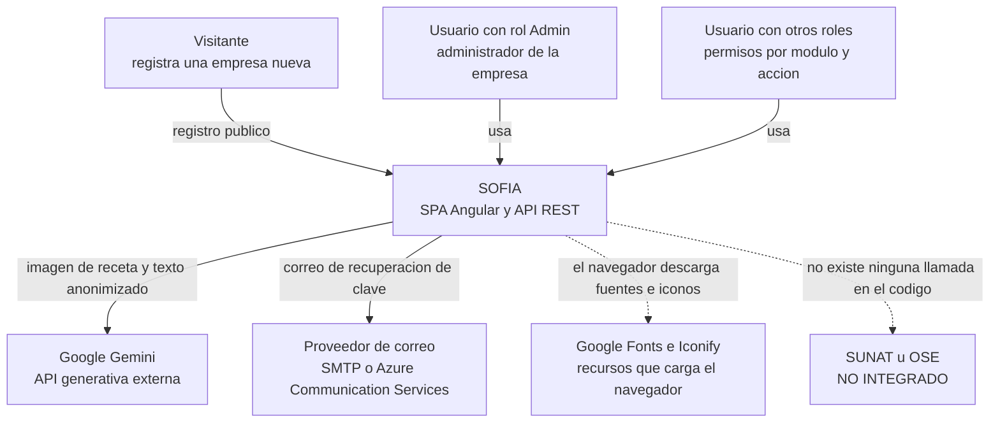
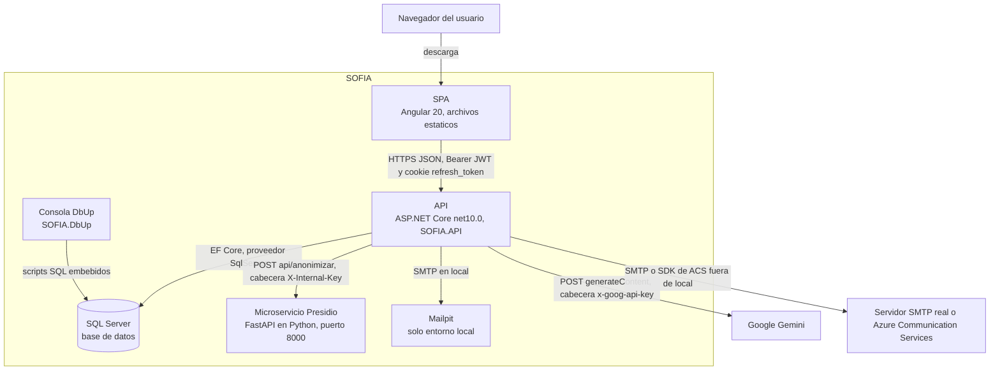
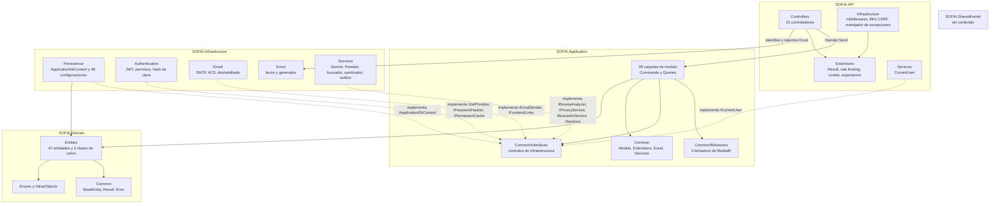
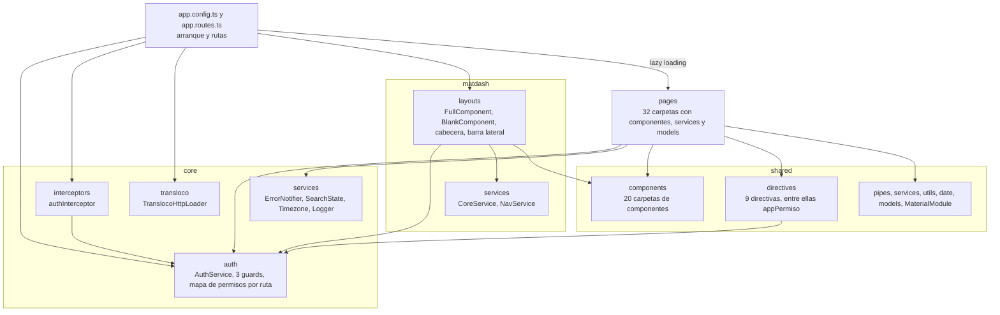
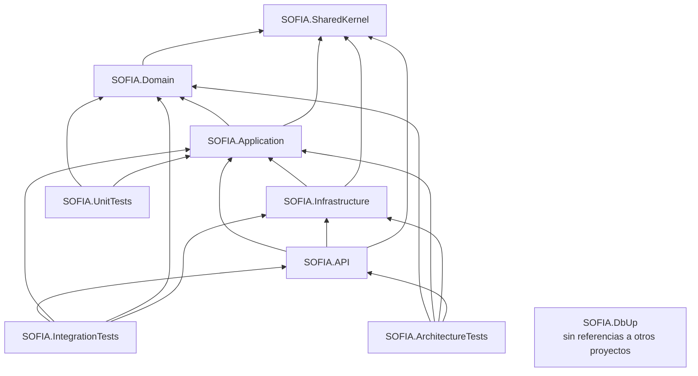
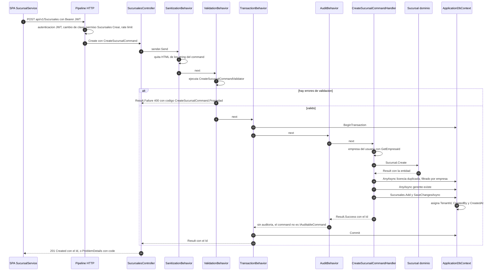
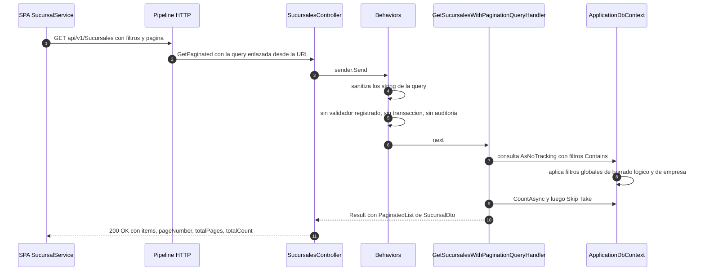
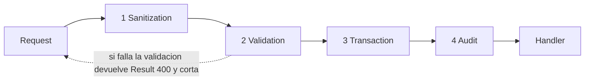
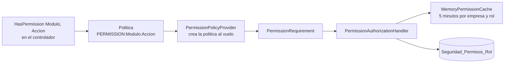

# Arquitectura de software de SOFIA

| | |
|---|---|
| **Sistema** | SOFIA — Sistema Optimizado Farmacéutico con Inteligencia Artificial |
| **Versión del documento** | 1.0 |
| **Fecha** | 2026-10-06 |
| **Backend** | `sofia-apis`, rama `main`, commit `00991bc` |
| **Frontend** | `sofia-web-spa`, rama `main`, commit `31af681` |
| **Método** | Lectura de código fuente (sin compilar, sin ejecutar la aplicación ni llamar a la API). Conteos tomados de `docs/_inventario/*.csv` y contrastados con el árbol de archivos |

Este documento describe la arquitectura que el código implementa hoy. No describe la arquitectura deseada. Cada afirmación lleva su `archivo:línea`. Las rutas son relativas a la carpeta que contiene los dos repositorios (`sofia-apis` y `sofia-web-spa`).

Alcance: mecanismos transversales. No repite el diccionario de datos, el catálogo de reglas de negocio ni la matriz de permisos; esos temas tienen sus propios documentos en `docs/ola-1-fundamentos/`.

## 1. Visión general y stack

### 1.1 Qué es

SOFIA es una aplicación web de dos piezas desplegables más servicios de apoyo:

- Un **SPA Angular** (`sofia-web-spa`) que el navegador descarga como archivos estáticos.
- Una **API REST ASP.NET Core** (`sofia-apis/src/SOFIA.API`) con autenticación JWT, organizada en capas de Clean Architecture y CQRS con MediatR.
- Una base de datos **SQL Server** cuyo esquema lo crea y evoluciona una consola **DbUp** (`sofia-apis/src/SOFIA.DbUp`); Entity Framework Core no ejecuta migraciones.
- Un microservicio Python **Presidio** (`sofia-apis/src/SOFIA.PresidioAPI`) que anonimiza el texto de las recetas antes de enviarlo a un modelo externo.
- Integraciones salientes: **Google Gemini** (lectura de recetas) y **correo** (SMTP o Azure Communication Services) para la recuperación de contraseña.

Es multiempresa (cada fila pertenece a una empresa mediante `TenantId`) y multisucursal (cada cuenta opera sobre un conjunto de sucursales permitidas). Ver secciones 7 y 8.

### 1.2 Los 10 proyectos de `sofia-apis/src`

| # | Proyecto | Tipo | Qué es | Evidencia |
|---|---|---|---|---|
| 1 | `SOFIA.SharedKernel` | Biblioteca .NET | Proyecto casi vacío: solo expone `AddSharedKernel()`, que no registra nada | `sofia-apis/src/SOFIA.SharedKernel/DependencyInjection.cs:5-7` |
| 2 | `SOFIA.Domain` | Biblioteca .NET | Entidades, enums, objetos de valor, `Result`/`Error`, `BaseEntity` | `sofia-apis/src/SOFIA.Domain/Common/BaseEntity.cs:3`, `sofia-apis/src/SOFIA.Domain/Common/Result.cs:5` |
| 3 | `SOFIA.Application` | Biblioteca .NET | Commands, queries, validadores, handlers, behaviors de MediatR, interfaces de infraestructura | `sofia-apis/src/SOFIA.Application/DependencyInjection.cs:11-27` |
| 4 | `SOFIA.Infrastructure` | Biblioteca .NET | `ApplicationDbContext`, configuraciones EF, JWT, permisos, correo, Excel, Gemini, Presidio, outbox | `sofia-apis/src/SOFIA.Infrastructure/DependencyInjection.cs:28-154` |
| 5 | `SOFIA.API` | Aplicación web (`Microsoft.NET.Sdk.Web`) | Controladores, middlewares, extensiones, `Program.cs` | `sofia-apis/src/SOFIA.API/SOFIA.API.csproj:1`, `sofia-apis/src/SOFIA.API/Program.cs:16-145` |
| 6 | `SOFIA.DbUp` | Consola (`OutputType` `Exe`) | Ejecuta los scripts SQL embebidos contra SQL Server | `sofia-apis/src/SOFIA.DbUp/SOFIA.DbUp.csproj:4,19`, `sofia-apis/src/SOFIA.DbUp/Program.cs:25-34` |
| 7 | `SOFIA.UnitTests` | Pruebas xUnit | Pruebas de dominio y de aplicación con Moq | `sofia-apis/src/SOFIA.UnitTests/SOFIA.UnitTests.csproj:11-17,25-26` |
| 8 | `SOFIA.IntegrationTests` | Pruebas xUnit | Pruebas contra la API con `Microsoft.AspNetCore.Mvc.Testing` y `Testcontainers.MsSql` | `sofia-apis/src/SOFIA.IntegrationTests/SOFIA.IntegrationTests.csproj:16,18` |
| 9 | `SOFIA.ArchitectureTests` | Pruebas xUnit | Tres reglas de arquitectura con NetArchTest y reflexión | `sofia-apis/src/SOFIA.ArchitectureTests/ArchitectureTests.cs:16-74` |
| 10 | `SOFIA.PresidioAPI` | Servicio Python (FastAPI). No es un proyecto .NET y no está en la solución | Anonimización de texto | `sofia-apis/src/SOFIA.PresidioAPI/main.py:15,103-116`; la solución lista 9 proyectos: `sofia-apis/SOFIA.Solution.slnx:2-10` |

### 1.3 Stack del backend (versiones leídas de los archivos de proyecto)

Todos los proyectos .NET apuntan a `net10.0` (`sofia-apis/src/SOFIA.API/SOFIA.API.csproj:4`, `SOFIA.Application.csproj:20`, `SOFIA.Domain.csproj:21`, `SOFIA.Infrastructure.csproj:24`, `SOFIA.SharedKernel.csproj:4`, `SOFIA.DbUp.csproj:5`, `SOFIA.UnitTests.csproj:4`, `SOFIA.IntegrationTests.csproj:4`, `SOFIA.ArchitectureTests.csproj:4`). Ningún `.csproj` ni `Directory.Build.props` fija `LangVersion`: la versión de C# es la predeterminada del SDK para `net10.0`. No existe `global.json` en la raíz del repositorio (verificado con búsqueda de archivos).

| Paquete | Versión | Proyecto | Evidencia |
|---|---|---|---|
| MediatR | 14.1.0 | Application | `sofia-apis/src/SOFIA.Application/SOFIA.Application.csproj:9` |
| FluentValidation.DependencyInjectionExtensions | 11.11.0 | Application | `SOFIA.Application.csproj:10` |
| Microsoft.EntityFrameworkCore | 10.0.7 | Application e Infrastructure | `SOFIA.Application.csproj:11`, `sofia-apis/src/SOFIA.Infrastructure/SOFIA.Infrastructure.csproj:15` |
| Microsoft.EntityFrameworkCore.SqlServer | 10.0.7 | Infrastructure | `SOFIA.Infrastructure.csproj:16` |
| Microsoft.AspNetCore.Authentication.JwtBearer | 10.0.7 | Infrastructure | `SOFIA.Infrastructure.csproj:14` |
| System.IdentityModel.Tokens.Jwt / Microsoft.IdentityModel.Tokens | 8.18.0 | Infrastructure | `SOFIA.Infrastructure.csproj:19-20` |
| BCrypt.Net-Next | 4.1.0 | Infrastructure | `SOFIA.Infrastructure.csproj:10` |
| HtmlSanitizer | 9.2.1039 | Infrastructure | `SOFIA.Infrastructure.csproj:12` |
| ClosedXML | 0.104.2 | Infrastructure | `SOFIA.Infrastructure.csproj:11` |
| MailKit | 4.18.1 | Infrastructure | `SOFIA.Infrastructure.csproj:13` |
| Azure.Communication.Email | 1.1.0 | Infrastructure | `SOFIA.Infrastructure.csproj:9` |
| Microsoft.Extensions.Http | 10.0.8 | Infrastructure | `SOFIA.Infrastructure.csproj:18` |
| Microsoft.Extensions.DependencyInjection.Abstractions | 10.0.7 (Domain, Application, SharedKernel) y 10.0.8 (Infrastructure) | varios | `sofia-apis/src/SOFIA.Domain/SOFIA.Domain.csproj:8`, `SOFIA.Application.csproj:12`, `sofia-apis/src/SOFIA.SharedKernel/SOFIA.SharedKernel.csproj:15`, `SOFIA.Infrastructure.csproj:17` |
| Asp.Versioning.Http | 10.0.0 | API | `sofia-apis/src/SOFIA.API/SOFIA.API.csproj:16` |
| Serilog.AspNetCore | 9.0.0 | API | `SOFIA.API.csproj:17` |
| Serilog.Sinks.File | 7.0.0 | API | `SOFIA.API.csproj:18` |
| Serilog.Enrichers.Environment | 3.0.0 | API | `SOFIA.API.csproj:19` |
| dbup-sqlserver | 7.2.0 | DbUp | `sofia-apis/src/SOFIA.DbUp/SOFIA.DbUp.csproj:12` |
| Microsoft.Extensions.Configuration.Json / EnvironmentVariables / UserSecrets | 10.0.7 | DbUp | `SOFIA.DbUp.csproj:13-15` |
| SonarAnalyzer.CSharp (analizador en compilación) | 9.32.0.97167 | Todos salvo proyectos `*Tests` y `DbUp` | `sofia-apis/src/Directory.Build.props:8-9,12-16` |
| xunit | 2.9.3 | Los tres proyectos de prueba | `sofia-apis/src/SOFIA.UnitTests/SOFIA.UnitTests.csproj:16`, `SOFIA.IntegrationTests.csproj:19`, `SOFIA.ArchitectureTests.csproj:20` |
| xunit.runner.visualstudio | 3.1.4 | Los tres proyectos de prueba | `SOFIA.UnitTests.csproj:17` |
| Microsoft.NET.Test.Sdk | 17.14.1 | Los tres proyectos de prueba | `SOFIA.UnitTests.csproj:13` |
| coverlet.collector | 6.0.4 | Los tres proyectos de prueba | `SOFIA.UnitTests.csproj:11` |
| Moq | 4.20.72 | UnitTests | `SOFIA.UnitTests.csproj:15` |
| MockQueryable.Moq | 10.0.8 | UnitTests | `SOFIA.UnitTests.csproj:14` |
| FluentAssertions | 8.10.0 | UnitTests e IntegrationTests | `SOFIA.UnitTests.csproj:12`, `sofia-apis/src/SOFIA.IntegrationTests/SOFIA.IntegrationTests.csproj:15` |
| Microsoft.AspNetCore.Mvc.Testing | 10.0.7 | IntegrationTests | `SOFIA.IntegrationTests.csproj:16` |
| Testcontainers.MsSql | 4.15.0 | IntegrationTests | `SOFIA.IntegrationTests.csproj:18` |
| NetArchTest.eNhancedEdition | 1.4.5 | ArchitectureTests | `sofia-apis/src/SOFIA.ArchitectureTests/SOFIA.ArchitectureTests.csproj:19` |
| Husky.Net (herramienta local `husky`) | 0.9.1 | Raíz del repositorio | `sofia-apis/dotnet-tools.json:5-6` |

Imágenes de contenedor declaradas: `mcr.microsoft.com/dotnet/aspnet:10.0` y `sdk:10.0` para la API (`sofia-apis/src/SOFIA.API/Dockerfile:1,6`), `mcr.microsoft.com/dotnet/runtime:10.0` para DbUp (`sofia-apis/src/SOFIA.DbUp/Dockerfile:11`), `mcr.microsoft.com/mssql/server:2022-latest` (`sofia-apis/docker-compose.yml:4`) y `axllent/mailpit:v1.31.3` (`sofia-apis/docker-compose.yml:85`).

### 1.4 Stack del microservicio Presidio

| Componente | Versión | Evidencia |
|---|---|---|
| Python (imagen base) | 3.10.21-slim, fijada por digest | `sofia-apis/src/SOFIA.PresidioAPI/Dockerfile:1` |
| fastapi | 0.142.1 | `sofia-apis/src/SOFIA.PresidioAPI/requirements.txt:1` |
| uvicorn | 0.54.0 | `requirements.txt:2` |
| presidio-analyzer | 2.2.351 | `requirements.txt:3` |
| presidio-anonymizer | 2.2.351 | `requirements.txt:4` |
| spacy | 3.7.5 | `requirements.txt:5` |
| pydantic | 2.13.5 | `requirements.txt:6` |
| Modelo spaCy `es_core_news_md` | 3.7.0, instalado con verificación de hash | `sofia-apis/src/SOFIA.PresidioAPI/requirements-model.txt:1`, `Dockerfile:11` |

### 1.5 Stack del SPA

| Paquete | Versión declarada | Evidencia |
|---|---|---|
| @angular/core, common, compiler, forms, router, animations, platform-browser, platform-browser-dynamic | ~20.3.32 | `sofia-web-spa/package.json:19,21-24,26-28` |
| @angular/material, @angular/cdk | ~20.2.14 | `sofia-web-spa/package.json:20,25` |
| @angular/cli, @angular-devkit/build-angular | ~20.3.37 | `sofia-web-spa/package.json:39,42` |
| @jsverse/transloco | ^7.6.1 | `sofia-web-spa/package.json:30` |
| rxjs | ~7.8.2 | `sofia-web-spa/package.json:33` |
| zone.js | ~0.15.1 | `sofia-web-spa/package.json:36` |
| typescript | ~5.8.3 | `sofia-web-spa/package.json:63` |
| angular-tabler-icons | ^3.26.0 | `sofia-web-spa/package.json:31` |
| @iconify/iconify | 2.0.3 | `sofia-web-spa/package.json:29` |
| ngx-scrollbar | ^19.1.5 | `sofia-web-spa/package.json:32` |
| sass | ^1.97.3 | `sofia-web-spa/package.json:34` |
| karma / jasmine-core | ~6.4.0 / ~5.6.0 | `sofia-web-spa/package.json:54-55` |
| eslint / typescript-eslint / angular-eslint | ^9.39.3 / ^8.56.1 / ^20.7.0 | `sofia-web-spa/package.json:48-49,64` |
| prettier | ^3.8.3 | `sofia-web-spa/package.json:61` |
| husky / lint-staged / @commitlint/cli | ^8.0.3 / ^16.3.1 / ^19.8.1 | `sofia-web-spa/package.json:44,53,60` |

No hay librería de manejo de estado (NgRx u otra) entre las dependencias (`sofia-web-spa/package.json:18-37`); el estado se maneja con signals y servicios (sección 11.5).

## 2. Modelo C4

Los diagramas usan `flowchart` de Mermaid con los tres primeros niveles de C4. Las flechas indican quién inicia la comunicación. El detalle de cada integración está en [07-integraciones.md](07-integraciones.md); aquí solo se ubica cada pieza.

### 2.1 Nivel 1: contexto



**Actores**

| Actor | Evidencia en el código |
|---|---|
| Visitante que registra una empresa | Ruta pública `auth/register` del SPA (`sofia-web-spa/src/app/app.routes.ts:15-21`) y endpoint anónimo `POST api/v1/Empresas/registrar` (`sofia-apis/src/SOFIA.API/Controllers/EmpresasController.cs:19-22`). El handler crea empresa, sucursal, empleado, cuenta y un rol `Admin` propio de esa empresa (`sofia-apis/src/SOFIA.Application/Empresas/Commands/RegistrarEmpresa/RegistrarEmpresaCommandHandler.cs:54-62,113-114`) |
| Usuario con rol `Admin` | El nombre del rol es la constante `Rol.AdminRoleName = "Admin"` (`sofia-apis/src/SOFIA.Domain/Entities/Rol.cs:10`). Ese rol salta la comprobación de permisos (`sofia-apis/src/SOFIA.Infrastructure/Authentication/PermissionAuthorizationHandler.cs:31-36`) y ve todas las sucursales de su empresa (`sofia-apis/src/SOFIA.Application/Common/Services/SucursalAccess.cs:19`) |
| Usuarios con otros roles | Cualquier rol con permisos `Módulo:Acción`; el handler los lee por nombre de rol (`PermissionAuthorizationHandler.cs:44-55,68-72`) |

**Roles sembrados.** El script `sofia-apis/src/SOFIA.DbUp/Scripts/0002_SeedBaseRoles.sql:5-39` inserta seis roles: `Admin`, `Gerente`, `Farmaceutico`, `Tecnico`, `Cajero` y `Auditor`. Ese script corre antes de que exista la columna `TenantId` (la agrega `0005_Empresa_MultiTenant.sql:54-62`) y ningún script posterior le asigna valor (búsqueda de `SET TenantId` en `Scripts/*.sql`: sin resultados). El filtro global de empresa descarta las filas con `TenantId` nulo (`sofia-apis/src/SOFIA.Infrastructure/Persistence/ApplicationDbContext.cs:98-109`). Lo que se deduce del código: esos seis roles sembrados no son visibles para ninguna empresa a través de la API, y el único rol que recibe una empresa al registrarse es su propio `Admin` (`RegistrarEmpresaCommandHandler.cs:113-114`). **No verificado** contra la base de datos.

**Sistemas externos**

| Sistema | Estado | Evidencia |
|---|---|---|
| Google Gemini | Integrado. Dos llamadas `generateContent`: OCR de la imagen y razonamiento sobre el texto anonimizado | `sofia-apis/src/SOFIA.Infrastructure/Services/GeminiRecetaAnalyzer.cs:38,54,66-68,91,106-108,167`; cliente registrado en `sofia-apis/src/SOFIA.Infrastructure/DependencyInjection.cs:143` |
| Correo por SMTP | Integrado con MailKit | `sofia-apis/src/SOFIA.Infrastructure/Email/SmtpEmailSender.cs:24-32`; selección en `DependencyInjection.cs:177-180` |
| Azure Communication Services (correo) | Integrado como proveedor alternativo | `sofia-apis/src/SOFIA.Infrastructure/Email/AzureCommunicationEmailSender.cs:21`; selección en `DependencyInjection.cs:181-185` |
| Google Fonts e Iconify | Los carga el navegador; no pasan por la API | `sofia-web-spa/src/index.html:11-17`, `sofia-web-spa/angular.json:47`, `sofia-web-spa/public/staticwebapp.config.json:3` |
| SUNAT / OSE / PSE | **No integrado.** Los comprobantes se generan y numeran dentro de SOFIA, pero no se envían a ningún servicio | Solo hay dos `HttpClient` registrados, Presidio y Gemini (`DependencyInjection.cs:142-143`); el archivo de estados indica que `Aceptado` y `Rechazado` quedan reservados para la futura integración OSE/PSE (`sofia-apis/src/SOFIA.Domain/Enums/EstadoComprobanteSunat.cs:3`); los comprobantes nacen como `NoEnviado` (`sofia-apis/src/SOFIA.Application/Ventas/Common/VentaComprobanteGenerator.cs:55,69`, `sofia-apis/src/SOFIA.Application/Devoluciones/Commands/ProcesarDevolucion/ProcesarDevolucionCommandHandler.cs:206`) |

Presidio no es un sistema externo: es un contenedor propio de SOFIA (sección 2.2).

### 2.2 Nivel 2: contenedores



| Contenedor | Tecnología | Responsabilidad | Evidencia |
|---|---|---|---|
| SPA | Angular con componentes standalone | Interfaz de usuario; arranca con `bootstrapApplication` | `sofia-web-spa/src/main.ts:5`, `sofia-web-spa/src/app/app.config.ts:29-63` |
| API | ASP.NET Core, controladores MVC, versión en la ruta (`api/v{version}`) | Único punto de entrada a los datos | `sofia-apis/src/SOFIA.API/Program.cs:67-73,134`, `sofia-apis/src/SOFIA.API/Controllers/SucursalesController.cs:14-16` |
| Base de datos | SQL Server (imagen `2022-latest` en `docker-compose`) | Persistencia; el esquema lo define DbUp | `sofia-apis/docker-compose.yml:3-19`, `sofia-apis/src/SOFIA.Infrastructure/DependencyInjection.cs:32` |
| Consola DbUp | Consola .NET con `dbup-sqlserver` | Crea la base si no existe y ejecuta los scripts `Scripts\*.sql` embebidos; termina con `-1` si falla | `sofia-apis/src/SOFIA.DbUp/Program.cs:25-45`, `sofia-apis/src/SOFIA.DbUp/SOFIA.DbUp.csproj:19` |
| Presidio | FastAPI, presidio-analyzer y spaCy | Anonimiza texto en español; agrega reconocedores de DNI, RUC y celular peruanos; valida una clave compartida opcional | `sofia-apis/src/SOFIA.PresidioAPI/main.py:18-21,24-26,63-91,103-116` |
| Mailpit | Imagen `axllent/mailpit` | Atrapa los correos en local; solo existe en `docker-compose` | `sofia-apis/docker-compose.yml:83-89` |

Puertos en `docker-compose`: SQL Server `127.0.0.1:1434` (`docker-compose.yml:11`), Presidio `127.0.0.1:8001` (`:29`), API `127.0.0.1:5000` (`:43`), Mailpit `127.0.0.1:1025` y `:8025` (`:88-89`); `sofia-dbup` no publica puerto (`:91-101`). Fuera de Docker la API usa `http://localhost:5300` y `https://localhost:7300` (`sofia-apis/src/SOFIA.API/Properties/launchSettings.json:8,17`); el SPA de desarrollo apunta a `https://localhost:7300` (`sofia-web-spa/src/environments/environment.local.ts:7`) y sirve en el puerto 4200 (`sofia-web-spa/angular.json:109-110`).

El SPA no tiene servicio en `docker-compose` (los únicos servicios son `sqlserver`, `presidio-api`, `sofia-api`, `mailpit` y `sofia-dbup`: `docker-compose.yml:3,21,37,84,91`). Existe un archivo de cabeceras para Azure Static Web Apps (`sofia-web-spa/public/staticwebapp.config.json:1-10`). El destino real de despliegue del SPA es **No verificado**: no hay pipeline de despliegue en los repositorios (`sofia-apis/.github/workflows` solo contiene `security.yml`; `sofia-web-spa` no tiene carpeta `.github`).

### 2.3 Nivel 3: componentes de la API



**SOFIA.API** (`sofia-apis/src/SOFIA.API`): todos sus middlewares, filtros, atributos y extensiones

| Carpeta | Elemento | Qué hace | Evidencia |
|---|---|---|---|
| `Controllers` | 31 controladores, uno por módulo | Reciben HTTP y delegan en `ISender` | Ejemplo: `Controllers/SucursalesController.cs:17,118` |
| `Extensions` | `ResultExtensions` | Convierte `Result` en `IActionResult` y en `ProblemDetails` (sección 6) | `Extensions/ResultExtensions.cs:7-23` |
| `Extensions` | `RateLimitingExtensions` | Limitador global y tres políticas con nombre (sección 13.2) | `Extensions/RateLimitingExtensions.cs:12-50` |
| `Extensions` | `RefreshTokenCookieExtensions` | Escribe y borra la cookie `refresh_token` (sección 9.2) | `Extensions/RefreshTokenCookieExtensions.cs:5-21` |
| `Extensions` | `ExportExtensions` | Detecta exportaciones que superan el máximo de filas y arma el error `Export.TooManyRows` | `Extensions/ExportExtensions.cs:8-13` |
| `Infrastructure` | `GlobalExceptionHandler` | Traduce excepciones a `ProblemDetails` (sección 6.4) | `Infrastructure/GlobalExceptionHandler.cs:23-80` |
| `Infrastructure` | `SecurityHeadersMiddleware` | Cabeceras de seguridad en cada respuesta (sección 13.1) | `Infrastructure/SecurityHeadersMiddleware.cs:8-25` |
| `Infrastructure` | `PasswordChangeRequiredMiddleware` | Responde 403 a toda llamada autenticada mientras la cuenta deba cambiar su clave (sección 9.4) | `Infrastructure/PasswordChangeRequiredMiddleware.cs:12-27` |
| `Infrastructure` | `AllowDuringPasswordChangeAttribute` | Marca los endpoints que el middleware anterior deja pasar | `Infrastructure/AllowDuringPasswordChangeAttribute.cs:4-5`; usos en `Controllers/AuthController.cs:55,87` |
| `Infrastructure` | `RequireCsrfHeaderAttribute` | Filtro de autorización que exige la cabecera `X-SOFIA-CSRF` | `Infrastructure/RequireCsrfHeaderAttribute.cs:9-31`; usos en `Controllers/AuthController.cs:35,72` |
| `Infrastructure` | `ExportHeadersAttribute` | Valida los títulos de columna de una exportación: máximo 50 títulos de hasta 100 caracteres | `Infrastructure/ExportHeadersAttribute.cs:9-17` |
| `Infrastructure` | `ExportDateFormatAttribute` | Solo acepta cuatro formatos de fecha para exportar | `Infrastructure/ExportDateFormatAttribute.cs:9,13` |
| `Infrastructure` | `ExportLabelAttribute` | Limita a 20 caracteres una etiqueta que se repite en cada fila exportada | `Infrastructure/ExportLabelAttribute.cs:9,13` |
| `Services` | `CurrentUser` | Lee del JWT el empleado, la cuenta, el usuario, la sucursal, la empresa y los roles, y la IP de la conexión | `Services/CurrentUser.cs:8-32` |
| raíz | `Program.cs` | Composición de servicios y pipeline HTTP (sección 9.5) | `Program.cs:16-145` |
| raíz | `GlobalUsings.cs` | `using` globales, entre ellos `SOFIA.Infrastructure.Authentication` | `GlobalUsings.cs:1-16` |

**SOFIA.Application** (`sofia-apis/src/SOFIA.Application`)

| Carpeta | Contenido | Evidencia |
|---|---|---|
| 28 carpetas de módulo: `Auditoria`, `DIGEMID`, `Dashboard`, `Delivery`, `Devoluciones`, `Empleados`, `Empresas`, `FormulacionesClinicas`, `IngredientesActivos`, `Inventarios`, `JerarquiasUoM`, `Laboratorios`, `Magistrales`, `Medicamentos`, `POS`, `Pacientes`, `PresentacionesVenta`, `Profesionales`, `Proveedores`, `Recetas`, `Security`, `Seguros`, `SeriesFiscales`, `Servicios`, `Sucursales`, `Transferencias`, `UnidadesMedida`, `Ventas` | `Commands/<Caso>/` y `Queries/<Caso>/` (sección 4) | Listado del directorio; ejemplo `Sucursales/Commands/CreateSucursal/CreateSucursalCommand.cs:9` |
| `Common/Behaviors` | Los cuatro behaviors del pipeline (sección 5) | `Common/Behaviors/SanitizationBehavior.cs:6`, `ValidationBehavior.cs:6`, `TransactionBehavior.cs:10`, `AuditBehavior.cs:10` |
| `Common/Interfaces` | 14 archivos: `IApplicationDbContext`, `ICommand`, `IAuditableCommand`, `ICurrentUser`, `ISucursalAccess`, `IJwtProvider`, `IPasswordHasher`, `IPermissionCache`, `IEmailSender`, `IFrontendLinks`, `IPrivacyService`, `IRecetaAnalyzer`, `IBuscadorService`, `ISanitizer` | Listado de `Common/Interfaces` |
| `Common/Models` | `PaginatedList`, `PaginationLimits`, `QueryFilters`, `AuditEntry`, `AuditEventos`, `AuditTablas`, `EmailMessage` | `Common/Models/PaginatedList.cs:5`, `PaginationLimits.cs:6`, `QueryFilters.cs:8,11` |
| `Common/Extensions` | `CurrentUserExtensions`, `QueryableExtensions`, `DbUpdateExceptionExtensions`, `PermissionCacheExtensions` | `Common/Extensions/CurrentUserExtensions.cs:8,23,38`, `QueryableExtensions.cs:8,41` |
| `Common/Excel` | Contratos y límites de la carga masiva | `Common/Excel/ImportLimits.cs:6-12`, `ExcelImportException.cs:6-12` |
| `Common/Services` | `SucursalAccess` (sección 8) | `Common/Services/SucursalAccess.cs:7` |
| `Security` | Login, refresh, logout, cambio y recuperación de clave, cuentas y roles; plantillas de correo embebidas | `Security/Commands/Login/LoginCommandHandler.cs:25`, `SOFIA.Application.csproj:16` |
| `Ventas/Events` | Único evento de dominio: `VentaCompletadaEvent` | `Ventas/Events/VentaCompletadaEvent.cs:6` |

**SOFIA.Domain** (`sofia-apis/src/SOFIA.Domain`)

| Carpeta | Contenido | Evidencia |
|---|---|---|
| `Common` | `BaseEntity<TId>`, `BaseEntity`, `IAuditableEntity`, `IDomainEvent`, `Result`, `Result<T>`, `Error`, `ErrorType`, `EnumExtensions` | `Common/BaseEntity.cs:3,26`, `Common/Result.cs:5,36`, `Common/Error.cs:3,16` |
| `Entities` | 50 archivos: 47 entidades que heredan de `BaseEntity` y 3 clases de unión sin clase base (`CuentaRol`, `CuentaSucursal`, `RolSucursal`) | `Entities/CuentaRol.cs:3`, `Entities/CuentaSucursal.cs:3`, `Entities/RolSucursal.cs:3` |
| `Enums` | 12 archivos de enums y constantes | Ejemplo `Enums/EstadoComprobanteSunat.cs:4` |
| `ValueObjects` | `Ruc` | Uso en `Entities/Empresa.cs:19` |

**SOFIA.Infrastructure** (`sofia-apis/src/SOFIA.Infrastructure`): todos sus servicios

| Carpeta | Clase | Implementa | Ciclo de vida | Qué hace | Evidencia |
|---|---|---|---|---|---|
| `Persistence` | `ApplicationDbContext` | `IApplicationDbContext` | Scoped | Contexto EF, filtros globales, auditoría de campos, outbox (secciones 7 y 10) | `Persistence/ApplicationDbContext.cs:12-13`; registro `DependencyInjection.cs:30,41` |
| `Persistence/Configurations` | 48 clases `IEntityTypeConfiguration<T>` | — | — | Mapeo a tablas y columnas | Ejemplo `Persistence/Configurations/SucursalConfiguration.cs:7-44` |
| `Persistence/Converters` | `EnumDescriptionConverter<TEnum>` | — | — | Guarda un enum como el texto de su `[Description]` | `Persistence/Converters/EnumDescriptionConverter.cs:6-13` |
| `Authentication` | `JwtProvider` | `IJwtProvider` | Scoped | Emite el token de acceso (sección 9.1) | `Authentication/JwtProvider.cs:16-61`; registro `DependencyInjection.cs:51` |
| `Authentication` | `JwtOptions` | — | Opciones | Sección `Jwt` y su validación de arranque | `Authentication/JwtOptions.cs:10-31` |
| `Authentication` | `PasswordHasher` | `IPasswordHasher` | Scoped | BCrypt en modo «enhanced» | `Authentication/PasswordHasher.cs:7-10`; registro `DependencyInjection.cs:50` |
| `Authentication` | `HasPermissionAttribute` | — | — | Atributo que genera la política `PERMISSION:Módulo:Acción` | `Authentication/HasPermissionAttribute.cs:5-6` |
| `Authentication` | `PermissionPolicyProvider` | `IAuthorizationPolicyProvider` | Singleton | Construye la política a partir del nombre | `Authentication/PermissionPolicyProvider.cs:15-38`; registro `DependencyInjection.cs:137` |
| `Authentication` | `PermissionRequirement` | `IAuthorizationRequirement` | — | Par módulo y acción | `Authentication/PermissionRequirement.cs:8-12` |
| `Authentication` | `PermissionAuthorizationHandler` | `IAuthorizationHandler` | Scoped | Decide si el usuario tiene el permiso (sección 9.3) | `Authentication/PermissionAuthorizationHandler.cs:17-56`; registro `DependencyInjection.cs:138` |
| `Authentication` | `MemoryPermissionCache` | `IPermissionCache` | Singleton | Caché de permisos por empresa y rol, 5 minutos | `Authentication/MemoryPermissionCache.cs:9,20`; registro `DependencyInjection.cs:136` |
| `Email` | `SmtpEmailSender` | `IEmailSender` | Singleton | Envío por SMTP con MailKit | `Email/SmtpEmailSender.cs:16-48`; registro `DependencyInjection.cs:179` |
| `Email` | `AzureCommunicationEmailSender` | `IEmailSender` | Singleton | Envío por Azure Communication Services | `Email/AzureCommunicationEmailSender.cs:14-37`; registro `DependencyInjection.cs:183-184` |
| `Email` | `DisabledEmailSender` | `IEmailSender` | Singleton | Descarta el mensaje y devuelve `Email.Disabled`; solo en Development o Testing | `Email/DisabledEmailSender.cs:11-15`; registro `DependencyInjection.cs:173-175` |
| `Email` | `EmailOptions`, `SmtpSettings`, `AzureCommunicationSettings` | — | Opciones | Sección `Email` y su validación | `Email/EmailOptions.cs:10-61,64-77` |
| `Email` | `AppOptions` | — | Opciones | Sección `App` (`FrontendBaseUrl`) | `Email/AppOptions.cs:7-16` |
| `Email` | `FrontendLinks` | `IFrontendLinks` | Singleton | Arma el enlace de restablecimiento con el token en el fragmento de la URL | `Email/FrontendLinks.cs:8-9`; registro `DependencyInjection.cs:171` |
| `Excel` | `ExcelReaderService` | `IExcelReaderService` | Scoped | Lee `.xlsx` con defensas contra archivos maliciosos (sección 13.3) | `Excel/ExcelReaderService.cs:15-46`; registro `DependencyInjection.cs:44` |
| `Excel` | `ExcelTemplateGenerator` | — (clase estática) | — | Genera plantillas y reportes Excel | `Excel/ExcelTemplateGenerator.cs:11,22` |
| `Services` | `GeminiRecetaAnalyzer` | `IRecetaAnalyzer` | Cliente HTTP tipado | OCR, anonimización y razonamiento sobre recetas | `Services/GeminiRecetaAnalyzer.cs:23-62`; registro `DependencyInjection.cs:143` |
| `Services` | `PresidioPrivacyService` | `IPrivacyService` | Cliente HTTP tipado | Llama a `POST /api/anonimizar`; si falla lanza excepción, así el texto sin anonimizar nunca sale hacia Gemini | `Services/PresidioPrivacyService.cs:24-41`; registro `DependencyInjection.cs:142` |
| `Services` | `BuscadorFuzzyService` | `IBuscadorService` | Scoped | Búsqueda aproximada: hasta 50 candidatos por `Contains` y distancia de Levenshtein en memoria | `Services/BuscadorFuzzyService.cs:34,46-49,75,90-91`; registro `DependencyInjection.cs:144` |
| `Services` | `HtmlSanitizerService` | `ISanitizer` | Singleton | Quita todo HTML: no permite etiquetas, atributos, CSS ni esquemas | `Services/HtmlSanitizerService.cs:14-19`; registro `DependencyInjection.cs:47` |
| `Services` | `OutboxProcessor` | `BackgroundService` | Hosted service | Publica eventos pendientes del outbox cada 10 segundos (sección 10.6) | `Services/OutboxProcessor.cs:16-33`; registro `DependencyInjection.cs:139` |
| `Utils` | `StringUtils` | — (clase estática) | — | Distancia de Levenshtein y similitud | `Utils/StringUtils.cs:5,38` |
| raíz | `DependencyInjection` | — | — | `AddInfrastructure`: registra todo lo anterior y valida la configuración | `DependencyInjection.cs:28-154` |

### 2.4 Nivel 3: componentes del SPA



| Carpeta | Contenido | Evidencia |
|---|---|---|
| `core/auth` | `AuthService`, `authGuard`, `passwordChangeGuard`, `permissionGuard`, `route-permissions.ts`, `user-storage.ts` | `sofia-web-spa/src/app/core/auth/auth.service.ts:39`, `auth.guard.ts:6`, `password-change.guard.ts:8`, `permission.guard.ts:10` |
| `core/guards` | Carpeta **vacía**; los guards están en `core/auth` | Listado del directorio |
| `core/interceptors` | `authInterceptor` | `sofia-web-spa/src/app/core/interceptors/auth.interceptor.ts:23` |
| `core/services` | `ErrorNotifierService`, `SearchStateService`, `TimezoneService`, `LoggerService` y la interfaz `CatalogItemActive` | `core/services/shared/error-notifier.service.ts:14`, `search-state.service.ts:10`, `timezone.service.ts:7`, `core/services/logger.service.ts:4` |
| `core/responses` | Interfaces `ApiResponseEnvelope` y `EnvelopeError` | `core/responses/api-response-envelope.model.ts:3`, `common-error-response.ts:1` |
| `core/transloco` | `TranslocoHttpLoader` | `core/transloco/transloco-loader.ts:7-12` |
| `shared` | Componentes, directivas, pipes, utilidades, adaptador de fechas y `MaterialModule` (inventario en la sección 11.9) | `sofia-web-spa/src/app/shared/material.module.ts` |
| `matdash` | Plantilla de administración: `FullComponent` (marco con barra lateral y cabecera), `BlankComponent`, `CoreService`, `NavService`, `FilterPipe`, datos del menú | `matdash/layouts/full/full.component.ts:45`, `matdash/services/core.service.ts:8`, `matdash/layouts/full/vertical/sidebar/sidebar-data.ts:3` |
| `pages` | 32 carpetas de primer nivel; cada módulo enrutado tiene su `*.routes.ts` | Ejemplo `pages/sucursales/sucursales.routes.ts:3-26` |

## 3. Capas de Clean Architecture

### 3.1 Referencias entre proyectos (leídas de los `.csproj`)



| Proyecto | Referencia a | Evidencia |
|---|---|---|
| `SOFIA.SharedKernel` | Ninguno | `sofia-apis/src/SOFIA.SharedKernel/SOFIA.SharedKernel.csproj:14-16` (solo un paquete) |
| `SOFIA.Domain` | `SharedKernel` | `sofia-apis/src/SOFIA.Domain/SOFIA.Domain.csproj:4` |
| `SOFIA.Application` | `Domain`, `SharedKernel` | `sofia-apis/src/SOFIA.Application/SOFIA.Application.csproj:4-5` |
| `SOFIA.Infrastructure` | `Application`, `SharedKernel` (y `Domain` de forma transitiva) | `sofia-apis/src/SOFIA.Infrastructure/SOFIA.Infrastructure.csproj:4-5` |
| `SOFIA.API` | `Application`, `Infrastructure`, `SharedKernel` | `sofia-apis/src/SOFIA.API/SOFIA.API.csproj:23-25` |
| `SOFIA.DbUp` | Ninguno | `sofia-apis/src/SOFIA.DbUp/SOFIA.DbUp.csproj:11-16` (solo paquetes) |
| `SOFIA.UnitTests` | `Domain`, `Application` | `sofia-apis/src/SOFIA.UnitTests/SOFIA.UnitTests.csproj:25-26` |
| `SOFIA.IntegrationTests` | `API`, `Application`, `Domain`, `Infrastructure` | `sofia-apis/src/SOFIA.IntegrationTests/SOFIA.IntegrationTests.csproj:33-36` |
| `SOFIA.ArchitectureTests` | `Domain`, `Application`, `Infrastructure`, `API` | `sofia-apis/src/SOFIA.ArchitectureTests/SOFIA.ArchitectureTests.csproj:29-32` |

El orden de registro en el arranque sigue las capas: `AddSharedKernel`, `AddDomain`, `AddApplication`, `AddInfrastructure` (`sofia-apis/src/SOFIA.API/Program.cs:105-108`). `AddSharedKernel` y `AddDomain` no registran ningún servicio (`sofia-apis/src/SOFIA.SharedKernel/DependencyInjection.cs:5-7`, `sofia-apis/src/SOFIA.Domain/DependencyInjection.cs:5-7`).

### 3.2 Qué vive en cada capa

- **Dominio.** Entidades con constructor privado y métodos de fábrica que devuelven `Result` (ejemplo: `Sucursal.Create`, `sofia-apis/src/SOFIA.Domain/Entities/Sucursal.cs:7,23-54`). No conoce EF ni HTTP.
- **Aplicación.** Un handler por caso de uso. Los handlers usan `IApplicationDbContext` directamente con LINQ; no hay repositorios (ejemplo: `sofia-apis/src/SOFIA.Application/Sucursales/Commands/CreateSucursal/CreateSucursalCommandHandler.cs:32-46`).
- **Infraestructura.** Implementa las interfaces de `Application/Common/Interfaces` (tabla de la sección 2.3).
- **API.** Controladores delgados que envían el request a MediatR y traducen el `Result` (`sofia-apis/src/SOFIA.API/Controllers/SucursalesController.cs:116-122`).

### 3.3 Reglas que hacen cumplir las pruebas de arquitectura

`SOFIA.ArchitectureTests` tiene una sola clase con tres pruebas:

| Prueba | Regla | Evidencia |
|---|---|---|
| `Domain_Should_Not_Have_Dependency_On_Other_Projects` | Ningún tipo de `SOFIA.Domain` depende de los espacios de nombres `SOFIA.Application`, `SOFIA.Infrastructure` ni `SOFIA.API` | `sofia-apis/src/SOFIA.ArchitectureTests/ArchitectureTests.cs:16-36` |
| `Application_Should_Only_Depend_On_Domain` | Ningún tipo de `SOFIA.Application` depende de `SOFIA.Infrastructure` ni de `SOFIA.API` | `ArchitectureTests.cs:38-57` |
| `Controller_Actions_Should_Declare_Authorization` | Toda acción pública de un controlador con atributo HTTP declara `[HasPermission]`, `[Authorize]` o `[AllowAnonymous]`, en el método o en la clase | `ArchitectureTests.cs:59-77` |

El gancho `pre-commit` de Husky.Net ejecuta `dotnet test` sobre este proyecto en cada commit (`sofia-apis/.husky/task-runner.json`, tarea `architecture-tests`; `sofia-apis/.husky/pre-commit:22`). Los ganchos se instalan al restaurar `SOFIA.API` (`sofia-apis/src/SOFIA.API/SOFIA.API.csproj:29-32`). El detalle de ganchos y CI está en [08-guia-del-desarrollador.md](08-guia-del-desarrollador.md).

### 3.4 Excepciones y desviaciones observadas

Ninguna rompe las tres pruebas anteriores. Son desviaciones respecto de una Clean Architecture estricta que el código tiene hoy.

| # | Observación | Evidencia |
|---|---|---|
| 1 | La prueba `Application_Should_Only_Depend_On_Domain` solo prohíbe `Infrastructure` y `API`; no comprueba paquetes. `Application` depende de `Microsoft.EntityFrameworkCore` | `ArchitectureTests.cs:44-48`; `SOFIA.Application.csproj:11` |
| 2 | `IApplicationDbContext` expone tipos de EF Core (`DbSet<T>` y `DatabaseFacade`), así que los handlers quedan acoplados a EF | `sofia-apis/src/SOFIA.Application/Common/Interfaces/IApplicationDbContext.cs:1-2,9-10` |
| 3 | El dominio referencia `Microsoft.Extensions.DependencyInjection.Abstractions` solo para exponer un `AddDomain` vacío | `SOFIA.Domain.csproj:8`; `sofia-apis/src/SOFIA.Domain/DependencyInjection.cs:5-7` |
| 4 | El dominio abre sus miembros `internal` a `SOFIA.Infrastructure` y a `SOFIA.UnitTests` | `SOFIA.Domain.csproj:12-17`; miembro `BaseEntity.SetId`, `sofia-apis/src/SOFIA.Domain/Common/BaseEntity.cs:23` |
| 5 | Los controladores usan clases de `Infrastructure` sin una interfaz de `Application`: `ExcelTemplateGenerator` y el atributo `HasPermission` | `sofia-apis/src/SOFIA.API/Controllers/SucursalesController.cs:10,25,110`; `sofia-apis/src/SOFIA.API/GlobalUsings.cs:12` |
| 6 | Parte de la carga masiva y de la exportación vive en el controlador, fuera de MediatR: lee el Excel antes de enviar la query y arma las filas del reporte | `SucursalesController.cs:40-42,102-111` |
| 7 | El único evento de dominio está definido en `Application`, implementa `INotification` de MediatR y lo agregan los handlers, no la entidad | `sofia-apis/src/SOFIA.Application/Ventas/Events/VentaCompletadaEvent.cs:6`; `sofia-apis/src/SOFIA.Application/Ventas/Commands/CreateVenta/CreateVentaCommandHandler.cs:116`; `sofia-apis/src/SOFIA.Application/Ventas/Commands/CompletarVenta/CompletarVentaCommandHandler.cs:104` |
| 8 | Los campos de auditoría de `BaseEntity` tienen `set` público (los escribe el `DbContext`) | `sofia-apis/src/SOFIA.Domain/Common/BaseEntity.cs:9-15` |
| 9 | `SOFIA.SharedKernel` no contiene código compartido y `ArchitectureTests` no lo referencia | `sofia-apis/src/SOFIA.SharedKernel/DependencyInjection.cs:5-7`; `SOFIA.ArchitectureTests.csproj:29-32` |
| 10 | No hay prueba que impida a `Infrastructure` depender de `API`; lo impide solo la ausencia de referencia de proyecto | `SOFIA.Infrastructure.csproj:4-5` |
| 11 | `TreatWarningsAsErrors` es `true` en `Domain`, `SharedKernel` y `ArchitectureTests`, y `false` en `API`, `Application` e `Infrastructure` | `SOFIA.Domain.csproj:26`, `SOFIA.SharedKernel.csproj:9`, `SOFIA.ArchitectureTests.csproj:9`, `SOFIA.API.csproj:9`, `SOFIA.Application.csproj:25`, `SOFIA.Infrastructure.csproj:29` |

## 4. CQRS con MediatR

### 4.1 Convención de carpetas y archivos

Cada caso de uso tiene su carpeta dentro del módulo: `SOFIA.Application/<Módulo>/Commands/<Caso>/` o `.../Queries/<Caso>/`. Dentro, un archivo por tipo:

| Archivo | Contenido | Ejemplo real |
|---|---|---|
| `<Caso>Command.cs` | `record` que implementa `ICommand` o `ICommand<T>` | `sofia-apis/src/SOFIA.Application/Sucursales/Commands/CreateSucursal/CreateSucursalCommand.cs:9` |
| `<Caso>CommandValidator.cs` | `AbstractValidator<TCommand>` de FluentValidation | `.../CreateSucursal/CreateSucursalCommandValidator.cs:9-24` |
| `<Caso>CommandHandler.cs` | `IRequestHandler<TCommand, Result<T>>` | `.../CreateSucursal/CreateSucursalCommandHandler.cs:10` |
| `<Caso>Query.cs` | `record` que implementa `IRequest<...>` | `sofia-apis/src/SOFIA.Application/Sucursales/Queries/GetSucursalesWithPagination/GetSucursalesWithPaginationQuery.cs:9` |
| `<Caso>QueryHandler.cs` | `IRequestHandler<TQuery, ...>` | `.../GetSucursalesWithPagination/GetSucursalesWithPaginationQueryHandler.cs:9` |
| `<Caso>QueryValidator.cs` | Opcional; solo 11 queries lo tienen | `sofia-apis/src/SOFIA.Application/POS/Queries/GetSesiones/GetSesionesQueryValidator.cs` |

Los DTO de respuesta viven junto al módulo o junto al caso (`sofia-apis/src/SOFIA.Application/Sucursales/SucursalDto.cs`, `.../Queries/GetSucursalesPermitidas/SucursalPermitidaDto.cs`).

Las interfaces marcadoras están en `Common/Interfaces/ICommand.cs:8,11`: `ICommand : IRequest<Result>, IBaseCommand` e `ICommand<TResponse> : IRequest<Result<TResponse>>, IBaseCommand`. `IBaseCommand` es la marca que activa la transacción (`sofia-apis/src/SOFIA.Application/Common/Behaviors/TransactionBehavior.cs:8,16`). `IAuditableCommand` también hereda de `IBaseCommand` (`Common/Interfaces/IAuditableCommand.cs:7`).

Excepciones a «un archivo por tipo» que hay en el código: 17 archivos `*Command.cs` declaran más de un tipo (por ejemplo, el command de carga masiva junto con el `record` de la fila importada: `sofia-apis/src/SOFIA.Application/Sucursales/Commands/CargaMasivaSucursales/CargaMasivaSucursalesCommand.cs`; `CreateVentaCommand.cs` declara cuatro), y `GetSucursalesWithPaginationQuery.cs:18-22` declara además la clase estática `MappingExtensions`.

### 4.2 Registro

Todo se registra por reflexión sobre el ensamblado de `Application` (`sofia-apis/src/SOFIA.Application/DependencyInjection.cs`):

- Handlers: `cfg.RegisterServicesFromAssembly(Assembly.GetExecutingAssembly())` (línea 15).
- Behaviors: cuatro `AddOpenBehavior` (líneas 16-19).
- Validadores: `services.AddValidatorsFromAssembly(Assembly.GetExecutingAssembly())` (línea 24).
- `ISucursalAccess` como scoped (línea 22).

Los controladores reciben `ISender` por constructor (`sofia-apis/src/SOFIA.API/Controllers/SucursalesController.cs:17`).

### 4.3 Conteos reales

| Elemento | Cantidad | Cómo se contó |
|---|---|---|
| Commands | 113 | Archivos `*Command.cs` de `SOFIA.Application` sin contar `ICommand.cs` ni `IAuditableCommand.cs` |
| Queries | 89 | Archivos `*Query.cs`; coincide con `docs/_inventario/commands-queries.csv` (89 filas `Query`) |
| Handlers | 202 (113 de command y 89 de query) | Archivos `*CommandHandler.cs` y `*QueryHandler.cs` |
| Validadores | 83 (72 de command y 11 de query) | Archivos `*Validator.cs`; coincide con `docs/_inventario/validadores.csv` (83 filas) |
| Commands sin validador | 41 | Commands sin archivo `<Caso>CommandValidator.cs` en su carpeta |
| Commands auditables | 24 | Archivos `*Command.cs` que implementan `IAuditableCommand`; coincide con las 24 constantes de `Common/Models/AuditEventos.cs:6-29` |
| Queries que no devuelven `Result<T>` | 12 | Las 12 `PreviewImport*Query` (devuelven el resultado de la previsualización directamente) |

**Discrepancia con el inventario.** `commands-queries.csv` tiene 204 filas: 115 marcadas `Command` y 89 `Query`. Dos de las 115 no son commands sino las interfaces `IAuditableCommand` e `ICommand` (filas 3 y 4 del CSV). El número real de commands es 113.

De los 113 commands, 112 implementan `ICommand` o `ICommand<T>`. El restante, `SetRolSucursalesCommand`, implementa `IRequest<Result>, IAuditableCommand` (`sofia-apis/src/SOFIA.Application/Security/Commands/Roles/SetSucursales/SetRolSucursalesCommand.cs:8`); como `IAuditableCommand` hereda de `IBaseCommand`, también corre dentro de una transacción.

Reparto por módulo (commands; queries; validadores):

| Módulo | C | Q | V | Módulo | C | Q | V |
|---|---|---|---|---|---|---|---|
| Auditoria | 1 | 0 | 1 | Medicamentos | 4 | 3 | 3 |
| Dashboard | 0 | 5 | 3 | POS | 2 | 2 | 3 |
| Delivery | 4 | 2 | 2 | Pacientes | 4 | 3 | 3 |
| Devoluciones | 1 | 2 | 2 | PresentacionesVenta | 3 | 2 | 2 |
| DIGEMID | 6 | 5 | 4 | Profesionales | 4 | 3 | 2 |
| Empleados | 3 | 2 | 3 | Proveedores | 5 | 3 | 3 |
| Empresas | 2 | 2 | 2 | Recetas | 3 | 3 | 4 |
| FormulacionesClinicas | 3 | 3 | 2 | Security | 20 | 8 | 10 |
| IngredientesActivos | 4 | 3 | 3 | Seguros | 4 | 3 | 1 |
| Inventarios | 5 | 6 | 4 | SeriesFiscales | 3 | 2 | 2 |
| JerarquiasUoM | 4 | 4 | 3 | Servicios | 6 | 4 | 3 |
| Laboratorios | 4 | 3 | 3 | Sucursales | 4 | 4 | 3 |
| Magistrales | 2 | 2 | 3 | Transferencias | 4 | 2 | 2 |
| | | | | UnidadesMedida | 4 | 3 | 3 |
| | | | | Ventas | 4 | 5 | 4 |

Totales: 113 commands, 89 queries, 83 validadores.

### 4.4 Recorrido de una escritura: crear una sucursal

Petición: `POST /api/v1/Sucursales` con permiso `Sucursales:Crear` (`sofia-apis/src/SOFIA.API/Controllers/SucursalesController.cs:114-122`). El SPA la envía desde `SucursalService.create` (`sofia-web-spa/src/app/pages/sucursales/services/sucursal.service.ts:40-42`).



Pasos con su evidencia:

| Paso | Qué ocurre | Evidencia |
|---|---|---|
| 1 | El pipeline HTTP autentica y autoriza (sección 9.5) | `sofia-apis/src/SOFIA.API/Program.cs:129-132`; `[HasPermission("Sucursales", "Crear")]` en `SucursalesController.cs:114` |
| 2 | El controlador envía el command | `SucursalesController.cs:118` |
| 3 | Sanitización de las propiedades `string` | `Common/Behaviors/SanitizationBehavior.cs:16-40` |
| 4 | Validación: `Nombre` obligatorio y máximo 100, `DireccionFisica` obligatorio y máximo 255, `NumeroLicencia` obligatorio y máximo 50 | `CreateSucursalCommandValidator.cs:13-23` |
| 5 | Transacción abierta porque el command es `ICommand<Guid>` | `CreateSucursalCommand.cs:9`; `TransactionBehavior.cs:16,25` |
| 6 | El handler toma la empresa del usuario | `CreateSucursalCommandHandler.cs:14-18` |
| 7 | La entidad se crea con su método de fábrica, que fija `EmpresaId` y `TenantId` | `CreateSucursalCommandHandler.cs:20-25`; `sofia-apis/src/SOFIA.Domain/Entities/Sucursal.cs:45-53` |
| 8 | Comprobación de licencia duplicada: `Sucursal.NumeroLicencia.Duplicado`, 409 | `CreateSucursalCommandHandler.cs:32-37` |
| 9 | Comprobación de que el gerente existe en la empresa: `Empleado.NotFound`, 404 | `CreateSucursalCommandHandler.cs:39-43` |
| 10 | Guardado; el contexto completa los campos de auditoría | `CreateSucursalCommandHandler.cs:45-46`; `sofia-apis/src/SOFIA.Infrastructure/Persistence/ApplicationDbContext.cs:136-140` |
| 11 | `AuditBehavior` no registra nada porque el command no es auditable | `Common/Behaviors/AuditBehavior.cs:18-21` |
| 12 | Commit | `TransactionBehavior.cs:28-30` |
| 13 | Respuesta `201 Created` con cabecera `Location` hacia `GetById`, o `ProblemDetails` | `SucursalesController.cs:119-121` |

Además existe el índice único en base de datos `UX_Sucursales_Empresa_Licencia` (`sofia-apis/src/SOFIA.Infrastructure/Persistence/Configurations/SucursalConfiguration.cs:41-43`): si dos peticiones simultáneas pasan la comprobación del paso 8, la segunda falla al guardar y `GlobalExceptionHandler` responde 409 `Db.Duplicado` (sección 6.4).

### 4.5 Recorrido de una lectura: listar sucursales

Petición: `GET /api/v1/Sucursales?pageNumber=1&pageSize=10` con permiso `Sucursales:Leer` (`SucursalesController.cs:55-61`). El SPA la envía desde `SucursalService.search` (`sofia-web-spa/src/app/pages/sucursales/services/sucursal.service.ts:22-30`).



| Paso | Evidencia |
|---|---|
| La query se enlaza desde la cadena de consulta (`[FromQuery]`) | `SucursalesController.cs:57` |
| No tiene validador (no existe `GetSucursalesWithPaginationQueryValidator.cs`); no es `IBaseCommand`, así que no abre transacción | `GetSucursalesWithPaginationQuery.cs:9`; `ValidationBehavior.cs:12-15`; `TransactionBehavior.cs:16-19` |
| Consulta sin seguimiento de cambios y con filtros opcionales | `GetSucursalesWithPaginationQueryHandler.cs:13-30` |
| Proyección a `SucursalDto` y paginación | `GetSucursalesWithPaginationQueryHandler.cs:32-45`; `GetSucursalesWithPaginationQuery.cs:20-21` |
| `PaginatedList.CreateAsync` normaliza página y tamaño, cuenta y pagina | `sofia-apis/src/SOFIA.Application/Common/Models/PaginatedList.cs:15-27` |
| Respuesta 200 con el valor del `Result` | `sofia-apis/src/SOFIA.API/Extensions/ResultExtensions.cs:7-8` |

## 5. Pipeline de MediatR

### 5.1 Orden real de registro

```csharp
_ = cfg.AddOpenBehavior(typeof(SanitizationBehavior<,>));
_ = cfg.AddOpenBehavior(typeof(ValidationBehavior<,>));
_ = cfg.AddOpenBehavior(typeof(TransactionBehavior<,>));
_ = cfg.AddOpenBehavior(typeof(AuditBehavior<,>));
```

Fuente: `sofia-apis/src/SOFIA.Application/DependencyInjection.cs:16-19`. El primero registrado es el más externo, así que el orden de ejecución es Sanitización → Validación → Transacción → Auditoría → Handler. El comentario de `AuditBehavior` confirma que va después de `TransactionBehavior` a propósito, para que la fila de auditoría se confirme o se revierta junto con el command (`Common/Behaviors/AuditBehavior.cs:9`).



### 5.2 Cada behavior

| Behavior | A qué requests aplica | Qué hace | Qué pasa si falla |
|---|---|---|---|
| `SanitizationBehavior` | A todos (`where TRequest : notnull`) | Recorre las propiedades públicas del request cuyo tipo es exactamente `string`, legibles y escribibles, y reemplaza su valor por el resultado de `ISanitizer.Sanitize`. Omite las propiedades cuyo nombre, en minúsculas, sea `password`, `passwordhash`, `token`, `recoverytoken`, `secretkey`, `hash`, `newpassword` o `confirmpassword`. Solo mira el primer nivel: no entra en objetos anidados ni en listas | No devuelve error: modifica el request y continúa |
| `ValidationBehavior` | A los requests que tienen al menos un `IValidator<TRequest>` registrado; si no hay ninguno, pasa de largo | Ejecuta todos los validadores en paralelo y junta los errores | Si `TResponse` es `Result<T>` o `Result`: devuelve `Result.Failure` con HTTP 400, tipo `Validation`, código `"{NombreDelRequest}.{PropiedadDelPrimerError}"` y, como mensaje, todos los mensajes unidos con `"; "`. No llama al handler. Si `TResponse` es otro tipo: lanza `ValidationException` |
| `TransactionBehavior` | Solo a requests que implementan `IBaseCommand` (`ICommand`, `ICommand<T>`, `IAuditableCommand`). Las queries pasan de largo | Abre una transacción de base de datos dentro de la estrategia de ejecución de EF, llama al siguiente y hace `Commit` | Si se lanza una excepción: `Rollback` y relanza. **Ojo:** si el handler devuelve un `Result` de fallo sin lanzar excepción, la transacción igual se confirma; el behavior no mira `IsSuccess` |
| `AuditBehavior` | Solo si el request es `IAuditableCommand` **y** la respuesta es un `Result` exitoso | Tras ejecutar el handler, obtiene el empleado actual; pide al command su `AuditEntry`; crea un `AuditoriaEventoSeguridad` con la IP del cliente y lo guarda | Sin empleado en el contexto (flujos anónimos) o con `AuditEntry` nulo: no audita y devuelve la respuesta. Si la entrada de auditoría es inválida: lanza `InvalidOperationException`, lo que revierte toda la transacción |

Evidencia: `SanitizationBehavior.cs:8,10-14,24-39`; `ValidationBehavior.cs:12-15,19-25,30-31,33-49`; `TransactionBehavior.cs:16-19,21-37`; `AuditBehavior.cs:16-21,24-28,30-34,36-45`.

Notas:

- La rama `throw new ValidationException` de `ValidationBehavior.cs:49` no se alcanza hoy: los 83 validadores pertenecen a requests que devuelven `Result` o `Result<T>` (las únicas 12 queries que no devuelven `Result`, las `PreviewImport*`, no tienen validador). Si se alcanzara, `GlobalExceptionHandler` no tiene un caso para `ValidationException` y respondería 500 (`sofia-apis/src/SOFIA.API/Infrastructure/GlobalExceptionHandler.cs:31-60`).
- La sanitización no cubre las filas de una carga masiva (son una `List<...>` dentro del command) ni las propiedades `string` de objetos anidados, por la condición de `SanitizationBehavior.cs:24-26`.
- Los flujos anónimos que necesitan auditoría la escriben en su propio handler (comentario en `AuditBehavior.cs:23`).

## 6. Patrón Result/Error

### 6.1 Tipos

| Tipo | Definición | Evidencia |
|---|---|---|
| `Error` | `record Error(string Code, string Message, ErrorType Type)` con fábricas `Failure`, `Validation`, `NotFound`, `Conflict`, `Unauthorized`, `Forbidden` y los valores `Error.None` y `Error.NullValue` | `sofia-apis/src/SOFIA.Domain/Common/Error.cs:3-14` |
| `ErrorType` | `Failure = 0`, `Validation = 1`, `NotFound = 2`, `Conflict = 3`, `Unauthorized = 4`, `Forbidden = 5` | `Error.cs:16-24` |
| `Result` | `IsSuccess`, `IsFailure`, `Error` y **`StatusCode`**. Fábricas `Success(statusCode = 200)` y `Failure(error, statusCode = 400)` | `sofia-apis/src/SOFIA.Domain/Common/Result.cs:24-33` |
| `Result<TValue>` | Agrega `Value`; leerlo en un resultado fallido lanza `InvalidOperationException`. Conversión implícita desde `TValue` | `Result.cs:36-58` |

El constructor impide combinaciones incoherentes: éxito con error o fallo sin error lanzan `InvalidOperationException` (`Result.cs:9-17`).

### 6.2 Cómo se decide el código HTTP

**El código HTTP no se calcula a partir de `ErrorType`.** `ErrorType` no se lee en ningún lugar de `SOFIA.API`, `SOFIA.Application` ni `SOFIA.Infrastructure` (búsqueda de `ErrorType` y de `Error.Type`: sin usos fuera de `Error.cs`). El código HTTP es el entero `statusCode` que el handler pasa a `Result.Failure`; si no pasa ninguno, es **400** (`Result.cs:32-33`).

Por eso la tabla siguiente describe la convención que siguen los handlers, no una regla del framework:

| Fábrica de `Error` | Código HTTP que acompaña en el código | Apariciones (conteo por línea) | Ejemplo |
|---|---|---|---|
| `Error.Validation` | 400 (por defecto, sin indicarlo) | 470 sin código explícito; 1 con `Status400BadRequest` | `sofia-apis/src/SOFIA.Domain/Entities/Sucursal.cs:32` |
| `Error.NotFound` | 404 | 150 con `404`; 7 sin código en la misma línea | `sofia-apis/src/SOFIA.Application/Sucursales/Commands/CreateSucursal/CreateSucursalCommandHandler.cs:42` |
| `Error.Conflict` | 409 | 39 con `409`; 18 sin código en la misma línea | `CreateSucursalCommandHandler.cs:36` |
| `Error.Unauthorized` | 401 | 6 con `401`; 3 sin código en la misma línea | `sofia-apis/src/SOFIA.Application/Security/Commands/Login/LoginCommandHandler.cs:44` |
| `Error.Forbidden` | 403 | 15 con `403`; 10 sin código en la misma línea | `sofia-apis/src/SOFIA.Application/Empleados/Commands/UpdateEmpleado/UpdateEmpleadoCommandHandler.cs:29` |
| `Error.Failure` | Sin convención; 3 apariciones, ninguna con código en la misma línea | 3 | `sofia-apis/src/SOFIA.Infrastructure/Email/DisabledEmailSender.cs:14` |

Los conteos salen de una búsqueda línea a línea sobre `SOFIA.Domain`, `SOFIA.Application`, `SOFIA.Infrastructure` y `SOFIA.API`; «sin código en la misma línea» incluye llamadas partidas en varias líneas y errores declarados como campo estático que reciben su código donde se usan (por ejemplo `EmpresaVigencia.NoVigenteError`, declarado en `sofia-apis/src/SOFIA.Application/Security/EmpresaVigencia.cs:9-10` y devuelto con 403 en `LoginCommandHandler.cs:72`).

Consecuencia verificada: cuando un handler propaga un error sin repetir el código, la respuesta es 400 aunque el tipo diga otra cosa. Ejemplo: `CurrentUserExtensions.GetEmpresaId` crea `Error.Unauthorized("Auth.Empresa", ...)` sin código (`sofia-apis/src/SOFIA.Application/Common/Extensions/CurrentUserExtensions.cs:42`) y `CreateSucursalCommandHandler.cs:17` lo reenvía con `Result.Failure<Guid>(empresaResult.Error)`: ese caso respondería **400**, no 401. Algunos handlers sí conservan el código del resultado original con `resultado.StatusCode` (por ejemplo `sofia-apis/src/SOFIA.Application/Ventas/Commands/CreateVenta/CreateVentaCommandHandler.cs:39,45`).

El detalle por código de error está en [01-reglas-de-negocio/01b-catalogos.md](01-reglas-de-negocio/01b-catalogos.md) (secciones 2 y 3).

### 6.3 De `Result` a respuesta HTTP: `ResultExtensions`

| Método | Éxito | Fallo | Evidencia |
|---|---|---|---|
| `ToActionResult<T>(Result<T>)` | `200 OK` con `result.Value` como cuerpo, sin envoltorio. No usa `result.StatusCode` en el éxito | `ToProblemResult()` | `sofia-apis/src/SOFIA.API/Extensions/ResultExtensions.cs:7-8` |
| `ToActionResult(Result)` | `204 No Content` | `ToProblemResult()` | `ResultExtensions.cs:10-11` |
| `ToProblemResult(Result)` | — | `ObjectResult` con un `ProblemDetails` y código HTTP `result.StatusCode` | `ResultExtensions.cs:13-23` |

Cuando un handler devuelve `Result.Success(valor, 201)`, el 201 solo llega al cliente si el controlador lo emite por su cuenta, como en `SucursalesController.cs:119-121` (`CreatedAtAction`) o `EmpresasController.cs:31` (`StatusCode(201, ...)`).

**Cuerpo de error que arma `ToProblemResult`** (`ResultExtensions.cs:15-20`): solo asigna tres datos.

```json
{
  "status": 409,
  "detail": "Another branch already uses this license number.",
  "code": "Sucursal.NumeroLicencia.Duplicado"
}
```

- `status`: el `StatusCode` del `Result`.
- `detail`: `Error.Message` (texto del backend, mayormente en inglés; el SPA no lo muestra, traduce a partir de `code`).
- `code`: extensión de `ProblemDetails` con `Error.Code`. Es la clave que usa el SPA para elegir el mensaje (sección 11.10).

El código no asigna `title`, `type` ni `traceId` en este camino. Si ASP.NET Core agrega alguno de esos campos al serializar es **No verificado** en este documento (no se llamó a la API).

### 6.4 Excepciones: `GlobalExceptionHandler`

Se registra con `AddExceptionHandler<GlobalExceptionHandler>()` y `AddProblemDetails()` (`sofia-apis/src/SOFIA.API/Program.cs:76-77`) y se activa con `UseExceptionHandler()` (`Program.cs:117`). Usa `HttpContext.TraceIdentifier` como identificador de correlación (`Infrastructure/GlobalExceptionHandler.cs:29`).

| Excepción | HTTP | `code` | Qué registra en el log | Evidencia |
|---|---|---|---|---|
| `DbUpdateConcurrencyException` (RowVersion desactualizado) | 409 | `Concurrency.Conflict` | Advertencia con método, ruta y traza | `GlobalExceptionHandler.cs:31-34,83-89` |
| `DbUpdateException` con `SqlException` 2601 o 2627 (índice o restricción única) | 409 | `Db.Duplicado` | Advertencia con el nombre de la restricción, nunca con los valores | `GlobalExceptionHandler.cs:19-20,36-39,95-102` |
| `DbUpdateException` con `SqlException` 547 cuyo mensaje contiene `CHECK constraint` | 400 | `Db.ValorInvalido` | Igual | `GlobalExceptionHandler.cs:21,103` |
| `DbUpdateException` con `SqlException` 547, resto de casos (clave foránea) | 409 | `Db.ReferenciaInvalida` | Igual | `GlobalExceptionHandler.cs:104` |
| `ExcelImportException` | 400 | El del error: `CargaMasiva.Archivo.Invalido`, `CargaMasiva.Archivo.ExcedeDescompresion` o `CargaMasiva.Filas.Excedidas` | Nada | `GlobalExceptionHandler.cs:41-44`; `sofia-apis/src/SOFIA.Application/Common/Excel/ExcelImportException.cs:8-10` |
| `BadHttpRequestException` con estado 413 | 413 | `Request.TooLarge` | Advertencia | `GlobalExceptionHandler.cs:47-53` |
| `BadHttpRequestException` con otro estado | El de la excepción | `Request.Invalid` | Advertencia | `GlobalExceptionHandler.cs:50-53` |
| Cualquier otra | 500 | (sin `code`) | Error con la excepción completa y la traza | `GlobalExceptionHandler.cs:57-79` |

Cuerpo de los casos con `code` (`GlobalExceptionHandler.cs:117-126`): el mismo `ProblemDetails` de `ToProblemResult` más la extensión `traceId`.

```json
{ "status": 409, "detail": "The record was changed by another operation. Reload it and try again.", "code": "Concurrency.Conflict", "traceId": "<TraceIdentifier>" }
```

Cuerpo del 500 (`GlobalExceptionHandler.cs:62-72`):

```json
{
  "status": 500,
  "title": "Error del Servidor",
  "type": "https://tools.ietf.org/html/rfc7231#section-6.6.1",
  "detail": "An unexpected error occurred. Please contact support if the problem persists. Trace ID: <TraceIdentifier>",
  "instance": "<MÉTODO> <ruta>",
  "traceId": "<TraceIdentifier>"
}
```

El 500 nunca incluye el mensaje ni la pila de la excepción.

### 6.5 Otras respuestas de error que no pasan por `Result`

| Origen | HTTP | Cuerpo | Evidencia |
|---|---|---|---|
| `PasswordChangeRequiredMiddleware` | 403 | `ProblemDetails` con `code` `Auth.CambioClaveRequerido`, tipo de contenido `application/problem+json` | `sofia-apis/src/SOFIA.API/Infrastructure/PasswordChangeRequiredMiddleware.cs:17-25`; `sofia-apis/src/SOFIA.Application/Security/PasswordChangePolicy.cs:10-11` |
| `RequireCsrfHeaderAttribute` | 403 | `ProblemDetails` con `code` `Auth.Csrf` | `sofia-apis/src/SOFIA.API/Infrastructure/RequireCsrfHeaderAttribute.cs:10,19-30` |
| Limitador de peticiones | 429 | El código no configura cuerpo ni cabecera `Retry-After` (solo `RejectionStatusCode`) | `sofia-apis/src/SOFIA.API/Extensions/RateLimitingExtensions.cs:14` |
| Autenticación fallida o sin permiso | 401 o 403 | Los emite el framework; el código no personaliza el cuerpo | `sofia-apis/src/SOFIA.Infrastructure/DependencyInjection.cs:59-60,149-151` |
| Devoluciones directas de controladores | 400 con texto plano (`BadRequest("...")`) o 401 vacío (`Unauthorized()`) | Sin `code` | `sofia-apis/src/SOFIA.API/Controllers/SucursalesController.cs:37,131`; `sofia-apis/src/SOFIA.API/Controllers/AuthController.cs:41,62,92` |
| Validación de modelo de `[ApiController]` (por ejemplo los atributos `ExportHeaders`, `ExportDateFormat`, `ExportLabel`) | 400 | Formato estándar del framework para errores de enlace de modelo; el mensaje de cada atributo es su código (`Export.Headers.Invalid`, `Export.DateFormat.Invalid`, `Export.Label.Invalid`). Forma exacta del cuerpo: **No verificado** | `sofia-apis/src/SOFIA.API/Infrastructure/ExportHeadersAttribute.cs:12`, `ExportDateFormatAttribute.cs:11`, `ExportLabelAttribute.cs:11` |

## 7. Multiempresa (tenant)

El detalle tabla por tabla (qué columnas tiene cada una) está en [03-modelo-de-datos/03a-maestros-y-seguridad.md](03-modelo-de-datos/03a-maestros-y-seguridad.md), sección 2. Aquí se describe el mecanismo.

### 7.1 Cómo se determina la empresa del usuario

1. Al iniciar sesión, la empresa sale de la propia cuenta: `JwtProvider` toma `cuenta.TenantId` y lo escribe en el claim `empresaId` del token (`sofia-apis/src/SOFIA.Infrastructure/Authentication/JwtProvider.cs:18-19,33-36`). El comentario del código lo fija como regla: la empresa siempre viene de la cuenta, nunca de su sucursal.
2. En cada petición, `CurrentUser.EmpresaId` lee ese claim (`sofia-apis/src/SOFIA.API/Services/CurrentUser.cs:22`).
3. `ApplicationDbContext` lo convierte a `Guid?` en la propiedad `CurrentEmpresaId` (`sofia-apis/src/SOFIA.Infrastructure/Persistence/ApplicationDbContext.cs:66-67`).

El cliente no envía la empresa en ningún parámetro: siempre se toma del token. El login es anónimo, así que busca la cuenta saltándose el filtro de empresa y luego comprueba que la sucursal base pertenezca a la misma empresa y que la suscripción esté vigente (`sofia-apis/src/SOFIA.Application/Security/Commands/Login/LoginCommandHandler.cs:29-36,62-73`).

### 7.2 `BaseEntity`

`BaseEntity<TId>` (`sofia-apis/src/SOFIA.Domain/Common/BaseEntity.cs:3-24`) da a toda entidad:

| Miembro | Tipo | Nota |
|---|---|---|
| `Id` | `TId` (`Guid` en `BaseEntity`) | Se genera con `Guid.NewGuid()` en el constructor (`BaseEntity.cs:28`) |
| `TenantId` | `Guid?` con `set` protegido | Identificador de la empresa dueña de la fila (`BaseEntity.cs:8`) |
| `CreatedAt`, `CreatedBy`, `LastModifiedAt`, `LastModifiedBy` | Auditoría de campos | `BaseEntity.cs:9-12` |
| `IsDeleted`, `DeletedAt`, `DeletedBy` | Borrado lógico | `BaseEntity.cs:13-15` |
| `DomainEvents`, `AddDomainEvent`, `ClearDomainEvents` | Eventos de dominio | `BaseEntity.cs:17-21` |

Las 47 entidades heredan de `BaseEntity`. Las tres clases de unión `CuentaRol`, `CuentaSucursal` y `RolSucursal` no heredan de nada: no tienen `TenantId`, ni borrado lógico, ni campos de auditoría (`sofia-apis/src/SOFIA.Domain/Entities/CuentaRol.cs:3`, `CuentaSucursal.cs:3`, `RolSucursal.cs:3`).

### 7.3 Filtros globales de EF Core

`OnModelCreating` aplica dos filtros con nombre a **todas** las entidades que heredan de `BaseEntity` (`ApplicationDbContext.cs:82-86`):

| Filtro | Nombre (`QueryFilters`) | Condición | Evidencia |
|---|---|---|---|
| Borrado lógico | `SoftDelete` | `!e.IsDeleted` | `ApplicationDbContext.cs:95-96` |
| Empresa | `Tenant` | `CurrentEmpresaId != null && e.TenantId == CurrentEmpresaId` | `ApplicationDbContext.cs:98-109` |

El filtro de empresa es estricto (comentario en `ApplicationDbContext.cs:98`):

- Sin empresa en el contexto (petición anónima o tarea en segundo plano), ninguna fila coincide.
- Una fila con `TenantId` nulo no coincide con ninguna empresa.

Al tener nombre, los filtros se pueden saltar por separado con `IgnoreQueryFilters([QueryFilters.Tenant])`. La regla escrita en el código es saltar el de empresa solo en flujos que corren antes de conocerla: login, refresh, registro y tareas en segundo plano (`sofia-apis/src/SOFIA.Application/Common/Models/QueryFilters.cs:10-11`).

Lugares donde se salta un filtro (búsqueda de `IgnoreQueryFilters` en `SOFIA.Application` y `SOFIA.Infrastructure`):

| Archivo y línea | Filtro saltado | Para qué |
|---|---|---|
| `Empresas/Commands/RegistrarEmpresa/RegistrarEmpresaCommandHandler.cs:33,41` | Empresa | Unicidad global de RUC y de nombre de usuario en el registro anónimo |
| `Empresas/Commands/UpdateEmpresa/UpdateEmpresaCommandHandler.cs:29` | Empresa | Actualización de la empresa |
| `Security/Commands/Login/LoginCommandHandler.cs:31` | Empresa | Buscar la cuenta sin sesión |
| `Security/Commands/RefreshToken/RefreshTokenCommandHandler.cs:27,54,109` | Empresa | Renovar la sesión desde la cookie |
| `Security/Commands/Logout/LogoutCommandHandler.cs:29,45` | Empresa | Cerrar la sesión aun con el token vencido |
| `Security/Commands/ForgotPassword/ForgotPasswordCommandHandler.cs:19`, `ResetPassword/ResetPasswordCommandHandler.cs:18`, `ChangePassword/ChangePasswordCommandHandler.cs:17` | Empresa | Recuperación y cambio de clave |
| `Security/Commands/Register/RegisterAccountCommandHandler.cs:24` | Empresa | Unicidad global del nombre de usuario |
| `Security/RefreshTokenRevocation.cs:13` | Empresa | Revocar sesiones |
| `Security/EmpresaVigencia.cs:21` | Todos | Comprobar la vigencia de la empresa, incluso si está eliminada |
| `Security/Commands/Roles/AssignPermission/AssignPermissionToRolCommandHandler.cs:33` | Borrado lógico | Reutilizar un permiso eliminado |
| `sofia-apis/src/SOFIA.Infrastructure/DependencyInjection.cs:97` | Empresa | Validar el sello de seguridad antes de que `HttpContext.User` esté poblado |
| `sofia-apis/src/SOFIA.Infrastructure/Services/OutboxProcessor.cs:43` | Empresa | Tarea en segundo plano que procesa eventos de todas las empresas |

(Las rutas sin prefijo de proyecto son relativas a `sofia-apis/src/SOFIA.Application`.)

### 7.4 Cómo se asigna la empresa al guardar

Hay dos vías y conviven:

1. **En el dominio, de forma explícita.** Algunas fábricas reciben la empresa y fijan `TenantId`: `Empresa` (su `TenantId` es su propio `Id`, `sofia-apis/src/SOFIA.Domain/Entities/Empresa.cs:67`), `Sucursal` (`Sucursal.cs:52`), `Empleado` (`Empleado.cs:75`), `Cuenta` (`Cuenta.cs:64`), `Rol` (`Rol.cs:61`) y `AuditoriaEventoSeguridad` (`AuditoriaEventoSeguridad.cs:78`).
2. **En el contexto, de forma automática.** Al guardar, toda entidad en estado `Added` que herede de `BaseEntity` recibe `TenantId = CurrentEmpresaId` solo si aún no tiene valor (`??=`) y si hay empresa en el contexto (`ApplicationDbContext.cs:136-137,168-178`). Como `TenantId` tiene `set` protegido, se escribe a través del rastreador de cambios de EF (`ApplicationDbContext.cs:175-177`).

Si no hay empresa en el contexto y la fábrica no la fijó, la fila se guarda con `TenantId` nulo y queda invisible para todas las empresas (regla de 7.3).

### 7.5 Entidades sin empresa y catálogos globales

**No hay catálogos globales compartidos entre empresas.** Todas las entidades con filtro son por empresa, incluido el catálogo DIGEMID: su clave `CodProd` es única por empresa (`sofia-apis/src/SOFIA.Infrastructure/Persistence/Configurations/DigemidCatalogoProductoConfiguration.cs:53`; `sofia-apis/src/SOFIA.DbUp/Scripts/0015_TenantScoped_UniqueIndexes.sql:8`).

Datos que los scripts insertan sin `TenantId` y que, por la regla de 7.3, no ve ninguna empresa a través de la API (deducción del código, **No verificado** en base de datos):

- Los seis roles base de `0002_SeedBaseRoles.sql:5-39`.
- Las filas que `0004_Seed_Digemid_Catalogo.sql` copia desde otra base de datos, si esta existe (la lista de columnas del `INSERT` no incluye `TenantId`).

Sin `TenantId` por diseño: las tres tablas de unión (`Seguridad_Roles_Sucursales` se crea en `0008_RolesSucursales.sql:1-5`). Su aislamiento depende de las entidades que unen; `SucursalAccess` cruza el resultado con las sucursales ya filtradas por empresa para que una fila de asignación ajena o desactualizada nunca dé acceso (`sofia-apis/src/SOFIA.Application/Common/Services/SucursalAccess.cs:48-53`).

### 7.6 Índices únicos por empresa

El script `0015_TenantScoped_UniqueIndexes.sql` reemplaza 14 claves únicas globales por índices `UX_<Tabla>_Tenant_<Columna>` sobre `(TenantId, <columna>)` (`0015_TenantScoped_UniqueIndexes.sql:5-19,30,55-60`). El script `0020_SoftDeleteAware_Uniques_And_Checks.sql` los recrea con el filtro `WHERE IsDeleted = 0`, de modo que un registro eliminado no bloquea la clave (por ejemplo `0020_SoftDeleteAware_Uniques_And_Checks.sql:3,29,49`).

Quedan **globales a propósito**: `Empresas.RUC`, `Seguridad_Cuentas.Nombre_Usuario` y `RefreshTokens.TokenHash` (`0015_TenantScoped_UniqueIndexes.sql:3`; `0020_SoftDeleteAware_Uniques_And_Checks.sql:68`). Por eso el registro de empresa y el alta de cuentas comprueban la unicidad saltándose el filtro de empresa (7.3).

La lista completa de índices por tabla está en el documento de modelo de datos.

### 7.7 Qué pasa con datos de otra empresa

- **Lectura.** El filtro los excluye en SQL, así que para el handler no existen: responde `NotFound` (404) o una lista sin esas filas. Ejemplo: `CreateSucursalCommandHandler.cs:39-43` responde `Empleado.NotFound` si el gerente indicado es de otra empresa.
- **Navegaciones.** El filtro también se aplica a las entidades relacionadas. Por eso se desactiva la advertencia de EF sobre navegaciones requeridas con filtro (`sofia-apis/src/SOFIA.Infrastructure/DependencyInjection.cs:33-34`).
- **Escritura.** No se puede escribir en otra empresa por la vía automática: el `TenantId` sale del token (7.4).
- **Roles y permisos.** La caché de permisos se parte por empresa porque los nombres de rol se repiten entre empresas (`sofia-apis/src/SOFIA.Infrastructure/Authentication/MemoryPermissionCache.cs:19-20`; `PermissionAuthorizationHandler.cs:38-42`).
- **Empresa suspendida o vencida.** Cada petición autenticada comprueba la vigencia de la empresa, con caché de 1 minuto; si no está vigente, el token se rechaza (`DependencyInjection.cs:26,119-130`; regla en `sofia-apis/src/SOFIA.Domain/Entities/Empresa.cs:30-33`).

### 7.8 Borrado lógico y auditoría de campos

Todo ocurre en la sobrescritura de `SaveChangesAsync(CancellationToken)` del contexto; **no hay interceptores de EF** (`AddDbContext` no registra ninguno: `DependencyInjection.cs:30-39`).

| Estado de la entidad | Qué hace el contexto | Evidencia |
|---|---|---|
| `Added` | Asigna empresa (7.4), `CreatedBy = currentUser.Name ?? "SYSTEM"`, `CreatedAt = UtcNow` | `ApplicationDbContext.cs:136-140` |
| `Modified` | `LastModifiedBy` y `LastModifiedAt` | `ApplicationDbContext.cs:141-144` |
| `Deleted` | Cambia el estado a `Modified` y marca `IsDeleted = true`, `DeletedBy`, `DeletedAt`. El `DELETE` nunca llega a la base | `ApplicationDbContext.cs:145-150` |

Alcance: entidades que implementan `IAuditableEntity` (`ApplicationDbContext.cs:132`), es decir, las que heredan de `BaseEntity`. Las tres clases de unión se borran físicamente.

El nombre que se guarda es el claim `unique_name` del token (`sofia-apis/src/SOFIA.API/Services/CurrentUser.cs:16-18`); en flujos sin usuario se guarda `SYSTEM`.

Solo se sobrescribe la versión asíncrona con token de cancelación, que es la única que expone `IApplicationDbContext` (`sofia-apis/src/SOFIA.Application/Common/Interfaces/IApplicationDbContext.cs:61`).

Esto es auditoría **de campos**. La auditoría **de eventos de seguridad** (tabla `Auditoria_Eventos_Seguridad`) es otro mecanismo: el `AuditBehavior` de la sección 5.

## 8. Acceso por sucursal

Visión general; el detalle fino corresponde al documento de seguridad.

### 8.1 Cómo se calcula el conjunto de sucursales accesibles

`ISucursalAccess` (`sofia-apis/src/SOFIA.Application/Common/Interfaces/ISucursalAccess.cs:4-10`) tiene dos operaciones: `GetAllowedSucursalesAsync`, que devuelve el conjunto de sucursales o `null` si no hay restricción, y `CanAccessAsync(sucursalId)`.

La implementación `SucursalAccess` (`sofia-apis/src/SOFIA.Application/Common/Services/SucursalAccess.cs`):

| Caso | Resultado | Evidencia |
|---|---|---|
| Usuario con rol `Admin` | `null`: todas las sucursales de su empresa | `SucursalAccess.cs:19` |
| Usuario no autenticado | Conjunto vacío | `SucursalAccess.cs:32-35` |
| Resto | Unión de: la sucursal base (claim `sucursalId`), las sucursales asignadas a la cuenta y las sucursales asignadas a cualquiera de sus roles; todo cruzado con las sucursales visibles de la empresa | `SucursalAccess.cs:37-55` |

Se registra como scoped y guarda el resultado, así que se calcula una vez por petición (`SucursalAccess.cs:9-10,14-21`; `sofia-apis/src/SOFIA.Application/DependencyInjection.cs:22`).

El claim `sucursalId` es la sucursal base del empleado (`sofia-apis/src/SOFIA.Infrastructure/Authentication/JwtProvider.cs:20,29`).

### 8.2 Dónde se aplica

Hay **dos mecanismos distintos**, según el módulo:

**a) Conjunto de sucursales permitidas (`ISucursalAccess`).** Para listados se usa la extensión `WhereSucursalIn(selector, allowed)`, que no filtra si el conjunto es `null` (`sofia-apis/src/SOFIA.Application/Common/Extensions/QueryableExtensions.cs:41-55`); para operaciones puntuales, `CanAccessAsync`. Lo usan 21 archivos de `SOFIA.Application` (búsqueda de `ISucursalAccess` y `WhereSucursalIn`), en estos módulos:

| Módulo | Handlers |
|---|---|
| Dashboard | `DashboardScopeResolver` y las queries `GetDashboardCaja`, `GetDashboardCuarentena`, `GetDashboardDevoluciones`, `GetDashboardInventario`, `GetDashboardVentas` |
| Inventarios | `GetStockPorSucursal`, `GetStockPorSucursalById`, `AdjustStock`, `RegisterInventario` |
| POS (sesiones de caja, solo lectura) | `GetSesiones`, `GetSesionById` |
| Devoluciones | `GetDevoluciones`, `GetDevolucionById` |
| Delivery | `GetDespachos`, `GetDespachoDeliveryById`, `ProgramarDelivery` |
| Magistrales | `GetOrdenes`, `GetOrdenById` |
| DIGEMID | `GetCuarentena` |
| Sucursales | `GetSucursalesPermitidas`, que expone el conjunto al SPA en `GET api/v1/Sucursales/permitidas` (cualquier usuario autenticado) |

Ejemplos: `sofia-apis/src/SOFIA.Application/Inventarios/Queries/GetStockPorSucursal/GetStockPorSucursalQueryHandler.cs:20-21`, `sofia-apis/src/SOFIA.Application/Inventarios/Commands/AdjustStock/AdjustStockCommandHandler.cs:21`, `sofia-apis/src/SOFIA.Application/Sucursales/Queries/GetSucursalesPermitidas/GetSucursalesPermitidasQueryHandler.cs:14-21`, `sofia-apis/src/SOFIA.API/Controllers/SucursalesController.cs:63-70`.

**b) Sucursal base del token (`currentUser.GetSucursalId()`).** Los módulos operativos trabajan siempre sobre la sucursal base del usuario, sin posibilidad de elegir otra. La extensión devuelve error si el token no trae sucursal (`sofia-apis/src/SOFIA.Application/Common/Extensions/CurrentUserExtensions.cs:8-21`). La usan 20 handlers: todos los de Ventas (`CreateVenta`, `CompletarVenta`, `ActualizarVentaPendiente`, `AnularVenta`, `GetVentas`, `GetVentaById`, `GetConfiguracionVenta`, `GetLotesDisponiblesVenta`), `AperturarCaja`, `ProcesarDevolucion`, los seis de Transferencias, los dos commands de Magistrales, `AislarLoteCuarentena` y `GetMedicamentos` (búsqueda de `GetSucursalId()`; por ejemplo `sofia-apis/src/SOFIA.Application/Ventas/Commands/CreateVenta/CreateVentaCommandHandler.cs:20`, `sofia-apis/src/SOFIA.Application/POS/Commands/AperturarCaja/AperturarCajaCommandHandler.cs:17`).

`AnularVentaCommandHandler.cs` tiene cambios sin commitear; la cita de su línea 28 corresponde al árbol de trabajo. **En curso (sin commitear).**

Los maestros (sucursales, empleados, catálogos, pacientes, etc.) no se filtran por sucursal: solo por empresa.

## 9. Autenticación y autorización a nivel de arquitectura

### 9.1 Token de acceso (JWT)

| Aspecto | Valor | Evidencia |
|---|---|---|
| Algoritmo | HMAC-SHA256 con clave simétrica (`Jwt:SecretKey`) | `sofia-apis/src/SOFIA.Infrastructure/Authentication/JwtProvider.cs:49-50` |
| Duración | `Jwt:ExpiryMinutes` minutos | `JwtProvider.cs:57` |
| Claims | `sub` (id de la cuenta), `unique_name` (usuario), `fullName`, `nombreEmpresa`, `empleadoId`, `sucursalId`, `securityStamp`, `empresaId`, un claim de rol por cada rol y `pwd_change` = `true` solo si la cuenta debe cambiar su clave | `JwtProvider.cs:22-47`; `sofia-apis/src/SOFIA.Application/Security/PasswordChangePolicy.cs:8` |
| Validación | Emisor, audiencia, vigencia y firma; solo se acepta `HS256`; tolerancia de reloj de 30 segundos | `sofia-apis/src/SOFIA.Infrastructure/DependencyInjection.cs:62-73` |
| Nombres de claims | Se desactiva el mapeo automático de nombres de claims entrantes | `sofia-apis/src/SOFIA.API/Program.cs:14` |

Además de la validación criptográfica, **cada petición autenticada consulta la base de datos** en el evento `OnTokenValidated` (`DependencyInjection.cs:77-131`):

1. Exige los claims `sub` y `securityStamp` con formato de `Guid` (líneas 81-93).
2. Busca la cuenta por id y sello de seguridad, activa y no eliminada. Si no la encuentra, rechaza el token: así un cambio de clave o una desactivación invalidan los tokens vivos (líneas 96-109).
3. Sincroniza el claim `pwd_change` con el valor actual de la base, para que un cambio forzado por un administrador aplique de inmediato (líneas 111, 202-218).
4. Exige el claim `empresaId` y comprueba que la empresa esté vigente, con caché en memoria de 1 minuto por empresa (líneas 113-130).

### 9.2 Refresh token en cookie

| Aspecto | Valor | Evidencia |
|---|---|---|
| Nombre de la cookie | `refresh_token` | `sofia-apis/src/SOFIA.API/Extensions/RefreshTokenCookieExtensions.cs:5` |
| Atributos | `HttpOnly`, `Secure`, `SameSite=None` (el comentario explica que el SPA y la API viven en sitios distintos) | `RefreshTokenCookieExtensions.cs:7,15-21` |
| Duración | 7 días | `sofia-apis/src/SOFIA.Application/Security/Commands/Login/LoginCommandHandler.cs:18`; `RefreshTokenCommandHandler.cs:18` |
| Almacenamiento | En la base solo se guarda el hash SHA-256; el valor en claro solo viaja en la cookie | `sofia-apis/src/SOFIA.Application/Security/TokenHasher.cs:9-13,22-23` |
| Rotación | Cada `POST auth/refresh` emite un refresh token nuevo y reescribe la cookie; si se reutiliza uno ya revocado, se revocan todas las sesiones de la cuenta | `sofia-apis/src/SOFIA.API/Controllers/AuthController.cs:44-51`; `RefreshTokenCommandHandler.cs:37,83-84,104` |
| Protección CSRF | `refresh` y `logout` exigen la cabecera `X-SOFIA-CSRF` | `AuthController.cs:35,72`; `sofia-apis/src/SOFIA.API/Infrastructure/RequireCsrfHeaderAttribute.cs:9,14` |

El token de acceso viaja en la cabecera `Authorization` y el SPA lo guarda en `localStorage` (sección 11.6).

### 9.3 `HasPermission` y su handler



1. `[HasPermission("Sucursales", "Crear")]` es un `AuthorizeAttribute` con la política `PERMISSION:Sucursales:Crear` (`sofia-apis/src/SOFIA.Infrastructure/Authentication/HasPermissionAttribute.cs:5-6`). Admite varios por acción (`AllowMultiple = true`).
2. `PermissionPolicyProvider` parte el nombre por `:` y construye una política que exige usuario autenticado más un `PermissionRequirement`; así no hay que registrar una política por cada permiso (`PermissionPolicyProvider.cs:15-38`).
3. `PermissionAuthorizationHandler` (`PermissionAuthorizationHandler.cs:17-56`):
   - sin claims de rol, no concede;
   - con rol `Admin` (comparación sin distinguir mayúsculas), concede siempre;
   - sin claim `empresaId` válido, no concede;
   - para cada rol, obtiene sus permisos (caché o base de datos) y concede si alguno coincide en módulo y acción, sin distinguir mayúsculas.
4. Los permisos se leen de la base en un ámbito de servicios nuevo y se guardan en caché 5 minutos con la clave `permissions:{empresaId}:{ROL}` (`PermissionAuthorizationHandler.cs:58-79`; `MemoryPermissionCache.cs:9,20`). Cuando cambian los permisos de un rol, los handlers invalidan la entrada de la empresa actual (`sofia-apis/src/SOFIA.Application/Common/Extensions/PermissionCacheExtensions.cs:8-15`). La caché es por instancia: en un despliegue con varias instancias, la invalidación solo llega a la instancia que atendió el cambio, y las demás se actualizan al vencer los 5 minutos (comentario en `MemoryPermissionCache.cs:8`).

La matriz de permisos está fuera del alcance de este documento.

### 9.4 Política por defecto y excepciones

- **Denegar por defecto.** La política de respaldo exige usuario autenticado en todo endpoint que no declare otra cosa (`sofia-apis/src/SOFIA.Infrastructure/DependencyInjection.cs:148-151`).
- **Endpoints anónimos** (`[AllowAnonymous]`): `login`, `refresh`, `logout`, `forgot-password`, `reset-password` (`sofia-apis/src/SOFIA.API/Controllers/AuthController.cs:20,34,71,106,115`), el registro de empresa (`EmpresasController.cs:19`) y `/health` (`Program.cs:143`).
- **Solo autenticado** (`[Authorize]` sin permiso): `auth/me` y `auth/change-password` (`AuthController.cs:54,86`), `Sucursales/permitidas` (`SucursalesController.cs:64`) y, a nivel de clase, `LotesInventarioController.cs:16`, `SeriesFiscalesController.cs:14`, `StockPorSucursalController.cs:11` y `TransferenciasController.cs:13`. Qué permiso adicional exige cada acción de esos cuatro controladores está en `docs/_inventario/endpoints.csv` y en el documento de seguridad.
- **Cambio de clave obligatorio.** Si el usuario tiene el claim `pwd_change` = `true`, `PasswordChangeRequiredMiddleware` responde 403 `Auth.CambioClaveRequerido` en todo endpoint que no sea anónimo ni tenga `[AllowDuringPasswordChange]` (`sofia-apis/src/SOFIA.API/Infrastructure/PasswordChangeRequiredMiddleware.cs:12-27`). Solo `auth/me` y `auth/change-password` llevan ese atributo (`AuthController.cs:55,87`).
- **Red de seguridad.** Una prueba de arquitectura falla si aparece una acción de controlador sin metadatos de autorización (sección 3.3).

### 9.5 Pipeline HTTP completo, en orden

Fuente: `sofia-apis/src/SOFIA.API/Program.cs`.

| Orden | Línea | Middleware | Qué hace |
|---|---|---|---|
| 1 | 114 | `UseForwardedHeaders` | Reescribe la IP y el esquema del cliente desde `X-Forwarded-For` y `X-Forwarded-Proto`, solo si hay proxies de confianza configurados. Va primero para que el log, el limitador y la auditoría vean la IP real (comentario en línea 113) |
| 2 | 116 | `UseSerilogRequestLogging` | Una línea de log por petición. Va fuera del manejador de excepciones para registrar el código final (comentario en línea 115) |
| 3 | 117 | `UseExceptionHandler` | Activa `GlobalExceptionHandler` |
| 4 | 118 | `SecurityHeadersMiddleware` | Cabeceras de seguridad |
| 5 | 120-123 | `UseHsts` | Solo fuera de Development |
| 6 | 125 | `UseHttpsRedirection` | Redirige HTTP a HTTPS |
| 7 | 127 | `UseCors("SofiaCorsPolicy")` | CORS |
| 8 | 129 | `UseAuthentication` | Valida el JWT y ejecuta `OnTokenValidated` |
| 9 | 130 | `PasswordChangeRequiredMiddleware` | Bloqueo por cambio de clave obligatorio |
| 10 | 131 | `UseAuthorization` | Políticas, `HasPermission` y política de respaldo |
| 11 | 132 | `UseRateLimiter` | Limitador global y políticas con nombre |
| 12 | 134 | `MapControllers` | Controladores |
| 13 | 137-143 | `MapGet("/health")` | Comprobación de vida, anónima |

No hay llamada explícita a `UseRouting` ni a `UseStaticFiles`. No hay Swagger ni OpenAPI: ni paquetes en `SOFIA.API.csproj:15-20` ni llamadas en `Program.cs` (búsqueda de `swagger`, `AddOpenApi` y `MapOpenApi` en `SOFIA.API`: sin resultados). El archivo `sofia-apis/swagger.json` es una foto antigua que el código no genera.

El limitador va después de la autorización: una petición sin token a un endpoint protegido recibe 401 antes de llegar al limitador.

## 10. Persistencia

### 10.1 `ApplicationDbContext`

- Un único contexto, `ApplicationDbContext`, con 50 `DbSet` (`sofia-apis/src/SOFIA.Infrastructure/Persistence/ApplicationDbContext.cs:15-64`). Recibe `ICurrentUser` por constructor (línea 12).
- Se registra con `AddDbContext` y el proveedor SQL Server sobre la cadena `ConnectionStrings:DefaultConnection`; la misma instancia se expone como `IApplicationDbContext` (`sofia-apis/src/SOFIA.Infrastructure/DependencyInjection.cs:30-32,41`).
- Convención global de fechas: todo `DateTime` se lee y se escribe como UTC para que el JSON lleve la `Z` (`ApplicationDbContext.cs:69-76,191-203`).
- Un método con SQL directo: `IncrementarCorrelativoSunatAsync` hace `UPDATE ... OUTPUT INSERTED` para incrementar y leer el correlativo de una serie de forma atómica (`ApplicationDbContext.cs:180-188`; motivo en `sofia-apis/src/SOFIA.Application/Common/Interfaces/IApplicationDbContext.cs:63-64`). Es el único SQL escrito a mano en el contexto.

### 10.2 Configuraciones

48 clases `IEntityTypeConfiguration<T>` en `Persistence/Configurations`, cargadas con `ApplyConfigurationsFromAssembly` (`ApplicationDbContext.cs:80`). Cada una fija tabla, nombres de columna, longitudes, relaciones e índices; ejemplo completo en `sofia-apis/src/SOFIA.Infrastructure/Persistence/Configurations/SucursalConfiguration.cs:9-44`. Las relaciones muchos a muchos usan las clases de unión con `UsingEntity` (`CuentaConfiguration.cs:77-88`).

Los nombres de tabla y columna son los de los scripts DbUp (estilo `Sucursal_ID`, `Numero_Licencia`), no los de las propiedades C#. Las discrepancias entre scripts y configuraciones EF están documentadas en [03-modelo-de-datos/03a-maestros-y-seguridad.md](03-modelo-de-datos/03a-maestros-y-seguridad.md), sección 11.

### 10.3 Estrategia de reintentos

**No hay reintentos configurados.** `UseSqlServer` se llama sin opciones (`DependencyInjection.cs:32`); no existe ninguna llamada a `EnableRetryOnFailure` en el código (búsqueda en `src`: sin resultados). `TransactionBehavior` sí envuelve la transacción en `context.Database.CreateExecutionStrategy()` (`sofia-apis/src/SOFIA.Application/Common/Behaviors/TransactionBehavior.cs:21-23`), que es el patrón exigido por EF cuando hay una estrategia con reintentos; con la configuración actual esa estrategia es la predeterminada sin reintentos, así que el envoltorio queda preparado pero no reintenta nada.

Tampoco se configura tiempo máximo de comando ni tamaño de lote (`DependencyInjection.cs:30-39`).

### 10.4 Transacciones

- La única apertura explícita de transacción es la de `TransactionBehavior` (búsqueda de `BeginTransaction` en `SOFIA.API`, `SOFIA.Application` y `SOFIA.Infrastructure`: un solo resultado, `TransactionBehavior.cs:25`).
- Todo command (`IBaseCommand`) corre en una transacción de base de datos; las queries no (sección 5.2).
- No se indica nivel de aislamiento: se usa el predeterminado del proveedor (búsqueda de `IsolationLevel`: sin resultados).
- Un handler puede llamar a `SaveChangesAsync` varias veces; todas quedan dentro de la misma transacción, igual que la fila de auditoría de `AuditBehavior`.
- La transacción se confirma aunque el handler devuelva un `Result` de fallo (sección 5.2). Los handlers evitan efectos parciales validando antes de guardar.

### 10.5 Concurrencia optimista (`RowVersion`)

Cinco entidades tienen una propiedad `RowVersion` mapeada con `IsRowVersion()`:

| Entidad | Tabla | Evidencia (configuración EF) |
|---|---|---|
| `InventarioSucursal` | `Inventario_Sucursal` | `Persistence/Configurations/InventarioSucursalConfiguration.cs:32-34` |
| `Venta` | `Ventas_Cabecera` | `Persistence/Configurations/VentaConfiguration.cs:56-58` en el commit documentado; el archivo tiene cambios locales que desplazan esas líneas a 59-61 (**En curso (sin commitear)**) |
| `Transferencia` | `Transferencias_Cab` | `Persistence/Configurations/TransferenciaConfiguration.cs:47-49` |
| `PosSesionCaja` | `POS_Sesiones_Caja` | `Persistence/Configurations/PosSesionCajaConfiguration.cs:59-61` |
| `RefreshToken` | `RefreshTokens` | `Persistence/Configurations/RefreshTokenConfiguration.cs:29` |

Las columnas las crea `sofia-apis/src/SOFIA.DbUp/Scripts/0019_Concurrency_RowVersion.sql:2-20`, cuyo comentario explica el criterio: filas que se escriben con el patrón leer, modificar y guardar.

Si dos peticiones modifican la misma fila, la segunda recibe `DbUpdateConcurrencyException` al guardar; `TransactionBehavior` revierte y `GlobalExceptionHandler` responde 409 `Concurrency.Conflict` (sección 6.4). El valor de `RowVersion` no viaja al cliente: protege la ventana entre la lectura y la escritura dentro de una misma petición, no ediciones largas en pantalla (búsqueda de `RowVersion` en `SOFIA.Application`: sin resultados).

El resto de entidades no tiene control de concurrencia: gana la última escritura.

### 10.6 Relación con DbUp: EF no migra

- No hay carpeta de migraciones de EF ni llamadas a `Database.Migrate` o `EnsureCreated` (búsqueda en `SOFIA.API`, `SOFIA.Application` y `SOFIA.Infrastructure`: sin resultados). La API no modifica el esquema al arrancar.
- El esquema lo crea la consola `SOFIA.DbUp`: asegura que la base exista y ejecuta, en orden de nombre, los scripts embebidos que aún no se aplicaron (`sofia-apis/src/SOFIA.DbUp/Program.cs:25-34`; `SOFIA.DbUp.csproj:19`). Los scripts se nombran con un prefijo numérico de cuatro dígitos, de `0001_Initial_Schema.sql` a `0027_VentasPagos_Transaccion_Index.sql` en el commit documentado.
- `0028_Ventas_Sesion_Anulacion.sql` existe en el árbol de trabajo pero no está commiteado. **En curso (sin commitear).**
- La cadena de conexión llega por argumento de línea de comandos o por configuración (`appsettings.json`, secretos de usuario, variables de entorno): `Program.cs:5-14`.
- En `docker-compose`, `sofia-dbup` espera a que SQL Server esté sano y se reinicia si falla (`sofia-apis/docker-compose.yml:91-101`). El servicio `sofia-api` no declara dependencia de `sofia-dbup` (`docker-compose.yml:69-75`).
- Consecuencia: cada cambio de esquema necesita un script nuevo **y** el ajuste manual de la configuración EF correspondiente; nada comprueba en compilación que coincidan.

El historial de scripts está en el documento de modelo de datos.

### 10.7 Outbox (`Sistema_Outbox_Eventos` y `OutboxProcessor`)

**Qué hay implementado**

1. Al guardar, el contexto convierte cada evento de dominio pendiente en una fila de `Sistema_Outbox_Eventos` con el nombre completo del tipo y el evento serializado en JSON, y luego limpia los eventos de las entidades (`ApplicationDbContext.cs:114-130,160-163`; tabla en `Persistence/Configurations/SistemaOutboxEventoConfiguration.cs:11`). La fila se guarda en la misma transacción que los datos.
2. `OutboxProcessor` es un servicio en segundo plano registrado con `AddHostedService` (`DependencyInjection.cs:139`). Cada 10 segundos toma hasta 20 eventos no procesados y sin error, de todas las empresas, ordenados por fecha (`sofia-apis/src/SOFIA.Infrastructure/Services/OutboxProcessor.cs:31,42-47`).
3. Por cada evento resuelve el tipo por nombre, lo deserializa y lo publica con `IPublisher.Publish` de MediatR (`OutboxProcessor.cs:86-113`). Si sale bien lo marca como procesado; si falla guarda los primeros 500 caracteres del mensaje de error (`OutboxProcessor.cs:60-79`).

**Si realmente está activo: sí corre, pero hoy no produce ningún efecto.**

| Hecho | Evidencia |
|---|---|
| El servicio se inicia con la API | `DependencyInjection.cs:139` |
| Solo existe un tipo de evento, `VentaCompletadaEvent` | `sofia-apis/src/SOFIA.Application/Ventas/Events/VentaCompletadaEvent.cs:6` (búsqueda de `: IDomainEvent`: único resultado) |
| Solo dos handlers lo agregan: al crear una venta y al completarla | `sofia-apis/src/SOFIA.Application/Ventas/Commands/CreateVenta/CreateVentaCommandHandler.cs:116`; `CompletarVenta/CompletarVentaCommandHandler.cs:104` |
| **No existe ningún `INotificationHandler`** en el código: nadie está suscrito al evento | Búsqueda de `NotificationHandler` en todo `src`: sin resultados |

Resultado: cada venta genera una fila en el outbox; a los pocos segundos el procesador la publica, no la recibe nadie y queda marcada como procesada. No hay envío a sistemas externos ni proyecciones.

Limitaciones que se leen en el código:

- Un evento que falla no se reintenta: la consulta excluye los que ya tienen error (`OutboxProcessor.cs:44`).
- No hay bloqueo entre instancias: con varias instancias de la API, dos procesadores podrían tomar los mismos eventos (`OutboxProcessor.cs:42-47` no reserva filas).
- No hay limpieza de filas procesadas.

Más contexto en [07-integraciones.md](07-integraciones.md).

## 11. Arquitectura del SPA

Las rutas de esta sección son relativas a `sofia-web-spa/` salvo que se indique otra cosa.

### 11.1 Arranque (`app.config.ts`)

`src/main.ts:5` llama a `bootstrapApplication(AppComponent, appConfig)`. `AppComponent` solo contiene un `<router-outlet>` (`src/app/app.component.html:1`). No hay `AppModule`: todos los componentes son standalone.

Proveedores de `appConfig`, en el orden del archivo (`src/app/app.config.ts`):

| Línea | Proveedor | Para qué |
|---|---|---|
| 31 | `provideAnimations()` | Animaciones de Angular Material |
| 32 | `...provideSofiaDates()` | Registra el locale `es-PE`, el adaptador de fechas propio y el datepicker traducido (`src/app/shared/date/provide-sofia-dates.ts:18-21`) |
| 33-36 | `provideRouter(appRoutes, withInMemoryScrolling(...))` | Rutas y restauración de la posición de scroll |
| 37-43 | `importProvidersFrom(FormsModule, ReactiveFormsModule, MaterialModule, TablerIconsModule.pick(TablerIcons), NgScrollbarModule)` | Formularios, Material, iconos y barra de scroll |
| 44 | `provideZoneChangeDetection({ eventCoalescing: true })` | Detección de cambios con Zone.js |
| 45-48 | `provideHttpClient(withFetch(), withInterceptors([authInterceptor, CSLoadingInterceptor]))` | Cliente HTTP sobre `fetch` con dos interceptores |
| 49 | `provideAnimationsAsync()` | Segunda declaración de animaciones (convive con la de la línea 31) |
| 50 | `MatPaginatorIntl` → `MatPaginatorIntlTransloco` | Paginador traducido |
| 51-61 | `provideTransloco(...)` | Traducciones (sección 11.7) |

No hay `APP_INITIALIZER`, ni `ErrorHandler` global, ni service worker (búsqueda de `ErrorHandler` y `serviceWorker` en `src/app`: sin resultados).

### 11.2 Enrutamiento y lazy loading

Fuente: `src/app/app.routes.ts`.

| Rutas | Carga | Protección | Líneas |
|---|---|---|---|
| `''` → redirige a `dashboard` | — | — | 9 |
| `auth/login`, `auth/register`, `auth/forgot-password`, `auth/reset-password` | `loadComponent` (perezosa) | Públicas, sin guard y fuera del marco con menú | 10-31 |
| `''` con `FullComponent` (marco con barra lateral y cabecera) | Inmediata | `canActivate: [authGuard]` y `canActivateChild: [passwordChangeGuard, permissionGuard]` | 32-38 |
| `dashboard` | Inmediata: `DashboardComponent` se importa de forma estática (línea 3) | Hereda los guards del marco | 39-42 |
| `cambiar-clave` | `loadComponent` | Hereda | 43-47 |
| 23 rutas de módulo: `sucursales`, `empresas`, `empleados`, `roles`, `cuentas`, `unidades-medida`, `jerarquias`, `laboratorios`, `ingredientes-activos`, `medicamentos`, `presentaciones-venta`, `formulaciones-clinicas`, `proveedores`, `aseguradoras`, `lotes`, `stock-por-sucursal`, `sesiones-caja`, `pos`, `pacientes`, `profesionales-salud`, `recetas-medicas`, `digemid-catalogo`, `series-fiscales` | `loadChildren` hacia el `*.routes.ts` del módulo | Heredan | 48-174 |
| `**` → redirige a `dashboard` | — | — | 177-180 |

Dentro de cada módulo, cada pantalla se carga con `loadComponent`. El patrón habitual es búsqueda en `''`, alta en `nueva` o `nuevo`, `carga-masiva` y detalle en `:id` (`src/app/pages/sucursales/sucursales.routes.ts:3-26`). El inventario completo son las 86 rutas de `docs/_inventario/rutas-spa.csv`.

Seis carpetas de `src/app/pages` no están referenciadas desde `app.routes.ts`: `auditoria`, `inventarios`, `login`, `servicios`, `transferencias` y `uom` (`login` está vacía). No tienen pantalla enrutada.

Alias de importación: `@core/*`, `@shared/*`, `@matdash/*` y `@environment/*` (`tsconfig.json:10-16`).

### 11.3 Guards

Los tres están en `src/app/core/auth` (la carpeta `src/app/core/guards` está vacía).

| Guard | Tipo | Qué hace | Evidencia |
|---|---|---|---|
| `authGuard` | `CanActivateFn` del marco | Si el token local sigue vigente, deja pasar. Si venció, intenta un refresh silencioso; si falla, limpia la sesión local y redirige a `/auth/login` | `src/app/core/auth/auth.guard.ts:6-19` |
| `passwordChangeGuard` | `CanActivateChildFn` | Si el token trae `pwd_change` = `true`, redirige toda navegación a `/cambiar-clave` | `src/app/core/auth/password-change.guard.ts:5-12` |
| `permissionGuard` | `CanActivateChildFn` | Obtiene el módulo de permisos del primer segmento de la URL. Si la ruta no está en el mapa (por ejemplo `dashboard`), deja pasar. Si está, carga el perfil y exige `Leer` sobre el módulo más la acción adicional de la ruta. Si no cumple, muestra `errors.forbiddenPage` y redirige a `/dashboard`; si falla la carga de permisos, muestra `errors.permissionsLoad` | `src/app/core/auth/permission.guard.ts:10-33` |

El mapa de rutas a permisos está en `src/app/core/auth/route-permissions.ts`:

- `ROUTE_PERMISSIONS` (líneas 2-26): primer segmento de la URL → módulo del backend. Tiene 23 entradas, una por ruta de módulo. Varias rutas comparten módulo: `roles` y `cuentas` → `Seguridad`; `lotes` y `stock-por-sucursal` → `Inventarios`; `pos` → `Ventas`; `sesiones-caja` → `POS`.
- `CREATE_SEGMENTS` (línea 36): si el segundo segmento es `nueva`, `nuevo` o `carga-masiva`, exige además `Crear`.
- `ROUTE_ACTIONS` (líneas 29-33): excepciones a la regla anterior: `recetas-medicas/escanear` → `Analizar`, `sesiones-caja/nueva` → `AperturarCaja`, `stock-por-sucursal/nueva` → `Actualizar`.
- `grantsPermission` (líneas 47-55): replica la regla de la API (el rol `Admin` pasa siempre; comparación sin distinguir mayúsculas).

El comentario de `permission.guard.ts:9` deja claro el reparto: la API hace cumplir cada llamada; el guard solo mantiene coherente la interfaz.

### 11.4 Interceptores HTTP

Orden de registro: `[authInterceptor, CSLoadingInterceptor]` (`src/app/app.config.ts:47`). La petición pasa primero por `authInterceptor`.

**1. `authInterceptor`** (`src/app/core/interceptors/auth.interceptor.ts`)

| Comportamiento | Líneas |
|---|---|
| Solo actúa sobre peticiones a la API: URL que empieza por `<baseurl>/api/`. Las traducciones (`/i18n`) y otros hosts no reciben el token | 19-21, 24 |
| Agrega `Authorization: Bearer <token>` si hay token | 27, 66-69 |
| Ante un 403 con `code` `Auth.CambioClaveRequerido`, navega a `/cambiar-clave` y propaga el error | 30-33 |
| Los errores que no son 401 se propagan sin tocar | 34-36 |
| Un 401 en `auth/refresh`, `auth/login` o `auth/logout` no se reintenta. Para `refresh` y `logout` limpia la sesión local; para `login` solo propaga | 40-45, 71-73 |
| Cualquier otro 401: pide un token nuevo con `refreshAccessToken()` y repite la petición original una vez. Si el refresh falla, cierra la sesión | 46, 51-64 |

El interceptor no agrega `withCredentials`. Solo lo envían las llamadas que necesitan la cookie: `login`, `refresh`, `change-password` y `logout` (`src/app/core/auth/auth.service.ts:74,89,101,115`) y el registro de empresa (`src/app/pages/empresa/services/empresa.service.ts:40-41`).

**2. `CSLoadingInterceptor`** (`src/app/shared/services/loading/loading.interceptor.ts:6-31`): si el modo automático de `CSLoadingService` está activo, marca la URL como «cargando» al salir la petición y la desmarca al terminar, con éxito o con error. La barra de progreso `csw-loading-bar` del marco refleja ese estado (`src/app/matdash/layouts/full/full.component.html:1`).

No hay interceptor de errores global: cada pantalla maneja sus errores (sección 11.11).

### 11.5 Manejo de estado

No hay tienda central (ni NgRx ni similares en `package.json:18-37`). El estado se reparte así:

| Dónde | Qué guarda | Mecanismo | Evidencia |
|---|---|---|---|
| `AuthService` | Token, datos del token decodificado, perfil (roles y permisos) | `signal` y `computed` | `src/app/core/auth/auth.service.ts:44-70` |
| Componentes de pantalla | Estado de la vista: carga, resultados, paginación, formularios | `signal` locales; 69 archivos de `src/app` (sin contar specs) usan `signal` | Ejemplo `src/app/pages/sucursales/sucursales-search/sucursales-search.component.ts:30-35` |
| `SearchStateService` | Filtros y página de cada pantalla de búsqueda, para restaurarlos al volver del detalle | `Map` en memoria; se pierde al recargar el navegador y se vacía al cerrar sesión | `src/app/core/services/shared/search-state.service.ts:10-28`; `auth.service.ts:158` |
| `TimezoneService` | Zona horaria elegida; por defecto `America/Lima` | `signal` más `localStorage` (clave `sofia_timezone`) | `src/app/core/services/shared/timezone.service.ts:3-21` |
| `CoreService` (plantilla) | Opciones del marco: tema, barra lateral colapsada | `signal` más `BehaviorSubject` | `src/app/matdash/services/core.service.ts:9-33` |
| `CSLoadingService` | Peticiones en curso | `BehaviorSubject` | `src/app/shared/services/loading/loading.service.ts:9-17` |
| Borradores del POS | Venta en curso por usuario | `localStorage`, con clave por usuario | `src/app/core/auth/user-storage.ts:4,8-10`; `src/app/pages/pos/nueva-venta/nueva-venta.component.ts:496,521` |

Los servicios de datos de cada módulo no guardan estado: cada método devuelve un `Observable` de `HttpClient` (`src/app/pages/sucursales/services/sucursal.service.ts:16-66`).

### 11.6 Servicio de autenticación y dónde se guarda el token

`AuthService` (`src/app/core/auth/auth.service.ts`):

| Aspecto | Detalle | Líneas |
|---|---|---|
| **Token de acceso** | Se guarda en **`localStorage`**, clave `sofia_token`, y en un `signal` | 33, 44, 147-152, 167-169 |
| **Refresh token** | No es accesible desde JavaScript: vive en la cookie `HttpOnly` que pone la API (sección 9.2) | 74, 89 |
| Datos del usuario | Se decodifica el cuerpo del JWT en el navegador (sin verificar la firma) para leer `sub`, `empresaId`, `sucursalId`, `empleadoId`, `pwd_change` y `exp` | 10-22, 47-55, 63-68 |
| `isAuthenticated` | Hay token y su `exp` no pasó | 57-61 |
| `login` | `POST auth/login` con credenciales de cookie; guarda el token y borra del navegador los borradores de otros usuarios | 73-81 |
| `refreshAccessToken` | `POST auth/refresh` con la cabecera `X-SOFIA-CSRF`; las llamadas simultáneas del guard y del interceptor comparten una sola petición | 36, 84-97 |
| `loadPermissions` | `GET auth/me` una vez por usuario; devuelve roles y permisos. El comentario explica que los roles se leen de aquí y no del token | 30-31, 126-139 |
| `hasPermission(modulo, accion = 'Leer')` | Deniega todo hasta que el perfil esté cargado | 142-145 |
| `logout` | `POST auth/logout`, borra los datos por usuario del navegador y la sesión local, y navega a `/auth/login` | 113-123 |
| `clearLocalSession` | Quita el token y los filtros en memoria, pero conserva los borradores del POS del usuario | 154-160 |

URL base de todas las llamadas: `${environment.api.baseurl}/api/v1/auth` (línea 34).

### 11.7 i18n con Transloco

- Configuración: idiomas `es` y `en`; `es` por defecto y como respaldo; las claves faltantes usan el respaldo y se registran en consola (`src/app/app.config.ts:51-61`).
- Carga: `TranslocoHttpLoader` pide `/i18n/<ruta>.json` (`src/app/core/transloco/transloco-loader.ts:10-12`). Los archivos están en `public/i18n` y se publican en la raíz del sitio (`angular.json:39-45`).
- Archivo raíz: `public/i18n/es.json` y `public/i18n/en.json`, con las claves comunes (menú, migas, acciones, errores, carga masiva).
- **Scopes:** 33 carpetas en `public/i18n`, cada una con `es.json` y `en.json`. Un componente declara su scope con `providers: [provideTranslocoScope('<scope>')]` y Transloco descarga `/i18n/<scope>/<idioma>.json` la primera vez que se usa. Lo hacen 73 archivos de `src/app` (ejemplo: `src/app/pages/sucursales/sucursales-carga-masiva/sucursales-carga-masiva.component.ts:12`). Las claves del scope se usan con su prefijo: `sucursales.detail.save-error`.
- Cambio de idioma: en la cabecera, con `transloco.setActiveLang` (`src/app/matdash/layouts/full/vertical/header/header.component.ts:99`).
- Fechas y paginador siguen el idioma mediante `SofiaDateAdapter`, `MatDatepickerIntlTransloco` y `MatPaginatorIntlTransloco` (`src/app/shared/date/provide-sofia-dates.ts:10-15`; `src/app/app.config.ts:50`).
- En las pruebas no se cargan archivos reales: `provideTranslocoTesting` devuelve la clave tal cual (`src/app/shared/testing/transloco-testing.providers.ts:9-16`).

La lista de scopes y su número de claves está en `docs/_inventario/i18n-scopes.csv`.

### 11.8 Directiva `*appPermiso`

`PermisoDirective` (`src/app/shared/directives/permiso.directive.ts:7-33`) es una directiva estructural: pinta su plantilla solo si el usuario tiene el permiso.

| Forma | Significado | Líneas |
|---|---|---|
| `*appPermiso="'Crear'"` | Acción `Crear` sobre el módulo de la ruta actual, resuelto con `routeModule(router.url)` | 21-23 |
| `*appPermiso="'Ventas:Anular'"` | Módulo y acción explícitos | 21-23 |

- Falla en cerrado: en una ruta sin módulo asociado y sin módulo explícito, no concede nada (líneas 19-25).
- Es reactiva: usa `computed` y `effect`, así que el elemento aparece cuando llegan los permisos (líneas 20, 27-32).
- Reutiliza `AuthService.hasPermission`, la misma regla del guard y del menú.

Tiene 84 usos (`docs/_inventario/app-permiso-usos.csv`). Solo oculta elementos de la interfaz; la autorización real la hace la API.

El menú lateral aplica la misma regla: `SidebarComponent` filtra `navItems` con `hasPermission(modulo)` y oculta los grupos que quedan vacíos (`src/app/matdash/layouts/full/vertical/sidebar/sidebar.component.ts:29-34`; `visible-nav-items.ts:4-13`).

### 11.9 Componentes compartidos (`shared`)

La columna «Usos» cuenta los archivos de `src/app` (sin specs) que mencionan la clase fuera de su propio archivo. Un 0 indica que hoy ningún otro archivo la referencia.

**Componentes (`src/app/shared/components`, 20 carpetas)**

| Carpeta | Clase y selector | Qué es | Usos |
|---|---|---|---|
| `page-header` | `PageHeaderComponent`, `csw-page-header` | Cabecera de página con título y migas | 50 |
| `confirm-dialog` | `ConfirmDialogComponent`, `csw-confirm-dialog` | Diálogo de confirmación | 20 |
| `carga-masiva-page` | `CargaMasivaPageComponent`, `app-carga-masiva-page` | Página completa de carga masiva (ver abajo) | 12 |
| `range-slider-field` | `RangeSliderFieldComponent`, `app-range-slider-field` | Filtro numérico por rango | 3 |
| `autocomplete-input` | `AutocompleteInputComponent`, `csw-autocomplete-input` | Campo con autocompletado | 2 |
| `loading-bar` | `CSLoadingBarComponent`, `csw-loading-bar` | Barra de progreso global del marco | 1 |
| `server-error-snackbar` | `ServerErrorSnackbarComponent`, `app-server-error-snackbar` | Aviso de error con identificador de traza y botón para copiarlo | 1 (`ErrorNotifierService`) |
| `datepicker-internationalization` | `MatDatepickerIntlTransloco` | Textos traducidos del datepicker | 1 |
| `paginator-internationalization` | `MatPaginatorIntlTransloco` | Textos traducidos del paginador | 1 |
| `carga-masiva` | `CargaMasivaComponent`, `sofia-carga-masiva` | Botones sueltos de plantilla y subida; versión anterior | 0 |
| `autocomplete-input-multiple` | `AutocompleteInputMultipleComponent`, `csw-autocomplete-input` | Autocompletado múltiple | 0 |
| `multiselect-autocomplete-input` | `MultiselectAutocompleteInputComponent`, `csw-multiselect-autocomplete-input` | Selección múltiple con autocompletado | 0 |
| `datetime-picker` | `DatetimePickerComponent`, `csw-datetime-picker` | Selector de fecha y hora | 0 |
| `decimal-input` | `DecimalInputComponent`, `csw-decimal-input` | Campo decimal | 0 |
| `status-chips` | `StatusChipsComponent`, `sofia-status-chips` | Chips de estado | 0 |
| `error-dialog` | `ErrorDialogComponent`, `csw-error-dialog` | Diálogo de error | 0 |
| `simple-dialog` | `SimpleDialogComponent`, `csw-simple-dialog` | Diálogo simple | 0 |
| `success-dialog` | `SuccessDialogComponent`, `csw-success-dialog` | Diálogo de éxito | 0 |
| `text-input-dialog` | `TextInputDialogComponent`, `csw-text-input-dialog` | Diálogo con campo de texto | 0 |
| `three-option-dialog` | `ThreeOptionDialogComponent`, `csw-three-option-dialog` | Diálogo de tres opciones | 0 |

Los selectores salen de la propiedad `selector` de cada componente (por ejemplo `src/app/shared/components/page-header/page-header.component.ts:14`).

**Directivas (`src/app/shared/directives`, 9)**

| Directiva | Selector | Usos |
|---|---|---|
| `PermisoDirective` | `[appPermiso]` | 47 archivos |
| `DecimalPrecisionDirective` | `[appDecimalPrecision]` | 1 |
| `AlphanumericDirective` | `[cswAlphanumeric]` | 0 |
| `BlockManualDateInputDirective` | `[blockManualDateInput]` | 0 |
| `NumericDirective` | `[cswNumeric]` | 0 |
| `PositiveDecimalDirective` | `[cswPositiveDecimal]` | 0 |
| `PositiveIntegerDirective` | `[cswPositiveInteger]` | 0 |
| `ValidDescriptionDirective` | `[cswValidDescription]` | 0 |
| `ValidNameDirective` | `[cswValidName]` | 0 |

**Resto de `shared`**

| Elemento | Qué es | Usos |
|---|---|---|
| `material.module.ts` (`MaterialModule`) | Reexporta los módulos de Angular Material | 76 |
| `date/sofia-date-adapter.ts`, `date/provide-sofia-dates.ts` | Adaptador de fechas según idioma | 1 |
| `utils/save-error-key.util.ts` (`saveErrorKey`) | Traduce el `code` de un error de guardado a una clave i18n | 35 |
| `utils/date-only.util.ts`, `utils/tipo-documento.util.ts`, `utils/catalog-item-autocomplete.util.ts` | Utilidades de fechas, documentos de identidad y catálogos | No contado |
| `models/carga-masiva.model.ts` | Tipos de la carga masiva | — |
| `services/loading` (`CSLoadingService`, `CSLoadingInterceptor`) | Estado de carga global | 2 |
| `services/custom-paginator-intl.service.ts` (`CustomPaginatorIntl`) | Paginador traducido alternativo | 0 |
| Pipes `DatetimeoffsetPipe`, `FormatThousandsPipe`, `LineBreakToBrPipe`, `TimezonePipe` | Formato de fechas, miles y saltos de línea | 0 cada uno |
| `testing/*` | Ayudas de prueba: permisos, Transloco, ruta activa y URL del router | Solo en specs |
| `constants/*`, `styles/*` | Constantes y estilos compartidos | — |

Hay bastante código heredado de la plantilla base sin uso (los elementos con 0). No afecta al funcionamiento.

**Carga masiva.** Cada módulo tiene un componente envoltorio mínimo que arma un `CargaMasivaConfig` (URL de plantilla, de previsualización y de guardado, ruta de regreso, migas y columnas) y lo pasa a `<app-carga-masiva-page>` (`src/app/pages/sucursales/sucursales-carga-masiva/sucursales-carga-masiva.component.ts:10,18-34`; tipos en `src/app/shared/models/carga-masiva.model.ts:4-18`). La página compartida (`src/app/shared/components/carga-masiva-page/carga-masiva-page.component.ts`):

1. Descarga la plantilla con `HttpClient` para que viaje el token (líneas 122-136).
2. Valida en el navegador que el archivo sea `.xlsx` y pese hasta 5 MB (líneas 13-15, 97-105), los mismos límites del backend.
3. Envía el archivo a `previsualizar` y muestra cada fila con sus errores (líneas 106-119).
4. Envía solo las filas válidas a `carga-masiva` como JSON (líneas 138-159).
5. Traduce los rechazos con `cargaMasivaErrorKey` (líneas 17-34).

El detalle funcional está reservado para el documento de carga masiva y exportación.

**Exportación a Excel.** No hay componente compartido. Cada servicio de módulo tiene un método `exportar` que hace `POST <módulo>/exportar` con los títulos de columna ya traducidos, los filtros activos y, cuando hay fechas, el formato de fecha; recibe un `Blob` y la pantalla lo descarga (`src/app/pages/sucursales/services/sucursal.service.ts:52-57`; `src/app/pages/lotes/services/lote.service.ts:49,59`; `src/app/pages/sucursales/sucursales-search/sucursales-search.component.ts:114-134`). El backend reutiliza la query de listado con el tamaño de página máximo y genera el archivo con `ExcelTemplateGenerator.GenerateReport` (`sofia-apis/src/SOFIA.API/Controllers/SucursalesController.cs:80-112`).

### 11.10 Configuración por entorno

| Archivo | Contenido | Cuándo se usa |
|---|---|---|
| `src/environments/environment.model.ts` | Interfaz `WebEnvironment` (`production`, `appVersion`, `api.baseurl`) y `resolveEnvironment`: si existe `window.__env` y es válido, gana sobre los valores compilados | Siempre (líneas 1-7, 22-31) |
| `src/environments/environment.ts` | `production: false`, `api.baseurl` local; pasa por `resolveEnvironment` | Archivo base; se reemplaza en cada configuración de compilación |
| `src/environments/environment.local.ts` | `production: false`, `api.baseurl` = `https://localhost:7300`; **no** pasa por `resolveEnvironment` | Configuración `development` (`angular.json:87-92`) |
| `src/environments/environment.prod.ts` | `production: true`, `api.baseurl` = cadena vacía; pasa por `resolveEnvironment` | Configuración `production` (`angular.json:63-68`) |
| `public/environment.js` | `window.__env = {};` (objeto vacío, que `resolveEnvironment` descarta por no ser válido) | Pensado para sobrescribirse en el despliegue |

Puntos a tener en cuenta:

1. **En el commit documentado, `index.html` no carga `environment.js`.** La versión commiteada de `src/index.html` (22 líneas) no tiene ninguna etiqueta `<script>`; la línea `<script src="environment.js"></script>` existe solo como cambio local. Por tanto, en el commit `31af681` `window.__env` nunca se define y la configuración en tiempo de ejecución no tiene efecto. **En curso (sin commitear).**
2. Con `api.baseurl` vacío, una compilación de producción llama a rutas relativas (`/api/v1/...`), es decir, al mismo origen que sirve el SPA (`src/environments/environment.prod.ts:6-8`; `src/app/core/interceptors/auth.interceptor.ts:19-21`).
3. La configuración de compilación por defecto es `development` en el commit (`angular.json:95`). Un cambio local la pasa a `production`. **En curso (sin commitear).**
4. La política de contenido para el hosting estático declara `connect-src 'self'` más tres dominios de Iconify (`public/staticwebapp.config.json:3`). Si la API se publica en otro origen, esa política bloquearía las llamadas salvo que se ajuste en el despliegue. Cómo se resuelve en el entorno real es **No verificado**.

### 11.11 Manejo de errores

`ErrorNotifierService` (`src/app/core/services/shared/error-notifier.service.ts`) centraliza los avisos con `MatSnackBar`:

| Método | Qué muestra | Líneas |
|---|---|---|
| `showError(mensaje, duración = 5000)` | Aviso de error | 26-28 |
| `showSuccess(mensaje, duración = 3000)` | Aviso de éxito | 30-32 |
| `showServerError(err, mensajeAmigable)` | Si la respuesta trae `traceId`, muestra el mensaje con la referencia de traza y un botón para copiarla, durante 10 segundos; si no, un aviso de error normal | 34-46 |
| `showSmartErrors(errores)` | Une `errorMessage` de una lista con el formato antiguo de envoltorio | 18-24 |

Cómo llega un error del backend al usuario:

1. La pantalla se suscribe a la llamada y, en `error`, decide la clave de traducción a partir de `err.error.code`.
2. Para guardados usa `saveErrorKey(err, clavesDeLaPantalla, clavePorDefecto)`: primero el mapa propio de la pantalla, luego los tres códigos de base de datos (`Db.Duplicado`, `Db.ReferenciaInvalida`, `Db.ValorInvalido`) y al final el mensaje por defecto (`src/app/shared/utils/save-error-key.util.ts:4-15`).
3. Muestra el texto traducido con `ErrorNotifierService`.

Ejemplo: el detalle de sucursal mapea `Sucursal.NumeroLicencia.Duplicado` a `sucursales.detail.duplicate-licencia` y, para cualquier otro código, usa `sucursales.detail.save-error` (`src/app/pages/sucursales/sucursales-detail/sucursales-detail.component.ts:18-19,156,170`).

Consecuencias:

- El campo `detail` del backend no se muestra al usuario; el texto siempre sale de los archivos de traducción.
- Un código sin entrada en el mapa de la pantalla cae al mensaje genérico de esa pantalla. Eso incluye los códigos de validación generados (`{Request}.{Propiedad}`) que la pantalla no haya previsto.
- No existe un manejador global: un error de una llamada que la pantalla no capture no se muestra.
- Los errores 401 y el 403 de cambio de clave los resuelve antes el interceptor (sección 11.4).

Código sin uso: las interfaces `ApiResponseEnvelope` y `EnvelopeError` de `src/app/core/responses` y el método `showSmartErrors` describen un formato de respuesta con envoltorio que la API actual no devuelve; ningún otro archivo los usa (búsqueda en `src/app` sin specs).

`LoggerService` escribe en la consola solo en modo desarrollo, salvo `error`, que escribe siempre (`src/app/core/services/logger.service.ts:5-19`).

El mapeo código a mensaje, pantalla por pantalla, está en [01-reglas-de-negocio/01b-catalogos.md](01-reglas-de-negocio/01b-catalogos.md), sección 3.

## 12. Configuración

Aquí va el mecanismo y la lista de claves. Cómo cargar secretos en local, los ganchos y la CI están en [08-guia-del-desarrollador.md](08-guia-del-desarrollador.md). No se documentan valores secretos.

### 12.1 De dónde lee la API su configuración

`WebApplication.CreateBuilder(args)` (`sofia-apis/src/SOFIA.API/Program.cs:16`) usa las fuentes estándar de ASP.NET Core: `appsettings.json`, `appsettings.<Entorno>.json`, secretos de usuario en Development y variables de entorno. El proyecto declara un `UserSecretsId` (`sofia-apis/src/SOFIA.API/SOFIA.API.csproj:12`), compartido con `SOFIA.DbUp` (`SOFIA.DbUp.csproj:8`). En `docker-compose` todo llega por variables de entorno con doble guion bajo (`sofia-apis/docker-compose.yml:44-66`), alimentadas desde un archivo `.env` cuyo modelo es `sofia-apis/.env.example`.

Los valores sensibles están vacíos en los archivos versionados (`appsettings.json:3,9,25`).

### 12.2 Claves

| Clave | Para qué sirve | Presente en `appsettings.json` | Dónde se lee |
|---|---|---|---|
| `ConnectionStrings:DefaultConnection` | Cadena de conexión a SQL Server (secreto) | Sí, vacía (`:2-4`) | `sofia-apis/src/SOFIA.Infrastructure/DependencyInjection.cs:32`; `sofia-apis/src/SOFIA.DbUp/Program.cs:14` |
| `Jwt:SecretKey` | Clave de firma del token (secreto) | Sí, vacía (`:9`) | `Authentication/JwtOptions.cs:10`; `DependencyInjection.cs:52-57` |
| `Jwt:Issuer` | Emisor del token | Sí (`:6`) | `JwtOptions.cs:11` |
| `Jwt:Audience` | Audiencia del token | Sí (`:7`) | `JwtOptions.cs:12` |
| `Jwt:ExpiryMinutes` | Minutos de vida del token de acceso | Sí (`:8`) | `JwtOptions.cs:13`; `JwtProvider.cs:57` |
| `Serilog:MinimumLevel:Default` y `Serilog:MinimumLevel:Override:*` | Niveles de log | Sí (`:11-20`) | `Program.cs:20` |
| `GeminiApi:BaseUrl` | URL base de la API de Gemini | Sí, vacía (`:22`) | `Services/GeminiRecetaAnalyzer.cs:67,107` |
| `GeminiApi:OcrModel` | Modelo para el OCR | Sí, vacía (`:23`) | `GeminiRecetaAnalyzer.cs:66` |
| `GeminiApi:ReasoningModel` | Modelo para la interpretación; si falta usa el de OCR | Sí, vacía (`:24`) | `GeminiRecetaAnalyzer.cs:106,201-202` |
| `GeminiApi:ApiKey` | Clave de la API de Gemini (secreto) | Sí, vacía (`:25`) | `GeminiRecetaAnalyzer.cs:29` |
| `ForwardedHeaders:KnownProxies` | Lista de IP de proxies de confianza | Sí, lista vacía (`:27-29`) | `Program.cs:81-95` |
| `AllowedHosts` | Filtro de cabecera `Host` de ASP.NET Core | Sí (`:30`); Development lo amplía (`appsettings.Development.json:5`) | Framework |
| `AllowedOrigins` | Orígenes permitidos por CORS fuera de Development | **No**; solo en `appsettings.Testing.json:2` | `Program.cs:39,53-58` |
| `PresidioApi:BaseUrl` | URL del microservicio Presidio | **No** | `DependencyInjection.cs:190-191` |
| `PresidioApi:InternalKey` | Clave compartida opcional con Presidio (secreto) | **No** | `DependencyInjection.cs:194-198` |
| `Email:Provider` | `None`, `Smtp` o `AzureCommunication` | **No** | `Email/EmailOptions.cs:6-8,10,16` |
| `Email:FromAddress` | Remitente | **No** | `EmailOptions.cs:11` |
| `Email:FromDisplayName` | Nombre visible del remitente; por defecto `SOFIA` | **No** | `EmailOptions.cs:12` |
| `Email:Smtp:Host`, `Email:Smtp:Port`, `Email:Smtp:UseSsl` | Servidor SMTP; puerto por defecto 587; `UseSsl` por defecto `true` | **No** | `EmailOptions.cs:64-69` |
| `Email:Smtp:UserName`, `Email:Smtp:Password` | Credenciales SMTP (secreto); van juntas o ninguna | **No** | `EmailOptions.cs:70-71` |
| `Email:AzureCommunication:ConnectionString` | Cadena de conexión de Azure Communication Services (secreto) | **No** | `EmailOptions.cs:74-77`; `DependencyInjection.cs:183` |
| `App:FrontendBaseUrl` | URL pública del SPA, para armar el enlace de restablecimiento de clave | **No** | `Email/AppOptions.cs:5,7`; `Email/FrontendLinks.cs:9` |

Las claves marcadas «No» solo existen en secretos de usuario, variables de entorno o `docker-compose`. Quien lea únicamente `appsettings.json` no las descubre; la referencia completa es esta tabla y `.env.example`.

**Opciones tipadas:** `JwtOptions` (sección `Jwt`), `EmailOptions` con `SmtpSettings` y `AzureCommunicationSettings` (sección `Email`) y `AppOptions` (sección `App`). `GeminiApi:*`, `PresidioApi:*`, `AllowedOrigins` y `ForwardedHeaders:KnownProxies` se leen directamente de `IConfiguration`, sin clase de opciones.

**Otros componentes**

| Componente | Clave | Evidencia |
|---|---|---|
| `SOFIA.DbUp` | `ConnectionStrings:DefaultConnection` o el primer argumento de línea de comandos | `sofia-apis/src/SOFIA.DbUp/Program.cs:5-14` |
| Presidio | Variable de entorno `PRESIDIO_INTERNAL_KEY`; vacía desactiva la comprobación | `sofia-apis/src/SOFIA.PresidioAPI/main.py:12,19-21` |
| `docker-compose` | `SA_PASSWORD` y `JWT_SECRET_KEY` son obligatorias; el resto tiene valor por defecto | `sofia-apis/docker-compose.yml:7,46-47`; `sofia-apis/.env.example:4-31` |
| SPA | `api.baseurl`, `production`, `appVersion` | `sofia-web-spa/src/environments/environment.model.ts:1-7` |

### 12.3 Qué hace fallar el inicio

**Fallan durante el registro de servicios (`AddInfrastructure`), antes de atender peticiones:**

| Condición | Mensaje | Evidencia |
|---|---|---|
| Falta la sección `Jwt` | `JWT configuration is missing.` | `DependencyInjection.cs:54-55` |
| `Jwt:SecretKey` vacía | `CRITICAL: JWT SecretKey is not configured...` | `JwtOptions.cs:17-20` |
| `Jwt:SecretKey` de menos de 32 bytes en UTF-8 | `CRITICAL: JWT SecretKey must be at least 32 bytes long.` | `JwtOptions.cs:8,22-25` |
| `Jwt:Issuer` o `Jwt:Audience` vacíos | `CRITICAL: JWT Issuer and Audience must be configured.` | `JwtOptions.cs:27-30` |
| `Email:Provider` vacío o `None` fuera de Development y Testing | `CRITICAL: Email:Provider must be 'Smtp' or 'AzureCommunication'...` | `EmailOptions.cs:20-25`; `DependencyInjection.cs:159-161` |
| Proveedor activo sin `Email:FromAddress` | `CRITICAL: Email:FromAddress is not configured.` | `EmailOptions.cs:30-33` |
| `Smtp` sin `Host` o con puerto fuera de 1 a 65535 | `CRITICAL: Email:Smtp:Host and a valid Email:Smtp:Port are required...` | `EmailOptions.cs:37-40` |
| `Smtp` con solo usuario o solo contraseña | `CRITICAL: Email:Smtp:UserName and Email:Smtp:Password must be set together.` | `EmailOptions.cs:42-45` |
| `AzureCommunication` sin cadena de conexión | `CRITICAL: Email:AzureCommunication:ConnectionString is required...` | `EmailOptions.cs:52-55` |
| `Email:Provider` con un valor desconocido | `CRITICAL: Unknown Email:Provider ...` | `EmailOptions.cs:60` |
| `App:FrontendBaseUrl` no es una URL absoluta `https` (`http` solo en Development y Testing). Se comprueba si el correo está activo o si el entorno no es Development ni Testing | `CRITICAL: App:FrontendBaseUrl must be an absolute https URL...` | `Email/AppOptions.cs:9-16`; `DependencyInjection.cs:163-167` |

**Fallan más tarde, no en el arranque** (están dentro de delegados que se ejecutan al primer uso):

| Condición | Cuándo falla | Evidencia |
|---|---|---|
| `AllowedOrigins` vacío fuera de Development | La excepción está dentro del delegado de `AddCors`, que se ejecuta cuando se construyen las opciones de CORS. El momento exacto es **No verificado** | `Program.cs:40-63` |
| `PresidioApi:BaseUrl` ausente | Al crear el cliente HTTP de Presidio, es decir, en el primer análisis de receta | `DependencyInjection.cs:142,188-191` |
| `GeminiApi:ApiKey` o `GeminiApi:BaseUrl` ausentes (`null`) | En la llamada de análisis; la excepción termina en un 500. Una cadena vacía no dispara esta comprobación: el fallo llega al llamar a Gemini | `GeminiRecetaAnalyzer.cs:29,58-61,67` |
| IP inválida en `ForwardedHeaders:KnownProxies` | Al construir las opciones de cabeceras reenviadas | `Program.cs:82-95` |
| `ConnectionStrings:DefaultConnection` vacía | No se valida en la API; falla en el primer acceso a datos. `SOFIA.DbUp` sí la valida y termina con `-1` | `DependencyInjection.cs:32`; `sofia-apis/src/SOFIA.DbUp/Program.cs:16-22` |

### 12.4 Diferencias Development y Production que el código implementa

| Aspecto | Development | Otros entornos | Evidencia |
|---|---|---|---|
| CORS | Orígenes fijos `http://localhost:4200` y `https://localhost:4200` | Los de `AllowedOrigins`; si falta, excepción | `Program.cs:44-62` |
| HSTS | No se envía | Sí: 365 días e `includeSubDomains` | `Program.cs:32-36,120-123` |
| Correo | Puede estar deshabilitado; los mensajes se descartan | Proveedor obligatorio | `DependencyInjection.cs:156-161,173-175` |
| `App:FrontendBaseUrl` | Acepta `http` | Solo `https` | `Email/AppOptions.cs:11-12` |
| `AllowedHosts` | `localhost;127.0.0.1;[::1]` | `localhost` en el archivo base; debe sobrescribirse en el despliegue | `appsettings.Development.json:5`; `appsettings.json:30` |
| Límite de peticiones | Igual | Igual: `RateLimitingExtensions` no consulta el entorno | `sofia-apis/src/SOFIA.API/Extensions/RateLimitingExtensions.cs:12-50` |
| Cabeceras de seguridad, redirección a HTTPS, política de autorización | Igual | Igual | `Program.cs:118,125`; `DependencyInjection.cs:149-151` |

El entorno `Testing` recibe el mismo trato que Development para el correo y la URL del SPA (`DependencyInjection.cs:159`) y tiene su propio `appsettings.Testing.json`. La fábrica de las pruebas de integración fija el entorno `Development` (`sofia-apis/src/SOFIA.IntegrationTests/Infrastructure/SofiaWebAppFactory.cs:61`).

En `docker-compose`, la API corre con `ASPNETCORE_ENVIRONMENT=Development` (`sofia-apis/docker-compose.yml:45`).

En el SPA: `isDevMode()` decide el modo de Transloco (`sofia-web-spa/src/app/app.config.ts:57`) y si `LoggerService` escribe en consola (`sofia-web-spa/src/app/core/services/logger.service.ts:6-14`); la compilación de producción activa optimización, nombres con hash y desactiva los mapas de fuente (`sofia-web-spa/angular.json:69-81`).

## 13. Requisitos no funcionales que el código implementa

Cada punto lleva su evidencia. Lo que no existe se indica como ausencia verificada, con la búsqueda que lo respalda. Las rutas sin prefijo son relativas a `sofia-apis/src`.

### 13.1 Seguridad

| Control | Qué hace | Evidencia |
|---|---|---|
| Cabeceras de seguridad de la API | En toda respuesta: `X-Content-Type-Options: nosniff`, `X-Frame-Options: DENY`, `Referrer-Policy: strict-origin-when-cross-origin`, `X-Permitted-Cross-Domain-Policies: none`, `Content-Security-Policy: default-src 'none'; frame-ancestors 'none';`. En rutas `/api`, además `Cache-Control: no-store`. Se aplican al iniciar la respuesta, así que también cubren las respuestas de error | `SOFIA.API/Infrastructure/SecurityHeadersMiddleware.cs:7-25` |
| Cabeceras del SPA en hosting estático | CSP, `X-Frame-Options`, `X-Content-Type-Options`, `Referrer-Policy`, `Strict-Transport-Security` y `Permissions-Policy` | `sofia-web-spa/public/staticwebapp.config.json:2-9` |
| CORS | Una política, `SofiaCorsPolicy`: orígenes explícitos, cualquier método y cabecera, con credenciales. Nunca usa comodín de origen | `SOFIA.API/Program.cs:40-64,127` |
| HTTPS | Redirección a HTTPS siempre; HSTS de 365 días con subdominios fuera de Development | `Program.cs:32-36,120-125` |
| Cookie de sesión | `HttpOnly`, `Secure`, `SameSite=None` | `SOFIA.API/Extensions/RefreshTokenCookieExtensions.cs:15-21` |
| Anti-CSRF | Cabecera `X-SOFIA-CSRF` obligatoria en los endpoints que se autentican con cookie | `SOFIA.API/Infrastructure/RequireCsrfHeaderAttribute.cs:5,9-17` |
| Sanitización de entrada | Se elimina todo HTML de las propiedades `string` de primer nivel de cada request | `SOFIA.Application/Common/Behaviors/SanitizationBehavior.cs:22-40`; `SOFIA.Infrastructure/Services/HtmlSanitizerService.cs:14-19` |
| Hash de contraseñas | BCrypt en modo «enhanced» | `SOFIA.Infrastructure/Authentication/PasswordHasher.cs:7-10` |
| Hash de tokens | Los refresh tokens y los tokens de recuperación se generan con 32 bytes aleatorios y se guardan como SHA-256 | `SOFIA.Application/Security/TokenHasher.cs:9-23` |
| Respuesta uniforme en el login | Se paga siempre el costo de BCrypt y se devuelve el mismo error para usuario inexistente, cuenta bloqueada o clave incorrecta | `SOFIA.Application/Security/Commands/Login/LoginCommandHandler.cs:20-23,38-60` |
| Bloqueo temporal de cuenta | Bloqueo de 15 minutos tras intentos fallidos (umbral en el documento de seguridad) | `SOFIA.Domain/Entities/Cuenta.cs:77-88` |
| Invalidación inmediata de tokens | Sello de seguridad y vigencia de la empresa comprobados en cada petición | `SOFIA.Infrastructure/DependencyInjection.cs:96-130` |
| Denegar por defecto | Política de respaldo más prueba de arquitectura | `DependencyInjection.cs:148-151`; `SOFIA.ArchitectureTests/ArchitectureTests.cs:59-74` |
| IP del cliente confiable | `X-Forwarded-For` solo se acepta de proxies listados; sin lista, se ignora | `Program.cs:80-95` |
| Aislamiento por empresa | Filtro global estricto | `SOFIA.Infrastructure/Persistence/ApplicationDbContext.cs:98-109` |
| Privacidad ante el modelo externo | El texto de la receta se anonimiza antes de la segunda llamada a Gemini; si Presidio falla, no se envía | `SOFIA.Infrastructure/Services/GeminiRecetaAnalyzer.cs:49,54`; `PresidioPrivacyService.cs:36-41` |
| Servicio interno protegido | Presidio valida una clave compartida con comparación de tiempo constante y no publica documentación | `SOFIA.PresidioAPI/main.py:15,18-21` |
| Contenedores | La API y Presidio corren sin privilegios de administrador; los puertos se publican solo en `127.0.0.1` | `SOFIA.API/Dockerfile:33`; `SOFIA.PresidioAPI/Dockerfile:15-16`; `sofia-apis/docker-compose.yml:11,29,43,88-89` |
| Análisis estático | SonarAnalyzer en compilación para los proyectos que no son de prueba ni DbUp | `Directory.Build.props:8-16` |
| CI de seguridad | Compilación, pruebas unitarias y de arquitectura, y OWASP Dependency Check | `sofia-apis/.github/workflows/security.yml:21,35-45,60,78` |
| Token solo hacia la API | El SPA no adjunta el token a otros hosts ni a los archivos estáticos | `sofia-web-spa/src/app/core/interceptors/auth.interceptor.ts:18-21` |

Observaciones:

- La primera llamada a Gemini (OCR) envía la imagen de la receta completa; la anonimización se aplica al texto extraído, antes de la segunda llamada (`GeminiRecetaAnalyzer.cs:38,49,54`).
- El token de acceso se guarda en `localStorage` (sección 11.6), accesible desde JavaScript de la página.

### 13.2 Límite de peticiones (rate limiting)

Definido en `SOFIA.API/Extensions/RateLimitingExtensions.cs`. Todas son ventanas fijas. Rechazo: HTTP 429 (línea 14).

| Política | Límite | Partición | Cola | A qué endpoints aplica | Evidencia |
|---|---|---|---|---|---|
| Global (todo endpoint) | 200 por minuto | IP del cliente (`ip:<dirección>`) | 10, la más antigua primero | Todos | Líneas 16-24, 52-53 |
| `auth` | 10 por minuto | IP del cliente | 0 | `POST Auth/login`, `Auth/change-password`, `Auth/forgot-password`, `Auth/reset-password` | Líneas 26-32; `SOFIA.API/Controllers/AuthController.cs:19,85,105,114` |
| `signup` | 5 por hora | IP del cliente | 0 | `POST Empresas/registrar` | Líneas 34-40; `SOFIA.API/Controllers/EmpresasController.cs:20` |
| `ai-endpoints` | 10 por minuto | Empresa (`tenant:<empresaId>` del token); si no hay claim, IP | 2, la más antigua primero | `POST Recetas/analizar` | Líneas 42-49, 55-58; `SOFIA.API/Controllers/RecetasController.cs:49` |

- Esos seis endpoints son los únicos con política con nombre (búsqueda de `EnableRateLimiting`: 6 resultados). `Auth/refresh` y `Auth/logout` solo tienen el límite global.
- **No hay excepción en Development:** el archivo no consulta el entorno y no existe ningún `DisableRateLimiting` (búsqueda sin resultados).
- La IP es `Connection.RemoteIpAddress`, ya corregida por `UseForwardedHeaders` si hay proxies de confianza. Sin proxies configurados y detrás de un balanceador, todos los clientes compartirían la IP del balanceador y, por tanto, el mismo cupo.
- Los contadores están en memoria de cada instancia: con varias instancias, el límite efectivo se multiplica.
- No se configura cuerpo de respuesta ni cabecera `Retry-After` para el 429.

### 13.3 Límites de tamaño de petición y de importación

| Límite | Valor | Dónde se aplica | Evidencia |
|---|---|---|---|
| Tamaño del `.xlsx` subido y del JSON de una carga masiva | 5 MB | `[RequestSizeLimit]` y `[RequestFormLimits]` en `previsualizar` y `carga-masiva` de 11 controladores: DIGEMID, IngredientesActivos, JerarquiasUoM, Laboratorios, Medicamentos, Pacientes, ProfesionalesSalud, Proveedores, Roles, Sucursales y UnidadesMedida | `SOFIA.Application/Common/Excel/ImportLimits.cs:6`; por ejemplo `SOFIA.API/Controllers/SucursalesController.cs:31-32,48` |
| Filas por carga masiva | 5 000 | Al leer el Excel y en los validadores `CargaMasiva*CommandValidator` | `ImportLimits.cs:8`; `SOFIA.Infrastructure/Excel/ExcelReaderService.cs:62-67`; `SOFIA.Application/Common/Excel/ImportRowsRuleExtensions.cs:8-11` |
| Tamaño descomprimido del `.xlsx` | 50 MB en total | Se descomprime cada parte contando bytes reales | `ImportLimits.cs:10`; `ExcelReaderService.cs:130-157` |
| Razón de compresión | 100 a 1 por parte, evaluada a partir de 1 MB | Igual | `ImportLimits.cs:12`; `ExcelReaderService.cs:11,148-150` |
| Tipo de archivo | Extensión `.xlsx` y firma ZIP | Antes de abrir el libro | `ExcelReaderService.cs:13,17-20,116-127` |
| Imagen de receta | 10 MB | `POST Recetas/analizar` | `SOFIA.API/Controllers/RecetasController.cs:50-51` |
| Texto enviado a Presidio | 20 000 caracteres | Modelo de entrada del microservicio | `SOFIA.PresidioAPI/main.py:11,96-97` |
| Títulos de exportación | 50 títulos de hasta 100 caracteres | Atributo `ExportHeaders` | `SOFIA.API/Infrastructure/ExportHeadersAttribute.cs:9-10` |
| Resto de peticiones | Sin límite propio | Aplica el predeterminado del servidor web; el código no lo cambia (búsqueda de `MaxRequestBodySize`: sin resultados) | — |

Un cuerpo que supera el límite produce `BadHttpRequestException` y la respuesta 413 `Request.TooLarge` (sección 6.4). El SPA repite los límites de 5 MB y 5 000 filas para avisar antes de subir (`sofia-web-spa/src/app/shared/components/carga-masiva-page/carga-masiva-page.component.ts:12-15`).

**Hallazgo:** `SegurosController` tiene `previsualizar` y `carga-masiva` (`SOFIA.API/Controllers/SegurosController.cs:98,114`) pero **no** lleva `[RequestSizeLimit]` ni `[RequestFormLimits]` (búsqueda en el archivo: sin resultados). El tope de 5 000 filas sí aplica, porque está en el lector de Excel.

### 13.4 Paginación máxima

- Tamaño máximo de página: 10 000 (`SOFIA.Application/Common/Models/PaginationLimits.cs:6`).
- `PaginatedList` normaliza siempre: página mínima 1 y tamaño entre 1 y 10 000; un número de página enorme devuelve una página vacía en lugar de un error (`PaginationLimits.cs:8-10`; `PaginatedList.cs:17-21`).
- El tamaño por defecto lo fija cada query o controlador (10 en `GetSucursalesWithPaginationQuery.cs:12`; 25 en `EmpresasController.cs:42`).
- Las exportaciones usan el mismo tope: piden una página de 10 000 y, si el total es mayor, responden 400 `Export.TooManyRows` en lugar de truncar (`SOFIA.API/Extensions/ExportExtensions.cs:7-13`; `SucursalesController.cs:89,97-100`).
- Todo listado paginado ejecuta dos consultas: `COUNT` y la página (`PaginatedList.cs:23-24`).

### 13.5 Rendimiento

| Medida | Detalle | Evidencia |
|---|---|---|
| Lecturas sin seguimiento | `AsNoTracking` aparece 113 veces en `Application` e `Infrastructure`; lo usan 72 de los 89 handlers de query | Búsqueda de `AsNoTracking`; ejemplo `SOFIA.Application/Sucursales/Queries/GetSucursalesWithPagination/GetSucursalesWithPaginationQueryHandler.cs:13-15` |
| Proyección a DTO en SQL | Las queries seleccionan solo las columnas del DTO | `GetSucursalesWithPaginationQueryHandler.cs:32-44` |
| Caché de permisos | En memoria, 5 minutos, por empresa y rol | `SOFIA.Infrastructure/Authentication/MemoryPermissionCache.cs:9,14-15` |
| Caché de vigencia de empresa | En memoria, 1 minuto, por empresa | `SOFIA.Infrastructure/DependencyInjection.cs:26,121-125` |
| Sucursales permitidas | Se calculan una vez por petición | `SOFIA.Application/Common/Services/SucursalAccess.cs:9-21` |
| Caché de tipos de evento | Diccionario estático en `OutboxProcessor` | `SOFIA.Infrastructure/Services/OutboxProcessor.cs:14,88-96` |
| Índices para consultas frecuentes | `IX_Ventas_Cabecera_Sucursal_Fecha_Estado` sobre sucursal, fecha y estado; `IX_Ventas_Detalle_Transaccion`; `IX_SUNAT_Comprobantes_Emitidos_Transaccion`; `IX_Ventas_Pagos_Transaccion` | `SOFIA.DbUp/Scripts/0012_VentasCabecera_SucursalFechaEstado_Index.sql:2`; `0024_VentasDetalle_Comprobantes_Transaccion_Index.sql:3,8`; `0027_VentasPagos_Transaccion_Index.sql:3` |
| Índices únicos filtrados | Unicidad por empresa que ignora eliminados | `SOFIA.DbUp/Scripts/0020_SoftDeleteAware_Uniques_And_Checks.sql:3-86` |
| Numeración sin bloqueo de lectura | Incremento atómico del correlativo en una sola sentencia | `SOFIA.Infrastructure/Persistence/ApplicationDbContext.cs:180-188` |
| Carga perezosa en el SPA | Cada módulo y cada pantalla se descargan al navegar | `sofia-web-spa/src/app/app.routes.ts:48-174` |
| Presupuesto de tamaño del SPA | 5 MB para el paquete inicial en producción | `sofia-web-spa/angular.json:51-56` |

Costos fijos por petición autenticada que conviene conocer: una consulta a `Seguridad_Cuentas` para el sello de seguridad (`DependencyInjection.cs:96-103`), más la de permisos y la de vigencia cuando sus cachés han vencido.

El inventario completo de índices está en el documento de modelo de datos.

**Ausencias verificadas** (búsqueda de `IDistributedCache`, `Redis`, `AddOutputCache`, `AddResponseCaching`, `AddResponseCompression` en `SOFIA.API`, `SOFIA.Application` y `SOFIA.Infrastructure`: sin resultados): no hay caché distribuida, ni caché de respuestas, ni compresión de respuestas configurada en la API. Las búsquedas de texto usan `Contains`, que se traduce a `LIKE` con comodín inicial (`GetSucursalesWithPaginationQueryHandler.cs:19,24,29`).

### 13.6 Logging con Serilog

Configuración en `SOFIA.API/Program.cs:19-29`:

| Aspecto | Valor | Línea |
|---|---|---|
| Niveles | Leídos de la sección `Serilog`: `Information` por defecto; `Warning` para `Microsoft.AspNetCore`, `Microsoft.EntityFrameworkCore` y `System.Net.Http` | 20; `SOFIA.API/appsettings.json:11-19` |
| Enriquecedores | `FromLogContext` y `WithMachineName` | 21-22 |
| Destino consola | JSON compacto (`CompactJsonFormatter`) | 23 |
| Destino archivo | `logs/sofia-.log`, JSON compacto, un archivo por día, se conservan 30, máximo 50 MB cada uno | 24-29 |
| Log por petición | `UseSerilogRequestLogging`, con el código de estado final | 116 |

En Docker, la carpeta de logs es un volumen (`SOFIA.API/Dockerfile:30-31`; `sofia-apis/docker-compose.yml:67-68`).

**Qué se enmascara.** No hay políticas de enmascaramiento ni de desestructuración de Serilog (búsqueda de `Destructure`, `mask` y `redact`: sin resultados). La protección de datos personales en el log se logra evitando escribirlos:

| Medida | Evidencia |
|---|---|
| Los fallos de guardado y de comando de EF se bajan a nivel `Debug`, porque sus mensajes llevan valores de clave como el DNI | `SOFIA.Infrastructure/DependencyInjection.cs:33-38` |
| Ante una violación de restricción solo se registra el nombre de la restricción y el número de error SQL | `SOFIA.API/Infrastructure/GlobalExceptionHandler.cs:94-98,110-115` |
| Los envíos de correo registran solo estado, código o tipo de excepción, nunca el destinatario | `SOFIA.Infrastructure/Email/SmtpEmailSender.cs:36-42`; `AzureCommunicationEmailSender.cs:25-31` |
| El correo deshabilitado descarta el mensaje y su token sin registrarlos | `SOFIA.Infrastructure/Email/DisabledEmailSender.cs:8,13` |
| El análisis de recetas registra solo la longitud del texto, no su contenido | `SOFIA.Infrastructure/Services/GeminiRecetaAnalyzer.cs:46,51` |
| Las entradas de auditoría no deben llevar datos personales (regla escrita en la interfaz) | `SOFIA.Application/Common/Interfaces/IAuditableCommand.cs:9` |

Lo que **sí** se registra en claro: el nombre de usuario y la IP en cada intento de login (`SOFIA.Application/Security/Commands/Login/LoginCommandHandler.cs:43,49,58,64,71,85`) y el cuerpo de la respuesta de error de Gemini (`GeminiRecetaAnalyzer.cs:211-216`).

El identificador de correlación es `HttpContext.TraceIdentifier`; aparece en el log y en el cuerpo de los errores (`GlobalExceptionHandler.cs:28-29,72,120`).

**Ausencias verificadas** (búsqueda de `OpenTelemetry` y `ApplicationInsights`: sin resultados): no hay trazas distribuidas, ni métricas, ni envío de logs a un servicio externo desde el código. El contenido real de los archivos de log es **No verificado** (no se abrieron).

### 13.7 Comprobación de salud (health check)

- `GET /health`, anónimo, definido con `MapGet`. Devuelve siempre 200 con `Status = "Healthy"` y la hora UTC (`SOFIA.API/Program.cs:136-143`). El comentario indica que, por ser anónimo, no expone versión ni entorno.
- **No comprueba dependencias**: no consulta la base de datos, ni Presidio, ni el correo. No se usa `AddHealthChecks` ni `MapHealthChecks` (búsqueda sin resultados). Solo indica que el proceso responde.
- Presidio tiene su propio `GET /health` (`SOFIA.PresidioAPI/main.py:99-101`).
- `docker-compose` define comprobaciones para SQL Server, Presidio y la API (`sofia-apis/docker-compose.yml:14-19,30-35,76-81`).

### 13.8 Resiliencia de llamadas HTTP externas

**No hay reintentos, cortacircuitos ni tiempos de espera configurados** (búsqueda de `Polly`, `AddStandardResilienceHandler`, `AddResilience`, `AddPolicyHandler` y `.Timeout` en `SOFIA.API`, `SOFIA.Application` y `SOFIA.Infrastructure`: sin resultados). Los dos clientes HTTP se registran sin políticas (`SOFIA.Infrastructure/DependencyInjection.cs:142-143`), así que rige el tiempo de espera predeterminado de `HttpClient`.

| Llamada | Comportamiento ante un fallo | Evidencia |
|---|---|---|
| Presidio | Falla en cerrado: registra el error y lanza excepción; el análisis se aborta | `SOFIA.Infrastructure/Services/PresidioPrivacyService.cs:36-41` |
| Gemini | Registra estado y cuerpo, lanza excepción; el análisis termina en error 500 | `SOFIA.Infrastructure/Services/GeminiRecetaAnalyzer.cs:58-61,204-222` |
| Correo SMTP | Captura la excepción, registra el tipo y devuelve `Result.Failure` con `Email.SendFailed` | `SOFIA.Infrastructure/Email/SmtpEmailSender.cs:14,34-44` |
| Correo por Azure | No espera la entrega (`WaitUntil.Started`); si el servicio rechaza, devuelve `Email.SendFailed` | `SOFIA.Infrastructure/Email/AzureCommunicationEmailSender.cs:20-33` |
| Base de datos | Sin reintentos (sección 10.3) | `DependencyInjection.cs:32` |

El análisis de recetas tiene además el cupo de 10 peticiones por minuto y empresa (sección 13.2).

### 13.9 Resumen de lo que no está implementado

| Capacidad | Estado | Evidencia |
|---|---|---|
| Swagger u OpenAPI | Ausente | Sección 9.5 |
| Envío de comprobantes a SUNAT u OSE | Ausente | Sección 2.1 |
| Comprobación de salud con dependencias | Ausente | Sección 13.7 |
| Reintentos y cortacircuitos en llamadas externas | Ausente | Sección 13.8 |
| Reintentos de base de datos | Ausente | Sección 10.3 |
| Caché distribuida y límite de peticiones compartido entre instancias | Ausente | Secciones 13.2 y 13.5 |
| Trazas distribuidas y métricas | Ausente | Sección 13.6 |
| Suscriptores de eventos de dominio | Ausente | Sección 10.7 |
| Migraciones de EF | Ausente a propósito: se usa DbUp | Sección 10.6 |
| Manejador global de errores en el SPA | Ausente | Sección 11.11 |
| Excepción de rate limiting en Development | Ausente | Sección 13.2 |

## 14. Decisiones de arquitectura observables

Solo se listan decisiones que se sustentan en el código o en sus comentarios. Cuando el código no explica el motivo, se dice.

| # | Decisión | Sustento | Motivo escrito en el código |
|---|---|---|---|
| 1 | El esquema se gestiona con DbUp y scripts SQL numerados; EF Core no migra | `SOFIA.DbUp/Program.cs:27-34`; ausencia de migraciones (sección 10.6) | No documentado |
| 2 | CQRS con una carpeta por caso de uso y un archivo por tipo | Sección 4.1 | No documentado |
| 3 | Los errores de negocio viajan como `Result`, no como excepciones; el código HTTP lo decide quien crea el fallo | `SOFIA.Domain/Common/Result.cs:29-33` | No documentado |
| 4 | Aislamiento estricto por empresa con filtros globales con nombre | `SOFIA.Infrastructure/Persistence/ApplicationDbContext.cs:98-109`; `SOFIA.Application/Common/Models/QueryFilters.cs:10-11` | Sí: sin empresa en contexto o con `TenantId` nulo no debe coincidir nada |
| 5 | La empresa del usuario sale de la cuenta, nunca de su sucursal | `SOFIA.Infrastructure/Authentication/JwtProvider.cs:18-19` | Sí (comentario) |
| 6 | Cada empresa tiene su propio rol `Admin` | `SOFIA.Application/Empresas/Commands/RegistrarEmpresa/RegistrarEmpresaCommandHandler.cs:113-114` | Sí: que sus privilegios nunca alcancen a otras empresas |
| 7 | El punto de venta y las operaciones de sucursal trabajan sobre la sucursal base del token; nadie puede cambiar su propia sucursal base | Sección 8.2; `SOFIA.Application/Empleados/Commands/UpdateEmpleado/UpdateEmpleadoCommandHandler.cs:26-29` | Sí: la sucursal base determina la sucursal de la sesión |
| 8 | Refresh token en cookie `HttpOnly` con `SameSite=None`, protegido con una cabecera propia contra CSRF | `SOFIA.API/Extensions/RefreshTokenCookieExtensions.cs:7`; `SOFIA.API/Infrastructure/RequireCsrfHeaderAttribute.cs:5` | Sí: el SPA y la API viven en sitios distintos; un formulario de otro sitio no puede fijar cabeceras |
| 9 | El cierre de sesión es anónimo | `SOFIA.API/Controllers/AuthController.cs:69-71` | Sí: un token vencido no debe dejar viva la sesión en un equipo compartido |
| 10 | Autorización denegada por defecto y verificada con una prueba de arquitectura | `SOFIA.Infrastructure/DependencyInjection.cs:148-151`; `SOFIA.ArchitectureTests/ArchitectureTests.cs:59-74` | Sí (comentario) |
| 11 | Cada petición valida el sello de seguridad contra la base; la vigencia de la empresa se cachea 1 minuto | `DependencyInjection.cs:95-130` | Sí: cortar tokens vivos al suspender una empresa, con un retraso acotado |
| 12 | Caché de permisos por empresa con vencimiento corto | `SOFIA.Infrastructure/Authentication/MemoryPermissionCache.cs:8,19` | Sí: la invalidación explícita solo alcanza a una instancia |
| 13 | La auditoría de seguridad se escribe dentro de la transacción del command | `SOFIA.Application/Common/Behaviors/AuditBehavior.cs:9,38` | Sí: que se confirme o revierta junto con la operación |
| 14 | La exportación recibe del cliente los títulos ya traducidos y solo acepta formatos de fecha de una lista cerrada | `SOFIA.API/Infrastructure/ExportDateFormatAttribute.cs:5,9`; `ExportHeadersAttribute.cs:5` | Sí: evitar que un valor del cliente rompa el formato o amplifique el uso de memoria |
| 15 | La anonimización falla en cerrado | `SOFIA.Infrastructure/Services/PresidioPrivacyService.cs:38` | Sí: el texto del paciente nunca debe llegar sin anonimizar a un modelo externo |
| 16 | La numeración de comprobantes se incrementa con una sentencia SQL atómica | `SOFIA.Application/Common/Interfaces/IApplicationDbContext.cs:63-64` | Sí: leer y luego escribir desde la aplicación tendría condición de carrera |
| 17 | Concurrencia optimista solo en las filas con patrón leer, modificar y guardar | `SOFIA.DbUp/Scripts/0019_Concurrency_RowVersion.sql:1` | Sí (comentario del script) |
| 18 | Los logs evitan datos personales por diseño, en lugar de enmascararlos | `DependencyInjection.cs:35`; `SOFIA.API/Infrastructure/GlobalExceptionHandler.cs:94` | Sí |
| 19 | Las cabeceras reenviadas solo se aceptan de proxies conocidos | `SOFIA.API/Program.cs:80,84` | Sí: una lista vacía haría que el middleware confiara en cualquier cliente |
| 20 | El endpoint de salud no expone versión ni entorno | `Program.cs:136` | Sí |
| 21 | Los eventos de dominio se persisten como outbox en la misma transacción | `ApplicationDbContext.cs:114-130` | Parcial: el comentario describe qué hace, no por qué |
| 22 | Todas las fechas `DateTime` se tratan como UTC | `ApplicationDbContext.cs:71-75` | Sí: SQL Server las devuelve sin tipo y el JSON debe llevar la `Z` |
| 23 | Imágenes y dependencias fijadas: imagen de Python por digest, modelo de spaCy por hash, acciones de CI por SHA | `SOFIA.PresidioAPI/Dockerfile:1,10-11`; `sofia-apis/.github/workflows/security.yml:25,28` | Parcial |
| 24 | En el SPA, los permisos se replican desde la API solo para ocultar lo que no se puede usar | `sofia-web-spa/src/app/core/auth/permission.guard.ts:9`; `route-permissions.ts:1,46` | Sí: la API hace cumplir cada llamada |
| 25 | En equipos compartidos, los datos por usuario del navegador se limpian al cambiar de usuario o cerrar sesión | `sofia-web-spa/src/app/core/auth/user-storage.ts:1`; `auth.service.ts:77-78,120-121` | Sí |
| 26 | Estado del SPA con signals y servicios, sin tienda central | Sección 11.5 | No documentado |

## Pendientes y «No verificado»

Este documento se hizo solo con lectura de código. No se compiló, no se ejecutaron pruebas y no se llamó a la API ni a la base de datos.

**No verificado**

| # | Qué | Por qué |
|---|---|---|
| 1 | Que los seis roles de `0002_SeedBaseRoles.sql` y las filas de `0004_Seed_Digemid_Catalogo.sql` queden con `TenantId` nulo e invisibles para todas las empresas (secciones 2.1 y 7.5) | Es una deducción de los scripts y del filtro; no se consultó la base |
| 2 | Si ASP.NET Core agrega `title`, `type` o `traceId` al `ProblemDetails` que arma `ToProblemResult` (sección 6.3) | El código no los asigna; habría que ver una respuesta real |
| 3 | Forma exacta del cuerpo 400 por validación de modelo de `[ApiController]` (sección 6.5) | Lo genera el framework |
| 4 | Destino real de despliegue del SPA y cómo se resuelve `connect-src` si la API está en otro origen (secciones 2.2 y 11.10) | No hay pipeline de despliegue en los repositorios |
| 5 | Momento exacto en que falla la falta de `AllowedOrigins` (sección 12.3) | Depende de cuándo el framework construye las opciones de CORS |
| 6 | Valores predeterminados del framework que el código no cambia: tamaño máximo de cuerpo del servidor web, tiempo de espera de `HttpClient`, nivel de aislamiento (secciones 10.4, 13.3 y 13.8) | No se ejecutó la aplicación |
| 7 | Contenido real de los archivos de log (sección 13.6) | No se abrieron |
| 8 | Que las tres pruebas de arquitectura pasen hoy (sección 3.3) | No se ejecutaron (regla de solo lectura) |
| 9 | Versión del lenguaje C# efectiva (sección 1.3) | Ningún archivo de proyecto la fija |
| 10 | Usos de las utilidades `date-only`, `tipo-documento` y `catalog-item-autocomplete` de `shared/utils` (sección 11.9) | No se contaron |

**En curso (sin commitear)**

| # | Qué | Archivo |
|---|---|---|
| 1 | La etiqueta `<script src="environment.js">` no está en el commit; sin ella la configuración en tiempo de ejecución del SPA no funciona (sección 11.10) | `sofia-web-spa/src/index.html` |
| 2 | `defaultConfiguration` de compilación: `development` en el commit, `production` en el árbol de trabajo (sección 11.10) | `sofia-web-spa/angular.json` |
| 3 | Número de línea de `GetSucursalId()` en el handler de anulación: 27 en el commit, 28 en el árbol de trabajo (sección 8.2) | `sofia-apis/src/SOFIA.Application/Ventas/Commands/AnularVenta/AnularVentaCommandHandler.cs` |
| 4 | Líneas del mapeo de `RowVersion` de `Venta`: 56-58 en el commit (sección 10.5) | `sofia-apis/src/SOFIA.Infrastructure/Persistence/Configurations/VentaConfiguration.cs` |
| 5 | Script `0028_Ventas_Sesion_Anulacion.sql`, fuera del commit documentado (sección 10.6) | `sofia-apis/src/SOFIA.DbUp/Scripts/0028_Ventas_Sesion_Anulacion.sql` |

Ninguna afirmación de arquitectura de este documento depende de `ArqueoCajaCalculator.cs`, `Venta.cs` ni de las pruebas con cambios locales.

**Pendientes para otros documentos**

- Detalle fino de autenticación, bloqueo de cuenta, política de contraseñas y matriz de permisos: documentos de seguridad.
- Detalle funcional de carga masiva y exportación: documento 20.
- Inventario de índices e historial de scripts: documentos de modelo de datos.

## Tabla de cobertura

**Proyectos de `sofia-apis/src` (10 de 10)**

| Elemento | Apartado |
|---|---|
| `SOFIA.SharedKernel` | 1.2, 3.1, 3.4 |
| `SOFIA.Domain` | 1.2, 2.3, 3, 6.1, 7.2 |
| `SOFIA.Application` | 1.2, 2.3, 3, 4, 5 |
| `SOFIA.Infrastructure` | 1.2, 2.3, 3, 7, 9, 10 |
| `SOFIA.API` | 1.2, 2.3, 3, 6, 9.5, 12, 13 |
| `SOFIA.DbUp` | 1.2, 2.2, 10.6, 12.2 |
| `SOFIA.UnitTests` | 1.2, 1.3, 3.1 |
| `SOFIA.IntegrationTests` | 1.2, 1.3, 3.1, 12.4 |
| `SOFIA.ArchitectureTests` | 1.2, 3.3, 3.4 |
| `SOFIA.PresidioAPI` | 1.2, 1.4, 2.2, 12.2, 13.1 |

**Behaviors de MediatR (4 de 4)**

| Elemento | Apartado |
|---|---|
| `SanitizationBehavior` | 5.1, 5.2, 13.1 |
| `ValidationBehavior` | 5.1, 5.2, 6.2 |
| `TransactionBehavior` | 5.1, 5.2, 10.3, 10.4 |
| `AuditBehavior` | 5.1, 5.2, 7.8 |

**Middlewares, filtros, atributos, extensiones y servicios de `SOFIA.API` (16 de 16)**

| Elemento | Apartado |
|---|---|
| `Program.cs` (pipeline y composición) | 9.5, 12, 13 |
| `UseForwardedHeaders`, `UseSerilogRequestLogging`, `UseExceptionHandler`, `UseHsts`, `UseHttpsRedirection`, `UseCors`, `UseAuthentication`, `UseAuthorization`, `UseRateLimiter`, `MapControllers`, `MapGet /health` | 9.5 |
| `SecurityHeadersMiddleware` | 2.3, 9.5, 13.1 |
| `PasswordChangeRequiredMiddleware` | 2.3, 6.5, 9.4, 9.5 |
| `GlobalExceptionHandler` | 2.3, 6.4 |
| `RequireCsrfHeaderAttribute` | 2.3, 6.5, 9.2 |
| `AllowDuringPasswordChangeAttribute` | 2.3, 9.4 |
| `ExportHeadersAttribute` | 2.3, 6.5, 13.3 |
| `ExportDateFormatAttribute` | 2.3, 6.5, 14 |
| `ExportLabelAttribute` | 2.3, 6.5 |
| `ResultExtensions` | 2.3, 6.3 |
| `RateLimitingExtensions` | 2.3, 13.2 |
| `RefreshTokenCookieExtensions` | 2.3, 9.2 |
| `ExportExtensions` | 2.3, 13.4 |
| `CurrentUser` | 2.3, 7.1, 7.8 |
| `GlobalUsings.cs` | 2.3, 3.4 |
| `Controllers` (31; se describen como grupo, su detalle es de la referencia de API) | 2.3, 4.4, 4.5 |

**Servicios y clases de `SOFIA.Infrastructure` (26 de 26)**

| Elemento | Apartado |
|---|---|
| `ApplicationDbContext` | 2.3, 7.3, 7.4, 7.8, 10.1, 10.7 |
| `Persistence/Configurations` (48 clases, como grupo) | 2.3, 10.2, 10.5 |
| `EnumDescriptionConverter` | 2.3 |
| `JwtProvider` | 2.3, 7.1, 9.1 |
| `JwtOptions` | 2.3, 12.2, 12.3 |
| `PasswordHasher` | 2.3, 13.1 |
| `HasPermissionAttribute` | 2.3, 9.3 |
| `PermissionPolicyProvider` | 2.3, 9.3 |
| `PermissionRequirement` | 2.3, 9.3 |
| `PermissionAuthorizationHandler` | 2.3, 9.3 |
| `MemoryPermissionCache` | 2.3, 9.3, 13.5 |
| `SmtpEmailSender` | 2.1, 2.3, 13.8 |
| `AzureCommunicationEmailSender` | 2.1, 2.3, 13.8 |
| `DisabledEmailSender` | 2.3, 12.4, 13.6 |
| `EmailOptions`, `SmtpSettings`, `AzureCommunicationSettings` | 2.3, 12.2, 12.3 |
| `AppOptions` | 2.3, 12.2, 12.3 |
| `FrontendLinks` | 2.3, 12.2 |
| `ExcelReaderService` | 2.3, 13.3 |
| `ExcelTemplateGenerator` | 2.3, 3.4, 11.9 |
| `GeminiRecetaAnalyzer` | 2.1, 2.3, 12.2, 13.8 |
| `PresidioPrivacyService` | 2.3, 13.1, 13.8 |
| `BuscadorFuzzyService` | 2.3 |
| `HtmlSanitizerService` | 2.3, 5.2, 13.1 |
| `OutboxProcessor` | 2.3, 10.7 |
| `StringUtils` | 2.3 |
| `DependencyInjection` | 2.3, 9, 12.3 |

**`sofia-web-spa/src/app/core` (16 de 16)**

| Elemento | Apartado |
|---|---|
| `auth/auth.guard.ts` (`authGuard`) | 11.3 |
| `auth/password-change.guard.ts` (`passwordChangeGuard`) | 11.3 |
| `auth/permission.guard.ts` (`permissionGuard`) | 11.3 |
| `auth/route-permissions.ts` | 11.3, 11.8 |
| `auth/auth.service.ts` (`AuthService`) | 11.5, 11.6 |
| `auth/user-storage.ts` | 11.5, 11.6 |
| `guards/` (carpeta vacía) | 2.4, 11.3 |
| `interceptors/auth.interceptor.ts` (`authInterceptor`) | 11.4 |
| `responses/api-response-envelope.model.ts` | 2.4, 11.11 |
| `responses/common-error-response.ts` | 2.4, 11.11 |
| `services/logger.service.ts` | 11.11 |
| `services/shared/error-notifier.service.ts` | 11.11 |
| `services/shared/search-state.service.ts` | 11.5 |
| `services/shared/timezone.service.ts` | 11.5 |
| `services/lookups-module/.../catalog-item-active.ts` | 2.4 |
| `transloco/transloco-loader.ts` | 11.7 |

**`sofia-web-spa/src/app/shared`**

| Elemento | Apartado |
|---|---|
| 20 carpetas de `components` (todas listadas por nombre) | 11.9 |
| 9 directivas, incluida `*appPermiso` | 11.8, 11.9 |
| 4 pipes | 11.9 |
| `services/loading` (`CSLoadingService`, `CSLoadingInterceptor`) | 11.4, 11.5, 11.9 |
| `services/custom-paginator-intl.service.ts` | 11.9 |
| `material.module.ts` | 11.1, 11.9 |
| `date/*` | 11.1, 11.7, 11.9 |
| `utils/*` (4 archivos) | 11.9, 11.11 |
| `models/carga-masiva.model.ts` | 11.9 |
| `testing/*`, `constants/*`, `styles/*` | 11.9 |

**`sofia-web-spa/src/app/matdash` y `pages`**

| Elemento | Apartado |
|---|---|
| `FullComponent`, `BlankComponent`, `CoreService`, `NavService`, `FilterPipe`, barra lateral y cabecera | 2.4, 11.2, 11.5, 11.7, 11.8 |
| `pages` (32 carpetas, como grupo; su detalle es del inventario de pantallas) | 2.4, 11.2 |

**Contenido obligatorio del encargo (14 de 14)**

| Punto | Apartado |
|---|---|
| 1 Visión general y stack | 1 |
| 2 Modelo C4 | 2 |
| 3 Capas de Clean Architecture | 3 |
| 4 CQRS con MediatR | 4 |
| 5 Pipeline de MediatR | 5 |
| 6 Patrón Result/Error | 6 |
| 7 Multiempresa | 7 |
| 8 Acceso por sucursal | 8 |
| 9 Autenticación y autorización | 9 |
| 10 Persistencia y outbox | 10 |
| 11 Arquitectura del SPA | 11 |
| 12 Configuración | 12 |
| 13 Requisitos no funcionales | 13 |
| 14 Decisiones de arquitectura | 14 |

## Fuentes

**`sofia-apis` (commit `00991bc`)**

- Raíz: `SOFIA.Solution.slnx`, `dotnet-tools.json`, `docker-compose.yml`, `.env.example`, `.husky/task-runner.json`, `.husky/pre-commit`, `.github/workflows/security.yml`.
- `src/Directory.Build.props` y los nueve `.csproj`.
- `src/SOFIA.API`: `Program.cs`, `GlobalUsings.cs`, `Dockerfile`, `appsettings.json`, `appsettings.Development.json`, `appsettings.Testing.json`, `Properties/launchSettings.json`, `Extensions/*.cs` (4), `Infrastructure/*.cs` (8), `Services/CurrentUser.cs`, `Controllers/AuthController.cs`, `Controllers/EmpresasController.cs`, `Controllers/SucursalesController.cs`, `Controllers/RecetasController.cs` (fragmento), `Controllers/SegurosController.cs` (búsqueda).
- `src/SOFIA.Application`: `DependencyInjection.cs`, `Common/Behaviors/*.cs` (4), `Common/Interfaces/*.cs`, `Common/Models/*.cs`, `Common/Extensions/*.cs`, `Common/Services/SucursalAccess.cs`, `Common/Excel/ImportLimits.cs`, `ExcelImportException.cs`, `ImportRowsRuleExtensions.cs`, `Security/EmpresaVigencia.cs`, `Security/PasswordChangePolicy.cs`, `Security/TokenHasher.cs`, `Security/Commands/Login/LoginCommandHandler.cs`, `Security/Commands/RefreshToken/RefreshTokenCommandHandler.cs` (búsqueda), `Security/Commands/Roles/SetSucursales/SetRolSucursalesCommand.cs`, `Empresas/Commands/RegistrarEmpresa/*`, `Sucursales/Commands/CreateSucursal/*`, `Sucursales/Queries/GetSucursalesWithPagination/*`, `Sucursales/Queries/GetSucursalesPermitidas/GetSucursalesPermitidasQueryHandler.cs`, `Dashboard/Common/DashboardScopeResolver.cs`, `Ventas/Events/VentaCompletadaEvent.cs`.
- `src/SOFIA.Domain`: `Common/*.cs`, `DependencyInjection.cs`, `Entities/Empresa.cs`, `Entities/Sucursal.cs`, `Entities/Rol.cs` (búsqueda), `Entities/Cuenta.cs` (búsqueda), `Enums/EstadoComprobanteSunat.cs`.
- `src/SOFIA.Infrastructure`: `DependencyInjection.cs`, `Persistence/ApplicationDbContext.cs`, `Persistence/Converters/EnumDescriptionConverter.cs`, `Persistence/Configurations/SucursalConfiguration.cs` y búsquedas en el resto de configuraciones, `Authentication/*.cs` (8), `Email/*.cs` (6), `Excel/*.cs` (2), `Services/*.cs` (5), `Utils/StringUtils.cs`.
- `src/SOFIA.SharedKernel/DependencyInjection.cs`.
- `src/SOFIA.ArchitectureTests/ArchitectureTests.cs`.
- `src/SOFIA.IntegrationTests/Infrastructure/SofiaWebAppFactory.cs` (búsqueda).
- `src/SOFIA.DbUp`: `Program.cs`, `appsettings.json`, `Dockerfile`, y los scripts `0002_SeedBaseRoles.sql`, `0004_Seed_Digemid_Catalogo.sql`, `0005_Empresa_MultiTenant.sql`, `0008_RolesSucursales.sql`, `0012_VentasCabecera_SucursalFechaEstado_Index.sql`, `0015_TenantScoped_UniqueIndexes.sql`, `0017_Permiso_Ventas_Anular.sql`, `0018_SeriesFiscales_UniqueNumbering.sql`, `0019_Concurrency_RowVersion.sql`, `0020_SoftDeleteAware_Uniques_And_Checks.sql`, `0024_VentasDetalle_Comprobantes_Transaccion_Index.sql`, `0027_VentasPagos_Transaccion_Index.sql`.
- `src/SOFIA.PresidioAPI`: `main.py`, `Dockerfile`, `requirements.txt`, `requirements-model.txt`.

**`sofia-web-spa` (commit `31af681`)**

- Raíz: `package.json`, `angular.json` (versión del commit y diferencia local), `tsconfig.json`, `commitlint.config.js`, `public/environment.js`, `public/staticwebapp.config.json`, listado de `public/i18n`.
- `src`: `main.ts`, `index.html` (versión del commit y diferencia local), `typings.d.ts`, `environments/*.ts` (4).
- `src/app`: `app.config.ts`, `app.routes.ts`, `app.component.ts`, `app.component.html`.
- `src/app/core`: todos los archivos que no son specs (15).
- `src/app/shared`: `directives/permiso.directive.ts`, `components/carga-masiva/carga-masiva.component.ts`, `components/carga-masiva-page/carga-masiva-page.component.ts`, `components/server-error-snackbar/server-error-snackbar.component.ts`, `models/carga-masiva.model.ts`, `utils/save-error-key.util.ts`, `date/provide-sofia-dates.ts`, `services/loading/loading.interceptor.ts`, `services/loading/loading.service.ts` (inicio), `constants/*`, `testing/*`; selectores y conteo de usos del resto por búsqueda.
- `src/app/matdash`: `layouts/full/full.component.ts`, `layouts/blank/blank.component.ts`, `layouts/full/vertical/sidebar/sidebar.component.ts`, `visible-nav-items.ts`, `sidebar-data.ts` (inicio), `nav-item/nav-item.ts`, `services/core.service.ts`, `services/nav.service.ts`, `config.ts`, `pipe/filter.pipe.ts`.
- `src/app/pages`: `sucursales/sucursales.routes.ts`, `sucursales/services/sucursal.service.ts`, `sucursales/sucursales-carga-masiva/sucursales-carga-masiva.component.ts`, y búsquedas en `sucursales-search`, `sucursales-detail`, `lotes/services/lote.service.ts`, `empresa/services/empresa.service.ts`, `pos/nueva-venta`.

**Inventarios**

- `docs/_inventario/commands-queries.csv`, `validadores.csv`, `endpoints.csv`, `README.md`, `REGLAS-AGENTES.md`.

**Documentos enlazados (no usados como fuente de las afirmaciones)**

- [07-integraciones.md](07-integraciones.md), [08-guia-del-desarrollador.md](08-guia-del-desarrollador.md), [03-modelo-de-datos/03a-maestros-y-seguridad.md](03-modelo-de-datos/03a-maestros-y-seguridad.md), [01-reglas-de-negocio/01b-catalogos.md](01-reglas-de-negocio/01b-catalogos.md).
