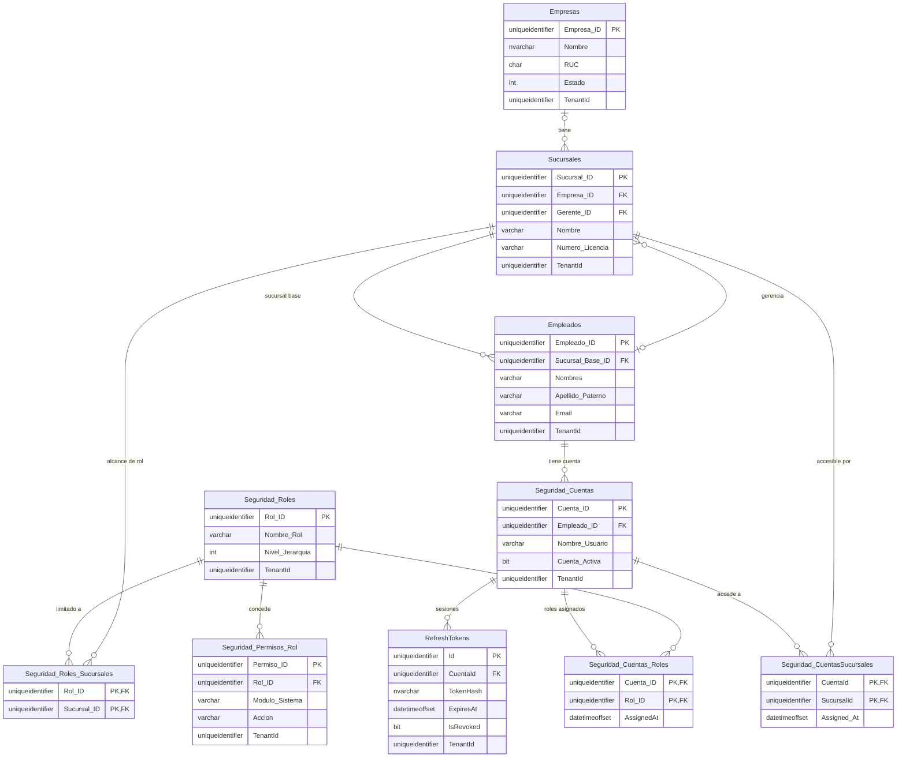
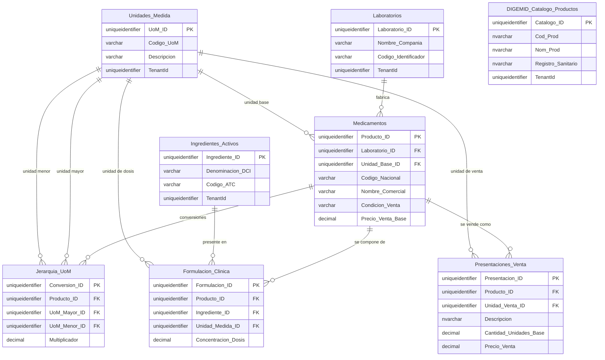
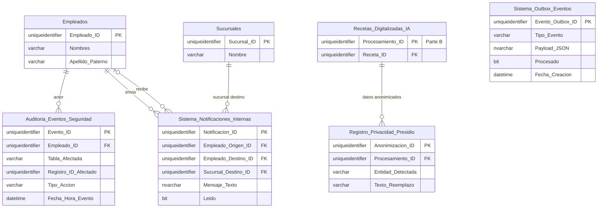

# Modelo de datos — Parte A: maestros y seguridad

| | |
|---|---|
| **Sistema** | SOFIA — Sistema Optimizado Farmacéutico con Inteligencia Artificial |
| **Versión del documento** | 1.0 |
| **Fecha** | 2026-10-06 |
| **Backend** | `sofia-apis`, rama `main`, commit `00991bc` |
| **Frontend** | `sofia-web-spa`, rama `main`, commit `31af681` |
| **Método** | Lectura de código: scripts DbUp `0001`–`0027` leídos completos y en orden (fuente de verdad), contrastados con las configuraciones de EF Core y las entidades de dominio. No se consultó la base de datos ni la API. |

## 1. Alcance y forma de lectura

Este documento es el diccionario de datos de las **27 tablas de maestros y seguridad** de SOFIA: empresa y organización (3), seguridad (9), sistema (2), catálogo farmacéutico y comercial (11) y personas (2). Las otras 23 tablas (inventario, transferencias, cuarentena y actas, recetas, caja, ventas, SUNAT, devoluciones, delivery, magistrales y servicios) y el historial de scripts se documentan en la Parte B.

El esquema descrito es el **estado final tras aplicar los scripts `0001` a `0027`**. El script `0028_Ventas_Sesion_Anulacion.sql` está sin commitear y no se considera; se revisó y solo toca `Ventas_Cabecera`, que es de la Parte B (`sofia-apis/src/SOFIA.DbUp/Scripts/0028_Ventas_Sesion_Anulacion.sql:2-7`), así que no afecta a ninguna tabla de este documento.

### 1.1 Abreviaturas de las fuentes

Para no repetir rutas largas en cada celda, las citas usan estas abreviaturas:

| Abreviatura | Ruta real |
|---|---|
| `0001:86` | `sofia-apis/src/SOFIA.DbUp/Scripts/0001_Initial_Schema.sql`, línea 86. El mismo criterio vale para `0002` … `0027` (el nombre completo de cada script está en la sección [Fuentes](#14-fuentes)). |
| `Cfg/X.cs:n` | `sofia-apis/src/SOFIA.Infrastructure/Persistence/Configurations/X.cs`, línea n |
| `Ent/X.cs:n` | `sofia-apis/src/SOFIA.Domain/Entities/X.cs`, línea n |
| `DbContext:n` | `sofia-apis/src/SOFIA.Infrastructure/Persistence/ApplicationDbContext.cs`, línea n |

### 1.2 Cómo leer las tablas de columnas

- **Tipo**: el tipo de SQL Server tal como lo declara el script.
- **Nulo**: `No` si el script dice `NOT NULL` o la columna es clave primaria; `Sí` en caso contrario. Ojo: varias columnas con `DEFAULT` no llevan `NOT NULL` en el script y por eso admiten `NULL` aunque tengan valor por defecto; están marcadas con «Sí» y anotadas en la sección [Discrepancias](#11-discrepancias-entre-scripts-y-ef).
- **Script**: script que creó la columna y, si otro la modificó después, el último que lo hizo (`creación → modificación`).

## 2. Convenciones comunes del esquema

### 2.1 Claves primarias

Todas las tablas con entidad propia usan una clave primaria `UNIQUEIDENTIFIER`. En las tablas del `0001`, `0005` y `0010` la base propone `NEWSEQUENTIALID()` como valor por defecto; `RefreshTokens` usa `NEWID()` (`0006:3`) y `DIGEMID_Catalogo_Productos` no tiene valor por defecto (`0003:2`). En la práctica el identificador lo genera la aplicación: el constructor de `BaseEntity` asigna `Guid.NewGuid()` (`sofia-apis/src/SOFIA.Domain/Common/BaseEntity.cs:28`).

Las tres tablas puente (`Seguridad_Cuentas_Roles`, `Seguridad_CuentasSucursales`, `Seguridad_Roles_Sucursales`) tienen clave primaria compuesta por sus dos claves foráneas.

Salvo donde se indica un nombre, las claves primarias, los `DEFAULT` y los `UNIQUE` declarados en línea dentro del `CREATE TABLE` **no tienen nombre en el script**: SQL Server les genera uno automático (`PK__…`, `DF__…`, `UQ__…`) que depende de cada base de datos. Por eso el script `0015` los localiza por columna en el catálogo del sistema en lugar de por nombre (`0015:2`, `0015:32-44`).

### 2.2 Multiempresa: columna `TenantId`

La columna de multiempresa se llama `TenantId` (`UNIQUEIDENTIFIER NULL`, sin valor por defecto y **sin clave foránea** hacia `Empresas`). Guarda el `Empresa_ID` de la empresa dueña de la fila. Cómo llegó a cada tabla:

| Origen | Tablas de este documento | Fuente |
|---|---|---|
| Declarada en el `CREATE TABLE` | `Empresas`, `RefreshTokens` | `0005:15`, `0006:9` |
| `ALTER TABLE` explícito | `Sucursales`, `Empleados`, `Seguridad_Cuentas`, `Presentaciones_Venta` | `0005:33-35`, `0005:44-45`, `0005:50-51`, `0011:3` |
| SQL dinámico del `0005`: agrega `TenantId` a toda tabla que en ese momento tenía columna `IsDeleted` y aún no tenía `TenantId` | `Seguridad_Roles`, `Seguridad_Permisos_Rol`, `Auditoria_Eventos_Seguridad`, `Registro_Privacidad_Presidio`, `Sistema_Notificaciones_Internas`, `Sistema_Outbox_Eventos`, `Unidades_Medida`, `Jerarquia_UoM`, `Laboratorios`, `Ingredientes_Activos`, `Medicamentos`, `Formulacion_Clinica`, `Proveedores_Dist`, `Historial_Precios_Prov`, `Aseguradoras_Medicas`, `DIGEMID_Catalogo_Productos`, `Pacientes_Clientes`, `Profesionales_Salud` | `0005:54-70` |
| No tienen `TenantId` (no tienen `IsDeleted` y ningún script se lo agrega) | `Seguridad_Cuentas_Roles`, `Seguridad_CuentasSucursales`, `Seguridad_Roles_Sucursales` | `0001:826-834`, `0007:4-12`, `0008:1-7` |

En la aplicación, toda entidad que hereda de `BaseEntity` recibe dos filtros globales de consulta: borrado lógico (`IsDeleted = 0`) y empresa (`TenantId` igual a la empresa del usuario). El filtro de empresa es estricto: si no hay empresa en el contexto, o la fila tiene `TenantId` nulo, la fila no aparece (`DbContext:82-86`, `DbContext:91-110`). Al insertar, si la entidad no trae `TenantId` se le asigna la empresa del usuario (`DbContext:168-178`).

### 2.3 Borrado lógico y auditoría

El patrón estándar son siete columnas, que la aplicación rellena en `SaveChangesAsync` (`DbContext:132-158`): al insertar `CreatedBy`/`CreatedAt`; al modificar `LastModifiedBy`/`LastModifiedAt`; y un borrado se convierte en actualización que pone `IsDeleted = 1`, `DeletedBy` y `DeletedAt`. El nombre de usuario que se guarda es `currentUser.Name` o `"SYSTEM"` si no hay usuario.

| Columna | Tipo en tablas del `0001` | Nulo | Valor por defecto | Significado |
|---|---|---|---|---|
| `CreatedAt` | `DATETIMEOFFSET` | No | `SYSDATETIMEOFFSET()` | Fecha y hora de creación |
| `CreatedBy` | `VARCHAR(100)` | Sí | — | Usuario que creó la fila |
| `LastModifiedAt` | `DATETIMEOFFSET` | Sí | — | Fecha y hora de la última modificación |
| `LastModifiedBy` | `VARCHAR(100)` | Sí | — | Usuario de la última modificación |
| `IsDeleted` | `BIT` | No | `0` | Marca de borrado lógico |
| `DeletedAt` | `DATETIMEOFFSET` | Sí | — | Fecha y hora del borrado lógico |
| `DeletedBy` | `VARCHAR(100)` | Sí | — | Usuario que borró la fila |

Variaciones respecto de ese patrón (todas verificadas en los scripts):

- `Empresas` y `Presentaciones_Venta` usan `NVARCHAR(100)` en `CreatedBy`, `LastModifiedBy` y `DeletedBy` (`0005:17-22`, `0010:12-17`).
- `DIGEMID_Catalogo_Productos` usa `NVARCHAR(100)` y además `CreatedBy` es `NOT NULL` (`0003:13-19`).
- `RefreshTokens` usa `NVARCHAR(256)` (`0006:11-16`).
- `Sistema_Notificaciones_Internas` solo tiene `CreatedAt` e `IsDeleted`; le faltan las otras cinco (`0001:780-781`).
- `Seguridad_Cuentas_Roles` y `Seguridad_CuentasSucursales` no tienen el patrón: solo llevan fecha y usuario de asignación. `Seguridad_Roles_Sucursales` no tiene ninguna columna de auditoría.

### 2.4 Concurrencia (`RowVersion`)

De las 27 tablas de este documento, solo `RefreshTokens` tiene columna `RowVersion ROWVERSION NOT NULL` (`0019:18-19`). Las demás tablas con `RowVersion` (`Inventario_Sucursal`, `Ventas_Cabecera`, `Transferencias_Cab`, `POS_Sesiones_Caja`) son de la Parte B (`0019:2-16`).

### 2.5 Resumen por tabla

| Tabla | `TenantId` | Borrado lógico (`IsDeleted`) | Auditoría | `RowVersion` |
|---|---|---|---|---|
| `Empresas` | Sí | Sí | Completa | No |
| `Sucursales` | Sí | Sí | Completa | No |
| `Empleados` | Sí | Sí | Completa | No |
| `Seguridad_Cuentas` | Sí | Sí | Completa | No |
| `Seguridad_CuentasSucursales` | No | No | Solo `Assigned_At`, `Assigned_By` | No |
| `Seguridad_Cuentas_Roles` | No | No | Solo `AssignedAt`, `AssignedBy` | No |
| `Seguridad_Roles` | Sí | Sí | Completa | No |
| `Seguridad_Permisos_Rol` | Sí | Sí | Completa | No |
| `Seguridad_Roles_Sucursales` | No | No | Ninguna | No |
| `RefreshTokens` | Sí | Sí | Completa | Sí |
| `Auditoria_Eventos_Seguridad` | Sí | Sí | Completa | No |
| `Registro_Privacidad_Presidio` | Sí | Sí | Completa | No |
| `Sistema_Notificaciones_Internas` | Sí | Sí | Parcial: solo `CreatedAt` | No |
| `Sistema_Outbox_Eventos` | Sí | Sí | Completa | No |
| `Unidades_Medida` | Sí | Sí | Completa | No |
| `Jerarquia_UoM` | Sí | Sí | Completa | No |
| `Laboratorios` | Sí | Sí | Completa | No |
| `Ingredientes_Activos` | Sí | Sí | Completa | No |
| `Medicamentos` | Sí | Sí | Completa | No |
| `Formulacion_Clinica` | Sí | Sí | Completa | No |
| `Presentaciones_Venta` | Sí | Sí | Completa | No |
| `Proveedores_Dist` | Sí | Sí | Completa | No |
| `Historial_Precios_Prov` | Sí | Sí | Completa | No |
| `Aseguradoras_Medicas` | Sí | Sí | Completa | No |
| `DIGEMID_Catalogo_Productos` | Sí | Sí | Completa (`CreatedBy` obligatorio) | No |
| `Pacientes_Clientes` | Sí | Sí | Completa | No |
| `Profesionales_Salud` | Sí | Sí | Completa | No |

### 2.6 Unicidad por empresa y sensible al borrado lógico

Las claves de negocio de los maestros nacieron en el `0001` como `UNIQUE` globales. Dos scripts las transformaron:

1. **`0015`** recorre una lista de pares tabla/columna, elimina el índice o restricción única de una sola columna que encuentre sobre esa columna y crea en su lugar `UX_<Tabla>_Tenant_<Columna>` sobre `(TenantId, <Columna>)`, conservando el filtro que tuviera el índice original (`0015:4-19`, `0015:46-61`). Deja globales a propósito `Empresas.RUC`, `Seguridad_Cuentas.Nombre_Usuario` y `RefreshTokens.TokenHash` (`0015:3`).
2. **`0020`** vuelve a crear esos índices con el filtro `WHERE IsDeleted = 0` (y `IS NOT NULL` en los códigos opcionales), de modo que una fila borrada lógicamente ya no bloquea reutilizar su clave (`0020:1-54`). También agrega unicidades que faltaban y restricciones `CHECK` de montos y cantidades.

El único índice del `0015` que el `0020` no vuelve a crear es `UX_Empleados_Tenant_Licencia_Prof`, que ya heredaba el filtro de borrado lógico de su índice original.

---

## 3. Empresa y organización

### 3.1 `Empresas`

**Propósito.** Cada fila es una empresa cliente de SOFIA (una botica o cadena): es el inquilino del sistema multiempresa y lleva el estado de su suscripción (periodo de prueba, activa, suspendida o cancelada).
**Entidad.** `Empresa` (`Ent/Empresa.cs:14`), configurada en `Cfg/EmpresaConfiguration.cs`. Tiene `DbSet` (`DbContext:15`) y la usa el código (registro de empresa, actualización y control de vigencia).
**Creada en** `0005:8-23`.

| Columna | Tipo | Nulo | Valor por defecto | Descripción | Script (creación / última modificación) |
|---|---|---|---|---|---|
| `Empresa_ID` | `UNIQUEIDENTIFIER` | No | `NEWSEQUENTIALID()` | Identificador de la empresa. Clave primaria. | `0005:9` |
| `Nombre` | `NVARCHAR(200)` | No | — | Nombre de la empresa. | `0005:10` |
| `RUC` | `CHAR(11)` | Sí | — | RUC de la empresa. El dominio exige 11 dígitos numéricos (`sofia-apis/src/SOFIA.Domain/ValueObjects/Ruc.cs:18`). | `0005:11` |
| `Estado` | `INT` | No | `0` | Estado de la suscripción. Se guarda como **número** (`Cfg/EmpresaConfiguration.cs:32-34`). Valores del enum `EstadoEmpresa` (`Ent/Empresa.cs:6-12`): `0` TrialActivo, `1` Activo, `2` Suspendido, `3` Cancelado. El script no tiene `CHECK`. | `0005:12` |
| `FechaInicioTrial` | `DATETIMEOFFSET` | No | `SYSDATETIMEOFFSET()` | Inicio del periodo de prueba. | `0005:13` |
| `FechaVencimiento` | `DATETIMEOFFSET` | No | `SYSDATETIMEOFFSET()` | Vencimiento del periodo de prueba o de la suscripción. Al crear la empresa el dominio pone la fecha actual más 30 días (`Ent/Empresa.cs:37`, `Ent/Empresa.cs:64`). | `0005:14` |
| `TenantId` | `UNIQUEIDENTIFIER` | Sí | — | Empresa dueña de la fila. En esta tabla el dominio la iguala al propio `Empresa_ID` (`Ent/Empresa.cs:67`). | `0005:15` |
| `CreatedAt` | `DATETIMEOFFSET` | No | `SYSDATETIMEOFFSET()` | Auditoría: creación. | `0005:16` |
| `CreatedBy` | `NVARCHAR(100)` | Sí | — | Auditoría: usuario creador. | `0005:17` |
| `LastModifiedAt` | `DATETIMEOFFSET` | Sí | — | Auditoría: última modificación. | `0005:18` |
| `LastModifiedBy` | `NVARCHAR(100)` | Sí | — | Auditoría: usuario de la última modificación. | `0005:19` |
| `IsDeleted` | `BIT` | No | `0` | Borrado lógico. | `0005:20` |
| `DeletedAt` | `DATETIMEOFFSET` | Sí | — | Auditoría: fecha de borrado. | `0005:21` |
| `DeletedBy` | `NVARCHAR(100)` | Sí | — | Auditoría: usuario que borró. | `0005:22` |
| `ExigirRegistroReceta` | `BIT` | No | `0` (restricción `DF_Empresas_ExigirRegistroReceta`) | Interruptor por empresa: cuando está activo, también los productos de receta simple exigen registrar la receta. Solo se cambia en la base de datos (`Ent/Empresa.cs:24-25`). | `0025:2-3` |

**Clave primaria:** `Empresa_ID` (sin nombre en el script).
**Claves foráneas:** ninguna.
**Referenciada por:** `Sucursales.Empresa_ID`.

**Índices y restricciones**

| Nombre | Tipo | Columnas | Filtro / definición | Script |
|---|---|---|---|---|
| `IX_Empresas_RUC` | Índice único filtrado | `RUC` | `WHERE RUC IS NOT NULL` (no filtra por `IsDeleted`: una empresa borrada lógicamente sigue ocupando su RUC) | `0005:26-28` |
| `DF_Empresas_ExigirRegistroReceta` | `DEFAULT` con nombre | `ExigirRegistroReceta` | `DEFAULT 0` | `0025:3` |

**Multiempresa, borrado lógico, auditoría, RowVersion:** `TenantId` sí; `IsDeleted` sí; auditoría completa; `RowVersion` no.
**Datos sembrados:** ninguno.

### 3.2 `Sucursales`

**Propósito.** Locales o establecimientos farmacéuticos de una empresa. Casi todo lo operativo (stock, caja, ventas, series fiscales) cuelga de una sucursal.
**Entidad.** `Sucursal` (`Ent/Sucursal.cs:5`), configurada en `Cfg/SucursalConfiguration.cs`. `DbSet` en `DbContext:16`; en uso.
**Creada en** `0001:7-20`; ampliada en `0005`.

| Columna | Tipo | Nulo | Valor por defecto | Descripción | Script (creación / última modificación) |
|---|---|---|---|---|---|
| `Sucursal_ID` | `UNIQUEIDENTIFIER` | No | `NEWSEQUENTIALID()` | Identificador de la sucursal. Clave primaria. | `0001:8` |
| `Nombre` | `VARCHAR(100)` | No | — | Nombre de la sucursal. | `0001:9` |
| `Direccion_Fisica` | `VARCHAR(255)` | No | — | Dirección del local. | `0001:10` |
| `Numero_Licencia` | `VARCHAR(50)` | No | — | Número de licencia del establecimiento. Único por empresa entre sucursales no borradas. | `0001:11` |
| `Gerente_ID` | `UNIQUEIDENTIFIER` | Sí | — | Empleado que gerencia la sucursal. | `0001:12` |
| `CreatedAt` | `DATETIMEOFFSET` | No | `SYSDATETIMEOFFSET()` | Auditoría: creación. | `0001:13` |
| `CreatedBy` | `VARCHAR(100)` | Sí | — | Auditoría: usuario creador. | `0001:14` |
| `LastModifiedAt` | `DATETIMEOFFSET` | Sí | — | Auditoría: última modificación. | `0001:15` |
| `LastModifiedBy` | `VARCHAR(100)` | Sí | — | Auditoría: usuario de la última modificación. | `0001:16` |
| `IsDeleted` | `BIT` | No | `0` | Borrado lógico. | `0001:17` |
| `DeletedAt` | `DATETIMEOFFSET` | Sí | — | Auditoría: fecha de borrado. | `0001:18` |
| `DeletedBy` | `VARCHAR(100)` | Sí | — | Auditoría: usuario que borró. | `0001:19` |
| `Empresa_ID` | `UNIQUEIDENTIFIER` | Sí | — | Empresa a la que pertenece la sucursal. | `0005:33-34` |
| `TenantId` | `UNIQUEIDENTIFIER` | Sí | — | Empresa dueña de la fila. El dominio la iguala a `Empresa_ID` al crear (`Ent/Sucursal.cs:51-52`). | `0005:33-35` |

**Clave primaria:** `Sucursal_ID` (sin nombre en el script).

**Claves foráneas**

| Constraint | Columna | Referencia | ON DELETE | Script |
|---|---|---|---|---|
| `FK_Sucursal_Gerente` | `Gerente_ID` | `Empleados.Empleado_ID` | No definido (sin acción) | `0001:40-41` |
| `FK_Sucursales_Empresa` | `Empresa_ID` | `Empresas.Empresa_ID` | No definido (sin acción) | `0005:37-39` |

**Referenciada por:** `Empleados.Sucursal_Base_ID`, `Seguridad_CuentasSucursales.SucursalId`, `Seguridad_Roles_Sucursales.Sucursal_ID`, `Sistema_Notificaciones_Internas.Sucursal_Destino_ID`; y de la Parte B: `Inventario_Sucursal`, `Transferencias_Cab` (origen y destino), `POS_Sesiones_Caja`, `Ventas_Cabecera`, `SUNAT_Series_Fiscales`, `DIGEMID_Inventario_Cuarentena`, `Magistrales_Ordenes_Produccion`.

**Índices y restricciones**

| Nombre | Tipo | Columnas | Filtro / definición | Script |
|---|---|---|---|---|
| `UX_Sucursales_Empresa_Licencia` | Índice único no agrupado, filtrado | `Empresa_ID`, `Numero_Licencia` | `WHERE IsDeleted = 0 AND Empresa_ID IS NOT NULL` | `0005:75-84` |

**Multiempresa, borrado lógico, auditoría, RowVersion:** `TenantId` sí (además de `Empresa_ID`); `IsDeleted` sí; auditoría completa; `RowVersion` no.
**Datos sembrados:** ninguno.

### 3.3 `Empleados`

**Propósito.** Personas que trabajan en la empresa (químicos farmacéuticos, técnicos, cajeros). Cada empleado tiene una sucursal base y, opcionalmente, una cuenta de usuario.
**Entidad.** `Empleado` (`Ent/Empleado.cs:6`), configurada en `Cfg/EmpleadoConfiguration.cs`. `DbSet` en `DbContext:17`; en uso.
**Creada en** `0001:22-38`; modificada en `0005`, `0015`, `0022` y `0026`.

| Columna | Tipo | Nulo | Valor por defecto | Descripción | Script (creación / última modificación) |
|---|---|---|---|---|---|
| `Empleado_ID` | `UNIQUEIDENTIFIER` | No | `NEWSEQUENTIALID()` | Identificador del empleado. Clave primaria. | `0001:23` |
| `Sucursal_Base_ID` | `UNIQUEIDENTIFIER` | No | — | Sucursal base del empleado. | `0001:24` |
| `Nombres` | `VARCHAR(75)` | No | — | Nombres. | `0001:25` |
| `Apellido_Paterno` | `VARCHAR(75)` | No | — | Apellido paterno. | `0001:26` |
| `Apellido_Materno` | `VARCHAR(75)` | Sí | — | Apellido materno. Nació `NOT NULL` y pasó a opcional: una persona con un solo apellido guarda `NULL`, no un texto de relleno (`0026:1`, `Ent/Empleado.cs:18-19`). | `0001:27` → `0026:2-3` |
| `Licencia_Prof` | `VARCHAR(50)` | Sí | — | Número de licencia o colegiatura profesional. Único por empresa cuando tiene valor. | `0001:28` |
| `Huella_Biometrica` | `VARBINARY(MAX)` | Sí | — | Huella biométrica en binario (`Ent/Empleado.cs:29-30`). | `0001:29` |
| `CreatedAt` | `DATETIMEOFFSET` | No | `SYSDATETIMEOFFSET()` | Auditoría: creación. | `0001:30` |
| `CreatedBy` | `VARCHAR(100)` | Sí | — | Auditoría: usuario creador. | `0001:31` |
| `LastModifiedAt` | `DATETIMEOFFSET` | Sí | — | Auditoría: última modificación. | `0001:32` |
| `LastModifiedBy` | `VARCHAR(100)` | Sí | — | Auditoría: usuario de la última modificación. | `0001:33` |
| `IsDeleted` | `BIT` | No | `0` | Borrado lógico. | `0001:34` |
| `DeletedAt` | `DATETIMEOFFSET` | Sí | — | Auditoría: fecha de borrado. | `0001:35` |
| `DeletedBy` | `VARCHAR(100)` | Sí | — | Auditoría: usuario que borró. | `0001:36` |
| `TenantId` | `UNIQUEIDENTIFIER` | Sí | — | Empresa dueña de la fila. | `0005:44-45` |
| `Email` | `VARCHAR(254)` | Sí | — | Correo del empleado; es el destino de los enlaces de recuperación de contraseña (`0022:1`, `Ent/Empleado.cs:23-24`). El dominio lo guarda sin espacios y en minúsculas (`Ent/Empleado.cs:124-126`). Único por empresa cuando tiene valor. | `0022:2-3` |

**Clave primaria:** `Empleado_ID` (sin nombre en el script).

**Claves foráneas**

| Constraint | Columna | Referencia | ON DELETE | Script |
|---|---|---|---|---|
| `FK_Empleados_Sucursal` | `Sucursal_Base_ID` | `Sucursales.Sucursal_ID` | No definido (sin acción) | `0001:37` |

**Referenciada por:** `Sucursales.Gerente_ID`, `Seguridad_Cuentas.Empleado_ID`, `Auditoria_Eventos_Seguridad.Empleado_ID`, `Sistema_Notificaciones_Internas` (origen y destino); y de la Parte B: `Transferencias_Cab` (emisor y receptor), `POS_Sesiones_Caja`, `Ventas_Cabecera` (`Empleado_ID` y `Empleado_Verifica_Receta_ID`), `Servicios_Clinicos_Inmunizacion`, `Devoluciones_Cabecera`, `DIGEMID_Inventario_Cuarentena`, `DIGEMID_Actas_Destruccion`, `Magistrales_Ordenes_Produccion`.

**Índices y restricciones**

| Nombre | Tipo | Columnas | Filtro / definición | Script |
|---|---|---|---|---|
| `UX_Empleados_Tenant_Licencia_Prof` | Índice único filtrado | `TenantId`, `Licencia_Prof` | El mismo filtro del índice al que reemplaza: `Licencia_Prof IS NOT NULL AND IsDeleted = 0`. Sustituye a `UX_Empleados_LicenciaProf` (`0001:855-857`), que el `0015` elimina. | `0015:9`, `0015:46-61` |
| `UX_Empleados_Tenant_Email` | Índice único filtrado | `TenantId`, `Email` | `WHERE Email IS NOT NULL AND IsDeleted = 0` | `0022:6-9` |

**Multiempresa, borrado lógico, auditoría, RowVersion:** `TenantId` sí; `IsDeleted` sí; auditoría completa; `RowVersion` no.
**Datos sembrados:** ninguno.

---

## 4. Seguridad

### 4.1 `Seguridad_Cuentas`

**Propósito.** Cuenta de usuario con la que un empleado inicia sesión: nombre de usuario, hash de la contraseña, bloqueo por intentos fallidos y recuperación de contraseña.
**Entidad.** `Cuenta` (`Ent/Cuenta.cs:7`), configurada en `Cfg/CuentaConfiguration.cs`. `DbSet` en `DbContext:25`; en uso.
**Creada en** `0001:790-810`; modificada en `0005` y `0020`.

| Columna | Tipo | Nulo | Valor por defecto | Descripción | Script (creación / última modificación) |
|---|---|---|---|---|---|
| `Cuenta_ID` | `UNIQUEIDENTIFIER` | No | `NEWSEQUENTIALID()` | Identificador de la cuenta. Clave primaria. | `0001:791` |
| `Empleado_ID` | `UNIQUEIDENTIFIER` | No | — | Empleado dueño de la cuenta. Una sola cuenta vigente por empleado. El `UNIQUE` en línea original fue reemplazado por un índice único filtrado. | `0001:792` → `0020:57-72` |
| `Nombre_Usuario` | `VARCHAR(50)` | No | — | Nombre de usuario para iniciar sesión. Es único **en todo el sistema** (no por empresa) porque el inicio de sesión no pide la empresa (`0020:56`). El `UNIQUE` en línea original fue reemplazado por un índice único filtrado. | `0001:793` → `0020:57-68` |
| `Password_Hash` | `NVARCHAR(MAX)` | No | — | Hash de la contraseña. | `0001:794` |
| `Recovery_Token` | `VARCHAR(100)` | Sí | — | Hash del token de recuperación de contraseña; nunca se guarda el token en claro (`Ent/Cuenta.cs:104-109`). | `0001:795` |
| `Recovery_Token_Expiry` | `DATETIMEOFFSET` | Sí | — | Vencimiento del token de recuperación; el dominio lo fija a una hora desde su generación (`Ent/Cuenta.cs:108`). | `0001:796` |
| `Security_Stamp` | `UNIQUEIDENTIFIER` | No | `NEWSEQUENTIALID()` | Sello de seguridad; el dominio lo regenera al cambiar o restablecer la contraseña y al invalidarlo explícitamente (`Ent/Cuenta.cs:71`, `Ent/Cuenta.cs:100`, `Ent/Cuenta.cs:121`). | `0001:797` |
| `Requiere_Cambio_Clave` | `BIT` | No | `1` | Indica que el usuario debe cambiar su contraseña. | `0001:798` |
| `Intentos_Fallidos` | `INT` | No | `0` | Contador de intentos fallidos de inicio de sesión. Al llegar a 5 el dominio bloquea la cuenta 15 minutos (`Ent/Cuenta.cs:85-89`). | `0001:799` |
| `Bloqueado_Hasta` | `DATETIMEOFFSET` | Sí | — | Fecha y hora hasta la que la cuenta queda bloqueada. | `0001:800` |
| `Cuenta_Activa` | `BIT` | No | `1` | Cuenta habilitada o deshabilitada. | `0001:801` |
| `CreatedAt` | `DATETIMEOFFSET` | No | `SYSDATETIMEOFFSET()` | Auditoría: creación. | `0001:802` |
| `CreatedBy` | `VARCHAR(100)` | Sí | — | Auditoría: usuario creador. | `0001:803` |
| `LastModifiedAt` | `DATETIMEOFFSET` | Sí | — | Auditoría: última modificación. | `0001:804` |
| `LastModifiedBy` | `VARCHAR(100)` | Sí | — | Auditoría: usuario de la última modificación. | `0001:805` |
| `IsDeleted` | `BIT` | No | `0` | Borrado lógico. | `0001:806` |
| `DeletedAt` | `DATETIMEOFFSET` | Sí | — | Auditoría: fecha de borrado. | `0001:807` |
| `DeletedBy` | `VARCHAR(100)` | Sí | — | Auditoría: usuario que borró. | `0001:808` |
| `TenantId` | `UNIQUEIDENTIFIER` | Sí | — | Empresa dueña de la fila. | `0005:50-51` |

**Clave primaria:** `Cuenta_ID` (sin nombre en el script).

**Claves foráneas**

| Constraint | Columna | Referencia | ON DELETE | Script |
|---|---|---|---|---|
| `FK_Cuentas_Empleado` | `Empleado_ID` | `Empleados.Empleado_ID` | No definido (sin acción) | `0001:809` |

**Referenciada por:** `Seguridad_Cuentas_Roles.Cuenta_ID`, `Seguridad_CuentasSucursales.CuentaId`, `RefreshTokens.CuentaId`.

**Índices y restricciones**

| Nombre | Tipo | Columnas | Filtro / definición | Script |
|---|---|---|---|---|
| `IX_Cuentas_Login` | Índice no agrupado, no único, filtrado | `Nombre_Usuario` | `WHERE IsDeleted = 0 AND Cuenta_Activa = 1` | `0001:852` |
| `UX_Seguridad_Cuentas_Nombre_Usuario` | Índice único filtrado | `Nombre_Usuario` | `WHERE IsDeleted = 0` | `0020:67-68` |
| `UX_Seguridad_Cuentas_Empleado_ID` | Índice único filtrado | `Empleado_ID` | `WHERE IsDeleted = 0` | `0020:71-72` |

Las dos restricciones `UNIQUE` en línea del `0001` (sobre `Empleado_ID` y `Nombre_Usuario`, con nombre autogenerado) ya no existen: el `0020` las busca en el catálogo y las elimina antes de crear los índices filtrados (`0020:57-64`).

**Multiempresa, borrado lógico, auditoría, RowVersion:** `TenantId` sí; `IsDeleted` sí; auditoría completa; `RowVersion` no.
**Datos sembrados:** ninguno.

### 4.2 `Seguridad_CuentasSucursales`

**Propósito.** Tabla puente que dice a qué sucursales puede acceder una cuenta de usuario.
**Entidad.** `CuentaSucursal` (`Ent/CuentaSucursal.cs:3`); no hereda de `BaseEntity`. No tiene archivo de configuración propio: se configura como entidad de unión dentro de `Cfg/CuentaConfiguration.cs:85-98`. `DbSet` en `DbContext:29`; se usa a través de la navegación `Cuenta.Sucursales` (`Ent/Cuenta.cs:30-31`).
**Creada en** `0007:4-12`. Ningún script posterior la modifica.

| Columna | Tipo | Nulo | Valor por defecto | Descripción | Script (creación / última modificación) |
|---|---|---|---|---|---|
| `CuentaId` | `UNIQUEIDENTIFIER` | No | — | Cuenta de usuario. Parte de la clave primaria. | `0007:5` |
| `SucursalId` | `UNIQUEIDENTIFIER` | No | — | Sucursal a la que la cuenta tiene acceso. Parte de la clave primaria. | `0007:6` |
| `Assigned_At` | `DATETIMEOFFSET` | No | `SYSDATETIMEOFFSET()` | Fecha y hora de la asignación. | `0007:7` |
| `Assigned_By` | `NVARCHAR(100)` | Sí | — | Usuario que hizo la asignación. | `0007:8` |

**Clave primaria:** `PK_Seguridad_CuentasSucursales` sobre (`CuentaId`, `SucursalId`) (`0007:9`).

**Claves foráneas**

| Constraint | Columna | Referencia | ON DELETE | Script |
|---|---|---|---|---|
| `FK_CuentasSucursales_Cuentas` | `CuentaId` | `Seguridad_Cuentas.Cuenta_ID` | No definido (sin acción) | `0007:10` |
| `FK_CuentasSucursales_Sucursales` | `SucursalId` | `Sucursales.Sucursal_ID` | No definido (sin acción) | `0007:11` |

**Índices y restricciones:** ninguno aparte de la clave primaria.
**Multiempresa, borrado lógico, auditoría, RowVersion:** sin `TenantId`, sin `IsDeleted` (las filas se borran físicamente), solo `Assigned_At` y `Assigned_By`, sin `RowVersion`.
**Datos sembrados:** ninguno.

Nota de nomenclatura: esta tabla nombra sus columnas `CuentaId`, `SucursalId`, `Assigned_At`, `Assigned_By`, mientras que la tabla hermana `Seguridad_Cuentas_Roles` usa `Cuenta_ID`, `Rol_ID`, `AssignedAt`, `AssignedBy`. Son dos convenciones distintas dentro del mismo módulo.

### 4.3 `Seguridad_Cuentas_Roles`

**Propósito.** Tabla puente que asigna roles a una cuenta de usuario.
**Entidad.** `CuentaRol` (`Ent/CuentaRol.cs:3`); no hereda de `BaseEntity`. Configurada en `Cfg/CuentaRolConfiguration.cs` y como entidad de unión en `Cfg/CuentaConfiguration.cs:77-83`. `DbSet` en `DbContext:28`; se usa a través de la navegación `Cuenta.Roles` (`Ent/Cuenta.cs:28-29`).
**Creada en** `0001:826-834`. Ningún script posterior la modifica.

| Columna | Tipo | Nulo | Valor por defecto | Descripción | Script (creación / última modificación) |
|---|---|---|---|---|---|
| `Cuenta_ID` | `UNIQUEIDENTIFIER` | No | — | Cuenta de usuario. Parte de la clave primaria. | `0001:827` |
| `Rol_ID` | `UNIQUEIDENTIFIER` | No | — | Rol asignado. Parte de la clave primaria. | `0001:828` |
| `AssignedAt` | `DATETIMEOFFSET` | No | `SYSDATETIMEOFFSET()` | Fecha y hora de la asignación. | `0001:829` |
| `AssignedBy` | `VARCHAR(100)` | Sí | — | Usuario que hizo la asignación. | `0001:830` |

**Clave primaria:** (`Cuenta_ID`, `Rol_ID`), sin nombre en el script (`0001:831`).

**Claves foráneas**

| Constraint | Columna | Referencia | ON DELETE | Script |
|---|---|---|---|---|
| `FK_CuentaRol_Cuenta` | `Cuenta_ID` | `Seguridad_Cuentas.Cuenta_ID` | No definido (sin acción) | `0001:832` |
| `FK_CuentaRol_Rol` | `Rol_ID` | `Seguridad_Roles.Rol_ID` | No definido (sin acción) | `0001:833` |

**Índices y restricciones:** ninguno aparte de la clave primaria.
**Multiempresa, borrado lógico, auditoría, RowVersion:** sin `TenantId` (el `0005` no la alcanza porque no tiene `IsDeleted`), sin borrado lógico, solo `AssignedAt` y `AssignedBy`, sin `RowVersion`.
**Datos sembrados:** ninguno.

### 4.4 `Seguridad_Roles`

**Propósito.** Roles de seguridad de cada empresa (por ejemplo Admin o Cajero). Un rol agrupa permisos y puede restringirse a ciertas sucursales.
**Entidad.** `Rol` (`Ent/Rol.cs:5`), configurada en `Cfg/RolConfiguration.cs`. `DbSet` en `DbContext:26`; en uso. El rol cuyo nombre es `Admin` (sin distinguir mayúsculas) se salta toda comprobación de permisos (`Ent/Rol.cs:9-10`, `Ent/Rol.cs:21`).
**Creada en** `0001:812-824`; modificada en `0005`, `0015` y `0020`.

| Columna | Tipo | Nulo | Valor por defecto | Descripción | Script (creación / última modificación) |
|---|---|---|---|---|---|
| `Rol_ID` | `UNIQUEIDENTIFIER` | No | `NEWSEQUENTIALID()` | Identificador del rol. Clave primaria. | `0001:813` |
| `Nombre_Rol` | `VARCHAR(50)` | No | — | Nombre del rol. Único por empresa entre roles no borrados. El `UNIQUE` global en línea fue reemplazado. | `0001:814` → `0020:48-49` |
| `Descripcion` | `VARCHAR(255)` | Sí | — | Descripción del rol. | `0001:815` |
| `Nivel_Jerarquia` | `INT` | No | `0` | Nivel jerárquico del rol (número entero; los roles sembrados usan de 10 a 100, ver [Datos sembrados](#10-datos-sembrados-y-modificados-por-scripts)). | `0001:816` |
| `CreatedAt` | `DATETIMEOFFSET` | No | `SYSDATETIMEOFFSET()` | Auditoría: creación. | `0001:817` |
| `CreatedBy` | `VARCHAR(100)` | Sí | — | Auditoría: usuario creador. | `0001:818` |
| `LastModifiedAt` | `DATETIMEOFFSET` | Sí | — | Auditoría: última modificación. | `0001:819` |
| `LastModifiedBy` | `VARCHAR(100)` | Sí | — | Auditoría: usuario de la última modificación. | `0001:820` |
| `IsDeleted` | `BIT` | No | `0` | Borrado lógico. | `0001:821` |
| `DeletedAt` | `DATETIMEOFFSET` | Sí | — | Auditoría: fecha de borrado. | `0001:822` |
| `DeletedBy` | `VARCHAR(100)` | Sí | — | Auditoría: usuario que borró. | `0001:823` |
| `TenantId` | `UNIQUEIDENTIFIER` | Sí | — | Empresa dueña del rol. | `0005:54-70` |

**Clave primaria:** `Rol_ID` (sin nombre en el script).
**Claves foráneas:** ninguna.
**Referenciada por:** `Seguridad_Cuentas_Roles.Rol_ID`, `Seguridad_Permisos_Rol.Rol_ID`, `Seguridad_Roles_Sucursales.Rol_ID`.

**Índices y restricciones**

| Nombre | Tipo | Columnas | Filtro / definición | Script |
|---|---|---|---|---|
| `UX_Seguridad_Roles_Tenant_Nombre_Rol` | Índice único filtrado | `TenantId`, `Nombre_Rol` | `WHERE IsDeleted = 0` | `0015:18` → `0020:48-49` |

**Multiempresa, borrado lógico, auditoría, RowVersion:** `TenantId` sí; `IsDeleted` sí; auditoría completa; `RowVersion` no.
**Datos sembrados:** seis roles base del `0002` (ver [sección 10](#10-datos-sembrados-y-modificados-por-scripts)).

### 4.5 `Seguridad_Permisos_Rol`

**Propósito.** Permisos concedidos a un rol, expresados como par módulo y acción (por ejemplo `Ventas` + `Anular`).
**Entidad.** `PermisoRol` (`Ent/PermisoRol.cs:5`), configurada en `Cfg/PermisoRolConfiguration.cs`. `DbSet` en `DbContext:27`; en uso (asignar, revocar y consultar permisos, y en la autorización de cada petición: `sofia-apis/src/SOFIA.Infrastructure/Authentication/PermissionAuthorizationHandler.cs:68`).
**Creada en** `0001:836-850`; `TenantId` agregada en `0005`.

| Columna | Tipo | Nulo | Valor por defecto | Descripción | Script (creación / última modificación) |
|---|---|---|---|---|---|
| `Permiso_ID` | `UNIQUEIDENTIFIER` | No | `NEWSEQUENTIALID()` | Identificador del permiso. Clave primaria. | `0001:837` |
| `Rol_ID` | `UNIQUEIDENTIFIER` | No | — | Rol al que se concede el permiso. | `0001:838` |
| `Modulo_Sistema` | `VARCHAR(50)` | No | — | Módulo del sistema. Texto libre: el script no tiene `CHECK` ni existe un enum en `SOFIA.Domain/Enums`. Los pares módulo/acción que exige el código están inventariados en `docs/_inventario/permisos.csv`. | `0001:839` |
| `Accion` | `VARCHAR(50)` | No | — | Acción permitida dentro del módulo. Texto libre, sin `CHECK`. | `0001:840` |
| `CreatedAt` | `DATETIMEOFFSET` | No | `SYSDATETIMEOFFSET()` | Auditoría: creación. | `0001:841` |
| `CreatedBy` | `VARCHAR(100)` | Sí | — | Auditoría: usuario creador. | `0001:842` |
| `LastModifiedAt` | `DATETIMEOFFSET` | Sí | — | Auditoría: última modificación. | `0001:843` |
| `LastModifiedBy` | `VARCHAR(100)` | Sí | — | Auditoría: usuario de la última modificación. | `0001:844` |
| `IsDeleted` | `BIT` | No | `0` | Borrado lógico. | `0001:845` |
| `DeletedAt` | `DATETIMEOFFSET` | Sí | — | Auditoría: fecha de borrado. | `0001:846` |
| `DeletedBy` | `VARCHAR(100)` | Sí | — | Auditoría: usuario que borró. | `0001:847` |
| `TenantId` | `UNIQUEIDENTIFIER` | Sí | — | Empresa dueña de la fila. | `0005:54-70` |

**Clave primaria:** `Permiso_ID` (sin nombre en el script).

**Claves foráneas**

| Constraint | Columna | Referencia | ON DELETE | Script |
|---|---|---|---|---|
| `FK_Permisos_Rol` | `Rol_ID` | `Seguridad_Roles.Rol_ID` | No definido (sin acción) | `0001:848` |

**Índices y restricciones**

| Nombre | Tipo | Columnas | Filtro / definición | Script |
|---|---|---|---|---|
| `UQ_Rol_Modulo_Accion` | Restricción `UNIQUE` | `Rol_ID`, `Modulo_Sistema`, `Accion` | Sin filtro: **incluye las filas borradas lógicamente**. Ningún script posterior la hace sensible a `IsDeleted` (el `0015` y el `0020` solo tocan únicos de una columna). Por eso el alta de un permiso consulta también los borrados (`sofia-apis/src/SOFIA.Application/Security/Commands/Roles/AssignPermission/AssignPermissionToRolCommandHandler.cs:32-33`). | `0001:849` |

**Multiempresa, borrado lógico, auditoría, RowVersion:** `TenantId` sí; `IsDeleted` sí; auditoría completa; `RowVersion` no.
**Datos sembrados:** el `0017` inserta el permiso `Ventas` + `Anular` para cada rol que ya tenía `Ventas` + `Actualizar` (ver [sección 10](#10-datos-sembrados-y-modificados-por-scripts)). Ningún script siembra permisos para los roles base.

### 4.6 `Seguridad_Roles_Sucursales`

**Propósito.** Tabla puente que restringe un rol a determinadas sucursales.
**Entidad.** `RolSucursal` (`Ent/RolSucursal.cs:3`); no hereda de `BaseEntity`. Sin archivo de configuración propio: se configura como entidad de unión en `Cfg/RolConfiguration.cs:34-45`. `DbSet` en `DbContext:30`; en uso (`sofia-apis/src/SOFIA.Application/Common/Services/SucursalAccess.cs:44` y los handlers `SetRolSucursales` y `GetRolSucursales`).
**Creada en** `0008:1-7`. Ningún script posterior la modifica.

| Columna | Tipo | Nulo | Valor por defecto | Descripción | Script (creación / última modificación) |
|---|---|---|---|---|---|
| `Rol_ID` | `UNIQUEIDENTIFIER` | No | — | Rol. Parte de la clave primaria. | `0008:2` |
| `Sucursal_ID` | `UNIQUEIDENTIFIER` | No | — | Sucursal asociada al rol. Parte de la clave primaria. | `0008:3` |

**Clave primaria:** `PK_Seguridad_Roles_Sucursales` sobre (`Rol_ID`, `Sucursal_ID`) (`0008:4`).

**Claves foráneas**

| Constraint | Columna | Referencia | ON DELETE | Script |
|---|---|---|---|---|
| `FK_RolesSucursales_Roles` | `Rol_ID` | `Seguridad_Roles.Rol_ID` | No definido (sin acción) | `0008:5` |
| `FK_RolesSucursales_Sucursales` | `Sucursal_ID` | `Sucursales.Sucursal_ID` | No definido (sin acción) | `0008:6` |

**Índices y restricciones:** ninguno aparte de la clave primaria.
**Multiempresa, borrado lógico, auditoría, RowVersion:** no tiene ninguna de esas columnas.
**Datos sembrados:** ninguno.

### 4.7 `RefreshTokens`

**Propósito.** Almacén de los tokens de refresco con los que se renueva la sesión (JWT de vida corta con rotación). Se guarda solo el hash del token.
**Entidad.** `RefreshToken` (`Ent/RefreshToken.cs:5`), configurada en `Cfg/RefreshTokenConfiguration.cs`. `DbSet` en `DbContext:64`; en uso (inicio de sesión, renovación, cierre de sesión, registro de empresa).
**Creada en** `0006:2-20`; `RowVersion` agregada en `0019`.

| Columna | Tipo | Nulo | Valor por defecto | Descripción | Script (creación / última modificación) |
|---|---|---|---|---|---|
| `Id` | `UNIQUEIDENTIFIER` | No | `NEWID()` | Identificador del token. Clave primaria. | `0006:3` |
| `CuentaId` | `UNIQUEIDENTIFIER` | No | — | Cuenta a la que pertenece el token. | `0006:4` |
| `TokenHash` | `NVARCHAR(128)` | No | — | Hash del token de refresco. Único en todo el sistema. | `0006:5` |
| `ExpiresAt` | `DATETIMEOFFSET` | No | — | Vencimiento del token. | `0006:6` |
| `IsRevoked` | `BIT` | No | `0` | Token revocado. | `0006:7` |
| `RevokedAt` | `DATETIMEOFFSET` | Sí | — | Fecha y hora de la revocación. Un token revocado que se presenta pasados 30 segundos de su revocación se considera reutilización (`Ent/RefreshToken.cs:7-8`, `Ent/RefreshToken.cs:35`). | `0006:8` |
| `TenantId` | `UNIQUEIDENTIFIER` | Sí | — | Empresa dueña de la fila. | `0006:9` |
| `CreatedAt` | `DATETIMEOFFSET` | No | `SYSDATETIMEOFFSET()` | Auditoría: creación. | `0006:10` |
| `CreatedBy` | `NVARCHAR(256)` | Sí | — | Auditoría: usuario creador. | `0006:11` |
| `LastModifiedAt` | `DATETIMEOFFSET` | Sí | — | Auditoría: última modificación. | `0006:12` |
| `LastModifiedBy` | `NVARCHAR(256)` | Sí | — | Auditoría: usuario de la última modificación. | `0006:13` |
| `IsDeleted` | `BIT` | No | `0` | Borrado lógico. | `0006:14` |
| `DeletedAt` | `DATETIMEOFFSET` | Sí | — | Auditoría: fecha de borrado. | `0006:15` |
| `DeletedBy` | `NVARCHAR(256)` | Sí | — | Auditoría: usuario que borró. | `0006:16` |
| `RowVersion` | `ROWVERSION` | No | Generado por SQL Server | Testigo de concurrencia optimista: de dos renovaciones simultáneas, solo una puede rotar el mismo token (`Ent/RefreshToken.cs:18-19`). | `0019:18-19` |

**Clave primaria:** `PK_RefreshTokens` sobre `Id` (`0006:17`).

**Claves foráneas**

| Constraint | Columna | Referencia | ON DELETE | Script |
|---|---|---|---|---|
| `FK_RefreshTokens_Cuentas` | `CuentaId` | `Seguridad_Cuentas.Cuenta_ID` | `CASCADE` | `0006:18-19` |

Es la única clave foránea de las 27 tablas con `ON DELETE` declarado.

**Índices y restricciones**

| Nombre | Tipo | Columnas | Filtro / definición | Script |
|---|---|---|---|---|
| `IX_RefreshTokens_TokenHash` | Índice único | `TokenHash` | Sin filtro. Global a propósito (`0015:3`). | `0006:22` |
| `IX_RefreshTokens_CuentaId` | Índice no único | `CuentaId` | Sin filtro | `0006:23` |

**Multiempresa, borrado lógico, auditoría, RowVersion:** `TenantId` sí; `IsDeleted` sí; auditoría completa; `RowVersion` sí.
**Datos sembrados:** ninguno.

### 4.8 `Auditoria_Eventos_Seguridad`

**Propósito.** Bitácora de eventos sensibles (anular una venta, abrir o cerrar caja, cambios de roles, permisos, cuentas, series y empresa). Solo se agregan filas: la entidad no tiene rutas de actualización ni de borrado (`Ent/AuditoriaEventoSeguridad.cs:5`).
**Entidad.** `AuditoriaEventoSeguridad` (`Ent/AuditoriaEventoSeguridad.cs:6`), configurada en `Cfg/AuditoriaEventoSeguridadConfiguration.cs`. `DbSet` en `DbContext:59`. La escriben `sofia-apis/src/SOFIA.Application/Common/Behaviors/AuditBehavior.cs:44` y `sofia-apis/src/SOFIA.Application/Security/Commands/ResetPassword/ResetPasswordCommandHandler.cs:43`. No se encontró ningún código que la lea (búsqueda de `.AuditoriasEventosSeguridad` en `SOFIA.Application`, `SOFIA.Infrastructure` y `SOFIA.API`): es de solo escritura.
**Creada en** `0001:483-501`; `TenantId` agregada en `0005`.

| Columna | Tipo | Nulo | Valor por defecto | Descripción | Script (creación / última modificación) |
|---|---|---|---|---|---|
| `Evento_ID` | `UNIQUEIDENTIFIER` | No | `NEWSEQUENTIALID()` | Identificador del evento. Clave primaria. | `0001:484` |
| `Empleado_ID` | `UNIQUEIDENTIFIER` | No | — | Empleado que realizó la acción. | `0001:485` |
| `Tabla_Afectada` | `VARCHAR(50)` | No | — | Nombre de la tabla sobre la que se actuó. Texto sin `CHECK`; los valores que escribe el código son las constantes de `sofia-apis/src/SOFIA.Application/Common/Models/AuditTablas.cs:6-14`: `Ventas_Cabecera`, `Devoluciones_Cabecera`, `Inventario_Sucursal`, `POS_Sesiones_Caja`, `Seguridad_Permisos_Rol`, `Seguridad_Roles`, `Seguridad_Cuentas`, `SUNAT_Series_Fiscales`, `Empresas`. | `0001:486` |
| `Registro_ID_Afectado` | `UNIQUEIDENTIFIER` | No | — | Identificador de la fila afectada (sin clave foránea, porque puede ser de cualquier tabla). | `0001:487` |
| `Tipo_Accion` | `VARCHAR(20)` | No | — | Tipo de evento, guardado como **texto**, sin `CHECK`. Valores que escribe el código (`sofia-apis/src/SOFIA.Application/Common/Models/AuditEventos.cs:6-29`): `VENTA_ANULAR`, `DEVOLUCION_PROCESAR`, `STOCK_AJUSTAR`, `CAJA_APERTURAR`, `CAJA_CERRAR`, `PERMISO_ASIGNAR`, `PERMISO_REVOCAR`, `ROL_ASIGNAR_CUENTA`, `ROL_QUITAR_CUENTA`, `ROL_SUCURSALES`, `ROL_CREAR`, `ROL_ACTUALIZAR`, `ROL_ELIMINAR`, `CUENTA_REGISTRAR`, `CUENTA_ACTUALIZAR`, `CUENTA_ELIMINAR`, `CUENTA_SUC_ASIGNAR`, `CUENTA_SUC_QUITAR`, `CLAVE_CAMBIAR`, `CLAVE_RESTABLECER`, `SERIE_CREAR`, `SERIE_ACTUALIZAR`, `SERIE_ELIMINAR`, `EMPRESA_ACTUALIZAR`. | `0001:488` |
| `Payload_Anterior` | `NVARCHAR(MAX)` | Sí | — | Estado anterior del registro, en texto. `AuditBehavior` siempre envía `NULL` aquí (`sofia-apis/src/SOFIA.Application/Common/Behaviors/AuditBehavior.cs:36`). | `0001:489` |
| `Payload_Nuevo` | `NVARCHAR(MAX)` | Sí | — | Detalle del evento, en texto. | `0001:490` |
| `Fecha_Hora_Evento` | `DATETIME` | Sí | `CURRENT_TIMESTAMP` | Fecha y hora del evento. La aplicación la envía en UTC (`Ent/AuditoriaEventoSeguridad.cs:76`). | `0001:491` |
| `Direccion_IP` | `VARCHAR(45)` | Sí | — | Dirección IP del cliente. | `0001:492` |
| `CreatedAt` | `DATETIMEOFFSET` | No | `SYSDATETIMEOFFSET()` | Auditoría: creación. | `0001:493` |
| `CreatedBy` | `VARCHAR(100)` | Sí | — | Auditoría: usuario creador. | `0001:494` |
| `LastModifiedAt` | `DATETIMEOFFSET` | Sí | — | Auditoría: última modificación. | `0001:495` |
| `LastModifiedBy` | `VARCHAR(100)` | Sí | — | Auditoría: usuario de la última modificación. | `0001:496` |
| `IsDeleted` | `BIT` | No | `0` | Borrado lógico. | `0001:497` |
| `DeletedAt` | `DATETIMEOFFSET` | Sí | — | Auditoría: fecha de borrado. | `0001:498` |
| `DeletedBy` | `VARCHAR(100)` | Sí | — | Auditoría: usuario que borró. | `0001:499` |
| `TenantId` | `UNIQUEIDENTIFIER` | Sí | — | Empresa dueña de la fila. | `0005:54-70` |

**Clave primaria:** `Evento_ID` (sin nombre en el script).

**Claves foráneas**

| Constraint | Columna | Referencia | ON DELETE | Script |
|---|---|---|---|---|
| `FK_Auditoria_Empleado` | `Empleado_ID` | `Empleados.Empleado_ID` | No definido (sin acción) | `0001:500` |

**Índices y restricciones:** ninguno aparte de la clave primaria (no hay índice por fecha, empleado ni tabla afectada).
**Multiempresa, borrado lógico, auditoría, RowVersion:** `TenantId` sí; `IsDeleted` sí; auditoría completa; `RowVersion` no.
**Datos sembrados:** ninguno.

### 4.9 `Registro_Privacidad_Presidio`

**Propósito.** Pensada para registrar cada dato personal detectado y anonimizado al procesar con IA una receta digitalizada: qué tipo de dato era, el texto original cifrado y el texto que lo reemplazó.
**Entidad.** `RegistroPrivacidadPresidio` (`Ent/RegistroPrivacidadPresidio.cs:5`), configurada en `Cfg/RegistroPrivacidadPresidioConfiguration.cs`. `DbSet` en `DbContext:61`.
**Uso en el código: ninguno.** La tabla existe y está mapeada, pero ningún handler, servicio ni controlador la lee o la escribe. Verificación: el `DbSet` `RegistrosPrivacidadPresidio` no aparece en ningún archivo de `SOFIA.Application`, `SOFIA.Infrastructure` ni `SOFIA.API` fuera de su declaración, y la clase `RegistroPrivacidadPresidio` solo aparece en su entidad, su configuración, `IApplicationDbContext`, `ApplicationDbContext` y como navegación en `Ent/RecetaDigitalizadaIA.cs`.
**Creada en** `0001:520-536`; `TenantId` agregada en `0005`.

| Columna | Tipo | Nulo | Valor por defecto | Descripción | Script (creación / última modificación) |
|---|---|---|---|---|---|
| `Anonimizacion_ID` | `UNIQUEIDENTIFIER` | No | `NEWSEQUENTIALID()` | Identificador del registro. Clave primaria. | `0001:521` |
| `Procesamiento_ID` | `UNIQUEIDENTIFIER` | No | — | Procesamiento de IA de la receta al que pertenece. | `0001:522` |
| `Entidad_Detectada` | `VARCHAR(50)` | No | — | Tipo de dato personal detectado. Texto libre, sin `CHECK` ni enum. | `0001:523` |
| `Texto_Original_Encriptado` | `VARBINARY(MAX)` | No | — | Texto original, cifrado. | `0001:524` |
| `Texto_Reemplazo` | `VARCHAR(50)` | No | — | Texto que sustituyó al original. | `0001:525` |
| `Nivel_Riesgo_PII` | `DECIMAL(5,2)` | Sí | — | Nivel de riesgo del dato personal. | `0001:526` |
| `Fecha_Auditoria` | `DATETIME` | Sí | `CURRENT_TIMESTAMP` | Fecha y hora del registro. | `0001:527` |
| `CreatedAt` | `DATETIMEOFFSET` | No | `SYSDATETIMEOFFSET()` | Auditoría: creación. | `0001:528` |
| `CreatedBy` | `VARCHAR(100)` | Sí | — | Auditoría: usuario creador. | `0001:529` |
| `LastModifiedAt` | `DATETIMEOFFSET` | Sí | — | Auditoría: última modificación. | `0001:530` |
| `LastModifiedBy` | `VARCHAR(100)` | Sí | — | Auditoría: usuario de la última modificación. | `0001:531` |
| `IsDeleted` | `BIT` | No | `0` | Borrado lógico. | `0001:532` |
| `DeletedAt` | `DATETIMEOFFSET` | Sí | — | Auditoría: fecha de borrado. | `0001:533` |
| `DeletedBy` | `VARCHAR(100)` | Sí | — | Auditoría: usuario que borró. | `0001:534` |
| `TenantId` | `UNIQUEIDENTIFIER` | Sí | — | Empresa dueña de la fila. | `0005:54-70` |

**Clave primaria:** `Anonimizacion_ID` (sin nombre en el script).

**Claves foráneas**

| Constraint | Columna | Referencia | ON DELETE | Script |
|---|---|---|---|---|
| `FK_Privacidad_Procesamiento` | `Procesamiento_ID` | `Recetas_Digitalizadas_IA.Procesamiento_ID` (tabla de la Parte B) | No definido (sin acción) | `0001:535` |

**Índices y restricciones:** ninguno aparte de la clave primaria.
**Multiempresa, borrado lógico, auditoría, RowVersion:** `TenantId` sí; `IsDeleted` sí; auditoría completa; `RowVersion` no.
**Datos sembrados:** ninguno.

---

## 5. Sistema

### 5.1 `Sistema_Notificaciones_Internas`

**Propósito.** Pensada para mensajes internos entre empleados o hacia una sucursal, opcionalmente ligados a un registro del sistema, con marca de leído.
**Entidad.** `SistemaNotificacionInterna` (`Ent/SistemaNotificacionInterna.cs:5`), configurada en `Cfg/SistemaNotificacionInternaConfiguration.cs`. `DbSet` en `DbContext:63`.
**Uso en el código: ninguno.** La tabla existe y está mapeada, pero ningún código la lee ni la escribe. Verificación: el `DbSet` `SistemaNotificacionesInternas` no aparece en ningún archivo de `SOFIA.Application`, `SOFIA.Infrastructure` ni `SOFIA.API` fuera de su declaración, y la clase `SistemaNotificacionInterna` solo aparece en su entidad, su configuración, `IApplicationDbContext` y `ApplicationDbContext`. Además, la configuración de EF mapea cinco columnas de auditoría que la tabla no tiene (ver [Discrepancias](#11-discrepancias-entre-scripts-y-ef), D-01).
**Creada en** `0001:770-785`; `TenantId` agregada en `0005`.

| Columna | Tipo | Nulo | Valor por defecto | Descripción | Script (creación / última modificación) |
|---|---|---|---|---|---|
| `Notificacion_ID` | `UNIQUEIDENTIFIER` | No | `NEWSEQUENTIALID()` | Identificador de la notificación. Clave primaria. | `0001:771` |
| `Empleado_Origen_ID` | `UNIQUEIDENTIFIER` | No | — | Empleado que envía la notificación. | `0001:772` |
| `Empleado_Destino_ID` | `UNIQUEIDENTIFIER` | Sí | — | Empleado destinatario (opcional). | `0001:773` |
| `Sucursal_Destino_ID` | `UNIQUEIDENTIFIER` | No | — | Sucursal destinataria. | `0001:774` |
| `Mensaje_Texto` | `NVARCHAR(500)` | No | — | Texto del mensaje. | `0001:775` |
| `Entidad_Relacionada` | `VARCHAR(50)` | Sí | — | Nombre de la entidad a la que se refiere el mensaje. Texto libre. | `0001:776` |
| `Entidad_ID` | `UNIQUEIDENTIFIER` | Sí | — | Identificador del registro relacionado (sin clave foránea). | `0001:777` |
| `Leido` | `BIT` | Sí | `0` | Marca de leído. | `0001:778` |
| `Fecha_Lectura` | `DATETIME` | Sí | — | Fecha y hora de lectura. | `0001:779` |
| `CreatedAt` | `DATETIMEOFFSET` | No | `SYSDATETIMEOFFSET()` | Auditoría: creación. | `0001:780` |
| `IsDeleted` | `BIT` | No | `0` | Borrado lógico. | `0001:781` |
| `TenantId` | `UNIQUEIDENTIFIER` | Sí | — | Empresa dueña de la fila. | `0005:54-70` |

**Clave primaria:** `Notificacion_ID` (sin nombre en el script).

**Claves foráneas**

| Constraint | Columna | Referencia | ON DELETE | Script |
|---|---|---|---|---|
| `FK_Notif_Origen` | `Empleado_Origen_ID` | `Empleados.Empleado_ID` | No definido (sin acción) | `0001:782` |
| `FK_Notif_Destino` | `Empleado_Destino_ID` | `Empleados.Empleado_ID` | No definido (sin acción) | `0001:783` |
| `FK_Notif_Sucursal` | `Sucursal_Destino_ID` | `Sucursales.Sucursal_ID` | No definido (sin acción) | `0001:784` |

**Índices y restricciones:** ninguno aparte de la clave primaria.
**Multiempresa, borrado lógico, auditoría, RowVersion:** `TenantId` sí; `IsDeleted` sí; auditoría parcial (solo `CreatedAt`; no existen `CreatedBy`, `LastModifiedAt`, `LastModifiedBy`, `DeletedAt` ni `DeletedBy`); `RowVersion` no.
**Datos sembrados:** ninguno.

### 5.2 `Sistema_Outbox_Eventos`

**Propósito.** Bandeja de salida de eventos de dominio (patrón outbox): cada evento que una entidad levanta se guarda aquí en la misma transacción que el cambio, y un proceso en segundo plano lo publica después.
**Entidad.** `SistemaOutboxEvento` (`Ent/SistemaOutboxEvento.cs:5`), configurada en `Cfg/SistemaOutboxEventoConfiguration.cs`. `DbSet` en `DbContext:60`; en uso: la escribe `SaveChangesAsync` (`DbContext:114-130`) y la lee el proceso `sofia-apis/src/SOFIA.Infrastructure/Services/OutboxProcessor.cs:42-47`, que toma hasta 20 eventos no procesados y sin error, de todas las empresas, por orden de `Fecha_Creacion`.
**Creada en** `0001:503-518`; `TenantId` agregada en `0005`.

| Columna | Tipo | Nulo | Valor por defecto | Descripción | Script (creación / última modificación) |
|---|---|---|---|---|---|
| `Evento_Outbox_ID` | `UNIQUEIDENTIFIER` | No | `NEWSEQUENTIALID()` | Identificador del evento. Clave primaria. | `0001:504` |
| `Tipo_Evento` | `VARCHAR(100)` | No | — | Tipo del evento: el nombre completo de la clase .NET del evento de dominio (`DbContext:121-122`). | `0001:505` |
| `Payload_JSON` | `NVARCHAR(MAX)` | No | — | Evento serializado en JSON (`DbContext:123`). | `0001:506` |
| `Fecha_Creacion` | `DATETIME` | Sí | `CURRENT_TIMESTAMP` | Fecha y hora de creación del evento. La aplicación la envía en UTC (`Ent/SistemaOutboxEvento.cs:43`). | `0001:507` |
| `Procesado` | `BIT` | Sí | `0` | Indica si el evento ya fue publicado. | `0001:508` |
| `Fecha_Procesamiento` | `DATETIME` | Sí | — | Fecha y hora en que se publicó. | `0001:509` |
| `Error_Publicacion` | `VARCHAR(MAX)` | Sí | — | Mensaje de error si la publicación falló. Un evento con error no se reintenta: el proceso solo toma los que tienen esta columna en `NULL` (`sofia-apis/src/SOFIA.Infrastructure/Services/OutboxProcessor.cs:44`). | `0001:510` |
| `CreatedAt` | `DATETIMEOFFSET` | No | `SYSDATETIMEOFFSET()` | Auditoría: creación. | `0001:511` |
| `CreatedBy` | `VARCHAR(100)` | Sí | — | Auditoría: usuario creador. | `0001:512` |
| `LastModifiedAt` | `DATETIMEOFFSET` | Sí | — | Auditoría: última modificación. | `0001:513` |
| `LastModifiedBy` | `VARCHAR(100)` | Sí | — | Auditoría: usuario de la última modificación. | `0001:514` |
| `IsDeleted` | `BIT` | No | `0` | Borrado lógico. | `0001:515` |
| `DeletedAt` | `DATETIMEOFFSET` | Sí | — | Auditoría: fecha de borrado. | `0001:516` |
| `DeletedBy` | `VARCHAR(100)` | Sí | — | Auditoría: usuario que borró. | `0001:517` |
| `TenantId` | `UNIQUEIDENTIFIER` | Sí | — | Empresa dueña de la fila. | `0005:54-70` |

**Clave primaria:** `Evento_Outbox_ID` (sin nombre en el script).
**Claves foráneas:** ninguna.
**Índices y restricciones:** ninguno aparte de la clave primaria (no hay índice sobre `Procesado` ni `Fecha_Creacion`, que son las columnas por las que consulta el proceso).
**Multiempresa, borrado lógico, auditoría, RowVersion:** `TenantId` sí; `IsDeleted` sí; auditoría completa; `RowVersion` no.
**Datos sembrados:** ninguno.

---

## 6. Catálogo farmacéutico

### 6.1 `Unidades_Medida`

**Propósito.** Catálogo de unidades de medida de la empresa (por ejemplo unidad, blíster, caja, miligramo). Lo usan los medicamentos (unidad base), las jerarquías de conversión, las formulaciones (unidad de la dosis) y las presentaciones de venta.
**Entidad.** `UnidadMedida` (`Ent/UnidadMedida.cs:5`), configurada en `Cfg/UnidadMedidaConfiguration.cs`. `DbSet` en `DbContext:18`; en uso.
**Creada en** `0001:59-70`; modificada en `0005`, `0015` y `0020`.

| Columna | Tipo | Nulo | Valor por defecto | Descripción | Script (creación / última modificación) |
|---|---|---|---|---|---|
| `UoM_ID` | `UNIQUEIDENTIFIER` | No | `NEWSEQUENTIALID()` | Identificador de la unidad. Clave primaria. | `0001:60` |
| `Codigo_UoM` | `VARCHAR(10)` | Sí | — | Código corto de la unidad. Único por empresa cuando tiene valor. El script permite `NULL`, aunque el dominio lo exige. | `0001:61` → `0020:52-53` |
| `Descripcion` | `VARCHAR(50)` | No | — | Descripción de la unidad. | `0001:62` |
| `CreatedAt` | `DATETIMEOFFSET` | No | `SYSDATETIMEOFFSET()` | Auditoría: creación. | `0001:63` |
| `CreatedBy` | `VARCHAR(100)` | Sí | — | Auditoría: usuario creador. | `0001:64` |
| `LastModifiedAt` | `DATETIMEOFFSET` | Sí | — | Auditoría: última modificación. | `0001:65` |
| `LastModifiedBy` | `VARCHAR(100)` | Sí | — | Auditoría: usuario de la última modificación. | `0001:66` |
| `IsDeleted` | `BIT` | No | `0` | Borrado lógico. | `0001:67` |
| `DeletedAt` | `DATETIMEOFFSET` | Sí | — | Auditoría: fecha de borrado. | `0001:68` |
| `DeletedBy` | `VARCHAR(100)` | Sí | — | Auditoría: usuario que borró. | `0001:69` |
| `TenantId` | `UNIQUEIDENTIFIER` | Sí | — | Empresa dueña de la fila. | `0005:54-70` |

**Clave primaria:** `UoM_ID` (sin nombre en el script).
**Claves foráneas:** ninguna.
**Referenciada por:** `Medicamentos.Unidad_Base_ID`, `Jerarquia_UoM.UoM_Mayor_ID`, `Jerarquia_UoM.UoM_Menor_ID`, `Formulacion_Clinica.Unidad_Medida_ID`, `Presentaciones_Venta.Unidad_Venta_ID`.

**Índices y restricciones**

| Nombre | Tipo | Columnas | Filtro / definición | Script |
|---|---|---|---|---|
| `UX_Unidades_Medida_Tenant_Codigo_UoM` | Índice único filtrado | `TenantId`, `Codigo_UoM` | `WHERE IsDeleted = 0 AND Codigo_UoM IS NOT NULL` | `0015:19` → `0020:52-53` |

**Multiempresa, borrado lógico, auditoría, RowVersion:** `TenantId` sí; `IsDeleted` sí; auditoría completa; `RowVersion` no.
**Datos sembrados:** ninguno (ningún script inserta unidades de medida).

### 6.2 `Jerarquia_UoM`

**Propósito.** Conversiones entre unidades de medida **de un producto concreto**: cuántas unidades menores contiene una unidad mayor (por ejemplo, 1 caja = 4 blísteres). Con estas filas el sistema resuelve equivalencias de varios saltos, como caja → blíster → unidad (`sofia-apis/src/SOFIA.Application/JerarquiasUoM/Common/JerarquiaConversionResolver.cs:3-7`).
**Entidad.** `JerarquiaUoM` (`Ent/JerarquiaUoM.cs:5`), configurada en `Cfg/JerarquiaUoMConfiguration.cs`. `DbSet` en `DbContext:22`; en uso.
**Creada en** `0001:91-107`; modificada en `0005` y `0020`.

| Columna | Tipo | Nulo | Valor por defecto | Descripción | Script (creación / última modificación) |
|---|---|---|---|---|---|
| `Conversion_ID` | `UNIQUEIDENTIFIER` | No | `NEWSEQUENTIALID()` | Identificador de la conversión. Clave primaria. | `0001:92` |
| `Producto_ID` | `UNIQUEIDENTIFIER` | No | — | Medicamento al que aplica la conversión. | `0001:93` |
| `UoM_Mayor_ID` | `UNIQUEIDENTIFIER` | No | — | Unidad mayor (la que contiene). | `0001:94` |
| `UoM_Menor_ID` | `UNIQUEIDENTIFIER` | No | — | Unidad menor (la contenida). | `0001:95` |
| `Multiplicador` | `DECIMAL(12,4)` | No | — | Cuántas unidades menores equivalen a una unidad mayor (`sofia-apis/src/SOFIA.Application/JerarquiasUoM/Common/JerarquiaConversionResolver.cs:34-36`). Debe ser mayor que cero. | `0001:96` → `0020:123-124` |
| `CreatedAt` | `DATETIMEOFFSET` | No | `SYSDATETIMEOFFSET()` | Auditoría: creación. | `0001:97` |
| `CreatedBy` | `VARCHAR(100)` | Sí | — | Auditoría: usuario creador. | `0001:98` |
| `LastModifiedAt` | `DATETIMEOFFSET` | Sí | — | Auditoría: última modificación. | `0001:99` |
| `LastModifiedBy` | `VARCHAR(100)` | Sí | — | Auditoría: usuario de la última modificación. | `0001:100` |
| `IsDeleted` | `BIT` | No | `0` | Borrado lógico. | `0001:101` |
| `DeletedAt` | `DATETIMEOFFSET` | Sí | — | Auditoría: fecha de borrado. | `0001:102` |
| `DeletedBy` | `VARCHAR(100)` | Sí | — | Auditoría: usuario que borró. | `0001:103` |
| `TenantId` | `UNIQUEIDENTIFIER` | Sí | — | Empresa dueña de la fila. | `0005:54-70` |

**Clave primaria:** `Conversion_ID` (sin nombre en el script).

**Claves foráneas**

| Constraint | Columna | Referencia | ON DELETE | Script |
|---|---|---|---|---|
| `FK_Jerarquia_Prod` | `Producto_ID` | `Medicamentos.Producto_ID` | No definido (sin acción) | `0001:104` |
| `FK_Jerarquia_UoMMayor` | `UoM_Mayor_ID` | `Unidades_Medida.UoM_ID` | No definido (sin acción) | `0001:105` |
| `FK_Jerarquia_UoMMenor` | `UoM_Menor_ID` | `Unidades_Medida.UoM_ID` | No definido (sin acción) | `0001:106` |

**Índices y restricciones**

| Nombre | Tipo | Columnas | Filtro / definición | Script |
|---|---|---|---|---|
| `UX_Jerarquia_UoM_Producto_Mayor_Menor` | Índice único filtrado | `Producto_ID`, `UoM_Mayor_ID`, `UoM_Menor_ID` | `WHERE IsDeleted = 0` | `0020:85-86` |
| `CHK_Jerarquia_UoM_Multiplicador` | `CHECK` | `Multiplicador` | `Multiplicador > 0` | `0020:123-124` |

**Multiempresa, borrado lógico, auditoría, RowVersion:** `TenantId` sí; `IsDeleted` sí; auditoría completa; `RowVersion` no.
**Datos sembrados:** ninguno.

### 6.3 `Laboratorios`

**Propósito.** Laboratorios o compañías fabricantes de los medicamentos.
**Entidad.** `Laboratorio` (`Ent/Laboratorio.cs:5`), configurada en `Cfg/LaboratorioConfiguration.cs`. `DbSet` en `DbContext:19`; en uso.
**Creada en** `0001:46-57`; modificada en `0005`, `0015` y `0020`.

| Columna | Tipo | Nulo | Valor por defecto | Descripción | Script (creación / última modificación) |
|---|---|---|---|---|---|
| `Laboratorio_ID` | `UNIQUEIDENTIFIER` | No | `NEWSEQUENTIALID()` | Identificador del laboratorio. Clave primaria. | `0001:47` |
| `Nombre_Compania` | `VARCHAR(150)` | No | — | Nombre de la compañía. Único por empresa entre laboratorios no borrados. | `0001:48` → `0020:24-25` |
| `Codigo_Identificador` | `VARCHAR(50)` | Sí | — | Código identificador opcional. Único por empresa cuando tiene valor. Un código en blanco se guarda como `NULL` para que no choque con otros laboratorios sin código (`0020:18-19`, `Ent/Laboratorio.cs:63-64`). | `0001:49` → `0020:19-21` |
| `CreatedAt` | `DATETIMEOFFSET` | No | `SYSDATETIMEOFFSET()` | Auditoría: creación. | `0001:50` |
| `CreatedBy` | `VARCHAR(100)` | Sí | — | Auditoría: usuario creador. | `0001:51` |
| `LastModifiedAt` | `DATETIMEOFFSET` | Sí | — | Auditoría: última modificación. | `0001:52` |
| `LastModifiedBy` | `VARCHAR(100)` | Sí | — | Auditoría: usuario de la última modificación. | `0001:53` |
| `IsDeleted` | `BIT` | No | `0` | Borrado lógico. | `0001:54` |
| `DeletedAt` | `DATETIMEOFFSET` | Sí | — | Auditoría: fecha de borrado. | `0001:55` |
| `DeletedBy` | `VARCHAR(100)` | Sí | — | Auditoría: usuario que borró. | `0001:56` |
| `TenantId` | `UNIQUEIDENTIFIER` | Sí | — | Empresa dueña de la fila. | `0005:54-70` |

**Clave primaria:** `Laboratorio_ID` (sin nombre en el script).
**Claves foráneas:** ninguna.
**Referenciada por:** `Medicamentos.Laboratorio_ID`.

**Índices y restricciones**

| Nombre | Tipo | Columnas | Filtro / definición | Script |
|---|---|---|---|---|
| `UX_Laboratorios_Tenant_Nombre_Compania` | Índice único filtrado | `TenantId`, `Nombre_Compania` | `WHERE IsDeleted = 0` | `0015:12` → `0020:24-25` |
| `UX_Laboratorios_Tenant_Codigo_Identificador` | Índice único filtrado | `TenantId`, `Codigo_Identificador` | `WHERE IsDeleted = 0 AND Codigo_Identificador IS NOT NULL` | `0015:11` → `0020:20-21` |

**Multiempresa, borrado lógico, auditoría, RowVersion:** `TenantId` sí; `IsDeleted` sí; auditoría completa; `RowVersion` no.
**Datos sembrados:** ninguno. El `0020` corrige datos existentes: pasa a `NULL` los códigos en blanco (`0020:19`).

### 6.4 `Ingredientes_Activos`

**Propósito.** Catálogo de principios activos, identificados por su denominación común internacional (DCI) y su código ATC. Es la base para relacionar medicamentos con la misma composición.
**Entidad.** `IngredienteActivo` (`Ent/IngredienteActivo.cs:5`), configurada en `Cfg/IngredienteActivoConfiguration.cs`. `DbSet` en `DbContext:20`; en uso.
**Creada en** `0001:112-123`; modificada en `0005`, `0015` y `0020`.

| Columna | Tipo | Nulo | Valor por defecto | Descripción | Script (creación / última modificación) |
|---|---|---|---|---|---|
| `Ingrediente_ID` | `UNIQUEIDENTIFIER` | No | `NEWSEQUENTIALID()` | Identificador del ingrediente. Clave primaria. | `0001:113` |
| `Denominacion_DCI` | `VARCHAR(255)` | No | — | Denominación común internacional. Única por empresa entre ingredientes no borrados. | `0001:114` → `0020:14-15` |
| `Codigo_ATC` | `VARCHAR(15)` | No | — | Código ATC del ingrediente. | `0001:115` |
| `CreatedAt` | `DATETIMEOFFSET` | No | `SYSDATETIMEOFFSET()` | Auditoría: creación. | `0001:116` |
| `CreatedBy` | `VARCHAR(100)` | Sí | — | Auditoría: usuario creador. | `0001:117` |
| `LastModifiedAt` | `DATETIMEOFFSET` | Sí | — | Auditoría: última modificación. | `0001:118` |
| `LastModifiedBy` | `VARCHAR(100)` | Sí | — | Auditoría: usuario de la última modificación. | `0001:119` |
| `IsDeleted` | `BIT` | No | `0` | Borrado lógico. | `0001:120` |
| `DeletedAt` | `DATETIMEOFFSET` | Sí | — | Auditoría: fecha de borrado. | `0001:121` |
| `DeletedBy` | `VARCHAR(100)` | Sí | — | Auditoría: usuario que borró. | `0001:122` |
| `TenantId` | `UNIQUEIDENTIFIER` | Sí | — | Empresa dueña de la fila. | `0005:54-70` |

**Clave primaria:** `Ingrediente_ID` (sin nombre en el script).
**Claves foráneas:** ninguna.
**Referenciada por:** `Formulacion_Clinica.Ingrediente_ID`.

**Índices y restricciones**

| Nombre | Tipo | Columnas | Filtro / definición | Script |
|---|---|---|---|---|
| `IX_Ingredientes_ATC` | Índice no agrupado, no único | `Codigo_ATC` | Sin filtro | `0001:125` |
| `UX_Ingredientes_Activos_Tenant_Denominacion_DCI` | Índice único filtrado | `TenantId`, `Denominacion_DCI` | `WHERE IsDeleted = 0` | `0015:10` → `0020:14-15` |

**Multiempresa, borrado lógico, auditoría, RowVersion:** `TenantId` sí; `IsDeleted` sí; auditoría completa; `RowVersion` no.
**Datos sembrados:** ninguno.

### 6.5 `Medicamentos`

**Propósito.** Maestro de productos de la empresa: cada fila es un medicamento o producto que se compra, almacena y vende, con su laboratorio, su unidad base, su condición de venta y su precio de venta por unidad base.
**Entidad.** `Medicamento` (`Ent/Medicamento.cs:7`), configurada en `Cfg/MedicamentoConfiguration.cs`. `DbSet` en `DbContext:21`; en uso.
**Creada en** `0001:72-89`; modificada en `0005`, `0014`, `0015` y `0020`.

| Columna | Tipo | Nulo | Valor por defecto | Descripción | Script (creación / última modificación) |
|---|---|---|---|---|---|
| `Producto_ID` | `UNIQUEIDENTIFIER` | No | `NEWSEQUENTIALID()` | Identificador del producto. Clave primaria. | `0001:73` |
| `Codigo_Nacional` | `VARCHAR(50)` | No | — | Código nacional del producto. Único por empresa entre productos no borrados. | `0001:74` → `0020:28-29` |
| `Nombre_Comercial` | `VARCHAR(150)` | No | — | Nombre comercial. | `0001:75` |
| `Laboratorio_ID` | `UNIQUEIDENTIFIER` | No | — | Laboratorio fabricante. | `0001:76` |
| `Unidad_Base_ID` | `UNIQUEIDENTIFIER` | No | — | Unidad de medida base del producto: en ella se lleva el stock y se expresan las cantidades vendidas. | `0001:77` |
| `Condicion_Venta` | `VARCHAR(20)` | No | — | Condición de venta. Se guarda como **texto**, con la descripción del enum (`Cfg/MedicamentoConfiguration.cs:39-43`, conversor `sofia-apis/src/SOFIA.Infrastructure/Persistence/Converters/EnumDescriptionConverter.cs:6-13`). Valores permitidos por el `CHECK` (`0001:86`), que coinciden con las descripciones del enum `CondicionVenta` (`sofia-apis/src/SOFIA.Domain/Enums/CondicionVenta.cs:7-10`): `Venta Libre (OTC)`, `Receta Simple`, `Receta Retenida`, `Estupefaciente`. | `0001:78` |
| `CreatedAt` | `DATETIMEOFFSET` | No | `SYSDATETIMEOFFSET()` | Auditoría: creación. | `0001:79` |
| `CreatedBy` | `VARCHAR(100)` | Sí | — | Auditoría: usuario creador. | `0001:80` |
| `LastModifiedAt` | `DATETIMEOFFSET` | Sí | — | Auditoría: última modificación. | `0001:81` |
| `LastModifiedBy` | `VARCHAR(100)` | Sí | — | Auditoría: usuario de la última modificación. | `0001:82` |
| `IsDeleted` | `BIT` | No | `0` | Borrado lógico. | `0001:83` |
| `DeletedAt` | `DATETIMEOFFSET` | Sí | — | Auditoría: fecha de borrado. | `0001:84` |
| `DeletedBy` | `VARCHAR(100)` | Sí | — | Auditoría: usuario que borró. | `0001:85` |
| `TenantId` | `UNIQUEIDENTIFIER` | Sí | — | Empresa dueña de la fila. | `0005:54-70` |
| `Precio_Venta_Base` | `DECIMAL(10,2)` | Sí | — | Precio de referencia para vender el producto suelto, por su unidad base (sin presentación de venta). Admite `NULL` porque ya existían medicamentos sin precio; al crear o editar, la aplicación siempre exige un valor (`0014:1-3`, `Ent/Medicamento.cs:16-18`). No puede ser negativo. | `0014:4` → `0020:139-140` |

**Clave primaria:** `Producto_ID` (sin nombre en el script).

**Claves foráneas**

| Constraint | Columna | Referencia | ON DELETE | Script |
|---|---|---|---|---|
| `FK_Medicamentos_Lab` | `Laboratorio_ID` | `Laboratorios.Laboratorio_ID` | No definido (sin acción) | `0001:87` |
| `FK_Medicamentos_UoM` | `Unidad_Base_ID` | `Unidades_Medida.UoM_ID` | No definido (sin acción) | `0001:88` |

**Referenciada por:** `Jerarquia_UoM.Producto_ID`, `Formulacion_Clinica.Producto_ID`, `Presentaciones_Venta.Producto_ID`, `Historial_Precios_Prov.Producto_ID`; y de la Parte B: `Lotes_Inventario`, `Servicios_Clinicos_Inmunizacion`, `Servicios_Agenda`, `Magistrales_Ordenes_Produccion` (`Producto_Resultante_ID`).

**Índices y restricciones**

| Nombre | Tipo | Columnas | Filtro / definición | Script |
|---|---|---|---|---|
| `UX_Medicamentos_Tenant_Codigo_Nacional` | Índice único filtrado | `TenantId`, `Codigo_Nacional` | `WHERE IsDeleted = 0` | `0015:13` → `0020:28-29` |
| `CHK_Condicion_Venta` | `CHECK` | `Condicion_Venta` | `Condicion_Venta IN ('Venta Libre (OTC)', 'Receta Simple', 'Receta Retenida', 'Estupefaciente')` | `0001:86` |
| `CHK_Medicamentos_Precio_Venta_Base` | `CHECK` | `Precio_Venta_Base` | `Precio_Venta_Base >= 0` | `0020:139-140` |

**Multiempresa, borrado lógico, auditoría, RowVersion:** `TenantId` sí; `IsDeleted` sí; auditoría completa; `RowVersion` no.
**Datos sembrados:** ninguno.

### 6.6 `Formulacion_Clinica`

**Propósito.** Composición de un medicamento: qué ingredientes activos contiene y en qué concentración. Un medicamento tiene una fila por ingrediente.
**Entidad.** `FormulacionClinica` (`Ent/FormulacionClinica.cs:5`), configurada en `Cfg/FormulacionClinicaConfiguration.cs`. `DbSet` en `DbContext:24`; en uso.
**Creada en** `0001:127-143`; modificada en `0005`, `0009` y `0020`.

| Columna | Tipo | Nulo | Valor por defecto | Descripción | Script (creación / última modificación) |
|---|---|---|---|---|---|
| `Formulacion_ID` | `UNIQUEIDENTIFIER` | No | `NEWSEQUENTIALID()` | Identificador de la formulación. Clave primaria. | `0001:128` |
| `Producto_ID` | `UNIQUEIDENTIFIER` | No | — | Medicamento. | `0001:129` |
| `Ingrediente_ID` | `UNIQUEIDENTIFIER` | No | — | Ingrediente activo. | `0001:130` |
| `Concentracion_Dosis` | `DECIMAL(12,4)` | No | — | Concentración del ingrediente. El dominio exige que sea mayor que cero (`Ent/FormulacionClinica.cs:37`); el script no tiene `CHECK`. | `0001:131` |
| `Codigo_TE_Orange` | `VARCHAR(5)` | Sí | — | Código de equivalencia terapéutica (el nombre de la columna alude al «Orange Book»). Texto libre, opcional. | `0001:133` |
| `CreatedAt` | `DATETIMEOFFSET` | No | `SYSDATETIMEOFFSET()` | Auditoría: creación. | `0001:134` |
| `CreatedBy` | `VARCHAR(100)` | Sí | — | Auditoría: usuario creador. | `0001:135` |
| `LastModifiedAt` | `DATETIMEOFFSET` | Sí | — | Auditoría: última modificación. | `0001:136` |
| `LastModifiedBy` | `VARCHAR(100)` | Sí | — | Auditoría: usuario de la última modificación. | `0001:137` |
| `IsDeleted` | `BIT` | No | `0` | Borrado lógico. | `0001:138` |
| `DeletedAt` | `DATETIMEOFFSET` | Sí | — | Auditoría: fecha de borrado. | `0001:139` |
| `DeletedBy` | `VARCHAR(100)` | Sí | — | Auditoría: usuario que borró. | `0001:140` |
| `TenantId` | `UNIQUEIDENTIFIER` | Sí | — | Empresa dueña de la fila. | `0005:54-70` |
| `Unidad_Medida_ID` | `UNIQUEIDENTIFIER` | No | — | Unidad de medida en la que se expresa la concentración. Se agregó como `NULL`, se rellenó y luego pasó a `NOT NULL`. | `0009:4` → `0009:26` |

**Columna eliminada:** `Unidad_Dosis_Clinica VARCHAR(20) NOT NULL` (`0001:132`) era la unidad de la dosis como texto libre. El `0009` la sustituyó por la clave foránea `Unidad_Medida_ID`: rellenó la nueva columna buscando el texto antiguo en `Unidades_Medida.Codigo_UoM`, se detiene con error si alguna fila no pudo emparejarse, y después elimina la columna (`0009:1-23`).

**Clave primaria:** `Formulacion_ID` (sin nombre en el script).

**Claves foráneas**

| Constraint | Columna | Referencia | ON DELETE | Script |
|---|---|---|---|---|
| `FK_Formulacion_Prod` | `Producto_ID` | `Medicamentos.Producto_ID` | No definido (sin acción) | `0001:141` |
| `FK_Formulacion_Ingr` | `Ingrediente_ID` | `Ingredientes_Activos.Ingrediente_ID` | No definido (sin acción) | `0001:142` |
| `FK_Formulacion_UnidadMedida` | `Unidad_Medida_ID` | `Unidades_Medida.UoM_ID` | No definido (sin acción) | `0009:29` |

**Índices y restricciones**

| Nombre | Tipo | Columnas | Filtro / definición | Script |
|---|---|---|---|---|
| `UX_Formulacion_Clinica_Producto_Ingrediente` | Índice único filtrado | `Producto_ID`, `Ingrediente_ID` | `WHERE IsDeleted = 0` | `0020:81-82` |

**Multiempresa, borrado lógico, auditoría, RowVersion:** `TenantId` sí; `IsDeleted` sí; auditoría completa; `RowVersion` no.
**Datos sembrados:** ninguno.

### 6.7 `Presentaciones_Venta`

**Propósito.** Formas en que se vende un producto además de su unidad base (por ejemplo «Caja x10»), cada una con su propio precio comercial y su equivalencia en unidades base, para descontar del stock la cantidad correcta sea cual sea la presentación vendida (`0010:1-4`).
**Entidad.** `PresentacionVenta` (`Ent/PresentacionVenta.cs:5`), configurada en `Cfg/PresentacionVentaConfiguration.cs`. `DbSet` en `DbContext:23`; en uso.
**Creada en** `0010:5-19`; modificada en `0011`, `0013` y `0020`.

| Columna | Tipo | Nulo | Valor por defecto | Descripción | Script (creación / última modificación) |
|---|---|---|---|---|---|
| `Presentacion_ID` | `UNIQUEIDENTIFIER` | No | `NEWSEQUENTIALID()` | Identificador de la presentación. Clave primaria. | `0010:6` |
| `Producto_ID` | `UNIQUEIDENTIFIER` | No | — | Medicamento al que pertenece la presentación. | `0010:7` |
| `Descripcion` | `NVARCHAR(100)` | No | — | Descripción de la presentación. Se copia de la unidad de venta, por eso dejó de ser la clave de negocio (`0020:75`). | `0010:8` |
| `Cantidad_Unidades_Base` | `DECIMAL(12,4)` | No | — | Equivalencia de la presentación en unidades base del producto. Desde el `0013` se deriva de la jerarquía de unidades del producto en lugar de escribirse a mano (`0013:1-3`). Debe ser mayor que cero. | `0010:9` → `0020:109-110` |
| `Precio_Venta` | `DECIMAL(10,2)` | No | — | Precio de venta de la presentación. No puede ser negativo. | `0010:10` → `0020:111-112` |
| `CreatedAt` | `DATETIMEOFFSET` | No | `SYSDATETIMEOFFSET()` | Auditoría: creación. | `0010:11` |
| `CreatedBy` | `NVARCHAR(100)` | Sí | — | Auditoría: usuario creador. | `0010:12` |
| `LastModifiedAt` | `DATETIMEOFFSET` | Sí | — | Auditoría: última modificación. | `0010:13` |
| `LastModifiedBy` | `NVARCHAR(100)` | Sí | — | Auditoría: usuario de la última modificación. | `0010:14` |
| `IsDeleted` | `BIT` | No | `0` | Borrado lógico. | `0010:15` |
| `DeletedAt` | `DATETIMEOFFSET` | Sí | — | Auditoría: fecha de borrado. | `0010:16` |
| `DeletedBy` | `NVARCHAR(100)` | Sí | — | Auditoría: usuario que borró. | `0010:17` |
| `TenantId` | `UNIQUEIDENTIFIER` | Sí | — | Empresa dueña de la fila. Se agregó aparte porque la tabla nació después del `0005` (`0011:1-2`). | `0011:3` |
| `Unidad_Venta_ID` | `UNIQUEIDENTIFIER` | No | — | Unidad de medida que vende esta presentación (por ejemplo «Caja»). Es la clave de negocio junto con el producto. | `0013:11` |

**Clave primaria:** `Presentacion_ID` (sin nombre en el script).

**Claves foráneas**

| Constraint | Columna | Referencia | ON DELETE | Script |
|---|---|---|---|---|
| `FK_PresentacionesVenta_Producto` | `Producto_ID` | `Medicamentos.Producto_ID` | No definido (sin acción) | `0010:18` |
| `FK_PresentacionesVenta_UnidadVenta` | `Unidad_Venta_ID` | `Unidades_Medida.UoM_ID` | No definido (sin acción) | `0013:14` |

**Referenciada por:** `Ventas_Detalle.Presentacion_ID` (Parte B; constraint `FK_Detalle_Presentacion`, `0010:33`).

**Índices y restricciones**

| Nombre | Tipo | Columnas | Filtro / definición | Script |
|---|---|---|---|---|
| `UX_Presentaciones_Venta_Producto_UnidadVenta` | Índice único filtrado | `Producto_ID`, `Unidad_Venta_ID` | `WHERE IsDeleted = 0` | `0020:77-78` |
| `CHK_Presentaciones_Venta_Cantidad_Unidades_Base` | `CHECK` | `Cantidad_Unidades_Base` | `Cantidad_Unidades_Base > 0` | `0020:109-110` |
| `CHK_Presentaciones_Venta_Precio_Venta` | `CHECK` | `Precio_Venta` | `Precio_Venta >= 0` | `0020:111-112` |

**Índice eliminado:** `UX_PresentacionesVenta_Producto_Descripcion` sobre (`Producto_ID`, `Descripcion`) con filtro `IsDeleted = 0` (`0010:22`) fue eliminado por el `0020` (`0020:76`).

**Multiempresa, borrado lógico, auditoría, RowVersion:** `TenantId` sí; `IsDeleted` sí; auditoría completa; `RowVersion` no.
**Datos sembrados:** ninguno. Al contrario: el `0013` **borra todas las filas** que existían (`DELETE FROM Presentaciones_Venta`, `0013:8`) antes de agregar `Unidad_Venta_ID` como `NOT NULL`; el comentario del script dice que eran dos filas de prueba cargadas a mano (`0013:5-7`).

### 6.8 `DIGEMID_Catalogo_Productos`

**Propósito.** Copia del catálogo de productos farmacéuticos de DIGEMID (código, nombre, concentración, forma farmacéutica, registro sanitario, titular). Sirve de referencia para buscar productos; no tiene claves foráneas con el maestro de medicamentos.
**Entidad.** `DigemidCatalogoProducto` (`Ent/DigemidCatalogoProducto.cs:5`), configurada en `Cfg/DigemidCatalogoProductoConfiguration.cs`. `DbSet` en `DbContext:51`; en uso (mantenimiento y carga masiva en `SOFIA.Application/DIGEMID`, y el buscador `sofia-apis/src/SOFIA.Infrastructure/Services/BuscadorFuzzyService.cs:26`).
**Creada en** `0003:1-20`; modificada en `0005`, `0015` y `0020`.

Importante: aunque el catálogo de DIGEMID es de alcance nacional, en SOFIA la tabla es **por empresa**. La entidad hereda de `BaseEntity`, así que recibe el filtro de empresa, y ninguna de sus consultas lo desactiva (los usos de `IgnoreQueryFilters` del backend están en `Empresas`, seguridad, vigencia y outbox, no en DIGEMID). El índice único también es por empresa.

| Columna | Tipo | Nulo | Valor por defecto | Descripción | Script (creación / última modificación) |
|---|---|---|---|---|---|
| `Catalogo_ID` | `UNIQUEIDENTIFIER` | No | — | Identificador de la fila. Clave primaria. Sin valor por defecto en la base. | `0003:2` |
| `Cod_Prod` | `NVARCHAR(20)` | No | — | Código del producto en el catálogo. Único por empresa entre filas no borradas. | `0003:3` → `0020:10-11` |
| `Nom_Prod` | `NVARCHAR(255)` | No | — | Nombre del producto. | `0003:4` |
| `Concent` | `NVARCHAR(255)` | Sí | — | Concentración. | `0003:5` |
| `Forma_Farmaceutica` | `NVARCHAR(150)` | Sí | — | Forma farmacéutica. | `0003:6` |
| `Fraccion` | `NVARCHAR(100)` | Sí | — | Fracción. El comentario del `0004` asocia esta columna al campo de origen `Fra_Accion` (`0004:27`). | `0003:7` |
| `Registro_Sanitario` | `NVARCHAR(50)` | Sí | — | Registro sanitario. | `0003:8` |
| `Titular` | `NVARCHAR(255)` | Sí | — | Titular del registro. | `0003:9` |
| `Estado` | `NVARCHAR(50)` | No | — | Estado del producto, como texto libre (sin `CHECK` ni enum). La migración del `0004` escribe `Activo` (`0004:30`). | `0003:10` |
| `CreatedBy` | `NVARCHAR(100)` | No | — | Auditoría: usuario creador. Aquí es obligatorio. | `0003:13` |
| `CreatedAt` | `DATETIMEOFFSET` | No | `SYSDATETIMEOFFSET()` | Auditoría: creación. | `0003:14` |
| `LastModifiedBy` | `NVARCHAR(100)` | Sí | — | Auditoría: usuario de la última modificación. | `0003:15` |
| `LastModifiedAt` | `DATETIMEOFFSET` | Sí | — | Auditoría: última modificación. | `0003:16` |
| `DeletedBy` | `NVARCHAR(100)` | Sí | — | Auditoría: usuario que borró. | `0003:17` |
| `DeletedAt` | `DATETIMEOFFSET` | Sí | — | Auditoría: fecha de borrado. | `0003:18` |
| `IsDeleted` | `BIT` | No | `0` | Borrado lógico. | `0003:19` |
| `TenantId` | `UNIQUEIDENTIFIER` | Sí | — | Empresa dueña de la fila. | `0005:54-70` |

**Clave primaria:** `Catalogo_ID` (sin nombre en el script).
**Claves foráneas:** ninguna.

**Índices y restricciones**

| Nombre | Tipo | Columnas | Filtro / definición | Script |
|---|---|---|---|---|
| `IX_DIGEMID_Catalogo_Productos_Nom_Prod` | Índice no único | `Nom_Prod` | Sin filtro | `0003:23` |
| `UX_DIGEMID_Catalogo_Productos_Tenant_Cod_Prod` | Índice único filtrado | `TenantId`, `Cod_Prod` | `WHERE IsDeleted = 0` | `0015:8` → `0020:10-11` |

**Multiempresa, borrado lógico, auditoría, RowVersion:** `TenantId` sí; `IsDeleted` sí; auditoría completa (con `CreatedBy` obligatorio); `RowVersion` no.
**Datos sembrados:** carga condicional del `0004` desde otra base de datos (ver [sección 10](#10-datos-sembrados-y-modificados-por-scripts)).

---

## 7. Proveedores y aseguradoras

### 7.1 `Proveedores_Dist`

**Propósito.** Proveedores y distribuidores a los que la empresa compra medicamentos, con sus condiciones financieras y dos indicadores de evaluación.
**Entidad.** `ProveedorDistribuidor` (`Ent/ProveedorDistribuidor.cs:5`), configurada en `Cfg/ProveedorDistribuidorConfiguration.cs`. `DbSet` en `DbContext:37`; en uso.
**Creada en** `0001:228-242`; modificada en `0005`, `0015` y `0020`.

| Columna | Tipo | Nulo | Valor por defecto | Descripción | Script (creación / última modificación) |
|---|---|---|---|---|---|
| `Proveedor_ID` | `UNIQUEIDENTIFIER` | No | `NEWSEQUENTIALID()` | Identificador del proveedor. Clave primaria. | `0001:229` |
| `Razon_Social` | `VARCHAR(200)` | No | — | Razón social. Única por empresa entre proveedores no borrados. | `0001:230` → `0020:44-45` |
| `Tax_ID` | `VARCHAR(50)` | No | — | Identificador tributario del proveedor (en el Perú, el RUC). Único por empresa entre proveedores no borrados. | `0001:231` → `0020:40-41` |
| `Terminos_Financieros` | `VARCHAR(100)` | Sí | — | Condiciones de pago acordadas. Texto libre. | `0001:232` |
| `Calificacion_ESG` | `DECIMAL(5,2)` | Sí | — | Calificación ESG del proveedor. | `0001:233` |
| `Tasa_Cumplimiento` | `DECIMAL(5,2)` | Sí | `100.00` | Tasa de cumplimiento del proveedor. El dominio también usa 100 por defecto (`Ent/ProveedorDistribuidor.cs:20`). | `0001:234` |
| `CreatedAt` | `DATETIMEOFFSET` | No | `SYSDATETIMEOFFSET()` | Auditoría: creación. | `0001:235` |
| `CreatedBy` | `VARCHAR(100)` | Sí | — | Auditoría: usuario creador. | `0001:236` |
| `LastModifiedAt` | `DATETIMEOFFSET` | Sí | — | Auditoría: última modificación. | `0001:237` |
| `LastModifiedBy` | `VARCHAR(100)` | Sí | — | Auditoría: usuario de la última modificación. | `0001:238` |
| `IsDeleted` | `BIT` | No | `0` | Borrado lógico. | `0001:239` |
| `DeletedAt` | `DATETIMEOFFSET` | Sí | — | Auditoría: fecha de borrado. | `0001:240` |
| `DeletedBy` | `VARCHAR(100)` | Sí | — | Auditoría: usuario que borró. | `0001:241` |
| `TenantId` | `UNIQUEIDENTIFIER` | Sí | — | Empresa dueña de la fila. | `0005:54-70` |

**Clave primaria:** `Proveedor_ID` (sin nombre en el script).
**Claves foráneas:** ninguna.
**Referenciada por:** `Historial_Precios_Prov.Proveedor_ID`.

**Índices y restricciones**

| Nombre | Tipo | Columnas | Filtro / definición | Script |
|---|---|---|---|---|
| `UX_Proveedores_Dist_Tenant_Tax_ID` | Índice único filtrado | `TenantId`, `Tax_ID` | `WHERE IsDeleted = 0` | `0015:16` → `0020:40-41` |
| `UX_Proveedores_Dist_Tenant_Razon_Social` | Índice único filtrado | `TenantId`, `Razon_Social` | `WHERE IsDeleted = 0` | `0015:17` → `0020:44-45` |

**Multiempresa, borrado lógico, auditoría, RowVersion:** `TenantId` sí; `IsDeleted` sí; auditoría completa; `RowVersion` no.
**Datos sembrados:** ninguno.

### 7.2 `Historial_Precios_Prov`

**Propósito.** Cotizaciones de costo de un producto por proveedor, con su periodo de vigencia, plazo de entrega y cantidad mínima de compra.
**Entidad.** `HistorialPrecioProveedor` (`Ent/HistorialPrecioProveedor.cs:5`), configurada en `Cfg/HistorialPrecioProveedorConfiguration.cs`. `DbSet` en `DbContext:38`.
**Uso en el código: solo lectura.** El único uso es `sofia-apis/src/SOFIA.Application/Ventas/Common/VentaDetalleFactory.cs:311-317`, que al vender toma el costo de la cotización vigente más reciente del producto (y usa 0 si no hay ninguna). **Ningún código inserta ni modifica filas**: no hay llamadas a `HistorialPrecioProveedor.Create` en `SOFIA.Application`, `SOFIA.Infrastructure` ni `SOFIA.API`. Existe el endpoint `POST /api/v1/Proveedores/precios` (`sofia-apis/src/SOFIA.API/Controllers/ProveedoresController.cs:28`, permiso `Proveedores:RegistrarPrecioProveedor`), pero su handler solo comprueba que el proveedor exista y devuelve un identificador nuevo sin guardar nada (`sofia-apis/src/SOFIA.Application/Proveedores/Commands/RegistrarPrecioProveedor/RegistrarPrecioProveedorCommandHandler.cs:19-20`). Hoy la tabla solo puede poblarse directamente en la base de datos.
**Creada en** `0001:244-262`; modificada en `0005` y `0020`.

| Columna | Tipo | Nulo | Valor por defecto | Descripción | Script (creación / última modificación) |
|---|---|---|---|---|---|
| `Cotizacion_ID` | `UNIQUEIDENTIFIER` | No | `NEWSEQUENTIALID()` | Identificador de la cotización. Clave primaria. | `0001:245` |
| `Proveedor_ID` | `UNIQUEIDENTIFIER` | No | — | Proveedor que cotiza. | `0001:246` |
| `Producto_ID` | `UNIQUEIDENTIFIER` | No | — | Medicamento cotizado. | `0001:247` |
| `Costo_Por_Unidad_Base` | `DECIMAL(12,4)` | No | — | Costo por unidad base del producto. No puede ser negativo. | `0001:248` → `0020:115-116` |
| `Fecha_Inicio_Vigencia` | `DATETIME` | No | — | Inicio de vigencia de la cotización. | `0001:249` |
| `Fecha_Fin_Vigencia` | `DATETIME` | Sí | — | Fin de vigencia; `NULL` significa vigencia abierta (`sofia-apis/src/SOFIA.Application/Ventas/Common/VentaDetalleFactory.cs:314`). | `0001:250` |
| `Lead_Time_Dias` | `INT` | No | — | Plazo de entrega en días. No puede ser negativo. | `0001:251` → `0020:117-118` |
| `Cantidad_Min_Compra` | `INT` | Sí | `1` | Cantidad mínima de compra. Si tiene valor debe ser al menos 1. | `0001:252` → `0020:119-120` |
| `CreatedAt` | `DATETIMEOFFSET` | No | `SYSDATETIMEOFFSET()` | Auditoría: creación. | `0001:253` |
| `CreatedBy` | `VARCHAR(100)` | Sí | — | Auditoría: usuario creador. | `0001:254` |
| `LastModifiedAt` | `DATETIMEOFFSET` | Sí | — | Auditoría: última modificación. | `0001:255` |
| `LastModifiedBy` | `VARCHAR(100)` | Sí | — | Auditoría: usuario de la última modificación. | `0001:256` |
| `IsDeleted` | `BIT` | No | `0` | Borrado lógico. | `0001:257` |
| `DeletedAt` | `DATETIMEOFFSET` | Sí | — | Auditoría: fecha de borrado. | `0001:258` |
| `DeletedBy` | `VARCHAR(100)` | Sí | — | Auditoría: usuario que borró. | `0001:259` |
| `TenantId` | `UNIQUEIDENTIFIER` | Sí | — | Empresa dueña de la fila. | `0005:54-70` |

**Clave primaria:** `Cotizacion_ID` (sin nombre en el script).

**Claves foráneas**

| Constraint | Columna | Referencia | ON DELETE | Script |
|---|---|---|---|---|
| `FK_HistPrecio_Prov` | `Proveedor_ID` | `Proveedores_Dist.Proveedor_ID` | No definido (sin acción) | `0001:260` |
| `FK_HistPrecio_Prod` | `Producto_ID` | `Medicamentos.Producto_ID` | No definido (sin acción) | `0001:261` |

**Índices y restricciones**

| Nombre | Tipo | Columnas | Filtro / definición | Script |
|---|---|---|---|---|
| `CHK_Historial_Precios_Prov_Costo` | `CHECK` | `Costo_Por_Unidad_Base` | `Costo_Por_Unidad_Base >= 0` | `0020:115-116` |
| `CHK_Historial_Precios_Prov_Lead_Time` | `CHECK` | `Lead_Time_Dias` | `Lead_Time_Dias >= 0` | `0020:117-118` |
| `CHK_Historial_Precios_Prov_Cantidad_Min` | `CHECK` | `Cantidad_Min_Compra` | `Cantidad_Min_Compra >= 1` | `0020:119-120` |

No tiene ningún índice aparte de la clave primaria: ni por producto (que es por donde consulta la venta) ni por proveedor. La configuración de EF sí los declara (ver [Discrepancias](#11-discrepancias-entre-scripts-y-ef), D-03).

**Multiempresa, borrado lógico, auditoría, RowVersion:** `TenantId` sí; `IsDeleted` sí; auditoría completa; `RowVersion` no.
**Datos sembrados:** ninguno.

### 7.3 `Aseguradoras_Medicas`

**Propósito.** Aseguradoras de salud con las que la empresa trabaja. La usan los reclamos de seguro de las ventas (`Ventas_Reclamos_Seguro`, Parte B).
**Entidad.** `AseguradoraMedica` (`Ent/AseguradoraMedica.cs:5`), configurada en `Cfg/AseguradoraMedicaConfiguration.cs`. `DbSet` en `DbContext:44`; en uso.
**Creada en** `0001:431-442`; modificada en `0005`, `0015` y `0020`.

| Columna | Tipo | Nulo | Valor por defecto | Descripción | Script (creación / última modificación) |
|---|---|---|---|---|---|
| `Aseguradora_ID` | `UNIQUEIDENTIFIER` | No | `NEWSEQUENTIALID()` | Identificador de la aseguradora. Clave primaria. | `0001:432` |
| `Nombre_Comercial` | `VARCHAR(150)` | No | — | Nombre comercial. | `0001:433` |
| `Codigo_Identificador_Nacional` | `VARCHAR(50)` | No | — | Código identificador nacional de la aseguradora. Único por empresa entre aseguradoras no borradas. | `0001:434` → `0020:2-3` |
| `CreatedAt` | `DATETIMEOFFSET` | No | `SYSDATETIMEOFFSET()` | Auditoría: creación. | `0001:435` |
| `CreatedBy` | `VARCHAR(100)` | Sí | — | Auditoría: usuario creador. | `0001:436` |
| `LastModifiedAt` | `DATETIMEOFFSET` | Sí | — | Auditoría: última modificación. | `0001:437` |
| `LastModifiedBy` | `VARCHAR(100)` | Sí | — | Auditoría: usuario de la última modificación. | `0001:438` |
| `IsDeleted` | `BIT` | No | `0` | Borrado lógico. | `0001:439` |
| `DeletedAt` | `DATETIMEOFFSET` | Sí | — | Auditoría: fecha de borrado. | `0001:440` |
| `DeletedBy` | `VARCHAR(100)` | Sí | — | Auditoría: usuario que borró. | `0001:441` |
| `TenantId` | `UNIQUEIDENTIFIER` | Sí | — | Empresa dueña de la fila. | `0005:54-70` |

**Clave primaria:** `Aseguradora_ID` (sin nombre en el script).
**Claves foráneas:** ninguna.
**Referenciada por:** `Ventas_Reclamos_Seguro.Aseguradora_ID` (Parte B; constraint `FK_Reclamo_Aseguradora`, `0001:460`).

**Índices y restricciones**

| Nombre | Tipo | Columnas | Filtro / definición | Script |
|---|---|---|---|---|
| `UX_Aseguradoras_Medicas_Tenant_Codigo_Identificador_Nacional` | Índice único filtrado | `TenantId`, `Codigo_Identificador_Nacional` | `WHERE IsDeleted = 0` | `0015:6` → `0020:2-3` |

**Multiempresa, borrado lógico, auditoría, RowVersion:** `TenantId` sí; `IsDeleted` sí; auditoría completa; `RowVersion` no.
**Datos sembrados:** ninguno.

---

## 8. Personas

### 8.1 `Pacientes_Clientes`

**Propósito.** Clientes y pacientes de la botica: a quién se le vende, a nombre de quién se emite el comprobante y a quién pertenece una receta.
**Entidad.** `PacienteCliente` (`Ent/PacienteCliente.cs:6`), configurada en `Cfg/PacienteClienteConfiguration.cs`. `DbSet` en `DbContext:39`; en uso.
**Creada en** `0001:267-280`; modificada en `0005`, `0015`, `0020` y `0023`.

| Columna | Tipo | Nulo | Valor por defecto | Descripción | Script (creación / última modificación) |
|---|---|---|---|---|---|
| `Cliente_ID` | `UNIQUEIDENTIFIER` | No | `NEWSEQUENTIALID()` | Identificador del cliente. Clave primaria. | `0001:268` |
| `Doc_Identidad_Gub` | `VARCHAR(50)` | No | — | Número del documento de identidad. Único por empresa entre clientes no borrados. | `0001:269` → `0020:32-33` |
| `Nombre_Apellidos` | `VARCHAR(200)` | No | — | Nombres y apellidos en un solo campo. | `0001:270` |
| `Fecha_Nacimiento` | `DATE` | No | — | Fecha de nacimiento. | `0001:271` |
| `Contacto_Primario` | `VARCHAR(100)` | Sí | — | Dato de contacto principal (texto libre). | `0001:272` |
| `CreatedAt` | `DATETIMEOFFSET` | No | `SYSDATETIMEOFFSET()` | Auditoría: creación. | `0001:273` |
| `CreatedBy` | `VARCHAR(100)` | Sí | — | Auditoría: usuario creador. | `0001:274` |
| `LastModifiedAt` | `DATETIMEOFFSET` | Sí | — | Auditoría: última modificación. | `0001:275` |
| `LastModifiedBy` | `VARCHAR(100)` | Sí | — | Auditoría: usuario de la última modificación. | `0001:276` |
| `IsDeleted` | `BIT` | No | `0` | Borrado lógico. | `0001:277` |
| `DeletedAt` | `DATETIMEOFFSET` | Sí | — | Auditoría: fecha de borrado. | `0001:278` |
| `DeletedBy` | `VARCHAR(100)` | Sí | — | Auditoría: usuario que borró. | `0001:279` |
| `TenantId` | `UNIQUEIDENTIFIER` | Sí | — | Empresa dueña de la fila. | `0005:54-70` |
| `Tipo_Doc_Identidad` | `VARCHAR(1)` | Sí | — | Tipo de documento de identidad, guardado como **texto** con el código del catálogo 06 de SUNAT. Valores permitidos por el `CHECK` (`0023:7`) y por las constantes de `sofia-apis/src/SOFIA.Domain/Enums/TipoDocumentoIdentidad.cs:9-14`: `1` DNI, `4` carné de extranjería, `6` RUC, `7` pasaporte. `NULL` solo en pacientes registrados antes de que existiera la columna (`0023:1`, `Ent/PacienteCliente.cs:10-11`). | `0023:2-3` |

**Clave primaria:** `Cliente_ID` (sin nombre en el script).
**Claves foráneas:** ninguna.
**Referenciada por (Parte B):** `Recetas_Medicas.Cliente_ID`, `Ventas_Cabecera.Cliente_ID`, `Servicios_Clinicos_Inmunizacion.Cliente_ID`, `Servicios_Agenda.Cliente_ID`.

**Índices y restricciones**

| Nombre | Tipo | Columnas | Filtro / definición | Script |
|---|---|---|---|---|
| `UX_Pacientes_Clientes_Tenant_Doc_Identidad_Gub` | Índice único filtrado | `TenantId`, `Doc_Identidad_Gub` | `WHERE IsDeleted = 0`. La unicidad es por número de documento, sin incluir el tipo. | `0015:14` → `0020:32-33` |
| `CHK_Pacientes_Clientes_Tipo_Doc_Identidad` | `CHECK` | `Tipo_Doc_Identidad` | `Tipo_Doc_Identidad IN ('1', '4', '6', '7')` | `0023:6-7` |

**Multiempresa, borrado lógico, auditoría, RowVersion:** `TenantId` sí; `IsDeleted` sí; auditoría completa; `RowVersion` no.
**Datos sembrados:** ninguno.

### 8.2 `Profesionales_Salud`

**Propósito.** Médicos y otros prescriptores que firman las recetas, identificados por su número de registro profesional.
**Entidad.** `ProfesionalSalud` (`Ent/ProfesionalSalud.cs:5`), configurada en `Cfg/ProfesionalSaludConfiguration.cs`. `DbSet` en `DbContext:40`; en uso.
**Creada en** `0001:282-294`; modificada en `0005`, `0015` y `0020`.

| Columna | Tipo | Nulo | Valor por defecto | Descripción | Script (creación / última modificación) |
|---|---|---|---|---|---|
| `Medico_ID` | `UNIQUEIDENTIFIER` | No | `NEWSEQUENTIALID()` | Identificador del profesional. Clave primaria. | `0001:283` |
| `Numero_Registro` | `VARCHAR(50)` | No | — | Número de registro o colegiatura del prescriptor. Único por empresa entre profesionales no borrados. | `0001:284` → `0020:36-37` |
| `Nombre_Prescriptor` | `VARCHAR(150)` | No | — | Nombre del prescriptor. | `0001:285` |
| `Direccion_Clinica` | `VARCHAR(255)` | Sí | — | Dirección del consultorio o clínica. | `0001:286` |
| `CreatedAt` | `DATETIMEOFFSET` | No | `SYSDATETIMEOFFSET()` | Auditoría: creación. | `0001:287` |
| `CreatedBy` | `VARCHAR(100)` | Sí | — | Auditoría: usuario creador. | `0001:288` |
| `LastModifiedAt` | `DATETIMEOFFSET` | Sí | — | Auditoría: última modificación. | `0001:289` |
| `LastModifiedBy` | `VARCHAR(100)` | Sí | — | Auditoría: usuario de la última modificación. | `0001:290` |
| `IsDeleted` | `BIT` | No | `0` | Borrado lógico. | `0001:291` |
| `DeletedAt` | `DATETIMEOFFSET` | Sí | — | Auditoría: fecha de borrado. | `0001:292` |
| `DeletedBy` | `VARCHAR(100)` | Sí | — | Auditoría: usuario que borró. | `0001:293` |
| `TenantId` | `UNIQUEIDENTIFIER` | Sí | — | Empresa dueña de la fila. | `0005:54-70` |

**Clave primaria:** `Medico_ID` (sin nombre en el script).
**Claves foráneas:** ninguna.
**Referenciada por (Parte B):** `Recetas_Medicas.Medico_ID` (constraint `FK_Receta_Medico`, `0001:311`).

**Índices y restricciones**

| Nombre | Tipo | Columnas | Filtro / definición | Script |
|---|---|---|---|---|
| `UX_Profesionales_Salud_Tenant_Numero_Registro` | Índice único filtrado | `TenantId`, `Numero_Registro` | `WHERE IsDeleted = 0` | `0015:15` → `0020:36-37` |

**Multiempresa, borrado lógico, auditoría, RowVersion:** `TenantId` sí; `IsDeleted` sí; auditoría completa; `RowVersion` no.
**Datos sembrados:** ninguno.

---

## 9. Diagramas entidad-relación

Las cardinalidades salen de las claves foráneas reales de los scripts: una columna `NOT NULL` da una relación obligatoria (`||`), una columna que admite `NULL` da una relación opcional (`|o`). Cada entidad muestra solo su clave primaria, sus claves foráneas y dos o tres columnas clave. Las entidades marcadas como «Parte B» se dibujan solo para mostrar hacia dónde apunta o desde dónde llega una clave foránea.

### 9.1 Empresa, organización y seguridad

Notas del diagrama:

- `Empleados` → `Seguridad_Cuentas`: la clave foránea permite varias filas por empleado, pero el índice único filtrado `UX_Seguridad_Cuentas_Empleado_ID` deja **como máximo una cuenta no borrada** por empleado (`0020:71-72`).
- `Empleados` → `Sucursales` (gerencia): la base no impide que un mismo empleado sea gerente de varias sucursales; no hay índice único sobre `Gerente_ID`.
- `TenantId` no se dibuja como relación porque ningún script le pone clave foránea hacia `Empresas`.

### 9.2 Catálogo farmacéutico

`DIGEMID_Catalogo_Productos` aparece suelta a propósito: no tiene ninguna clave foránea, ni saliente ni entrante.

### 9.3 Proveedores, aseguradoras, pacientes y profesionales

```mermaid
erDiagram
    Proveedores_Dist ||--o{ Historial_Precios_Prov : "cotiza"
    Medicamentos ||--o{ Historial_Precios_Prov : "cotizado en"
    Aseguradoras_Medicas ||--o{ Ventas_Reclamos_Seguro : "recibe reclamos"
    Pacientes_Clientes ||--o{ Recetas_Medicas : "paciente de"
    Profesionales_Salud ||--o{ Recetas_Medicas : "prescribe"
    Pacientes_Clientes |o--o{ Ventas_Cabecera : "cliente de"
    Pacientes_Clientes ||--o{ Servicios_Clinicos_Inmunizacion : "recibe"
    Pacientes_Clientes ||--o{ Servicios_Agenda : "agenda"

    Proveedores_Dist {
        uniqueidentifier Proveedor_ID PK
        varchar Razon_Social
        varchar Tax_ID
        uniqueidentifier TenantId
    }
    Historial_Precios_Prov {
        uniqueidentifier Cotizacion_ID PK
        uniqueidentifier Proveedor_ID FK
        uniqueidentifier Producto_ID FK
        decimal Costo_Por_Unidad_Base
        datetime Fecha_Inicio_Vigencia
        datetime Fecha_Fin_Vigencia
    }
    Medicamentos {
        uniqueidentifier Producto_ID PK
        varchar Codigo_Nacional
        varchar Nombre_Comercial
    }
    Aseguradoras_Medicas {
        uniqueidentifier Aseguradora_ID PK
        varchar Nombre_Comercial
        varchar Codigo_Identificador_Nacional
        uniqueidentifier TenantId
    }
    Pacientes_Clientes {
        uniqueidentifier Cliente_ID PK
        varchar Tipo_Doc_Identidad
        varchar Doc_Identidad_Gub
        varchar Nombre_Apellidos
        uniqueidentifier TenantId
    }
    Profesionales_Salud {
        uniqueidentifier Medico_ID PK
        varchar Numero_Registro
        varchar Nombre_Prescriptor
        uniqueidentifier TenantId
    }
    Ventas_Reclamos_Seguro {
        uniqueidentifier Reclamo_ID PK "Parte B"
        uniqueidentifier Aseguradora_ID FK
    }
    Recetas_Medicas {
        uniqueidentifier Receta_ID PK "Parte B"
        uniqueidentifier Cliente_ID FK
        uniqueidentifier Medico_ID FK
    }
    Ventas_Cabecera {
        uniqueidentifier Transaccion_ID PK "Parte B"
        uniqueidentifier Cliente_ID FK
    }
    Servicios_Clinicos_Inmunizacion {
        uniqueidentifier Evento_Clinico_ID PK "Parte B"
        uniqueidentifier Cliente_ID FK
    }
    Servicios_Agenda {
        uniqueidentifier Agenda_ID PK "Parte B"
        uniqueidentifier Cliente_ID FK
    }
```

Fuente de las claves foráneas entrantes desde la Parte B: `0001:310-311` (recetas), `0001:357` (ventas), `0001:406` (inmunización), `0001:460` (reclamos), `0001:763` (agenda).

### 9.4 Sistema y auditoría

`Sistema_Outbox_Eventos` no tiene claves foráneas. `Auditoria_Eventos_Seguridad.Registro_ID_Afectado` y `Sistema_Notificaciones_Internas.Entidad_ID` apuntan a filas de otras tablas pero sin clave foránea.

---

## 10. Datos sembrados y modificados por scripts

Ninguno de los scripts `0001`–`0027` contiene cargas masivas de datos escritas en el propio script. Lo que hacen con datos de las 27 tablas de este documento es lo siguiente.

### 10.1 Roles base (`0002`)

Inserta **6 filas** en `Seguridad_Roles`, cada una solo si no existe ya un rol con ese nombre (`0002:5`, `0002:11`, `0002:17`, `0002:23`, `0002:29`, `0002:35`). En todas: `Rol_ID = NEWID()`, `CreatedAt = SYSDATETIMEOFFSET()`, `CreatedBy = 'System'`, `IsDeleted = 0`.

| `Nombre_Rol` | `Descripcion` | `Nivel_Jerarquia` | Fuente |
|---|---|---|---|
| `Admin` | Administrador del Sistema - Acceso Total | 100 | `0002:7-8` |
| `Gerente` | Gerente de Sucursal - Gestión Operativa | 80 | `0002:13-14` |
| `Farmaceutico` | Químico Farmacéutico - Responsable Clínico y Regencia | 70 | `0002:19-20` |
| `Tecnico` | Técnico en Farmacia - Logística e Inventario | 50 | `0002:25-26` |
| `Cajero` | Vendedor / Cajero - Atención al Público y POS | 30 | `0002:31-32` |
| `Auditor` | Auditor Externo - Solo Lectura y Reportes | 10 | `0002:37-38` |

Dos observaciones que se desprenden de los scripts y del código:

- Estos roles se insertan **antes** de que exista la columna `TenantId` (la agrega el `0005` como `NULL` y ningún script la rellena), así que quedan con `TenantId` nulo. El filtro de empresa de la aplicación descarta las filas con `TenantId` nulo (`DbContext:98-109`), de modo que las consultas normales no los ven. Lo que cada empresa usa es su propio rol `Admin`, que se crea al registrarla (`sofia-apis/src/SOFIA.Application/Empresas/Commands/RegistrarEmpresa/RegistrarEmpresaCommandHandler.cs:113-114`).
- **Ningún script siembra permisos** (`Seguridad_Permisos_Rol`) para estos roles ni los asigna a cuentas.

### 10.2 Catálogo DIGEMID (`0004`)

El `0004` **no trae las filas del catálogo dentro del script** (el archivo tiene 47 líneas). Es una copia condicional desde otra base de datos del mismo servidor:

- Solo actúa si existe una base llamada `SofiaDb` (`0004:3`) y si `DIGEMID_Catalogo_Productos` está vacía (`0004:5`). Si no, solo imprime un mensaje (`0004:38-46`).
- Copia desde `[SofiaDb].[dbo].[DigemidCatalogo]` (`0004:34`) tres datos: `Cod_Prod` (o `'UNKNOWN-'` más un GUID si viene nulo, `0004:23`), `Nom_Prod` (o `'SIN NOMBRE'`, `0004:24`) y `Concent` (`0004:25`).
- Deja en `NULL` `Forma_Farmaceutica`, `Fraccion`, `Registro_Sanitario` y `Titular` (`0004:26-29`); pone `Estado = 'Activo'` (`0004:30`), `CreatedBy = 'SYSTEM-MIGRATION'` (`0004:31`), `Catalogo_ID = NEWID()` e `IsDeleted = 0`.
- No asigna `TenantId` (la columna aún no existía), así que las filas copiadas quedan con `TenantId` nulo y, por el filtro de empresa (`DbContext:98-109`), no son visibles para ninguna empresa en las consultas normales. Cada empresa carga su propio catálogo con la carga masiva (`sofia-apis/src/SOFIA.Application/DIGEMID/Commands/CargaMasivaDigemid/CargaMasivaDigemidCommandHandler.cs:16-34`).

**Conteo de filas: No verificado.** Depende del contenido de la base externa `SofiaDb`, que no es parte del repositorio; en un servidor sin esa base el script no inserta nada.

### 10.3 Permiso `Ventas` + `Anular` (`0017`)

Inserta en `Seguridad_Permisos_Rol` una fila `Modulo_Sistema = 'Ventas'`, `Accion = 'Anular'`, `CreatedBy = 'DbUp'` por cada permiso `Ventas` + `Actualizar` no borrado, copiando su `Rol_ID` y su `TenantId`, siempre que ese rol no tenga ya el permiso `Anular` (`0017:2-8`). El número de filas depende de los datos existentes: en una base recién creada no inserta ninguna.

### 10.4 Correcciones y borrados de datos existentes

| Script | Tabla | Qué hace | Fuente |
|---|---|---|---|
| `0009` | `Formulacion_Clinica` | Rellena `Unidad_Medida_ID` emparejando el texto antiguo con `Unidades_Medida.Codigo_UoM`; aborta si queda alguna fila sin emparejar. | `0009:9-20` |
| `0013` | `Presentaciones_Venta` | Borra todas las filas existentes. | `0013:8` |
| `0020` | `Laboratorios` | Pasa a `NULL` los `Codigo_Identificador` en blanco. | `0020:19` |

### 10.5 Tablas sin ningún dato sembrado

`Empresas`, `Sucursales`, `Empleados`, `Seguridad_Cuentas`, `Seguridad_CuentasSucursales`, `Seguridad_Cuentas_Roles`, `Seguridad_Roles_Sucursales`, `RefreshTokens`, `Auditoria_Eventos_Seguridad`, `Registro_Privacidad_Presidio`, `Sistema_Notificaciones_Internas`, `Sistema_Outbox_Eventos`, `Unidades_Medida`, `Jerarquia_UoM`, `Laboratorios`, `Ingredientes_Activos`, `Medicamentos`, `Formulacion_Clinica`, `Presentaciones_Venta`, `Proveedores_Dist`, `Historial_Precios_Prov`, `Aseguradoras_Medicas`, `Pacientes_Clientes`, `Profesionales_Salud`. Tampoco se encontró ningún sembrador de datos en el código del backend (búsqueda de «seed» en `SOFIA.API`, `SOFIA.Infrastructure`, `SOFIA.Application` y `SOFIA.DbUp`, sin resultados en archivos `.cs`).

---

## 11. Discrepancias entre scripts y EF

Los scripts son la fuente de verdad del esquema: la base se crea con DbUp, no con migraciones de EF. Estas diferencias no cambian la base de datos, pero indican dónde el modelo de EF no describe lo que realmente existe. Las consecuencias en ejecución no se probaron (no se ejecutó la aplicación).

| ID | Tabla / columna | Script | Configuración de EF / entidad | Observación |
|---|---|---|---|---|
| D-01 | `Sistema_Notificaciones_Internas`: `CreatedBy`, `LastModifiedAt`, `LastModifiedBy`, `DeletedAt`, `DeletedBy` | **No existen.** La tabla solo tiene `CreatedAt` e `IsDeleted` (`0001:780-781`) y ningún script posterior la toca salvo el `TenantId` del `0005`. | EF mapea las cinco columnas (`Cfg/SistemaNotificacionInternaConfiguration.cs:51-53`, `:55-56`). | Es la discrepancia más seria: el modelo declara columnas que la tabla no tiene. Hoy no produce errores porque ningún código usa la entidad (apartado 5.1), pero habría que agregar las columnas antes de usarla. |
| D-02 | Columnas con `DEFAULT` pero sin `NOT NULL` | Admiten `NULL`: `Auditoria_Eventos_Seguridad.Fecha_Hora_Evento` (`0001:491`), `Registro_Privacidad_Presidio.Fecha_Auditoria` (`0001:527`), `Sistema_Outbox_Eventos.Fecha_Creacion` y `.Procesado` (`0001:507-508`), `Sistema_Notificaciones_Internas.Leido` (`0001:778`), `Proveedores_Dist.Tasa_Cumplimiento` (`0001:234`), `Historial_Precios_Prov.Cantidad_Min_Compra` (`0001:252`). | Obligatorias (`IsRequired()` y tipo no anulable): `Cfg/AuditoriaEventoSeguridadConfiguration.cs:43-45`, `Cfg/RegistroPrivacidadPresidioConfiguration.cs:41-43`, `Cfg/SistemaOutboxEventoConfiguration.cs:28-34`, `Cfg/SistemaNotificacionInternaConfiguration.cs:42-44`, `Cfg/ProveedorDistribuidorConfiguration.cs:37-40`, `Cfg/HistorialPrecioProveedorConfiguration.cs:43-45`. | La aplicación siempre envía valor, pero una fila insertada por fuera con `NULL` explícito no podría leerse como tipo no anulable. |
| D-03 | `Unidades_Medida.Codigo_UoM` | `VARCHAR(10)` sin `NOT NULL` (`0001:61`); el índice único excluye los nulos (`0020:52-53`). | `IsRequired()` (`Cfg/UnidadMedidaConfiguration.cs:19-22`); propiedad `string` no anulable (`Ent/UnidadMedida.cs:9`). | Misma naturaleza que D-02. |
| D-04 | `Historial_Precios_Prov`: índices por `Proveedor_ID` y por `Producto_ID` | No existen en ningún script. | Declarados con `HasIndex` (`Cfg/HistorialPrecioProveedorConfiguration.cs:68-69`). | Índices que el modelo da por hechos y la base no tiene. |
| D-05 | `Ingredientes_Activos`: índice sobre `Codigo_ATC` | Se llama `IX_Ingredientes_ATC` (`0001:125`). | `HasIndex(x => x.CodigoAtc)` sin nombre (`Cfg/IngredienteActivoConfiguration.cs:30`); por convención EF lo llamaría `IX_Ingredientes_Activos_Codigo_ATC`. | Solo difiere el nombre. |
| D-06 | `Sucursales.Gerente_ID` | Clave foránea sin índice único (`0001:40-41`): un empleado puede figurar como gerente de varias sucursales. | Relación uno a uno (`HasOne(...).WithOne(...)`, `Cfg/SucursalConfiguration.cs:36-39`; navegación única `Empleado.Sucursal_Gerenciada`, `Ent/Empleado.cs:32-33`). | El modelo asume que un empleado gerencia como máximo una sucursal; la base no lo garantiza. |
| D-07 | Comportamiento al borrar (`ON DELETE`) | Sin `ON DELETE` (sin acción): `FK_Permisos_Rol` (`0001:848`), `FK_Privacidad_Procesamiento` (`0001:535`), y las claves foráneas de las tres tablas puente (`0001:832-833`, `0007:10-11`, `0008:5-6`). | `DeleteBehavior.Cascade` explícito en `Cfg/PermisoRolConfiguration.cs:33-36` y `Cfg/RegistroPrivacidadPresidioConfiguration.cs:55-58`. Las tablas puente no declaran `OnDelete` (`Cfg/CuentaConfiguration.cs:78-98`, `Cfg/RolConfiguration.cs:34-45`), y la convención de EF Core para relaciones obligatorias es cascada. | La base no borra en cascada; solo `RefreshTokens` tiene `ON DELETE CASCADE` y ahí sí coinciden (`0006:18-19`, `Cfg/RefreshTokenConfiguration.cs:34-37`). En la práctica los maestros se borran lógicamente, así que la cascada de la base no llega a intervenir. |
| D-08 | Columnas de texto `VARCHAR` / `CHAR` | Casi todas las columnas de texto de las tablas del `0001` son `VARCHAR(n)`; `Empresas.RUC` es `CHAR(11)` (`0005:11`). | Solo se declara longitud (`HasMaxLength`), sin `IsUnicode(false)`, salvo `Empleados.Email` (`Cfg/EmpleadoConfiguration.cs:40-43`). No hay convención global de tipos de texto (`DbContext:69-76` solo configura `DateTime`). Por convención EF las trata como `nvarchar(n)` (y `RUC` como `nchar(11)`, `Cfg/EmpresaConfiguration.cs:24-27`). | Diferencia de tipo Unicode / no Unicode en todo el modelo. No afecta a las tablas que ya nacieron con `NVARCHAR` (`Empresas.Nombre`, `Presentaciones_Venta.Descripcion`, `DIGEMID_Catalogo_Productos`, `RefreshTokens.TokenHash`, `Sistema_Notificaciones_Internas.Mensaje_Texto`). |
| D-09 | Columnas de fecha `DATETIME` | `DATETIME`: `Auditoria_Eventos_Seguridad.Fecha_Hora_Evento` (`0001:491`), `Registro_Privacidad_Presidio.Fecha_Auditoria` (`0001:527`), `Sistema_Outbox_Eventos.Fecha_Creacion` y `.Fecha_Procesamiento` (`0001:507`, `0001:509`), `Sistema_Notificaciones_Internas.Fecha_Lectura` (`0001:779`), `Historial_Precios_Prov.Fecha_Inicio_Vigencia` y `.Fecha_Fin_Vigencia` (`0001:249-250`). | Propiedades `DateTime` sin `HasColumnType`; por convención EF usa `datetime2`. Ninguna configuración declara `HasColumnType("datetime")`. | Diferencia de precisión del tipo. |
| D-10 | Longitud de las columnas de auditoría de texto | `VARCHAR(100)`, `NVARCHAR(100)` o `NVARCHAR(256)` según la tabla (apartado 2.3). | `CreatedBy`, `LastModifiedBy` y `DeletedBy` son `string?` sin longitud (`sofia-apis/src/SOFIA.Domain/Common/BaseEntity.cs:10-15`); ninguna configuración les pone `HasMaxLength`. | Un nombre de usuario de más de 100 caracteres no cabría en la mayoría de las tablas. |
| D-11 | `Medicamentos`: `CHK_Condicion_Venta` | Existe (`0001:86`). | No declarado; EF solo declara `CHK_Medicamentos_Precio_Venta_Base` (`Cfg/MedicamentoConfiguration.cs:61`). | Los demás `CHECK` de estas tablas sí están declarados en EF con el mismo nombre y condición (`Cfg/JerarquiaUoMConfiguration.cs:55`, `Cfg/PresentacionVentaConfiguration.cs:56-60`, `Cfg/HistorialPrecioProveedorConfiguration.cs:73-78`, `Cfg/PacienteClienteConfiguration.cs:55`). |
| D-12 | `Seguridad_Permisos_Rol`: `UQ_Rol_Modulo_Accion` | Restricción `UNIQUE` (`0001:849`). | Índice único con ese mismo nombre (`Cfg/PermisoRolConfiguration.cs:38-40`). | Equivalentes en la práctica; cambia solo el tipo de objeto. |
| D-13 | Valores por defecto de la base | Muchos `DEFAULT` (`NEWSEQUENTIALID()`, `SYSDATETIMEOFFSET()`, `0`, `1`, `100.00`). | EF solo declara los de `Seguridad_Cuentas` (`Cfg/CuentaConfiguration.cs:36-49`), `Seguridad_Cuentas_Roles.AssignedAt` (`Cfg/CuentaRolConfiguration.cs:21-23`), `RefreshTokens.IsRevoked` (`Cfg/RefreshTokenConfiguration.cs:23-25`) y `Empresas.ExigirRegistroReceta` (`Cfg/EmpresaConfiguration.cs:42-44`). | Sin efecto práctico: la aplicación envía siempre los valores (identificadores generados en `BaseEntity`, fechas en `SaveChangesAsync`). |

**Coincidencias comprobadas** (para que no se busquen como discrepancias): nombres de tabla y de columna de las 27 tablas; nombres y filtros de todos los índices `UX_…` (incluido `UX_Empleados_Tenant_Licencia_Prof`, `Cfg/EmpleadoConfiguration.cs:55-57`); `IX_Cuentas_Login` (`Cfg/CuentaConfiguration.cs:63-64`); `IX_Empresas_RUC` (`Cfg/EmpresaConfiguration.cs:49-51`); precisión de todos los `DECIMAL`; `RowVersion` de `RefreshTokens`; almacenamiento de `Empresas.Estado` como entero y de `Medicamentos.Condicion_Venta` como texto.

---

## 12. Pendientes y «No verificado»

**No verificado**

| # | Qué | Por qué |
|---|---|---|
| NV-1 | Número de filas del catálogo DIGEMID cargadas por el `0004`. | El script copia desde una base externa (`SofiaDb`) que no está en el repositorio; este documento se hizo sin consultar ninguna base de datos. |
| NV-2 | Nombres reales de las claves primarias, `DEFAULT` y `UNIQUE` sin nombre. | SQL Server los genera automáticamente y varían por base de datos. |
| NV-3 | Texto exacto del filtro de `UX_Empleados_Tenant_Licencia_Prof` tal como quedó guardado. | El `0015` lo copia del catálogo del sistema (`filter_definition`), donde SQL Server lo guarda en forma normalizada; la condición lógica es la del índice original (`0001:855-857`). |
| NV-4 | Efecto en ejecución de la discrepancia D-01 (columnas de auditoría inexistentes en `Sistema_Notificaciones_Internas`). | No se ejecutó la aplicación y ningún código usa la entidad. |
| NV-5 | Filas realmente insertadas por el `0017` y existencia actual de los roles del `0002` en las bases desplegadas. | Dependen de los datos de cada base. |
| NV-6 | Lista de valores válidos de `Seguridad_Permisos_Rol.Modulo_Sistema` y `.Accion`, y de `DIGEMID_Catalogo_Productos.Estado`. | Son texto libre sin `CHECK`; el detalle de permisos corresponde al documento de roles y permisos (referencia: `docs/_inventario/permisos.csv`, no revisado línea por línea aquí). |

**Pendientes detectados en el esquema**

- `Sistema_Notificaciones_Internas`: tabla sin uso en el código y con el mapeo de EF desalineado (D-01).
- `Registro_Privacidad_Presidio`: tabla sin uso en el código.
- `Historial_Precios_Prov`: la aplicación solo la lee; no existe ninguna vía (API ni pantalla) para registrar cotizaciones.
- `Auditoria_Eventos_Seguridad`: la aplicación solo escribe; no se encontró código que consulte la tabla.
- `Seguridad_Permisos_Rol`: la unicidad `UQ_Rol_Modulo_Accion` no ignora las filas borradas lógicamente, a diferencia del resto de claves de negocio.
- Los roles base del `0002` y las filas DIGEMID del `0004` quedan con `TenantId` nulo y fuera del alcance del filtro de empresa.

**En curso (sin commitear):** nada de este documento depende de los archivos sin commitear. El script `0028` no toca ninguna de las 27 tablas.

---

## 13. Tabla de cobertura

Inventario: las 27 tablas asignadas. Todas figuran en `docs/_inventario/tablas.csv` y todas se encontraron en los scripts; no se detectó ninguna tabla de más ni de menos (el CSV lista 50 tablas: estas 27 y las 23 de la Parte B).

En «Índices» se cuentan los índices y restricciones `UNIQUE` distintos de la clave primaria. En «Scripts» aparecen los que crean o modifican la tabla o sus datos; `0005` figura también cuando solo le agrega `TenantId` mediante el SQL dinámico.

| # | Tabla | Columnas | FKs | Índices | `CHECK` | Scripts que la tocan | Apartado |
|---|---|---|---|---|---|---|---|
| 1 | `Empresas` | 15 | 0 | 1 | 0 | `0005`, `0025` | 3.1 |
| 2 | `Sucursales` | 14 | 2 | 1 | 0 | `0001`, `0005` | 3.2 |
| 3 | `Empleados` | 16 | 1 | 2 | 0 | `0001`, `0005`, `0015`, `0022`, `0026` | 3.3 |
| 4 | `Seguridad_Cuentas` | 19 | 1 | 3 | 0 | `0001`, `0005`, `0020` | 4.1 |
| 5 | `Seguridad_CuentasSucursales` | 4 | 2 | 0 | 0 | `0007` | 4.2 |
| 6 | `Seguridad_Cuentas_Roles` | 4 | 2 | 0 | 0 | `0001` | 4.3 |
| 7 | `Seguridad_Roles` | 12 | 0 | 1 | 0 | `0001`, `0002`, `0005`, `0015`, `0020` | 4.4 |
| 8 | `Seguridad_Permisos_Rol` | 12 | 1 | 1 | 0 | `0001`, `0005`, `0017` | 4.5 |
| 9 | `Seguridad_Roles_Sucursales` | 2 | 2 | 0 | 0 | `0008` | 4.6 |
| 10 | `RefreshTokens` | 15 | 1 | 2 | 0 | `0006`, `0019` | 4.7 |
| 11 | `Auditoria_Eventos_Seguridad` | 17 | 1 | 0 | 0 | `0001`, `0005` | 4.8 |
| 12 | `Registro_Privacidad_Presidio` | 15 | 1 | 0 | 0 | `0001`, `0005` | 4.9 |
| 13 | `Sistema_Notificaciones_Internas` | 12 | 3 | 0 | 0 | `0001`, `0005` | 5.1 |
| 14 | `Sistema_Outbox_Eventos` | 15 | 0 | 0 | 0 | `0001`, `0005` | 5.2 |
| 15 | `Unidades_Medida` | 11 | 0 | 1 | 0 | `0001`, `0005`, `0015`, `0020` | 6.1 |
| 16 | `Jerarquia_UoM` | 13 | 3 | 1 | 1 | `0001`, `0005`, `0020` | 6.2 |
| 17 | `Laboratorios` | 11 | 0 | 2 | 0 | `0001`, `0005`, `0015`, `0020` | 6.3 |
| 18 | `Ingredientes_Activos` | 11 | 0 | 2 | 0 | `0001`, `0005`, `0015`, `0020` | 6.4 |
| 19 | `Medicamentos` | 15 | 2 | 1 | 2 | `0001`, `0005`, `0014`, `0015`, `0020` | 6.5 |
| 20 | `Formulacion_Clinica` | 14 | 3 | 1 | 0 | `0001`, `0005`, `0009`, `0020` | 6.6 |
| 21 | `Presentaciones_Venta` | 14 | 2 | 1 | 2 | `0010`, `0011`, `0013`, `0020` | 6.7 |
| 22 | `DIGEMID_Catalogo_Productos` | 17 | 0 | 2 | 0 | `0003`, `0004`, `0005`, `0015`, `0020` | 6.8 |
| 23 | `Proveedores_Dist` | 14 | 0 | 2 | 0 | `0001`, `0005`, `0015`, `0020` | 7.1 |
| 24 | `Historial_Precios_Prov` | 16 | 2 | 0 | 3 | `0001`, `0005`, `0020` | 7.2 |
| 25 | `Aseguradoras_Medicas` | 11 | 0 | 1 | 0 | `0001`, `0005`, `0015`, `0020` | 7.3 |
| 26 | `Pacientes_Clientes` | 14 | 0 | 1 | 1 | `0001`, `0005`, `0015`, `0020`, `0023` | 8.1 |
| 27 | `Profesionales_Salud` | 12 | 0 | 1 | 0 | `0001`, `0005`, `0015`, `0020` | 8.2 |
| | **Total** | **345** | **29** | **27** | **9** | | |

Otros elementos del encargo:

| Elemento | Dónde quedó |
|---|---|
| Columnas de multiempresa, borrado lógico, auditoría y `RowVersion` | Apartados 2.2 a 2.5 y línea final de cada tabla |
| Datos sembrados por scripts | Sección 10 |
| Diagramas ER (4 grupos) | Sección 9 |
| Discrepancias entre scripts y EF | Sección 11 (D-01 a D-13) |
| Tablas sin uso en el código | Apartados 4.9 y 5.1; resumen en la sección 12 |
| Scripts `0012`, `0016`, `0018`, `0021`, `0024`, `0027` | Leídos completos; no tocan ninguna de las 27 tablas (solo tablas de la Parte B). No aplica documentarlos aquí. |
| Historial de scripts | No aplica: corresponde a la Parte B. |

---

## 14. Fuentes

**Scripts DbUp** (`sofia-apis/src/SOFIA.DbUp/Scripts/`), leídos completos:

- `0001_Initial_Schema.sql`
- `0002_SeedBaseRoles.sql`
- `0003_Digemid_Catalogo.sql`
- `0004_Seed_Digemid_Catalogo.sql`
- `0005_Empresa_MultiTenant.sql`
- `0006_RefreshTokens.sql`
- `0007_CuentasSucursales.sql`
- `0008_RolesSucursales.sql`
- `0009_FormulacionClinica_UnidadMedida.sql`
- `0010_PresentacionesVenta.sql`
- `0011_PresentacionesVenta_TenantId.sql`
- `0012_VentasCabecera_SucursalFechaEstado_Index.sql`
- `0013_PresentacionesVenta_UnidadVenta.sql`
- `0014_Medicamentos_PrecioVentaBase.sql`
- `0015_TenantScoped_UniqueIndexes.sql`
- `0016_Devoluciones_Reembolso.sql`
- `0017_Permiso_Ventas_Anular.sql`
- `0018_SeriesFiscales_UniqueNumbering.sql`
- `0019_Concurrency_RowVersion.sql`
- `0020_SoftDeleteAware_Uniques_And_Checks.sql`
- `0021_Delivery_Unique_Venta.sql`
- `0022_Empleados_Email.sql`
- `0023_Pacientes_Tipo_Documento.sql`
- `0024_VentasDetalle_Comprobantes_Transaccion_Index.sql`
- `0025_Receta_Flexible_Verificacion.sql`
- `0026_Empleados_Apellido_Materno_Opcional.sql`
- `0027_VentasPagos_Transaccion_Index.sql`
- `0028_Ventas_Sesion_Anulacion.sql` (sin commitear; leído solo para confirmar que no afecta a estas tablas)

**Configuraciones de EF** (`sofia-apis/src/SOFIA.Infrastructure/Persistence/`):

- `ApplicationDbContext.cs`
- `Converters/EnumDescriptionConverter.cs`
- `Configurations/`: `EmpresaConfiguration.cs`, `SucursalConfiguration.cs`, `EmpleadoConfiguration.cs`, `CuentaConfiguration.cs`, `CuentaRolConfiguration.cs`, `RolConfiguration.cs`, `PermisoRolConfiguration.cs`, `RefreshTokenConfiguration.cs`, `AuditoriaEventoSeguridadConfiguration.cs`, `RegistroPrivacidadPresidioConfiguration.cs`, `SistemaNotificacionInternaConfiguration.cs`, `SistemaOutboxEventoConfiguration.cs`, `UnidadMedidaConfiguration.cs`, `JerarquiaUoMConfiguration.cs`, `LaboratorioConfiguration.cs`, `IngredienteActivoConfiguration.cs`, `MedicamentoConfiguration.cs`, `FormulacionClinicaConfiguration.cs`, `PresentacionVentaConfiguration.cs`, `ProveedorDistribuidorConfiguration.cs`, `HistorialPrecioProveedorConfiguration.cs`, `AseguradoraMedicaConfiguration.cs`, `DigemidCatalogoProductoConfiguration.cs`, `PacienteClienteConfiguration.cs`, `ProfesionalSaludConfiguration.cs`

**Dominio** (`sofia-apis/src/SOFIA.Domain/`):

- `Common/BaseEntity.cs`, `Common/IAuditableEntity.cs`, `Common/EnumExtensions.cs`
- `ValueObjects/Ruc.cs`
- `Enums/CondicionVenta.cs`, `Enums/TipoDocumentoIdentidad.cs`
- `Entities/`: `Empresa.cs`, `Sucursal.cs`, `Empleado.cs`, `Cuenta.cs`, `CuentaRol.cs`, `CuentaSucursal.cs`, `Rol.cs`, `RolSucursal.cs`, `PermisoRol.cs`, `RefreshToken.cs`, `AuditoriaEventoSeguridad.cs`, `RegistroPrivacidadPresidio.cs`, `SistemaNotificacionInterna.cs`, `SistemaOutboxEvento.cs`, `UnidadMedida.cs`, `JerarquiaUoM.cs`, `Laboratorio.cs`, `IngredienteActivo.cs`, `Medicamento.cs`, `FormulacionClinica.cs`, `PresentacionVenta.cs`, `ProveedorDistribuidor.cs`, `HistorialPrecioProveedor.cs`, `AseguradoraMedica.cs`, `DigemidCatalogoProducto.cs`, `PacienteCliente.cs`, `ProfesionalSalud.cs`

**Aplicación e infraestructura** (para comprobar el uso de cada tabla):

- `sofia-apis/src/SOFIA.Application/Common/Models/AuditEventos.cs`, `AuditTablas.cs`
- `sofia-apis/src/SOFIA.Application/Common/Behaviors/AuditBehavior.cs`
- `sofia-apis/src/SOFIA.Application/Common/Services/SucursalAccess.cs`
- `sofia-apis/src/SOFIA.Application/Empresas/Commands/RegistrarEmpresa/RegistrarEmpresaCommandHandler.cs`
- `sofia-apis/src/SOFIA.Application/Security/Commands/ResetPassword/ResetPasswordCommandHandler.cs`
- `sofia-apis/src/SOFIA.Application/Security/Commands/Roles/AssignPermission/AssignPermissionToRolCommandHandler.cs`
- `sofia-apis/src/SOFIA.Application/Ventas/Common/VentaDetalleFactory.cs`
- `sofia-apis/src/SOFIA.Application/JerarquiasUoM/Common/JerarquiaConversionResolver.cs`
- `sofia-apis/src/SOFIA.Application/DIGEMID/Commands/CargaMasivaDigemid/CargaMasivaDigemidCommandHandler.cs`, `sofia-apis/src/SOFIA.Application/DIGEMID/Queries/GetDigemidCatalogo/GetDigemidCatalogoQueryHandler.cs`
- `sofia-apis/src/SOFIA.Infrastructure/Services/OutboxProcessor.cs`, `BuscadorFuzzyService.cs`
- `sofia-apis/src/SOFIA.Infrastructure/Authentication/PermissionAuthorizationHandler.cs`
- Búsquedas con `grep` de cada `DbSet` y de `IgnoreQueryFilters` en `SOFIA.Application`, `SOFIA.Infrastructure` y `SOFIA.API`

**Inventarios:** `docs/_inventario/REGLAS-AGENTES.md`, `docs/_inventario/README.md`, `docs/_inventario/tablas.csv`, `docs/_inventario/entidades.csv`.
