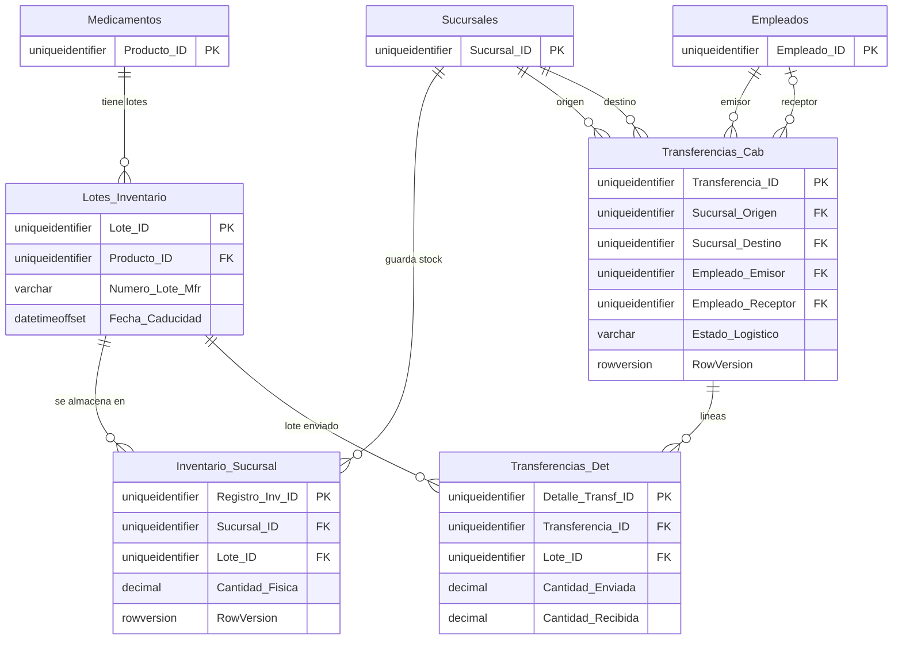
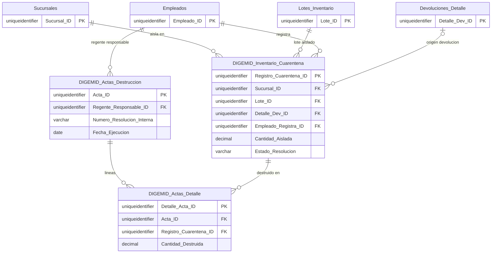
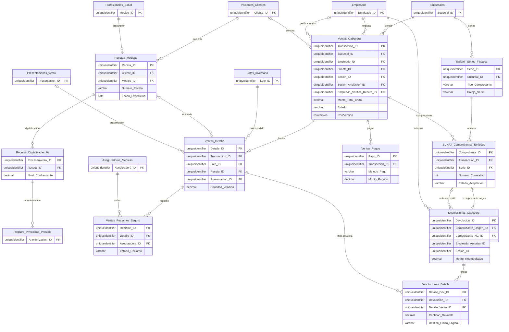
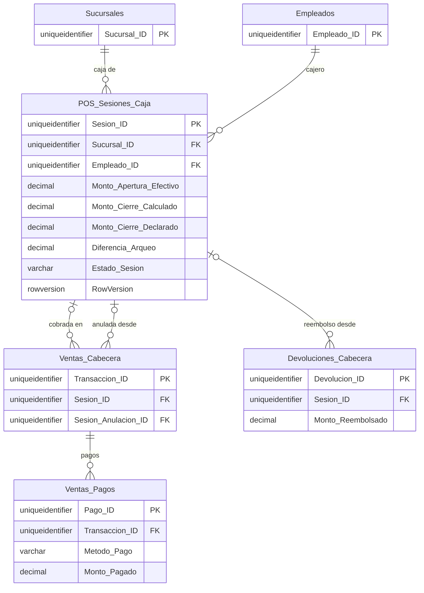
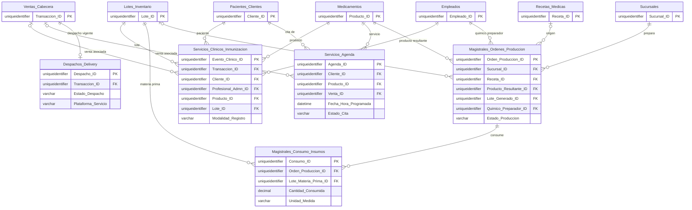

# Modelo de datos — Parte B: tablas transaccionales e historial de scripts

| | |
|---|---|
| **Sistema** | SOFIA — Sistema Optimizado Farmacéutico con Inteligencia Artificial |
| **Versión del documento** | 1.0 |
| **Fecha** | 2026-10-15 |
| **Backend** | `sofia-apis`, rama `main`, commit `43f5529` |
| **Frontend** | `sofia-web-spa`, rama `main`, commit `eeffbb6` |
| **Método** | Lectura de código: scripts DbUp `0001`–`0028` leídos completos y en orden (fuente de verdad), contrastados con las configuraciones de EF Core y las entidades de dominio; historial de commits con `git log` de solo lectura. No se consultó la base de datos ni la API. |

## 1. Alcance y forma de lectura

Este documento es la Parte B del diccionario de datos. Cubre las **23 tablas transaccionales** (inventario y transferencias, cuarentena y actas DIGEMID, recetas, caja, ventas, SUNAT, devoluciones, delivery, magistrales y servicios) y el **historial de los 28 scripts DbUp**. Las otras 27 tablas (maestros y seguridad) están en [03a-maestros-y-seguridad.md](03a-maestros-y-seguridad.md).

El esquema descrito es el **estado final tras aplicar los scripts `0001` a `0028`**. Commits verificados con `git log -1 --format=%h`: `sofia-apis` `43f5529` y `sofia-web-spa` `eeffbb6`, los de la línea base; `git status --short` no muestra cambios locales en ninguno de los dos repositorios, así que nada de este documento depende de archivos sin commitear.

### 1.1 Abreviaturas de las fuentes

| Abreviatura | Ruta real |
|---|---|
| `0001:148` | `sofia-apis/src/SOFIA.DbUp/Scripts/0001_Initial_Schema.sql`, línea 148. Igual para `0002` … `0028` (nombres completos en la sección de Fuentes). |
| `Cfg/X.cs:n` | `sofia-apis/src/SOFIA.Infrastructure/Persistence/Configurations/X.cs`, línea n |
| `Ent/X.cs:n` | `sofia-apis/src/SOFIA.Domain/Entities/X.cs`, línea n |
| `DbContext:n` | `sofia-apis/src/SOFIA.Infrastructure/Persistence/ApplicationDbContext.cs`, línea n |

### 1.2 Cómo leer las tablas de columnas

Igual que en la Parte A ([secciones 1.2 y 2](03a-maestros-y-seguridad.md#12-cómo-leer-las-tablas-de-columnas)): **Tipo** es el tipo de SQL Server declarado en el script; **Nulo** es `No` solo si el script dice `NOT NULL` o la columna es clave primaria (varias columnas con `DEFAULT` no llevan `NOT NULL` y admiten `NULL`); **Script** es `creación → última modificación`. Las siete columnas de auditoría y borrado lógico estándar (`CreatedAt`, `CreatedBy`, `LastModifiedAt`, `LastModifiedBy`, `IsDeleted`, `DeletedAt`, `DeletedBy`) se describen una sola vez en la [sección 2.3 de la Parte A](03a-maestros-y-seguridad.md#23-borrado-lógico-y-auditoría) y en esta Parte B se listan en cada tabla como «Auditoría estándar» con su línea de script, salvo donde la tabla se aparta del patrón.

## 2. Convenciones comunes (enlazadas a la Parte A)

- Claves primarias `UNIQUEIDENTIFIER` con `DEFAULT NEWSEQUENTIALID()` y sin nombre en el script: [Parte A, 2.1](03a-maestros-y-seguridad.md#21-claves-primarias). Las claves foráneas de estas tablas, salvo indicación, **no definen `ON DELETE`** (sin acción).
- `TenantId`: [Parte A, 2.2](03a-maestros-y-seguridad.md#22-multiempresa-columna-tenantid). Las 23 tablas de esta Parte B tenían `IsDeleted` cuando corrió el `0005`, así que **las 23 recibieron `TenantId UNIQUEIDENTIFIER NULL`** del SQL dinámico (`0005:54-70`), sin clave foránea y sin valor por defecto. Por eso `TenantId` no se repite en cada tabla de columnas: figura en la línea «Multiempresa, borrado lógico, auditoría, RowVersion» de cada una.
- Borrado lógico y auditoría: [Parte A, 2.3](03a-maestros-y-seguridad.md#23-borrado-lógico-y-auditoría). `RowVersion`: [Parte A, 2.4](03a-maestros-y-seguridad.md#24-concurrencia-rowversion).
- Unicidad por empresa y sensible al borrado lógico: [Parte A, 2.6](03a-maestros-y-seguridad.md#26-unicidad-por-empresa-y-sensible-al-borrado-lógico).

### 2.1 Resumen por tabla

`RowVersion` solo lo agrega el `0019` (`0019:2-16`). La única tabla de esta Parte B que se aparta del patrón de auditoría es `Servicios_Agenda` (ver su apartado).

| Tabla | `TenantId` | Borrado lógico | Auditoría | `RowVersion` |
|---|---|---|---|---|
| `Lotes_Inventario` | Sí | Sí | Completa | No |
| `Inventario_Sucursal` | Sí | Sí | Completa | Sí |
| `Transferencias_Cab` | Sí | Sí | Completa | Sí |
| `Transferencias_Det` | Sí | Sí | Completa | No |
| `DIGEMID_Inventario_Cuarentena` | Sí | Sí | Completa | No |
| `DIGEMID_Actas_Destruccion` | Sí | Sí | Completa | No |
| `DIGEMID_Actas_Detalle` | Sí | Sí | Completa | No |
| `Recetas_Medicas` | Sí | Sí | Completa | No |
| `Recetas_Digitalizadas_IA` | Sí | Sí | Completa | No |
| `POS_Sesiones_Caja` | Sí | Sí | Completa | Sí |
| `Ventas_Cabecera` | Sí | Sí | Completa | Sí |
| `Ventas_Detalle` | Sí | Sí | Completa | No |
| `Ventas_Pagos` | Sí | Sí | Completa | No |
| `Ventas_Reclamos_Seguro` | Sí | Sí | Completa | No |
| `SUNAT_Series_Fiscales` | Sí | Sí | Completa | No |
| `SUNAT_Comprobantes_Emitidos` | Sí | Sí | Completa | No |
| `Devoluciones_Cabecera` | Sí | Sí | Completa | No |
| `Devoluciones_Detalle` | Sí | Sí | Completa | No |
| `Despachos_Delivery` | Sí | Sí | Completa | No |
| `Magistrales_Ordenes_Produccion` | Sí | Sí | Completa | No |
| `Magistrales_Consumo_Insumos` | Sí | Sí | Completa | No |
| `Servicios_Agenda` | Sí | Sí (solo `IsDeleted`) | Parcial: solo `CreatedAt` y `CreatedBy` (`0001:760-762`) | No |
| `Servicios_Clinicos_Inmunizacion` | Sí | Sí | Completa | No |

(Fuentes de la tabla: `0001` para cada `CREATE TABLE`, `0005:54-70`, `0019:2-16`.)

### 2.2 Columnas de auditoría estándar de las tablas de esta Parte B

Salvo `Servicios_Agenda`, las 22 tablas restantes declaran las siete columnas de la [sección 2.3 de la Parte A](03a-maestros-y-seguridad.md#23-borrado-lógico-y-auditoría) con los tipos del `0001`: `CreatedAt DATETIMEOFFSET NOT NULL DEFAULT SYSDATETIMEOFFSET()`, `CreatedBy VARCHAR(100) NULL`, `LastModifiedAt DATETIMEOFFSET NULL`, `LastModifiedBy VARCHAR(100) NULL`, `IsDeleted BIT NOT NULL DEFAULT 0`, `DeletedAt DATETIMEOFFSET NULL`, `DeletedBy VARCHAR(100) NULL`. En las tablas de columnas de abajo se muestran como una sola fila «Auditoría estándar (7 columnas)» con el rango de líneas del script; en los conteos de la tabla de cobertura **sí se cuentan una por una** (7 columnas), más `TenantId` (agregada por el `0005`) y, donde corresponde, `RowVersion` (agregada por el `0019`).

### 2.3 Fechas `DATETIME` y conversión a UTC

Varias columnas de fecha de estas tablas son `DATETIME` (sin zona horaria). El `ApplicationDbContext` convierte toda propiedad `DateTime` y `DateTime?` con un conversor a UTC para que el JSON salga con `Z` (`DbContext:69-76`, comentario en `DbContext:71`). No se hace ninguna conversión para las columnas `DATETIMEOFFSET`.

---

## 3. Inventario y transferencias

### 3.1 `Lotes_Inventario`

**Propósito.** Catálogo de lotes de fabricante de cada producto: número de lote, fecha de fabricación y caducidad. Es el eje de la trazabilidad: ventas, transferencias, cuarentena, magistrales e inmunizaciones apuntan a un lote. La existencia por sucursal vive en `Inventario_Sucursal`.
**Entidad.** `LoteInventario` (`Ent/LoteInventario.cs:5`), configurada en `Cfg/LoteInventarioConfiguration.cs`. `DbSet LotesInventario` (`DbContext:31`); la usan 12 archivos de `SOFIA.Application`/`SOFIA.API`/`SOFIA.Infrastructure` (búsqueda de `.LotesInventario`).
**Creada en** `0001:148-162`; el `UX_Lotes_Producto_NumeroLote` se agregó editando el propio `0001` (ver sección de historial).

| Columna | Tipo | Nulo | Valor por defecto | Descripción | Script |
|---|---|---|---|---|---|
| `Lote_ID` | `UNIQUEIDENTIFIER` | No | `NEWSEQUENTIALID()` | Identificador del lote. Clave primaria. | `0001:149` |
| `Producto_ID` | `UNIQUEIDENTIFIER` | No | — | Producto (`Medicamentos`) al que pertenece el lote. | `0001:150` |
| `Numero_Lote_Mfr` | `VARCHAR(100)` | No | — | Número de lote del fabricante. Único por producto entre lotes no borrados. | `0001:151` |
| `Fecha_Fabricacion` | `DATETIMEOFFSET` | Sí | — | Fecha de fabricación. | `0001:152` |
| `Fecha_Caducidad` | `DATETIMEOFFSET` | No | — | Fecha de caducidad. | `0001:153` |
| Auditoría estándar (7 columnas) | ver 2.2 | — | — | `CreatedAt`, `CreatedBy`, `LastModifiedAt`, `LastModifiedBy`, `IsDeleted`, `DeletedAt`, `DeletedBy`. | `0001:154-160` |
| `TenantId` | `UNIQUEIDENTIFIER` | Sí | — | Empresa dueña de la fila. | `0005:54-70` |

**Clave primaria:** `Lote_ID` (sin nombre en el script).

| Clave foránea | Columna | Referencia | ON DELETE | Script |
|---|---|---|---|---|
| `FK_Lotes_Prod` | `Producto_ID` | `Medicamentos.Producto_ID` (Parte A) | No definido (sin acción) | `0001:161` |

**Referenciada por:** `Inventario_Sucursal.Lote_ID`, `Transferencias_Det.Lote_ID`, `Ventas_Detalle.Lote_ID`, `DIGEMID_Inventario_Cuarentena.Lote_ID`, `Magistrales_Ordenes_Produccion.Lote_Generado_ID`, `Magistrales_Consumo_Insumos.Lote_Materia_Prima_ID`, `Servicios_Clinicos_Inmunizacion.Lote_ID`.

| Índice | Tipo | Columnas | Filtro | Script |
|---|---|---|---|---|
| `UX_Lotes_Producto_NumeroLote` | Único no agrupado, filtrado | `Producto_ID`, `Numero_Lote_Mfr` | `WHERE IsDeleted = 0` | `0001:164` |
| `IX_Lotes_Caducidad` | No agrupado | `Fecha_Caducidad` | — | `0001:166` |

**Multiempresa, borrado lógico, auditoría, RowVersion:** `TenantId` sí; `IsDeleted` sí; auditoría completa; `RowVersion` no. El índice único `UX_Lotes_Producto_NumeroLote` **no incluye `TenantId`**: la unicidad se apoya en `Producto_ID`, que ya pertenece a una sola empresa.
**Datos sembrados:** ninguno.

### 3.2 `Inventario_Sucursal`

**Propósito.** Existencia física de un lote en una sucursal: una fila por par (sucursal, lote) con la cantidad en la unidad base del producto.
**Entidad.** `InventarioSucursal` (`Ent/InventarioSucursal.cs:5`), configurada en `Cfg/InventarioSucursalConfiguration.cs`. `DbSet LotesEnSucursal` (`DbContext:32`); en uso (22 archivos).
**Creada en** `0001:168-183`; modificada en `0018` (índice único) y `0019` (`RowVersion`).

| Columna | Tipo | Nulo | Valor por defecto | Descripción | Script |
|---|---|---|---|---|---|
| `Registro_Inv_ID` | `UNIQUEIDENTIFIER` | No | `NEWSEQUENTIALID()` | Identificador del registro. Clave primaria. | `0001:169` |
| `Sucursal_ID` | `UNIQUEIDENTIFIER` | No | — | Sucursal que guarda el stock. | `0001:170` |
| `Lote_ID` | `UNIQUEIDENTIFIER` | No | — | Lote almacenado. | `0001:171` |
| `Cantidad_Fisica` | `DECIMAL(12,4)` | No | — | Cantidad física en unidad base. No puede ser negativa (`CHK_Inventario_Positivo`). | `0001:172` |
| Auditoría estándar (7 columnas) | ver 2.2 | — | — | | `0001:173-179` |
| `TenantId` | `UNIQUEIDENTIFIER` | Sí | — | Empresa dueña de la fila. | `0005:54-70` |
| `RowVersion` | `ROWVERSION` | No | automático | Concurrencia optimista: evita que dos ventas o transferencias simultáneas pisen la misma cantidad. | `0019:2-4` |

**Clave primaria:** `Registro_Inv_ID`.

| Clave foránea | Columna | Referencia | ON DELETE | Script |
|---|---|---|---|---|
| `FK_InvSuc_Sucursal` | `Sucursal_ID` | `Sucursales.Sucursal_ID` (Parte A) | No definido (sin acción) | `0001:181` |
| `FK_InvSuc_Lote` | `Lote_ID` | `Lotes_Inventario.Lote_ID` | No definido (sin acción) | `0001:182` |

| Índice / constraint | Tipo | Columnas | Definición | Script |
|---|---|---|---|---|
| `CHK_Inventario_Positivo` | `CHECK` | `Cantidad_Fisica` | `Cantidad_Fisica >= 0` | `0001:180` |
| `UX_Inventario_Sucursal_Lote` | Índice único filtrado | `Sucursal_ID`, `Lote_ID` | `WHERE IsDeleted = 0` | `0018:28-31` |

El comentario del `0018` dice que ese índice estaba «declarado por el modelo de EF desde el inicio pero nunca creado por un script» (`0018:27`). Entre el `0001` y el `0018` la base permitía filas duplicadas para el mismo par.

**Multiempresa, borrado lógico, auditoría, RowVersion:** `TenantId` sí; `IsDeleted` sí; auditoría completa; `RowVersion` sí.
**Datos sembrados:** ninguno.

### 3.3 `Transferencias_Cab`

**Propósito.** Cabecera de un traslado de mercadería entre dos sucursales: quién la emite y la recibe, estado logístico y fechas.
**Entidad.** `Transferencia` (`Ent/Transferencia.cs:6`), configurada en `Cfg/TransferenciaConfiguration.cs`. `DbSet Transferencias` (`DbContext:35`). El código la escribe desde `CreateTransferenciaCommandHandler`; el SPA no tiene ninguna ruta de transferencias (`docs/_inventario/rutas-spa.csv` no contiene ninguna ruta con ese nombre): **Solo API (sin pantalla)**.
**Creada en** `0001:185-206`; `RowVersion` en `0019`.

| Columna | Tipo | Nulo | Valor por defecto | Descripción | Script |
|---|---|---|---|---|---|
| `Transferencia_ID` | `UNIQUEIDENTIFIER` | No | `NEWSEQUENTIALID()` | Identificador. Clave primaria. | `0001:186` |
| `Sucursal_Origen` | `UNIQUEIDENTIFIER` | No | — | Sucursal que despacha. | `0001:187` |
| `Sucursal_Destino` | `UNIQUEIDENTIFIER` | No | — | Sucursal que recibe. | `0001:188` |
| `Estado_Logistico` | `VARCHAR(30)` | No | — | Estado del traslado. Valores permitidos por el `CHECK`: `Iniciada`, `Aprobada`, `En_Transito`, `Recibida_Parcial`, `Completada`, `Cancelada`; coinciden con los nombres del enum `EstadoLogistico` (`sofia-apis/src/SOFIA.Domain/Enums/EstadoLogistico.cs`), que EF guarda como texto (`Cfg/TransferenciaConfiguration.cs:27-31`). | `0001:189` |
| `Empleado_Emisor` | `UNIQUEIDENTIFIER` | No | — | Empleado que despacha. | `0001:190` |
| `Empleado_Receptor` | `UNIQUEIDENTIFIER` | Sí | — | Empleado que recibe; nulo hasta la recepción. | `0001:191` |
| `Fecha_Despacho` | `DATETIME` | No | — | Fecha de despacho. | `0001:192` |
| `Fecha_Recepcion` | `DATETIME` | Sí | — | Fecha de recepción. | `0001:193` |
| Auditoría estándar (7 columnas) | ver 2.2 | — | — | | `0001:194-200` |
| `TenantId` | `UNIQUEIDENTIFIER` | Sí | — | Empresa dueña de la fila. | `0005:54-70` |
| `RowVersion` | `ROWVERSION` | No | automático | Concurrencia optimista. | `0019:10-12` |

**Clave primaria:** `Transferencia_ID`.

| Clave foránea | Columna | Referencia | ON DELETE | Script |
|---|---|---|---|---|
| `FK_TransCab_Origen` | `Sucursal_Origen` | `Sucursales.Sucursal_ID` | No definido | `0001:202` |
| `FK_TransCab_Destino` | `Sucursal_Destino` | `Sucursales.Sucursal_ID` | No definido | `0001:203` |
| `FK_TransCab_Emisor` | `Empleado_Emisor` | `Empleados.Empleado_ID` | No definido | `0001:204` |
| `FK_TransCab_Receptor` | `Empleado_Receptor` | `Empleados.Empleado_ID` | No definido | `0001:205` |

| Constraint | Tipo | Definición | Script |
|---|---|---|---|
| `CHK_Estado_Logistico` | `CHECK` | `Estado_Logistico IN ('Iniciada', 'Aprobada', 'En_Transito', 'Recibida_Parcial', 'Completada', 'Cancelada')` | `0001:201` |

No hay índices adicionales. Nada impide en la base que origen y destino sean la misma sucursal.
**Multiempresa, borrado lógico, auditoría, RowVersion:** `TenantId` sí; `IsDeleted` sí; auditoría completa; `RowVersion` sí.
**Datos sembrados:** ninguno.

### 3.4 `Transferencias_Det`

**Propósito.** Líneas de una transferencia: qué lote y qué cantidad se envía y cuánto se recibió.
**Entidad.** `DetalleTransferencia` (`Ent/DetalleTransferencia.cs:5`), configurada en `Cfg/DetalleTransferenciaConfiguration.cs`. `DbSet DetallesTransferencia` (`DbContext:36`); `CreateTransferenciaCommandHandler` crea las líneas junto con la cabecera. Sin pantalla (ver 3.3).
**Creada en** `0001:208-223`; `CHECK` agregados en `0020`.

| Columna | Tipo | Nulo | Valor por defecto | Descripción | Script |
|---|---|---|---|---|---|
| `Detalle_Transf_ID` | `UNIQUEIDENTIFIER` | No | `NEWSEQUENTIALID()` | Identificador. Clave primaria. | `0001:209` |
| `Transferencia_ID` | `UNIQUEIDENTIFIER` | No | — | Cabecera. | `0001:210` |
| `Lote_ID` | `UNIQUEIDENTIFIER` | No | — | Lote enviado. | `0001:211` |
| `Cantidad_Enviada` | `DECIMAL(12,4)` | No | — | Cantidad despachada; debe ser mayor que cero. | `0001:212` |
| `Cantidad_Recibida` | `DECIMAL(12,4)` | Sí | — | Cantidad recibida; entre 0 y la enviada. | `0001:213` |
| Auditoría estándar (7 columnas) | ver 2.2 | — | — | | `0001:214-220` |
| `TenantId` | `UNIQUEIDENTIFIER` | Sí | — | Empresa dueña de la fila. | `0005:54-70` |

**Clave primaria:** `Detalle_Transf_ID`.

| Clave foránea | Columna | Referencia | ON DELETE | Script |
|---|---|---|---|---|
| `FK_TransDet_Cab` | `Transferencia_ID` | `Transferencias_Cab.Transferencia_ID` | No definido | `0001:221` |
| `FK_TransDet_Lote` | `Lote_ID` | `Lotes_Inventario.Lote_ID` | No definido | `0001:222` |

| Constraint | Tipo | Definición | Script |
|---|---|---|---|
| `CHK_Transferencias_Det_Cantidad_Enviada` | `CHECK` | `Cantidad_Enviada > 0` | `0020:103-104` |
| `CHK_Transferencias_Det_Cantidad_Recibida` | `CHECK` | `Cantidad_Recibida >= 0 AND Cantidad_Recibida <= Cantidad_Enviada` (con `NULL` el `CHECK` no rechaza) | `0020:105-106` |

**Multiempresa, borrado lógico, auditoría, RowVersion:** `TenantId` sí; `IsDeleted` sí; auditoría completa; `RowVersion` no.
**Datos sembrados:** ninguno.

## 4. Cuarentena y actas de destrucción DIGEMID

El catálogo `DIGEMID_Catalogo_Productos` es de la [Parte A](03a-maestros-y-seguridad.md#68-digemid_catalogo_productos). Las tres tablas siguientes registran el aislamiento de producto y su destrucción documentada. Ninguna tiene pantalla enrutada en el SPA (no hay ruta de cuarentena ni de actas en `docs/_inventario/rutas-spa.csv`): **Solo API (sin pantalla)**.

### 4.1 `DIGEMID_Inventario_Cuarentena`

**Propósito.** Registro de cantidades de un lote aisladas en una sucursal (producto devuelto, vencido u otro motivo) hasta resolverlas.
**Entidad.** `DigemidInventarioCuarentena` (`Ent/DigemidInventarioCuarentena.cs:6`), configurada en `Cfg/DigemidInventarioCuarentenaConfiguration.cs`. `DbSet DigemidInventarioCuarentena` (`DbContext:52`). Se escribe en `AislarLoteCuarentenaCommandHandler` y se lee en consultas de cuarentena, tableros de inventario, venta (lotes vendibles) y borrado de sucursal (8 archivos).
**Creada en** `0001:632-653`. Ningún script posterior la modifica (salvo `TenantId` del `0005`).

| Columna | Tipo | Nulo | Valor por defecto | Descripción | Script |
|---|---|---|---|---|---|
| `Registro_Cuarentena_ID` | `UNIQUEIDENTIFIER` | No | `NEWSEQUENTIALID()` | Identificador. Clave primaria. | `0001:633` |
| `Sucursal_ID` | `UNIQUEIDENTIFIER` | No | — | Sucursal donde está aislado el producto. | `0001:634` |
| `Lote_ID` | `UNIQUEIDENTIFIER` | No | — | Lote aislado. | `0001:635` |
| `Detalle_Dev_ID` | `UNIQUEIDENTIFIER` | Sí | — | Línea de devolución que originó el aislamiento, si la hay. | `0001:636` |
| `Cantidad_Aislada` | `DECIMAL(12,4)` | No | — | Cantidad aislada (unidad base). | `0001:637` |
| `Motivo_Aislamiento` | `VARCHAR(50)` | No | — | Motivo, texto libre sin `CHECK` (la validación de comando limita a 50 caracteres: `AislarLoteCuarentenaCommandValidator.cs:12`). | `0001:638` |
| `Fecha_Ingreso_Cuarentena` | `DATETIME` | Sí | `CURRENT_TIMESTAMP` | Fecha de ingreso a cuarentena. | `0001:639` |
| `Estado_Resolucion` | `VARCHAR(20)` | Sí | `'Retenido'` | Estado de la resolución. Sin `CHECK` en la base; el dominio restringe a `Retenido`, `Liberado`, `Destruido`, `Devuelto` (`sofia-apis/src/SOFIA.Domain/Enums/EstadoResolucionCuarentena.cs`). | `0001:640` |
| `Empleado_Registra_ID` | `UNIQUEIDENTIFIER` | No | — | Empleado que registra el aislamiento. | `0001:641` |
| Auditoría estándar (7 columnas) | ver 2.2 | — | — | | `0001:642-648` |
| `TenantId` | `UNIQUEIDENTIFIER` | Sí | — | Empresa dueña de la fila. | `0005:54-70` |

**Clave primaria:** `Registro_Cuarentena_ID`.

| Clave foránea | Columna | Referencia | ON DELETE | Script |
|---|---|---|---|---|
| `FK_Cuarentena_Sucursal` | `Sucursal_ID` | `Sucursales.Sucursal_ID` | No definido | `0001:649` |
| `FK_Cuarentena_Lote` | `Lote_ID` | `Lotes_Inventario.Lote_ID` | No definido | `0001:650` |
| `FK_Cuarentena_Empleado` | `Empleado_Registra_ID` | `Empleados.Empleado_ID` | No definido | `0001:651` |
| `FK_Cuarentena_Devolucion` | `Detalle_Dev_ID` | `Devoluciones_Detalle.Detalle_Dev_ID` | No definido | `0001:652` |

**Referenciada por:** `DIGEMID_Actas_Detalle.Registro_Cuarentena_ID`. **Índices y constraints:** ninguno aparte de la clave primaria.
**Multiempresa, borrado lógico, auditoría, RowVersion:** `TenantId` sí; `IsDeleted` sí; auditoría completa; `RowVersion` no.
**Datos sembrados:** ninguno.

### 4.2 `DIGEMID_Actas_Destruccion`

**Propósito.** Cabecera del acta de destrucción de productos: resolución interna, empresa de residuos, manifiesto de transporte, fecha y regente responsable.
**Entidad.** `DigemidActaDestruccion` (`Ent/DigemidActaDestruccion.cs:5`), configurada en `Cfg/DigemidActaDestruccionConfiguration.cs`. `DbSet DIGEMIDActasDestruccion` (`DbContext:53`). Solo `GenerarActaDestruccionCommandHandler` la usa: inserta la cabecera (`GenerarActaDestruccionCommandHandler.cs:25`) sin crear líneas de detalle.
**Creada en** `0001:655-671`; la unicidad pasó de global a por empresa en `0015` y a sensible al borrado lógico en `0020`.

| Columna | Tipo | Nulo | Valor por defecto | Descripción | Script |
|---|---|---|---|---|---|
| `Acta_ID` | `UNIQUEIDENTIFIER` | No | `NEWSEQUENTIALID()` | Identificador. Clave primaria. | `0001:656` |
| `Numero_Resolucion_Interna` | `VARCHAR(50)` | No | — | Número de resolución interna del acta. Único por empresa entre actas no borradas. | `0001:657` → `0020:6-7` |
| `Empresa_Residuos_Biocontaminados` | `VARCHAR(150)` | No | — | Empresa que gestiona los residuos. | `0001:658` |
| `Manifiesto_Transporte_Doc` | `VARCHAR(50)` | Sí | — | Documento del manifiesto de transporte. | `0001:659` |
| `Fecha_Ejecucion` | `DATE` | No | — | Fecha de ejecución de la destrucción. | `0001:660` |
| `Regente_Responsable_ID` | `UNIQUEIDENTIFIER` | No | — | Empleado regente responsable. | `0001:661` |
| `Ruta_Acta_Firmada_PDF` | `VARCHAR(500)` | Sí | — | Ruta del PDF firmado. | `0001:662` |
| Auditoría estándar (7 columnas) | ver 2.2 | — | — | | `0001:663-669` |
| `TenantId` | `UNIQUEIDENTIFIER` | Sí | — | Empresa dueña de la fila. | `0005:54-70` |

**Clave primaria:** `Acta_ID`.

| Clave foránea | Columna | Referencia | ON DELETE | Script |
|---|---|---|---|---|
| `FK_Acta_Regente` | `Regente_Responsable_ID` | `Empleados.Empleado_ID` | No definido | `0001:670` |

| Índice | Tipo | Columnas | Filtro | Script |
|---|---|---|---|---|
| `UX_DIGEMID_Actas_Destruccion_Tenant_Numero_Resolucion_Interna` | Único, filtrado | `TenantId`, `Numero_Resolucion_Interna` | `WHERE IsDeleted = 0` | `0015:7` (sin filtro), recreado en `0020:6-7` |

La restricción `UNIQUE` en línea del `0001:657` (nombre autogenerado) la elimina el `0015` buscándola por columna (`0015:32-52`).
**Referenciada por:** `DIGEMID_Actas_Detalle.Acta_ID`.
**Multiempresa, borrado lógico, auditoría, RowVersion:** `TenantId` sí; `IsDeleted` sí; auditoría completa; `RowVersion` no.
**Datos sembrados:** ninguno.

### 4.3 `DIGEMID_Actas_Detalle`

**Propósito.** Líneas del acta: qué registro de cuarentena y qué cantidad se destruyó.
**Entidad.** `DigemidActaDetalle` (`Ent/DigemidActaDetalle.cs:5`), configurada en `Cfg/DigemidActaDetalleConfiguration.cs`. `DbSet DIGEMIDActasDetalle` (`DbContext:54`). **Nadie escribe ni lee esta tabla**: la clase `DigemidActaDetalle` solo aparece en `IApplicationDbContext`, `ApplicationDbContext` y su configuración (búsqueda por nombre en `SOFIA.Application`, `SOFIA.API` y `SOFIA.Infrastructure`), y el handler que genera el acta no crea detalles (ver 4.2).
**Creada en** `0001:673-687`. Ningún script posterior la modifica (salvo `TenantId`).

| Columna | Tipo | Nulo | Valor por defecto | Descripción | Script |
|---|---|---|---|---|---|
| `Detalle_Acta_ID` | `UNIQUEIDENTIFIER` | No | `NEWSEQUENTIALID()` | Identificador. Clave primaria. | `0001:674` |
| `Acta_ID` | `UNIQUEIDENTIFIER` | No | — | Acta a la que pertenece. | `0001:675` |
| `Registro_Cuarentena_ID` | `UNIQUEIDENTIFIER` | No | — | Registro de cuarentena destruido. | `0001:676` |
| `Cantidad_Destruida` | `DECIMAL(12,4)` | No | — | Cantidad destruida. | `0001:677` |
| Auditoría estándar (7 columnas) | ver 2.2 | — | — | | `0001:678-684` |
| `TenantId` | `UNIQUEIDENTIFIER` | Sí | — | Empresa dueña de la fila. | `0005:54-70` |

**Clave primaria:** `Detalle_Acta_ID`.

| Clave foránea | Columna | Referencia | ON DELETE | Script |
|---|---|---|---|---|
| `FK_ActaDet_Acta` | `Acta_ID` | `DIGEMID_Actas_Destruccion.Acta_ID` | No definido | `0001:685` |
| `FK_ActaDet_Cuarentena` | `Registro_Cuarentena_ID` | `DIGEMID_Inventario_Cuarentena.Registro_Cuarentena_ID` | No definido | `0001:686` |

**Índices y constraints:** ninguno aparte de la clave primaria. No hay `CHECK` sobre `Cantidad_Destruida`.
**Multiempresa, borrado lógico, auditoría, RowVersion:** `TenantId` sí; `IsDeleted` sí; auditoría completa; `RowVersion` no.
**Datos sembrados:** ninguno.

---

## 5. Recetas

### 5.1 `Recetas_Medicas`

**Propósito.** Receta médica registrada en el sistema: paciente, prescriptor, fecha de expedición, repeticiones, indicaciones y número de receta.
**Entidad.** `RecetaMedica` (`Ent/RecetaMedica.cs:6`), configurada en `Cfg/RecetaMedicaConfiguration.cs`. `DbSet Recetas` (`DbContext:41`); en uso (comandos y consultas de `Recetas`, y las ventas y magistrales que la referencian).
**Creada en** `0001:296-312`; `Numero_Receta` agregada en `0025`.

| Columna | Tipo | Nulo | Valor por defecto | Descripción | Script |
|---|---|---|---|---|---|
| `Receta_ID` | `UNIQUEIDENTIFIER` | No | `NEWSEQUENTIALID()` | Identificador. Clave primaria. | `0001:297` |
| `Cliente_ID` | `UNIQUEIDENTIFIER` | No | — | Paciente (`Pacientes_Clientes`, Parte A). | `0001:298` |
| `Medico_ID` | `UNIQUEIDENTIFIER` | No | — | Prescriptor (`Profesionales_Salud`, Parte A). | `0001:299` |
| `Fecha_Expedicion` | `DATE` | No | — | Fecha de expedición. | `0001:300` |
| `Repeticiones_Max` | `INT` | Sí | `0` | Máximo de repeticiones. | `0001:301` |
| `Indicaciones_Uso` | `VARCHAR(MAX)` | Sí | — | Indicaciones de uso. | `0001:302` |
| Auditoría estándar (7 columnas) | ver 2.2 | — | — | | `0001:303-309` |
| `TenantId` | `UNIQUEIDENTIFIER` | Sí | — | Empresa dueña de la fila. | `0005:54-70` |
| `Numero_Receta` | `VARCHAR(30)` | Sí | — | Número de la receta tal como figura en el documento; el `0025` lo agrega «el número de receta que necesitan los productos controlados» (`0025:1`). | `0025:18-19` |

**Clave primaria:** `Receta_ID`.

| Clave foránea | Columna | Referencia | ON DELETE | Script |
|---|---|---|---|---|
| `FK_Receta_Cliente` | `Cliente_ID` | `Pacientes_Clientes.Cliente_ID` | No definido | `0001:310` |
| `FK_Receta_Medico` | `Medico_ID` | `Profesionales_Salud.Medico_ID` | No definido | `0001:311` |

**Referenciada por:** `Recetas_Digitalizadas_IA.Receta_ID`, `Ventas_Detalle.Receta_ID`, `Magistrales_Ordenes_Produccion.Receta_ID`. **Índices y constraints:** ninguno aparte de la clave primaria (no hay índice por `Cliente_ID`, `Medico_ID` ni `Numero_Receta`).
**Multiempresa, borrado lógico, auditoría, RowVersion:** `TenantId` sí; `IsDeleted` sí; auditoría completa; `RowVersion` no.
**Datos sembrados:** ninguno.

### 5.2 `Recetas_Digitalizadas_IA`

**Propósito (según el diseño del esquema).** Resultado del reconocimiento óptico y del análisis con IA de la imagen de una receta: ruta de la imagen, texto crudo, entidades clínicas extraídas, nivel de confianza y si requiere revisión humana.
**Entidad.** `RecetaDigitalizadaIA` (`Ent/RecetaDigitalizadaIA.cs:5`), configurada en `Cfg/RecetaDigitalizadaIAConfiguration.cs`. `DbSet RecetasDigitalizadasIA` (`DbContext:62`). **Nadie la escribe ni la lee**: la clase solo aparece en `IApplicationDbContext`, `ApplicationDbContext` y su configuración; el análisis de receta (`AnalizarRecetaQueryHandler`) no usa este `DbSet`.
**Creada en** `0001:412-429`. Ningún script posterior la modifica (salvo `TenantId`).

| Columna | Tipo | Nulo | Valor por defecto | Descripción | Script |
|---|---|---|---|---|---|
| `Procesamiento_ID` | `UNIQUEIDENTIFIER` | No | `NEWSEQUENTIALID()` | Identificador. Clave primaria. | `0001:413` |
| `Receta_ID` | `UNIQUEIDENTIFIER` | No | — | Receta digitalizada. | `0001:414` |
| `Ruta_Imagen_Blob` | `VARCHAR(500)` | No | — | Ruta de la imagen almacenada. | `0001:415` |
| `Texto_Crudo_OCR` | `VARCHAR(MAX)` | Sí | — | Texto crudo del OCR. | `0001:416` |
| `Entidades_Clinicas_Extraidas` | `NVARCHAR(MAX)` | Sí | — | Entidades clínicas extraídas (texto, presumiblemente JSON; el script no lo dice). | `0001:417` |
| `Nivel_Confianza_IA` | `DECIMAL(5,2)` | No | — | Nivel de confianza de la IA. Sin `CHECK` de rango. | `0001:418` |
| `Requiere_Revision_Humana` | `BIT` | Sí | `1` | Marca de revisión humana pendiente. | `0001:419` |
| `Fecha_Procesamiento` | `DATETIME` | Sí | `CURRENT_TIMESTAMP` | Fecha de procesamiento. | `0001:420` |
| Auditoría estándar (7 columnas) | ver 2.2 | — | — | | `0001:421-427` |
| `TenantId` | `UNIQUEIDENTIFIER` | Sí | — | Empresa dueña de la fila. | `0005:54-70` |

**Clave primaria:** `Procesamiento_ID`.

| Clave foránea | Columna | Referencia | ON DELETE | Script |
|---|---|---|---|---|
| `FK_RecetaIA_Receta` | `Receta_ID` | `Recetas_Medicas.Receta_ID` | No definido | `0001:428` |

**Referenciada por:** `Registro_Privacidad_Presidio.Procesamiento_ID` (Parte A). **Índices y constraints:** ninguno aparte de la clave primaria.
**Multiempresa, borrado lógico, auditoría, RowVersion:** `TenantId` sí; `IsDeleted` sí; auditoría completa; `RowVersion` no.
**Datos sembrados:** ninguno.

## 6. Caja y ventas

### 6.1 `POS_Sesiones_Caja`

**Propósito.** Sesión de caja de un cajero en una sucursal: apertura con efectivo inicial, cierre con monto calculado, declarado y diferencia de arqueo.
**Entidad.** `PosSesionCaja` (`Ent/PosSesionCaja.cs:5`), configurada en `Cfg/PosSesionCajaConfiguration.cs`. `DbSet POSSesionesCaja` (`DbContext:42`); en uso (apertura, cierre, ventas, devoluciones y anulaciones).
**Creada en** `0001:314-335`; modificada en `0019` (`RowVersion` e índice de sesión abierta) y `0020` (`CHECK` de montos).

| Columna | Tipo | Nulo | Valor por defecto | Descripción | Script (creación / última modificación) |
|---|---|---|---|---|---|
| `Sesion_ID` | `UNIQUEIDENTIFIER` | No | `NEWSEQUENTIALID()` | Identificador de la sesión. Clave primaria. | `0001:315` |
| `Sucursal_ID` | `UNIQUEIDENTIFIER` | No | — | Sucursal de la caja. | `0001:316` |
| `Empleado_ID` | `UNIQUEIDENTIFIER` | No | — | Cajero titular. | `0001:317` |
| `Fecha_Hora_Apertura` | `DATETIME` | No | `CURRENT_TIMESTAMP` | Apertura. | `0001:318` |
| `Fecha_Hora_Cierre` | `DATETIME` | Sí | — | Cierre; nulo mientras está abierta. | `0001:319` |
| `Monto_Apertura_Efectivo` | `DECIMAL(10,2)` | No | — | Efectivo con el que se abre. | `0001:320` |
| `Monto_Cierre_Calculado` | `DECIMAL(10,2)` | Sí | — | Efectivo esperado al cierre (el sistema lo calcula). | `0001:321` |
| `Monto_Cierre_Declarado` | `DECIMAL(10,2)` | Sí | — | Efectivo contado y declarado por el cajero. | `0001:322` |
| `Diferencia_Arqueo` | `DECIMAL(10,2)` | Sí | — | Diferencia entre declarado y calculado. | `0001:323` |
| `Estado_Sesion` | `VARCHAR(20)` | No | `'Abierta'` | Estado. Valores permitidos por el `CHECK`: `Abierta`, `Cerrada`, `Cuadrada`; coinciden con las descripciones del enum `EstadoSesion` (`sofia-apis/src/SOFIA.Domain/Enums/EstadoSesion.cs`). | `0001:324` |
| Auditoría estándar (7 columnas) | ver 2.2 | — | — | | `0001:325-331` |
| `TenantId` | `UNIQUEIDENTIFIER` | Sí | — | Empresa dueña de la fila. | `0005:54-70` |
| `RowVersion` | `ROWVERSION` | No | automático | Concurrencia optimista. | `0019:14-16` |

**Clave primaria:** `Sesion_ID`.

| Clave foránea | Columna | Referencia | ON DELETE | Script |
|---|---|---|---|---|
| `FK_POSSesion_Sucursal` | `Sucursal_ID` | `Sucursales.Sucursal_ID` | No definido | `0001:333` |
| `FK_POSSesion_Empleado` | `Empleado_ID` | `Empleados.Empleado_ID` | No definido | `0001:334` |

**Referenciada por:** `Ventas_Cabecera.Sesion_ID` y `.Sesion_Anulacion_ID`, `Devoluciones_Cabecera.Sesion_ID`.

| Índice / constraint | Tipo | Columnas | Definición | Script |
|---|---|---|---|---|
| `CHK_Estado_Sesion` | `CHECK` | `Estado_Sesion` | `Estado_Sesion IN ('Abierta', 'Cerrada', 'Cuadrada')` | `0001:332` |
| `UX_POS_Sesiones_Caja_Empleado_Abierta` | Único, filtrado | `Empleado_ID` | `WHERE Estado_Sesion = 'Abierta' AND IsDeleted = 0` (una sola sesión abierta por cajero) | `0019:22-25` |
| `CHK_POS_Sesiones_Caja_Montos` | `CHECK` | los tres montos | `Monto_Apertura_Efectivo >= 0 AND Monto_Cierre_Calculado >= 0 AND Monto_Cierre_Declarado >= 0` | `0020:135-136` |

**Multiempresa, borrado lógico, auditoría, RowVersion:** `TenantId` sí; `IsDeleted` sí; auditoría completa; `RowVersion` sí.
**Datos sembrados:** ninguno.

### 6.2 `Ventas_Cabecera`

**Propósito.** Cabecera de cada venta del punto de venta: sucursal, cajero, cliente opcional, sesión de caja, monto total, estado y trazabilidad de la verificación de receta y de la anulación.
**Entidad.** `Venta` (`Ent/Venta.cs:6`), configurada en `Cfg/VentaConfiguration.cs`. `DbSet Ventas` (`DbContext:33`); en uso intensivo (módulo de ventas, devoluciones, dashboard, delivery, servicios).
**Creada en** `0001:337-359` (las columnas `Estado` y `Motivo_Anulacion` y su `CHECK` se agregaron editando el propio `0001`, ver historial); modificada en `0012`, `0019`, `0020`, `0025` y `0028`.

| Columna | Tipo | Nulo | Valor por defecto | Descripción | Script (creación / última modificación) |
|---|---|---|---|---|---|
| `Transaccion_ID` | `UNIQUEIDENTIFIER` | No | `NEWSEQUENTIALID()` | Identificador de la venta. Clave primaria. | `0001:338` |
| `Sucursal_ID` | `UNIQUEIDENTIFIER` | No | — | Sucursal que vende. | `0001:339` |
| `Empleado_ID` | `UNIQUEIDENTIFIER` | No | — | Empleado que registra la venta. | `0001:340` |
| `Cliente_ID` | `UNIQUEIDENTIFIER` | Sí | — | Paciente o cliente, si se informó. | `0001:341` |
| `Sesion_ID` | `UNIQUEIDENTIFIER` | Sí | — | Sesión de caja en la que se cobró. | `0001:342` |
| `Fecha_Hora_UTC` | `DATETIME` | Sí | `CURRENT_TIMESTAMP` | Fecha y hora de la venta. | `0001:343` |
| `Monto_Total_Bruto` | `DECIMAL(12,2)` | No | — | Total de la venta; no puede ser negativo. | `0001:344` |
| `Estado` | `VARCHAR(20)` | No | `'Completada'` | Estado. Valores permitidos por el `CHECK`: `Completada`, `Anulada`, `Devuelta`, `Pendiente`; son los nombres del enum `EstadoVenta` (`sofia-apis/src/SOFIA.Domain/Enums/EstadoVenta.cs`). | `0001:345` |
| `Motivo_Anulacion` | `VARCHAR(255)` | Sí | — | Motivo de anulación. | `0001:346` |
| Auditoría estándar (7 columnas) | ver 2.2 | — | — | | `0001:347-353` |
| `TenantId` | `UNIQUEIDENTIFIER` | Sí | — | Empresa dueña de la fila. | `0005:54-70` |
| `RowVersion` | `ROWVERSION` | No | automático | Concurrencia optimista (dos operaciones simultáneas sobre la misma venta). | `0019:6-8` |
| `Empleado_Verifica_Receta_ID` | `UNIQUEIDENTIFIER` | Sí | — | Empleado que verificó la receta al cobrar (rastro de la verificación). | `0025:6-7` |
| `Fecha_Verificacion_Receta` | `DATETIME` | Sí | — | Fecha y hora de esa verificación. | `0025:10-11` |
| `Sesion_Anulacion_ID` | `UNIQUEIDENTIFIER` | Sí | — | Sesión de caja desde la que se anuló una venta cobrada, para que el efectivo devuelto se cuente en la caja de la que salió (`0028:1`). | `0028:2-3` |

**Clave primaria:** `Transaccion_ID`.

| Clave foránea | Columna | Referencia | ON DELETE | Script |
|---|---|---|---|---|
| `FK_VentaCab_Sucursal` | `Sucursal_ID` | `Sucursales.Sucursal_ID` | No definido | `0001:354` |
| `FK_VentaCab_Empleado` | `Empleado_ID` | `Empleados.Empleado_ID` | No definido | `0001:355` |
| `FK_VentaCab_Sesion` | `Sesion_ID` | `POS_Sesiones_Caja.Sesion_ID` | No definido | `0001:356` |
| `FK_VentaCab_Cliente` | `Cliente_ID` | `Pacientes_Clientes.Cliente_ID` | No definido | `0001:357` |
| `FK_VentaCab_Empleado_Verifica_Receta` | `Empleado_Verifica_Receta_ID` | `Empleados.Empleado_ID` | No definido | `0025:14-15` |
| `FK_VentaCab_Sesion_Anulacion` | `Sesion_Anulacion_ID` | `POS_Sesiones_Caja.Sesion_ID` | No definido | `0028:6-7` |

**Referenciada por:** `Ventas_Detalle.Transaccion_ID`, `Ventas_Pagos.Transaccion_ID`, `SUNAT_Comprobantes_Emitidos.Transaccion_ID`, `Despachos_Delivery.Transaccion_ID`, `Servicios_Clinicos_Inmunizacion.Transaccion_ID`, `Servicios_Agenda.Venta_ID`.

| Índice / constraint | Tipo | Columnas | Definición | Script |
|---|---|---|---|---|
| `CHK_Venta_Estado` | `CHECK` | `Estado` | `Estado IN ('Completada', 'Anulada', 'Devuelta', 'Pendiente')` | `0001:358` |
| `IX_Ventas_Cabecera_Sucursal_Fecha_Estado` | No agrupado | `Sucursal_ID`, `Fecha_Hora_UTC`, `Estado` | — (apoya la consulta de más vendidos del POS) | `0012:2` |
| `CHK_Ventas_Cabecera_Monto_Total_Bruto` | `CHECK` | `Monto_Total_Bruto` | `Monto_Total_Bruto >= 0` | `0020:89-90` |

**Multiempresa, borrado lógico, auditoría, RowVersion:** `TenantId` sí; `IsDeleted` sí; auditoría completa; `RowVersion` sí.
**Datos sembrados:** ninguno.

### 6.3 `Ventas_Detalle`

**Propósito.** Líneas de la venta: lote vendido, cantidad en unidad base, precio fijado, costo histórico y, opcionalmente, receta y presentación de venta.
**Entidad.** `DetalleVenta` (`Ent/DetalleVenta.cs:5`), configurada en `Cfg/DetalleVentaConfiguration.cs`. `DbSet DetallesVenta` (`DbContext:34`); en uso (7 archivos).
**Creada en** `0001:361-379`; modificada en `0010`, `0020` y `0024`.

| Columna | Tipo | Nulo | Valor por defecto | Descripción | Script (creación / última modificación) |
|---|---|---|---|---|---|
| `Detalle_ID` | `UNIQUEIDENTIFIER` | No | `NEWSEQUENTIALID()` | Identificador de la línea. Clave primaria. | `0001:362` |
| `Transaccion_ID` | `UNIQUEIDENTIFIER` | No | — | Venta. | `0001:363` |
| `Lote_ID` | `UNIQUEIDENTIFIER` | No | — | Lote del que sale el producto. | `0001:364` |
| `Receta_ID` | `UNIQUEIDENTIFIER` | Sí | — | Receta asociada a la línea. | `0001:365` |
| `Cantidad_Vendida` | `DECIMAL(8,2)` | No | — | Cantidad en **unidades base**, con o sin presentación (comentario `0010:25-26`); debe ser mayor que cero. | `0001:366` |
| `Precio_Fijado_Unidad` | `DECIMAL(10,2)` | No | — | Precio unitario fijado al vender; no puede ser negativo. | `0001:367` |
| `Costo_Unitario_Historico` | `DECIMAL(10,2)` | No | — | Costo unitario al momento de la venta. | `0001:368` |
| Auditoría estándar (7 columnas) | ver 2.2 | — | — | | `0001:369-375` |
| `TenantId` | `UNIQUEIDENTIFIER` | Sí | — | Empresa dueña de la fila. | `0005:54-70` |
| `Presentacion_ID` | `UNIQUEIDENTIFIER` | Sí | — | Presentación de venta elegida; nula para ventas anteriores o hechas sin presentación (`0010:25-27`). | `0010:27` |
| `Cantidad_En_Presentacion` | `DECIMAL(12,4)` | Sí | — | Cantidad expresada en la presentación vendida. | `0010:30` |

**Clave primaria:** `Detalle_ID`.

| Clave foránea | Columna | Referencia | ON DELETE | Script |
|---|---|---|---|---|
| `FK_VentaDet_Transaccion` | `Transaccion_ID` | `Ventas_Cabecera.Transaccion_ID` | No definido | `0001:376` |
| `FK_VentaDet_Lote` | `Lote_ID` | `Lotes_Inventario.Lote_ID` | No definido | `0001:377` |
| `FK_VentaDet_Receta` | `Receta_ID` | `Recetas_Medicas.Receta_ID` | No definido | `0001:378` |
| `FK_Detalle_Presentacion` | `Presentacion_ID` | `Presentaciones_Venta.Presentacion_ID` (Parte A) | No definido | `0010:33` |

**Referenciada por:** `Ventas_Reclamos_Seguro.Detalle_ID`, `Devoluciones_Detalle.Detalle_Venta_ID`.

| Índice / constraint | Tipo | Columnas | Definición | Script |
|---|---|---|---|---|
| `CHK_Ventas_Detalle_Cantidad_Vendida` | `CHECK` | `Cantidad_Vendida` | `Cantidad_Vendida > 0` | `0020:97-98` |
| `CHK_Ventas_Detalle_Precio_Fijado_Unidad` | `CHECK` | `Precio_Fijado_Unidad` | `Precio_Fijado_Unidad >= 0` | `0020:99-100` |
| `IX_Ventas_Detalle_Transaccion` | No agrupado | `Transaccion_ID` | — | `0024:2-4` |

**Multiempresa, borrado lógico, auditoría, RowVersion:** `TenantId` sí; `IsDeleted` sí; auditoría completa; `RowVersion` no.
**Datos sembrados:** ninguno.

### 6.4 `Ventas_Pagos`

**Propósito.** Pagos aplicados a una venta (una venta puede tener varios medios de pago).
**Entidad.** `VentaPago` (`Ent/VentaPago.cs:6`), configurada en `Cfg/VentaPagoConfiguration.cs`. `DbSet VentasPagos` (`DbContext:43`); en uso (venta, comprobante, arqueo y tablero).
**Creada en** `0001:736-751`; modificada en `0020` y `0027`.

| Columna | Tipo | Nulo | Valor por defecto | Descripción | Script |
|---|---|---|---|---|---|
| `Pago_ID` | `UNIQUEIDENTIFIER` | No | `NEWSEQUENTIALID()` | Identificador del pago. Clave primaria. | `0001:737` |
| `Transaccion_ID` | `UNIQUEIDENTIFIER` | No | — | Venta pagada. | `0001:738` |
| `Metodo_Pago` | `VARCHAR(50)` | No | — | Medio de pago. Sin `CHECK`; la aplicación guarda la descripción del enum `MetodoPago` (`Cfg/VentaPagoConfiguration.cs:26-28`): `EFECTIVO`, `YAPE_PLIN`, `TARJETA`, `TRANSFERENCIA` (`sofia-apis/src/SOFIA.Domain/Enums/MetodoPago.cs`). | `0001:739` |
| `Monto_Pagado` | `DECIMAL(12,2)` | No | — | Monto del pago; debe ser mayor que cero. | `0001:740` |
| `Referencia_Operacion` | `VARCHAR(100)` | Sí | — | Referencia de la operación (por ejemplo número de transferencia). | `0001:741` |
| Auditoría estándar (7 columnas) | ver 2.2 | — | — | | `0001:742-748` |
| `Fecha_Pago` | `DATETIME` | Sí | `CURRENT_TIMESTAMP` | Fecha del pago (declarada después de las columnas de auditoría). | `0001:749` |
| `TenantId` | `UNIQUEIDENTIFIER` | Sí | — | Empresa dueña de la fila. | `0005:54-70` |

**Clave primaria:** `Pago_ID`.

| Clave foránea | Columna | Referencia | ON DELETE | Script |
|---|---|---|---|---|
| `FK_VentaPago_Transaccion` | `Transaccion_ID` | `Ventas_Cabecera.Transaccion_ID` | No definido | `0001:750` |

| Índice / constraint | Tipo | Columnas | Definición | Script |
|---|---|---|---|---|
| `CHK_Ventas_Pagos_Monto_Pagado` | `CHECK` | `Monto_Pagado` | `Monto_Pagado > 0` | `0020:93-94` |
| `IX_Ventas_Pagos_Transaccion` | No agrupado | `Transaccion_ID` | — | `0027:2-4` |

**Multiempresa, borrado lógico, auditoría, RowVersion:** `TenantId` sí; `IsDeleted` sí; auditoría completa; `RowVersion` no.
**Datos sembrados:** ninguno.

### 6.5 `Ventas_Reclamos_Seguro`

**Propósito.** Reclamo a la aseguradora por la cobertura de una venta: monto cubierto, copago del paciente, estado y código de autorización.
**Entidad.** `VentaReclamoSeguro` (`Ent/VentaReclamoSeguro.cs:5`), configurada en `Cfg/VentaReclamoSeguroConfiguration.cs`. `DbSet VentasReclamosSeguro` (`DbContext:45`). Solo se escribe desde `VentaSeguroProcessor`, que al vender con aseguradora inserta un reclamo asociado a la **primera línea** de la venta con estado fijo `Aprobado` y código de autorización `AUTH_` más ocho caracteres de un GUID (`VentaSeguroProcessor.cs:18-25`); no hay integración real con aseguradoras en ese código.
**Creada en** `0001:444-461`. Ningún script posterior la modifica (salvo `TenantId`).

| Columna | Tipo | Nulo | Valor por defecto | Descripción | Script |
|---|---|---|---|---|---|
| `Reclamo_ID` | `UNIQUEIDENTIFIER` | No | `NEWSEQUENTIALID()` | Identificador. Clave primaria. | `0001:445` |
| `Detalle_ID` | `UNIQUEIDENTIFIER` | No | — | Línea de venta reclamada. | `0001:446` |
| `Aseguradora_ID` | `UNIQUEIDENTIFIER` | No | — | Aseguradora (`Aseguradoras_Medicas`, Parte A). | `0001:447` |
| `Monto_Cubierto` | `DECIMAL(10,2)` | No | — | Monto cubierto por el seguro. | `0001:448` |
| `Monto_Copago_Paciente` | `DECIMAL(10,2)` | No | — | Copago a cargo del paciente. | `0001:449` |
| `Estado_Reclamo` | `VARCHAR(50)` | No | — | Estado del reclamo; sin `CHECK`. El único valor que escribe el código es `Aprobado`. | `0001:450` |
| `Codigo_Autorizacion` | `VARCHAR(100)` | Sí | — | Código de autorización. | `0001:451` |
| Auditoría estándar (7 columnas) | ver 2.2 | — | — | | `0001:452-458` |
| `TenantId` | `UNIQUEIDENTIFIER` | Sí | — | Empresa dueña de la fila. | `0005:54-70` |

**Clave primaria:** `Reclamo_ID`.

| Clave foránea | Columna | Referencia | ON DELETE | Script |
|---|---|---|---|---|
| `FK_Reclamo_VentaDet` | `Detalle_ID` | `Ventas_Detalle.Detalle_ID` | No definido | `0001:459` |
| `FK_Reclamo_Aseguradora` | `Aseguradora_ID` | `Aseguradoras_Medicas.Aseguradora_ID` | No definido | `0001:460` |

**Índices y constraints:** ninguno aparte de la clave primaria; sin `CHECK` sobre los montos.
**Multiempresa, borrado lógico, auditoría, RowVersion:** `TenantId` sí; `IsDeleted` sí; auditoría completa; `RowVersion` no.
**Datos sembrados:** ninguno.

## 7. SUNAT: series y comprobantes

**El envío de comprobantes a SUNAT no existe en el código.** Los comprobantes se emiten con estado `NoEnviado` (`VentaComprobanteGenerator.cs:55,69`; `ProcesarDevolucionCommandHandler.cs:206`) y las constantes `Aceptado` y `Rechazado` están marcadas en el propio enum como reservadas para una futura integración con un OSE/PSE (`sofia-apis/src/SOFIA.Domain/Enums/EstadoComprobanteSunat.cs:3`).

### 7.1 `SUNAT_Series_Fiscales`

**Propósito.** Maestro de series por sucursal y tipo de comprobante, con el último correlativo usado.
**Entidad.** `SunatSerieFiscal` (`Ent/SunatSerieFiscal.cs:7`), configurada en `Cfg/SunatSerieFiscalConfiguration.cs`. `DbSet SUNATSeriesFiscales` (`DbContext:57`); en uso (maestro de series y emisión).
**Creada en** `0001:541-557`; modificada en `0018`.

| Columna | Tipo | Nulo | Valor por defecto | Descripción | Script (creación / última modificación) |
|---|---|---|---|---|---|
| `Serie_ID` | `UNIQUEIDENTIFIER` | No | `NEWSEQUENTIALID()` | Identificador de la serie. Clave primaria. | `0001:542` |
| `Sucursal_ID` | `UNIQUEIDENTIFIER` | No | — | Sucursal dueña de la serie. | `0001:543` |
| `Tipo_Comprobante` | `VARCHAR(2)` | No | — | Código SUNAT del tipo. Valores del `CHECK` final: `00`, `01`, `03`, `07`, `08`, `PR`. Equivalencias del enum `TipoComprobante` (`sofia-apis/src/SOFIA.Domain/Enums/TipoComprobante.cs`): `00` Ticket, `01` Factura, `03` Boleta, `07` NotaCredito, `08` NotaDebito, `PR` Proforma. | `0001:544` → `0018:6-7` |
| `Prefijo_Serie` | `VARCHAR(4)` | No | — | Prefijo de la serie (por ejemplo `B001`). Único por empresa y tipo. | `0001:545` |
| `Correlativo_Actual` | `INT` | No | `0` | Último número emitido de la serie. | `0001:546` |
| `Estado_Serie` | `VARCHAR(10)` | Sí | `'Activa'` | Estado. Sin `CHECK`; el dominio solo acepta `Activa` o `Inactiva` (`Ent/SunatSerieFiscal.cs:9-10,29`). | `0001:547` |
| Auditoría estándar (7 columnas) | ver 2.2 | — | — | | `0001:548-554` |
| `TenantId` | `UNIQUEIDENTIFIER` | Sí | — | Empresa dueña de la fila. | `0005:54-70` |

**Clave primaria:** `Serie_ID`.

| Clave foránea | Columna | Referencia | ON DELETE | Script |
|---|---|---|---|---|
| `FK_Series_Sucursal` | `Sucursal_ID` | `Sucursales.Sucursal_ID` | No definido | `0001:556` |

**Referenciada por:** `SUNAT_Comprobantes_Emitidos.Serie_ID`.

| Índice / constraint | Tipo | Columnas | Definición | Script |
|---|---|---|---|---|
| `CHK_Tipo_Comprobante` | `CHECK` | `Tipo_Comprobante` | `IN ('00', '01', '03', '07', '08', 'PR')` (el `0018` borra el `CHECK` original, que no incluía `PR`, y lo recrea) | `0001:555` → `0018:2-7` |
| `UX_SUNAT_Series_Fiscales_Tenant_Tipo_Prefijo` | Único, filtrado | `TenantId`, `Tipo_Comprobante`, `Prefijo_Serie` | `WHERE IsDeleted = 0` | `0018:10-13` |
| `UX_SUNAT_Series_Fiscales_Sucursal_Tipo_Activa` | Único, filtrado | `Sucursal_ID`, `Tipo_Comprobante` | `WHERE Estado_Serie = 'Activa' AND IsDeleted = 0` (una serie activa por sucursal y tipo) | `0018:16-19` |

**Multiempresa, borrado lógico, auditoría, RowVersion:** `TenantId` sí; `IsDeleted` sí; auditoría completa; `RowVersion` no. El `Correlativo_Actual` se lee y actualiza sin `RowVersion`: la unicidad de números emitidos la garantiza el índice de `SUNAT_Comprobantes_Emitidos` (7.2).
**Datos sembrados:** ninguno.

### 7.2 `SUNAT_Comprobantes_Emitidos`

**Propósito.** Comprobante emitido por una venta o devolución (boleta, nota de crédito, ticket, proforma): serie, número, datos del cliente, importes, estado de aceptación y rutas de archivos.
**Entidad.** `SunatComprobanteEmitido` (`Ent/SunatComprobanteEmitido.cs:6`), configurada en `Cfg/SunatComprobanteEmitidoConfiguration.cs`. `DbSet SUNATComprobantesEmitidos` (`DbContext:58`); en uso.
**Creada en** `0001:559-586`; modificada en `0018` y `0024`.

| Columna | Tipo | Nulo | Valor por defecto | Descripción | Script (creación / última modificación) |
|---|---|---|---|---|---|
| `Comprobante_ID` | `UNIQUEIDENTIFIER` | No | `NEWSEQUENTIALID()` | Identificador. Clave primaria. | `0001:560` |
| `Transaccion_ID` | `UNIQUEIDENTIFIER` | No | — | Venta que origina el comprobante. | `0001:561` |
| `Serie_ID` | `UNIQUEIDENTIFIER` | No | — | Serie usada. | `0001:562` |
| `Numero_Correlativo` | `INT` | No | — | Número dentro de la serie. | `0001:563` |
| `Fecha_Emision` | `DATETIME` | Sí | `CURRENT_TIMESTAMP` | Fecha de emisión. | `0001:564` |
| `Tipo_Doc_Identidad_Cliente` | `VARCHAR(1)` | No | — | Tipo de documento del cliente, un carácter (catálogo 06 de SUNAT: `1` DNI, `4` CE, `6` RUC, `7` pasaporte, según el comentario del `0023:1`; sin `CHECK` en esta tabla). | `0001:565` |
| `Numero_Identidad_Cliente` | `VARCHAR(20)` | No | — | Número de documento del cliente. | `0001:566` |
| `Razon_Social_Cliente` | `VARCHAR(200)` | No | — | Nombre o razón social del cliente. | `0001:567` |
| `Monto_Gravado_IGV` | `DECIMAL(12,2)` | No | `0` | Base gravada con IGV. | `0001:568` |
| `Monto_Exonerado` | `DECIMAL(12,2)` | No | `0` | Monto exonerado. | `0001:569` |
| `Monto_Total_IGV` | `DECIMAL(12,2)` | No | `0` | IGV total. | `0001:570` |
| `Monto_Total_Venta` | `DECIMAL(12,2)` | No | — | Total del comprobante. | `0001:571` |
| `Hash_Firma_Digital` | `VARCHAR(255)` | Sí | — | Hash de la firma digital (sin uso mientras no exista envío a SUNAT). | `0001:572` |
| `Estado_Aceptacion` | `VARCHAR(20)` | Sí | `'Pendiente'` | Estado de aceptación. Sin `CHECK`. El valor por defecto de la base es `Pendiente`, pero el dominio define `NoEnviado`, `Aceptado`, `Rechazado`, `Anulado` y la aplicación siempre inserta `NoEnviado` (ver arriba). | `0001:573` |
| `Ruta_Archivo_XML` | `VARCHAR(500)` | Sí | — | Ruta del XML. | `0001:574` |
| `Ruta_Archivo_CDR` | `VARCHAR(500)` | Sí | — | Ruta de la constancia de recepción. | `0001:575` |
| `URL_Publica_Verificacion` | `VARCHAR(500)` | Sí | — | URL pública de verificación. | `0001:576` |
| Auditoría estándar (7 columnas) | ver 2.2 | — | — | | `0001:577-583` |
| `TenantId` | `UNIQUEIDENTIFIER` | Sí | — | Empresa dueña de la fila. | `0005:54-70` |

**Clave primaria:** `Comprobante_ID`.

| Clave foránea | Columna | Referencia | ON DELETE | Script |
|---|---|---|---|---|
| `FK_Comprobante_Venta` | `Transaccion_ID` | `Ventas_Cabecera.Transaccion_ID` | No definido | `0001:584` |
| `FK_Comprobante_Serie` | `Serie_ID` | `SUNAT_Series_Fiscales.Serie_ID` | No definido | `0001:585` |

**Referenciada por:** `Devoluciones_Cabecera.Comprobante_Origen_ID` y `.Comprobante_NC_ID`.

| Índice | Tipo | Columnas | Filtro | Script |
|---|---|---|---|---|
| `UX_SUNAT_Comprobantes_Emitidos_Serie_Correlativo` | Único | `Serie_ID`, `Numero_Correlativo` | Ninguno (cuenta también las filas con borrado lógico) | `0018:22-24` |
| `IX_SUNAT_Comprobantes_Emitidos_Transaccion` | No agrupado | `Transaccion_ID` | — | `0024:7-9` |

**Multiempresa, borrado lógico, auditoría, RowVersion:** `TenantId` sí; `IsDeleted` sí; auditoría completa; `RowVersion` no.
**Datos sembrados:** ninguno.

---

## 8. Devoluciones

Las escribe `ProcesarDevolucionCommandHandler`. No hay ruta de listado ni detalle de devoluciones en el SPA (ninguna ruta con ese nombre en `docs/_inventario/rutas-spa.csv`).

### 8.1 `Devoluciones_Cabecera`

**Propósito.** Cabecera de una devolución: comprobante de origen, nota de crédito generada, empleado que autoriza, motivo SUNAT, sustento y datos del reembolso al cliente.
**Entidad.** `DevolucionCabecera` (`Ent/DevolucionCabecera.cs:5`), configurada en `Cfg/DevolucionCabeceraConfiguration.cs`. `DbSet Devoluciones` (`DbContext:49`); en uso.
**Creada en** `0001:591-609`; modificada en `0016` y `0020`.

| Columna | Tipo | Nulo | Valor por defecto | Descripción | Script (creación / última modificación) |
|---|---|---|---|---|---|
| `Devolucion_ID` | `UNIQUEIDENTIFIER` | No | `NEWSEQUENTIALID()` | Identificador. Clave primaria. | `0001:592` |
| `Comprobante_Origen_ID` | `UNIQUEIDENTIFIER` | No | — | Comprobante de la venta original. | `0001:593` |
| `Comprobante_NC_ID` | `UNIQUEIDENTIFIER` | Sí | — | Nota de crédito emitida. | `0001:594` |
| `Empleado_Autoriza_ID` | `UNIQUEIDENTIFIER` | No | — | Empleado que autoriza la devolución. | `0001:595` |
| `Motivo_SUNAT_Catalogo` | `VARCHAR(2)` | No | — | Código de motivo del catálogo SUNAT. Sin `CHECK`. | `0001:596` |
| `Sustento_Descriptivo` | `VARCHAR(255)` | No | — | Sustento en texto. | `0001:597` |
| `Fecha_Devolucion` | `DATETIME` | Sí | `CURRENT_TIMESTAMP` | Fecha de la devolución. | `0001:598` |
| Auditoría estándar (7 columnas) | ver 2.2 | — | — | | `0001:599-605` |
| `TenantId` | `UNIQUEIDENTIFIER` | Sí | — | Empresa dueña de la fila. | `0005:54-70` |
| `Sesion_ID` | `UNIQUEIDENTIFIER` | Sí | — | Sesión de caja desde la que se reembolsó, para que el arqueo reste los reembolsos en efectivo (`0016:1`). | `0016:2-3` |
| `Monto_Reembolsado` | `DECIMAL(12,2)` | Sí | — | Monto devuelto al cliente; no puede ser negativo. | `0016:4` |
| `Metodo_Reembolso` | `VARCHAR(50)` | Sí | — | Medio del reembolso (descripción del enum `MetodoPago`, `Cfg/DevolucionCabeceraConfiguration.cs:53-56`). | `0016:5` |

**Clave primaria:** `Devolucion_ID`.

| Clave foránea | Columna | Referencia | ON DELETE | Script |
|---|---|---|---|---|
| `FK_Devolucion_Origen` | `Comprobante_Origen_ID` | `SUNAT_Comprobantes_Emitidos.Comprobante_ID` | No definido | `0001:606` |
| `FK_Devolucion_NC` | `Comprobante_NC_ID` | `SUNAT_Comprobantes_Emitidos.Comprobante_ID` | No definido | `0001:607` |
| `FK_Devolucion_Empleado` | `Empleado_Autoriza_ID` | `Empleados.Empleado_ID` | No definido | `0001:608` |
| `FK_Devolucion_Sesion` | `Sesion_ID` | `POS_Sesiones_Caja.Sesion_ID` | No definido | `0016:8-9` |

**Referenciada por:** `Devoluciones_Detalle.Devolucion_ID`.

| Índice / constraint | Tipo | Columnas | Definición | Script |
|---|---|---|---|---|
| `IX_Devoluciones_Sesion` | No agrupado, filtrado | `Sesion_ID` | `WHERE Sesion_ID IS NOT NULL AND IsDeleted = 0` | `0016:12` |
| `CHK_Devoluciones_Cabecera_Monto_Reembolsado` | `CHECK` | `Monto_Reembolsado` | `Monto_Reembolsado >= 0` | `0020:131-132` |

**Multiempresa, borrado lógico, auditoría, RowVersion:** `TenantId` sí; `IsDeleted` sí; auditoría completa; `RowVersion` no.
**Datos sembrados:** ninguno.

### 8.2 `Devoluciones_Detalle`

**Propósito.** Líneas devueltas: qué línea de venta, qué cantidad y a dónde va físicamente (reingreso a la venta o cuarentena).
**Entidad.** `DevolucionDetalle` (`Ent/DevolucionDetalle.cs:5`), configurada en `Cfg/DevolucionDetalleConfiguration.cs`. `DbSet DetallesDevolucion` (`DbContext:50`); en uso (`ProcesarDevolucionCommandHandler`).
**Creada en** `0001:611-627`; modificada en `0020`.

| Columna | Tipo | Nulo | Valor por defecto | Descripción | Script (creación / última modificación) |
|---|---|---|---|---|---|
| `Detalle_Dev_ID` | `UNIQUEIDENTIFIER` | No | `NEWSEQUENTIALID()` | Identificador. Clave primaria. | `0001:612` |
| `Devolucion_ID` | `UNIQUEIDENTIFIER` | No | — | Cabecera. | `0001:613` |
| `Detalle_Venta_ID` | `UNIQUEIDENTIFIER` | No | — | Línea de venta devuelta. | `0001:614` |
| `Cantidad_Devuelta` | `DECIMAL(8,2)` | No | — | Cantidad devuelta (unidad base); mayor que cero. | `0001:615` |
| `Destino_Fisico_Logico` | `VARCHAR(30)` | No | — | Destino del producto. Valores del `CHECK`: `Reingreso_Venta`, `Cuarentena_DIGEMID` (enum `DestinoDevolucion`, `sofia-apis/src/SOFIA.Domain/Enums/DestinoDevolucion.cs`). | `0001:616` |
| Auditoría estándar (7 columnas) | ver 2.2 | — | — | | `0001:617-623` |
| `TenantId` | `UNIQUEIDENTIFIER` | Sí | — | Empresa dueña de la fila. | `0005:54-70` |

**Clave primaria:** `Detalle_Dev_ID`.

| Clave foránea | Columna | Referencia | ON DELETE | Script |
|---|---|---|---|---|
| `FK_DevDet_Cabecera` | `Devolucion_ID` | `Devoluciones_Cabecera.Devolucion_ID` | No definido | `0001:625` |
| `FK_DevDet_VentaDet` | `Detalle_Venta_ID` | `Ventas_Detalle.Detalle_ID` | No definido | `0001:626` |

**Referenciada por:** `DIGEMID_Inventario_Cuarentena.Detalle_Dev_ID`.

| Constraint | Tipo | Definición | Script |
|---|---|---|---|
| `CHK_Destino_Devolucion` | `CHECK` | `Destino_Fisico_Logico IN ('Reingreso_Venta', 'Cuarentena_DIGEMID')` | `0001:624` |
| `CHK_Devoluciones_Detalle_Cantidad_Devuelta` | `CHECK` | `Cantidad_Devuelta > 0` | `0020:127-128` |

**Multiempresa, borrado lógico, auditoría, RowVersion:** `TenantId` sí; `IsDeleted` sí; auditoría completa; `RowVersion` no.
**Datos sembrados:** ninguno.

---

## 9. Delivery, magistrales y servicios

Ninguno de estos módulos tiene pantalla enrutada (**Solo API (sin pantalla)**; ninguna ruta de delivery, magistrales o servicios en `docs/_inventario/rutas-spa.csv`).

### 9.1 `Despachos_Delivery`

**Propósito.** Despacho a domicilio asociado a una venta: plataforma, rastreo, dirección, repartidor y evidencia fotográfica.
**Entidad.** `DespachoDelivery` (`Ent/DespachoDelivery.cs:5`), configurada en `Cfg/DespachoDeliveryConfiguration.cs`. `DbSet DespachosDelivery` (`DbContext:46`); escribe `ProgramarDeliveryCommandHandler`.
**Creada en** `0001:463-481`; modificada en `0021`.

| Columna | Tipo | Nulo | Valor por defecto | Descripción | Script |
|---|---|---|---|---|---|
| `Despacho_ID` | `UNIQUEIDENTIFIER` | No | `NEWSEQUENTIALID()` | Identificador. Clave primaria. | `0001:464` |
| `Transaccion_ID` | `UNIQUEIDENTIFIER` | No | — | Venta despachada. | `0001:465` |
| `Plataforma_Servicio` | `VARCHAR(50)` | No | — | Plataforma o servicio de reparto, texto libre. | `0001:466` |
| `Codigo_Rastreo` | `VARCHAR(100)` | Sí | — | Código de rastreo. | `0001:467` |
| `Estado_Despacho` | `VARCHAR(50)` | No | — | Estado. Valores del `CHECK`: `Preparando`, `En_Camino`, `Entregado`, `Devuelto` (enum `EstadoDespacho`). Transiciones que permite el dominio: `Preparando`→`En_Camino` o `Devuelto`; `En_Camino`→`Entregado` o `Devuelto`; `Entregado` y `Devuelto` son finales (`Ent/DespachoDelivery.cs:139-148`). | `0001:468` |
| `Direccion_Entrega` | `VARCHAR(255)` | No | — | Dirección de entrega. | `0001:469` |
| `Repartidor_Nombre` | `VARCHAR(150)` | Sí | — | Nombre del repartidor. | `0001:470` |
| `Evidencia_Fotografica_URL` | `VARCHAR(500)` | Sí | — | URL de la evidencia. | `0001:471` |
| Auditoría estándar (7 columnas) | ver 2.2 | — | — | | `0001:472-478` |
| `TenantId` | `UNIQUEIDENTIFIER` | Sí | — | Empresa dueña de la fila. | `0005:54-70` |

**Clave primaria:** `Despacho_ID`.

| Clave foránea | Columna | Referencia | ON DELETE | Script |
|---|---|---|---|---|
| `FK_Delivery_VentaCab` | `Transaccion_ID` | `Ventas_Cabecera.Transaccion_ID` | No definido | `0001:480` |

| Índice / constraint | Tipo | Columnas | Definición | Script |
|---|---|---|---|---|
| `CHK_Estado_Despacho` | `CHECK` | `Estado_Despacho` | `IN ('Preparando', 'En_Camino', 'Entregado', 'Devuelto')` | `0001:479` |
| `UX_Despachos_Delivery_Transaccion` | Único, filtrado | `Transaccion_ID` | `WHERE IsDeleted = 0` (una venta tiene como máximo un despacho vigente, `0021:1`) | `0021:2-5` |

**Multiempresa, borrado lógico, auditoría, RowVersion:** `TenantId` sí; `IsDeleted` sí; auditoría completa; `RowVersion` no.
**Datos sembrados:** ninguno.

### 9.2 `Magistrales_Ordenes_Produccion`

**Propósito.** Orden de producción de una fórmula magistral: sucursal, receta de origen, producto resultante, lote generado, cantidad producida, químico preparador y estado.
**Entidad.** `MagistralOrdenProduccion` (`Ent/MagistralOrdenProduccion.cs:5`), configurada en `Cfg/MagistralOrdenProduccionConfiguration.cs`. `DbSet MagistralesOrdenesProduccion` (`DbContext:55`); escriben `IniciarOrdenMagistralCommandHandler` y `CompletarOrdenMagistralCommandHandler`.
**Creada en** `0001:692-714`. Ningún script posterior la modifica (salvo `TenantId`).

| Columna | Tipo | Nulo | Valor por defecto | Descripción | Script |
|---|---|---|---|---|---|
| `Orden_Produccion_ID` | `UNIQUEIDENTIFIER` | No | `NEWSEQUENTIALID()` | Identificador. Clave primaria. | `0001:693` |
| `Sucursal_ID` | `UNIQUEIDENTIFIER` | No | — | Sucursal que prepara. | `0001:694` |
| `Receta_ID` | `UNIQUEIDENTIFIER` | Sí | — | Receta de origen, si la hay. | `0001:695` |
| `Producto_Resultante_ID` | `UNIQUEIDENTIFIER` | No | — | Producto que resulta de la preparación. | `0001:696` |
| `Lote_Generado_ID` | `UNIQUEIDENTIFIER` | Sí | — | Lote creado al completar. | `0001:697` |
| `Cantidad_Producida` | `DECIMAL(12,4)` | Sí | — | Cantidad producida. | `0001:698` |
| `Quimico_Preparador_ID` | `UNIQUEIDENTIFIER` | No | — | Empleado químico que prepara. | `0001:699` |
| `Fecha_Preparacion` | `DATETIME` | Sí | `CURRENT_TIMESTAMP` | Fecha de preparación. | `0001:700` |
| `Estado_Produccion` | `VARCHAR(20)` | Sí | `'En_Proceso'` | Estado, sin `CHECK`. El código usa `Iniciada` y `Completada` (`Ent/MagistralOrdenProduccion.cs:9-10`), no el `En_Proceso` que declara la base como valor por defecto. | `0001:701` |
| Auditoría estándar (7 columnas) | ver 2.2 | — | — | | `0001:702-708` |
| `TenantId` | `UNIQUEIDENTIFIER` | Sí | — | Empresa dueña de la fila. | `0005:54-70` |

**Clave primaria:** `Orden_Produccion_ID`.

| Clave foránea | Columna | Referencia | ON DELETE | Script |
|---|---|---|---|---|
| `FK_Magistral_Sucursal` | `Sucursal_ID` | `Sucursales.Sucursal_ID` | No definido | `0001:709` |
| `FK_Magistral_Receta` | `Receta_ID` | `Recetas_Medicas.Receta_ID` | No definido | `0001:710` |
| `FK_Magistral_Producto` | `Producto_Resultante_ID` | `Medicamentos.Producto_ID` | No definido | `0001:711` |
| `FK_Magistral_Lote` | `Lote_Generado_ID` | `Lotes_Inventario.Lote_ID` | No definido | `0001:712` |
| `FK_Magistral_Quimico` | `Quimico_Preparador_ID` | `Empleados.Empleado_ID` | No definido | `0001:713` |

**Referenciada por:** `Magistrales_Consumo_Insumos.Orden_Produccion_ID`. **Índices y constraints:** ninguno aparte de la clave primaria.
**Multiempresa, borrado lógico, auditoría, RowVersion:** `TenantId` sí; `IsDeleted` sí; auditoría completa; `RowVersion` no.
**Datos sembrados:** ninguno.

### 9.3 `Magistrales_Consumo_Insumos`

**Propósito.** Insumos (lotes de materia prima) consumidos por una orden de producción magistral.
**Entidad.** `MagistralConsumoInsumo` (`Ent/MagistralConsumoInsumo.cs:5`), configurada en `Cfg/MagistralConsumoInsumoConfiguration.cs`. `DbSet MagistralesConsumosInsumo` (`DbContext:56`); lo escribe `IniciarOrdenMagistralCommandHandler` (`:98`).
**Creada en** `0001:716-731`. Ningún script posterior la modifica (salvo `TenantId`).

| Columna | Tipo | Nulo | Valor por defecto | Descripción | Script |
|---|---|---|---|---|---|
| `Consumo_ID` | `UNIQUEIDENTIFIER` | No | `NEWSEQUENTIALID()` | Identificador. Clave primaria. | `0001:717` |
| `Orden_Produccion_ID` | `UNIQUEIDENTIFIER` | No | — | Orden de producción. | `0001:718` |
| `Lote_Materia_Prima_ID` | `UNIQUEIDENTIFIER` | No | — | Lote de la materia prima consumida. | `0001:719` |
| `Cantidad_Consumida` | `DECIMAL(12,4)` | No | — | Cantidad consumida. Sin `CHECK`. | `0001:720` |
| `Unidad_Medida` | `VARCHAR(20)` | No | — | Unidad como **texto libre** (no es clave foránea a `Unidades_Medida`). | `0001:721` |
| Auditoría estándar (7 columnas) | ver 2.2 | — | — | | `0001:722-728` |
| `TenantId` | `UNIQUEIDENTIFIER` | Sí | — | Empresa dueña de la fila. | `0005:54-70` |

**Clave primaria:** `Consumo_ID`.

| Clave foránea | Columna | Referencia | ON DELETE | Script |
|---|---|---|---|---|
| `FK_Consumo_Orden` | `Orden_Produccion_ID` | `Magistrales_Ordenes_Produccion.Orden_Produccion_ID` | No definido | `0001:729` |
| `FK_Consumo_LoteMateria` | `Lote_Materia_Prima_ID` | `Lotes_Inventario.Lote_ID` | No definido | `0001:730` |

**Índices y constraints:** ninguno aparte de la clave primaria.
**Multiempresa, borrado lógico, auditoría, RowVersion:** `TenantId` sí; `IsDeleted` sí; auditoría completa; `RowVersion` no.
**Datos sembrados:** ninguno.

### 9.4 `Servicios_Agenda`

**Propósito.** Cita programada de un servicio (por ejemplo una inmunización) para un cliente: producto, venta opcional, fecha y estado.
**Entidad.** `ServicioAgenda` (`Ent/ServicioAgenda.cs:5`), configurada en `Cfg/ServicioAgendaConfiguration.cs`. `DbSet ServiciosAgenda` (`DbContext:48`); escribe `AgendarServicioCommandHandler`.
**Creada en** `0001:753-766`. Ningún script posterior la modifica (salvo `TenantId`).

| Columna | Tipo | Nulo | Valor por defecto | Descripción | Script |
|---|---|---|---|---|---|
| `Agenda_ID` | `UNIQUEIDENTIFIER` | No | `NEWSEQUENTIALID()` | Identificador. Clave primaria. | `0001:754` |
| `Cliente_ID` | `UNIQUEIDENTIFIER` | No | — | Paciente o cliente. | `0001:755` |
| `Producto_ID` | `UNIQUEIDENTIFIER` | No | — | Producto del servicio. | `0001:756` |
| `Venta_ID` | `UNIQUEIDENTIFIER` | Sí | — | Venta asociada (apunta a `Ventas_Cabecera.Transaccion_ID`). | `0001:757` |
| `Fecha_Hora_Programada` | `DATETIME` | No | — | Fecha y hora de la cita. | `0001:758` |
| `Estado_Cita` | `VARCHAR(20)` | Sí | `'Programada'` | Estado, sin `CHECK`; el comando usa `Programada` por defecto (`AgendarServicioCommand.cs:7`). | `0001:759` |
| `CreatedAt` | `DATETIMEOFFSET` | No | `SYSDATETIMEOFFSET()` | Auditoría: creación. | `0001:760` |
| `CreatedBy` | `VARCHAR(100)` | Sí | — | Auditoría: usuario creador. | `0001:761` |
| `IsDeleted` | `BIT` | No | `0` | Borrado lógico. | `0001:762` |
| `TenantId` | `UNIQUEIDENTIFIER` | Sí | — | Empresa dueña de la fila. | `0005:54-70` |

**Columnas que EF mapea y el script no crea (confirmado):** `LastModifiedAt`, `LastModifiedBy`, `DeletedAt`, `DeletedBy`. El `CREATE TABLE` (`0001:753-766`) solo declara `CreatedAt`, `CreatedBy` e `IsDeleted` de las siete columnas estándar, y ningún script posterior las agrega; la configuración de EF las mapea (`Cfg/ServicioAgendaConfiguration.cs:41-42,44-45`). Ver la discrepancia D-01.

**Clave primaria:** `Agenda_ID`.

| Clave foránea | Columna | Referencia | ON DELETE | Script |
|---|---|---|---|---|
| `FK_Agenda_Cliente` | `Cliente_ID` | `Pacientes_Clientes.Cliente_ID` | No definido | `0001:763` |
| `FK_Agenda_Producto` | `Producto_ID` | `Medicamentos.Producto_ID` | No definido | `0001:764` |
| `FK_Agenda_Venta` | `Venta_ID` | `Ventas_Cabecera.Transaccion_ID` | No definido | `0001:765` |

| Índice | Tipo | Columnas | Filtro | Script |
|---|---|---|---|---|
| `IX_Agenda_Fecha` | No agrupado, filtrado | `Fecha_Hora_Programada` | `WHERE IsDeleted = 0` | `0001:768` |

**Multiempresa, borrado lógico, auditoría, RowVersion:** `TenantId` sí; `IsDeleted` sí (sin `DeletedAt` ni `DeletedBy`); auditoría parcial (solo creación); `RowVersion` no.
**Datos sembrados:** ninguno.

### 9.5 `Servicios_Clinicos_Inmunizacion`

**Propósito.** Evento clínico de inmunización: quién recibió qué producto y lote, vía, sitio anatómico, volumen y profesional que lo administró.
**Entidad.** `ServicioClinicoInmunizacion` (`Ent/ServicioClinicoInmunizacion.cs:5`), configurada en `Cfg/ServicioClinicoInmunizacionConfiguration.cs`. `DbSet ServiciosClinicosInmunizacion` (`DbContext:47`); escribe `RegistrarInmunizacionCommandHandler`.
**Creada en** `0001:384-410`. Ningún script posterior la modifica (salvo `TenantId`).

| Columna | Tipo | Nulo | Valor por defecto | Descripción | Script |
|---|---|---|---|---|---|
| `Evento_Clinico_ID` | `UNIQUEIDENTIFIER` | No | `NEWSEQUENTIALID()` | Identificador. Clave primaria. | `0001:385` |
| `Transaccion_ID` | `UNIQUEIDENTIFIER` | Sí | — | Venta asociada, si la hay. | `0001:386` |
| `Cliente_ID` | `UNIQUEIDENTIFIER` | No | — | Paciente inmunizado. | `0001:387` |
| `Profesional_Admn_ID` | `UNIQUEIDENTIFIER` | No | — | Empleado que administra (apunta a `Empleados`, no a `Profesionales_Salud`). | `0001:388` |
| `Producto_ID` | `UNIQUEIDENTIFIER` | No | — | Producto administrado. | `0001:389` |
| `Lote_ID` | `UNIQUEIDENTIFIER` | No | — | Lote administrado. | `0001:390` |
| `Via_Administracion` | `VARCHAR(50)` | No | — | Vía de administración (texto libre). | `0001:391` |
| `Sitio_Anatomico` | `VARCHAR(100)` | No | — | Sitio anatómico (texto libre). | `0001:392` |
| `Volumen_Dosis` | `DECIMAL(8,2)` | No | — | Volumen de la dosis. | `0001:393` |
| `Fecha_Admn_Fisica` | `DATETIME` | Sí | `CURRENT_TIMESTAMP` | Fecha de administración. | `0001:394` |
| `Fecha_Entrega_VIS` | `DATE` | Sí | — | Fecha de entrega de la hoja de información de la vacuna (VIS). | `0001:395` |
| `Modalidad_Registro` | `VARCHAR(20)` | No | — | Modalidad. Valores del `CHECK`: `Corriente`, `Historica` (enum `ModalidadRegistro`). | `0001:396` |
| Auditoría estándar (7 columnas) | ver 2.2 | — | — | | `0001:397-403` |
| `TenantId` | `UNIQUEIDENTIFIER` | Sí | — | Empresa dueña de la fila. | `0005:54-70` |

**Clave primaria:** `Evento_Clinico_ID`.

| Clave foránea | Columna | Referencia | ON DELETE | Script |
|---|---|---|---|---|
| `FK_Inmunizacion_Trans` | `Transaccion_ID` | `Ventas_Cabecera.Transaccion_ID` | No definido | `0001:405` |
| `FK_Inmunizacion_Cliente` | `Cliente_ID` | `Pacientes_Clientes.Cliente_ID` | No definido | `0001:406` |
| `FK_Inmunizacion_Prof` | `Profesional_Admn_ID` | `Empleados.Empleado_ID` | No definido | `0001:407` |
| `FK_Inmunizacion_Prod` | `Producto_ID` | `Medicamentos.Producto_ID` | No definido | `0001:408` |
| `FK_Inmunizacion_Lote` | `Lote_ID` | `Lotes_Inventario.Lote_ID` | No definido | `0001:409` |

| Constraint | Tipo | Definición | Script |
|---|---|---|---|
| `CHK_Modalidad_Reg` | `CHECK` | `Modalidad_Registro IN ('Corriente', 'Historica')` | `0001:404` |

**Índices:** ninguno aparte de la clave primaria.
**Multiempresa, borrado lógico, auditoría, RowVersion:** `TenantId` sí; `IsDeleted` sí; auditoría completa; `RowVersion` no.
**Datos sembrados:** ninguno.

---

## 10. Diagramas entidad-relación

Misma convención que la [Parte A, sección 9](03a-maestros-y-seguridad.md#9-diagramas-entidad-relación): una columna `NOT NULL` da relación obligatoria (`||`) y una columna que admite `NULL` da relación opcional (`|o`). Cada entidad muestra su clave primaria, sus claves foráneas y algunas columnas clave. Las tablas de la Parte A (`Sucursales`, `Empleados`, `Medicamentos`, `Pacientes_Clientes`, `Profesionales_Salud`, `Aseguradoras_Medicas`, `Presentaciones_Venta`, `Registro_Privacidad_Presidio`) se dibujan solo con su clave primaria. `TenantId` no se dibuja como relación porque ningún script le pone clave foránea.

### 10.1 Inventario y transferencias

### 10.2 DIGEMID: cuarentena y actas

### 10.3 Recetas, ventas, pagos, comprobantes y devoluciones

La relación `Devoluciones_Cabecera.Sesion_ID` hacia `POS_Sesiones_Caja` se dibuja en el diagrama de caja (10.4).

### 10.4 Caja

### 10.5 Delivery, magistrales y servicios

Notas de los diagramas:

- `Ventas_Cabecera` → `Despachos_Delivery` se dibuja como «uno a cero o uno» porque el índice único filtrado `UX_Despachos_Delivery_Transaccion` deja como máximo un despacho vigente por venta (`0021:2-5`); la clave foránea sola permitiría varios.
- `Servicios_Clinicos_Inmunizacion.Profesional_Admn_ID` apunta a `Empleados`, no a `Profesionales_Salud` (`0001:407`).
- `Magistrales_Consumo_Insumos.Unidad_Medida` es texto libre, sin clave foránea a `Unidades_Medida`.

---

## 11. Datos sembrados y modificados por scripts

**Ninguno de los 28 scripts inserta, actualiza ni borra filas de las 23 tablas de esta Parte B.** Lo comprobé leyendo cada script completo: las únicas sentencias de datos son el `INSERT` de roles (`0002`, Parte A), la copia del catálogo DIGEMID (`0004`, Parte A), el `UPDATE` de `Formulacion_Clinica` (`0009`), el `DELETE` de `Presentaciones_Venta` (`0013`), el `INSERT` de permisos (`0017`) y el `UPDATE` de `Laboratorios` (`0020`); todas tocan tablas de la Parte A (ver su [sección 10](03a-maestros-y-seguridad.md#10-datos-sembrados-y-modificados-por-scripts) y la tabla de scripts de la sección 13 de este documento). Las 23 tablas nacen vacías. Tampoco existe un sembrador en el código del backend para ellas (la Parte A buscó «seed» en `SOFIA.API`, `SOFIA.Infrastructure`, `SOFIA.Application` y `SOFIA.DbUp` sin resultados en `.cs`).

Lo que sí hacen los scripts sobre estas tablas es **cambiar su estructura sobre filas ya existentes**, con efecto potencial sobre datos:

| Script | Tabla | Efecto sobre filas existentes | Fuente |
|---|---|---|---|
| `0010` | `Ventas_Detalle` | Agrega `Presentacion_ID` y `Cantidad_En_Presentacion` como `NULL` para no afectar ventas previas. | `0010:25-30` |
| `0016` | `Devoluciones_Cabecera` | Agrega tres columnas `NULL`; las devoluciones previas quedan sin sesión ni reembolso. | `0016:2-5` |
| `0018` | `SUNAT_Series_Fiscales`, `SUNAT_Comprobantes_Emitidos`, `Inventario_Sucursal` | Crea índices únicos; si ya hubiera duplicados el `CREATE UNIQUE INDEX` fallaría (no hay paso de limpieza en el script). | `0018:10-31` |
| `0019` | cuatro tablas | Agrega `RowVersion ROWVERSION NOT NULL`; SQL Server asigna el valor a las filas existentes. | `0019:2-16` |
| `0020` | varias | `ADD CONSTRAINT … CHECK` sobre columnas de ventas, pagos, transferencias, devoluciones y caja; no hay paso previo que corrija filas que no cumplan. Comportamiento de SQL Server ante filas existentes: **No verificado** (no se ejecutó). | `0020:89-136` |
| `0021` | `Despachos_Delivery` | Crea índice único por venta; fallaría con despachos duplicados. | `0021:2-5` |
| `0025` | `Ventas_Cabecera`, `Recetas_Medicas` | Agrega columnas `NULL`; las ventas y recetas previas quedan sin verificación ni número. | `0025:6-19` |
| `0028` | `Ventas_Cabecera` | Agrega `Sesion_Anulacion_ID` `NULL`; las ventas anuladas antes del script no tienen sesión de anulación. | `0028:2-3` |

---

## 12. Discrepancias entre scripts y EF

Los scripts son la fuente de verdad: la base se crea con DbUp, no con migraciones de EF. Las consecuencias en ejecución **no se probaron** (no se ejecutó la aplicación ni se consultó la base). Las pruebas de integración crean el esquema con `EnsureCreated()` a partir del modelo de EF y no con los scripts (`../08-guia-del-desarrollador.md`, apartado de pruebas), por lo que no detectarían estas diferencias.

| ID | Tabla / columna | Script | Configuración de EF / entidad | Observación |
|---|---|---|---|---|
| D-01 | `Servicios_Agenda`: `LastModifiedAt`, `LastModifiedBy`, `DeletedAt`, `DeletedBy` | **No existen.** El `CREATE TABLE` solo tiene `CreatedAt`, `CreatedBy` e `IsDeleted` (`0001:760-762`) y ningún script posterior las crea. | EF las mapea (`Cfg/ServicioAgendaConfiguration.cs:41-42,44-45`). | Es la discrepancia más seria. EF incluye en el `INSERT` todas las columnas mapeadas, de modo que agendar un servicio (`AgendarServicioCommandHandler`) debería fallar por columna inexistente; **No verificado en ejecución**. El estado de la base se confirmó solo por lectura de los scripts. |
| D-02 | `CHECK` de los scripts `0001` y `0018` | Existen ocho: `CHK_Inventario_Positivo` (`0001:180`), `CHK_Estado_Logistico` (`0001:201`), `CHK_Estado_Sesion` (`0001:332`), `CHK_Venta_Estado` (`0001:358`), `CHK_Tipo_Comprobante` (`0001:555`, recreado en `0018:6-7`), `CHK_Destino_Devolucion` (`0001:624`), `CHK_Estado_Despacho` (`0001:479`), `CHK_Modalidad_Reg` (`0001:404`). | EF no declara ninguno: las configuraciones de esas tablas no llaman a `HasCheckConstraint`. | Los nueve `CHECK` del `0020` sí están declarados en EF con el mismo nombre y condición: `Cfg/DetalleTransferenciaConfiguration.cs:58-59`, `Cfg/PosSesionCajaConfiguration.cs:94`, `Cfg/VentaConfiguration.cs:93`, `Cfg/DetalleVentaConfiguration.cs:67-68`, `Cfg/VentaPagoConfiguration.cs:65`, `Cfg/DevolucionCabeceraConfiguration.cs:93`, `Cfg/DevolucionDetalleConfiguration.cs:59`. |
| D-03 | Precisión de decimales | `POS_Sesiones_Caja`: `DECIMAL(10,2)` en los cuatro montos (`0001:320-323`); `Ventas_Reclamos_Seguro`: `DECIMAL(10,2)` (`0001:448-449`); `Servicios_Clinicos_Inmunizacion.Volumen_Dosis`: `DECIMAL(8,2)` (`0001:393`). | `POS_Sesiones_Caja`: `HasPrecision(12, 2)` (`Cfg/PosSesionCajaConfiguration.cs:37-51`); `Ventas_Reclamos_Seguro`: `(12, 2)` (`Cfg/VentaReclamoSeguroConfiguration.cs:27-34`); `Volumen_Dosis`: `(12, 4)` (`Cfg/ServicioClinicoInmunizacionConfiguration.cs:50-51`). | EF cree que caben valores que la base rechazaría (por ejemplo montos de caja sobre 99 999 999,99). Las demás precisiones coinciden. |
| D-04 | Longitud y tipo de texto | `Devoluciones_Detalle.Destino_Fisico_Logico` `VARCHAR(30)` (`0001:616`); `Devoluciones_Cabecera.Motivo_SUNAT_Catalogo` `VARCHAR(2)` (`0001:596`); `Recetas_Medicas.Indicaciones_Uso` `VARCHAR(MAX)` (`0001:302`). | `HasMaxLength(50)` (`Cfg/DevolucionDetalleConfiguration.cs:34-36`); `HasMaxLength(2).IsFixedLength()` (`Cfg/DevolucionCabeceraConfiguration.cs:31-34`); `HasMaxLength(1000)` (`Cfg/RecetaMedicaConfiguration.cs:36-37`). | Longitudes distintas. Además, como en la [Parte A, D-08](03a-maestros-y-seguridad.md#11-discrepancias-entre-scripts-y-ef), EF trata las columnas de texto como Unicode salvo `Recetas_Medicas.Numero_Receta`, que sí declara `IsUnicode(false)` y coincide con `VARCHAR(30)` (`Cfg/RecetaMedicaConfiguration.cs:39-42`). |
| D-05 | Comportamiento `ON DELETE` | Ninguna clave foránea de estas tablas define `ON DELETE` (sin acción). | `DeleteBehavior.Cascade` en: `Transferencias_Cab`→`Transferencias_Det` (`Cfg/TransferenciaConfiguration.cs:81-84`, `Cfg/DetalleTransferenciaConfiguration.cs:46-49`); `DIGEMID_Actas_Destruccion`→`DIGEMID_Actas_Detalle` (`Cfg/DigemidActaDestruccionConfiguration.cs:60-63`, `Cfg/DigemidActaDetalleConfiguration.cs:42-45`); `Ventas_Cabecera`→`Ventas_Detalle` (`Cfg/DetalleVentaConfiguration.cs:46-49`); `Ventas_Cabecera`→`Ventas_Pagos` (`Cfg/VentaPagoConfiguration.cs:54-57`); `Devoluciones_Cabecera`→`Devoluciones_Detalle` (`Cfg/DevolucionCabeceraConfiguration.cs:88-91`, `Cfg/DevolucionDetalleConfiguration.cs:49-52`); `Magistrales_Ordenes_Produccion`→`Magistrales_Consumo_Insumos` (`Cfg/MagistralOrdenProduccionConfiguration.cs:80-83`, `Cfg/MagistralConsumoInsumoConfiguration.cs:47-50`); `Recetas_Digitalizadas_IA`→`Registro_Privacidad_Presidio` (`Cfg/RecetaDigitalizadaIAConfiguration.cs:57-60`). | La base no borra en cascada. En la práctica el borrado es lógico y la cascada de EF solo actuaría sobre entidades rastreadas. |
| D-06 | Claves foráneas que el script crea y EF no modela como relación | `FK_Cuarentena_Devolucion` (`0001:652`), `FK_VentaDet_Receta` (`0001:378`), `FK_Magistral_Receta` (`0001:710`), `FK_RecetaIA_Receta` (`0001:428`), `FK_Agenda_Cliente` (`0001:763`), `FK_Inmunizacion_Cliente` (`0001:406`). | Las columnas se mapean como propiedades simples (`Detalle_Dev_ID`: `Cfg/DigemidInventarioCuarentenaConfiguration.cs:28`; `Receta_ID` en ventas: `Cfg/DetalleVentaConfiguration.cs:25`; en magistrales: `Cfg/MagistralOrdenProduccionConfiguration.cs:24`; en recetas digitalizadas: `Cfg/RecetaDigitalizadaIAConfiguration.cs:20`) sin `HasOne`, y en `Servicios_Agenda` y `Servicios_Clinicos_Inmunizacion` no hay navegación al cliente. | La base sí hace cumplir esas relaciones; el modelo de EF no las conoce (no hay `Include` posible). |
| D-07 | Índices | En el script y no en EF: `IX_Ventas_Cabecera_Sucursal_Fecha_Estado` (`0012:2`), `IX_Devoluciones_Sesion` (`0016:12`), `IX_Agenda_Fecha` (`0001:768`). En EF y no en el script: índices por `Cliente_ID` y por `Medico_ID` en `Recetas_Medicas` (`Cfg/RecetaMedicaConfiguration.cs:65-66`) y por `Sucursal_ID` y por `Empleado_ID` en `POS_Sesiones_Caja` (`Cfg/PosSesionCajaConfiguration.cs:84-85`). `Lotes_Inventario`: el script lo llama `IX_Lotes_Caducidad` (`0001:166`). | EF declara `HasIndex(x => x.FechaCaducidad)` sin nombre (`Cfg/LoteInventarioConfiguration.cs:49`); por convención lo nombraría `IX_Lotes_Inventario_Fecha_Caducidad`. | Los índices de EF que el script no crea no existen en la base. Los demás índices (`UX_*` y `IX_*` de ventas, pagos, comprobantes, series, delivery y actas) coinciden en nombre y filtro. |
| D-08 | Valores por defecto con significado distinto | `Estado_Aceptacion` `DEFAULT 'Pendiente'` (`0001:573`); `Estado_Produccion` `DEFAULT 'En_Proceso'` (`0001:701`). | El código inserta siempre `NoEnviado` (`VentaComprobanteGenerator.cs:55,69`) y `Iniciada` (`Ent/MagistralOrdenProduccion.cs:9`). | Los valores por defecto de la base no se usan nunca y no son valores válidos del dominio. |
| D-09 | Columnas con `DEFAULT` pero sin `NOT NULL` | Admiten `NULL`: `Repeticiones_Max` (`0001:301`), `Requiere_Revision_Humana` y `Fecha_Procesamiento` (`0001:419-420`), `Estado_Resolucion` y `Fecha_Ingreso_Cuarentena` (`0001:639-640`), `Estado_Cita` (`0001:759`). Igual otras (`Estado_Serie`, `Estado_Aceptacion`, `Estado_Produccion`, `Fecha_*`). | Obligatorias (`IsRequired()`): `Repeticiones_Max` (`Cfg/RecetaMedicaConfiguration.cs:32-34`), `Requiere_Revision_Humana` y `Fecha_Procesamiento` (`Cfg/RecetaDigitalizadaIAConfiguration.cs:40-46`), `Estado_Resolucion` y `Fecha_Ingreso_Cuarentena` (`Cfg/DigemidInventarioCuarentenaConfiguration.cs:40-48`), `Estado_Cita` (`Cfg/ServicioAgendaConfiguration.cs:33-36`). | Misma naturaleza que la D-02 de la Parte A. La aplicación siempre envía valor; el resto de las columnas de este grupo (`Estado_Serie`, `Estado_Aceptacion`, `Estado_Produccion`, `Fecha_Emision`, etc.): No verificado si EF las marca obligatorias. |
| D-10 | Fechas `DATETIME` | `Fecha_Despacho`, `Fecha_Recepcion`, `Fecha_Hora_Apertura`, `Fecha_Hora_UTC`, `Fecha_Pago`, `Fecha_Emision`, `Fecha_Devolucion`, `Fecha_Preparacion`, `Fecha_Hora_Programada`, `Fecha_Admn_Fisica`, `Fecha_Verificacion_Receta`, etc. | Propiedades `DateTime` sin tipo de columna; EF usa `datetime2` por convención y el contexto fuerza `Kind = Utc` con un conversor (`DbContext:69-76`). | Como en la Parte A, D-09. No se guarda zona horaria: los valores se interpretan como UTC. |
| D-11 | `Ventas_Cabecera.Estado` | `VARCHAR(20)`, valores del `CHECK` = nombres del enum. | La configuración declara dos conversiones seguidas, una con `EnumDescriptionConverter<EstadoVenta>` y otra `HasConversion<string>()` (`Cfg/VentaConfiguration.cs:44-47`). | El enum no tiene atributos `Description`, por lo que ambas guardan el nombre. Cuál prevalece de las dos: No verificado (no se ejecutó). Sin consecuencia visible con los valores actuales. |

**Coincidencias comprobadas** (para que no se busquen como discrepancias): nombres de las 23 tablas y de las columnas mapeadas (salvo D-01 y las propiedades de los índices); `RowVersion` de las cuatro tablas del `0019` (`IsRowVersion`); valores de `Estado_Logistico` y de las descripciones de `Estado_Sesion`, `Estado_Despacho`, `Destino_Fisico_Logico`, `Modalidad_Registro` y `Tipo_Comprobante` con los `CHECK` o valores del dominio; `UX_Inventario_Sucursal_Lote`, `UX_Lotes_Producto_NumeroLote`, `UX_POS_Sesiones_Caja_Empleado_Abierta`, `UX_Despachos_Delivery_Transaccion`, `UX_DIGEMID_Actas_Destruccion_Tenant_Numero_Resolucion_Interna` y los índices de `SerieFiscalIndexes` (`sofia-apis/src/SOFIA.Application/SeriesFiscales/SerieFiscalIndexes.cs:5-7`) con su nombre en el script.

---

## 13. Historial de los 28 scripts

Fuentes del «por qué», y solo estas: (a) los comentarios del propio script; (b) el asunto del commit que lo agregó o modificó, obtenido con `git -C sofia-apis log --format="%h %ad %s" --date=short -- src/SOFIA.DbUp/Scripts/<archivo>`; (c) el código que necesita el cambio. Los commits de este repositorio solo tienen asunto (sin cuerpo), así que cuando el script no trae comentario el motivo se limita al asunto del commit. Donde ni uno ni otro dan el motivo, dice «Motivo no documentado». Las líneas son las de `wc -l` (el CSV `docs/_inventario/scripts-dbup.csv` cuenta una más en cada archivo; ver apartado de pendientes). «Idempotente» = se puede volver a correr sin error ni cambios (usa `IF NOT EXISTS`, `IF COL_LENGTH(...) IS NULL`, `DROP … IF EXISTS` o equivalente).

El commit `ed9a464` (2026-05-25, «chore(infra): restructure project directories moving to src folder») solo movió `0001` a `0004` de carpeta; no se repite en la tabla.

| N.º | Archivo (líneas) | Commits (fecha) | Qué hace | Por qué | Idempotente | Datos existentes |
|---|---|---|---|---|---|---|
| 0001 | `0001_Initial_Schema.sql` (857) | Creado `01e4100` (2026-05-03). **Editado después en el mismo archivo** por `6578414` (05-03), `77a0e26` (05-04), `c166f90` (05-05), `5b14dd7` (05-06) y `513ca79` (08-28) | Crea **44 tablas** (`CREATE TABLE` en el script): las 23 de esta Parte B y 21 de la Parte A, con sus claves, `CHECK` y claves foráneas; más los índices `UX_Lotes_Producto_NumeroLote` (`:164`), `IX_Lotes_Caducidad` (`:166`), `IX_Agenda_Fecha` (`:768`), `IX_Cuentas_Login` (`:852`) y `UX_Empleados_LicenciaProf` (`:855`). | `01e4100`: «implement DbUp for database schema management and initial script». Las ediciones: `6578414` «implementar modulo completo de seguridad y rbac» (agregó `Recovery_Token`, `Recovery_Token_Expiry` y las columnas de auditoría de roles y permisos); `77a0e26` «implementar módulo LoteInventario con CRUD completo…» (las fechas de lote pasaron de `DATE` a `DATETIMEOFFSET`); `c166f90` «validar duplicidad en lotes y consolidar esquema inicial» (agregó `UX_Lotes_Producto_NumeroLote`); `5b14dd7` «implementar modulo de ventas y correccion de claims» (agregó `Estado`, `Motivo_Anulacion` y `CHK_Venta_Estado` a `Ventas_Cabecera`); `513ca79` «add CRUD commands, multi-tenant schema and unit test fixes» (quitó el `UNIQUE` global de `Sucursales.Numero_Licencia` y de `Empleados.Licencia_Prof` y agregó `UX_Empleados_LicenciaProf`). El motivo de cada columna o tabla del esquema inicial: Motivo no documentado. | No | No toca datos |
| 0002 | `0002_SeedBaseRoles.sql` (39) | `f0680a9` (2026-05-03) | Inserta 6 roles base en `Seguridad_Roles` (`Admin`, `Gerente`, `Farmaceutico`, `Tecnico`, `Cajero`, `Auditor`) si no existen por nombre. | Encabezado: «SEED BASE ROLES FOR RBAC»; commit: «finalize RBAC module and fix JWT validation issues». | Sí (`IF NOT EXISTS` por rol, `:5,11,17,23,29,35`) | **Inserta** datos (Parte A) |
| 0003 | `0003_Digemid_Catalogo.sql` (24) | `ec0f91f` (2026-05-24) | Crea `DIGEMID_Catalogo_Productos` y el índice `IX_DIGEMID_Catalogo_Productos_Nom_Prod`. | Commit: «add digemid operations and security auditing». El script no trae comentario de motivo. | No | No toca datos |
| 0004 | `0004_Seed_Digemid_Catalogo.sql` (47) | `ec0f91f` (2026-05-24) | Si existe la base `SofiaDb` y la tabla está vacía, copia a `DIGEMID_Catalogo_Productos` el contenido de `[SofiaDb].[dbo].[DigemidCatalogo]`. | Comentario: «Migrar datos desde la base de datos origen [SofiaDb] hacia nuestra nueva tabla». | Sí (`IF EXISTS`/`IF NOT EXISTS`, `:3,5`) | **Inserta** datos copiados de otra base (Parte A) |
| 0005 | `0005_Empresa_MultiTenant.sql` (84) | `513ca79` (2026-08-28) | Crea `Empresas` y `IX_Empresas_RUC`; agrega `Empresa_ID`, `TenantId` y `FK_Sucursales_Empresa` a `Sucursales`; `TenantId` a `Empleados` y `Seguridad_Cuentas`; con SQL dinámico agrega `TenantId` a toda tabla con `IsDeleted` que no la tenga (**las 23 de esta Parte B**); crea `UX_Sucursales_Empresa_Licencia`. | Encabezado: «EMPRESA - MULTI-TENANT SUPPORT. Creates the Empresas table and adds multi-tenant columns to existing tables». | Parcial: el SQL dinámico y el índice final están protegidos (`:60-64`, `:75-79`); `CREATE TABLE` y los `ALTER TABLE ADD` no | No rellena `TenantId` de las filas existentes (quedan `NULL`) |
| 0006 | `0006_RefreshTokens.sql` (23) | Creado `6c5cc2b` (2026-08-28). **Editado** en `b11f950` (2026-08-31) | Crea `RefreshTokens` con sus dos índices. | Comentario: «Refresh token store for short-lived JWT rotation»; commit `6c5cc2b`: «add refresh token rotation with explicit revocation on logout». La edición `b11f950` cambió la clave foránea de `[dbo].[Cuentas]([Id])` a `[dbo].[Seguridad_Cuentas]([Cuenta_ID])` (diff del commit); su asunto («implement core domain entities, controllers, and CQRS handlers for DIGEMID, patient, professional, and corporate management modules») no menciona ese cambio. | No | No toca datos |
| 0007 | `0007_CuentasSucursales.sql` (11) | `3bee107` (2026-09-06) | Crea `Seguridad_CuentasSucursales`. | Commit: «user accounts CRUD with branch assignment and tenant-scoped creation». Sin comentario en el script. | No | No toca datos |
| 0008 | `0008_RolesSucursales.sql` (7) | `3bee107` (2026-09-06) | Crea `Seguridad_Roles_Sucursales`. | Mismo commit que el `0007`; sin comentario en el script. | No | No toca datos |
| 0009 | `0009_FormulacionClinica_UnidadMedida.sql` (30) | `5faad58` (2026-09-11) | Agrega `Formulacion_Clinica.Unidad_Medida_ID`, la rellena emparejando el texto antiguo con `Unidades_Medida.Codigo_UoM`, aborta con `RAISERROR` si queda alguna fila sin emparejar, elimina `Unidad_Dosis_Clinica`, la vuelve `NOT NULL` y agrega la clave foránea. | Comentarios: «Replaces the free-text Unidad_Dosis_Clinica column … with a proper FK to Unidades_Medida, so dosage units are catalog-backed and autocompletable» y «Stop rather than silently drop data if a legacy unit could not be matched». | No | **Corrige** datos (`UPDATE` de relleno, `:9-13`) y **elimina** una columna (Parte A) |
| 0010 | `0010_PresentacionesVenta.sql` (34) | `6a03348` (2026-09-18) | Crea `Presentaciones_Venta` con `UX_PresentacionesVenta_Producto_Descripcion`; agrega `Ventas_Detalle.Presentacion_ID`, `Ventas_Detalle.Cantidad_En_Presentacion` y `FK_Detalle_Presentacion`. | Comentario: vender el producto en presentaciones, cada una con su precio y su equivalencia en unidades base, «so the correct amount of stock is discounted regardless of which presentation was sold». | No | No toca datos (columnas nuevas `NULL` para no afectar ventas previas, `:25-26`) |
| 0011 | `0011_PresentacionesVenta_TenantId.sql` (4) | `6a03348` (2026-09-18) | Agrega `TenantId` a `Presentaciones_Venta`. | Comentario: la tabla se creó después del `0005`, que solo cubrió las tablas existentes en ese momento, «new tables must add it themselves». | No | No toca datos |
| 0012 | `0012_VentasCabecera_SucursalFechaEstado_Index.sql` (2) | `6a03348` (2026-09-18) | Crea `IX_Ventas_Cabecera_Sucursal_Fecha_Estado` sobre (`Sucursal_ID`, `Fecha_Hora_UTC`, `Estado`). | Comentario: apoya la consulta de más vendidos del POS (sucursal + últimos 30 días + estado), «which otherwise scans Ventas_Cabecera in full». | No | No toca datos |
| 0013 | `0013_PresentacionesVenta_UnidadVenta.sql` (15) | `6a03348` (2026-09-18) | **Borra todas las filas** de `Presentaciones_Venta`, agrega `Unidad_Venta_ID NOT NULL` y su clave foránea. | Comentarios: la equivalencia en unidades base ahora se deriva de la jerarquía de unidades del producto; las dos filas existentes «were manual test data» que no se podían rellenar con una unidad real, «so they are removed rather than left permanently invalid». | No | **Borra** datos (Parte A) |
| 0014 | `0014_Medicamentos_PrecioVentaBase.sql` (5) | `5a64a0e` (2026-09-18) | Agrega `Medicamentos.Precio_Venta_Base DECIMAL(10,2) NULL`. | Comentario: precio de referencia para vender el producto suelto; admite `NULL` porque ya existen medicamentos sin precio, «but Create/Update now always require a value». | No | No toca datos |
| 0015 | `0015_TenantScoped_UniqueIndexes.sql` (68) | `2ca7708` (2026-09-25) | Para 14 pares tabla/columna, busca por catálogo el índice o restricción única de una sola columna, lo elimina y crea `UX_<Tabla>_Tenant_<Columna>` sobre (`TenantId`, columna) conservando el filtro. Incluye `DIGEMID_Actas_Destruccion.Numero_Resolucion_Interna` de esta Parte B. | Comentario: «Every entity is now isolated per company, so business keys must be unique per tenant, not globally»; los nombres originales eran autogenerados, por eso se resuelven por columna. Deja globales a propósito `Empresas.RUC`, `Seguridad_Cuentas.Nombre_Usuario` y `RefreshTokens.TokenHash`. | Sí (`IF @index IS NOT NULL`, `IF NOT EXISTS`, `:46,55`) | No toca datos |
| 0016 | `0016_Devoluciones_Reembolso.sql` (13) | `09e5852` (2026-09-27) | Agrega a `Devoluciones_Cabecera` `Sesion_ID`, `Monto_Reembolsado`, `Metodo_Reembolso`, `FK_Devolucion_Sesion` e `IX_Devoluciones_Sesion`. | Comentario: las devoluciones «record the cash session, amount and method of the customer refund so the arqueo can subtract cash refunds». | No | No toca datos |
| 0017 | `0017_Permiso_Ventas_Anular.sql` (9) | `09e5852` (2026-09-27) | Inserta el permiso `Ventas` + `Anular` a cada rol que tenía `Ventas` + `Actualizar`, si no lo tiene ya. | Comentario: anular una venta pasa a tener permiso propio; «every role that could void through Ventas:Actualizar keeps that ability». | Sí (`NOT EXISTS`, `:6-8`) | **Inserta** datos derivados de los existentes (Parte A) |
| 0018 | `0018_SeriesFiscales_UniqueNumbering.sql` (32) | `21454f3` (2026-09-27) | Reemplaza `CHK_Tipo_Comprobante` para aceptar `PR` (proforma); crea `UX_SUNAT_Series_Fiscales_Tenant_Tipo_Prefijo`, `UX_SUNAT_Series_Fiscales_Sucursal_Tipo_Activa`, `UX_SUNAT_Comprobantes_Emitidos_Serie_Correlativo` y `UX_Inventario_Sucursal_Lote`. | Comentarios: las series fiscales pasan a ser un maestro por sucursal («Proforma type, unique prefixes, one active series per type and unique fiscal numbers»); el índice de inventario estaba «declared by the EF model since the start but never created by a script». | Sí (`IF EXISTS`/`IF NOT EXISTS`) | No toca datos |
| 0019 | `0019_Concurrency_RowVersion.sql` (26) | `568af38` (2026-09-27) | Agrega `RowVersion` a `Inventario_Sucursal`, `Ventas_Cabecera`, `Transferencias_Cab`, `POS_Sesiones_Caja` y `RefreshTokens`; crea `UX_POS_Sesiones_Caja_Empleado_Abierta`. | Comentario: «Optimistic concurrency: rowversion on rows written through read-modify-write, and one open cash session per cashier». | Sí (`COL_LENGTH … IS NULL`, `IF NOT EXISTS`) | No toca datos |
| 0020 | `0020_SoftDeleteAware_Uniques_And_Checks.sql` (141) | `b807b0c` (2026-09-29) | Recrea con `WHERE IsDeleted = 0` los índices únicos de negocio; agrega unicidades faltantes (`Seguridad_Cuentas`, `Presentaciones_Venta`, `Formulacion_Clinica`, `Jerarquia_UoM`); agrega 9 `CHECK` a tablas de esta Parte B (ventas, pagos, detalle, transferencias, devoluciones, caja) y otros a la Parte A. | Comentario: «Business-key uniques ignore soft-deleted rows (and NULL optional codes), missing uniques are added and money/quantity columns get the CHECKs the domain already enforces». | Sí (`DROP … IF EXISTS` antes de cada `CREATE`/`ADD`) | **Corrige** datos: `UPDATE Laboratorios` deja en `NULL` los códigos en blanco (`:19`, Parte A) |
| 0021 | `0021_Delivery_Unique_Venta.sql` (6) | `3920c8d` (2026-09-29) | Crea `UX_Despachos_Delivery_Transaccion` (único filtrado por `IsDeleted = 0`). | Comentario: «A sale has at most one live delivery dispatch»; commit: «validate referenced ids belong to the tenant before saving». | Sí (`IF NOT EXISTS`) | No toca datos |
| 0022 | `0022_Empleados_Email.sql` (10) | `83df580` (2026-09-30) | Agrega `Empleados.Email VARCHAR(254) NULL` y `UX_Empleados_Tenant_Email`. | Comentario: correo opcional «used as the destination of password recovery links and unique per company when present». | Sí | No toca datos |
| 0023 | `0023_Pacientes_Tipo_Documento.sql` (8) | `fe8121b` (2026-10-01) | Agrega `Pacientes_Clientes.Tipo_Doc_Identidad VARCHAR(1) NULL` y su `CHECK` (`1`, `4`, `6`, `7`). | Comentario: tipo de documento según el catálogo 06 de SUNAT; `NULL` conserva a los pacientes registrados antes de que existiera. | Sí | No toca datos |
| 0024 | `0024_VentasDetalle_Comprobantes_Transaccion_Index.sql` (10) | `5b216e2` (2026-10-02) | Crea `IX_Ventas_Detalle_Transaccion` e `IX_SUNAT_Comprobantes_Emitidos_Transaccion`. | Comentario: las líneas de venta y los comprobantes «are always read by sale, which otherwise scans both tables in full». | Sí | No toca datos |
| 0025 | `0025_Receta_Flexible_Verificacion.sql` (20) | `ab958a6` (2026-10-02) | Agrega `Empresas.ExigirRegistroReceta` (con `DF_Empresas_ExigirRegistroReceta`), `Ventas_Cabecera.Empleado_Verifica_Receta_ID`, `Fecha_Verificacion_Receta`, `FK_VentaCab_Empleado_Verifica_Receta` y `Recetas_Medicas.Numero_Receta`. | Comentario: interruptor por empresa que hace obligatorio registrar las recetas simples, quién verificó la receta al cobrar y el número de receta que necesitan los productos controlados. | Sí | No toca datos |
| 0026 | `0026_Empleados_Apellido_Materno_Opcional.sql` (4) | `4803d98` (2026-10-02) | Cambia `Empleados.Apellido_Materno` a `NULL`. | Comentario: «a person with a single surname stores NULL instead of a placeholder». | Sí (solo si la columna aún es `NOT NULL`, `:2`) | No toca datos (no convierte los textos de relleno que ya existan) |
| 0027 | `0027_VentasPagos_Transaccion_Index.sql` (5) | `00991bc` (2026-10-02) | Crea `IX_Ventas_Pagos_Transaccion`. | Comentario: los pagos «are always read by sale (receipt, cash count, dashboard), which otherwise scans the whole table»; commit: «add dashboard summary endpoints with branch scope and real figures». | Sí | No toca datos |
| 0028 | `0028_Ventas_Sesion_Anulacion.sql` (8) | `358935e` (2026-10-08) | Agrega `Ventas_Cabecera.Sesion_Anulacion_ID` y `FK_VentaCab_Sesion_Anulacion`. | Comentario: sesión de caja desde la que se anuló una venta cobrada, «so the cash handed back is counted in the drawer it left»; commit: «require an open cash session to void a charged sale and count the refund there». | Sí | No toca datos |

**Resumen:** idempotentes con guardas explícitas: `0002`, `0004`, `0015` y `0017` a `0028` (15 scripts). Parcialmente: `0005` (1). No idempotentes: `0001`, `0003`, `0006` a `0014` y `0016` (12). Scripts que modifican o eliminan datos existentes: `0009` (relleno y borrado de columna), `0013` (borra todas las presentaciones de venta) y `0020` (`UPDATE` de laboratorios); insertan filas `0002`, `0004` y `0017`. Los scripts `0009`, `0013` y `0020` tocan solo tablas de la Parte A.

---

## 14. Cómo registra DbUp los scripts aplicados y qué pasa si se modifica uno

La guía del desarrollador ya explica cómo ejecutar DbUp y cómo agregar un script: [3.4 Base de datos con DbUp](../08-guia-del-desarrollador.md#34-base-de-datos-con-dbup) y [8.4 Agregar un script de base de datos](../08-guia-del-desarrollador.md#84-agregar-un-script-de-base-de-datos). Aquí solo se agrega lo que importa para leer este historial.

**Qué hace el programa** (`sofia-apis/src/SOFIA.DbUp/Program.cs`):

- Toma la cadena de conexión del primer argumento o de `ConnectionStrings:DefaultConnection` (`Program.cs:12-14`) y termina con código `-1` si falta (`:16-22`).
- Crea la base si no existe (`EnsureDatabase.For.SqlDatabase`, `:25`).
- Construye el actualizador con los scripts `.sql` incrustados en el ensamblado (`WithScriptsEmbeddedInAssembly`, `:27-32`; el `.csproj` incrusta `Scripts\*.sql`, `SOFIA.DbUp.csproj:18-20`) y ejecuta `PerformUpgrade()` (`:34`). Si falla imprime el error y devuelve `-1` (`:36-45`).
- **No** llama a `JournalTo…` ni a `WithTransaction…` ni a `WithScriptNameComparer`: usa el diario, el modo de transacción y el comparador por defecto de la biblioteca.

**Cómo registra los scripts aplicados.** Con el diario por defecto de `dbup-sqlserver` 7.2.0. La documentación XML del propio paquete, que está en el caché local de NuGet, dice que el diario de SQL Server «tracks version numbers … using a table called dbo.SchemaVersions» (`~/.nuget/packages/dbup-sqlserver/7.2.0/lib/netstandard2.0/dbup-sqlserver.xml:161-165`). **No se consultó la base de datos**, así que el nombre de la tabla y sus columnas quedan como **No verificado** en un entorno real; el código del repositorio no nombra la tabla.

**Qué se compara para decidir si un script ya corrió.** El nombre del script, no su contenido: la documentación de `dbup-core` 6.1.1 dice del nombre que «should never change once executed» (`dbup-core.xml:166`), que el filtro por defecto «excludes already executed scripts unless they are marked as RunAlways» (`dbup-core.xml:878-880`) y que el comparador de nombres por defecto es `StringComparer.Ordinal` (`dbup-core.xml:517-519`), con el que se ordenan los scripts: por eso los nombres llevan el prefijo de cuatro dígitos. El nombre registrado es el del recurso incrustado, que por convención del SDK sería `SOFIA.DbUp.Scripts.<archivo>`; **No verificado** (no se inspeccionó el ensamblado). Nada en `Program.cs` guarda ni compara una suma de verificación del contenido.

**Qué pasa si se modifica un script ya aplicado**, deducido de lo anterior:

1. En una base donde ya corrió, **DbUp no lo vuelve a ejecutar** y **no avisa** del cambio, porque el nombre no cambió. El cambio solo llega a las bases nuevas, y las bases existentes y las nuevas **quedan con esquemas distintos**.
2. Si se **renombra**, DbUp lo trata como un script nuevo y lo ejecuta de nuevo; los scripts sin guardas (por ejemplo los `CREATE TABLE`) fallarían en las bases que ya tienen el objeto.
3. Un script que falla a mitad deja los cambios anteriores sin deshacer si no hay transacción (el programa no pide transacción): modo por defecto de la biblioteca, **No verificado**.

**Esto ya pasó en este repositorio.** `0001_Initial_Schema.sql` fue editado cinco veces después de su commit inicial (`6578414`, `77a0e26`, `c166f90`, `5b14dd7`, `513ca79`) y `0006_RefreshTokens.sql` una vez (`b11f950`); los detalles están en la tabla de la sección 13. Esas ediciones no pudieron llegar por DbUp a ninguna base creada antes de cada edición. El propio `0018` lo ilustra: dice que `UX_Inventario_Sucursal_Lote` estaba «declared by the EF model since the start but never created by a script» (`0018:27`). Los scripts `0007` a `0028` tienen cada uno un solo commit que toca su contenido (salida de `git log` por archivo), y desde el `0017` todos llevan guardas de idempotencia (ver el resumen de la sección 13); eso coincide con la regla «nunca modifiques ni renombres un script ya aplicado» de la guía (apartado 8.4).

---

## 15. Pendientes y «No verificado»

**No verificado**

| # | Qué | Por qué |
|---|---|---|
| NV-1 | Nombre de la tabla del diario de DbUp y sus columnas. | Se apoya en la documentación XML del paquete `dbup-sqlserver` 7.2.0 (`dbo.SchemaVersions`); no se consultó la base de datos y el código del repositorio no la nombra. Coincide con el «No verificado» NV-2 de la guía del desarrollador. |
| NV-2 | Nombre exacto con el que DbUp registra cada script (prefijo del recurso incrustado). | No se inspeccionó el ensamblado compilado. |
| NV-3 | Modo de transacción por defecto de DbUp y comportamiento ante un script que falla a mitad. | `Program.cs` no lo configura; solo se leyeron las descripciones de la documentación XML. |
| NV-4 | Efecto en ejecución de la discrepancia D-01 (`Servicios_Agenda` sin cuatro columnas que EF mapea). | No se ejecutó la aplicación; se deduce de la forma en que EF arma los `INSERT`. |
| NV-5 | Qué conversión de `Ventas_Cabecera.Estado` prevalece (D-11) y si EF marca como obligatorias todas las columnas de D-09. | No se ejecutó la aplicación. |
| NV-6 | Comportamiento de SQL Server al agregar los `CHECK` del `0020` y los índices únicos de `0018` y `0021` sobre filas existentes que los incumplan. | No se aplicaron los scripts sobre ninguna base. |
| NV-7 | Nombres reales de las claves primarias y de los `DEFAULT` sin nombre (autogenerados por SQL Server). | Varían por base de datos. |
| NV-8 | Contenido real de cualquier base ya desplegada: si conserva las ediciones hechas a `0001` y `0006` después de su primer commit. | Depende de en qué momento se creó cada base. |

**Pendientes detectados en el esquema**

- `Servicios_Agenda` no tiene cuatro de las siete columnas de auditoría que EF mapea (D-01); hay que agregar `LastModifiedAt`, `LastModifiedBy`, `DeletedAt` y `DeletedBy` en un script nuevo o quitar el mapeo, antes de que el módulo se use.
- `DIGEMID_Actas_Detalle` y `Recetas_Digitalizadas_IA` **no las escribe ni las lee ningún código**. Además, `GenerarActaDestruccionCommandHandler` crea el acta sin líneas, así que una acta no registra qué se destruyó.
- `Ventas_Reclamos_Seguro` se escribe con estado fijo `Aprobado` y un código de autorización generado localmente (`VentaSeguroProcessor.cs:18-25`); no hay integración con aseguradoras.
- No existe el envío de comprobantes a SUNAT: todos los comprobantes quedan `NoEnviado`, y las columnas `Hash_Firma_Digital`, `Ruta_Archivo_XML`, `Ruta_Archivo_CDR` y `URL_Publica_Verificacion` no tienen quién las llene.
- Sin pantalla enrutada: `Transferencias_Cab`/`Transferencias_Det`, `DIGEMID_Inventario_Cuarentena`, `DIGEMID_Actas_*`, `Despachos_Delivery`, `Magistrales_*`, `Servicios_Agenda`, `Servicios_Clinicos_Inmunizacion` y el listado de devoluciones.
- Columnas de estado sin `CHECK` en la base: `Estado_Resolucion` (cuarentena), `Estado_Reclamo`, `Estado_Cita`, `Estado_Produccion`, `Estado_Serie`, `Estado_Aceptacion` y `Metodo_Pago`; solo el dominio las restringe, y dos de ellas tienen un valor por defecto en la base que el dominio no usa (D-08).
- `SUNAT_Series_Fiscales.Correlativo_Actual` no tiene `RowVersion`; la unicidad del número emitido la garantiza `UX_SUNAT_Comprobantes_Emitidos_Serie_Correlativo`, que no ignora las filas con borrado lógico.
- Ocho `CHECK` de la base no están declarados en EF (D-02) y varias relaciones de la base no existen en el modelo de EF (D-06).
- `Magistrales_Consumo_Insumos.Unidad_Medida` es texto libre, sin relación con `Unidades_Medida`.
- Nada en el repositorio impide que `Transferencias_Cab` tenga la misma sucursal de origen y de destino.

**En curso (sin commitear):** ninguno. `git status --short` no muestra cambios locales ni en `sofia-apis` ni en `sofia-web-spa`; nada de este documento depende de archivos sin commitear.

**Contraste con los inventarios CSV**

- `docs/_inventario/tablas.csv` **coincide** con lo encontrado: lista las 23 tablas de esta Parte B con el mismo script y la misma línea de su `CREATE TABLE` (todas en `0001_Initial_Schema.sql`). Total del CSV: 50 tablas (23 de esta parte + 27 de la Parte A); el `0001` crea 44 de ellas.
- `docs/_inventario/scripts-dbup.csv` lista 28 scripts, como se encontró. Su columna de líneas es **una más** que `wc -l` en todos los scripts (por ejemplo `0001` figura con 858 y tiene 857); no afecta a nada y no se investigó la causa; se usan en esta Parte B los números de `wc -l`.

---

## 16. Tabla de cobertura

Inventario: las **23 tablas** asignadas y los **28 scripts** `0001` a `0028`. «Columnas» incluye las siete de auditoría y borrado lógico, `TenantId` (0005) y, donde aplica, `RowVersion` (0019) y las agregadas por otros scripts; «Índices» cuenta los índices distintos de la clave primaria; «Constraints `CHECK`» es el estado final. Los conteos se calcularon con un script de solo lectura sobre los `.sql` (columnas del `CREATE TABLE` más `ALTER TABLE … ADD` posteriores, más una por `TenantId`; claves foráneas; `CHECK` finales) y se compararon con las filas escritas en cada apartado del documento; coinciden.

| # | Tabla | Columnas | FKs | Índices | `CHECK` | Scripts que la tocan | Apartado |
|---|---|---|---|---|---|---|---|
| 1 | `Lotes_Inventario` | 13 | 1 | 2 | 0 | `0001`, `0005` | 3.1 |
| 2 | `Inventario_Sucursal` | 13 | 2 | 1 | 1 | `0001`, `0005`, `0018`, `0019` | 3.2 |
| 3 | `Transferencias_Cab` | 17 | 4 | 0 | 1 | `0001`, `0005`, `0019` | 3.3 |
| 4 | `Transferencias_Det` | 13 | 2 | 0 | 2 | `0001`, `0005`, `0020` | 3.4 |
| 5 | `DIGEMID_Inventario_Cuarentena` | 17 | 4 | 0 | 0 | `0001`, `0005` | 4.1 |
| 6 | `DIGEMID_Actas_Destruccion` | 15 | 1 | 1 | 0 | `0001`, `0005`, `0015`, `0020` | 4.2 |
| 7 | `DIGEMID_Actas_Detalle` | 12 | 2 | 0 | 0 | `0001`, `0005` | 4.3 |
| 8 | `Recetas_Medicas` | 15 | 2 | 0 | 0 | `0001`, `0005`, `0025` | 5.1 |
| 9 | `Recetas_Digitalizadas_IA` | 16 | 1 | 0 | 0 | `0001`, `0005` | 5.2 |
| 10 | `POS_Sesiones_Caja` | 19 | 2 | 1 | 2 | `0001`, `0005`, `0019`, `0020` | 6.1 |
| 11 | `Ventas_Cabecera` | 21 | 6 | 1 | 2 | `0001`, `0005`, `0012`, `0019`, `0020`, `0025`, `0028` | 6.2 |
| 12 | `Ventas_Detalle` | 17 | 4 | 1 | 2 | `0001`, `0005`, `0010`, `0020`, `0024` | 6.3 |
| 13 | `Ventas_Pagos` | 14 | 1 | 1 | 1 | `0001`, `0005`, `0020`, `0027` | 6.4 |
| 14 | `Ventas_Reclamos_Seguro` | 15 | 2 | 0 | 0 | `0001`, `0005` | 6.5 |
| 15 | `SUNAT_Series_Fiscales` | 14 | 1 | 2 | 1 | `0001`, `0005`, `0018` | 7.1 |
| 16 | `SUNAT_Comprobantes_Emitidos` | 25 | 2 | 2 | 0 | `0001`, `0005`, `0018`, `0024` | 7.2 |
| 17 | `Devoluciones_Cabecera` | 18 | 4 | 1 | 1 | `0001`, `0005`, `0016`, `0020` | 8.1 |
| 18 | `Devoluciones_Detalle` | 13 | 2 | 0 | 2 | `0001`, `0005`, `0020` | 8.2 |
| 19 | `Despachos_Delivery` | 16 | 1 | 1 | 1 | `0001`, `0005`, `0021` | 9.1 |
| 20 | `Magistrales_Ordenes_Produccion` | 17 | 5 | 0 | 0 | `0001`, `0005` | 9.2 |
| 21 | `Magistrales_Consumo_Insumos` | 13 | 2 | 0 | 0 | `0001`, `0005` | 9.3 |
| 22 | `Servicios_Agenda` | 10 | 3 | 1 | 0 | `0001`, `0005` | 9.4 |
| 23 | `Servicios_Clinicos_Inmunizacion` | 20 | 5 | 0 | 1 | `0001`, `0005` | 9.5 |
| | **Total** | **363** | **59** | **15** | **17** | | |

Los 28 scripts:

| Script | Dónde quedó |
|---|---|
| `0001` a `0028` (los 28) | Una fila por script en la sección 13 (qué hace, por qué, idempotencia y efecto sobre datos). Los que tocan tablas de esta Parte B figuran además en la columna «Scripts que la tocan» de la tabla anterior. |

Otros elementos del encargo:

| Elemento | Dónde quedó |
|---|---|
| Convenciones comunes (claves, `TenantId`, borrado lógico, auditoría, `RowVersion`) | Enlazadas a la Parte A en la sección 2; resumen por tabla en 2.1 |
| Diagramas ER: inventario y transferencias; DIGEMID; recetas, ventas, pagos, comprobantes y devoluciones; caja; delivery, magistrales y servicios | 10.1 a 10.5 |
| Datos sembrados | Sección 11 (ninguno en estas 23 tablas) |
| Discrepancias entre scripts y EF | Sección 12 (D-01 a D-11) |
| Columnas que EF mapea y el script no crea | D-01 (`Servicios_Agenda`, confirmado) |
| Tablas que nadie escribe | `DIGEMID_Actas_Detalle` (4.3) y `Recetas_Digitalizadas_IA` (5.2); resumen en la sección 15 |
| Cómo registra DbUp los scripts y qué pasa al modificar uno aplicado | Sección 14 (enlaza la guía del desarrollador) |
| Contraste con `tablas.csv` | Sección 15 |

---

## 17. Fuentes

**Scripts DbUp** (`sofia-apis/src/SOFIA.DbUp/Scripts/`), leídos completos y en orden: `0001_Initial_Schema.sql`, `0002_SeedBaseRoles.sql`, `0003_Digemid_Catalogo.sql`, `0004_Seed_Digemid_Catalogo.sql`, `0005_Empresa_MultiTenant.sql`, `0006_RefreshTokens.sql`, `0007_CuentasSucursales.sql`, `0008_RolesSucursales.sql`, `0009_FormulacionClinica_UnidadMedida.sql`, `0010_PresentacionesVenta.sql`, `0011_PresentacionesVenta_TenantId.sql`, `0012_VentasCabecera_SucursalFechaEstado_Index.sql`, `0013_PresentacionesVenta_UnidadVenta.sql`, `0014_Medicamentos_PrecioVentaBase.sql`, `0015_TenantScoped_UniqueIndexes.sql`, `0016_Devoluciones_Reembolso.sql`, `0017_Permiso_Ventas_Anular.sql`, `0018_SeriesFiscales_UniqueNumbering.sql`, `0019_Concurrency_RowVersion.sql`, `0020_SoftDeleteAware_Uniques_And_Checks.sql`, `0021_Delivery_Unique_Venta.sql`, `0022_Empleados_Email.sql`, `0023_Pacientes_Tipo_Documento.sql`, `0024_VentasDetalle_Comprobantes_Transaccion_Index.sql`, `0025_Receta_Flexible_Verificacion.sql`, `0026_Empleados_Apellido_Materno_Opcional.sql`, `0027_VentasPagos_Transaccion_Index.sql`, `0028_Ventas_Sesion_Anulacion.sql`.

**DbUp:** `sofia-apis/src/SOFIA.DbUp/Program.cs`, `sofia-apis/src/SOFIA.DbUp/SOFIA.DbUp.csproj`; documentación XML de los paquetes `dbup-sqlserver` 7.2.0 y `dbup-core` 6.1.1 en el caché local de NuGet (`dbup-sqlserver.xml`, `dbup-core.xml`).

**Historial de commits** (`git -C sofia-apis log` y `git show`, solo lectura): historial por archivo de los 28 scripts y diffs de los commits `6578414`, `77a0e26`, `c166f90`, `5b14dd7`, `513ca79` (sobre `0001`) y `b11f950` (sobre `0006`).

**Configuraciones de EF** (`sofia-apis/src/SOFIA.Infrastructure/Persistence/`): `ApplicationDbContext.cs`, `Converters/EnumDescriptionConverter.cs` y, en `Configurations/`: `LoteInventarioConfiguration.cs`, `InventarioSucursalConfiguration.cs`, `TransferenciaConfiguration.cs`, `DetalleTransferenciaConfiguration.cs`, `DigemidInventarioCuarentenaConfiguration.cs`, `DigemidActaDestruccionConfiguration.cs`, `DigemidActaDetalleConfiguration.cs`, `RecetaMedicaConfiguration.cs`, `RecetaDigitalizadaIAConfiguration.cs`, `PosSesionCajaConfiguration.cs`, `VentaConfiguration.cs`, `DetalleVentaConfiguration.cs`, `VentaPagoConfiguration.cs`, `VentaReclamoSeguroConfiguration.cs`, `SunatSerieFiscalConfiguration.cs`, `SunatComprobanteEmitidoConfiguration.cs`, `DevolucionCabeceraConfiguration.cs`, `DevolucionDetalleConfiguration.cs`, `DespachoDeliveryConfiguration.cs`, `MagistralOrdenProduccionConfiguration.cs`, `MagistralConsumoInsumoConfiguration.cs`, `ServicioAgendaConfiguration.cs`, `ServicioClinicoInmunizacionConfiguration.cs`.

**Dominio** (`sofia-apis/src/SOFIA.Domain/`): `Entities/` de las 23 tablas (`LoteInventario.cs`, `InventarioSucursal.cs`, `Transferencia.cs`, `DetalleTransferencia.cs`, `DigemidInventarioCuarentena.cs`, `DigemidActaDestruccion.cs`, `DigemidActaDetalle.cs`, `RecetaMedica.cs`, `RecetaDigitalizadaIA.cs`, `PosSesionCaja.cs`, `Venta.cs`, `DetalleVenta.cs`, `VentaPago.cs`, `VentaReclamoSeguro.cs`, `SunatSerieFiscal.cs`, `SunatComprobanteEmitido.cs`, `DevolucionCabecera.cs`, `DevolucionDetalle.cs`, `DespachoDelivery.cs`, `MagistralOrdenProduccion.cs`, `MagistralConsumoInsumo.cs`, `ServicioAgenda.cs`, `ServicioClinicoInmunizacion.cs`); `Enums/` `DestinoDevolucion.cs`, `EstadoComprobanteSunat.cs`, `EstadoDespacho.cs`, `EstadoLogistico.cs`, `EstadoResolucionCuarentena.cs`, `EstadoSesion.cs`, `EstadoVenta.cs`, `MetodoPago.cs`, `ModalidadRegistro.cs`, `TipoComprobante.cs`.

**Aplicación** (para comprobar el uso de cada tabla): `SOFIA.Application/DIGEMID/Commands/GenerarActaDestruccion/GenerarActaDestruccionCommandHandler.cs`, `.../AislarLoteCuarentena/AislarLoteCuarentenaCommandHandler.cs` y su validador, `SOFIA.Application/Magistrales/Commands/IniciarOrdenMagistral/IniciarOrdenMagistralCommandHandler.cs`, `SOFIA.Application/Ventas/Common/VentaSeguroProcessor.cs`, `SOFIA.Application/Ventas/Common/VentaComprobanteGenerator.cs`, `SOFIA.Application/Devoluciones/Commands/ProcesarDevolucion/ProcesarDevolucionCommandHandler.cs`, `SOFIA.Application/Servicios/Commands/AgendarServicio/AgendarServicioCommand.cs` y su handler, `SOFIA.Application/SeriesFiscales/SerieFiscalIndexes.cs`; búsquedas por nombre de cada `DbSet` y de cada entidad en `SOFIA.Application`, `SOFIA.API` y `SOFIA.Infrastructure`.

**Documentos y inventarios:** [03a-maestros-y-seguridad.md](03a-maestros-y-seguridad.md), [../08-guia-del-desarrollador.md](../08-guia-del-desarrollador.md), `docs/_inventario/REGLAS-AGENTES.md`, `docs/_inventario/README.md`, `docs/_inventario/tablas.csv`, `docs/_inventario/scripts-dbup.csv`, `docs/_inventario/rutas-spa.csv`.
