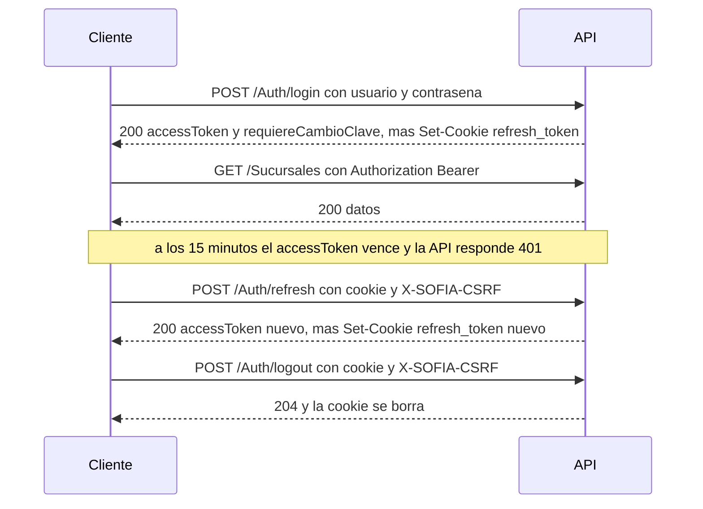

# Referencia de la API — Parte A: convenciones, autenticación, empresa y administración

| | |
|---|---|
| **Sistema** | SOFIA — Sistema Optimizado Farmacéutico con Inteligencia Artificial |
| **Versión del documento** | 1.0 |
| **Fecha** | 2026-10-30 |
| **Backend** | `sofia-apis`, rama `main`, commit `34089ec` |
| **Frontend** | `sofia-web-spa`, rama `main`, commit `9ad15f0` |
| **Método** | Lectura de código y llamadas reales a la API local |

## Contenido

- [0. Convenciones comunes](#0-convenciones-comunes)
- [1. `Auth`](#1-auth)
- [2. `Empresas`](#2-empresas)
- [3. `Sucursales`](#3-sucursales)
- [4. `Empleados`](#4-empleados)
- [5. `Roles`](#5-roles)
- [6. `Cuentas`](#6-cuentas)
- [7. `SeriesFiscales`](#7-seriesfiscales)
- [8. `Dashboard`](#8-dashboard)
- [9. `Auditoria`](#9-auditoria)
- [10. Datos de prueba creados](#10-datos-de-prueba-creados)
- [11. Pendientes y «No verificado»](#11-pendientes-y-no-verificado)
- [12. Tabla de cobertura](#12-tabla-de-cobertura)
- [13. Fuentes](#13-fuentes)

Este documento es la parte A de cinco de la referencia de la API. Describe los 66 endpoints de nueve controladores de acceso y administración: `Auth` (7), `Empresas` (5), `Sucursales` (10), `Empleados` (6), `Roles` (17), `Cuentas` (9), `SeriesFiscales` (6), `Dashboard` (5) y `Auditoria` (1). Las otras cuatro partes enlazan la sección 0 en lugar de repetirla. Las reglas de negocio están en [01a-administracion-y-seguridad.md](../01-reglas-de-negocio/01a-administracion-y-seguridad.md) (prefijos `GEN`, `AUT`, `EMP`, `SUC`, `EPL`, `ROL`, `CTA`, `SER`, `IMP`) y la matriz de permisos en [05b-matriz-de-permisos.md](../05-seguridad/05b-matriz-de-permisos.md); aquí se remite a ellas por ID y no se copian.

## 0. Convenciones comunes

Todo lo de esta sección vale para los 5 documentos de la referencia. Los ejemplos son respuestas capturadas de la API local (commit `34089ec`) en la empresa de prueba «Farmacia API Referencia S.A.C.»; los tokens, la cookie, las contraseñas y los datos de acceso de esa empresa se sustituyen por marcadores (`<token>`, `<usuario>`, `<contraseña>`).

### 0.1 URL base, versión y formato

| Tema | Regla | Fuente |
|---|---|---|
| URL base | `https://{host}/api/v1/{Controlador}`. En el entorno local de la referencia es `https://localhost:7300/api/v1/…` con certificado de desarrollo (en `curl`, usa `-k`). | `sofia-apis/src/SOFIA.API/Controllers/AuthController.cs:14-15` (`[Route("api/v{version:apiVersion}/[controller]")]`) |
| Versión | Solo existe la `1.0`, y va en la ruta: no hay versión por cabecera ni por consulta. Una ruta sin `v1` (por ejemplo `/api/v2/Sucursales`) no se enruta a un controlador; sin token responde 401. | `sofia-apis/src/SOFIA.API/Program.cs:68-73`, `AuthController.cs:13` (`[ApiVersion("1.0")]`) |
| Nombre del controlador | Es el nombre de la clase sin «Controller», respetando mayúsculas del código (`Sucursales`, `SeriesFiscales`). ASP.NET no distingue mayúsculas en la ruta. | `[Route(... "[controller]")]` |
| Formato | JSON en `camelCase` en peticiones y respuestas. Los **enumerados viajan como número** (por ejemplo `estado: 0` en `Empresas`, `tipoComprobante: 2` en `SeriesFiscales`); en el cuerpo, un texto como `"Boleta"` se rechaza con 400. En parámetros de consulta (`?estado=Activo`) sí se aceptan el nombre o el número. | `Program.cs` (sin `JsonStringEnumConverter` en todo `sofia-apis/src`); ejemplos reales en 2.2 y 7.2 |
| Nombres con guion bajo | Algunos modelos conservan guiones bajos del código y el JSON los respeta: `Empleados` usa `sucursal_Base_ID`, `apellido_Paterno`, `nombre_Completo`, `licencia_Prof`. Al recibir, el nombre no distingue mayúsculas. | `SOFIA.Application/Empleados/EmpleadoDto.cs`; ejemplo en 4.2 |
| Salud del servicio | `GET /health` es anónimo y devuelve `{ "status": "Healthy", "timestamp": "…" }`. No lleva `/api/v1`. | `Program.cs:137-143` |
| Cabeceras de respuesta | Toda respuesta lleva `X-Content-Type-Options: nosniff`, `X-Frame-Options: DENY`, `Referrer-Policy`, `Content-Security-Policy: default-src 'none'; frame-ancestors 'none';` y, bajo `/api`, `Cache-Control: no-store`. | `SOFIA.API/Infrastructure/SecurityHeadersMiddleware.cs:11-28` (regla RN-GEN-030) |

### 0.2 Cabeceras de la petición

| Cabecera | Cuándo | Valor |
|---|---|---|
| `Authorization` | Todo endpoint, salvo los anónimos (`Auth/login`, `Auth/refresh`, `Auth/logout`, `Auth/forgot-password`, `Auth/reset-password`, `Empresas/registrar`). | `Bearer <token>`, con el `accessToken` que devuelve el inicio de sesión. Vive 15 minutos (`Jwt:ExpiryMinutes` = 15 en `appsettings.json`) y la API tolera 30 segundos de desfase de reloj (`SOFIA.Infrastructure/DependencyInjection.cs:72`). |
| `Content-Type` | Peticiones con cuerpo. | `application/json` en casi todo. `multipart/form-data` (campo `file`) solo en los `previsualizar` de carga masiva. Las respuestas de error son `application/problem+json`. |
| `X-SOFIA-CSRF` | Solo `POST /Auth/refresh` y `POST /Auth/logout` (los únicos que se autentican con cookie). | Cualquier valor no vacío. Sin la cabecera, 403 con `code` `Auth.Csrf`. |
| `Cookie` | `POST /Auth/refresh` y `POST /Auth/logout`. | `refresh_token=<token>`. La entrega el inicio de sesión (ver 0.3). |

Una petición sin `Authorization` válido a un endpoint protegido responde **401 sin cuerpo** (con `WWW-Authenticate: Bearer`):

```http
GET /api/v1/Sucursales
```

```http
HTTP/1.1 401 Unauthorized
Content-Length: 0
WWW-Authenticate: Bearer
```

El 401 también se produce con un token vencido, mal firmado, con sello de seguridad obsoleto (tras cambiar la clave, cerrar sesión o cambiar los roles de la cuenta), de una cuenta inactiva o de una empresa no vigente (reglas RN-GEN-016 a RN-GEN-018).

### 0.3 Sesión: token de acceso y cookie de refresco



- El inicio de sesión devuelve en el cuerpo solo `accessToken` y `requiereCambioClave`. El token de refresco **nunca** va en el cuerpo: viaja en la cookie `refresh_token` (`HttpOnly`, `Secure`, `SameSite=None`, `path=/`, vigencia de 7 días), que se rota en cada `refresh` (el token usado queda revocado). Fuente: `SOFIA.API/Extensions/RefreshTokenCookieExtensions.cs:5-22`, `LoginCommandHandler.cs:18`.
- Cuando `requiereCambioClave` es `true`, el token lleva la marca de cambio obligatorio y la API solo atiende los endpoints que lo permiten (`Auth/me`, `Auth/change-password`, además de los anónimos). Cualquier otro responde **403** `Auth.CambioClaveRequerido` hasta que la cuenta cambie su contraseña (regla RN-GEN-019):

```json
HTTP/1.1 403 Forbidden
Content-Type: application/problem+json

{
  "status": 403,
  "detail": "You must change your password before continuing.",
  "code": "Auth.CambioClaveRequerido"
}
```

- Cambiar la contraseña, cerrar sesión, asignar o quitar roles a una cuenta o cambiar la sucursal base de su empleado cambia el sello de seguridad de la cuenta: sus tokens de acceso vigentes dejan de servir (401) y debe volver a iniciar sesión (reglas RN-AUT-021, RN-AUT-030, RN-CTA-018, RN-EPL-012).
- Se bloquea la cuenta 15 minutos tras 5 contraseñas incorrectas (regla RN-AUT-007). **Las cuentas de la referencia son compartidas**: no se prueban contraseñas incorrectas.

### 0.4 Formato de error

Los errores de negocio y de validación del servidor devuelven un `ProblemDetails` con solo tres campos: `status`, `detail` y `code`. Fuente: `SOFIA.API/Extensions/ResultExtensions.cs:13-23`.

```json
HTTP/1.1 400 Bad Request
Content-Type: application/problem+json

{
  "status": 400,
  "detail": "Nombre is required.; Direccion Fisica is required.; Numero Licencia is required.",
  "code": "CreateSucursalCommand.Nombre"
}
```

| Campo | Contenido |
|---|---|
| `status` | El mismo número del estado HTTP. |
| `detail` | Mensaje **en inglés o en español según el handler** (no está traducido ni es estable para mostrarlo al usuario; el SPA nunca lo muestra). En errores de validación, todos los mensajes del validador unidos con `; `. |
| `code` | Código estable para programar contra él. Tiene tres formas: `Entidad.Motivo` de negocio (`Sucursal.NotFound`, `Rol.InUse`), `NombreDelRequest.Propiedad` de validación (`CreateSucursalCommand.Nombre`; ver 0.5) y `CargaMasiva.*`, `Export.*`, `Concurrency.Conflict`, `Db.*`, `Request.*` de infraestructura. |

**Respuestas que no siguen esa forma** (no tienen `code`):

| Origen | Estado | Cuerpo | Ejemplo real |
|---|---|---|---|
| Sin token o token inválido | 401 | Vacío. | 0.2 |
| Sin permiso (`[HasPermission]`) | 403 | Vacío (la autorización falla sin cuerpo propio). Código: `PermissionAuthorizationHandler.cs` y `SOFIA.Infrastructure/DependencyInjection.cs:149-151`. | No verificado en vivo (ver 11) |
| Límite de peticiones | 429 | Sin cuerpo definido por el código; la API no envía `Retry-After` (`RateLimitingExtensions.cs:14` solo fija el estado). | No verificado en vivo (ver 11) |
| Ruta no válida (identificador que no es GUID, p. ej. `/Sucursales/abc`) | 404 | Vacío: la restricción `:guid` de la ruta descarta la petición antes del controlador. | Real, 0.6 |
| JSON ilegible, tipo incorrecto, campo obligatorio ausente, parámetro de consulta no convertible o atributo de modelo incumplido (`[ExportHeaders]`, `[ExportLabel]`, `[ExportDateFormat]`, `[JsonRequired]`) | 400 | `ProblemDetails` **estándar de ASP.NET** con `type`, `title`, `status`, `errors` y `traceId`; sin `code`. | Real, 0.6 |
| `Unauthorized()` directo del controlador (`Auth/refresh` sin cookie) | 401 | `ProblemDetails` mínimo con `type`, `title`, `status` y `traceId`. | Real, 1.3 |
| Excepción no prevista | 500 | `ProblemDetails` con `title` «Error del Servidor», `detail` con `Trace ID`, `instance` y `traceId`; sin `code`. | No se provocó |

Las excepciones que traduce `GlobalExceptionHandler` sí llevan `code` y agregan `traceId` al cuerpo (`SOFIA.API/Infrastructure/GlobalExceptionHandler.cs`):

| Excepción | HTTP | `code` | Regla |
|---|---|---|---|
| Fila modificada por otra operación (`RowVersion`) | 409 | `Concurrency.Conflict` | RN-GEN-035 |
| Índice o restricción única de la base de datos | 409 | `Db.Duplicado` | RN-GEN-036 |
| Restricción `CHECK` de la base de datos | 400 | `Db.ValorInvalido` | RN-GEN-037 |
| Clave foránea de la base de datos | 409 | `Db.ReferenciaInvalida` | RN-GEN-038 |
| Archivo de carga masiva rechazado | 400 | `CargaMasiva.Archivo.Invalido`, `CargaMasiva.Archivo.ExcedeDescompresion`, `CargaMasiva.Filas.Excedidas` | RN-IMP-001 a RN-IMP-005 |
| Cuerpo mayor que el límite del endpoint | 413 | `Request.TooLarge` | RN-GEN-039 |
| Cuerpo ilegible | el de la excepción | `Request.Invalid` | RN-GEN-039 |

Un `ExcelImportException` se responde con `Content-Type: application/json` (no `problem+json`); el contenido es el mismo:

```json
HTTP/1.1 400 Bad Request
Content-Type: application/json

{
  "status": 400,
  "detail": "The file is not a valid .xlsx workbook.",
  "code": "CargaMasiva.Archivo.Invalido",
  "traceId": "0HNPMQECMOQ0C:00000001"
}
```

### 0.5 Regla del HTTP de error

El estado HTTP de un fallo de negocio **no sale del tipo de error** (`Validation`, `NotFound`, `Conflict`, `Forbidden`, `Unauthorized`): sale del número que el handler pasa a `Result.Failure(error, statusCode)`, que vale **400 por defecto** (`SOFIA.Domain/Common/Result.cs:149-150`; el mapeo solo lee `result.StatusCode`, `ResultExtensions.cs:17,22`). Consecuencias que verás en las fichas:

- Un conflicto de negocio que el handler no marca con 409 sale como **400**: por ejemplo `Rol.DuplicateName`, `Rol.InUse` y `Permiso.Duplicate` (`Conflict` por tipo, 400 por estado). Las fichas indican siempre el estado real capturado.
- Los fallos de validación (`ValidationBehavior`) y los errores de las entidades de dominio salen como 400.
- Éxito: un `Result<T>` responde **200** con el valor; un `Result` sin valor responde **204** sin cuerpo; las creaciones responden **201** con `Location`.

**Validación.** `ValidationBehavior` ejecuta los validadores del request antes del handler. Si falla alguno: estado 400, `code` = `"{NombreDelRequest}.{Propiedad del PRIMER fallo}"` y `detail` = todos los mensajes unidos con `; ` (`SOFIA.Application/Common/Behaviors/ValidationBehavior.cs:27-47`, regla RN-GEN-011). En colecciones el nombre incluye el índice (`CargaMasivaRolesCommand.Rows[0].NombreRol`). Un request `IRequest<Result<T>>` de consulta usa el mismo mecanismo (por ejemplo `GetDashboardVentasQuery.Hoy`, 8.2).

**Orden de comprobación de una petición** (`Program.cs:129-134`): autenticación y token → cambio de clave obligatorio → permiso → límite de peticiones → enlace del cuerpo (400 estándar) → validadores (400 con `code`) → handler dentro de una transacción (404, 409, 403 de negocio) → 2xx.

### 0.6 Ejemplos reales de error comunes

Validación del servidor (`POST /api/v1/Sucursales` con campos vacíos): ver 0.4.

No encontrado (`GET /api/v1/Sucursales/00000000-0000-0000-0000-000000000001`):

```json
HTTP/1.1 404 Not Found
Content-Type: application/problem+json

{
  "status": 404,
  "detail": "Sucursal with ID 00000000-0000-0000-0000-000000000001 was not found.",
  "code": "Sucursal.NotFound"
}
```

Identificador que no es GUID (`GET /api/v1/Sucursales/abc`): `HTTP/1.1 404 Not Found` sin cuerpo.

JSON mal formado (`POST /api/v1/Sucursales` con `{"nombre": `):

```json
HTTP/1.1 400 Bad Request
Content-Type: application/problem+json

{
  "type": "https://tools.ietf.org/html/rfc9110#section-15.5.1",
  "title": "One or more validation errors occurred.",
  "status": 400,
  "errors": {
    "command": [ "The command field is required." ],
    "$.nombre": [ "Expected depth to be zero at the end of the JSON payload. There is an open JSON object or array that should be closed. Path: $.nombre | LineNumber: 0 | BytePositionInLine: 11." ]
  },
  "traceId": "00-99d7a0df4fc3f2a1897c6014d62396f0-14d9b8a3c777e53c-00"
}
```

Parámetro de consulta no válido (`GET /api/v1/Empresas?estado=Foo`): 400 estándar con `errors.estado = ["The value 'Foo' is not valid."]`.

### 0.7 Paginación

Los listados reciben `pageNumber` y `pageSize` en la consulta y devuelven un `PaginatedList`:

| Parámetro | Tipo | Por defecto | Regla |
|---|---|---|---|
| `pageNumber` | entero | 1 | Mínimo 1; un valor menor se trata como 1. |
| `pageSize` | entero | **depende del listado**: 25 en `Empresas`, `Roles` y `Cuentas`; 10 en `Sucursales`, `Empleados` y `SeriesFiscales` | Se ajusta al rango 1 a 10 000 (`0` pasa a 1; un valor mayor pasa a 10 000). |

Fuente: `SOFIA.Application/Common/Models/PaginationLimits.cs:6-10`, `PaginatedList.cs`; regla RN-GEN-009. Una página fuera de rango responde 200 con `items` vacío.

Forma de la respuesta (`GET /api/v1/Sucursales?pageNumber=2&pageSize=1`, real):

```json
HTTP/1.1 200 OK

{
  "items": [
    {
      "id": "6dc187a9-3b16-4001-b3ed-092119c1ba90",
      "nombre": "Sede Principal",
      "direccionFisica": "Av. Ficticia de la API 789, San Isidro, Lima",
      "numeroLicencia": "",
      "gerenteId": null,
      "gerenteNombre": null
    }
  ],
  "pageNumber": 2,
  "totalPages": 2,
  "totalCount": 2,
  "hasPreviousPage": true,
  "hasNextPage": false
}
```

| Campo | Tipo | Significado |
|---|---|---|
| `items` | arreglo | Filas de la página. |
| `pageNumber` | entero | Página devuelta, ya normalizada (con `pageNumber=-3&pageSize=0` la respuesta trae `pageNumber: 1` y 1 fila). |
| `totalPages` | entero | `ceil(totalCount / pageSize)`; vale 0 si no hay filas. |
| `totalCount` | entero | Total de filas que cumplen el filtro. |
| `hasPreviousPage` / `hasNextPage` | booleano | Calculados desde `pageNumber` y `totalPages`. |

Los filtros de texto (`nombre`, `nombreRol`, `numeroLicencia`, …) buscan «contiene», sin distinguir mayúsculas (colación de la base de datos). Cada ficha indica el orden del listado.

### 0.8 Filtros por fecha

Los filtros «desde/hasta» (por ejemplo `fechaVencimientoDesde` y `fechaVencimientoHasta` en `Empresas`) son `DateTimeOffset` en ISO 8601 (`2026-12-01T00:00:00Z`). Son **inclusivos en ambos extremos** (`>=` y `<=`), se normalizan a UTC y un valor sin zona se toma como UTC (regla RN-GEN-008). Todas las fechas de las respuestas salen con zona (por ejemplo `2026-10-30T22:31:07.2616955+00:00`).

Los endpoints del `Dashboard` reciben `hoy`, el instante en que empieza el día local del cliente con su desfase (`2026-10-30T00:00:00-05:00`); se acepta hasta ±36 horas respecto de la hora del servidor (8.1).

### 0.9 Exportación a Excel

Cada listado exportable tiene un `POST …/exportar`. Es un `POST` porque el cliente envía en el cuerpo los títulos de columna **ya traducidos** y las opciones de formato; la API nunca decide el idioma.

| Campo del cuerpo | Tipo | Obligatorio | Regla |
|---|---|---|---|
| `headers` | arreglo de texto | Sí | Máximo 50 títulos, ninguno nulo, cada uno de hasta 100 caracteres (`Export.Headers.Invalid`). El orden y la cantidad deben coincidir con las columnas del endpoint. |
| Filtros | los mismos del listado | No | Se aplican igual que en el `GET`; **no** llevan `pageNumber` ni `pageSize`: la exportación toma hasta 10 000 filas. |
| `yesLabel`, `noLabel` | texto | Solo donde el endpoint los pide (`Empresas`) | Hasta 20 caracteres (`Export.Label.Invalid`). |
| `dateFormat` | texto | Solo donde hay fechas formateadas (`SeriesFiscales`) | Exactamente uno de `dd/MM/yyyy`, `MM/dd/yyyy`, `dd/MM/yyyy HH:mm`, `MM/dd/yyyy HH:mm` (`Export.DateFormat.Invalid`). El SPA envía `dd/MM/yyyy` en español y `MM/dd/yyyy` en los demás idiomas. |
| Etiquetas de enumerados | diccionario | Solo donde el endpoint las pide (`tipoLabels`, `estadoLabels` en `SeriesFiscales`) | Si falta la clave, sale el valor sin traducir. |

Respuesta correcta: **200** con el archivo, sin cuerpo JSON. Ejemplo real (`POST /api/v1/Sucursales/exportar`):

```http
POST /api/v1/Sucursales/exportar
Authorization: Bearer <token>
Content-Type: application/json

{ "headers": ["Nombre", "Dirección física", "Número de licencia", "Gerente"], "nombre": "4A-" }
```

```http
HTTP/1.1 200 OK
Content-Type: application/vnd.openxmlformats-officedocument.spreadsheetml.sheet
Content-Disposition: attachment; filename=sucursales.xlsx; filename*=UTF-8''sucursales.xlsx
```

El libro tiene una hoja «Data» con la cabecera con estilo y las filas (regla RN-IMP-017). Errores: sin `headers` (o con más de 50), 400 estándar del modelo con `errors.Headers = ["The Headers field is required.", "Export.Headers.Invalid"]`; más de 10 000 filas, 400 con `code` `Export.TooManyRows` («La exportación supera el máximo de 10000 filas. Aplica filtros para reducir los resultados.», `SOFIA.API/Extensions/ExportExtensions.cs:8-13`, regla RN-IMP-008). Detalle de todo el mecanismo en [20-carga-masiva-y-exportacion.md](../20-carga-masiva-y-exportacion.md).

### 0.10 Carga masiva

Solo los maestros la tienen (en esta parte: `Sucursales` y `Roles`). Son tres pasos con tres endpoints, todos con el permiso `Crear` del módulo:

| Paso | Endpoint | Cuerpo | Respuesta |
|---|---|---|---|
| 1. Plantilla | `GET …/plantilla` | — | 200 con un `.xlsx` de una hoja «Plantilla» que solo trae la fila de cabecera con los nombres de columna (`Content-Type` de Excel y `Content-Disposition: attachment; filename=plantilla-{módulo}.xlsx`). |
| 2. Vista previa | `POST …/previsualizar` | `multipart/form-data` con un campo `file` (archivo `.xlsx`) | 200 con el resultado fila por fila. **No guarda nada.** |
| 3. Confirmación | `POST …/carga-masiva` | JSON: arreglo de filas (solo las válidas) | 200 `{ "savedCount": n }`. |

Límites (`SOFIA.Application/Common/Excel/ImportLimits.cs:6-12`): archivo y cuerpo JSON de hasta **5 MB**; entre 1 y **5 000** filas; el contenido descomprimido no puede pasar de 50 MB ni comprimirse más de 100 veces (reglas RN-IMP-001 a RN-IMP-006). Se lee solo la primera hoja; la primera fila es la cabecera (sin distinguir mayúsculas); las filas vacías se ignoran (RN-IMP-012).

Forma de la vista previa (campos del resultado): `rows[]` con `rowNumber` (número de fila en la hoja, la cabecera es la 1), `data` (valores leídos, con la clave en `camelCase`; una celda vacía es `null`), `errors[]` (`code`, `field` y `params`) e `isValid`; y los totales `totalCount`, `validCount` y `errorCount`. Los códigos de fila no son `code` HTTP: `required`, `max-length`, `duplicate`, `duplicate-in-file`, `invalid-integer`, `min-value`, etc. Ejemplo real (`POST /api/v1/Sucursales/previsualizar`, archivo con 3 filas):

```http
POST /api/v1/Sucursales/previsualizar
Authorization: Bearer <token>
Content-Type: multipart/form-data; boundary=----x

------x
Content-Disposition: form-data; name="file"; filename="sucursales.xlsx"
Content-Type: application/vnd.openxmlformats-officedocument.spreadsheetml.sheet

<contenido del archivo>
------x--
```

```json
HTTP/1.1 200 OK

{
  "rows": [
    { "rowNumber": 2, "data": { "nombre": "4A-Sucursal Carga 1", "direccionFisica": "Jr. Ficticio 4A-1, Lima", "numeroLicencia": "4A-LIC-002" }, "errors": [], "isValid": true },
    { "rowNumber": 3, "data": { "nombre": "4A-Sucursal Duplicada", "direccionFisica": "Jr. Ficticio 4A-2, Lima", "numeroLicencia": "4A-LIC-001" },
      "errors": [ { "code": "duplicate", "field": "numeroLicencia", "params": { "value": "4A-LIC-001" } } ], "isValid": false },
    { "rowNumber": 4, "data": { "nombre": null, "direccionFisica": "Jr. Ficticio 4A-3, Lima", "numeroLicencia": "4A-LIC-003" },
      "errors": [ { "code": "required", "field": "nombre", "params": null } ], "isValid": false }
  ],
  "totalCount": 3,
  "validCount": 1,
  "errorCount": 2
}
```

La confirmación **vuelve a validar** cada fila y **omite en silencio** las que no cumplen o repiten una clave ya tomada (por eso `savedCount` puede ser menor que la cantidad enviada); si el arreglo está vacío o pasa de 5 000 filas, 400 con `code` `CargaMasiva{Módulo}Command.Rows`. Errores del archivo: extensión distinta de `.xlsx`, firma ZIP incorrecta o libro ilegible → 400 `CargaMasiva.Archivo.Invalido` (ejemplo real en 0.4); más de 5 000 filas → 400 `CargaMasiva.Filas.Excedidas`; sin el campo `file` → 400 estándar `errors.file = ["The file field is required."]`; archivo vacío → 400 de texto plano `Debe adjuntar un archivo Excel.`; archivo o cuerpo de más de 5 MB → 413 `Request.TooLarge`.

### 0.11 Límites de tamaño y de peticiones

| Límite | Valor | Aplica a | Respuesta | Fuente |
|---|---|---|---|---|
| Peticiones globales | 200 por minuto por IP (ventana fija), con hasta 10 en cola | Todo endpoint sin política propia | 429 | `SOFIA.API/Extensions/RateLimitingExtensions.cs:14-24` (RN-GEN-025) |
| Política `auth` | 10 por minuto por IP, sin cola | `Auth/login`, `Auth/change-password`, `Auth/forgot-password`, `Auth/reset-password` | 429 | `RateLimitingExtensions.cs:27-33` (RN-GEN-026) |
| Política `signup` | 5 por hora por IP, sin cola | `Empresas/registrar` | 429 | `RateLimitingExtensions.cs:35-41` (RN-GEN-027) |
| Política `ai-endpoints` | 10 por minuto por empresa (o por IP si el token no trae empresa) | Endpoints de IA (documentados en la parte D) | 429 | `RateLimitingExtensions.cs:43-50` (RN-GEN-028) |
| Archivo de carga masiva | 5 MB | `previsualizar` y `carga-masiva` | 413 `Request.TooLarge` | `ImportLimits.cs:6` |
| Cuerpo del resto de endpoints | Sin límite propio en el código: rige el valor por omisión del servidor web | Resto | 413 `Request.TooLarge` | No se configura `MaxRequestBodySize` en `sofia-apis/src` |
| Filas de exportación | 10 000 | `…/exportar` | 400 `Export.TooManyRows` | `PaginationLimits.cs:6` |

El límite por IP se cuenta con la IP de la conexión; `X-Forwarded-For` solo se acepta de los proxies listados en `ForwardedHeaders:KnownProxies` (regla RN-GEN-029). El límite global lo comparten todos los clientes que salgan por la misma IP.

### 0.12 Multiempresa

La empresa no se envía en ninguna petición: sale del token (`empresaId`). Toda consulta sobre una entidad de negocio filtra automáticamente por esa empresa y por «no eliminado», y toda inserción se asigna a ella (reglas RN-GEN-001 a RN-GEN-004; `ApplicationDbContext.cs:85-109`). Consecuencias para quien consume la API:

- Un registro de otra empresa **se comporta como inexistente**: el `GET` por identificador responde 404 (`*.NotFound`), no 403.
- Las comprobaciones de unicidad suelen ser por empresa (licencia de sucursal, nombre de rol, licencia y correo de empleado, prefijo de serie), salvo las que son globales por diseño: el **nombre de usuario** (el inicio de sesión no pide la empresa) y el **RUC**.
- Los identificadores de otra empresa en un cuerpo (una sucursal, un empleado, un rol) se informan como inexistentes (404).
- Eliminar es siempre **borrado lógico** (RN-GEN-003); el registro eliminado desaparece de listados y consultas, y su clave única queda libre.
- La empresa debe estar vigente (estado activo o en prueba y no vencida): si deja de estarlo, el token deja de servir (401) y el inicio de sesión responde 403 `Auth.EmpresaNoVigente` (RN-GEN-018, RN-EMP-014).

### 0.13 Cómo leer las fichas

Cada controlador tiene su sección y, dentro, una ficha por endpoint, en el orden de `_inventario/endpoints.csv`. El campo **Código** indica el archivo y la línea del atributo `[HttpXxx]` (la que da el inventario) y el comando o consulta que ejecuta. **Pantalla del SPA** se tomó de [05b-matriz-de-permisos.md](../05-seguridad/05b-matriz-de-permisos.md) (apartados 3.1, 3.5, 3.6, 3.20, 3.22, 3.24, 3.28) y se comprobó contra `sofia-web-spa/src/app/**/*.routes.ts`. Las reglas se enlazan por ID al [catálogo 01a](../01-reglas-de-negocio/01a-administracion-y-seguridad.md). Los identificadores de los ejemplos son los de los datos de prueba de la sección 10.

## 1. `Auth`

Inicio y cierre de sesión, perfil, renovación del token, cambio y recuperación de contraseña. Siete endpoints, ninguno con permiso de módulo: seis son anónimos (`[AllowAnonymous]`) y `me` y `change-password` exigen solo estar autenticado. Reglas: `RN-AUT-001` a `RN-AUT-039` en [01a, apartado 4](../01-reglas-de-negocio/01a-administracion-y-seguridad.md) y el diseño en [05a-autenticacion-y-controles.md](../05-seguridad/05a-autenticacion-y-controles.md); permisos en [05b, apartado 3.28](../05-seguridad/05b-matriz-de-permisos.md). Las convenciones de sesión (cookie, `X-SOFIA-CSRF`, cambio obligatorio) están en 0.2 y 0.3.

Los ejemplos de sesión (`login`, `refresh`, `logout`) usan la cuenta de prueba `4a.elena` (creada en la sección 6 con el empleado «4A-Elena») para no tocar la cuenta compartida de la referencia; `me` y `forgot-password` usan la cuenta de la referencia, como pidió el encargo. `change-password` y `reset-password` se documentan solo desde el código.

#### `POST /api/v1/Auth/login`

Valida usuario y contraseña y abre una sesión: devuelve el token de acceso en el cuerpo y deja la cookie de refresco.

| | |
|---|---|
| **Permiso** | Ninguno (anónimo) |
| **Límite de peticiones** | Política `auth`: 10 por minuto por IP (0.11) |
| **Código** | `SOFIA.API/Controllers/AuthController.cs:18` → `LoginCommand` |
| **Pantalla del SPA** | `/auth/login`, botón «Ingresar» |

**Cuerpo:**

| Campo | Tipo | Obligatorio | Reglas |
|---|---|---|---|
| `nombreUsuario` | texto | Sí | No vacío, hasta 50 caracteres (RN-AUT-001). Se busca en todas las empresas: el nombre de usuario es único en el sistema (RN-CTA-007). |
| `password` | texto | Sí | No vacía (RN-AUT-002). No se sanea ni se recorta. |

**Respuesta correcta:** `200 OK` con `{ "accessToken": texto, "requiereCambioClave": booleano }` y la cabecera `Set-Cookie: refresh_token=…` (ver 0.3). `requiereCambioClave` es `true` en una cuenta nueva creada desde `Cuentas` o marcada con «forzar cambio» (6.4): con ese token solo funcionan `me` y `change-password`.

**Errores posibles:**

| HTTP | `code` | Cuándo | Regla |
|---|---|---|---|
| 400 | `LoginCommand.NombreUsuario` | Usuario vacío o de más de 50 caracteres. | RN-AUT-001 |
| 400 | `LoginCommand.Password` | Contraseña vacía. | RN-AUT-002 |
| 401 | `Auth.InvalidCredentials` | Usuario inexistente, eliminado o inactivo; cuenta bloqueada; contraseña incorrecta (suma un intento fallido); sucursal base de otra empresa. La respuesta es la misma en todos los casos, para no revelar si el usuario existe. | RN-AUT-003 a RN-AUT-008 |
| 403 | `Auth.EmpresaNoVigente` | Credenciales correctas, pero la empresa está suspendida, cancelada o vencida. | RN-AUT-009, RN-EMP-014 |
| 429 | — | Más de 10 peticiones por minuto desde la IP. | RN-GEN-026 |

**Ejemplo real** (cuenta de prueba `4a.elena`):

```http
POST /api/v1/Auth/login
Content-Type: application/json

{ "nombreUsuario": "4a.elena", "password": "<contraseña>" }
```

```http
HTTP/1.1 200 OK
Content-Type: application/json; charset=utf-8
Set-Cookie: refresh_token=<token>; expires=Fri, 06 Nov 2026 22:30:04 GMT; path=/; secure; samesite=none; httponly

{ "accessToken": "<token>", "requiereCambioClave": true }
```

**Ejemplo real de error de validación** (usuario vacío; no se probó una contraseña incorrecta para no bloquear cuentas compartidas):

```http
POST /api/v1/Auth/login
Content-Type: application/json

{ "nombreUsuario": "", "password": "x" }
```

```json
HTTP/1.1 400 Bad Request
Content-Type: application/problem+json; charset=utf-8

{
  "status": 400,
  "detail": "Username is required.",
  "code": "LoginCommand.NombreUsuario"
}
```

#### `POST /api/v1/Auth/refresh`

Cambia el token de refresco de la cookie por un token de acceso nuevo y un token de refresco nuevo (rotación).

| | |
|---|---|
| **Permiso** | Ninguno (anónimo, se autentica con la cookie) |
| **Límite de peticiones** | Solo el global |
| **Código** | `SOFIA.API/Controllers/AuthController.cs:33` → `RefreshTokenCommand` |
| **Pantalla del SPA** | Sin botón: la llaman el guard de autenticación y el interceptor tras un 401 |

**Cabeceras:** `X-SOFIA-CSRF` (obligatoria, cualquier valor) y `Cookie: refresh_token=<token>`. No lleva cuerpo ni `Authorization`.

**Respuesta correcta:** `200 OK` con `{ "accessToken": texto, "requiereCambioClave": booleano }` y un `Set-Cookie: refresh_token=…` nuevo. El token anterior queda revocado (RN-AUT-018); las renovaciones simultáneas con el mismo token no pueden bifurcar la sesión (RN-AUT-019).

**Errores posibles:**

| HTTP | `code` | Cuándo | Regla |
|---|---|---|---|
| 403 | `Auth.Csrf` | Falta la cabecera `X-SOFIA-CSRF`. | RN-AUT-013 |
| 401 | — (`ProblemDetails` con `type`, `title`, `status` y `traceId`) | No hay cookie. | RN-AUT-014 |
| 401 | `Auth.InvalidRefreshToken` | Token inexistente, vencido o revocado; cuenta inactiva o eliminada; empresa no vigente; sucursal base ajena. Reusar un token ya rotado se interpreta como robo y revoca **todas** las sesiones de la cuenta. | RN-AUT-015 a RN-AUT-017 |

**Ejemplo real** (después de iniciar sesión con la cuenta de prueba; la respuesta no repite el token en el cuerpo de la cookie):

```http
POST /api/v1/Auth/refresh
X-SOFIA-CSRF: 1
Cookie: refresh_token=<token>
```

```http
HTTP/1.1 200 OK
Content-Type: application/json; charset=utf-8
Set-Cookie: refresh_token=<token>; expires=Sat, 07 Nov 2026 03:49:03 GMT; path=/; secure; samesite=none; httponly

{ "accessToken": "<token>", "requiereCambioClave": true }
```

**Ejemplos reales de error** (sin cabecera; con cabecera pero sin cookie; con la cookie ya revocada por un cierre de sesión):

```json
HTTP/1.1 403 Forbidden

{ "status": 403, "detail": "The X-SOFIA-CSRF header is required.", "code": "Auth.Csrf" }
```

```json
HTTP/1.1 401 Unauthorized

{ "type": "https://tools.ietf.org/html/rfc9110#section-15.5.2", "title": "Unauthorized", "status": 401, "traceId": "00-643a42f39c855bcfe477508faefce02c-258ac69701e32f6d-00" }
```

```json
HTTP/1.1 401 Unauthorized

{ "status": 401, "detail": "Refresh token is invalid or expired.", "code": "Auth.InvalidRefreshToken" }
```

#### `GET /api/v1/Auth/me`

Devuelve el perfil de la cuenta autenticada: roles y permisos (módulo y acción) distintos. Es la fuente de permisos del SPA.

| | |
|---|---|
| **Permiso** | Solo autenticado (sigue disponible durante un cambio de clave forzado) |
| **Límite de peticiones** | Solo el global |
| **Código** | `SOFIA.API/Controllers/AuthController.cs:56` → `GetProfileQuery` |
| **Pantalla del SPA** | Sin botón: el guard de permisos, el menú lateral y el tablero |

**Respuesta correcta:** `200 OK`:

| Campo | Tipo | Descripción |
|---|---|---|
| `id` | GUID | Identificador de la cuenta. |
| `nombreUsuario` | texto | Usuario. |
| `empleadoNombreCompleto` | texto | «Nombres + apellido paterno + apellido materno» del empleado; `N/A` si no hay empleado. |
| `roles` | arreglo de texto | Nombres de los roles de la cuenta. |
| `permisos` | arreglo de `{ modulo, accion }` | Pares distintos de todos los roles. **El rol `Admin` no trae filas de permisos** (pasa cualquier comprobación por regla, RN-GEN-021): su `permisos` sale vacío. |

**Errores posibles:** 401 sin cuerpo (token inválido); 404 `Cuenta.NotFound` si la cuenta del token ya no existe (RN-AUT-023).

**Ejemplo real** (cuenta de la referencia, rol `Admin`):

```http
GET /api/v1/Auth/me
Authorization: Bearer <token>
```

```json
HTTP/1.1 200 OK

{
  "id": "c35b0531-3be6-4e8b-abea-b7ba72834a51",
  "nombreUsuario": "<usuario>",
  "empleadoNombreCompleto": "Rita Referencia Demo",
  "roles": [ "Admin" ],
  "permisos": []
}
```

#### `POST /api/v1/Auth/logout`

Cierra la sesión: revoca todos los tokens de refresco de la cuenta, cambia su sello de seguridad (los tokens de acceso vigentes dejan de servir) y borra la cookie.

| | |
|---|---|
| **Permiso** | Ninguno (anónimo a propósito: un token de acceso vencido no debe dejar viva la cookie en un equipo compartido) |
| **Límite de peticiones** | Solo el global |
| **Código** | `SOFIA.API/Controllers/AuthController.cs:70` → `LogoutCommand` |
| **Pantalla del SPA** | Cabecera, menú de usuario: botón «Cerrar sesión» (también el interceptor) |

**Cabeceras:** `X-SOFIA-CSRF` obligatoria; `Cookie: refresh_token=<token>` y/o `Authorization: Bearer <token>` (cualquiera de las dos identifica la sesión). Sin cuerpo.

**Respuesta correcta:** `204 No Content` y un `Set-Cookie` que borra `refresh_token`. Es idempotente: sin sesión que revocar también responde 204 (RN-AUT-020 a RN-AUT-022).

**Errores posibles:** 403 `Auth.Csrf` si falta la cabecera `X-SOFIA-CSRF`.

**Ejemplo real** (con la cuenta de prueba; luego un `refresh` con la misma cookie da 401 `Auth.InvalidRefreshToken` y el token de acceso anterior da 401 en `GET /Auth/me`):

```http
POST /api/v1/Auth/logout
X-SOFIA-CSRF: 1
Cookie: refresh_token=<token>
```

```http
HTTP/1.1 204 No Content
Set-Cookie: refresh_token=; expires=Thu, 01 Jan 1970 00:00:00 GMT; path=/; secure; samesite=none; httponly
```

#### `POST /api/v1/Auth/change-password`

Cambia la contraseña de la cuenta del token (nunca otra) y cierra todas sus sesiones.

| | |
|---|---|
| **Permiso** | Solo autenticado (sigue disponible durante un cambio de clave forzado) |
| **Límite de peticiones** | Política `auth`: 10 por minuto por IP |
| **Código** | `SOFIA.API/Controllers/AuthController.cs:84` → `ChangePasswordCommand` |
| **Pantalla del SPA** | `/cambiar-clave`, botón «Guardar» |

**Cuerpo** (`ChangePasswordRequest`, `AuthController.cs:123`):

| Campo | Tipo | Obligatorio | Reglas |
|---|---|---|---|
| `currentPassword` | texto | Sí | No vacía; debe coincidir con la guardada (RN-AUT-025, RN-AUT-029). |
| `newPassword` | texto | Sí | No vacía, al menos 8 caracteres y distinta de la actual (comparación exacta) (RN-AUT-026, RN-AUT-027). |

**Respuesta correcta:** `204 No Content`. Se guarda el nuevo hash (BCrypt), se apaga «debe cambiar la clave», se revocan los tokens de refresco, cambia el sello de seguridad y se borra la cookie: hay que iniciar sesión de nuevo (RN-AUT-030).

**Errores posibles:**

| HTTP | `code` | Cuándo | Regla |
|---|---|---|---|
| 400 | `ChangePasswordCommand.CurrentPassword` / `.NewPassword` | Campo vacío, nueva contraseña corta o igual a la actual. | RN-AUT-025 a RN-AUT-027 |
| 400 | `Auth.ClaveActualIncorrecta` | La contraseña actual no coincide (es 400 y no 401 para que el cliente no lo confunda con una sesión vencida). | RN-AUT-029 |
| 401 | `Auth.InvalidCredentials` | La cuenta del token ya no existe o está inactiva. | RN-AUT-028 |
| 429 | — | Límite `auth`. | RN-GEN-026 |

**Ejemplo no verificado:** el encargo de esta parte limita este endpoint a la lectura del código (cambia la contraseña y cierra las sesiones; la cuenta de la referencia es compartida). Petición esperada según el código:

```http
POST /api/v1/Auth/change-password
Authorization: Bearer <token>
Content-Type: application/json

{ "currentPassword": "<contraseña actual>", "newPassword": "<contraseña nueva>" }
```

```http
HTTP/1.1 204 No Content
Set-Cookie: refresh_token=; expires=Thu, 01 Jan 1970 00:00:00 GMT; path=/; secure; samesite=none; httponly
```

#### `POST /api/v1/Auth/forgot-password`

Inicia la recuperación de contraseña: si la cuenta puede recuperarse, genera un token de un solo uso (vigente 1 hora) y envía un correo con el enlace al correo del empleado.

| | |
|---|---|
| **Permiso** | Ninguno (anónimo) |
| **Límite de peticiones** | Política `auth`: 10 por minuto por IP |
| **Código** | `SOFIA.API/Controllers/AuthController.cs:104` → `ForgotPasswordCommand` |
| **Pantalla del SPA** | `/auth/forgot-password`, botón «Enviar enlace» |

**Cuerpo:** `{ "nombreUsuario": texto }`. El validador pide usuario no vacío de hasta 50 caracteres, pero el controlador descarta el resultado y responde siempre lo mismo (RN-AUT-032).

**Respuesta correcta:** `200 OK` con `{ "message": "If the account exists, a recovery link will be sent to the registered contact." }`. **Siempre**, exista o no la cuenta, esté activa o no, tenga o no correo el empleado, para impedir averiguar qué usuarios existen (RN-AUT-033). Solo se genera el token y se envía el correo si la cuenta existe, está activa, su empleado no está eliminado y tiene correo, y la empresa está vigente (RN-AUT-034 a RN-AUT-036).

**Errores posibles:** 429 (límite `auth`).

**Ejemplo real** (cuenta de la referencia, que sí recibe el correo; en el entorno local el correo lo captura Mailpit):

```http
POST /api/v1/Auth/forgot-password
Content-Type: application/json

{ "nombreUsuario": "<usuario>" }
```

```json
HTTP/1.1 200 OK

{ "message": "If the account exists, a recovery link will be sent to the registered contact." }
```

Efecto comprobado en Mailpit: llegó un correo de `SOFIA <no-reply@sofia.local>` al correo del empleado, con asunto «Restablece tu contraseña de SOFIA». Con un usuario inexistente (`4a.usuario.inexistente`) y con el usuario vacío (`""`) la respuesta fue idéntica (200 con el mismo mensaje) y no llegó ningún correo.

#### `POST /api/v1/Auth/reset-password`

Fija una contraseña nueva con el token que llegó por correo.

| | |
|---|---|
| **Permiso** | Ninguno (anónimo) |
| **Límite de peticiones** | Política `auth`: 10 por minuto por IP |
| **Código** | `SOFIA.API/Controllers/AuthController.cs:113` → `ResetPasswordCommand` |
| **Pantalla del SPA** | `/auth/reset-password`, botón «Guardar contraseña» |

**Cuerpo:**

| Campo | Tipo | Obligatorio | Reglas |
|---|---|---|---|
| `nombreUsuario` | texto | Sí | No vacío. |
| `token` | texto | Sí | El token del enlace del correo; debe ser el vigente de esa cuenta y no haber vencido (1 hora). Se guarda solo su hash. |
| `newPassword` | texto | Sí | No vacía, al menos 8 caracteres (RN-AUT-037). |

**Respuesta correcta:** `204 No Content`. Se guarda el nuevo hash, cambia el sello de seguridad, se apaga «debe cambiar la clave», se borra el token, se reinician los intentos fallidos y el bloqueo, se revocan los tokens de refresco y se registra el evento de seguridad (RN-AUT-039).

**Errores posibles:**

| HTTP | `code` | Cuándo | Regla |
|---|---|---|---|
| 400 | `ResetPasswordCommand.NombreUsuario` / `.Token` / `.NewPassword` | Campo vacío o contraseña de menos de 8 caracteres. | RN-AUT-037 |
| 400 | `Auth.InvalidToken` | Usuario inexistente, o token inexistente, distinto del vigente o vencido (mismo error para no revelar la cuenta). | RN-AUT-038 |
| 429 | — | Límite `auth`. | RN-GEN-026 |

**Ejemplo no verificado:** el encargo limita este endpoint a la lectura del código (el token de recuperación solo existe en el correo y el endpoint cambia la contraseña de una cuenta compartida). Petición esperada según el código:

```http
POST /api/v1/Auth/reset-password
Content-Type: application/json

{ "nombreUsuario": "<usuario>", "token": "<token del correo>", "newPassword": "<contraseña nueva>" }
```

```http
HTTP/1.1 204 No Content
```

## 2. `Empresas`

Registro público de una empresa y consulta y edición de **la empresa del usuario** (por el aislamiento de 0.12, el listado devuelve una sola fila: la propia). Cinco endpoints. Reglas: `RN-EMP-001` a `RN-EMP-018` ([01a, apartado 7](../01-reglas-de-negocio/01a-administracion-y-seguridad.md)); permisos en [05b, apartado 3.6](../05-seguridad/05b-matriz-de-permisos.md). El estado de la suscripción no se puede cambiar por la API (RN-EMP-015): solo se editan nombre y RUC.

Enumerado `EstadoEmpresa` (viaja como número): `0` TrialActivo, `1` Activo, `2` Suspendido, `3` Cancelado.

#### `POST /api/v1/Empresas/registrar`

Registro público: crea en una sola transacción la empresa, su sede principal, el empleado administrador, su cuenta y el rol `Admin` de esa empresa, y abre la sesión del administrador.

| | |
|---|---|
| **Permiso** | Ninguno (anónimo) |
| **Límite de peticiones** | Política `signup`: **5 por hora por IP**, sin cola (0.11) |
| **Código** | `SOFIA.API/Controllers/EmpresasController.cs:21` → `RegistrarEmpresaCommand` |
| **Pantalla del SPA** | `/auth/register`, botón «Registrar Empresa» |

**Cuerpo:**

| Campo | Tipo | Obligatorio | Reglas |
|---|---|---|---|
| `nombreEmpresa` | texto | Sí | No vacío, hasta 200 caracteres (RN-EMP-002). |
| `ruc` | texto | Sí | Exactamente 11 dígitos; no se valida el dígito verificador. Único en todo el sistema (RN-EMP-003, RN-EMP-005). |
| `usuario` | texto | Sí | Entre 4 y 50 caracteres; único en todo el sistema (RN-EMP-006). |
| `password` | texto | Sí | Al menos 8 caracteres (RN-EMP-007). |
| `adminNombres` | texto | Sí | Hasta 75 caracteres (RN-EMP-008). |
| `adminApellidoPaterno` | texto | Sí | Hasta 75 caracteres (RN-EMP-008). |
| `adminApellidoMaterno` | texto | No | Hasta 75 caracteres. |
| `adminEmail` | texto | Sí | Formato de correo, hasta 254 caracteres; es el correo de recuperación de contraseña (RN-EMP-009). |
| `direccionSede` | texto | Sí | Dirección de la sede principal, hasta 255 caracteres (RN-EMP-010). |
| `nombreSede` | texto | No | Si falta, la sede se llama «Sede Principal». |
| `numeroLicencia` | texto | No | Si falta, la sede nace con licencia vacía y debe completarla al editarla (RN-EMP-010, RN-SUC-004). |

**Respuesta correcta:** `201 Created` con `{ "token": "<token>" }` (el token de acceso; **la clave se llama `token`**, no `accessToken`) y la cookie `refresh_token`, como un inicio de sesión (RN-EMP-013). La empresa nace en estado `TrialActivo` con vencimiento a 30 días (RN-EMP-012) y la cuenta del administrador no exige cambio de clave.

**Errores posibles:**

| HTTP | `code` | Cuándo | Regla |
|---|---|---|---|
| 400 | `RegistrarEmpresaCommand.{Propiedad}` | Falla algún campo (por ejemplo `RegistrarEmpresaCommand.NombreEmpresa`, `.RUC`, `.Usuario`, `.DireccionSede`). | RN-EMP-002 a RN-EMP-010 |
| 409 | `Empresa.RUC.Duplicado` | Ya existe una empresa con ese RUC (detalle: «Ya existe una empresa registrada con este RUC.»). | RN-EMP-005 |
| 409 | `Auth.DuplicateUsername` | El usuario ya está en uso en cualquier empresa. | RN-EMP-006 |
| 429 | — | Más de 5 registros por hora desde la IP. | RN-GEN-027 |

**Ejemplo no verificado:** el endpoint crea empresas y tiene un límite de 5 por hora por IP compartido por todos los agentes de la referencia, así que no se llamó (decisión de [API-AGENTES.md](../../_inventario/API-AGENTES.md)). El manual ([capítulo 1](../../ola-2-funcional/manual-usuario/capitulo-01-primeros-pasos.md)) describe el aviso «Ya existe una empresa registrada con este RUC». Petición y respuesta esperadas según el código:

```http
POST /api/v1/Empresas/registrar
Content-Type: application/json

{
  "nombreEmpresa": "Botica Ejemplo S.A.C.",
  "ruc": "20000000001",
  "usuario": "admin.ejemplo",
  "password": "<contraseña>",
  "adminNombres": "Ana",
  "adminApellidoPaterno": "Demo",
  "adminEmail": "ana@example.com",
  "direccionSede": "Av. Ficticia 100, Lima"
}
```

```http
HTTP/1.1 201 Created
Set-Cookie: refresh_token=<token>; path=/; secure; samesite=none; httponly

{ "token": "<token>" }
```

#### `GET /api/v1/Empresas`

Lista paginada de empresas visibles (en la práctica, la del usuario), ordenada por nombre.

| | |
|---|---|
| **Permiso** | `Empresas:Leer` |
| **Límite de peticiones** | Solo el global |
| **Código** | `SOFIA.API/Controllers/EmpresasController.cs:35` → `GetEmpresasQuery` |
| **Pantalla del SPA** | `/empresas`, botón «Buscar» |

**Parámetros de consulta:**

| Nombre | Tipo | Obligatorio | Descripción |
|---|---|---|---|
| `nombre` | texto | No | Contiene. |
| `estado` | `EstadoEmpresa` | No | Nombre (`Activo`) o número (`1`). Un valor desconocido da 400 estándar. |
| `fechaVencimientoDesde` | fecha-hora | No | Vencimiento mayor o igual (0.8). |
| `fechaVencimientoHasta` | fecha-hora | No | Vencimiento menor o igual. |
| `pageNumber`, `pageSize` | entero | No | Paginación (0.7); `pageSize` por defecto **25**. |

**Respuesta correcta:** `200 OK` con la página (0.7) de `EmpresaDto`:

| Campo | Tipo | Descripción |
|---|---|---|
| `id` | GUID | Identificador. |
| `nombre` | texto | Nombre de la empresa. |
| `ruc` | texto o `null` | RUC. |
| `estado` | entero | `EstadoEmpresa`. |
| `fechaInicioTrial`, `fechaVencimiento` | fecha-hora | Inicio de la prueba y vencimiento. |
| `estaVigente` | booleano | Calculado (RN-EMP-014). |
| `cantidadSucursales` | entero | Sucursales no eliminadas. |

**Errores posibles:** 400 estándar (sin `code`) si `estado` o una fecha no se pueden convertir; 403 sin el permiso.

**Ejemplo real:**

```http
GET /api/v1/Empresas
Authorization: Bearer <token>
```

```json
HTTP/1.1 200 OK

{
  "items": [
    {
      "id": "7012325b-0c71-4fca-ab88-1a978b1c5011",
      "nombre": "Farmacia API Referencia S.A.C.",
      "ruc": "20XXXXXXXXX",
      "estado": 0,
      "fechaInicioTrial": "2026-10-26T16:31:32.5426686+00:00",
      "fechaVencimiento": "2026-11-25T16:31:32.5426686+00:00",
      "estaVigente": true,
      "cantidadSucursales": 1
    }
  ],
  "pageNumber": 1,
  "totalPages": 1,
  "totalCount": 1,
  "hasPreviousPage": false,
  "hasNextPage": false
}
```

Con `?fechaVencimientoDesde=2026-12-01T00:00:00Z` (después del vencimiento) la respuesta fue `200` con `"items": []` y `"totalPages": 0`.

**Ejemplo real de error** (`GET /api/v1/Empresas?estado=Foo`): `400` estándar con `"errors": { "estado": [ "The value 'Foo' is not valid." ] }` (0.6).

#### `GET /api/v1/Empresas/{id}`

Devuelve una empresa por identificador.

| | |
|---|---|
| **Permiso** | `Empresas:Leer` |
| **Límite de peticiones** | Solo el global |
| **Código** | `SOFIA.API/Controllers/EmpresasController.cs:57` → `GetEmpresaByIdQuery` |
| **Pantalla del SPA** | `/empresas/:id` (carga inicial) |

**Parámetros de ruta:** `id` (GUID, obligatorio).

**Respuesta correcta:** `200 OK` con un `EmpresaDto` (campos del listado).

**Errores posibles:**

| HTTP | `code` | Cuándo | Regla |
|---|---|---|---|
| 404 | `Empresa.NotFound` | No existe, está eliminada o es de otra empresa. | RN-EMP-017 |

**Ejemplo real:**

```http
GET /api/v1/Empresas/7012325b-0c71-4fca-ab88-1a978b1c5011
Authorization: Bearer <token>
```

```json
HTTP/1.1 200 OK

{
  "id": "7012325b-0c71-4fca-ab88-1a978b1c5011",
  "nombre": "Farmacia API Referencia S.A.C.",
  "ruc": "20XXXXXXXXX",
  "estado": 0,
  "fechaInicioTrial": "2026-10-26T16:31:32.5426686+00:00",
  "fechaVencimiento": "2026-11-25T16:31:32.5426686+00:00",
  "estaVigente": true,
  "cantidadSucursales": 2
}
```

**Ejemplo real de error** (`GET /api/v1/Empresas/00000000-0000-0000-0000-000000000001`):

```json
HTTP/1.1 404 Not Found

{ "status": 404, "detail": "La empresa no existe.", "code": "Empresa.NotFound" }
```

#### `PUT /api/v1/Empresas/{id}`

Edita el nombre y el RUC de la empresa. El identificador de la ruta manda sobre cualquier `id` del cuerpo.

| | |
|---|---|
| **Permiso** | `Empresas:Actualizar` |
| **Límite de peticiones** | Solo el global |
| **Código** | `SOFIA.API/Controllers/EmpresasController.cs:65` → `UpdateEmpresaCommand` |
| **Pantalla del SPA** | `/empresas/:id`, botón «Guardar» |

**Parámetros de ruta:** `id` (GUID, obligatorio).

**Cuerpo:**

| Campo | Tipo | Obligatorio | Reglas |
|---|---|---|---|
| `nombre` | texto | Sí | No vacío, hasta 200 caracteres (RN-EMP-002). |
| `ruc` | texto o `null` | No | Si se envía, exactamente 11 dígitos y único en el sistema. **Si se omite o es `null`, la empresa queda sin RUC** (RN-EMP-004): envía siempre el RUC actual para no borrarlo. |

**Respuesta correcta:** `204 No Content`. Se audita como `EMPRESA_ACTUALIZAR` sin incluir nombre ni RUC (RN-EMP-017).

**Errores posibles:**

| HTTP | `code` | Cuándo | Regla |
|---|---|---|---|
| 400 | `UpdateEmpresaCommand.Nombre` / `.RUC` | Nombre vacío o largo; RUC que no son 11 dígitos. | RN-EMP-002, RN-EMP-004 |
| 404 | `Empresa.NotFound` | No existe o es de otra empresa. | RN-EMP-017 |
| 409 | `Empresa.RUC.Duplicado` | Otra empresa ya usa ese RUC. | RN-EMP-005 |

**Ejemplo real** (sin cambiar los datos, para no alterar la empresa compartida de la referencia):

```http
PUT /api/v1/Empresas/7012325b-0c71-4fca-ab88-1a978b1c5011
Authorization: Bearer <token>
Content-Type: application/json

{ "nombre": "Farmacia API Referencia S.A.C.", "ruc": "20XXXXXXXXX" }
```

```http
HTTP/1.1 204 No Content
```

**Ejemplo real de error** (RUC de 3 dígitos):

```http
PUT /api/v1/Empresas/7012325b-0c71-4fca-ab88-1a978b1c5011
Content-Type: application/json

{ "nombre": "Farmacia API Referencia S.A.C.", "ruc": "123" }
```

```json
HTTP/1.1 400 Bad Request

{
  "status": 400,
  "detail": "RUC must be exactly 11 digits.; RUC must contain only digits.",
  "code": "UpdateEmpresaCommand.RUC"
}
```

El 404 `Empresa.NotFound` se capturó con un identificador inexistente (`PUT /api/v1/Empresas/00000000-0000-0000-0000-000000000001`). El 409 `Empresa.RUC.Duplicado` no se provocó (exige una segunda empresa): ejemplo no verificado, forma `{ "status": 409, "detail": "Ya existe otra empresa con este RUC.", "code": "Empresa.RUC.Duplicado" }` según el código.

#### `POST /api/v1/Empresas/exportar`

Genera el Excel de empresas con los mismos filtros del listado.

| | |
|---|---|
| **Permiso** | `Empresas:Leer` |
| **Límite de peticiones** | Solo el global |
| **Código** | `SOFIA.API/Controllers/EmpresasController.cs:74` → `GetEmpresasQuery` (hasta 10 000 filas) |
| **Pantalla del SPA** | `/empresas`, botón «Exportar» |

**Cuerpo** (`EmpresaExportRequest`, `EmpresasController.cs:110`; mecanismo en 0.9):

| Campo | Tipo | Obligatorio | Reglas |
|---|---|---|---|
| `headers` | arreglo de texto | Sí | Siete títulos, en este orden: nombre, RUC, estado, vigente, inicio de prueba, vencimiento, sucursales. Máximo 50, hasta 100 caracteres cada uno. |
| `yesLabel`, `noLabel` | texto | Sí | Texto de la columna «vigente» (por ejemplo «Sí» / «No»), hasta 20 caracteres. |
| `nombre`, `estado`, `fechaVencimientoDesde`, `fechaVencimientoHasta` | como en el listado | No | Filtros. |

El estado sale como nombre (`TrialActivo`) y las fechas con formato fijo `dd/MM/yyyy` (esta exportación no recibe `dateFormat`). Reglas: RN-EMP-018, RN-IMP-008 a RN-IMP-010.

**Respuesta correcta:** `200 OK`, archivo `empresas.xlsx`.

**Errores posibles:** 400 estándar si faltan `headers`, `yesLabel` o `noLabel`, o exceden su longitud; 400 `Export.TooManyRows` si hay más de 10 000 filas.

**Ejemplo real:**

```http
POST /api/v1/Empresas/exportar
Authorization: Bearer <token>
Content-Type: application/json

{ "headers": ["Nombre", "RUC", "Estado", "Vigente", "Inicio", "Vencimiento", "Sucursales"], "yesLabel": "Sí", "noLabel": "No" }
```

```http
HTTP/1.1 200 OK
Content-Type: application/vnd.openxmlformats-officedocument.spreadsheetml.sheet
Content-Disposition: attachment; filename=empresas.xlsx; filename*=UTF-8''empresas.xlsx
```

## 3. `Sucursales`

Maestro de sucursales de la empresa, con carga masiva y exportación. Diez endpoints. Reglas: `RN-SUC-001` a `RN-SUC-013` ([01a, apartado 8](../01-reglas-de-negocio/01a-administracion-y-seguridad.md)); permisos en [05b, apartado 3.24](../05-seguridad/05b-matriz-de-permisos.md). Los endpoints de carga masiva siguen el esquema de 0.10.

Modelo `SucursalDto` (respuestas de `GET`): `id` (GUID), `nombre`, `direccionFisica`, `numeroLicencia`, `gerenteId` (GUID o `null`) y `gerenteNombre` (texto o `null`). La sede principal creada por el registro de la empresa nace con `numeroLicencia` vacío (RN-SUC-004).

#### `GET /api/v1/Sucursales/plantilla`

Descarga la plantilla Excel de la carga masiva.

| | |
|---|---|
| **Permiso** | `Sucursales:Crear` |
| **Límite de peticiones** | Solo el global |
| **Código** | `SOFIA.API/Controllers/SucursalesController.cs:22` (`ExcelTemplateGenerator.GenerateTemplate`) |
| **Pantalla del SPA** | `/sucursales/carga-masiva`, botón «Descargar plantilla» |

**Respuesta correcta:** `200 OK`, archivo `plantilla-sucursales.xlsx` con una hoja «Plantilla» cuya fila de cabecera es `Nombre`, `DireccionFisica`, `NumeroLicencia` (RN-IMP-016, RN-SUC-012).

**Errores posibles:** 403 sin el permiso.

**Ejemplo real:**

```http
GET /api/v1/Sucursales/plantilla
Authorization: Bearer <token>
```

```http
HTTP/1.1 200 OK
Content-Type: application/vnd.openxmlformats-officedocument.spreadsheetml.sheet
Content-Disposition: attachment; filename=plantilla-sucursales.xlsx; filename*=UTF-8''plantilla-sucursales.xlsx
```

#### `POST /api/v1/Sucursales/previsualizar`

Valida el Excel subido y devuelve la vista previa fila por fila. No guarda nada.

| | |
|---|---|
| **Permiso** | `Sucursales:Crear` |
| **Límite de peticiones** | Solo el global; cuerpo de hasta 5 MB |
| **Código** | `SOFIA.API/Controllers/SucursalesController.cs:30` → `PreviewImportSucursalesQuery` |
| **Pantalla del SPA** | `/sucursales/carga-masiva`, selección o arrastre del archivo |

**Cuerpo:** `multipart/form-data` con el campo `file` (un `.xlsx` con las columnas `Nombre`, `DireccionFisica` y `NumeroLicencia`; 0.10).

**Respuesta correcta:** `200 OK` con el resultado de la vista previa (0.10). Códigos de error por fila de este módulo (RN-SUC-013):

| `field` | `code` | Cuándo |
|---|---|---|
| `nombre` | `required` / `max-length` (`max` 100) | Vacío / más de 100 caracteres. |
| `direccionFisica` | `required` / `max-length` (`max` 255) | Vacía / más de 255 caracteres. |
| `numeroLicencia` | `required` / `max-length` (`max` 50) | Vacía / más de 50 caracteres. |
| `numeroLicencia` | `duplicate` (`value`) | La licencia ya existe en la empresa (sin distinguir mayúsculas). |
| `numeroLicencia` | `duplicate-in-file` (`value`) | La licencia aparece en más de una fila del archivo. |

**Errores posibles:**

| HTTP | `code` | Cuándo | Regla |
|---|---|---|---|
| 400 | `CargaMasiva.Archivo.Invalido` | No es `.xlsx`, no tiene firma ZIP o no se puede abrir. | RN-IMP-001, RN-IMP-002 |
| 400 | `CargaMasiva.Archivo.ExcedeDescompresion` / `CargaMasiva.Filas.Excedidas` | Archivo «bomba» o más de 5 000 filas. | RN-IMP-003, RN-IMP-005 |
| 400 | — (estándar, `errors.file`) | No se envió el campo `file`. | RN-IMP-013 |
| 400 | — (texto plano `Debe adjuntar un archivo Excel.`, `Content-Type: text/plain`) | El campo `file` llegó pero el archivo está vacío (0 bytes). Capturado en vivo. | RN-IMP-013 |
| 413 | `Request.TooLarge` | Más de 5 MB. | RN-IMP-004 |

**Ejemplo real:** el de 0.10 (3 filas: una válida, una con licencia duplicada y una sin nombre). **Ejemplo real de error** (un `.txt` enviado como archivo):

```json
HTTP/1.1 400 Bad Request
Content-Type: application/json; charset=utf-8

{ "status": 400, "detail": "The file is not a valid .xlsx workbook.", "code": "CargaMasiva.Archivo.Invalido", "traceId": "0HNPMQECMOQ0C:00000001" }
```

#### `POST /api/v1/Sucursales/carga-masiva`

Guarda las filas de la carga masiva (las que el SPA marcó como válidas).

| | |
|---|---|
| **Permiso** | `Sucursales:Crear` |
| **Límite de peticiones** | Solo el global; cuerpo de hasta 5 MB |
| **Código** | `SOFIA.API/Controllers/SucursalesController.cs:47` → `CargaMasivaSucursalesCommand` |
| **Pantalla del SPA** | `/sucursales/carga-masiva`, botón «Guardar válidos (N)» |

**Cuerpo:** arreglo JSON de 1 a 5 000 filas (RN-IMP-006):

| Campo | Tipo | Obligatorio | Reglas |
|---|---|---|---|
| `nombre` | texto | Sí | Hasta 100 caracteres. |
| `direccionFisica` | texto | Sí | Hasta 255 caracteres. |
| `numeroLicencia` | texto | Sí | Hasta 50 caracteres; única en la empresa. |

Las filas nuevas nacen sin gerente y en la empresa del token. Si una fila no cumple las reglas de la entidad o su licencia ya está tomada (en la base o por una fila anterior del mismo envío), **se omite en silencio** (RN-SUC-012, RN-IMP-007).

**Respuesta correcta:** `200 OK` con `{ "savedCount": entero }`.

**Errores posibles:**

| HTTP | `code` | Cuándo | Regla |
|---|---|---|---|
| 400 | `CargaMasivaSucursalesCommand.Rows` | Arreglo vacío o de más de 5 000 filas. | RN-IMP-006 |
| 400 | `CargaMasivaSucursalesCommand.Rows[n].Nombre` (o `DireccionFisica`, `NumeroLicencia`) | Una fila vacía o demasiado larga. | RN-IMP-007 |
| 413 | `Request.TooLarge` | Más de 5 MB. | RN-IMP-004 |

**Ejemplo real:**

```http
POST /api/v1/Sucursales/carga-masiva
Authorization: Bearer <token>
Content-Type: application/json

[ { "nombre": "4A-Sucursal Carga 1", "direccionFisica": "Jr. Ficticio 4A-1, Lima", "numeroLicencia": "4A-LIC-002" } ]
```

```json
HTTP/1.1 200 OK

{ "savedCount": 1 }
```

**Ejemplo real de error** (`[]`):

```json
HTTP/1.1 400 Bad Request

{ "status": 400, "detail": "'Rows' must not be empty.", "code": "CargaMasivaSucursalesCommand.Rows" }
```

#### `GET /api/v1/Sucursales`

Lista paginada de sucursales, ordenada por nombre.

| | |
|---|---|
| **Permiso** | `Sucursales:Leer` |
| **Límite de peticiones** | Solo el global |
| **Código** | `SOFIA.API/Controllers/SucursalesController.cs:56` → `GetSucursalesWithPaginationQuery` |
| **Pantalla del SPA** | `/sucursales`, botón «Buscar» (también como lista de apoyo en `/cuentas/nueva`, `/empleados/nueva` y otras) |

**Parámetros de consulta:**

| Nombre | Tipo | Obligatorio | Descripción |
|---|---|---|---|
| `nombre` | texto | No | Contiene. |
| `numeroLicencia` | texto | No | Contiene. |
| `direccionFisica` | texto | No | Contiene. |
| `pageNumber`, `pageSize` | entero | No | Paginación (0.7); `pageSize` por defecto **10**. |

**Respuesta correcta:** `200 OK` con la página de `SucursalDto` (RN-SUC-011).

**Errores posibles:** 403 sin el permiso.

**Ejemplo real:**

```http
GET /api/v1/Sucursales?nombre=4A-&pageSize=5
Authorization: Bearer <token>
```

```json
HTTP/1.1 200 OK

{
  "items": [
    {
      "id": "e1258ba7-2c34-4270-9f37-0636b241bbdf",
      "nombre": "4A-Sucursal Norte",
      "direccionFisica": "Av. Ficticia 4A-100, Lima",
      "numeroLicencia": "4A-LIC-001",
      "gerenteId": null,
      "gerenteNombre": null
    }
  ],
  "pageNumber": 1,
  "totalPages": 1,
  "totalCount": 1,
  "hasPreviousPage": false,
  "hasNextPage": false
}
```

#### `GET /api/v1/Sucursales/permitidas`

Lista las sucursales con las que puede operar la cuenta (id y nombre): su sucursal base, las asignadas a la cuenta y las de sus roles; el rol `Admin` ve todas. Es el origen del selector de sucursal.

| | |
|---|---|
| **Permiso** | Solo autenticado (cualquier cuenta con sesión válida) |
| **Límite de peticiones** | Solo el global |
| **Código** | `SOFIA.API/Controllers/SucursalesController.cs:65` → `GetSucursalesPermitidasQuery` |
| **Pantalla del SPA** | `/stock-por-sucursal` y `/stock-por-sucursal/:id` (lista) |

**Respuesta correcta:** `200 OK` con un arreglo (sin paginar) de `{ "id": GUID, "nombre": texto }` ordenado por nombre (RN-SUC-010, RN-GEN-023).

**Errores posibles:** 401 sin sesión; 403 `Auth.CambioClaveRequerido` si la cuenta debe cambiar su clave.

**Ejemplo real** (cuenta `Admin` de la referencia):

```http
GET /api/v1/Sucursales/permitidas
Authorization: Bearer <token>
```

```json
HTTP/1.1 200 OK

[
  { "id": "e1258ba7-2c34-4270-9f37-0636b241bbdf", "nombre": "4A-Sucursal Norte" },
  { "id": "6dc187a9-3b16-4001-b3ed-092119c1ba90", "nombre": "Sede Principal" }
]
```

**Ejemplo real de error** (cuenta con cambio de clave pendiente): `403` con `Auth.CambioClaveRequerido`, igual que el de 0.3.

#### `GET /api/v1/Sucursales/{id}`

Devuelve una sucursal por identificador.

| | |
|---|---|
| **Permiso** | `Sucursales:Leer` |
| **Límite de peticiones** | Solo el global |
| **Código** | `SOFIA.API/Controllers/SucursalesController.cs:73` → `GetSucursalByIdQuery` |
| **Pantalla del SPA** | `/sucursales/:id` (carga inicial) |

**Parámetros de ruta:** `id` (GUID, obligatorio).

**Respuesta correcta:** `200 OK` con un `SucursalDto`.

**Errores posibles:**

| HTTP | `code` | Cuándo | Regla |
|---|---|---|---|
| 404 | `Sucursal.NotFound` | No existe, está eliminada o es de otra empresa. | RN-SUC-008 |

**Ejemplo real** (después de asignar al empleado «4A-Elena» como gerente):

```http
GET /api/v1/Sucursales/e1258ba7-2c34-4270-9f37-0636b241bbdf
Authorization: Bearer <token>
```

```json
HTTP/1.1 200 OK

{
  "id": "e1258ba7-2c34-4270-9f37-0636b241bbdf",
  "nombre": "4A-Sucursal Norte",
  "direccionFisica": "Av. Ficticia 4A-100, Lima",
  "numeroLicencia": "4A-LIC-001",
  "gerenteId": "f95f17cd-9ec3-41e8-87b3-54fa0d68aba4",
  "gerenteNombre": "4A-Elena Prueba Referencia"
}
```

**Ejemplo real de error:** el 404 de 0.6 (`Sucursal.NotFound`).

#### `POST /api/v1/Sucursales/exportar`

Genera el Excel de sucursales con los mismos filtros del listado.

| | |
|---|---|
| **Permiso** | `Sucursales:Leer` |
| **Límite de peticiones** | Solo el global |
| **Código** | `SOFIA.API/Controllers/SucursalesController.cs:81` → `GetSucursalesWithPaginationQuery` (hasta 10 000 filas) |
| **Pantalla del SPA** | `/sucursales`, botón «Exportar» |

**Cuerpo** (`SucursalExportRequest`, `SucursalesController.cs:147`; mecanismo en 0.9):

| Campo | Tipo | Obligatorio | Reglas |
|---|---|---|---|
| `headers` | arreglo de texto | Sí | Cuatro títulos, en este orden: nombre, dirección física, número de licencia y gerente. |
| `nombre`, `numeroLicencia`, `direccionFisica` | texto | No | Filtros del listado. |

**Respuesta correcta:** `200 OK`, archivo `sucursales.xlsx`.

**Errores posibles:** 400 estándar si falta `headers`; 400 `Export.TooManyRows` si hay más de 10 000 filas.

**Ejemplo real:** el de 0.9 (`POST /api/v1/Sucursales/exportar` con `"nombre": "4A-"`). **Ejemplo real de error** (sin `headers`): `400` estándar con `"errors": { "Headers": [ "The Headers field is required.", "Export.Headers.Invalid" ] }`.

#### `POST /api/v1/Sucursales`

Crea una sucursal en la empresa del token.

| | |
|---|---|
| **Permiso** | `Sucursales:Crear` |
| **Límite de peticiones** | Solo el global |
| **Código** | `SOFIA.API/Controllers/SucursalesController.cs:115` → `CreateSucursalCommand` |
| **Pantalla del SPA** | `/sucursales/nueva`, botón «Guardar» |

**Cuerpo:**

| Campo | Tipo | Obligatorio | Reglas |
|---|---|---|---|
| `nombre` | texto | Sí | No vacío, hasta 100 caracteres (RN-SUC-002). |
| `direccionFisica` | texto | Sí | No vacía, hasta 255 caracteres (RN-SUC-003). |
| `numeroLicencia` | texto | Sí | No vacío, hasta 50 caracteres; único en la empresa entre sucursales no eliminadas (RN-SUC-004, RN-SUC-005). |
| `gerenteId` | GUID | No | Si se indica, debe ser un empleado de la empresa (RN-SUC-006). |

**Respuesta correcta:** `201 Created`; el cuerpo es el GUID de la sucursal creada (un texto JSON) y `Location` apunta a `GET /api/v1/Sucursales/{id}`.

**Errores posibles:**

| HTTP | `code` | Cuándo | Regla |
|---|---|---|---|
| 400 | `CreateSucursalCommand.Nombre` / `.DireccionFisica` / `.NumeroLicencia` | Campo vacío o demasiado largo. | RN-SUC-002 a RN-SUC-004 |
| 409 | `Sucursal.NumeroLicencia.Duplicado` | Otra sucursal ya usa la licencia. | RN-SUC-005 |
| 404 | `Empleado.NotFound` | `gerenteId` no es un empleado de la empresa. | RN-SUC-006 |

**Ejemplo real:**

```http
POST /api/v1/Sucursales
Authorization: Bearer <token>
Content-Type: application/json

{ "nombre": "4A-Sucursal Norte", "direccionFisica": "Av. Ficticia 4A-100, Lima", "numeroLicencia": "4A-LIC-001" }
```

```http
HTTP/1.1 201 Created
Location: https://localhost:7300/api/v1/Sucursales/e1258ba7-2c34-4270-9f37-0636b241bbdf

"e1258ba7-2c34-4270-9f37-0636b241bbdf"
```

**Ejemplo real de error** (campos vacíos; es el de 0.4, `code` `CreateSucursalCommand.Nombre`). Con `gerenteId` inexistente:

```json
HTTP/1.1 404 Not Found

{ "status": 404, "detail": "El empleado especificado no existe.", "code": "Empleado.NotFound" }
```

#### `PUT /api/v1/Sucursales/{id}`

Reemplaza los datos de una sucursal. El `id` de la ruta manda sobre cualquier `id` del cuerpo.

| | |
|---|---|
| **Permiso** | `Sucursales:Actualizar` |
| **Límite de peticiones** | Solo el global |
| **Código** | `SOFIA.API/Controllers/SucursalesController.cs:125` → `UpdateSucursalCommand` |
| **Pantalla del SPA** | `/sucursales/:id`, botón «Guardar» |

**Parámetros de ruta:** `id` (GUID, obligatorio).

**Cuerpo:** los mismos cuatro campos y reglas que la creación. Es un reemplazo completo: si omites `gerenteId`, la sucursal queda sin gerente.

**Respuesta correcta:** `204 No Content`.

**Errores posibles:**

| HTTP | `code` | Cuándo | Regla |
|---|---|---|---|
| 400 | `UpdateSucursalCommand.Nombre` / `.DireccionFisica` / `.NumeroLicencia` | Campo vacío o demasiado largo. | RN-SUC-002 a RN-SUC-004 |
| 404 | `Sucursal.NotFound` | No existe o es de otra empresa. | RN-SUC-008 |
| 404 | `Empleado.NotFound` | El gerente nuevo no es un empleado de la empresa. | RN-SUC-006 |
| 409 | `Sucursal.NumeroLicencia.Duplicado` | Otra sucursal usa la licencia. | RN-SUC-005 |

**Ejemplo real** (asignar gerente):

```http
PUT /api/v1/Sucursales/e1258ba7-2c34-4270-9f37-0636b241bbdf
Authorization: Bearer <token>
Content-Type: application/json

{ "nombre": "4A-Sucursal Norte", "direccionFisica": "Av. Ficticia 4A-100, Lima", "numeroLicencia": "4A-LIC-001", "gerenteId": "f95f17cd-9ec3-41e8-87b3-54fa0d68aba4" }
```

```http
HTTP/1.1 204 No Content
```

**Ejemplo real de error** (licencia de otra sucursal):

```json
HTTP/1.1 409 Conflict

{ "status": 409, "detail": "Another branch already uses this license number.", "code": "Sucursal.NumeroLicencia.Duplicado" }
```

#### `DELETE /api/v1/Sucursales/{id}`

Elimina (borrado lógico) una sucursal, siempre que ningún registro la use.

| | |
|---|---|
| **Permiso** | `Sucursales:Eliminar` |
| **Límite de peticiones** | Solo el global |
| **Código** | `SOFIA.API/Controllers/SucursalesController.cs:139` → `DeleteSucursalCommand` |
| **Pantalla del SPA** | `/sucursales/:id`, botón «Eliminar» |

**Parámetros de ruta:** `id` (GUID, obligatorio).

**Respuesta correcta:** `204 No Content`.

**Errores posibles:**

| HTTP | `code` | Cuándo | Regla |
|---|---|---|---|
| 404 | `Sucursal.NotFound` | No existe o es de otra empresa. | RN-SUC-008 |
| 409 | `Sucursal.InUse` | La referencian empleados, cuentas, roles, stock, sesiones de caja, series fiscales, ventas, transferencias, registros de cuarentena u órdenes magistrales (bloqueo duro). | RN-SUC-009 |

**Ejemplo real** (sucursal «4A-Sucursal Norte», asignada a un rol):

```http
DELETE /api/v1/Sucursales/e1258ba7-2c34-4270-9f37-0636b241bbdf
Authorization: Bearer <token>
```

```json
HTTP/1.1 409 Conflict

{
  "status": 409,
  "detail": "Cannot delete a branch referenced by employees, accounts, roles, stock, cash sessions, fiscal series, sales, transfers, quarantine records or compounding orders.",
  "code": "Sucursal.InUse"
}
```

Eliminar la sucursal «4A-Sucursal Carga 1» (creada por la carga masiva y sin uso) respondió `204 No Content`.

## 4. `Empleados`

Maestro de empleados de la empresa (el administrador que registra la empresa es el primero). Seis endpoints. Reglas: `RN-EPL-001` a `RN-EPL-018` ([01a, apartado 9](../01-reglas-de-negocio/01a-administracion-y-seguridad.md)); permisos en [05b, apartado 3.5](../05-seguridad/05b-matriz-de-permisos.md). Un empleado es distinto de una cuenta: la cuenta de usuario se crea aparte (sección 6) y un empleado tiene como máximo una.

Modelo `EmpleadoDto` (los nombres conservan guiones bajos, ver 0.1): `id`, `sucursal_Base_ID`, `nombres`, `apellido_Paterno`, `apellido_Materno` (o `null`), `nombre_Completo` («nombres + apellido paterno + apellido materno», sin partes vacías), `licencia_Prof` (o `null`), `email` (o `null`) y `sucursalNombre`. La huella biométrica se guarda pero **no se devuelve**.

#### `GET /api/v1/Empleados`

Lista paginada de empleados. No muestra los que tienen la sucursal base eliminada.

| | |
|---|---|
| **Permiso** | `Empleados:Leer` |
| **Límite de peticiones** | Solo el global |
| **Código** | `SOFIA.API/Controllers/EmpleadosController.cs:16` → `GetEmpleadosWithPaginationQuery` |
| **Pantalla del SPA** | `/empleados`, botón «Buscar» (también como lista de apoyo en `/cuentas/nueva` y `/pos`) |

**Parámetros de consulta:**

| Nombre | Tipo | Obligatorio | Descripción |
|---|---|---|---|
| `searchTerm` | texto | No | Contiene, en nombres, apellido paterno, apellido materno o licencia profesional. |
| `sucursalId` | GUID | No | Sucursal base exacta; no puede ser el GUID vacío (`GetEmpleadosWithPaginationQuery.SucursalId`, 400). |
| `nombres`, `apellidoPaterno`, `apellidoMaterno`, `licencia`, `sucursalNombre` | texto | No | Contiene, sobre ese campo. |
| `pageNumber`, `pageSize` | entero | No | Paginación (0.7); `pageSize` por defecto **10**. Orden: apellido paterno, apellido materno, nombres. |

**Respuesta correcta:** `200 OK` con la página de `EmpleadoDto` (RN-EPL-017).

**Errores posibles:** 400 `GetEmpleadosWithPaginationQuery.SucursalId` si se envía el GUID vacío; 403 sin el permiso.

**Ejemplo real:**

```http
GET /api/v1/Empleados?nombres=4A-&pageSize=5
Authorization: Bearer <token>
```

```json
HTTP/1.1 200 OK

{
  "items": [
    {
      "id": "f95f17cd-9ec3-41e8-87b3-54fa0d68aba4",
      "sucursal_Base_ID": "6dc187a9-3b16-4001-b3ed-092119c1ba90",
      "nombres": "4A-Elena",
      "apellido_Paterno": "Prueba",
      "apellido_Materno": "Referencia",
      "nombre_Completo": "4A-Elena Prueba Referencia",
      "licencia_Prof": "4A-QF-0001",
      "email": "4a.elena@example.com",
      "sucursalNombre": "Sede Principal"
    }
  ],
  "pageNumber": 1,
  "totalPages": 1,
  "totalCount": 1,
  "hasPreviousPage": false,
  "hasNextPage": false
}
```

#### `GET /api/v1/Empleados/{id}`

Devuelve un empleado por identificador.

| | |
|---|---|
| **Permiso** | `Empleados:Leer` |
| **Límite de peticiones** | Solo el global |
| **Código** | `SOFIA.API/Controllers/EmpleadosController.cs:24` → `GetEmpleadoByIdQuery` |
| **Pantalla del SPA** | `/empleados/:id` (carga inicial) |

**Parámetros de ruta:** `id` (GUID, obligatorio).

**Respuesta correcta:** `200 OK` con un `EmpleadoDto`.

**Errores posibles:**

| HTTP | `code` | Cuándo | Regla |
|---|---|---|---|
| 404 | `Empleado.NotFound` | No existe, está eliminado o es de otra empresa. | RN-EPL-013 |

**Ejemplo real:**

```http
GET /api/v1/Empleados/f95f17cd-9ec3-41e8-87b3-54fa0d68aba4
Authorization: Bearer <token>
```

```json
HTTP/1.1 200 OK

{
  "id": "f95f17cd-9ec3-41e8-87b3-54fa0d68aba4",
  "sucursal_Base_ID": "6dc187a9-3b16-4001-b3ed-092119c1ba90",
  "nombres": "4A-Elena",
  "apellido_Paterno": "Prueba",
  "apellido_Materno": "Referencia",
  "nombre_Completo": "4A-Elena Prueba Referencia",
  "licencia_Prof": "4A-QF-0001",
  "email": "4a.elena@example.com",
  "sucursalNombre": "Sede Principal"
}
```

**Ejemplo real de error** (`GET /api/v1/Empleados/00000000-0000-0000-0000-000000000001`):

```json
HTTP/1.1 404 Not Found

{ "status": 404, "detail": "Empleado with ID 00000000-0000-0000-0000-000000000001 was not found.", "code": "Empleado.NotFound" }
```

#### `POST /api/v1/Empleados`

Crea un empleado en la empresa del token.

| | |
|---|---|
| **Permiso** | `Empleados:Crear` |
| **Límite de peticiones** | Solo el global |
| **Código** | `SOFIA.API/Controllers/EmpleadosController.cs:32` → `CreateEmpleadoCommand` |
| **Pantalla del SPA** | `/empleados/nueva`, botón «Guardar» |

**Cuerpo:**

| Campo | Tipo | Obligatorio | Reglas |
|---|---|---|---|
| `sucursal_Base_ID` | GUID | Sí | Sucursal base; debe existir en la empresa y no estar eliminada (RN-EPL-002, RN-EPL-003). |
| `nombres` | texto | Sí | No vacío, hasta 75 caracteres (RN-EPL-004). |
| `apellido_Paterno` | texto | Sí | No vacío, hasta 75 caracteres (RN-EPL-005). |
| `apellido_Materno` | texto | No | Hasta 75 caracteres; en blanco se guarda como `null` (RN-EPL-006). |
| `licencia_Prof` | texto | No | Hasta 50 caracteres; única en la empresa entre empleados no eliminados (RN-EPL-007, RN-EPL-008). |
| `email` | texto | No | Hasta 254 caracteres y formato de correo; se guarda en minúsculas; único en la empresa (RN-EPL-009, RN-EPL-010). |
| `huella_Biometrica` | texto Base64 | No | Dato binario opcional (RN-EPL-018). |

**Respuesta correcta:** `201 Created`; el cuerpo es el GUID del empleado (texto JSON) y `Location` apunta al `GET` por identificador.

**Errores posibles:**

| HTTP | `code` | Cuándo | Regla |
|---|---|---|---|
| 400 | `CreateEmpleadoCommand.Nombres` / `.Apellido_Paterno` / `.Email` … | Campos vacíos, largos o correo inválido. | RN-EPL-004 a RN-EPL-009 |
| 404 | `Sucursal.NotFound` | La sucursal base no existe en la empresa. | RN-EPL-003 |
| 409 | `Empleado.LicenciaProf.Duplicado` | Otra persona usa la licencia profesional. | RN-EPL-008 |
| 409 | `Empleado.Email.Duplicado` | Otro empleado usa el correo. | RN-EPL-010 |

**Ejemplo real:**

```http
POST /api/v1/Empleados
Authorization: Bearer <token>
Content-Type: application/json

{
  "sucursal_Base_ID": "6dc187a9-3b16-4001-b3ed-092119c1ba90",
  "nombres": "4A-Elena",
  "apellido_Paterno": "Prueba",
  "apellido_Materno": "Referencia",
  "licencia_Prof": "4A-QF-0001",
  "email": "4a.elena@example.com"
}
```

```http
HTTP/1.1 201 Created
Location: https://localhost:7300/api/v1/Empleados/f95f17cd-9ec3-41e8-87b3-54fa0d68aba4

"f95f17cd-9ec3-41e8-87b3-54fa0d68aba4"
```

**Ejemplos reales de error** (nombres vacíos; licencia repetida):

```json
HTTP/1.1 400 Bad Request

{ "status": 400, "detail": "Nombres is required.; Apellido Paterno is required.", "code": "CreateEmpleadoCommand.Nombres" }
```

```json
HTTP/1.1 409 Conflict

{ "status": 409, "detail": "Another employee already uses this professional license.", "code": "Empleado.LicenciaProf.Duplicado" }
```

#### `PUT /api/v1/Empleados/{id}`

Reemplaza todos los datos del empleado, incluida la huella biométrica (si no la envías, queda vacía). El `id` de la ruta manda sobre el del cuerpo.

| | |
|---|---|
| **Permiso** | `Empleados:Actualizar` |
| **Límite de peticiones** | Solo el global |
| **Código** | `SOFIA.API/Controllers/EmpleadosController.cs:42` → `UpdateEmpleadoCommand` |
| **Pantalla del SPA** | `/empleados/:id`, botón «Guardar» |

**Parámetros de ruta:** `id` (GUID, obligatorio). **Cuerpo:** los mismos campos y reglas que la creación.

**Respuesta correcta:** `204 No Content`. Si cambia la sucursal base, cambia el sello de seguridad de las cuentas del empleado (sus tokens de acceso vigentes dejan de servir, RN-EPL-012).

**Errores posibles:**

| HTTP | `code` | Cuándo | Regla |
|---|---|---|---|
| 400 | `UpdateEmpleadoCommand.{Propiedad}` | Validación de campos. | RN-EPL-002 a RN-EPL-009 |
| 403 | `Empleado.SucursalBase.AutoAsignacion` | El empleado editado es quien hace la petición y cambia su propia sucursal base. | RN-EPL-011 |
| 404 | `Empleado.NotFound` | No existe o es de otra empresa. | RN-EPL-013 |
| 404 | `Sucursal.NotFound` | La sucursal base nueva no existe. | RN-EPL-003 |
| 409 | `Empleado.LicenciaProf.Duplicado` / `Empleado.Email.Duplicado` | Licencia o correo de otro empleado. | RN-EPL-008, RN-EPL-010 |

**Ejemplo real:**

```http
PUT /api/v1/Empleados/f95f17cd-9ec3-41e8-87b3-54fa0d68aba4
Authorization: Bearer <token>
Content-Type: application/json

{
  "sucursal_Base_ID": "6dc187a9-3b16-4001-b3ed-092119c1ba90",
  "nombres": "4A-Elena",
  "apellido_Paterno": "Prueba",
  "apellido_Materno": "Referencia",
  "licencia_Prof": "4A-QF-0001",
  "email": "4a.elena@example.com"
}
```

```http
HTTP/1.1 204 No Content
```

El 403 `Empleado.SucursalBase.AutoAsignacion` no se provocó (exige editar al empleado de la propia sesión y cambiarle la sucursal): ejemplo no verificado; forma `{ "status": 403, "detail": "No puedes cambiar tu propia sucursal base.", "code": "Empleado.SucursalBase.AutoAsignacion" }` según el código.

#### `DELETE /api/v1/Empleados/{id}`

Elimina (borrado lógico) un empleado.

| | |
|---|---|
| **Permiso** | `Empleados:Eliminar` |
| **Límite de peticiones** | Solo el global |
| **Código** | `SOFIA.API/Controllers/EmpleadosController.cs:56` → `DeleteEmpleadoCommand` |
| **Pantalla del SPA** | `/empleados/:id`, botón «Eliminar» |

**Parámetros de ruta:** `id` (GUID, obligatorio).

**Respuesta correcta:** `204 No Content`. El handler no comprueba si el empleado tiene una cuenta de usuario ni otros registros asociados (RN-EPL-015).

**Errores posibles:**

| HTTP | `code` | Cuándo | Regla |
|---|---|---|---|
| 404 | `Empleado.NotFound` | No existe o es de otra empresa. | RN-EPL-013 |
| 409 | `Empleado.EsGerente` | El empleado es gerente de una sucursal. | RN-EPL-014 |

**Ejemplo real de error** (empleado «4A-Elena», gerente de «4A-Sucursal Norte»):

```http
DELETE /api/v1/Empleados/f95f17cd-9ec3-41e8-87b3-54fa0d68aba4
Authorization: Bearer <token>
```

```json
HTTP/1.1 409 Conflict

{ "status": 409, "detail": "Cannot delete an employee who manages a branch.", "code": "Empleado.EsGerente" }
```

**Ejemplo real de éxito:** eliminar un empleado temporal («4A-Temporal») respondió `204 No Content`, y un `GET` posterior respondió `404 Empleado.NotFound`.

#### `POST /api/v1/Empleados/exportar`

Genera el Excel de empleados.

| | |
|---|---|
| **Permiso** | `Empleados:Leer` |
| **Límite de peticiones** | Solo el global |
| **Código** | `SOFIA.API/Controllers/EmpleadosController.cs:64` → `GetEmpleadosWithPaginationQuery` (hasta 10 000 filas) |
| **Pantalla del SPA** | `/empleados`, botón «Exportar» |

**Cuerpo** (`EmpleadoExportRequest`, `EmpleadosController.cs:101`; mecanismo en 0.9):

| Campo | Tipo | Obligatorio | Reglas |
|---|---|---|---|
| `headers` | arreglo de texto | Sí | Seis títulos, en este orden: nombres, apellido paterno, apellido materno, licencia, correo y sucursal. |
| `nombres`, `apellidoPaterno`, `apellidoMaterno`, `licencia`, `sucursalNombre` | texto | No | Filtros del listado. La exportación no admite `searchTerm` ni `sucursalId`. |

**Respuesta correcta:** `200 OK`, archivo `empleados.xlsx`.

**Errores posibles:** 400 estándar si falta `headers`; 400 `Export.TooManyRows` si hay más de 10 000 filas.

**Ejemplo real:**

```http
POST /api/v1/Empleados/exportar
Authorization: Bearer <token>
Content-Type: application/json

{ "headers": ["Nombres", "Apellido paterno", "Apellido materno", "Licencia", "Correo", "Sucursal"], "nombres": "4A-" }
```

```http
HTTP/1.1 200 OK
Content-Type: application/vnd.openxmlformats-officedocument.spreadsheetml.sheet
Content-Disposition: attachment; filename=empleados.xlsx; filename*=UTF-8''empleados.xlsx
```

## 5. `Roles`

Roles de la empresa, sus permisos y sucursales, y la carga masiva de roles. Diecisiete endpoints, todos del módulo `Seguridad` (el mismo permiso protege `Roles` y `Cuentas`). Reglas: `RN-ROL-001` a `RN-ROL-023` ([01a, apartado 5](../01-reglas-de-negocio/01a-administracion-y-seguridad.md)); permisos en [05b, apartado 3.20](../05-seguridad/05b-matriz-de-permisos.md). Cada empresa tiene su propio rol `Admin` (creado al registrarla), que pasa todas las comprobaciones de permiso sin tener filas de permisos (RN-GEN-021).

Modelo `RolResponse`: `id`, `nombreRol`, `descripcion` (o `null`), `nivelJerarquia` (entero) y `createdAt`. Modelo `PermisoResponse`: `id`, `moduloSistema` y `accion`.

#### `GET /api/v1/Roles`

Lista paginada de roles, ordenada por nivel de jerarquía de mayor a menor.

| | |
|---|---|
| **Permiso** | `Seguridad:Leer` |
| **Límite de peticiones** | Solo el global |
| **Código** | `SOFIA.API/Controllers/RolesController.cs:27` → `GetRolesQuery` |
| **Pantalla del SPA** | `/roles`, botón «Buscar» (también la lista de roles de `/cuentas/:id`) |

**Parámetros de consulta:**

| Nombre | Tipo | Obligatorio | Descripción |
|---|---|---|---|
| `nombreRol` | texto | No | Contiene. |
| `descripcion` | texto | No | Contiene. |
| `nivelJerarquiaDesde`, `nivelJerarquiaHasta` | entero | No | Rango del nivel, inclusivo. |
| `pageNumber`, `pageSize` | entero | No | Paginación (0.7); `pageSize` por defecto **25**. |

**Respuesta correcta:** `200 OK` con la página de `RolResponse` (RN-ROL-019).

**Errores posibles:** 400 estándar si un número no se puede convertir; 403 sin el permiso.

**Ejemplo real:**

```http
GET /api/v1/Roles?nombreRol=4A-&pageSize=5
Authorization: Bearer <token>
```

```json
HTTP/1.1 200 OK

{
  "items": [
    {
      "id": "2fb642c9-5b0b-4ef7-a055-c99781e17095",
      "nombreRol": "4A-Rol Consulta",
      "descripcion": "Rol de prueba de la referencia 4A",
      "nivelJerarquia": 5,
      "createdAt": "2026-10-30T22:31:07.2616955+00:00"
    }
  ],
  "pageNumber": 1,
  "totalPages": 1,
  "totalCount": 1,
  "hasPreviousPage": false,
  "hasNextPage": false
}
```

#### `GET /api/v1/Roles/{id}`

Devuelve un rol por identificador.

| | |
|---|---|
| **Permiso** | `Seguridad:Leer` |
| **Límite de peticiones** | Solo el global |
| **Código** | `SOFIA.API/Controllers/RolesController.cs:49` → `GetRolByIdQuery` |
| **Pantalla del SPA** | `/roles/:id` (carga inicial) |

**Parámetros de ruta:** `id` (GUID, obligatorio). **Respuesta correcta:** `200 OK` con un `RolResponse`.

**Errores posibles:**

| HTTP | `code` | Cuándo | Regla |
|---|---|---|---|
| 404 | `Rol.NotFound` | No existe, está eliminado o es de otra empresa. | RN-ROL-007 |

**Ejemplo real:**

```http
GET /api/v1/Roles/2fb642c9-5b0b-4ef7-a055-c99781e17095
Authorization: Bearer <token>
```

```json
HTTP/1.1 200 OK

{
  "id": "2fb642c9-5b0b-4ef7-a055-c99781e17095",
  "nombreRol": "4A-Rol Consulta",
  "descripcion": "Rol de prueba de la referencia 4A",
  "nivelJerarquia": 5,
  "createdAt": "2026-10-30T22:31:07.2616955+00:00"
}
```

**Ejemplo real de error** (`GET /api/v1/Roles/00000000-0000-0000-0000-000000000001`):

```json
HTTP/1.1 404 Not Found

{ "status": 404, "detail": "El rol especificado no existe.", "code": "Rol.NotFound" }
```

#### `POST /api/v1/Roles`

Crea un rol en la empresa del token, sin permisos.

| | |
|---|---|
| **Permiso** | `Seguridad:Crear` |
| **Límite de peticiones** | Solo el global |
| **Código** | `SOFIA.API/Controllers/RolesController.cs:57` → `CreateRolCommand` |
| **Pantalla del SPA** | `/roles/nueva`, botón «Guardar» |

**Cuerpo:**

| Campo | Tipo | Obligatorio | Reglas |
|---|---|---|---|
| `nombreRol` | texto | Sí | No vacío, hasta 50 caracteres; único en la empresa entre roles no eliminados (RN-ROL-002, RN-ROL-005). No se puede cambiar después (RN-ROL-006). |
| `descripcion` | texto | No | Hasta 255 caracteres (RN-ROL-003). |
| `nivelJerarquia` | entero | No | Mayor o igual a 0; vale 0 si se omite (RN-ROL-004). |

**Respuesta correcta:** `201 Created`; el cuerpo es el GUID del rol (texto JSON). **Observación:** `Location` apunta a `GET /api/v1/Roles?id={id}` (el controlador usa `CreatedAtAction(nameof(GetRoles))`, `RolesController.cs:62`), no a `GET /api/v1/Roles/{id}`.

**Errores posibles:**

| HTTP | `code` | Cuándo | Regla |
|---|---|---|---|
| 400 | `CreateRolCommand.NombreRol` / `.Descripcion` / `.NivelJerarquia` | Campo vacío, largo o nivel negativo. | RN-ROL-002 a RN-ROL-004 |
| 400 | `Rol.DuplicateName` | Ya existe un rol con ese nombre (es un conflicto por tipo, pero el handler no pasa 409: el estado es **400**). | RN-ROL-005 |

**Ejemplo real:**

```http
POST /api/v1/Roles
Authorization: Bearer <token>
Content-Type: application/json

{ "nombreRol": "4A-Rol Consulta", "descripcion": "Rol de prueba de la referencia 4A", "nivelJerarquia": 5 }
```

```http
HTTP/1.1 201 Created
Location: https://localhost:7300/api/v1/Roles?id=2fb642c9-5b0b-4ef7-a055-c99781e17095

"2fb642c9-5b0b-4ef7-a055-c99781e17095"
```

**Ejemplos reales de error** (nombre vacío y nivel negativo; nombre repetido):

```json
HTTP/1.1 400 Bad Request

{ "status": 400, "detail": "Role name is required.; Hierarchy level must be greater than or equal to 0.", "code": "CreateRolCommand.NombreRol" }
```

```json
HTTP/1.1 400 Bad Request

{ "status": 400, "detail": "Ya existe un rol con el nombre '4A-Rol Consulta'.", "code": "Rol.DuplicateName" }
```

#### `PUT /api/v1/Roles/{id}`

Edita la descripción y el nivel de un rol. El nombre no se puede cambiar.

| | |
|---|---|
| **Permiso** | `Seguridad:Actualizar` |
| **Límite de peticiones** | Solo el global |
| **Código** | `SOFIA.API/Controllers/RolesController.cs:67` → `UpdateRolCommand` |
| **Pantalla del SPA** | `/roles/:id`, botón «Guardar» |

**Parámetros de ruta:** `id` (GUID, obligatorio).

**Cuerpo** (`UpdateRolRequest`, `RolesController.cs:230`):

| Campo | Tipo | Obligatorio | Reglas |
|---|---|---|---|
| `descripcion` | texto o `null` | No | Hasta 255 caracteres. Reemplaza la anterior: si la omites, queda vacía. |
| `nivelJerarquia` | entero | **Sí** (`JsonRequired`) | Mayor o igual a 0. Si falta, el rechazo es un 400 estándar sin `code`. |

**Respuesta correcta:** `204 No Content`.

**Errores posibles:**

| HTTP | `code` | Cuándo | Regla |
|---|---|---|---|
| 400 | — (estándar) | Falta `nivelJerarquia`. | RN-GEN-041 |
| 400 | `UpdateRolCommand.Descripcion` / `.NivelJerarquia` | Descripción larga o nivel negativo. | RN-ROL-003, RN-ROL-004 |
| 404 | `Rol.NotFound` | No existe. | RN-ROL-007 |

**Ejemplo real:**

```http
PUT /api/v1/Roles/2fb642c9-5b0b-4ef7-a055-c99781e17095
Authorization: Bearer <token>
Content-Type: application/json

{ "descripcion": "Rol de prueba 4A (editado)", "nivelJerarquia": 6 }
```

```http
HTTP/1.1 204 No Content
```

**Ejemplo real de error** (sin `nivelJerarquia`):

```json
HTTP/1.1 400 Bad Request

{
  "type": "https://tools.ietf.org/html/rfc9110#section-15.5.1",
  "title": "One or more validation errors occurred.",
  "status": 400,
  "errors": {
    "$": [ "JSON deserialization for type 'SOFIA.API.Controllers.UpdateRolRequest' was missing required properties including: 'nivelJerarquia'." ],
    "request": [ "The request field is required." ]
  },
  "traceId": "00-f69433d72286f34b50515873e031f3d0-3d89bc8f284adb7d-00"
}
```

#### `DELETE /api/v1/Roles/{id}`

Elimina (borrado lógico) un rol sin cuentas vinculadas.

| | |
|---|---|
| **Permiso** | `Seguridad:Eliminar` |
| **Límite de peticiones** | Solo el global |
| **Código** | `SOFIA.API/Controllers/RolesController.cs:75` → `DeleteRolCommand` |
| **Pantalla del SPA** | `/roles/:id`, botón «Eliminar» |

**Parámetros de ruta:** `id` (GUID, obligatorio).

**Respuesta correcta:** `204 No Content`; se invalida la caché de permisos de ese nombre de rol (RN-ROL-009).

**Errores posibles:**

| HTTP | `code` | Cuándo | Regla |
|---|---|---|---|
| 404 | `Rol.NotFound` | No existe o ya estaba eliminado. | RN-ROL-007 |
| 400 | `Rol.InUse` | Tiene cuentas no eliminadas vinculadas (conflicto por tipo, estado **400**). | RN-ROL-008 |

**Ejemplo real de error:**

```http
DELETE /api/v1/Roles/2fb642c9-5b0b-4ef7-a055-c99781e17095
Authorization: Bearer <token>
```

```json
HTTP/1.1 400 Bad Request

{ "status": 400, "detail": "No se puede eliminar un rol que tiene usuarios activos vinculados.", "code": "Rol.InUse" }
```

**Ejemplo real de éxito:** eliminar «4A-Rol Carga» (creado por la carga masiva y sin cuentas) respondió `204 No Content`; después, `GET` y `DELETE` del mismo identificador respondieron `404 Rol.NotFound`.

#### `POST /api/v1/Roles/assign-to-user`

Asigna un rol a una cuenta. Hace lo mismo que `POST /api/v1/Cuentas/{id}/roles/{rolId}` (6.6); este endpoint no tiene pantalla.

| | |
|---|---|
| **Permiso** | `Seguridad:AsignarRoles` |
| **Límite de peticiones** | Solo el global |
| **Código** | `SOFIA.API/Controllers/RolesController.cs:83` → `AssignRolToUserCommand` |
| **Pantalla del SPA** | Solo API (sin pantalla) |

**Cuerpo:** `{ "cuentaId": GUID, "rolId": GUID }`, ambos obligatorios.

**Respuesta correcta:** `200 OK` **sin cuerpo** (`Ok()`). Asignar un rol que la cuenta ya tiene no cambia nada. Cambia el sello de seguridad de la cuenta: su token de acceso actual deja de servir (RN-CTA-018).

**Errores posibles:**

| HTTP | `code` | Cuándo | Regla |
|---|---|---|---|
| 404 | `Auth.CuentaNotFound` | La cuenta no existe. | RN-CTA-014 |
| 403 | `Rol.AutoAsignacion` | La cuenta es la de quien hace la petición. | RN-CTA-015 |
| 404 | `Rol.NotFound` | El rol no existe. | RN-CTA-017 |
| 403 | `Rol.AdminReservado` | El rol es `Admin` y quien llama no es `Admin`. | RN-CTA-016 |

**Ejemplo real:**

```http
POST /api/v1/Roles/assign-to-user
Authorization: Bearer <token>
Content-Type: application/json

{ "cuentaId": "30e9fa8d-084d-4425-aff7-f6c33be2e0ad", "rolId": "2fb642c9-5b0b-4ef7-a055-c99781e17095" }
```

```http
HTTP/1.1 200 OK
```

**Ejemplo real de error** (cuenta inexistente):

```json
HTTP/1.1 404 Not Found

{ "status": 404, "detail": "La cuenta no existe.", "code": "Auth.CuentaNotFound" }
```

#### `POST /api/v1/Roles/remove-from-user`

Quita un rol a una cuenta. Hace lo mismo que `DELETE /api/v1/Cuentas/{id}/roles/{rolId}`; sin pantalla.

| | |
|---|---|
| **Permiso** | `Seguridad:AsignarRoles` |
| **Límite de peticiones** | Solo el global |
| **Código** | `SOFIA.API/Controllers/RolesController.cs:93` → `RemoveRolFromUserCommand` |
| **Pantalla del SPA** | Solo API (sin pantalla) |

**Cuerpo:** `{ "cuentaId": GUID, "rolId": GUID }`, ambos obligatorios.

**Respuesta correcta:** `200 OK` sin cuerpo. Quitar un rol que la cuenta no tiene también responde 200 y no cambia nada. Cambia el sello de seguridad de la cuenta.

**Errores posibles:** 404 `Auth.CuentaNotFound`; 403 `Rol.AutoAsignacion`; 403 `Rol.AdminReservado` (quitar `Admin` sin ser `Admin`). Reglas RN-CTA-014 a RN-CTA-017.

**Ejemplo real:**

```http
POST /api/v1/Roles/remove-from-user
Authorization: Bearer <token>
Content-Type: application/json

{ "cuentaId": "30e9fa8d-084d-4425-aff7-f6c33be2e0ad", "rolId": "2fb642c9-5b0b-4ef7-a055-c99781e17095" }
```

```http
HTTP/1.1 200 OK
```

**Ejemplo real de error** (capturado en la variante `POST /api/v1/Cuentas/{id}/roles/{rolId}`, que ejecuta la misma regla; la cuenta indicada es la del usuario que llama):

```json
HTTP/1.1 403 Forbidden

{ "status": 403, "detail": "No puedes modificar tus propios roles.", "code": "Rol.AutoAsignacion" }
```

#### `GET /api/v1/Roles/permissions/catalog`

Devuelve el catálogo de permisos que se pueden asignar: los pares módulo y acción declarados con `[HasPermission]` en los controladores de la API, calculados por reflexión.

| | |
|---|---|
| **Permiso** | `Seguridad:Leer` |
| **Límite de peticiones** | Solo el global |
| **Código** | `SOFIA.API/Controllers/RolesController.cs:103` (reflexión sobre los controladores) |
| **Pantalla del SPA** | `/roles/:id` (pestaña «Permisos», carga inicial) |

**Respuesta correcta:** `200 OK` con un arreglo (sin paginar) de `{ "modulo": texto, "acciones": [texto] }`, ordenado por módulo y, dentro, por acción (RN-ROL-016). En el commit documentado: 27 módulos y 105 pares (módulo × acción), el total de [05b, apartado 2.1](../05-seguridad/05b-matriz-de-permisos.md).

**Errores posibles:** 403 sin el permiso.

**Ejemplo real** (recortado a 3 de los 27 módulos):

```http
GET /api/v1/Roles/permissions/catalog
Authorization: Bearer <token>
```

```json
HTTP/1.1 200 OK

[
  { "modulo": "Auditoria", "acciones": [ "AnonimizarDatos" ] },
  { "modulo": "Delivery", "acciones": [ "Actualizar", "Eliminar", "Leer", "ProgramarDelivery" ] },
  { "modulo": "Devoluciones", "acciones": [ "Leer", "ProcesarDevolucion" ] }
]
```

#### `GET /api/v1/Roles/{id}/permissions`

Lista los permisos asignados a un rol.

| | |
|---|---|
| **Permiso** | `Seguridad:Leer` |
| **Límite de peticiones** | Solo el global |
| **Código** | `SOFIA.API/Controllers/RolesController.cs:119` → `GetPermissionsByRolQuery` |
| **Pantalla del SPA** | `/roles/:id` (carga inicial) |

**Parámetros de ruta:** `id` (GUID del rol, obligatorio).

**Respuesta correcta:** `200 OK` con un arreglo de `PermisoResponse` (sin paginar; los revocados no aparecen).

**Errores posibles:** 404 `Rol.NotFound` (RN-ROL-007).

**Ejemplo real:**

```http
GET /api/v1/Roles/2fb642c9-5b0b-4ef7-a055-c99781e17095/permissions
Authorization: Bearer <token>
```

```json
HTTP/1.1 200 OK

[ { "id": "0505b04e-d9f2-4665-9b5d-429b049ea783", "moduloSistema": "Sucursales", "accion": "Leer" } ]
```

#### `POST /api/v1/Roles/permissions`

Asigna un permiso (módulo y acción) a un rol e invalida de inmediato la caché de permisos de ese rol.

| | |
|---|---|
| **Permiso** | `Seguridad:GestionarPermisos` |
| **Límite de peticiones** | Solo el global |
| **Código** | `SOFIA.API/Controllers/RolesController.cs:127` → `AssignPermissionToRolCommand` |
| **Pantalla del SPA** | `/roles/:id`, pestaña «Permisos», botón «Guardar» |

**Cuerpo:**

| Campo | Tipo | Obligatorio | Reglas |
|---|---|---|---|
| `rolId` | GUID | Sí | El rol debe existir en la empresa. |
| `moduloSistema` | texto | Sí | No vacío (hasta 50 caracteres en base de datos). **La API no lo contrasta con el catálogo** (RN-ROL-013): acepta cualquier texto; usa los pares de `permissions/catalog`. |
| `accion` | texto | Sí | No vacía (hasta 50 caracteres). |

**Respuesta correcta:** `200 OK` con `{ "id": GUID }` del permiso. Si el permiso había sido revocado, se restaura la misma fila (mismo `id`, RN-ROL-012).

**Errores posibles:**

| HTTP | `code` | Cuándo | Regla |
|---|---|---|---|
| 404 | `Rol.NotFound` | El rol no existe. | RN-ROL-007 |
| 403 | `Rol.PermisosPropios` | El rol está entre los roles de quien llama y este no es `Admin` (no puede ampliar sus propios permisos). | RN-ROL-010 |
| 400 | `Permiso.Duplicate` | El rol ya tiene ese permiso (conflicto por tipo, estado **400**). | RN-ROL-011 |
| 400 | `Permiso.Modulo` / `Permiso.Accion` | Valor vacío (errores de la entidad; esta operación no tiene validador de request). | RN-ROL-013 |

**Ejemplo real:**

```http
POST /api/v1/Roles/permissions
Authorization: Bearer <token>
Content-Type: application/json

{ "rolId": "2fb642c9-5b0b-4ef7-a055-c99781e17095", "moduloSistema": "Sucursales", "accion": "Leer" }
```

```json
HTTP/1.1 200 OK

{ "id": "0505b04e-d9f2-4665-9b5d-429b049ea783" }
```

**Ejemplos reales de error** (permiso repetido; módulo vacío):

```json
HTTP/1.1 400 Bad Request

{ "status": 400, "detail": "This permission is already assigned to this role.", "code": "Permiso.Duplicate" }
```

```json
HTTP/1.1 400 Bad Request

{ "status": 400, "detail": "Modulo Sistema is required.", "code": "Permiso.Modulo" }
```

#### `DELETE /api/v1/Roles/permissions/{permisoId}`

Revoca (borrado lógico) un permiso de un rol e invalida la caché de permisos de ese rol.

| | |
|---|---|
| **Permiso** | `Seguridad:GestionarPermisos` |
| **Límite de peticiones** | Solo el global |
| **Código** | `SOFIA.API/Controllers/RolesController.cs:137` → `RevokePermissionFromRolCommand` |
| **Pantalla del SPA** | `/roles/:id`, pestaña «Permisos», botón «Guardar» |

**Parámetros de ruta:** `permisoId` (GUID del permiso, no del rol; es el `id` de `PermisoResponse`).

**Respuesta correcta:** `204 No Content`.

**Errores posibles:**

| HTTP | `code` | Cuándo | Regla |
|---|---|---|---|
| 404 | `Permiso.NotFound` | No existe o ya estaba revocado. | RN-ROL-014 |

**Ejemplo real:**

```http
DELETE /api/v1/Roles/permissions/0505b04e-d9f2-4665-9b5d-429b049ea783
Authorization: Bearer <token>
```

```http
HTTP/1.1 204 No Content
```

El mismo `DELETE` repetido respondió `404 Not Found` con `{ "status": 404, "detail": "El permiso especificado no existe.", "code": "Permiso.NotFound" }`.

#### `GET /api/v1/Roles/{id}/sucursales`

Lista todas las sucursales no eliminadas de la empresa indicando cuáles tiene asignadas el rol.

| | |
|---|---|
| **Permiso** | `Seguridad:Leer` |
| **Límite de peticiones** | Solo el global |
| **Código** | `SOFIA.API/Controllers/RolesController.cs:145` → `GetRolSucursalesQuery` |
| **Pantalla del SPA** | `/roles/:id` (pestaña «Sucursales», carga inicial) |

**Parámetros de ruta:** `id` (GUID del rol, obligatorio).

**Respuesta correcta:** `200 OK` con un arreglo de `{ "id": GUID, "nombre": texto, "asignada": booleano }` ordenado por nombre (RN-ROL-018).

**Errores posibles:** 404 `Rol.NotFound`.

**Ejemplo real:**

```http
GET /api/v1/Roles/2fb642c9-5b0b-4ef7-a055-c99781e17095/sucursales
Authorization: Bearer <token>
```

```json
HTTP/1.1 200 OK

[
  { "id": "e1258ba7-2c34-4270-9f37-0636b241bbdf", "nombre": "4A-Sucursal Norte", "asignada": true },
  { "id": "6dc187a9-3b16-4001-b3ed-092119c1ba90", "nombre": "Sede Principal", "asignada": false }
]
```

#### `PUT /api/v1/Roles/{id}/sucursales`

Reemplaza el conjunto completo de sucursales del rol (una lista vacía las quita todas).

| | |
|---|---|
| **Permiso** | `Seguridad:GestionarPermisos` |
| **Límite de peticiones** | Solo el global |
| **Código** | `SOFIA.API/Controllers/RolesController.cs:153` → `SetRolSucursalesCommand` |
| **Pantalla del SPA** | `/roles/:id`, pestaña «Sucursales», botón «Guardar» |

**Parámetros de ruta:** `id` (GUID del rol, obligatorio). **Cuerpo** (`SetRolSucursalesRequest`, `RolesController.cs:231`): `{ "sucursalIds": [GUID] }`, obligatorio; se descartan los repetidos.

**Respuesta correcta:** `204 No Content`. Se audita como `ROL_SUCURSALES` con la cantidad (RN-ROL-017).

**Errores posibles:**

| HTTP | `code` | Cuándo | Regla |
|---|---|---|---|
| 404 | `Rol.NotFound` | El rol no existe. | RN-ROL-017 |
| 404 | `Sucursal.NotFound` | Alguna sucursal no existe en la empresa (no se guarda nada). | RN-ROL-017 |

**Ejemplo real:**

```http
PUT /api/v1/Roles/2fb642c9-5b0b-4ef7-a055-c99781e17095/sucursales
Authorization: Bearer <token>
Content-Type: application/json

{ "sucursalIds": [ "e1258ba7-2c34-4270-9f37-0636b241bbdf" ] }
```

```http
HTTP/1.1 204 No Content
```

**Ejemplo real de error** (sucursal inexistente):

```json
HTTP/1.1 404 Not Found

{ "status": 404, "detail": "La sucursal no existe.", "code": "Sucursal.NotFound" }
```

#### `POST /api/v1/Roles/exportar`

Genera el Excel de roles con los mismos filtros del listado.

| | |
|---|---|
| **Permiso** | `Seguridad:Leer` |
| **Límite de peticiones** | Solo el global |
| **Código** | `SOFIA.API/Controllers/RolesController.cs:161` → `GetRolesQuery` (hasta 10 000 filas) |
| **Pantalla del SPA** | `/roles`, botón «Exportar» |

**Cuerpo** (`RolExportRequest`, `RolesController.cs:233`; mecanismo en 0.9): `headers` (obligatorio, tres títulos: nombre, descripción y nivel) y los filtros opcionales `nombreRol`, `descripcion`, `nivelJerarquiaDesde`, `nivelJerarquiaHasta`.

**Respuesta correcta:** `200 OK`, archivo `roles.xlsx` (RN-ROL-023).

**Errores posibles:** 400 estándar si falta `headers`; 400 `Export.TooManyRows` si hay más de 10 000 filas.

**Ejemplo real:**

```http
POST /api/v1/Roles/exportar
Authorization: Bearer <token>
Content-Type: application/json

{ "headers": ["Rol", "Descripción", "Nivel"], "nombreRol": "4A-" }
```

```http
HTTP/1.1 200 OK
Content-Type: application/vnd.openxmlformats-officedocument.spreadsheetml.sheet
Content-Disposition: attachment; filename=roles.xlsx; filename*=UTF-8''roles.xlsx
```

#### `GET /api/v1/Roles/plantilla`

Descarga la plantilla Excel de la carga masiva de roles.

| | |
|---|---|
| **Permiso** | `Seguridad:Crear` |
| **Límite de peticiones** | Solo el global |
| **Código** | `SOFIA.API/Controllers/RolesController.cs:194` (`ExcelTemplateGenerator.GenerateTemplate`) |
| **Pantalla del SPA** | `/roles/carga-masiva`, botón «Descargar plantilla» |

**Respuesta correcta:** `200 OK`, archivo `plantilla-roles.xlsx` con la cabecera `NombreRol`, `Descripcion`, `NivelJerarquia`.

**Errores posibles:** 403 sin el permiso.

**Ejemplo real:**

```http
GET /api/v1/Roles/plantilla
Authorization: Bearer <token>
```

```http
HTTP/1.1 200 OK
Content-Type: application/vnd.openxmlformats-officedocument.spreadsheetml.sheet
Content-Disposition: attachment; filename=plantilla-roles.xlsx; filename*=UTF-8''plantilla-roles.xlsx
```

#### `POST /api/v1/Roles/previsualizar`

Valida el Excel de roles y devuelve la vista previa fila por fila. No guarda nada.

| | |
|---|---|
| **Permiso** | `Seguridad:Crear` |
| **Límite de peticiones** | Solo el global; archivo de hasta 5 MB |
| **Código** | `SOFIA.API/Controllers/RolesController.cs:203` → `PreviewImportRolesQuery` |
| **Pantalla del SPA** | `/roles/carga-masiva`, selección o arrastre del archivo |

**Cuerpo:** `multipart/form-data` con el campo `file` (`.xlsx` con las columnas `NombreRol`, `Descripcion` y `NivelJerarquia`; 0.10).

**Respuesta correcta:** `200 OK` con el resultado de la vista previa (0.10). Códigos por fila (RN-ROL-022):

| `field` | `code` | Cuándo |
|---|---|---|
| `nombreRol` | `required` / `max-length` (`max` 50) | Vacío / más de 50 caracteres. |
| `nombreRol` | `duplicate` (`value`) / `duplicate-in-file` (`value`) | Ya existe en la empresa / repetido en el archivo. |
| `nivelJerarquia` | `required` / `invalid-integer` / `min-value` | Vacío / no entero / menor que 1. La vista previa exige nivel mínimo 1, mientras que el guardado acepta 0. |

La descripción no se valida en la vista previa. El valor `nivelJerarquia` de `data` viaja como texto, tal como se leyó de la celda.

**Errores posibles:** los mismos de la vista previa de `Sucursales` (sección 3, `POST /Sucursales/previsualizar`): 400 `CargaMasiva.Archivo.Invalido`, `CargaMasiva.Archivo.ExcedeDescompresion`, `CargaMasiva.Filas.Excedidas`; 400 estándar sin `file`; 413 `Request.TooLarge`.

**Ejemplo real** (3 filas: válida, nombre ya existente, nivel no numérico):

```http
POST /api/v1/Roles/previsualizar
Authorization: Bearer <token>
Content-Type: multipart/form-data; boundary=----x

------x
Content-Disposition: form-data; name="file"; filename="roles.xlsx"

<contenido del archivo>
------x--
```

```json
HTTP/1.1 200 OK

{
  "rows": [
    { "rowNumber": 2, "data": { "nombreRol": "4A-Rol Carga", "descripcion": "Creado por carga masiva 4A", "nivelJerarquia": "3" }, "errors": [], "isValid": true },
    { "rowNumber": 3, "data": { "nombreRol": "4A-Rol Consulta", "descripcion": "Duplicado de un rol existente", "nivelJerarquia": "2" },
      "errors": [ { "code": "duplicate", "field": "nombreRol", "params": { "value": "4A-Rol Consulta" } } ], "isValid": false },
    { "rowNumber": 4, "data": { "nombreRol": "4A-Rol Sin Nivel", "descripcion": "Nivel no numerico", "nivelJerarquia": "abc" },
      "errors": [ { "code": "invalid-integer", "field": "nivelJerarquia", "params": null } ], "isValid": false }
  ],
  "totalCount": 3,
  "validCount": 1,
  "errorCount": 2
}
```

#### `POST /api/v1/Roles/carga-masiva`

Guarda las filas de la carga masiva de roles.

| | |
|---|---|
| **Permiso** | `Seguridad:Crear` |
| **Límite de peticiones** | Solo el global; cuerpo de hasta 5 MB |
| **Código** | `SOFIA.API/Controllers/RolesController.cs:221` → `CargaMasivaRolesCommand` |
| **Pantalla del SPA** | `/roles/carga-masiva`, botón «Guardar válidos (N)» |

**Cuerpo:** arreglo JSON de 1 a 5 000 filas:

| Campo | Tipo | Obligatorio | Reglas |
|---|---|---|---|
| `nombreRol` | texto | Sí | No vacío, hasta 50 caracteres. |
| `descripcion` | texto | No | Hasta 255 caracteres. |
| `nivelJerarquia` | entero | Sí | Mayor o igual a 0. |

Las filas cuyo nombre ya existe en la empresa (sin distinguir mayúsculas) o se repite en el envío se omiten en silencio (RN-ROL-020, RN-ROL-021). Los roles nuevos nacen sin permisos.

**Respuesta correcta:** `200 OK` con `{ "savedCount": entero }`.

**Errores posibles:** 400 `CargaMasivaRolesCommand.Rows` (arreglo vacío o de más de 5 000) o `CargaMasivaRolesCommand.Rows[n].{Campo}`; 413 `Request.TooLarge`.

**Ejemplo real:**

```http
POST /api/v1/Roles/carga-masiva
Authorization: Bearer <token>
Content-Type: application/json

[ { "nombreRol": "4A-Rol Carga", "descripcion": "Creado por carga masiva 4A", "nivelJerarquia": 3 } ]
```

```json
HTTP/1.1 200 OK

{ "savedCount": 1 }
```

## 6. `Cuentas`

Cuentas de usuario (usuario y contraseña de un empleado), con sus roles y sucursales adicionales. Nueve endpoints, todos del módulo `Seguridad`. Reglas: `RN-CTA-001` a `RN-CTA-020` ([01a, apartado 6](../01-reglas-de-negocio/01a-administracion-y-seguridad.md)); permisos en [05b, apartado 3.20](../05-seguridad/05b-matriz-de-permisos.md). Una cuenta creada aquí **nace con cambio de contraseña obligatorio** (`requiereCambioClave: true`, RN-CTA-008): su titular debe cambiarla con `POST /Auth/change-password` antes de usar el resto de la API (0.3).

Modelo `CuentaDto`: `id`, `empleadoId`, `nombreEmpleado`, `nombreUsuario`, `cuentaActiva`, `requiereCambioClave`, `intentosFallidos`, `bloqueadoHasta` (o `null`), `createdAt`, `roles` (arreglo de `RolResponse`, ver sección 5) y `sucursales` (arreglo de `{ id, nombre }`: las sucursales **adicionales** asignadas a la cuenta). La contraseña y su hash nunca se devuelven.

**Datos de esta sección:** se creó el empleado «4A-Elena» (4.3) y su cuenta `4a.elena`; el rol `4A-Rol Consulta` (5) y la sucursal `4A-Sucursal Norte` (3). Las asignaciones, el forzado de cambio y el desbloqueo se documentan con esa cuenta, no con la de la referencia.

#### `GET /api/v1/Cuentas`

Lista paginada de cuentas, ordenada por nombre de usuario.

| | |
|---|---|
| **Permiso** | `Seguridad:Leer` |
| **Límite de peticiones** | Solo el global |
| **Código** | `SOFIA.API/Controllers/CuentasController.cs:19` → `GetCuentasQuery` |
| **Pantalla del SPA** | `/cuentas`, botón «Buscar» |

**Parámetros de consulta:**

| Nombre | Tipo | Obligatorio | Descripción |
|---|---|---|---|
| `nombreUsuario` | texto | No | Contiene. |
| `nombreEmpleado` | texto | No | Contiene, sobre «nombres + apellido paterno + apellido materno». |
| `cuentaActiva` | booleano | No | `true` activas, `false` inactivas. |
| `bloqueado` | booleano | No | `true`: bloqueo vigente (`bloqueadoHasta` futura); `false`: sin bloqueo vigente. |
| `pageNumber`, `pageSize` | entero | No | Paginación (0.7); `pageSize` por defecto **25**. |

**Respuesta correcta:** `200 OK` con la página de `CuentaDto` (RN-CTA-020).

**Errores posibles:** 400 estándar si un booleano no se puede convertir; 403 sin el permiso.

**Ejemplo real:**

```http
GET /api/v1/Cuentas?nombreUsuario=4a.&bloqueado=false&cuentaActiva=true&pageSize=5
Authorization: Bearer <token>
```

```json
HTTP/1.1 200 OK

{
  "items": [
    {
      "id": "30e9fa8d-084d-4425-aff7-f6c33be2e0ad",
      "empleadoId": "f95f17cd-9ec3-41e8-87b3-54fa0d68aba4",
      "nombreEmpleado": "4A-Elena Prueba Referencia",
      "nombreUsuario": "4a.elena",
      "cuentaActiva": true,
      "requiereCambioClave": true,
      "intentosFallidos": 0,
      "bloqueadoHasta": null,
      "createdAt": "2026-10-30T22:29:37.7139586+00:00",
      "roles": [
        { "id": "2fb642c9-5b0b-4ef7-a055-c99781e17095", "nombreRol": "4A-Rol Consulta", "descripcion": "Rol de prueba 4A (editado)", "nivelJerarquia": 6, "createdAt": "2026-10-30T22:31:07.2616955+00:00" }
      ],
      "sucursales": [
        { "id": "e1258ba7-2c34-4270-9f37-0636b241bbdf", "nombre": "4A-Sucursal Norte" }
      ]
    }
  ],
  "pageNumber": 1,
  "totalPages": 1,
  "totalCount": 1,
  "hasPreviousPage": false,
  "hasNextPage": false
}
```

#### `GET /api/v1/Cuentas/{id}`

Devuelve una cuenta por identificador.

| | |
|---|---|
| **Permiso** | `Seguridad:Leer` |
| **Límite de peticiones** | Solo el global |
| **Código** | `SOFIA.API/Controllers/CuentasController.cs:41` → `GetCuentaByIdQuery` |
| **Pantalla del SPA** | `/cuentas/:id` (carga inicial) |

**Parámetros de ruta:** `id` (GUID, obligatorio). **Respuesta correcta:** `200 OK` con un `CuentaDto`.

**Errores posibles:**

| HTTP | `code` | Cuándo | Regla |
|---|---|---|---|
| 404 | `Cuenta.NotFound` | No existe, está eliminada o es de otra empresa. | RN-CTA-009 |

**Ejemplo real:**

```http
GET /api/v1/Cuentas/30e9fa8d-084d-4425-aff7-f6c33be2e0ad
Authorization: Bearer <token>
```

```json
HTTP/1.1 200 OK

{
  "id": "30e9fa8d-084d-4425-aff7-f6c33be2e0ad",
  "empleadoId": "f95f17cd-9ec3-41e8-87b3-54fa0d68aba4",
  "nombreEmpleado": "4A-Elena Prueba Referencia",
  "nombreUsuario": "4a.elena",
  "cuentaActiva": true,
  "requiereCambioClave": true,
  "intentosFallidos": 0,
  "bloqueadoHasta": null,
  "createdAt": "2026-10-30T22:29:37.7139586+00:00",
  "roles": [ { "id": "2fb642c9-5b0b-4ef7-a055-c99781e17095", "nombreRol": "4A-Rol Consulta", "descripcion": "Rol de prueba 4A (editado)", "nivelJerarquia": 6, "createdAt": "2026-10-30T22:31:07.2616955+00:00" } ],
  "sucursales": [ { "id": "e1258ba7-2c34-4270-9f37-0636b241bbdf", "nombre": "4A-Sucursal Norte" } ]
}
```

**Ejemplo real de error** (cuenta eliminada, `GET /api/v1/Cuentas/c9557d28-fa71-4415-8efc-5a3f98e94213`):

```json
HTTP/1.1 404 Not Found

{ "status": 404, "detail": "La cuenta especificada no existe.", "code": "Cuenta.NotFound" }
```

#### `POST /api/v1/Cuentas`

Crea la cuenta de un empleado.

| | |
|---|---|
| **Permiso** | `Seguridad:Crear` |
| **Límite de peticiones** | Solo el global |
| **Código** | `SOFIA.API/Controllers/CuentasController.cs:49` → `RegisterAccountCommand` |
| **Pantalla del SPA** | `/cuentas/nueva`, botón «Guardar» |

**Cuerpo:**

| Campo | Tipo | Obligatorio | Reglas |
|---|---|---|---|
| `empleadoId` | GUID | Sí | Empleado de la empresa, no eliminado y sin otra cuenta no eliminada (RN-CTA-002, RN-CTA-005, RN-CTA-006). |
| `nombreUsuario` | texto | Sí | No vacío, hasta 50 caracteres; **único en todo el sistema**, no solo en la empresa (RN-CTA-003, RN-CTA-007). |
| `password` | texto | Sí | No vacía, al menos 8 caracteres (RN-CTA-004). Se guarda como hash BCrypt. |

**Respuesta correcta:** `201 Created` con `{ "id": GUID }` y `Location` hacia `GET /api/v1/Cuentas/{id}`. La cuenta nace activa, con 0 intentos fallidos, sin roles y con cambio de clave obligatorio (RN-CTA-008).

**Errores posibles:**

| HTTP | `code` | Cuándo | Regla |
|---|---|---|---|
| 400 | `RegisterAccountCommand.EmpleadoId` / `.NombreUsuario` / `.Password` | Campo vacío, usuario largo o contraseña corta. | RN-CTA-002 a RN-CTA-004 |
| 404 | `Empleado.NotFound` | El empleado no existe en la empresa. | RN-CTA-005 |
| 409 | `Auth.DuplicateAccount` | El empleado ya tiene una cuenta. | RN-CTA-006 |
| 409 | `Auth.DuplicateUsername` | El usuario ya está en uso en cualquier empresa. | RN-CTA-007 |

**Ejemplo real:**

```http
POST /api/v1/Cuentas
Authorization: Bearer <token>
Content-Type: application/json

{ "empleadoId": "f95f17cd-9ec3-41e8-87b3-54fa0d68aba4", "nombreUsuario": "4a.elena", "password": "<contraseña>" }
```

```http
HTTP/1.1 201 Created
Location: https://localhost:7300/api/v1/Cuentas/30e9fa8d-084d-4425-aff7-f6c33be2e0ad

{ "id": "30e9fa8d-084d-4425-aff7-f6c33be2e0ad" }
```

**Ejemplos reales de error** (contraseña de 5 caracteres; empleado que ya tiene cuenta; usuario repetido):

```json
HTTP/1.1 400 Bad Request

{ "status": 400, "detail": "Password must be at least 8 characters long.", "code": "RegisterAccountCommand.Password" }
```

```json
HTTP/1.1 409 Conflict

{ "status": 409, "detail": "Este empleado ya tiene una cuenta de usuario vinculada.", "code": "Auth.DuplicateAccount" }
```

```json
HTTP/1.1 409 Conflict

{ "status": 409, "detail": "Username is already in use.", "code": "Auth.DuplicateUsername" }
```

#### `PUT /api/v1/Cuentas/{id}`

Cambia el estado de la cuenta: activarla o desactivarla, **forzar el cambio de contraseña** y **desbloquearla** (reiniciar los intentos fallidos). Solo estas tres cosas; la contraseña, el usuario y el empleado no se editan.

| | |
|---|---|
| **Permiso** | `Seguridad:Actualizar` |
| **Límite de peticiones** | Solo el global |
| **Código** | `SOFIA.API/Controllers/CuentasController.cs:59` → `UpdateCuentaCommand` |
| **Pantalla del SPA** | `/cuentas/:id`, botón «Guardar» |

**Parámetros de ruta:** `id` (GUID, obligatorio).

**Cuerpo** (`UpdateCuentaRequest`, `CuentasController.cs:111`):

| Campo | Tipo | Obligatorio | Reglas |
|---|---|---|---|
| `cuentaActiva` | booleano | No | Si se envía y difiere del valor actual, alterna el estado. Una cuenta desactivada no puede iniciar sesión, renovar ni usar sus tokens de acceso (RN-CTA-011, RN-CTA-012). |
| `forzarCambioClave` | booleano | No | Solo `true` hace algo: marca la cuenta con cambio de clave obligatorio. `false` no la desmarca (solo se desmarca cambiando la contraseña). |
| `resetearIntentos` | booleano | No (`false` si falta) | `true` pone los intentos fallidos en 0 y quita el bloqueo: es el **desbloqueo** (RN-AUT-007). |

**Respuesta correcta:** `204 No Content`.

**Errores posibles:**

| HTTP | `code` | Cuándo | Regla |
|---|---|---|---|
| 404 | `Cuenta.NotFound` | No existe o es de otra empresa. | RN-CTA-009 |
| 403 | `Cuenta.AdminProtegida` | La cuenta tiene el rol `Admin` y quien llama no es `Admin`. | RN-CTA-010 |

**Ejemplo real** (forzar el cambio de clave y desbloquear la cuenta de prueba):

```http
PUT /api/v1/Cuentas/30e9fa8d-084d-4425-aff7-f6c33be2e0ad
Authorization: Bearer <token>
Content-Type: application/json

{ "cuentaActiva": true, "forzarCambioClave": true, "resetearIntentos": true }
```

```http
HTTP/1.1 204 No Content
```

**Ejemplo real de error** (identificador inexistente):

```json
HTTP/1.1 404 Not Found

{ "status": 404, "detail": "La cuenta especificada no existe.", "code": "Cuenta.NotFound" }
```

El 403 `Cuenta.AdminProtegida` no se pudo provocar: toda la empresa de la referencia se opera con una cuenta `Admin`, que siempre pasa la comprobación. Ejemplo no verificado; forma según el código: `{ "status": 403, "detail": "Solo un administrador puede modificar o eliminar la cuenta de un administrador.", "code": "Cuenta.AdminProtegida" }`. El desbloqueo real de una cuenta bloqueada tampoco se probó (bloquearla exige 5 contraseñas incorrectas, que el encargo prohíbe): el efecto sobre `intentosFallidos` y `bloqueadoHasta` es el del código de `Cuenta.ResetFailedAttempts`.

#### `DELETE /api/v1/Cuentas/{id}`

Elimina (borrado lógico) una cuenta. El empleado no se elimina.

| | |
|---|---|
| **Permiso** | `Seguridad:Eliminar` |
| **Límite de peticiones** | Solo el global |
| **Código** | `SOFIA.API/Controllers/CuentasController.cs:71` → `DeleteCuentaCommand` |
| **Pantalla del SPA** | `/cuentas/:id`, botón «Eliminar» |

**Parámetros de ruta:** `id` (GUID, obligatorio).

**Respuesta correcta:** `204 No Content`. El nombre de usuario queda libre y el empleado puede recibir otra cuenta (RN-CTA-013).

**Errores posibles:** 404 `Cuenta.NotFound` (RN-CTA-009); 403 `Cuenta.AdminProtegida` (RN-CTA-010).

**Ejemplo real** (cuenta temporal `4a.borrable`, de un empleado temporal):

```http
DELETE /api/v1/Cuentas/c9557d28-fa71-4415-8efc-5a3f98e94213
Authorization: Bearer <token>
```

```http
HTTP/1.1 204 No Content
```

Un `GET` posterior del mismo identificador respondió `404 Cuenta.NotFound` (ejemplo del `GET`).

#### `POST /api/v1/Cuentas/{id}/roles/{rolId}`

Asigna un rol a la cuenta. Equivale a `POST /api/v1/Roles/assign-to-user` (5), pero con los identificadores en la ruta. Esta es la variante que usa la pantalla.

| | |
|---|---|
| **Permiso** | `Seguridad:AsignarRoles` |
| **Límite de peticiones** | Solo el global |
| **Código** | `SOFIA.API/Controllers/CuentasController.cs:79` → `AssignRolToUserCommand` |
| **Pantalla del SPA** | `/cuentas/:id`, botón «Guardar» tras elegir el rol en «Agregar rol...» |

**Parámetros de ruta:** `id` (GUID de la cuenta), `rolId` (GUID del rol); ambos obligatorios.

**Respuesta correcta:** `204 No Content` (a diferencia de la variante de `Roles`, que responde 200). Asignar un rol que ya tiene no cambia nada. Cambia el sello de seguridad de la cuenta: su token de acceso actual deja de servir y debe renovar (RN-CTA-018).

**Errores posibles:**

| HTTP | `code` | Cuándo | Regla |
|---|---|---|---|
| 404 | `Auth.CuentaNotFound` | La cuenta no existe. | RN-CTA-014 |
| 403 | `Rol.AutoAsignacion` | La cuenta es la de quien hace la petición (nadie cambia sus propios roles). | RN-CTA-015 |
| 404 | `Rol.NotFound` | El rol no existe. | RN-CTA-017 |
| 403 | `Rol.AdminReservado` | El rol es `Admin` y quien llama no es `Admin`. | RN-CTA-016 |

**Ejemplo real:**

```http
POST /api/v1/Cuentas/30e9fa8d-084d-4425-aff7-f6c33be2e0ad/roles/2fb642c9-5b0b-4ef7-a055-c99781e17095
Authorization: Bearer <token>
```

```http
HTTP/1.1 204 No Content
```

**Ejemplos reales de error** (la cuenta del propio usuario; rol inexistente):

```json
HTTP/1.1 403 Forbidden

{ "status": 403, "detail": "No puedes modificar tus propios roles.", "code": "Rol.AutoAsignacion" }
```

```json
HTTP/1.1 404 Not Found

{ "status": 404, "detail": "El rol no existe.", "code": "Rol.NotFound" }
```

#### `DELETE /api/v1/Cuentas/{id}/roles/{rolId}`

Quita un rol a la cuenta. Equivale a `POST /api/v1/Roles/remove-from-user`.

| | |
|---|---|
| **Permiso** | `Seguridad:AsignarRoles` |
| **Límite de peticiones** | Solo el global |
| **Código** | `SOFIA.API/Controllers/CuentasController.cs:87` → `RemoveRolFromUserCommand` |
| **Pantalla del SPA** | `/cuentas/:id`, botón «Guardar» al reemplazar el rol |

**Parámetros de ruta:** `id` (GUID de la cuenta), `rolId` (GUID del rol).

**Respuesta correcta:** `204 No Content`. Quitar un rol que la cuenta no tiene también responde 204. Cambia el sello de seguridad de la cuenta.

**Errores posibles:** 404 `Auth.CuentaNotFound`; 403 `Rol.AutoAsignacion`; 403 `Rol.AdminReservado`. Reglas RN-CTA-014 a RN-CTA-018.

**Ejemplo real:**

```http
DELETE /api/v1/Cuentas/30e9fa8d-084d-4425-aff7-f6c33be2e0ad/roles/2fb642c9-5b0b-4ef7-a055-c99781e17095
Authorization: Bearer <token>
```

```http
HTTP/1.1 204 No Content
```

#### `POST /api/v1/Cuentas/{id}/sucursales/{sucursalId}`

Asigna una sucursal adicional a la cuenta (además de la sucursal base de su empleado y de las de sus roles).

| | |
|---|---|
| **Permiso** | `Seguridad:Actualizar` |
| **Límite de peticiones** | Solo el global |
| **Código** | `SOFIA.API/Controllers/CuentasController.cs:95` → `AssignSucursalToCuentaCommand` |
| **Pantalla del SPA** | `/cuentas/:id`, «Agregar sucursal...» (modo edición) |

**Parámetros de ruta:** `id` (GUID de la cuenta), `sucursalId` (GUID de la sucursal).

**Respuesta correcta:** `204 No Content`. Asignar una sucursal ya asignada no cambia nada (RN-CTA-019). No cambia el sello de seguridad.

**Errores posibles:**

| HTTP | `code` | Cuándo | Regla |
|---|---|---|---|
| 404 | `Auth.CuentaNotFound` | La cuenta no existe. | RN-CTA-014 |
| 404 | `Sucursal.NotFound` | La sucursal no existe en la empresa. | RN-CTA-019 |

**Ejemplo real:**

```http
POST /api/v1/Cuentas/30e9fa8d-084d-4425-aff7-f6c33be2e0ad/sucursales/e1258ba7-2c34-4270-9f37-0636b241bbdf
Authorization: Bearer <token>
```

```http
HTTP/1.1 204 No Content
```

**Ejemplo real de error** (sucursal inexistente):

```json
HTTP/1.1 404 Not Found

{ "status": 404, "detail": "La sucursal no existe.", "code": "Sucursal.NotFound" }
```

#### `DELETE /api/v1/Cuentas/{id}/sucursales/{sucursalId}`

Quita una sucursal adicional a la cuenta.

| | |
|---|---|
| **Permiso** | `Seguridad:Actualizar` |
| **Límite de peticiones** | Solo el global |
| **Código** | `SOFIA.API/Controllers/CuentasController.cs:103` → `RemoveSucursalFromCuentaCommand` |
| **Pantalla del SPA** | `/cuentas/:id`, icono de papelera «Quitar sucursal» (modo edición) |

**Parámetros de ruta:** `id` (GUID de la cuenta), `sucursalId` (GUID de la sucursal).

**Respuesta correcta:** `204 No Content`. Quitar una sucursal que la cuenta no tiene también responde 204.

**Errores posibles:** 404 `Auth.CuentaNotFound` (RN-CTA-014).

**Ejemplo real:**

```http
DELETE /api/v1/Cuentas/30e9fa8d-084d-4425-aff7-f6c33be2e0ad/sucursales/e1258ba7-2c34-4270-9f37-0636b241bbdf
Authorization: Bearer <token>
```

```http
HTTP/1.1 204 No Content
```

## 7. `SeriesFiscales`

Maestro de series de comprobantes (prefijo, correlativo y estado por sucursal y tipo de comprobante). Seis endpoints; el controlador entero lleva `[Authorize]`. Reglas: `RN-SER-001` a `RN-SER-014` ([01a, apartado 10](../01-reglas-de-negocio/01a-administracion-y-seguridad.md)); permisos en [05b, apartado 3.22](../05-seguridad/05b-matriz-de-permisos.md). El correlativo de emisión lo avanza la venta, no este maestro (RN-SER-013).

Enumerado `TipoComprobante` (viaja como número, `SOFIA.Domain/Enums/TipoComprobante.cs`): `0` Ticket, `1` Factura, `2` Boleta, `3` NotaCredito, `4` NotaDebito, `5` Proforma. **Solo se pueden configurar series de Boleta (2), Factura (1), NotaCredito (3) y Proforma (5)** (RN-SER-003): Ticket y NotaDebito se rechazan con `…TipoComprobante`. Los valores de `estadoSerie` son los textos exactos `Activa` e `Inactiva`.

Modelo `SerieFiscalDto`: `id`, `sucursalId`, `sucursalNombre`, `tipoComprobante` (entero), `prefijoSerie`, `correlativoActual` (entero: el último número emitido), `estadoSerie`, `tieneComprobantes` (booleano: la serie ya emitió algún comprobante) y `createdAt`.

#### `GET /api/v1/SeriesFiscales`

Lista paginada de series, ordenada por prefijo y tipo. No muestra series cuya sucursal fue eliminada.

| | |
|---|---|
| **Permiso** | `SeriesFiscales:Leer` |
| **Límite de peticiones** | Solo el global |
| **Código** | `SOFIA.API/Controllers/SeriesFiscalesController.cs:18` → `GetSeriesFiscalesQuery` |
| **Pantalla del SPA** | `/series-fiscales`, botón «Buscar» |

**Parámetros de consulta:**

| Nombre | Tipo | Obligatorio | Descripción |
|---|---|---|---|
| `sucursalId` | GUID | No | Sucursal exacta. |
| `tipoComprobante` | `TipoComprobante` | No | Nombre (`Boleta`) o número (`2`). |
| `estadoSerie` | texto | No | `Activa` o `Inactiva` (igualdad exacta). |
| `prefijoSerie` | texto | No | Contiene; el valor se recorta y se pasa a mayúsculas. |
| `pageNumber`, `pageSize` | entero | No | Paginación (0.7); `pageSize` por defecto **10**. |

**Respuesta correcta:** `200 OK` con la página de `SerieFiscalDto` (RN-SER-014).

**Errores posibles:** 400 estándar si `tipoComprobante` o `sucursalId` no se pueden convertir; 403 sin el permiso.

**Ejemplo real:**

```http
GET /api/v1/SeriesFiscales?prefijoSerie=4a&tipoComprobante=Boleta&estadoSerie=Activa
Authorization: Bearer <token>
```

```json
HTTP/1.1 200 OK

{
  "items": [
    {
      "id": "d7430457-e617-4674-9063-b18e6453e758",
      "sucursalId": "e1258ba7-2c34-4270-9f37-0636b241bbdf",
      "sucursalNombre": "4A-Sucursal Norte",
      "tipoComprobante": 2,
      "prefijoSerie": "B4A1",
      "correlativoActual": 0,
      "estadoSerie": "Activa",
      "tieneComprobantes": false,
      "createdAt": "2026-10-30T22:38:17.429507+00:00"
    }
  ],
  "pageNumber": 1,
  "totalPages": 1,
  "totalCount": 1,
  "hasPreviousPage": false,
  "hasNextPage": false
}
```

#### `GET /api/v1/SeriesFiscales/{id}`

Devuelve una serie por identificador.

| | |
|---|---|
| **Permiso** | `SeriesFiscales:Leer` |
| **Límite de peticiones** | Solo el global |
| **Código** | `SOFIA.API/Controllers/SeriesFiscalesController.cs:26` → `GetSerieFiscalByIdQuery` |
| **Pantalla del SPA** | `/series-fiscales/:id` (carga inicial) |

**Parámetros de ruta:** `id` (GUID, obligatorio). **Respuesta correcta:** `200 OK` con un `SerieFiscalDto`.

**Errores posibles:**

| HTTP | `code` | Cuándo | Regla |
|---|---|---|---|
| 404 | `SerieFiscal.NotFound` | No existe, está eliminada o es de otra empresa. | RN-SER-009 |

**Ejemplo real:**

```http
GET /api/v1/SeriesFiscales/d7430457-e617-4674-9063-b18e6453e758
Authorization: Bearer <token>
```

```json
HTTP/1.1 200 OK

{
  "id": "d7430457-e617-4674-9063-b18e6453e758",
  "sucursalId": "e1258ba7-2c34-4270-9f37-0636b241bbdf",
  "sucursalNombre": "4A-Sucursal Norte",
  "tipoComprobante": 2,
  "prefijoSerie": "B4A1",
  "correlativoActual": 0,
  "estadoSerie": "Activa",
  "tieneComprobantes": false,
  "createdAt": "2026-10-30T22:38:17.429507+00:00"
}
```

**Ejemplo real de error** (serie ya eliminada):

```json
HTTP/1.1 404 Not Found

{ "status": 404, "detail": "The specified fiscal series does not exist.", "code": "SerieFiscal.NotFound" }
```

#### `POST /api/v1/SeriesFiscales`

Crea una serie.

| | |
|---|---|
| **Permiso** | `SeriesFiscales:Crear` |
| **Límite de peticiones** | Solo el global |
| **Código** | `SOFIA.API/Controllers/SeriesFiscalesController.cs:34` → `CreateSerieFiscalCommand` |
| **Pantalla del SPA** | `/series-fiscales/nueva`, botón «Guardar» |

**Cuerpo:**

| Campo | Tipo | Obligatorio | Reglas |
|---|---|---|---|
| `sucursalId` | GUID | Sí | Sucursal de la empresa, no eliminada (RN-SER-002). |
| `tipoComprobante` | entero | Sí | `1`, `2`, `3` o `5` (RN-SER-003). Un texto como `"Boleta"` se rechaza con 400 estándar. |
| `prefijoSerie` | texto | Sí | Exactamente 4 caracteres, solo letras mayúsculas A–Z y dígitos. Boleta empieza con `B`; Factura con `F`; Nota de crédito con `B` o `F` (la letra del documento que revierte); Proforma sin restricción de letra (RN-SER-004). |
| `correlativoActual` | entero | Sí | Mayor o igual a 0: el último número emitido (RN-SER-005). |
| `estadoSerie` | texto | Sí | `Activa` o `Inactiva` (RN-SER-006). |

Unicidad: no puede haber dos series no eliminadas del mismo tipo con el mismo prefijo en la empresa, y cada sucursal puede tener como máximo **una serie `Activa` por tipo** (RN-SER-007, RN-SER-008).

**Respuesta correcta:** `201 Created`; el cuerpo es el GUID de la serie (texto JSON) y `Location` apunta al `GET` por identificador. Se audita como `SERIE_CREAR`.

**Errores posibles:**

| HTTP | `code` | Cuándo | Regla |
|---|---|---|---|
| 400 | `CreateSerieFiscalCommand.SucursalId` / `.TipoComprobante` / `.PrefijoSerie` / `.CorrelativoActual` / `.EstadoSerie` | Campo no válido (ver arriba). | RN-SER-002 a RN-SER-006 |
| 404 | `Sucursal.NotFound` | La sucursal no existe. | RN-SER-002 |
| 409 | `SerieFiscal.PrefijoDuplicado` | Otra serie del mismo tipo usa el prefijo. | RN-SER-007 |
| 409 | `SerieFiscal.ActivaDuplicada` | La sucursal ya tiene una serie activa de ese tipo. | RN-SER-008 |

**Ejemplo real:**

```http
POST /api/v1/SeriesFiscales
Authorization: Bearer <token>
Content-Type: application/json

{ "sucursalId": "e1258ba7-2c34-4270-9f37-0636b241bbdf", "tipoComprobante": 2, "prefijoSerie": "B4A1", "correlativoActual": 0, "estadoSerie": "Activa" }
```

```http
HTTP/1.1 201 Created
Location: https://localhost:7300/api/v1/SeriesFiscales/d7430457-e617-4674-9063-b18e6453e758

"d7430457-e617-4674-9063-b18e6453e758"
```

**Ejemplos reales de error** (prefijo `F…` en una boleta; prefijo repetido; segunda serie activa de boleta en la misma sucursal; tipo no configurable):

```json
HTTP/1.1 400 Bad Request

{ "status": 400, "detail": "Prefix does not start with the letter required by the document type.", "code": "CreateSerieFiscalCommand.PrefijoSerie" }
```

```json
HTTP/1.1 409 Conflict

{ "status": 409, "detail": "Another series of this document type already uses this prefix.", "code": "SerieFiscal.PrefijoDuplicado" }
```

```json
HTTP/1.1 409 Conflict

{ "status": 409, "detail": "The branch already has an active series of this document type.", "code": "SerieFiscal.ActivaDuplicada" }
```

```json
HTTP/1.1 400 Bad Request

{ "status": 400, "detail": "Unsupported document type for a series.", "code": "CreateSerieFiscalCommand.TipoComprobante" }
```

#### `PUT /api/v1/SeriesFiscales/{id}`

Reemplaza los datos de una serie. El `id` de la ruta manda sobre el del cuerpo. Si la serie **ya emitió comprobantes**, solo se puede cambiar el estado: sucursal, tipo, prefijo y correlativo quedan fijos (RN-SER-010).

| | |
|---|---|
| **Permiso** | `SeriesFiscales:Actualizar` |
| **Límite de peticiones** | Solo el global |
| **Código** | `SOFIA.API/Controllers/SeriesFiscalesController.cs:44` → `UpdateSerieFiscalCommand` |
| **Pantalla del SPA** | `/series-fiscales/:id`, botón «Guardar» |

**Parámetros de ruta:** `id` (GUID, obligatorio). **Cuerpo:** los mismos cinco campos y reglas que la creación.

**Respuesta correcta:** `204 No Content`. Se audita como `SERIE_ACTUALIZAR`.

**Errores posibles:**

| HTTP | `code` | Cuándo | Regla |
|---|---|---|---|
| 400 | `UpdateSerieFiscalCommand.{Propiedad}` | Campo no válido. | RN-SER-002 a RN-SER-006 |
| 404 | `SerieFiscal.NotFound` | No existe. | RN-SER-009 |
| 404 | `Sucursal.NotFound` | La sucursal indicada no existe. | RN-SER-002 |
| 409 | `SerieFiscal.ConComprobantes` | La serie ya emitió comprobantes y el cuerpo cambia sucursal, tipo, prefijo o correlativo. | RN-SER-010 |
| 409 | `SerieFiscal.PrefijoDuplicado` / `SerieFiscal.ActivaDuplicada` | Igual que en la creación. | RN-SER-007, RN-SER-008 |

**Ejemplo real** (subir el correlativo a 10):

```http
PUT /api/v1/SeriesFiscales/d7430457-e617-4674-9063-b18e6453e758
Authorization: Bearer <token>
Content-Type: application/json

{ "sucursalId": "e1258ba7-2c34-4270-9f37-0636b241bbdf", "tipoComprobante": 2, "prefijoSerie": "B4A1", "correlativoActual": 10, "estadoSerie": "Activa" }
```

```http
HTTP/1.1 204 No Content
```

El 409 `SerieFiscal.ConComprobantes` no se provocó: exige una serie que ya haya emitido comprobantes (ventas del módulo de la parte E) y la serie de este ejemplo no emitió ninguno. Ejemplo no verificado; forma según el código: `{ "status": 409, "detail": "Only the status of a series that already issued documents can change.", "code": "SerieFiscal.ConComprobantes" }`.

#### `DELETE /api/v1/SeriesFiscales/{id}`

Elimina (borrado lógico) una serie que no ha emitido comprobantes.

| | |
|---|---|
| **Permiso** | `SeriesFiscales:Eliminar` |
| **Límite de peticiones** | Solo el global |
| **Código** | `SOFIA.API/Controllers/SeriesFiscalesController.cs:52` → `DeleteSerieFiscalCommand` |
| **Pantalla del SPA** | `/series-fiscales/:id`, botón «Eliminar» |

**Parámetros de ruta:** `id` (GUID, obligatorio).

**Respuesta correcta:** `204 No Content`; el prefijo queda libre. Se audita como `SERIE_ELIMINAR`.

**Errores posibles:**

| HTTP | `code` | Cuándo | Regla |
|---|---|---|---|
| 404 | `SerieFiscal.NotFound` | No existe o ya estaba eliminada. | RN-SER-009 |
| 409 | `SerieFiscal.InUse` | La serie ya emitió comprobantes. | RN-SER-011 |

**Ejemplo real:**

```http
DELETE /api/v1/SeriesFiscales/d7430457-e617-4674-9063-b18e6453e758
Authorization: Bearer <token>
```

```http
HTTP/1.1 204 No Content
```

Repetir el mismo `DELETE` respondió `404 SerieFiscal.NotFound`. El 409 `SerieFiscal.InUse` no se provocó (exige una serie con comprobantes): ejemplo no verificado; forma según el código: `{ "status": 409, "detail": "Cannot delete a fiscal series that already issued documents.", "code": "SerieFiscal.InUse" }`.

#### `POST /api/v1/SeriesFiscales/exportar`

Genera el Excel de series con los mismos filtros del listado.

| | |
|---|---|
| **Permiso** | `SeriesFiscales:Leer` |
| **Límite de peticiones** | Solo el global |
| **Código** | `SOFIA.API/Controllers/SeriesFiscalesController.cs:60` → `GetSeriesFiscalesQuery` (hasta 10 000 filas) |
| **Pantalla del SPA** | `/series-fiscales`, botón «Exportar» |

**Cuerpo** (`SerieFiscalExportRequest`, `SeriesFiscalesController.cs:96`; mecanismo en 0.9):

| Campo | Tipo | Obligatorio | Reglas |
|---|---|---|---|
| `headers` | arreglo de texto | Sí | Seis títulos, en este orden: serie, tipo de comprobante, sucursal, correlativo, estado y fecha de creación. |
| `dateFormat` | texto | Sí | Uno de los cuatro formatos de 0.9 (`Export.DateFormat.Invalid`). Se aplica a la fecha de creación. |
| `tipoLabels` | diccionario texto→texto | Sí | Etiqueta por nombre del tipo (`"Boleta": "Boleta de venta"`); el nombre es el del enumerado, no el número. Si falta la clave, sale el nombre sin traducir. |
| `estadoLabels` | diccionario texto→texto | Sí | Etiqueta por estado (`"Activa"`, `"Inactiva"`). |
| `sucursalId`, `tipoComprobante`, `estadoSerie`, `prefijoSerie` | como en el listado | No | Filtros. |

**Respuesta correcta:** `200 OK`, archivo `series-fiscales.xlsx`.

**Errores posibles:** 400 estándar si falta alguno de los campos obligatorios o `dateFormat` no es uno de los cuatro; 400 `Export.TooManyRows` si hay más de 10 000 filas.

**Ejemplo real:**

```http
POST /api/v1/SeriesFiscales/exportar
Authorization: Bearer <token>
Content-Type: application/json

{
  "headers": ["Serie", "Tipo", "Sucursal", "Correlativo", "Estado", "Creada"],
  "dateFormat": "dd/MM/yyyy",
  "tipoLabels": { "Boleta": "Boleta de venta" },
  "estadoLabels": { "Activa": "Activa", "Inactiva": "Inactiva" },
  "prefijoSerie": "4A"
}
```

```http
HTTP/1.1 200 OK
Content-Type: application/vnd.openxmlformats-officedocument.spreadsheetml.sheet
Content-Disposition: attachment; filename=series-fiscales.xlsx; filename*=UTF-8''series-fiscales.xlsx
```

**Ejemplo real de error** (`"dateFormat": "yyyy"`):

```json
HTTP/1.1 400 Bad Request

{
  "type": "https://tools.ietf.org/html/rfc9110#section-15.5.1",
  "title": "One or more validation errors occurred.",
  "status": 400,
  "errors": { "DateFormat": [ "Export.DateFormat.Invalid" ] },
  "traceId": "00-74e89f81a6106a2d27f54b13e1f0e49e-63bafaef4f874890-00"
}
```

## 8. `Dashboard`

Cifras del tablero de inicio, un endpoint por permiso de módulo: el cliente pide solo las secciones que su usuario puede leer. Cinco endpoints, de solo lectura. Reglas: `RN-DAS-001` a `RN-DAS-024` ([01c3, apartado 5](../01-reglas-de-negocio/01c3-caja-devoluciones-dashboard.md)); permisos en [05b](../05-seguridad/05b-matriz-de-permisos.md) (cada endpoint figura en el módulo de su permiso). Pantalla del SPA de los cinco: `/dashboard` (carga inicial y botón «Reintentar» de cada tarjeta).

**Alcance por sucursal (RN-DAS-003).** Las cifras cubren las sucursales a las que puede acceder el usuario: todas las de la empresa si es `Admin` (`empresaCompleta: true`); para los demás, su sucursal base más las asignadas a su cuenta y a sus roles. `multiSucursal` es `true` si el alcance tiene más de una.

### 8.1 El parámetro `hoy`

`ventas`, `inventario` y `devoluciones` reciben `hoy` (`DateTimeOffset`, obligatorio): el instante en que empieza el **día local de quien consulta**, con su desfase (`2026-10-30T00:00:00-05:00`). «Hoy» es la ventana `[hoy, hoy + 24 h)`; la API calcula los días anteriores restando 24 horas (RN-DAS-004). El validador solo comprueba que `hoy` esté a **36 horas o menos** de la hora del servidor (`SOFIA.Application/Dashboard/Common/DashboardDias.cs:6-10`); un valor fuera de ese rango, o la falta del parámetro (que llega como `0001-01-01`), responde 400 con el `code` del request:

| Endpoint | `code` del 400 |
|---|---|
| `ventas` | `GetDashboardVentasQuery.Hoy` |
| `inventario` | `GetDashboardInventarioQuery.Hoy` |
| `devoluciones` | `GetDashboardDevolucionesQuery.Hoy` |

#### `GET /api/v1/Dashboard/ventas`

Ventas de hoy y de ayer, ticket promedio, ventas propias, cobro por método de pago, ventas en espera, desglose por sucursal, tendencia de 7 días y productos más vendidos.

| | |
|---|---|
| **Permiso** | `Ventas:Leer` |
| **Límite de peticiones** | Solo el global |
| **Código** | `SOFIA.API/Controllers/DashboardController.cs:16` → `GetDashboardVentasQuery` |
| **Pantalla del SPA** | `/dashboard`, tarjetas de ventas |

**Parámetros de consulta:** `hoy` (fecha-hora, obligatorio; 8.1).

**Respuesta correcta:** `200 OK` con `DashboardVentasDto`:

| Campo | Tipo | Descripción |
|---|---|---|
| `multiSucursal`, `empresaCompleta` | booleano | Alcance (arriba). |
| `hoy`, `ayer` | `{ desde, monto, comprobantes }` | `desde` es el inicio del día local; `monto` es el **total bruto** de las ventas cobradas (no `Anulada` ni `Pendiente`); `comprobantes` es el número de ventas (RN-DAS-005 a RN-DAS-007). |
| `ticketPromedio` | decimal | `hoy.monto ÷ hoy.comprobantes`, a 2 decimales; 0 si no hay ventas. |
| `mias` | `{ desde, monto, comprobantes }` o `null` | Lo mismo, solo de las ventas del empleado del token; `null` si el token no trae empleado (RN-DAS-008). |
| `porMetodoPago` | arreglo de `{ metodo, monto }` | Siempre cuatro filas: `metodo` es `MetodoPago` (`0` Efectivo, `1` YapePlin, `2` Tarjeta, `3` Transferencia). Al efectivo se le resta el vuelto (RN-DAS-010). |
| `pendientes` | `{ cantidad, monto }` | Ventas en espera (`Pendiente`) de cualquier fecha (RN-DAS-009). |
| `porSucursal` | arreglo de `{ sucursalId, nombre, monto, comprobantes }` | Solo si `multiSucursal`; si no, `[]` (RN-DAS-011). |
| `tendencia7Dias` | arreglo de 7 `{ desde, monto, comprobantes }` | De la más antigua a hoy (RN-DAS-012). |
| `topProductos` | arreglo de `{ productoId, nombre, unidades, monto }` | Hasta 5 productos con más unidades base vendidas en los 7 días (RN-DAS-013). |

**Errores posibles:** 400 `GetDashboardVentasQuery.Hoy` (8.1); 403 sin el permiso.

**Ejemplo real** (recortado: la tendencia a 2 de sus 7 días y los productos a 2 de 3; los datos son ventas de prueba de otras partes de la referencia):

```http
GET /api/v1/Dashboard/ventas?hoy=2026-10-30T00:00:00-05:00
Authorization: Bearer <token>
```

```json
HTTP/1.1 200 OK

{
  "multiSucursal": true,
  "empresaCompleta": true,
  "hoy":  { "desde": "2026-10-30T00:00:00-05:00", "monto": 62.9, "comprobantes": 5 },
  "ayer": { "desde": "2026-10-29T00:00:00-05:00", "monto": 0, "comprobantes": 0 },
  "ticketPromedio": 12.58,
  "mias": { "desde": "2026-10-30T00:00:00-05:00", "monto": 62.9, "comprobantes": 5 },
  "porMetodoPago": [
    { "metodo": 0, "monto": 52.9 },
    { "metodo": 1, "monto": 10 },
    { "metodo": 2, "monto": 0 },
    { "metodo": 3, "monto": 0 }
  ],
  "pendientes": { "cantidad": 0, "monto": 0 },
  "porSucursal": [
    { "sucursalId": "e1258ba7-2c34-4270-9f37-0636b241bbdf", "nombre": "4A-Sucursal Norte", "monto": 0, "comprobantes": 0 },
    { "sucursalId": "6dc187a9-3b16-4001-b3ed-092119c1ba90", "nombre": "Sede Principal", "monto": 62.9, "comprobantes": 5 }
  ],
  "tendencia7Dias": [
    { "desde": "2026-10-24T00:00:00-05:00", "monto": 0, "comprobantes": 0 },
    { "desde": "2026-10-30T00:00:00-05:00", "monto": 62.9, "comprobantes": 5 }
  ],
  "topProductos": [
    { "productoId": "b4e76deb-af56-4db5-802c-e7397db6b86b", "nombre": "4E-Paracetamol 500 mg", "unidades": 21, "monto": 49.5 },
    { "productoId": "2688c0d5-0804-4e9e-bd12-fd3c46ce610e", "nombre": "4E-Amoxicilina 500 mg", "unidades": 3, "monto": 5.4 }
  ]
}
```

**Ejemplo real de error** (`hoy` de 2020, o sin el parámetro):

```json
HTTP/1.1 400 Bad Request

{ "status": 400, "detail": "Hoy must be the start of the current local day.", "code": "GetDashboardVentasQuery.Hoy" }
```

#### `GET /api/v1/Dashboard/caja`

Sesión de caja abierta del usuario («Mi caja», con el efectivo esperado) y cajas abiertas del alcance.

| | |
|---|---|
| **Permiso** | `POS:Leer` |
| **Límite de peticiones** | Solo el global |
| **Código** | `SOFIA.API/Controllers/DashboardController.cs:25` → `GetDashboardCajaQuery` |
| **Pantalla del SPA** | `/dashboard`, tarjeta de caja |

**Sin parámetros.** **Respuesta correcta:** `200 OK` con `DashboardCajaDto`:

| Campo | Tipo | Descripción |
|---|---|---|
| `miSesion` | objeto o `null` | Sesión `Abierta` más reciente del empleado del token: `{ id, sucursalNombre, fechaHoraApertura, montoAperturaEfectivo, efectivoEsperado }`. `null` si no tiene sesión abierta o el token no trae empleado (RN-DAS-015). |
| `sesionesAbiertas` | arreglo | Sesiones abiertas del alcance, de la más reciente a la más antigua, máximo 50: `{ id, sucursalNombre, empleadoNombre, fechaHoraApertura, montoAperturaEfectivo }` (RN-DAS-016). |

**Errores posibles:** 403 sin el permiso.

**Ejemplo real** (sin ninguna caja abierta en ese momento):

```http
GET /api/v1/Dashboard/caja
Authorization: Bearer <token>
```

```json
HTTP/1.1 200 OK

{ "miSesion": null, "sesionesAbiertas": [] }
```

Con una caja abierta, `miSesion` y cada elemento de `sesionesAbiertas` traen los campos de la tabla: forma tomada del código (`MiSesionDto`, `SesionAbiertaDto`); ejemplo con sesión abierta no verificado (abrir una caja pertenece a la parte E).

#### `GET /api/v1/Dashboard/inventario`

Lotes vencidos y por vencer, productos sin stock y con stock bajo.

| | |
|---|---|
| **Permiso** | `Inventarios:Leer` |
| **Límite de peticiones** | Solo el global |
| **Código** | `SOFIA.API/Controllers/DashboardController.cs:34` → `GetDashboardInventarioQuery` |
| **Pantalla del SPA** | `/dashboard`, tarjeta de inventario |

**Parámetros de consulta:** `hoy` (fecha-hora, obligatorio; 8.1).

**Respuesta correcta:** `200 OK` con `DashboardInventarioDto`:

| Campo | Tipo | Descripción |
|---|---|---|
| `lotesVencidosConStock` | entero | Filas de stock con cantidad > 0 y caducidad anterior a `hoy` (RN-DAS-018). |
| `lotesVencen30`, `lotesVencen60`, `lotesVencen90` | entero | Filas con stock que caducan en `[hoy, hoy+31 d)`, `[hoy+31 d, hoy+61 d)` y `[hoy+61 d, hoy+91 d)`; tramos disjuntos (RN-DAS-019). |
| `productosSinStock` | entero | Pares (sucursal, producto) con filas de stock pero sin stock vendible (RN-DAS-020). |
| `productosStockBajo` | entero | Pares con stock vendible mayor que 0 y menor o igual al umbral (RN-DAS-021). |
| `umbralStockBajo` | decimal | Constante del código: `10`. |

**Errores posibles:** 400 `GetDashboardInventarioQuery.Hoy`; 403 sin el permiso.

**Ejemplo real:**

```http
GET /api/v1/Dashboard/inventario?hoy=2026-10-30T00:00:00-05:00
Authorization: Bearer <token>
```

```json
HTTP/1.1 200 OK

{
  "lotesVencidosConStock": 0,
  "lotesVencen30": 0,
  "lotesVencen60": 0,
  "lotesVencen90": 0,
  "productosSinStock": 0,
  "productosStockBajo": 1,
  "umbralStockBajo": 10
}
```

#### `GET /api/v1/Dashboard/cuarentena`

Cantidad de lotes retenidos en cuarentena DIGEMID.

| | |
|---|---|
| **Permiso** | `DIGEMID:Leer` |
| **Límite de peticiones** | Solo el global |
| **Código** | `SOFIA.API/Controllers/DashboardController.cs:43` → `GetDashboardCuarentenaQuery` |
| **Pantalla del SPA** | `/dashboard`, tarjeta de cuarentena |

**Sin parámetros.** **Respuesta correcta:** `200 OK` con `{ "lotesRetenidos": entero }`: pares distintos (sucursal, lote) con algún registro en estado `Retenido` en el alcance (RN-DAS-022).

**Errores posibles:** 403 sin el permiso.

**Ejemplo real:**

```http
GET /api/v1/Dashboard/cuarentena
Authorization: Bearer <token>
```

```json
HTTP/1.1 200 OK

{ "lotesRetenidos": 1 }
```

#### `GET /api/v1/Dashboard/devoluciones`

Devoluciones de hoy y monto reembolsado.

| | |
|---|---|
| **Permiso** | `Devoluciones:Leer` |
| **Límite de peticiones** | Solo el global |
| **Código** | `SOFIA.API/Controllers/DashboardController.cs:52` → `GetDashboardDevolucionesQuery` |
| **Pantalla del SPA** | `/dashboard`, tarjeta de devoluciones |

**Parámetros de consulta:** `hoy` (fecha-hora, obligatorio; 8.1).

**Respuesta correcta:** `200 OK` con `{ "cantidad": entero, "montoReembolsado": decimal }`: devoluciones con fecha en la ventana de hoy cuya venta de origen pertenece a una sucursal del alcance, de cualquier método de reembolso (RN-DAS-023).

**Errores posibles:** 400 `GetDashboardDevolucionesQuery.Hoy`; 403 sin el permiso.

**Ejemplo real:**

```http
GET /api/v1/Dashboard/devoluciones?hoy=2026-10-30T00:00:00-05:00
Authorization: Bearer <token>
```

```json
HTTP/1.1 200 OK

{ "cantidad": 2, "montoReembolsado": 4.3 }
```

## 9. `Auditoria`

Un solo endpoint, **sin pantalla** y **no implementado**. No existe ningún endpoint para consultar los eventos de auditoría (RN-AUD-005). Reglas: `RN-AUD-001` a `RN-AUD-010` ([01d, apartado 8](../01-reglas-de-negocio/01d-modulos-solo-api.md)); permiso en [05b, apartado 3.1](../05-seguridad/05b-matriz-de-permisos.md).

#### `POST /api/v1/Auditoria/anonimizar`

Pensado para anonimizar los datos personales de un registro (derecho de cancelación, Ley 29733). **Hoy responde siempre 501 y no cambia ningún dato.**

| | |
|---|---|
| **Permiso** | `Auditoria:AnonimizarDatos` |
| **Límite de peticiones** | Solo el global |
| **Código** | `SOFIA.API/Controllers/AuditoriaController.cs:12` → `AnonimizarDatosCommand` (el handler solo devuelve el error, `AnonimizarDatosCommandHandler.cs`) |
| **Pantalla del SPA** | Solo API (sin pantalla) |

**Cuerpo:**

| Campo | Tipo | Obligatorio | Reglas |
|---|---|---|---|
| `tabla` | texto | Sí | No vacío. No se valida que la tabla exista (RN-AUD-002). |
| `registroId` | GUID | Sí | No vacío ni GUID vacío. |

**Respuesta correcta:** ninguna: el endpoint no tiene resultado exitoso.

**Errores posibles:**

| HTTP | `code` | Cuándo | Regla |
|---|---|---|---|
| 400 | `AnonimizarDatosCommand.Tabla` / `.RegistroId` | Campo vacío. | RN-AUD-002 |
| 501 | `Auditoria.Anonimizacion.NoImplementada` | Cualquier petición válida. | RN-AUD-003 |

**Ejemplo real:**

```http
POST /api/v1/Auditoria/anonimizar
Authorization: Bearer <token>
Content-Type: application/json

{ "tabla": "Pacientes", "registroId": "00000000-0000-0000-0000-000000000001" }
```

```json
HTTP/1.1 501 Not Implemented
Content-Type: application/problem+json; charset=utf-8

{
  "status": 501,
  "detail": "Data anonymization is not implemented yet; no data was changed.",
  "code": "Auditoria.Anonimizacion.NoImplementada"
}
```

**Ejemplo real de error de validación** (campos vacíos):

```json
HTTP/1.1 400 Bad Request

{ "status": 400, "detail": "'Tabla' must not be empty.; 'Registro Id' must not be empty.", "code": "AnonimizarDatosCommand.Tabla" }
```

## 10. Datos de prueba creados

Todo se creó en la empresa de prueba «Farmacia API Referencia S.A.C.» con el prefijo `4A-` (o `4a.` en el usuario). Son datos ficticios. Las contraseñas de las cuentas de prueba no se escriben aquí.

| Dato | Identificador | Estado al terminar |
|---|---|---|
| Sucursal «4A-Sucursal Norte» (licencia `4A-LIC-001`) | `e1258ba7-2c34-4270-9f37-0636b241bbdf` | Existe (en uso por el rol de prueba). |
| Sucursal «4A-Sucursal Carga 1» (creada por carga masiva) | `88658a6f-066b-4b16-9870-cc858f9ceb52` | Eliminada (documenta `DELETE /Sucursales`). |
| Empleado «4A-Elena Prueba Referencia» (licencia `4A-QF-0001`, gerente de «4A-Sucursal Norte» solo durante el ejemplo) | `f95f17cd-9ec3-41e8-87b3-54fa0d68aba4` | Existe. |
| Cuenta `4a.elena` (cuenta de prueba de sesión, con cambio de clave obligatorio) | `30e9fa8d-084d-4425-aff7-f6c33be2e0ad` | Existe, activa, sin roles ni sucursales adicionales; su sesión se cerró con `logout`. |
| Empleados temporales «4A-Temporal», «4A-Cuenta» y «4A-SinCuenta» | `0541f496-e24b-49df-8529-7a0eae93cb0d`, `5a770d4f-2586-4042-a66b-92d4469297f4`, `0a6cdf57-df78-4f27-8b1c-cd01c750fb78` | Eliminados (documentan `DELETE /Empleados` y los conflictos de `Cuentas`). |
| Cuenta temporal `4a.borrable` | `c9557d28-fa71-4415-8efc-5a3f98e94213` | Eliminada (documenta `DELETE /Cuentas`). |
| Rol «4A-Rol Consulta» (nivel 6) | `2fb642c9-5b0b-4ef7-a055-c99781e17095` | Existe, con la sucursal «4A-Sucursal Norte» asignada y sin permisos (el único permiso se revocó). |
| Rol «4A-Rol Carga» (creado por carga masiva) | `2729a5f7-f1e8-466f-ab80-15940125b9da` | Eliminado. |
| Permiso `Sucursales:Leer` del rol de prueba | `0505b04e-d9f2-4665-9b5d-429b049ea783` | Revocado. |
| Serie fiscal Boleta `B4A1` de «4A-Sucursal Norte» | `d7430457-e617-4674-9063-b18e6453e758` | Eliminada. |

No se modificó ningún dato de la empresa ni de la cuenta de la referencia: `PUT /Empresas/{id}` se probó con los mismos valores. Los datos de ventas, caja, inventario, cuarentena y devoluciones que aparecen en los ejemplos de `Dashboard` los crearon los agentes de otras partes de la referencia.

La cuenta compartida de la referencia solo se usó para el inicio de sesión de trabajo, las consultas, `forgot-password` (un correo capturado en Mailpit) y los endpoints de administración. Las sesiones de `login`, `refresh` y `logout` se documentaron con la cuenta `4a.elena`, de modo que el cierre de sesión no invalidó los tokens de los demás agentes.

## 11. Pendientes y «No verificado»

### 11.1 Ejemplos no verificados (se documentan desde el código)

| Endpoint | Motivo |
|---|---|
| `POST /api/v1/Empresas/registrar` | Crea empresas y tiene límite de 5 por hora por IP (API-AGENTES.md). La forma de la respuesta (`201` con `{ "token" }`) sale de `EmpresasController.cs:30-31`; el manual no trae un ejemplo técnico. |
| `POST /api/v1/Auth/change-password` | El encargo limita este endpoint a la lectura del código. Un intento de llamarlo con la cuenta de prueba fue denegado por el control de permisos de la sesión de trabajo y no se repitió. |
| `POST /api/v1/Auth/reset-password` | Igual: solo desde el código; además el token solo existe en el correo. |

### 11.2 Respuestas y errores no provocados

| Tema | Motivo |
|---|---|
| 403 por falta de permiso (cuerpo vacío) | La cuenta de la referencia es `Admin` (pasa todo) y toda cuenta creada por la API nace con cambio de clave obligatorio, que solo se quita con `change-password`/`reset-password`; sin eso el 403 que se obtiene es `Auth.CambioClaveRequerido`, no el de permiso. El comportamiento sale de `PermissionAuthorizationHandler.cs` y de `DependencyInjection.cs:149-151`. |
| 429 | Provocarlo con la política `auth` (10 por minuto por IP) o la global (200) habría bloqueado a los demás agentes, que comparten la IP. Cuerpo y cabeceras sin comprobar; el código no define `Retry-After`. |
| 500 | No se provocó. |
| `Auth.InvalidCredentials` (401 de `login`), `Auth.EmpresaNoVigente` (403) | Exigen una contraseña incorrecta (prohibida: bloquea cuentas compartidas) o una empresa suspendida. |
| `Auth.ClaveActualIncorrecta`, `ChangePasswordCommand.*`, `Auth.InvalidToken` | Dependen de `change-password` y `reset-password`. |
| `Cuenta.AdminProtegida`, `Rol.AdminReservado`, `Rol.PermisosPropios`, `Empleado.SucursalBase.AutoAsignacion` | Exigen que quien llama no sea `Admin`, o que edite a su propio empleado. (Sí se capturó `Rol.AutoAsignacion`.) |
| `Empresa.RUC.Duplicado` en `PUT /Empresas` | Exige una segunda empresa. |
| `SerieFiscal.ConComprobantes`, `SerieFiscal.InUse` | Exigen una serie que ya haya emitido comprobantes. |
| `Export.TooManyRows`, `Request.TooLarge`, `CargaMasiva.Archivo.ExcedeDescompresion`, `CargaMasiva.Filas.Excedidas`, `Concurrency.Conflict`, `Db.*` | Exigen más de 10 000 filas, archivos de más de 5 MB o carreras entre peticiones; sus formas salen de `GlobalExceptionHandler.cs` y `ExportExtensions.cs`. |
| Desbloqueo de una cuenta bloqueada (`resetearIntentos`) | Bloquear una cuenta exige 5 contraseñas incorrectas (prohibido). Se documentó la petición con una cuenta sin bloqueo. |
| `GET /Dashboard/caja` con sesión abierta | Abrir una caja pertenece a la parte E; se capturó la respuesta sin cajas abiertas. |
| Correlación de `Mailpit` con el enlace de recuperación | Se comprobó que llega un correo (remitente, asunto), pero no se leyó su contenido, que lleva el token. |

### 11.3 Hallazgos para revisar

1. **Los 401, 403 y 429 no siempre carecen de `code`.** Llevan `code`: 403 `Auth.Csrf`, 403 `Auth.CambioClaveRequerido`, 403 `Auth.EmpresaNoVigente`, 401 `Auth.InvalidCredentials` y 401 `Auth.InvalidRefreshToken`. No lo llevan: el 401 del token (cuerpo vacío), el 401 de `refresh` sin cookie (`ProblemDetails` estándar con `type`, `title` y `traceId`), el 403 por permiso y el 429.
2. **Conflictos con estado 400.** `Rol.DuplicateName`, `Rol.InUse` y `Permiso.Duplicate` son `Error.Conflict` por tipo pero responden 400 (el handler no pasa 409); el resto de los conflictos de este alcance sí devuelven 409. Quien programe contra la API debe leer el `code`, no el estado.
3. **`POST /Roles` devuelve un `Location` equivocado:** `…/Roles?id={id}` (usa `CreatedAtAction(nameof(GetRoles))`, `RolesController.cs:62`), en lugar de `…/Roles/{id}`.
4. **`PUT /Empresas/{id}` sin `ruc` deja la empresa sin RUC** (RN-EMP-004): es un reemplazo, no una edición parcial. Lo mismo con `descripcion` en `PUT /Roles`, `gerenteId` en `PUT /Sucursales` y la huella biométrica en `PUT /Empleados`.
5. **`POST /Auth/forgot-password` ignora la validación:** con el usuario vacío responde 200 igual que con una cuenta real (RN-AUT-032).
6. **`POST /Empresas/registrar` devuelve `{ "token" }`** y `POST /Auth/login` y `refresh` devuelven `{ "accessToken", "requiereCambioClave" }`: nombres distintos para el mismo token.
7. **`Dashboard` sin `hoy`** responde 400 `…Query.Hoy` con el mensaje «Hoy must be the start of the current local day.», que no distingue entre «falta» y «fuera de rango».
8. **Los previsualizar tienen tres formas de rechazar un archivo vacío o ausente:** sin el campo `file`, 400 estándar (`errors.file`); con un archivo de 0 bytes, 400 `text/plain` («Debe adjuntar un archivo Excel.»); con un archivo que no es `.xlsx`, 400 JSON con `CargaMasiva.Archivo.Invalido` (y `Content-Type: application/json` en lugar de `problem+json`).
9. **Discrepancia con la documentación previa:** RN-IMP-013 de [01a](../01-reglas-de-negocio/01a-administracion-y-seguridad.md) afirma que la vista previa sin archivo responde el texto plano «Debe adjuntar un archivo Excel.»; en la API real eso ocurre solo con un archivo vacío (sin el campo, responde el 400 estándar del modelo).

### 11.4 En curso (sin commitear)

Ninguno: al 2026-10-30, `git status --short` en `sofia-apis` (`34089ec`) y en `sofia-web-spa` (`9ad15f0`) no mostró cambios locales. El commit más nuevo que la línea base del encargo (`43f5529` / `eeffbb6`) solo cambia los scripts de base de datos del catálogo DIGEMID, flujos de GitHub y atributos de fin de línea; no toca ningún controlador de esta parte.

## 12. Tabla de cobertura

### 12.1 Endpoints (66 de 66)

Cada endpoint de `_inventario/endpoints.csv` para `Auth`, `Empresas`, `Sucursales`, `Empleados`, `Roles`, `Cuentas`, `SeriesFiscales`, `Dashboard` y `Auditoria` tiene su ficha (verificado con un script de lectura sobre este documento): **66 con ficha, 63 con ejemplo real y 3 con «Ejemplo no verificado»**. Orden del inventario.

| # | Endpoint | Ficha | Ejemplo |
|---|---|---|---|
| 1 | `POST /api/v1/Auditoria/anonimizar` | Sección 9 | Real |
| 2 | `POST /api/v1/Auth/login` | Sección 1 | Real |
| 3 | `POST /api/v1/Auth/refresh` | Sección 1 | Real |
| 4 | `GET /api/v1/Auth/me` | Sección 1 | Real |
| 5 | `POST /api/v1/Auth/logout` | Sección 1 | Real |
| 6 | `POST /api/v1/Auth/change-password` | Sección 1 | No verificado: solo desde el código (11.1) |
| 7 | `POST /api/v1/Auth/forgot-password` | Sección 1 | Real |
| 8 | `POST /api/v1/Auth/reset-password` | Sección 1 | No verificado: solo desde el código (11.1) |
| 9 | `GET /api/v1/Cuentas` | Sección 6 | Real |
| 10 | `GET /api/v1/Cuentas/{id}` | Sección 6 | Real |
| 11 | `POST /api/v1/Cuentas` | Sección 6 | Real |
| 12 | `PUT /api/v1/Cuentas/{id}` | Sección 6 | Real |
| 13 | `DELETE /api/v1/Cuentas/{id}` | Sección 6 | Real |
| 14 | `POST /api/v1/Cuentas/{id}/roles/{rolId}` | Sección 6 | Real |
| 15 | `DELETE /api/v1/Cuentas/{id}/roles/{rolId}` | Sección 6 | Real |
| 16 | `POST /api/v1/Cuentas/{id}/sucursales/{sucursalId}` | Sección 6 | Real |
| 17 | `DELETE /api/v1/Cuentas/{id}/sucursales/{sucursalId}` | Sección 6 | Real |
| 18 | `GET /api/v1/Dashboard/ventas` | Sección 8 | Real |
| 19 | `GET /api/v1/Dashboard/caja` | Sección 8 | Real |
| 20 | `GET /api/v1/Dashboard/inventario` | Sección 8 | Real |
| 21 | `GET /api/v1/Dashboard/cuarentena` | Sección 8 | Real |
| 22 | `GET /api/v1/Dashboard/devoluciones` | Sección 8 | Real |
| 23 | `GET /api/v1/Empleados` | Sección 4 | Real |
| 24 | `GET /api/v1/Empleados/{id}` | Sección 4 | Real |
| 25 | `POST /api/v1/Empleados` | Sección 4 | Real |
| 26 | `PUT /api/v1/Empleados/{id}` | Sección 4 | Real |
| 27 | `DELETE /api/v1/Empleados/{id}` | Sección 4 | Real |
| 28 | `POST /api/v1/Empleados/exportar` | Sección 4 | Real |
| 29 | `POST /api/v1/Empresas/registrar` | Sección 2 | No verificado: crea empresas y tiene límite de 5 por hora (11.1) |
| 30 | `GET /api/v1/Empresas` | Sección 2 | Real |
| 31 | `GET /api/v1/Empresas/{id}` | Sección 2 | Real |
| 32 | `PUT /api/v1/Empresas/{id}` | Sección 2 | Real |
| 33 | `POST /api/v1/Empresas/exportar` | Sección 2 | Real |
| 34 | `GET /api/v1/Roles` | Sección 5 | Real |
| 35 | `GET /api/v1/Roles/{id}` | Sección 5 | Real |
| 36 | `POST /api/v1/Roles` | Sección 5 | Real |
| 37 | `PUT /api/v1/Roles/{id}` | Sección 5 | Real |
| 38 | `DELETE /api/v1/Roles/{id}` | Sección 5 | Real |
| 39 | `POST /api/v1/Roles/assign-to-user` | Sección 5 | Real |
| 40 | `POST /api/v1/Roles/remove-from-user` | Sección 5 | Real |
| 41 | `GET /api/v1/Roles/permissions/catalog` | Sección 5 | Real |
| 42 | `GET /api/v1/Roles/{id}/permissions` | Sección 5 | Real |
| 43 | `POST /api/v1/Roles/permissions` | Sección 5 | Real |
| 44 | `DELETE /api/v1/Roles/permissions/{permisoId}` | Sección 5 | Real |
| 45 | `GET /api/v1/Roles/{id}/sucursales` | Sección 5 | Real |
| 46 | `PUT /api/v1/Roles/{id}/sucursales` | Sección 5 | Real |
| 47 | `POST /api/v1/Roles/exportar` | Sección 5 | Real |
| 48 | `GET /api/v1/Roles/plantilla` | Sección 5 | Real |
| 49 | `POST /api/v1/Roles/previsualizar` | Sección 5 | Real |
| 50 | `POST /api/v1/Roles/carga-masiva` | Sección 5 | Real |
| 51 | `GET /api/v1/SeriesFiscales` | Sección 7 | Real |
| 52 | `GET /api/v1/SeriesFiscales/{id}` | Sección 7 | Real |
| 53 | `POST /api/v1/SeriesFiscales` | Sección 7 | Real |
| 54 | `PUT /api/v1/SeriesFiscales/{id}` | Sección 7 | Real |
| 55 | `DELETE /api/v1/SeriesFiscales/{id}` | Sección 7 | Real |
| 56 | `POST /api/v1/SeriesFiscales/exportar` | Sección 7 | Real |
| 57 | `GET /api/v1/Sucursales/plantilla` | Sección 3 | Real |
| 58 | `POST /api/v1/Sucursales/previsualizar` | Sección 3 | Real |
| 59 | `POST /api/v1/Sucursales/carga-masiva` | Sección 3 | Real |
| 60 | `GET /api/v1/Sucursales` | Sección 3 | Real |
| 61 | `GET /api/v1/Sucursales/permitidas` | Sección 3 | Real |
| 62 | `GET /api/v1/Sucursales/{id}` | Sección 3 | Real |
| 63 | `POST /api/v1/Sucursales/exportar` | Sección 3 | Real |
| 64 | `POST /api/v1/Sucursales` | Sección 3 | Real |
| 65 | `PUT /api/v1/Sucursales/{id}` | Sección 3 | Real |
| 66 | `DELETE /api/v1/Sucursales/{id}` | Sección 3 | Real |

### 12.2 Contenido de la sección 0

| Tema pedido para la sección 0 | Apartado |
|---|---|
| URL base y versión | 0.1 |
| Cabeceras (autorización, `Content-Type`, `X-SOFIA-CSRF`) y cookie de refresco | 0.2 y 0.3 |
| Formato de error (`ProblemDetails` con `code`, `detail`, `status`; 401, 403 y 429 sin `code`) | 0.4 (y matiz en 11.3, hallazgo 1) |
| Regla del HTTP de error (el número que pasa el handler, 400 por defecto) | 0.5 |
| Paginación (parámetros y forma de `PaginatedList`) | 0.7 |
| Filtros de fecha | 0.8 |
| Exportación a Excel (cabeceras traducidas y formato de fecha) | 0.9 |
| Carga masiva (plantilla, `multipart/form-data`, vista previa, confirmación) | 0.10 |
| Límites de tamaño y de peticiones | 0.11 |
| Multiempresa | 0.12 |

## 13. Fuentes

**Código de `sofia-apis`** (commit `34089ec`):

- Controladores: `src/SOFIA.API/Controllers/AuthController.cs`, `EmpresasController.cs`, `SucursalesController.cs`, `EmpleadosController.cs`, `RolesController.cs`, `CuentasController.cs`, `SeriesFiscalesController.cs`, `DashboardController.cs`, `AuditoriaController.cs`.
- Infraestructura de la API: `src/SOFIA.API/Program.cs`, `Extensions/ResultExtensions.cs`, `Extensions/RateLimitingExtensions.cs`, `Extensions/RefreshTokenCookieExtensions.cs`, `Extensions/ExportExtensions.cs`, `Infrastructure/GlobalExceptionHandler.cs`, `RequireCsrfHeaderAttribute.cs`, `PasswordChangeRequiredMiddleware.cs`, `AllowDuringPasswordChangeAttribute.cs`, `SecurityHeadersMiddleware.cs`, `ExportHeadersAttribute.cs`, `ExportLabelAttribute.cs`, `ExportDateFormatAttribute.cs`, `Services/CurrentUser.cs`, `appsettings.json` (solo los nombres de claves `Jwt:ExpiryMinutes`, `ForwardedHeaders:KnownProxies`).
- Aplicación: `src/SOFIA.Application/Security/**` (comandos y consultas de `Login`, `RefreshToken`, `Logout`, `ChangePassword`, `ForgotPassword`, `ResetPassword`, `Register`, `Roles`, `Cuentas`, `GetProfile`), `Empresas/**`, `Sucursales/**`, `Empleados/**`, `SeriesFiscales/**`, `Dashboard/**`, `Auditoria/Commands/AnonimizarDatos/**`, `Common/Behaviors/ValidationBehavior.cs`, `Common/Models/PaginatedList.cs`, `PaginationLimits.cs`, `AuditEventos.cs`, `Common/Excel/**`.
- Dominio e infraestructura: `src/SOFIA.Domain/Common/Result.cs`, `Error.cs`, `Entities/Cuenta.cs`, `Empresa.cs`, `Empleado.cs`, `Sucursal.cs`, `Rol.cs`, `PermisoRol.cs`, `SunatSerieFiscal.cs`, `Enums/TipoComprobante.cs`, `MetodoPago.cs`; `src/SOFIA.Infrastructure/DependencyInjection.cs`, `Authentication/HasPermissionAttribute.cs`, `PermissionAuthorizationHandler.cs`, `JwtProvider.cs`, `Excel/ExcelReaderService.cs`, `Persistence/ApplicationDbContext.cs`.

**Inventarios y documentos:** `_inventario/endpoints.csv`, `_inventario/REGLAS-AGENTES.md`, `_inventario/API-AGENTES.md`; [01a-administracion-y-seguridad.md](../01-reglas-de-negocio/01a-administracion-y-seguridad.md) (v1.1), [01c3-caja-devoluciones-dashboard.md](../01-reglas-de-negocio/01c3-caja-devoluciones-dashboard.md), [01d-modulos-solo-api.md](../01-reglas-de-negocio/01d-modulos-solo-api.md), [05a-autenticacion-y-controles.md](../05-seguridad/05a-autenticacion-y-controles.md), [05b-matriz-de-permisos.md](../05-seguridad/05b-matriz-de-permisos.md), [20-carga-masiva-y-exportacion.md](../20-carga-masiva-y-exportacion.md), [capítulo 1 del manual](../../ola-2-funcional/manual-usuario/capitulo-01-primeros-pasos.md) y [19a](../19-inventario-de-pantallas/19a-acceso-layout-y-compartidos.md) / [19b](../19-inventario-de-pantallas/19b-administracion.md) para las pantallas.

**API local** (`https://localhost:7300`, 2026-10-30 y 2026-10-31 UTC): todas las respuestas marcadas «real», más `GET /health` y las cabeceras de una respuesta 401; el buzón local de correo (Mailpit) solo para confirmar remitente, asunto y destinatario del correo de recuperación.
