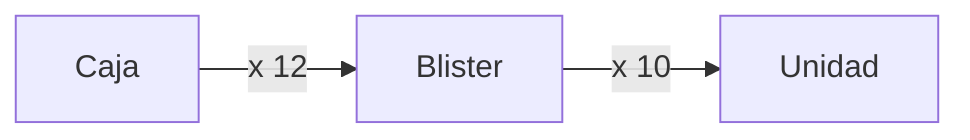
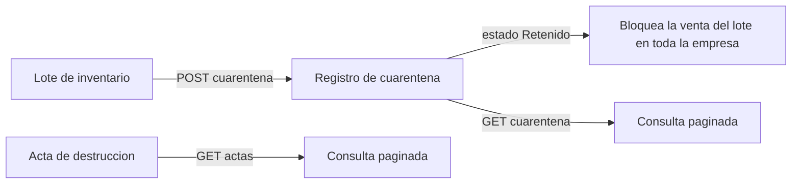

# Referencia de la API — Parte B: catálogos básicos

| | |
|---|---|
| **Sistema** | SOFIA — Sistema Optimizado Farmacéutico con Inteligencia Artificial |
| **Versión del documento** | 1.0 |
| **Fecha** | 2026-10-30 |
| **Backend** | `sofia-apis`, rama `main`, commit `34089ec` |
| **Frontend** | `sofia-web-spa`, rama `main`, commit `9ad15f0` |
| **Método** | Lectura de código y llamadas reales a la API local |

## Contenido

- [0. Alcance, convenciones y datos de prueba](#0-alcance-convenciones-y-datos-de-prueba)
- [1. `UnidadesMedida`](#1-unidadesmedida)
- [2. `JerarquiasUoM`](#2-jerarquiasuom)
- [3. `Laboratorios`](#3-laboratorios)
- [4. `IngredientesActivos`](#4-ingredientesactivos)
- [5. `DIGEMID`](#5-digemid)
- [6. Pendientes y «No verificado»](#6-pendientes-y-no-verificado)
- [7. Tabla de cobertura](#7-tabla-de-cobertura)
- [8. Fuentes](#8-fuentes)

## 0. Alcance, convenciones y datos de prueba

Este documento describe los 50 endpoints de cinco controladores de catálogos: `UnidadesMedida` (9), `JerarquiasUoM` (10), `Laboratorios` (9), `IngredientesActivos` (9) y `DIGEMID` (13, que incluye cuarentena y actas de destrucción, módulo sin pantalla). Las reglas de negocio de cada uno están en [01b-catalogos.md](../01-reglas-de-negocio/01b-catalogos.md) (prefijos `UDM`, `JER`, `LAB`, `ING`, `DIG`) y en [01d-modulos-solo-api.md](../01-reglas-de-negocio/01d-modulos-solo-api.md) (prefijo `CUA`). Los permisos están en la [matriz de permisos](../05-seguridad/05b-matriz-de-permisos.md) (apartados 3.2, 3.8, 3.10, 3.11 y 3.26) y la mecánica del Excel en [20-carga-masiva-y-exportacion.md](../20-carga-masiva-y-exportacion.md).

**Convenciones comunes.** Autenticación con `Authorization: Bearer <token>`, forma de los errores (`ProblemDetails` con la extensión `code`), paginación, exportación a Excel y carga masiva en tres pasos se describen una sola vez en [04a, apartado 0 «Convenciones comunes»](04a-convenciones-y-administracion.md#0-convenciones-comunes). Aquí no se repiten. En todas las fichas, un `401` (sin token o token vencido) o un `403` (sin el permiso indicado) son posibles y se resuelven según ese apartado.

**Lo que sí es común a estos cinco controladores** (comprobado en el código y con llamadas reales):

- Ninguno declara una política de límite de peticiones propia: aplica solo el límite global (`rate_limit` vacío en `_inventario/endpoints.csv` para los 50 endpoints).
- El JSON usa `camelCase` en peticiones y respuestas. Los enumerados viajan como número (por ejemplo `condicionVenta`: `0` = venta libre).
- `POST` de creación devuelve **201** con el identificador como cuerpo (un texto JSON con el GUID, por ejemplo `"1d020b74-…"`) y la cabecera `Location` hacia el `GET` por identificador. `PUT` y `DELETE` devuelven **204** sin cuerpo.
- En los `PUT` el identificador del cuerpo se ignora: el controlador toma siempre el de la ruta (`command with { Id = id }`), por lo que la comprobación «ID mismatch» nunca se cumple (reglas RN-UDM-008, RN-JER-012, RN-LAB-008, RN-ING-007).
- Los listados paginados devuelven `{ items, pageNumber, totalPages, totalCount, hasPreviousPage, hasNextPage }`; `pageNumber` por defecto 1 y `pageSize` por defecto 10.
- Las eliminaciones son lógicas: un registro eliminado deja de aparecer y responde 404 en las consultas por identificador, y su código o nombre queda libre para otro registro.
- Los controladores de carga masiva reciben el archivo en `previsualizar` como `multipart/form-data` (campo `file`, `.xlsx`, máximo 5 MB) y las filas confirmadas en `carga-masiva` como arreglo JSON (entre 1 y 5 000 filas). Las claves de las filas de la vista previa llevan la primera letra en minúscula (`Codigo` pasa a `codigo`).

### 0.1 Datos de prueba creados para esta parte

Todo se creó en la empresa de prueba «Farmacia API Referencia S.A.C.» con el prefijo `4B-`. Los datos son ficticios. Los eliminados se borraron para documentar la eliminación.

| Catálogo | Registros creados | Identificador usado en los ejemplos |
|---|---|---|
| Unidades de medida | `4B-CAJA` «4B-Caja», `4B-BLIS` «4B-Blister», `4B-UNID` «4B-Unidad», `4B-TMP` y `4B-TMP2` (temporales), `4B-FRASCO` y `4B-LITRO` (carga masiva) | `1d020b74-d9d1-4bf2-b148-303fd5b02110` (Caja) |
| Laboratorios | «4B-Laboratorio Demo» (código `4B-LAB-001`), «4B-Laboratorio Temporal» (eliminado), «4B-Lab Masivo A» y «4B-Lab Masivo B» (carga masiva) | `7f2a1bb7-6c57-4121-87a3-dac765a3e2af` |
| Medicamento de apoyo | «4B-Paracetamol 500 mg», código nacional `4B-MED-001`, creado con `POST /api/v1/Medicamentos` | `44267937-e527-44f0-8d06-f8809659154f` |
| Ingredientes activos | «4B-Paracetamol» (`N02BE01`), «4B-Ingrediente temporal» (eliminado), «4B-Ibuprofeno» y «4B-Amoxicilina» (carga masiva) | `fb3743bd-449c-4e67-aba2-6fde8ef38d46` |
| Jerarquías | Caja a Blister, Blister a Unidad, Frasco a Unidad y Litro a Unidad (esta última, `1,5` leído como `15`, ver el apartado 2.9) | `b74af9d3-5722-4384-bf19-390f623285f8` |
| Catálogo DIGEMID | `4B-DIG-001`, `4B-DIG-TMP` (eliminado), `4B-DIG-100` y `4B-DIG-101` (carga masiva) | `82dd5e31-cc5f-4674-893f-c319e97c0ce5` |
| Lote de apoyo | Lote `4B-LOTE-001` del medicamento anterior, creado con `POST /api/v1/LotesInventario` | `67864cae-5a08-480a-9904-df24f5313c00` |
| Cuarentena | Dos registros del lote anterior (`Retenido` y `Liberado`) | `6063a2df-89b7-4fb1-8d23-2c8bce3f27d0` |
| Actas de destrucción | `4B-ACTA-001` y `4B-ACTA-002` | `995870aa-a2e6-476e-bd3c-475f2acab545` |

Para el regente del acta se usó el único empleado de la empresa de prueba, leído con `GET /api/v1/Empleados` (sin documentarlo aquí).

### 0.2 Cómo leer las fichas

Cada ficha indica el permiso, el archivo y la línea del atributo `[HttpXxx]` del controlador (`SOFIA.API/Controllers/…`, la misma línea que da `_inventario/endpoints.csv`), el comando o consulta que ejecuta y la pantalla del SPA que lo usa. «Pantalla del SPA» se tomó de los servicios y rutas de `sofia-web-spa/src/app/pages/`. Los ejemplos son respuestas capturadas de la API local; se recortan las listas y las cabeceras. El token se escribe siempre `<token>`.

Los mensajes `detail` de las respuestas de error están en inglés, tal como los envía el backend. Dos mensajes llegan con las tildes dañadas (por ejemplo `Compañía`), porque el texto fuente del validador está guardado con la codificación doble: es un defecto del backend (ver el apartado 6.3).

[UDM]: ../01-reglas-de-negocio/01b-catalogos.md#4-unidades-de-medida-udm
[JER]: ../01-reglas-de-negocio/01b-catalogos.md#5-jerarquías-de-unidades-jer
[LAB]: ../01-reglas-de-negocio/01b-catalogos.md#6-laboratorios-lab
[ING]: ../01-reglas-de-negocio/01b-catalogos.md#7-ingredientes-activos-ing
[DIG]: ../01-reglas-de-negocio/01b-catalogos.md#13-catálogo-digemid-dig
[CUA]: ../01-reglas-de-negocio/01d-modulos-solo-api.md#7-cuarentena-y-actas-de-destrucción-digemid-cua
[CUA1]: ../01-reglas-de-negocio/01d-modulos-solo-api.md#71-aislar-un-lote-en-cuarentena
[CUA3]: ../01-reglas-de-negocio/01d-modulos-solo-api.md#73-actas-de-destrucción
[04A0]: 04a-convenciones-y-administracion.md#0-convenciones-comunes
[05B]: ../05-seguridad/05b-matriz-de-permisos.md

---

## 1. `UnidadesMedida`

Catálogo de unidades (código de hasta 10 caracteres y descripción de hasta 50). Lo usan los medicamentos como unidad base, las jerarquías, las presentaciones de venta y las formulaciones clínicas. Archivo: `sofia-apis/src/SOFIA.API/Controllers/UnidadesMedidaController.cs`. Ruta base: `/api/v1/UnidadesMedida`. Reglas: [RN-UDM-001 a RN-UDM-017][UDM]. Permisos: [05b, apartado 3.26][05B]. Pantallas: `/unidades-medida`, `/unidades-medida/nueva`, `/unidades-medida/:id` y `/unidades-medida/carga-masiva`.

**Forma de la unidad** (`UnidadMedidaDto`, `SOFIA.Application/UnidadesMedida/UnidadMedidaDto.cs`):

| Campo | Tipo | Descripción |
|---|---|---|
| `id` | GUID | Identificador. |
| `codigo` | texto | Código, único por empresa entre los no eliminados, sin distinguir mayúsculas (la comparación de SQL Server es insensible a mayúsculas: ver el ejemplo del apartado 6.1). |
| `descripcion` | texto | Descripción. |

#### `GET /api/v1/UnidadesMedida`

Lista las unidades de medida de la empresa, con filtros y paginación. Ordena por descripción y luego por identificador.

| | |
|---|---|
| **Permiso** | `UnidadesMedida:Leer` |
| **Límite de peticiones** | solo el global |
| **Código** | `SOFIA.API/Controllers/UnidadesMedidaController.cs:19` → `GetUnidadesMedidaQuery` |
| **Pantalla del SPA** | `/unidades-medida` (botón «Buscar») |

**Parámetros de consulta:**

| Nombre | Tipo | Obligatorio | Descripción |
|---|---|---|---|
| `codigo` | texto | No | Contiene este texto (RN-UDM-012). |
| `descripcion` | texto | No | Contiene este texto. |
| `pageNumber` | entero | No | Página, por defecto 1. |
| `pageSize` | entero | No | Tamaño de página, por defecto 10. |

**Respuesta correcta:** `200 OK`, `application/json`: `{ items: [ { id, codigo, descripcion } ], pageNumber, totalPages, totalCount, hasPreviousPage, hasNextPage }`.

**Errores posibles:**

| HTTP | `code` | Cuándo | Regla |
|---|---|---|---|
| 401 / 403 | — | Sin token o sin `UnidadesMedida:Leer` | [apartado 0][04A0] |

**Ejemplo real:**

```http
GET /api/v1/UnidadesMedida?codigo=4B-&pageNumber=1&pageSize=2
Authorization: Bearer <token>
```

```json
HTTP/1.1 200 OK
{
  "items": [
    { "id": "75e7009e-9a1f-4f0b-9906-64d5f131fa6e", "codigo": "4B-BLIS", "descripcion": "4B-Blister" },
    { "id": "1d020b74-d9d1-4bf2-b148-303fd5b02110", "codigo": "4B-CAJA", "descripcion": "4B-Caja" }
  ],
  "pageNumber": 1,
  "totalPages": 3,
  "totalCount": 5,
  "hasPreviousPage": false,
  "hasNextPage": true
}
```

#### `GET /api/v1/UnidadesMedida/{id}`

Devuelve una unidad de medida por su identificador. Una unidad eliminada o de otra empresa responde 404.

| | |
|---|---|
| **Permiso** | `UnidadesMedida:Leer` |
| **Límite de peticiones** | solo el global |
| **Código** | `SOFIA.API/Controllers/UnidadesMedidaController.cs:27` → `GetUnidadMedidaByIdQuery` |
| **Pantalla del SPA** | `/unidades-medida/:id` (carga inicial del detalle) |

**Parámetros de ruta:** `id` (GUID, obligatorio).

**Respuesta correcta:** `200 OK`: `{ id, codigo, descripcion }`.

**Errores posibles:**

| HTTP | `code` | Cuándo | Regla |
|---|---|---|---|
| 404 | `UnidadMedida.NotFound` | No existe, está eliminada o es de otra empresa | RN-UDM-009 |
| 401 / 403 | — | Sin token o sin permiso | [apartado 0][04A0] |

**Ejemplo real:**

```http
GET /api/v1/UnidadesMedida/1d020b74-d9d1-4bf2-b148-303fd5b02110
Authorization: Bearer <token>
```

```json
HTTP/1.1 200 OK
{ "id": "1d020b74-d9d1-4bf2-b148-303fd5b02110", "codigo": "4B-CAJA", "descripcion": "4B-Caja" }
```

Ejemplo de error (identificador inexistente):

```http
GET /api/v1/UnidadesMedida/00000000-0000-0000-0000-000000000001
Authorization: Bearer <token>
```

```json
HTTP/1.1 404 Not Found
{ "status": 404, "detail": "Unidad de Medida with ID 00000000-0000-0000-0000-000000000001 was not found.", "code": "UnidadMedida.NotFound" }
```

#### `POST /api/v1/UnidadesMedida`

Crea una unidad de medida. Devuelve el identificador del nuevo registro.

| | |
|---|---|
| **Permiso** | `UnidadesMedida:Crear` |
| **Límite de peticiones** | solo el global |
| **Código** | `SOFIA.API/Controllers/UnidadesMedidaController.cs:35` → `CreateUnidadMedidaCommand` |
| **Pantalla del SPA** | `/unidades-medida/nueva` (botón de guardar) |

**Cuerpo:**

| Campo | Tipo | Obligatorio | Reglas |
|---|---|---|---|
| `codigo` | texto | Sí | No vacío, máximo 10 caracteres ([RN-UDM-002, RN-UDM-003][UDM]). Único entre las unidades no eliminadas de la empresa ([RN-UDM-006][UDM]). |
| `descripcion` | texto | Sí | No vacía, máximo 50 caracteres ([RN-UDM-004, RN-UDM-005][UDM]). |

**Respuesta correcta:** `201 Created`; cuerpo: el GUID de la nueva unidad (texto JSON); cabecera `Location: …/api/v1/UnidadesMedida/{id}`.

**Errores posibles:**

| HTTP | `code` | Cuándo | Regla |
|---|---|---|---|
| 400 | `CreateUnidadMedidaCommand.Codigo` | `codigo` vacío o de más de 10 caracteres (el `detail` lista los mensajes de todos los campos que fallan, unidos con `; `) | RN-UDM-002, RN-UDM-003 |
| 400 | `CreateUnidadMedidaCommand.Descripcion` | Falla solo la descripción (vacía o de más de 50) | RN-UDM-004, RN-UDM-005 |
| 400 | — (`ProblemDetails` de validación de ASP.NET con `errors`) | Un campo no nulo falta en el JSON (comportamiento comprobado con `estado` en `POST /DIGEMID/catalogo`; en este endpoint no se probó) | [apartado 0][04A0] |
| 409 | `UnidadMedida.Codigo.Duplicado` | Otra unidad no eliminada usa el código (sin distinguir mayúsculas) | RN-UDM-006 |
| 409 | `Db.Duplicado` | Dos peticiones simultáneas pasan la comprobación y falla el índice único | RN-UDM-006 |
| 401 / 403 | — | Sin token o sin `UnidadesMedida:Crear` | [apartado 0][04A0] |

**Ejemplo real:**

```http
POST /api/v1/UnidadesMedida
Authorization: Bearer <token>
Content-Type: application/json

{ "codigo": "4B-CAJA", "descripcion": "4B-Caja" }
```

```json
HTTP/1.1 201 Created
Location: https://localhost:7300/api/v1/UnidadesMedida/1d020b74-d9d1-4bf2-b148-303fd5b02110

"1d020b74-d9d1-4bf2-b148-303fd5b02110"
```

Ejemplo de error (código repetido) y de validación (campos vacíos):

```json
HTTP/1.1 409 Conflict
{ "status": 409, "detail": "Another unit of measure already uses this code.", "code": "UnidadMedida.Codigo.Duplicado" }
```

```json
HTTP/1.1 400 Bad Request
{ "status": 400, "detail": "Codigo is required.; Descripcion is required.", "code": "CreateUnidadMedidaCommand.Codigo" }
```

#### `PUT /api/v1/UnidadesMedida/{id}`

Actualiza el código y la descripción de una unidad. El identificador del cuerpo, si se envía, se ignora.

| | |
|---|---|
| **Permiso** | `UnidadesMedida:Actualizar` |
| **Límite de peticiones** | solo el global |
| **Código** | `SOFIA.API/Controllers/UnidadesMedidaController.cs:45` → `UpdateUnidadMedidaCommand` |
| **Pantalla del SPA** | `/unidades-medida/:id` (modo edición, botón de guardar) |

**Parámetros de ruta:** `id` (GUID, obligatorio).

**Cuerpo:** los mismos campos y reglas que en el `POST` (`codigo`, `descripcion`). Al editar, la unicidad del código excluye a la propia unidad.

**Respuesta correcta:** `204 No Content`, sin cuerpo.

**Errores posibles:**

| HTTP | `code` | Cuándo | Regla |
|---|---|---|---|
| 400 | `UpdateUnidadMedidaCommand.Codigo` / `.Descripcion` | Código o descripción vacíos o demasiado largos | RN-UDM-002 a RN-UDM-005 |
| 404 | `UnidadMedida.NotFound` | La unidad no existe, está eliminada o es de otra empresa | RN-UDM-009 |
| 409 | `UnidadMedida.Codigo.Duplicado` | Otra unidad ya usa el código | RN-UDM-006 |
| 401 / 403 | — | Sin token o sin `UnidadesMedida:Actualizar` | [apartado 0][04A0] |

**Ejemplo real** (se edita la unidad temporal `4B-TMP`):

```http
PUT /api/v1/UnidadesMedida/60ac2088-ae6a-44ee-b43e-6aefcd5427b1
Authorization: Bearer <token>
Content-Type: application/json

{ "codigo": "4B-TMP", "descripcion": "4B-Temporal editada" }
```

```http
HTTP/1.1 204 No Content
```

Ejemplos de error (se intenta tomar el código de otra unidad; identificador inexistente):

```json
HTTP/1.1 409 Conflict
{ "status": 409, "detail": "Another unit of measure already uses this code.", "code": "UnidadMedida.Codigo.Duplicado" }
```

```json
HTTP/1.1 404 Not Found
{ "status": 404, "detail": "Unidad de Medida with ID 00000000-0000-0000-0000-000000000001 was not found.", "code": "UnidadMedida.NotFound" }
```

#### `DELETE /api/v1/UnidadesMedida/{id}`

Elimina (borrado lógico) una unidad de medida que no esté en uso. Bloquea la eliminación mientras la use un medicamento como unidad base, una jerarquía (mayor o menor) o una formulación clínica.

| | |
|---|---|
| **Permiso** | `UnidadesMedida:Eliminar` |
| **Límite de peticiones** | solo el global |
| **Código** | `SOFIA.API/Controllers/UnidadesMedidaController.cs:59` → `DeleteUnidadMedidaCommand` |
| **Pantalla del SPA** | `/unidades-medida/:id` (botón de eliminar) |

**Parámetros de ruta:** `id` (GUID, obligatorio).

**Respuesta correcta:** `204 No Content`.

**Errores posibles:**

| HTTP | `code` | Cuándo | Regla |
|---|---|---|---|
| 404 | `UnidadMedida.NotFound` | No existe o ya está eliminada | RN-UDM-009 |
| 409 | `UnidadMedida.InUse` | La usa un medicamento, una jerarquía o una formulación clínica no eliminados | RN-UDM-010 |
| 401 / 403 | — | Sin token o sin `UnidadesMedida:Eliminar` | [apartado 0][04A0] |

**Ejemplo real:**

```http
DELETE /api/v1/UnidadesMedida/60ac2088-ae6a-44ee-b43e-6aefcd5427b1
Authorization: Bearer <token>
```

```http
HTTP/1.1 204 No Content
```

Ejemplos de error (se repite el borrado; se intenta borrar la unidad base del medicamento de prueba):

```json
HTTP/1.1 404 Not Found
{ "status": 404, "detail": "Unidad de Medida with ID 60ac2088-ae6a-44ee-b43e-6aefcd5427b1 was not found.", "code": "UnidadMedida.NotFound" }
```

```json
HTTP/1.1 409 Conflict
{ "status": 409, "detail": "Cannot delete a unit of measure referenced by medications, unit hierarchies or clinical formulations.", "code": "UnidadMedida.InUse" }
```

#### `GET /api/v1/UnidadesMedida/plantilla`

Descarga la plantilla Excel de carga masiva. Exige `Crear`, no `Leer`.

| | |
|---|---|
| **Permiso** | `UnidadesMedida:Crear` |
| **Límite de peticiones** | solo el global |
| **Código** | `SOFIA.API/Controllers/UnidadesMedidaController.cs:67` (`ExcelTemplateGenerator.GenerateTemplate`) |
| **Pantalla del SPA** | `/unidades-medida/carga-masiva` (botón «Descargar plantilla») |

**Respuesta correcta:** `200 OK`, libro `.xlsx` de una hoja «Plantilla» con solo la fila de cabeceras `Codigo` y `Descripcion` (RN-UDM-014).

**Errores posibles:** solo 401 / 403 ([apartado 0][04A0]).

**Ejemplo real:**

```http
GET /api/v1/UnidadesMedida/plantilla
Authorization: Bearer <token>
```

```http
HTTP/1.1 200 OK
Content-Type: application/vnd.openxmlformats-officedocument.spreadsheetml.sheet
Content-Disposition: attachment; filename=plantilla-unidadesmedida.xlsx; filename*=UTF-8''plantilla-unidadesmedida.xlsx
Content-Length: 6405
```

#### `POST /api/v1/UnidadesMedida/previsualizar`

Primer paso de la carga masiva: lee el `.xlsx`, valida cada fila contra los datos existentes y devuelve el resultado sin guardar nada.

| | |
|---|---|
| **Permiso** | `UnidadesMedida:Crear` |
| **Límite de peticiones** | solo el global (cuerpo máximo de 5 MB: `RequestSizeLimit`) |
| **Código** | `SOFIA.API/Controllers/UnidadesMedidaController.cs:76` → `PreviewImportUnidadesMedidaQuery` |
| **Pantalla del SPA** | `/unidades-medida/carga-masiva` (al elegir o arrastrar el archivo) |

**Cuerpo:** `multipart/form-data` con un único campo `file` (archivo `.xlsx`). Columnas leídas: `Codigo` y `Descripcion` (la comparación de cabeceras no distingue mayúsculas; una cabecera con otro texto se lee como vacía).

**Respuesta correcta:** `200 OK`: `{ rows: [ { rowNumber, data: { codigo, descripcion }, errors: [ { code, field, params } ], isValid } ], totalCount, validCount, errorCount }`. Códigos de error por fila: `required`, `max-length` (`params.max`), `duplicate` (el código ya existe en la empresa) y `duplicate-in-file` (se repite en el archivo) (RN-UDM-002 a RN-UDM-005, RN-UDM-006 y RN-UDM-015).

**Errores posibles:**

| HTTP | `code` | Cuándo | Regla |
|---|---|---|---|
| 400 | `CargaMasiva.Archivo.Invalido` | La extensión no es `.xlsx`, no tiene la firma ZIP o el libro no se puede abrir | RN-UDM-017, [20, apartado 2.2](../20-carga-masiva-y-exportacion.md) |
| 400 | `CargaMasiva.Archivo.ExcedeDescompresion` | El libro expande más de lo permitido (50 MB o razón 100 a 1) | [20, apartado 2.2](../20-carga-masiva-y-exportacion.md) |
| 400 | `CargaMasiva.Filas.Excedidas` | Más de 5 000 filas con datos | [20, apartado 2.2](../20-carga-masiva-y-exportacion.md) |
| 400 | — (texto plano «Debe adjuntar un archivo Excel.») | El campo `file` llega pero el archivo pesa 0 bytes | RN-UDM-017 |
| 400 | — (`ProblemDetails` de validación: `errors.file`) | No se envía el campo `file` | [apartado 6.2](#62-hallazgos-del-código-y-contradicciones-con-los-documentos-previos) |
| 413 | `Request.TooLarge` | El cuerpo supera 5 MB | [apartado 0][04A0] |
| 401 / 403 | — | Sin token o sin `UnidadesMedida:Crear` | [apartado 0][04A0] |

**Ejemplo real.** Archivo `unidades.xlsx` (hoja única, fila 1 de cabeceras) construido para la prueba:

| Codigo | Descripcion |
|---|---|
| 4B-FRASCO | 4B-Frasco |
| 4B-LITRO | 4B-Litro |
| 4B-DEMASIADO-LARGO | 4B-Unidad invalida |
| 4B-CAJA | 4B-Caja repetida |

```http
POST /api/v1/UnidadesMedida/previsualizar
Authorization: Bearer <token>
Content-Type: multipart/form-data; boundary=----4b

------4b
Content-Disposition: form-data; name="file"; filename="unidades.xlsx"
Content-Type: application/vnd.openxmlformats-officedocument.spreadsheetml.sheet

<contenido binario del .xlsx>
------4b--
```

```json
HTTP/1.1 200 OK
{
  "rows": [
    { "rowNumber": 2, "data": { "codigo": "4B-FRASCO", "descripcion": "4B-Frasco" }, "errors": [], "isValid": true },
    { "rowNumber": 3, "data": { "codigo": "4B-LITRO", "descripcion": "4B-Litro" }, "errors": [], "isValid": true },
    { "rowNumber": 4, "data": { "codigo": "4B-DEMASIADO-LARGO", "descripcion": "4B-Unidad invalida" },
      "errors": [ { "code": "max-length", "field": "codigo", "params": { "max": 10 } } ], "isValid": false },
    { "rowNumber": 5, "data": { "codigo": "4B-CAJA", "descripcion": "4B-Caja repetida" },
      "errors": [ { "code": "duplicate", "field": "codigo", "params": { "value": "4B-CAJA" } } ], "isValid": false }
  ],
  "totalCount": 4,
  "validCount": 2,
  "errorCount": 2
}
```

Ejemplo de error (el archivo no es un libro de Excel, aunque se llame `datos.xlsx`):

```json
HTTP/1.1 400 Bad Request
Content-Type: application/json; charset=utf-8
{ "status": 400, "detail": "The file is not a valid .xlsx workbook.", "code": "CargaMasiva.Archivo.Invalido", "traceId": "0HNPMQECMOPV7:00000011" }
```

#### `POST /api/v1/UnidadesMedida/carga-masiva`

Segundo paso: guarda las filas confirmadas. Repite las validaciones; las filas que no pasan las reglas de la entidad o repiten un código existente (o uno aceptado antes en el mismo envío) se omiten sin error.

| | |
|---|---|
| **Permiso** | `UnidadesMedida:Crear` |
| **Límite de peticiones** | solo el global (cuerpo máximo de 5 MB) |
| **Código** | `SOFIA.API/Controllers/UnidadesMedidaController.cs:94` → `CargaMasivaUnidadesMedidaCommand` |
| **Pantalla del SPA** | `/unidades-medida/carga-masiva` (botón «Guardar válidos (N)») |

**Cuerpo:** arreglo JSON de filas `UnidadMedidaImportRow`.

| Campo | Tipo | Obligatorio | Reglas |
|---|---|---|---|
| `codigo` | texto | Sí | No vacío, máximo 10 (RN-UDM-003). |
| `descripcion` | texto | Sí | No vacía, máximo 50 (RN-UDM-005). |

La lista debe tener entre 1 y 5 000 filas (RN-UDM-016).

**Respuesta correcta:** `200 OK`: `{ "savedCount": N }`, con N igual a las filas realmente guardadas (puede ser menor que las enviadas).

**Errores posibles:**

| HTTP | `code` | Cuándo | Regla |
|---|---|---|---|
| 400 | `CargaMasivaUnidadesMedidaCommand.Rows` | Lista vacía o de más de 5 000 filas | RN-UDM-016 |
| 400 | `CargaMasivaUnidadesMedidaCommand.Rows[i].Codigo` / `.Descripcion` | La fila `i` (desde 0) no cumple el validador: se rechaza todo el envío y solo se informa la primera falla | RN-UDM-016 |
| 413 | `Request.TooLarge` | El cuerpo supera 5 MB | [apartado 0][04A0] |
| 401 / 403 | — | Sin token o sin `UnidadesMedida:Crear` | [apartado 0][04A0] |

**Ejemplo real** (3 filas enviadas; la tercera repite el código `4B-CAJA` y se omite):

```http
POST /api/v1/UnidadesMedida/carga-masiva
Authorization: Bearer <token>
Content-Type: application/json

[
  { "codigo": "4B-FRASCO", "descripcion": "4B-Frasco" },
  { "codigo": "4B-LITRO", "descripcion": "4B-Litro" },
  { "codigo": "4B-CAJA", "descripcion": "4B-Caja repetida" }
]
```

```json
HTTP/1.1 200 OK
{ "savedCount": 2 }
```

Ejemplos de error (lista vacía; código de 19 caracteres en la primera fila):

```json
HTTP/1.1 400 Bad Request
{ "status": 400, "detail": "'Rows' must not be empty.", "code": "CargaMasivaUnidadesMedidaCommand.Rows" }
```

```json
HTTP/1.1 400 Bad Request
{ "status": 400, "detail": "The length of 'Codigo' must be 10 characters or fewer. You entered 19 characters.", "code": "CargaMasivaUnidadesMedidaCommand.Rows[0].Codigo" }
```

#### `POST /api/v1/UnidadesMedida/exportar`

Genera un Excel con las unidades que cumplen los filtros (mismas reglas que el listado, hasta 10 000 filas).

| | |
|---|---|
| **Permiso** | `UnidadesMedida:Leer` |
| **Límite de peticiones** | solo el global |
| **Código** | `SOFIA.API/Controllers/UnidadesMedidaController.cs:103` → `GetUnidadesMedidaQuery` (con `PageSize` = 10 000) |
| **Pantalla del SPA** | `/unidades-medida` (botón «Exportar») |

**Cuerpo:**

| Campo | Tipo | Obligatorio | Reglas |
|---|---|---|---|
| `headers` | arreglo de texto | Sí | Títulos de columna ya traducidos; máximo 50 títulos de hasta 100 caracteres (`Export.Headers.Invalid`). El libro escribe tantas cabeceras como títulos reciba. |
| `codigo` | texto | No | Filtro «contiene». |
| `descripcion` | texto | No | Filtro «contiene». |

**Respuesta correcta:** `200 OK`, libro `.xlsx` con una hoja «Data» y dos columnas (código y descripción) (RN-UDM-013).

**Errores posibles:**

| HTTP | `code` | Cuándo | Regla |
|---|---|---|---|
| 400 | — (`ProblemDetails` de validación: `errors.Headers` con `Export.Headers.Invalid`) | Falta `headers`, o hay más de 50 títulos o alguno supera 100 caracteres | RN-UDM-013, [apartado 0][04A0] |
| 400 | `Export.TooManyRows` | El filtro devuelve más de 10 000 filas | RN-UDM-013 |
| 401 / 403 | — | Sin token o sin `UnidadesMedida:Leer` | [apartado 0][04A0] |

**Ejemplo real:**

```http
POST /api/v1/UnidadesMedida/exportar
Authorization: Bearer <token>
Content-Type: application/json

{ "headers": ["Código", "Descripción"], "codigo": "4B-" }
```

```http
HTTP/1.1 200 OK
Content-Type: application/vnd.openxmlformats-officedocument.spreadsheetml.sheet
Content-Disposition: attachment; filename=unidadesmedida.xlsx; filename*=UTF-8''unidadesmedida.xlsx
Content-Length: 6604
```

Ejemplo de error (sin `headers`):

```json
HTTP/1.1 400 Bad Request
{ "type": "https://tools.ietf.org/html/rfc9110#section-15.5.1", "title": "One or more validation errors occurred.", "status": 400,
  "errors": { "Headers": ["The Headers field is required.", "Export.Headers.Invalid"] }, "traceId": "00-9cb142c98c0ede9f3c7efc3bdd54fe7d-22ecc12e2ace5e05-00" }
```

---

## 2. `JerarquiasUoM`

Conversiones de unidades de un producto: «1 unidad mayor = N unidades menores» (por ejemplo, 1 caja = 12 blísteres). Todas las conversiones de un producto forman un grafo que el sistema recorre para saber cuántas unidades base contiene cualquier unidad. Archivo: `sofia-apis/src/SOFIA.API/Controllers/JerarquiasUoMController.cs`. Ruta base: `/api/v1/JerarquiasUoM`. Reglas: [RN-JER-001 a RN-JER-022][JER]. Permisos: [05b, apartado 3.10][05B]. Pantallas: `/jerarquias`, `/jerarquias/nueva`, `/jerarquias/:id` y `/jerarquias/carga-masiva`; `unidades-vendibles` lo consume la pantalla de presentaciones de venta.



En el ejemplo, la unidad base del medicamento es «4B-Unidad»; una caja equivale entonces a 120 unidades base y un blíster a 10 (ver `unidades-vendibles`).

**Forma de la jerarquía** (`JerarquiaUoMDto`, `SOFIA.Application/JerarquiasUoM/JerarquiaUoMDto.cs`):

| Campo | Tipo | Descripción |
|---|---|---|
| `id` | GUID | Identificador. |
| `productoId`, `productoNombre` | GUID, texto | Medicamento y su nombre comercial. |
| `unidadMayorId`, `unidadMayorNombre` | GUID, texto | Unidad mayor y su descripción. |
| `unidadMenorId`, `unidadMenorNombre` | GUID, texto | Unidad menor y su descripción. |
| `multiplicador` | decimal | Cuántas unidades menores contiene una mayor (se guarda con 4 decimales). |

Para crear jerarquías hace falta un medicamento. En este documento no se describe `Medicamentos`: se creó el medicamento «4B-Paracetamol 500 mg» con `POST /api/v1/Medicamentos` y el cuerpo `{ "codigoNacional": "4B-MED-001", "nombreComercial": "4B-Paracetamol 500 mg", "laboratorioId": "<laboratorio>", "unidadBaseId": "<unidad>", "condicionVenta": 0, "precioVentaBase": 1.5 }` (respuesta `201`).

#### `GET /api/v1/JerarquiasUoM`

Lista las jerarquías de la empresa con filtros y paginación, ordenadas por el nombre comercial del producto. Excluye las jerarquías cuyo producto o unidades estén eliminados.

| | |
|---|---|
| **Permiso** | `JerarquiasUoM:Leer` |
| **Límite de peticiones** | solo el global |
| **Código** | `SOFIA.API/Controllers/JerarquiasUoMController.cs:22` → `GetJerarquiasUoMQuery` |
| **Pantalla del SPA** | `/jerarquias` (botón «Buscar») |

**Parámetros de consulta:**

| Nombre | Tipo | Obligatorio | Descripción |
|---|---|---|---|
| `productoId` | GUID | No | Solo las jerarquías de ese producto. |
| `productoNombre` | texto | No | Nombre comercial contiene (sin distinguir mayúsculas). |
| `unidadMayorNombre` | texto | No | Descripción de la unidad mayor contiene. |
| `unidadMenorNombre` | texto | No | Descripción de la unidad menor contiene. |
| `multiplicadorMin` | decimal | No | Multiplicador mayor o igual. |
| `multiplicadorMax` | decimal | No | Multiplicador menor o igual. |
| `pageNumber`, `pageSize` | entero | No | Por defecto 1 y 10. |

**Respuesta correcta:** `200 OK`: página de `JerarquiaUoMDto` (RN-JER-015).

**Errores posibles:**

| HTTP | `code` | Cuándo | Regla |
|---|---|---|---|
| 401 / 403 | — | Sin token o sin `JerarquiasUoM:Leer` | [apartado 0][04A0] |

**Ejemplo real:**

```http
GET /api/v1/JerarquiasUoM?productoNombre=4B-&pageNumber=1&pageSize=2
Authorization: Bearer <token>
```

```json
HTTP/1.1 200 OK
{
  "items": [
    { "id": "b74af9d3-5722-4384-bf19-390f623285f8", "productoId": "44267937-e527-44f0-8d06-f8809659154f", "productoNombre": "4B-Paracetamol 500 mg",
      "unidadMayorId": "1d020b74-d9d1-4bf2-b148-303fd5b02110", "unidadMayorNombre": "4B-Caja",
      "unidadMenorId": "75e7009e-9a1f-4f0b-9906-64d5f131fa6e", "unidadMenorNombre": "4B-Blister", "multiplicador": 10 }
  ],
  "pageNumber": 1, "totalPages": 1, "totalCount": 2, "hasPreviousPage": false, "hasNextPage": false
}
```

(Se recortó a un elemento; la respuesta real trajo dos, `totalCount: 2`.)

#### `GET /api/v1/JerarquiasUoM/unidades-vendibles`

Devuelve las unidades en que se puede vender un producto: todas las que aparecen en sus jerarquías y se conectan con su unidad base, salvo la propia unidad base, con la cantidad de unidades base que contiene cada una (de mayor a menor cantidad).

| | |
|---|---|
| **Permiso** | `JerarquiasUoM:Leer` |
| **Límite de peticiones** | solo el global |
| **Código** | `SOFIA.API/Controllers/JerarquiasUoMController.cs:30` → `GetUnidadesVendiblesUoMQuery` |
| **Pantalla del SPA** | `/presentaciones-venta/nueva` y `/presentaciones-venta/:id` (al elegir el producto) |

**Parámetros de consulta:** `productoId` (GUID, obligatorio en la práctica; si no se envía llega el GUID vacío y responde 404).

**Respuesta correcta:** `200 OK`: arreglo de `{ unidadMedidaId, descripcion, cantidadUnidadesBase }`; arreglo vacío si el producto no tiene jerarquías conectadas con su unidad base (RN-JER-011).

**Errores posibles:**

| HTTP | `code` | Cuándo | Regla |
|---|---|---|---|
| 404 | `Medicamento.NotFound` | El producto no existe o está eliminado | RN-JER-011 |
| 401 / 403 | — | Sin token o sin `JerarquiasUoM:Leer` | [apartado 0][04A0] |

**Ejemplo real** (después de editar la jerarquía Caja a Blister a 12; antes de editarla, la caja daba 100):

```http
GET /api/v1/JerarquiasUoM/unidades-vendibles?productoId=44267937-e527-44f0-8d06-f8809659154f
Authorization: Bearer <token>
```

```json
HTTP/1.1 200 OK
[
  { "unidadMedidaId": "1d020b74-d9d1-4bf2-b148-303fd5b02110", "descripcion": "4B-Caja", "cantidadUnidadesBase": 120 },
  { "unidadMedidaId": "75e7009e-9a1f-4f0b-9906-64d5f131fa6e", "descripcion": "4B-Blister", "cantidadUnidadesBase": 10 }
]
```

Ejemplo de error (producto inexistente):

```json
HTTP/1.1 404 Not Found
{ "status": 404, "detail": "Medicamento with ID 00000000-0000-0000-0000-000000000001 was not found.", "code": "Medicamento.NotFound" }
```

#### `GET /api/v1/JerarquiasUoM/{id}`

Devuelve una jerarquía por su identificador.

| | |
|---|---|
| **Permiso** | `JerarquiasUoM:Leer` |
| **Límite de peticiones** | solo el global |
| **Código** | `SOFIA.API/Controllers/JerarquiasUoMController.cs:38` → `GetJerarquiaUoMByIdQuery` |
| **Pantalla del SPA** | `/jerarquias/:id` (carga inicial del detalle) |

**Parámetros de ruta:** `id` (GUID, obligatorio).

**Respuesta correcta:** `200 OK`: un `JerarquiaUoMDto`.

**Errores posibles:**

| HTTP | `code` | Cuándo | Regla |
|---|---|---|---|
| 404 | `JerarquiaUoM.NotFound` | No existe, está eliminada o es de otra empresa | RN-JER-013 |
| 401 / 403 | — | Sin token o sin permiso | [apartado 0][04A0] |

**Ejemplo real:**

```http
GET /api/v1/JerarquiasUoM/b74af9d3-5722-4384-bf19-390f623285f8
Authorization: Bearer <token>
```

```json
HTTP/1.1 200 OK
{ "id": "b74af9d3-5722-4384-bf19-390f623285f8", "productoId": "44267937-e527-44f0-8d06-f8809659154f", "productoNombre": "4B-Paracetamol 500 mg",
  "unidadMayorId": "1d020b74-d9d1-4bf2-b148-303fd5b02110", "unidadMayorNombre": "4B-Caja",
  "unidadMenorId": "75e7009e-9a1f-4f0b-9906-64d5f131fa6e", "unidadMenorNombre": "4B-Blister", "multiplicador": 10 }
```

Ejemplo de error (el `detail` de este 404 sale con la tilde dañada: defecto del backend, apartado 6.2):

```json
HTTP/1.1 404 Not Found
{ "status": 404, "detail": "Jerarquía with ID 00000000-0000-0000-0000-000000000001 was not found.", "code": "JerarquiaUoM.NotFound" }
```

#### `POST /api/v1/JerarquiasUoM`

Crea una conversión entre dos unidades de un producto.

| | |
|---|---|
| **Permiso** | `JerarquiasUoM:Crear` |
| **Límite de peticiones** | solo el global |
| **Código** | `SOFIA.API/Controllers/JerarquiasUoMController.cs:46` → `CreateJerarquiaUoMCommand` |
| **Pantalla del SPA** | `/jerarquias/nueva` (botón de guardar) |

**Cuerpo:**

| Campo | Tipo | Obligatorio | Reglas |
|---|---|---|---|
| `productoId` | GUID | Sí | No vacío ([RN-JER-002][JER]). El medicamento debe existir en la empresa ([RN-JER-006][JER]). |
| `unidadMayorId` | GUID | Sí | No vacío ([RN-JER-003][JER]). La unidad debe existir ([RN-JER-007][JER]). |
| `unidadMenorId` | GUID | Sí | No vacío y distinto de `unidadMayorId` ([RN-JER-004][JER]). La unidad debe existir. |
| `multiplicador` | decimal | Sí | Mayor que 0 ([RN-JER-005][JER]). No puede repetir el par mayor-menor del producto ([RN-JER-008][JER]) ni contradecir una equivalencia que ya se calcule con las otras conversiones del producto, comparando a 4 decimales ([RN-JER-009][JER]). |

**Respuesta correcta:** `201 Created`; cuerpo: el GUID de la jerarquía; cabecera `Location`.

**Errores posibles:**

| HTTP | `code` | Cuándo | Regla |
|---|---|---|---|
| 400 | `CreateJerarquiaUoMCommand.ProductoId` / `.UnidadMayorId` / `.UnidadMenorId` | Algún identificador es el GUID vacío | RN-JER-002, RN-JER-003 |
| 400 | `CreateJerarquiaUoMCommand.Multiplicador` | `multiplicador` menor o igual a 0 | RN-JER-005 |
| 400 | `CreateJerarquiaUoMCommand.` (termina en punto) | Unidad mayor y menor son la misma | RN-JER-004 |
| 404 | `Medicamento.NotFound` | El producto no existe en la empresa | RN-JER-006 |
| 404 | `UnidadMedida.NotFound` | Alguna de las dos unidades no existe en la empresa | RN-JER-007 |
| 409 | `JerarquiaUoM.Duplicada` | El producto ya tiene una conversión con esa misma unidad mayor y menor | RN-JER-008 |
| 409 | `JerarquiaUoM.Multiplicador.Inconsistente` | Ya hay un camino entre las dos unidades con otro valor | RN-JER-009 |
| 409 | `Db.Duplicado` | Carrera: falla el índice único del par mayor-menor | RN-JER-008 |
| 401 / 403 | — | Sin token o sin `JerarquiasUoM:Crear` | [apartado 0][04A0] |

**Ejemplo real:**

```http
POST /api/v1/JerarquiasUoM
Authorization: Bearer <token>
Content-Type: application/json

{ "productoId": "44267937-e527-44f0-8d06-f8809659154f",
  "unidadMayorId": "1d020b74-d9d1-4bf2-b148-303fd5b02110",
  "unidadMenorId": "75e7009e-9a1f-4f0b-9906-64d5f131fa6e",
  "multiplicador": 10 }
```

```json
HTTP/1.1 201 Created
Location: https://localhost:7300/api/v1/JerarquiasUoM/b74af9d3-5722-4384-bf19-390f623285f8

"b74af9d3-5722-4384-bf19-390f623285f8"
```

Ejemplos de error, con el producto ya conectado Caja a Blister (12) y Blister a Unidad (10): repetir el par; intentar Caja a Unidad con 50 cuando el cálculo da 120; unidades iguales.

```json
HTTP/1.1 409 Conflict
{ "status": 409, "detail": "This product already has a conversion between these units.", "code": "JerarquiaUoM.Duplicada" }
```

```json
HTTP/1.1 409 Conflict
{ "status": 409, "detail": "A conversion between these units already exists for this product (computed: 120.0000, entered: 50).", "code": "JerarquiaUoM.Multiplicador.Inconsistente" }
```

```json
HTTP/1.1 400 Bad Request
{ "status": 400, "detail": "Unidad Mayor and Unidad Menor cannot be the same.", "code": "CreateJerarquiaUoMCommand." }
```

#### `PUT /api/v1/JerarquiasUoM/{id}`

Actualiza una jerarquía (producto, unidades y multiplicador). Aplica las mismas comprobaciones que el alta, excluyendo la propia jerarquía.

| | |
|---|---|
| **Permiso** | `JerarquiasUoM:Actualizar` |
| **Límite de peticiones** | solo el global |
| **Código** | `SOFIA.API/Controllers/JerarquiasUoMController.cs:56` → `UpdateJerarquiaUoMCommand` |
| **Pantalla del SPA** | `/jerarquias/:id` (modo edición, botón de guardar) |

**Parámetros de ruta:** `id` (GUID, obligatorio).

**Cuerpo:** `productoId`, `unidadMayorId`, `unidadMenorId` y `multiplicador`, con las reglas del `POST`. Al editar solo se vuelve a comprobar la existencia del producto o de la unidad que cambió ([RN-JER-006, RN-JER-007][JER]).

**Respuesta correcta:** `204 No Content`.

**Errores posibles:**

| HTTP | `code` | Cuándo | Regla |
|---|---|---|---|
| 400 | `UpdateJerarquiaUoMCommand.<Campo>` o `UpdateJerarquiaUoMCommand.` | Mismos casos de validación que el `POST` | RN-JER-002 a RN-JER-005 |
| 404 | `JerarquiaUoM.NotFound` | La jerarquía no existe | RN-JER-013 |
| 404 | `Medicamento.NotFound` / `UnidadMedida.NotFound` | El producto o una unidad nuevos no existen | RN-JER-006, RN-JER-007 |
| 409 | `JerarquiaUoM.Duplicada` / `JerarquiaUoM.Multiplicador.Inconsistente` | Igual que el `POST` | RN-JER-008, RN-JER-009 |
| 401 / 403 | — | Sin token o sin `JerarquiasUoM:Actualizar` | [apartado 0][04A0] |

**Ejemplo real** (el multiplicador Caja a Blister pasa de 10 a 12):

```http
PUT /api/v1/JerarquiasUoM/b74af9d3-5722-4384-bf19-390f623285f8
Authorization: Bearer <token>
Content-Type: application/json

{ "productoId": "44267937-e527-44f0-8d06-f8809659154f",
  "unidadMayorId": "1d020b74-d9d1-4bf2-b148-303fd5b02110",
  "unidadMenorId": "75e7009e-9a1f-4f0b-9906-64d5f131fa6e",
  "multiplicador": 12 }
```

```http
HTTP/1.1 204 No Content
```

Ejemplo de error (identificador inexistente):

```json
HTTP/1.1 404 Not Found
{ "status": 404, "detail": "Jerarquía with ID 00000000-0000-0000-0000-000000000001 was not found.", "code": "JerarquiaUoM.NotFound" }
```

#### `DELETE /api/v1/JerarquiasUoM/{id}`

Elimina (borrado lógico) una jerarquía. **No valida dependencias**: no comprueba si alguna presentación de venta usa esa conversión (RN-JER-014).

| | |
|---|---|
| **Permiso** | `JerarquiasUoM:Eliminar` |
| **Límite de peticiones** | solo el global |
| **Código** | `SOFIA.API/Controllers/JerarquiasUoMController.cs:70` → `DeleteJerarquiaUoMCommand` |
| **Pantalla del SPA** | `/jerarquias/:id` (botón de eliminar) |

**Parámetros de ruta:** `id` (GUID, obligatorio).

**Respuesta correcta:** `204 No Content`.

**Errores posibles:**

| HTTP | `code` | Cuándo | Regla |
|---|---|---|---|
| 404 | `JerarquiaUoM.NotFound` | No existe o ya está eliminada | RN-JER-013 |
| 401 / 403 | — | Sin token o sin `JerarquiasUoM:Eliminar` | [apartado 0][04A0] |

**Ejemplo real** (jerarquía temporal Caja a «4B-Temporal 2»):

```http
DELETE /api/v1/JerarquiasUoM/87202ea1-5190-433d-a42e-020ae6283eeb
Authorization: Bearer <token>
```

```http
HTTP/1.1 204 No Content
```

Ejemplo de error (se repite el borrado):

```json
HTTP/1.1 404 Not Found
{ "status": 404, "detail": "Jerarquía with ID 87202ea1-5190-433d-a42e-020ae6283eeb was not found.", "code": "JerarquiaUoM.NotFound" }
```

#### `POST /api/v1/JerarquiasUoM/exportar`

Genera un Excel con las jerarquías que cumplen los filtros (hasta 10 000 filas).

| | |
|---|---|
| **Permiso** | `JerarquiasUoM:Leer` |
| **Límite de peticiones** | solo el global |
| **Código** | `SOFIA.API/Controllers/JerarquiasUoMController.cs:78` → `GetJerarquiasUoMQuery` (con `PageSize` = 10 000) |
| **Pantalla del SPA** | `/jerarquias` (botón «Exportar») |

**Cuerpo:**

| Campo | Tipo | Obligatorio | Reglas |
|---|---|---|---|
| `headers` | arreglo de texto | Sí | Hasta 50 títulos de hasta 100 caracteres. |
| `productoNombre`, `unidadMayorNombre`, `unidadMenorNombre` | texto | No | Filtros «contiene». |
| `multiplicadorMin`, `multiplicadorMax` | decimal | No | Rango inclusive. |

**Respuesta correcta:** `200 OK`, libro `.xlsx`, hoja «Data», cuatro columnas: producto, unidad mayor, unidad menor y multiplicador (RN-JER-016).

**Errores posibles:**

| HTTP | `code` | Cuándo | Regla |
|---|---|---|---|
| 400 | — (`ProblemDetails` de validación: `Export.Headers.Invalid`) | `headers` ausente o fuera de límites | [apartado 0][04A0] |
| 400 | `Export.TooManyRows` | Más de 10 000 filas | RN-JER-016 |
| 401 / 403 | — | Sin token o sin `JerarquiasUoM:Leer` | [apartado 0][04A0] |

**Ejemplo real:**

```http
POST /api/v1/JerarquiasUoM/exportar
Authorization: Bearer <token>
Content-Type: application/json

{ "headers": ["Producto", "Unidad mayor", "Unidad menor", "Multiplicador"], "productoNombre": "4B-", "multiplicadorMin": 1 }
```

```http
HTTP/1.1 200 OK
Content-Type: application/vnd.openxmlformats-officedocument.spreadsheetml.sheet
Content-Disposition: attachment; filename=jerarquias-uom.xlsx; filename*=UTF-8''jerarquias-uom.xlsx
Content-Length: 6611
```

#### `GET /api/v1/JerarquiasUoM/plantilla`

Descarga la plantilla Excel de carga masiva.

| | |
|---|---|
| **Permiso** | `JerarquiasUoM:Crear` |
| **Límite de peticiones** | solo el global |
| **Código** | `SOFIA.API/Controllers/JerarquiasUoMController.cs:113` (`ExcelTemplateGenerator.GenerateTemplate`) |
| **Pantalla del SPA** | `/jerarquias/carga-masiva` (botón «Descargar plantilla») |

**Respuesta correcta:** `200 OK`, hoja «Plantilla» con las cabeceras `Producto`, `UnidadMayor`, `UnidadMenor` y `Multiplicador` (RN-JER-017).

**Errores posibles:** solo 401 / 403 ([apartado 0][04A0]).

**Ejemplo real:**

```http
GET /api/v1/JerarquiasUoM/plantilla
Authorization: Bearer <token>
```

```http
HTTP/1.1 200 OK
Content-Type: application/vnd.openxmlformats-officedocument.spreadsheetml.sheet
Content-Disposition: attachment; filename=plantilla-jerarquias-uom.xlsx; filename*=UTF-8''plantilla-jerarquias-uom.xlsx
Content-Length: 6466
```

#### `POST /api/v1/JerarquiasUoM/previsualizar`

Primer paso de la carga masiva. El producto se identifica por su **nombre comercial** y las unidades por su **descripción** (no por código), sin distinguir mayúsculas (RN-JER-018). **No** comprueba duplicados ni consistencia de multiplicadores (RN-JER-021).

| | |
|---|---|
| **Permiso** | `JerarquiasUoM:Crear` |
| **Límite de peticiones** | solo el global (cuerpo máximo de 5 MB) |
| **Código** | `SOFIA.API/Controllers/JerarquiasUoMController.cs:121` → `PreviewImportJerarquiasUoMQuery` |
| **Pantalla del SPA** | `/jerarquias/carga-masiva` (al elegir o arrastrar el archivo) |

**Cuerpo:** `multipart/form-data`, campo `file` (`.xlsx`). Columnas leídas: `Producto`, `UnidadMayor`, `UnidadMenor`, `Multiplicador`.

**Respuesta correcta:** `200 OK` con la estructura de la vista previa (`rows`, `totalCount`, `validCount`, `errorCount`). Códigos de error por fila: `required`, `not-found` (`params.value`), `ambiguous` (el nombre coincide con varios registros), `must-differ` (`field: unidadMenor`, `params.other: unidadMayor`), `invalid-decimal` y `positive-number`.

**Errores posibles:**

| HTTP | `code` | Cuándo | Regla |
|---|---|---|---|
| 400 | `CargaMasiva.Archivo.Invalido`, `CargaMasiva.Archivo.ExcedeDescompresion`, `CargaMasiva.Filas.Excedidas` | Igual que en `UnidadesMedida` | RN-JER-022, [20, apartado 2.2](../20-carga-masiva-y-exportacion.md) |
| 400 | — (texto plano «Debe adjuntar un archivo Excel.») | Archivo de 0 bytes | RN-JER-022 |
| 400 | — (`ProblemDetails` de validación: `errors.file`) | No se envía el campo `file` | [apartado 6.2](#62-hallazgos-del-código-y-contradicciones-con-los-documentos-previos) |
| 413 | `Request.TooLarge` | Cuerpo de más de 5 MB | [apartado 0][04A0] |
| 401 / 403 | — | Sin token o sin `JerarquiasUoM:Crear` | [apartado 0][04A0] |

**Ejemplo real.** Archivo `jerarquias.xlsx`:

| Producto | UnidadMayor | UnidadMenor | Multiplicador |
|---|---|---|---|
| 4B-Paracetamol 500 mg | 4B-Frasco | 4B-Unidad | 30 |
| 4B-Inexistente | 4B-Frasco | 4B-Unidad | 10 |
| 4B-Paracetamol 500 mg | 4B-Caja | 4B-Caja | abc |

```http
POST /api/v1/JerarquiasUoM/previsualizar
Authorization: Bearer <token>
Content-Type: multipart/form-data; boundary=----4b

------4b
Content-Disposition: form-data; name="file"; filename="jerarquias.xlsx"
Content-Type: application/vnd.openxmlformats-officedocument.spreadsheetml.sheet

<contenido binario del .xlsx>
------4b--
```

```json
HTTP/1.1 200 OK
{
  "rows": [
    { "rowNumber": 2, "data": { "producto": "4B-Paracetamol 500 mg", "unidadMayor": "4B-Frasco", "unidadMenor": "4B-Unidad", "multiplicador": "30" }, "errors": [], "isValid": true },
    { "rowNumber": 3, "data": { "producto": "4B-Inexistente", "unidadMayor": "4B-Frasco", "unidadMenor": "4B-Unidad", "multiplicador": "10" },
      "errors": [ { "code": "not-found", "field": "producto", "params": { "value": "4B-Inexistente" } } ], "isValid": false },
    { "rowNumber": 4, "data": { "producto": "4B-Paracetamol 500 mg", "unidadMayor": "4B-Caja", "unidadMenor": "4B-Caja", "multiplicador": "abc" },
      "errors": [ { "code": "must-differ", "field": "unidadMenor", "params": { "other": "unidadMayor" } },
                  { "code": "invalid-decimal", "field": "multiplicador", "params": null } ], "isValid": false }
  ],
  "totalCount": 3, "validCount": 1, "errorCount": 2
}
```

#### `POST /api/v1/JerarquiasUoM/carga-masiva`

Segundo paso. Resuelve nombres a identificadores, aplica las reglas de duplicado y consistencia fila por fila (teniendo en cuenta las filas aceptadas antes en el mismo envío) y omite sin error las filas que no las cumplen (RN-JER-021).

| | |
|---|---|
| **Permiso** | `JerarquiasUoM:Crear` |
| **Límite de peticiones** | solo el global (cuerpo máximo de 5 MB) |
| **Código** | `SOFIA.API/Controllers/JerarquiasUoMController.cs:138` → `CargaMasivaJerarquiasUoMCommand` |
| **Pantalla del SPA** | `/jerarquias/carga-masiva` (botón «Guardar válidos (N)») |

**Cuerpo:** arreglo JSON de filas `JerarquiaUoMImportRow`.

| Campo | Tipo | Obligatorio | Reglas |
|---|---|---|---|
| `producto` | texto | Sí | Nombre comercial; no vacío, máximo 150 ([RN-JER-020][JER]). |
| `unidadMayor` | texto | Sí | Descripción de la unidad; máximo 50. |
| `unidadMenor` | texto | Sí | Descripción de la unidad; máximo 50. |
| `multiplicador` | texto | Sí | Máximo 30 caracteres; se interpreta con cultura invariante (punto decimal) (RN-JER-019). |

**Respuesta correcta:** `200 OK`: `{ "savedCount": N }`.

**Errores posibles:**

| HTTP | `code` | Cuándo | Regla |
|---|---|---|---|
| 400 | `CargaMasivaJerarquiasUoMCommand.Rows` | Lista vacía o de más de 5 000 filas | RN-JER-020 |
| 400 | `CargaMasivaJerarquiasUoMCommand.Rows[i].Producto` / `.UnidadMayor` / `.UnidadMenor` / `.Multiplicador` | Falla el validador de la fila `i`: se rechaza todo el envío | RN-JER-020 |
| 413 | `Request.TooLarge` | Cuerpo de más de 5 MB | [apartado 0][04A0] |
| 401 / 403 | — | Sin token o sin `JerarquiasUoM:Crear` | [apartado 0][04A0] |

**Ejemplo real** (2 filas enviadas; la segunda repite Caja a Blister, que ya existe con 12, y se omite):

```http
POST /api/v1/JerarquiasUoM/carga-masiva
Authorization: Bearer <token>
Content-Type: application/json

[
  { "producto": "4B-Paracetamol 500 mg", "unidadMayor": "4B-Frasco", "unidadMenor": "4B-Unidad", "multiplicador": "30" },
  { "producto": "4B-Paracetamol 500 mg", "unidadMayor": "4B-Caja", "unidadMenor": "4B-Blister", "multiplicador": "10" }
]
```

```json
HTTP/1.1 200 OK
{ "savedCount": 1 }
```

Ejemplo de error (lista vacía):

```json
HTTP/1.1 400 Bad Request
{ "status": 400, "detail": "'Rows' must not be empty.", "code": "CargaMasivaJerarquiasUoMCommand.Rows" }
```

### 2.9 Notas del módulo

- **Decimales con coma.** Un multiplicador `1,5` pasa la vista previa como válido y la carga masiva lo guarda como **15** (la coma se toma como separador de miles). Verificado: se envió `1,5` (Litro a Unidad) y el listado devolvió `multiplicador: 15`. Con punto (`1.5`) la vista previa lo da por válido y, por el código (`NumberStyles.Number` con cultura invariante), se interpreta como 1,5; ese guardado no se probó. Esto cierra el «No verificado» de la nota del módulo en [01b, apartado 5][JER].
- **Nombres repetidos.** Si el nombre comercial de un producto o la descripción de una unidad coinciden con varios registros, la vista previa marca `ambiguous` y la carga masiva omite la fila.

---

## 3. `Laboratorios`

Catálogo de laboratorios fabricantes; cada medicamento pertenece a uno. Archivo: `sofia-apis/src/SOFIA.API/Controllers/LaboratoriosController.cs`. Ruta base: `/api/v1/Laboratorios`. Reglas: [RN-LAB-001 a RN-LAB-017][LAB]. Permisos: [05b, apartado 3.11][05B]. Pantallas: `/laboratorios`, `/laboratorios/nueva`, `/laboratorios/:id` y `/laboratorios/carga-masiva`.

**Forma del laboratorio** (`LaboratorioDto`, `SOFIA.Application/Laboratorios/LaboratorioDto.cs`):

| Campo | Tipo | Descripción |
|---|---|---|
| `id` | GUID | Identificador. |
| `nombreCompania` | texto | Nombre de la compañía, único por empresa entre los no eliminados. Máximo 150. |
| `codigoIdentificador` | texto o `null` | Código opcional, único cuando se informa. Máximo 50. Un valor vacío o de solo espacios se guarda como `null` ([RN-LAB-005][LAB]). |

#### `GET /api/v1/Laboratorios`

Lista los laboratorios, con filtros y paginación, ordenados por nombre y luego por identificador.

| | |
|---|---|
| **Permiso** | `Laboratorios:Leer` |
| **Límite de peticiones** | solo el global |
| **Código** | `SOFIA.API/Controllers/LaboratoriosController.cs:19` → `GetLaboratoriosQuery` |
| **Pantalla del SPA** | `/laboratorios` (botón «Buscar») |

**Parámetros de consulta:**

| Nombre | Tipo | Obligatorio | Descripción |
|---|---|---|---|
| `nombreCompania` | texto | No | Contiene este texto. |
| `codigoIdentificador` | texto | No | Contiene este texto (los laboratorios sin código no coinciden). |
| `pageNumber`, `pageSize` | entero | No | Por defecto 1 y 10. |

**Respuesta correcta:** `200 OK`: página de `{ id, nombreCompania, codigoIdentificador }` (RN-LAB-012).

**Errores posibles:**

| HTTP | `code` | Cuándo | Regla |
|---|---|---|---|
| 401 / 403 | — | Sin token o sin `Laboratorios:Leer` | [apartado 0][04A0] |

**Ejemplo real:**

```http
GET /api/v1/Laboratorios?nombreCompania=4B-&pageNumber=1&pageSize=2
Authorization: Bearer <token>
```

```json
HTTP/1.1 200 OK
{
  "items": [
    { "id": "7f2a1bb7-6c57-4121-87a3-dac765a3e2af", "nombreCompania": "4B-Laboratorio Demo", "codigoIdentificador": "4B-LAB-001" },
    { "id": "75bdac08-8067-44b4-80a9-0e34deecb070", "nombreCompania": "4B-Laboratorio Temporal", "codigoIdentificador": null }
  ],
  "pageNumber": 1, "totalPages": 1, "totalCount": 2, "hasPreviousPage": false, "hasNextPage": false
}
```

#### `GET /api/v1/Laboratorios/{id}`

Devuelve un laboratorio por su identificador.

| | |
|---|---|
| **Permiso** | `Laboratorios:Leer` |
| **Límite de peticiones** | solo el global |
| **Código** | `SOFIA.API/Controllers/LaboratoriosController.cs:27` → `GetLaboratorioByIdQuery` |
| **Pantalla del SPA** | `/laboratorios/:id` (carga inicial del detalle) |

**Parámetros de ruta:** `id` (GUID, obligatorio).

**Respuesta correcta:** `200 OK`: `{ id, nombreCompania, codigoIdentificador }`.

**Errores posibles:**

| HTTP | `code` | Cuándo | Regla |
|---|---|---|---|
| 404 | `Laboratorio.NotFound` | No existe, está eliminado o es de otra empresa | RN-LAB-009 |
| 401 / 403 | — | Sin token o sin permiso | [apartado 0][04A0] |

**Ejemplo real:**

```http
GET /api/v1/Laboratorios/7f2a1bb7-6c57-4121-87a3-dac765a3e2af
Authorization: Bearer <token>
```

```json
HTTP/1.1 200 OK
{ "id": "7f2a1bb7-6c57-4121-87a3-dac765a3e2af", "nombreCompania": "4B-Laboratorio Demo", "codigoIdentificador": "4B-LAB-001" }
```

Ejemplo de error:

```json
HTTP/1.1 404 Not Found
{ "status": 404, "detail": "Laboratorio with ID 00000000-0000-0000-0000-000000000001 was not found.", "code": "Laboratorio.NotFound" }
```

#### `POST /api/v1/Laboratorios`

Crea un laboratorio.

| | |
|---|---|
| **Permiso** | `Laboratorios:Crear` |
| **Límite de peticiones** | solo el global |
| **Código** | `SOFIA.API/Controllers/LaboratoriosController.cs:35` → `CreateLaboratorioCommand` |
| **Pantalla del SPA** | `/laboratorios/nueva` (botón de guardar) |

**Cuerpo:**

| Campo | Tipo | Obligatorio | Reglas |
|---|---|---|---|
| `nombreCompania` | texto | Sí | No vacío, máximo 150 ([RN-LAB-002, RN-LAB-003][LAB]). Único entre los no eliminados ([RN-LAB-006][LAB]). |
| `codigoIdentificador` | texto | No | Máximo 50 ([RN-LAB-004][LAB]). Si se informa, único entre los no eliminados ([RN-LAB-007][LAB]). La comprobación del nombre se evalúa antes que la del código. |

**Respuesta correcta:** `201 Created`; cuerpo: el GUID del laboratorio; cabecera `Location`.

**Errores posibles:**

| HTTP | `code` | Cuándo | Regla |
|---|---|---|---|
| 400 | `CreateLaboratorioCommand.NombreCompania` | `nombreCompania` vacío o de más de 150 caracteres | RN-LAB-002, RN-LAB-003 |
| 400 | `CreateLaboratorioCommand.CodigoIdentificador` | Código de más de 50 caracteres | RN-LAB-004 |
| 409 | `Laboratorio.NombreCompania.Duplicado` | Otro laboratorio no eliminado usa el nombre | RN-LAB-006 |
| 409 | `Laboratorio.CodigoIdentificador.Duplicado` | Otro laboratorio no eliminado usa el código | RN-LAB-007 |
| 409 | `Db.Duplicado` | Carrera: falla el índice único | RN-LAB-006, RN-LAB-007 |
| 401 / 403 | — | Sin token o sin `Laboratorios:Crear` | [apartado 0][04A0] |

**Ejemplo real:**

```http
POST /api/v1/Laboratorios
Authorization: Bearer <token>
Content-Type: application/json

{ "nombreCompania": "4B-Laboratorio Demo", "codigoIdentificador": "4B-LAB-001" }
```

```json
HTTP/1.1 201 Created
Location: https://localhost:7300/api/v1/Laboratorios/7f2a1bb7-6c57-4121-87a3-dac765a3e2af

"7f2a1bb7-6c57-4121-87a3-dac765a3e2af"
```

Ejemplos de error (nombre repetido; código repetido con otro nombre; nombre vacío, cuyo `detail` llega con las tildes dañadas, apartado 6.2):

```json
HTTP/1.1 409 Conflict
{ "status": 409, "detail": "Another laboratory already uses this company name.", "code": "Laboratorio.NombreCompania.Duplicado" }
```

```json
HTTP/1.1 409 Conflict
{ "status": 409, "detail": "Another laboratory already uses this identifier code.", "code": "Laboratorio.CodigoIdentificador.Duplicado" }
```

```json
HTTP/1.1 400 Bad Request
{ "status": 400, "detail": "Nombre de Compañía is required.", "code": "CreateLaboratorioCommand.NombreCompania" }
```

#### `PUT /api/v1/Laboratorios/{id}`

Actualiza el nombre y el código de un laboratorio. La unicidad excluye al propio laboratorio.

| | |
|---|---|
| **Permiso** | `Laboratorios:Actualizar` |
| **Límite de peticiones** | solo el global |
| **Código** | `SOFIA.API/Controllers/LaboratoriosController.cs:45` → `UpdateLaboratorioCommand` |
| **Pantalla del SPA** | `/laboratorios/:id` (modo edición, botón de guardar) |

**Parámetros de ruta:** `id` (GUID, obligatorio).

**Cuerpo:** `nombreCompania` y `codigoIdentificador`, con las reglas del `POST`.

**Respuesta correcta:** `204 No Content`.

**Errores posibles:**

| HTTP | `code` | Cuándo | Regla |
|---|---|---|---|
| 400 | `UpdateLaboratorioCommand.NombreCompania` / `.CodigoIdentificador` | Nombre vacío o largo; código largo | RN-LAB-002 a RN-LAB-004 |
| 404 | `Laboratorio.NotFound` | No existe | RN-LAB-009 |
| 409 | `Laboratorio.NombreCompania.Duplicado` / `Laboratorio.CodigoIdentificador.Duplicado` | Otro laboratorio ya los usa | RN-LAB-006, RN-LAB-007 |
| 401 / 403 | — | Sin token o sin `Laboratorios:Actualizar` | [apartado 0][04A0] |

**Ejemplo real:**

```http
PUT /api/v1/Laboratorios/75bdac08-8067-44b4-80a9-0e34deecb070
Authorization: Bearer <token>
Content-Type: application/json

{ "nombreCompania": "4B-Laboratorio Temporal editado", "codigoIdentificador": "4B-LAB-TMP" }
```

```http
HTTP/1.1 204 No Content
```

Ejemplos de error (tomar el nombre de otro laboratorio; identificador inexistente):

```json
HTTP/1.1 409 Conflict
{ "status": 409, "detail": "Another laboratory already uses this company name.", "code": "Laboratorio.NombreCompania.Duplicado" }
```

```json
HTTP/1.1 404 Not Found
{ "status": 404, "detail": "Laboratorio with ID 00000000-0000-0000-0000-000000000001 was not found.", "code": "Laboratorio.NotFound" }
```

#### `DELETE /api/v1/Laboratorios/{id}`

Elimina (borrado lógico) un laboratorio. Se rechaza si algún medicamento no eliminado lo tiene asignado.

| | |
|---|---|
| **Permiso** | `Laboratorios:Eliminar` |
| **Límite de peticiones** | solo el global |
| **Código** | `SOFIA.API/Controllers/LaboratoriosController.cs:59` → `DeleteLaboratorioCommand` |
| **Pantalla del SPA** | `/laboratorios/:id` (botón de eliminar) |

**Parámetros de ruta:** `id` (GUID, obligatorio).

**Respuesta correcta:** `204 No Content`.

**Errores posibles:**

| HTTP | `code` | Cuándo | Regla |
|---|---|---|---|
| 404 | `Laboratorio.NotFound` | No existe o ya está eliminado | RN-LAB-009 |
| 409 | `Laboratorio.InUse` | Tiene medicamentos no eliminados | RN-LAB-010 |
| 401 / 403 | — | Sin token o sin `Laboratorios:Eliminar` | [apartado 0][04A0] |

**Ejemplo real:**

```http
DELETE /api/v1/Laboratorios/75bdac08-8067-44b4-80a9-0e34deecb070
Authorization: Bearer <token>
```

```http
HTTP/1.1 204 No Content
```

Ejemplos de error (repetir el borrado; borrar el laboratorio del medicamento de prueba):

```json
HTTP/1.1 404 Not Found
{ "status": 404, "detail": "Laboratorio with ID 75bdac08-8067-44b4-80a9-0e34deecb070 was not found.", "code": "Laboratorio.NotFound" }
```

```json
HTTP/1.1 409 Conflict
{ "status": 409, "detail": "Cannot delete a laboratory referenced by medications.", "code": "Laboratorio.InUse" }
```

#### `POST /api/v1/Laboratorios/exportar`

Genera un Excel con los laboratorios que cumplen los filtros (hasta 10 000 filas).

| | |
|---|---|
| **Permiso** | `Laboratorios:Leer` |
| **Límite de peticiones** | solo el global |
| **Código** | `SOFIA.API/Controllers/LaboratoriosController.cs:67` → `GetLaboratoriosQuery` (con `PageSize` = 10 000) |
| **Pantalla del SPA** | `/laboratorios` (botón «Exportar») |

**Cuerpo:**

| Campo | Tipo | Obligatorio | Reglas |
|---|---|---|---|
| `headers` | arreglo de texto | Sí | Hasta 50 títulos de hasta 100 caracteres. |
| `nombreCompania`, `codigoIdentificador` | texto | No | Filtros «contiene». |

**Respuesta correcta:** `200 OK`, libro `.xlsx`, hoja «Data», dos columnas (nombre y código) (RN-LAB-012).

**Errores posibles:**

| HTTP | `code` | Cuándo | Regla |
|---|---|---|---|
| 400 | — (`ProblemDetails` de validación: `Export.Headers.Invalid`) | `headers` ausente o fuera de límites | [apartado 0][04A0] |
| 400 | `Export.TooManyRows` | Más de 10 000 filas | RN-LAB-012 |
| 401 / 403 | — | Sin token o sin `Laboratorios:Leer` | [apartado 0][04A0] |

**Ejemplo real:**

```http
POST /api/v1/Laboratorios/exportar
Authorization: Bearer <token>
Content-Type: application/json

{ "headers": ["Nombre de compañía", "Código identificador"], "nombreCompania": "4B-" }
```

```http
HTTP/1.1 200 OK
Content-Type: application/vnd.openxmlformats-officedocument.spreadsheetml.sheet
Content-Disposition: attachment; filename=laboratorios.xlsx; filename*=UTF-8''laboratorios.xlsx
Content-Length: 6552
```

#### `GET /api/v1/Laboratorios/plantilla`

Descarga la plantilla Excel de carga masiva.

| | |
|---|---|
| **Permiso** | `Laboratorios:Crear` |
| **Límite de peticiones** | solo el global |
| **Código** | `SOFIA.API/Controllers/LaboratoriosController.cs:97` (`ExcelTemplateGenerator.GenerateTemplate`) |
| **Pantalla del SPA** | `/laboratorios/carga-masiva` (botón «Descargar plantilla») |

**Respuesta correcta:** `200 OK`, hoja «Plantilla» con las cabeceras `NombreCompania` y `CodigoIdentificador` (RN-LAB-013).

**Errores posibles:** solo 401 / 403 ([apartado 0][04A0]).

**Ejemplo real:**

```http
GET /api/v1/Laboratorios/plantilla
Authorization: Bearer <token>
```

```http
HTTP/1.1 200 OK
Content-Type: application/vnd.openxmlformats-officedocument.spreadsheetml.sheet
Content-Disposition: attachment; filename=plantilla-laboratorios.xlsx; filename*=UTF-8''plantilla-laboratorios.xlsx
Content-Length: 6416
```

#### `POST /api/v1/Laboratorios/previsualizar`

Primer paso de la carga masiva. Marca como duplicado solo el **nombre** repetido (en la base o dentro del archivo); **no** comprueba el código identificador repetido (RN-LAB-015).

| | |
|---|---|
| **Permiso** | `Laboratorios:Crear` |
| **Límite de peticiones** | solo el global (cuerpo máximo de 5 MB) |
| **Código** | `SOFIA.API/Controllers/LaboratoriosController.cs:106` → `PreviewImportLaboratoriosQuery` |
| **Pantalla del SPA** | `/laboratorios/carga-masiva` (al elegir o arrastrar el archivo) |

**Cuerpo:** `multipart/form-data`, campo `file` (`.xlsx`). Columnas leídas: `NombreCompania` y `CodigoIdentificador` (opcional).

**Respuesta correcta:** `200 OK` con la estructura de la vista previa. Códigos de error por fila: `required`, `max-length` (`params.max`: 150 o 50), `duplicate` y `duplicate-in-file`.

**Errores posibles:**

| HTTP | `code` | Cuándo | Regla |
|---|---|---|---|
| 400 | `CargaMasiva.Archivo.Invalido`, `CargaMasiva.Archivo.ExcedeDescompresion`, `CargaMasiva.Filas.Excedidas` | Igual que en `UnidadesMedida` | RN-LAB-017, [20, apartado 2.2](../20-carga-masiva-y-exportacion.md) |
| 400 | — (texto plano «Debe adjuntar un archivo Excel.») | Archivo de 0 bytes | RN-LAB-017 |
| 400 | — (`ProblemDetails` de validación: `errors.file`) | No se envía el campo `file` | [apartado 6.2](#62-hallazgos-del-código-y-contradicciones-con-los-documentos-previos) |
| 413 | `Request.TooLarge` | Cuerpo de más de 5 MB | [apartado 0][04A0] |
| 401 / 403 | — | Sin token o sin `Laboratorios:Crear` | [apartado 0][04A0] |

**Ejemplo real.** Archivo `laboratorios.xlsx`:

| NombreCompania | CodigoIdentificador |
|---|---|
| 4B-Lab Masivo A | 4B-LM-A |
| 4B-Lab Masivo B | (vacío) |
| 4B-Laboratorio Demo | 4B-LM-C |

```http
POST /api/v1/Laboratorios/previsualizar
Authorization: Bearer <token>
Content-Type: multipart/form-data; boundary=----4b

------4b
Content-Disposition: form-data; name="file"; filename="laboratorios.xlsx"
Content-Type: application/vnd.openxmlformats-officedocument.spreadsheetml.sheet

<contenido binario del .xlsx>
------4b--
```

```json
HTTP/1.1 200 OK
{
  "rows": [
    { "rowNumber": 2, "data": { "nombreCompania": "4B-Lab Masivo A", "codigoIdentificador": "4B-LM-A" }, "errors": [], "isValid": true },
    { "rowNumber": 3, "data": { "nombreCompania": "4B-Lab Masivo B", "codigoIdentificador": null }, "errors": [], "isValid": true },
    { "rowNumber": 4, "data": { "nombreCompania": "4B-Laboratorio Demo", "codigoIdentificador": "4B-LM-C" },
      "errors": [ { "code": "duplicate", "field": "nombreCompania", "params": { "value": "4B-Laboratorio Demo" } } ], "isValid": false }
  ],
  "totalCount": 3, "validCount": 2, "errorCount": 1
}
```

Ejemplo de error (archivo que no es un libro de Excel):

```json
HTTP/1.1 400 Bad Request
{ "status": 400, "detail": "The file is not a valid .xlsx workbook.", "code": "CargaMasiva.Archivo.Invalido", "traceId": "0HNPMQECMOPVG:00000010" }
```

#### `POST /api/v1/Laboratorios/carga-masiva`

Segundo paso. Omite sin error las filas cuyo nombre o código ya existe (en la base o antes en el mismo envío).

| | |
|---|---|
| **Permiso** | `Laboratorios:Crear` |
| **Límite de peticiones** | solo el global (cuerpo máximo de 5 MB) |
| **Código** | `SOFIA.API/Controllers/LaboratoriosController.cs:124` → `CargaMasivaLaboratoriosCommand` |
| **Pantalla del SPA** | `/laboratorios/carga-masiva` (botón «Guardar válidos (N)») |

**Cuerpo:** arreglo JSON de `LaboratorioImportRow`.

| Campo | Tipo | Obligatorio | Reglas |
|---|---|---|---|
| `nombreCompania` | texto | Sí | No vacío, máximo 150. |
| `codigoIdentificador` | texto | No | Máximo 50. |

La lista debe tener entre 1 y 5 000 filas (RN-LAB-016).

**Respuesta correcta:** `200 OK`: `{ "savedCount": N }`.

**Errores posibles:**

| HTTP | `code` | Cuándo | Regla |
|---|---|---|---|
| 400 | `CargaMasivaLaboratoriosCommand.Rows` | Lista vacía o de más de 5 000 filas | RN-LAB-016 |
| 400 | `CargaMasivaLaboratoriosCommand.Rows[i].NombreCompania` / `.CodigoIdentificador` | Falla el validador de la fila `i`: se rechaza todo el envío | RN-LAB-016 |
| 413 | `Request.TooLarge` | Cuerpo de más de 5 MB | [apartado 0][04A0] |
| 401 / 403 | — | Sin token o sin `Laboratorios:Crear` | [apartado 0][04A0] |

**Ejemplo real** (la tercera fila repite un nombre existente y se omite):

```http
POST /api/v1/Laboratorios/carga-masiva
Authorization: Bearer <token>
Content-Type: application/json

[
  { "nombreCompania": "4B-Lab Masivo A", "codigoIdentificador": "4B-LM-A" },
  { "nombreCompania": "4B-Lab Masivo B", "codigoIdentificador": null },
  { "nombreCompania": "4B-Laboratorio Demo", "codigoIdentificador": "4B-LM-C" }
]
```

```json
HTTP/1.1 200 OK
{ "savedCount": 2 }
```

Ejemplo de error (lista vacía):

```json
HTTP/1.1 400 Bad Request
{ "status": 400, "detail": "'Rows' must not be empty.", "code": "CargaMasivaLaboratoriosCommand.Rows" }
```

---

## 4. `IngredientesActivos`

Catálogo de principios activos (denominación común internacional y código ATC) que se asocian a los medicamentos mediante formulaciones clínicas. Archivo: `sofia-apis/src/SOFIA.API/Controllers/IngredientesActivosController.cs`. Ruta base: `/api/v1/IngredientesActivos`. Reglas: [RN-ING-001 a RN-ING-015][ING]. Permisos: [05b, apartado 3.8][05B]. Pantallas: `/ingredientes-activos`, `/ingredientes-activos/nueva`, `/ingredientes-activos/:id` y `/ingredientes-activos/carga-masiva`.

**Forma del ingrediente** (`IngredienteActivoDto`, `SOFIA.Application/IngredientesActivos/IngredienteActivoDto.cs`):

| Campo | Tipo | Descripción |
|---|---|---|
| `id` | GUID | Identificador. |
| `denominacionDci` | texto | Denominación DCI. Única por empresa entre los no eliminados. Máximo 255. |
| `codigoAtc` | texto | Código ATC. Máximo 15 caracteres; no se valida su estructura y **no** es único al crear o editar ([RN-ING-005, RN-ING-006][ING]). |

#### `GET /api/v1/IngredientesActivos`

Lista los ingredientes activos con filtros y paginación, ordenados por denominación y luego por identificador.

| | |
|---|---|
| **Permiso** | `IngredientesActivos:Leer` |
| **Límite de peticiones** | solo el global |
| **Código** | `SOFIA.API/Controllers/IngredientesActivosController.cs:19` → `GetIngredientesActivosQuery` |
| **Pantalla del SPA** | `/ingredientes-activos` (botón «Buscar»); también alimenta el autocompletado de `/formulaciones-clinicas/nueva` |

**Parámetros de consulta:**

| Nombre | Tipo | Obligatorio | Descripción |
|---|---|---|---|
| `denominacionDci` | texto | No | Contiene este texto. |
| `codigoAtc` | texto | No | Contiene este texto. |
| `pageNumber`, `pageSize` | entero | No | Por defecto 1 y 10. |

**Respuesta correcta:** `200 OK`: página de `{ id, denominacionDci, codigoAtc }` (RN-ING-010).

**Errores posibles:**

| HTTP | `code` | Cuándo | Regla |
|---|---|---|---|
| 401 / 403 | — | Sin token o sin `IngredientesActivos:Leer` | [apartado 0][04A0] |

**Ejemplo real:**

```http
GET /api/v1/IngredientesActivos?denominacionDci=4B-&pageNumber=1&pageSize=2
Authorization: Bearer <token>
```

```json
HTTP/1.1 200 OK
{
  "items": [
    { "id": "51ed6e01-130b-445d-9c95-28b461c34803", "denominacionDci": "4B-Ingrediente temporal", "codigoAtc": "4B-TMP" },
    { "id": "fb3743bd-449c-4e67-aba2-6fde8ef38d46", "denominacionDci": "4B-Paracetamol", "codigoAtc": "N02BE01" }
  ],
  "pageNumber": 1, "totalPages": 1, "totalCount": 2, "hasPreviousPage": false, "hasNextPage": false
}
```

#### `GET /api/v1/IngredientesActivos/{id}`

Devuelve un ingrediente activo por su identificador.

| | |
|---|---|
| **Permiso** | `IngredientesActivos:Leer` |
| **Límite de peticiones** | solo el global |
| **Código** | `SOFIA.API/Controllers/IngredientesActivosController.cs:27` → `GetIngredienteActivoByIdQuery` |
| **Pantalla del SPA** | `/ingredientes-activos/:id` (carga inicial del detalle) |

**Parámetros de ruta:** `id` (GUID, obligatorio).

**Respuesta correcta:** `200 OK`: `{ id, denominacionDci, codigoAtc }`.

**Errores posibles:**

| HTTP | `code` | Cuándo | Regla |
|---|---|---|---|
| 404 | `IngredienteActivo.NotFound` | No existe, está eliminado o es de otra empresa | RN-ING-008 |
| 401 / 403 | — | Sin token o sin permiso | [apartado 0][04A0] |

**Ejemplo real:**

```http
GET /api/v1/IngredientesActivos/fb3743bd-449c-4e67-aba2-6fde8ef38d46
Authorization: Bearer <token>
```

```json
HTTP/1.1 200 OK
{ "id": "fb3743bd-449c-4e67-aba2-6fde8ef38d46", "denominacionDci": "4B-Paracetamol", "codigoAtc": "N02BE01" }
```

Ejemplo de error:

```json
HTTP/1.1 404 Not Found
{ "status": 404, "detail": "Ingrediente Activo with ID 00000000-0000-0000-0000-000000000001 was not found.", "code": "IngredienteActivo.NotFound" }
```

#### `POST /api/v1/IngredientesActivos`

Crea un ingrediente activo.

| | |
|---|---|
| **Permiso** | `IngredientesActivos:Crear` |
| **Límite de peticiones** | solo el global |
| **Código** | `SOFIA.API/Controllers/IngredientesActivosController.cs:35` → `CreateIngredienteActivoCommand` |
| **Pantalla del SPA** | `/ingredientes-activos/nueva` (botón de guardar) |

**Cuerpo:**

| Campo | Tipo | Obligatorio | Reglas |
|---|---|---|---|
| `denominacionDci` | texto | Sí | No vacía, máximo 255 ([RN-ING-002, RN-ING-003][ING]). Única entre los no eliminados ([RN-ING-006][ING]). |
| `codigoAtc` | texto | Sí | No vacío, máximo 15 ([RN-ING-004, RN-ING-005][ING]). Se puede repetir entre ingredientes. |

**Respuesta correcta:** `201 Created`; cuerpo: el GUID del ingrediente; cabecera `Location`.

**Errores posibles:**

| HTTP | `code` | Cuándo | Regla |
|---|---|---|---|
| 400 | `CreateIngredienteActivoCommand.DenominacionDci` | Denominación vacía o de más de 255 caracteres | RN-ING-002, RN-ING-003 |
| 400 | `CreateIngredienteActivoCommand.CodigoAtc` | Código ATC vacío o de más de 15 caracteres (si fallan ambos campos, el `code` es el del primero) | RN-ING-004, RN-ING-005 |
| 409 | `IngredienteActivo.DenominacionDci.Duplicado` | Otro ingrediente no eliminado usa la denominación | RN-ING-006 |
| 409 | `Db.Duplicado` | Carrera: falla el índice único | RN-ING-006 |
| 401 / 403 | — | Sin token o sin `IngredientesActivos:Crear` | [apartado 0][04A0] |

**Ejemplo real:**

```http
POST /api/v1/IngredientesActivos
Authorization: Bearer <token>
Content-Type: application/json

{ "denominacionDci": "4B-Paracetamol", "codigoAtc": "N02BE01" }
```

```json
HTTP/1.1 201 Created
Location: https://localhost:7300/api/v1/IngredientesActivos/fb3743bd-449c-4e67-aba2-6fde8ef38d46

"fb3743bd-449c-4e67-aba2-6fde8ef38d46"
```

Ejemplos de error (denominación repetida con otro ATC; campos vacíos, con el `detail` de tildes dañadas, apartado 6.2):

```json
HTTP/1.1 409 Conflict
{ "status": 409, "detail": "Another active ingredient already uses this INN.", "code": "IngredienteActivo.DenominacionDci.Duplicado" }
```

```json
HTTP/1.1 400 Bad Request
{ "status": 400, "detail": "Denominación DCI is required.; Código ATC is required.", "code": "CreateIngredienteActivoCommand.DenominacionDci" }
```

#### `PUT /api/v1/IngredientesActivos/{id}`

Actualiza la denominación y el código ATC. La unicidad de la denominación excluye al propio ingrediente.

| | |
|---|---|
| **Permiso** | `IngredientesActivos:Actualizar` |
| **Límite de peticiones** | solo el global |
| **Código** | `SOFIA.API/Controllers/IngredientesActivosController.cs:45` → `UpdateIngredienteActivoCommand` |
| **Pantalla del SPA** | `/ingredientes-activos/:id` (modo edición, botón de guardar) |

**Parámetros de ruta:** `id` (GUID, obligatorio).

**Cuerpo:** `denominacionDci` y `codigoAtc`, con las reglas del `POST`.

**Respuesta correcta:** `204 No Content`.

**Errores posibles:**

| HTTP | `code` | Cuándo | Regla |
|---|---|---|---|
| 400 | `UpdateIngredienteActivoCommand.DenominacionDci` / `.CodigoAtc` | Campos vacíos o largos | RN-ING-002 a RN-ING-005 |
| 404 | `IngredienteActivo.NotFound` | No existe | RN-ING-008 |
| 409 | `IngredienteActivo.DenominacionDci.Duplicado` | Otro ingrediente usa la denominación | RN-ING-006 |
| 401 / 403 | — | Sin token o sin `IngredientesActivos:Actualizar` | [apartado 0][04A0] |

**Ejemplo real:**

```http
PUT /api/v1/IngredientesActivos/51ed6e01-130b-445d-9c95-28b461c34803
Authorization: Bearer <token>
Content-Type: application/json

{ "denominacionDci": "4B-Ingrediente temporal editado", "codigoAtc": "4B-TMP2" }
```

```http
HTTP/1.1 204 No Content
```

Ejemplos de error (tomar la denominación de otro ingrediente; identificador inexistente):

```json
HTTP/1.1 409 Conflict
{ "status": 409, "detail": "Another active ingredient already uses this INN.", "code": "IngredienteActivo.DenominacionDci.Duplicado" }
```

```json
HTTP/1.1 404 Not Found
{ "status": 404, "detail": "Ingrediente Activo with ID 00000000-0000-0000-0000-000000000001 was not found.", "code": "IngredienteActivo.NotFound" }
```

#### `DELETE /api/v1/IngredientesActivos/{id}`

Elimina (borrado lógico) un ingrediente activo. Se rechaza si alguna formulación clínica no eliminada lo usa.

| | |
|---|---|
| **Permiso** | `IngredientesActivos:Eliminar` |
| **Límite de peticiones** | solo el global |
| **Código** | `SOFIA.API/Controllers/IngredientesActivosController.cs:59` → `DeleteIngredienteActivoCommand` |
| **Pantalla del SPA** | `/ingredientes-activos/:id` (botón de eliminar) |

**Parámetros de ruta:** `id` (GUID, obligatorio).

**Respuesta correcta:** `204 No Content`.

**Errores posibles:**

| HTTP | `code` | Cuándo | Regla |
|---|---|---|---|
| 404 | `IngredienteActivo.NotFound` | No existe o ya está eliminado | RN-ING-008 |
| 409 | `IngredienteActivo.InUse` | Una formulación clínica no eliminada lo incluye | RN-ING-009 |
| 401 / 403 | — | Sin token o sin `IngredientesActivos:Eliminar` | [apartado 0][04A0] |

**Ejemplo real:**

```http
DELETE /api/v1/IngredientesActivos/51ed6e01-130b-445d-9c95-28b461c34803
Authorization: Bearer <token>
```

```http
HTTP/1.1 204 No Content
```

Ejemplo de error (se repite el borrado):

```json
HTTP/1.1 404 Not Found
{ "status": 404, "detail": "Ingrediente Activo with ID 51ed6e01-130b-445d-9c95-28b461c34803 was not found.", "code": "IngredienteActivo.NotFound" }
```

El conflicto `IngredienteActivo.InUse` (`409`, `"Cannot delete an active ingredient referenced by clinical formulations."`) se documenta desde el código (`DeleteIngredienteActivoCommandHandler.cs:20-27`). **Ejemplo no verificado:** provocarlo exige crear una formulación clínica, módulo que no pertenece a esta parte.

#### `POST /api/v1/IngredientesActivos/exportar`

Genera un Excel con los ingredientes que cumplen los filtros (hasta 10 000 filas).

| | |
|---|---|
| **Permiso** | `IngredientesActivos:Leer` |
| **Límite de peticiones** | solo el global |
| **Código** | `SOFIA.API/Controllers/IngredientesActivosController.cs:67` → `GetIngredientesActivosQuery` (con `PageSize` = 10 000) |
| **Pantalla del SPA** | `/ingredientes-activos` (botón «Exportar») |

**Cuerpo:**

| Campo | Tipo | Obligatorio | Reglas |
|---|---|---|---|
| `headers` | arreglo de texto | Sí | Hasta 50 títulos de hasta 100 caracteres. |
| `denominacionDci`, `codigoAtc` | texto | No | Filtros «contiene». |

**Respuesta correcta:** `200 OK`, libro `.xlsx`, hoja «Data», dos columnas (denominación y ATC).

**Errores posibles:**

| HTTP | `code` | Cuándo | Regla |
|---|---|---|---|
| 400 | — (`ProblemDetails` de validación: `Export.Headers.Invalid`) | `headers` ausente o fuera de límites | [apartado 0][04A0] |
| 400 | `Export.TooManyRows` | Más de 10 000 filas | RN-ING-010 |
| 401 / 403 | — | Sin token o sin `IngredientesActivos:Leer` | [apartado 0][04A0] |

**Ejemplo real:**

```http
POST /api/v1/IngredientesActivos/exportar
Authorization: Bearer <token>
Content-Type: application/json

{ "headers": ["Denominación DCI", "Código ATC"], "denominacionDci": "4B-" }
```

```http
HTTP/1.1 200 OK
Content-Type: application/vnd.openxmlformats-officedocument.spreadsheetml.sheet
Content-Disposition: attachment; filename=ingredientes-activos.xlsx; filename*=UTF-8''ingredientes-activos.xlsx
Content-Length: 6553
```

#### `GET /api/v1/IngredientesActivos/plantilla`

Descarga la plantilla Excel de carga masiva.

| | |
|---|---|
| **Permiso** | `IngredientesActivos:Crear` |
| **Límite de peticiones** | solo el global |
| **Código** | `SOFIA.API/Controllers/IngredientesActivosController.cs:97` (`ExcelTemplateGenerator.GenerateTemplate`) |
| **Pantalla del SPA** | `/ingredientes-activos/carga-masiva` (botón «Descargar plantilla») |

**Respuesta correcta:** `200 OK`, hoja «Plantilla» con las cabeceras `DenominacionDci` y `CodigoAtc` (RN-ING-011).

**Errores posibles:** solo 401 / 403 ([apartado 0][04A0]).

**Ejemplo real:**

```http
GET /api/v1/IngredientesActivos/plantilla
Authorization: Bearer <token>
```

```http
HTTP/1.1 200 OK
Content-Type: application/vnd.openxmlformats-officedocument.spreadsheetml.sheet
Content-Disposition: attachment; filename=plantilla-ingredientesactivos.xlsx; filename*=UTF-8''plantilla-ingredientesactivos.xlsx
Content-Length: 6409
```

#### `POST /api/v1/IngredientesActivos/previsualizar`

Primer paso de la carga masiva. La vista previa marca como duplicado el **código ATC** repetido (en la base o en el archivo), pero no la denominación DCI, que es la clave única real (contradicción del código: [apartado 6.2](#62-hallazgos-del-código-y-contradicciones-con-los-documentos-previos); RN-ING-012 y RN-ING-013).

| | |
|---|---|
| **Permiso** | `IngredientesActivos:Crear` |
| **Límite de peticiones** | solo el global (cuerpo máximo de 5 MB) |
| **Código** | `SOFIA.API/Controllers/IngredientesActivosController.cs:106` → `PreviewImportIngredientesActivosQuery` |
| **Pantalla del SPA** | `/ingredientes-activos/carga-masiva` (al elegir o arrastrar el archivo) |

**Cuerpo:** `multipart/form-data`, campo `file` (`.xlsx`). Columnas leídas: `DenominacionDci` y `CodigoAtc`.

**Respuesta correcta:** `200 OK` con la estructura de la vista previa. Códigos de error por fila: `required`, `max-length` (`params.max`: 255 o 15), `duplicate` y `duplicate-in-file` (ambos sobre `codigoAtc`).

**Errores posibles:**

| HTTP | `code` | Cuándo | Regla |
|---|---|---|---|
| 400 | `CargaMasiva.Archivo.Invalido`, `CargaMasiva.Archivo.ExcedeDescompresion`, `CargaMasiva.Filas.Excedidas` | Igual que en `UnidadesMedida` | RN-ING-015, [20, apartado 2.2](../20-carga-masiva-y-exportacion.md) |
| 400 | — (texto plano «Debe adjuntar un archivo Excel.») | Archivo de 0 bytes | RN-ING-015 |
| 400 | — (`ProblemDetails` de validación: `errors.file`) | No se envía el campo `file` | [apartado 6.2](#62-hallazgos-del-código-y-contradicciones-con-los-documentos-previos) |
| 413 | `Request.TooLarge` | Cuerpo de más de 5 MB | [apartado 0][04A0] |
| 401 / 403 | — | Sin token o sin `IngredientesActivos:Crear` | [apartado 0][04A0] |

**Ejemplo real.** Archivo `ingredientes.xlsx`:

| DenominacionDci | CodigoAtc |
|---|---|
| 4B-Ibuprofeno | M01AE01 |
| 4B-Amoxicilina | J01CA04 |
| 4B-Otro paracetamol | N02BE01 |

```http
POST /api/v1/IngredientesActivos/previsualizar
Authorization: Bearer <token>
Content-Type: multipart/form-data; boundary=----4b

------4b
Content-Disposition: form-data; name="file"; filename="ingredientes.xlsx"
Content-Type: application/vnd.openxmlformats-officedocument.spreadsheetml.sheet

<contenido binario del .xlsx>
------4b--
```

```json
HTTP/1.1 200 OK
{
  "rows": [
    { "rowNumber": 2, "data": { "denominacionDci": "4B-Ibuprofeno", "codigoAtc": "M01AE01" }, "errors": [], "isValid": true },
    { "rowNumber": 3, "data": { "denominacionDci": "4B-Amoxicilina", "codigoAtc": "J01CA04" }, "errors": [], "isValid": true },
    { "rowNumber": 4, "data": { "denominacionDci": "4B-Otro paracetamol", "codigoAtc": "N02BE01" },
      "errors": [ { "code": "duplicate", "field": "codigoAtc", "params": { "value": "N02BE01" } } ], "isValid": false }
  ],
  "totalCount": 3, "validCount": 2, "errorCount": 1
}
```

La tercera fila queda bloqueada solo porque su ATC ya existe, aunque la API individual la aceptaría (el ATC no es único).

#### `POST /api/v1/IngredientesActivos/carga-masiva`

Segundo paso. Omite sin error las filas cuya denominación DCI ya existe o se repite antes en el mismo envío (se conserva la primera).

| | |
|---|---|
| **Permiso** | `IngredientesActivos:Crear` |
| **Límite de peticiones** | solo el global (cuerpo máximo de 5 MB) |
| **Código** | `SOFIA.API/Controllers/IngredientesActivosController.cs:124` → `CargaMasivaIngredientesActivosCommand` |
| **Pantalla del SPA** | `/ingredientes-activos/carga-masiva` (botón «Guardar válidos (N)») |

**Cuerpo:** arreglo JSON de `IngredienteActivoImportRow`.

| Campo | Tipo | Obligatorio | Reglas |
|---|---|---|---|
| `denominacionDci` | texto | Sí | No vacía, máximo 255. |
| `codigoAtc` | texto | Sí | No vacío, máximo 15. |

La lista debe tener entre 1 y 5 000 filas (RN-ING-014).

**Respuesta correcta:** `200 OK`: `{ "savedCount": N }`.

**Errores posibles:**

| HTTP | `code` | Cuándo | Regla |
|---|---|---|---|
| 400 | `CargaMasivaIngredientesActivosCommand.Rows` | Lista vacía o de más de 5 000 filas | RN-ING-014 |
| 400 | `CargaMasivaIngredientesActivosCommand.Rows[i].DenominacionDci` / `.CodigoAtc` | Falla el validador de la fila `i`: se rechaza todo el envío | RN-ING-014 |
| 413 | `Request.TooLarge` | Cuerpo de más de 5 MB | [apartado 0][04A0] |
| 401 / 403 | — | Sin token o sin `IngredientesActivos:Crear` | [apartado 0][04A0] |

**Ejemplo real** (la tercera fila repite la denominación «4B-Paracetamol» con otro ATC y se omite):

```http
POST /api/v1/IngredientesActivos/carga-masiva
Authorization: Bearer <token>
Content-Type: application/json

[
  { "denominacionDci": "4B-Ibuprofeno", "codigoAtc": "M01AE01" },
  { "denominacionDci": "4B-Amoxicilina", "codigoAtc": "J01CA04" },
  { "denominacionDci": "4B-Paracetamol", "codigoAtc": "N02BE02" }
]
```

```json
HTTP/1.1 200 OK
{ "savedCount": 2 }
```

Ejemplo de error (lista vacía):

```json
HTTP/1.1 400 Bad Request
{ "status": 400, "detail": "'Rows' must not be empty.", "code": "CargaMasivaIngredientesActivosCommand.Rows" }
```

---

## 5. `DIGEMID`

Un solo controlador (`sofia-apis/src/SOFIA.API/Controllers/DIGEMIDController.cs`, clase `DigemidController`) con tres funciones: el catálogo de productos DIGEMID de la empresa (con pantalla de búsqueda, detalle de solo lectura y carga masiva), el aislamiento de lotes en cuarentena y las actas de destrucción (estos dos últimos, **solo API, sin pantalla**). Ruta base: `/api/v1/DIGEMID` (el enrutamiento no distingue mayúsculas: las respuestas devuelven `Location` con `/api/v1/Digemid/…`). Permisos: [05b, apartado 3.2][05B].

- 5.1 Catálogo de productos: reglas [RN-DIG-001 a RN-DIG-013][DIG]. Pantallas: `/digemid-catalogo`, `/digemid-catalogo/:id` y `/digemid-catalogo/carga-masiva`. **No existe pantalla de alta, edición ni eliminación** (no hay ruta `/digemid-catalogo/nueva`): crear, editar y eliminar son «Solo API (sin pantalla)».
- 5.2 Cuarentena y 5.3 actas de destrucción: reglas [RN-CUA-001 a RN-CUA-023][CUA]. Solo API (sin pantalla): el SPA no llama a `cuarentena`, `acta-destruccion` ni `actas` de este controlador. La única lectura indirecta es `GET /api/v1/Dashboard/cuarentena`, otro controlador, que alimenta la tarjeta «Lotes en cuarentena» del tablero.



El acta y el registro de cuarentena **no están relacionados** por la API: generar un acta no cambia ningún registro de cuarentena ni el stock, y no existe ningún endpoint para liberar, destruir o devolver un lote retenido ([RN-CUA-009 y RN-CUA-017][CUA]).

### 5.1 Catálogo de productos DIGEMID

**Forma del producto.** Hay dos formas distintas:

| Campo | Tipo | En el listado | En el detalle |
|---|---|---|---|
| `id` | GUID | Sí | Sí |
| `codProd` | texto | Sí | Sí |
| `nomProd` | texto | Sí | Sí |
| `concent` | texto o `null` | Sí | Sí |
| `formaFarmaceutica` | texto o `null` | Sí | Sí |
| `fraccion` | texto o `null` | **No** | Sí |
| `registroSanitario` | texto o `null` | Sí | Sí |
| `titular` | texto o `null` | Sí | Sí |
| `estado` | texto | Sí | Sí |

Longitudes de las columnas: `codProd` 20, `nomProd` 255, `concent` 255, `formaFarmaceutica` 150, `fraccion` 100, `registroSanitario` 50, `titular` 255 y `estado` 50. Solo la carga masiva valida esas longitudes ([RN-DIG-005][DIG]); en el alta y la edición un texto más largo que la columna produce un error `500` (ver el apartado 6.1).

#### `GET /api/v1/DIGEMID/catalogo`

Lista los productos del catálogo con filtros y paginación, ordenados por nombre y luego por identificador. En la empresa de prueba el catálogo empezó vacío: el sembrado de catálogo del commit `34089ec` no aparece en esta empresa (apartado 6.1).

| | |
|---|---|
| **Permiso** | `DIGEMID:Leer` |
| **Límite de peticiones** | solo el global |
| **Código** | `SOFIA.API/Controllers/DIGEMIDController.cs:55` → `GetDigemidCatalogoQuery` |
| **Pantalla del SPA** | `/digemid-catalogo` (botón «Buscar») |

**Parámetros de consulta:**

| Nombre | Tipo | Obligatorio | Descripción |
|---|---|---|---|
| `codProd` | texto | No | Contiene este texto. |
| `nomProd` | texto | No | Contiene este texto. |
| `pageNumber`, `pageSize` | entero | No | Por defecto 1 y 10. |

**Respuesta correcta:** `200 OK`: página de productos (forma del listado, sin `fraccion`) (RN-DIG-009).

**Errores posibles:**

| HTTP | `code` | Cuándo | Regla |
|---|---|---|---|
| 401 / 403 | — | Sin token o sin `DIGEMID:Leer` | [apartado 0][04A0] |

**Ejemplo real:**

```http
GET /api/v1/DIGEMID/catalogo?nomProd=4B-&pageNumber=1&pageSize=2
Authorization: Bearer <token>
```

```json
HTTP/1.1 200 OK
{
  "items": [
    { "id": "82dd5e31-cc5f-4674-893f-c319e97c0ce5", "codProd": "4B-DIG-001", "nomProd": "4B-Paracetamol 500 mg tabletas", "concent": "500 mg",
      "formaFarmaceutica": "Tableta", "registroSanitario": "4B-RS-001", "titular": "4B Laboratorio Demo", "estado": "Activo" }
  ],
  "pageNumber": 1, "totalPages": 1, "totalCount": 2, "hasPreviousPage": false, "hasNextPage": false
}
```

(Se recortó a un elemento; la respuesta real trajo dos, `totalCount: 2`.)

#### `GET /api/v1/DIGEMID/catalogo/{id}`

Devuelve un producto del catálogo por su identificador, con todos los campos (incluida la fracción).

| | |
|---|---|
| **Permiso** | `DIGEMID:Leer` |
| **Límite de peticiones** | solo el global |
| **Código** | `SOFIA.API/Controllers/DIGEMIDController.cs:63` → `GetDigemidCatalogoByIdQuery` |
| **Pantalla del SPA** | `/digemid-catalogo/:id` (detalle de solo lectura) |

**Parámetros de ruta:** `id` (GUID, obligatorio).

**Respuesta correcta:** `200 OK`: producto con la forma del detalle.

**Errores posibles:**

| HTTP | `code` | Cuándo | Regla |
|---|---|---|---|
| 404 | `DigemidCatalogo.NotFound` | No existe, está eliminado o es de otra empresa | RN-DIG-007 |
| 401 / 403 | — | Sin token o sin permiso | [apartado 0][04A0] |

**Ejemplo real:**

```http
GET /api/v1/DIGEMID/catalogo/82dd5e31-cc5f-4674-893f-c319e97c0ce5
Authorization: Bearer <token>
```

```json
HTTP/1.1 200 OK
{ "id": "82dd5e31-cc5f-4674-893f-c319e97c0ce5", "codProd": "4B-DIG-001", "nomProd": "4B-Paracetamol 500 mg tabletas", "concent": "500 mg",
  "formaFarmaceutica": "Tableta", "fraccion": "1", "registroSanitario": "4B-RS-001", "titular": "4B Laboratorio Demo", "estado": "Activo" }
```

Ejemplo de error:

```json
HTTP/1.1 404 Not Found
{ "status": 404, "detail": "DigemidCatalogoProducto with ID 00000000-0000-0000-0000-000000000001 was not found.", "code": "DigemidCatalogo.NotFound" }
```

#### `POST /api/v1/DIGEMID/catalogo`

Crea un producto del catálogo. **Solo API (sin pantalla).**

| | |
|---|---|
| **Permiso** | `DIGEMID:Crear` |
| **Límite de peticiones** | solo el global |
| **Código** | `SOFIA.API/Controllers/DIGEMIDController.cs:71` → `CreateDigemidProductoCommand` |
| **Pantalla del SPA** | Solo API (sin pantalla) |

**Cuerpo:**

| Campo | Tipo | Obligatorio | Reglas |
|---|---|---|---|
| `codProd` | texto | Sí | No vacío ([RN-DIG-002][DIG]). Único entre los no eliminados ([RN-DIG-006][DIG]). Máximo 20 (solo lo impone la columna). |
| `nomProd` | texto | Sí | No vacío ([RN-DIG-003][DIG]). |
| `estado` | texto | Sí (debe venir en el JSON) | Texto libre; la propiedad no admite nulo, por lo que si falta en el JSON la API responde 400 de validación; un texto vacío no se rechaza al crear ([RN-DIG-004][DIG]). Máximo 50. |
| `concent`, `formaFarmaceutica`, `fraccion`, `registroSanitario`, `titular` | texto | No | Opcionales, sin validación de longitud. |

No existe validador FluentValidation para el alta; solo los guards de la entidad.

**Respuesta correcta:** `201 Created`; cuerpo: el GUID del producto; cabecera `Location` hacia `/api/v1/Digemid/catalogo/{id}`.

**Errores posibles:**

| HTTP | `code` | Cuándo | Regla |
|---|---|---|---|
| 400 | `DIGEMID.CodProd` | `codProd` vacío o de solo espacios | RN-DIG-002 |
| 400 | `DIGEMID.NomProd` | `nomProd` vacío o de solo espacios | RN-DIG-003 |
| 400 | — (`ProblemDetails` de validación: `errors.Estado`) | `estado` ausente del JSON | RN-DIG-004 |
| 409 | `DigemidCatalogo.CodProd.Duplicado` | Otro producto no eliminado usa el código | RN-DIG-006 |
| 409 | `Db.Duplicado` | Carrera: falla el índice único | RN-DIG-006 |
| 500 | — (`traceId` en el cuerpo) | Algún texto supera la longitud de su columna (el error de SQL no está mapeado) | RN-DIG-005, [apartado 6.1](#61-comprobaciones-que-estaban-pendientes) |
| 401 / 403 | — | Sin token o sin `DIGEMID:Crear` | [apartado 0][04A0] |

**Ejemplo real:**

```http
POST /api/v1/DIGEMID/catalogo
Authorization: Bearer <token>
Content-Type: application/json

{ "codProd": "4B-DIG-001", "nomProd": "4B-Paracetamol 500 mg tabletas", "concent": "500 mg", "formaFarmaceutica": "Tableta",
  "fraccion": "1", "registroSanitario": "4B-RS-001", "titular": "4B Laboratorio Demo", "estado": "Activo" }
```

```json
HTTP/1.1 201 Created
Location: https://localhost:7300/api/v1/Digemid/catalogo/82dd5e31-cc5f-4674-893f-c319e97c0ce5

"82dd5e31-cc5f-4674-893f-c319e97c0ce5"
```

Ejemplos de error (código repetido; campos vacíos; `estado` ausente):

```json
HTTP/1.1 409 Conflict
{ "status": 409, "detail": "Another catalog product already uses this code.", "code": "DigemidCatalogo.CodProd.Duplicado" }
```

```json
HTTP/1.1 400 Bad Request
{ "status": 400, "detail": "CodProd is required.", "code": "DIGEMID.CodProd" }
```

```json
HTTP/1.1 400 Bad Request
{ "type": "https://tools.ietf.org/html/rfc9110#section-15.5.1", "title": "One or more validation errors occurred.", "status": 400,
  "errors": { "Estado": ["The Estado field is required."] }, "traceId": "00-6be8e3f4bd907c06ebd353cfa70b32f9-338b5a6b08d1d1cd-00" }
```

#### `PUT /api/v1/DIGEMID/catalogo/{id}`

Actualiza todos los campos de un producto. **Solo API (sin pantalla).** A diferencia de los otros controladores, no tiene la comprobación «ID mismatch»: el identificador de la ruta reemplaza siempre al del cuerpo.

| | |
|---|---|
| **Permiso** | `DIGEMID:Actualizar` |
| **Límite de peticiones** | solo el global |
| **Código** | `SOFIA.API/Controllers/DIGEMIDController.cs:81` → `UpdateDigemidProductoCommand` |
| **Pantalla del SPA** | Solo API (sin pantalla) |

**Parámetros de ruta:** `id` (GUID, obligatorio).

**Cuerpo:** los mismos campos que el `POST` (`codProd`, `nomProd`, `estado` y los cinco opcionales). La unicidad del código excluye al propio producto.

**Respuesta correcta:** `204 No Content`.

**Errores posibles:**

| HTTP | `code` | Cuándo | Regla |
|---|---|---|---|
| 400 | `DIGEMID.CodProd` / `DIGEMID.NomProd` | Código o nombre vacíos | RN-DIG-002, RN-DIG-003 |
| 404 | `DigemidCatalogo.NotFound` | No existe o está eliminado | RN-DIG-007 |
| 409 | `DigemidCatalogo.CodProd.Duplicado` | Otro producto usa el código | RN-DIG-006 |
| 401 / 403 | — | Sin token o sin `DIGEMID:Actualizar` | [apartado 0][04A0] |

**Ejemplo real:**

```http
PUT /api/v1/DIGEMID/catalogo/ee622dad-b243-4d26-b823-435773a93736
Authorization: Bearer <token>
Content-Type: application/json

{ "codProd": "4B-DIG-TMP", "nomProd": "4B-Producto temporal editado", "concent": "10 mg", "formaFarmaceutica": "Jarabe",
  "fraccion": "1", "registroSanitario": "4B-RS-TMP", "titular": "4B Titular", "estado": "Inactivo" }
```

```http
HTTP/1.1 204 No Content
```

Ejemplos de error (tomar el código de otro producto; identificador inexistente):

```json
HTTP/1.1 409 Conflict
{ "status": 409, "detail": "Another catalog product already uses this code.", "code": "DigemidCatalogo.CodProd.Duplicado" }
```

```json
HTTP/1.1 404 Not Found
{ "status": 404, "detail": "DigemidCatalogoProducto with ID 00000000-0000-0000-0000-000000000001 was not found.", "code": "DigemidCatalogo.NotFound" }
```

#### `DELETE /api/v1/DIGEMID/catalogo/{id}`

Elimina (borrado lógico) un producto del catálogo, sin validar dependencias. **Solo API (sin pantalla).**

| | |
|---|---|
| **Permiso** | `DIGEMID:Eliminar` |
| **Límite de peticiones** | solo el global |
| **Código** | `SOFIA.API/Controllers/DIGEMIDController.cs:90` → `DeleteDigemidProductoCommand` |
| **Pantalla del SPA** | Solo API (sin pantalla) |

**Parámetros de ruta:** `id` (GUID, obligatorio).

**Respuesta correcta:** `204 No Content`.

**Errores posibles:**

| HTTP | `code` | Cuándo | Regla |
|---|---|---|---|
| 404 | `DigemidCatalogo.NotFound` | No existe o ya está eliminado | RN-DIG-007 |
| 401 / 403 | — | Sin token o sin `DIGEMID:Eliminar` | [apartado 0][04A0] |

**Ejemplo real:**

```http
DELETE /api/v1/DIGEMID/catalogo/ee622dad-b243-4d26-b823-435773a93736
Authorization: Bearer <token>
```

```http
HTTP/1.1 204 No Content
```

Ejemplo de error (se repite el borrado):

```json
HTTP/1.1 404 Not Found
{ "status": 404, "detail": "DigemidCatalogoProducto with ID ee622dad-b243-4d26-b823-435773a93736 was not found.", "code": "DigemidCatalogo.NotFound" }
```

#### `GET /api/v1/DIGEMID/catalogo/plantilla`

Descarga la plantilla Excel de carga masiva del catálogo.

| | |
|---|---|
| **Permiso** | `DIGEMID:Crear` |
| **Límite de peticiones** | solo el global |
| **Código** | `SOFIA.API/Controllers/DIGEMIDController.cs:98` (`ExcelTemplateGenerator.GenerateTemplate`) |
| **Pantalla del SPA** | `/digemid-catalogo/carga-masiva` (botón «Descargar plantilla») |

**Respuesta correcta:** `200 OK`, hoja «Plantilla» con ocho cabeceras: `CodProd`, `NomProd`, `Concent`, `FormaFarmaceutica`, `Fraccion`, `RegistroSanitario`, `Titular` y `Estado` (RN-DIG-010).

**Errores posibles:** solo 401 / 403 ([apartado 0][04A0]).

**Ejemplo real:**

```http
GET /api/v1/DIGEMID/catalogo/plantilla
Authorization: Bearer <token>
```

```http
HTTP/1.1 200 OK
Content-Type: application/vnd.openxmlformats-officedocument.spreadsheetml.sheet
Content-Disposition: attachment; filename=plantilla-digemid.xlsx; filename*=UTF-8''plantilla-digemid.xlsx
Content-Length: 6560
```

#### `POST /api/v1/DIGEMID/catalogo/previsualizar`

Primer paso de la carga masiva. Solo comprueba obligatoriedad de `CodProd`, `NomProd` y `Estado`, y duplicados del código (en la base y dentro del archivo). **No valida longitudes** (RN-DIG-005).

| | |
|---|---|
| **Permiso** | `DIGEMID:Crear` |
| **Límite de peticiones** | solo el global (cuerpo máximo de 5 MB) |
| **Código** | `SOFIA.API/Controllers/DIGEMIDController.cs:107` → `PreviewImportDigemidQuery` |
| **Pantalla del SPA** | `/digemid-catalogo/carga-masiva` (al elegir o arrastrar el archivo) |

**Cuerpo:** `multipart/form-data`, campo `file` (`.xlsx`). Columnas leídas: las ocho de la plantilla.

**Respuesta correcta:** `200 OK` con la estructura de la vista previa. Códigos de error por fila: `required` (`codProd`, `nomProd`, `estado`), `duplicate` y `duplicate-in-file` (sobre `codProd`).

**Errores posibles:**

| HTTP | `code` | Cuándo | Regla |
|---|---|---|---|
| 400 | `CargaMasiva.Archivo.Invalido`, `CargaMasiva.Archivo.ExcedeDescompresion`, `CargaMasiva.Filas.Excedidas` | Igual que en `UnidadesMedida` | RN-DIG-013, [20, apartado 2.2](../20-carga-masiva-y-exportacion.md) |
| 400 | — (texto plano «Debe adjuntar un archivo Excel.») | Archivo de 0 bytes | RN-DIG-013 |
| 400 | — (`ProblemDetails` de validación: `errors.file`) | No se envía el campo `file` | [apartado 6.2](#62-hallazgos-del-código-y-contradicciones-con-los-documentos-previos) |
| 413 | `Request.TooLarge` | Cuerpo de más de 5 MB | [apartado 0][04A0] |
| 401 / 403 | — | Sin token o sin `DIGEMID:Crear` | [apartado 0][04A0] |

**Ejemplo real.** Archivo `digemid.xlsx` (columnas `CodProd`, `NomProd`, `Concent`, `FormaFarmaceutica`, `Fraccion`, `RegistroSanitario`, `Titular`, `Estado`):

| CodProd | NomProd | Concent | FormaFarmaceutica | Fraccion | RegistroSanitario | Titular | Estado |
|---|---|---|---|---|---|---|---|
| 4B-DIG-100 | 4B-Ibuprofeno 400 mg | 400 mg | Tableta | 1 | 4B-RS-100 | 4B Titular | Activo |
| 4B-DIG-101 | 4B-Amoxicilina 500 mg | 500 mg | Capsula | (vacío) | 4B-RS-101 | (vacío) | Activo |
| 4B-DIG-102 | 4B-Sin estado | (vacío) | (vacío) | (vacío) | (vacío) | (vacío) | (vacío) |

```http
POST /api/v1/DIGEMID/catalogo/previsualizar
Authorization: Bearer <token>
Content-Type: multipart/form-data; boundary=----4b

------4b
Content-Disposition: form-data; name="file"; filename="digemid.xlsx"
Content-Type: application/vnd.openxmlformats-officedocument.spreadsheetml.sheet

<contenido binario del .xlsx>
------4b--
```

```json
HTTP/1.1 200 OK
{
  "rows": [
    { "rowNumber": 2, "data": { "codProd": "4B-DIG-100", "nomProd": "4B-Ibuprofeno 400 mg", "concent": "400 mg", "formaFarmaceutica": "Tableta", "fraccion": "1",
                                "registroSanitario": "4B-RS-100", "titular": "4B Titular", "estado": "Activo" }, "errors": [], "isValid": true },
    { "rowNumber": 4, "data": { "codProd": "4B-DIG-102", "nomProd": "4B-Sin estado", "concent": null, "formaFarmaceutica": null, "fraccion": null,
                                "registroSanitario": null, "titular": null, "estado": null },
      "errors": [ { "code": "required", "field": "estado", "params": null } ], "isValid": false }
  ],
  "totalCount": 3, "validCount": 2, "errorCount": 1
}
```

(Se omitió la fila 3, válida.) Ejemplo de error (archivo que no es un libro de Excel):

```json
HTTP/1.1 400 Bad Request
{ "status": 400, "detail": "The file is not a valid .xlsx workbook.", "code": "CargaMasiva.Archivo.Invalido", "traceId": "0HNPMQECMOPVJ:00000011" }
```

#### `POST /api/v1/DIGEMID/catalogo/carga-masiva`

Segundo paso. Omite sin error las filas cuyo código ya existe o se repite antes en el mismo envío.

| | |
|---|---|
| **Permiso** | `DIGEMID:Crear` |
| **Límite de peticiones** | solo el global (cuerpo máximo de 5 MB) |
| **Código** | `SOFIA.API/Controllers/DIGEMIDController.cs:125` → `CargaMasivaDigemidCommand` |
| **Pantalla del SPA** | `/digemid-catalogo/carga-masiva` (botón «Guardar válidos (N)») |

**Cuerpo:** arreglo JSON de `DigemidImportRow`.

| Campo | Tipo | Obligatorio | Reglas |
|---|---|---|---|
| `codProd` | texto | Sí | No vacío, máximo 20. |
| `nomProd` | texto | Sí | No vacío, máximo 255. |
| `concent` | texto | No | Máximo 255. |
| `formaFarmaceutica` | texto | No | Máximo 150. |
| `fraccion` | texto | No | Máximo 100. |
| `registroSanitario` | texto | No | Máximo 50. |
| `titular` | texto | No | Máximo 255. |
| `estado` | texto | Sí | No vacío, máximo 50. |

La lista debe tener entre 1 y 5 000 filas (RN-DIG-012). Una fila demasiado larga pasa la vista previa y hace fallar **todo** el envío.

**Respuesta correcta:** `200 OK`: `{ "savedCount": N }`.

**Errores posibles:**

| HTTP | `code` | Cuándo | Regla |
|---|---|---|---|
| 400 | `CargaMasivaDigemidCommand.Rows` | Lista vacía o de más de 5 000 filas | RN-DIG-012 |
| 400 | `CargaMasivaDigemidCommand.Rows[i].<Campo>` | Falla el validador de la fila `i` (por ejemplo `.Estado` vacío): se rechaza todo el envío | RN-DIG-005, RN-DIG-012 |
| 413 | `Request.TooLarge` | Cuerpo de más de 5 MB | [apartado 0][04A0] |
| 401 / 403 | — | Sin token o sin `DIGEMID:Crear` | [apartado 0][04A0] |

**Ejemplo real:**

```http
POST /api/v1/DIGEMID/catalogo/carga-masiva
Authorization: Bearer <token>
Content-Type: application/json

[
  { "codProd": "4B-DIG-100", "nomProd": "4B-Ibuprofeno 400 mg", "concent": "400 mg", "formaFarmaceutica": "Tableta", "fraccion": "1",
    "registroSanitario": "4B-RS-100", "titular": "4B Titular", "estado": "Activo" },
  { "codProd": "4B-DIG-101", "nomProd": "4B-Amoxicilina 500 mg", "concent": "500 mg", "formaFarmaceutica": "Capsula", "fraccion": null,
    "registroSanitario": "4B-RS-101", "titular": null, "estado": "Activo" }
]
```

```json
HTTP/1.1 200 OK
{ "savedCount": 2 }
```

Ejemplos de error (lista vacía; fila con `estado` vacío):

```json
HTTP/1.1 400 Bad Request
{ "status": 400, "detail": "'Rows' must not be empty.", "code": "CargaMasivaDigemidCommand.Rows" }
```

```json
HTTP/1.1 400 Bad Request
{ "status": 400, "detail": "'Estado' must not be empty.", "code": "CargaMasivaDigemidCommand.Rows[0].Estado" }
```

#### `POST /api/v1/DIGEMID/catalogo/exportar`

Genera un Excel con los productos que cumplen los filtros (hasta 10 000 filas).

| | |
|---|---|
| **Permiso** | `DIGEMID:Leer` |
| **Límite de peticiones** | solo el global |
| **Código** | `SOFIA.API/Controllers/DIGEMIDController.cs:134` → `GetDigemidCatalogoQuery` (con `PageSize` = 10 000) |
| **Pantalla del SPA** | `/digemid-catalogo` (botón «Exportar») |

**Cuerpo:**

| Campo | Tipo | Obligatorio | Reglas |
|---|---|---|---|
| `headers` | arreglo de texto | Sí | Hasta 50 títulos de hasta 100 caracteres. |
| `codProd`, `nomProd` | texto | No | Filtros «contiene». |

**Respuesta correcta:** `200 OK`, libro `.xlsx`, hoja «Data», cuatro columnas en este orden: código, nombre, forma farmacéutica y estado (RN-DIG-009).

**Errores posibles:**

| HTTP | `code` | Cuándo | Regla |
|---|---|---|---|
| 400 | — (`ProblemDetails` de validación: `Export.Headers.Invalid`) | `headers` ausente o fuera de límites | [apartado 0][04A0] |
| 400 | `Export.TooManyRows` | Más de 10 000 filas | RN-DIG-009 |
| 401 / 403 | — | Sin token o sin `DIGEMID:Leer` | [apartado 0][04A0] |

**Ejemplo real:**

```http
POST /api/v1/DIGEMID/catalogo/exportar
Authorization: Bearer <token>
Content-Type: application/json

{ "headers": ["Código", "Nombre", "Forma farmacéutica", "Estado"], "nomProd": "4B-" }
```

```http
HTTP/1.1 200 OK
Content-Type: application/vnd.openxmlformats-officedocument.spreadsheetml.sheet
Content-Disposition: attachment; filename=digemid-catalogo.xlsx; filename*=UTF-8''digemid-catalogo.xlsx
Content-Length: 6656
```

### 5.2 Cuarentena DIGEMID (solo API, sin pantalla)

**Forma del registro de cuarentena en las consultas** (`CuarentenaResumenDto`, `SOFIA.Application/DIGEMID/Queries/GetCuarentena/GetCuarentenaQuery.cs:4`):

| Campo | Tipo | Descripción |
|---|---|---|
| `id` | GUID | Identificador del registro. |
| `sucursalId` | GUID | Sucursal que lo registró (la del token). |
| `loteId` | GUID | Lote aislado. |
| `cantidadAislada` | decimal | Cantidad aislada. |
| `motivoAislamiento` | texto | Motivo (máximo 50). |
| `estadoResolucion` | texto | `Retenido`, `Liberado`, `Destruido` o `Devuelto`. |
| `fechaIngresoCuarentena` | fecha y hora UTC | Fecha de ingreso (la hora actual del servidor al registrar). |

No incluye la línea de devolución ni el empleado que lo registró.

#### `POST /api/v1/DIGEMID/cuarentena`

Aísla un lote en cuarentena. La sucursal y el empleado que registran salen del token, no del cuerpo. Si el estado es `Retenido`, el lote queda bloqueado para la venta en toda la empresa; con cualquier otro estado el registro no bloquea. **No mueve stock** y no comprueba que el lote tenga existencias ([RN-CUA-004, RN-CUA-007 y RN-CUA-008][CUA1]). Aislar es un acto regulado: el estado no se puede cambiar después y no existe ningún endpoint para liberar el lote ([RN-CUA-009][CUA]).

| | |
|---|---|
| **Permiso** | `DIGEMID:AislarLoteCuarentena` |
| **Límite de peticiones** | solo el global |
| **Código** | `SOFIA.API/Controllers/DIGEMIDController.cs:21` → `AislarLoteCuarentenaCommand` |
| **Pantalla del SPA** | Solo API (sin pantalla) |

**Cuerpo:**

| Campo | Tipo | Obligatorio | Reglas |
|---|---|---|---|
| `loteId` | GUID | Sí | No vacío; el lote debe existir en la empresa ([RN-CUA-003, RN-CUA-004][CUA1]). |
| `detalleDevId` | GUID | No | Línea de devolución asociada; si se envía, debe existir. No se compara con el lote. |
| `cantidadAislada` | decimal | Sí | Mayor que 0; admite decimales. |
| `motivoAislamiento` | texto | Sí | No vacío, máximo 50 caracteres, texto libre. |
| `estadoResolucion` | texto | Sí | Exactamente uno de `Retenido`, `Liberado`, `Destruido`, `Devuelto` (distingue mayúsculas). |

**Respuesta correcta:** `200 OK` (no `201`); cuerpo: el GUID del registro de cuarentena.

**Errores posibles:**

| HTTP | `code` | Cuándo | Regla |
|---|---|---|---|
| 400 | `AislarLoteCuarentenaCommand.LoteId` | `loteId` es el GUID vacío | RN-CUA-003 |
| 400 | `AislarLoteCuarentenaCommand.CantidadAislada` | `cantidadAislada` menor o igual a 0 | RN-CUA-003 |
| 400 | `AislarLoteCuarentenaCommand.MotivoAislamiento` | Motivo vacío o de más de 50 caracteres | RN-CUA-003 |
| 400 | `AislarLoteCuarentenaCommand.EstadoResolucion` | Estado vacío o fuera de la lista | RN-CUA-003 |
| 400 | — (`ProblemDetails` de validación de ASP.NET: `errors.EstadoResolucion`, `errors.MotivoAislamiento`) | Esos campos de texto faltan en el JSON | [apartado 0][04A0] |
| 400 | `Auth.Sucursal` / `Auth.Empleado` | El token no trae sucursal o empleado | RN-CUA-002 (ejemplo no verificado: el usuario de prueba los tiene) |
| 404 | `LoteInventario.NotFound` | El lote no existe en la empresa | RN-CUA-004 |
| 404 | `DetalleDevolucion.NotFound` | `detalleDevId` informado y no existe | RN-CUA-004 |
| 401 / 403 | — | Sin token o sin `DIGEMID:AislarLoteCuarentena` | [apartado 0][04A0] |

**Ejemplo real** (lote `4B-LOTE-001`, creado antes con `POST /api/v1/LotesInventario`):

```http
POST /api/v1/DIGEMID/cuarentena
Authorization: Bearer <token>
Content-Type: application/json

{ "loteId": "67864cae-5a08-480a-9904-df24f5313c00", "detalleDevId": null, "cantidadAislada": 5,
  "motivoAislamiento": "4B-Control de calidad", "estadoResolucion": "Retenido" }
```

```json
HTTP/1.1 200 OK
"6063a2df-89b7-4fb1-8d23-2c8bce3f27d0"
```

Ejemplos de error (estado fuera de la lista; lote inexistente; línea de devolución inexistente):

```json
HTTP/1.1 400 Bad Request
{ "status": 400, "detail": "EstadoResolucion must be one of: Retenido, Liberado, Destruido, Devuelto.", "code": "AislarLoteCuarentenaCommand.EstadoResolucion" }
```

```json
HTTP/1.1 404 Not Found
{ "status": 404, "detail": "The specified batch does not exist.", "code": "LoteInventario.NotFound" }
```

```json
HTTP/1.1 404 Not Found
{ "status": 404, "detail": "The specified return line does not exist.", "code": "DetalleDevolucion.NotFound" }
```

#### `GET /api/v1/DIGEMID/cuarentena`

Consulta los registros de cuarentena de las sucursales a las que el usuario tiene acceso (el rol `Admin` ve todas). Ordena por fecha de ingreso, de la más reciente a la más antigua.

| | |
|---|---|
| **Permiso** | `DIGEMID:Leer` |
| **Límite de peticiones** | solo el global |
| **Código** | `SOFIA.API/Controllers/DIGEMIDController.cs:37` → `GetCuarentenaQuery` |
| **Pantalla del SPA** | Solo API (sin pantalla). El tablero usa otro endpoint (`GET /api/v1/Dashboard/cuarentena`) |

**Parámetros de consulta:**

| Nombre | Tipo | Obligatorio | Descripción |
|---|---|---|---|
| `sucursalId` | GUID | No | Solo esa sucursal; no puede ser el GUID vacío. Una sucursal no accesible o inexistente devuelve una página vacía ([RN-CUA-012][CUA1]). |
| `estadoResolucion` | texto | No | Igualdad exacta; no se valida contra la lista de estados. |
| `fechaInicio`, `fechaFin` | fecha | No | Rango de la fecha de ingreso, ambos extremos inclusivos (acepta `2026-10-01` o fecha y hora). |
| `pageNumber`, `pageSize` | entero | No | Por defecto 1 y 10. |

**Respuesta correcta:** `200 OK`: página de `CuarentenaResumenDto`.

**Errores posibles:**

| HTTP | `code` | Cuándo | Regla |
|---|---|---|---|
| 400 | `GetCuarentenaQuery.SucursalId` | `sucursalId` es el GUID vacío | RN-CUA-012 |
| 401 / 403 | — | Sin token o sin `DIGEMID:Leer` | [apartado 0][04A0] |

**Ejemplo real:**

```http
GET /api/v1/DIGEMID/cuarentena?estadoResolucion=Retenido&fechaInicio=2026-10-01&fechaFin=2026-12-31&pageSize=5
Authorization: Bearer <token>
```

```json
HTTP/1.1 200 OK
{
  "items": [
    { "id": "6063a2df-89b7-4fb1-8d23-2c8bce3f27d0", "sucursalId": "6dc187a9-3b16-4001-b3ed-092119c1ba90", "loteId": "67864cae-5a08-480a-9904-df24f5313c00",
      "cantidadAislada": 5, "motivoAislamiento": "4B-Control de calidad", "estadoResolucion": "Retenido", "fechaIngresoCuarentena": "2026-10-30T22:27:36.393Z" }
  ],
  "pageNumber": 1, "totalPages": 1, "totalCount": 1, "hasPreviousPage": false, "hasNextPage": false
}
```

Ejemplo de error (sucursal con el GUID vacío):

```json
HTTP/1.1 400 Bad Request
{ "status": 400, "detail": "'Sucursal Id' must not be equal to '00000000-0000-0000-0000-000000000000'.", "code": "GetCuarentenaQuery.SucursalId" }
```

### 5.3 Actas de destrucción DIGEMID (solo API, sin pantalla)

**Forma del acta en la consulta** (`ActaResumenDto`, `SOFIA.Application/DIGEMID/Queries/GetActas/GetActasQuery.cs:4`): `id` (GUID), `numeroResolucionInterna` (texto), `fechaEjecucion` (fecha) y `empresaResiduosBiocontaminados` (texto). No incluye el regente, el manifiesto ni la ruta del PDF, y no existe consulta de una sola acta.

#### `POST /api/v1/DIGEMID/acta-destruccion`

Genera la cabecera de un acta de destrucción. **Solo guarda la cabecera**: no lista lotes ni cantidades, no cambia el estado de ningún registro de cuarentena ni toca el stock, y el acta no se puede editar ni eliminar por API ([RN-CUA-017, RN-CUA-018][CUA3]). El sistema no recibe el PDF: `rutaActaFirmadaPdf` es solo un texto.

| | |
|---|---|
| **Permiso** | `DIGEMID:GenerarActaDestruccion` |
| **Límite de peticiones** | solo el global |
| **Código** | `SOFIA.API/Controllers/DIGEMIDController.cs:29` → `GenerarActaDestruccionCommand` |
| **Pantalla del SPA** | Solo API (sin pantalla) |

**Cuerpo:**

| Campo | Tipo | Obligatorio | Reglas |
|---|---|---|---|
| `numeroResolucionInterna` | texto | Sí | No vacío, máximo 50. Único por empresa entre las actas no eliminadas ([RN-CUA-015, RN-CUA-016][CUA3]). |
| `empresaResiduosBiocontaminados` | texto | Sí | No vacío, máximo 150. |
| `manifiestoTransporteDoc` | texto | No | Máximo 50. |
| `fechaEjecucion` | fecha | Sí | Sin comprobación de rango (puede ser futura); la base guarda solo la fecha. |
| `regenteResponsableId` | GUID | Sí | Debe ser un empleado de la empresa; no se comprueba que sea regente ni que tenga licencia ([RN-CUA-014][CUA3]). |
| `rutaActaFirmadaPdf` | texto | No | Máximo 500. |

El validador del comando está vacío (`// TODO`): las reglas las aplican el handler y la entidad ([RN-CUA-013][CUA3]).

**Respuesta correcta:** `200 OK` (no `201`); cuerpo: el GUID del acta.

**Errores posibles:**

| HTTP | `code` | Cuándo | Regla |
|---|---|---|---|
| 400 | `DigemidActaDestruccion.NumeroResolucionInterna` | Número vacío o de más de 50 caracteres | RN-CUA-015 |
| 400 | `DigemidActaDestruccion.EmpresaResiduosBiocontaminados` / `.ManifiestoTransporteDoc` / `.RutaActaFirmadaPdf` | Vacío o fuera de longitud | RN-CUA-015 |
| 400 | — (`ProblemDetails` de validación de ASP.NET: `errors.NumeroResolucionInterna`, `errors.EmpresaResiduosBiocontaminados`) | Esos textos faltan en el JSON | [apartado 0][04A0] |
| 404 | `Empleado.NotFound` | `regenteResponsableId` no es un empleado de la empresa (el `detail` está en español) | RN-CUA-014 |
| 409 | `Db.Duplicado` | Ya hay un acta no eliminada con el mismo número de resolución (la base lo rechaza al guardar) | RN-CUA-016 |
| 401 / 403 | — | Sin token o sin `DIGEMID:GenerarActaDestruccion` | [apartado 0][04A0] |

**Ejemplo real:**

```http
POST /api/v1/DIGEMID/acta-destruccion
Authorization: Bearer <token>
Content-Type: application/json

{ "numeroResolucionInterna": "4B-ACTA-001", "empresaResiduosBiocontaminados": "4B Residuos S.A.C.", "manifiestoTransporteDoc": "4B-MAN-001",
  "fechaEjecucion": "2026-10-30T00:00:00Z", "regenteResponsableId": "90516255-a1ff-476b-b857-4561740dee8d", "rutaActaFirmadaPdf": null }
```

```json
HTTP/1.1 200 OK
"995870aa-a2e6-476e-bd3c-475f2acab545"
```

Ejemplos de error (número repetido; regente inexistente; número vacío):

```json
HTTP/1.1 409 Conflict
Content-Type: application/json; charset=utf-8
{ "status": 409, "detail": "A record with the same unique value already exists.", "code": "Db.Duplicado", "traceId": "0HNPMQECMOQ04:00000010" }
```

```json
HTTP/1.1 404 Not Found
{ "status": 404, "detail": "El empleado especificado no existe.", "code": "Empleado.NotFound" }
```

```json
HTTP/1.1 400 Bad Request
{ "status": 400, "detail": "Número de Resolución Interna is required.", "code": "DigemidActaDestruccion.NumeroResolucionInterna" }
```

#### `GET /api/v1/DIGEMID/actas`

Consulta las actas de destrucción de la empresa, de la más reciente a la más antigua por fecha de ejecución. No se filtra por sucursal (el acta no tiene sucursal).

| | |
|---|---|
| **Permiso** | `DIGEMID:Leer` |
| **Límite de peticiones** | solo el global |
| **Código** | `SOFIA.API/Controllers/DIGEMIDController.cs:46` → `GetActasQuery` |
| **Pantalla del SPA** | Solo API (sin pantalla) |

**Parámetros de consulta:**

| Nombre | Tipo | Obligatorio | Descripción |
|---|---|---|---|
| `fechaInicio`, `fechaFin` | fecha | No | Rango de la fecha de ejecución, ambos extremos inclusivos. |
| `pageNumber`, `pageSize` | entero | No | Por defecto 1 y 10. |

**Respuesta correcta:** `200 OK`: página de `ActaResumenDto` ([RN-CUA-019][CUA3]).

**Errores posibles:**

| HTTP | `code` | Cuándo | Regla |
|---|---|---|---|
| 401 / 403 | — | Sin token o sin `DIGEMID:Leer` | [apartado 0][04A0] |

**Ejemplo real:**

```http
GET /api/v1/DIGEMID/actas?pageNumber=1&pageSize=5
Authorization: Bearer <token>
```

```json
HTTP/1.1 200 OK
{
  "items": [
    { "id": "6e3640e3-62a7-4901-8aea-e41461515c31", "numeroResolucionInterna": "4B-ACTA-002", "fechaEjecucion": "2026-10-31T00:00:00Z", "empresaResiduosBiocontaminados": "4B Residuos S.A.C." },
    { "id": "995870aa-a2e6-476e-bd3c-475f2acab545", "numeroResolucionInterna": "4B-ACTA-001", "fechaEjecucion": "2026-10-30T00:00:00Z", "empresaResiduosBiocontaminados": "4B Residuos S.A.C." }
  ],
  "pageNumber": 1, "totalPages": 1, "totalCount": 2, "hasPreviousPage": false, "hasNextPage": false
}
```

---

## 6. Pendientes y «No verificado»

### 6.1 Comprobaciones que estaban pendientes en los documentos de reglas y ahora tienen respuesta

| Tema | Qué se hizo | Resultado |
|---|---|---|
| Intercalación de los códigos (nota de [01b, apartado 4][UDM]) | `POST /api/v1/UnidadesMedida` con el código `4b-caja` cuando ya existía `4B-CAJA` | `409 UnidadMedida.Codigo.Duplicado`: la comparación de SQL Server **no distingue mayúsculas**. El filtro `GET /api/v1/UnidadesMedida?codigo=4b-caja` también encontró `4B-CAJA`. Se asume la misma intercalación para laboratorios, ingredientes y catálogo DIGEMID (no se probó en ellos). |
| Multiplicador con coma en la carga masiva (nota de [01b, apartado 5][JER]) | Vista previa y carga masiva de `1,5` | La vista previa lo da por válido y la carga masiva lo guarda como **15**. |
| Alta del catálogo DIGEMID sin `estado` ([RN-DIG-004][DIG]) | `POST /api/v1/DIGEMID/catalogo` sin el campo `estado` | `400` de validación de ASP.NET (`errors.Estado`: «The Estado field is required.»), no un error de negocio. Con `estado: ""` el guard de la entidad no lo rechaza. |
| Texto más largo que la columna en el catálogo DIGEMID ([RN-DIG-005][DIG]) | `POST /api/v1/DIGEMID/catalogo` con `codProd` de 35 caracteres (la columna admite 20) | `500` con `traceId` y mensaje genérico: el error de truncamiento de SQL Server no está mapeado por el manejador global. |
| Productos sembrados del catálogo DIGEMID (nota de [01b, apartado 13][DIG]) | `GET /api/v1/DIGEMID/catalogo` sin filtros en una empresa recién creada | Solo aparecen los dos productos creados para esta parte (`totalCount: 2`). El sembrado del commit `34089ec` (`0004_Seed_Digemid_Catalogo.sql`, que inserta sin `TenantId`) no es visible para esta empresa. Los productos sembrados no se ven en ninguna empresa por API. |

### 6.2 Hallazgos del código y contradicciones con los documentos previos

1. **Falta del campo `file` en `previsualizar`.** Los documentos de reglas (por ejemplo RN-UDM-017) dicen que, si no se adjunta archivo, el controlador responde `400` con el texto plano «Debe adjuntar un archivo Excel.». Con la API real, ese texto solo aparece cuando el campo llega con un archivo de 0 bytes (`Content-Type: text/plain`). Si el campo `file` no se envía en absoluto, `[ApiController]` responde antes con un `400 ProblemDetails` de validación (`errors.file`: «The file field is required.»). Comprobado en `UnidadesMedida`; los otros cuatro controladores tienen el mismo código.
2. **Mensajes `detail` con la codificación doble.** Los mensajes del backend de los validadores de alta y edición de laboratorios («Nombre de Compañía is required.») e ingredientes activos («Denominación DCI is required.», «Código ATC is required.») y los de «no encontrado» de jerarquías («Jerarquía with ID … was not found.») llegan con las tildes dañadas. Es un defecto del texto fuente (el literal está guardado con la codificación doble). El SPA no muestra `detail`, por lo que no se ve en las pantallas; sí lo ve cualquier cliente de la API.
3. **Contradicción en la carga masiva de ingredientes activos.** Confirmada con la API: la vista previa bloquea una fila por tener un ATC ya existente (`N02BE01`) aunque la API individual lo aceptaría, y la carga masiva omite una fila con denominación repetida (`4B-Paracetamol`, ATC nuevo) que la vista previa dio por válida. Ver RN-ING-012 y RN-ING-013 en [01b][ING].
4. **Vistas previas más débiles que el guardado.** La de jerarquías no detecta pares repetidos ni multiplicadores inconsistentes; la de laboratorios no detecta códigos repetidos; la del catálogo DIGEMID no valida longitudes (y una fila demasiado larga rechaza todo el envío). En la carga masiva de jerarquías de la prueba, una fila válida en la vista previa (Caja a Blister con 10, cuando ya existía con 12) se omitió y la respuesta fue `savedCount: 1` de 2 filas.
5. **Tipo de contenido de algunos errores.** Los errores que genera el manejador global (`CargaMasiva.Archivo.Invalido`, `Db.Duplicado`, `Request.TooLarge`) llegan como `application/json` y con `traceId`; los errores de negocio de los handlers llegan como `application/problem+json` y sin `traceId`.
6. **Cuarentena y actas.** Aislar un lote y generar un acta responden `200` (no `201`). El acta no se relaciona con los registros de cuarentena (RN-CUA-017) y no hay forma de liberar un lote retenido (RN-CUA-009): ambos ya figuran en [01d][CUA].
7. **`PUT /api/v1/DIGEMID/catalogo/{id}`** es el único `PUT` de esta parte sin la comprobación «ID mismatch» (las otras nunca se cumplen); el efecto es el mismo.
8. **El commit `34089ec` (posterior a la línea base `43f5529`)** solo cambia scripts DbUp (`0003`, `0004`, `0005`). La tabla `DIGEMID_Catalogo_Productos` tiene ahora tres columnas nuevas (`Forma_Farmaceutica_Simplificada`, `Presentacion`, `Fecha_Vencimiento_Registro`) que **no** están en la entidad ni en la API. El commit `9ad15f0` del SPA solo cambia la publicación de la imagen. No cambió ningún controlador, comando, consulta ni pantalla de esta parte entre la línea base y estos commits (comparado con `git diff` sobre las carpetas de cada módulo).

### 6.3 No verificado

| Elemento | Motivo |
|---|---|
| `409 IngredienteActivo.InUse` al eliminar | Exige una formulación clínica asociada, módulo que no es de esta parte. Se documenta desde el código. |
| `400 Auth.Sucursal` y `400 Auth.Empleado` al aislar un lote | El usuario de prueba tiene sucursal y empleado. Se documentan desde el código y [RN-CUA-002][CUA1]. |
| `Export.TooManyRows` (más de 10 000 filas), `CargaMasiva.Filas.Excedidas`, `CargaMasiva.Archivo.ExcedeDescompresion`, `Request.TooLarge` (413) | Exigen archivos o catálogos de tamaño extremo; no se provocaron. |
| `401`, `403` y `429` | Pertenecen a las convenciones comunes ([apartado 0 de 04a][04A0]); no se repiten ni se provocaron aquí (el `403` exigiría un usuario sin permisos). |
| `Db.Duplicado` por carrera en altas de los cuatro catálogos | Exige dos peticiones simultáneas. Sí se vio `Db.Duplicado` real en el acta de destrucción (índice único sin comprobación previa). |
| `GET /api/v1/JerarquiasUoM/unidades-vendibles` sin `productoId` | Se deduce del código (el parámetro es un `Guid` no nulo: llega el GUID vacío y responde 404). |
| Cuerpo de los errores de validación de `PUT` (por ejemplo `UpdateLaboratorioCommand.NombreCompania`) | Los códigos se derivan de `ValidationBehavior` y de los validadores; solo se llamaron los casos 404 y 409 de los `PUT`. |
| Contenido interno de los archivos `.xlsx` exportados | Se comprobó código, tipo y tamaño; no se abrió el libro. |
| «En curso (sin commitear)» | Ninguno: `git status --short` estaba limpio en ambos repositorios al empezar y al terminar. |

## 7. Tabla de cobertura

Cada endpoint de `_inventario/endpoints.csv` para los cinco controladores de esta parte, con la ficha (apartado de este documento) y el tipo de ejemplo. Comprobado con un script de lectura: los 50 endpoints tienen su ficha (`#### \`MÉTODO ruta\``) y los 50 llevan ejemplo real de la API local (en `DELETE /api/v1/IngredientesActivos/{id}` el ejemplo real cubre el 204 y el 404; el 409 es «no verificado»).

| Controlador | Endpoint | Permiso | Código | Ficha en | Ejemplo |
|---|---|---|---|---|---|
| UnidadesMedida | `GET /api/v1/UnidadesMedida` | `UnidadesMedida:Leer` | `UnidadesMedidaController.cs:19` | 1 | Real |
| UnidadesMedida | `GET /api/v1/UnidadesMedida/{id}` | `UnidadesMedida:Leer` | `UnidadesMedidaController.cs:27` | 1 | Real |
| UnidadesMedida | `POST /api/v1/UnidadesMedida` | `UnidadesMedida:Crear` | `UnidadesMedidaController.cs:35` | 1 | Real |
| UnidadesMedida | `PUT /api/v1/UnidadesMedida/{id}` | `UnidadesMedida:Actualizar` | `UnidadesMedidaController.cs:45` | 1 | Real |
| UnidadesMedida | `DELETE /api/v1/UnidadesMedida/{id}` | `UnidadesMedida:Eliminar` | `UnidadesMedidaController.cs:59` | 1 | Real |
| UnidadesMedida | `GET /api/v1/UnidadesMedida/plantilla` | `UnidadesMedida:Crear` | `UnidadesMedidaController.cs:67` | 1 | Real |
| UnidadesMedida | `POST /api/v1/UnidadesMedida/previsualizar` | `UnidadesMedida:Crear` | `UnidadesMedidaController.cs:76` | 1 | Real |
| UnidadesMedida | `POST /api/v1/UnidadesMedida/carga-masiva` | `UnidadesMedida:Crear` | `UnidadesMedidaController.cs:94` | 1 | Real |
| UnidadesMedida | `POST /api/v1/UnidadesMedida/exportar` | `UnidadesMedida:Leer` | `UnidadesMedidaController.cs:103` | 1 | Real |
| JerarquiasUoM | `GET /api/v1/JerarquiasUoM` | `JerarquiasUoM:Leer` | `JerarquiasUoMController.cs:22` | 2 | Real |
| JerarquiasUoM | `GET /api/v1/JerarquiasUoM/unidades-vendibles` | `JerarquiasUoM:Leer` | `JerarquiasUoMController.cs:30` | 2 | Real |
| JerarquiasUoM | `GET /api/v1/JerarquiasUoM/{id}` | `JerarquiasUoM:Leer` | `JerarquiasUoMController.cs:38` | 2 | Real |
| JerarquiasUoM | `POST /api/v1/JerarquiasUoM` | `JerarquiasUoM:Crear` | `JerarquiasUoMController.cs:46` | 2 | Real |
| JerarquiasUoM | `PUT /api/v1/JerarquiasUoM/{id}` | `JerarquiasUoM:Actualizar` | `JerarquiasUoMController.cs:56` | 2 | Real |
| JerarquiasUoM | `DELETE /api/v1/JerarquiasUoM/{id}` | `JerarquiasUoM:Eliminar` | `JerarquiasUoMController.cs:70` | 2 | Real |
| JerarquiasUoM | `POST /api/v1/JerarquiasUoM/exportar` | `JerarquiasUoM:Leer` | `JerarquiasUoMController.cs:78` | 2 | Real |
| JerarquiasUoM | `GET /api/v1/JerarquiasUoM/plantilla` | `JerarquiasUoM:Crear` | `JerarquiasUoMController.cs:113` | 2 | Real |
| JerarquiasUoM | `POST /api/v1/JerarquiasUoM/previsualizar` | `JerarquiasUoM:Crear` | `JerarquiasUoMController.cs:121` | 2 | Real |
| JerarquiasUoM | `POST /api/v1/JerarquiasUoM/carga-masiva` | `JerarquiasUoM:Crear` | `JerarquiasUoMController.cs:138` | 2 | Real |
| Laboratorios | `GET /api/v1/Laboratorios` | `Laboratorios:Leer` | `LaboratoriosController.cs:19` | 3 | Real |
| Laboratorios | `GET /api/v1/Laboratorios/{id}` | `Laboratorios:Leer` | `LaboratoriosController.cs:27` | 3 | Real |
| Laboratorios | `POST /api/v1/Laboratorios` | `Laboratorios:Crear` | `LaboratoriosController.cs:35` | 3 | Real |
| Laboratorios | `PUT /api/v1/Laboratorios/{id}` | `Laboratorios:Actualizar` | `LaboratoriosController.cs:45` | 3 | Real |
| Laboratorios | `DELETE /api/v1/Laboratorios/{id}` | `Laboratorios:Eliminar` | `LaboratoriosController.cs:59` | 3 | Real |
| Laboratorios | `POST /api/v1/Laboratorios/exportar` | `Laboratorios:Leer` | `LaboratoriosController.cs:67` | 3 | Real |
| Laboratorios | `GET /api/v1/Laboratorios/plantilla` | `Laboratorios:Crear` | `LaboratoriosController.cs:97` | 3 | Real |
| Laboratorios | `POST /api/v1/Laboratorios/previsualizar` | `Laboratorios:Crear` | `LaboratoriosController.cs:106` | 3 | Real |
| Laboratorios | `POST /api/v1/Laboratorios/carga-masiva` | `Laboratorios:Crear` | `LaboratoriosController.cs:124` | 3 | Real |
| IngredientesActivos | `GET /api/v1/IngredientesActivos` | `IngredientesActivos:Leer` | `IngredientesActivosController.cs:19` | 4 | Real |
| IngredientesActivos | `GET /api/v1/IngredientesActivos/{id}` | `IngredientesActivos:Leer` | `IngredientesActivosController.cs:27` | 4 | Real |
| IngredientesActivos | `POST /api/v1/IngredientesActivos` | `IngredientesActivos:Crear` | `IngredientesActivosController.cs:35` | 4 | Real |
| IngredientesActivos | `PUT /api/v1/IngredientesActivos/{id}` | `IngredientesActivos:Actualizar` | `IngredientesActivosController.cs:45` | 4 | Real |
| IngredientesActivos | `DELETE /api/v1/IngredientesActivos/{id}` | `IngredientesActivos:Eliminar` | `IngredientesActivosController.cs:59` | 4 | Real (204 y 404); 409 no verificado |
| IngredientesActivos | `POST /api/v1/IngredientesActivos/exportar` | `IngredientesActivos:Leer` | `IngredientesActivosController.cs:67` | 4 | Real |
| IngredientesActivos | `GET /api/v1/IngredientesActivos/plantilla` | `IngredientesActivos:Crear` | `IngredientesActivosController.cs:97` | 4 | Real |
| IngredientesActivos | `POST /api/v1/IngredientesActivos/previsualizar` | `IngredientesActivos:Crear` | `IngredientesActivosController.cs:106` | 4 | Real |
| IngredientesActivos | `POST /api/v1/IngredientesActivos/carga-masiva` | `IngredientesActivos:Crear` | `IngredientesActivosController.cs:124` | 4 | Real |
| DIGEMID | `POST /api/v1/DIGEMID/cuarentena` | `DIGEMID:AislarLoteCuarentena` | `DIGEMIDController.cs:21` | 5.2 | Real |
| DIGEMID | `POST /api/v1/DIGEMID/acta-destruccion` | `DIGEMID:GenerarActaDestruccion` | `DIGEMIDController.cs:29` | 5.3 | Real |
| DIGEMID | `GET /api/v1/DIGEMID/cuarentena` | `DIGEMID:Leer` | `DIGEMIDController.cs:37` | 5.2 | Real |
| DIGEMID | `GET /api/v1/DIGEMID/actas` | `DIGEMID:Leer` | `DIGEMIDController.cs:46` | 5.3 | Real |
| DIGEMID | `GET /api/v1/DIGEMID/catalogo` | `DIGEMID:Leer` | `DIGEMIDController.cs:55` | 5.1 | Real |
| DIGEMID | `GET /api/v1/DIGEMID/catalogo/{id}` | `DIGEMID:Leer` | `DIGEMIDController.cs:63` | 5.1 | Real |
| DIGEMID | `POST /api/v1/DIGEMID/catalogo` | `DIGEMID:Crear` | `DIGEMIDController.cs:71` | 5.1 | Real |
| DIGEMID | `PUT /api/v1/DIGEMID/catalogo/{id}` | `DIGEMID:Actualizar` | `DIGEMIDController.cs:81` | 5.1 | Real |
| DIGEMID | `DELETE /api/v1/DIGEMID/catalogo/{id}` | `DIGEMID:Eliminar` | `DIGEMIDController.cs:90` | 5.1 | Real |
| DIGEMID | `GET /api/v1/DIGEMID/catalogo/plantilla` | `DIGEMID:Crear` | `DIGEMIDController.cs:98` | 5.1 | Real |
| DIGEMID | `POST /api/v1/DIGEMID/catalogo/previsualizar` | `DIGEMID:Crear` | `DIGEMIDController.cs:107` | 5.1 | Real |
| DIGEMID | `POST /api/v1/DIGEMID/catalogo/carga-masiva` | `DIGEMID:Crear` | `DIGEMIDController.cs:125` | 5.1 | Real |
| DIGEMID | `POST /api/v1/DIGEMID/catalogo/exportar` | `DIGEMID:Leer` | `DIGEMIDController.cs:134` | 5.1 | Real |

Otros elementos del encargo: carga masiva (plantilla, vista previa con errores por fila y confirmación) documentada y ejecutada con un `.xlsx` generado para los cinco catálogos; medicamento de apoyo (apartado 2) y lote de apoyo (apartado 5.2) creados con prefijo `4B-`.

## 8. Fuentes

Código del backend (`sofia-apis/src/`, commit `34089ec`):

- `SOFIA.API/Controllers/UnidadesMedidaController.cs`, `JerarquiasUoMController.cs`, `LaboratoriosController.cs`, `IngredientesActivosController.cs`, `DIGEMIDController.cs`, `LotesInventarioController.cs` (solo la acción de alta).
- `SOFIA.API/Extensions/ResultExtensions.cs`, `ExportExtensions.cs`; `SOFIA.API/Infrastructure/GlobalExceptionHandler.cs`, `ExportHeadersAttribute.cs`.
- `SOFIA.Application/UnidadesMedida/**`, `JerarquiasUoM/**` (incluye `Common/JerarquiaConversionResolver.cs`), `Laboratorios/**` (incluye `Common/LaboratorioDuplicateChecker.cs`), `IngredientesActivos/**`, `DIGEMID/**`; `Medicamentos/Commands/CreateMedicamento/CreateMedicamentoCommand.cs` y su validador; `Inventarios/Commands/CreateLote/*`.
- `SOFIA.Application/Common/Behaviors/ValidationBehavior.cs`, `Common/Excel/*`, `Common/Models/PaginatedList.cs`, `PaginationLimits.cs`, `Common/Extensions/CurrentUserExtensions.cs`.
- `SOFIA.Domain/Entities/UnidadMedida.cs`, `JerarquiaUoM.cs`, `Laboratorio.cs`, `IngredienteActivo.cs`, `DigemidCatalogoProducto.cs`, `DigemidInventarioCuarentena.cs`, `DigemidActaDestruccion.cs`; `SOFIA.Domain/Enums/EstadoResolucionCuarentena.cs`, `CondicionVenta.cs`; `SOFIA.Domain/Common/Result.cs`, `Error.cs`.
- `SOFIA.Infrastructure/Excel/ExcelReaderService.cs`, `ExcelTemplateGenerator.cs`.
- `SOFIA.DbUp/Scripts/0003_Digemid_Catalogo.sql`, `0004_Seed_Digemid_Catalogo.sql`, `0005_Empresa_MultiTenant.sql` (cambios del commit `34089ec`).

Frontend (`sofia-web-spa/src/app/`, commit `9ad15f0`): `pages/*/**.routes.ts` y `services/*.service.ts` de los cinco módulos, `pages/presentaciones-venta/presentaciones-venta-detail/presentaciones-venta-detail.component.ts`, `shared/components/carga-masiva-page/carga-masiva-page.component.ts`.

Documentos de apoyo: [01b-catalogos.md](../01-reglas-de-negocio/01b-catalogos.md) (v1.1), [01d-modulos-solo-api.md](../01-reglas-de-negocio/01d-modulos-solo-api.md), [19c-catalogos-1.md](../19-inventario-de-pantallas/19c-catalogos-1.md), [20-carga-masiva-y-exportacion.md](../20-carga-masiva-y-exportacion.md), [05b-matriz-de-permisos.md](../05-seguridad/05b-matriz-de-permisos.md) y `_inventario/endpoints.csv`.

Llamadas reales a la API local (`https://localhost:7300`, empresa de prueba de la referencia, prefijo `4B-`): unas 150 peticiones, a razón de una cada 3,3 segundos, con el cliente de pruebas descrito solo en el scratchpad de la sesión (no forma parte del repositorio).

