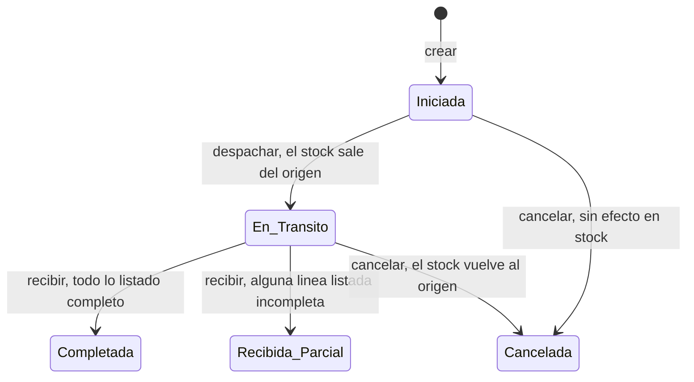
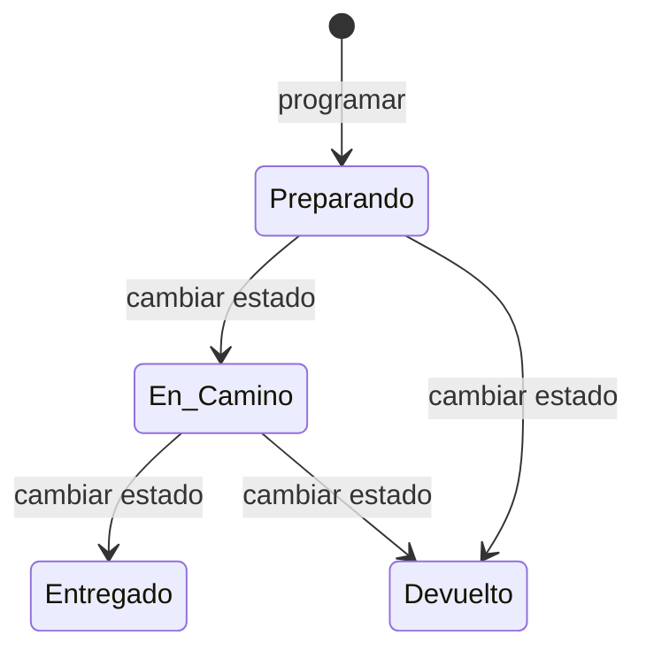

# Referencia de la API — Parte D: inventario, recetas y operaciones sin pantalla

| | |
|---|---|
| **Sistema** | SOFIA — Sistema Optimizado Farmacéutico con Inteligencia Artificial |
| **Versión del documento** | 1.0 |
| **Fecha** | 2026-10-30 |
| **Backend** | `sofia-apis`, rama `main`, commit `34089ec` |
| **Frontend** | `sofia-web-spa`, rama `main`, commit `9ad15f0` |
| **Método** | Lectura de código y llamadas reales a la API local |

## Contenido

- [1. `LotesInventario`](#1-lotesinventario)
- [2. `StockPorSucursal`](#2-stockporsucursal)
- [3. `Recetas`](#3-recetas)
- [4. `Transferencias`](#4-transferencias)
- [5. `Delivery`](#5-delivery)
- [6. `Magistrales`](#6-magistrales)
- [7. `Servicios`](#7-servicios)
- [8. Datos de prueba creados](#8-datos-de-prueba-creados)
- [9. Pendientes y «No verificado»](#9-pendientes-y-no-verificado)
- [10. Tabla de cobertura](#10-tabla-de-cobertura)
- [11. Fuentes](#11-fuentes)

Este documento es la parte D de cinco de la referencia de la API. Describe los 46 endpoints de siete controladores: `LotesInventario` (9), `StockPorSucursal` (4), `Recetas` (7), `Transferencias` (6), `Delivery` (6), `Magistrales` (4) y `Servicios` (10). Los tres primeros tienen pantalla en el SPA; los cuatro últimos son **Solo API (sin pantalla)** y algunos están a medio construir (lo indica cada sección). Las convenciones comunes (URL base, cabeceras, sesión, formato de error, regla del HTTP de error, paginación, filtros por fecha, exportación a Excel, límites y multiempresa) están en [04a, sección 0](04a-convenciones-y-administracion.md#0-convenciones-comunes) y **no se repiten aquí**. Las reglas de negocio están en [01c1-inventario-y-recetas.md](../01-reglas-de-negocio/01c1-inventario-y-recetas.md) (`LOT`, `STK`, `REC`) y [01d-modulos-solo-api.md](../01-reglas-de-negocio/01d-modulos-solo-api.md) (`TRA`, `DEL`, `MAG`, `SRV`); los permisos, en [05b-matriz-de-permisos.md](../05-seguridad/05b-matriz-de-permisos.md). Aquí se remite a ellas por ID y no se copian.

Los ejemplos son respuestas capturadas de la API local (commit `34089ec`) en la empresa de prueba «Farmacia API Referencia S.A.C.»; los tokens y las contraseñas se sustituyen por marcadores (`<token>`). Los identificadores de los ejemplos son los de los datos de prueba de la sección 8 (todos con el prefijo `4D-`). Todas las respuestas de error de negocio y de validación tienen la forma de 3 campos `status`, `detail` y `code` (04a, 0.4); en los ejemplos se omite `Content-Type: application/problem+json`.

**Lo que conviene saber antes de leer las fichas**

| Tema | Detalle |
|---|---|
| Qué devuelven los `POST` que crean | Un identificador como **cuerpo JSON de texto** (por ejemplo `"c392fb3e-0d9b-422c-8c11-b4958d75c896"`, con comillas), no un objeto. Los que responden 201 traen la cabecera `Location`. |
| Éxito sin valor | `204 No Content` sin cuerpo. |
| Controladores sin `[Authorize]` de clase | `Recetas`, `Delivery`, `Magistrales` y `Servicios` no declaran `[Authorize]` en la clase; cada método lleva `[HasPermission]`, que es una autorización, y rige además la denegación por defecto (RN-GEN-015). Un token ausente responde 401 igual que en el resto. |
| Respuestas con el objeto `Result` | Los `GET`, `PUT` y `DELETE` por identificador de `Delivery`, `Magistrales` y `Servicios` devuelven el objeto `Result` completo (`isSuccess`, `isFailure`, `error`, `statusCode`, `value`) en lugar del valor (01d, sección 2, punto 2). Cada ficha lo muestra con una respuesta real. |
| Sucursal y empleado salen del token | `Transferencias` y `Magistrales` toman la sucursal y el empleado del token (claims `sucursalId` y `empleadoId`), no del cuerpo. Para recorrer una transferencia completa hacen falta **dos cuentas** con sucursales base distintas (sección 4). |
| Enumerados | En el cuerpo viajan como número (`nuevoEstado`, `modalidadRegistro`, `condicionVenta`); en la consulta se acepta el nombre o el número (04a, 0.1). |

## 1. `LotesInventario`

Lotes de medicamentos (número del fabricante y fechas) más tres operaciones de stock que cuelgan del mismo controlador: ingresar stock en una sucursal, consultar el stock de un medicamento y exportar. Nueve endpoints. Reglas: `RN-LOT-001` a `RN-LOT-019` y `RN-STK-001`, `RN-STK-008` a `RN-STK-010`, `RN-STK-018` ([01c1, apartados 3 y 4](../01-reglas-de-negocio/01c1-inventario-y-recetas.md)); permisos en [05b, apartado 3.9](../05-seguridad/05b-matriz-de-permisos.md). El controlador exige usuario autenticado (`[Authorize]`, `LotesInventarioController.cs:13`) y cada método su permiso del módulo `Inventarios`.

Modelo `LoteInventarioDto` (respuestas de `GET`): `id` (GUID), `productoId` (GUID), `nombreProducto` (texto; `"Unknown"` si falta el producto en `producto/{id}`), `numeroLoteMfr` (texto), `fechaFabricacion` (fecha con zona o `null`) y `fechaCaducidad` (fecha con zona).

#### `GET /api/v1/LotesInventario`

Lista paginada de lotes, del más recientemente creado al más antiguo. Excluye los lotes eliminados y los de un medicamento eliminado (RN-LOT-017).

| | |
|---|---|
| **Permiso** | `Inventarios:Leer` |
| **Límite de peticiones** | Solo el global |
| **Código** | `SOFIA.API/Controllers/LotesInventarioController.cs:20` → `GetLotesQuery` |
| **Pantalla del SPA** | `/lotes`, botón «Buscar» |

**Parámetros de consulta:**

| Nombre | Tipo | Obligatorio | Descripción |
|---|---|---|---|
| `productoNombre` | texto | No | Contiene, sin distinguir mayúsculas, sobre el nombre comercial. |
| `numeroLote` | texto | No | Contiene, sin distinguir mayúsculas. |
| `searchTerm` | texto | No | Contiene, sobre el número de lote o el producto. Existe en la API; la pantalla no lo envía (RN-LOT-017). |
| `caducidadDesde`, `caducidadHasta` | fecha con zona | No | Inclusivos; `caducidadHasta` suma un día y compara con menor estricto. |
| `fabricacionDesde`, `fabricacionHasta` | fecha con zona | No | Igual criterio; si se usa uno, los lotes sin fecha de fabricación quedan fuera. |
| `pageNumber`, `pageSize` | entero | No | Paginación (04a, 0.7); `pageSize` por defecto **10**. |

**Respuesta correcta:** `200 OK` con `PaginatedList<LoteInventarioDto>` (04a, 0.7).

**Errores posibles:** 403 sin el permiso (cuerpo vacío); 400 estándar si un parámetro no se puede convertir (por ejemplo una fecha mal escrita).

**Ejemplo real:**

```http
GET /api/v1/LotesInventario?numeroLote=4D-L00&pageSize=2
Authorization: Bearer <token>
```

```json
HTTP/1.1 200 OK

{
  "items": [
    {
      "id": "fff0887d-9ac9-43ad-9948-efd534ef5399",
      "productoId": "c950020f-4389-4f1a-a03c-2e1af4663c57",
      "nombreProducto": "4D-Amoxicilina Ficticia 500 mg",
      "numeroLoteMfr": "4D-L002",
      "fechaFabricacion": "2026-02-01T00:00:00-05:00",
      "fechaCaducidad": "2029-06-30T00:00:00-05:00"
    },
    {
      "id": "c392fb3e-0d9b-422c-8c11-b4958d75c896",
      "productoId": "4a981d5c-ed2c-4656-a351-f4d565fa6b5d",
      "nombreProducto": "4D-Paracetamol Ficticio 500 mg",
      "numeroLoteMfr": "4D-L001",
      "fechaFabricacion": "2026-01-15T00:00:00-05:00",
      "fechaCaducidad": "2028-12-31T00:00:00-05:00"
    }
  ],
  "pageNumber": 1,
  "totalPages": 1,
  "totalCount": 2,
  "hasPreviousPage": false,
  "hasNextPage": false
}
```

#### `GET /api/v1/LotesInventario/{id:guid}`

Devuelve un lote por identificador.

| | |
|---|---|
| **Permiso** | `Inventarios:Leer` |
| **Límite de peticiones** | Solo el global |
| **Código** | `SOFIA.API/Controllers/LotesInventarioController.cs:28` → `GetLoteByIdQuery` |
| **Pantalla del SPA** | `/lotes/:id` (carga del detalle) |

**Parámetros de ruta:** `id` (GUID, obligatorio). Un valor que no es GUID responde 404 sin cuerpo (04a, 0.6).

**Respuesta correcta:** `200 OK` con un `LoteInventarioDto`.

**Errores posibles:**

| HTTP | `code` | Cuándo | Regla |
|---|---|---|---|
| 404 | `LoteInventario.NotFound` | El lote no existe, está eliminado o es de otra empresa. | RN-LOT-013 |

**Ejemplo real:**

```http
GET /api/v1/LotesInventario/c392fb3e-0d9b-422c-8c11-b4958d75c896
Authorization: Bearer <token>
```

```json
HTTP/1.1 200 OK

{
  "id": "c392fb3e-0d9b-422c-8c11-b4958d75c896",
  "productoId": "4a981d5c-ed2c-4656-a351-f4d565fa6b5d",
  "nombreProducto": "4D-Paracetamol Ficticio 500 mg",
  "numeroLoteMfr": "4D-L001",
  "fechaFabricacion": "2026-01-15T00:00:00-05:00",
  "fechaCaducidad": "2028-12-31T00:00:00-05:00"
}
```

**Ejemplo real de error** (`GET /api/v1/LotesInventario/00000000-0000-4000-8000-000000000004`):

```json
HTTP/1.1 404 Not Found

{ "status": 404, "detail": "The specified batch does not exist.", "code": "LoteInventario.NotFound" }
```

#### `GET /api/v1/LotesInventario/producto/{productoId:guid}`

Lista paginada de los lotes de un producto, del que caduca más tarde al que caduca antes. **Solo API (sin pantalla).**

| | |
|---|---|
| **Permiso** | `Inventarios:Leer` |
| **Límite de peticiones** | Solo el global |
| **Código** | `SOFIA.API/Controllers/LotesInventarioController.cs:36` → `GetLotesByProductoQuery` |
| **Pantalla del SPA** | Solo API (el SPA no llama a este endpoint; RN-LOT-018) |

**Parámetros:** de ruta, `productoId` (GUID, obligatorio); de consulta, `pageNumber` y `pageSize` (por defecto 1 y **10**).

**Respuesta correcta:** `200 OK` con `PaginatedList<LoteInventarioDto>`. **No comprueba que el producto exista**: un producto inexistente devuelve una lista vacía, no 404 (RN-LOT-018).

**Errores posibles:** 403 sin el permiso. No hay errores de negocio.

**Ejemplo real:**

```http
GET /api/v1/LotesInventario/producto/4a981d5c-ed2c-4656-a351-f4d565fa6b5d?pageSize=5
Authorization: Bearer <token>
```

```json
HTTP/1.1 200 OK

{
  "items": [
    {
      "id": "c392fb3e-0d9b-422c-8c11-b4958d75c896",
      "productoId": "4a981d5c-ed2c-4656-a351-f4d565fa6b5d",
      "nombreProducto": "4D-Paracetamol Ficticio 500 mg",
      "numeroLoteMfr": "4D-L001",
      "fechaFabricacion": "2026-01-15T00:00:00-05:00",
      "fechaCaducidad": "2028-12-31T00:00:00-05:00"
    },
    {
      "id": "1d45ad6d-9411-45ef-bf8d-de5c5e367616",
      "productoId": "4a981d5c-ed2c-4656-a351-f4d565fa6b5d",
      "nombreProducto": "4D-Paracetamol Ficticio 500 mg",
      "numeroLoteMfr": "4D-L-BORRAR",
      "fechaFabricacion": null,
      "fechaCaducidad": "2027-12-31T00:00:00-05:00"
    }
  ],
  "pageNumber": 1,
  "totalPages": 1,
  "totalCount": 2,
  "hasPreviousPage": false,
  "hasNextPage": false
}
```

#### `POST /api/v1/LotesInventario`

Crea un lote. El lote nace sin existencias: el stock se ingresa aparte (`POST /LotesInventario/stock`).

| | |
|---|---|
| **Permiso** | `Inventarios:Crear` |
| **Límite de peticiones** | Solo el global |
| **Código** | `SOFIA.API/Controllers/LotesInventarioController.cs:48` → `CreateLoteInventarioCommand` |
| **Pantalla del SPA** | `/lotes/nueva`, botón «Guardar» |

**Cuerpo:**

| Campo | Tipo | Obligatorio | Reglas |
|---|---|---|---|
| `productoId` | GUID | Sí | Debe existir en la empresa (RN-LOT-002, RN-LOT-009). |
| `numeroLoteMfr` | texto | Sí | No vacío, hasta 100 caracteres (RN-LOT-003, RN-LOT-004); único por producto entre los no eliminados (RN-LOT-010). |
| `fechaFabricacion` | fecha con zona | No | Si se informa, no puede ser futura (RN-LOT-007) ni posterior a la caducidad (RN-LOT-008). |
| `fechaCaducidad` | fecha con zona | Sí | No puede estar vencida; un lote se vende hasta el final de su día de caducidad (RN-LOT-005, RN-LOT-006). |

**Respuesta correcta:** `201 Created`, cabecera `Location: …/api/v1/LotesInventario/{id}` y el identificador del lote como cuerpo (RN-LOT-016).

**Errores posibles:**

| HTTP | `code` | Cuándo | Regla |
|---|---|---|---|
| 400 | `CreateLoteInventarioCommand.ProductoId` / `.NumeroLoteMfr` / `.FechaCaducidad` / `.FechaFabricacion` | Falla el validador; el `code` lleva la **primera** propiedad que falla y el `detail` todos los mensajes (04a, 0.5). | RN-LOT-002 a RN-LOT-007 |
| 404 | `Medicamento.NotFound` | El producto no existe. | RN-LOT-009 |
| 400 | `LoteInventario.Duplicate` | Ya hay un lote con ese número para ese producto. | RN-LOT-010 |
| 400 | `LoteInventario.FechaFabricacion` | La fabricación es posterior a la caducidad (regla de la entidad, solo al crear). | RN-LOT-008 |
| 409 | `Db.Duplicado` / `Db.ReferenciaInvalida` | Carrera con otra petición (índice único o clave foránea). | RN-LOT-010, RN-GEN-036, RN-GEN-038 |

**Ejemplo real:**

```http
POST /api/v1/LotesInventario
Authorization: Bearer <token>
Content-Type: application/json

{
  "productoId": "4a981d5c-ed2c-4656-a351-f4d565fa6b5d",
  "numeroLoteMfr": "4D-L001",
  "fechaFabricacion": "2026-01-15T00:00:00-05:00",
  "fechaCaducidad": "2028-12-31T00:00:00-05:00"
}
```

```json
HTTP/1.1 201 Created
Location: https://localhost:7300/api/v1/LotesInventario/c392fb3e-0d9b-422c-8c11-b4958d75c896

"c392fb3e-0d9b-422c-8c11-b4958d75c896"
```

**Ejemplos reales de error.** Número vacío y caducidad vencida (`numeroLoteMfr: ""`, `fechaCaducidad: "2020-01-01T00:00:00-05:00"`):

```json
HTTP/1.1 400 Bad Request

{
  "status": 400,
  "detail": "Batch number (Mfr) is required.; Expiration date cannot be in the past.",
  "code": "CreateLoteInventarioCommand.NumeroLoteMfr"
}
```

Número repetido para el mismo producto (el cuerpo del ejemplo anterior enviado de nuevo):

```json
HTTP/1.1 400 Bad Request

{ "status": 400, "detail": "A batch with number '4D-L001' already exists for this product.", "code": "LoteInventario.Duplicate" }
```

Producto inexistente (`productoId` `00000000-0000-4000-8000-000000000004`):

```json
HTTP/1.1 404 Not Found

{ "status": 404, "detail": "The specified product does not exist.", "code": "Medicamento.NotFound" }
```

Fabricación posterior a la caducidad (`fechaFabricacion: "2026-10-31T03:00:00Z"`, `fechaCaducidad: "2026-10-30T20:00:00Z"`, que todavía no cuenta como vencida porque pasó hace menos de un día) y fabricación futura (`fechaFabricacion: "2030-01-01T00:00:00Z"`):

```json
HTTP/1.1 400 Bad Request

{ "status": 400, "detail": "Manufacture date cannot be after expiration date.", "code": "LoteInventario.FechaFabricacion" }
```

```json
HTTP/1.1 400 Bad Request

{ "status": 400, "detail": "Manufacture date cannot be in the future.", "code": "CreateLoteInventarioCommand.FechaFabricacion" }
```

#### `PUT /api/v1/LotesInventario/{id:guid}`

Edita el número de lote y las fechas. El producto no se puede cambiar (RN-LOT-012).

| | |
|---|---|
| **Permiso** | `Inventarios:Actualizar` |
| **Límite de peticiones** | Solo el global |
| **Código** | `SOFIA.API/Controllers/LotesInventarioController.cs:58` → `UpdateLoteInventarioCommand` |
| **Pantalla del SPA** | `/lotes/:id`, botón «Editar» y luego «Guardar» |

**Parámetros de ruta:** `id` (GUID, obligatorio). El controlador **sobrescribe** el `id` del cuerpo con el de la ruta (RN-LOT-011).

**Cuerpo:**

| Campo | Tipo | Obligatorio | Reglas |
|---|---|---|---|
| `numeroLoteMfr` | texto | Sí | No vacío, hasta 100 caracteres; único por producto excluyendo este lote (RN-LOT-003, RN-LOT-004, RN-LOT-010). |
| `fechaFabricacion` | fecha con zona | No | No futura (RN-LOT-007). Al editar **no** se compara con la caducidad (RN-LOT-008). |
| `fechaCaducidad` | fecha con zona | Sí | No vencida: **no se puede editar ningún dato de un lote ya vencido** sin ponerle una caducidad vigente (RN-LOT-006). |

**Respuesta correcta:** `204 No Content`.

**Errores posibles:**

| HTTP | `code` | Cuándo | Regla |
|---|---|---|---|
| 400 | `UpdateLoteInventarioCommand.NumeroLoteMfr` / `.FechaCaducidad` / `.FechaFabricacion` | Falla el validador. | RN-LOT-003 a RN-LOT-007 |
| 404 | `LoteInventario.NotFound` | El lote no existe. | RN-LOT-013 |
| 400 | `LoteInventario.Duplicate` | Otro lote del mismo producto ya tiene ese número. | RN-LOT-010 |

**Ejemplo real:**

```http
PUT /api/v1/LotesInventario/c392fb3e-0d9b-422c-8c11-b4958d75c896
Authorization: Bearer <token>
Content-Type: application/json

{
  "numeroLoteMfr": "4D-L001",
  "fechaFabricacion": "2026-01-20T00:00:00-05:00",
  "fechaCaducidad": "2029-01-31T00:00:00-05:00"
}
```

```http
HTTP/1.1 204 No Content
```

**Ejemplo real de error** (`id` inexistente):

```json
HTTP/1.1 404 Not Found

{ "status": 404, "detail": "The specified batch does not exist.", "code": "LoteInventario.NotFound" }
```

#### `DELETE /api/v1/LotesInventario/{id:guid}`

Elimina un lote (borrado lógico, RN-LOT-015). Libera el número de lote para ese producto.

| | |
|---|---|
| **Permiso** | `Inventarios:Eliminar` |
| **Límite de peticiones** | Solo el global |
| **Código** | `SOFIA.API/Controllers/LotesInventarioController.cs:72` → `DeleteLoteInventarioCommand` |
| **Pantalla del SPA** | `/lotes/:id`, botón «Eliminar» y confirmación |

**Parámetros de ruta:** `id` (GUID, obligatorio).

**Respuesta correcta:** `204 No Content`.

**Errores posibles:**

| HTTP | `code` | Cuándo | Regla |
|---|---|---|---|
| 404 | `LoteInventario.NotFound` | El lote no existe o ya está eliminado. | RN-LOT-013 |
| 409 | `LoteInventario.InUse` | El lote tiene una fila de stock (aunque sea de cantidad 0) o una línea de venta no eliminadas. | RN-LOT-014 |

**Ejemplo real** (lote `4D-L-BORRAR`, sin stock; después, un `GET` del mismo identificador responde 404 `LoteInventario.NotFound`):

```http
DELETE /api/v1/LotesInventario/1d45ad6d-9411-45ef-bf8d-de5c5e367616
Authorization: Bearer <token>
```

```http
HTTP/1.1 204 No Content
```

**Ejemplo real de error** (lote `4D-L001`, que tiene stock):

```json
HTTP/1.1 409 Conflict

{ "status": 409, "detail": "Cannot delete a batch that has stock or sales registered.", "code": "LoteInventario.InUse" }
```

#### `POST /api/v1/LotesInventario/stock`

Ingresa stock de un lote en una sucursal: **suma** la cantidad a la fila existente, o crea la fila si no existe. Con `esAjusteDirecto: true` **reemplaza** la cantidad. Se documenta en [01c1 como parte del stock](../01-reglas-de-negocio/01c1-inventario-y-recetas.md) (RN-STK-002 a RN-STK-011).

| | |
|---|---|
| **Permiso** | `Inventarios:Actualizar` (no exige `Crear`; RN-STK-001) |
| **Límite de peticiones** | Solo el global |
| **Código** | `SOFIA.API/Controllers/LotesInventarioController.cs:80` → `RegisterInventarioCommand` |
| **Pantalla del SPA** | `/stock-por-sucursal/nueva`, botón «Guardar» (la pantalla nunca envía `esAjusteDirecto`, RN-STK-008) |

**Cuerpo:**

| Campo | Tipo | Obligatorio | Reglas |
|---|---|---|---|
| `sucursalId` | GUID | Sí | Debe existir y ser accesible para el usuario (sucursal base, asignadas o todas si es `Admin`; RN-STK-002, RN-STK-005, RN-STK-006). |
| `loteId` | GUID | Sí | Debe existir en la empresa. No se comprueba que esté vigente ni libre de cuarentena (RN-STK-003, RN-STK-007). |
| `cantidad` | decimal | Sí | Mayor o igual que 0; hasta 4 decimales (RN-STK-004). |
| `esAjusteDirecto` | booleano | No (por defecto `false`) | `true` reemplaza la cantidad en vez de sumarla y deja un evento de auditoría `STOCK_AJUSTAR` (RN-STK-008). |

**Respuesta correcta:** `200 OK` con el identificador de la **fila de stock** (`InventarioSucursal`) como cuerpo, tanto si la creó como si la actualizó (el 201 que pasa el handler no llega al cliente; RN-STK-009).

**Errores posibles:**

| HTTP | `code` | Cuándo | Regla |
|---|---|---|---|
| 400 | `RegisterInventarioCommand.SucursalId` / `.LoteId` / `.Cantidad` | Falla el validador. | RN-STK-002 a RN-STK-004 |
| 404 | `Sucursal.NotFound` | La sucursal no existe (se comprueba antes que el permiso sobre ella). | RN-STK-005 |
| 403 | `Inventario.Sucursal.NoPermitida` | El usuario no tiene acceso a esa sucursal. | RN-STK-006 |
| 404 | `LoteInventario.NotFound` | El lote no existe. | RN-STK-007 |
| 409 | `InventarioSucursal.RegistroConcurrente` / `Concurrency.Conflict` | Dos ingresos simultáneos sobre la misma fila. | RN-STK-010, RN-STK-011 |

**Ejemplo real** (se ingresan 100 unidades; una segunda llamada con `cantidad: 20` devuelve **el mismo identificador** y deja la fila en 120; una tercera con `esAjusteDirecto: true` y `cantidad: 100` la reemplaza):

```http
POST /api/v1/LotesInventario/stock
Authorization: Bearer <token>
Content-Type: application/json

{
  "sucursalId": "6dc187a9-3b16-4001-b3ed-092119c1ba90",
  "loteId": "c392fb3e-0d9b-422c-8c11-b4958d75c896",
  "cantidad": 100
}
```

```json
HTTP/1.1 200 OK

"67c44b86-371c-4607-830d-7efc3d221173"
```

**Ejemplos reales de error.** Cantidad negativa:

```json
HTTP/1.1 400 Bad Request

{ "status": 400, "detail": "Quantity cannot be negative.", "code": "RegisterInventarioCommand.Cantidad" }
```

Lote inexistente y sucursal inexistente:

```json
HTTP/1.1 404 Not Found

{ "status": 404, "detail": "The specified batch does not exist.", "code": "LoteInventario.NotFound" }
```

```json
HTTP/1.1 404 Not Found

{ "status": 404, "detail": "The specified branch does not exist.", "code": "Sucursal.NotFound" }
```

#### `GET /api/v1/LotesInventario/stock/medicamento/{medicamentoId:guid}`

Stock total de un medicamento, con el desglose por sucursal y por lote. **Solo API (sin pantalla).**

| | |
|---|---|
| **Permiso** | `Inventarios:Leer` |
| **Límite de peticiones** | Solo el global |
| **Código** | `SOFIA.API/Controllers/LotesInventarioController.cs:88` → `GetStockByMedicamentoQuery` |
| **Pantalla del SPA** | Solo API (RN-STK-018) |

**Parámetros de ruta:** `medicamentoId` (GUID, obligatorio).

**Respuesta correcta:** `200 OK` con `StockMedicamentoDto`: `medicamentoId`, `nombreMedicamento`, `stockTotal` (decimal), `desgloseSucursales[]` (`sucursalId`, `sucursalNombre`, `cantidadFisica`) y `desgloseLotes[]` (`loteId`, `numeroLote`, `fechaCaducidad`, `cantidad`; ordenado por caducidad). Suma **todas** las sucursales de la empresa (no aplica las sucursales permitidas del usuario) e incluye lotes vencidos y filas con cantidad 0 (RN-STK-018).

**Errores posibles:**

| HTTP | `code` | Cuándo | Regla |
|---|---|---|---|
| 404 | `Medicamento.NotFound` | El medicamento no existe. | RN-STK-018 |

**Ejemplo real:**

```http
GET /api/v1/LotesInventario/stock/medicamento/4a981d5c-ed2c-4656-a351-f4d565fa6b5d
Authorization: Bearer <token>
```

```json
HTTP/1.1 200 OK

{
  "medicamentoId": "4a981d5c-ed2c-4656-a351-f4d565fa6b5d",
  "nombreMedicamento": "4D-Paracetamol Ficticio 500 mg",
  "stockTotal": 100,
  "desgloseSucursales": [
    { "sucursalId": "6dc187a9-3b16-4001-b3ed-092119c1ba90", "sucursalNombre": "Sede Principal", "cantidadFisica": 100 }
  ],
  "desgloseLotes": [
    { "loteId": "c392fb3e-0d9b-422c-8c11-b4958d75c896", "numeroLote": "4D-L001", "fechaCaducidad": "2029-01-31T00:00:00-05:00", "cantidad": 100 }
  ]
}
```

**Ejemplo real de error** (medicamento inexistente):

```json
HTTP/1.1 404 Not Found

{ "status": 404, "detail": "The specified medication does not exist.", "code": "Medicamento.NotFound" }
```

#### `POST /api/v1/LotesInventario/exportar`

Genera un Excel con los lotes que cumplen los filtros (mismo mecanismo que 04a, 0.9).

| | |
|---|---|
| **Permiso** | `Inventarios:Leer` |
| **Límite de peticiones** | Solo el global |
| **Código** | `SOFIA.API/Controllers/LotesInventarioController.cs:96` → `GetLotesQuery` con `PageSize` = 10 000 |
| **Pantalla del SPA** | `/lotes`, botón «Exportar» (tras buscar) |

**Cuerpo:**

| Campo | Tipo | Obligatorio | Reglas |
|---|---|---|---|
| `headers` | arreglo de texto | Sí | Hasta 50 títulos de hasta 100 caracteres (`Export.Headers.Invalid`). Columnas, en orden: Producto, Número de lote, Fecha de fabricación, Fecha de caducidad. |
| `dateFormat` | texto | Sí | Uno de `dd/MM/yyyy`, `MM/dd/yyyy`, `dd/MM/yyyy HH:mm`, `MM/dd/yyyy HH:mm` (`Export.DateFormat.Invalid`). |
| `productoNombre`, `numeroLote`, `caducidadDesde`, `caducidadHasta`, `fabricacionDesde`, `fabricacionHasta` | como en el listado | No | Mismos filtros que `GET /LotesInventario`, sin `searchTerm`, `pageNumber` ni `pageSize` (RN-LOT-019). |

**Respuesta correcta:** `200 OK` con el archivo `lotes.xlsx`; sin cuerpo JSON.

**Errores posibles:**

| HTTP | `code` | Cuándo | Regla |
|---|---|---|---|
| 400 | — (estándar, `errors.DateFormat`) | `dateFormat` no permitido. | RN-IMP-011 |
| 400 | `Export.TooManyRows` | Más de 10 000 filas. | RN-IMP-008 |

**Ejemplo real:**

```http
POST /api/v1/LotesInventario/exportar
Authorization: Bearer <token>
Content-Type: application/json

{
  "headers": ["Producto", "Número de lote", "Fecha de fabricación", "Fecha de caducidad"],
  "dateFormat": "dd/MM/yyyy",
  "productoNombre": "4D-",
  "numeroLote": "4D-L00"
}
```

```http
HTTP/1.1 200 OK
Content-Type: application/vnd.openxmlformats-officedocument.spreadsheetml.sheet
Content-Disposition: attachment; filename=lotes.xlsx; filename*=UTF-8''lotes.xlsx
```

**Ejemplo real de error** (`dateFormat: "yyyy-MM-dd"`):

```json
HTTP/1.1 400 Bad Request

{
  "type": "https://tools.ietf.org/html/rfc9110#section-15.5.1",
  "title": "One or more validation errors occurred.",
  "status": 400,
  "errors": { "DateFormat": [ "Export.DateFormat.Invalid" ] },
  "traceId": "00-589e5887e62fa6dd41c1462a2f0cc4b4-81de4b4c173a55b1-00"
}
```

## 2. `StockPorSucursal`

Existencias físicas de cada lote en cada sucursal. Cuatro endpoints. El ingreso de stock y la consulta por medicamento están en `LotesInventario` (sección 1). Reglas: `RN-STK-001` a `RN-STK-018` ([01c1, apartado 4](../01-reglas-de-negocio/01c1-inventario-y-recetas.md)); permisos en [05b, apartado 3.9](../05-seguridad/05b-matriz-de-permisos.md). El controlador exige usuario autenticado (`StockPorSucursalController.cs:11`).

Modelo `StockPorSucursalDto`: `id` (GUID de la fila de stock), `sucursalId`, `sucursalNombre`, `loteId`, `numeroLote`, `productoId`, `productoNombre`, `fechaCaducidad` (fecha con zona), `cantidadFisica` (decimal) y `precioVentaBase` (decimal o `null`).

#### `GET /api/v1/StockPorSucursal`

Lista paginada de stock, solo de las sucursales a las que el usuario tiene acceso (el `Admin`, todas; RN-STK-014). Excluye las filas cuya sucursal, lote o producto no existan o estén eliminados. Orden: sucursal, producto y caducidad ascendente (RN-STK-015).

| | |
|---|---|
| **Permiso** | `Inventarios:Leer` |
| **Límite de peticiones** | Solo el global |
| **Código** | `SOFIA.API/Controllers/StockPorSucursalController.cs:15` → `GetStockPorSucursalQuery` |
| **Pantalla del SPA** | `/stock-por-sucursal`, botón «Buscar» |

**Parámetros de consulta:**

| Nombre | Tipo | Obligatorio | Descripción |
|---|---|---|---|
| `sucursalNombre`, `productoNombre`, `numeroLote` | texto | No | Contiene, sin distinguir mayúsculas. |
| `caducidadDesde`, `caducidadHasta` | fecha con zona | No | Inclusivos (`caducidadHasta` suma un día y compara con menor estricto). |
| `cantidadMin`, `cantidadMax` | decimal | No | Inclusivos. |
| `soloConStock` | booleano | No (por defecto **`true`**) | Con `true` solo trae filas con cantidad mayor que 0; envía `false` para ver también las de cantidad 0. |
| `pageNumber`, `pageSize` | entero | No | Paginación (04a, 0.7); `pageSize` por defecto **10**. |

**Respuesta correcta:** `200 OK` con `PaginatedList<StockPorSucursalDto>`.

**Errores posibles:** 403 sin el permiso; 400 estándar si un parámetro no se puede convertir.

**Ejemplo real:**

```http
GET /api/v1/StockPorSucursal?productoNombre=4D-&pageSize=5
Authorization: Bearer <token>
```

```json
HTTP/1.1 200 OK

{
  "items": [
    {
      "id": "46b763af-d0dc-4eb7-8ca1-1d3410c68341",
      "sucursalId": "6dc187a9-3b16-4001-b3ed-092119c1ba90",
      "sucursalNombre": "Sede Principal",
      "loteId": "fff0887d-9ac9-43ad-9948-efd534ef5399",
      "numeroLote": "4D-L002",
      "productoId": "c950020f-4389-4f1a-a03c-2e1af4663c57",
      "productoNombre": "4D-Amoxicilina Ficticia 500 mg",
      "fechaCaducidad": "2029-06-30T00:00:00-05:00",
      "cantidadFisica": 50,
      "precioVentaBase": 4.2
    },
    {
      "id": "67c44b86-371c-4607-830d-7efc3d221173",
      "sucursalId": "6dc187a9-3b16-4001-b3ed-092119c1ba90",
      "sucursalNombre": "Sede Principal",
      "loteId": "c392fb3e-0d9b-422c-8c11-b4958d75c896",
      "numeroLote": "4D-L001",
      "productoId": "4a981d5c-ed2c-4656-a351-f4d565fa6b5d",
      "productoNombre": "4D-Paracetamol Ficticio 500 mg",
      "fechaCaducidad": "2029-01-31T00:00:00-05:00",
      "cantidadFisica": 100,
      "precioVentaBase": 1.5
    }
  ],
  "pageNumber": 1,
  "totalPages": 1,
  "totalCount": 2,
  "hasPreviousPage": false,
  "hasNextPage": false
}
```

#### `GET /api/v1/StockPorSucursal/{id:guid}`

Devuelve una fila de stock por identificador.

| | |
|---|---|
| **Permiso** | `Inventarios:Leer` |
| **Límite de peticiones** | Solo el global |
| **Código** | `SOFIA.API/Controllers/StockPorSucursalController.cs:23` → `GetStockPorSucursalByIdQuery` |
| **Pantalla del SPA** | `/stock-por-sucursal/:id` (carga del detalle) |

**Parámetros de ruta:** `id` (GUID de la **fila de stock**, no del lote; obligatorio).

**Respuesta correcta:** `200 OK` con un `StockPorSucursalDto`.

**Errores posibles:**

| HTTP | `code` | Cuándo | Regla |
|---|---|---|---|
| 404 | `InventarioSucursal.NotFound` | La fila no existe, está eliminada, es de otra empresa o es de una sucursal a la que el usuario no tiene acceso (al consultar, la falta de acceso también se informa como 404). | RN-STK-013 |

**Ejemplo real:**

```http
GET /api/v1/StockPorSucursal/67c44b86-371c-4607-830d-7efc3d221173
Authorization: Bearer <token>
```

```json
HTTP/1.1 200 OK

{
  "id": "67c44b86-371c-4607-830d-7efc3d221173",
  "sucursalId": "6dc187a9-3b16-4001-b3ed-092119c1ba90",
  "sucursalNombre": "Sede Principal",
  "loteId": "c392fb3e-0d9b-422c-8c11-b4958d75c896",
  "numeroLote": "4D-L001",
  "productoId": "4a981d5c-ed2c-4656-a351-f4d565fa6b5d",
  "productoNombre": "4D-Paracetamol Ficticio 500 mg",
  "fechaCaducidad": "2029-01-31T00:00:00-05:00",
  "cantidadFisica": 120,
  "precioVentaBase": 1.5
}
```

(Captura tomada después de sumar 20 unidades a las 100 del ingreso inicial.)

**Ejemplo real de error** (`GET /api/v1/StockPorSucursal/00000000-0000-4000-8000-000000000004`):

```json
HTTP/1.1 404 Not Found

{ "status": 404, "detail": "The specified stock record does not exist.", "code": "InventarioSucursal.NotFound" }
```

#### `PUT /api/v1/StockPorSucursal/{id:guid}/ajustar`

Fija la cantidad física de una fila de stock al valor indicado (no es una suma; RN-STK-012). Deja un evento de auditoría `STOCK_AJUSTAR`.

| | |
|---|---|
| **Permiso** | `Inventarios:Actualizar` |
| **Límite de peticiones** | Solo el global |
| **Código** | `SOFIA.API/Controllers/StockPorSucursalController.cs:31` → `AdjustStockCommand` |
| **Pantalla del SPA** | `/stock-por-sucursal/:id`, botón «Editar» y luego «Guardar» |

**Parámetros de ruta:** `id` (GUID de la fila de stock, obligatorio).

**Cuerpo:**

| Campo | Tipo | Obligatorio | Reglas |
|---|---|---|---|
| `nuevaCantidad` | decimal | Sí | Mayor o igual que 0 (RN-STK-004). |

**Respuesta correcta:** `204 No Content`.

**Errores posibles:**

| HTTP | `code` | Cuándo | Regla |
|---|---|---|---|
| 400 | `AdjustStockCommand.NuevaCantidad` | Cantidad negativa. | RN-STK-004 |
| 404 | `InventarioSucursal.NotFound` | La fila no existe. | RN-STK-013 |
| 403 | `Inventario.Sucursal.NoPermitida` | El usuario no tiene acceso a la sucursal de la fila (al ajustar responde 403, no 404). | RN-STK-006 |
| 409 | `Concurrency.Conflict` | Otra operación cambió la fila entre la lectura y el guardado. | RN-STK-011 |

**Ejemplo real:**

```http
PUT /api/v1/StockPorSucursal/46b763af-d0dc-4eb7-8ca1-1d3410c68341/ajustar
Authorization: Bearer <token>
Content-Type: application/json

{ "nuevaCantidad": 40 }
```

```http
HTTP/1.1 204 No Content
```

Un `GET` posterior de la misma fila devuelve `cantidadFisica: 40` (antes 50).

**Ejemplos reales de error.** Cantidad negativa y fila inexistente:

```json
HTTP/1.1 400 Bad Request

{ "status": 400, "detail": "Quantity cannot be negative.", "code": "AdjustStockCommand.NuevaCantidad" }
```

```json
HTTP/1.1 404 Not Found

{ "status": 404, "detail": "The specified stock record does not exist.", "code": "InventarioSucursal.NotFound" }
```

El 403 `Inventario.Sucursal.NoPermitida` no se provocó: **Ejemplo no verificado**, porque haría falta una cuenta con `Inventarios:Actualizar` y sin acceso a la sucursal de la fila (se documenta desde `AdjustStockCommandHandler.cs:21-24`).

#### `POST /api/v1/StockPorSucursal/exportar`

Genera un Excel con las filas de stock que cumplen los filtros (mismo mecanismo que 04a, 0.9).

| | |
|---|---|
| **Permiso** | `Inventarios:Leer` |
| **Límite de peticiones** | Solo el global |
| **Código** | `SOFIA.API/Controllers/StockPorSucursalController.cs:39` → `GetStockPorSucursalQuery` con `PageSize` = 10 000 |
| **Pantalla del SPA** | `/stock-por-sucursal`, botón «Exportar» (tras buscar) |

**Cuerpo:**

| Campo | Tipo | Obligatorio | Reglas |
|---|---|---|---|
| `headers` | arreglo de texto | Sí | Hasta 50 títulos de hasta 100 caracteres. Columnas, en orden: Sucursal, Producto, Número de lote, Fecha de caducidad, Cantidad física. |
| `dateFormat` | texto | Sí | Uno de los cuatro formatos permitidos (04a, 0.9). |
| `sucursalNombre`, `productoNombre`, `numeroLote`, `caducidadDesde`, `caducidadHasta`, `cantidadMin`, `cantidadMax` | como en el listado | No | Mismos filtros que `GET /StockPorSucursal`. |
| `soloConStock` | booleano | No (por defecto `true`) | Como en el listado (RN-STK-016). |

**Respuesta correcta:** `200 OK` con el archivo `stock-por-sucursal.xlsx`.

**Errores posibles:** los de `POST /LotesInventario/exportar` (`Export.DateFormat.Invalid`, `Export.TooManyRows`).

**Ejemplo real** (el libro descargado tiene la cabecera y 2 filas):

```http
POST /api/v1/StockPorSucursal/exportar
Authorization: Bearer <token>
Content-Type: application/json

{
  "headers": ["Sucursal", "Producto", "Número de lote", "Fecha de caducidad", "Cantidad física"],
  "dateFormat": "dd/MM/yyyy",
  "productoNombre": "4D-",
  "soloConStock": true
}
```

```http
HTTP/1.1 200 OK
Content-Type: application/vnd.openxmlformats-officedocument.spreadsheetml.sheet
Content-Disposition: attachment; filename=stock-por-sucursal.xlsx; filename*=UTF-8''stock-por-sucursal.xlsx
```

## 3. `Recetas`

Recetas médicas (paciente, médico, fecha de expedición, repeticiones, indicaciones y número) y el análisis de la imagen de una receta con IA. Siete endpoints. Reglas: `RN-REC-001` a `RN-REC-031` ([01c1, apartado 5](../01-reglas-de-negocio/01c1-inventario-y-recetas.md)); integraciones de Gemini y Presidio en [07-integraciones.md](../07-integraciones.md); permisos en [05b, apartado 3.19](../05-seguridad/05b-matriz-de-permisos.md). El controlador **no declara `[Authorize]` de clase**; cada método exige su permiso `Recetas:*` (RN-GEN-015). La receta no guarda los medicamentos prescritos: se relaciona con los productos al venderlos (RN-REC, introducción del apartado 5).

Modelo `RecetaDto` / `RecetaResumenDto` (idénticos; respuestas de `GET`): `id`, `clienteId` (el paciente), `clienteNombre` (vacío si el paciente fue eliminado), `medicoId`, `medicoNombre` (vacío si el profesional fue eliminado), `fechaExpedicion` (fecha sin hora, `AAAA-MM-DD`), `repeticionesMax` (entero), `indicacionesUso` (texto o `null`) y `numeroReceta` (texto o `null`).

#### `POST /api/v1/Recetas`

Crea una receta.

| | |
|---|---|
| **Permiso** | `Recetas:Crear` |
| **Límite de peticiones** | Solo el global |
| **Código** | `SOFIA.API/Controllers/RecetasController.cs:17` → `CreateRecetaCommand` |
| **Pantalla del SPA** | `/recetas-medicas/nueva`, botón «Guardar» (también desde el punto de venta, `/pos/nueva`) |

**Cuerpo:**

| Campo | Tipo | Obligatorio | Reglas |
|---|---|---|---|
| `clienteId` | GUID | Sí | Paciente de la empresa; no puede ser el GUID vacío (RN-REC-002, RN-REC-004). |
| `medicoId` | GUID | Sí | Profesional de salud de la empresa (RN-REC-003, RN-REC-005). |
| `fechaExpedicion` | fecha (`AAAA-MM-DD`) | Sí | No puede ser la fecha por defecto `0001-01-01` (RN-REC-006) ni futura, comparada con la fecha UTC de hoy (RN-REC-007). |
| `repeticionesMax` | entero | No (por defecto 0) | Mayor o igual que 0 (RN-REC-008). |
| `indicacionesUso` | texto | No | Hasta 1 000 caracteres (RN-REC-009). |
| `numeroReceta` | texto | No | Hasta 30 caracteres; un texto vacío o solo con espacios se guarda como «sin número»; sin unicidad (RN-REC-010). Obligatorio al vender receta retenida o estupefacientes. |

**Respuesta correcta:** `200 OK` (no 201) con el identificador de la receta como cuerpo (RN-REC-015).

**Errores posibles:**

| HTTP | `code` | Cuándo | Regla |
|---|---|---|---|
| 400 | `CreateRecetaCommand.ClienteId` / `.MedicoId` / `.FechaExpedicion` / `.RepeticionesMax` / `.IndicacionesUso` / `.NumeroReceta` | Falla el validador (el `code` lleva la primera propiedad que falla). | RN-REC-002, RN-REC-003, RN-REC-006, RN-REC-008 a RN-REC-010 |
| 404 | `Paciente.NotFound` | El paciente no existe en la empresa. | RN-REC-004 |
| 404 | `ProfesionalSalud.NotFound` | El profesional no existe en la empresa. | RN-REC-005 |
| 400 | `RecetaMedica.FechaExpedicion` | La fecha de expedición es futura (regla de la entidad). | RN-REC-007 |

**Ejemplo real:**

```http
POST /api/v1/Recetas
Authorization: Bearer <token>
Content-Type: application/json

{
  "clienteId": "d17775f2-fbf7-4ebf-a0a3-7eaf89151eb8",
  "medicoId": "b43390f5-abc4-4a4d-b0b0-900c756091f9",
  "fechaExpedicion": "2026-10-28",
  "repeticionesMax": 2,
  "indicacionesUso": "4D-Tomar una capsula cada 8 horas por 7 dias",
  "numeroReceta": "4D-REC-0001"
}
```

```json
HTTP/1.1 200 OK

"6116e017-0fea-4c11-897e-62f223ab2403"
```

**Ejemplos reales de error.** Paciente vacío y repeticiones negativas:

```json
HTTP/1.1 400 Bad Request

{
  "status": 400,
  "detail": "'Cliente Id' must not be empty.; 'Repeticiones Max' must be greater than or equal to '0'.",
  "code": "CreateRecetaCommand.ClienteId"
}
```

Fecha futura (`fechaExpedicion: "2027-12-31"`):

```json
HTTP/1.1 400 Bad Request

{ "status": 400, "detail": "Fecha de Expedición cannot be in the future.", "code": "RecetaMedica.FechaExpedicion" }
```

Paciente inexistente y médico inexistente:

```json
HTTP/1.1 404 Not Found

{ "status": 404, "detail": "The specified patient does not exist.", "code": "Paciente.NotFound" }
```

```json
HTTP/1.1 404 Not Found

{ "status": 404, "detail": "The specified health professional does not exist.", "code": "ProfesionalSalud.NotFound" }
```

#### `GET /api/v1/Recetas`

Lista paginada de recetas, de la fecha de expedición más reciente a la más antigua (RN-REC-016).

| | |
|---|---|
| **Permiso** | `Recetas:Leer` |
| **Límite de peticiones** | Solo el global |
| **Código** | `SOFIA.API/Controllers/RecetasController.cs:25` → `GetRecetasQuery` |
| **Pantalla del SPA** | `/recetas-medicas`, botón «Buscar» |

**Parámetros de consulta:**

| Nombre | Tipo | Obligatorio | Descripción |
|---|---|---|---|
| `clienteId` | GUID | No | Receta de ese paciente; si se envía no puede ser el GUID vacío (`GetRecetasQuery.ClienteId`, 400). |
| `medicoId` | GUID | No | Receta de ese médico. |
| `fechaInicio`, `fechaFin` | fecha | No | Ambas inclusivas; el servidor usa solo la **parte de fecha** del valor recibido (`DateOnly.FromDateTime`), no normaliza a UTC (04a, 0.8 no aplica). |
| `pageNumber`, `pageSize` | entero | No | Paginación (04a, 0.7); `pageSize` por defecto **10**. |

**Respuesta correcta:** `200 OK` con `PaginatedList<RecetaResumenDto>`.

**Errores posibles:**

| HTTP | `code` | Cuándo | Regla |
|---|---|---|---|
| 400 | `GetRecetasQuery.ClienteId` | `clienteId` es el GUID vacío. | RN-REC-016 |

**Ejemplo real:**

```http
GET /api/v1/Recetas?fechaInicio=2026-10-25T00:00:00Z&fechaFin=2026-10-30T00:00:00Z&medicoId=b43390f5-abc4-4a4d-b0b0-900c756091f9
Authorization: Bearer <token>
```

```json
HTTP/1.1 200 OK

{
  "items": [
    {
      "id": "6116e017-0fea-4c11-897e-62f223ab2403",
      "clienteId": "d17775f2-fbf7-4ebf-a0a3-7eaf89151eb8",
      "clienteNombre": "4D-Paciente Ficticio",
      "medicoId": "b43390f5-abc4-4a4d-b0b0-900c756091f9",
      "medicoNombre": "4D-Dr. Ficticio Medico",
      "fechaExpedicion": "2026-10-28",
      "repeticionesMax": 2,
      "indicacionesUso": "4D-Tomar una capsula cada 8 horas por 7 dias",
      "numeroReceta": "4D-REC-0001"
    }
  ],
  "pageNumber": 1,
  "totalPages": 1,
  "totalCount": 1,
  "hasPreviousPage": false,
  "hasNextPage": false
}
```

#### `GET /api/v1/Recetas/{id}`

Devuelve una receta por identificador.

| | |
|---|---|
| **Permiso** | `Recetas:Leer` |
| **Límite de peticiones** | Solo el global |
| **Código** | `SOFIA.API/Controllers/RecetasController.cs:39` → `GetRecetaByIdQuery` |
| **Pantalla del SPA** | `/recetas-medicas/:id` (carga del detalle) |

**Parámetros de ruta:** `id` (GUID, obligatorio; la ruta de este endpoint no lleva la restricción `:guid`, de modo que un texto que no es GUID responde 400 estándar de conversión y no 404).

**Respuesta correcta:** `200 OK` con un `RecetaDto`.

**Errores posibles:**

| HTTP | `code` | Cuándo | Regla |
|---|---|---|---|
| 404 | `RecetaMedica.NotFound` | La receta no existe, está eliminada o es de otra empresa. | RN-REC-012 |

**Ejemplo real:**

```http
GET /api/v1/Recetas/6116e017-0fea-4c11-897e-62f223ab2403
Authorization: Bearer <token>
```

```json
HTTP/1.1 200 OK

{
  "id": "6116e017-0fea-4c11-897e-62f223ab2403",
  "clienteId": "d17775f2-fbf7-4ebf-a0a3-7eaf89151eb8",
  "clienteNombre": "4D-Paciente Ficticio",
  "medicoId": "b43390f5-abc4-4a4d-b0b0-900c756091f9",
  "medicoNombre": "4D-Dr. Ficticio Medico",
  "fechaExpedicion": "2026-10-28",
  "repeticionesMax": 2,
  "indicacionesUso": "4D-Tomar una capsula cada 8 horas por 7 dias",
  "numeroReceta": "4D-REC-0001"
}
```

**Ejemplo real de error** (`id` inexistente):

```json
HTTP/1.1 404 Not Found

{ "status": 404, "detail": "Receta médica not found.", "code": "RecetaMedica.NotFound" }
```

#### `POST /api/v1/Recetas/analizar`

Recibe la imagen de una receta y devuelve los medicamentos que la IA interpreta, validados contra el catálogo DIGEMID y cruzados con el catálogo y el stock de la empresa. **No guarda nada**: no crea ninguna receta ni registra el procesamiento (RN-REC-029).

| | |
|---|---|
| **Permiso** | `Recetas:Analizar` |
| **Límite de peticiones** | Política `ai-endpoints`: 10 por minuto por empresa (con hasta 2 en cola); al superarla, 429 (04a, 0.11; RN-GEN-028). Además, el cuerpo no puede superar **10 MB** (`RequestSizeLimit` y `MultipartBodyLengthLimit`, 413 `Request.TooLarge`) |
| **Código** | `SOFIA.API/Controllers/RecetasController.cs:47` → `AnalizarRecetaQuery` (servicios `GeminiRecetaAnalyzer` y `PresidioPrivacyService`) |
| **Pantalla del SPA** | `/recetas-medicas/escanear`, botón «Interpretar receta» (también desde `/pos/nueva`) |

**Cuerpo:** `multipart/form-data` con el campo **`imagen`** (un archivo; RN-REC-018). El servidor no valida el tipo ni el contenido: lo lee entero y se lo envía a Gemini declarándolo siempre `image/jpeg` (RN-REC-019).

**Parámetros de consulta:**

| Nombre | Tipo | Obligatorio | Descripción |
|---|---|---|---|
| `especialidadContexto` | texto | No | Hasta 50 caracteres, solo letras (con tildes) y espacios, porque se inserta en el texto enviado a la IA. Sin valor se usa «Medicina General». La pantalla no lo envía (RN-REC-020). |

**Respuesta correcta:** `200 OK` con un **arreglo** de ítems sugeridos (puede estar vacío si la IA no detecta medicamentos). Se procesan como máximo los primeros 20 medicamentos detectados y 3 sugerencias por cada uno (RN-REC-022).

| Campo | Tipo | Significado |
|---|---|---|
| `medicamentoId` | GUID o `null` | Producto de la empresa que coincide; `null` si no hay coincidencia (RN-REC-024). |
| `nombreOficial` | texto | Nombre del producto de la empresa, o el de DIGEMID / el detectado si no hubo coincidencia. |
| `nombreDetectado` | texto o `null` | Lo que la IA leyó en la imagen. |
| `confianzaFinal` | número | Entre 0 y 1; para los ítems de la receta es `nivel de confianza de la IA × 0,6 + parecido × 0,4`, y las sugerencias llevan 0,7 fijo (RN-REC-025). |
| `tipoSugerencia` | texto | `Receta` (leído de la receta) o `Recomendacion` (sugerido por la IA; RN-REC-028). |
| `razonSugerencia` | texto | «Validado por DIGEMID (nombre)», «Detectado en receta» o «Sugerido por {medicamento}» (RN-REC-023, RN-REC-028). |
| `validadoPorDigemid` | booleano | Hubo coincidencia con el catálogo DIGEMID local (RN-REC-023). |
| `cantidadSugerida` | entero o `null` | Cantidad que la IA deduce de la posología. |
| `stockDisponible`, `tieneStock` | decimal, booleano | Existencias de lotes **no vencidos** en la sucursal del token; 0 si el token no trae sucursal (RN-REC-026). |
| `equivalentes[]` | arreglo | Medicamentos con la misma formulación clínica: `medicamentoId`, `nombreComercial`, `laboratorio`, `stockDisponible`, `tieneStock` (RN-REC-027). |

**Errores posibles:**

| HTTP | `code` | Cuándo | Regla |
|---|---|---|---|
| 400 | `AnalizarRecetaQuery.EspecialidadContexto` | `especialidadContexto` con más de 50 caracteres o con caracteres que no son letras ni espacios. | RN-REC-020 |
| 400 | — (texto plano «Image is required.») | Falta el campo `imagen` o el archivo está vacío. | RN-REC-018 |
| 413 | `Request.TooLarge` | El cuerpo supera 10 MB. | RN-REC-018, RN-GEN-039 |
| 429 | — (sin `code`) | Más de 10 análisis por minuto de la misma empresa. | RN-REC-018, RN-GEN-028 |
| 500 | — (sin `code`) | Falla Gemini (clave, cuota, red) o Presidio: el análisis se aborta y el texto del paciente no llega a la IA. `ProblemDetails` con `title` «Error del Servidor» y `traceId`. | RN-REC-021 |

**Ejemplo real.** La imagen es un PNG de 900 × 600 píxeles generado para esta referencia, con texto de receta inventado («Amoxicilina 500 mg» y «Paracetamol 500 mg»). Se envió una sola vez a Gemini (la segunda llamada del cupo se usó en el ejemplo de error, que no llega a la IA). Los productos que aparecen en la respuesta (`4C-…` y `4B-…`) son del catálogo que crearon las otras partes de la referencia en la misma empresa; el análisis busca en todo el catálogo de la empresa, no solo en los datos `4D-`. La lista se recortó a dos ítems (la respuesta real trajo cuatro: dos de la receta y dos sugerencias).

```http
POST /api/v1/Recetas/analizar?especialidadContexto=Medicina%20General
Authorization: Bearer <token>
Content-Type: multipart/form-data; boundary=----x

------x
Content-Disposition: form-data; name="imagen"; filename="receta-sintetica.png"
Content-Type: image/png

<contenido del archivo PNG>
------x--
```

```json
HTTP/1.1 200 OK

[
  {
    "medicamentoId": "79f1c8f6-91f4-4e0f-af5e-c217c33fdf9a",
    "nombreOficial": "4C-Amoxicilina 500 mg",
    "nombreDetectado": "Amoxicilina",
    "confianzaFinal": 0.96,
    "tipoSugerencia": "Receta",
    "razonSugerencia": "Validado por DIGEMID (4B-Amoxicilina 500 mg)",
    "validadoPorDigemid": true,
    "cantidadSugerida": 21,
    "stockDisponible": 0,
    "tieneStock": false,
    "equivalentes": []
  },
  {
    "medicamentoId": "79f1c8f6-91f4-4e0f-af5e-c217c33fdf9a",
    "nombreOficial": "4C-Amoxicilina 500 mg",
    "nombreDetectado": "Amoxicilina Genfar",
    "confianzaFinal": 0.7,
    "tipoSugerencia": "Recomendacion",
    "razonSugerencia": "Sugerido por Amoxicilina",
    "validadoPorDigemid": false,
    "cantidadSugerida": null,
    "stockDisponible": 0,
    "tieneStock": false,
    "equivalentes": []
  }
]
```

**Ejemplo real de error** (misma imagen, `especialidadContexto=Cardiologia123`; el validador rechaza la petición antes de llamar a Gemini):

```json
HTTP/1.1 400 Bad Request

{ "status": 400, "detail": "'Especialidad Contexto' is not in the correct format.", "code": "AnalizarRecetaQuery.EspecialidadContexto" }
```

El 400 «Image is required.», el 413, el 429 y el 500 **no se provocaron** para no consumir el cupo de dos llamadas ni dañar la configuración: **Ejemplo no verificado** (se documentan desde `RecetasController.cs:47-63`, `RateLimitingExtensions.cs:43-50` y [07-integraciones.md, apartado 2.5](../07-integraciones.md)). En este entorno, Gemini y Presidio respondieron correctamente.

#### `PUT /api/v1/Recetas/{id}`

Reemplaza los datos de una receta (todos los campos se reenvían).

| | |
|---|---|
| **Permiso** | `Recetas:Actualizar` |
| **Límite de peticiones** | Solo el global |
| **Código** | `SOFIA.API/Controllers/RecetasController.cs:66` → `UpdateRecetaCommand` |
| **Pantalla del SPA** | `/recetas-medicas/:id`, botón «Editar» y luego «Guardar» |

**Parámetros de ruta:** `id` (GUID, obligatorio). La API toma el identificador siempre de la ruta y descarta el del cuerpo (RN-REC-011).

**Cuerpo:** los mismos campos y reglas que `POST /Recetas` (`clienteId`, `medicoId`, `fechaExpedicion`, `repeticionesMax`, `indicacionesUso`, `numeroReceta`), con una diferencia: aquí **`repeticionesMax` no tiene valor por defecto** (si falta, vale 0 por ser entero) y los demás se tratan igual. El paciente y el médico solo se vuelven a buscar si cambiaron (RN-REC-004, RN-REC-005).

**Respuesta correcta:** `200 OK` con el identificador de la receta como cuerpo (no 204; RN-REC-015).

**Errores posibles:**

| HTTP | `code` | Cuándo | Regla |
|---|---|---|---|
| 400 | `UpdateRecetaCommand.Id` / `.ClienteId` / `.MedicoId` / `.FechaExpedicion` / `.RepeticionesMax` / `.IndicacionesUso` / `.NumeroReceta` | Falla el validador. | RN-REC-002, RN-REC-003, RN-REC-006, RN-REC-008 a RN-REC-011 |
| 404 | `RecetaMedica.NotFound` | La receta no existe. | RN-REC-012 |
| 404 | `Paciente.NotFound` / `ProfesionalSalud.NotFound` | Se cambió a un paciente o médico inexistente. | RN-REC-004, RN-REC-005 |
| 400 | `RecetaMedica.FechaExpedicion` | Fecha futura. | RN-REC-007 |

**Ejemplo real** (el cuerpo trae un `id` de ceros, que la API descarta):

```http
PUT /api/v1/Recetas/6116e017-0fea-4c11-897e-62f223ab2403
Authorization: Bearer <token>
Content-Type: application/json

{
  "id": "00000000-0000-0000-0000-000000000000",
  "clienteId": "d17775f2-fbf7-4ebf-a0a3-7eaf89151eb8",
  "medicoId": "b43390f5-abc4-4a4d-b0b0-900c756091f9",
  "fechaExpedicion": "2026-10-28",
  "repeticionesMax": 3,
  "indicacionesUso": "4D-Tomar una capsula cada 12 horas por 10 dias",
  "numeroReceta": "4D-REC-0001"
}
```

```json
HTTP/1.1 200 OK

"6116e017-0fea-4c11-897e-62f223ab2403"
```

Un `GET` posterior devuelve `repeticionesMax: 3` y las indicaciones nuevas.

**Ejemplo real de error** (`id` inexistente):

```json
HTTP/1.1 404 Not Found

{ "status": 404, "detail": "Receta médica not found.", "code": "RecetaMedica.NotFound" }
```

#### `DELETE /api/v1/Recetas/{id}`

Elimina una receta (borrado lógico, RN-GEN-003).

| | |
|---|---|
| **Permiso** | `Recetas:Eliminar` |
| **Límite de peticiones** | Solo el global |
| **Código** | `SOFIA.API/Controllers/RecetasController.cs:74` → `DeleteRecetaCommand` |
| **Pantalla del SPA** | `/recetas-medicas/:id`, botón «Eliminar» y confirmación |

**Parámetros de ruta:** `id` (GUID, obligatorio).

**Respuesta correcta:** `200 OK` con el identificador de la receta como cuerpo (RN-REC-014).

**Errores posibles:**

| HTTP | `code` | Cuándo | Regla |
|---|---|---|---|
| 404 | `NotFound` (el código es literalmente `NotFound`) | La receta no existe o ya está eliminada. | RN-REC-012 |
| 409 | `RecetaMedica.InUse` | La receta se usó en una línea de venta no eliminada (cuenta también las ventas anuladas). | RN-REC-013 |

**Ejemplo real:**

```http
DELETE /api/v1/Recetas/586c373a-1341-462a-99cf-28bf2be5d7f4
Authorization: Bearer <token>
```

```json
HTTP/1.1 200 OK

"586c373a-1341-462a-99cf-28bf2be5d7f4"
```

**Ejemplo real de error** (el mismo `DELETE` repetido):

```json
HTTP/1.1 404 Not Found

{ "status": 404, "detail": "Record not found.", "code": "NotFound" }
```

El ejemplo de 409 `RecetaMedica.InUse` se muestra al final de la sección 5 (`Delivery`), donde se crea la venta de prueba que usa una receta.

#### `POST /api/v1/Recetas/exportar`

Genera un Excel con las recetas que cumplen los filtros (mismo mecanismo que 04a, 0.9).

| | |
|---|---|
| **Permiso** | `Recetas:Leer` |
| **Límite de peticiones** | Solo el global |
| **Código** | `SOFIA.API/Controllers/RecetasController.cs:83` → `GetRecetasQuery` con página única de 10 000 |
| **Pantalla del SPA** | `/recetas-medicas`, botón «Exportar» (tras buscar) |

**Cuerpo:**

| Campo | Tipo | Obligatorio | Reglas |
|---|---|---|---|
| `headers` | arreglo de texto | Sí | Hasta 50 títulos de hasta 100 caracteres. Columnas, en orden: Paciente, Médico, Fecha de expedición, Repeticiones, Indicaciones (el número de receta no se exporta; RN-REC-017). |
| `dateFormat` | texto | Sí | Uno de los cuatro formatos permitidos (04a, 0.9). |
| `clienteId`, `medicoId`, `fechaInicio`, `fechaFin` | como en el listado | No | Mismos filtros que `GET /Recetas`. |

**Respuesta correcta:** `200 OK` con el archivo `recetas-medicas.xlsx`.

**Errores posibles:** `Export.DateFormat.Invalid` y `Export.TooManyRows`, como en `LotesInventario/exportar`.

**Ejemplo real:**

```http
POST /api/v1/Recetas/exportar
Authorization: Bearer <token>
Content-Type: application/json

{
  "headers": ["Paciente", "Médico", "Fecha de expedición", "Repeticiones", "Indicaciones"],
  "dateFormat": "dd/MM/yyyy",
  "clienteId": "d17775f2-fbf7-4ebf-a0a3-7eaf89151eb8"
}
```

```http
HTTP/1.1 200 OK
Content-Type: application/vnd.openxmlformats-officedocument.spreadsheetml.sheet
Content-Disposition: attachment; filename=recetas-medicas.xlsx; filename*=UTF-8''recetas-medicas.xlsx
```

## 4. `Transferencias`

Traslado de stock de un lote desde la sucursal de **origen** hacia otra sucursal de **destino**. Seis endpoints. **Solo API (sin pantalla)**: el SPA no llama a ninguno ([01d, sección 1](../01-reglas-de-negocio/01d-modulos-solo-api.md)); los textos de `public/i18n/transferencias/es.json` describen una pantalla que no se construyó. Reglas: `RN-TRA-001` a `RN-TRA-030` ([01d, apartado 3](../01-reglas-de-negocio/01d-modulos-solo-api.md)); permisos en [05b, apartado 3.25](../05-seguridad/05b-matriz-de-permisos.md) (los permisos `Transferencias:*` no los siembra ningún script: los concede el administrador; el rol `Admin` pasa siempre). El controlador exige usuario autenticado (`TransferenciasController.cs:13`).

**El origen y el destino se deciden por el token, no por el cuerpo.** Crear, despachar y cancelar exigen que la sucursal del token (claim `sucursalId`, la sucursal base de la cuenta) sea la de **origen**; recibir exige que sea la de **destino**; ver exige que sea una de las dos. Ni siquiera el `Admin` se salta la comparación (RN-TRA-002, RN-TRA-012, RN-TRA-015, RN-TRA-021, RN-TRA-026). Por eso, para recorrer una transferencia completa en la referencia se usaron **dos cuentas**: la de la empresa (sucursal base «Sede Principal», el origen) y una cuenta de prueba `4d.recibe` (empleado `4D-Recibe Ficticio`, sucursal base «4D-Sucursal Destino», rol `4D-Rol Recepcion` con `Transferencias:Leer`, `Transferencias:Actualizar` y `Inventarios:Leer`). Los ejemplos marcados «(cuenta de destino)» usan esa cuenta; los demás, la de la empresa.



El estado `Aprobada` existe en el enumerado y en la base, pero **ningún endpoint lo alcanza** (RN-TRA-011). Los estados se devuelven como texto con el nombre del enumerado: `Iniciada`, `Aprobada`, `En_Transito`, `Recibida_Parcial`, `Completada`, `Cancelada`.

**Efecto sobre el stock, comprobado con consultas a `GET /StockPorSucursal` antes y después de cada paso** (lotes `4D-L001` y `4D-L002`; «Sede Principal» es el origen y «4D-Sucursal Destino» el destino):

| Paso | Origen L001 / L002 | Destino L001 / L002 | Estado resultante |
|---|---|---|---|
| Inicial | 100 / 40 | — / — | — |
| T1: crear (30 de L001, 10 de L002) | 100 / 40 (sin cambio) | — / — | `Iniciada` |
| T1: despachar | **70 / 30** | — / — | `En_Transito` |
| T1: recibir todo (30 y 10) | 70 / 30 | **30 / 10** | `Completada` |
| T2: crear (20 de L001) | 70 / 30 | 30 / 10 | `Iniciada` |
| T2: despachar | **50** / 30 | 30 / 10 | `En_Transito` |
| T2: recibir solo 15 de 20 | 50 / 30 | **45** / 10 | `Recibida_Parcial` |
| T3: crear y despachar (10 de L001) | **40** / 30 | 45 / 10 | `En_Transito` |
| T3: cancelar (en tránsito) | **50** / 30 | 45 / 10 | `Cancelada` |
| T4: crear (5 de L001) y cancelar (iniciada) | 50 / 30 (sin cambio) | 45 / 10 | `Cancelada` |

Las 5 unidades enviadas y no recibidas en T2 **no vuelven a ninguna parte**: salieron del origen en el despacho y no entraron al destino (RN-TRA-020). El stock total de L001 pasó de 100 a 95.

Modelo `TransferenciaDto` (respuestas de `GET`): `id`, `sucursalOrigenId`, `sucursalOrigenNombre`, `sucursalDestinoId`, `sucursalDestinoNombre`, `estadoLogistico` (texto), `empleadoEmisorId`, `empleadoEmisorNombre`, `empleadoReceptorId` y `empleadoReceptorNombre` (`null` hasta recibir), `fechaDespacho` (fecha UTC; al crear es provisional y se vuelve a fijar al despachar), `fechaRecepcion` (`null` hasta recibir) y `detalles[]` con `id`, `loteId`, `numeroLote`, `cantidadEnviada` y `cantidadRecibida` (`null` hasta recibir).

#### `GET /api/v1/Transferencias`

Lista paginada de las transferencias donde la sucursal del token es el origen o el destino, de la fecha de despacho más reciente a la más antigua (RN-TRA-025).

| | |
|---|---|
| **Permiso** | `Transferencias:Leer` |
| **Límite de peticiones** | Solo el global |
| **Código** | `SOFIA.API/Controllers/TransferenciasController.cs:17` → `GetTransferenciasQuery` |
| **Pantalla del SPA** | Solo API |

**Parámetros de consulta:**

| Nombre | Tipo | Obligatorio | Descripción |
|---|---|---|---|
| `sucursalFiltroId` | GUID | No | Transferencias donde esa sucursal sea origen o destino; se suma, con «y», al alcance del token. |
| `estado` | enumerado | No | Nombre (`Cancelada`) o número del enumerado `EstadoLogistico`. Un valor inexistente responde 400 estándar. |
| `pageNumber`, `pageSize` | entero | No | Paginación (04a, 0.7); `pageSize` por defecto **10**. |

**Respuesta correcta:** `200 OK` con `PaginatedList<TransferenciaDto>`.

**Errores posibles:**

| HTTP | `code` | Cuándo | Regla |
|---|---|---|---|
| 400 | `Auth.Sucursal` | El token no trae una sucursal válida. | RN-GEN-024 |
| 400 | — (estándar, `errors.Estado`) | `estado` no es un valor del enumerado. | RN-GEN-041 |

**Ejemplo real** (4 transferencias en total; se recortó la página a un elemento):

```http
GET /api/v1/Transferencias?pageSize=1
Authorization: Bearer <token>
```

```json
HTTP/1.1 200 OK

{
  "items": [
    {
      "id": "57ebc498-2660-42b7-bee0-6a7f5601ba46",
      "sucursalOrigenId": "6dc187a9-3b16-4001-b3ed-092119c1ba90",
      "sucursalOrigenNombre": "Sede Principal",
      "sucursalDestinoId": "5ec98395-9b18-4e3b-bd1e-60bad8cf6cd6",
      "sucursalDestinoNombre": "4D-Sucursal Destino",
      "estadoLogistico": "Cancelada",
      "empleadoEmisorId": "90516255-a1ff-476b-b857-4561740dee8d",
      "empleadoEmisorNombre": "Rita Referencia",
      "empleadoReceptorId": null,
      "empleadoReceptorNombre": null,
      "fechaDespacho": "2026-10-31T04:11:58.76Z",
      "fechaRecepcion": null,
      "detalles": [
        { "id": "3ac0c1d3-cbf9-4337-bfa5-68e311238414", "loteId": "c392fb3e-0d9b-422c-8c11-b4958d75c896", "numeroLote": "4D-L001", "cantidadEnviada": 5, "cantidadRecibida": null }
      ]
    }
  ],
  "pageNumber": 1,
  "totalPages": 4,
  "totalCount": 4,
  "hasPreviousPage": false,
  "hasNextPage": true
}
```

**Ejemplo real de error** (`?estado=Foo`):

```json
HTTP/1.1 400 Bad Request

{
  "type": "https://tools.ietf.org/html/rfc9110#section-15.5.1",
  "title": "One or more validation errors occurred.",
  "status": 400,
  "errors": { "Estado": [ "The value 'Foo' is not valid for Estado." ] },
  "traceId": "00-e46c39ea85e25a174e1d487937c1bcc3-0386c8ffc26989f0-00"
}
```

#### `GET /api/v1/Transferencias/{id:guid}`

Devuelve una transferencia por identificador. Solo la ven el origen y el destino.

| | |
|---|---|
| **Permiso** | `Transferencias:Leer` |
| **Límite de peticiones** | Solo el global |
| **Código** | `SOFIA.API/Controllers/TransferenciasController.cs:25` → `GetTransferenciaByIdQuery` |
| **Pantalla del SPA** | Solo API |

**Parámetros de ruta:** `id` (GUID, obligatorio).

**Respuesta correcta:** `200 OK` con un `TransferenciaDto` (el valor directo, sin envoltorio).

**Errores posibles:**

| HTTP | `code` | Cuándo | Regla |
|---|---|---|---|
| 404 | `Transferencia.NotFound` | La transferencia no existe o es de otra empresa. | RN-TRA-026 |
| 400 | `Transferencia.Forbidden` | La sucursal del token no es ni el origen ni el destino (responde **400**, no 403: el código declara `Forbidden` pero no pasa número de estado). | RN-TRA-026 |
| 400 | `Auth.Sucursal` | El token no trae una sucursal válida. | RN-GEN-024 |

**Ejemplo real** (cuenta de destino, transferencia T1 ya recibida):

```http
GET /api/v1/Transferencias/1ffe3117-9bc9-45d2-b36f-d8ffc274238e
Authorization: Bearer <token>
```

```json
HTTP/1.1 200 OK

{
  "id": "1ffe3117-9bc9-45d2-b36f-d8ffc274238e",
  "sucursalOrigenId": "6dc187a9-3b16-4001-b3ed-092119c1ba90",
  "sucursalOrigenNombre": "Sede Principal",
  "sucursalDestinoId": "5ec98395-9b18-4e3b-bd1e-60bad8cf6cd6",
  "sucursalDestinoNombre": "4D-Sucursal Destino",
  "estadoLogistico": "Completada",
  "empleadoEmisorId": "90516255-a1ff-476b-b857-4561740dee8d",
  "empleadoEmisorNombre": "Rita Referencia",
  "empleadoReceptorId": "f213a3ef-e93d-447b-ac2d-13283972fe68",
  "empleadoReceptorNombre": "4D-Recibe Ficticio",
  "fechaDespacho": "2026-10-31T04:09:51.933Z",
  "fechaRecepcion": "2026-10-31T04:10:11.087Z",
  "detalles": [
    { "id": "1bbbb5f4-1add-4ec5-9a22-0cfb50fe316b", "loteId": "c392fb3e-0d9b-422c-8c11-b4958d75c896", "numeroLote": "4D-L001", "cantidadEnviada": 30, "cantidadRecibida": 30 },
    { "id": "fe9d70f8-f420-4645-a4cd-e7cc80307477", "loteId": "fff0887d-9ac9-43ad-9948-efd534ef5399", "numeroLote": "4D-L002", "cantidadEnviada": 10, "cantidadRecibida": 10 }
  ]
}
```

**Ejemplo real de error** (`id` inexistente):

```json
HTTP/1.1 404 Not Found

{
  "status": 404,
  "detail": "La transferencia con ID 00000000-0000-4000-8000-000000000004 no existe.",
  "code": "Transferencia.NotFound"
}
```

El 400 `Transferencia.Forbidden` de esta ficha no se provocó (haría falta una tercera sucursal con su propia cuenta): **Ejemplo no verificado**; se documenta desde `GetTransferenciaByIdQueryHandler.cs:38-42`. El mismo código se muestra con respuesta real en las fichas de despachar, recibir y cancelar.

#### `POST /api/v1/Transferencias`

Crea una transferencia en estado `Iniciada`. **No descuenta ni reserva stock**: solo comprueba que haya (RN-TRA-008, RN-TRA-010).

| | |
|---|---|
| **Permiso** | `Transferencias:Crear` |
| **Límite de peticiones** | Solo el global |
| **Código** | `SOFIA.API/Controllers/TransferenciasController.cs:33` → `CreateTransferenciaCommand` |
| **Pantalla del SPA** | Solo API |

**Cuerpo:** el origen y el empleado emisor salen del token (RN-TRA-002).

| Campo | Tipo | Obligatorio | Reglas |
|---|---|---|---|
| `sucursalDestinoId` | GUID | Sí | No vacío (RN-TRA-003); distinto de la sucursal del token (RN-TRA-004); debe existir en la empresa (RN-TRA-005). No se comprueba que el usuario tenga acceso al destino. |
| `detalles` | arreglo | Sí | Al menos una línea (RN-TRA-006). |
| `detalles[].loteId` | GUID | Sí | No vacío; el lote debe tener una **fila de stock en la sucursal de origen** (RN-TRA-007). No se revisa si está vencido o en cuarentena. |
| `detalles[].cantidadEnviada` | decimal | Sí | Mayor que 0, hasta 4 decimales; no puede superar la cantidad física del lote en el origen (RN-TRA-006, RN-TRA-008). Un mismo lote puede repetirse en varias líneas (RN-TRA-009). |

**Respuesta correcta:** `201 Created`, cabecera `Location: …/api/v1/Transferencias/{id}` y el identificador de la transferencia como cuerpo.

**Errores posibles** (en el orden en que se evalúan):

| HTTP | `code` | Cuándo | Regla |
|---|---|---|---|
| 400 | `CreateTransferenciaCommand.SucursalDestinoId` / `.Detalles` / `.Detalles[i].LoteId` / `.Detalles[i].CantidadEnviada` | Falla el validador. | RN-TRA-003, RN-TRA-006 |
| 400 | `Auth.Sucursal` / `Auth.Empleado` | El token no trae sucursal o empleado. | RN-TRA-002, RN-GEN-024 |
| 400 | `Transferencia.SucursalDestino` | El destino es la sucursal del token. | RN-TRA-004 |
| 404 | `Transferencia.SucursalDestinoNotFound` | El destino no existe. | RN-TRA-005 |
| 404 | `Transferencia.LoteNotFound` | El lote no tiene fila de stock en el origen. | RN-TRA-007 |
| 400 | `Transferencia.StockInsuficiente` | La cantidad supera la disponible; el mensaje trae la cantidad. | RN-TRA-008 |

**Ejemplo real:**

```http
POST /api/v1/Transferencias
Authorization: Bearer <token>
Content-Type: application/json

{
  "sucursalDestinoId": "5ec98395-9b18-4e3b-bd1e-60bad8cf6cd6",
  "detalles": [
    { "loteId": "c392fb3e-0d9b-422c-8c11-b4958d75c896", "cantidadEnviada": 30 },
    { "loteId": "fff0887d-9ac9-43ad-9948-efd534ef5399", "cantidadEnviada": 10 }
  ]
}
```

```json
HTTP/1.1 201 Created
Location: https://localhost:7300/api/v1/Transferencias/1ffe3117-9bc9-45d2-b36f-d8ffc274238e

"1ffe3117-9bc9-45d2-b36f-d8ffc274238e"
```

**Ejemplos reales de error.** Destino igual al origen:

```json
HTTP/1.1 400 Bad Request

{
  "status": 400,
  "detail": "La sucursal de destino debe ser diferente de la sucursal de origen.",
  "code": "Transferencia.SucursalDestino"
}
```

Stock insuficiente (se pidieron 9 999 unidades de L001 con 70 disponibles):

```json
HTTP/1.1 400 Bad Request

{
  "status": 400,
  "detail": "Stock insuficiente para el lote c392fb3e-0d9b-422c-8c11-b4958d75c896 en la sucursal de origen. Disponible: 70.0000",
  "code": "Transferencia.StockInsuficiente"
}
```

Lote sin stock en el origen y destino inexistente:

```json
HTTP/1.1 404 Not Found

{
  "status": 404,
  "detail": "El lote 00000000-0000-4000-8000-000000000004 no se encuentra registrado en la sucursal de origen.",
  "code": "Transferencia.LoteNotFound"
}
```

```json
HTTP/1.1 404 Not Found

{ "status": 404, "detail": "La sucursal de destino especificada no existe.", "code": "Transferencia.SucursalDestinoNotFound" }
```

Sin líneas (`detalles: []`) y cantidad 0:

```json
HTTP/1.1 400 Bad Request

{ "status": 400, "detail": "Transfer must contain at least one detail.", "code": "CreateTransferenciaCommand.Detalles" }
```

```json
HTTP/1.1 400 Bad Request

{ "status": 400, "detail": "Sent quantity must be greater than zero.", "code": "CreateTransferenciaCommand.Detalles[0].CantidadEnviada" }
```

#### `PUT /api/v1/Transferencias/{id:guid}/despachar`

Despacha una transferencia `Iniciada`: pasa a `En_Transito`, la fecha de despacho se actualiza a la hora actual y **se descuenta del origen** la cantidad enviada de cada línea (RN-TRA-013, RN-TRA-014).

| | |
|---|---|
| **Permiso** | `Transferencias:Actualizar` (el mismo de recibir y cancelar) |
| **Límite de peticiones** | Solo el global |
| **Código** | `SOFIA.API/Controllers/TransferenciasController.cs:43` → `DespacharTransferenciaCommand` |
| **Pantalla del SPA** | Solo API |

**Parámetros de ruta:** `id` (GUID, obligatorio). No lleva cuerpo.

**Respuesta correcta:** `204 No Content`. Si alguna línea ya no tiene stock suficiente, se rechaza **todo** el despacho y no se guarda nada (ni el cambio de estado).

**Errores posibles:**

| HTTP | `code` | Cuándo | Regla |
|---|---|---|---|
| 404 | `Transferencia.NotFound` | La transferencia no existe. | RN-TRA-012 |
| 400 | `Auth.Sucursal` | El token no trae sucursal. | RN-GEN-024 |
| 400 | `Transferencia.Forbidden` | La sucursal del token no es la de origen (400, no 403). | RN-TRA-012 |
| 400 | `Transferencia.EstadoLogistico` | La transferencia no está `Iniciada` ni `Aprobada`. | RN-TRA-013 |
| 400 | `Transferencia.StockInsuficiente` | Al despachar ya no alcanza el stock (por ejemplo, otra transferencia lo consumió primero). | RN-TRA-014 |
| 409 | `Concurrency.Conflict` | Otra operación cambió la misma fila de stock. | RN-TRA-014, RN-STK-011 |

**Ejemplo real:**

```http
PUT /api/v1/Transferencias/1ffe3117-9bc9-45d2-b36f-d8ffc274238e/despachar
Authorization: Bearer <token>
```

```http
HTTP/1.1 204 No Content
```

El stock del origen pasó de 100 / 40 a 70 / 30 (tabla del inicio de la sección).

**Ejemplos reales de error.** Despachar desde el destino (cuenta de destino) y despachar una transferencia ya en tránsito:

```json
HTTP/1.1 400 Bad Request

{ "status": 400, "detail": "Only staff from the origin branch can dispatch this transfer.", "code": "Transferencia.Forbidden" }
```

```json
HTTP/1.1 400 Bad Request

{
  "status": 400,
  "detail": "Solo se pueden despachar transferencias en estado Iniciada o Aprobada.",
  "code": "Transferencia.EstadoLogistico"
}
```

El 404 de una transferencia inexistente responde `Transferencia.NotFound` con el texto «Transfer with ID … does not exist.».

#### `PUT /api/v1/Transferencias/{id:guid}/recibir`

Registra la recepción de una transferencia `En_Transito` en el destino. El cuerpo es un **arreglo** de pares lote-cantidad (no un objeto). Entra al stock del destino la cantidad recibida de cada línea listada (se crea la fila si no existe).

| | |
|---|---|
| **Permiso** | `Transferencias:Actualizar` |
| **Límite de peticiones** | Solo el global |
| **Código** | `SOFIA.API/Controllers/TransferenciasController.cs:51` → `RecibirTransferenciaCommand` |
| **Pantalla del SPA** | Solo API |

**Parámetros de ruta:** `id` (GUID, obligatorio).

**Cuerpo:** arreglo JSON con al menos un elemento (RN-TRA-017):

| Campo | Tipo | Obligatorio | Reglas |
|---|---|---|---|
| `[i].loteId` | GUID | Sí | No vacío; debe pertenecer a la transferencia (se toma la **primera** línea con ese lote; RN-TRA-018). |
| `[i].cantidadRecibida` | decimal | Sí | Mayor o igual que 0 (0 significa «no llegó nada de ese lote»); no puede superar lo enviado en esa línea. |

Las líneas de la transferencia que **no se listan** se ignoran: conservan `cantidadRecibida` en `null`, no suman stock y no cuentan como parciales (RN-TRA-019). El empleado receptor sale del token.

**Respuesta correcta:** `204 No Content`. El estado resultante es `Completada` si en todas las líneas listadas lo recibido es igual a lo enviado, o `Recibida_Parcial` si en alguna es menor. Ambos son finales. No existe «sustento» ni motivo de la diferencia: lo enviado y no recibido no vuelve al origen ni se registra (RN-TRA-020).

**Errores posibles:**

| HTTP | `code` | Cuándo | Regla |
|---|---|---|---|
| 400 | `RecibirTransferenciaCommand.Recepciones` / `.Recepciones[i].LoteId` / `.Recepciones[i].CantidadRecibida` | Arreglo vacío, lote vacío o cantidad negativa. | RN-TRA-017 |
| 404 | `Transferencia.NotFound` | La transferencia no existe. | RN-TRA-015 |
| 400 | `Transferencia.Forbidden` | La sucursal del token no es la de destino (400, no 403). | RN-TRA-015 |
| 400 | `Auth.Sucursal` / `Auth.Empleado` | El token no trae sucursal o empleado. | RN-GEN-024 |
| 400 | `Transferencia.EstadoLogistico` | La transferencia no está `En_Transito` (incluida una ya recibida). | RN-TRA-016 |
| 400 | `Transferencia.Recepcion` | Lote ajeno a la transferencia, cantidad negativa o mayor que la enviada. | RN-TRA-018 |
| 409 | `Concurrency.Conflict` | Otra operación cambió la fila de stock o la cabecera (por ejemplo, el origen cancela mientras el destino recibe). | RN-TRA-020, RN-TRA-024 |

**Ejemplo real 1: recepción total** (cuenta de destino; T1 tenía 30 de L001 y 10 de L002):

```http
PUT /api/v1/Transferencias/1ffe3117-9bc9-45d2-b36f-d8ffc274238e/recibir
Authorization: Bearer <token>
Content-Type: application/json

[
  { "loteId": "c392fb3e-0d9b-422c-8c11-b4958d75c896", "cantidadRecibida": 30 },
  { "loteId": "fff0887d-9ac9-43ad-9948-efd534ef5399", "cantidadRecibida": 10 }
]
```

```http
HTTP/1.1 204 No Content
```

La transferencia quedó `Completada` y el destino pasó de no tener stock a 30 / 10.

**Ejemplo real 2: recepción parcial** (cuenta de destino; T2 envió 20 de L001 y se reciben 15):

```http
PUT /api/v1/Transferencias/bee9a69c-5edf-4903-8273-f89b1da29e09/recibir
Authorization: Bearer <token>
Content-Type: application/json

[ { "loteId": "c392fb3e-0d9b-422c-8c11-b4958d75c896", "cantidadRecibida": 15 } ]
```

```http
HTTP/1.1 204 No Content
```

La transferencia quedó `Recibida_Parcial` (`cantidadEnviada` 20, `cantidadRecibida` 15), el destino sumó 15 (de 30 a 45) y las 5 restantes no volvieron al origen (se quedó en 50).

**Ejemplos reales de error.** Recibir desde el origen:

```json
HTTP/1.1 400 Bad Request

{ "status": 400, "detail": "Only staff from the destination branch can receive this transfer.", "code": "Transferencia.Forbidden" }
```

Recibir más de lo enviado y lote que no pertenece a la transferencia:

```json
HTTP/1.1 400 Bad Request

{
  "status": 400,
  "detail": "La cantidad recibida (31) no puede superar la cantidad enviada (30.0000) para el lote c392fb3e-0d9b-422c-8c11-b4958d75c896.",
  "code": "Transferencia.Recepcion"
}
```

```json
HTTP/1.1 400 Bad Request

{ "status": 400, "detail": "El lote 00000000-0000-4000-8000-000000000004 no pertenece a esta transferencia.", "code": "Transferencia.Recepcion" }
```

Arreglo vacío; recibir una transferencia que no está en tránsito (ya `Completada`, o sin despachar):

```json
HTTP/1.1 400 Bad Request

{ "status": 400, "detail": "At least one lot reception must be provided.", "code": "RecibirTransferenciaCommand.Recepciones" }
```

```json
HTTP/1.1 400 Bad Request

{ "status": 400, "detail": "Only transfers in transit can be received.", "code": "Transferencia.EstadoLogistico" }
```

#### `PUT /api/v1/Transferencias/{id:guid}/cancelar`

Cancela una transferencia `Iniciada`, `Aprobada` o `En_Transito`. Solo cuando estaba **en tránsito** se devuelve al origen la cantidad enviada de cada línea (RN-TRA-022, RN-TRA-023).

| | |
|---|---|
| **Permiso** | `Transferencias:Actualizar` |
| **Límite de peticiones** | Solo el global |
| **Código** | `SOFIA.API/Controllers/TransferenciasController.cs:59` → `CancelarTransferenciaCommand` |
| **Pantalla del SPA** | Solo API |

**Parámetros de ruta:** `id` (GUID, obligatorio). No lleva cuerpo.

**Respuesta correcta:** `204 No Content`.

**Errores posibles:**

| HTTP | `code` | Cuándo | Regla |
|---|---|---|---|
| 404 | `Transferencia.NotFound` | La transferencia no existe. | RN-TRA-021 |
| 400 | `Auth.Sucursal` | El token no trae sucursal. | RN-GEN-024 |
| 400 | `Transferencia.Forbidden` | La sucursal del token no es la de origen: el destino **no puede rechazar** una transferencia (400, no 403). | RN-TRA-021 |
| 400 | `Transferencia.EstadoLogistico` | La transferencia está `Completada`, `Recibida_Parcial` o ya `Cancelada`. | RN-TRA-022 |
| 409 | `Concurrency.Conflict` | Otra operación cambió la cabecera o el stock. | RN-TRA-023, RN-TRA-024 |

**Ejemplo real 1: cancelar en tránsito** (T3: 10 de L001 despachadas; el origen pasó de 50 a 40 al despachar y volvió a 50 al cancelar):

```http
PUT /api/v1/Transferencias/742e11ab-1819-444e-8b5e-a06e908edcc7/cancelar
Authorization: Bearer <token>
```

```http
HTTP/1.1 204 No Content
```

**Ejemplo real 2: cancelar una transferencia `Iniciada`** (T4: 5 de L001 sin despachar; el stock no cambió):

```http
PUT /api/v1/Transferencias/57ebc498-2660-42b7-bee0-6a7f5601ba46/cancelar
Authorization: Bearer <token>
```

```http
HTTP/1.1 204 No Content
```

**Ejemplos reales de error.** Cancelar desde el destino (cuenta de destino) y cancelar una transferencia ya cancelada (o `Completada`: el texto dice «…en estado Completada»):

```json
HTTP/1.1 400 Bad Request

{ "status": 400, "detail": "Only staff from the origin branch can cancel this transfer.", "code": "Transferencia.Forbidden" }
```

```json
HTTP/1.1 400 Bad Request

{ "status": 400, "detail": "No se puede cancelar una transferencia en estado Cancelada.", "code": "Transferencia.EstadoLogistico" }
```

## 5. `Delivery`

Seguimiento del envío a domicilio de **una venta**: plataforma, código de rastreo, dirección, repartidor, evidencia y un estado logístico. Seis endpoints. **Solo API (sin pantalla)** y **a medio construir**: crear y cambiar el estado funcionan; «editar» los datos del despacho no cambia nada (RN-DEL-012) y la consulta por identificador solo devuelve el identificador (RN-DEL-015). No calcula costo de envío, no genera comprobante y no mueve stock (RN-DEL-017). Reglas: `RN-DEL-001` a `RN-DEL-018` ([01d, apartado 4](../01-reglas-de-negocio/01d-modulos-solo-api.md)); permisos en [05b, apartado 3.3](../05-seguridad/05b-matriz-de-permisos.md) (ningún script siembra permisos de `Delivery`; el rol `Admin` pasa siempre). El controlador **no declara `[Authorize]` de clase** (RN-GEN-015).

**El estado viaja como número.** `0` = `Preparando`, `1` = `En_Camino`, `2` = `Entregado`, `3` = `Devuelto` (enumerado `EstadoDespacho`). Lo devuelve así el listado (`estadoDespacho: 0`) y así hay que enviarlo en el cuerpo de `PUT /Delivery/{id}/estado`; un texto (`"En_Camino"`) falla la conversión del cuerpo (ejemplo real en esa ficha). En la **consulta** del listado sí se acepta el nombre. Transiciones permitidas (RN-DEL-010):



**Datos de este recorrido.** Los despachos necesitan una venta. Se creó con la API una venta en espera (`estado: 3`, sin pagos, sin comprobante) en la sucursal «4D-Sucursal Destino», con la cuenta `4d.recibe` y una caja abierta con `POST /POS/apertura` (permisos `POS:AperturarCaja`, `Ventas:Crear` y `Ventas:Anular` concedidos a su rol). Esas llamadas son de la parte E de la referencia; aquí solo se usan como dato previo. El `Admin` programa el despacho porque accede a todas las sucursales (RN-DEL-004).

#### `POST /api/v1/Delivery`

Programa el despacho de una venta. Nace en `Preparando`, sin efecto sobre la venta, el stock ni el comprobante (RN-DEL-008).

| | |
|---|---|
| **Permiso** | `Delivery:ProgramarDelivery` |
| **Límite de peticiones** | Solo el global |
| **Código** | `SOFIA.API/Controllers/DeliveryController.cs:16` → `ProgramarDeliveryCommand` |
| **Pantalla del SPA** | Solo API (la ruta `/delivery` del menú horizontal no existe) |

**Cuerpo:**

| Campo | Tipo | Obligatorio | Reglas |
|---|---|---|---|
| `ventaId` | GUID | Sí | La venta debe existir en la empresa (RN-DEL-003), ser de una sucursal accesible (RN-DEL-004), no estar `Anulada` (RN-DEL-005) y no tener ya un despacho vivo (RN-DEL-006). Se acepta una venta `Pendiente`, `Completada` o `Devuelta`. |
| `plataformaServicio` | texto | Sí | No vacía ni solo espacios, hasta 50 caracteres (RN-DEL-007). |
| `direccionEntrega` | texto | Sí | Hasta 255 caracteres (RN-DEL-007). Si falta la propiedad, el enlace del cuerpo responde 400 estándar. |
| `codigoRastreo` | texto | No | Hasta 100 caracteres. |
| `repartidorNombre` | texto | No | Hasta 150 caracteres. |
| `evidenciaFotograficaUrl` | texto | No | Hasta 500 caracteres; no se valida el formato. **Solo se puede dar al crear** (no hay edición; RN-DEL-012). |

El validador del comando está vacío (`// TODO`): las comprobaciones de campos las hace la entidad, con códigos `DespachoDelivery.*` (RN-DEL-002, RN-DEL-007).

**Respuesta correcta:** `200 OK` (no 201) con el identificador del despacho como cuerpo.

**Errores posibles:**

| HTTP | `code` | Cuándo | Regla |
|---|---|---|---|
| 404 | `Venta.NotFound` | La venta no existe (también con un GUID vacío). | RN-DEL-003 |
| 403 | `Delivery.Venta.SucursalNoPermitida` | El usuario no tiene acceso a la sucursal de la venta. | RN-DEL-004 |
| 409 | `Delivery.Venta.Anulada` | La venta está anulada. | RN-DEL-005 |
| 409 | `Delivery.Venta.YaProgramado` | La venta ya tiene un despacho no eliminado. | RN-DEL-006 |
| 400 | `DespachoDelivery.PlataformaServicio` / `.DireccionEntrega` / `.CodigoRastreo` / `.RepartidorNombre` / `.EvidenciaFotograficaUrl` | Un campo vacío o más largo que su máximo. | RN-DEL-007 |
| 409 | `Db.Duplicado` | Dos programaciones simultáneas de la misma venta (índice único `UX_Despachos_Delivery_Transaccion`). | RN-DEL-006 |

**Ejemplo real:**

```http
POST /api/v1/Delivery
Authorization: Bearer <token>
Content-Type: application/json

{
  "ventaId": "8e080a9f-802d-4169-a476-eab6c508d932",
  "plataformaServicio": "4D-Mensajeria Ficticia",
  "codigoRastreo": "4D-TRK-0001",
  "direccionEntrega": "Av. Ficticia 4D-300, Lima",
  "repartidorNombre": "4D-Repartidor Ficticio",
  "evidenciaFotograficaUrl": null
}
```

```json
HTTP/1.1 200 OK

"351cf6b1-602e-4b8c-98a5-e039fb0b309f"
```

**Ejemplos reales de error.** Venta que ya tiene despacho:

```json
HTTP/1.1 409 Conflict

{ "status": 409, "detail": "This sale already has a delivery dispatch.", "code": "Delivery.Venta.YaProgramado" }
```

Venta anulada (una venta en espera que se anuló con `PUT /Ventas/{id}/anular`):

```json
HTTP/1.1 409 Conflict

{ "status": 409, "detail": "A cancelled sale cannot be delivered.", "code": "Delivery.Venta.Anulada" }
```

Venta inexistente y plataforma vacía (`"plataformaServicio": "  "`):

```json
HTTP/1.1 404 Not Found

{ "status": 404, "detail": "La venta original no fue encontrada.", "code": "Venta.NotFound" }
```

```json
HTTP/1.1 400 Bad Request

{ "status": 400, "detail": "Plataforma de servicio is required.", "code": "DespachoDelivery.PlataformaServicio" }
```

Falta `direccionEntrega` (error de enlace del cuerpo, sin `code`):

```json
HTTP/1.1 400 Bad Request

{
  "type": "https://tools.ietf.org/html/rfc9110#section-15.5.1",
  "title": "One or more validation errors occurred.",
  "status": 400,
  "errors": { "DireccionEntrega": [ "The DireccionEntrega field is required." ] },
  "traceId": "00-17a86610a134c6d91d5fbecbcdbaf8a3-a7ba4a2bccf96a12-00"
}
```

El 403 `Delivery.Venta.SucursalNoPermitida` no se provocó (el `Admin` accede a todas las sucursales): **Ejemplo no verificado**, se documenta desde `ProgramarDeliveryCommandHandler.cs:23-26`.

#### `PUT /api/v1/Delivery/{id}/estado`

Cambia el estado de un despacho. **El cuerpo manda, no la ruta**: el controlador solo enlaza el cuerpo, de modo que el identificador de la ruta no se usa y el cuerpo debe repetir el `id` (RN-DEL-009).

| | |
|---|---|
| **Permiso** | `Delivery:Actualizar` |
| **Límite de peticiones** | Solo el global |
| **Código** | `SOFIA.API/Controllers/DeliveryController.cs:23` → `UpdateDeliveryEstadoCommand` |
| **Pantalla del SPA** | Solo API |

**Parámetros de ruta:** `id` (texto con forma de GUID; ignorado por la lógica, ver arriba).

**Cuerpo:**

| Campo | Tipo | Obligatorio | Reglas |
|---|---|---|---|
| `id` | GUID | Sí | Despacho de la empresa; no puede ser el GUID vacío. |
| `nuevoEstado` | entero | Sí | Valor del enumerado `EstadoDespacho` (0 a 3), **como número**. Pedir el mismo estado actual es válido y no cambia nada, incluso en un estado final (RN-DEL-010). |

**Respuesta correcta:** `200 OK` con el identificador del despacho como cuerpo. No comprueba la sucursal ni deja auditoría (RN-DEL-009).

**Errores posibles:**

| HTTP | `code` | Cuándo | Regla |
|---|---|---|---|
| 400 | `UpdateDeliveryEstadoCommand.Id` / `.NuevoEstado` | `id` vacío o `nuevoEstado` fuera del enumerado. | RN-DEL-009 |
| 400 | — (estándar) | `nuevoEstado` enviado como texto, o cuerpo ausente. | RN-GEN-041 |
| 404 | `Delivery` (el código es literalmente `Delivery`) | El despacho no existe. | RN-DEL-009 |
| 400 | `Delivery.Estado.TransicionInvalida` | Transición no permitida. | RN-DEL-010 |

**Ejemplo real** (de `Preparando` a `En_Camino`):

```http
PUT /api/v1/Delivery/351cf6b1-602e-4b8c-98a5-e039fb0b309f/estado
Authorization: Bearer <token>
Content-Type: application/json

{ "id": "351cf6b1-602e-4b8c-98a5-e039fb0b309f", "nuevoEstado": 1 }
```

```json
HTTP/1.1 200 OK

"351cf6b1-602e-4b8c-98a5-e039fb0b309f"
```

**Ejemplos reales de error.** Transición no permitida (de `Preparando` a `Entregado`, o de `Entregado` a `Devuelto`):

```json
HTTP/1.1 400 Bad Request

{ "status": 400, "detail": "A dispatch cannot move from Preparando to Entregado.", "code": "Delivery.Estado.TransicionInvalida" }
```

Estado fuera del enumerado (`nuevoEstado: 9`), cuerpo sin `id` y despacho inexistente:

```json
HTTP/1.1 400 Bad Request

{ "status": 400, "detail": "'Nuevo Estado' has a range of values which does not include '9'.", "code": "UpdateDeliveryEstadoCommand.NuevoEstado" }
```

```json
HTTP/1.1 400 Bad Request

{ "status": 400, "detail": "'Id' must not be empty.", "code": "UpdateDeliveryEstadoCommand.Id" }
```

```json
HTTP/1.1 404 Not Found

{ "status": 404, "detail": "Despacho no encontrado", "code": "Delivery" }
```

`nuevoEstado` como texto (`"En_Camino"`): el cuerpo no se puede convertir y el 400 es el estándar de ASP.NET, con un mensaje poco claro:

```json
HTTP/1.1 400 Bad Request

{
  "type": "https://tools.ietf.org/html/rfc9110#section-15.5.1",
  "title": "One or more validation errors occurred.",
  "status": 400,
  "errors": {
    "request": [ "The request field is required." ],
    "$.nuevoEstado": [ "The JSON value could not be converted to SOFIA.Application.Delivery.Commands.UpdateDeliveryEstado.UpdateDeliveryEstadoCommand. Path: $.nuevoEstado | LineNumber: 0 | BytePositionInLine: 70." ]
  },
  "traceId": "00-673e9acf045d608d2225d836d9406c72-7aa700459cd7cfb3-00"
}
```

**Comprobación de que la ruta no se usa.** `PUT /api/v1/Delivery/00000000-0000-4000-8000-000000000004/estado` con el cuerpo `{ "id": "357fa190-6547-4630-9fb1-e0ad75b49d17", "nuevoEstado": 1 }` respondió `200 OK` con `"357fa190-6547-4630-9fb1-e0ad75b49d17"` y cambió ese despacho, no el de la ruta.

#### `GET /api/v1/Delivery/despachos`

Lista paginada de los despachos cuya **venta** pertenece a una sucursal accesible del usuario (el `Admin`, todas; RN-DEL-014).

| | |
|---|---|
| **Permiso** | `Delivery:Leer` |
| **Límite de peticiones** | Solo el global |
| **Código** | `SOFIA.API/Controllers/DeliveryController.cs:31` → `GetDespachosQuery` |
| **Pantalla del SPA** | Solo API |

**Parámetros de consulta:**

| Nombre | Tipo | Obligatorio | Descripción |
|---|---|---|---|
| `estadoDespacho` | enumerado | No | Nombre (`Entregado`) o número (0 a 3). |
| `fechaInicio`, `fechaFin` | fecha | No | Sobre la fecha de creación del despacho, ambas inclusivas. **No se normalizan a UTC** (04a, 0.8 no aplica): se compara el valor enviado tal cual. |
| `pageNumber`, `pageSize` | entero | No | Paginación (04a, 0.7); `pageSize` por defecto **10**. |

Orden: por identificador descendente, que **no es cronológico** (los identificadores son GUID aleatorios; RN-DEL-014).

**Respuesta correcta:** `200 OK` con `PaginatedList` de `{ id, ventaId, estadoDespacho (número), direccionEntrega }`.

**Errores posibles:** 403 sin el permiso; 400 estándar si un parámetro no se puede convertir.

**Ejemplo real** (despacho `Entregado`, antes de eliminarlo):

```http
GET /api/v1/Delivery/despachos?estadoDespacho=Entregado
Authorization: Bearer <token>
```

```json
HTTP/1.1 200 OK

{
  "items": [
    {
      "id": "351cf6b1-602e-4b8c-98a5-e039fb0b309f",
      "ventaId": "8e080a9f-802d-4169-a476-eab6c508d932",
      "estadoDespacho": 2,
      "direccionEntrega": "Av. Ficticia 4D-300, Lima"
    }
  ],
  "pageNumber": 1,
  "totalPages": 1,
  "totalCount": 1,
  "hasPreviousPage": false,
  "hasNextPage": false
}
```

**Ejemplo real de error** (cuenta de destino, sin permisos de `Delivery`): `HTTP/1.1 403 Forbidden` con cuerpo vacío (04a, 0.4).

#### `GET /api/v1/Delivery/{id}`

Busca un despacho entre los de las sucursales accesibles. **Solo devuelve el identificador**, dentro del objeto `Result` (RN-DEL-015).

| | |
|---|---|
| **Permiso** | `Delivery:Leer` |
| **Límite de peticiones** | Solo el global |
| **Código** | `SOFIA.API/Controllers/DeliveryController.cs:39` → `GetDespachoDeliveryByIdQuery` |
| **Pantalla del SPA** | Solo API |

**Parámetros de ruta:** `id` (GUID, obligatorio; la ruta no lleva `:guid`, de modo que un texto que no es GUID responde 400 estándar).

**Respuesta correcta:** `200 OK` con el objeto `Result` completo (no con el valor): `{ isSuccess, value: { id }, isFailure, error: { code, message, type }, statusCode }`. **No** trae plataforma, rastreo, dirección, repartidor, evidencia ni estado; para ver el estado hay que usar el listado.

**Errores posibles:**

| HTTP | `code` | Cuándo | Regla |
|---|---|---|---|
| 404 | `NotFound` (el código es literalmente `NotFound`) | El despacho no existe, está eliminado o su venta es de una sucursal no accesible. | RN-DEL-015 |

**Ejemplo real:**

```http
GET /api/v1/Delivery/351cf6b1-602e-4b8c-98a5-e039fb0b309f
Authorization: Bearer <token>
```

```json
HTTP/1.1 200 OK

{
  "isSuccess": true,
  "value": { "id": "351cf6b1-602e-4b8c-98a5-e039fb0b309f" },
  "isFailure": false,
  "error": { "code": "", "message": "", "type": 0 },
  "statusCode": 200
}
```

**Ejemplo real de error** (`id` inexistente, o el despacho ya eliminado):

```json
HTTP/1.1 404 Not Found

{ "status": 404, "detail": "Record not found.", "code": "NotFound" }
```

#### `PUT /api/v1/Delivery/{id}`

«Actualiza» un despacho. **No está implementado**: el comando solo trae el identificador (`// TODO: Add properties manually`) y el handler guarda sin haber cambiado nada (RN-DEL-012).

| | |
|---|---|
| **Permiso** | `Delivery:Actualizar` |
| **Límite de peticiones** | Solo el global |
| **Código** | `SOFIA.API/Controllers/DeliveryController.cs:47` → `UpdateDespachoDeliveryCommand` |
| **Pantalla del SPA** | Solo API |

**Parámetros de ruta:** `id` (GUID, obligatorio). El controlador sustituye el `id` del comando por el de la ruta.

**Cuerpo:** cualquier objeto JSON (por ejemplo `{}`); **ninguna propiedad se lee**. Plataforma, rastreo, dirección, repartidor y evidencia no se pueden corregir después de programar.

**Respuesta correcta:** `200 OK` con el objeto `Result` completo, cuyo `value` es el identificador del despacho, como si hubiera actualizado.

**Errores posibles:**

| HTTP | `code` | Cuándo | Regla |
|---|---|---|---|
| 404 | `NotFound` | El despacho no existe. | RN-DEL-012 |

**Ejemplo real** (el cuerpo `{"plataformaServicio":"otra"}` no cambia nada):

```http
PUT /api/v1/Delivery/351cf6b1-602e-4b8c-98a5-e039fb0b309f
Authorization: Bearer <token>
Content-Type: application/json

{ "plataformaServicio": "otra" }
```

```json
HTTP/1.1 200 OK

{
  "isSuccess": true,
  "value": "351cf6b1-602e-4b8c-98a5-e039fb0b309f",
  "isFailure": false,
  "error": { "code": "", "message": "", "type": 0 },
  "statusCode": 200
}
```

**Ejemplo real de error** (`id` inexistente):

```json
HTTP/1.1 404 Not Found

{ "status": 404, "detail": "Record not found.", "code": "NotFound" }
```

#### `DELETE /api/v1/Delivery/{id}`

Elimina un despacho (borrado lógico). Libera la venta para programar otro (RN-DEL-006, RN-DEL-013).

| | |
|---|---|
| **Permiso** | `Delivery:Eliminar` |
| **Límite de peticiones** | Solo el global |
| **Código** | `SOFIA.API/Controllers/DeliveryController.cs:61` → `DeleteDespachoDeliveryCommand` |
| **Pantalla del SPA** | Solo API |

**Parámetros de ruta:** `id` (GUID, obligatorio).

**Respuesta correcta:** `200 OK` con el objeto `Result` completo, cuyo `value` es el identificador. No comprueba la sucursal ni el estado: se puede eliminar un despacho `Entregado`.

**Errores posibles:**

| HTTP | `code` | Cuándo | Regla |
|---|---|---|---|
| 404 | `NotFound` | El despacho no existe o ya está eliminado. | RN-DEL-013 |

**Ejemplo real** (despacho `Entregado`):

```http
DELETE /api/v1/Delivery/351cf6b1-602e-4b8c-98a5-e039fb0b309f
Authorization: Bearer <token>
```

```json
HTTP/1.1 200 OK

{
  "isSuccess": true,
  "value": "351cf6b1-602e-4b8c-98a5-e039fb0b309f",
  "isFailure": false,
  "error": { "code": "", "message": "", "type": 0 },
  "statusCode": 200
}
```

**Ejemplo real de error** (el mismo `DELETE` repetido):

```json
HTTP/1.1 404 Not Found

{ "status": 404, "detail": "Record not found.", "code": "NotFound" }
```

Después de eliminar, la venta quedó libre: un nuevo `POST /Delivery` para la misma venta respondió `200 OK` con otro identificador (`357fa190-6547-4630-9fb1-e0ad75b49d17`).

**Caso de `DELETE /Recetas/{id}` con 409 `RecetaMedica.InUse`.** La venta en espera «B» se creó con una línea de receta simple (`recetaId` de la receta `4D-REC-0001`) en la sucursal de destino. Al intentar eliminar esa receta (ficha de la sección 3):

```http
DELETE /api/v1/Recetas/6116e017-0fea-4c11-897e-62f223ab2403
Authorization: Bearer <token>
```

```json
HTTP/1.1 409 Conflict

{ "status": 409, "detail": "Cannot delete a prescription already used in sales.", "code": "RecetaMedica.InUse" }
```

## 6. `Magistrales`

Órdenes de preparación magistral: al **iniciar** una orden se descuenta del stock de la sucursal cada insumo (lote de materia prima) y queda anotado el consumo; al **completarla** nace un lote nuevo del producto resultante, con su stock en la misma sucursal. Cuatro endpoints. **Solo API (sin pantalla)** (ninguna coincidencia con «magistral» en el SPA). No existe cancelar, anular ni eliminar una orden: una orden iniciada y abandonada deja descontados los insumos para siempre (RN-MAG-011). Reglas: `RN-MAG-001` a `RN-MAG-023` ([01d, apartado 5](../01-reglas-de-negocio/01d-modulos-solo-api.md)); permisos en [05b, apartado 3.12](../05-seguridad/05b-matriz-de-permisos.md) (ningún script siembra permisos de `Magistrales`; el rol `Admin` pasa siempre). El controlador **no declara `[Authorize]` de clase** (RN-GEN-015).

**La sucursal y el químico preparador salen del token** (la sucursal base y el empleado de la cuenta); no se eligen en la petición. Los insumos se indican por la **fila de stock** (`InventarioSucursal`, el `id` que devuelven `GET /StockPorSucursal`), no por el lote, y deben ser de la sucursal del token (RN-MAG-002, RN-MAG-005). La unidad de medida del consumo es siempre el texto fijo `UND` (RN-MAG-009).

Estados de la orden (texto libre de hasta 20 caracteres, sin enumerado): `Iniciada` → `Completada`, final.

**Efecto sobre el stock**, comprobado con consultas a `GET /StockPorSucursal` (sucursal «Sede Principal»; insumo = lote `4D-L001`, producto resultante = medicamento `4D-Formula Magistral Ficticia`):

| Paso | Stock de `4D-L001` | Stock del lote nuevo |
|---|---|---|
| Antes | 50 | — |
| Iniciar la orden (cantidad producida 10, insumo 5) | **45** | — |
| Intentos fallidos (sin consumos, cantidad 0, stock insuficiente, inventario/producto/receta inexistentes) | 45 (sin cambio) | — |
| Completar con el lote `4D-MAG-001` | 45 | **`4D-MAG-001` = 10** |

Modelo `OrdenResumenDto` (listado y detalle): `id`, `sucursalId`, `productoResultanteId`, `cantidadProducida` (decimal o `null`; al iniciar guarda la cantidad **prevista** y completar no permite informar la realmente obtenida), `estadoProduccion` (texto) y `fechaPreparacion` (fecha UTC).

#### `POST /api/v1/Magistrales/iniciar`

Inicia una orden: descuenta los insumos de la sucursal del token y registra el consumo (RN-MAG-009, RN-MAG-010).

| | |
|---|---|
| **Permiso** | `Magistrales:IniciarOrdenMagistral` |
| **Límite de peticiones** | Solo el global |
| **Código** | `SOFIA.API/Controllers/MagistralesController.cs:13` → `IniciarOrdenMagistralCommand` |
| **Pantalla del SPA** | Solo API |

**Cuerpo:**

| Campo | Tipo | Obligatorio | Reglas |
|---|---|---|---|
| `productoResultanteId` | GUID | Sí | No vacío; medicamento de la empresa (RN-MAG-003, RN-MAG-004). No se exige que sea de condición magistral. |
| `cantidadProducida` | decimal | Sí | No nula y mayor que 0 (RN-MAG-003). |
| `recetaId` | GUID o `null` | No | Si se envía, la receta debe existir; no se exige que sea del mismo paciente ni que esté sin usar (RN-MAG-004). |
| `consumos` | arreglo | Sí | Al menos un insumo (RN-MAG-003). |
| `consumos[].inventarioSucursalId` | GUID | Sí | Fila de stock de la **sucursal del token** (una de otra sucursal o empresa se informa como inexistente; RN-MAG-005). El mismo insumo repetido se consume dos veces. |
| `consumos[].cantidadConsumida` | decimal | Sí | Mayor que 0; no puede superar la cantidad física de la fila; el lote no puede estar vencido (RN-MAG-006, RN-MAG-007). La cuarentena no impide usar un lote como insumo (RN-MAG-008). |

**Respuesta correcta:** `200 OK` (no 201) con el identificador de la orden como cuerpo. Todo se guarda en una sola operación: si un insumo falla, no se guarda nada.

**Errores posibles** (en el orden en que se evalúan):

| HTTP | `code` | Cuándo | Regla |
|---|---|---|---|
| 400 | `IniciarOrdenMagistralCommand.ProductoResultanteId` / `.CantidadProducida` / `.Consumos` / `.Consumos[i].InventarioSucursalId` / `.Consumos[i].CantidadConsumida` | Falla el validador. | RN-MAG-003 |
| 400 | `Auth.Sucursal` / `Auth.Empleado` | El token no trae sucursal o empleado. | RN-MAG-002, RN-GEN-024 |
| 404 | `Medicamento.NotFound` | El producto resultante no existe. | RN-MAG-004 |
| 404 | `RecetaMedica.NotFound` | La receta no existe. | RN-MAG-004 |
| 404 | `Inventario.NotFound` | La fila de stock no existe o no es de la sucursal del token. | RN-MAG-005 |
| 400 | `Magistral.Insumo.LoteVencido` | El lote del insumo está vencido. | RN-MAG-006 |
| 400 | `Inventario.StockInsuficiente` | La cantidad supera el stock de la fila. | RN-MAG-007 |
| 409 | `Concurrency.Conflict` | Una venta o ajuste simultáneo cambió la misma fila. | RN-MAG-007, RN-STK-011 |

**Ejemplo real:**

```http
POST /api/v1/Magistrales/iniciar
Authorization: Bearer <token>
Content-Type: application/json

{
  "recetaId": "6116e017-0fea-4c11-897e-62f223ab2403",
  "productoResultanteId": "89c27a3a-9971-455e-8cac-e3f0a515fcfc",
  "cantidadProducida": 10,
  "consumos": [
    { "inventarioSucursalId": "67c44b86-371c-4607-830d-7efc3d221173", "cantidadConsumida": 5 }
  ]
}
```

```json
HTTP/1.1 200 OK

"6ec031e4-d718-4d8f-8748-d9fd3223ec59"
```

**Ejemplos reales de error.** Sin insumos y cantidad 0:

```json
HTTP/1.1 400 Bad Request

{ "status": 400, "detail": "Order must have at least one ingredient.", "code": "IniciarOrdenMagistralCommand.Consumos" }
```

```json
HTTP/1.1 400 Bad Request

{ "status": 400, "detail": "'Cantidad Producida' must be greater than '0'.", "code": "IniciarOrdenMagistralCommand.CantidadProducida" }
```

Stock insuficiente (9 999 unidades pedidas):

```json
HTTP/1.1 400 Bad Request

{
  "status": 400,
  "detail": "Stock insuficiente para el inventario 67c44b86-371c-4607-830d-7efc3d221173. Stock actual: 45.0000",
  "code": "Inventario.StockInsuficiente"
}
```

Insumo, producto y receta inexistentes:

```json
HTTP/1.1 404 Not Found

{ "status": 404, "detail": "Inventario ID 00000000-0000-4000-8000-000000000004 no encontrado.", "code": "Inventario.NotFound" }
```

```json
HTTP/1.1 404 Not Found

{ "status": 404, "detail": "The specified product does not exist.", "code": "Medicamento.NotFound" }
```

```json
HTTP/1.1 404 Not Found

{ "status": 404, "detail": "Receta médica not found.", "code": "RecetaMedica.NotFound" }
```

El 400 `Magistral.Insumo.LoteVencido` no se provocó (un lote vencido no se puede crear por la API porque la caducidad vencida se rechaza): **Ejemplo no verificado**, se documenta desde `IniciarOrdenMagistralCommandHandler.cs:108-113`.

#### `POST /api/v1/Magistrales/completar`

Completa una orden `Iniciada`: crea un lote nuevo del producto resultante y su stock en la sucursal de la orden con la cantidad declarada al iniciar (RN-MAG-016, RN-MAG-017).

| | |
|---|---|
| **Permiso** | `Magistrales:CompletarOrdenMagistral` |
| **Límite de peticiones** | Solo el global |
| **Código** | `SOFIA.API/Controllers/MagistralesController.cs:20` → `CompletarOrdenMagistralCommand` |
| **Pantalla del SPA** | Solo API |

**Cuerpo:**

| Campo | Tipo | Obligatorio | Reglas |
|---|---|---|---|
| `ordenId` | GUID | Sí | No vacío; la orden debe existir y ser de la **sucursal del token** (RN-MAG-012, RN-MAG-013). |
| `numeroLoteMfr` | texto | Sí | No vacío y de hasta **50** caracteres (el lote admite 100 en `LotesInventario`; RN-MAG-012). No se comprueba antes que el número exista ya para ese producto: lo rechaza el índice único al guardar. |
| `fechaCaducidad` | fecha con zona | Sí | No vencida (RN-MAG-012). El lote nuevo lleva como fabricación la hora actual. |

**Respuesta correcta:** `200 OK` con el identificador de la orden como cuerpo; la orden queda `Completada` con el lote generado (RN-MAG-017).

**Errores posibles:**

| HTTP | `code` | Cuándo | Regla |
|---|---|---|---|
| 400 | `CompletarOrdenMagistralCommand.OrdenId` / `.NumeroLoteMfr` / `.FechaCaducidad` | Falla el validador. | RN-MAG-012 |
| 400 | `Auth.Sucursal` | El token no trae sucursal. | RN-MAG-013, RN-GEN-024 |
| 404 | `Orden.NotFound` | La orden no existe. | RN-MAG-013 |
| 403 | `OrdenMagistral.OtraSucursal` | La orden es de otra sucursal; también para el `Admin` (se compara con la sucursal del token). | RN-MAG-013 |
| 400 | `Orden.Estado` | La orden ya está `Completada`. | RN-MAG-014 |
| 409 | `Db.Duplicado` | Ya existe un lote con ese número para el producto (índice `UX_Lotes_Producto_NumeroLote`). | RN-MAG-016, RN-GEN-036 |

**Ejemplo real:**

```http
POST /api/v1/Magistrales/completar
Authorization: Bearer <token>
Content-Type: application/json

{
  "ordenId": "6ec031e4-d718-4d8f-8748-d9fd3223ec59",
  "numeroLoteMfr": "4D-MAG-001",
  "fechaCaducidad": "2027-06-30T00:00:00-05:00"
}
```

```json
HTTP/1.1 200 OK

"6ec031e4-d718-4d8f-8748-d9fd3223ec59"
```

El stock de «Sede Principal» pasó a incluir el lote `4D-MAG-001` con 10 unidades.

**Ejemplos reales de error.** Orden inexistente y datos inválidos (número vacío y caducidad vencida):

```json
HTTP/1.1 404 Not Found

{ "status": 404, "detail": "Production order not found.", "code": "Orden.NotFound" }
```

```json
HTTP/1.1 400 Bad Request

{
  "status": 400,
  "detail": "'Numero Lote Mfr' must not be empty.; The specified condition was not met for 'Fecha Caducidad'.",
  "code": "CompletarOrdenMagistralCommand.NumeroLoteMfr"
}
```

Completar desde otra sucursal (cuenta de destino, con el permiso `CompletarOrdenMagistral`) y completar una orden ya completada:

```json
HTTP/1.1 403 Forbidden

{ "status": 403, "detail": "Only orders of your own branch can be completed.", "code": "OrdenMagistral.OtraSucursal" }
```

```json
HTTP/1.1 400 Bad Request

{ "status": 400, "detail": "Only orders in progress can be completed.", "code": "Orden.Estado" }
```

Completar otra orden con un número de lote que ya existe para el producto (`4D-MAG-001`); la orden sigue `Iniciada`:

```json
HTTP/1.1 409 Conflict

{ "status": 409, "detail": "A record with the same unique value already exists.", "code": "Db.Duplicado", "traceId": "0HNPMVVCIH2HB:00000008" }
```

#### `GET /api/v1/Magistrales/ordenes`

Lista paginada de las órdenes de las sucursales accesibles del usuario (el `Admin`, todas), de la fecha de preparación más reciente a la más antigua (RN-MAG-018).

| | |
|---|---|
| **Permiso** | `Magistrales:Leer` |
| **Límite de peticiones** | Solo el global |
| **Código** | `SOFIA.API/Controllers/MagistralesController.cs:28` → `GetOrdenesQuery` |
| **Pantalla del SPA** | Solo API |

**Parámetros de consulta:**

| Nombre | Tipo | Obligatorio | Descripción |
|---|---|---|---|
| `sucursalId` | GUID | No | Si se envía no puede ser el GUID vacío. Una sucursal no accesible devuelve una página vacía, no un error. |
| `estadoProduccion` | texto | No | Igualdad exacta (`Iniciada`, `Completada`); no se valida que sea uno de los dos. |
| `fechaInicio`, `fechaFin` | fecha | No | Sobre la fecha de preparación; inclusivas, normalizadas a UTC (04a, 0.8). |
| `pageNumber`, `pageSize` | entero | No | Paginación (04a, 0.7); `pageSize` por defecto **10**. |

**Respuesta correcta:** `200 OK` con `PaginatedList<OrdenResumenDto>`.

**Errores posibles:**

| HTTP | `code` | Cuándo | Regla |
|---|---|---|---|
| 400 | `GetOrdenesQuery.SucursalId` | `sucursalId` es el GUID vacío. | RN-MAG-018 |

**Ejemplo real:**

```http
GET /api/v1/Magistrales/ordenes?estadoProduccion=Iniciada&pageSize=5
Authorization: Bearer <token>
```

```json
HTTP/1.1 200 OK

{
  "items": [
    {
      "id": "4ea5fd44-f1ef-4b81-bdbd-6e26c63cea46",
      "sucursalId": "6dc187a9-3b16-4001-b3ed-092119c1ba90",
      "productoResultanteId": "89c27a3a-9971-455e-8cac-e3f0a515fcfc",
      "cantidadProducida": 4,
      "estadoProduccion": "Iniciada",
      "fechaPreparacion": "2026-10-31T04:18:47.713Z"
    },
    {
      "id": "6ec031e4-d718-4d8f-8748-d9fd3223ec59",
      "sucursalId": "6dc187a9-3b16-4001-b3ed-092119c1ba90",
      "productoResultanteId": "89c27a3a-9971-455e-8cac-e3f0a515fcfc",
      "cantidadProducida": 10,
      "estadoProduccion": "Iniciada",
      "fechaPreparacion": "2026-10-31T04:18:41.383Z"
    }
  ],
  "pageNumber": 1,
  "totalPages": 1,
  "totalCount": 2,
  "hasPreviousPage": false,
  "hasNextPage": false
}
```

**Ejemplo real de error** (`?sucursalId=00000000-0000-0000-0000-000000000000`):

```json
HTTP/1.1 400 Bad Request

{
  "status": 400,
  "detail": "'Sucursal Id' must not be equal to '00000000-0000-0000-0000-000000000000'.",
  "code": "GetOrdenesQuery.SucursalId"
}
```

#### `GET /api/v1/Magistrales/{id}`

Detalle de una orden. Devuelve **los mismos seis campos del listado**, dentro del objeto `Result`: no incluye los insumos consumidos, el lote generado, la receta ni el químico (RN-MAG-019).

| | |
|---|---|
| **Permiso** | `Magistrales:Leer` |
| **Límite de peticiones** | Solo el global |
| **Código** | `SOFIA.API/Controllers/MagistralesController.cs:36` → `GetOrdenByIdQuery` |
| **Pantalla del SPA** | Solo API |

**Parámetros de ruta:** `id` (GUID, obligatorio; la ruta no lleva `:guid`, de modo que un texto que no es GUID responde 400 estándar).

**Respuesta correcta:** `200 OK` con el objeto `Result` completo (`isSuccess`, `value`, `isFailure`, `error`, `statusCode`).

**Errores posibles:**

| HTTP | `code` | Cuándo | Regla |
|---|---|---|---|
| 404 | `OrdenMagistral.NotFound` | La orden no existe, está eliminada o es de una sucursal no accesible. | RN-MAG-019 |

**Ejemplo real** (orden ya completada):

```http
GET /api/v1/Magistrales/6ec031e4-d718-4d8f-8748-d9fd3223ec59
Authorization: Bearer <token>
```

```json
HTTP/1.1 200 OK

{
  "isSuccess": true,
  "value": {
    "id": "6ec031e4-d718-4d8f-8748-d9fd3223ec59",
    "sucursalId": "6dc187a9-3b16-4001-b3ed-092119c1ba90",
    "productoResultanteId": "89c27a3a-9971-455e-8cac-e3f0a515fcfc",
    "cantidadProducida": 10,
    "estadoProduccion": "Completada",
    "fechaPreparacion": "2026-10-31T04:18:41.383Z"
  },
  "isFailure": false,
  "error": { "code": "", "message": "", "type": 0 },
  "statusCode": 200
}
```

**Ejemplo real de error** (`id` inexistente):

```json
HTTP/1.1 404 Not Found

{ "status": 404, "detail": "Orden Magistral not found.", "code": "OrdenMagistral.NotFound" }
```

## 7. `Servicios`

Dos registros independientes: la **agenda de servicios** (una cita programada para un paciente con un producto, opcionalmente ligada a una venta) y el **registro clínico de inmunizaciones** (la dosis administrada, con el lote usado, quién la administró, la vía, el sitio anatómico y el volumen). Diez endpoints. **Solo API (sin pantalla)** (ningún servicio del SPA llama a `api/v1/servicios`; el menú horizontal enlaza `/servicios`, una ruta inexistente) y **a medio construir**: editar una cita o una inmunización no cambia nada (RN-SRV-017), los detalles por identificador solo devuelven el identificador (RN-SRV-016) y **registrar una inmunización no descuenta el lote del stock** (RN-SRV-012). Reglas: `RN-SRV-001` a `RN-SRV-021` ([01d, apartado 6](../01-reglas-de-negocio/01d-modulos-solo-api.md)); permisos en [05b, apartado 3.23](../05-seguridad/05b-matriz-de-permisos.md) (ningún script siembra permisos de `Servicios`; el rol `Admin` pasa siempre). El controlador **no declara `[Authorize]` de clase** (RN-GEN-015).

**Ni la cita ni la inmunización tienen sucursal:** quien tenga `Servicios:Leer` ve los registros de toda la empresa (RN-SRV-006, RN-SRV-014). Ninguna operación deja evento de auditoría (RN-SRV-013).

**Comprobación de RN-SRV-019 (columnas que EF mapea y el script no crea).** El catálogo 01d anticipó que la tabla `Servicios_Agenda` no tiene `LastModifiedAt`, `LastModifiedBy`, `DeletedAt` y `DeletedBy` en el script `0001_Initial_Schema.sql:753-766` y que, por eso, agendar, listar, consultar y eliminar citas podían fallar con 500. **En el entorno de esta referencia no falló**: agendar respondió 200, el listado devolvió la cita y eliminar respondió 200 (fichas siguientes). El esquema de la base en uso no se consultó (fuera del alcance), de modo que no se sabe por qué funciona; el script sigue sin crear esas columnas, así que una base creada solo con los scripts podría comportarse distinto (ver sección 9).

**Enumerado en el cuerpo.** `modalidadRegistro` viaja como número: `0` = `Corriente`, `1` = `Historica`. Un texto falla la conversión (ejemplo real en `POST /Servicios/inmunizacion`).

**Fechas.** `fechaHoraProgramada` y `fechaAdmnFisica` son `DateTime`: sin zona se toman como UTC y la respuesta las devuelve con `Z` (por ejemplo `2026-11-05T10:00:00Z`).

#### `POST /api/v1/Servicios/agenda`

Agenda un servicio (cita) para un paciente.

| | |
|---|---|
| **Permiso** | `Servicios:AgendarServicio` |
| **Límite de peticiones** | Solo el global |
| **Código** | `SOFIA.API/Controllers/ServiciosController.cs:19` → `AgendarServicioCommand` |
| **Pantalla del SPA** | Solo API |

**Cuerpo:**

| Campo | Tipo | Obligatorio | Reglas |
|---|---|---|---|
| `clienteId` | GUID | Sí | Paciente de la empresa (RN-SRV-003). |
| `productoId` | GUID | Sí | Medicamento de la empresa; puede ser cualquiera, no se exige que sea un servicio (RN-SRV-003). |
| `ventaId` | GUID o `null` | No | Si se envía, la venta debe existir; no se compara con el paciente ni se revisa su sucursal o estado. Un GUID vacío se guarda como «sin venta» (RN-SRV-003, RN-SRV-004). |
| `fechaHoraProgramada` | fecha y hora | Sí | Sin ninguna comprobación: puede ser pasada o futura; no hay horario de atención ni choque de citas (RN-SRV-004). |
| `estadoCita` | texto | No (por defecto `Programada`) | No vacío ni solo espacios, hasta 20 caracteres; cualquier texto es válido (RN-SRV-004). |

No hay validador (`// TODO`): las comprobaciones son las del handler y la entidad (RN-SRV-002).

**Respuesta correcta:** `200 OK` (no 201) con el identificador de la cita como cuerpo (RN-SRV-005).

**Errores posibles:**

| HTTP | `code` | Cuándo | Regla |
|---|---|---|---|
| 404 | `Paciente.NotFound` | El paciente no existe. | RN-SRV-003 |
| 404 | `Medicamento.NotFound` | El producto no existe. | RN-SRV-003 |
| 404 | `Venta.NotFound` | La venta indicada no existe. | RN-SRV-003 |
| 400 | `ServicioAgenda.EstadoCita` | Estado vacío, solo espacios o de más de 20 caracteres. | RN-SRV-004 |
| 409 | `Db.ReferenciaInvalida` | Falla una clave foránea al guardar. | RN-SRV-003, RN-GEN-038 |

**Ejemplo real:**

```http
POST /api/v1/Servicios/agenda
Authorization: Bearer <token>
Content-Type: application/json

{
  "clienteId": "d17775f2-fbf7-4ebf-a0a3-7eaf89151eb8",
  "productoId": "4a981d5c-ed2c-4656-a351-f4d565fa6b5d",
  "ventaId": null,
  "fechaHoraProgramada": "2026-11-05T10:00:00",
  "estadoCita": "Programada"
}
```

```json
HTTP/1.1 200 OK

"e025baf9-fdc1-48c4-aabf-ba5185ac70fe"
```

**Ejemplos reales de error.** Paciente, producto y venta inexistentes, y estado de cita en blanco (`" "`):

```json
HTTP/1.1 404 Not Found

{ "status": 404, "detail": "The specified patient does not exist.", "code": "Paciente.NotFound" }
```

```json
HTTP/1.1 404 Not Found

{ "status": 404, "detail": "The specified product does not exist.", "code": "Medicamento.NotFound" }
```

```json
HTTP/1.1 404 Not Found

{ "status": 404, "detail": "La venta original no fue encontrada.", "code": "Venta.NotFound" }
```

```json
HTTP/1.1 400 Bad Request

{ "status": 400, "detail": "Estado de cita is required.", "code": "ServicioAgenda.EstadoCita" }
```

#### `POST /api/v1/Servicios/inmunizacion`

Registra una dosis administrada. **Solo guarda la referencia al lote usado:** no lo descuenta del stock, no revisa existencias en ninguna sucursal y no consulta la cuarentena (RN-SRV-012; comprobado, ver el ejemplo).

| | |
|---|---|
| **Permiso** | `Servicios:RegistrarInmunizacion` |
| **Límite de peticiones** | Solo el global |
| **Código** | `SOFIA.API/Controllers/ServiciosController.cs:26` → `RegistrarInmunizacionCommand` |
| **Pantalla del SPA** | Solo API |

**Cuerpo:**

| Campo | Tipo | Obligatorio | Reglas |
|---|---|---|---|
| `clienteId` | GUID | Sí | Paciente de la empresa (RN-SRV-008). |
| `profesionalAdmnId` | GUID | Sí | **Cualquier empleado** de la empresa (id de `Empleados`, no de `ProfesionalesSalud`; RN-SRV-008). |
| `productoId` | GUID | Sí | Medicamento de la empresa (RN-SRV-008). |
| `loteId` | GUID | Sí | Lote **de ese producto** (uno de otro producto se informa como inexistente) que no estuviera vencido en la `fechaAdmnFisica` (RN-SRV-009). |
| `viaAdministracion` | texto | Sí | No vacía, hasta 50 caracteres (RN-SRV-010). |
| `sitioAnatomico` | texto | Sí | No vacío, hasta 100 caracteres (RN-SRV-010). |
| `volumenDosis` | decimal | Sí | Mayor que 0 (RN-SRV-010). La columna es `DECIMAL(8,2)` (RN-SRV-020). |
| `fechaAdmnFisica` | fecha y hora | Sí | Distinta de la fecha por defecto; con ella se juzga el vencimiento del lote. Puede ser pasada o futura (RN-SRV-007, RN-SRV-009). |
| `fechaEntregaVis` | fecha y hora o `null` | No | Entrega de la hoja informativa al paciente (RN-SRV-010). |
| `modalidadRegistro` | entero | Sí | `0` `Corriente` o `1` `Historica`; no condiciona ninguna regla (RN-SRV-011). |
| `ventaId` | GUID o `null` | No | Si se envía, debe existir (RN-SRV-008). |

**Respuesta correcta:** `200 OK` con el identificador del registro como cuerpo (RN-SRV-013).

**Errores posibles:**

| HTTP | `code` | Cuándo | Regla |
|---|---|---|---|
| 400 | `RegistrarInmunizacionCommand.FechaAdmnFisica` | Fecha por defecto (`0001-01-01`). | RN-SRV-007 |
| 404 | `Paciente.NotFound` / `Empleado.NotFound` / `Medicamento.NotFound` / `LoteInventario.NotFound` / `Venta.NotFound` | Alguno de los registros no existe (o el lote no es del producto). | RN-SRV-008, RN-SRV-009 |
| 400 | `Inmunizacion.Lote.Vencido` | El lote ya estaba vencido en la fecha de administración. | RN-SRV-009 |
| 400 | `ServicioClinicoInmunizacion.ViaAdministracion` / `.SitioAnatomico` / `.VolumenDosis` | Vía o sitio vacíos o demasiado largos; volumen no positivo. | RN-SRV-010 |
| 400 | `Db.ValorInvalido` | `modalidadRegistro` numérico fuera del enumerado (lo rechaza la restricción `CHK_Modalidad_Reg` de la base). | RN-SRV-011, RN-GEN-037 |
| 400 | — (estándar) | `modalidadRegistro` enviado como texto. | RN-GEN-041 |
| 409 | `Db.ReferenciaInvalida` | Falla una clave foránea al guardar. | RN-SRV-008, RN-GEN-038 |

**Ejemplo real:** una dosis `Corriente` del lote `4D-L001`. Antes y después, el stock era el mismo (consulta a `GET /StockPorSucursal`: «Sede Principal» `4D-L001` = 45 y «4D-Sucursal Destino» `4D-L001` = 43 en ambos momentos).

```http
POST /api/v1/Servicios/inmunizacion
Authorization: Bearer <token>
Content-Type: application/json

{
  "ventaId": null,
  "clienteId": "d17775f2-fbf7-4ebf-a0a3-7eaf89151eb8",
  "profesionalAdmnId": "90516255-a1ff-476b-b857-4561740dee8d",
  "productoId": "4a981d5c-ed2c-4656-a351-f4d565fa6b5d",
  "loteId": "c392fb3e-0d9b-422c-8c11-b4958d75c896",
  "viaAdministracion": "Intramuscular",
  "sitioAnatomico": "Deltoides izquierdo",
  "volumenDosis": 0.5,
  "fechaAdmnFisica": "2026-10-30T10:00:00",
  "fechaEntregaVis": null,
  "modalidadRegistro": 0
}
```

```json
HTTP/1.1 200 OK

"9ee32329-b3df-4d0b-9ea1-15018a4fefa9"
```

**Ejemplos reales de error.** Lote vencido en la fecha de administración (`fechaAdmnFisica: "2029-03-01T10:00:00"`; el lote caduca el 2029-01-31):

```json
HTTP/1.1 400 Bad Request

{ "status": 400, "detail": "Lot 4D-L001 was expired when the dose was administered.", "code": "Inmunizacion.Lote.Vencido" }
```

Fecha de administración por defecto:

```json
HTTP/1.1 400 Bad Request

{ "status": 400, "detail": "'Fecha Admn Fisica' must not be empty.", "code": "RegistrarInmunizacionCommand.FechaAdmnFisica" }
```

Paciente inexistente, empleado inexistente y lote que no es del producto:

```json
HTTP/1.1 404 Not Found

{ "status": 404, "detail": "The specified patient does not exist.", "code": "Paciente.NotFound" }
```

```json
HTTP/1.1 404 Not Found

{ "status": 404, "detail": "El empleado especificado no existe.", "code": "Empleado.NotFound" }
```

```json
HTTP/1.1 404 Not Found

{ "status": 404, "detail": "The specified batch does not exist.", "code": "LoteInventario.NotFound" }
```

Vía vacía y volumen 0:

```json
HTTP/1.1 400 Bad Request

{ "status": 400, "detail": "Vía de administración is required.", "code": "ServicioClinicoInmunizacion.ViaAdministracion" }
```

```json
HTTP/1.1 400 Bad Request

{ "status": 400, "detail": "Volumen de dosis must be greater than zero.", "code": "ServicioClinicoInmunizacion.VolumenDosis" }
```

Modalidad fuera del enumerado (`modalidadRegistro: 7`) y modalidad como texto (`"Corriente"`):

```json
HTTP/1.1 400 Bad Request

{ "status": 400, "detail": "A value is outside the allowed range.", "code": "Db.ValorInvalido", "traceId": "0HNPMVVCIH2HD:00000011" }
```

```json
HTTP/1.1 400 Bad Request

{
  "type": "https://tools.ietf.org/html/rfc9110#section-15.5.1",
  "title": "One or more validation errors occurred.",
  "status": 400,
  "errors": {
    "request": [ "The request field is required." ],
    "$.modalidadRegistro": [ "The JSON value could not be converted to SOFIA.Application.Servicios.Commands.RegistrarInmunizacion.RegistrarInmunizacionCommand. Path: $.modalidadRegistro | LineNumber: 0 | BytePositionInLine: 414." ]
  },
  "traceId": "00-086e9f95ff27f3e6475ed4ff9fb8bb8e-ac806afc5e6ebc3d-00"
}
```

El 404 de `Venta.NotFound` (venta inexistente) tiene el mismo cuerpo que en `POST /Servicios/agenda`.

#### `GET /api/v1/Servicios/agenda`

Lista paginada de citas, de la fecha programada más reciente a la más antigua (RN-SRV-006). Sin filtro por sucursal.

| | |
|---|---|
| **Permiso** | `Servicios:Leer` |
| **Límite de peticiones** | Solo el global |
| **Código** | `SOFIA.API/Controllers/ServiciosController.cs:34` → `GetServiciosQuery` |
| **Pantalla del SPA** | Solo API |

**Parámetros de consulta:**

| Nombre | Tipo | Obligatorio | Descripción |
|---|---|---|---|
| `estadoCita` | texto | No | Igualdad exacta. |
| `fechaInicio`, `fechaFin` | fecha | No | Sobre la fecha-hora programada; inclusivas, normalizadas a UTC (04a, 0.8). |
| `pageNumber`, `pageSize` | entero | No | Paginación (04a, 0.7); `pageSize` por defecto **10**. |

**Respuesta correcta:** `200 OK` con `PaginatedList` de `{ id, clienteId, productoId, fechaHoraProgramada, estadoCita }`.

**Errores posibles:** 403 sin el permiso; 400 estándar si un parámetro no se puede convertir.

**Ejemplo real:**

```http
GET /api/v1/Servicios/agenda?pageSize=5
Authorization: Bearer <token>
```

```json
HTTP/1.1 200 OK

{
  "items": [
    {
      "id": "e025baf9-fdc1-48c4-aabf-ba5185ac70fe",
      "clienteId": "d17775f2-fbf7-4ebf-a0a3-7eaf89151eb8",
      "productoId": "4a981d5c-ed2c-4656-a351-f4d565fa6b5d",
      "fechaHoraProgramada": "2026-11-05T10:00:00Z",
      "estadoCita": "Programada"
    }
  ],
  "pageNumber": 1,
  "totalPages": 1,
  "totalCount": 1,
  "hasPreviousPage": false,
  "hasNextPage": false
}
```

#### `GET /api/v1/Servicios/inmunizaciones`

Lista paginada de inmunizaciones, de la fecha de administración más reciente a la más antigua (RN-SRV-014). Sin filtro por sucursal.

| | |
|---|---|
| **Permiso** | `Servicios:Leer` |
| **Límite de peticiones** | Solo el global |
| **Código** | `SOFIA.API/Controllers/ServiciosController.cs:43` → `GetInmunizacionesQuery` |
| **Pantalla del SPA** | Solo API |

**Parámetros de consulta:**

| Nombre | Tipo | Obligatorio | Descripción |
|---|---|---|---|
| `clienteId` | GUID | No | Si se envía, no puede ser el GUID vacío. |
| `fechaInicio`, `fechaFin` | fecha | No | Sobre la fecha de administración; inclusivas, normalizadas a UTC. |
| `pageNumber`, `pageSize` | entero | No | Paginación (04a, 0.7); `pageSize` por defecto **10**. |

**Respuesta correcta:** `200 OK` con `PaginatedList` de `{ id, clienteId, fechaAdmnFisica, viaAdministracion }`.

**Errores posibles:**

| HTTP | `code` | Cuándo | Regla |
|---|---|---|---|
| 400 | `GetInmunizacionesQuery.ClienteId` | `clienteId` es el GUID vacío. | RN-SRV-014 |

**Ejemplo real** (se registraron dos dosis, una corriente y una histórica del 2026-09-15):

```http
GET /api/v1/Servicios/inmunizaciones?clienteId=d17775f2-fbf7-4ebf-a0a3-7eaf89151eb8&pageSize=5
Authorization: Bearer <token>
```

```json
HTTP/1.1 200 OK

{
  "items": [
    { "id": "9ee32329-b3df-4d0b-9ea1-15018a4fefa9", "clienteId": "d17775f2-fbf7-4ebf-a0a3-7eaf89151eb8", "fechaAdmnFisica": "2026-10-30T10:00:00Z", "viaAdministracion": "Intramuscular" },
    { "id": "60d695c3-844d-47b2-b2da-08e7fae8a317", "clienteId": "d17775f2-fbf7-4ebf-a0a3-7eaf89151eb8", "fechaAdmnFisica": "2026-09-15T09:30:00Z", "viaAdministracion": "Intramuscular" }
  ],
  "pageNumber": 1,
  "totalPages": 1,
  "totalCount": 2,
  "hasPreviousPage": false,
  "hasNextPage": false
}
```

**Ejemplo real de error** (`?clienteId=00000000-0000-0000-0000-000000000000`):

```json
HTTP/1.1 400 Bad Request

{
  "status": 400,
  "detail": "'Cliente Id' must not be equal to '00000000-0000-0000-0000-000000000000'.",
  "code": "GetInmunizacionesQuery.ClienteId"
}
```

#### `GET /api/v1/Servicios/servicio/{id}`

Busca una cita. **Solo devuelve el identificador**, dentro del objeto `Result` (RN-SRV-016). Sin filtro por sucursal.

| | |
|---|---|
| **Permiso** | `Servicios:Leer` |
| **Límite de peticiones** | Solo el global |
| **Código** | `SOFIA.API/Controllers/ServiciosController.cs:51` → `GetServicioByIdQuery` |
| **Pantalla del SPA** | Solo API |

**Parámetros de ruta:** `id` (GUID, obligatorio; sin restricción `:guid`, un texto que no es GUID responde 400 estándar).

**Respuesta correcta:** `200 OK` con el objeto `Result` completo: `{ isSuccess, value: { id }, isFailure, error, statusCode }`.

**Errores posibles:**

| HTTP | `code` | Cuándo | Regla |
|---|---|---|---|
| 404 | `NotFound` (literal) | La cita no existe o está eliminada. | RN-SRV-016 |

**Ejemplo real:**

```http
GET /api/v1/Servicios/servicio/e025baf9-fdc1-48c4-aabf-ba5185ac70fe
Authorization: Bearer <token>
```

```json
HTTP/1.1 200 OK

{
  "isSuccess": true,
  "value": { "id": "e025baf9-fdc1-48c4-aabf-ba5185ac70fe" },
  "isFailure": false,
  "error": { "code": "", "message": "", "type": 0 },
  "statusCode": 200
}
```

**Ejemplo real de error** (identificador inexistente, o la cita ya eliminada):

```json
HTTP/1.1 404 Not Found

{ "status": 404, "detail": "Record not found.", "code": "NotFound" }
```

#### `PUT /api/v1/Servicios/servicio/{id}`

«Actualiza» una cita. **No está implementado**: el comando solo trae el identificador y el handler guarda sin cambiar nada; no se puede corregir una cita ni cambiar su estado (RN-SRV-017).

| | |
|---|---|
| **Permiso** | `Servicios:Actualizar` |
| **Límite de peticiones** | Solo el global |
| **Código** | `SOFIA.API/Controllers/ServiciosController.cs:59` → `UpdateServicioCommand` |
| **Pantalla del SPA** | Solo API |

**Parámetros de ruta:** `id` (GUID, obligatorio).

**Cuerpo:** `{ "id": GUID }`. A diferencia de `Delivery`, aquí el `id` del cuerpo **debe coincidir** con el de la ruta; no se lee ninguna otra propiedad.

**Respuesta correcta:** `200 OK` con el objeto `Result` completo, cuyo `value` es el identificador.

**Errores posibles:**

| HTTP | `code` | Cuándo | Regla |
|---|---|---|---|
| 400 | — (texto plano «El ID de la ruta no coincide con el comando.») | El `id` del cuerpo no coincide con el de la ruta. | RN-SRV-017 |
| 404 | `NotFound` | La cita no existe. | RN-SRV-017 |

**Ejemplo real:**

```http
PUT /api/v1/Servicios/servicio/e025baf9-fdc1-48c4-aabf-ba5185ac70fe
Authorization: Bearer <token>
Content-Type: application/json

{ "id": "e025baf9-fdc1-48c4-aabf-ba5185ac70fe" }
```

```json
HTTP/1.1 200 OK

{
  "isSuccess": true,
  "value": "e025baf9-fdc1-48c4-aabf-ba5185ac70fe",
  "isFailure": false,
  "error": { "code": "", "message": "", "type": 0 },
  "statusCode": 200
}
```

**Ejemplo real de error** (el cuerpo trae otro `id`):

```http
HTTP/1.1 400 Bad Request
Content-Type: text/plain; charset=utf-8

El ID de la ruta no coincide con el comando.
```

#### `DELETE /api/v1/Servicios/servicio/{id}`

Elimina una cita (borrado lógico).

| | |
|---|---|
| **Permiso** | `Servicios:Eliminar` |
| **Límite de peticiones** | Solo el global |
| **Código** | `SOFIA.API/Controllers/ServiciosController.cs:72` → `DeleteServicioCommand` |
| **Pantalla del SPA** | Solo API |

**Parámetros de ruta:** `id` (GUID, obligatorio).

**Respuesta correcta:** `200 OK` con el objeto `Result` completo, cuyo `value` es el identificador. No se comprueba nada más (RN-SRV-018).

**Errores posibles:**

| HTTP | `code` | Cuándo | Regla |
|---|---|---|---|
| 404 | `NotFound` | La cita no existe o ya está eliminada. | RN-SRV-018 |

**Ejemplo real:**

```http
DELETE /api/v1/Servicios/servicio/e025baf9-fdc1-48c4-aabf-ba5185ac70fe
Authorization: Bearer <token>
```

```json
HTTP/1.1 200 OK

{
  "isSuccess": true,
  "value": "e025baf9-fdc1-48c4-aabf-ba5185ac70fe",
  "isFailure": false,
  "error": { "code": "", "message": "", "type": 0 },
  "statusCode": 200
}
```

**Ejemplo real de error** (el mismo `DELETE` repetido):

```json
HTTP/1.1 404 Not Found

{ "status": 404, "detail": "Record not found.", "code": "NotFound" }
```

#### `GET /api/v1/Servicios/inmunizacion/{id}`

Busca una inmunización. **Solo devuelve el identificador**, dentro del objeto `Result` (RN-SRV-016).

| | |
|---|---|
| **Permiso** | `Servicios:Leer` |
| **Límite de peticiones** | Solo el global |
| **Código** | `SOFIA.API/Controllers/ServiciosController.cs:80` → `GetInmunizacionByIdQuery` |
| **Pantalla del SPA** | Solo API |

**Parámetros de ruta:** `id` (GUID, obligatorio).

**Respuesta correcta:** `200 OK` con el objeto `Result` completo, con `value: { id }`.

**Errores posibles:**

| HTTP | `code` | Cuándo | Regla |
|---|---|---|---|
| 404 | `NotFound` (literal) | La inmunización no existe o está eliminada. | RN-SRV-016 |

**Ejemplo real:**

```http
GET /api/v1/Servicios/inmunizacion/9ee32329-b3df-4d0b-9ea1-15018a4fefa9
Authorization: Bearer <token>
```

```json
HTTP/1.1 200 OK

{
  "isSuccess": true,
  "value": { "id": "9ee32329-b3df-4d0b-9ea1-15018a4fefa9" },
  "isFailure": false,
  "error": { "code": "", "message": "", "type": 0 },
  "statusCode": 200
}
```

**Ejemplo real de error** (`id` inexistente):

```json
HTTP/1.1 404 Not Found

{ "status": 404, "detail": "Record not found.", "code": "NotFound" }
```

#### `PUT /api/v1/Servicios/inmunizacion/{id}`

«Actualiza» una inmunización. **No está implementado** (igual que la cita): no se puede corregir una dosis una vez registrada (RN-SRV-017).

| | |
|---|---|
| **Permiso** | `Servicios:Actualizar` |
| **Límite de peticiones** | Solo el global |
| **Código** | `SOFIA.API/Controllers/ServiciosController.cs:88` → `UpdateInmunizacionCommand` |
| **Pantalla del SPA** | Solo API |

**Parámetros de ruta:** `id` (GUID, obligatorio). **Cuerpo:** `{ "id": GUID }`, que debe coincidir con la ruta.

**Respuesta correcta:** `200 OK` con el objeto `Result` completo, cuyo `value` es el identificador.

**Errores posibles:**

| HTTP | `code` | Cuándo | Regla |
|---|---|---|---|
| 400 | — (texto plano «El ID de la ruta no coincide con el comando.») | El `id` del cuerpo no coincide con el de la ruta. | RN-SRV-017 |
| 404 | `NotFound` | La inmunización no existe. | RN-SRV-017 |

**Ejemplo real:**

```http
PUT /api/v1/Servicios/inmunizacion/9ee32329-b3df-4d0b-9ea1-15018a4fefa9
Authorization: Bearer <token>
Content-Type: application/json

{ "id": "9ee32329-b3df-4d0b-9ea1-15018a4fefa9" }
```

```json
HTTP/1.1 200 OK

{
  "isSuccess": true,
  "value": "9ee32329-b3df-4d0b-9ea1-15018a4fefa9",
  "isFailure": false,
  "error": { "code": "", "message": "", "type": 0 },
  "statusCode": 200
}
```

**Ejemplo real de error** (el cuerpo trae otro `id`): `HTTP/1.1 400 Bad Request` con el texto plano `El ID de la ruta no coincide con el comando.`, igual que en la cita.

#### `DELETE /api/v1/Servicios/inmunizacion/{id}`

Elimina una inmunización (borrado lógico). Es un registro clínico y se elimina **sin motivo, sin restricción de sucursal y sin rastro de auditoría** (RN-SRV-018).

| | |
|---|---|
| **Permiso** | `Servicios:Eliminar` |
| **Límite de peticiones** | Solo el global |
| **Código** | `SOFIA.API/Controllers/ServiciosController.cs:101` → `DeleteInmunizacionCommand` |
| **Pantalla del SPA** | Solo API |

**Parámetros de ruta:** `id` (GUID, obligatorio).

**Respuesta correcta:** `200 OK` con el objeto `Result` completo, cuyo `value` es el identificador.

**Errores posibles:**

| HTTP | `code` | Cuándo | Regla |
|---|---|---|---|
| 404 | `NotFound` | La inmunización no existe o ya está eliminada. | RN-SRV-018 |

**Ejemplo real** (la dosis histórica del 2026-09-15):

```http
DELETE /api/v1/Servicios/inmunizacion/60d695c3-844d-47b2-b2da-08e7fae8a317
Authorization: Bearer <token>
```

```json
HTTP/1.1 200 OK

{
  "isSuccess": true,
  "value": "60d695c3-844d-47b2-b2da-08e7fae8a317",
  "isFailure": false,
  "error": { "code": "", "message": "", "type": 0 },
  "statusCode": 200
}
```

**Ejemplo real de error** (el mismo `DELETE` repetido):

```json
HTTP/1.1 404 Not Found

{ "status": 404, "detail": "Record not found.", "code": "NotFound" }
```

## 8. Datos de prueba creados

Todos con el prefijo `4D-` en su nombre o código, en la empresa «Farmacia API Referencia S.A.C.». Se crearon con la propia API (no se usó ningún dato de otras partes, salvo que el análisis de recetas encuentra también los medicamentos de las partes B y C, que están en el mismo catálogo).

| Dato | Nombre o código | Identificador |
|---|---|---|
| Unidad de medida | `4D-UND` | `02bfd47d-3de2-4bbc-9d72-48f1c7709bab` |
| Laboratorio | `4D-Laboratorio Ficticio` | `391c3fa1-1b1a-42fe-a9aa-a108da083eb8` |
| Medicamento de venta libre (`condicionVenta: 0`) | `4D-Paracetamol Ficticio 500 mg` (`4D-MED-001`) | `4a981d5c-ed2c-4656-a351-f4d565fa6b5d` |
| Medicamento de receta simple (`condicionVenta: 1`) | `4D-Amoxicilina Ficticia 500 mg` (`4D-MED-002`) | `c950020f-4389-4f1a-a03c-2e1af4663c57` |
| Medicamento del producto magistral | `4D-Formula Magistral Ficticia` (`4D-MED-MAG`) | `89c27a3a-9971-455e-8cac-e3f0a515fcfc` |
| Paciente | `4D-Paciente Ficticio` (DNI ficticio) | `d17775f2-fbf7-4ebf-a0a3-7eaf89151eb8` |
| Profesional de salud | `4D-Dr. Ficticio Medico` (`4D-CMP-0001`) | `b43390f5-abc4-4a4d-b0b0-900c756091f9` |
| Sucursal de destino | `4D-Sucursal Destino` (`4D-LIC-001`) | `5ec98395-9b18-4e3b-bd1e-60bad8cf6cd6` |
| Empleado de la sucursal de destino | `4D-Recibe Ficticio Destino` | `f213a3ef-e93d-447b-ac2d-13283972fe68` |
| Rol | `4D-Rol Recepcion`, con `Transferencias:Leer`, `Transferencias:Actualizar`, `Inventarios:Leer`, `POS:AperturarCaja`, `POS:CerrarCaja`, `POS:Leer`, `Ventas:Crear`, `Ventas:Leer`, `Ventas:Anular` y `Magistrales:CompletarOrdenMagistral` | `f11da5fb-2979-4603-a52b-620711f756a4` |
| Cuenta de usuario de la sucursal de destino | `4d.recibe` (la contraseña se generó al azar, solo se conservó en memoria y se cambió en el primer uso porque la cuenta nace con cambio de clave obligatorio; no se documenta) | `40dd212e-026d-403e-83cd-e4eb600bc049` |
| Lote 1 | `4D-L001` (medicamento 1; caducidad editada a 2029-01-31) | `c392fb3e-0d9b-422c-8c11-b4958d75c896` |
| Lote 2 | `4D-L002` (medicamento 2; caducidad 2029-06-30) | `fff0887d-9ac9-43ad-9948-efd534ef5399` |
| Lote creado y eliminado | `4D-L-BORRAR` (eliminado) | `1d45ad6d-9411-45ef-bf8d-de5c5e367616` |
| Lote del producto magistral | `4D-MAG-001` (nació al completar la orden) | — |
| Fila de stock del lote 1 en «Sede Principal» | — | `67c44b86-371c-4607-830d-7efc3d221173` |
| Fila de stock del lote 2 en «Sede Principal» | — | `46b763af-d0dc-4eb7-8ca1-1d3410c68341` |
| Receta | `4D-REC-0001` | `6116e017-0fea-4c11-897e-62f223ab2403` |
| Receta creada y eliminada | sin número | `586c373a-1341-462a-99cf-28bf2be5d7f4` |
| Transferencia T1 (recepción total, `Completada`) | 30 de L001 y 10 de L002 | `1ffe3117-9bc9-45d2-b36f-d8ffc274238e` |
| Transferencia T2 (recepción parcial, `Recibida_Parcial`) | 20 enviadas y 15 recibidas de L001 | `bee9a69c-5edf-4903-8273-f89b1da29e09` |
| Transferencia T3 (cancelada en tránsito) | 10 de L001 | `742e11ab-1819-444e-8b5e-a06e908edcc7` |
| Transferencia T4 (cancelada sin despachar) | 5 de L001 | `57ebc498-2660-42b7-bee0-6a7f5601ba46` |
| Venta en espera A (con despacho) | 2 de L001, paciente `4D-Paciente Ficticio`, sucursal de destino | `8e080a9f-802d-4169-a476-eab6c508d932` |
| Venta en espera B (con receta) | 1 de L002 con la receta `4D-REC-0001` | `4359c4d9-8de6-44a1-bc35-734885a13388` |
| Venta C (anulada) | 1 de L001, sin cliente | `d8a71031-1001-426e-af1b-fb699fa37e93` |
| Sesión de caja de la sucursal de destino | abierta y cerrada con la cuenta `4d.recibe` (50 de apertura y 50 de cierre) | `4a613c41-4a2f-4916-ad7e-577b11bf4e5b` |
| Despacho de delivery eliminado | — | `351cf6b1-602e-4b8c-98a5-e039fb0b309f` |
| Despacho de delivery vigente (en `En_Camino`) | para la venta A | `357fa190-6547-4630-9fb1-e0ad75b49d17` |
| Orden magistral completada | cantidad 10 | `6ec031e4-d718-4d8f-8748-d9fd3223ec59` |
| Orden magistral iniciada y sin completar | cantidad 4 | `4ea5fd44-f1ef-4b81-bdbd-6e26c63cea46` |
| Inmunización vigente | dosis corriente del 2026-10-30 | `9ee32329-b3df-4d0b-9ea1-15018a4fefa9` |
| Inmunización eliminada | dosis histórica del 2026-09-15 | `60d695c3-844d-47b2-b2da-08e7fae8a317` |
| Cita eliminada | — | `e025baf9-fdc1-48c4-aabf-ba5185ac70fe` |

**Estado final del stock de prueba** (tras todo el recorrido; los números salen de consultas a `GET /StockPorSucursal`): «Sede Principal» `4D-L001` = 45 y `4D-L002` = 28, más `4D-MAG-001` = 10; «4D-Sucursal Destino» `4D-L001` = 43 y `4D-L002` = 9 (las ventas en espera A y B reservaron stock y la venta C anulada lo devolvió).

**Llamadas de preparación.** Las llamadas fuera del alcance de esta parte que se hicieron para preparar datos: `POST /UnidadesMedida`, `/Laboratorios`, `/Medicamentos`, `/Pacientes`, `/profesionalessalud`, `/Sucursales`, `/Empleados`, `/Roles`, `/Roles/permissions`, `/Cuentas`, `POST /Cuentas/{id}/roles/{rolId}` (más un `DELETE /Cuentas/{id}` de una primera cuenta de prueba que se rehízo), `POST /Auth/change-password` (solo con la cuenta `4d.recibe`), `POST /POS/apertura`, `POST /POS/cierre`, `POST /Ventas` y `PUT /Ventas/{id}/anular`. No se tocó la cuenta compartida de la empresa ni se cambió ninguna contraseña distinta de la de `4d.recibe`.

## 9. Pendientes y «No verificado»

### 9.1 No verificado

| # | Qué no se verificó | Por qué |
|---|---|---|
| 1 | Respuesta de `Recetas/analizar` sin imagen (400 «Image is required.»), con un cuerpo de más de 10 MB (413), por encima de 10 análisis por minuto (429) y con Gemini o Presidio caídos (500). | El cupo de la referencia es de 2 llamadas al endpoint y las dos se usaron (una con éxito, una con validación fallida). Se documentan desde el código. |
| 2 | 403 `Inventario.Sucursal.NoPermitida` (ingresar y ajustar stock) y 403 `Delivery.Venta.SucursalNoPermitida`. | La cuenta de la empresa es `Admin` y accede a todas las sucursales; habría hecho falta una cuenta con el permiso pero sin la sucursal. |
| 3 | 400 `Transferencia.Forbidden` en `GET /Transferencias/{id}` (sucursal que no es origen ni destino). | Requiere una tercera sucursal con su propia cuenta. El mismo código sí se verificó en despachar, recibir y cancelar. |
| 4 | 400 `Magistral.Insumo.LoteVencido` y 400 `Inmunizacion.Lote.Vencido` por un lote vencido «hoy». | La API no deja crear ni editar un lote vencido; el segundo código sí se provocó con una fecha de administración posterior a la caducidad del lote. |
| 5 | 409 `Concurrency.Conflict`, `InventarioSucursal.RegistroConcurrente` y `Db.Duplicado` por peticiones simultáneas (stock, transferencias, delivery, órdenes). | No se probó con concurrencia. `Db.Duplicado` sí se obtuvo en `Magistrales/completar` por un número de lote repetido. |
| 6 | Si la base de datos en uso tiene las columnas `LastModifiedAt`, `LastModifiedBy`, `DeletedAt` y `DeletedBy` en `Servicios_Agenda` (RN-SRV-019). | No se consultó la base. La API funcionó (sección 7), pero el script `0001` no crea esas columnas. |
| 7 | Comportamiento con un volumen de dosis de 3 o 4 decimales (la columna es `DECIMAL(8,2)`) y con cantidades que desbordan `DECIMAL(12,4)`. | No se probó (RN-SRV-020, RN-STK-004). |
| 8 | Las fichas de `Delivery`, `Magistrales`, `Servicios` y `Transferencias` indican «Pantalla del SPA: Solo API» por la comprobación de 01d, apartado 1; no se volvió a buscar en el SPA. | Ya validado en el catálogo 01d (commit `27597cd`); los commits posteriores (`34089ec`, `5fc2ebf`, `d79d6fa` en `sofia-apis`) no tocan estos módulos (`git diff --stat 43f5529..HEAD` sobre controladores, `Application` y `Domain`: vacío). |

### 9.2 En curso (sin commitear)

Ninguna afirmación de este documento se apoya en archivos con cambios sin commitear: `git status --short` está vacío en `sofia-apis` (`34089ec`) y en `sofia-web-spa` (`9ad15f0`).

### 9.3 Hallazgos del código y de la API

| # | Hallazgo | Dónde |
|---|---|---|
| 1 | **La agenda de servicios funciona** en este entorno, a pesar de que el script `0001` no crea cuatro columnas que EF mapea (RN-SRV-019). El catálogo 01d anticipó un 500. | Sección 7 |
| 2 | **Una recepción parcial hace desaparecer stock:** T2 envió 20 unidades y recibió 15; las 5 restantes salieron del origen y no entraron al destino ni volvieron (el stock total del lote pasó de 100 a 95). No existe «sustento» de la diferencia. | Sección 4, RN-TRA-020 |
| 3 | **`Transferencia.Forbidden` responde 400**, no 403, en despachar, recibir, cancelar y ver (confirmado con respuestas reales). | Sección 4 |
| 4 | **Una transferencia solo se puede recorrer con dos cuentas** de sucursales base distintas, porque el origen y el destino salen del token, también para el `Admin`. | Sección 4 |
| 5 | **Los `GET`, `PUT` y `DELETE` por identificador de Delivery, Magistrales y Servicios devuelven el objeto `Result` completo**, con `isSuccess`, `value`, `isFailure`, `error` y `statusCode`; el resto de la API devuelve el valor directo. Los detalles de Delivery y Servicios traen solo el `id`. | Secciones 5 a 7 |
| 6 | **Los estados de Delivery salen como número** (`estadoDespacho: 0`) mientras que los de Transferencias y Magistrales salen como texto. En el cuerpo de `PUT /Delivery/{id}/estado` un texto falla con un 400 poco claro («The request field is required.»). | Sección 5 |
| 7 | **El identificador de la ruta de `PUT /Delivery/{id}/estado` no se usa**: se cambió otro despacho (el del cuerpo) con una ruta distinta. En `PUT /Servicios/.../{id}` sí debe coincidir. | Secciones 5 y 7 |
| 8 | **`PUT /Delivery/{id}`, `PUT /Servicios/servicio/{id}` y `PUT /Servicios/inmunizacion/{id}` responden 200 sin cambiar nada.** | Secciones 5 y 7 |
| 9 | **Rutas con y sin restricción `:guid`:** un identificador que no es GUID responde 404 sin cuerpo en `LotesInventario`, `StockPorSucursal` y `Transferencias`, y 400 estándar en `Recetas`, `Delivery`, `Magistrales` y `Servicios`. | Secciones 1 a 7 |
| 10 | **Inmunizar no consume stock:** antes y después de registrar dos dosis, el stock del lote no cambió. | Sección 7 |
| 11 | **El análisis de recetas busca en todo el catálogo de la empresa**, no solo en los datos del probador: devolvió medicamentos creados por otras partes de la referencia (con stock 0 en la sucursal del token). | Sección 3 |
| 12 | **Una cuenta nueva exige cambiar la contraseña antes de usar la API** (403 `Auth.CambioClaveRequerido`); lo documenta 04a, 0.3. | Sección 4 (preparación) |
| 13 | **El `Admin` no puede completar la orden magistral de otra sucursal** ni operar transferencias de otra sucursal: se compara con la sucursal del token. | Secciones 4 y 6 |
| 14 | **`LoteInventario` repite el número de lote en `Magistrales/completar` como `Db.Duplicado` (409)**, mientras que `POST /LotesInventario` lo informa como `LoteInventario.Duplicate` (400). | Secciones 1 y 6 |

## 10. Tabla de cobertura

Los 46 endpoints de `docs/_inventario/endpoints.csv` para los siete controladores de esta parte tienen ficha. La columna «Ficha» es la sección y el orden de la ficha dentro de ella (por ejemplo, 4.5 es la quinta ficha de la sección 4). «Ejemplo» indica si la ficha lleva una petición y una respuesta capturadas de la API local (**Real**) o no (**No verificado**). Se comprobó con un script de lectura que cada `#### \`MÉTODO ruta\`` del inventario aparece una sola vez en este documento y que cada ficha contiene un «Ejemplo real».

| Controlador | Endpoint | Ficha | Ejemplo |
|---|---|---|---|
| LotesInventario | `GET /api/v1/LotesInventario` | 1.1 | Real |
| LotesInventario | `GET /api/v1/LotesInventario/{id:guid}` | 1.2 | Real |
| LotesInventario | `GET /api/v1/LotesInventario/producto/{productoId:guid}` | 1.3 | Real |
| LotesInventario | `POST /api/v1/LotesInventario` | 1.4 | Real |
| LotesInventario | `PUT /api/v1/LotesInventario/{id:guid}` | 1.5 | Real |
| LotesInventario | `DELETE /api/v1/LotesInventario/{id:guid}` | 1.6 | Real |
| LotesInventario | `POST /api/v1/LotesInventario/stock` | 1.7 | Real |
| LotesInventario | `GET /api/v1/LotesInventario/stock/medicamento/{medicamentoId:guid}` | 1.8 | Real |
| LotesInventario | `POST /api/v1/LotesInventario/exportar` | 1.9 | Real |
| StockPorSucursal | `GET /api/v1/StockPorSucursal` | 2.1 | Real |
| StockPorSucursal | `GET /api/v1/StockPorSucursal/{id:guid}` | 2.2 | Real |
| StockPorSucursal | `PUT /api/v1/StockPorSucursal/{id:guid}/ajustar` | 2.3 | Real |
| StockPorSucursal | `POST /api/v1/StockPorSucursal/exportar` | 2.4 | Real |
| Recetas | `POST /api/v1/Recetas` | 3.1 | Real |
| Recetas | `GET /api/v1/Recetas` | 3.2 | Real |
| Recetas | `GET /api/v1/Recetas/{id}` | 3.3 | Real |
| Recetas | `POST /api/v1/Recetas/analizar` | 3.4 | Real (éxito y error de validación; los demás errores, no verificados) |
| Recetas | `PUT /api/v1/Recetas/{id}` | 3.5 | Real |
| Recetas | `DELETE /api/v1/Recetas/{id}` | 3.6 | Real (200 y 404; el 409 está en la sección 5) |
| Recetas | `POST /api/v1/Recetas/exportar` | 3.7 | Real |
| Transferencias | `GET /api/v1/Transferencias` | 4.1 | Real |
| Transferencias | `GET /api/v1/Transferencias/{id:guid}` | 4.2 | Real |
| Transferencias | `POST /api/v1/Transferencias` | 4.3 | Real |
| Transferencias | `PUT /api/v1/Transferencias/{id:guid}/despachar` | 4.4 | Real |
| Transferencias | `PUT /api/v1/Transferencias/{id:guid}/recibir` | 4.5 | Real |
| Transferencias | `PUT /api/v1/Transferencias/{id:guid}/cancelar` | 4.6 | Real |
| Delivery | `POST /api/v1/Delivery` | 5.1 | Real |
| Delivery | `PUT /api/v1/Delivery/{id}/estado` | 5.2 | Real |
| Delivery | `GET /api/v1/Delivery/despachos` | 5.3 | Real |
| Delivery | `GET /api/v1/Delivery/{id}` | 5.4 | Real |
| Delivery | `PUT /api/v1/Delivery/{id}` | 5.5 | Real |
| Delivery | `DELETE /api/v1/Delivery/{id}` | 5.6 | Real |
| Magistrales | `POST /api/v1/Magistrales/iniciar` | 6.1 | Real |
| Magistrales | `POST /api/v1/Magistrales/completar` | 6.2 | Real |
| Magistrales | `GET /api/v1/Magistrales/ordenes` | 6.3 | Real |
| Magistrales | `GET /api/v1/Magistrales/{id}` | 6.4 | Real |
| Servicios | `POST /api/v1/Servicios/agenda` | 7.1 | Real |
| Servicios | `POST /api/v1/Servicios/inmunizacion` | 7.2 | Real |
| Servicios | `GET /api/v1/Servicios/agenda` | 7.3 | Real |
| Servicios | `GET /api/v1/Servicios/inmunizaciones` | 7.4 | Real |
| Servicios | `GET /api/v1/Servicios/servicio/{id}` | 7.5 | Real |
| Servicios | `PUT /api/v1/Servicios/servicio/{id}` | 7.6 | Real |
| Servicios | `DELETE /api/v1/Servicios/servicio/{id}` | 7.7 | Real |
| Servicios | `GET /api/v1/Servicios/inmunizacion/{id}` | 7.8 | Real |
| Servicios | `PUT /api/v1/Servicios/inmunizacion/{id}` | 7.9 | Real |
| Servicios | `DELETE /api/v1/Servicios/inmunizacion/{id}` | 7.10 | Real |

Total: 46 de 46 endpoints con ficha y con ejemplo real; ninguno quedó entero como «Ejemplo no verificado». Los errores que no se pudieron provocar están listados en 9.1 y marcados en su ficha.

## 11. Fuentes

Backend (`sofia-apis/src/`):

- `SOFIA.API/Controllers/`: `LotesInventarioController.cs`, `StockPorSucursalController.cs`, `RecetasController.cs`, `TransferenciasController.cs`, `DeliveryController.cs`, `MagistralesController.cs`, `ServiciosController.cs`, `AuthController.cs` (cambio de clave de la cuenta de prueba), `VentasController.cs` (anular)
- `SOFIA.API/Extensions/ResultExtensions.cs`, `SOFIA.API/Infrastructure/ExportDateFormatAttribute.cs`, `ExportHeadersAttribute.cs`, `SOFIA.API/Extensions/ExportExtensions.cs`
- `SOFIA.Application/Inventarios/` (comandos `CreateLote`, `UpdateLote`, `DeleteLote`, `RegisterInventario`, `AdjustStock`; consultas `GetLotes`, `GetLoteById`, `GetLotesByProducto`, `GetStockByMedicamento`, `GetStockPorSucursal`, `GetStockPorSucursalById`; `LoteInventarioDto.cs`, `StockPorSucursalDto.cs`)
- `SOFIA.Application/Recetas/` (comandos `CreateReceta`, `UpdateReceta`, `DeleteReceta`; consultas `GetRecetas`, `GetRecetaById`, `AnalizarReceta`)
- `SOFIA.Application/Transferencias/` (comandos `CreateTransferencia`, `DespacharTransferencia`, `RecibirTransferencia`, `CancelarTransferencia`; consultas `GetTransferencias`, `GetTransferenciaById`; `TransferenciaDto.cs`, `DetalleTransferenciaDto.cs`)
- `SOFIA.Application/Delivery/`, `SOFIA.Application/Magistrales/`, `SOFIA.Application/Servicios/` (todos los comandos, consultas y validadores)
- `SOFIA.Application/Security/Commands/Login/LoginCommandHandler.cs`, `Register/RegisterAccountCommand.cs`, `Roles/AssignPermission/AssignPermissionToRolCommand.cs`; `SOFIA.Application/POS/Commands/AperturarCaja/`, `CerrarCaja/`; `SOFIA.Application/Ventas/Commands/AnularVenta/AnularVentaCommand.cs`
- `SOFIA.Domain/Common/Result.cs`; `SOFIA.Domain/Entities/LoteInventario.cs`, `InventarioSucursal.cs`; `SOFIA.Domain/Enums/EstadoDespacho.cs`, `CondicionVenta.cs`
- `SOFIA.Infrastructure/Authentication/HasPermissionAttribute.cs`, `JwtProvider.cs`; `SOFIA.Infrastructure/Persistence/Configurations/ServicioAgendaConfiguration.cs`
- `SOFIA.DbUp/Scripts/0001_Initial_Schema.sql` (`Servicios_Agenda`, líneas 753-768) y `0005_Empresa_MultiTenant.sql`

Frontend (`sofia-web-spa/`): `src/app/pages/lotes/services/lote.service.ts`, `src/app/pages/stock-por-sucursal/services/stock.service.ts`, `src/app/pages/recetas-medicas/services/receta-medica.service.ts`; `public/i18n/lotes/es.json`, `public/i18n/stock-por-sucursal/es.json`, `public/i18n/es.json` (acciones).

Documentos: [04a-convenciones-y-administracion.md](04a-convenciones-y-administracion.md) (sección 0), [01c1-inventario-y-recetas.md](../01-reglas-de-negocio/01c1-inventario-y-recetas.md), [01d-modulos-solo-api.md](../01-reglas-de-negocio/01d-modulos-solo-api.md), [07-integraciones.md](../07-integraciones.md), [19e-inventario-y-atencion.md](../19-inventario-de-pantallas/19e-inventario-y-atencion.md), [05b-matriz-de-permisos.md](../05-seguridad/05b-matriz-de-permisos.md), [04e-ventas-caja-devoluciones.md](04e-ventas-caja-devoluciones.md) (cuerpo de `POST /Ventas`).

Inventarios (`docs/_inventario/`): `endpoints.csv`.

Llamadas reales: unas 235 peticiones a `https://localhost:7300` el 2026-10-30 (hora local de Lima) con la cuenta de la empresa y con la cuenta `4d.recibe`, espaciadas de a una cada 3,2 segundos.

