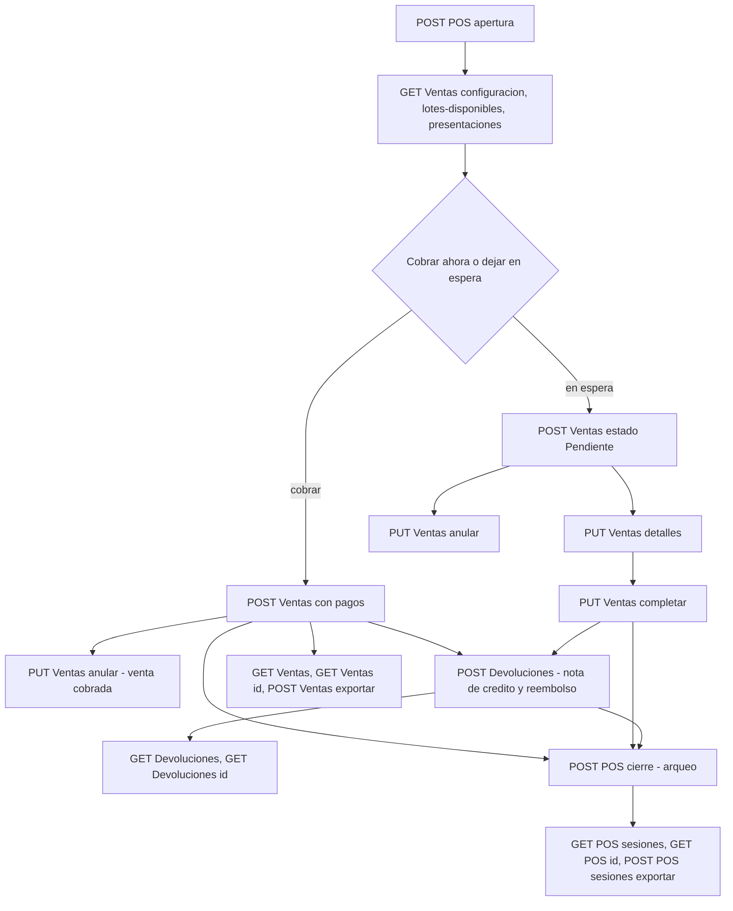

# Referencia de la API — Parte E: ventas, caja y devoluciones

| | |
|---|---|
| **Sistema** | SOFIA — Sistema Optimizado Farmacéutico con Inteligencia Artificial |
| **Versión del documento** | 1.0 |
| **Fecha** | 2026-10-30 |
| **Backend** | `sofia-apis`, rama `main`, commit `34089ec` |
| **Frontend** | `sofia-web-spa`, rama `main`, commit `9ad15f0` |
| **Método** | Lectura de código y llamadas reales a la API local (`https://localhost:7300`, empresa de la referencia «Farmacia API Referencia S.A.C.») |

## 0. Alcance, convenciones y datos de este documento

Este documento describe los 18 endpoints de tres controladores, en el orden de `_inventario/endpoints.csv`: `POS` (5, caja), `Ventas` (10) y `Devoluciones` (3). Las convenciones comunes de la API (prefijo `/api/v1/`, autenticación con `Authorization: Bearer <token>`, respuestas 401 y 403 por falta de permiso, paginación, límite global de 200 peticiones por minuto por IP y formato general de errores) están en [04a-convenciones-y-administracion.md, apartado 0](04a-convenciones-y-administracion.md#0-convenciones-comunes) y no se repiten aquí. Aquí solo se dice lo que es distinto en estos controladores.

Las reglas de negocio se remiten por ID a [01c2-ventas-y-comprobantes.md](../01-reglas-de-negocio/01c2-ventas-y-comprobantes.md) (`RN-VEN`, `RN-CMP`) y [01c3-caja-devoluciones-dashboard.md](../01-reglas-de-negocio/01c3-caja-devoluciones-dashboard.md) (`RN-CAJ`, `RN-DEV`); los permisos, a [05b-matriz-de-permisos.md](../05-seguridad/05b-matriz-de-permisos.md) (apartados 3.4, 3.14 y el de `Ventas`); las pantallas, a [19f-punto-de-venta.md](../19-inventario-de-pantallas/19f-punto-de-venta.md); y los procesos completos, a [14-procesos-de-negocio.md](../../ola-2-funcional/14-procesos-de-negocio.md) (procesos 4 a 6).

### 0.1 Particularidades de estos tres controladores

1. **Los valores enumerados viajan como número en el cuerpo JSON.** La API no registra un convertidor de enumerados a texto: en el cuerpo se envía `estado: 3` (no `"Pendiente"`), `metodoPago: 1`, `destinoFisicoLogico: 1`; enviar el nombre en el cuerpo responde 400 (ejemplo en `POST /api/v1/Ventas/exportar` y apartado 0.5). En la **cadena de consulta** sí se aceptan el nombre o el número (`?estado=Anulada`, `?estadoSesion=Abierta`). En las respuestas, `estadoSesion` sale como número y los estados y métodos de pago de una venta salen como texto (ver tabla).
2. **Forma de los errores de negocio.** Todos los rechazos de negocio y de validación de FluentValidation responden con `Content-Type: application/problem+json` y el cuerpo mínimo `{ "status", "detail", "code" }` (sin `type`, `title` ni `traceId`). El `code` de un validador es `{NombreDelRequest}.{Propiedad}` y el `detail` junta todos los mensajes del validador separados por `; ` ([RN-GEN-011]). Los errores de conversión del cuerpo (JSON mal formado, enumerado enviado como texto, validaciones de `[ExportHeaders]` y `[ExportDateFormat]`) usan en cambio el `ProblemDetails` estándar de ASP.NET con `type`, `title`, `errors` y `traceId` (ver 0.5).
3. **El código HTTP lo decide el handler, no el tipo de error.** Un `Result.Failure` sin número responde 400 aunque el error sea de tipo «no encontrado» o «prohibido» ([RN-GEN-011], y la sección 2 de 01c2 y 01c3). Por eso `Venta.Lote`, `Venta.Presentacion` y los rechazos por sucursal ajena responden 400.
4. **Éxito sin envoltorio, con dos excepciones.** `POST /POS/apertura`, `POST /POS/cierre` y `POST /Devoluciones` responden **200** con el identificador (un GUID como cadena JSON: `"45af5927-…"`), no 201. `POST /Ventas` y `PUT /Ventas/{id}/completar` responden **200** con `{ ventaId, comprobante }`. `PUT …/anular` y `PUT …/detalles` responden **204** sin cuerpo. **`GET /POS/{id}` y `GET /Devoluciones/{id}` devuelven el objeto `Result` completo** (`isSuccess`, `value`, `isFailure`, `error`, `statusCode`), con el dato en `value`; todas las demás consultas devuelven el valor plano.
5. **Todo gira alrededor de la sucursal y del empleado del token.** Ventas, caja y devoluciones toman la sucursal y el empleado de las claims de la sesión ([RN-GEN-024]); el cliente no los envía. Quien vende, cobra, anula o devuelve necesita su propia caja abierta (ver 0.3).
6. **Fechas.** Todas las fechas de las respuestas son instantes UTC (`2026-10-30T22:23:29.307Z`). Los filtros `fechaInicio` y `fechaFin` se comparan como `>=` y `<=` contra ese instante ([RN-GEN-008]): una fecha sin hora (`2026-10-30`) vale las 00:00 UTC de ese día, de modo que `fechaFin=2026-10-30` **no incluye** los registros del propio 30 (se comprobó: devuelve 0 filas). Para incluir un día completo, envía el instante final (`2026-10-30T23:59:59Z`) o el día siguiente. El SPA envía el inicio y el fin del día local.
7. **Auditoría.** Abrir caja (`CAJA_APERTURAR`), cerrar caja (`CAJA_CERRAR`), anular venta (`VENTA_ANULAR`) y procesar devolución (`DEVOLUCION_PROCESAR`) dejan fila de auditoría ([RN-GEN-013]); crear, cobrar y actualizar ventas no.

Enumerados usados en este documento (todos verificados con llamadas reales):

| Enumerado | Valores en el cuerpo (número) | Cómo sale en las respuestas |
|---|---|---|
| `EstadoVenta` | 0 `Completada`, 1 `Anulada`, 2 `Devuelta`, 3 `Pendiente` | texto: `"Completada"` |
| `MetodoPago` | 0 `Efectivo`, 1 `YapePlin`, 2 `Tarjeta`, 3 `Transferencia` | texto en el detalle de venta: `"Efectivo"` |
| `EstadoSesion` | 0 `Abierta`, 1 `Cerrada`, 2 `Cuadrada` | número: `"estadoSesion": 1` |
| `DestinoDevolucion` | 0 `Reingreso_Venta`, 1 `Cuarentena_DIGEMID` | no se devuelve en estos endpoints |
| `CondicionVenta` | 0 `VentaLibreOTC`, 1 `RecetaSimple`, 2 `RecetaRetenida`, 3 `Estupefaciente` | número: `"condicionVenta": 1` |

### 0.2 Flujo que recorre este documento



### 0.3 Precondiciones comunes (y qué pasa si faltan)

| Precondición | Qué la exige | Error si falta | Regla |
|---|---|---|---|
| Caja propia abierta | `POST /Ventas` (la sesión que envías debe ser tuya y estar abierta), `PUT …/completar`, `PUT …/anular` (solo venta cobrada) y `POST /Devoluciones` | `Venta.Caja`, `Venta.Caja.SinSesionAbierta`, `Venta.Anular.SinSesionAbierta`, `Devolucion.Caja.SinSesionAbierta` (todos 400) | [RN-VEN-003], [RN-VEN-006], [RN-VEN-067], [RN-DEV-005] |
| Serie de boleta activa y RUC de la empresa | Cobrar (`POST /Ventas` con pagos y `PUT …/completar`) | `Venta.SerieBoleta.NoConfigurada`, `Venta.Empresa.SinRuc` (400) | [RN-CMP-002], [RN-CMP-003] |
| Serie de nota de crédito activa en la sucursal | `POST /Devoluciones` | `Devolucion.SerieNotaCredito.NoConfigurada` (400) | [RN-DEV-007] |
| Stock vendible del lote en la sucursal del token | Todo lo que descuenta stock | `Venta.Stock`, `Venta.Lote`, `Venta.Lote.Vencido`, `Venta.Cuarentena` (400) | [RN-VEN-011] a [RN-VEN-015] |

### 0.4 Datos de prueba creados por esta parte (prefijo `4E-`)

Se crearon con la API local en la empresa de la referencia, sede «Sede Principal» (`6dc187a9-3b16-4001-b3ed-092119c1ba90`). Son datos ficticios; no contienen credenciales.

| Dato | Nombre o código | Identificador |
|---|---|---|
| Unidad base | `4E-UND` «4E-Unidad» | `4f8b9adf-db38-4c5b-9312-fb8fe76e4ecd` |
| Unidad de venta | `4E-CJA` «4E-Caja x10» | `105201bf-343b-4908-bcdc-187d31648ae7` |
| Laboratorio | «4E-Laboratorio Demo» | `fba84d15-5318-442a-b06e-b32aeab148b3` |
| Serie de boleta (activa, correlativo inicial 0) | `B4E1` | `74db10b3-d45e-4996-a789-87a1c76ec795` |
| Serie de nota de crédito (activa, correlativo inicial 0) | `B4N1` | `00fc589d-9e13-4db2-9a6f-5a8de14761d2` |
| Medicamento A, venta libre, S/ 2,50 | `4E-MED-001` «4E-Paracetamol 500 mg» | `b4e76deb-af56-4db5-802c-e7397db6b86b` |
| Medicamento B, receta simple, S/ 1,80 | `4E-MED-002` «4E-Amoxicilina 500 mg» | `2688c0d5-0804-4e9e-bd12-fd3c46ce610e` |
| Medicamento C, receta retenida, S/ 8,00 | `4E-MED-003` «4E-Tramadol 50 mg» | `1b5bffc5-c18b-4da7-ba63-1eed37baf8b5` |
| Jerarquía de unidades (1 caja = 10 unidades, medicamento A) | — | `49232b00-6cf5-4071-b67e-dc66166eb3ba` |
| Presentación de venta «4E-Caja x10», S/ 22,00 (medicamento A) | — | `2ba54e20-9dac-4547-b2fb-d34fcf0c56be` |
| Lote A (caduca 2028-12-31), stock inicial 50 | `4E-LOTE-A1` | lote `b8ce2dad-04a3-43eb-87a4-2e52315114df`, fila de stock `e699c8fa-dd57-43e5-b717-912db5827c2a` |
| Lote B (caduca 2028-06-30), stock inicial 30 | `4E-LOTE-B1` | lote `5384e0aa-a293-457a-bc53-59d1d4c53e86`, fila de stock `0784ce77-309b-415e-8691-0c63678bdf46` |
| Lote C (caduca 2028-06-30), stock inicial 10 | `4E-LOTE-C1` | lote `f6cf2e5c-fcfe-4467-b1e9-e2ec7e10126e`, fila de stock `f781fa7b-7a45-41c2-b9e9-01d216872ec1` |
| Paciente (DNI ficticio) | «4E-Paciente Demo Uno» | `a4c83bba-67f0-4fa0-bb65-20857da6a63a` |
| Profesional de salud | «4E-Dr. Prescriptor Demo» | `7eb21515-c4a4-40be-8d73-0786fb915088` |
| Receta (número `4E-REC-0001`) | — | `da0de600-3692-4ae5-9c60-e53752ffcb36` |
| Sesión de caja 1 (cerrada con faltante) | — | `45af5927-496a-492a-8f6b-58156e4a424d` |
| Sesión de caja 2 (cerrada cuadrada) | — | `b8cea55c-05c4-4042-a8ba-38a3938fe88f` |

Ventas creadas (todas en la sesión 1, salvo la última): V1 `3d6cfb7f-8199-4503-80d5-0bbf42b1314d` (`B4E1-00000001`), V2 `72a88945-3350-4d76-bf70-2b0a4b665af1` (`B4E1-00000002`), V3 `dcc0a7ca-6dbe-4385-8866-987686ca99e9` (`B4E1-00000003`), V4 `439737d3-a4a3-40e6-91cb-145587ccc0e9` (en espera y luego cobrada, `B4E1-00000004`), V5 `4a06fc6e-7f55-4922-8e84-e2d478167b6c` (en espera y anulada, sin comprobante), V6 `949a6b84-a704-4930-9957-3a78d7636185` (cobrada y anulada, `B4E1-00000005`) y V7 `eececf87-41dc-430a-84d8-f9a08335a4bc` (sesión 2, `B4E1-00000006`). Devoluciones: `83d06851-e479-4ef8-a77d-12861467d935` (sobre V1, reembolso en efectivo) y `0d7729b1-da10-4515-b312-b64843969e58` (sobre V3, reembolso por Yape/Plin, destino cuarentena). La nota de crédito de la primera es `B4N1-00000001`.

Nota sobre los ejemplos: son capturas reales de la API local del 2026-10-30, con el token escrito como `<token>`, y recortadas cuando la respuesta era larga. Las peticiones del recorrido se hicieron en este orden (la hora aparece en las fechas de las respuestas): apertura, consultas de apoyo, V1, V2, rechazos, V3, V4 en espera, V5, V6, devoluciones, consultas y exportaciones, cierre de la sesión 1, rechazos con la caja cerrada, apertura de la sesión 2, V7 y cierre de la sesión 2.

---

### 0.5 Errores de conversión del cuerpo (aplican a todos los `POST` y `PUT` de este documento)

Antes de que corra el validador, ASP.NET convierte el cuerpo y los parámetros. Si el valor no se puede convertir al tipo del request (un enumerado enviado como texto, un número mal escrito, un GUID inválido en la ruta o en la consulta), responde 400 con el `ProblemDetails` estándar de ASP.NET: `type`, `title` («One or more validation errors occurred.»), `status`, `errors` (diccionario campo → mensajes) y `traceId`. Este formato **no** tiene el campo `code`. Hay capturas reales en `GET /api/v1/Pos/{id}` (GUID inválido), `GET /api/v1/Ventas/presentaciones` (GUID inválido) y `POST /api/v1/Ventas/exportar` (enumerado como texto y formato de fecha). La regla general es [RN-GEN-041].

---

## 1. `POS` (caja)

Controlador `PosController` (`SOFIA.API/Controllers/POSController.cs`), ruta base `/api/v1/Pos` (la ruta no distingue mayúsculas: se llama también como `/api/v1/POS`). Una sesión de caja es el turno de un cajero: nace con el efectivo con que abre y termina cuando declara el efectivo que contó; el sistema compara lo declarado con lo que debería haber (arqueo). Reglas: [01c3 apartado 3](../01-reglas-de-negocio/01c3-caja-devoluciones-dashboard.md#3-caja-caj). Permisos: [05b apartado 3.14](../05-seguridad/05b-matriz-de-permisos.md#314-pos-sesiones-de-caja). Proceso: [14 apartado 8](../../ola-2-funcional/14-procesos-de-negocio.md#8-proceso-6--caja).

Una sesión tiene tres estados (`EstadoSesion`): `Abierta` (0), `Cerrada` (1, el declarado difiere del esperado) y `Cuadrada` (2, el declarado es exactamente el esperado). Un empleado no puede tener dos sesiones abiertas a la vez, en ninguna sucursal ([RN-CAJ-004]).

#### `POST /api/v1/Pos/apertura`

Abre la caja del usuario autenticado, en su sucursal y con la hora del servidor; solo se envía el efectivo inicial. Si ya tiene una caja abierta, la rechaza.

| | |
|---|---|
| **Permiso** | `POS:AperturarCaja` |
| **Límite de peticiones** | solo el global |
| **Código** | `SOFIA.API/Controllers/POSController.cs:14` → `AperturarCajaCommand` (`SOFIA.Application/POS/Commands/AperturarCaja/`) |
| **Pantalla del SPA** | `/sesiones-caja/nueva` y el diálogo «Aperturar Caja» de `/pos/nueva` |

**Parámetros:** ninguno.

**Cuerpo:**

| Campo | Tipo | Obligatorio | Reglas |
|---|---|---|---|
| `montoAperturaEfectivo` | número decimal | Sí | Mayor o igual a 0; cero es válido; sin máximo en el validador ([RN-CAJ-003]). La base guarda 2 decimales. |

**Respuesta correcta:** `200 OK`, cuerpo: el identificador de la sesión creada como cadena JSON (GUID). La sesión queda `Abierta`, sin cierre y con los tres campos del arqueo vacíos ([RN-CAJ-005]). Auditoría `CAJA_APERTURAR`.

**Errores posibles:**

| HTTP | `code` | Cuándo | Regla |
|---|---|---|---|
| 400 | `AperturarCajaCommand.MontoAperturaEfectivo` | Monto negativo | [RN-CAJ-003] |
| 400 | `Auth.Sucursal` / `Auth.Empleado` | El token no trae sucursal o empleado | [RN-CAJ-002] |
| 409 | `PosSesionCaja.YaAbierta` | El empleado ya tiene una sesión `Abierta` (también si dos aperturas llegan a la vez: lo impide un índice único) | [RN-CAJ-004] |

**Ejemplo real** (monto inválido, apertura correcta y segunda apertura rechazada):

```http
POST /api/v1/Pos/apertura
Authorization: Bearer <token>
Content-Type: application/json

{ "montoAperturaEfectivo": -5 }
```

```json
HTTP/1.1 400 Bad Request
Content-Type: application/problem+json

{ "status": 400, "detail": "Opening cash amount must be greater than or equal to 0.", "code": "AperturarCajaCommand.MontoAperturaEfectivo" }
```

```http
POST /api/v1/Pos/apertura
Authorization: Bearer <token>
Content-Type: application/json

{ "montoAperturaEfectivo": 100 }
```

```json
HTTP/1.1 200 OK

"45af5927-496a-492a-8f6b-58156e4a424d"
```

```http
POST /api/v1/Pos/apertura
Authorization: Bearer <token>
Content-Type: application/json

{ "montoAperturaEfectivo": 50 }
```

```json
HTTP/1.1 409 Conflict
Content-Type: application/problem+json

{ "status": 409, "detail": "Ya tienes una caja abierta. Ciérrala antes de abrir otra.", "code": "PosSesionCaja.YaAbierta" }
```

#### `POST /api/v1/Pos/cierre`

Cierra una sesión de caja con el efectivo que el cajero contó. El servidor calcula el efectivo esperado (arqueo), guarda esperado, declarado y diferencia, y deja la sesión `Cuadrada` (diferencia exactamente 0) o `Cerrada` (cualquier otra diferencia; no hay tolerancia). Solo la cierra quien la abrió o un usuario con rol `Admin`.

| | |
|---|---|
| **Permiso** | `POS:CerrarCaja` |
| **Límite de peticiones** | solo el global |
| **Código** | `SOFIA.API/Controllers/POSController.cs:21` → `CerrarCajaCommand` (`SOFIA.Application/POS/Commands/CerrarCaja/`); el cálculo está en `SOFIA.Application/POS/Common/ArqueoCajaCalculator.cs` |
| **Pantalla del SPA** | `/sesiones-caja/:id`: botón «Cerrar Sesión» y «Confirmar Cierre» |

**Parámetros:** ninguno.

**Cuerpo:**

| Campo | Tipo | Obligatorio | Reglas |
|---|---|---|---|
| `sesionId` | GUID | Sí | No vacío; la sesión debe existir en la empresa ([RN-CAJ-008]). |
| `montoCierre` | número decimal | Sí | Efectivo declarado; mayor o igual a 0 ([RN-CAJ-009]). |

**Respuesta correcta:** `200 OK`, cuerpo: el identificador de la sesión como cadena JSON. El resultado del arqueo no viaja en la respuesta: se consulta con `GET /api/v1/Pos/{id}` (campos `montoCierreCalculado`, `montoCierreDeclarado`, `diferenciaArqueo`, `estadoSesion`). `diferenciaArqueo = declarado − esperado` ([RN-CAJ-015]); el esperado es `apertura + efectivo neto de las ventas − reembolsos en efectivo` ([RN-CAJ-011] a [RN-CAJ-014]). Auditoría `CAJA_CERRAR`.

**Errores posibles:**

| HTTP | `code` | Cuándo | Regla |
|---|---|---|---|
| 400 | `CerrarCajaCommand.SesionId` / `CerrarCajaCommand.MontoCierre` | Identificador vacío o monto negativo | [RN-CAJ-009] |
| 404 | `Caja` | La sesión no existe | [RN-CAJ-008] |
| 403 | `PosSesionCaja.NoPropia` | La sesión es de otro cajero y el usuario no es `Admin` | [RN-CAJ-007] |
| 400 | `PosSesionCaja.Cerrar` | La sesión ya está `Cerrada` o `Cuadrada` | [RN-CAJ-010] |
| 400 | `PosSesionCaja.MontoCierreCalculado` | El efectivo esperado resulta negativo (no se puede cerrar) | [RN-CAJ-016] |
| 400 | `Auth.Empleado` | El token no trae empleado | [RN-GEN-024] |
| 409 | `Concurrency.Conflict` | Dos cierres parten de la misma lectura | [RN-CAJ-010] |

**Ejemplo real** (la sesión 1 del recorrido; el cálculo a mano del esperado está en el apartado 4):

```http
POST /api/v1/Pos/cierre
Authorization: Bearer <token>
Content-Type: application/json

{ "sesionId": "45af5927-496a-492a-8f6b-58156e4a424d", "montoCierre": 148 }
```

```json
HTTP/1.1 200 OK

"45af5927-496a-492a-8f6b-58156e4a424d"
```

Errores provocados (sesión inexistente, monto negativo y cierre repetido):

```http
POST /api/v1/Pos/cierre
Authorization: Bearer <token>
Content-Type: application/json

{ "sesionId": "00000000-0000-0000-0000-000000000001", "montoCierre": 10 }
```

```json
HTTP/1.1 404 Not Found
Content-Type: application/problem+json

{ "status": 404, "detail": "Sesion no encontrada", "code": "Caja" }
```

```json
HTTP/1.1 400 Bad Request   (montoCierre = -1)

{ "status": 400, "detail": "'Monto Cierre' must be greater than or equal to '0'.", "code": "CerrarCajaCommand.MontoCierre" }
```

```json
HTTP/1.1 400 Bad Request   (segundo cierre de la sesión 1)

{ "status": 400, "detail": "Only open sessions can be closed.", "code": "PosSesionCaja.Cerrar" }
```

#### `GET /api/v1/Pos/sesiones`

Lista paginada de sesiones de caja de las sucursales accesibles del usuario (de todos los cajeros de esas sucursales), de la apertura más reciente a la más antigua.

| | |
|---|---|
| **Permiso** | `POS:Leer` |
| **Límite de peticiones** | solo el global |
| **Código** | `SOFIA.API/Controllers/POSController.cs:29` → `GetSesionesQuery` (`SOFIA.Application/POS/Queries/GetSesiones/`) |
| **Pantalla del SPA** | `/sesiones-caja` (botón «Buscar»); `/pos/nueva` la usa para encontrar la caja abierta del cajero |

**Parámetros (consulta):**

| Nombre | Tipo | Obligatorio | Descripción |
|---|---|---|---|
| `sucursalId` | GUID | No | No puede ser el GUID vacío. Se intersecta con las sucursales accesibles: una sucursal no accesible devuelve página vacía ([RN-CAJ-021]). |
| `estadoSesion` | `EstadoSesion` | No | `Abierta`, `Cerrada` o `Cuadrada` (nombre o número). |
| `fechaInicio`, `fechaFin` | fecha-hora | No | Sobre la fecha-hora de apertura, `>=` y `<=` ([RN-GEN-008]); ver 0.1, punto 6. |
| `empleadoId` | GUID | No | No puede ser el GUID vacío. |
| `pageNumber` | entero | No | Por defecto 1. |
| `pageSize` | entero | No | Por defecto 10; máximo 10 000 ([RN-GEN-009]). |

**Respuesta correcta:** `200 OK`, `{ items, pageNumber, totalPages, totalCount, hasPreviousPage, hasNextPage }`. Cada elemento de `items`: `id`, `sucursalId`, `sucursalNombre`, `empleadoId`, `empleadoNombre` («Nombres» + primer apellido), `fechaHoraApertura`, `fechaHoraCierre` (nulo si está abierta), `montoAperturaEfectivo`, `montoCierreCalculado`, `montoCierreDeclarado`, `diferenciaArqueo` (nulos hasta el cierre) y `estadoSesion` (número).

**Errores posibles:**

| HTTP | `code` | Cuándo | Regla |
|---|---|---|---|
| 400 | `GetSesionesQuery.SucursalId` / `GetSesionesQuery.EmpleadoId` | Se envía el GUID vacío | [RN-CAJ-021] |

**Ejemplo real:**

```http
GET /api/v1/Pos/sesiones?estadoSesion=Cerrada&pageSize=5
Authorization: Bearer <token>
```

```json
HTTP/1.1 200 OK

{
  "items": [
    {
      "id": "45af5927-496a-492a-8f6b-58156e4a424d",
      "sucursalId": "6dc187a9-3b16-4001-b3ed-092119c1ba90",
      "sucursalNombre": "Sede Principal",
      "empleadoId": "90516255-a1ff-476b-b857-4561740dee8d",
      "empleadoNombre": "Rita Referencia",
      "fechaHoraApertura": "2026-10-30T22:22:21.4Z",
      "fechaHoraCierre": "2026-10-30T22:28:07.583Z",
      "montoAperturaEfectivo": 100,
      "montoCierreCalculado": 148.6,
      "montoCierreDeclarado": 148,
      "diferenciaArqueo": -0.6,
      "estadoSesion": 1
    }
  ],
  "pageNumber": 1, "totalPages": 1, "totalCount": 1,
  "hasPreviousPage": false, "hasNextPage": false
}
```

Error provocado:

```http
GET /api/v1/Pos/sesiones?sucursalId=00000000-0000-0000-0000-000000000000
Authorization: Bearer <token>
```

```json
HTTP/1.1 400 Bad Request
Content-Type: application/problem+json

{ "status": 400, "detail": "'Sucursal Id' must not be equal to '00000000-0000-0000-0000-000000000000'.", "code": "GetSesionesQuery.SucursalId" }
```

#### `GET /api/v1/Pos/{id}`

Devuelve una sesión de caja por su identificador. **La respuesta es el objeto `Result` completo**, con la sesión en `value`.

| | |
|---|---|
| **Permiso** | `POS:Leer` |
| **Límite de peticiones** | solo el global |
| **Código** | `SOFIA.API/Controllers/POSController.cs:37` (atributo `[HttpGet("{id}")]`) → `GetSesionByIdQuery` (`SOFIA.Application/POS/Queries/GetSesionById/`) |
| **Pantalla del SPA** | `/sesiones-caja/:id` |

**Parámetros (ruta):** `id` (GUID, obligatorio). La ruta no lleva restricción de tipo en el atributo: un valor que no es GUID (por ejemplo `/api/v1/Pos/abc`) responde 400 con el `ProblemDetails` estándar de ASP.NET (`errors.id`: «The value 'abc' is not valid.»). En `Ventas`, en cambio, la ruta sí tiene la restricción `:guid` y un valor que no es GUID responde 404 sin cuerpo.

**Respuesta correcta:** `200 OK`, `{ isSuccess, value, isFailure, error: { code, message, type }, statusCode }`; `value` tiene los mismos campos que un elemento del listado. La sesión debe ser de una sucursal accesible: una de otra sucursal responde como inexistente ([RN-CAJ-020], [RN-CAJ-023]).

**Errores posibles:**

| HTTP | `code` | Cuándo | Regla |
|---|---|---|---|
| 404 | `SesionCaja.NotFound` | No existe, está eliminada o es de una sucursal no accesible. Aquí el error sí viaja como `ProblemDetails` mínimo (`status`, `detail`, `code`). | [RN-CAJ-023] |

**Ejemplo real** (la sesión 1 después del cierre):

```http
GET /api/v1/Pos/45af5927-496a-492a-8f6b-58156e4a424d
Authorization: Bearer <token>
```

```json
HTTP/1.1 200 OK

{
  "isSuccess": true,
  "value": {
    "id": "45af5927-496a-492a-8f6b-58156e4a424d",
    "sucursalId": "6dc187a9-3b16-4001-b3ed-092119c1ba90",
    "sucursalNombre": "Sede Principal",
    "empleadoId": "90516255-a1ff-476b-b857-4561740dee8d",
    "empleadoNombre": "Rita Referencia",
    "fechaHoraApertura": "2026-10-30T22:22:21.4Z",
    "fechaHoraCierre": "2026-10-30T22:28:07.583Z",
    "montoAperturaEfectivo": 100,
    "montoCierreCalculado": 148.6,
    "montoCierreDeclarado": 148,
    "diferenciaArqueo": -0.6,
    "estadoSesion": 1
  },
  "isFailure": false,
  "error": { "code": "", "message": "", "type": 0 },
  "statusCode": 200
}
```

```http
GET /api/v1/Pos/00000000-0000-0000-0000-000000000001
Authorization: Bearer <token>
```

```json
HTTP/1.1 404 Not Found
Content-Type: application/problem+json

{ "status": 404, "detail": "Sesion de Caja not found.", "code": "SesionCaja.NotFound" }
```

#### `POST /api/v1/Pos/sesiones/exportar`

Genera un Excel con las sesiones que cumplen los filtros (sin paginar; no acepta el filtro de empleado). Si hay más de 10 000, no genera el archivo.

| | |
|---|---|
| **Permiso** | `POS:Leer` |
| **Límite de peticiones** | solo el global |
| **Código** | `SOFIA.API/Controllers/POSController.cs:46` → `GetSesionesQuery` (reutilizado); el cuerpo es `SesionCajaExportRequest` (`POSController.cs:80-86`) |
| **Pantalla del SPA** | `/sesiones-caja`: botón «Exportar» |

**Parámetros:** ninguno.

**Cuerpo:**

| Campo | Tipo | Obligatorio | Reglas |
|---|---|---|---|
| `headers` | arreglo de texto | Sí | Títulos de columna ya traducidos por el cliente; máximo 50 títulos de hasta 100 caracteres ([RN-IMP-009]). El archivo tiene 9 columnas, en este orden: sucursal, cajero, apertura, cierre, monto de apertura, monto declarado, monto calculado, diferencia, estado ([RN-CAJ-024]). |
| `dateFormat` | texto | Sí | Uno de `dd/MM/yyyy`, `MM/dd/yyyy`, `dd/MM/yyyy HH:mm`, `MM/dd/yyyy HH:mm` ([RN-IMP-011]); se aplica sobre la fecha UTC, sin convertir a hora local. |
| `sucursalId` | GUID | No | Filtro. |
| `estadoSesion` | número (`EstadoSesion`) | No | Filtro; en el cuerpo va como número. |
| `fechaInicio`, `fechaFin` | fecha-hora | No | Filtro sobre la apertura. |

**Respuesta correcta:** `200 OK` con el archivo. `Content-Type: application/vnd.openxmlformats-officedocument.spreadsheetml.sheet`; `Content-Disposition: attachment; filename=sesiones-caja.xlsx; filename*=UTF-8''sesiones-caja.xlsx`. En la captura, 6 696 bytes.

**Errores posibles:**

| HTTP | `code` | Cuándo | Regla |
|---|---|---|---|
| 400 | `Export.TooManyRows` | Más de 10 000 sesiones | [RN-IMP-008] |
| 400 | (`errors.DateFormat`: `Export.DateFormat.Invalid`) | `dateFormat` fuera de la lista; es un `ProblemDetails` estándar con `errors` (ver 0.5) | [RN-IMP-011] |

**Ejemplo real:**

```http
POST /api/v1/Pos/sesiones/exportar
Authorization: Bearer <token>
Content-Type: application/json

{
  "headers": ["Sucursal","Cajero","Apertura","Cierre","Monto Apertura","Monto Declarado","Monto Calculado","Diferencia","Estado"],
  "dateFormat": "dd/MM/yyyy HH:mm"
}
```

```http
HTTP/1.1 200 OK
Content-Type: application/vnd.openxmlformats-officedocument.spreadsheetml.sheet
Content-Disposition: attachment; filename=sesiones-caja.xlsx; filename*=UTF-8''sesiones-caja.xlsx

[binario: 6696 bytes]
```

Contenido comprobado: fila de títulos y, con la sesión 1 aún abierta, «Sede Principal», «Rita Referencia», «30/10/2026 22:22» (apertura en UTC), cierre vacío y estado `Abierta`.

---

## 2. `Ventas`

Controlador `VentasController` (`SOFIA.API/Controllers/VentasController.cs`), ruta base `/api/v1/Ventas`. Una venta registra la salida de productos de la sucursal del cajero, a su nombre y, opcionalmente, de un cliente (paciente). Se cobra al crearla (con pagos) o se deja en espera (estado `Pendiente`, sin pagos) para cobrarla después. **El cliente nunca envía precio ni costo**: los resuelve el servidor desde el catálogo ([RN-VEN-019], [RN-VEN-022]). Reglas: [01c2 apartado 3](../01-reglas-de-negocio/01c2-ventas-y-comprobantes.md#3-ventas-ven) y comprobantes en [apartado 4](../01-reglas-de-negocio/01c2-ventas-y-comprobantes.md#4-comprobantes-emitidos-al-vender-cmp). Permisos: [05b apartado 3.27](../05-seguridad/05b-matriz-de-permisos.md#327-ventas-ventas). Proceso: [14 apartado 6](../../ola-2-funcional/14-procesos-de-negocio.md#6-proceso-4--venta).

Estados de una venta: `Completada` → `Anulada` o `Devuelta` (esta última solo por devolución total); `Pendiente` → `Completada` o `Anulada` ([RN-VEN-049]). Las tres consultas de apoyo del punto de venta (lotes, presentaciones, configuración) se autorizan con `Ventas:Crear` para que vender no dependa de permisos de inventario ([RN-VEN-001]). El comprobante que se emite al cobrar es siempre una boleta (las ventas nunca emiten factura, [RN-CMP-001]) y **no se envía a SUNAT**: `estadoAceptacion` queda en `NoEnviado` y `urlVerificacion`, `urlXml` y `urlCdr` en `null` ([RN-CMP-007]).

#### `GET /api/v1/Ventas`

Lista paginada de las ventas **de la sucursal del token** (de todos los empleados), de la más reciente a la más antigua.

| | |
|---|---|
| **Permiso** | `Ventas:Leer` |
| **Límite de peticiones** | solo el global |
| **Código** | `SOFIA.API/Controllers/VentasController.cs:21` → `GetVentasQuery` (`SOFIA.Application/Ventas/Queries/GetVentas/`) |
| **Pantalla del SPA** | `/pos` (botón «Buscar») |

**Parámetros (consulta):**

| Nombre | Tipo | Obligatorio | Descripción |
|---|---|---|---|
| `fechaInicio`, `fechaFin` | fecha-hora | No | Sobre la fecha-hora de la venta, `>=` y `<=` en UTC ([RN-VEN-072]); ver 0.1, punto 6. |
| `estado` | `EstadoVenta` | No | `Completada`, `Anulada`, `Devuelta` o `Pendiente` (nombre o número). |
| `empleadoId` | GUID | No | Empleado que vendió. |
| `clienteId` | GUID | No | Paciente de la venta. |
| `pageNumber` | entero | No | Por defecto 1. |
| `pageSize` | entero | No | Por defecto 10; máximo 10 000 ([RN-GEN-009]). |

**Respuesta correcta:** `200 OK`, `{ items, pageNumber, totalPages, totalCount, hasPreviousPage, hasNextPage }`. Cada elemento: `id`, `codigoVenta`, `fechaHora` (UTC), `total` (con IGV incluido), `estado` (texto), `empleadoNombre`, `clienteNombre` («Público General» si no hay cliente) e `itemsCount`. El `codigoVenta` se deriva: con boleta es `{serie}-{correlativo de 8 dígitos}` (`B4E1-00000004`); una venta en espera usa los 8 primeros caracteres del identificador en mayúsculas (`4A06FC6E`) ([RN-VEN-059]).

**Errores posibles:**

| HTTP | `code` | Cuándo | Regla |
|---|---|---|---|
| 400 | `Auth.Sucursal` | El token no trae sucursal | [RN-VEN-070] |

**Ejemplo real** (ventas cobradas del día, con `fechaFin` el día siguiente):

```http
GET /api/v1/Ventas?pageNumber=1&pageSize=3&estado=Completada&fechaInicio=2026-10-30&fechaFin=2026-10-31
Authorization: Bearer <token>
```

```json
HTTP/1.1 200 OK

{
  "items": [
    { "id": "439737d3-a4a3-40e6-91cb-145587ccc0e9", "codigoVenta": "B4E1-00000004", "fechaHora": "2026-10-30T22:24:07.753Z",
      "total": 12.5, "estado": "Completada", "empleadoNombre": "Rita Referencia", "clienteNombre": "4E-Paciente Demo Uno", "itemsCount": 1 },
    { "id": "dcc0a7ca-6dbe-4385-8866-987686ca99e9", "codigoVenta": "B4E1-00000003", "fechaHora": "2026-10-30T22:23:48.377Z",
      "total": 11.6, "estado": "Completada", "empleadoNombre": "Rita Referencia", "clienteNombre": "4E-Paciente Demo Uno", "itemsCount": 2 }
  ],
  "pageNumber": 1, "totalPages": 2, "totalCount": 4,
  "hasPreviousPage": false, "hasNextPage": true
}
```

(La captura se recortó a 2 de las 3 filas devueltas.) Con `fechaFin=2026-10-30` (solo la fecha) la misma consulta devolvió `items: []` y `totalCount: 0`: ver 0.1, punto 6. Las ventas en espera (`estado=Pendiente`) devolvieron una lista vacía mientras no había ninguna.

#### `GET /api/v1/Ventas/{id}`

Devuelve el detalle de una venta de la sucursal del token: cabecera, líneas, pagos, comprobante y devoluciones con su nota de crédito.

| | |
|---|---|
| **Permiso** | `Ventas:Leer` |
| **Límite de peticiones** | solo el global |
| **Código** | `SOFIA.API/Controllers/VentasController.cs:30` → `GetVentaByIdQuery` (`SOFIA.Application/Ventas/Queries/GetVentaById/`) |
| **Pantalla del SPA** | `/pos/:id` |

**Parámetros (ruta):** `id` (GUID, obligatorio; la ruta tiene la restricción `:guid`, un valor que no es GUID responde 404 sin cuerpo).

**Respuesta correcta:** `200 OK` con `VentaConDetalleDto`:

| Campo | Tipo | Descripción |
|---|---|---|
| `id`, `codigoVenta`, `fechaHora`, `total`, `estado`, `motivoAnulacion` | GUID, texto, fecha, decimal, texto, texto o `null` | Cabecera. |
| `empleadoNombre` | texto | Quien registró la venta. |
| `clienteId`, `clienteNombre`, `clienteDocumento`, `clienteTipoDocumento` | GUID o `null`, texto, texto o `null`, texto o `null` | Cliente de la venta; «Público General» y valores `null` si no hay. |
| `detalles[]` | arreglo | `id`, `loteId`, `productoNombre`, `numeroLote`, `cantidad` (**en unidades base**), `precioUnitario`, `subtotal`, `presentacionVentaId`, `presentacionDescripcion`, `cantidadEnPresentacion`, `recetaId`, `cantidadDevuelta`, `condicionVenta` (número). |
| `comprobante` | objeto o `null` | `tipo`, `numero`, `estadoAceptacion`, `urlVerificacion`, `urlXml`, `urlCdr`, `emisorRazonSocial`, `emisorRuc`, `sucursalDireccion`, `clienteTipoDocumento`, `clienteNumeroDocumento`, `clienteNombre`. `null` en una venta en espera. Nunca es una nota de crédito ([RN-CMP-013]). |
| `pagos[]` | arreglo | `id`, `metodoPago` (texto), `montoPagado`, `referenciaOperacion`, `fechaPago`. El vuelto no se guarda ni se devuelve: se obtiene como suma de pagos menos total ([RN-VEN-044]). |
| `devoluciones[]` | arreglo | `id`, `fecha`, `numeroNotaCredito`, `montoReembolsado`, `metodoReembolso`. |
| `recetaVerificadaPor`, `recetaVerificadaEn` | texto o `null`, fecha o `null` | Quién confirmó la receta de papel y cuándo ([RN-VEN-035]). |

**Errores posibles:**

| HTTP | `code` | Cuándo | Regla |
|---|---|---|---|
| 404 | `Venta.NotFound` | La venta no existe (en la empresa, no eliminada) | [RN-VEN-074] |
| 400 | `Venta.Forbidden` | La venta es de otra sucursal | [RN-VEN-074] |
| 400 | `Auth.Sucursal` | El token no trae sucursal | [RN-VEN-002] |
| 404 | (sin cuerpo) | `id` no tiene forma de GUID: la restricción de ruta no coincide | — |

**Ejemplo real** (V1 después de su devolución parcial; recortada):

```http
GET /api/v1/Ventas/3d6cfb7f-8199-4503-80d5-0bbf42b1314d
Authorization: Bearer <token>
```

```json
HTTP/1.1 200 OK

{
  "id": "3d6cfb7f-8199-4503-80d5-0bbf42b1314d",
  "codigoVenta": "B4E1-00000001",
  "fechaHora": "2026-10-30T22:23:29.307Z",
  "total": 10,
  "estado": "Completada",
  "motivoAnulacion": null,
  "empleadoNombre": "Rita Referencia",
  "clienteId": null,
  "clienteNombre": "Público General",
  "clienteDocumento": null,
  "detalles": [
    { "id": "fea96d81-6b9e-415f-ae8d-ede733c26bab", "loteId": "b8ce2dad-04a3-43eb-87a4-2e52315114df",
      "productoNombre": "4E-Paracetamol 500 mg", "numeroLote": "4E-LOTE-A1", "cantidad": 4, "precioUnitario": 2.5, "subtotal": 10,
      "presentacionVentaId": null, "presentacionDescripcion": null, "cantidadEnPresentacion": null,
      "recetaId": null, "cantidadDevuelta": 1, "condicionVenta": 0 }
  ],
  "comprobante": {
    "tipo": "Boleta", "numero": "B4E1-00000001", "estadoAceptacion": "NoEnviado",
    "urlVerificacion": null, "urlXml": null, "urlCdr": null,
    "emisorRazonSocial": "Farmacia API Referencia S.A.C.", "emisorRuc": "20077242341",
    "sucursalDireccion": "Av. Ficticia de la API 789, San Isidro, Lima",
    "clienteTipoDocumento": "-", "clienteNumeroDocumento": "00000000", "clienteNombre": "CLIENTE EVENTUAL"
  },
  "pagos": [
    { "id": "de68c019-e7c2-4550-ae76-70d486b5d55c", "metodoPago": "Efectivo", "montoPagado": 20,
      "referenciaOperacion": null, "fechaPago": "2026-10-30T22:23:29.59Z" }
  ],
  "devoluciones": [
    { "id": "83d06851-e479-4ef8-a77d-12861467d935", "fecha": "2026-10-30T22:25:27.06Z",
      "numeroNotaCredito": "B4N1-00000001", "montoReembolsado": 2.5, "metodoReembolso": "Efectivo" }
  ],
  "clienteTipoDocumento": null,
  "recetaVerificadaPor": null,
  "recetaVerificadaEn": null
}
```

Error provocado (venta inexistente):

```http
GET /api/v1/Ventas/00000000-0000-0000-0000-000000000001
Authorization: Bearer <token>
```

```json
HTTP/1.1 404 Not Found
Content-Type: application/problem+json

{ "status": 404, "detail": "No se encontró la venta con ID 00000000-0000-0000-0000-000000000001", "code": "Venta.NotFound" }
```

Venta anulada: el mismo endpoint devuelve `estado: "Anulada"`, el `motivoAnulacion` y el comprobante con `estadoAceptacion: "Anulado"` (ejemplo completo en `PUT …/anular`).

#### `POST /api/v1/Ventas`

Crea una venta. Con `pagos` y estado por defecto (`Completada`), cobra de inmediato: descuenta el stock, emite la boleta y responde con su número. Con `estado: 3` (`Pendiente`) y sin pagos, la deja en espera: descuenta (reserva) el stock pero no emite comprobante.

| | |
|---|---|
| **Permiso** | `Ventas:Crear` |
| **Límite de peticiones** | solo el global |
| **Código** | `SOFIA.API/Controllers/VentasController.cs:39` → `CreateVentaCommand` (`SOFIA.Application/Ventas/Commands/CreateVenta/`; líneas en `Ventas/Common/VentaDetalleFactory.cs`, pagos en `Ventas/Common/VentaPagoFactory.cs`, comprobante en `Ventas/Common/VentaComprobanteGenerator.cs`) |
| **Pantalla del SPA** | `/pos/nueva`: «Procesar Venta» (cobrar) y «Guardar y Atender Siguiente» (en espera) |

**Parámetros:** ninguno.

**Cuerpo:**

| Campo | Tipo | Obligatorio | Reglas |
|---|---|---|---|
| `sesionId` | GUID | Sí en la práctica | Sesión de caja **propia y abierta** ([RN-VEN-003] a [RN-VEN-005]); sin ella, `Venta.Caja`. |
| `clienteId` | GUID o `null` | No | Paciente de la empresa. Sin cliente la boleta va a «CLIENTE EVENTUAL» ([RN-VEN-025], [RN-CMP-005]). |
| `detalles[]` | arreglo | Sí | Al menos una línea ([RN-VEN-008]). |
| `detalles[].loteId` | GUID | Sí | Lote con fila de stock en la sucursal del token ([RN-VEN-009], [RN-VEN-011]). |
| `detalles[].cantidad` | decimal | Sí | Mayor que 0. Sin `presentacionVentaId` está en **unidades base**; con presentación, en unidades de esa presentación (2 cajas = `2`) ([RN-VEN-010], [RN-VEN-017]). |
| `detalles[].recetaId` | GUID | No | Receta registrada; debe existir y ser del cliente de la venta ([RN-VEN-029] a [RN-VEN-032]). |
| `detalles[].presentacionVentaId` | GUID | No | Presentación del mismo producto del lote ([RN-VEN-018]). |
| `pagos[]` | arreglo | Sí, salvo `estado: 3` | Al menos un pago al cobrar ([RN-VEN-039]). Con `estado: 3` y pagos presentes, **cobra de inmediato** ([RN-VEN-051]). |
| `pagos[].metodoPago` | número (`MetodoPago`) | Sí | 0 a 3 ([RN-VEN-040]). |
| `pagos[].montoPagado` | decimal | Sí | Mayor que 0 ([RN-VEN-041]). Para efectivo, lo entregado por el cliente. |
| `pagos[].referenciaOperacion` | texto o `null` | Condicional | Obligatoria si el método no es efectivo; máximo 100 caracteres ([RN-VEN-042]). |
| `estado` | número (`EstadoVenta`) | No | Por defecto 0 (`Completada`). Solo prosperan `Completada` con pagos y `Pendiente` ([RN-VEN-051]). |
| `aseguradoraId`, `montoCubiertoSeguro` | GUID, decimal | No | Cobertura de seguro; implementada en la API, sin pantalla visible ([RN-VEN-047]). |
| `recetaVerificada` | booleano | No | Por defecto `false`. Debe ser `true` al cobrar una línea de receta simple sin receta registrada cuando la empresa no exige registro de receta ([RN-VEN-034]). |

Reglas de pago ([RN-VEN-043], [RN-VEN-044]): la suma de los pagos debe cubrir el total menos la cobertura de seguro, sin tolerancia; si sobra, debe haber pago en efectivo y el vuelto (suma menos monto a pagar) no puede superar el efectivo entregado. El vuelto no se guarda: se descuenta del efectivo al calcular el arqueo ([RN-CAJ-013]).

**Respuesta correcta:** `200 OK` (no 201), `{ "ventaId": GUID, "comprobante": objeto o null }`. `comprobante` trae `tipo` (`"Boleta"`), `numero` (`{serie}-{correlativo de 8 dígitos}`), `estadoAceptacion` (`"NoEnviado"`), `urlVerificacion`, `urlXml`, `urlCdr` (siempre `null`), `emisorRazonSocial`, `emisorRuc`, `sucursalDireccion`, `clienteTipoDocumento`, `clienteNumeroDocumento` y `clienteNombre`. Es `null` cuando la venta queda en espera.

**Errores posibles** (en el orden en que se evalúan, [RN-VEN-002] y la sección 2 de 01c2, punto 7):

| HTTP | `code` | Cuándo | Regla |
|---|---|---|---|
| 400 | `CreateVentaCommand.Detalles` | Sin líneas | [RN-VEN-008] |
| 400 | `CreateVentaCommand.Detalles[i].LoteId` / `…Cantidad` | Lote vacío o cantidad ≤ 0 | [RN-VEN-009], [RN-VEN-010] |
| 400 | `CreateVentaCommand.Pagos` / `…Pagos[i].MetodoPago` / `…MontoPagado` / `…ReferenciaOperacion` | Sin pagos al cobrar; método fuera del enumerado; monto ≤ 0; referencia de más de 100 caracteres | [RN-VEN-039] a [RN-VEN-042] |
| 400 | `CreateVentaCommand.Pagos.ReferenciaRequerida` | Pago no efectivo sin número de operación | [RN-VEN-042] |
| 400 | `CreateVentaCommand.MontoCubiertoSeguro` / `…AseguradoraId` | Cobertura negativa; cobertura mayor que 0 sin aseguradora | [RN-VEN-047] |
| 400 | `Auth.Sucursal` / `Auth.Empleado` | El token no trae sucursal o empleado | [RN-VEN-002] |
| 404 | `Paciente.NotFound` | El cliente no existe | [RN-VEN-025] |
| 400 | `Venta.Caja` | Sin `sesionId`, o la sesión no existe o no está abierta | [RN-VEN-003], [RN-VEN-004] |
| 403 | `Venta.Caja.NoPropia` | La sesión es de otro cajero u otra sucursal | [RN-VEN-005] |
| 404 | `Aseguradora.NotFound` | La aseguradora no existe | [RN-VEN-047] |
| 400 | `Venta.Cuarentena` | El lote está retenido en cuarentena | [RN-VEN-012] |
| 400 | `Venta.Lote` | El lote o su producto no existen, o el lote no tiene stock en la sucursal (HTTP 400, no 404) | [RN-VEN-011] |
| 400 | `Venta.Lote.Vencido` | El lote está vencido | [RN-VEN-013] |
| 400 | `Venta.Receta.Requerida` | Producto de receta retenida o estupefaciente sin receta registrada; o receta simple sin receta si la empresa exige el registro | [RN-VEN-029] |
| 400 | `Venta.Receta.NoEncontrada` / `Venta.Receta.OtroPaciente` / `Venta.Receta.NumeroRequerido` / `Venta.Receta.Agotada` | La receta no existe; es de otro paciente o la venta no tiene cliente; no tiene número (controlados); ya se dispensó el máximo de veces | [RN-VEN-030] a [RN-VEN-033], [RN-REC-031] |
| 400 | `Venta.Stock` | La cantidad en unidades base supera lo que hay en el lote de la sucursal | [RN-VEN-014] |
| 400 | `Venta.Presentacion` | La presentación no existe o es de otro producto | [RN-VEN-018] |
| 400 | `Venta.SinPrecio` | El medicamento no tiene precio de venta base (y no se usó presentación) | [RN-VEN-019] |
| 400 | `Venta.Receta.VerificacionRequerida` | Cobro con línea de receta simple sin receta, empresa flexible, y `recetaVerificada` en `false` | [RN-VEN-034] |
| 400 | `Venta.Pagos` | La suma de pagos no cubre el monto a pagar; o sobra pero no hay pago en efectivo | [RN-VEN-043], [RN-VEN-044] |
| 400 | `Venta.Pagos.VueltoExcedeEfectivo` | El vuelto supera el efectivo entregado | [RN-VEN-044] |
| 400 | `Venta.Empresa.SinRuc` / `Venta.SerieBoleta.NoConfigurada` | La empresa no tiene RUC; la sucursal no tiene serie de boleta activa | [RN-CMP-002], [RN-CMP-003] |
| 400 | `Venta.Seguro.MontoInvalido` | La cobertura supera el total | [RN-VEN-047] |
| 409 | `Concurrency.Conflict` | Otra operación cambió la misma fila de stock o la venta | [RN-VEN-015], [RN-GEN-035] |

**Ejemplo real 1: venta sin cliente, en efectivo, con vuelto (V1).** 4 unidades de «4E-Paracetamol 500 mg» a S/ 2,50 = S/ 10,00; el cliente entrega S/ 20,00 y recibe S/ 10,00 de vuelto.

```http
POST /api/v1/Ventas
Authorization: Bearer <token>
Content-Type: application/json

{
  "clienteId": null,
  "sesionId": "45af5927-496a-492a-8f6b-58156e4a424d",
  "detalles": [ { "loteId": "b8ce2dad-04a3-43eb-87a4-2e52315114df", "cantidad": 4 } ],
  "pagos": [ { "metodoPago": 0, "montoPagado": 20, "referenciaOperacion": null } ]
}
```

```json
HTTP/1.1 200 OK

{
  "ventaId": "3d6cfb7f-8199-4503-80d5-0bbf42b1314d",
  "comprobante": {
    "tipo": "Boleta",
    "numero": "B4E1-00000001",
    "estadoAceptacion": "NoEnviado",
    "urlVerificacion": null,
    "urlXml": null,
    "urlCdr": null,
    "emisorRazonSocial": "Farmacia API Referencia S.A.C.",
    "emisorRuc": "20077242341",
    "sucursalDireccion": "Av. Ficticia de la API 789, San Isidro, Lima",
    "clienteTipoDocumento": "-",
    "clienteNumeroDocumento": "00000000",
    "clienteNombre": "CLIENTE EVENTUAL"
  }
}
```

**Ejemplo real 2: pago dividido con número de operación y presentación (V2).** Una caja (presentación de 10 unidades, S/ 22,00) más 2 unidades sueltas (S/ 5,00) = S/ 27,00. Se paga S/ 10,00 por Yape/Plin con su número de operación y S/ 20,00 en efectivo (suma S/ 30,00, vuelto S/ 3,00, que sale del efectivo).

```http
POST /api/v1/Ventas
Authorization: Bearer <token>
Content-Type: application/json

{
  "clienteId": null,
  "sesionId": "45af5927-496a-492a-8f6b-58156e4a424d",
  "detalles": [
    { "loteId": "b8ce2dad-04a3-43eb-87a4-2e52315114df", "cantidad": 1, "presentacionVentaId": "2ba54e20-9dac-4547-b2fb-d34fcf0c56be" },
    { "loteId": "b8ce2dad-04a3-43eb-87a4-2e52315114df", "cantidad": 2 }
  ],
  "pagos": [
    { "metodoPago": 1, "montoPagado": 10, "referenciaOperacion": "4E-OP-0001" },
    { "metodoPago": 0, "montoPagado": 20, "referenciaOperacion": null }
  ]
}
```

```json
HTTP/1.1 200 OK

{ "ventaId": "72a88945-3350-4d76-bf70-2b0a4b665af1",
  "comprobante": { "tipo": "Boleta", "numero": "B4E1-00000002", "estadoAceptacion": "NoEnviado",
                   "clienteNombre": "CLIENTE EVENTUAL", "…": "(resto igual al ejemplo 1)" } }
```

El stock se descuenta siempre en unidades base: la presentación «Caja x10» restó 10 unidades y las sueltas 2, 12 en total ([RN-VEN-017]).

**Ejemplo real 3: venta con receta (V3).** Un paciente, su receta registrada (`4E-REC-0001`) y dos líneas, una de receta simple («4E-Amoxicilina», 2 unidades a S/ 1,80) y una de receta retenida («4E-Tramadol», 1 unidad a S/ 8,00): total S/ 11,60. Se paga S/ 12,00 en efectivo (vuelto S/ 0,40). El producto de receta retenida exige receta con número ([RN-VEN-032]).

```http
POST /api/v1/Ventas
Authorization: Bearer <token>
Content-Type: application/json

{
  "clienteId": "a4c83bba-67f0-4fa0-bb65-20857da6a63a",
  "sesionId": "45af5927-496a-492a-8f6b-58156e4a424d",
  "detalles": [
    { "loteId": "5384e0aa-a293-457a-bc53-59d1d4c53e86", "cantidad": 2, "recetaId": "da0de600-3692-4ae5-9c60-e53752ffcb36" },
    { "loteId": "f6cf2e5c-fcfe-4467-b1e9-e2ec7e10126e", "cantidad": 1, "recetaId": "da0de600-3692-4ae5-9c60-e53752ffcb36" }
  ],
  "pagos": [ { "metodoPago": 0, "montoPagado": 12, "referenciaOperacion": null } ]
}
```

```json
HTTP/1.1 200 OK

{ "ventaId": "dcc0a7ca-6dbe-4385-8866-987686ca99e9",
  "comprobante": { "tipo": "Boleta", "numero": "B4E1-00000003", "estadoAceptacion": "NoEnviado",
                   "clienteTipoDocumento": "1", "clienteNumeroDocumento": "99400001", "clienteNombre": "4E-Paciente Demo Uno",
                   "…": "(resto igual al ejemplo 1)" } }
```

La boleta lleva el tipo de documento SUNAT del paciente (`1` = DNI) y su nombre ([RN-CMP-005]).

**Ejemplo real 4: venta en espera (V4).** Sin pagos y con `estado: 3`; no hay comprobante.

```http
POST /api/v1/Ventas
Authorization: Bearer <token>
Content-Type: application/json

{
  "clienteId": null,
  "sesionId": "45af5927-496a-492a-8f6b-58156e4a424d",
  "detalles": [ { "loteId": "b8ce2dad-04a3-43eb-87a4-2e52315114df", "cantidad": 3 } ],
  "pagos": [],
  "estado": 3
}
```

```json
HTTP/1.1 200 OK

{ "ventaId": "439737d3-a4a3-40e6-91cb-145587ccc0e9", "comprobante": null }
```

**Ejemplo real 5: venta de receta simple sin receta registrada (empresa flexible).** La configuración de la referencia tiene `exigirRegistroReceta: false`, de modo que «4E-Amoxicilina» (receta simple) se puede vender sin receta registrada si el cajero confirma que revisó la receta de papel. Sin la confirmación el cobro se rechaza; con `recetaVerificada: true` prospera y el detalle de la venta guarda quién la verificó (V7, sesión 2).

```http
POST /api/v1/Ventas
Authorization: Bearer <token>
Content-Type: application/json

{
  "clienteId": null,
  "sesionId": "b8cea55c-05c4-4042-a8ba-38a3938fe88f",
  "detalles": [ { "loteId": "5384e0aa-a293-457a-bc53-59d1d4c53e86", "cantidad": 1 } ],
  "pagos": [ { "metodoPago": 0, "montoPagado": 2, "referenciaOperacion": null } ]
}
```

```json
HTTP/1.1 400 Bad Request
Content-Type: application/problem+json

{ "status": 400, "detail": "Confirm that the prescription was verified before charging this sale.", "code": "Venta.Receta.VerificacionRequerida" }
```

Con `"recetaVerificada": true` en el mismo cuerpo, la respuesta fue `200 OK` con `ventaId` `eececf87-41dc-430a-84d8-f9a08335a4bc` y la boleta `B4E1-00000006`; `GET /api/v1/Ventas/eececf87-…` devolvió `"recetaVerificadaPor": "Rita Referencia"` y `"recetaVerificadaEn": "2026-10-30T22:28:54.843Z"`.

**Ejemplos reales de rechazo** (cada uno deja la venta sin crear y el stock sin tocar, [RN-VEN-050]):

```http
POST /api/v1/Ventas
Authorization: Bearer <token>
Content-Type: application/json

{ "clienteId": null, "sesionId": "45af5927-496a-492a-8f6b-58156e4a424d",
  "detalles": [ { "loteId": "b8ce2dad-04a3-43eb-87a4-2e52315114df", "cantidad": 500 } ],
  "pagos": [ { "metodoPago": 0, "montoPagado": 2000, "referenciaOperacion": null } ] }
```

```json
HTTP/1.1 400 Bad Request   (stock insuficiente; el lote tenía 34 unidades en ese momento)

{ "status": 400, "detail": "Stock insuficiente para el lote b8ce2dad-04a3-43eb-87a4-2e52315114df. Disponible: 34.0000", "code": "Venta.Stock" }
```

```json
HTTP/1.1 400 Bad Request   (1 unidad a S/ 2,50 pagada con S/ 1,00)

{ "status": 400, "detail": "The sum of payments is insufficient to cover the sale total.", "code": "Venta.Pagos" }
```

```json
HTTP/1.1 400 Bad Request   (1 unidad pagada con tarjeta, sin número de operación)

{ "status": 400, "detail": "An operation reference is required for non-cash payments.", "code": "CreateVentaCommand.Pagos.ReferenciaRequerida" }
```

```json
HTTP/1.1 400 Bad Request   (producto de receta retenida, sin receta)

{ "status": 400, "detail": "This product requires a medical prescription.", "code": "Venta.Receta.Requerida" }
```

```json
HTTP/1.1 400 Bad Request   ("sesionId": null)

{ "status": 400, "detail": "A cash register session is required to process the sale.", "code": "Venta.Caja" }
```

```json
HTTP/1.1 400 Bad Request   (la sesión 1 ya estaba cerrada)

{ "status": 400, "detail": "The cash register session is not open or does not exist.", "code": "Venta.Caja" }
```

#### `GET /api/v1/Ventas/lotes-disponibles`

Lista los lotes que la sucursal del token puede vender de un producto (stock vendible: cantidad mayor que 0, lote no vencido y sin retención de cuarentena, [RN-STK-017]), del que vence antes al que vence después. Máximo 50 lotes, sin paginar.

| | |
|---|---|
| **Permiso** | `Ventas:Crear` (no `Inventarios:Leer`) |
| **Límite de peticiones** | solo el global |
| **Código** | `SOFIA.API/Controllers/VentasController.cs:49` → `GetLotesDisponiblesVentaQuery` (`SOFIA.Application/Ventas/Queries/GetLotesDisponiblesVenta/`) |
| **Pantalla del SPA** | `/pos/nueva` (al elegir un medicamento del catálogo) |

**Parámetros (consulta):**

| Nombre | Tipo | Obligatorio | Descripción |
|---|---|---|---|
| `productoId` | GUID | Uno de los dos | Medicamento. |
| `productoNombre` | texto | Uno de los dos | Texto contenido en el nombre comercial, sin distinguir mayúsculas. |

**Respuesta correcta:** `200 OK`, arreglo de `{ id, loteId, numeroLote, productoId, productoNombre, fechaCaducidad, cantidadFisica, precioVentaBase, condicionVenta }`. Ojo: `id` es la fila de **stock por sucursal**, no el lote; para vender se usa `loteId`. `precioVentaBase` puede ser `null` ([RN-VEN-075]).

**Errores posibles:**

| HTTP | `code` | Cuándo | Regla |
|---|---|---|---|
| 400 | `Venta.LotesDisponibles.ProductoRequerido` | No se envía ni `productoId` ni `productoNombre` | [RN-VEN-075] |
| 400 | `Auth.Sucursal` | El token no trae sucursal | [RN-VEN-002] |

**Ejemplo real** (antes de vender; la lista se recortó a un elemento):

```http
GET /api/v1/Ventas/lotes-disponibles?productoNombre=4E-
Authorization: Bearer <token>
```

```json
HTTP/1.1 200 OK

[
  {
    "id": "e699c8fa-dd57-43e5-b717-912db5827c2a",
    "loteId": "b8ce2dad-04a3-43eb-87a4-2e52315114df",
    "numeroLote": "4E-LOTE-A1",
    "productoId": "b4e76deb-af56-4db5-802c-e7397db6b86b",
    "productoNombre": "4E-Paracetamol 500 mg",
    "fechaCaducidad": "2028-12-31T00:00:00+00:00",
    "cantidadFisica": 50,
    "precioVentaBase": 2.5,
    "condicionVenta": 0
  }
]
```

La respuesta completa traía además los lotes B (30 unidades, receta simple) y C (10 unidades, receta retenida), ordenados por vencimiento más próximo. Después de todo el recorrido, la misma consulta devolvió 30, 27 y 9 unidades (ver el apartado 4).

```http
GET /api/v1/Ventas/lotes-disponibles
Authorization: Bearer <token>
```

```json
HTTP/1.1 400 Bad Request
Content-Type: application/problem+json

{ "status": 400, "detail": "A product id or name is required.", "code": "Venta.LotesDisponibles.ProductoRequerido" }
```

#### `GET /api/v1/Ventas/presentaciones`

Lista las presentaciones de venta (por ejemplo «Caja x10») de un producto, ordenadas por descripción. No usa la sucursal. Un producto sin presentaciones, eliminado o de otra empresa devuelve una lista vacía.

| | |
|---|---|
| **Permiso** | `Ventas:Crear` |
| **Límite de peticiones** | solo el global |
| **Código** | `SOFIA.API/Controllers/VentasController.cs:58` → `GetPresentacionesProductoVentaQuery` (`SOFIA.Application/Ventas/Queries/GetPresentacionesProductoVenta/`) |
| **Pantalla del SPA** | `/pos/nueva` (al elegir un lote) |

**Parámetros (consulta):**

| Nombre | Tipo | Obligatorio | Descripción |
|---|---|---|---|
| `productoId` | GUID | Sí | Medicamento. Sin el parámetro, la respuesta es `200` con `[]` (se comprobó). |

**Respuesta correcta:** `200 OK`, arreglo de `{ id, descripcion, cantidadUnidadesBase, precioVenta }` ([RN-VEN-076]). Para vender por presentación se envía `presentacionVentaId` = `id` en la línea y `cantidad` en unidades de la presentación.

**Errores posibles:**

| HTTP | `code` | Cuándo | Regla |
|---|---|---|---|
| 400 | (`errors.productoId`: «The value 'abc' is not valid.») | `productoId` no tiene forma de GUID; `ProblemDetails` estándar sin `code` (ver 0.5). Es la única respuesta de error de la consulta: no usa la sucursal, así que no hay `Auth.Sucursal`. | [RN-GEN-041] |

**Ejemplo real:**

```http
GET /api/v1/Ventas/presentaciones?productoId=b4e76deb-af56-4db5-802c-e7397db6b86b
Authorization: Bearer <token>
```

```json
HTTP/1.1 200 OK

[ { "id": "2ba54e20-9dac-4547-b2fb-d34fcf0c56be", "descripcion": "4E-Caja x10", "cantidadUnidadesBase": 10, "precioVenta": 22 } ]
```

#### `GET /api/v1/Ventas/configuracion`

Devuelve la configuración de venta de la empresa de la sucursal del token. Hoy contiene un solo dato: si la empresa exige que toda receta se registre en el sistema.

| | |
|---|---|
| **Permiso** | `Ventas:Crear` |
| **Límite de peticiones** | solo el global |
| **Código** | `SOFIA.API/Controllers/VentasController.cs:67` → `GetConfiguracionVentaQuery` (`SOFIA.Application/Ventas/Queries/GetConfiguracionVenta/`) |
| **Pantalla del SPA** | `/pos/nueva` (carga inicial) |

**Parámetros:** ninguno.

**Respuesta correcta:** `200 OK`, `{ "exigirRegistroReceta": booleano }`. Con `true`, la receta simple también exige receta registrada; con `false` se puede vender sin ella con `recetaVerificada: true` ([RN-VEN-028]). Si no se puede resolver la empresa de la sucursal, el servidor la trata como estricta.

**Errores posibles:**

| HTTP | `code` | Cuándo | Regla |
|---|---|---|---|
| 400 | `Auth.Sucursal` | El token no trae sucursal | [RN-VEN-077] |

**Ejemplo real:**

```http
GET /api/v1/Ventas/configuracion
Authorization: Bearer <token>
```

```json
HTTP/1.1 200 OK

{ "exigirRegistroReceta": false }
```

#### `PUT /api/v1/Ventas/{id}/anular`

Anula una venta `Completada` o `Pendiente`. Devuelve el stock, marca la boleta como `Anulado` (solo local: no se informa a SUNAT) y registra el motivo. **El cuerpo es el motivo como una cadena JSON simple**, no un objeto.

| | |
|---|---|
| **Permiso** | `Ventas:Anular` |
| **Límite de peticiones** | solo el global |
| **Código** | `SOFIA.API/Controllers/VentasController.cs:76` → `AnularVentaCommand` (`SOFIA.Application/Ventas/Commands/AnularVenta/`) |
| **Pantalla del SPA** | `/pos/:id`: botón «Anular Venta» |

**Parámetros (ruta):** `id` (GUID, obligatorio).

**Cuerpo:** una cadena JSON con `Content-Type: application/json`, por ejemplo `"Error de digitación del cajero"`.

| Valor | Tipo | Obligatorio | Reglas |
|---|---|---|---|
| (el cuerpo completo) | texto | Sí | No vacío ni solo espacios; máximo 255 caracteres; se limpia de HTML antes de validar ([RN-VEN-063], [RN-GEN-010]). |

**Respuesta correcta:** `204 No Content`, sin cuerpo. Efectos: `Estado = Anulada`, motivo guardado, stock de cada línea devuelto, boleta en estado `Anulado` y fila de auditoría `VENTA_ANULAR` ([RN-VEN-068], [RN-VEN-069]). Una venta **cobrada** exige que quien anula tenga **su propia caja abierta** en la sucursal; esa sesión queda en `Sesion_Anulacion_ID` y el arqueo la usa ([RN-VEN-067], [RN-CAJ-012]). Una venta en espera nunca se cobró: no necesita caja.

**Errores posibles:**

| HTTP | `code` | Cuándo | Regla |
|---|---|---|---|
| 400 | `AnularVentaCommand.Motivo` | Motivo vacío, solo espacios o de más de 255 caracteres | [RN-VEN-063] |
| 404 | `Venta.Anular` | La venta no existe | [RN-VEN-064] |
| 400 | `Venta.Anular` | La venta ya está anulada; o es de otra sucursal | [RN-VEN-062], [RN-VEN-065] |
| 400 | `Venta.Anular.ConDevoluciones` | La venta tiene devoluciones (también si está `Devuelta`) | [RN-VEN-066] |
| 400 | `Venta.Anular.SinSesionAbierta` | Venta cobrada y quien anula no tiene caja abierta | [RN-VEN-067] |
| 400 | `Auth.Sucursal` / `Auth.Empleado` | El token no trae sucursal o empleado | [RN-VEN-002] |
| 409 | `Concurrency.Conflict` | Otra operación cambió la venta o el stock a la vez | [RN-VEN-057], [RN-VEN-068] |

**Ejemplo real 1: anular una venta en espera (V5).** V5 se creó como V4 (1 unidad, `estado: 3`). Anularla devuelve la unidad reservada.

```http
PUT /api/v1/Ventas/4a06fc6e-7f55-4922-8e84-e2d478167b6c/anular
Authorization: Bearer <token>
Content-Type: application/json

"4E-Cliente se retiro sin pagar"
```

```http
HTTP/1.1 204 No Content
```

Repetir la anulación:

```http
PUT /api/v1/Ventas/4a06fc6e-7f55-4922-8e84-e2d478167b6c/anular
Authorization: Bearer <token>
Content-Type: application/json

"4E-Intento repetido"
```

```json
HTTP/1.1 400 Bad Request
Content-Type: application/problem+json

{ "status": 400, "detail": "The sale is already cancelled.", "code": "Venta.Anular" }
```

**Ejemplo real 2: anular una venta cobrada con la caja abierta (V6).** V6 se cobró (2 unidades, S/ 5,00, `B4E1-00000005`) y se anuló desde la misma sesión. Primero, un motivo en blanco:

```http
PUT /api/v1/Ventas/949a6b84-a704-4930-9957-3a78d7636185/anular
Authorization: Bearer <token>
Content-Type: application/json

"   "
```

```json
HTTP/1.1 400 Bad Request
Content-Type: application/problem+json

{ "status": 400, "detail": "'Motivo' must not be empty.", "code": "AnularVentaCommand.Motivo" }
```

```http
PUT /api/v1/Ventas/949a6b84-a704-4930-9957-3a78d7636185/anular
Authorization: Bearer <token>
Content-Type: application/json

"4E-Error de digitacion del cajero"
```

```http
HTTP/1.1 204 No Content
```

Resultado, leído con `GET /api/v1/Ventas/949a6b84-…` (recortado): `estado: "Anulada"`, `motivoAnulacion: "4E-Error de digitacion del cajero"`, `codigoVenta: "B4E1-00000005"` (la venta conserva el código de su boleta, [RN-VEN-059]) y `comprobante.estadoAceptacion: "Anulado"`. Los pagos siguen como estaban (no hay filas de reverso, [RN-VEN-068]).

Otros rechazos reales:

```json
HTTP/1.1 404 Not Found   (venta inexistente)

{ "status": 404, "detail": "Sale not found.", "code": "Venta.Anular" }
```

```json
HTTP/1.1 400 Bad Request   (V1 tiene una devolución)

{ "status": 400, "detail": "A sale with returns cannot be voided.", "code": "Venta.Anular.ConDevoluciones" }
```

```json
HTTP/1.1 400 Bad Request   (V2 está cobrada y la sesión del cajero ya estaba cerrada)

{ "status": 400, "detail": "You need an open cash register session to void a charged sale.", "code": "Venta.Anular.SinSesionAbierta" }
```

#### `PUT /api/v1/Ventas/{id}/completar`

Cobra una venta en espera: registra los pagos, la deja `Completada`, emite la boleta y la reasigna a la caja abierta de quien cobra. Puede reenviar las líneas (se revalidan) o cobrar las ya guardadas.

| | |
|---|---|
| **Permiso** | `Ventas:Actualizar` |
| **Límite de peticiones** | solo el global |
| **Código** | `SOFIA.API/Controllers/VentasController.cs:85` → `CompletarVentaCommand` (`SOFIA.Application/Ventas/Commands/CompletarVenta/`); el cuerpo es `CompletarVentaBody` (`VentasController.cs:236-242`) |
| **Pantalla del SPA** | `/pos/nueva?continuar={id}` («Procesar Venta»); se llega desde el botón «Cobrar Venta» de `/pos/:id` |

**Parámetros (ruta):** `id` (GUID, obligatorio): venta en estado `Pendiente`.

**Cuerpo:**

| Campo | Tipo | Obligatorio | Reglas |
|---|---|---|---|
| `pagos[]` | arreglo | Sí | Igual que en `POST /Ventas` ([RN-VEN-039] a [RN-VEN-044]). |
| `detalles[]` | arreglo o `null` | No | Si se omite, se cobran las líneas guardadas **sin revalidar** lote, stock ni vencimiento (solo la política de receta, [RN-VEN-016], [RN-VEN-038]); si se envía, reemplaza las líneas y se valida todo de nuevo, y no puede venir vacía. |
| `clienteId` | GUID o `null` | No | Con `detalles` reenviadas **reemplaza** al cliente guardado (omitirlo lo borra); sin `detalles` se ignora y se conserva el guardado ([RN-VEN-027]). |
| `aseguradoraId`, `montoCubiertoSeguro` | GUID, decimal | No | Cobertura de seguro ([RN-VEN-047]). |
| `recetaVerificada` | booleano | No | Por defecto `false`; ver [RN-VEN-034]. |

La caja no se envía: el servidor busca la sesión abierta del empleado del token en la sucursal del token y reasigna la venta a ella ([RN-VEN-006]); el empleado que registró la venta no cambia.

**Respuesta correcta:** `200 OK`, `{ ventaId, comprobante }` con la misma forma que `POST /Ventas`; la boleta recibe el siguiente correlativo ([RN-VEN-056]).

**Errores posibles:**

| HTTP | `code` | Cuándo | Regla |
|---|---|---|---|
| 400 | `CompletarVentaCommand.VentaId` / `…Pagos` / `…Pagos[i].*` / `…Pagos.ReferenciaRequerida` | Identificador vacío; sin pagos; pagos inválidos | [RN-VEN-039] a [RN-VEN-042] |
| 404 | `Venta.Completar` | La venta no existe | [RN-VEN-056] |
| 400 | `Venta.Completar` | La venta es de otra sucursal, o no está `Pendiente` | [RN-VEN-056] |
| 400 | `Auth.Sucursal` / `Auth.Empleado` | El token no trae sucursal o empleado | [RN-VEN-002] |
| 400 | `Venta.Caja.SinSesionAbierta` | Quien cobra no tiene caja propia abierta | [RN-VEN-006] |
| 400 | los demás de `POST /Ventas` | Líneas reenviadas, receta, pagos, serie y RUC | ver `POST /Ventas` |
| 409 | `Concurrency.Conflict` | Dos cajeros cobran la misma venta a la vez | [RN-VEN-057] |

**Ejemplo real** (V4 después de actualizar sus líneas a 5 unidades, total S/ 12,50; se paga S/ 15,00 en efectivo, vuelto S/ 2,50):

```http
PUT /api/v1/Ventas/439737d3-a4a3-40e6-91cb-145587ccc0e9/completar
Authorization: Bearer <token>
Content-Type: application/json

{
  "pagos": [ { "metodoPago": 0, "montoPagado": 15, "referenciaOperacion": null } ],
  "detalles": null,
  "clienteId": null,
  "aseguradoraId": null,
  "montoCubiertoSeguro": null,
  "recetaVerificada": false
}
```

```json
HTTP/1.1 200 OK

{
  "ventaId": "439737d3-a4a3-40e6-91cb-145587ccc0e9",
  "comprobante": {
    "tipo": "Boleta", "numero": "B4E1-00000004", "estadoAceptacion": "NoEnviado",
    "urlVerificacion": null, "urlXml": null, "urlCdr": null,
    "emisorRazonSocial": "Farmacia API Referencia S.A.C.", "emisorRuc": "20077242341",
    "sucursalDireccion": "Av. Ficticia de la API 789, San Isidro, Lima",
    "clienteTipoDocumento": "1", "clienteNumeroDocumento": "99400001", "clienteNombre": "4E-Paciente Demo Uno"
  }
}
```

El cliente de la boleta es el paciente que se asignó al actualizar las líneas (ver `PUT …/detalles`); como se enviaron `detalles: null`, el `clienteId: null` del cuerpo se ignoró. El código de venta cambió de `439737D3` a `B4E1-00000004` ([RN-VEN-059]).

Error provocado (cobrar de nuevo la misma venta):

```http
PUT /api/v1/Ventas/439737d3-a4a3-40e6-91cb-145587ccc0e9/completar
Authorization: Bearer <token>
Content-Type: application/json

{ "pagos": [ { "metodoPago": 0, "montoPagado": 15, "referenciaOperacion": null } ] }
```

```json
HTTP/1.1 400 Bad Request
Content-Type: application/problem+json

{ "status": 400, "detail": "Only a pending sale can be completed.", "code": "Venta.Completar" }
```

#### `PUT /api/v1/Ventas/{id}/detalles`

Reemplaza las líneas (y el cliente) de una venta en espera. Primero devuelve al stock todas las líneas anteriores y luego descuenta las nuevas; recalcula el total. No exige caja abierta ni toca la sesión.

| | |
|---|---|
| **Permiso** | `Ventas:Actualizar` |
| **Límite de peticiones** | solo el global |
| **Código** | `SOFIA.API/Controllers/VentasController.cs:94` → `ActualizarVentaPendienteCommand` (`SOFIA.Application/Ventas/Commands/ActualizarVentaPendiente/`; reemplazo en `Ventas/Common/VentaDetalleUpdater.cs`); el cuerpo es `ActualizarVentaPendienteBody` (`VentasController.cs:244-246`) |
| **Pantalla del SPA** | `/pos/nueva?continuar={id}`: botón «Actualizar Venta en Espera» |

**Parámetros (ruta):** `id` (GUID, obligatorio): venta en estado `Pendiente` de la sucursal del token.

**Cuerpo:**

| Campo | Tipo | Obligatorio | Reglas |
|---|---|---|---|
| `detalles[]` | arreglo | Sí | Mismas reglas de línea que `POST /Ventas` (lote, cantidad, receta, presentación). Al menos una línea ([RN-VEN-008]). |
| `clienteId` | GUID o `null` | No | **Reemplaza** al cliente guardado: omitirlo deja la venta sin cliente ([RN-VEN-027]). |

**Respuesta correcta:** `204 No Content`, sin cuerpo.

**Errores posibles:**

| HTTP | `code` | Cuándo | Regla |
|---|---|---|---|
| 400 | `ActualizarVentaPendienteCommand.Detalles` / `…Detalles[i].LoteId` / `…Cantidad` / `…VentaId` | Sin líneas, lote vacío, cantidad ≤ 0, identificador vacío | [RN-VEN-054] |
| 404 | `Venta.Actualizar` | La venta no existe | [RN-VEN-054] |
| 400 | `Venta.Actualizar` | La venta es de otra sucursal o no está `Pendiente` | [RN-VEN-054] |
| 404 | `Paciente.NotFound` | El cliente cambió y no existe | [RN-VEN-025] |
| 400 | `Venta.Lote`, `Venta.Stock`, `Venta.Receta.*`, etc. | Las de las líneas de `POST /Ventas` (sin la confirmación `recetaVerificada`) | ver `POST /Ventas` |
| 409 | `Concurrency.Conflict` | Otra operación cambió el stock o la venta | [RN-VEN-057] |

**Ejemplo real** (V4: de 3 a 5 unidades y se asigna el paciente):

```http
PUT /api/v1/Ventas/439737d3-a4a3-40e6-91cb-145587ccc0e9/detalles
Authorization: Bearer <token>
Content-Type: application/json

{
  "detalles": [ { "loteId": "b8ce2dad-04a3-43eb-87a4-2e52315114df", "cantidad": 5 } ],
  "clienteId": "a4c83bba-67f0-4fa0-bb65-20857da6a63a"
}
```

```http
HTTP/1.1 204 No Content
```

`GET /api/v1/Ventas/439737d3-…` mostró después `estado: "Pendiente"`, `total: 12.5`, `codigoVenta: "439737D3"`, `comprobante: null`, `pagos: []` y el paciente como cliente.

Error provocado (la venta ya se cobró):

```http
PUT /api/v1/Ventas/439737d3-a4a3-40e6-91cb-145587ccc0e9/detalles
Authorization: Bearer <token>
Content-Type: application/json

{ "detalles": [ { "loteId": "b8ce2dad-04a3-43eb-87a4-2e52315114df", "cantidad": 1 } ] }
```

```json
HTTP/1.1 400 Bad Request
Content-Type: application/problem+json

{ "status": 400, "detail": "Only a pending sale can have its items modified.", "code": "Venta.Actualizar" }
```

#### `POST /api/v1/Ventas/exportar`

Genera un Excel de ventas con los mismos filtros del listado (sin paginar). Si hay más de 10 000 filas, no genera el archivo.

| | |
|---|---|
| **Permiso** | `Ventas:Leer` |
| **Límite de peticiones** | solo el global |
| **Código** | `SOFIA.API/Controllers/VentasController.cs:103` → `GetVentasQuery` (reutilizado); el cuerpo es `VentaExportRequest` (`VentasController.cs:227-234`) |
| **Pantalla del SPA** | `/pos`: botón «Exportar» |

**Parámetros:** ninguno.

**Cuerpo:**

| Campo | Tipo | Obligatorio | Reglas |
|---|---|---|---|
| `headers` | arreglo de texto | Sí | Títulos ya traducidos; máximo 50 de hasta 100 caracteres. Columnas, en orden: código de venta, fecha-hora, cliente, empleado, total, estado, cantidad de ítems ([RN-VEN-078], [RN-IMP-009]). |
| `dateFormat` | texto | Sí | `dd/MM/yyyy`, `MM/dd/yyyy`, `dd/MM/yyyy HH:mm` o `MM/dd/yyyy HH:mm` ([RN-IMP-011]); se aplica sobre la fecha UTC. |
| `fechaInicio`, `fechaFin` | fecha-hora | No | Filtro. |
| `estado` | número (`EstadoVenta`) | No | Filtro; en el cuerpo va como número (con el nombre responde 400). |
| `empleadoId`, `clienteId` | GUID | No | Filtros. |

**Respuesta correcta:** `200 OK` con el archivo. `Content-Type: application/vnd.openxmlformats-officedocument.spreadsheetml.sheet`; `Content-Disposition: attachment; filename=ventas.xlsx; filename*=UTF-8''ventas.xlsx`.

**Errores posibles:**

| HTTP | `code` | Cuándo | Regla |
|---|---|---|---|
| 400 | `Export.TooManyRows` | Más de 10 000 ventas | [RN-IMP-008] |
| 400 | (`errors.DateFormat`: `Export.DateFormat.Invalid`) | `dateFormat` no permitido | [RN-IMP-011] |
| 400 | (`errors.$.estado`) | Un enumerado enviado como texto | ver 0.5 |
| 400 | `Auth.Sucursal` | El token no trae sucursal | [RN-VEN-070] |

**Ejemplo real:**

```http
POST /api/v1/Ventas/exportar
Authorization: Bearer <token>
Content-Type: application/json

{
  "headers": ["Código de Venta","Fecha","Cliente","Empleado","Total (S/)","Estado","Ítems"],
  "dateFormat": "dd/MM/yyyy",
  "estado": 0
}
```

```http
HTTP/1.1 200 OK
Content-Type: application/vnd.openxmlformats-officedocument.spreadsheetml.sheet
Content-Disposition: attachment; filename=ventas.xlsx; filename*=UTF-8''ventas.xlsx

[binario: 6820 bytes]
```

Contenido comprobado: la fila de títulos y cuatro filas de ventas `Completada` (`B4E1-00000004` a `B4E1-00000001`), con la fecha como `30/10/2026`.

Errores provocados (apartado 0.5): el enumerado como texto y un formato de fecha no permitido.

```http
POST /api/v1/Ventas/exportar
Authorization: Bearer <token>
Content-Type: application/json

{ "headers": ["x"], "dateFormat": "yyyy" }
```

```json
HTTP/1.1 400 Bad Request
Content-Type: application/problem+json

{
  "type": "https://tools.ietf.org/html/rfc9110#section-15.5.1",
  "title": "One or more validation errors occurred.",
  "status": 400,
  "errors": { "DateFormat": [ "Export.DateFormat.Invalid" ] },
  "traceId": "00-8620334ef06b236b33be4b00a6d0d85f-4e63197ebeb45086-00"
}
```

```json
HTTP/1.1 400 Bad Request   (cuerpo con "estado": "Completada")

{
  "type": "https://tools.ietf.org/html/rfc9110#section-15.5.1",
  "title": "One or more validation errors occurred.",
  "status": 400,
  "errors": {
    "request": [ "The request field is required." ],
    "$.estado": [ "The JSON value could not be converted to SOFIA.API.Controllers.VentaExportRequest. Path: $.estado | LineNumber: 0 | BytePositionInLine: 139." ]
  },
  "traceId": "00-30bc622e70a81a2c96371566c0169de2-670bded7369e7240-00"
}
```

---

## 3. `Devoluciones`

Controlador `DevolucionesController` (`SOFIA.API/Controllers/DevolucionesController.cs`), ruta base `/api/v1/Devoluciones`. Una devolución acredita parte o todo lo vendido en una venta **cobrada** (`Completada`): valida cuánto se puede devolver por línea, emite una **nota de crédito** (serie de nota de crédito de la sucursal), registra el **reembolso** (monto y método, que sale de la caja abierta de quien procesa), repone la mercadería al stock o la anota con destino a cuarentena, y deja constancia de quién autorizó. Reglas: [01c3 apartado 4](../01-reglas-de-negocio/01c3-caja-devoluciones-dashboard.md#4-devoluciones-dev). Permisos: [05b apartado 3.4](../05-seguridad/05b-matriz-de-permisos.md#34-devoluciones-devoluciones). Proceso: [14 apartado 7](../../ola-2-funcional/14-procesos-de-negocio.md#7-proceso-5--devolución-y-anulación).

**Solo `POST /Devoluciones` tiene pantalla** (el diálogo «Procesar devolución», que se abre con el botón «Devolver» del detalle de una venta en `/pos/:id`). El listado y el detalle de devoluciones son **Solo API (sin pantalla)**: el SPA muestra las devoluciones dentro del detalle de la venta (`GET /Ventas/{id}`, campo `devoluciones`), no con estos dos endpoints ([RN-DEV-032]).

#### `POST /api/v1/Devoluciones`

Procesa una devolución parcial o total de una venta cobrada. Todo o nada: la cabecera, las líneas, el reintegro de stock, la nota de crédito, el cambio de estado de la venta y la auditoría se guardan juntos ([RN-DEV-028]). **El sistema no mueve dinero**: solo registra el reembolso; solo el reembolso en efectivo afecta al arqueo de la caja de quien procesa ([RN-DEV-019]).

| | |
|---|---|
| **Permiso** | `Devoluciones:ProcesarDevolucion` |
| **Límite de peticiones** | solo el global |
| **Código** | `SOFIA.API/Controllers/DevolucionesController.cs:12` → `ProcesarDevolucionCommand` (`SOFIA.Application/Devoluciones/Commands/ProcesarDevolucion/`) |
| **Pantalla del SPA** | `/pos/:id`: botón «Devolver» y, en el diálogo, «Procesar devolución» |

**Parámetros:** ninguno.

**Cuerpo:**

| Campo | Tipo | Obligatorio | Reglas |
|---|---|---|---|
| `comprobanteOrigenId` | GUID | Sí | **Lleva el identificador de la venta**, no el del comprobante: el servidor busca la boleta o factura de esa venta ([RN-DEV-003], [RN-DEV-006]). La venta debe ser de la sucursal del token ([RN-DEV-004]). |
| `motivoSunatCatalogo` | texto | Sí | Código SUNAT de motivo de nota de crédito: no vacío, máximo 2 caracteres en el validador y exactamente 2 en la entidad; no se valida contra ningún catálogo ([RN-DEV-014]). El SPA ofrece `06` (devolución total) y `07` (devolución por ítem). |
| `sustentoDescriptivo` | texto | Sí | No vacío, máximo 255 caracteres; se limpia de HTML ([RN-DEV-015], [RN-GEN-010]). |
| `detalles[]` | arreglo | Sí | Al menos una línea ([RN-DEV-009]). |
| `detalles[].detalleVentaId` | GUID | Sí | Línea de la venta indicada ([RN-DEV-010], [RN-DEV-011]). |
| `detalles[].cantidadDevuelta` | decimal | Sí | Mayor que 0, en **unidades base**; no puede superar lo vendido menos lo ya devuelto de esa línea ([RN-DEV-012]). Si la misma línea se repite, se suman para el tope ([RN-DEV-013]). |
| `detalles[].destinoFisicoLogico` | número (`DestinoDevolucion`) | Sí | 0 `Reingreso_Venta` (suma al stock del mismo lote en la sucursal de la venta) o 1 `Cuarentena_DIGEMID` (solo queda anotado: no repone stock ni crea registro de cuarentena) ([RN-DEV-023], [RN-DEV-024]). |
| `metodoReembolso` | número (`MetodoPago`) | No | Por defecto 0 (efectivo). Cualquier método, sin relación con cómo se pagó la venta ([RN-DEV-018]). |

Cálculo: monto devuelto = Σ (cantidad × precio fijado en la línea), redondeado a 2 decimales con `Math.Round` (mitad hacia el par); es el importe de la nota de crédito. Monto reembolsado = monto devuelto × (total de la venta − cobertura de seguro) ÷ total de la venta ([RN-DEV-016], [RN-DEV-017], [RN-DEV-021]).

**Respuesta correcta:** `200 OK` (no 201), cuerpo: el identificador de la devolución como cadena JSON. La nota de crédito (`{serie}-{correlativo de 8 dígitos}`) y el reembolso se leen después en `GET /Ventas/{id}` → `devoluciones[]`. La venta pasa a `Devuelta` si, con esta devolución, todas sus líneas quedan devueltas por completo; si no, sigue `Completada` ([RN-DEV-025]). Auditoría `DEVOLUCION_PROCESAR`.

**Errores posibles** (en el orden en que se evalúan, [RN-DEV-002] a [RN-DEV-013]):

| HTTP | `code` | Cuándo | Regla |
|---|---|---|---|
| 400 | `ProcesarDevolucionCommand.ComprobanteOrigenId` / `…MotivoSunatCatalogo` / `…SustentoDescriptivo` / `…MetodoReembolso` / `…Detalles` / `…Detalles[i].DetalleVentaId` / `…CantidadDevuelta` / `…DestinoFisicoLogico` | Campos vacíos o fuera de rango; el `detail` junta todos los mensajes | [RN-DEV-003], [RN-DEV-009], [RN-DEV-010], [RN-DEV-014], [RN-DEV-015] |
| 400 | `Auth.Empleado` / `Auth.Sucursal` | El token no trae empleado o sucursal | [RN-DEV-002] |
| 404 | `Venta.NotFound` | La venta no existe | [RN-DEV-003] |
| 403 | `Devolucion.Venta.OtraSucursal` | La venta es de otra sucursal (también para `Admin`) | [RN-DEV-004] |
| 400 | `Devolucion.Caja.SinSesionAbierta` | Quien procesa no tiene caja propia abierta (se evalúa antes que las cantidades) | [RN-DEV-005] |
| 400 | `Devolucion.ComprobanteOrigen.NoEmitido` | La venta no tiene boleta ni factura (por ejemplo, una venta en espera) | [RN-DEV-006] |
| 400 | `Devolucion.SerieNotaCredito.NoConfigurada` | La sucursal no tiene serie de nota de crédito activa | [RN-DEV-007] |
| 400 | `Devolucion.Venta.EstadoInvalido` | La venta no está `Completada` (anulada o ya devuelta por completo) | [RN-DEV-008] |
| 400 | `DetalleVenta.NotFound` | Una línea no pertenece a la venta | [RN-DEV-011] |
| 400 | `Devolucion.Cantidad.Excedida` | La cantidad supera lo que queda por devolver en alguna línea | [RN-DEV-012] |
| 400 | `DevolucionCabecera.MotivoSunatCatalogo` | Motivo de 1 solo carácter (pasa el validador y falla en la entidad) | [RN-DEV-014] |
| 409 | `Concurrency.Conflict` | Dos devoluciones simultáneas sobre la misma venta o el mismo stock | [RN-DEV-023], [RN-DEV-025] |

**Ejemplo real 1: devolución parcial con reembolso en efectivo.** V1 vendió 4 unidades a S/ 2,50; se devuelve 1 (S/ 2,50), vuelve al stock y se reembolsa en efectivo desde la caja abierta. Es el motivo `07` (devolución por ítem).

```http
POST /api/v1/Devoluciones
Authorization: Bearer <token>
Content-Type: application/json

{
  "comprobanteOrigenId": "3d6cfb7f-8199-4503-80d5-0bbf42b1314d",
  "motivoSunatCatalogo": "07",
  "sustentoDescriptivo": "4E-Cliente compro de mas",
  "detalles": [ { "detalleVentaId": "fea96d81-6b9e-415f-ae8d-ede733c26bab", "cantidadDevuelta": 1, "destinoFisicoLogico": 0 } ],
  "metodoReembolso": 0
}
```

```json
HTTP/1.1 200 OK

"83d06851-e479-4ef8-a77d-12861467d935"
```

Resultado: `GET /api/v1/Ventas/3d6cfb7f-…` pasó a mostrar `detalles[0].cantidadDevuelta: 1`, `estado: "Completada"` y `devoluciones: [ { "numeroNotaCredito": "B4N1-00000001", "montoReembolsado": 2.5, "metodoReembolso": "Efectivo", … } ]` (respuesta completa en `GET /Ventas/{id}`); el stock del lote A subió 1 unidad y el reembolso de S/ 2,50 se restó del efectivo esperado de la sesión 1 (apartado 4).

**Ejemplo real 2: devolución con destino cuarentena y reembolso por Yape/Plin.** V3 vendió 2 unidades de «4E-Amoxicilina» a S/ 1,80; se devuelve 1 con destino 1 (`Cuarentena_DIGEMID`) y reembolso por Yape/Plin (método 1).

```http
POST /api/v1/Devoluciones
Authorization: Bearer <token>
Content-Type: application/json

{
  "comprobanteOrigenId": "dcc0a7ca-6dbe-4385-8866-987686ca99e9",
  "motivoSunatCatalogo": "07",
  "sustentoDescriptivo": "4E-Envase danado, se aisla el producto",
  "detalles": [ { "detalleVentaId": "e4fc3ba6-3460-4b42-9690-4105a7c2f72f", "cantidadDevuelta": 1, "destinoFisicoLogico": 1 } ],
  "metodoReembolso": 1
}
```

```json
HTTP/1.1 200 OK

"0d7729b1-da10-4515-b312-b64843969e58"
```

`GET /Ventas/dcc0a7ca-…` mostró `devoluciones: [ { "numeroNotaCredito": "B4N1-00000002", "montoReembolsado": 1.8, "metodoReembolso": "YapePlin", … } ]` y `cantidadDevuelta: 1` en esa línea. El stock del lote B **no** se repuso (quedó en 27 = 30 − 2 de V3 − 1 de V7) y el reembolso por Yape/Plin no entra en el arqueo.

**Ejemplos reales de rechazo:**

```http
POST /api/v1/Devoluciones
Authorization: Bearer <token>
Content-Type: application/json

{ "comprobanteOrigenId": "3d6cfb7f-8199-4503-80d5-0bbf42b1314d", "motivoSunatCatalogo": "07", "sustentoDescriptivo": "4E-Cliente compro de mas",
  "detalles": [ { "detalleVentaId": "fea96d81-6b9e-415f-ae8d-ede733c26bab", "cantidadDevuelta": 10, "destinoFisicoLogico": 0 } ], "metodoReembolso": 0 }
```

```json
HTTP/1.1 400 Bad Request   (V1 vendió 4; se pidieron 10)
Content-Type: application/problem+json

{ "status": 400, "detail": "The returned quantity exceeds what remains to be returned on sale line fea96d81-6b9e-415f-ae8d-ede733c26bab.", "code": "Devolucion.Cantidad.Excedida" }
```

```json
HTTP/1.1 400 Bad Request   (V5 era una venta en espera, anulada, sin boleta)

{ "status": 400, "detail": "The sale has no issued boleta or factura to credit.", "code": "Devolucion.ComprobanteOrigen.NoEmitido" }
```

```json
HTTP/1.1 400 Bad Request   ("motivoSunatCatalogo": "" y "detalles": [])

{ "status": 400, "detail": "'Motivo Sunat Catalogo' must not be empty.; 'Detalles' must not be empty.", "code": "ProcesarDevolucionCommand.MotivoSunatCatalogo" }
```

```json
HTTP/1.1 400 Bad Request   (la sesión 1 ya estaba cerrada)

{ "status": 400, "detail": "You need an open cash register session to process a return.", "code": "Devolucion.Caja.SinSesionAbierta" }
```

#### `GET /api/v1/Devoluciones`

Lista paginada de devoluciones, de la más reciente a la más antigua, de las sucursales accesibles del usuario (la sucursal se toma de la venta del comprobante acreditado). **Solo API (sin pantalla).** Cada fila trae solo seis campos: no incluye el monto, el método de reembolso, la nota de crédito, las líneas ni el destino ([RN-DEV-030]); esos datos están en `GET /Ventas/{id}`. No existe exportación.

| | |
|---|---|
| **Permiso** | `Devoluciones:Leer` |
| **Límite de peticiones** | solo el global |
| **Código** | `SOFIA.API/Controllers/DevolucionesController.cs:20` → `GetDevolucionesQuery` (`SOFIA.Application/Devoluciones/Queries/GetDevoluciones/`) |
| **Pantalla del SPA** | Solo API (sin pantalla) |

**Parámetros (consulta):**

| Nombre | Tipo | Obligatorio | Descripción |
|---|---|---|---|
| `empleadoAutorizaId` | GUID | No | Empleado que autorizó (el que procesó); no puede ser el GUID vacío. |
| `fechaInicio`, `fechaFin` | fecha-hora | No | Sobre la fecha de la devolución, `>=` y `<=` en UTC; ver 0.1, punto 6. |
| `pageNumber` | entero | No | Por defecto 1. |
| `pageSize` | entero | No | Por defecto 10; máximo 10 000. |

**Respuesta correcta:** `200 OK`, `{ items, pageNumber, totalPages, totalCount, hasPreviousPage, hasNextPage }`; cada elemento: `id`, `comprobanteOrigenId` (**el identificador del comprobante** —boleta o factura— de la venta, no el de la venta), `empleadoAutorizaId`, `fechaDevolucion`, `motivoSunatCatalogo`, `sustentoDescriptivo`.

**Errores posibles:**

| HTTP | `code` | Cuándo | Regla |
|---|---|---|---|
| 400 | `GetDevolucionesQuery.EmpleadoAutorizaId` | Se envía el GUID vacío (solo desde el código; no se provocó) | [RN-DEV-030] |

**Ejemplo real:**

```http
GET /api/v1/Devoluciones?pageNumber=1&pageSize=10
Authorization: Bearer <token>
```

```json
HTTP/1.1 200 OK

{
  "items": [
    { "id": "0d7729b1-da10-4515-b312-b64843969e58", "comprobanteOrigenId": "d5b6d229-47b1-476d-af9a-9c6c41994e53",
      "empleadoAutorizaId": "90516255-a1ff-476b-b857-4561740dee8d", "fechaDevolucion": "2026-10-30T22:25:30.24Z",
      "motivoSunatCatalogo": "07", "sustentoDescriptivo": "4E-Envase danado, se aisla el producto" },
    { "id": "83d06851-e479-4ef8-a77d-12861467d935", "comprobanteOrigenId": "a27522eb-5279-4e58-907f-f31175cf300d",
      "empleadoAutorizaId": "90516255-a1ff-476b-b857-4561740dee8d", "fechaDevolucion": "2026-10-30T22:25:27.06Z",
      "motivoSunatCatalogo": "07", "sustentoDescriptivo": "4E-Cliente compro de mas" }
  ],
  "pageNumber": 1, "totalPages": 1, "totalCount": 2,
  "hasPreviousPage": false, "hasNextPage": false
}
```

Observa que `comprobanteOrigenId` de la respuesta (`a27522eb-…`, la boleta `B4E1-00000001`) no es el valor que se envió al crear la devolución (`3d6cfb7f-…`, la venta): el campo del `POST` lleva el id de la venta y el de las consultas el id del comprobante.

#### `GET /api/v1/Devoluciones/{id}`

Devuelve una devolución por su identificador. **Solo API (sin pantalla).** La respuesta es el objeto `Result` completo, con los mismos seis campos del listado dentro de `value`.

| | |
|---|---|
| **Permiso** | `Devoluciones:Leer` |
| **Límite de peticiones** | solo el global |
| **Código** | `SOFIA.API/Controllers/DevolucionesController.cs:28` (atributo `[HttpGet("{id}")]`) → `GetDevolucionByIdQuery` (`SOFIA.Application/Devoluciones/Queries/GetDevolucionById/`) |
| **Pantalla del SPA** | Solo API (sin pantalla) |

**Parámetros (ruta):** `id` (GUID, obligatorio; un valor que no es GUID responde 400 con el `ProblemDetails` estándar, ver 0.5).

**Respuesta correcta:** `200 OK`, `{ isSuccess, value, isFailure, error: { code, message, type }, statusCode }`. La devolución debe existir y la venta de su comprobante estar en una sucursal accesible ([RN-DEV-031]).

**Errores posibles:**

| HTTP | `code` | Cuándo | Regla |
|---|---|---|---|
| 404 | `Devolucion.NotFound` | No existe, está eliminada o es de una sucursal no accesible | [RN-DEV-031] |

**Ejemplo real:**

```http
GET /api/v1/Devoluciones/83d06851-e479-4ef8-a77d-12861467d935
Authorization: Bearer <token>
```

```json
HTTP/1.1 200 OK

{
  "isSuccess": true,
  "value": {
    "id": "83d06851-e479-4ef8-a77d-12861467d935",
    "comprobanteOrigenId": "a27522eb-5279-4e58-907f-f31175cf300d",
    "empleadoAutorizaId": "90516255-a1ff-476b-b857-4561740dee8d",
    "fechaDevolucion": "2026-10-30T22:25:27.06Z",
    "motivoSunatCatalogo": "07",
    "sustentoDescriptivo": "4E-Cliente compro de mas"
  },
  "isFailure": false,
  "error": { "code": "", "message": "", "type": 0 },
  "statusCode": 200
}
```

```http
GET /api/v1/Devoluciones/00000000-0000-0000-0000-000000000001
Authorization: Bearer <token>
```

```json
HTTP/1.1 404 Not Found
Content-Type: application/problem+json

{ "status": 404, "detail": "Devolucion not found.", "code": "Devolucion.NotFound" }
```

---

## 4. Recorrido completo y arqueo calculado a mano

Todo lo anterior ocurrió con las dos sesiones de caja de los datos `4E-`. Este apartado reúne el resultado del recorrido para que puedas comprobar las reglas de caja, stock y comprobantes contra la API.

### 4.1 Efectivo esperado de la sesión 1

Fórmula ([RN-CAJ-011] a [RN-CAJ-014]): `esperado = apertura + Σ efectivo neto de las ventas cobradas en la sesión − reembolsos en efectivo de las devoluciones procesadas desde la sesión`, con `efectivo neto = pagos en efectivo − vuelto` y `vuelto = suma de todos los pagos − monto a pagar`.

| Concepto | Cálculo | Efecto en el cajón |
|---|---|---|
| Apertura | `POST /Pos/apertura` | +100,00 |
| V1 (`B4E1-00000001`) | Total 10,00; pago efectivo 20,00; vuelto 10,00; neto = 20,00 − 10,00 | +10,00 |
| V2 (`B4E1-00000002`) | Total 27,00; pagos Yape/Plin 10,00 y efectivo 20,00 (suma 30,00); vuelto 3,00 (sale del efectivo); neto = 20,00 − 3,00 | +17,00 |
| V3 (`B4E1-00000003`) | Total 11,60; pago efectivo 12,00; vuelto 0,40; neto = 12,00 − 0,40 | +11,60 |
| V4 (`B4E1-00000004`, estaba en espera) | Total 12,50; pago efectivo 15,00; vuelto 2,50; la cobró la sesión 1 | +12,50 |
| V5 (en espera, anulada) | Nunca se cobró: no entra | 0,00 |
| V6 (`B4E1-00000005`, cobrada y anulada desde la misma sesión) | Caso B de [RN-CAJ-012]: se cobró y se devolvió dentro del mismo cajón | 0,00 |
| Devolución 1 (reembolso en efectivo) | 1 unidad × 2,50 | −2,50 |
| Devolución 2 (reembolso por Yape/Plin) | No es efectivo | 0,00 |
| **Efectivo esperado** | 100,00 + 10,00 + 17,00 + 11,60 + 12,50 − 2,50 | **148,60** |

La API devolvió `montoCierreCalculado: 148.6`, igual al cálculo manual. Se declararon 148,00: `diferenciaArqueo = 148,00 − 148,60 = −0,60` (faltante) y la sesión quedó `Cerrada` (`estadoSesion: 1`), porque no hay tolerancia. La sesión 2 siguió el mismo método: apertura 50,00 + V7 (total 1,80; pago efectivo 2,00; vuelto 0,20; neto 1,80) = **51,80**; se declararon 51,80, la diferencia fue 0,00 y la sesión quedó `Cuadrada` (`estadoSesion: 2`).

### 4.2 Stock de los tres lotes

| Lote | Stock inicial | Movimientos | Stock al final (según `GET /Ventas/lotes-disponibles`) |
|---|---|---|---|
| A (`4E-LOTE-A1`) | 50 | −4 (V1) −12 (V2: 10 de la caja y 2 sueltas) −5 (V4, reservado al dejarla en espera y reemplazar sus líneas) −2 (V6) +2 (anulación de V6) −1 (V5) +1 (anulación de V5) +1 (devolución con reingreso) | 30 |
| B (`4E-LOTE-B1`) | 30 | −2 (V3) −1 (V7); la devolución a cuarentena no repone | 27 |
| C (`4E-LOTE-C1`) | 10 | −1 (V3) | 9 |

### 4.3 Numeración de comprobantes

La serie `B4E1` emitió `B4E1-00000001` a `B4E1-00000006` (boletas de V1, V2, V3, V4, V6 y V7; V5 no tiene comprobante) y la serie `B4N1` emitió las notas de crédito `B4N1-00000001` y `B4N1-00000002`. Los rechazos (stock, pagos, receta, caja) no consumieron correlativo ([RN-CMP-004]).

---

## Pendientes y «No verificado»

### Hallazgos de la API (comportamientos que conviene conocer)

| # | Hallazgo | Dónde |
|---|---|---|
| 1 | **El mismo nombre de campo lleva ids distintos.** `POST /Devoluciones` recibe `comprobanteOrigenId` = id de la **venta**; `GET /Devoluciones` y `GET /Devoluciones/{id}` devuelven `comprobanteOrigenId` = id del **comprobante** (verificado con V1: `3d6cfb7f-…` al crear, `a27522eb-…` al leer). | `POST /Devoluciones`, `GET /Devoluciones` |
| 2 | **Los enumerados van como número en el cuerpo.** Enviar `"estado": "Completada"` responde 400 con un `ProblemDetails` de ASP.NET sin `code`. En la cadena de consulta sí se aceptan nombres. | `POST /Ventas/exportar`, 0.1 |
| 3 | **`fechaFin` sin hora excluye el propio día** (se compara `<=` contra las 00:00 UTC). Con `fechaFin=2026-10-30` no apareció ninguna venta del 30; con `fechaFin=2026-10-31`, sí. | `GET /Ventas`, `GET /Pos/sesiones`, `GET /Devoluciones` |
| 4 | **`GET /Pos/{id}` y `GET /Devoluciones/{id}` devuelven el objeto `Result` completo**; las demás consultas, el valor plano. Un `id` que no es GUID en `GET /Pos/{id}` responde 400 (ProblemDetails de ASP.NET), mientras `GET /Ventas/{id}` responde 404 sin cuerpo (restricción `:guid` en la ruta). | `Pos`, `Devoluciones`, `Ventas` |
| 5 | **Crear y cobrar responden 200, no 201**; apertura, cierre y devolución también 200 con un GUID entre comillas. | 0.1 |
| 6 | **El cierre de caja no devuelve el resultado del arqueo**, solo el id de la sesión; esperado, declarado y diferencia se leen con `GET /Pos/{id}`. | `POST /Pos/cierre` |
| 7 | **El `detail` de los errores mezcla español e inglés** (`Venta.Stock` y `PosSesionCaja.YaAbierta` en español; `Venta.Pagos`, `Venta.Caja` y casi todos los demás en inglés), y el de un validador junta varios mensajes con `; ` bajo el `code` del primero. El cliente debe basarse en `code`. | transversal |
| 8 | **El destino `Cuarentena_DIGEMID` no repone ni aísla nada**: solo anota la línea. Se comprobó: el stock del lote B no cambió. | `POST /Devoluciones` |
| 9 | **`GET /Ventas/lotes-disponibles` devuelve dos identificadores**: `id` es la fila de stock por sucursal y `loteId` es el lote; para vender se usa `loteId`. | `GET /Ventas/lotes-disponibles` |
| 10 | **El `codigoVenta` de una venta sin boleta es provisional**: V5 (en espera y luego anulada) sigue apareciendo como `4A06FC6E` (los 8 primeros caracteres de su id) porque nunca tuvo boleta; en cambio V6 (cobrada y anulada) conserva `B4E1-00000005`. | `GET /Ventas` |

### No verificado

| # | Qué | Por qué |
|---|---|---|
| 1 | Respuesta exacta de falta de permiso (401/403) en estos 18 endpoints | La cuenta de la referencia es `Admin`, que pasa todas las comprobaciones; el formato general está en la parte 4A. |
| 2 | Errores `Venta.Caja.NoPropia` (403), `PosSesionCaja.NoPropia` (403), `Devolucion.Venta.OtraSucursal` (403), `Venta.Forbidden`, `Auth.Sucursal` y `Auth.Empleado` | Exigen un segundo usuario o un token sin claims; no se crearon. |
| 3 | Errores `Venta.Cuarentena`, `Venta.Lote`, `Venta.Lote.Vencido`, `Venta.Presentacion`, `Venta.SinPrecio`, `Venta.Receta.NoEncontrada`, `Venta.Receta.OtroPaciente`, `Venta.Receta.NumeroRequerido`, `Venta.Receta.Agotada`, `Venta.Pagos.VueltoExcedeEfectivo`, `Venta.Empresa.SinRuc`, `Venta.SerieBoleta.NoConfigurada`, `Venta.Seguro.MontoInvalido`, `Paciente.NotFound`, `Aseguradora.NotFound` | Se documentan desde el código y las reglas ([01c2](../01-reglas-de-negocio/01c2-ventas-y-comprobantes.md)); no se provocaron para no alterar datos ni series. Un lote vencido no se puede crear (el validador de lotes lo rechaza). |
| 4 | Cobertura de seguro (`aseguradoraId`, `montoCubiertoSeguro`) en `POST /Ventas` y `PUT …/completar` | Se necesitaría una aseguradora; la API está implementada pero el SPA oculta la sección ([RN-VEN-047]). No se llamó. |
| 5 | Cobrar con `detalles` reenviadas en `PUT …/completar` y cobrar con `detalles: null` verificando que no se revalida | Solo se cobró con `detalles: null`; el otro camino se documenta desde el código ([RN-VEN-016]). |
| 6 | Cierre con efectivo esperado negativo (`PosSesionCaja.MontoCierreCalculado`), `Concurrency.Conflict` en cualquier endpoint y `Export.TooManyRows` (más de 10 000 filas) | Exigen condiciones que no se pueden provocar sin dañar datos (o 10 000 registros). |
| 7 | Los importes de la nota de crédito (base gravada e IGV) | Ningún endpoint de este alcance los devuelve; se documentan desde [RN-DEV-021]. |
| 8 | `Devolucion.Venta.EstadoInvalido` y `Devolucion.SerieNotaCredito.NoConfigurada` | Exigen una venta ya `Devuelta` o una sucursal sin serie de nota de crédito; no se provocaron. |
| 9 | `GET /Devoluciones` con `empleadoAutorizaId` vacío y con filtros de fecha | Se documentan desde el validador; la lista se llamó sin filtros. |
| 10 | Que el SPA muestre los textos citados | No se abrió la aplicación (el navegador lo usa otro agente). |

### En curso (sin commitear)

Ninguno de los archivos citados tiene cambios sin commitear: `git status --short` estaba limpio en `sofia-apis` (`34089ec`) y `sofia-web-spa` (`9ad15f0`) al empezar. Desde la línea base de las reglas (`43f5529`) no cambió ningún archivo de `POS`, `Ventas` ni `Devoluciones` del backend (se comparó con `git diff --stat 43f5529..HEAD`).

### Datos creados

Los de la sección 0.4 (prefijo `4E-`). Quedan en la empresa de la referencia; no se eliminó ninguno. Las series `B4E1` y `B4N1` siguen activas en la «Sede Principal».

---

## Tabla de cobertura

Todos los endpoints de `_inventario/endpoints.csv` de los controladores `POS`, `Ventas` y `Devoluciones`:

| # | Endpoint | Permiso | Ficha | Ejemplo |
|---|---|---|---|---|
| 1 | `POST /api/v1/POS/apertura` | `POS:AperturarCaja` | Sección 1, `POST /api/v1/Pos/apertura` | Real (éxito, 400 y 409) |
| 2 | `POST /api/v1/POS/cierre` | `POS:CerrarCaja` | Sección 1, `POST /api/v1/Pos/cierre` | Real (éxito, 404, 400 ×2) |
| 3 | `GET /api/v1/POS/sesiones` | `POS:Leer` | Sección 1, `GET /api/v1/Pos/sesiones` | Real (éxito y 400) |
| 4 | `GET /api/v1/POS/{id}` | `POS:Leer` | Sección 1, `GET /api/v1/Pos/{id}` | Real (éxito, 404 y 400 por GUID inválido) |
| 5 | `POST /api/v1/POS/sesiones/exportar` | `POS:Leer` | Sección 1, `POST /api/v1/Pos/sesiones/exportar` | Real (cabeceras de la respuesta; el error de formato de fecha se capturó en `Ventas/exportar`, mismo atributo) |
| 6 | `GET /api/v1/Ventas` | `Ventas:Leer` | Sección 2, `GET /api/v1/Ventas` | Real |
| 7 | `GET /api/v1/Ventas/{id:guid}` | `Ventas:Leer` | Sección 2, `GET /api/v1/Ventas/{id}` | Real (éxito y 404) |
| 8 | `POST /api/v1/Ventas` | `Ventas:Crear` | Sección 2, `POST /api/v1/Ventas` | Real (5 variantes de éxito y 7 rechazos) |
| 9 | `GET /api/v1/Ventas/lotes-disponibles` | `Ventas:Crear` | Sección 2, `GET /api/v1/Ventas/lotes-disponibles` | Real (éxito y 400) |
| 10 | `GET /api/v1/Ventas/presentaciones` | `Ventas:Crear` | Sección 2, `GET /api/v1/Ventas/presentaciones` | Real |
| 11 | `GET /api/v1/Ventas/configuracion` | `Ventas:Crear` | Sección 2, `GET /api/v1/Ventas/configuracion` | Real |
| 12 | `PUT /api/v1/Ventas/{id:guid}/anular` | `Ventas:Anular` | Sección 2, `PUT /api/v1/Ventas/{id}/anular` | Real (venta en espera, venta cobrada y 5 rechazos) |
| 13 | `PUT /api/v1/Ventas/{id:guid}/completar` | `Ventas:Actualizar` | Sección 2, `PUT /api/v1/Ventas/{id}/completar` | Real (éxito y 400) |
| 14 | `PUT /api/v1/Ventas/{id:guid}/detalles` | `Ventas:Actualizar` | Sección 2, `PUT /api/v1/Ventas/{id}/detalles` | Real (éxito y 400) |
| 15 | `POST /api/v1/Ventas/exportar` | `Ventas:Leer` | Sección 2, `POST /api/v1/Ventas/exportar` | Real (cabeceras y dos errores 400) |
| 16 | `POST /api/v1/Devoluciones` | `Devoluciones:ProcesarDevolucion` | Sección 3, `POST /api/v1/Devoluciones` | Real (2 variantes de éxito y 4 rechazos) |
| 17 | `GET /api/v1/Devoluciones` | `Devoluciones:Leer` | Sección 3, `GET /api/v1/Devoluciones` | Real |
| 18 | `GET /api/v1/Devoluciones/{id}` | `Devoluciones:Leer` | Sección 3, `GET /api/v1/Devoluciones/{id}` | Real (éxito y 404) |

Cobertura: 18 de 18 endpoints con ficha y ejemplo real. Los elementos del encargo (apertura de caja; configuración, lotes y presentaciones; venta sin cliente en efectivo con vuelto; pago dividido con número de operación; venta con receta; rechazos por stock y por pagos; venta en espera —crear, actualizar, completar—; anulación de una venta en espera y de una cobrada con caja abierta; devolución parcial con nota de crédito y reembolso; búsqueda y detalle; exportación; sesiones; cierre con arqueo calculado a mano) están en los apartados 1 a 4.

## Fuentes

Código del backend (`sofia-apis`, commit `34089ec`):

- `src/SOFIA.API/Controllers/POSController.cs`, `VentasController.cs`, `DevolucionesController.cs`; `src/SOFIA.API/Extensions/ResultExtensions.cs`; `src/SOFIA.API/Extensions/ExportExtensions.cs` (límite de filas); `src/SOFIA.API/Extensions/RateLimitingExtensions.cs` (límite global); `src/SOFIA.API/Infrastructure/ExportHeadersAttribute.cs` y `ExportDateFormatAttribute.cs`.
- `src/SOFIA.Application/POS/` (comandos `AperturarCaja` y `CerrarCaja`, consultas `GetSesiones` y `GetSesionById`, `Common/ArqueoCajaCalculator.cs`).
- `src/SOFIA.Application/Ventas/` (comandos `CreateVenta`, `CompletarVenta`, `ActualizarVentaPendiente`, `AnularVenta`; consultas `GetVentas`, `GetVentaById`, `GetLotesDisponiblesVenta`, `GetPresentacionesProductoVenta`, `GetConfiguracionVenta`; `Common/`).
- `src/SOFIA.Application/Devoluciones/` (comando `ProcesarDevolucion`, consultas `GetDevoluciones` y `GetDevolucionById`).
- `src/SOFIA.Application/Common/Extensions/QueryableExtensions.cs` (filtro de fechas), `src/SOFIA.Application/Common/Models/PaginatedList.cs`; `src/SOFIA.Domain/Common/Result.cs`; enumerados en `src/SOFIA.Domain/Enums/` (`EstadoVenta`, `MetodoPago`, `EstadoSesion`, `DestinoDevolucion`, `CondicionVenta`, `TipoComprobante`).
- Para preparar los datos: comandos y validadores de `UnidadesMedida`, `Laboratorios`, `Medicamentos`, `Inventarios` (lote y stock), `PresentacionesVenta`, `JerarquiasUoM`, `SeriesFiscales`, `Pacientes`, `Profesionales` y `Recetas` en `src/SOFIA.Application/`.

Frontend (`sofia-web-spa`, commit `9ad15f0`): `src/app/pages/pos/services/venta.service.ts` (llamadas y cuerpo de anular), `public/i18n/pos/es.json` y `public/i18n/es.json` (textos de pantalla).

Documentos: [01c2-ventas-y-comprobantes.md](../01-reglas-de-negocio/01c2-ventas-y-comprobantes.md) (v1.1), [01c3-caja-devoluciones-dashboard.md](../01-reglas-de-negocio/01c3-caja-devoluciones-dashboard.md), [19f-punto-de-venta.md](../19-inventario-de-pantallas/19f-punto-de-venta.md), [05b-matriz-de-permisos.md](../05-seguridad/05b-matriz-de-permisos.md), [14-procesos-de-negocio.md](../../ola-2-funcional/14-procesos-de-negocio.md), `_inventario/endpoints.csv`, `_inventario/API-AGENTES.md` y `_inventario/REGLAS-AGENTES.md`.

Llamadas reales a la API local (`https://localhost:7300`, 2026-10-30): las que se citan en los ejemplos de cada ficha.

[RN-CAJ-002]: ../01-reglas-de-negocio/01c3-caja-devoluciones-dashboard.md#31-acceso-y-apertura
[RN-CAJ-003]: ../01-reglas-de-negocio/01c3-caja-devoluciones-dashboard.md#31-acceso-y-apertura
[RN-CAJ-004]: ../01-reglas-de-negocio/01c3-caja-devoluciones-dashboard.md#31-acceso-y-apertura
[RN-CAJ-005]: ../01-reglas-de-negocio/01c3-caja-devoluciones-dashboard.md#31-acceso-y-apertura
[RN-CAJ-007]: ../01-reglas-de-negocio/01c3-caja-devoluciones-dashboard.md#32-cierre-y-arqueo
[RN-CAJ-008]: ../01-reglas-de-negocio/01c3-caja-devoluciones-dashboard.md#32-cierre-y-arqueo
[RN-CAJ-009]: ../01-reglas-de-negocio/01c3-caja-devoluciones-dashboard.md#32-cierre-y-arqueo
[RN-CAJ-010]: ../01-reglas-de-negocio/01c3-caja-devoluciones-dashboard.md#32-cierre-y-arqueo
[RN-CAJ-011]: ../01-reglas-de-negocio/01c3-caja-devoluciones-dashboard.md#32-cierre-y-arqueo
[RN-CAJ-012]: ../01-reglas-de-negocio/01c3-caja-devoluciones-dashboard.md#32-cierre-y-arqueo
[RN-CAJ-013]: ../01-reglas-de-negocio/01c3-caja-devoluciones-dashboard.md#32-cierre-y-arqueo
[RN-CAJ-014]: ../01-reglas-de-negocio/01c3-caja-devoluciones-dashboard.md#32-cierre-y-arqueo
[RN-CAJ-015]: ../01-reglas-de-negocio/01c3-caja-devoluciones-dashboard.md#32-cierre-y-arqueo
[RN-CAJ-016]: ../01-reglas-de-negocio/01c3-caja-devoluciones-dashboard.md#32-cierre-y-arqueo
[RN-CAJ-020]: ../01-reglas-de-negocio/01c3-caja-devoluciones-dashboard.md#33-consulta-y-exportación-de-sesiones
[RN-CAJ-021]: ../01-reglas-de-negocio/01c3-caja-devoluciones-dashboard.md#33-consulta-y-exportación-de-sesiones
[RN-CAJ-023]: ../01-reglas-de-negocio/01c3-caja-devoluciones-dashboard.md#33-consulta-y-exportación-de-sesiones
[RN-CAJ-024]: ../01-reglas-de-negocio/01c3-caja-devoluciones-dashboard.md#33-consulta-y-exportación-de-sesiones
[RN-CMP-001]: ../01-reglas-de-negocio/01c2-ventas-y-comprobantes.md#4-comprobantes-emitidos-al-vender-cmp
[RN-CMP-002]: ../01-reglas-de-negocio/01c2-ventas-y-comprobantes.md#4-comprobantes-emitidos-al-vender-cmp
[RN-CMP-003]: ../01-reglas-de-negocio/01c2-ventas-y-comprobantes.md#4-comprobantes-emitidos-al-vender-cmp
[RN-CMP-004]: ../01-reglas-de-negocio/01c2-ventas-y-comprobantes.md#4-comprobantes-emitidos-al-vender-cmp
[RN-CMP-005]: ../01-reglas-de-negocio/01c2-ventas-y-comprobantes.md#4-comprobantes-emitidos-al-vender-cmp
[RN-CMP-007]: ../01-reglas-de-negocio/01c2-ventas-y-comprobantes.md#4-comprobantes-emitidos-al-vender-cmp
[RN-CMP-013]: ../01-reglas-de-negocio/01c2-ventas-y-comprobantes.md#4-comprobantes-emitidos-al-vender-cmp
[RN-DEV-002]: ../01-reglas-de-negocio/01c3-caja-devoluciones-dashboard.md#41-acceso-y-precondiciones
[RN-DEV-003]: ../01-reglas-de-negocio/01c3-caja-devoluciones-dashboard.md#41-acceso-y-precondiciones
[RN-DEV-004]: ../01-reglas-de-negocio/01c3-caja-devoluciones-dashboard.md#41-acceso-y-precondiciones
[RN-DEV-005]: ../01-reglas-de-negocio/01c3-caja-devoluciones-dashboard.md#41-acceso-y-precondiciones
[RN-DEV-006]: ../01-reglas-de-negocio/01c3-caja-devoluciones-dashboard.md#41-acceso-y-precondiciones
[RN-DEV-007]: ../01-reglas-de-negocio/01c3-caja-devoluciones-dashboard.md#41-acceso-y-precondiciones
[RN-DEV-008]: ../01-reglas-de-negocio/01c3-caja-devoluciones-dashboard.md#41-acceso-y-precondiciones
[RN-DEV-009]: ../01-reglas-de-negocio/01c3-caja-devoluciones-dashboard.md#42-líneas-y-cantidades
[RN-DEV-010]: ../01-reglas-de-negocio/01c3-caja-devoluciones-dashboard.md#42-líneas-y-cantidades
[RN-DEV-011]: ../01-reglas-de-negocio/01c3-caja-devoluciones-dashboard.md#42-líneas-y-cantidades
[RN-DEV-012]: ../01-reglas-de-negocio/01c3-caja-devoluciones-dashboard.md#42-líneas-y-cantidades
[RN-DEV-013]: ../01-reglas-de-negocio/01c3-caja-devoluciones-dashboard.md#42-líneas-y-cantidades
[RN-DEV-014]: ../01-reglas-de-negocio/01c3-caja-devoluciones-dashboard.md#43-motivo-y-sustento
[RN-DEV-015]: ../01-reglas-de-negocio/01c3-caja-devoluciones-dashboard.md#43-motivo-y-sustento
[RN-DEV-016]: ../01-reglas-de-negocio/01c3-caja-devoluciones-dashboard.md#44-importes-y-reembolso
[RN-DEV-017]: ../01-reglas-de-negocio/01c3-caja-devoluciones-dashboard.md#44-importes-y-reembolso
[RN-DEV-018]: ../01-reglas-de-negocio/01c3-caja-devoluciones-dashboard.md#44-importes-y-reembolso
[RN-DEV-019]: ../01-reglas-de-negocio/01c3-caja-devoluciones-dashboard.md#44-importes-y-reembolso
[RN-DEV-021]: ../01-reglas-de-negocio/01c3-caja-devoluciones-dashboard.md#45-nota-de-crédito
[RN-DEV-023]: ../01-reglas-de-negocio/01c3-caja-devoluciones-dashboard.md#46-efectos-de-la-devolución
[RN-DEV-024]: ../01-reglas-de-negocio/01c3-caja-devoluciones-dashboard.md#46-efectos-de-la-devolución
[RN-DEV-025]: ../01-reglas-de-negocio/01c3-caja-devoluciones-dashboard.md#46-efectos-de-la-devolución
[RN-DEV-028]: ../01-reglas-de-negocio/01c3-caja-devoluciones-dashboard.md#46-efectos-de-la-devolución
[RN-DEV-030]: ../01-reglas-de-negocio/01c3-caja-devoluciones-dashboard.md#47-consultas-solo-api-sin-pantalla
[RN-DEV-031]: ../01-reglas-de-negocio/01c3-caja-devoluciones-dashboard.md#47-consultas-solo-api-sin-pantalla
[RN-DEV-032]: ../01-reglas-de-negocio/01c3-caja-devoluciones-dashboard.md#47-consultas-solo-api-sin-pantalla
[RN-GEN-008]: ../01-reglas-de-negocio/01a-administracion-y-seguridad.md
[RN-GEN-009]: ../01-reglas-de-negocio/01a-administracion-y-seguridad.md
[RN-GEN-010]: ../01-reglas-de-negocio/01a-administracion-y-seguridad.md
[RN-GEN-011]: ../01-reglas-de-negocio/01a-administracion-y-seguridad.md
[RN-GEN-013]: ../01-reglas-de-negocio/01a-administracion-y-seguridad.md
[RN-GEN-024]: ../01-reglas-de-negocio/01a-administracion-y-seguridad.md
[RN-GEN-035]: ../01-reglas-de-negocio/01a-administracion-y-seguridad.md
[RN-GEN-041]: ../01-reglas-de-negocio/01a-administracion-y-seguridad.md
[RN-IMP-008]: ../01-reglas-de-negocio/01a-administracion-y-seguridad.md
[RN-IMP-009]: ../01-reglas-de-negocio/01a-administracion-y-seguridad.md
[RN-IMP-011]: ../01-reglas-de-negocio/01a-administracion-y-seguridad.md
[RN-REC-031]: ../01-reglas-de-negocio/01c1-inventario-y-recetas.md
[RN-STK-017]: ../01-reglas-de-negocio/01c1-inventario-y-recetas.md
[RN-VEN-001]: ../01-reglas-de-negocio/01c2-ventas-y-comprobantes.md#31-acceso-y-precondiciones-para-vender
[RN-VEN-002]: ../01-reglas-de-negocio/01c2-ventas-y-comprobantes.md#31-acceso-y-precondiciones-para-vender
[RN-VEN-003]: ../01-reglas-de-negocio/01c2-ventas-y-comprobantes.md#31-acceso-y-precondiciones-para-vender
[RN-VEN-004]: ../01-reglas-de-negocio/01c2-ventas-y-comprobantes.md#31-acceso-y-precondiciones-para-vender
[RN-VEN-005]: ../01-reglas-de-negocio/01c2-ventas-y-comprobantes.md#31-acceso-y-precondiciones-para-vender
[RN-VEN-006]: ../01-reglas-de-negocio/01c2-ventas-y-comprobantes.md#31-acceso-y-precondiciones-para-vender
[RN-VEN-008]: ../01-reglas-de-negocio/01c2-ventas-y-comprobantes.md#32-líneas-de-venta-producto-lote-cantidad-precio-y-costo
[RN-VEN-009]: ../01-reglas-de-negocio/01c2-ventas-y-comprobantes.md#32-líneas-de-venta-producto-lote-cantidad-precio-y-costo
[RN-VEN-010]: ../01-reglas-de-negocio/01c2-ventas-y-comprobantes.md#32-líneas-de-venta-producto-lote-cantidad-precio-y-costo
[RN-VEN-011]: ../01-reglas-de-negocio/01c2-ventas-y-comprobantes.md#32-líneas-de-venta-producto-lote-cantidad-precio-y-costo
[RN-VEN-012]: ../01-reglas-de-negocio/01c2-ventas-y-comprobantes.md#32-líneas-de-venta-producto-lote-cantidad-precio-y-costo
[RN-VEN-013]: ../01-reglas-de-negocio/01c2-ventas-y-comprobantes.md#32-líneas-de-venta-producto-lote-cantidad-precio-y-costo
[RN-VEN-014]: ../01-reglas-de-negocio/01c2-ventas-y-comprobantes.md#32-líneas-de-venta-producto-lote-cantidad-precio-y-costo
[RN-VEN-015]: ../01-reglas-de-negocio/01c2-ventas-y-comprobantes.md#32-líneas-de-venta-producto-lote-cantidad-precio-y-costo
[RN-VEN-016]: ../01-reglas-de-negocio/01c2-ventas-y-comprobantes.md#32-líneas-de-venta-producto-lote-cantidad-precio-y-costo
[RN-VEN-017]: ../01-reglas-de-negocio/01c2-ventas-y-comprobantes.md#32-líneas-de-venta-producto-lote-cantidad-precio-y-costo
[RN-VEN-018]: ../01-reglas-de-negocio/01c2-ventas-y-comprobantes.md#32-líneas-de-venta-producto-lote-cantidad-precio-y-costo
[RN-VEN-019]: ../01-reglas-de-negocio/01c2-ventas-y-comprobantes.md#32-líneas-de-venta-producto-lote-cantidad-precio-y-costo
[RN-VEN-022]: ../01-reglas-de-negocio/01c2-ventas-y-comprobantes.md#32-líneas-de-venta-producto-lote-cantidad-precio-y-costo
[RN-VEN-025]: ../01-reglas-de-negocio/01c2-ventas-y-comprobantes.md#33-cliente
[RN-VEN-027]: ../01-reglas-de-negocio/01c2-ventas-y-comprobantes.md#33-cliente
[RN-VEN-028]: ../01-reglas-de-negocio/01c2-ventas-y-comprobantes.md#34-recetas-en-la-venta
[RN-VEN-029]: ../01-reglas-de-negocio/01c2-ventas-y-comprobantes.md#34-recetas-en-la-venta
[RN-VEN-030]: ../01-reglas-de-negocio/01c2-ventas-y-comprobantes.md#34-recetas-en-la-venta
[RN-VEN-032]: ../01-reglas-de-negocio/01c2-ventas-y-comprobantes.md#34-recetas-en-la-venta
[RN-VEN-033]: ../01-reglas-de-negocio/01c2-ventas-y-comprobantes.md#34-recetas-en-la-venta
[RN-VEN-034]: ../01-reglas-de-negocio/01c2-ventas-y-comprobantes.md#34-recetas-en-la-venta
[RN-VEN-035]: ../01-reglas-de-negocio/01c2-ventas-y-comprobantes.md#34-recetas-en-la-venta
[RN-VEN-038]: ../01-reglas-de-negocio/01c2-ventas-y-comprobantes.md#34-recetas-en-la-venta
[RN-VEN-039]: ../01-reglas-de-negocio/01c2-ventas-y-comprobantes.md#35-pagos-y-cobertura-de-seguro
[RN-VEN-040]: ../01-reglas-de-negocio/01c2-ventas-y-comprobantes.md#35-pagos-y-cobertura-de-seguro
[RN-VEN-041]: ../01-reglas-de-negocio/01c2-ventas-y-comprobantes.md#35-pagos-y-cobertura-de-seguro
[RN-VEN-042]: ../01-reglas-de-negocio/01c2-ventas-y-comprobantes.md#35-pagos-y-cobertura-de-seguro
[RN-VEN-043]: ../01-reglas-de-negocio/01c2-ventas-y-comprobantes.md#35-pagos-y-cobertura-de-seguro
[RN-VEN-044]: ../01-reglas-de-negocio/01c2-ventas-y-comprobantes.md#35-pagos-y-cobertura-de-seguro
[RN-VEN-047]: ../01-reglas-de-negocio/01c2-ventas-y-comprobantes.md#35-pagos-y-cobertura-de-seguro
[RN-VEN-049]: ../01-reglas-de-negocio/01c2-ventas-y-comprobantes.md#36-estados-transiciones-y-código-de-venta
[RN-VEN-050]: ../01-reglas-de-negocio/01c2-ventas-y-comprobantes.md#36-estados-transiciones-y-código-de-venta
[RN-VEN-051]: ../01-reglas-de-negocio/01c2-ventas-y-comprobantes.md#36-estados-transiciones-y-código-de-venta
[RN-VEN-054]: ../01-reglas-de-negocio/01c2-ventas-y-comprobantes.md#36-estados-transiciones-y-código-de-venta
[RN-VEN-056]: ../01-reglas-de-negocio/01c2-ventas-y-comprobantes.md#36-estados-transiciones-y-código-de-venta
[RN-VEN-057]: ../01-reglas-de-negocio/01c2-ventas-y-comprobantes.md#36-estados-transiciones-y-código-de-venta
[RN-VEN-059]: ../01-reglas-de-negocio/01c2-ventas-y-comprobantes.md#36-estados-transiciones-y-código-de-venta
[RN-VEN-062]: ../01-reglas-de-negocio/01c2-ventas-y-comprobantes.md#37-anulación-de-una-venta
[RN-VEN-063]: ../01-reglas-de-negocio/01c2-ventas-y-comprobantes.md#37-anulación-de-una-venta
[RN-VEN-064]: ../01-reglas-de-negocio/01c2-ventas-y-comprobantes.md#37-anulación-de-una-venta
[RN-VEN-065]: ../01-reglas-de-negocio/01c2-ventas-y-comprobantes.md#37-anulación-de-una-venta
[RN-VEN-066]: ../01-reglas-de-negocio/01c2-ventas-y-comprobantes.md#37-anulación-de-una-venta
[RN-VEN-067]: ../01-reglas-de-negocio/01c2-ventas-y-comprobantes.md#37-anulación-de-una-venta
[RN-VEN-068]: ../01-reglas-de-negocio/01c2-ventas-y-comprobantes.md#37-anulación-de-una-venta
[RN-VEN-069]: ../01-reglas-de-negocio/01c2-ventas-y-comprobantes.md#37-anulación-de-una-venta
[RN-VEN-070]: ../01-reglas-de-negocio/01c2-ventas-y-comprobantes.md#38-consultas-y-exportación
[RN-VEN-072]: ../01-reglas-de-negocio/01c2-ventas-y-comprobantes.md#38-consultas-y-exportación
[RN-VEN-074]: ../01-reglas-de-negocio/01c2-ventas-y-comprobantes.md#38-consultas-y-exportación
[RN-VEN-075]: ../01-reglas-de-negocio/01c2-ventas-y-comprobantes.md#38-consultas-y-exportación
[RN-VEN-076]: ../01-reglas-de-negocio/01c2-ventas-y-comprobantes.md#38-consultas-y-exportación
[RN-VEN-077]: ../01-reglas-de-negocio/01c2-ventas-y-comprobantes.md#38-consultas-y-exportación
[RN-VEN-078]: ../01-reglas-de-negocio/01c2-ventas-y-comprobantes.md#38-consultas-y-exportación
