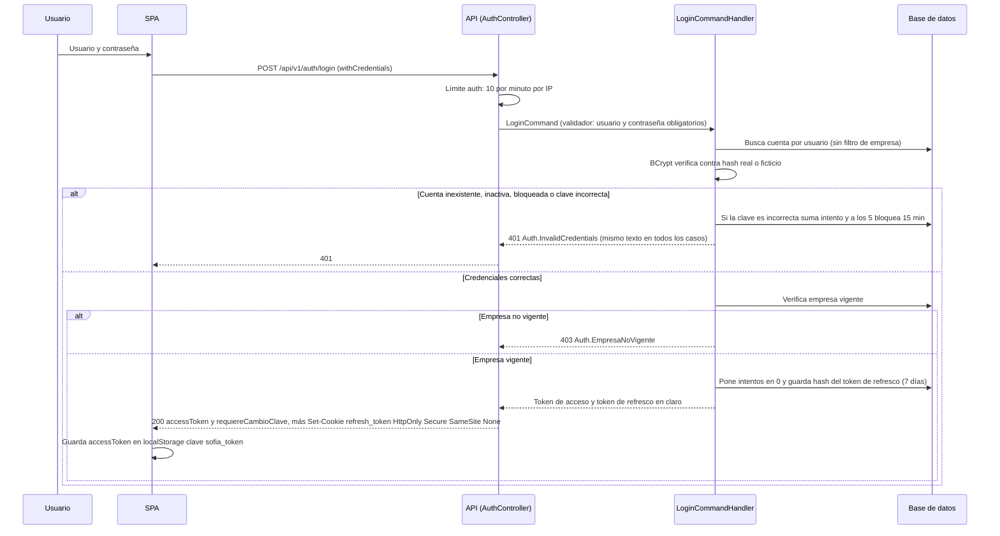
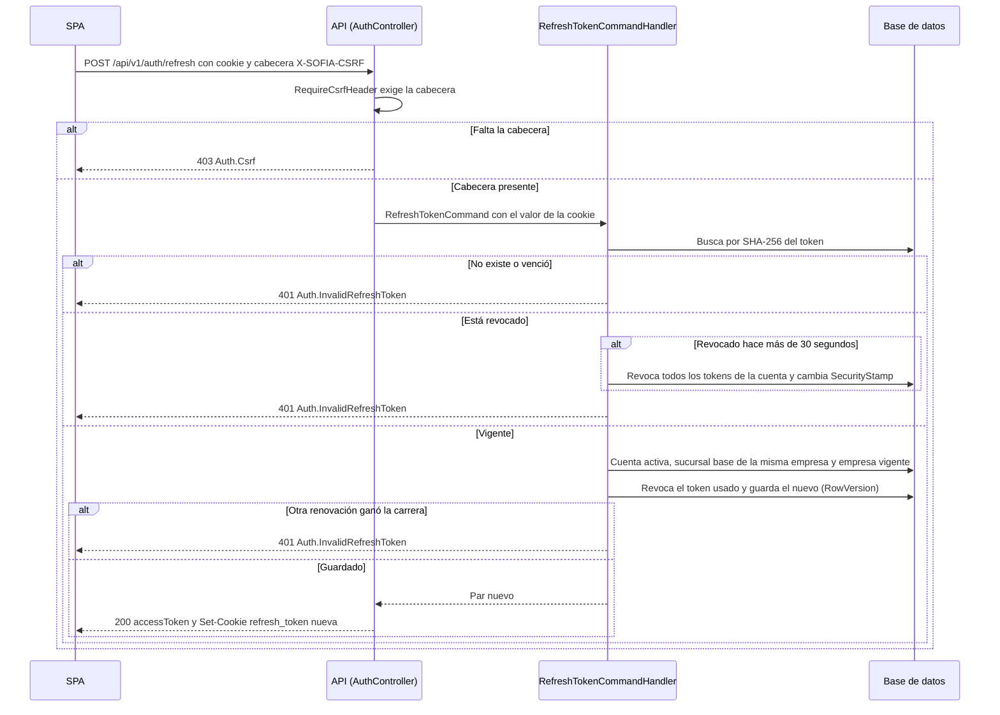
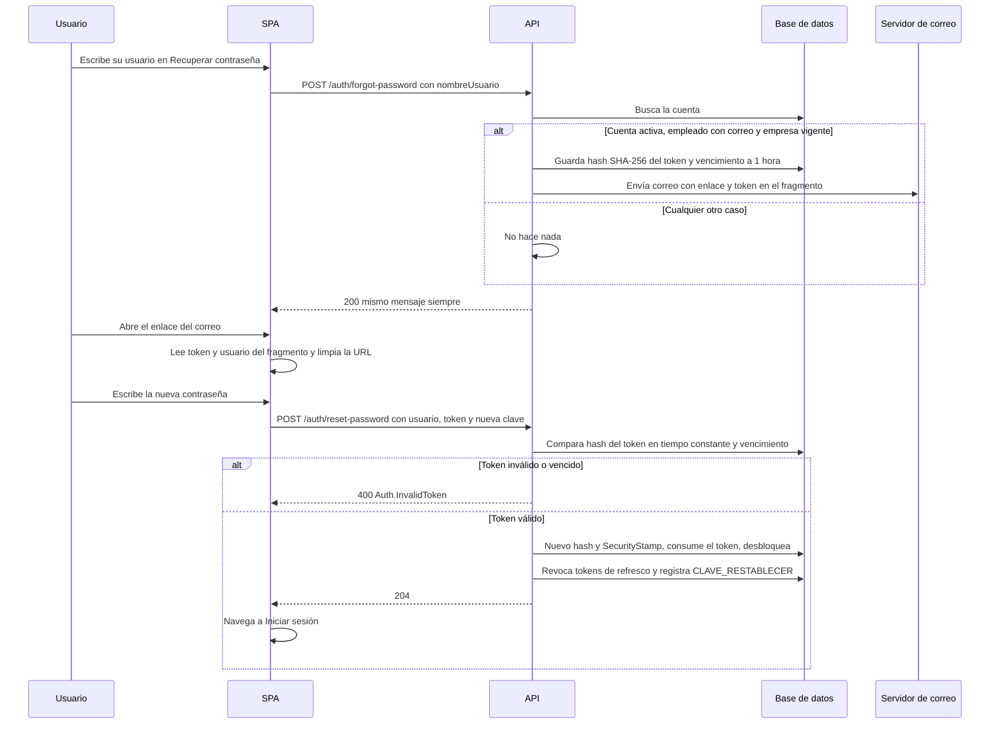

# Seguridad — Parte A: autenticación, sesión, aislamiento y controles

| | |
|---|---|
| **Sistema** | SOFIA — Sistema Optimizado Farmacéutico con Inteligencia Artificial |
| **Versión del documento** | 1.0 |
| **Fecha** | 2026-10-15 |
| **Backend** | `sofia-apis`, rama `main`, commit `43f5529` |
| **Frontend** | `sofia-web-spa`, rama `main`, commit `eeffbb6` |
| **Método** | Lectura de código (handlers, entidades, middlewares, configuración de infraestructura, scripts DbUp, interceptores y guards del SPA). No se ejecutó la aplicación ni se llamó a la API. Árbol de trabajo sin cambios locales en ambos repos al iniciar (`git status --short` vacío). |

Este documento es la parte A de la documentación de seguridad. La parte B es la matriz de permisos (módulo × acción × endpoint × pantalla): [05b-matriz-de-permisos.md](05b-matriz-de-permisos.md); aquí no se repite. Las reglas de negocio con sus IDs (`RN-GEN-…`, `RN-AUT-…`) están en [01a-administracion-y-seguridad.md](../01-reglas-de-negocio/01a-administracion-y-seguridad.md) y se citan por ID. Contexto relacionado: [02-arquitectura.md](../02-arquitectura.md), [07-integraciones.md](../07-integraciones.md), [08-guia-del-desarrollador.md](../08-guia-del-desarrollador.md), [10-despliegue-y-operacion.md](../10-despliegue-y-operacion.md) y [19a-acceso-layout-y-compartidos.md](../19-inventario-de-pantallas/19a-acceso-layout-y-compartidos.md).

## Convenciones

| Prefijo | Ruta real |
|---|---|
| `API/` | `sofia-apis/src/SOFIA.API/` |
| `APP/` | `sofia-apis/src/SOFIA.Application/` |
| `DOM/` | `sofia-apis/src/SOFIA.Domain/` |
| `INF/` | `sofia-apis/src/SOFIA.Infrastructure/` |
| `DBUP/` | `sofia-apis/src/SOFIA.DbUp/Scripts/` |
| `SPA/` | `sofia-web-spa/src/app/` |

Las rutas de la API tienen la forma `api/v1/auth/...` (`API/Controllers/AuthController.cs:15`). Todos los valores de esta documentación son los del código; los secretos solo se nombran por su clave de configuración, nunca por su valor.

---

## 1. Inicio de sesión

Endpoint: `POST api/v1/auth/login`, anónimo, con la política de límite `auth` (10 peticiones por minuto por IP; ver apartado 11) (`API/Controllers/AuthController.cs:18-21`). Reglas de negocio equivalentes: RN-AUT-001 a RN-AUT-012.

### 1.1 Verificación de credenciales

| Aspecto | Comportamiento | Evidencia |
|---|---|---|
| Entrada | `NombreUsuario` obligatorio, hasta 50 caracteres; `Password` obligatoria, sin longitud máxima ni mínima en el inicio de sesión. | `APP/Security/Commands/Login/LoginCommandValidator.cs:9-14` |
| Búsqueda de la cuenta | Por nombre de usuario en todas las empresas (el login no pide empresa), cuenta no eliminada. Carga solo los roles vivos de la misma empresa que la cuenta (`TenantId` no nulo, no eliminados). | `APP/Security/Commands/Login/LoginCommandHandler.cs:30-36` |
| Hash de contraseñas | BCrypt «enhanced» (`BCrypt.Net.BCrypt.EnhancedHashPassword` y `EnhancedVerify`). El factor de coste **no se fija en el código**: se usa el valor por defecto de la librería `BCrypt.Net-Next` 4.1.0 (no verificado cuál es; ver «No verificado»). | `INF/Authentication/PasswordHasher.cs:7-10`; `INF/SOFIA.Infrastructure.csproj:10` |
| Tiempo uniforme | La contraseña siempre se verifica con BCrypt, contra el hash real o contra un hash ficticio (GUID aleatorio, construido una vez con el mismo hasher) si la cuenta no existe. | `APP/Security/Commands/Login/LoginCommandHandler.cs:20-23,38-39` |
| Respuesta uniforme | Cuenta inexistente, inactiva, bloqueada, clave incorrecta o sucursal base de otra empresa: todas devuelven 401 `Auth.InvalidCredentials` con el mismo texto. | `LoginCommandHandler.cs:41-45,47-52,54-60,62-66` |
| Empresa vigente | Se comprueba **después** de validar la contraseña; si no está vigente responde 403 `Auth.EmpresaNoVigente` (el único rechazo distinguible, y solo para quien ya conoce la clave). | `LoginCommandHandler.cs:68-73`; `APP/Security/EmpresaVigencia.cs:9-10,13-26` |
| Éxito | Pone a 0 los intentos, quita el bloqueo, emite token de acceso y token de refresco, y devuelve `{ accessToken, requiereCambioClave }`; el token de refresco va en cookie, nunca en el cuerpo. | `LoginCommandHandler.cs:75-86`; `API/Controllers/AuthController.cs:29-30` |

### 1.2 Bloqueo por intentos

| Pregunta | Respuesta | Evidencia |
|---|---|---|
| ¿Cuántos intentos? | 5 fallos acumulados. | `DOM/Entities/Cuenta.cs:85-86` |
| ¿Cuánto dura? | 15 minutos desde el quinto fallo (`Bloqueado_Hasta`). | `DOM/Entities/Cuenta.cs:88` |
| ¿Qué pasa durante el bloqueo? | El login se rechaza aunque la clave sea correcta, con la misma respuesta uniforme; no suma más intentos (por eso el bloqueo no se extiende). | `LoginCommandHandler.cs:47-52` |
| ¿Cuándo se reinicia el contador? | Al vencer el bloqueo (el siguiente fallo empieza en 0), con un login correcto, al restablecer la clave por recuperación y cuando un administrador usa «resetear intentos». | `DOM/Entities/Cuenta.cs:79-83,92-96,125-126`; `APP/Security/Commands/Cuentas/UpdateCuenta/UpdateCuentaCommandHandler.cs:137-140` |
| ¿Cómo se desbloquea? | Esperando los 15 minutos, restableciendo la clave por el enlace de correo, o con un administrador (`ResetearIntentos` en la edición de cuenta, permiso `Seguridad:Actualizar`; ver [05b](05b-matriz-de-permisos.md)). | Las tres referencias anteriores |
| ¿Se persiste el fallo? | Sí: el handler guarda el intento fallido antes de devolver el error (el `TransactionBehavior` no revierte un `Result.Failure`, RN-GEN-012). | `LoginCommandHandler.cs:56-57` |
| Alcance del bloqueo | Por cuenta, no por IP. La política `auth` limita por IP (10 por minuto). Consecuencia verificable en el código: quien conoce un nombre de usuario puede provocar el bloqueo de esa cuenta (5 fallos) y repetirlo cada 15 minutos. | `DOM/Entities/Cuenta.cs:77-90`; `API/Extensions/RateLimitingExtensions.cs:26-32` |

### 1.3 Token de acceso (JWT)

| Aspecto | Valor | Evidencia |
|---|---|---|
| Algoritmo de firma | HS256 (HMAC-SHA256) con clave simétrica; la validación solo acepta `HmacSha256` (`ValidAlgorithms`). | `INF/Authentication/JwtProvider.cs:49-50`; `INF/DependencyInjection.cs:71` |
| Clave | Clave de configuración `Jwt:SecretKey`; mínimo 32 bytes UTF-8 o la API no arranca. | `INF/Authentication/JwtOptions.cs:8,17-25`; `INF/DependencyInjection.cs:54-57` |
| Emisor / audiencia | Claves `Jwt:Issuer` y `Jwt:Audience`, obligatorias (no arranca sin ellas); se validan ambas. | `JwtOptions.cs:27-30`; `INF/DependencyInjection.cs:64-65,68-69` |
| Duración | `Jwt:ExpiryMinutes` minutos desde la emisión (el valor lo da la configuración del entorno; el código no tiene un valor por defecto: la propiedad vale 0 si falta). Desfase de reloj tolerado: 30 segundos. | `JwtProvider.cs:57`; `JwtOptions.cs:13`; `INF/DependencyInjection.cs:72` |
| Validaciones | Emisor, audiencia, vigencia, firma. `nbf` no se informa (parámetro `null` en la construcción). | `INF/DependencyInjection.cs:64-67`; `JwtProvider.cs:56` |
| Mapeo de claims | `JwtSecurityTokenHandler.DefaultInboundClaimTypeMap.Clear()`: los nombres de claim se conservan tal cual vienen en el token. | `API/Program.cs:14` |

Claims que emite `JwtProvider.Generate`:

| Claim | Contenido | Evidencia |
|---|---|---|
| `sub` | Id de la cuenta | `INF/Authentication/JwtProvider.cs:24` |
| `unique_name` | Nombre de usuario | `JwtProvider.cs:25` |
| `fullName` | Nombre completo del empleado (vacío si no hay) | `JwtProvider.cs:26` |
| `nombreEmpresa` | Nombre de la empresa de la sucursal base | `JwtProvider.cs:27` |
| `empleadoId` | Id del empleado | `JwtProvider.cs:28` |
| `sucursalId` | Sucursal base del empleado (vacío si no hay) | `JwtProvider.cs:20,29` |
| `securityStamp` | Sello de seguridad de la cuenta (GUID) | `JwtProvider.cs:30` |
| `empresaId` | Empresa de la cuenta (`cuenta.TenantId`, nunca la de la sucursal); solo se agrega si tiene valor | `JwtProvider.cs:18-19,33-36` |
| `pwd_change` | `"true"` si la cuenta debe cambiar su clave | `JwtProvider.cs:38-41`; `APP/Security/PasswordChangePolicy.cs:8` |
| `role` (tipo `ClaimTypes.Role`) | Un claim por rol de la cuenta | `JwtProvider.cs:44-47` |

El token **no** lleva permisos: los permisos se resuelven en cada petición contra la tabla de permisos (apartado 7). El token tampoco lleva correo, documento ni otros datos personales más allá del nombre de usuario y el nombre completo.

### 1.4 Token de refresco (cookie)

| Aspecto | Valor | Evidencia |
|---|---|---|
| Formato | 32 bytes aleatorios criptográficos (`RandomNumberGenerator`) en hexadecimal (64 caracteres). | `APP/Security/TokenHasher.cs:9-13` |
| Almacenamiento en base | Solo su hash SHA-256 en hexadecimal (`TokenHash`, `NVARCHAR(128)`), con índice único `IX_RefreshTokens_TokenHash`. El token en claro no se guarda. | `TokenHasher.cs:22-23`; `DBUP/0006_RefreshTokens.sql:5,22`; `INF/Persistence/Configurations/RefreshTokenConfiguration.cs:17-19,31` |
| Otras columnas | `CuentaId` (FK con `ON DELETE CASCADE`), `ExpiresAt`, `IsRevoked`, `RevokedAt`, `RowVersion` (concurrencia) y las columnas de auditoría; `TenantId` queda nulo porque se emite sin empresa en el contexto. | `DBUP/0006_RefreshTokens.sql:3-19`; `DOM/Entities/RefreshToken.cs:12-19` |
| Duración | 7 días desde la emisión (`ExpiresAt`). | `LoginCommandHandler.cs:18,79` |
| Cookie: nombre | `refresh_token` | `API/Extensions/RefreshTokenCookieExtensions.cs:5` |
| Cookie: `HttpOnly` | Sí | `RefreshTokenCookieExtensions.cs:17` |
| Cookie: `Secure` | Sí | `RefreshTokenCookieExtensions.cs:18` |
| Cookie: `SameSite` | `None` (el SPA y la API viven en sitios distintos; `Strict` descartaría la cookie) | `RefreshTokenCookieExtensions.cs:7,19` |
| Cookie: vencimiento | La misma fecha de `ExpiresAt` (cookie persistente de 7 días) | `RefreshTokenCookieExtensions.cs:8-9,20` |
| Cookie: ruta y dominio | No se fijan en el código: rigen los valores por defecto de `CookieOptions` de ASP.NET Core (ruta `/`, sin dominio, por lo que la cookie queda asociada al host de la API). Valor por defecto del framework, no verificado ejecutando. | `RefreshTokenCookieExtensions.cs:15-21` |
| Borrado | Se repiten los mismos atributos al borrarla. | `RefreshTokenCookieExtensions.cs:11-13` |

El SPA envía la cookie con `withCredentials: true` y la API responde CORS con credenciales permitidas (apartado 11).

### 1.5 Diagrama de secuencia del inicio de sesión

### 1.6 Qué se registra en el log del login

El handler escribe con `ILogger` (Serilog) el **nombre de usuario escrito y la IP** en cada resultado: intento fallido por cuenta inexistente o inactiva, intento con cuenta bloqueada (incluye la fecha de desbloqueo), clave incorrecta (incluye el contador), sucursal base de otra empresa, empresa sin suscripción y login correcto (`LoginCommandHandler.cs:43,49,58,64,71,85`). Nunca se registra la contraseña. Ojo: el nombre de usuario que se registra es el texto que escribió el usuario, también cuando no existe la cuenta; si alguien escribe su contraseña en el campo de usuario, quedará en el log (la validación limita a 50 caracteres, `LoginCommandValidator.cs:11`). Detalle de qué más se registra y dónde en el apartado 12.

### 1.7 Observaciones verificadas del inicio de sesión

| # | Observación | Evidencia |
|---|---|---|
| 1 | Los mensajes de log del handler tienen un carácter de guion largo mal codificado («â€”») en el texto fuente; afecta solo a la lectura del log. | `LoginCommandHandler.cs:43,49,58` |
| 2 | El login no revoca sesiones previas: cada login crea un token de refresco nuevo y las sesiones anteriores siguen vivas hasta su vencimiento, revocación o cierre de sesión. | `LoginCommandHandler.cs:78-83` (solo agrega, no revoca) |
| 3 | No hay autenticación de segundo factor ni política de rotación periódica de claves en el código. | Búsqueda de `totp`, `mfa`, `otp`, `twofactor` en el código del backend: sin implementación (solo coincidencias falsas en «ForgotPassword») |

---

## 2. Renovación y rotación

Endpoint: `POST api/v1/auth/refresh`, anónimo, protegido por la cabecera `X-SOFIA-CSRF` (apartado 3.2) y solo por el límite general de 200 por minuto por IP (no lleva la política `auth`) (`API/Controllers/AuthController.cs:33-36`). Reglas: RN-AUT-013 a RN-AUT-019.

### 2.1 Cómo se renueva

1. El controlador lee la cookie `refresh_token`; si no existe responde 401 sin cuerpo propio (`AuthController.cs:38-42`). Con la cookie vacía falla el validador (`RefreshTokenCommandValidator.cs:13`).
2. El handler calcula el SHA-256 del valor y busca la fila sin filtro de empresa (la petición es anónima) (`APP/Security/Commands/RefreshToken/RefreshTokenCommandHandler.cs:22-28`).
3. Si no existe o `ExpiresAt` ya pasó: 401 `Auth.InvalidRefreshToken` (`RefreshTokenCommandHandler.cs:30-33,116-117`).
4. Si está revocado, ver detección de reutilización (2.3).
5. Recarga la cuenta (activa y no eliminada) con sus roles vivos de su empresa y su sucursal base, y exige que la sucursal base sea de la misma empresa (`RefreshTokenCommandHandler.cs:53-70`; `DOM/Entities/Cuenta.cs:134-135`).
6. Exige empresa vigente; si no lo está rechaza **sin revocar** el token, para que al reactivar la empresa no parezca un robo (`RefreshTokenCommandHandler.cs:72-77`).
7. Rotación: revoca el token usado, emite un token de acceso nuevo (con los roles, la sucursal base y el indicador de cambio de clave actuales) y un token de refresco nuevo de 7 días, y los guarda en una sola transacción (`RefreshTokenCommandHandler.cs:79-86,90`).
8. El controlador coloca la cookie nueva y devuelve `{ accessToken, requiereCambioClave }` (`AuthController.cs:50-51`).

Todas las respuestas de error del flujo son 401 `Auth.InvalidRefreshToken` con el mismo texto, sin distinguir la causa.

### 2.2 Rotación en cada uso y carrera entre renovaciones

Cada renovación exitosa revoca el token usado y crea uno nuevo (`RefreshToken.Revoke`, `DOM/Entities/RefreshToken.cs:29-33`). La fila tiene `RowVersion` como token de concurrencia (`DOM/Entities/RefreshToken.cs:18-19`; `INF/Persistence/Configurations/RefreshTokenConfiguration.cs:29`; `DBUP/0019_Concurrency_RowVersion.sql`, ver RN-GEN-035): si dos renovaciones presentan el mismo token a la vez, solo una guarda; la otra captura `DbUpdateConcurrencyException`, devuelve 401 y no crea una segunda sesión (`RefreshTokenCommandHandler.cs:88-96`).

### 2.3 Detección de reutilización

| Situación | Resultado | Evidencia |
|---|---|---|
| Token revocado, revocado hace 30 segundos o menos | 401 sin más efecto (periodo de gracia para dos pestañas que renuevan a la vez) | `DOM/Entities/RefreshToken.cs:8,35`; `RefreshTokenCommandHandler.cs:35-37,50` |
| Token revocado hace más de 30 segundos (`IsReuseAttempt`) | Se considera copia de la cookie: se revocan **todos** los tokens de refresco activos de la cuenta, se cambia su `SecurityStamp` (lo que invalida los tokens de acceso vivos en su siguiente petición), se registra un `Warning` con el id de la cuenta y se responde 401 | `RefreshTokenCommandHandler.cs:37-42,102-114`; `APP/Security/RefreshTokenRevocation.cs:10-21` |
| Conflicto de concurrencia al revocar | Se registra la advertencia y el reuso igualmente se rechaza | `RefreshTokenCommandHandler.cs:43-47` |

### 2.4 `SecurityStamp` y validación en cada petición autenticada

El `SecurityStamp` es un GUID de la cuenta (`DOM/Entities/Cuenta.cs:18,60`; columna `Security_Stamp` en `DBUP/0001_Initial_Schema.sql:797`). Cambia en: cambio de clave (`Cuenta.cs:71`), restablecimiento por recuperación (`Cuenta.cs:121`), cierre de sesión (`LogoutCommandHandler.cs:76-79`), asignar o quitar un rol a una cuenta (`APP/Security/Commands/Roles/AssignRol/AssignRolToUserCommandHandler.cs:44`, `RemoveRol/RemoveRolFromUserCommandHandler.cs:92`) y reutilización de un token de refresco (`RefreshTokenCommandHandler.cs:111`). El resto de los puntos en que RN-GEN-017 dice que cambia (sucursal base del empleado) se detallan en esa regla; no se re-verificaron aquí.

Validación en cada petición con token (evento `OnTokenValidated` de JwtBearer, `INF/DependencyInjection.cs:77-131`):

| Orden | Comprobación | Caché | Falla con |
|---|---|---|---|
| 1 | Existen `sub` y `securityStamp` y ambos son GUID | — | 401 |
| 2 | Consulta a la base: cuenta con ese id, mismo `SecurityStamp`, `CuentaActiva` y no eliminada (sin filtro de empresa porque el principal aún no está poblado) | **Sin caché**: una consulta por petición | 401 |
| 3 | Sincroniza el claim `pwd_change` con el valor de la base (la base manda sobre el token) | — | — |
| 4 | El token trae un `empresaId` válido | — | 401 |
| 5 | La empresa está vigente (existe, no eliminada, no suspendida ni vencida) | `IMemoryCache`, clave `empresa-vigente:{empresaId}`, **1 minuto** absoluto (`DependencyInjection.cs:26,121-125`) | 401 |

Consecuencias verificables: un cambio de clave, un cierre de sesión, un cambio de rol o la desactivación de la cuenta cortan los tokens de acceso vivos en la siguiente petición (no hay ventana); una suspensión o vencimiento de la empresa los corta en como máximo 1 minuto (por instancia de la API, porque el caché es en memoria del proceso).

Otras condiciones de la política de tokens: firma HS256, emisor, audiencia, vigencia con 30 segundos de desfase (apartado 1.3). El esquema por defecto es JwtBearer (`AddAuthentication(JwtBearerDefaults.AuthenticationScheme)`, `DependencyInjection.cs:59`) y existe una política de reserva que exige usuario autenticado (apartado 7).

### 2.5 Diagrama de secuencia de la renovación

---

## 3. Cierre de sesión y protección CSRF

### 3.1 Cierre de sesión

Endpoint: `POST api/v1/auth/logout`, **anónimo** y con `X-SOFIA-CSRF` obligatoria. Es anónimo a propósito: un token de acceso vencido no debe dejar viva la cookie de refresco en un equipo compartido (comentario en `API/Controllers/AuthController.cs:69-73`). Reglas: RN-AUT-020 a RN-AUT-022.

| Aspecto | Comportamiento | Evidencia |
|---|---|---|
| Cómo identifica la sesión | Por el id de cuenta del token de acceso, si es un GUID válido, **y/o** por la cookie de refresco (busca el hash entre los tokens con `ExpiresAt` futuro, **aunque ya esté revocado o rotado**) | `AuthController.cs:75-76`; `APP/Security/Commands/Logout/LogoutCommandHandler.cs:16-36` |
| Qué revoca | Todos los tokens de refresco activos de la cuenta (todos los dispositivos) y cambia el `SecurityStamp`, lo que invalida los tokens de acceso vivos | `LogoutCommandHandler.cs:69-82`; `APP/Security/RefreshTokenRevocation.cs:10-21` |
| Token de acceso expirado | No impide el cierre: basta la cookie vigente | `LogoutCommandHandler.cs:22-36` |
| Sin sesión identificable | Responde éxito igualmente (idempotente; no revela si había sesión) | `LogoutCommandHandler.cs:38-42` |
| Cookie | Se borra siempre, antes de ejecutar el comando | `AuthController.cs:78` |
| Carrera con una renovación | Reintenta hasta 3 veces recargando las filas modificadas, incluyendo el token recién emitido | `LogoutCommandHandler.cs:12,49-64` |
| Auditoría | El comando es `ICommand`, no `IAuditableCommand`: no genera evento de auditoría | `APP/Security/Commands/Logout/LogoutCommand.cs` |

### 3.2 Protección CSRF

| Aspecto | Valor | Evidencia |
|---|---|---|
| Mecanismo | Filtro de autorización `RequireCsrfHeaderAttribute`: exige la cabecera `X-SOFIA-CSRF` con cualquier valor no vacío | `API/Infrastructure/RequireCsrfHeaderAttribute.cs:9,14` |
| Respuesta si falta | 403 `application/problem+json` con `code = Auth.Csrf` | `RequireCsrfHeaderAttribute.cs:10,19-30` |
| Endpoints que lo exigen | Solo `POST auth/refresh` y `POST auth/logout` (los únicos que se autentican con la cookie) | `AuthController.cs:35,72` |
| Por qué | Un formulario de otro sitio no puede añadir cabeceras personalizadas y un `fetch` entre orígenes con una cabecera personalizada requiere un preflight CORS, que solo aprueban los orígenes de la lista permitida (comentario del código) | `RequireCsrfHeaderAttribute.cs:5`; CORS en `API/Program.cs:39-64` |
| Qué NO cubre | Los demás endpoints no usan cookie: se autentican con el encabezado `Authorization: Bearer`, que un sitio externo no puede añadir. `login` (anónimo) se autentica con las credenciales del cuerpo y `change-password` con el Bearer más la contraseña actual; ninguno de los dos usa la cookie para identificar al usuario. | `API/Controllers/AuthController.cs:18-21,84-88` |
| Cliente | El SPA envía `X-SOFIA-CSRF: 1` en refresh y logout | `SPA/core/auth/auth.service.ts:36,89,115` |

Observación: la comprobación es de **presencia**, no de valor; es una defensa de «cabecera personalizada» y no un token anti-CSRF sincronizado. Con `SameSite=None` en la cookie (apartado 1.4), esta cabecera más la lista de orígenes CORS son las dos barreras. Un cliente que sí esté en un origen permitido puede enviar cualquier valor.

---

## 4. Cambio de contraseña y cambio obligatorio

### 4.1 Política de contraseñas (la real)

| Punto de entrada | Regla en el backend | Evidencia |
|---|---|---|
| Cambio de clave (`change-password`) | Nueva obligatoria, **mínimo 8 caracteres**, distinta de la actual (comparación exacta, distingue mayúsculas); actual obligatoria | `APP/Security/Commands/ChangePassword/ChangePasswordCommandValidator.cs:12-19` |
| Restablecimiento (`reset-password`) | Usuario, token y nueva obligatorios; nueva de mínimo 8 | `APP/Security/Commands/ResetPassword/ResetPasswordCommandValidator.cs:9-17` |
| Alta de cuenta por un administrador | Contraseña inicial obligatoria, mínimo 8 | `APP/Security/Commands/Register/RegisterAccountCommandValidator.cs:16-18` |
| Registro público de empresa | Contraseña obligatoria, mínimo 8; usuario de 4 a 50 caracteres | `APP/Empresas/Commands/RegistrarEmpresa/RegistrarEmpresaCommandValidator.cs:19-26` (usuario y contraseña) |

La política real es **solo longitud mínima de 8**: no hay requisito de mayúsculas, minúsculas, dígitos ni símbolos, ni lista de contraseñas comunes, ni historial de contraseñas anteriores, ni **longitud máxima** en ningún validador del backend (el SPA limita la clave inicial de una cuenta a 8–128 caracteres; ver RN-CTA-004 y RN-AUT-026). El hash es BCrypt «enhanced» (apartado 1.1). Las cuentas creadas por un administrador nacen con `RequiereCambioClave = true`; la cuenta creada en el registro de empresa nace con `false` (`DOM/Entities/Cuenta.cs:38`; `RegistrarEmpresaCommandHandler.cs:109`).

### 4.2 Efectos del cambio

`POST api/v1/auth/change-password` requiere token, es alcanzable durante el cambio obligatorio y lleva el límite `auth` (10 por minuto por IP). La cuenta que cambia su clave es siempre la del token (`API/Controllers/AuthController.cs:84-102`). El handler (`APP/Security/Commands/ChangePassword/ChangePasswordCommandHandler.cs:13-39`):

1. Busca la cuenta activa y no eliminada (sin filtro de empresa); si no, 401 `Auth.InvalidCredentials`.
2. Verifica la clave actual; si falla responde **400** `Auth.ClaveActualIncorrecta` (no 401, para que el cliente no lo confunda con una sesión vencida).
3. `UpdatePassword`: nuevo hash, **nuevo `SecurityStamp`**, apaga `RequiereCambioClave` y anula el token de recuperación pendiente (`DOM/Entities/Cuenta.cs:68-75`).
4. Revoca **todos** los tokens de refresco de la cuenta (`RefreshTokenRevocation.cs:10-21`).
5. El controlador borra la cookie (`AuthController.cs:96-99`).
6. Se audita como `CLAVE_CAMBIAR` (tabla `Seguridad_Cuentas`, id de la cuenta, IP del cliente) (`ChangePasswordCommand.cs:6-9`).

Resultado: todas las sesiones quedan cerradas, la actual incluida; el cliente debe iniciar sesión de nuevo (el SPA lo hace: `SPA/pages/cambiar-clave/cambiar-clave.component.ts:87-88` borra la sesión local y navega a `/auth/login`).

### 4.3 Middleware de cambio obligatorio

`PasswordChangeRequiredMiddleware` va después de la autenticación y antes de la autorización (`API/Program.cs:129-131`). Para cada petición:

| Condición | Efecto | Evidencia |
|---|---|---|
| Hay endpoint, el usuario tiene el claim `pwd_change = true`, el endpoint **no** es anónimo y **no** tiene `[AllowDuringPasswordChange]` | 403 `application/problem+json` con `code = Auth.CambioClaveRequerido` y el detalle «You must change your password before continuing.»; no continúa el pipeline | `API/Infrastructure/PasswordChangeRequiredMiddleware.cs:10-27`; `APP/Security/PasswordChangePolicy.cs:10-11` |
| Cualquier otro caso | Continúa | `PasswordChangeRequiredMiddleware.cs:29` |

Rutas que deja pasar: los endpoints anónimos (`login`, `refresh`, `logout`, `forgot-password`, `reset-password`, `POST empresas/registrar`, `GET /health`) y los dos marcados con `[AllowDuringPasswordChange]`: `GET auth/me` y `POST auth/change-password` (`AuthController.cs:54-56,84-87`). Todo el resto de los endpoints autenticados responde 403.

El indicador se lee de la base en **cada petición** (paso 3 de 2.4: `SyncPasswordChangeClaim`, `INF/DependencyInjection.cs:111,201-218`), así que un administrador que fuerza el cambio lo aplica también a los tokens vivos, y quitar el indicador (al cambiar la clave) no depende del token. Cliente: el interceptor navega a `/cambiar-clave` ante ese código y `passwordChangeGuard` impide salir de esa ruta mientras el claim sea verdadero (`SPA/core/interceptors/auth.interceptor.ts:30-33`; `SPA/core/auth/password-change.guard.ts:5,8-12`; registro en `SPA/app.routes.ts:37`).

---

## 5. Recuperación de contraseña

Endpoints anónimos con la política `auth`: `POST auth/forgot-password` y `POST auth/reset-password` (`API/Controllers/AuthController.cs:104-120`). Reglas: RN-AUT-032 a RN-AUT-039.

### 5.1 Token de recuperación

| Aspecto | Valor | Evidencia |
|---|---|---|
| Generación | 32 bytes aleatorios criptográficos codificados en Base64 seguro para URL | `APP/Security/TokenHasher.cs:15-20` |
| Almacenamiento | **Solo el hash SHA-256 en hexadecimal** (`Recovery_Token`, `VARCHAR(100)`); el token en claro solo viaja en el correo | `DOM/Entities/Cuenta.cs:104-109`; `DBUP/0001_Initial_Schema.sql:795` |
| Caducidad | 1 hora (`Recovery_Token_Expiry`) | `DOM/Entities/Cuenta.cs:108` |
| Un solo uso | Al restablecer se pone `RecoveryToken` en nulo; cambiar la clave por `change-password` también lo anula | `DOM/Entities/Cuenta.cs:73-74,123-124` |
| Reemplazo | Pedir otro enlace sustituye al token anterior (solo hay una columna por cuenta) | `DOM/Entities/Cuenta.cs:105-109` |
| Comparación | En tiempo constante (`CryptographicOperations.FixedTimeEquals`); falla si no hay token, venció o no coincide | `DOM/Entities/Cuenta.cs:111-118` |
| Error | Usuario inexistente y token incorrecto devuelven el mismo `Auth.InvalidToken` (400) | `DOM/Entities/Cuenta.cs:10-11`; `ResetPasswordCommandHandler.cs:24-27` |

### 5.2 Enlace y correo

| Aspecto | Valor | Evidencia |
|---|---|---|
| Enlace | `{App:FrontendBaseUrl}/auth/reset-password#token=…&usuario=…`, valores codificados con `Uri.EscapeDataString` | `INF/Email/FrontendLinks.cs:8-9` |
| Fragmento | El token va tras `#`: el navegador no lo envía a ningún servidor. El SPA lo lee, lo guarda en memoria y lo quita de la barra de direcciones y del historial (`location.replaceState`) | `SPA/pages/auth/reset-password/reset-password.component.ts:74-79` |
| URL base | `App:FrontendBaseUrl` debe ser una URL absoluta `https` (`http` solo en Desarrollo y Pruebas) o la API no arranca | `INF/Email/AppOptions.cs:9-19`; `INF/DependencyInjection.cs:163-167` |
| Destinatario y asunto | Correo del empleado de la cuenta; asunto «Restablece tu contraseña de SOFIA» | `APP/Security/Commands/ForgotPassword/ForgotPasswordCommandHandler.cs:24,31`; `APP/Security/PasswordRecoveryEmail.cs:8` |
| Contenido | Saludo con nombre, usuario y enlace; indica vigencia de 1 hora y un solo uso. En la parte HTML todos los valores se codifican con `HtmlEncode` | `APP/Security/Templates/PasswordRecovery.txt`; `PasswordRecoveryEmail.cs:13-27` |
| Proveedor | SMTP o Azure Communication Services según `Email:Provider`; sin proveedor solo se acepta en Desarrollo y Pruebas (el correo se descarta) y en otros entornos la API no arranca | `INF/DependencyInjection.cs:157-186` |
| Fallo de envío | Se registra una advertencia con el id de cuenta y el código de error; el token sigue válido la hora y la respuesta es la misma | `ForgotPasswordCommandHandler.cs:32-37` |

### 5.3 Respuesta uniforme

`forgot-password` descarta el resultado del comando y siempre responde 200 con el mismo mensaje fijo, exista o no la cuenta, aunque falle el validador (`AuthController.cs:107-111`). Solo se genera token y correo si la cuenta existe, no está eliminada y está activa, su empleado no está eliminado y tiene correo, y la empresa está vigente (`ForgotPasswordCommandHandler.cs:18-25`). Observación verificada en el código: la respuesta es idéntica en contenido, pero el camino con cuenta válida hace además una escritura en base y el envío del correo antes de responder, mientras que los demás caminos devuelven de inmediato; no se midió si la diferencia de tiempo es perceptible (ver «No verificado»). En `reset-password` el hash BCrypt de la nueva clave se calcula antes de comprobar si la cuenta existe, para igualar tiempos (`ResetPasswordCommandHandler.cs:21-27`).

### 5.4 Efectos del restablecimiento

Nuevo hash, nuevo `SecurityStamp`, apaga `RequiereCambioClave`, consume el token, pone intentos en 0 y quita el bloqueo (`DOM/Entities/Cuenta.cs:120-126`); revoca todos los tokens de refresco (`ResetPasswordCommandHandler.cs:36-37`); y registra el evento `CLAVE_RESTABLECER` con el empleado dueño de la cuenta como actor y la IP del cliente, porque el flujo anónimo no pasa por `AuditBehavior` (`ResetPasswordCommandHandler.cs:39-44`). El handler no vuelve a comprobar que la cuenta esté activa ni la vigencia de la empresa en este paso (RN-AUT-039).

### 5.5 Diagrama de secuencia de la recuperación

---

## 6. Sesión en el SPA

### 6.1 Dónde vive el token de acceso

El token de acceso se guarda en `localStorage` bajo la clave `sofia_token` y se refleja en una señal en memoria (`SPA/core/auth/auth.service.ts:33,44,147-152,167-169`). El SPA lo decodifica sin verificar la firma para leer `sub`, `empresaId`, `sucursalId`, `empleadoId`, `pwd_change` y `exp` (`auth.service.ts:47-68`); solo sirve para la interfaz, el servidor valida de nuevo en cada petición. El token de refresco **no** es accesible desde JavaScript (cookie `HttpOnly`).

Riesgo asociado: cualquier script que se ejecute en el origen del SPA (XSS o dependencia comprometida) puede leer `localStorage` y robar el token de acceso, que vale hasta que vence o hasta que el `SecurityStamp` cambie (cambio de clave, cierre de sesión, cambio de rol). La cookie de refresco `HttpOnly` limita el daño a la ventana del token de acceso, no permite renovar desde un script. Mitigaciones presentes en el código del SPA: el token solo se envía a la API (6.2) y los datos que se muestran con `[innerHTML]` se escapan antes (apartado 13, A03). El SPA declara su propia `Content-Security-Policy` en `sofia-web-spa/public/staticwebapp.config.json:3` (Azure Static Web Apps) con `script-src 'self'` (sin `unsafe-inline` ni `unsafe-eval` en scripts), que reduce la superficie de XSS; el detalle de cabeceras está en el apartado 11.6 y el despliegue en [10-despliegue-y-operacion.md](../10-despliegue-y-operacion.md). Que ese archivo se aplique depende del alojamiento real (no verificado).

### 6.2 Interceptores y guards

| Elemento | Comportamiento | Evidencia |
|---|---|---|
| `authInterceptor` (registrado primero) | Agrega `Authorization: Bearer <token>` **solo** a URLs que empiezan por `{environment.api.baseurl}/api/`; no a archivos estáticos (`/i18n`) ni a otros hosts | `SPA/core/interceptors/auth.interceptor.ts:18-27,66-69`; registro `SPA/app.config.ts:45-47` (`withInterceptors([authInterceptor, CSLoadingInterceptor])`) |
| 401 en endpoints no de autenticación | Pide un token nuevo a `/auth/refresh` y repite la petición una vez; si el refresco falla llama a `auth.logout()` | `auth.interceptor.ts:34-35,46,51-63` |
| 401 en `login`, `refresh`, `logout` | No reintenta (evita bucles); en `refresh` y `logout` borra la sesión local sin llamada extra; en `login` solo propaga | `auth.interceptor.ts:37-45,71-73` |
| «Cola» de peticiones | No hay cola explícita: `refreshAccessToken()` comparte una sola petición en vuelo (`shareReplay`) entre el guard y todas las peticiones que reciben 401 a la vez, y cada una se repite al llegar el token nuevo | `auth.service.ts:83-97`; `auth.interceptor.ts:57-58` |
| 403 `Auth.CambioClaveRequerido` | Navega a `/cambiar-clave` | `auth.interceptor.ts:16,30-33` |
| `authGuard` (rutas del shell) | Si el token local no venció, deja pasar; si venció, intenta un refresco silencioso y si falla limpia la sesión local y redirige a `/auth/login` | `SPA/core/auth/auth.guard.ts:6-19`; `SPA/app.routes.ts:35` |
| `passwordChangeGuard`, `permissionGuard` | Cambio obligatorio y permiso de lectura de la ruta; ver 19a | `SPA/app.routes.ts:37`; [19a](../19-inventario-de-pantallas/19a-acceso-layout-y-compartidos.md) |
| Cookies entre sitios | `login`, `refresh`, `logout`, `change-password` y el registro de empresa envían `withCredentials: true`; `forgot-password` y `reset-password` no | `auth.service.ts:74,89,101,115`; `SPA/pages/empresa/services/empresa.service.ts:41` |

No hay interceptor que atienda 429 ni que muestre errores globales (RN: sección 2 de 01a).

### 6.3 Qué se limpia al salir

| Momento | Qué se borra | Qué se conserva | Evidencia |
|---|---|---|---|
| Cierre de sesión explícito (menú del encabezado) o refresco fallido en el interceptor | Llama a `POST /auth/logout`; `clearUserStorage()` elimina las claves de `localStorage` con prefijos `sofia_menu_cache` (heredado) y `pos-nueva-venta-draft` (borradores del POS); `clearLocalSession()` quita `sofia_token`, los filtros de búsqueda en memoria y el perfil de permisos | Otras claves de `localStorage` como la zona horaria (`TimezoneService`) | `auth.service.ts:113-123,154-160`; `SPA/core/auth/user-storage.ts:1-6,13-15`; `SPA/matdash/layouts/full/vertical/header/header.component.ts:106` |
| Sesión vencida sin cierre explícito (`authGuard`, 401 en `refresh` o `logout`) | Solo `clearLocalSession()` (token, filtros, perfil) | Borradores del POS: sobreviven a una sesión vencida | `auth.service.ts:154`; `auth.guard.ts:15` |
| Inicio de sesión | `clearOtherUsersStorage(userId)`: borra las claves por usuario que no sean del usuario que entra (terminal compartida) | Las del propio usuario | `auth.service.ts:75-79`; `user-storage.ts:18-25` |
| Cambio de usuario en `storeToken` | Reinicia el perfil de permisos en memoria | — | `auth.service.ts:147-152,162-165` |

Los borradores del POS se guardan con clave `pos-nueva-venta-draft:{userId}` (más sufijo por venta), conservan solo identificadores (sin datos personales del cliente), caducan a las 12 horas y se descartan los borradores antiguos que traían datos personales (`SPA/pages/pos/nueva-venta/pos-draft.ts:1-2,36-46`; `user-storage.ts:3-10`). Las demás claves de `localStorage` que usa el SPA: `sofia_token`, la zona horaria (`SPA/core/services/shared/timezone.service.ts:12,17`) y los borradores del POS. No se usa `sessionStorage` ni IndexedDB (búsqueda en `src/`).

---

## 7. Autorización (resumen)

El detalle (cada endpoint, permiso y pantalla) está en [05b-matriz-de-permisos.md](05b-matriz-de-permisos.md). Resumen de cómo funciona:

| Pieza | Comportamiento | Evidencia |
|---|---|---|
| Atributo | `[HasPermission("Módulo", "Acción")]` es un `AuthorizeAttribute` con política `PERMISSION:{Módulo}:{Acción}`; admite varios por método | `INF/Authentication/HasPermissionAttribute.cs:5-10` |
| Proveedor de políticas | Crea la política al vuelo: exige usuario autenticado y un `PermissionRequirement(módulo, acción)`; no hay que registrar cada permiso | `INF/Authentication/PermissionPolicyProvider.cs:15-37` |
| Handler | Toma los roles del token (claims de rol). Sin roles: no autoriza. Con el rol `Admin` (sin distinguir mayúsculas): **autoriza sin consultar permisos**. Si no hay `empresaId` válido: no autoriza. Para cada rol busca sus permisos (caché o base) y autoriza si alguno coincide en módulo y acción sin distinguir mayúsculas | `INF/Authentication/PermissionAuthorizationHandler.cs:17-56` |
| Consulta de permisos | `PermisosRol` filtrados por nombre de rol; el filtro global de empresa aplica porque la consulta usa el contexto de la petición | `PermissionAuthorizationHandler.cs:58-79` |
| Caché | `IMemoryCache` del proceso, clave `permissions:{empresaId}:{ROL}` (mayúsculas), **5 minutos** | `INF/Authentication/MemoryPermissionCache.cs:9,20` |
| Invalidación | Inmediata, **solo en la instancia que atiende** la petición, al asignar o revocar un permiso y al eliminar un rol. Asignar o quitar un rol a una cuenta no usa la caché de permisos: cambia el `SecurityStamp` de la cuenta | `APP/Common/Extensions/PermissionCacheExtensions.cs:8-15`; `AssignPermissionToRolCommandHandler.cs:50,62`; `RevokePermissionFromRolCommandHandler.cs:33`; `DeleteRolCommandHandler.cs:32` |
| Política por defecto | Todo endpoint sin metadatos de autorización exige usuario autenticado (`FallbackPolicy`); los anónimos llevan `[AllowAnonymous]` | `INF/DependencyInjection.cs:148-151` |
| Rol Admin | El nombre es la constante `Admin`; cada empresa recibe su propio rol `Admin` al registrarse. `ICurrentUser.IsInRole` usa la misma comparación, así que ambas capas coinciden | `DOM/Entities/Rol.cs:10,21`; `APP/Empresas/Commands/RegistrarEmpresa/RegistrarEmpresaCommandHandler.cs:115-116`; `API/Services/CurrentUser.cs:29-32` |
| Protecciones en handlers | Nadie puede cambiarse sus propios roles (`Rol.AutoAsignacion`, 403); solo un Admin asigna o quita el rol Admin (`Rol.AdminReservado`); solo un Admin edita o elimina una cuenta Admin (`Cuenta.AdminProtegida`); quien no es Admin no amplía los permisos de un rol que él mismo tiene (`Rol.PermisosPropios`) | `AssignRolToUserCommandHandler.cs:22-39`; `RemoveRolFromUserCommandHandler.cs:72-87`; `UpdateCuentaCommandHandler.cs:121-125`; `AssignPermissionToRolCommandHandler.cs:26-29` |

Ventana de revocación: quitar un permiso a un rol tiene efecto inmediato en la instancia donde se hace y como máximo a los 5 minutos en otras instancias. Cambiar los roles de una cuenta corta su token en la siguiente petición (el SPA lo renueva solo vía el 401). Las reglas por ID son RN-GEN-020 a RN-GEN-022 y RN-ROL-010.

El SPA solo oculta o bloquea lo que la API ya rechaza: `permissionGuard`, `*appPermiso` y el menú dependen de `GET auth/me` (`SPA/core/auth/permission.guard.ts:10-33`; [19a](../19-inventario-de-pantallas/19a-acceso-layout-y-compartidos.md)).

---

## 8. Aislamiento por empresa (tenant)

### 8.1 De dónde sale la empresa

El `TenantId` de toda consulta y escritura sale del claim `empresaId` del token de acceso (`CurrentUser.EmpresaId`, `API/Services/CurrentUser.cs:22`), que a su vez se fijó al emitir el token con la empresa de la **cuenta** (`JwtProvider.cs:18-19,33-36`). Los comandos y consultas no leen la empresa de la petición: en `APP/` ningún handler asigna `TenantId` desde el cuerpo (búsqueda de `tenantId:` y de `TenantId` junto a `request.`/`command.`; solo aparecen los flujos de 8.3). La coherencia entre la cuenta y la sucursal base se exige al iniciar sesión y al renovar (`Cuenta.SucursalBasePerteneceAlTenant`, `DOM/Entities/Cuenta.cs:134-135`).

### 8.2 Filtros globales

`ApplicationDbContext.OnModelCreating` aplica a **toda entidad que hereda de `BaseEntity`** (salvo las de propiedad anidada) dos filtros con nombre (`INF/Persistence/ApplicationDbContext.cs:82-86,91-110`):

| Filtro | Expresión | Línea |
|---|---|---|
| `SoftDelete` | `IsDeleted = false` | `ApplicationDbContext.cs:95-96` |
| `Tenant` | `empresa del token` no nula **y** `TenantId` igual a ella; sin empresa en el contexto (anónimo, tarea de fondo) o con `TenantId` nulo no coincide ninguna fila | `ApplicationDbContext.cs:98-109`; nombres en `APP/Common/Models/QueryFilters.cs` |

Entidades sin filtro porque no heredan de `BaseEntity`: las tres tablas de unión `CuentaRol`, `CuentaSucursal` y `RolSucursal` (`DOM/Entities/CuentaRol.cs`, `CuentaSucursal.cs`, `RolSucursal.cs`). Se consultan a través de las navegaciones de entidades que sí tienen filtro; `SucursalAccess` lo documenta y cruza el resultado con las sucursales filtradas (`APP/Common/Services/SucursalAccess.cs:48-53`).

### 8.3 Asignación del tenant al guardar

Al insertar una entidad auditable que hereda de `BaseEntity`, `AssignTenant` escribe la empresa del token en `TenantId` **solo si la entidad no trae uno** (`??=`); sin empresa en el token no asigna nada (`ApplicationDbContext.cs:136-137,168-178`). Consecuencia: los flujos anónimos que crean datos deben fijar el `TenantId` ellos mismos (registro de empresa: `RegistrarEmpresaCommandHandler.cs:99-116` pasa `tenantId: empresa.Id`; restablecimiento de clave: `ResetPasswordCommandHandler.cs:40`), y las filas anónimas sin tenant (los `RefreshTokens`, `TenantId` nulo) son invisibles para el filtro, por eso sus handlers lo omiten explícitamente.

### 8.4 `IgnoreQueryFilters`: cada uso en el código

Búsqueda en `SOFIA.API`, `SOFIA.Application` y `SOFIA.Infrastructure` (sin proyectos de prueba). Total: **18 usos**.

| # | Archivo:línea | Filtro omitido | Por qué |
|---|---|---|---|
| 1 | `INF/DependencyInjection.cs:97` | Tenant | `OnTokenValidated`: el usuario del contexto aún no está poblado; se valida la cuenta por id y sello |
| 2 | `APP/Security/Commands/Login/LoginCommandHandler.cs:31` | Tenant | Login anónimo: la empresa se deduce de la cuenta |
| 3 | `APP/Security/Commands/RefreshToken/RefreshTokenCommandHandler.cs:27` | Tenant | Renovación anónima (solo cookie): busca el token de refresco |
| 4 | `RefreshTokenCommandHandler.cs:54` | Tenant | Carga la cuenta del token |
| 5 | `RefreshTokenCommandHandler.cs:109` | Tenant | Cambia el sello de la cuenta al detectar reutilización |
| 6 | `APP/Security/RefreshTokenRevocation.cs:13` | Tenant | Los tokens se emiten sin empresa; sin esto el filtro los ocultaría |
| 7 | `APP/Security/Commands/Logout/LogoutCommandHandler.cs:29` | Tenant | Cierre de sesión anónimo: busca el token por hash |
| 8 | `LogoutCommandHandler.cs:45` | Tenant | Carga las cuentas a invalidar |
| 9 | `APP/Security/Commands/ChangePassword/ChangePasswordCommandHandler.cs:17` | Tenant | Misma búsqueda sin empresa que login; el id sale del token validado |
| 10 | `APP/Security/Commands/ForgotPassword/ForgotPasswordCommandHandler.cs:19` | Tenant | Recuperación anónima: busca la cuenta por usuario |
| 11 | `APP/Security/Commands/ResetPassword/ResetPasswordCommandHandler.cs:18` | Tenant | Restablecimiento anónimo |
| 12 | `APP/Security/Commands/Register/RegisterAccountCommandHandler.cs:24` | Tenant | El usuario es único en todo el sistema (el login no pide empresa) |
| 13 | `APP/Empresas/Commands/RegistrarEmpresa/RegistrarEmpresaCommandHandler.cs:33` | Tenant | Registro anónimo: el RUC es único entre empresas |
| 14 | `RegistrarEmpresaCommandHandler.cs:41` | Tenant | Registro anónimo: el usuario es único entre empresas |
| 15 | `APP/Empresas/Commands/UpdateEmpresa/UpdateEmpresaCommandHandler.cs:29` | Tenant | El RUC es único entre empresas (consulta de existencia, no devuelve datos) |
| 16 | `APP/Security/Commands/Roles/AssignPermission/AssignPermissionToRolCommandHandler.cs:33` | SoftDelete | Ver permisos revocados para restaurarlos; el filtro de empresa sigue activo |
| 17 | `APP/Security/EmpresaVigencia.cs:21` | Todos | Comprobar la vigencia de una empresa por su id aunque no sea la del contexto o esté eliminada |
| 18 | `INF/Services/OutboxProcessor.cs:43` | Tenant | Tarea de fondo sin empresa: procesa los eventos de todas las empresas |

Los usos 1–15 y 18 omiten solo el filtro de empresa; el 16 solo el de borrado lógico; el 17 ambos (`IgnoreQueryFilters()` sin argumentos). Ninguno lee datos de negocio de otra empresa: los accesos a cuentas, tokens y vigencia filtran siempre por un identificador del propio llamante o devuelven un booleano.

### 8.5 Índices únicos por empresa

El script `0020_SoftDeleteAware_Uniques_And_Checks.sql` recrea **18** índices únicos filtrados por `IsDeleted = 0`; 13 incluyen `TenantId` en la clave (por ejemplo `UX_Aseguradoras_Medicas_Tenant_Codigo_Identificador_Nacional`, `UX_Seguridad_Roles_Tenant_Nombre_Rol`) y 5 no (`DBUP/0020_SoftDeleteAware_Uniques_And_Checks.sql`). Los que no incluyen empresa son globales a propósito o están ligados a un producto que ya pertenece a una empresa: `UX_Seguridad_Cuentas_Nombre_Usuario` (el usuario es único en todo el sistema), `UX_Seguridad_Cuentas_Empleado_ID`, `UX_Presentaciones_Venta_Producto_UnidadVenta`, `UX_Formulacion_Clinica_Producto_Ingrediente`, `UX_Jerarquia_UoM_Producto_Mayor_Menor`. Otros índices únicos por empresa: series fiscales (`0018_SeriesFiscales_UniqueNumbering.sql`), correo de empleado `UX_Empleados_Tenant_Email` (`0022_Empleados_Email.sql`), sucursal y licencia (`0005_Empresa_MultiTenant.sql`). Globales: `IX_Empresas_RUC` (`0005_Empresa_MultiTenant.sql:26`) y `IX_RefreshTokens_TokenHash` (`0006_RefreshTokens.sql:22`).

### 8.6 Riesgos verificados

| # | Riesgo | Evidencia | Estado |
|---|---|---|---|
| 1 | Una entidad insertada con un `TenantId` explícito distinto del del token se guarda con ese valor (`??=`). Hoy los únicos que lo fijan a mano son los flujos anónimos citados en 8.3; cualquier handler nuevo que copie un `TenantId` desde la petición rompería el aislamiento | `ApplicationDbContext.cs:176-177` | Riesgo de diseño; no se encontró un handler autenticado que lo haga (búsqueda en `APP/` de `tenantId:`; solo el registro de empresa y el restablecimiento de clave) |
| 2 | Las tablas de unión `CuentaRol`, `CuentaSucursal` y `RolSucursal` no tienen filtro de empresa | 8.2 | Mitigado: se consultan por navegación o se cruzan con entidades filtradas |
| 3 | El único SQL crudo es el incremento del correlativo de series: se ejecuta por `serieId` sin filtro de empresa | `ApplicationDbContext.cs:180-188` | El id proviene de series cargadas antes con el filtro activo (`VentaComprobanteGenerator.cs`, `ProcesarDevolucionCommandHandler.cs`); no se verificó cada llamada |
| 4 | Cachés compartidas entre empresas | `MemoryPermissionCache.cs:20` (clave con empresa); `DependencyInjection.cs:121` (clave con empresa) | Sin riesgo: ambas claves incluyen la empresa |
| 5 | Unicidad global del usuario permite saber (por el error 409 de alta) que un nombre de usuario existe en otra empresa | `RegisterAccountCommandHandler.cs:22-25,37-40` | Fuga de información acotada a quien tiene `Seguridad:Crear` o al registro público |

---

## 9. Acceso por sucursal

### 9.1 Criterios

| Criterio | Dónde está | Evidencia |
|---|---|---|
| Sucursal base | Claim `sucursalId` del token (sucursal base del empleado al emitirlo) | `JwtProvider.cs:20,29`; `API/Services/CurrentUser.cs:20`; `APP/Common/Extensions/CurrentUserExtensions.cs:8-21` |
| Sucursales permitidas | `SucursalAccess`: Admin → `null` (sin restricción); resto → unión de la sucursal base, las sucursales asignadas a la cuenta (`CuentaSucursal`) y las de sus roles (`RolSucursal`), cruzada con las sucursales vivas de la empresa; sin autenticación → conjunto vacío. Se calcula una vez por petición (servicio `Scoped`) | `APP/Common/Services/SucursalAccess.cs:12-56`; registro en `APP/DependencyInjection.cs:22`; filtro `WhereSucursalIn` en `APP/Common/Extensions/QueryableExtensions.cs:41-56` |
| Quién administra las asignaciones | `Seguridad:Actualizar` (cuenta) y `Seguridad:GestionarPermisos` (rol); ver [05b](05b-matriz-de-permisos.md) | `AssignSucursalToCuentaCommandHandler.cs`, `SetRolSucursalesCommandHandler.cs` |

Regla RN-GEN-023.

### 9.2 Handlers que usan `ISucursalAccess` (varias sucursales permitidas)

| Módulo | Handler |
|---|---|
| Dashboard | `DashboardScopeResolver` y los de Caja, Cuarentena, Devoluciones, Inventario y Ventas (`APP/Dashboard/Common/DashboardScopeResolver.cs:10-12`; `Queries/GetDashboard*/…Handler.cs`) |
| Delivery | `ProgramarDeliveryCommandHandler.cs:23`, `GetDespachoDeliveryByIdQueryHandler.cs:18`, `GetDespachosQueryHandler.cs:17` |
| Devoluciones | `GetDevolucionByIdQueryHandler.cs:15`, `GetDevolucionesQueryHandler.cs:17` |
| DIGEMID | `GetCuarentenaQueryHandler.cs:16` |
| Inventarios | `AdjustStockCommandHandler.cs:21`, `RegisterInventarioCommandHandler.cs:25`, `GetStockPorSucursalQueryHandler.cs:20`, `GetStockPorSucursalByIdQueryHandler.cs:14` |
| Magistrales | `GetOrdenByIdQueryHandler.cs:15`, `GetOrdenesQueryHandler.cs` |
| POS | `GetSesionByIdQueryHandler.cs`, `GetSesionesQueryHandler.cs:16-17` |
| Sucursales | `GetSucursalesPermitidasQueryHandler.cs:14` (alimenta los selectores de sucursal del SPA) |

### 9.3 Handlers que usan solo la sucursal del token (`GetSucursalId()` / `currentUser.SucursalId`)

| Módulo | Handler |
|---|---|
| Ventas | `CreateVentaCommandHandler.cs:20`, `ActualizarVentaPendienteCommandHandler`, `AnularVentaCommandHandler`, `CompletarVentaCommandHandler`, `GetVentasQueryHandler.cs:19-30` (solo ventas de la sucursal del token), `GetVentaByIdQueryHandler.cs:17,50` (compara `venta.SucursalId` con la del token), `GetConfiguracionVentaQueryHandler`, `GetLotesDisponiblesVentaQueryHandler` |
| POS | `AperturarCajaCommandHandler.cs:17,36` (la sesión nace en la sucursal del token) |
| Devoluciones | `ProcesarDevolucionCommandHandler.cs:24,39` (la venta debe ser de la sucursal del token) |
| Transferencias | `CreateTransferenciaCommandHandler`, `DespacharTransferenciaCommandHandler`, `RecibirTransferenciaCommandHandler`, `CancelarTransferenciaCommandHandler`, `GetTransferenciasQueryHandler.cs:18-29` (origen o destino igual a la sucursal del token), `GetTransferenciaByIdQueryHandler.cs:15-21` |
| Magistrales | `IniciarOrdenMagistralCommandHandler.cs:15`, `CompletarOrdenMagistralCommandHandler.cs:15,29` |
| DIGEMID | `AislarLoteCuarentenaCommandHandler.cs:14` |
| Medicamentos | `GetMedicamentosQueryHandler.cs:20-29` (solo cuando se ordena por más vendidos o se pide stock vendible «en mi sucursal») |
| Recetas | `AnalizarRecetaQueryHandler.cs:23,134-142` (lotes de la sucursal del token) |

Observación: los dos criterios conviven. Un Admin tiene acceso a todas las sucursales en los listados que usan `SucursalAccess`, pero las operaciones de ventas, caja, devoluciones, transferencias y magistrales actúan solo sobre la sucursal del token (la sucursal base). Esto no es una brecha de aislamiento entre empresas (el filtro de empresa sigue activo), sino una diferencia de alcance entre módulos; ver los documentos funcionales de cada módulo. No se auditaron handlers que no aparecen en las búsquedas anteriores (por ejemplo catálogos globales por empresa, que no filtran por sucursal por diseño).

---

## 10. Auditoría

### 10.1 Qué se registra y con qué datos

Tabla `Auditoria_Eventos_Seguridad` (entidad `AuditoriaEventoSeguridad`, solo fábrica `Create`, sin métodos de modificación ni borrado) (`DOM/Entities/AuditoriaEventoSeguridad.cs:5-6,22-79`; `INF/Persistence/Configurations/AuditoriaEventoSeguridadConfiguration.cs:9-60`). Cada evento guarda:

| Columna | Contenido | Límite |
|---|---|---|
| `Evento_ID` | Id del evento | — |
| `Empleado_ID` | Empleado que actúa (claim `empleadoId`); en el restablecimiento por correo, el dueño de la cuenta | obligatorio |
| `Tabla_Afectada` | Tabla de negocio (`AuditTablas`) | 50 |
| `Registro_ID_Afectado` | Id del registro afectado | obligatorio |
| `Tipo_Accion` | Código de evento (`AuditEventos`) | 20 |
| `Payload_Anterior` | Siempre nulo en los eventos actuales | — |
| `Payload_Nuevo` | Detalle breve **sin datos personales** (por ejemplo `estado: Anulada`, `nuevaCantidad: …`, `venta: …; items: …; reembolso: …`) | — |
| `Fecha_Hora_Evento` | UTC | — |
| `Direccion_IP` | IP del cliente (la de la conexión; `X-Forwarded-For` solo de proxies configurados) | 45 |
| Auditoría estándar | `TenantId`, `CreatedAt`, `CreatedBy`, etc. | — |

Los eventos de seguridad los produce `AuditBehavior` para todo comando que implementa `IAuditableCommand`, **solo si el comando termina con éxito** y el token identifica a un empleado; se guardan en la misma transacción. Una entrada de auditoría mal formada lanza excepción y revierte el comando (`APP/Common/Behaviors/AuditBehavior.cs:14-47`; detalle en `AuditEntry.cs:3-4`). Lista de eventos definidos (`APP/Common/Models/AuditEventos.cs:6-29`) y comandos que los generan:

| Evento | Comando |
|---|---|
| `VENTA_ANULAR` | `AnularVentaCommand` |
| `DEVOLUCION_PROCESAR` | `ProcesarDevolucionCommand` |
| `STOCK_AJUSTAR` | `AdjustStockCommand`, `RegisterInventarioCommand` |
| `CAJA_APERTURAR`, `CAJA_CERRAR` | `AperturarCajaCommand`, `CerrarCajaCommand` |
| `PERMISO_ASIGNAR`, `PERMISO_REVOCAR` | `AssignPermissionToRolCommand`, `RevokePermissionFromRolCommand` |
| `ROL_ASIGNAR_CUENTA`, `ROL_QUITAR_CUENTA` | `AssignRolToUserCommand`, `RemoveRolFromUserCommand` |
| `ROL_SUCURSALES`, `ROL_CREAR`, `ROL_ACTUALIZAR`, `ROL_ELIMINAR` | `SetRolSucursalesCommand`, `CreateRolCommand`, `UpdateRolCommand`, `DeleteRolCommand` |
| `CUENTA_REGISTRAR`, `CUENTA_ACTUALIZAR`, `CUENTA_ELIMINAR` | `RegisterAccountCommand`, `UpdateCuentaCommand`, `DeleteCuentaCommand` |
| `CUENTA_SUC_ASIGNAR`, `CUENTA_SUC_QUITAR` | `AssignSucursalToCuentaCommand`, `RemoveSucursalFromCuentaCommand` |
| `CLAVE_CAMBIAR` | `ChangePasswordCommand` |
| `CLAVE_RESTABLECER` | `ResetPasswordCommandHandler` (inserta el evento directamente) |
| `SERIE_CREAR`, `SERIE_ACTUALIZAR`, `SERIE_ELIMINAR` | comandos de series fiscales |
| `EMPRESA_ACTUALIZAR` | `UpdateEmpresaCommand` |

**No se registran como evento de auditoría:** inicio de sesión (correcto o fallido), cierre de sesión, renovación, detección de reutilización de token, recuperación de contraseña solicitada, bloqueo de cuenta, creación o edición de sucursales, empleados y la carga masiva. Esos hechos solo quedan en el log de la aplicación (apartado 12), y solo algunos (login, reutilización de token).

### 10.2 Quién puede consultar los eventos

**Nadie, por la API ni por el SPA.** No existe endpoint ni query que lea `Auditoria_Eventos_Seguridad`: en `SOFIA.API`, `SOFIA.Application` y `SOFIA.Infrastructure` la propiedad `AuditoriasEventosSeguridad` solo se usa para insertar (`AuditBehavior.cs:44`, `ResetPasswordCommandHandler.cs:43`). El único endpoint del controlador `Auditoria` es `POST api/v1/Auditoria/anonimizar` (`[HasPermission("Auditoria","AnonimizarDatos")]`), que **no está implementado**: siempre responde 501 `Auditoria.Anonimizacion.NoImplementada` sin tocar datos, para no confirmar falsamente una solicitud de titular de datos (Ley 29733) (`API/Controllers/AuditoriaController.cs:11-17`; `APP/Auditoria/Commands/AnonimizarDatos/AnonimizarDatosCommandHandler.cs:17-22`). No hay pantalla de auditoría. La consulta solo es posible leyendo la base directamente.

### 10.3 Retención

No hay política de retención ni purga de los eventos de auditoría en el código: el único servicio en segundo plano es `OutboxProcessor`, que procesa la bandeja de eventos de dominio y no toca la auditoría (`INF/DependencyInjection.cs:139`; `INF/Services/OutboxProcessor.cs`). La tabla es de solo inserción desde la aplicación; el borrado lógico existe en la columna `IsDeleted` heredada, pero ningún código lo usa para estas filas. La retención de los **logs** de archivo es de 30 archivos diarios de hasta 50 MB (`API/Program.cs:24-29`).

---

## 11. Protección de la API

### 11.1 Orden del pipeline HTTP

`API/Program.cs:112-134`: cabeceras reenviadas → registro de peticiones (Serilog) → manejador global de excepciones → cabeceras de seguridad → HSTS (solo fuera de Desarrollo) → redirección a HTTPS → CORS → autenticación → cambio de clave obligatorio → autorización → límite de peticiones → controladores. Además `GET /health` es anónimo y solo devuelve estado y hora (`Program.cs:136-143`). No se publica Swagger ni página de excepciones de desarrollo (sin resultados para `UseSwagger`, `MapOpenApi`, `UseDeveloperExceptionPage`). Detalle del pipeline en [02-arquitectura.md](../02-arquitectura.md).

### 11.2 Cabeceras de seguridad de la API

Las añade `SecurityHeadersMiddleware` al iniciar la respuesta (así las conservan también las respuestas de error reescritas por el manejador de excepciones) (`API/Infrastructure/SecurityHeadersMiddleware.cs:8-25`; registro `Program.cs:118`):

| Cabecera | Valor | Línea |
|---|---|---|
| `X-Content-Type-Options` | `nosniff` | 12 |
| `X-Frame-Options` | `DENY` | 13 |
| `Referrer-Policy` | `strict-origin-when-cross-origin` | 14 |
| `X-Permitted-Cross-Domain-Policies` | `none` | 15 |
| `Content-Security-Policy` | `default-src 'none'; frame-ancestors 'none';` | 16-17 |
| `Cache-Control` | `no-store`, solo en rutas bajo `/api` | 19-22 |
| `Strict-Transport-Security` | `max-age=31536000; includeSubDomains` (365 días; **sin** `preload`), solo fuera de Desarrollo, por `UseHsts` | `Program.cs:31-36,120-123` |

No hay `Permissions-Policy` ni `Cross-Origin-*` en la API.

### 11.3 CORS

Política única `SofiaCorsPolicy` (`API/Program.cs:39-64,127`):

| Entorno | Orígenes | Métodos, cabeceras y credenciales |
|---|---|---|
| Development | `http://localhost:4200` y `https://localhost:4200` (fijos en el código) | Cualquier método, cualquier cabecera, credenciales permitidas |
| Testing | Los de la clave `AllowedOrigins`; `appsettings.Testing.json` define `http://localhost:3000` | Igual |
| Producción y demás | Solo los de la clave `AllowedOrigins`; si falta o está vacía, la política lanza `InvalidOperationException` («CRITICAL: …»). El momento exacto de la falla (arranque o primera petición) no se verificó | Igual |

El archivo `appsettings.json` base no define `AllowedOrigins`; debe venir de la configuración del entorno. `AllowedHosts` vale `localhost` en la base y `localhost;127.0.0.1;[::1]` en Desarrollo (`appsettings.json:30`, `appsettings.Development.json:5`), por lo que en producción debe sobrescribirse (ver [10-despliegue-y-operacion.md](../10-despliegue-y-operacion.md)).

### 11.4 HTTPS e IP del cliente

`UseHttpsRedirection` siempre activo (`Program.cs:125`). La IP real solo se toma de `X-Forwarded-For` y `X-Forwarded-Proto` si la petición viene de un proxy listado en `ForwardedHeaders:KnownProxies`; sin proxies configurados se ignoran las cabeceras reenviadas (`Program.cs:79-95,114`). Importante para el límite de peticiones y la auditoría: tras un proxy no listado, todas las peticiones comparten la IP del proxy y los límites por IP se aplican al conjunto (`RateLimitingExtensions.cs:52-53`). La cookie `Secure` exige HTTPS de extremo a extremo hacia el navegador.

### 11.5 Límites de peticiones

`UseRateLimiter` va después de la autorización (`Program.cs:132`); un `GlobalLimiter` aplica a todo y las políticas con nombre se suman en los endpoints marcados (`API/Extensions/RateLimitingExtensions.cs:12-50`). Respuesta al excederlos: 429 sin cuerpo de error propio (`:14`).

| Política | Límite | Partición | Cola | Endpoints | Evidencia |
|---|---|---|---|---|---|
| Global | 200 por minuto (ventana fija) | IP | 10 (más antiguo primero) | Todos | `RateLimitingExtensions.cs:17-24` |
| `auth` | 10 por minuto | IP | 0 | `POST auth/login`, `POST auth/change-password`, `POST auth/forgot-password`, `POST auth/reset-password` | `:26-32`; `AuthController.cs:19,85,105,114` |
| `signup` | 5 por hora | IP | 0 | `POST empresas/registrar` | `:34-40`; `EmpresasController.cs:20` |
| `ai-endpoints` | 10 por minuto | Empresa del token (o IP si no hay) | 2 | `POST recetas/analizar` | `:42-49,55-58`; `RecetasController.cs:49` |

`refresh` y `logout` solo tienen el límite global.

### 11.6 Límites de tamaño

| Límite | Valor | Evidencia |
|---|---|---|
| Carga y previsualización de Excel, y cuerpo JSON de la carga masiva | 5 MB (`ImportLimits.MaxRequestBytes`) con `RequestSizeLimit` y `RequestFormLimits` en cada endpoint de importación (11 controladores: DIGEMID, ingredientes activos, jerarquías de unidades, laboratorios, medicamentos, pacientes, profesionales de salud, proveedores, roles, sucursales y unidades de medida) | `APP/Common/Excel/ImportLimits.cs:6`; por ejemplo `RolesController.cs:204-205,222` |
| Filas por archivo | 5 000 | `ImportLimits.cs:8`; `INF/Excel/ExcelReaderService.cs:62-66` |
| Descompresión del `.xlsx` | 50 MB descomprimidos y relación de compresión máxima 100 (contra bombas zip) | `ImportLimits.cs:10,12`; `ExcelReaderService.cs:137-150` |
| Imagen de receta | 10 MB (`RequestSizeLimit` y `MultipartBodyLengthLimit`) | `API/Controllers/RecetasController.cs:50-51` |
| Resto de endpoints JSON | Sin límite propio: rige el valor por defecto de Kestrel (no se configura `Limits` en `Program.cs`) | `API/Program.cs` (sin `ConfigureKestrel`); valor por defecto del framework, no verificado |
| Cuerpo demasiado grande | 413 `Request.TooLarge` vía `BadHttpRequestException` | `GlobalExceptionHandler.cs:46-54` |

Cabeceras SPA (alojamiento en Azure Static Web Apps, `sofia-web-spa/public/staticwebapp.config.json:2-9`): `Content-Security-Policy` (`default-src 'self'; script-src 'self'; style-src 'self' 'unsafe-inline' https://fonts.googleapis.com; font-src 'self' https://fonts.gstatic.com; img-src 'self' data: blob:; connect-src 'self' https://api.iconify.design https://api.simplesvg.com https://api.unisvg.com; frame-ancestors 'none'; base-uri 'self'; form-action 'self'; object-src 'none'`), `X-Frame-Options: DENY`, `X-Content-Type-Options: nosniff`, `Referrer-Policy: strict-origin-when-cross-origin`, `Strict-Transport-Security: max-age=31536000; includeSubDomains` y `Permissions-Policy: camera=(), microphone=(), geolocation=(), payment=(), usb=()`. La CSP permite `'unsafe-inline'` en estilos, no en scripts. Ver [07-integraciones.md](../07-integraciones.md) (apartado 8.2 y 8.3) para los dominios externos.

### 11.7 Sanitización de entrada

`SanitizationBehavior` es el primer comportamiento de MediatR (`APP/DependencyInjection.cs:16-19`). Para cada request recorre las propiedades públicas de **primer nivel** de tipo `string`, legibles y escribibles, y las pasa por `HtmlSanitizer` configurado sin ninguna etiqueta, atributo, propiedad CSS ni esquema de URL permitidos (`APP/Common/Behaviors/SanitizationBehavior.cs:22-41`; `INF/Services/HtmlSanitizerService.cs:12-20`).

| Excluidas (sin distinguir mayúsculas) | `password`, `passwordhash`, `token`, `recoverytoken`, `secretkey`, `hash`, `newpassword`, `confirmpassword` (`SanitizationBehavior.cs:10-14`) |
|---|---|
| No cubiertas | Objetos anidados y listas (por ejemplo las filas de la carga masiva); propiedades que no son `string`; el `CurrentPassword` del cambio de clave sí se sanea (no está en la lista) |
| Efecto lateral | Un texto con `<` o `&` se transforma (se escapa o se elimina el HTML) antes de validarse y guardarse |

Es una defensa de salida/almacenamiento; la protección contra inyección SQL no depende de ella (ver apartado 13, A03). Los parámetros de ruta y de consulta (`[FromQuery]`, `[FromRoute]`) no pasan por este comportamiento salvo que formen parte del record del request.

### 11.8 Manejo de errores sin filtrar detalles

`GlobalExceptionHandler` (`API/Infrastructure/GlobalExceptionHandler.cs`): una excepción no prevista se registra con su `traceId` (la traza completa queda solo en el log) y la respuesta es un 500 con título «Error del Servidor», texto fijo, `traceId` y `Instance` con método y ruta, sin mensaje ni pila de la excepción (`:57-79`). Las violaciones de restricciones de base de datos se traducen a códigos genéricos (`Db.Duplicado`, `Db.ValorInvalido`, `Db.ReferenciaInvalida`) y solo se registra el nombre de la restricción, nunca los valores (`:91-115`); EF Core registra los fallos de guardado y los errores de comando en nivel `Debug` para no volcar valores de claves a los logs normales (`INF/DependencyInjection.cs:33-38`). El mensaje `detail` de los errores de negocio es texto en inglés fijo del código; el SPA no lo muestra (sección 2 de [01a](../01-reglas-de-negocio/01a-administracion-y-seguridad.md)). No hay `EnableSensitiveDataLogging` ni `EnableDetailedErrors` en el código.

### 11.9 Validación de configuración al arrancar

| Configuración | Comprobación | Evidencia |
|---|---|---|
| `Jwt:SecretKey`, `Issuer`, `Audience` | Obligatorias; la clave de al menos 32 bytes | `INF/Authentication/JwtOptions.cs:15-31`; `INF/DependencyInjection.cs:54-57` |
| `AllowedOrigins` | Obligatoria fuera de Desarrollo | `API/Program.cs:53-56` |
| `Email:*` | `EnsureValid`; sin proveedor solo en Desarrollo y Pruebas | `INF/DependencyInjection.cs:157-167` |
| `App:FrontendBaseUrl` | URL absoluta `https` (`http` solo en Desarrollo y Pruebas) | `INF/Email/AppOptions.cs:9-19` |
| `PresidioApi:BaseUrl` | Obligatoria al resolver el cliente HTTP | `INF/DependencyInjection.cs:188-191` |
| `ForwardedHeaders:KnownProxies` | Debe contener IP válidas (`IPAddress.Parse`) | `API/Program.cs:81-95` |
| `ConnectionStrings:DefaultConnection` | No se valida explícitamente en el código (el valor del repositorio está vacío) | `INF/DependencyInjection.cs:32` |
| `GeminiApi:ApiKey` | No se valida al arrancar (el valor del repositorio está vacío) | `INF/DependencyInjection.cs:143` |

---

## 12. Datos personales y secretos

### 12.1 Qué datos personales guarda el sistema

Esquema en `DBUP/0001_Initial_Schema.sql` y scripts posteriores; todas estas tablas llevan `TenantId` y borrado lógico.

| Tabla | Columnas con datos personales | Titulares | Evidencia |
|---|---|---|---|
| `Pacientes_Clientes` | `Doc_Identidad_Gub`, `Tipo_Doc_Identidad`, `Nombre_Apellidos`, `Fecha_Nacimiento`, `Contacto_Primario` | Pacientes y clientes | `0001_Initial_Schema.sql:267-280`; `0023_Pacientes_Tipo_Documento.sql:2-3` |
| `Empleados` | `Nombres`, `Apellido_Paterno`, `Apellido_Materno`, `Licencia_Prof`, `Email` | Personal | `0001_Initial_Schema.sql:25-28`; `0022_Empleados_Email.sql:3`; `0026_Empleados_Apellido_Materno_Opcional.sql:3` |
| `Seguridad_Cuentas` | `Nombre_Usuario`, `Password_Hash`, `Recovery_Token` (hash), `Security_Stamp`, `Intentos_Fallidos`, `Bloqueado_Hasta` | Usuarios del sistema | `0001_Initial_Schema.sql:793-801` |
| `Profesionales_Salud` | `Numero_Registro`, `Nombre_Prescriptor`, `Direccion_Clinica` | Médicos | `0001_Initial_Schema.sql:282-286` |
| `Recetas_Medicas` | Vínculo paciente–médico, fecha, indicaciones de uso, número de receta | Salud del paciente | `DOM/Entities/RecetaMedica.cs`; `0001_Initial_Schema.sql:310-311` |
| `SUNAT_Comprobantes_Emitidos` | `Tipo_Doc_Identidad_Cliente`, `Numero_Identidad_Cliente`, `Razon_Social_Cliente` | Clientes de la venta | `0001_Initial_Schema.sql:565-567` |
| `Despachos_Delivery` | `Direccion_Entrega` | Clientes con entrega a domicilio (solo API) | `0001_Initial_Schema.sql:469` |
| `Sucursales` | `Direccion_Fisica` | Domicilio del establecimiento | `0001_Initial_Schema.sql:10` |
| `Auditoria_Eventos_Seguridad` | `Direccion_IP`, `Empleado_ID` | Personal | apartado 10 |
| `RefreshTokens` | Hash del token, vínculo con la cuenta | Usuarios | apartado 1.4 |
| `Recetas_Digitalizadas_IA`, `Registro_Privacidad_Presidio` | Texto OCR de recetas y registro de anonimización: **tablas sin uso**, sin escrituras en el código | — | [07](../07-integraciones.md) apartados 2.3 y 3.4 |

Las ventas, devoluciones y otras tablas se vinculan a estas por identificadores; las listas completas de columnas por tabla están en `docs/ola-1-fundamentos/03-modelo-de-datos`. No se verificó el resto de columnas de contacto de otras tablas (por ejemplo proveedores y aseguradoras: `Proveedores_Dist` solo muestra razón social e identificador tributario en el esquema inicial, `0001_Initial_Schema.sql:228-234`).

### 12.2 Cifrado

- **En la aplicación: ninguno.** No hay código de cifrado de columnas (búsqueda de `Encrypt`, `DataProtect`, `AesGcm`, `Aes.Create`, `AlwaysEncrypted`, `ColumnEncryption` en `src/`: sin resultados). Los datos personales y de salud se guardan en texto claro en SQL Server.
- **Contraseñas, tokens de refresco y de recuperación:** nunca en claro; contraseñas con BCrypt (1.1) y los dos tokens con SHA-256 (1.4 y 5.1).
- **Tránsito:** HTTPS con HSTS hacia la API y el SPA (11.2, 11.6); el tráfico de la API hacia Presidio y SQL Server depende de la configuración de red (ver 07 y 10).
- **En reposo (TDE del servidor, cifrado de disco, copias):** No verificado; no es configuración del repositorio.
- La tabla `Registro_Privacidad_Presidio` tiene una columna `Texto_Original_Encriptado` en el esquema, pero la tabla no se escribe (07, apartado 3.4).

### 12.3 Qué se registra en los logs

Serilog escribe en consola y en `logs/sofia-.log` (formato JSON compacto, rotación diaria, 30 archivos, 50 MB por archivo), con nivel `Information` por defecto y `Warning` para `Microsoft.AspNetCore`, `Microsoft.EntityFrameworkCore` y `System.Net.Http` (`API/Program.cs:18-29`; `appsettings.json:11-19`). Qué contiene, verificado:

| Origen | Datos | Evidencia |
|---|---|---|
| Inicio de sesión | Nombre de usuario **escrito** e IP en cada resultado (fallo, bloqueo, éxito); contador de intentos; nunca la contraseña | `LoginCommandHandler.cs:43,49,58,64,71,85` |
| Renovación | Id de cuenta en la reutilización de token y rechazos | `RefreshTokenCommandHandler.cs:46,68,75,104` |
| Recuperación de clave | Id de cuenta y código de error si falla el envío (no se registra el correo ni el enlace) | `ForgotPasswordCommandHandler.cs:36` |
| Peticiones HTTP | Registro estándar de Serilog por petición (método, ruta, estado, duración) | `API/Program.cs:116` |
| Excepciones | Traza completa de las no previstas con `traceId`; en restricciones de base de datos solo el nombre de la restricción | `GlobalExceptionHandler.cs:57-60,98` |
| Análisis de recetas con IA | Longitudes de texto; si Gemini falla, código de estado y **cuerpo de la respuesta de error de Gemini** | [07](../07-integraciones.md) apartado 2.3 |
| Correo | Id de operación o de mensaje (Azure, SMTP) | `AzureCommunicationEmailSender.cs:35`; `SmtpEmailSender.cs:46` |

No se encontraron registros que escriban documentos de identidad, nombres de pacientes ni textos de recetas (búsqueda de `Log*` con esos términos en `APP/`, `INF/` y `API/`). El log de archivo se guarda en el sistema de archivos del contenedor o del servidor; su protección y rotación fuera del contenedor se describen en [10-despliegue-y-operacion.md](../10-despliegue-y-operacion.md).

### 12.4 Dónde se configuran los secretos (solo nombres)

| Secreto | Clave de configuración | Variable de entorno de `.env.example` | Archivo en el repositorio |
|---|---|---|---|
| Clave de firma del JWT | `Jwt:SecretKey` | `JWT_SECRET_KEY` | `appsettings.json`: la clave existe y su valor está **vacío** |
| Cadena de conexión | `ConnectionStrings:DefaultConnection` | construida en `docker-compose.yml` con `SA_PASSWORD` | `appsettings.json`: vacío |
| Contraseña de SQL Server | — | `SA_PASSWORD` | solo `.env.example` |
| API key de Gemini | `GeminiApi:ApiKey` | `GEMINI_API_KEY` | `appsettings.json` y `appsettings.Development.json`: vacío |
| Clave compartida con Presidio | `PresidioApi:InternalKey` | `PRESIDIO_INTERNAL_KEY` | no está en los `appsettings` |
| Correo (SMTP y Azure) | `Email:*`, `App:FrontendBaseUrl` | `EMAIL_*`, `APP_FRONTEND_BASE_URL` | no está en los `appsettings` |

Evidencia: `INF/DependencyInjection.cs:52-57,142,188-198`; `sofia-apis/.env.example`; `sofia-apis/docker-compose.yml:45-50`. Reglas del repositorio contra fugas: `.gitignore` excluye `.env`, existe `.gitleaksignore` (con un caso de fixture de prueba) y el flujo `security.yml` ejecuta un escaneo de secretos con gitleaks sobre el historial completo (`sofia-apis/.github/workflows/security.yml:110-118`). El valor de `Jwt:Issuer`, `Jwt:Audience` (y `ExpiryMinutes=15` del compose local, `docker-compose.yml:48-50`) no son secretos. La guía completa de configuración está en [08-guia-del-desarrollador.md](../08-guia-del-desarrollador.md) y [10-despliegue-y-operacion.md](../10-despliegue-y-operacion.md).

### 12.5 Datos que salen a servicios externos

Detalle completo en [07-integraciones.md](../07-integraciones.md). Resumen:

| Destino | Qué sale | Observación de seguridad |
|---|---|---|
| Google Gemini (OCR) | La **imagen completa de la receta**, sin anonimizar, en base64 (nombre del paciente, DNI, diagnóstico, médico, medicamentos) | Es el dato más sensible que sale del sistema (07, apartado 2.3) |
| Presidio (interno) | Texto OCR completo | Servicio propio; con `PRESIDIO_INTERNAL_KEY` opcional |
| Google Gemini (razonamiento) | Texto ya anonimizado por Presidio | — |
| Servidor de correo (SMTP o Azure) | Correo del empleado, nombre, usuario y enlace de recuperación | El token viaja en el fragmento del enlace (5.2) |
| Navegador → Google Fonts e Iconify | IP y agente de usuario, sin datos de la aplicación | 07, apartado 8.2 |

No hay analítica, seguimiento, envío a SUNAT ni almacenamiento externo de archivos (07, apartados 5, 8.2 y 8.5).

---

## 13. Controles frente a OWASP Top 10 (2021)

Solo se listan brechas que se pueden sustentar con código. «Brecha» significa una diferencia verificada frente a la buena práctica, no un incidente. La numeración B-xx se usa en «Pendientes».

### A01 — Control de acceso roto

| Controles implementados | Evidencia |
|---|---|
| Denegación por defecto: todo endpoint sin metadatos exige usuario autenticado; solo 7 endpoints son anónimos (login, refresh, logout, forgot-password, reset-password, registrar empresa, health) y 3 exigen solo estar autenticado (`auth/me`, `auth/change-password`, `sucursales/permitidas`) | `INF/DependencyInjection.cs:148-151`; [05b](05b-matriz-de-permisos.md) |
| Permiso por endpoint con `[HasPermission]`, comprobado contra la base en cada petición (con caché de 5 min) | apartado 7 |
| Aislamiento por empresa con filtro global en toda entidad `BaseEntity` | apartado 8.2 |
| Acceso por sucursal con `SucursalAccess` | apartado 9 |
| Sin autopromoción: nadie cambia sus roles, solo Admin toca el rol Admin y las cuentas Admin, no se amplía un rol propio | `AssignRolToUserCommandHandler.cs:22-39`; `UpdateCuentaCommandHandler.cs:121-125`; `AssignPermissionToRolCommandHandler.cs:26-29` |
| Revocación inmediata de tokens vivos ante cambio de rol o de clave (`SecurityStamp`) | apartado 2.4 |
| Rutas del SPA protegidas por `authGuard`, `passwordChangeGuard` y `permissionGuard` (la API vuelve a validar) | `SPA/app.routes.ts:35-37` |

| Brechas verificadas | Evidencia |
|---|---|
| B-01. La revocación de un permiso a un rol tarda hasta 5 minutos en otras instancias de la API (la invalidación es local al proceso). | `MemoryPermissionCache.cs:8-9` |
| B-02. Una empresa suspendida sigue operando hasta 1 minuto por instancia con tokens vivos. | `INF/DependencyInjection.cs:26,119-125` |
| B-03. Las operaciones de ventas, caja, devoluciones, transferencias y magistrales actúan solo sobre la sucursal base del token, incluso para Admin, mientras los listados usan el conjunto de sucursales permitidas: dos criterios conviven. No es fuga entre empresas. | apartado 9.3 |
| B-04. `AssignTenant` respeta un `TenantId` explícito; un handler futuro que lo copie de la petición rompería el aislamiento. Hoy ningún handler autenticado lo hace. | `ApplicationDbContext.cs:176-177`; apartado 8.6 |

Documentos: [05b](05b-matriz-de-permisos.md), [01a](../01-reglas-de-negocio/01a-administracion-y-seguridad.md) (RN-GEN-015 a RN-GEN-024, RN-ROL-010, RN-CTA-010).

### A02 — Fallos criptográficos

| Controles implementados | Evidencia |
|---|---|
| Contraseñas con BCrypt «enhanced» | `PasswordHasher.cs:7-10` |
| Tokens de refresco y de recuperación: 32 bytes del generador criptográfico y solo su hash SHA-256 en base; comparación del token de recuperación en tiempo constante | `TokenHasher.cs:9-23`; `Cuenta.cs:111-118` |
| JWT firmado con HS256 con algoritmo fijado y clave mínima de 32 bytes | `DependencyInjection.cs:71`; `JwtOptions.cs:8,22-25` |
| HTTPS obligatorio, HSTS 365 días con subdominios, cookie de refresco `Secure` | `Program.cs:31-36,120-125`; `RefreshTokenCookieExtensions.cs:18` |
| Secretos fuera del repositorio (valores vacíos en `appsettings`) y escaneo con gitleaks en CI | apartado 12.4 |

| Brechas verificadas | Evidencia |
|---|---|
| B-05. Los datos personales y de salud (pacientes, recetas, empleados, direcciones) se guardan sin cifrado de columnas. | apartado 12.2 |
| B-06. El JWT usa una sola clave simétrica compartida, sin identificador de clave (`kid`) ni mecanismo de rotación en el código. | `JwtProvider.cs:49-60` |
| B-07. El factor de coste de BCrypt no se fija en el código (se usa el de la librería). | `PasswordHasher.cs:7` |

Documentos: este apartado 1, 5 y 12.

### A03 — Inyección

| Controles implementados | Evidencia |
|---|---|
| Acceso a datos con EF Core (consultas parametrizadas); el único SQL crudo es `UPDATE … OUTPUT` con interpolación convertida en parámetro por `SqlQuery` | `ApplicationDbContext.cs:180-188` |
| Saneamiento de HTML en todas las propiedades de texto de primer nivel de los requests | apartado 11.7 |
| Validación de todos los comandos con FluentValidation antes del handler | `ValidationBehavior.cs:12-47` |
| El pipe del SPA que usa `bypassSecurityTrustHtml` escapa antes `& < > " '` y no tiene usos en plantillas | `SPA/shared/pipes/line-break-to-br.pipe.ts:13-31` (búsqueda de `lineBreakToBr` en `.html`: sin resultados) |
| Correo de recuperación: valores codificados para HTML | `PasswordRecoveryEmail.cs:15-19` |
| Excel: tamaño, filas, tipo de archivo y relación de compresión validados | apartado 11.6 |

| Brechas verificadas | Evidencia |
|---|---|
| B-08. El saneador no cubre propiedades anidadas ni listas (por ejemplo las filas de la carga masiva), que dependen de sus validadores. | `SanitizationBehavior.cs:24-26` |
| B-09. Las celdas de texto de los archivos Excel generados se escriben como valor de texto sin neutralizar prefijos de fórmula (`=`, `+`, `-`, `@`); no se verificó cómo las trata Excel al abrir. | `INF/Excel/ExcelTemplateGenerator.cs:35-46` |

Documentos: [20-carga-masiva-y-exportacion.md](../20-carga-masiva-y-exportacion.md), [01a](../01-reglas-de-negocio/01a-administracion-y-seguridad.md) (RN-GEN-010, RN-GEN-011).

### A04 — Diseño inseguro

| Controles implementados | Evidencia |
|---|---|
| Bloqueo de cuenta (5 intentos, 15 minutos), límite de peticiones por IP en credenciales y registro | apartados 1.2 y 11.5 |
| Rotación del token de refresco, detección de reutilización y revocación total | apartado 2 |
| Respuestas uniformes y tiempo parejo en login, recuperación y restablecimiento | apartados 1.1 y 5.3 |
| Cierre de sesión que revoca todas las sesiones | apartado 3.1 |
| Presidio falla cerrado (si no puede anonimizar, el análisis no continúa) | [07](../07-integraciones.md) apartado 3.5 |
| Registro público de empresas con límite de 5 por hora por IP | `RateLimitingExtensions.cs:34-40` |

| Brechas verificadas | Evidencia |
|---|---|
| B-33. El bloqueo es por cuenta: cualquiera que conozca un nombre de usuario puede mantener esa cuenta bloqueada repitiendo cinco fallos cada 15 minutos (el límite por IP es de 10 por minuto). | `Cuenta.cs:77-90`; `RateLimitingExtensions.cs:26-32` |
| B-10. No hay segundo factor de autenticación. | apartado 1.7 |
| B-11. La imagen completa de la receta sale hacia Google sin anonimizar; Presidio solo protege la segunda llamada. | [07](../07-integraciones.md) apartado 2.3 |
| B-12. La solicitud de derechos del titular de datos (anonimización) no está implementada: el endpoint responde 501. | apartado 10.2 |

Documentos: [01a](../01-reglas-de-negocio/01a-administracion-y-seguridad.md) (RN-AUT-005 a RN-AUT-007), [07](../07-integraciones.md).

### A05 — Configuración de seguridad incorrecta

| Controles implementados | Evidencia |
|---|---|
| Cabeceras de seguridad en la API y en el SPA | apartados 11.2 y 11.6 |
| CORS con lista explícita de orígenes y arranque fallido si falta fuera de Desarrollo | apartado 11.3 |
| Sin Swagger ni páginas de error de desarrollo; errores sin detalles internos | apartados 11.1 y 11.8 |
| Validación de configuración al arrancar (JWT, correo, URL del SPA) | apartado 11.9 |
| Cabeceras reenviadas solo de proxies listados | `Program.cs:79-95` |
| Contenedor de la API con usuario no root (`USER $APP_UID`) | `src/SOFIA.API/Dockerfile:33` |

| Brechas verificadas | Evidencia |
|---|---|
| B-13. El `docker-compose.yml` conecta la API a SQL Server con el usuario `sa` y ejecuta la API con `ASPNETCORE_ENVIRONMENT=Development` (sin HSTS y con CORS de desarrollo). Es la configuración local; la de producción no es parte del repositorio. | `sofia-apis/docker-compose.yml:45-46,97` |
| B-14. `AllowedHosts` vale `localhost` en la configuración base; si no se sobrescribe en producción, el filtrado de hosts bloquearía o no protegería según el despliegue. | `appsettings.json:30` |
| B-15. CORS permite cualquier método y cualquier cabecera con credenciales (restringido solo por origen). | `Program.cs:47-49,59-61` |
| B-16. La API no envía `Permissions-Policy` y HSTS no incluye `preload`. | apartado 11.2 |
| B-17. Los límites por IP dependen de `ForwardedHeaders:KnownProxies`; detrás de un proxy no listado todos los clientes comparten cuota. | apartado 11.4 |
| B-18. Sin política de tamaño propia para los endpoints JSON que no son de importación (rige el valor por defecto del servidor). | apartado 11.6 |

Documentos: [10-despliegue-y-operacion.md](../10-despliegue-y-operacion.md), [08-guia-del-desarrollador.md](../08-guia-del-desarrollador.md).

### A06 — Componentes vulnerables y desactualizados

| Controles implementados | Evidencia |
|---|---|
| Flujo `security.yml`: compilación con reglas de SonarAnalyzer como error, pruebas unitarias y de arquitectura, OWASP Dependency-Check con carga a la pestaña de seguridad de GitHub, gitleaks | `sofia-apis/.github/workflows/security.yml:21-118` |
| Acciones de GitHub fijadas por hash de commit | `security.yml:25,28,50,68,71,79` |
| Plataforma en versión vigente: .NET 10, MediatR 14.1.0, EF Core 10.0.7 | `SOFIA.Application.csproj:9-11` |

| Brechas verificadas | Evidencia |
|---|---|
| B-19. No se encontró flujo de integración continua en el repositorio del frontend (`sofia-web-spa` no tiene `.github`) ni un script `audit` de dependencias en `package.json`. | `sofia-web-spa/` (búsqueda); `package.json` |
| B-20. Hay una dependencia en tiempo de ejecución del navegador con la API pública de Iconify para dibujar iconos, y con Google Fonts. | [07](../07-integraciones.md) apartado 8.2 |

Los resultados reales del análisis de dependencias no se revisaron (ver «No verificado»).

### A07 — Fallos de identificación y autenticación

| Controles implementados | Evidencia |
|---|---|
| Respuesta uniforme y tiempo parejo; bloqueo por intentos; límite por IP | apartado 1 |
| Tokens de acceso de vida corta con renovación rotativa y revocación por sello de seguridad | apartados 1.3 y 2 |
| Cookie de refresco `HttpOnly`, `Secure`; cabecera anti-CSRF en las dos rutas que la usan | apartados 1.4 y 3.2 |
| Recuperación con token de un solo uso, hash, 1 hora y enlace en fragmento | apartado 5 |
| Cierre de todas las sesiones al cambiar o restablecer la clave | apartados 4.2 y 5.4 |
| Cambio de clave obligatorio para cuentas nuevas | apartado 4.3 |

| Brechas verificadas | Evidencia |
|---|---|
| B-21. El registro público de empresas responde distinto si el usuario o el RUC ya existen (409 `Auth.DuplicateUsername` y 409 `Empresa.RUC.Duplicado`) sin autenticación: permite averiguar si un usuario o RUC existe, con el límite de 5 solicitudes por hora por IP. | `RegistrarEmpresaCommandHandler.cs:32-46`; `RateLimitingExtensions.cs:34-40` |
| B-22. La política de contraseñas es solo longitud mínima de 8; sin complejidad, sin lista de contraseñas comunes, sin historial y sin longitud máxima en la API. | apartado 4.1 |
| B-23. En `forgot-password` la respuesta es idéntica, pero el camino con cuenta válida hace escritura en base y envío de correo antes de responder; no se midió si el tiempo es distinguible. | `ForgotPasswordCommandHandler.cs:18-41` |
| B-24. El inicio de sesión no limita ni revoca las sesiones previas de la cuenta. | `LoginCommandHandler.cs:75-83` |
| B-25. El token de acceso se guarda en `localStorage`, legible por cualquier script del mismo origen. | apartado 6.1 |
| B-26. El nombre de usuario escrito en el login se registra en el log tal cual (incluso si no existe la cuenta). | apartado 1.6 |

Documentos: [01a](../01-reglas-de-negocio/01a-administracion-y-seguridad.md) (RN-AUT-001 a RN-AUT-039), [19a](../19-inventario-de-pantallas/19a-acceso-layout-y-compartidos.md).

### A08 — Fallos de integridad de software y de datos

| Controles implementados | Evidencia |
|---|---|
| Acciones de CI fijadas por hash; pruebas de arquitectura y de integración en el flujo | `security.yml:25-47` |
| Concurrencia optimista con `RowVersion` en tablas críticas, incluida `RefreshTokens` | `DBUP/0019_Concurrency_RowVersion.sql`; RN-GEN-035 |
| La bandeja de salida solo despacha tipos que implementan `INotification` | `INF/Services/OutboxProcessor.cs:104-109` |
| Archivos subidos validados como `.xlsx` seguro con límites | apartado 11.6 |
| Auditoría de solo inserción de acciones críticas | apartado 10 |
| El SPA carga `environment.js` del mismo origen y la CSP limita los scripts a `'self'` | [07](../07-integraciones.md) apartado 8.2; `staticwebapp.config.json:3` |

| Brechas verificadas | Evidencia |
|---|---|
| B-27. `OutboxProcessor` resuelve el tipo del evento por nombre desde la columna `Tipo_Evento` entre todos los ensamblados cargados y deserializa el JSON guardado; solo es explotable por quien pueda escribir esa tabla, pero la confianza recae en la base de datos. | `OutboxProcessor.cs:91-111` |
| B-28. No hay firma ni verificación de integridad de los artefactos de despliegue en el repositorio. | No verificado; ver [10](../10-despliegue-y-operacion.md) |

Documentos: [02-arquitectura.md](../02-arquitectura.md), [07](../07-integraciones.md) apartado 7.

### A09 — Fallos de registro y monitoreo

| Controles implementados | Evidencia |
|---|---|
| Registro estructurado con Serilog (consola y archivo, 30 días), `traceId` en errores | apartado 12.3; `GlobalExceptionHandler.cs:29,57-60` |
| Registro de intentos de login, bloqueos, rechazos y reutilización de tokens con IP | `LoginCommandHandler.cs:43-85`; `RefreshTokenCommandHandler.cs:104` |
| Auditoría de seguridad de 24 tipos de evento definidos, con empleado, registro, acción e IP | apartado 10.1 |
| Los logs no vuelcan valores de restricciones de base de datos | `GlobalExceptionHandler.cs:94-98`; `DependencyInjection.cs:33-38` |

| Brechas verificadas | Evidencia |
|---|---|
| B-29. Nadie puede consultar los eventos de auditoría: no hay endpoint ni pantalla; solo lectura directa de la base. | apartado 10.2 |
| B-30. Inicio y cierre de sesión, bloqueo, recuperación y reutilización de tokens no generan evento de auditoría (solo log de archivo). | apartado 10.1 |
| B-31. No hay integración con monitoreo, alertas ni análisis centralizado de logs; los logs se guardan en archivos locales. | [07](../07-integraciones.md) apartado 8.4 |
| B-32. No hay política de retención ni purga de los eventos de auditoría. | apartado 10.3 |

Documentos: apartado 10, [01a](../01-reglas-de-negocio/01a-administracion-y-seguridad.md) (RN-GEN-013, RN-GEN-014).

### A10 — Falsificación de peticiones del lado del servidor (SSRF)

| Controles implementados | Evidencia |
|---|---|
| Las únicas salidas HTTP del backend son a Gemini y a Presidio, con direcciones fijadas por configuración (`GeminiApi:BaseUrl`, `PresidioApi:BaseUrl`); ningún endpoint recibe una URL del usuario para consultarla | `INF/DependencyInjection.cs:142-143,188-191`; búsqueda de `HttpClient` en `src/`: solo `GeminiRecetaAnalyzer` y `PresidioPrivacyService` |
| El correo de recuperación se envía al correo guardado del empleado, no a uno indicado en la solicitud | `ForgotPasswordCommandHandler.cs:24,31` |

| Brechas verificadas | Evidencia |
|---|---|
| Ninguna encontrada. El modelo de Gemini se arma con una ruta basada en configuración (`{BaseUrl}{modelo}:generateContent`). | [07](../07-integraciones.md) apartado 2.3 |

---

## Pendientes y «No verificado»

### Pendientes (existe el nombre o el esquema, falta la funcionalidad, o se recomienda decidir)

| ID | Pendiente |
|---|---|
| P-01 | Consulta de eventos de auditoría (API y pantalla) y política de retención (B-29, B-32). |
| P-02 | Anonimización de datos personales (`POST auditoria/anonimizar` responde 501) (B-12). |
| P-03 | Segundo factor de autenticación (B-10). |
| P-04 | Decisión sobre cifrado de columnas con datos personales y de salud (B-05). |
| P-05 | Decisión sobre anonimizar la imagen de la receta antes de enviarla a Gemini (B-11). |
| P-06 | Unificar la respuesta del registro público ante usuario o RUC repetidos (B-21) y decidir el tratamiento del bloqueo por cuenta (B-33). |

Los demás B-xx de la tabla de OWASP son observaciones de diseño; no se decidió su prioridad.

### No verificado

| # | Qué | Por qué |
|---|---|---|
| NV-01 | Factor de coste real de BCrypt | Se usa el valor por defecto de `BCrypt.Net-Next` 4.1.0; no se ejecutó ni se leyó el código de la librería |
| NV-02 | Valor real de `Jwt:ExpiryMinutes` en producción | El compose local lo fija en 15 (`docker-compose.yml:50`); el valor productivo no está en el repositorio |
| NV-03 | Ruta y dominio de la cookie `refresh_token` | No se fijan en el código; se asumen los valores por defecto de `CookieOptions` (ruta `/`, sin dominio). No se inspeccionó la respuesta real |
| NV-04 | Mapeo de claims (`sub` ↔ `NameIdentifier`) | `Program.cs:14` vacía el mapa de `JwtSecurityTokenHandler`, mientras los controladores leen `ClaimTypes.NameIdentifier` y la validación lee `sub` o `NameIdentifier`; cuál mapeo aplica en tiempo de ejecución depende del manejador de tokens de la librería y no se ejecutó |
| NV-05 | Diferencia de tiempo observable en `forgot-password` | Se infiere por la ruta de código; no se midió (prohibido llamar a la API) |
| NV-06 | Momento exacto de la falla por `AllowedOrigins` vacío | Depende de cuándo se construye la política de CORS |
| NV-07 | Valores productivos de `AllowedOrigins`, `AllowedHosts`, `KnownProxies` | No están en el repositorio |
| NV-08 | Cifrado en reposo (TDE, discos, copias) y TLS hacia SQL Server y Presidio | Fuera del código del repositorio |
| NV-09 | Resultados del OWASP Dependency-Check y de gitleaks | No se ejecutó ni se consultó el historial de CI |
| NV-10 | Si `staticwebapp.config.json` se aplica en el alojamiento real | Depende del despliegue |
| NV-11 | Comportamiento de Excel al abrir celdas de texto que empiezan por `=` | No se abrió ningún archivo generado |
| NV-12 | Que no existan otros handlers con filtro de sucursal propio fuera de las búsquedas del apartado 9 | Solo se buscó `ISucursalAccess`, `GetSucursalId()` y `currentUser.SucursalId` |
| NV-13 | Que cada llamada a `IncrementarCorrelativoSunatAsync` reciba un id de serie cargado con filtros activos | Se revisaron los dos llamadores principales por nombre, no línea a línea |
| NV-14 | Otras columnas con datos personales (proveedores, aseguradoras, ventas) | El modelo de datos completo está en la carpeta `03-modelo-de-datos`; aquí se listaron las tablas con datos personales más claros |

### En curso (sin commitear)

Ninguno: `git status --short` estaba vacío en `sofia-apis` y `sofia-web-spa` al iniciar, y ambos commits coinciden con la línea base (`43f5529` y `eeffbb6`).

---

## Tabla de cobertura

### Puntos del encargo

| Punto | Apartado |
|---|---|
| 1. Inicio de sesión | 1 |
| 2. Renovación y rotación | 2 |
| 3. Cierre de sesión y CSRF | 3 |
| 4. Cambio de contraseña y cambio obligatorio | 4 |
| 5. Recuperación de contraseña | 5 |
| 6. Sesión en el SPA | 6 |
| 7. Autorización | 7 (y [05b](05b-matriz-de-permisos.md)) |
| 8. Aislamiento por empresa | 8 |
| 9. Acceso por sucursal | 9 |
| 10. Auditoría | 10 |
| 11. Protección de la API | 11 |
| 12. Datos personales y secretos | 12 |
| 13. OWASP Top 10 (2021) | 13 |

### Endpoints de `AuthController`

| Endpoint | Apartados |
|---|---|
| `POST auth/login` | 1; 11.5 |
| `POST auth/refresh` | 2; 3.2 |
| `GET auth/me` | 4.3; 7 |
| `POST auth/logout` | 3.1; 3.2 |
| `POST auth/change-password` | 4.2; 4.3; 11.5 |
| `POST auth/forgot-password` | 5; 11.5 |
| `POST auth/reset-password` | 5; 11.5 |

### Middlewares, filtros y componentes de seguridad

| Componente | Apartado |
|---|---|
| `SecurityHeadersMiddleware` | 11.2 |
| `PasswordChangeRequiredMiddleware` y `[AllowDuringPasswordChange]` | 4.3 |
| `RequireCsrfHeaderAttribute` | 3.2 |
| `GlobalExceptionHandler` | 11.8 |
| `UseForwardedHeaders` | 11.4 |
| `UseHsts` / `UseHttpsRedirection` | 11.2; 11.4 |
| CORS (`SofiaCorsPolicy`) | 11.3 |
| `UseAuthentication` (JwtBearer, `OnTokenValidated`) | 1.3; 2.4 |
| `UseAuthorization` (`PermissionPolicyProvider`, `PermissionAuthorizationHandler`, `FallbackPolicy`) | 7 |
| `UseRateLimiter` (global, `auth`, `signup`, `ai-endpoints`) | 11.5 |
| `SanitizationBehavior` | 11.7 |
| `ValidationBehavior`, `TransactionBehavior` | 11.7; [01a](../01-reglas-de-negocio/01a-administracion-y-seguridad.md) RN-GEN-011 y RN-GEN-012 |
| `AuditBehavior` | 10.1 |
| Filtros globales de EF (`SoftDelete`, `Tenant`) | 8.2 |
| `SucursalAccess` | 9 |
| `MemoryPermissionCache` | 7 |
| `RefreshTokenCookieExtensions` | 1.4 |
| `authInterceptor`, `authGuard`, `passwordChangeGuard`, `permissionGuard` | 6.2; 4.3; 7 |
| `staticwebapp.config.json` (cabeceras del SPA) | 11.6 |
| `OutboxProcessor` | 10.3; 13 (A08) |

---

## Fuentes

**Backend (`sofia-apis/src`)**
- `SOFIA.API/Program.cs`, `Controllers/AuthController.cs`, `Controllers/AuditoriaController.cs`, `Controllers/EmpresasController.cs`, `Controllers/RecetasController.cs`, `Controllers/RolesController.cs`, `Extensions/RateLimitingExtensions.cs`, `Extensions/RefreshTokenCookieExtensions.cs`, `Infrastructure/GlobalExceptionHandler.cs`, `Infrastructure/PasswordChangeRequiredMiddleware.cs`, `Infrastructure/AllowDuringPasswordChangeAttribute.cs`, `Infrastructure/RequireCsrfHeaderAttribute.cs`, `Infrastructure/SecurityHeadersMiddleware.cs`, `Services/CurrentUser.cs`, `Dockerfile`, `appsettings.json`, `appsettings.Development.json`, `appsettings.Testing.json` (solo nombres de claves)
- `SOFIA.Application/Security/**` (comandos de login, refresco, cierre de sesión, cambio, recuperación y restablecimiento; `TokenHasher.cs`, `RefreshTokenRevocation.cs`, `EmpresaVigencia.cs`, `PasswordChangePolicy.cs`, `PasswordRecoveryEmail.cs`, plantillas), `Common/Behaviors/AuditBehavior.cs`, `SanitizationBehavior.cs`, `Common/Models/AuditEventos.cs`, `AuditEntry.cs`, `Common/Services/SucursalAccess.cs`, `Common/Extensions/*`, `Common/Excel/ImportLimits.cs`, `Auditoria/Commands/AnonimizarDatos/*`, `Empresas/Commands/RegistrarEmpresa/*`, `Empresas/Commands/UpdateEmpresa/*`, y los handlers listados en el apartado 9
- `SOFIA.Domain/Entities/Cuenta.cs`, `RefreshToken.cs`, `AuditoriaEventoSeguridad.cs`, `Rol.cs`, `PacienteCliente.cs`, `RecetaMedica.cs`
- `SOFIA.Infrastructure/DependencyInjection.cs`, `Authentication/*`, `Persistence/ApplicationDbContext.cs`, `Persistence/Configurations/RefreshTokenConfiguration.cs`, `AuditoriaEventoSeguridadConfiguration.cs`, `Services/OutboxProcessor.cs`, `Services/HtmlSanitizerService.cs`, `Excel/*`, `Email/FrontendLinks.cs`, `Email/AppOptions.cs`
- `SOFIA.DbUp/Scripts/0001`, `0005`, `0006`, `0015`, `0018`, `0019`, `0020`, `0022`, `0023`, `0026`
- `sofia-apis/docker-compose.yml`, `.env.example` (solo nombres), `.github/workflows/security.yml`, `.gitignore`, `.gitleaksignore`

**Frontend (`sofia-web-spa`)**
- `src/app/core/auth/auth.service.ts`, `auth.guard.ts`, `password-change.guard.ts`, `permission.guard.ts`, `user-storage.ts`; `src/app/core/interceptors/auth.interceptor.ts`; `src/app/app.routes.ts`, `app.config.ts`; `src/app/pages/auth/reset-password/reset-password.component.ts`; `src/app/pages/cambiar-clave/cambiar-clave.component.ts`; `src/app/pages/pos/nueva-venta/pos-draft.ts`; `src/app/shared/pipes/line-break-to-br.pipe.ts`; `src/app/core/services/shared/timezone.service.ts`; `src/app/matdash/layouts/full/vertical/header/header.component.ts`; `src/environments/*`; `public/staticwebapp.config.json`

**Documentos enlazados**
- [05b-matriz-de-permisos.md](05b-matriz-de-permisos.md), [01a-administracion-y-seguridad.md](../01-reglas-de-negocio/01a-administracion-y-seguridad.md), [02-arquitectura.md](../02-arquitectura.md), [07-integraciones.md](../07-integraciones.md), [08-guia-del-desarrollador.md](../08-guia-del-desarrollador.md), [10-despliegue-y-operacion.md](../10-despliegue-y-operacion.md), [19a-acceso-layout-y-compartidos.md](../19-inventario-de-pantallas/19a-acceso-layout-y-compartidos.md), [20-carga-masiva-y-exportacion.md](../20-carga-masiva-y-exportacion.md)
