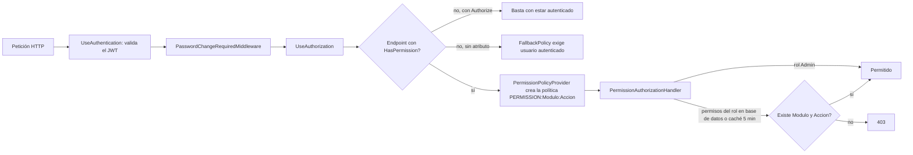

# Seguridad — Parte B: matriz de permisos (módulo × acción × endpoint × pantalla)

| | |
|---|---|
| **Sistema** | SOFIA — Sistema Optimizado Farmacéutico con Inteligencia Artificial |
| **Versión del documento** | 1.0 |
| **Fecha** | 2026-10-08 |
| **Backend** | `sofia-apis`, rama `main`, commit `00991bc` |
| **Frontend** | `sofia-web-spa`, rama `main`, commit `31af681` |
| **Método** | Lectura de código de ambos repositorios y de `docs/_inventario/*.csv`; cruce por script de lectura entre `endpoints.csv`, los servicios del SPA y los usos de `*appPermiso`. No se usó el navegador ni se llamó a la API. |

Este documento es la **Parte B** de la seguridad: qué permiso exige cada endpoint y qué pantalla o botón lo dispara. La autenticación, la sesión y los controles OWASP están en la Parte A (`05a`, de otro autor).

**Convenciones de rutas.** Las rutas de archivo del backend en la columna «Controlador» son relativas a `sofia-apis/src/SOFIA.API/Controllers/` y la línea es la de la **declaración de la acción** (el atributo `[HasPermission]` está justo encima). Las rutas de archivo del SPA son relativas a `sofia-web-spa/src/app/`. Los nombres de botones y textos están tal como aparecen en los `es.json` (`sofia-web-spa/public/i18n/`).

**Marca «En curso (sin commitear)».** Entre los archivos que esta matriz lee, solo `pages/pos/venta-detail/venta-detail.component.ts` y `public/i18n/pos/es.json` tienen cambios sin commitear (REGLAS-AGENTES §3). El cambio de `venta-detail.component.ts` es una línea que agrega el mapeo del error `Venta.Anular.SinSesionAbierta` (`git diff HEAD`, solo lectura); no altera los controles de permiso descritos aquí. Las filas que se apoyan en ese archivo llevan la marca **En curso**.

## 1. Cómo funciona la autorización

### 1.1 En la API

| Pieza | Qué hace | Fuente |
|---|---|---|
| Atributo `[HasPermission("Modulo","Accion")]` | Hereda de `AuthorizeAttribute` y fija la política `PERMISSION:{module}:{action}`; se puede ponerlo en clases y métodos y repetirlo (`AllowMultiple = true`). | `sofia-apis/src/SOFIA.Infrastructure/Authentication/HasPermissionAttribute.cs:5-6` |
| `PermissionPolicyProvider` | Si el nombre de la política empieza por `PERMISSION`, lo parte por `:` (debe dar 3 partes) y construye una política con `RequireAuthenticatedUser()` y un `PermissionRequirement(module, action)`; en otro caso delega en el proveedor por defecto. | `sofia-apis/src/SOFIA.Infrastructure/Authentication/PermissionPolicyProvider.cs:13-38`; registro como singleton en `sofia-apis/src/SOFIA.Infrastructure/DependencyInjection.cs:137` |
| `PermissionAuthorizationHandler` | Lee los roles de los claims `ClaimTypes.Role` del JWT (`:21-24`). Sin roles no concede nada (`:26-29`, resultado 403 porque el usuario sí está autenticado). Si algún rol es `Admin` (comparación `OrdinalIgnoreCase` con `Rol.AdminRoleName = "Admin"`) concede **todo** sin consultar permisos (`:31-36`; constante en `sofia-apis/src/SOFIA.Domain/Entities/Rol.cs:10`). Si no, exige el claim `empresaId` (`:38-42`) y, para cada rol, busca el par módulo/acción comparando con `OrdinalIgnoreCase` (`:48-50`). | `sofia-apis/src/SOFIA.Infrastructure/Authentication/PermissionAuthorizationHandler.cs:12-56`; registro con ámbito scoped en `DependencyInjection.cs:138` |
| Origen de los permisos | **Base de datos, no el JWT.** El token solo lleva los **nombres de rol** (`JwtProvider.cs:46`) y `empresaId` (`:35`). Los permisos salen de `Seguridad_Permisos_Rol` con `PermisosRol.Where(p => p.Rol!.NombreRol == roleName)` (`PermissionAuthorizationHandler.cs:68-72`), recortando espacios (`:74`). Como `PermisoRol` hereda de `BaseEntity` (`sofia-apis/src/SOFIA.Domain/Entities/PermisoRol.cs:5`), le aplican los filtros globales de borrado lógico y de empresa (`sofia-apis/src/SOFIA.Infrastructure/Persistence/ApplicationDbContext.cs:82-86, 98-109`), así que solo cuentan los permisos de roles de la empresa del usuario. | archivos citados |
| Caché de permisos | `MemoryPermissionCache`: clave `permissions:{empresaId}:{ROL EN MAYÚSCULAS}` (`MemoryPermissionCache.cs:20`) y **duración de 5 minutos** (`:9`). Se invalida solo en la instancia que atiende el cambio cuando se asigna o revoca un permiso o se elimina un rol (`AssignPermissionToRolCommandHandler.cs:50,62`; `RevokePermissionFromRolCommandHandler.cs:33`; `DeleteRolCommandHandler.cs:32`, en `SOFIA.Application/Security/Commands/Roles/`). En otra instancia el cambio tarda hasta 5 minutos (comentario en `MemoryPermissionCache.cs:8`). | `sofia-apis/src/SOFIA.Infrastructure/Authentication/MemoryPermissionCache.cs`; registro singleton `DependencyInjection.cs:136` |
| Quién cuenta como «pública» | Política de reserva: todo endpoint sin atributo de autorización exige usuario autenticado (`FallbackPolicy`). Los anónimos llevan `[AllowAnonymous]` explícito. | `sofia-apis/src/SOFIA.Infrastructure/DependencyInjection.cs:149-151` |
| Orden en el pipeline | `UseAuthentication` → `PasswordChangeRequiredMiddleware` → `UseAuthorization`. | `sofia-apis/src/SOFIA.API/Program.cs:129-131` |

**Qué responde la API.**

| Situación | Respuesta | Evidencia |
|---|---|---|
| Sin sesión (sin token, token inválido, vencido, cuenta inactiva, `securityStamp` distinto o empresa no vigente) | **401**. No hay en el código ningún `OnChallenge`, `OnForbidden` ni `IAuthorizationMiddlewareResultHandler` (búsqueda en `sofia-apis/src/**/*.cs`), por lo que aplica el comportamiento por defecto de ASP.NET Core: encabezado `WWW-Authenticate: Bearer` y **cuerpo vacío**. **No verificado en ejecución** (no se llamó a la API). | `DependencyInjection.cs:59-133` (validación del token y `context.Fail(...)`); prueba que lo espera: `SOFIA.IntegrationTests/Api/SecurityHeadersIntegrationTests.cs:21-27` |
| Autenticado pero sin el permiso (política `PERMISSION:...` no cumplida) | **403**, **cuerpo vacío** (mismo motivo: no hay manejador propio). **No verificado en ejecución.** | `PermissionAuthorizationHandler.cs:17-56` (solo llama a `Succeed`; nunca a `Fail`) |
| Autenticado, con cambio de clave forzado, en un endpoint no marcado `[AllowDuringPasswordChange]` | **403** con `application/problem+json`: `{"status":403,"detail":"You must change your password before continuing.","code":"Auth.CambioClaveRequerido"}` (más los campos estándar de `ProblemDetails`). Solo `GET /Auth/me` y `POST /Auth/change-password` están marcados. | `sofia-apis/src/SOFIA.API/Infrastructure/PasswordChangeRequiredMiddleware.cs:12-27`; texto y código en `sofia-apis/src/SOFIA.Application/Security/PasswordChangePolicy.cs:10-11`; marcas en `AuthController.cs:55,87` |
| Regla de negocio que niega (por ejemplo `Rol.PermisosPropios`, `Venta.Anular.ConDevoluciones`) | El código de estado del `Result` con `ProblemDetails`: `{"status":N,"detail":"<mensaje>","code":"<código>"}`. | `sofia-apis/src/SOFIA.API/Extensions/ResultExtensions.cs:13-23` |

**Endpoints que no piden un permiso de módulo** (detalle en la sección 3.28): 6 anónimos (`login`, `refresh`, `logout`, `forgot-password`, `reset-password`, `Empresas/registrar`), 3 que solo exigen estar autenticado (`Auth/me`, `Auth/change-password`, `Sucursales/permitidas`) y `GET /health` (anónimo, minimal API en `Program.cs:137-143`, fuera de `endpoints.csv`). `LotesInventarioController` tiene además `[Authorize]` a nivel de clase (`LotesInventarioController.cs:16`) y todas sus acciones llevan `[HasPermission("Inventarios", ...)]`.

### 1.2 En el SPA

| Pieza | Comportamiento | Fuente |
|---|---|---|
| Origen de los permisos | `GET /api/v1/auth/me` (`UserProfile = { roles: string[]; permisos: {modulo, accion}[] }`). El backend arma `permisos` uniendo los permisos de **todos** los roles de la cuenta, sin repetidos. Se guarda **solo en memoria** en la señal `_profile` (no en `localStorage`; en `localStorage` solo está el token, clave `sofia_token`). Se pide una vez por usuario y se reinicia al cambiar de usuario o cerrar sesión. | `core/auth/auth.service.ts:31,70,126-139,142-145,149-153,162-165`; backend `sofia-apis/src/SOFIA.Application/Security/Queries/GetProfile/GetProfileQueryHandler.cs:13-31` |
| Regla de comparación | `grantsPermission(roles, permisos, modulo, accion = "Leer")`: rol `Admin` concede todo; si no, compara módulo y acción sin distinguir mayúsculas y recortando espacios. Replica la del servidor. | `core/auth/route-permissions.ts:46-60` |
| `ROUTE_PERMISSIONS` | Módulo de permisos por **primer segmento** de la URL: `empresas`→Empresas, `sucursales`→Sucursales, `empleados`→Empleados, `roles` y `cuentas`→Seguridad, `unidades-medida`→UnidadesMedida, `jerarquias`→JerarquiasUoM, `laboratorios`→Laboratorios, `ingredientes-activos`→IngredientesActivos, `medicamentos`→Medicamentos, `presentaciones-venta`→PresentacionesVenta, `formulaciones-clinicas`→FormulacionesClinicas, `proveedores`→Proveedores, `aseguradoras`→Seguros, `lotes` y `stock-por-sucursal`→Inventarios, `sesiones-caja`→POS, `pos`→Ventas, `pacientes`→Pacientes, `profesionales-salud`→ProfesionalesSalud, `recetas-medicas`→Recetas, `digemid-catalogo`→DIGEMID, `series-fiscales`→SeriesFiscales (23 rutas base, 21 módulos distintos). `dashboard`, `cambiar-clave` y `auth/*` no están mapeadas. | `core/auth/route-permissions.ts:2-26` |
| Acción exigida por la ruta | `routeAction(url)`: por defecto solo se exige **`Leer`**. Si el **segundo** segmento es `nueva`, `nuevo` o `carga-masiva` se exige además **`Crear`** (`CREATE_SEGMENTS`). Excepciones en `ROUTE_ACTIONS` (clave = dos primeros segmentos): `recetas-medicas/escanear`→`Analizar`, `sesiones-caja/nueva`→`AperturarCaja`, `stock-por-sucursal/nueva`→`Actualizar`. En todos los casos la acción extra se exige **además** de `Leer`. | `core/auth/route-permissions.ts:29-39,67-72` |
| `permissionGuard` (`canActivateChild`) | Si la ruta no tiene módulo mapeado, deja pasar. Si lo tiene, carga el perfil (`loadPermissions()`) y permite solo si `hasPermission(modulo)` **y** (sin acción extra o `hasPermission(modulo, accion)`). Si no, muestra el mensaje `errors.forbiddenPage` («No tienes permisos para acceder a esta pantalla.») y **redirige a `/dashboard`**. Si el perfil no carga, muestra `errors.permissionsLoad` («No se pudieron cargar tus permisos. Recarga la página o vuelve a iniciar sesión.») y también redirige a `/dashboard`. Se aplica a todos los hijos del `FullComponent` junto a `passwordChangeGuard`; el padre usa `authGuard`. | `core/auth/permission.guard.ts:10-33`; `app.routes.ts:32-37`; textos en `public/i18n/es.json:151-152` |
| Menú lateral | `visibleNavItems(navItems, canOpen)` oculta los ítems cuya ruta no puede abrir el usuario (`canOpen`: sin módulo mapeado o `hasPermission(modulo)`, es decir, **solo `Leer`**) y quita títulos de sección y grupos que queden vacíos. | `matdash/layouts/full/vertical/sidebar/visible-nav-items.ts:4-13`; `sidebar/sidebar.component.ts:29-34` |
| Directiva `*appPermiso` | Directiva standalone en `shared/directives/permiso.directive.ts`. Sintaxis: `*appPermiso="'Accion'"` (usa el módulo de la **ruta actual** según `routeModule(router.url)`) o `*appPermiso="'Modulo:Accion'"` (módulo explícito). Dibuja la plantilla solo si `hasPermission(modulo, accion)`; **falla cerrada**: si la ruta no tiene módulo y no se da uno explícito, no muestra nada. Reacciona al cambio del perfil (efecto sobre la señal). | `shared/directives/permiso.directive.ts:6-33` |
| Tratamiento de 403 | El interceptor solo trata el 403 con código `Auth.CambioClaveRequerido`; cualquier otro 403 llega al componente que llamó. | `core/interceptors/auth.interceptor.ts:30-34` |
| Otras comprobaciones en el `.ts` | `hasPermission` directo en: tablero (`dashboard.component.ts:113-117`), POS (`nueva-venta.component.ts:151`), detalle de venta (`venta-detail.component.ts:94,100,156`, **En curso**), detalle de rol (`roles-detail.component.ts:48`) y detalle de cuenta (`cuentas-detail.component.ts:59`). | archivos citados |

Consecuencias que conviene tener claras: (1) el menú y la ruta solo piden `Leer`; (2) los botones se protegen con `*appPermiso` o con `hasPermission` en el `.ts`; (3) el cliente nunca decide: la API vuelve a validar cada llamada.

### 1.3 Negaciones de negocio (403) además del permiso

Tener el permiso de módulo no basta en estos casos: el handler devuelve `Error.Forbidden` (estado 403, cuerpo `ProblemDetails` con `code`). Son reglas de propiedad, de sucursal o de protección del rol `Admin`. Hay 25 llamadas a `Error.Forbidden(...)` en `SOFIA.Application`; las dos que faltan en esta tabla son las ya descritas en 1.1 (`Auth.CambioClaveRequerido`, `Auth.EmpresaNoVigente`; esta última se evalúa al validar el token, `sofia-apis/src/SOFIA.Application/Security/EmpresaVigencia.cs:10`).

| Código | Endpoint | Regla | Fuente |
|---|---|---|---|
| `Rol.PermisosPropios` | `POST /Roles/permissions` | No puedes ampliar los permisos de un rol que tienes asignado, salvo que seas `Admin`. | `sofia-apis/src/SOFIA.Application/Security/Commands/Roles/AssignPermission/AssignPermissionToRolCommandHandler.cs:28` |
| `Rol.AutoAsignacion` | `POST /Roles/assign-to-user`, `POST /Cuentas/{id}/roles/{rolId}` | No puedes modificar tus propios roles. | `sofia-apis/src/SOFIA.Application/Security/Commands/Roles/AssignRol/AssignRolToUserCommandHandler.cs:25` |
| `Rol.AdminReservado` | ídem | Solo un `Admin` puede asignar el rol `Admin`. | `sofia-apis/src/SOFIA.Application/Security/Commands/Roles/AssignRol/AssignRolToUserCommandHandler.cs:38` |
| `Rol.AutoAsignacion` | `POST /Roles/remove-from-user`, `DELETE /Cuentas/{id}/roles/{rolId}` | No puedes modificar tus propios roles. | `sofia-apis/src/SOFIA.Application/Security/Commands/Roles/RemoveRol/RemoveRolFromUserCommandHandler.cs:24` |
| `Rol.AdminReservado` | ídem | Solo un `Admin` puede quitar el rol `Admin`. | `sofia-apis/src/SOFIA.Application/Security/Commands/Roles/RemoveRol/RemoveRolFromUserCommandHandler.cs:36` |
| `Cuenta.AdminProtegida` | `PUT /Cuentas/{id}` | Solo un `Admin` puede modificar la cuenta de un administrador. | `sofia-apis/src/SOFIA.Application/Security/Commands/Cuentas/UpdateCuenta/UpdateCuentaCommandHandler.cs:26` |
| `Cuenta.AdminProtegida` | `DELETE /Cuentas/{id}` | Solo un `Admin` puede eliminar la cuenta de un administrador. | `sofia-apis/src/SOFIA.Application/Security/Commands/Cuentas/DeleteCuenta/DeleteCuentaCommandHandler.cs:25` |
| `Empleado.SucursalBase.AutoAsignacion` | `PUT /Empleados/{id}` | No puedes cambiar tu propia sucursal base. | `sofia-apis/src/SOFIA.Application/Empleados/Commands/UpdateEmpleado/UpdateEmpleadoCommandHandler.cs:29` |
| `PosSesionCaja.NoPropia` | `POST /POS/cierre` | Solo quien abrió la sesión o un `Admin` puede cerrarla. | `sofia-apis/src/SOFIA.Application/POS/Commands/CerrarCaja/CerrarCajaCommandHandler.cs:31` |
| `Venta.Caja.NoPropia` | `POST /Ventas` | La sesión de caja pertenece a otro cajero u otra sucursal. | `sofia-apis/src/SOFIA.Application/Ventas/Commands/CreateVenta/CreateVentaCommandHandler.cs:149` |
| `Venta.Completar` | `PUT /Ventas/{id}/completar` | No se puede cobrar una venta de otra sucursal. | `sofia-apis/src/SOFIA.Application/Ventas/Commands/CompletarVenta/CompletarVentaCommandHandler.cs:39` |
| `Venta.Actualizar` | `PUT /Ventas/{id}/detalles` | No se puede modificar una venta de otra sucursal. | `sofia-apis/src/SOFIA.Application/Ventas/Commands/ActualizarVentaPendiente/ActualizarVentaPendienteCommandHandler.cs:36` |
| `Venta.Anular` | `PUT /Ventas/{id}/anular` | No se puede anular una venta de otra sucursal. **En curso (sin commitear)**: el archivo tiene cambios locales. | `sofia-apis/src/SOFIA.Application/Ventas/Commands/AnularVenta/AnularVentaCommandHandler.cs:37` |
| `Venta.Forbidden` | `GET /Ventas/{id}` | Solo se puede ver una venta de la sucursal base del token. | `sofia-apis/src/SOFIA.Application/Ventas/Queries/GetVentaById/GetVentaByIdQueryHandler.cs:52` |
| `Devolucion.Venta.OtraSucursal` | `POST /Devoluciones` | Solo se devuelven ventas de la propia sucursal. | `sofia-apis/src/SOFIA.Application/Devoluciones/Commands/ProcesarDevolucion/ProcesarDevolucionCommandHandler.cs:41` |
| `Delivery.Venta.SucursalNoPermitida` | `POST /Delivery` | Sin acceso a la sucursal de la venta. | `sofia-apis/src/SOFIA.Application/Delivery/Commands/ProgramarDelivery/ProgramarDeliveryCommandHandler.cs:25` |
| `Inventario.Sucursal.NoPermitida` | `PUT /StockPorSucursal/{id}/ajustar` | Sin acceso a la sucursal del stock. | `sofia-apis/src/SOFIA.Application/Inventarios/Commands/AdjustStock/AdjustStockCommandHandler.cs:23` |
| `Inventario.Sucursal.NoPermitida` | `POST /LotesInventario/stock` | Sin acceso a la sucursal indicada. | `sofia-apis/src/SOFIA.Application/Inventarios/Commands/RegisterInventario/RegisterInventarioCommandHandler.cs:27` |
| `OrdenMagistral.OtraSucursal` | `POST /Magistrales/completar` | Solo órdenes de la propia sucursal. | `sofia-apis/src/SOFIA.Application/Magistrales/Commands/CompletarOrdenMagistral/CompletarOrdenMagistralCommandHandler.cs:31` |
| `Transferencia.Forbidden` | `PUT /Transferencias/{id}/despachar` | Solo personal de la sucursal de origen. | `sofia-apis/src/SOFIA.Application/Transferencias/Commands/DespacharTransferencia/DespacharTransferenciaCommandHandler.cs:33` |
| `Transferencia.Forbidden` | `PUT /Transferencias/{id}/cancelar` | Solo personal de la sucursal de origen. | `sofia-apis/src/SOFIA.Application/Transferencias/Commands/CancelarTransferencia/CancelarTransferenciaCommandHandler.cs:34` |
| `Transferencia.Forbidden` | `PUT /Transferencias/{id}/recibir` | Solo personal de la sucursal de destino. | `sofia-apis/src/SOFIA.Application/Transferencias/Commands/RecibirTransferencia/RecibirTransferenciaCommandHandler.cs:34` |
| `Transferencia.Forbidden` | `GET /Transferencias/{id}` | Solo origen o destino de la transferencia. | `sofia-apis/src/SOFIA.Application/Transferencias/Queries/GetTransferenciaById/GetTransferenciaByIdQueryHandler.cs:41` |

El SPA solo traduce `Rol.PermisosPropios` (`pages/roles/roles-detail/roles-detail.component.ts:301-304`); el resto aparece como error genérico o con el mensaje del servidor según la pantalla (**No verificado** pantalla por pantalla).

## 2. Catálogo de permisos

**Origen del catálogo que ve el administrador.** La pantalla de roles (`/roles/:id`, pestaña «Permisos») llama a `GET /api/v1/Roles/permissions/catalog` (`pages/roles/services/rol.service.ts:43-45`; `pages/roles/roles-detail/roles-detail.component.ts:158`). El endpoint **no lee una tabla**: recorre por reflexión todos los controladores del ensamblado, toma los `[HasPermission]` de sus métodos públicos, los agrupa por módulo y devuelve `[{ Modulo, Acciones[] }]` ordenado por módulo y acción (`sofia-apis/src/SOFIA.API/Controllers/RolesController.cs:102-116`; exige `Seguridad:Leer`). Por tanto **el catálogo es exactamente el conjunto de pares usados en el código**: agregar un `[HasPermission]` nuevo crea el par; borrar el último endpoint de un par lo hace desaparecer. Solo se consideran los atributos de **métodos** (los de clase se ignoran; hoy no hay ninguno). Hoy: **27 módulos y 105 pares** (`docs/_inventario/permisos.csv`).

**Cómo se muestra.** El SPA toma las traducciones del scope `roles` (`public/i18n/roles/es.json`): módulo con la clave `permisos.modulo.<Modulo>` (`roles/es.json:57-85`) y acción con `permisos.accion.<Accion>` (`roles/es.json:86-107`), vía `moduloLabel()`/`accionLabel()` (`roles-detail.component.ts:174-186`). Si no hay traducción muestra el nombre crudo del catálogo (`permisoLabel`, `roles-detail.component.ts:183-186`). Módulos y acciones se ordenan por el texto traducido (`:83-86`). **Resultado de la verificación: los 27 módulos y las 20 acciones distintas tienen traducción en español; no falta ninguna** (comprobado por script contra `permisos.csv`; ver la tabla de cobertura). Solo se revisó `es.json`.

Las acciones `Leer`, `Crear`, `Actualizar` y `Eliminar` son las genéricas; las demás son específicas de un módulo. Dos módulos reciben el texto de otra pantalla: `Seguridad` se ve como «Roles y Cuentas de Usuario» y `POS` como «Sesiones de Caja» (el módulo `POS` no es el punto de venta: ese es `Ventas`).

### 2.1 Los 105 pares módulo × acción

Columnas: **Endpoints** = cuántos endpoints exigen el par (coincide con `permisos.csv`); **Con pantalla** = cuántos de ellos los llama algún código del SPA; **Comprobado por el SPA en** = dónde el cliente decide algo con ese par (menú/guard de ruta, `*appPermiso`, `.ts`). «—» significa que el SPA nunca consulta ese par (ver 4.e).

| Módulo (texto en pantalla de roles) | Acción (texto) | Endpoints | Con pantalla | Comprobado por el SPA en |
|---|---|---:|---:|---|
| `Auditoria` («Auditoría de Seguridad») | `AnonimizarDatos` («Anonimizar datos») | 1 | 0 | — |
| `DIGEMID` («DIGEMID») | `Leer` («Leer») | 6 | 4 | menú y guard de ruta (`core/auth/route-permissions.ts:2-26`); tablero `puedeCuarentena` (`dashboard.component.ts:116`) |
| `DIGEMID` («DIGEMID») | `Crear` («Crear») | 4 | 3 | guard de ruta `/digemid-catalogo/carga-masiva`; `*appPermiso` pages/digemid-catalogo/digemid-catalogo-search/digemid-catalogo-search.component.html:20 |
| `DIGEMID` («DIGEMID») | `Actualizar` («Actualizar») | 1 | 0 | — |
| `DIGEMID` («DIGEMID») | `Eliminar` («Eliminar») | 1 | 0 | — |
| `DIGEMID` («DIGEMID») | `AislarLoteCuarentena` («Aislar lote en cuarentena») | 1 | 0 | — |
| `DIGEMID` («DIGEMID») | `GenerarActaDestruccion` («Generar acta de destrucción») | 1 | 0 | — |
| `Delivery` («Despachos Delivery») | `Leer` («Leer») | 2 | 0 | — |
| `Delivery` («Despachos Delivery») | `Actualizar` («Actualizar») | 2 | 0 | — |
| `Delivery` («Despachos Delivery») | `Eliminar` («Eliminar») | 1 | 0 | — |
| `Delivery` («Despachos Delivery») | `ProgramarDelivery` («Programar delivery») | 1 | 0 | — |
| `Devoluciones` («Devoluciones») | `Leer` («Leer») | 3 | 1 | tablero `puedeDevoluciones` (`dashboard.component.ts:117`) |
| `Devoluciones` («Devoluciones») | `ProcesarDevolucion` («Procesar devolución») | 1 | 1 | `puedeDevolver` (`venta-detail.component.ts:156`, En curso) |
| `Empleados` («Empleados») | `Leer` («Leer») | 3 | 3 | menú y guard de ruta (`core/auth/route-permissions.ts:2-26`) |
| `Empleados` («Empleados») | `Crear` («Crear») | 1 | 1 | guard de ruta `/empleados/nueva`; `*appPermiso` pages/empleados/empleados-search/empleados-search.component.html:19 |
| `Empleados` («Empleados») | `Actualizar` («Actualizar») | 1 | 1 | `*appPermiso` pages/empleados/empleados-detail/empleados-detail.component.html:27 |
| `Empleados` («Empleados») | `Eliminar` («Eliminar») | 1 | 1 | `*appPermiso` pages/empleados/empleados-detail/empleados-detail.component.html:137 |
| `Empresas` («Empresa») | `Leer` («Leer») | 3 | 3 | menú y guard de ruta (`core/auth/route-permissions.ts:2-26`) |
| `Empresas` («Empresa») | `Actualizar` («Actualizar») | 1 | 1 | `*appPermiso` pages/empresa/empresa-detail/empresa-detail.component.html:27 |
| `FormulacionesClinicas` («Formulaciones Clínicas») | `Leer` («Leer») | 4 | 3 | menú y guard de ruta (`core/auth/route-permissions.ts:2-26`) |
| `FormulacionesClinicas` («Formulaciones Clínicas») | `Crear` («Crear») | 1 | 1 | guard de ruta `/formulaciones-clinicas/nueva`; `*appPermiso` pages/formulaciones-clinicas/formulaciones-clinicas-search/formulaciones-clinicas-search.component.html:24 |
| `FormulacionesClinicas` («Formulaciones Clínicas») | `Actualizar` («Actualizar») | 1 | 1 | `*appPermiso` pages/formulaciones-clinicas/formulaciones-clinicas-detail/formulaciones-clinicas-detail.component.html:32 |
| `FormulacionesClinicas` («Formulaciones Clínicas») | `Eliminar` («Eliminar») | 1 | 1 | `*appPermiso` pages/formulaciones-clinicas/formulaciones-clinicas-detail/formulaciones-clinicas-detail.component.html:176 |
| `IngredientesActivos` («Ingredientes Activos») | `Leer` («Leer») | 3 | 3 | menú y guard de ruta (`core/auth/route-permissions.ts:2-26`) |
| `IngredientesActivos` («Ingredientes Activos») | `Crear` («Crear») | 4 | 4 | guard de ruta `/ingredientes-activos/nueva`; guard de ruta `/ingredientes-activos/carga-masiva`; `*appPermiso` pages/ingredientes-activos/ingredientes-activos-search/ingredientes-activos-search.component.html:20 (+1 más) |
| `IngredientesActivos` («Ingredientes Activos») | `Actualizar` («Actualizar») | 1 | 1 | `*appPermiso` pages/ingredientes-activos/ingredientes-activos-detail/ingredientes-activos-detail.component.html:28 |
| `IngredientesActivos` («Ingredientes Activos») | `Eliminar` («Eliminar») | 1 | 1 | `*appPermiso` pages/ingredientes-activos/ingredientes-activos-detail/ingredientes-activos-detail.component.html:78 |
| `Inventarios` («Inventario») | `Leer` («Leer») | 9 | 7 | menú y guard de ruta (`core/auth/route-permissions.ts:2-26`); tablero `puedeInventario` (`dashboard.component.ts:115`) |
| `Inventarios` («Inventario») | `Crear` («Crear») | 1 | 1 | guard de ruta `/lotes/nueva`; `*appPermiso` pages/lotes/lotes-search/lotes-search.component.html:19 |
| `Inventarios` («Inventario») | `Actualizar` («Actualizar») | 3 | 3 | guard de ruta `/stock-por-sucursal/nueva`; `*appPermiso` pages/lotes/lotes-detail/lotes-detail.component.html:27; `*appPermiso` pages/stock-por-sucursal/stock-detail/stock-detail.component.html:133 (+1 más) |
| `Inventarios` («Inventario») | `Eliminar` («Eliminar») | 1 | 1 | `*appPermiso` pages/lotes/lotes-detail/lotes-detail.component.html:120 |
| `JerarquiasUoM` («Jerarquías de Unidades») | `Leer` («Leer») | 4 | 4 | menú y guard de ruta (`core/auth/route-permissions.ts:2-26`); `*appPermiso` pages/medicamentos/medicamentos-detail/medicamentos-detail.component.html:26 |
| `JerarquiasUoM` («Jerarquías de Unidades») | `Crear` («Crear») | 4 | 4 | guard de ruta `/jerarquias/nueva`; guard de ruta `/jerarquias/carga-masiva`; `*appPermiso` pages/jerarquias/jerarquias-search/jerarquias-search.component.html:19 (+3 más) |
| `JerarquiasUoM` («Jerarquías de Unidades») | `Actualizar` («Actualizar») | 1 | 1 | `*appPermiso` pages/jerarquias/jerarquias-detail/jerarquias-detail.component.html:27 |
| `JerarquiasUoM` («Jerarquías de Unidades») | `Eliminar` («Eliminar») | 1 | 1 | `*appPermiso` pages/jerarquias/jerarquias-detail/jerarquias-detail.component.html:169 |
| `Laboratorios` («Laboratorios») | `Leer` («Leer») | 3 | 3 | menú y guard de ruta (`core/auth/route-permissions.ts:2-26`) |
| `Laboratorios` («Laboratorios») | `Crear` («Crear») | 4 | 4 | guard de ruta `/laboratorios/nueva`; guard de ruta `/laboratorios/carga-masiva`; `*appPermiso` pages/laboratorios/laboratorios-search/laboratorios-search.component.html:19 (+1 más) |
| `Laboratorios` («Laboratorios») | `Actualizar` («Actualizar») | 1 | 1 | `*appPermiso` pages/laboratorios/laboratorios-detail/laboratorios-detail.component.html:27 |
| `Laboratorios` («Laboratorios») | `Eliminar` («Eliminar») | 1 | 1 | `*appPermiso` pages/laboratorios/laboratorios-detail/laboratorios-detail.component.html:79 |
| `Magistrales` («Órdenes Magistrales») | `Leer` («Leer») | 2 | 0 | — |
| `Magistrales` («Órdenes Magistrales») | `CompletarOrdenMagistral` («Completar orden magistral») | 1 | 0 | — |
| `Magistrales` («Órdenes Magistrales») | `IniciarOrdenMagistral` («Iniciar orden magistral») | 1 | 0 | — |
| `Medicamentos` («Medicamentos») | `Leer` («Leer») | 4 | 4 | menú y guard de ruta (`core/auth/route-permissions.ts:2-26`) |
| `Medicamentos` («Medicamentos») | `Crear` («Crear») | 4 | 4 | guard de ruta `/medicamentos/nueva`; guard de ruta `/medicamentos/carga-masiva`; `*appPermiso` pages/medicamentos/medicamentos-search/medicamentos-search.component.html:19 (+1 más) |
| `Medicamentos` («Medicamentos») | `Actualizar` («Actualizar») | 1 | 1 | `*appPermiso` pages/medicamentos/medicamentos-detail/medicamentos-detail.component.html:37 |
| `Medicamentos` («Medicamentos») | `Eliminar` («Eliminar») | 1 | 1 | `*appPermiso` pages/medicamentos/medicamentos-detail/medicamentos-detail.component.html:188 |
| `POS` («Sesiones de Caja») | `Leer` («Leer») | 4 | 4 | menú y guard de ruta (`core/auth/route-permissions.ts:2-26`); tablero `puedeCaja` (`dashboard.component.ts:114`) |
| `POS` («Sesiones de Caja») | `AperturarCaja` («Aperturar caja») | 1 | 1 | guard de ruta `/sesiones-caja/nueva`; `*appPermiso` pages/dashboard/dashboard.component.html:282; `*appPermiso` pages/pos/nueva-venta/nueva-venta.component.html:17 (+1 más) |
| `POS` («Sesiones de Caja») | `CerrarCaja` («Cerrar caja») | 1 | 1 | `*appPermiso` pages/sesiones-caja/sesiones-detail/sesiones-detail.component.html:76 |
| `Pacientes` («Pacientes») | `Leer` («Leer») | 3 | 3 | menú y guard de ruta (`core/auth/route-permissions.ts:2-26`) |
| `Pacientes` («Pacientes») | `Crear` («Crear») | 4 | 4 | guard de ruta `/pacientes/nueva`; guard de ruta `/pacientes/carga-masiva`; `*appPermiso` pages/pacientes/pacientes-search/pacientes-search.component.html:19 (+1 más) |
| `Pacientes` («Pacientes») | `Actualizar` («Actualizar») | 1 | 1 | `*appPermiso` pages/pacientes/pacientes-detail/pacientes-detail.component.html:27 |
| `Pacientes` («Pacientes») | `Eliminar` («Eliminar») | 1 | 1 | `*appPermiso` pages/pacientes/pacientes-detail/pacientes-detail.component.html:126 |
| `PresentacionesVenta` («Presentaciones de Venta») | `Leer` («Leer») | 3 | 3 | menú y guard de ruta (`core/auth/route-permissions.ts:2-26`); `*appPermiso` pages/medicamentos/medicamentos-detail/medicamentos-detail.component.html:28 |
| `PresentacionesVenta` («Presentaciones de Venta») | `Crear` («Crear») | 1 | 1 | guard de ruta `/presentaciones-venta/nueva`; `*appPermiso` pages/presentaciones-venta/presentaciones-venta-modal/presentaciones-venta-modal.component.html:139; `*appPermiso` pages/presentaciones-venta/presentaciones-venta-search/presentaciones-venta-search.component.html:24 |
| `PresentacionesVenta` («Presentaciones de Venta») | `Actualizar` («Actualizar») | 1 | 1 | `*appPermiso` pages/presentaciones-venta/presentaciones-venta-detail/presentaciones-venta-detail.component.html:32; `*appPermiso` pages/presentaciones-venta/presentaciones-venta-modal/presentaciones-venta-modal.component.html:64 |
| `PresentacionesVenta` («Presentaciones de Venta») | `Eliminar` («Eliminar») | 1 | 1 | `*appPermiso` pages/presentaciones-venta/presentaciones-venta-detail/presentaciones-venta-detail.component.html:167; `*appPermiso` pages/presentaciones-venta/presentaciones-venta-modal/presentaciones-venta-modal.component.html:73 |
| `ProfesionalesSalud` («Profesionales de Salud») | `Leer` («Leer») | 3 | 3 | menú y guard de ruta (`core/auth/route-permissions.ts:2-26`) |
| `ProfesionalesSalud` («Profesionales de Salud») | `Crear` («Crear») | 4 | 4 | guard de ruta `/profesionales-salud/nueva`; guard de ruta `/profesionales-salud/carga-masiva`; `*appPermiso` pages/profesionales-salud/profesionales-salud-search/profesionales-salud-search.component.html:20 (+1 más) |
| `ProfesionalesSalud` («Profesionales de Salud») | `Actualizar` («Actualizar») | 1 | 1 | `*appPermiso` pages/profesionales-salud/profesionales-salud-detail/profesionales-salud-detail.component.html:28 |
| `ProfesionalesSalud` («Profesionales de Salud») | `Eliminar` («Eliminar») | 1 | 1 | `*appPermiso` pages/profesionales-salud/profesionales-salud-detail/profesionales-salud-detail.component.html:88 |
| `Proveedores` («Proveedores») | `Leer` («Leer») | 3 | 3 | menú y guard de ruta (`core/auth/route-permissions.ts:2-26`) |
| `Proveedores` («Proveedores») | `Crear` («Crear») | 4 | 4 | guard de ruta `/proveedores/nueva`; guard de ruta `/proveedores/carga-masiva`; `*appPermiso` pages/proveedores/proveedores-search/proveedores-search.component.html:19 (+1 más) |
| `Proveedores` («Proveedores») | `Actualizar` («Actualizar») | 1 | 1 | `*appPermiso` pages/proveedores/proveedores-detail/proveedores-detail.component.html:27 |
| `Proveedores` («Proveedores») | `Eliminar` («Eliminar») | 1 | 1 | `*appPermiso` pages/proveedores/proveedores-detail/proveedores-detail.component.html:110 |
| `Proveedores` («Proveedores») | `RegistrarPrecioProveedor` («Registrar precio de proveedor») | 1 | 0 | — |
| `Recetas` («Recetas Médicas») | `Leer` («Leer») | 3 | 3 | menú y guard de ruta (`core/auth/route-permissions.ts:2-26`) |
| `Recetas` («Recetas Médicas») | `Crear` («Crear») | 1 | 1 | guard de ruta `/recetas-medicas/nueva`; `*appPermiso` pages/pos/nueva-venta/nueva-venta.component.html:443; `*appPermiso` pages/recetas-medicas/recetas-search/recetas-search.component.html:28 |
| `Recetas` («Recetas Médicas») | `Actualizar` («Actualizar») | 1 | 1 | `*appPermiso` pages/recetas-medicas/recetas-detail/recetas-detail.component.html:202 |
| `Recetas` («Recetas Médicas») | `Eliminar` («Eliminar») | 1 | 1 | `*appPermiso` pages/recetas-medicas/recetas-detail/recetas-detail.component.html:156 |
| `Recetas` («Recetas Médicas») | `Analizar` («Analizar con IA») | 1 | 1 | guard de ruta `/recetas-medicas/escanear`; `*appPermiso` pages/recetas-medicas/recetas-search/recetas-search.component.html:21; `puedeEscanearReceta` (`pages/pos/nueva-venta/nueva-venta.component.ts:151`) |
| `Seguridad` («Roles y Cuentas de Usuario») | `Leer` («Leer») | 8 | 8 | menú y guard de ruta (`core/auth/route-permissions.ts:2-26`) |
| `Seguridad` («Roles y Cuentas de Usuario») | `Crear` («Crear») | 5 | 5 | guard de ruta `/roles/nueva`; guard de ruta `/roles/carga-masiva`; guard de ruta `/cuentas/nueva` (+3 más) |
| `Seguridad` («Roles y Cuentas de Usuario») | `Actualizar` («Actualizar») | 4 | 4 | `*appPermiso` pages/roles/roles-detail/roles-detail.component.html:27; `*appPermiso` pages/seguridad/cuentas-detail/cuentas-detail.component.html:107 |
| `Seguridad` («Roles y Cuentas de Usuario») | `Eliminar` («Eliminar») | 2 | 2 | `*appPermiso` pages/roles/roles-detail/roles-detail.component.html:307; `*appPermiso` pages/seguridad/cuentas-detail/cuentas-detail.component.html:268 |
| `Seguridad` («Roles y Cuentas de Usuario») | `AsignarRoles` («Asignar roles») | 4 | 2 | `puedeAsignarRoles` (`pages/seguridad/cuentas-detail/cuentas-detail.component.ts:59`) |
| `Seguridad` («Roles y Cuentas de Usuario») | `GestionarPermisos` («Gestionar permisos») | 3 | 3 | `puedeGestionarPermisos` (`pages/roles/roles-detail/roles-detail.component.ts:48`) |
| `Seguros` («Aseguradoras») | `Leer` («Leer») | 3 | 3 | menú y guard de ruta (`core/auth/route-permissions.ts:2-26`) |
| `Seguros` («Aseguradoras») | `Crear` («Crear») | 4 | 4 | guard de ruta `/aseguradoras/nueva`; guard de ruta `/aseguradoras/carga-masiva`; `*appPermiso` pages/aseguradoras/aseguradoras-search/aseguradoras-search.component.html:19 (+1 más) |
| `Seguros` («Aseguradoras») | `Actualizar` («Actualizar») | 1 | 1 | `*appPermiso` pages/aseguradoras/aseguradoras-detail/aseguradoras-detail.component.html:27 |
| `Seguros` («Aseguradoras») | `Eliminar` («Eliminar») | 1 | 1 | `*appPermiso` pages/aseguradoras/aseguradoras-detail/aseguradoras-detail.component.html:82 |
| `SeriesFiscales` («Series Fiscales») | `Leer` («Leer») | 3 | 3 | menú y guard de ruta (`core/auth/route-permissions.ts:2-26`) |
| `SeriesFiscales` («Series Fiscales») | `Crear` («Crear») | 1 | 1 | guard de ruta `/series-fiscales/nueva`; `*appPermiso` pages/series-fiscales/series-fiscales-search/series-fiscales-search.component.html:20 |
| `SeriesFiscales` («Series Fiscales») | `Actualizar` («Actualizar») | 1 | 1 | `*appPermiso` pages/series-fiscales/series-fiscales-detail/series-fiscales-detail.component.html:28 |
| `SeriesFiscales` («Series Fiscales») | `Eliminar` («Eliminar») | 1 | 1 | `*appPermiso` pages/series-fiscales/series-fiscales-detail/series-fiscales-detail.component.html:161 |
| `Servicios` («Servicios») | `Leer` («Leer») | 4 | 0 | — |
| `Servicios` («Servicios») | `Actualizar` («Actualizar») | 2 | 0 | — |
| `Servicios` («Servicios») | `Eliminar` («Eliminar») | 2 | 0 | — |
| `Servicios` («Servicios») | `AgendarServicio` («Agendar servicio») | 1 | 0 | — |
| `Servicios` («Servicios») | `RegistrarInmunizacion` («Registrar inmunización») | 1 | 0 | — |
| `Sucursales` («Sucursales») | `Leer` («Leer») | 3 | 3 | menú y guard de ruta (`core/auth/route-permissions.ts:2-26`) |
| `Sucursales` («Sucursales») | `Crear` («Crear») | 4 | 4 | guard de ruta `/sucursales/nueva`; guard de ruta `/sucursales/carga-masiva`; `*appPermiso` pages/sucursales/sucursales-search/sucursales-search.component.html:19 (+1 más) |
| `Sucursales` («Sucursales») | `Actualizar` («Actualizar») | 1 | 1 | `*appPermiso` pages/sucursales/sucursales-detail/sucursales-detail.component.html:27 |
| `Sucursales` («Sucursales») | `Eliminar` («Eliminar») | 1 | 1 | `*appPermiso` pages/sucursales/sucursales-detail/sucursales-detail.component.html:103 |
| `Transferencias` («Transferencias») | `Leer` («Leer») | 2 | 0 | — |
| `Transferencias` («Transferencias») | `Crear` («Crear») | 1 | 0 | — |
| `Transferencias` («Transferencias») | `Actualizar` («Actualizar») | 3 | 0 | — |
| `UnidadesMedida` («Unidades de Medida») | `Leer` («Leer») | 3 | 3 | menú y guard de ruta (`core/auth/route-permissions.ts:2-26`) |
| `UnidadesMedida` («Unidades de Medida») | `Crear` («Crear») | 4 | 4 | guard de ruta `/unidades-medida/nueva`; guard de ruta `/unidades-medida/carga-masiva`; `*appPermiso` pages/unidades-medida/unidades-medida-search/unidades-medida-search.component.html:20 (+1 más) |
| `UnidadesMedida` («Unidades de Medida») | `Actualizar` («Actualizar») | 1 | 1 | `*appPermiso` pages/unidades-medida/unidades-medida-detail/unidades-medida-detail.component.html:28 |
| `UnidadesMedida` («Unidades de Medida») | `Eliminar` («Eliminar») | 1 | 1 | `*appPermiso` pages/unidades-medida/unidades-medida-detail/unidades-medida-detail.component.html:75 |
| `Ventas` («Ventas») | `Leer` («Leer») | 4 | 4 | menú y guard de ruta (`core/auth/route-permissions.ts:2-26`); tablero `puedeVentas` (`pages/dashboard/dashboard.component.ts:113`) |
| `Ventas` («Ventas») | `Crear` («Crear») | 4 | 4 | guard de ruta `/pos/nueva`; `*appPermiso` pages/pos/dialogs/comprobante-dialog/comprobante-dialog.component.html:38; `*appPermiso` pages/pos/search/ventas-search.component.html:17 (+1 más) |
| `Ventas` («Ventas») | `Actualizar` («Actualizar») | 2 | 2 | `puedeCobrar` (`venta-detail.component.ts:100`, En curso) |
| `Ventas` («Ventas») | `Anular` («Anular») | 1 | 1 | `puedeAnular` (`pages/pos/venta-detail/venta-detail.component.ts:94`, En curso) |

Total: 105 pares, 231 endpoints con permiso de módulo (más 9 que no lo piden, ver 3.28).

## 3. Matriz principal: módulo × acción × endpoint × pantalla

Una fila por endpoint (los 240 de `docs/_inventario/endpoints.csv`), agrupada por el módulo de su permiso; los anónimos y los de solo autenticación están en la 3.28. Dentro de cada módulo las filas van por acción (`Leer`, `Crear`, `Actualizar`, `Eliminar` y las específicas).

Cómo leer las dos últimas columnas:

- **«Guard de ruta `/x`: `M:Leer` + `M:Crear`»** = `permissionGuard` (sección 1.2). Es el único control de los botones «Buscar» y «Exportar» y de las cargas iniciales: todos exigen el mismo permiso que el guard de la ruta, así que no hay brecha.
- **`*appPermiso="'X'"`** va con su `archivo:línea` de `docs/_inventario/app-permiso-usos.csv`. Un botón «Guardar» nunca lleva directiva propia: se llega a él por «Nuevo» (que sí la lleva) o por «Editar» (que sí la lleva) y por el guard de la ruta `/x/nueva`.
- **«Sin control en el SPA»** = el elemento se muestra aunque falte el permiso y la API responderá 403. Casi siempre son listas desplegables y autocompletados que consultan un módulo ajeno (sección 4.b).
- Las llamadas «Dato de apoyo» son consultas auxiliares (lista de laboratorios, pacientes, sucursales…) que una pantalla hace a otro módulo.

### 3.1 Auditoria («Auditoría de Seguridad»)

Acciones: `AnonimizarDatos`. Endpoints: 1.

| Acción | Método y ruta | Controlador | Qué hace | Método del servicio del SPA | Pantalla(s) y elemento | Control en el SPA |
|---|---|---|---|---|---|---|
| `Auditoria:AnonimizarDatos` | `POST /api/v1/Auditoria/anonimizar` | `AuditoriaController.cs:13` | Anonimiza los datos personales del registro `RegistroId` de la tabla `Tabla` (`AnonimizarDatosCommand`). | **Solo API (sin pantalla)** | — | No aplica (sin pantalla) |

### 3.2 DIGEMID («DIGEMID»)

Acciones: `Leer`, `Crear`, `Actualizar`, `Eliminar`, `AislarLoteCuarentena`, `GenerarActaDestruccion`. Endpoints: 14.

| Acción | Método y ruta | Controlador | Qué hace | Método del servicio del SPA | Pantalla(s) y elemento | Control en el SPA |
|---|---|---|---|---|---|---|
| `DIGEMID:Leer` | `GET /api/v1/DIGEMID/cuarentena` | `DIGEMIDController.cs:38` | Lista paginada de registros de cuarentena filtrada por sucursal, estado y fechas (`GetCuarentenaQuery`). | **Solo API (sin pantalla)** | — | No aplica (sin pantalla) |
| `DIGEMID:Leer` | `GET /api/v1/Dashboard/cuarentena` | `DashboardController.cs:44` | Indicadores de cuarentena DIGEMID del tablero (`GetDashboardCuarentenaQuery`). | `DashboardService.cuarentena` (pages/dashboard/services/dashboard.service.ts:31) | `/dashboard`: carga inicial (`ngOnInit()` → `cargarPermisos()` dashboard.component.ts:185 → `actualizar()` → `cargarCuarentena()`) y botón «Reintentar» de la tarjeta (dashboard.component.html:364) | La ruta `/dashboard` no tiene módulo mapeado: sin guard. `puedeCuarentena` = `hasPermission('DIGEMID')` (dashboard.component.ts) y la sección solo se dibuja con `@if (puedeCuarentena())` (dashboard.component.html:348); `cargar()` no llama al endpoint sin ese permiso |
| `DIGEMID:Leer` | `GET /api/v1/DIGEMID/actas` | `DIGEMIDController.cs:47` | Lista paginada de actas de destrucción por rango de fechas (`GetActasQuery`). | **Solo API (sin pantalla)** | — | No aplica (sin pantalla) |
| `DIGEMID:Leer` | `GET /api/v1/DIGEMID/catalogo` | `DIGEMIDController.cs:56` | Lista paginada del catálogo DIGEMID con filtros (`GetDigemidCatalogoQuery`). | `DigemidCatalogoService.search` (pages/digemid-catalogo/services/digemid-catalogo.service.ts:17) | `/digemid-catalogo`: botón «Buscar» (digemid-catalogo-search.component.html:60) → `search()` digemid-catalogo-search.component.ts:73 | Guard de ruta `/digemid-catalogo`: `DIGEMID:Leer` |
| `DIGEMID:Leer` | `GET /api/v1/DIGEMID/catalogo/{id:guid}` | `DIGEMIDController.cs:64` | Devuelve el detalle de un producto del catálogo DIGEMID (`GetDigemidCatalogoByIdQuery`). | `DigemidCatalogoService.getById` (pages/digemid-catalogo/services/digemid-catalogo.service.ts:30) | `/digemid-catalogo/:id`: carga inicial de la pantalla (`load()` digemid-catalogo-detail.component.ts:61) | Guard de ruta `/digemid-catalogo/:id`: `DIGEMID:Leer` |
| `DIGEMID:Leer` | `POST /api/v1/DIGEMID/catalogo/exportar` | `DIGEMIDController.cs:135` | Genera el Excel del catálogo DIGEMID con los filtros recibidos; reutiliza `GetDigemidCatalogoQuery`. | `DigemidCatalogoService.exportar` (pages/digemid-catalogo/services/digemid-catalogo.service.ts:34) | `/digemid-catalogo`: botón «Exportar» (digemid-catalogo-search.component.html:124) → `exportar()` digemid-catalogo-search.component.ts:126 | Guard de ruta `/digemid-catalogo`: `DIGEMID:Leer` |
| `DIGEMID:Crear` | `POST /api/v1/DIGEMID/catalogo` | `DIGEMIDController.cs:72` | Crea un producto del catálogo DIGEMID (`CreateDigemidProductoCommand`). | **Solo API (sin pantalla)** | — | No aplica (sin pantalla) |
| `DIGEMID:Crear` | `GET /api/v1/DIGEMID/catalogo/plantilla` | `DIGEMIDController.cs:99` | Descarga la plantilla Excel de carga masiva del catálogo DIGEMID. | `CargaMasivaConfig.downloadUrl` (pages/digemid-catalogo/digemid-catalogo-carga-masiva/digemid-catalogo-carga-masiva.component.ts:19), ejecutada por `shared/components/carga-masiva-page/carga-masiva-page.component.ts` | `/digemid-catalogo/carga-masiva`: botón «Descargar plantilla» (carga-masiva-page.component.ts:125) | Guard de ruta `/digemid-catalogo/carga-masiva`: `DIGEMID:Leer` + `DIGEMID:Crear` Entrada a la pantalla: botón «Carga Masiva» con `*appPermiso="'Crear'"` (pages/digemid-catalogo/digemid-catalogo-search/digemid-catalogo-search.component.html:20) |
| `DIGEMID:Crear` | `POST /api/v1/DIGEMID/catalogo/previsualizar` | `DIGEMIDController.cs:110` | Valida el Excel subido y devuelve la vista previa fila por fila (`PreviewImportDigemidQuery`). | `CargaMasivaConfig.previewUrl` (pages/digemid-catalogo/digemid-catalogo-carga-masiva/digemid-catalogo-carga-masiva.component.ts:20), ejecutada por `shared/components/carga-masiva-page/carga-masiva-page.component.ts` | `/digemid-catalogo/carga-masiva`: selección o arrastre del archivo (vista previa) (carga-masiva-page.component.ts:110) | Guard de ruta `/digemid-catalogo/carga-masiva`: `DIGEMID:Leer` + `DIGEMID:Crear` |
| `DIGEMID:Crear` | `POST /api/v1/DIGEMID/catalogo/carga-masiva` | `DIGEMIDController.cs:127` | Guarda las filas válidas de la carga masiva del catálogo DIGEMID (`CargaMasivaDigemidCommand`). | `CargaMasivaConfig.saveUrl` (pages/digemid-catalogo/digemid-catalogo-carga-masiva/digemid-catalogo-carga-masiva.component.ts:21), ejecutada por `shared/components/carga-masiva-page/carga-masiva-page.component.ts` | `/digemid-catalogo/carga-masiva`: botón «Guardar válidos (N)» (carga-masiva-page.component.ts:146) | Guard de ruta `/digemid-catalogo/carga-masiva`: `DIGEMID:Leer` + `DIGEMID:Crear` |
| `DIGEMID:Actualizar` | `PUT /api/v1/DIGEMID/catalogo/{id:guid}` | `DIGEMIDController.cs:82` | Actualiza un producto del catálogo DIGEMID (`UpdateDigemidProductoCommand`). | **Solo API (sin pantalla)** | — | No aplica (sin pantalla) |
| `DIGEMID:Eliminar` | `DELETE /api/v1/DIGEMID/catalogo/{id:guid}` | `DIGEMIDController.cs:91` | Elimina (borrado lógico) un producto del catálogo DIGEMID (`DeleteDigemidProductoCommand`). | **Solo API (sin pantalla)** | — | No aplica (sin pantalla) |
| `DIGEMID:AislarLoteCuarentena` | `POST /api/v1/DIGEMID/cuarentena` | `DIGEMIDController.cs:22` | Aísla un lote en cuarentena con cantidad, motivo y estado de resolución en la sucursal del usuario (`AislarLoteCuarentenaCommand`). | **Solo API (sin pantalla)** | — | No aplica (sin pantalla) |
| `DIGEMID:GenerarActaDestruccion` | `POST /api/v1/DIGEMID/acta-destruccion` | `DIGEMIDController.cs:30` | Genera un acta de destrucción de productos en cuarentena (`GenerarActaDestruccionCommand`). | **Solo API (sin pantalla)** | — | No aplica (sin pantalla) |

### 3.3 Delivery («Despachos Delivery»)

Acciones: `Leer`, `Actualizar`, `Eliminar`, `ProgramarDelivery`. Endpoints: 6.

| Acción | Método y ruta | Controlador | Qué hace | Método del servicio del SPA | Pantalla(s) y elemento | Control en el SPA |
|---|---|---|---|---|---|---|
| `Delivery:Leer` | `GET /api/v1/Delivery/despachos` | `DeliveryController.cs:32` | Lista paginada de despachos por estado y fechas (`GetDespachosQuery`). | **Solo API (sin pantalla)** | — | No aplica (sin pantalla) |
| `Delivery:Leer` | `GET /api/v1/Delivery/{id}` | `DeliveryController.cs:41` | Devuelve el detalle de un despacho delivery (`GetDespachoDeliveryByIdQuery`). | **Solo API (sin pantalla)** | — | No aplica (sin pantalla) |
| `Delivery:Actualizar` | `PUT /api/v1/Delivery/{id}/estado` | `DeliveryController.cs:24` | Cambia el estado de un despacho delivery (`UpdateDeliveryEstadoCommand`). | **Solo API (sin pantalla)** | — | No aplica (sin pantalla) |
| `Delivery:Actualizar` | `PUT /api/v1/Delivery/{id}` | `DeliveryController.cs:49` | Actualiza los datos de un despacho delivery (`UpdateDespachoDeliveryCommand`). | **Solo API (sin pantalla)** | — | No aplica (sin pantalla) |
| `Delivery:Eliminar` | `DELETE /api/v1/Delivery/{id}` | `DeliveryController.cs:63` | Elimina (borrado lógico) un despacho delivery (`DeleteDespachoDeliveryCommand`). | **Solo API (sin pantalla)** | — | No aplica (sin pantalla) |
| `Delivery:ProgramarDelivery` | `POST /api/v1/Delivery` | `DeliveryController.cs:17` | Programa el despacho delivery de una venta (`ProgramarDeliveryCommand`). | **Solo API (sin pantalla)** | — | No aplica (sin pantalla) |

### 3.4 Devoluciones («Devoluciones»)

Acciones: `Leer`, `ProcesarDevolucion`. Endpoints: 4.

| Acción | Método y ruta | Controlador | Qué hace | Método del servicio del SPA | Pantalla(s) y elemento | Control en el SPA |
|---|---|---|---|---|---|---|
| `Devoluciones:Leer` | `GET /api/v1/Devoluciones` | `DevolucionesController.cs:21` | Lista paginada de devoluciones por autorizador y fechas (`GetDevolucionesQuery`). | **Solo API (sin pantalla)** | — | No aplica (sin pantalla) |
| `Devoluciones:Leer` | `GET /api/v1/Devoluciones/{id}` | `DevolucionesController.cs:30` | Devuelve el detalle de una devolución (`GetDevolucionByIdQuery`). | **Solo API (sin pantalla)** | — | No aplica (sin pantalla) |
| `Devoluciones:Leer` | `GET /api/v1/Dashboard/devoluciones` | `DashboardController.cs:53` | Indicadores de devoluciones del tablero (`GetDashboardDevolucionesQuery`). | `DashboardService.devoluciones` (pages/dashboard/services/dashboard.service.ts:35) | `/dashboard`: carga inicial (`ngOnInit()` → `cargarPermisos()` dashboard.component.ts:185 → `actualizar()` → `cargarDevoluciones()`) y botón «Reintentar» de la tarjeta (dashboard.component.html:550) | La ruta `/dashboard` no tiene módulo mapeado: sin guard. `puedeDevoluciones` = `hasPermission('Devoluciones')` (dashboard.component.ts) y la sección solo se dibuja con `@if (puedeDevoluciones())` (dashboard.component.html:543); `cargar()` no llama al endpoint sin ese permiso |
| `Devoluciones:ProcesarDevolucion` | `POST /api/v1/Devoluciones` | `DevolucionesController.cs:13` | Procesa la devolución de ítems de una venta con nota de crédito y reembolso (`ProcesarDevolucionCommand`). | `VentaService.procesarDevolucion` (pages/pos/services/venta.service.ts:79) | `/pos/:id`: botón «Devolver» (venta-detail.component.html:41 → `devolver()`) abre un diálogo; botón «Procesar devolución» (devolver-venta-dialog.component.html:163 → `onConfirm()` ts:155) | Guard de ruta `/pos/:id`: `Ventas:Leer` «Devolver» solo con `puedeDevolver()`: venta Completada con comprobante y unidades devolvibles + `hasPermission('Devoluciones','ProcesarDevolucion')` (venta-detail.component.ts:151-157, **En curso**) |

### 3.5 Empleados («Empleados»)

Acciones: `Leer`, `Crear`, `Actualizar`, `Eliminar`. Endpoints: 6.

| Acción | Método y ruta | Controlador | Qué hace | Método del servicio del SPA | Pantalla(s) y elemento | Control en el SPA |
|---|---|---|---|---|---|---|
| `Empleados:Leer` | `GET /api/v1/Empleados` | `EmpleadosController.cs:17` | Lista paginada de empleados, con filtros (`GetEmpleadosWithPaginationQuery`). | `EmpleadoService.search` (pages/empleados/services/empleado.service.ts:18) `CuentaService.searchEmpleados` (pages/seguridad/services/cuenta.service.ts:42) `SucursalService.searchEmpleados` (pages/sucursales/services/sucursal.service.ts:59) | `/empleados`: botón «Buscar» (empleados-search.component.html:110) → `search()` empleados-search.component.ts:104 Dato de apoyo (autocompletar, lista o consulta auxiliar) en pantallas de otros módulos: `/pos` (ventas-search:87), `/cuentas/nueva` (cuentas-detail:82), `/sucursales/nueva` (sucursales-detail:72) | Guard de ruta `/empleados`: `Empleados:Leer` **Sin control en el SPA** en las pantallas de otros módulos: el guard de cada ruta exige solo su propio módulo (ver 4.b) |
| `Empleados:Leer` | `GET /api/v1/Empleados/{id:guid}` | `EmpleadosController.cs:25` | Devuelve un registro de empleados por id (`GetEmpleadoByIdQuery`). | `EmpleadoService.getById` (pages/empleados/services/empleado.service.ts:30) | `/empleados/:id`: carga inicial de la pantalla (`load()` empleados-detail.component.ts:116) | Guard de ruta `/empleados/:id`: `Empleados:Leer` |
| `Empleados:Leer` | `POST /api/v1/Empleados/exportar` | `EmpleadosController.cs:65` | Genera el Excel con los registros que cumplen los filtros; el controlador reutiliza `GetEmpleadosWithPaginationQuery` y traduce las cabeceras recibidas en el cuerpo. | `EmpleadoService.exportar` (pages/empleados/services/empleado.service.ts:46) | `/empleados`: botón «Exportar» (empleados-search.component.html:192) → `exportar()` empleados-search.component.ts:164 | Guard de ruta `/empleados`: `Empleados:Leer` |
| `Empleados:Crear` | `POST /api/v1/Empleados` | `EmpleadosController.cs:33` | Crea un registro de empleados (`CreateEmpleadoCommand`). | `EmpleadoService.create` (pages/empleados/services/empleado.service.ts:34) | `/empleados/nueva`: botón «Guardar» (empleados-detail.component.html:127) → `save()` empleados-detail.component.ts:199 | Guard de ruta `/empleados/nueva`: `Empleados:Leer` + `Empleados:Crear` Entrada a la pantalla: botón «Nuevo» con `*appPermiso="'Crear'"` (pages/empleados/empleados-search/empleados-search.component.html:19) |
| `Empleados:Actualizar` | `PUT /api/v1/Empleados/{id:guid}` | `EmpleadosController.cs:43` | Actualiza un registro de empleados (`UpdateEmpleadoCommand`). | `EmpleadoService.update` (pages/empleados/services/empleado.service.ts:38) | `/empleados/:id`: botón «Guardar» (empleados-detail.component.html:127) → `save()` empleados-detail.component.ts:201 | Guard de ruta `/empleados/:id`: `Empleados:Leer` El modo edición se abre con el botón «Editar»: `*appPermiso="'Actualizar'"` (pages/empleados/empleados-detail/empleados-detail.component.html:27) |
| `Empleados:Eliminar` | `DELETE /api/v1/Empleados/{id:guid}` | `EmpleadosController.cs:57` | Elimina (borrado lógico) un registro de empleados (`DeleteEmpleadoCommand`). | `EmpleadoService.delete` (pages/empleados/services/empleado.service.ts:42) | `/empleados/:id`: botón «Eliminar» (empleados-detail.component.html:140) → `delete()` empleados-detail.component.ts:220 | Guard de ruta `/empleados/:id`: `Empleados:Leer` `*appPermiso="'Eliminar'"` (pages/empleados/empleados-detail/empleados-detail.component.html:137) |

### 3.6 Empresas («Empresa»)

Acciones: `Leer`, `Actualizar`. Endpoints: 4.

| Acción | Método y ruta | Controlador | Qué hace | Método del servicio del SPA | Pantalla(s) y elemento | Control en el SPA |
|---|---|---|---|---|---|---|
| `Empresas:Leer` | `GET /api/v1/Empresas` | `EmpresasController.cs:36` | Lista paginada de empresas, con filtros (`GetEmpresasQuery`). | `EmpresaService.search` (pages/empresa/services/empresa.service.ts:20) | `/empresas`: botón «Buscar» (empresa-search.component.html:72) → `search()` empresa-search.component.ts:93 | Guard de ruta `/empresas`: `Empresas:Leer` |
| `Empresas:Leer` | `GET /api/v1/Empresas/{id:guid}` | `EmpresasController.cs:58` | Devuelve un registro de empresas por id (`GetEmpresaByIdQuery`). | `EmpresaService.getById` (pages/empresa/services/empresa.service.ts:31) | `/empresas/:id`: carga inicial de la pantalla (`load()` empresa-detail.component.ts:76) Componente sin ruta (pages/empresa/empresa-maintenance/empresa-maintenance.component.ts): no se puede abrir desde la navegación | Guard de ruta `/empresas/:id`: `Empresas:Leer` |
| `Empresas:Leer` | `POST /api/v1/Empresas/exportar` | `EmpresasController.cs:75` | Genera el Excel con los registros que cumplen los filtros; el controlador reutiliza `GetEmpresasQuery` y traduce las cabeceras recibidas en el cuerpo. | `EmpresaService.exportar` (pages/empresa/services/empresa.service.ts:44) | `/empresas`: botón «Exportar» (empresa-search.component.html:139) → `exportar()` empresa-search.component.ts:150 | Guard de ruta `/empresas`: `Empresas:Leer` |
| `Empresas:Actualizar` | `PUT /api/v1/Empresas/{id:guid}` | `EmpresasController.cs:66` | Actualiza un registro de empresas (`UpdateEmpresaCommand`). | `EmpresaService.update` (pages/empresa/services/empresa.service.ts:35) | `/empresas/:id`: botón «Guardar» (empresa-detail.component.html:100) → `save()` empresa-detail.component.ts:112 Componente sin ruta (pages/empresa/empresa-maintenance/empresa-maintenance.component.ts): no se puede abrir desde la navegación | Guard de ruta `/empresas/:id`: `Empresas:Leer` El modo edición se abre con el botón «Editar»: `*appPermiso="'Actualizar'"` (pages/empresa/empresa-detail/empresa-detail.component.html:27) |

### 3.7 FormulacionesClinicas («Formulaciones Clínicas»)

Acciones: `Leer`, `Crear`, `Actualizar`, `Eliminar`. Endpoints: 7.

| Acción | Método y ruta | Controlador | Qué hace | Método del servicio del SPA | Pantalla(s) y elemento | Control en el SPA |
|---|---|---|---|---|---|---|
| `FormulacionesClinicas:Leer` | `GET /api/v1/FormulacionesClinicas` | `FormulacionesClinicasController.cs:18` | Lista paginada de formulaciones clínicas, con filtros (`GetFormulacionesClinicasWithPaginationQuery`). | `FormulacionClinicaService.search` (pages/formulaciones-clinicas/services/formulacion-clinica.service.ts:19) | `/formulaciones-clinicas`: botón «Buscar» (formulaciones-clinicas-search.component.html:64) → `search()` formulaciones-clinicas-search.component.ts:79 | Guard de ruta `/formulaciones-clinicas`: `FormulacionesClinicas:Leer` |
| `FormulacionesClinicas:Leer` | `GET /api/v1/FormulacionesClinicas/medicamento/{productoId:guid}` | `FormulacionesClinicasController.cs:25` | Lista las formulaciones clínicas de un medicamento (`GetFormulacionesByMedicamentoQuery`). | **Solo API (sin pantalla)** | — | No aplica (sin pantalla) |
| `FormulacionesClinicas:Leer` | `GET /api/v1/FormulacionesClinicas/{id:guid}` | `FormulacionesClinicasController.cs:33` | Devuelve un registro de formulaciones clínicas por id (`GetFormulacionByIdQuery`). | `FormulacionClinicaService.getById` (pages/formulaciones-clinicas/services/formulacion-clinica.service.ts:32) | `/formulaciones-clinicas/:id`: carga inicial de la pantalla (`load()` formulaciones-clinicas-detail.component.ts:147) | Guard de ruta `/formulaciones-clinicas/:id`: `FormulacionesClinicas:Leer` |
| `FormulacionesClinicas:Leer` | `POST /api/v1/FormulacionesClinicas/exportar` | `FormulacionesClinicasController.cs:73` | Genera el Excel con los registros que cumplen los filtros; el controlador reutiliza `GetFormulacionesClinicasWithPaginationQuery` y traduce las cabeceras recibidas en el cuerpo. | `FormulacionClinicaService.exportar` (pages/formulaciones-clinicas/services/formulacion-clinica.service.ts:48) | `/formulaciones-clinicas`: botón «Exportar» (formulaciones-clinicas-search.component.html:141) → `exportar()` formulaciones-clinicas-search.component.ts:137 | Guard de ruta `/formulaciones-clinicas`: `FormulacionesClinicas:Leer` |
| `FormulacionesClinicas:Crear` | `POST /api/v1/FormulacionesClinicas` | `FormulacionesClinicasController.cs:41` | Crea un registro de formulaciones clínicas (`CreateFormulacionClinicaCommand`). | `FormulacionClinicaService.create` (pages/formulaciones-clinicas/services/formulacion-clinica.service.ts:36) | `/formulaciones-clinicas/nueva`: botón «Guardar» (formulaciones-clinicas-detail.component.html:166) → `save()` formulaciones-clinicas-detail.component.ts:255 | Guard de ruta `/formulaciones-clinicas/nueva`: `FormulacionesClinicas:Leer` + `FormulacionesClinicas:Crear` Entrada a la pantalla: botón «Nuevo» con `*appPermiso="'Crear'"` (pages/formulaciones-clinicas/formulaciones-clinicas-search/formulaciones-clinicas-search.component.html:24) |
| `FormulacionesClinicas:Actualizar` | `PUT /api/v1/FormulacionesClinicas/{id:guid}` | `FormulacionesClinicasController.cs:51` | Actualiza un registro de formulaciones clínicas (`UpdateFormulacionClinicaCommand`). | `FormulacionClinicaService.update` (pages/formulaciones-clinicas/services/formulacion-clinica.service.ts:40) | `/formulaciones-clinicas/:id`: botón «Guardar» (formulaciones-clinicas-detail.component.html:166) → `save()` formulaciones-clinicas-detail.component.ts:265 | Guard de ruta `/formulaciones-clinicas/:id`: `FormulacionesClinicas:Leer` El modo edición se abre con el botón «Editar»: `*appPermiso="'Actualizar'"` (pages/formulaciones-clinicas/formulaciones-clinicas-detail/formulaciones-clinicas-detail.component.html:32) |
| `FormulacionesClinicas:Eliminar` | `DELETE /api/v1/FormulacionesClinicas/{id:guid}` | `FormulacionesClinicasController.cs:65` | Elimina (borrado lógico) un registro de formulaciones clínicas (`DeleteFormulacionClinicaCommand`). | `FormulacionClinicaService.delete` (pages/formulaciones-clinicas/services/formulacion-clinica.service.ts:44) | `/formulaciones-clinicas/:id`: botón «Eliminar» (formulaciones-clinicas-detail.component.html:180) → `delete()` formulaciones-clinicas-detail.component.ts:290 | Guard de ruta `/formulaciones-clinicas/:id`: `FormulacionesClinicas:Leer` `*appPermiso="'Eliminar'"` (pages/formulaciones-clinicas/formulaciones-clinicas-detail/formulaciones-clinicas-detail.component.html:176) |

### 3.8 IngredientesActivos («Ingredientes Activos»)

Acciones: `Leer`, `Crear`, `Actualizar`, `Eliminar`. Endpoints: 9.

| Acción | Método y ruta | Controlador | Qué hace | Método del servicio del SPA | Pantalla(s) y elemento | Control en el SPA |
|---|---|---|---|---|---|---|
| `IngredientesActivos:Leer` | `GET /api/v1/IngredientesActivos` | `IngredientesActivosController.cs:20` | Lista paginada de ingredientes activos, con filtros (`GetIngredientesActivosQuery`). | `IngredienteActivoService.search` (pages/ingredientes-activos/services/ingrediente-activo.service.ts:19) | `/ingredientes-activos`: botón «Buscar» (ingredientes-activos-search.component.html:68) → `search()` ingredientes-activos-search.component.ts:73 Dato de apoyo (autocompletar, lista o consulta auxiliar) en pantallas de otros módulos: `/formulaciones-clinicas/nueva` (formulaciones-clinicas-detail:111) | Guard de ruta `/ingredientes-activos`: `IngredientesActivos:Leer` **Sin control en el SPA** en las pantallas de otros módulos: el guard de cada ruta exige solo su propio módulo (ver 4.b) |
| `IngredientesActivos:Leer` | `GET /api/v1/IngredientesActivos/{id:guid}` | `IngredientesActivosController.cs:28` | Devuelve un registro de ingredientes activos por id (`GetIngredienteActivoByIdQuery`). | `IngredienteActivoService.getById` (pages/ingredientes-activos/services/ingrediente-activo.service.ts:32) | `/ingredientes-activos/:id`: carga inicial de la pantalla (`load()` ingredientes-activos-detail.component.ts:78) | Guard de ruta `/ingredientes-activos/:id`: `IngredientesActivos:Leer` |
| `IngredientesActivos:Leer` | `POST /api/v1/IngredientesActivos/exportar` | `IngredientesActivosController.cs:68` | Genera el Excel con los registros que cumplen los filtros; el controlador reutiliza `GetIngredientesActivosQuery` y traduce las cabeceras recibidas en el cuerpo. | `IngredienteActivoService.exportar` (pages/ingredientes-activos/services/ingrediente-activo.service.ts:48) | `/ingredientes-activos`: botón «Exportar» (ingredientes-activos-search.component.html:118) → `exportar()` ingredientes-activos-search.component.ts:128 | Guard de ruta `/ingredientes-activos`: `IngredientesActivos:Leer` |
| `IngredientesActivos:Crear` | `POST /api/v1/IngredientesActivos` | `IngredientesActivosController.cs:36` | Crea un registro de ingredientes activos (`CreateIngredienteActivoCommand`). | `IngredienteActivoService.create` (pages/ingredientes-activos/services/ingrediente-activo.service.ts:36) | `/ingredientes-activos/nueva`: botón «Guardar» (ingredientes-activos-detail.component.html:68) → `save()` ingredientes-activos-detail.component.ts:115 | Guard de ruta `/ingredientes-activos/nueva`: `IngredientesActivos:Leer` + `IngredientesActivos:Crear` Entrada a la pantalla: botón «Nuevo» con `*appPermiso="'Crear'"` (pages/ingredientes-activos/ingredientes-activos-search/ingredientes-activos-search.component.html:28) |
| `IngredientesActivos:Crear` | `GET /api/v1/IngredientesActivos/plantilla` | `IngredientesActivosController.cs:98` | Descarga la plantilla Excel de carga masiva de ingredientes activos. | `CargaMasivaConfig.downloadUrl` (pages/ingredientes-activos/ingredientes-activos-carga-masiva/ingredientes-activos-carga-masiva.component.ts:19), ejecutada por `shared/components/carga-masiva-page/carga-masiva-page.component.ts` | `/ingredientes-activos/carga-masiva`: botón «Descargar plantilla» (carga-masiva-page.component.ts:125) | Guard de ruta `/ingredientes-activos/carga-masiva`: `IngredientesActivos:Leer` + `IngredientesActivos:Crear` Entrada a la pantalla: botón «Carga Masiva» con `*appPermiso="'Crear'"` (pages/ingredientes-activos/ingredientes-activos-search/ingredientes-activos-search.component.html:20) |
| `IngredientesActivos:Crear` | `POST /api/v1/IngredientesActivos/previsualizar` | `IngredientesActivosController.cs:109` | Valida el Excel subido y devuelve la vista previa fila por fila (`PreviewImportIngredientesActivosQuery`). | `CargaMasivaConfig.previewUrl` (pages/ingredientes-activos/ingredientes-activos-carga-masiva/ingredientes-activos-carga-masiva.component.ts:20), ejecutada por `shared/components/carga-masiva-page/carga-masiva-page.component.ts` | `/ingredientes-activos/carga-masiva`: selección o arrastre del archivo (vista previa) (carga-masiva-page.component.ts:110) | Guard de ruta `/ingredientes-activos/carga-masiva`: `IngredientesActivos:Leer` + `IngredientesActivos:Crear` |
| `IngredientesActivos:Crear` | `POST /api/v1/IngredientesActivos/carga-masiva` | `IngredientesActivosController.cs:126` | Guarda las filas válidas de la carga masiva de ingredientes activos (`CargaMasivaIngredientesActivosCommand`). | `CargaMasivaConfig.saveUrl` (pages/ingredientes-activos/ingredientes-activos-carga-masiva/ingredientes-activos-carga-masiva.component.ts:21), ejecutada por `shared/components/carga-masiva-page/carga-masiva-page.component.ts` | `/ingredientes-activos/carga-masiva`: botón «Guardar válidos (N)» (carga-masiva-page.component.ts:146) | Guard de ruta `/ingredientes-activos/carga-masiva`: `IngredientesActivos:Leer` + `IngredientesActivos:Crear` |
| `IngredientesActivos:Actualizar` | `PUT /api/v1/IngredientesActivos/{id:guid}` | `IngredientesActivosController.cs:46` | Actualiza un registro de ingredientes activos (`UpdateIngredienteActivoCommand`). | `IngredienteActivoService.update` (pages/ingredientes-activos/services/ingrediente-activo.service.ts:40) | `/ingredientes-activos/:id`: botón «Guardar» (ingredientes-activos-detail.component.html:68) → `save()` ingredientes-activos-detail.component.ts:126 | Guard de ruta `/ingredientes-activos/:id`: `IngredientesActivos:Leer` El modo edición se abre con el botón «Editar»: `*appPermiso="'Actualizar'"` (pages/ingredientes-activos/ingredientes-activos-detail/ingredientes-activos-detail.component.html:28) |
| `IngredientesActivos:Eliminar` | `DELETE /api/v1/IngredientesActivos/{id:guid}` | `IngredientesActivosController.cs:60` | Elimina (borrado lógico) un registro de ingredientes activos (`DeleteIngredienteActivoCommand`). | `IngredienteActivoService.delete` (pages/ingredientes-activos/services/ingrediente-activo.service.ts:44) | `/ingredientes-activos/:id`: botón «Eliminar» (ingredientes-activos-detail.component.html:82) → `delete()` ingredientes-activos-detail.component.ts:157 | Guard de ruta `/ingredientes-activos/:id`: `IngredientesActivos:Leer` `*appPermiso="'Eliminar'"` (pages/ingredientes-activos/ingredientes-activos-detail/ingredientes-activos-detail.component.html:78) |

### 3.9 Inventarios («Inventario»)

Acciones: `Leer`, `Crear`, `Actualizar`, `Eliminar`. Endpoints: 14.

| Acción | Método y ruta | Controlador | Qué hace | Método del servicio del SPA | Pantalla(s) y elemento | Control en el SPA |
|---|---|---|---|---|---|---|
| `Inventarios:Leer` | `GET /api/v1/StockPorSucursal` | `StockPorSucursalController.cs:16` | Lista paginada de stock por sucursal, con filtros (`GetStockPorSucursalQuery`). | `StockService.search` (pages/stock-por-sucursal/services/stock.service.ts:12) | `/stock-por-sucursal`: botón «Buscar» (stock-search.component.html:162) → `search()` stock-search.component.ts:157 | Guard de ruta `/stock-por-sucursal`: `Inventarios:Leer` |
| `Inventarios:Leer` | `GET /api/v1/LotesInventario` | `LotesInventarioController.cs:21` | Lista paginada de lotes de inventario, con filtros (`GetLotesQuery`). | `LoteService.search` (pages/lotes/services/lote.service.ts:18) | `/lotes`: botón «Buscar» (lotes-search.component.html:131) → `search()` lotes-search.component.ts:124 `/stock-por-sucursal/:id`: autocompletar/lista (stock-detail.component.ts:105) | Guard de ruta `/lotes`: `Inventarios:Leer` Guard de ruta `/stock-por-sucursal/:id`: `Inventarios:Leer` |
| `Inventarios:Leer` | `GET /api/v1/StockPorSucursal/{id:guid}` | `StockPorSucursalController.cs:24` | Devuelve un registro de stock por sucursal por id (`GetStockPorSucursalByIdQuery`). | `StockService.getById` (pages/stock-por-sucursal/services/stock.service.ts:27) | `/stock-por-sucursal/:id`: carga inicial de la pantalla (`load()` stock-detail.component.ts:143) | Guard de ruta `/stock-por-sucursal/:id`: `Inventarios:Leer` |
| `Inventarios:Leer` | `GET /api/v1/LotesInventario/{id:guid}` | `LotesInventarioController.cs:29` | Devuelve un registro de lotes de inventario por id (`GetLoteByIdQuery`). | `LoteService.getById` (pages/lotes/services/lote.service.ts:31) | `/lotes/:id`: carga inicial de la pantalla (`load()` lotes-detail.component.ts:108) | Guard de ruta `/lotes/:id`: `Inventarios:Leer` |
| `Inventarios:Leer` | `GET /api/v1/Dashboard/inventario` | `DashboardController.cs:35` | Indicadores de inventario del tablero (`GetDashboardInventarioQuery`). | `DashboardService.inventario` (pages/dashboard/services/dashboard.service.ts:27) | `/dashboard`: carga inicial (`ngOnInit()` → `cargarPermisos()` dashboard.component.ts:185 → `actualizar()` → `cargarInventario()`) y botón «Reintentar» de la tarjeta (dashboard.component.html:355) | La ruta `/dashboard` no tiene módulo mapeado: sin guard. `puedeInventario` = `hasPermission('Inventarios')` (dashboard.component.ts) y la sección solo se dibuja con `@if (puedeInventario())` (dashboard.component.html:348); `cargar()` no llama al endpoint sin ese permiso |
| `Inventarios:Leer` | `GET /api/v1/LotesInventario/producto/{productoId:guid}` | `LotesInventarioController.cs:37` | Lista los lotes de un producto (`GetLotesByProductoQuery`). | **Solo API (sin pantalla)** | — | No aplica (sin pantalla) |
| `Inventarios:Leer` | `POST /api/v1/StockPorSucursal/exportar` | `StockPorSucursalController.cs:40` | Genera el Excel con los registros que cumplen los filtros; el controlador reutiliza `GetStockPorSucursalQuery` y traduce las cabeceras recibidas en el cuerpo. | `StockService.exportar` (pages/stock-por-sucursal/services/stock.service.ts:39) | `/stock-por-sucursal`: botón «Exportar» (stock-search.component.html:237) → `exportar()` stock-search.component.ts:212 | Guard de ruta `/stock-por-sucursal`: `Inventarios:Leer` |
| `Inventarios:Leer` | `GET /api/v1/LotesInventario/stock/medicamento/{medicamentoId:guid}` | `LotesInventarioController.cs:89` | Devuelve el stock de un medicamento (`GetStockByMedicamentoQuery`). | **Solo API (sin pantalla)** | — | No aplica (sin pantalla) |
| `Inventarios:Leer` | `POST /api/v1/LotesInventario/exportar` | `LotesInventarioController.cs:97` | Genera el Excel con los registros que cumplen los filtros; el controlador reutiliza `GetLotesQuery` y traduce las cabeceras recibidas en el cuerpo. | `LoteService.exportar` (pages/lotes/services/lote.service.ts:47) | `/lotes`: botón «Exportar» (lotes-search.component.html:204) → `exportar()` lotes-search.component.ts:177 | Guard de ruta `/lotes`: `Inventarios:Leer` |
| `Inventarios:Crear` | `POST /api/v1/LotesInventario` | `LotesInventarioController.cs:49` | Crea un registro de lotes de inventario (`CreateLoteInventarioCommand`). | `LoteService.create` (pages/lotes/services/lote.service.ts:35) | `/lotes/nueva`: botón «Guardar» (lotes-detail.component.html:110) → `save()` lotes-detail.component.ts:186 | Guard de ruta `/lotes/nueva`: `Inventarios:Leer` + `Inventarios:Crear` Entrada a la pantalla: botón «Nuevo» con `*appPermiso="'Crear'"` (pages/lotes/lotes-search/lotes-search.component.html:19) |
| `Inventarios:Actualizar` | `PUT /api/v1/StockPorSucursal/{id:guid}/ajustar` | `StockPorSucursalController.cs:32` | Ajusta la cantidad de un registro de stock a un valor nuevo (`AdjustStockCommand`). | `StockService.ajustar` (pages/stock-por-sucursal/services/stock.service.ts:35) | `/stock-por-sucursal/:id`: botón «Guardar» en modo edición (stock-detail.component.html:198 → `save()` → `saveExisting()` ts:210) | Guard de ruta `/stock-por-sucursal/:id`: `Inventarios:Leer` El modo edición se abre con el botón «Editar»: `*appPermiso="'Actualizar'"` (pages/stock-por-sucursal/stock-detail/stock-detail.component.html:133) |
| `Inventarios:Actualizar` | `PUT /api/v1/LotesInventario/{id:guid}` | `LotesInventarioController.cs:59` | Actualiza un registro de lotes de inventario (`UpdateLoteInventarioCommand`). | `LoteService.update` (pages/lotes/services/lote.service.ts:39) | `/lotes/:id`: botón «Guardar» (lotes-detail.component.html:110) → `save()` lotes-detail.component.ts:195 | Guard de ruta `/lotes/:id`: `Inventarios:Leer` El modo edición se abre con el botón «Editar»: `*appPermiso="'Actualizar'"` (pages/lotes/lotes-detail/lotes-detail.component.html:27) |
| `Inventarios:Actualizar` | `POST /api/v1/LotesInventario/stock` | `LotesInventarioController.cs:81` | Registra stock de un lote en una sucursal (`RegisterInventarioCommand`). | `StockService.registrar` (pages/stock-por-sucursal/services/stock.service.ts:31) | `/stock-por-sucursal/nueva`: botón «Guardar» (stock-detail.component.html:106 → `save()` → `saveNew()` ts:188) | Guard de ruta `/stock-por-sucursal/nueva`: `Inventarios:Leer` + `Inventarios:Actualizar` (ROUTE_ACTIONS, route-permissions.ts:32) Entrada: botón «Nuevo» con `*appPermiso="'Actualizar'"` en `/stock-por-sucursal` (stock-search.component.html:20) |
| `Inventarios:Eliminar` | `DELETE /api/v1/LotesInventario/{id:guid}` | `LotesInventarioController.cs:73` | Elimina (borrado lógico) un registro de lotes de inventario (`DeleteLoteInventarioCommand`). | `LoteService.delete` (pages/lotes/services/lote.service.ts:43) | `/lotes/:id`: botón «Eliminar» (lotes-detail.component.html:123) → `delete()` lotes-detail.component.ts:219 | Guard de ruta `/lotes/:id`: `Inventarios:Leer` `*appPermiso="'Eliminar'"` (pages/lotes/lotes-detail/lotes-detail.component.html:120) |

### 3.10 JerarquiasUoM («Jerarquías de Unidades»)

Acciones: `Leer`, `Crear`, `Actualizar`, `Eliminar`. Endpoints: 10.

| Acción | Método y ruta | Controlador | Qué hace | Método del servicio del SPA | Pantalla(s) y elemento | Control en el SPA |
|---|---|---|---|---|---|---|
| `JerarquiasUoM:Leer` | `GET /api/v1/JerarquiasUoM` | `JerarquiasUoMController.cs:23` | Lista paginada de jerarquías de unidades de medida, con filtros (`GetJerarquiasUoMQuery`). | `JerarquiaUoMService.search` (pages/jerarquias/services/jerarquia-uom.service.ts:19) | `/jerarquias`: botón «Buscar» (jerarquias-search.component.html:145) → `search()` jerarquias-search.component.ts:151 | Guard de ruta `/jerarquias`: `JerarquiasUoM:Leer` |
| `JerarquiasUoM:Leer` | `GET /api/v1/JerarquiasUoM/unidades-vendibles` | `JerarquiasUoMController.cs:31` | Lista las unidades vendibles de un producto según sus jerarquías (`GetUnidadesVendiblesUoMQuery`, parámetro `productoId`). | `JerarquiaUoMService.getUnidadesVendibles` (pages/jerarquias/services/jerarquia-uom.service.ts:35) | Dato de apoyo (autocompletar, lista o consulta auxiliar) en pantallas de otros módulos: `/presentaciones-venta/nueva` (presentaciones-venta-detail:150), `/medicamentos/:id` (presentaciones-venta-modal:67) | **Sin control en el SPA** en las pantallas de otros módulos: el guard de cada ruta exige solo su propio módulo (ver 4.b) |
| `JerarquiasUoM:Leer` | `GET /api/v1/JerarquiasUoM/{id:guid}` | `JerarquiasUoMController.cs:39` | Devuelve un registro de jerarquías de unidades de medida por id (`GetJerarquiaUoMByIdQuery`). | `JerarquiaUoMService.getById` (pages/jerarquias/services/jerarquia-uom.service.ts:31) | `/jerarquias/:id`: carga inicial de la pantalla (`load()` jerarquias-detail.component.ts:152) | Guard de ruta `/jerarquias/:id`: `JerarquiasUoM:Leer` |
| `JerarquiasUoM:Leer` | `POST /api/v1/JerarquiasUoM/exportar` | `JerarquiasUoMController.cs:79` | Genera el Excel con los registros que cumplen los filtros; el controlador reutiliza `GetJerarquiasUoMQuery` y traduce las cabeceras recibidas en el cuerpo. | `JerarquiaUoMService.exportar` (pages/jerarquias/services/jerarquia-uom.service.ts:51) | `/jerarquias`: botón «Exportar» (jerarquias-search.component.html:215) → `exportar()` jerarquias-search.component.ts:215 | Guard de ruta `/jerarquias`: `JerarquiasUoM:Leer` |
| `JerarquiasUoM:Crear` | `POST /api/v1/JerarquiasUoM` | `JerarquiasUoMController.cs:47` | Crea un registro de jerarquías de unidades de medida (`CreateJerarquiaUoMCommand`). | `JerarquiaUoMService.create` (pages/jerarquias/services/jerarquia-uom.service.ts:39) | `/jerarquias/nueva`: botón «Guardar» (jerarquias-detail.component.html:159) → `save()` jerarquias-detail.component.ts:254 | Guard de ruta `/jerarquias/nueva`: `JerarquiasUoM:Leer` + `JerarquiasUoM:Crear` Entrada a la pantalla: botón «Nuevo» con `*appPermiso="'Crear'"` (pages/jerarquias/jerarquias-search/jerarquias-search.component.html:27) |
| `JerarquiasUoM:Crear` | `GET /api/v1/JerarquiasUoM/plantilla` | `JerarquiasUoMController.cs:114` | Descarga la plantilla Excel de carga masiva de jerarquías de unidades de medida. | `CargaMasivaConfig.downloadUrl` (pages/jerarquias/jerarquias-carga-masiva/jerarquias-carga-masiva.component.ts:19), ejecutada por `shared/components/carga-masiva-page/carga-masiva-page.component.ts` | `/jerarquias/carga-masiva`: botón «Descargar plantilla» (carga-masiva-page.component.ts:125) | Guard de ruta `/jerarquias/carga-masiva`: `JerarquiasUoM:Leer` + `JerarquiasUoM:Crear` Entrada a la pantalla: botón «Carga Masiva» con `*appPermiso="'Crear'"` (pages/jerarquias/jerarquias-search/jerarquias-search.component.html:19) |
| `JerarquiasUoM:Crear` | `POST /api/v1/JerarquiasUoM/previsualizar` | `JerarquiasUoMController.cs:124` | Valida el Excel subido y devuelve la vista previa fila por fila (`PreviewImportJerarquiasUoMQuery`). | `CargaMasivaConfig.previewUrl` (pages/jerarquias/jerarquias-carga-masiva/jerarquias-carga-masiva.component.ts:20), ejecutada por `shared/components/carga-masiva-page/carga-masiva-page.component.ts` | `/jerarquias/carga-masiva`: selección o arrastre del archivo (vista previa) (carga-masiva-page.component.ts:110) | Guard de ruta `/jerarquias/carga-masiva`: `JerarquiasUoM:Leer` + `JerarquiasUoM:Crear` |
| `JerarquiasUoM:Crear` | `POST /api/v1/JerarquiasUoM/carga-masiva` | `JerarquiasUoMController.cs:140` | Guarda las filas válidas de la carga masiva de jerarquías de unidades de medida (`CargaMasivaJerarquiasUoMCommand`). | `CargaMasivaConfig.saveUrl` (pages/jerarquias/jerarquias-carga-masiva/jerarquias-carga-masiva.component.ts:21), ejecutada por `shared/components/carga-masiva-page/carga-masiva-page.component.ts` | `/jerarquias/carga-masiva`: botón «Guardar válidos (N)» (carga-masiva-page.component.ts:146) | Guard de ruta `/jerarquias/carga-masiva`: `JerarquiasUoM:Leer` + `JerarquiasUoM:Crear` |
| `JerarquiasUoM:Actualizar` | `PUT /api/v1/JerarquiasUoM/{id:guid}` | `JerarquiasUoMController.cs:57` | Actualiza un registro de jerarquías de unidades de medida (`UpdateJerarquiaUoMCommand`). | `JerarquiaUoMService.update` (pages/jerarquias/services/jerarquia-uom.service.ts:43) | `/jerarquias/:id`: botón «Guardar» (jerarquias-detail.component.html:159) → `save()` jerarquias-detail.component.ts:256 | Guard de ruta `/jerarquias/:id`: `JerarquiasUoM:Leer` El modo edición se abre con el botón «Editar»: `*appPermiso="'Actualizar'"` (pages/jerarquias/jerarquias-detail/jerarquias-detail.component.html:27) |
| `JerarquiasUoM:Eliminar` | `DELETE /api/v1/JerarquiasUoM/{id:guid}` | `JerarquiasUoMController.cs:71` | Elimina (borrado lógico) un registro de jerarquías de unidades de medida (`DeleteJerarquiaUoMCommand`). | `JerarquiaUoMService.delete` (pages/jerarquias/services/jerarquia-uom.service.ts:47) | `/jerarquias/:id`: botón «Eliminar» (jerarquias-detail.component.html:172) → `delete()` jerarquias-detail.component.ts:275 | Guard de ruta `/jerarquias/:id`: `JerarquiasUoM:Leer` `*appPermiso="'Eliminar'"` (pages/jerarquias/jerarquias-detail/jerarquias-detail.component.html:169) |

### 3.11 Laboratorios («Laboratorios»)

Acciones: `Leer`, `Crear`, `Actualizar`, `Eliminar`. Endpoints: 9.

| Acción | Método y ruta | Controlador | Qué hace | Método del servicio del SPA | Pantalla(s) y elemento | Control en el SPA |
|---|---|---|---|---|---|---|
| `Laboratorios:Leer` | `GET /api/v1/Laboratorios` | `LaboratoriosController.cs:20` | Lista paginada de laboratorios, con filtros (`GetLaboratoriosQuery`). | `LaboratorioService.search` (pages/laboratorios/services/laboratorio.service.ts:19) | `/laboratorios`: botón «Buscar» (laboratorios-search.component.html:67) → `search()` laboratorios-search.component.ts:73 Dato de apoyo (autocompletar, lista o consulta auxiliar) en pantallas de otros módulos: `/medicamentos/nueva` (medicamentos-detail:96), `/medicamentos` (medicamentos-search:79) | Guard de ruta `/laboratorios`: `Laboratorios:Leer` **Sin control en el SPA** en las pantallas de otros módulos: el guard de cada ruta exige solo su propio módulo (ver 4.b) |
| `Laboratorios:Leer` | `GET /api/v1/Laboratorios/{id:guid}` | `LaboratoriosController.cs:28` | Devuelve un registro de laboratorios por id (`GetLaboratorioByIdQuery`). | `LaboratorioService.getById` (pages/laboratorios/services/laboratorio.service.ts:32) | `/laboratorios/:id`: carga inicial de la pantalla (`load()` laboratorios-detail.component.ts:80) | Guard de ruta `/laboratorios/:id`: `Laboratorios:Leer` |
| `Laboratorios:Leer` | `POST /api/v1/Laboratorios/exportar` | `LaboratoriosController.cs:68` | Genera el Excel con los registros que cumplen los filtros; el controlador reutiliza `GetLaboratoriosQuery` y traduce las cabeceras recibidas en el cuerpo. | `LaboratorioService.exportar` (pages/laboratorios/services/laboratorio.service.ts:48) | `/laboratorios`: botón «Exportar» (laboratorios-search.component.html:119) → `exportar()` laboratorios-search.component.ts:128 | Guard de ruta `/laboratorios`: `Laboratorios:Leer` |
| `Laboratorios:Crear` | `POST /api/v1/Laboratorios` | `LaboratoriosController.cs:36` | Crea un registro de laboratorios (`CreateLaboratorioCommand`). | `LaboratorioService.create` (pages/laboratorios/services/laboratorio.service.ts:36) | `/laboratorios/nueva`: botón «Guardar» (laboratorios-detail.component.html:69) → `save()` laboratorios-detail.component.ts:120 | Guard de ruta `/laboratorios/nueva`: `Laboratorios:Leer` + `Laboratorios:Crear` Entrada a la pantalla: botón «Nuevo» con `*appPermiso="'Crear'"` (pages/laboratorios/laboratorios-search/laboratorios-search.component.html:27) |
| `Laboratorios:Crear` | `GET /api/v1/Laboratorios/plantilla` | `LaboratoriosController.cs:98` | Descarga la plantilla Excel de carga masiva de laboratorios. | `CargaMasivaConfig.downloadUrl` (pages/laboratorios/laboratorios-carga-masiva/laboratorios-carga-masiva.component.ts:19), ejecutada por `shared/components/carga-masiva-page/carga-masiva-page.component.ts` | `/laboratorios/carga-masiva`: botón «Descargar plantilla» (carga-masiva-page.component.ts:125) | Guard de ruta `/laboratorios/carga-masiva`: `Laboratorios:Leer` + `Laboratorios:Crear` Entrada a la pantalla: botón «Carga Masiva» con `*appPermiso="'Crear'"` (pages/laboratorios/laboratorios-search/laboratorios-search.component.html:19) |
| `Laboratorios:Crear` | `POST /api/v1/Laboratorios/previsualizar` | `LaboratoriosController.cs:109` | Valida el Excel subido y devuelve la vista previa fila por fila (`PreviewImportLaboratoriosQuery`). | `CargaMasivaConfig.previewUrl` (pages/laboratorios/laboratorios-carga-masiva/laboratorios-carga-masiva.component.ts:20), ejecutada por `shared/components/carga-masiva-page/carga-masiva-page.component.ts` | `/laboratorios/carga-masiva`: selección o arrastre del archivo (vista previa) (carga-masiva-page.component.ts:110) | Guard de ruta `/laboratorios/carga-masiva`: `Laboratorios:Leer` + `Laboratorios:Crear` |
| `Laboratorios:Crear` | `POST /api/v1/Laboratorios/carga-masiva` | `LaboratoriosController.cs:126` | Guarda las filas válidas de la carga masiva de laboratorios (`CargaMasivaLaboratoriosCommand`). | `CargaMasivaConfig.saveUrl` (pages/laboratorios/laboratorios-carga-masiva/laboratorios-carga-masiva.component.ts:21), ejecutada por `shared/components/carga-masiva-page/carga-masiva-page.component.ts` | `/laboratorios/carga-masiva`: botón «Guardar válidos (N)» (carga-masiva-page.component.ts:146) | Guard de ruta `/laboratorios/carga-masiva`: `Laboratorios:Leer` + `Laboratorios:Crear` |
| `Laboratorios:Actualizar` | `PUT /api/v1/Laboratorios/{id:guid}` | `LaboratoriosController.cs:46` | Actualiza un registro de laboratorios (`UpdateLaboratorioCommand`). | `LaboratorioService.update` (pages/laboratorios/services/laboratorio.service.ts:40) | `/laboratorios/:id`: botón «Guardar» (laboratorios-detail.component.html:69) → `save()` laboratorios-detail.component.ts:131 | Guard de ruta `/laboratorios/:id`: `Laboratorios:Leer` El modo edición se abre con el botón «Editar»: `*appPermiso="'Actualizar'"` (pages/laboratorios/laboratorios-detail/laboratorios-detail.component.html:27) |
| `Laboratorios:Eliminar` | `DELETE /api/v1/Laboratorios/{id:guid}` | `LaboratoriosController.cs:60` | Elimina (borrado lógico) un registro de laboratorios (`DeleteLaboratorioCommand`). | `LaboratorioService.delete` (pages/laboratorios/services/laboratorio.service.ts:44) | `/laboratorios/:id`: botón «Eliminar» (laboratorios-detail.component.html:83) → `delete()` laboratorios-detail.component.ts:162 | Guard de ruta `/laboratorios/:id`: `Laboratorios:Leer` `*appPermiso="'Eliminar'"` (pages/laboratorios/laboratorios-detail/laboratorios-detail.component.html:79) |

### 3.12 Magistrales («Órdenes Magistrales»)

Acciones: `Leer`, `CompletarOrdenMagistral`, `IniciarOrdenMagistral`. Endpoints: 4.

| Acción | Método y ruta | Controlador | Qué hace | Método del servicio del SPA | Pantalla(s) y elemento | Control en el SPA |
|---|---|---|---|---|---|---|
| `Magistrales:Leer` | `GET /api/v1/Magistrales/ordenes` | `MagistralesController.cs:29` | Lista paginada de órdenes magistrales por sucursal, estado y fechas (`GetOrdenesQuery`). | **Solo API (sin pantalla)** | — | No aplica (sin pantalla) |
| `Magistrales:Leer` | `GET /api/v1/Magistrales/{id}` | `MagistralesController.cs:38` | Devuelve el detalle de una orden magistral (`GetOrdenByIdQuery`). | **Solo API (sin pantalla)** | — | No aplica (sin pantalla) |
| `Magistrales:CompletarOrdenMagistral` | `POST /api/v1/Magistrales/completar` | `MagistralesController.cs:21` | Completa una orden magistral con número de lote y fecha de caducidad (`CompletarOrdenMagistralCommand`). | **Solo API (sin pantalla)** | — | No aplica (sin pantalla) |
| `Magistrales:IniciarOrdenMagistral` | `POST /api/v1/Magistrales/iniciar` | `MagistralesController.cs:14` | Inicia una orden magistral y consume insumos del inventario de la sucursal (`IniciarOrdenMagistralCommand`). | **Solo API (sin pantalla)** | — | No aplica (sin pantalla) |

### 3.13 Medicamentos («Medicamentos»)

Acciones: `Leer`, `Crear`, `Actualizar`, `Eliminar`. Endpoints: 10.

| Acción | Método y ruta | Controlador | Qué hace | Método del servicio del SPA | Pantalla(s) y elemento | Control en el SPA |
|---|---|---|---|---|---|---|
| `Medicamentos:Leer` | `GET /api/v1/Medicamentos/condiciones-venta` | `MedicamentosController.cs:25` | Devuelve la lista fija `Medicamento.CondicionesValidas`, sin consulta a base de datos (MedicamentosController.cs:25). | `MedicamentoService.getCondicionesVenta` (pages/medicamentos/services/medicamento.service.ts:19) | `/medicamentos/:id`: carga inicial de la pantalla (`ngOnInit()` medicamentos-detail.component.ts:113) `/medicamentos`: carga inicial de la pantalla (`ngOnInit()` medicamentos-search.component.ts:100) Dato de apoyo (autocompletar, lista o consulta auxiliar) en pantallas de otros módulos: `/pos/nueva` (nueva-venta:372) | Guard de ruta `/medicamentos/:id`: `Medicamentos:Leer` Guard de ruta `/medicamentos`: `Medicamentos:Leer` **Sin control en el SPA** en las pantallas de otros módulos: el guard de cada ruta exige solo su propio módulo (ver 4.b) |
| `Medicamentos:Leer` | `GET /api/v1/Medicamentos` | `MedicamentosController.cs:29` | Lista paginada de medicamentos, con filtros (`GetMedicamentosQuery`). | `MedicamentoService.search` (pages/medicamentos/services/medicamento.service.ts:23) | `/medicamentos`: botón «Buscar» (medicamentos-search.component.html:152) → `search()` medicamentos-search.component.ts:120 Dato de apoyo (autocompletar, lista o consulta auxiliar) en pantallas de otros módulos: `/formulaciones-clinicas/nueva` (formulaciones-clinicas-detail:99), `/jerarquias/nueva` (jerarquias-detail:104), `/jerarquias` (jerarquias-search:85), `/lotes/nueva` (lotes-detail:86), `/lotes` (lotes-search:77), `/pos/nueva` (nueva-venta:282), `/presentaciones-venta/nueva` (presentaciones-venta-detail:93), `/presentaciones-venta` (presentaciones-venta-search:75), `/stock-por-sucursal` (stock-search:111) | Guard de ruta `/medicamentos`: `Medicamentos:Leer` **Sin control en el SPA** en las pantallas de otros módulos: el guard de cada ruta exige solo su propio módulo (ver 4.b) |
| `Medicamentos:Leer` | `GET /api/v1/Medicamentos/{id:guid}` | `MedicamentosController.cs:37` | Devuelve un registro de medicamentos por id (`GetMedicamentoByIdQuery`). | `MedicamentoService.getById` (pages/medicamentos/services/medicamento.service.ts:40) | `/medicamentos/:id`: carga inicial de la pantalla (`load()` medicamentos-detail.component.ts:133) Dato de apoyo (autocompletar, lista o consulta auxiliar) en pantallas de otros módulos: `/presentaciones-venta/nueva` (presentaciones-venta-detail:175) | Guard de ruta `/medicamentos/:id`: `Medicamentos:Leer` **Sin control en el SPA** en las pantallas de otros módulos: el guard de cada ruta exige solo su propio módulo (ver 4.b) |
| `Medicamentos:Leer` | `POST /api/v1/Medicamentos/exportar` | `MedicamentosController.cs:77` | Genera el Excel con los registros que cumplen los filtros; el controlador reutiliza `GetMedicamentosQuery` y traduce las cabeceras recibidas en el cuerpo. | `MedicamentoService.exportar` (pages/medicamentos/services/medicamento.service.ts:56) | `/medicamentos`: botón «Exportar» (medicamentos-search.component.html:227) → `exportar()` medicamentos-search.component.ts:189 | Guard de ruta `/medicamentos`: `Medicamentos:Leer` |
| `Medicamentos:Crear` | `POST /api/v1/Medicamentos` | `MedicamentosController.cs:45` | Crea un registro de medicamentos (`CreateMedicamentoCommand`). | `MedicamentoService.create` (pages/medicamentos/services/medicamento.service.ts:44) | `/medicamentos/nueva`: botón «Guardar» (medicamentos-detail.component.html:178) → `save()` medicamentos-detail.component.ts:243 | Guard de ruta `/medicamentos/nueva`: `Medicamentos:Leer` + `Medicamentos:Crear` Entrada a la pantalla: botón «Nuevo» con `*appPermiso="'Crear'"` (pages/medicamentos/medicamentos-search/medicamentos-search.component.html:27) |
| `Medicamentos:Crear` | `GET /api/v1/Medicamentos/plantilla` | `MedicamentosController.cs:113` | Descarga la plantilla Excel de carga masiva de medicamentos. | `CargaMasivaConfig.downloadUrl` (pages/medicamentos/medicamentos-carga-masiva/medicamentos-carga-masiva.component.ts:19), ejecutada por `shared/components/carga-masiva-page/carga-masiva-page.component.ts` | `/medicamentos/carga-masiva`: botón «Descargar plantilla» (carga-masiva-page.component.ts:125) | Guard de ruta `/medicamentos/carga-masiva`: `Medicamentos:Leer` + `Medicamentos:Crear` Entrada a la pantalla: botón «Carga Masiva» con `*appPermiso="'Crear'"` (pages/medicamentos/medicamentos-search/medicamentos-search.component.html:19) |
| `Medicamentos:Crear` | `POST /api/v1/Medicamentos/previsualizar` | `MedicamentosController.cs:123` | Valida el Excel subido y devuelve la vista previa fila por fila (`PreviewImportMedicamentosQuery`). | `CargaMasivaConfig.previewUrl` (pages/medicamentos/medicamentos-carga-masiva/medicamentos-carga-masiva.component.ts:20), ejecutada por `shared/components/carga-masiva-page/carga-masiva-page.component.ts` | `/medicamentos/carga-masiva`: selección o arrastre del archivo (vista previa) (carga-masiva-page.component.ts:110) | Guard de ruta `/medicamentos/carga-masiva`: `Medicamentos:Leer` + `Medicamentos:Crear` |
| `Medicamentos:Crear` | `POST /api/v1/Medicamentos/carga-masiva` | `MedicamentosController.cs:139` | Guarda las filas válidas de la carga masiva de medicamentos (`CargaMasivaMedicamentosCommand`). | `CargaMasivaConfig.saveUrl` (pages/medicamentos/medicamentos-carga-masiva/medicamentos-carga-masiva.component.ts:21), ejecutada por `shared/components/carga-masiva-page/carga-masiva-page.component.ts` | `/medicamentos/carga-masiva`: botón «Guardar válidos (N)» (carga-masiva-page.component.ts:146) | Guard de ruta `/medicamentos/carga-masiva`: `Medicamentos:Leer` + `Medicamentos:Crear` |
| `Medicamentos:Actualizar` | `PUT /api/v1/Medicamentos/{id:guid}` | `MedicamentosController.cs:55` | Actualiza un registro de medicamentos (`UpdateMedicamentoCommand`). | `MedicamentoService.update` (pages/medicamentos/services/medicamento.service.ts:48) | `/medicamentos/:id`: botón «Guardar» (medicamentos-detail.component.html:178) → `save()` medicamentos-detail.component.ts:254 | Guard de ruta `/medicamentos/:id`: `Medicamentos:Leer` El modo edición se abre con el botón «Editar»: `*appPermiso="'Actualizar'"` (pages/medicamentos/medicamentos-detail/medicamentos-detail.component.html:37) |
| `Medicamentos:Eliminar` | `DELETE /api/v1/Medicamentos/{id:guid}` | `MedicamentosController.cs:69` | Elimina (borrado lógico) un registro de medicamentos (`DeleteMedicamentoCommand`). | `MedicamentoService.delete` (pages/medicamentos/services/medicamento.service.ts:52) | `/medicamentos/:id`: botón «Eliminar» (medicamentos-detail.component.html:191) → `delete()` medicamentos-detail.component.ts:300 | Guard de ruta `/medicamentos/:id`: `Medicamentos:Leer` `*appPermiso="'Eliminar'"` (pages/medicamentos/medicamentos-detail/medicamentos-detail.component.html:188) |

### 3.14 POS («Sesiones de Caja»)

Acciones: `Leer`, `AperturarCaja`, `CerrarCaja`. Endpoints: 6.

| Acción | Método y ruta | Controlador | Qué hace | Método del servicio del SPA | Pantalla(s) y elemento | Control en el SPA |
|---|---|---|---|---|---|---|
| `POS:Leer` | `GET /api/v1/Dashboard/caja` | `DashboardController.cs:26` | Indicadores de caja (sesiones) del tablero (`GetDashboardCajaQuery`). | `DashboardService.caja` (pages/dashboard/services/dashboard.service.ts:23) | `/dashboard`: carga inicial (`ngOnInit()` → `cargarPermisos()` dashboard.component.ts:185 → `actualizar()` → `cargarCaja()`) y botón «Reintentar» de la tarjeta (dashboard.component.html:234) | La ruta `/dashboard` no tiene módulo mapeado: sin guard. `puedeCaja` = `hasPermission('POS')` (dashboard.component.ts) y la sección solo se dibuja con `@if (puedeCaja())` (dashboard.component.html:227); `cargar()` no llama al endpoint sin ese permiso |
| `POS:Leer` | `GET /api/v1/POS/sesiones` | `POSController.cs:30` | Lista paginada de sesiones de caja por sucursal, estado, empleado y fechas (`GetSesionesQuery`). | `SesionCajaService.search` (pages/sesiones-caja/services/sesion-caja.service.ts:18) | `/sesiones-caja`: botón «Buscar» (sesiones-search.component.html:79) → `buscar()` sesiones-search.component.ts:84 Dato de apoyo (autocompletar, lista o consulta auxiliar) en pantallas de otros módulos: `/pos/nueva` (nueva-venta:385) | Guard de ruta `/sesiones-caja`: `POS:Leer` **Sin control en el SPA** en las pantallas de otros módulos: el guard de cada ruta exige solo su propio módulo (ver 4.b) |
| `POS:Leer` | `GET /api/v1/POS/{id}` | `POSController.cs:39` | Devuelve el detalle de una sesión de caja (`GetSesionByIdQuery`). | `SesionCajaService.getById` (pages/sesiones-caja/services/sesion-caja.service.ts:31) | `/sesiones-caja/:id`: carga inicial de la pantalla (`load()` sesiones-detail.component.ts:91) | Guard de ruta `/sesiones-caja/:id`: `POS:Leer` |
| `POS:Leer` | `POST /api/v1/POS/sesiones/exportar` | `POSController.cs:47` | Genera el Excel de sesiones de caja; reutiliza `GetSesionesQuery`. | `SesionCajaService.exportar` (pages/sesiones-caja/services/sesion-caja.service.ts:43) | `/sesiones-caja`: botón «Exportar» (sesiones-search.component.html:169) → `exportar()` sesiones-search.component.ts:142 | Guard de ruta `/sesiones-caja`: `POS:Leer` |
| `POS:AperturarCaja` | `POST /api/v1/POS/apertura` | `POSController.cs:15` | Abre una sesión de caja con el monto de apertura en efectivo para el usuario y su sucursal (`AperturarCajaCommand`). | `SesionCajaService.aperturar` (pages/sesiones-caja/services/sesion-caja.service.ts:35) | `/sesiones-caja/nueva`: botón «Aperturar» (sesiones-detail.component.html:50 → `aperturar()` sesiones-detail.component.ts:108) `/pos/nueva`: botón «Aperturar Caja» (nueva-venta.component.html:17-20 → `abrirCaja()` ts:394) que abre un diálogo; el diálogo llama a `aperturar()` (aperturar-caja-dialog.component.ts:46) `/dashboard`: enlace «Abrir caja» hacia `/sesiones-caja/nueva` (dashboard.component.html:282) | Guard de ruta `/sesiones-caja/nueva`: `POS:Leer` + `POS:AperturarCaja` (ROUTE_ACTIONS, route-permissions.ts:31) `*appPermiso="'AperturarCaja'"` en «Nuevo» de `/sesiones-caja` (sesiones-search.component.html:20) `*appPermiso="'POS:AperturarCaja'"` en `/pos/nueva` (nueva-venta.component.html:17) y en el tablero (dashboard.component.html:282) |
| `POS:CerrarCaja` | `POST /api/v1/POS/cierre` | `POSController.cs:22` | Cierra una sesión de caja con el monto declarado (`CerrarCajaCommand`); otro usuario solo puede cerrarla si es `Admin`. | `SesionCajaService.cerrar` (pages/sesiones-caja/services/sesion-caja.service.ts:39) | `/sesiones-caja/:id`: botón «Cerrar Sesión» (sesiones-detail.component.html:76) abre el panel de cierre; botón «Confirmar Cierre» (html:217 → `confirmarCierre()` ts:134) | Guard de ruta `/sesiones-caja/:id`: `POS:Leer` `*appPermiso="'CerrarCaja'"` en «Cerrar Sesión» (pages/sesiones-caja/sesiones-detail/sesiones-detail.component.html:76) |

### 3.15 Pacientes («Pacientes»)

Acciones: `Leer`, `Crear`, `Actualizar`, `Eliminar`. Endpoints: 9.

| Acción | Método y ruta | Controlador | Qué hace | Método del servicio del SPA | Pantalla(s) y elemento | Control en el SPA |
|---|---|---|---|---|---|---|
| `Pacientes:Leer` | `GET /api/v1/Pacientes` | `PacientesController.cs:31` | Lista paginada de pacientes, con filtros (`GetPacientesQuery`). | `PacienteService.search` (pages/pacientes/services/paciente.service.ts:19) | `/pacientes`: botón «Buscar» (pacientes-search.component.html:104) → `search()` pacientes-search.component.ts:84 Dato de apoyo (autocompletar, lista o consulta auxiliar) en pantallas de otros módulos: `/pos/nueva` (nueva-venta:319), `/pos/nueva` (nueva-venta:320), `/pos` (ventas-search:102), `/pos` (ventas-search:103), `/recetas-medicas/nueva` (recetas-detail:99), `/recetas-medicas` (recetas-search:78) | Guard de ruta `/pacientes`: `Pacientes:Leer` **Sin control en el SPA** en las pantallas de otros módulos: el guard de cada ruta exige solo su propio módulo (ver 4.b) |
| `Pacientes:Leer` | `GET /api/v1/Pacientes/{id}` | `PacientesController.cs:39` | Devuelve un registro de pacientes por id (`GetPacienteByIdQuery`). | `PacienteService.getById` (pages/pacientes/services/paciente.service.ts:41) | `/pacientes/:id`: carga inicial de la pantalla (`load()` pacientes-detail.component.ts:95) Dato de apoyo (autocompletar, lista o consulta auxiliar) en pantallas de otros módulos: `/pos/nueva` (nueva-venta:530) | Guard de ruta `/pacientes/:id`: `Pacientes:Leer` **Sin control en el SPA** en las pantallas de otros módulos: el guard de cada ruta exige solo su propio módulo (ver 4.b) |
| `Pacientes:Leer` | `POST /api/v1/Pacientes/exportar` | `PacientesController.cs:64` | Genera el Excel con los registros que cumplen los filtros; el controlador reutiliza `GetPacientesQuery` y traduce las cabeceras recibidas en el cuerpo. | `PacienteService.exportar` (pages/pacientes/services/paciente.service.ts:57) | `/pacientes`: botón «Exportar» (pacientes-search.component.html:185) → `exportar()` pacientes-search.component.ts:149 | Guard de ruta `/pacientes`: `Pacientes:Leer` |
| `Pacientes:Crear` | `POST /api/v1/Pacientes` | `PacientesController.cs:21` | Crea un registro de pacientes (`CreatePacienteCommand`). | `PacienteService.create` (pages/pacientes/services/paciente.service.ts:45) | `/pacientes/nueva`: botón «Guardar» (pacientes-detail.component.html:116) → `save()` pacientes-detail.component.ts:151 | Guard de ruta `/pacientes/nueva`: `Pacientes:Leer` + `Pacientes:Crear` Entrada a la pantalla: botón «Nuevo» con `*appPermiso="'Crear'"` (pages/pacientes/pacientes-search/pacientes-search.component.html:27) |
| `Pacientes:Crear` | `GET /api/v1/Pacientes/plantilla` | `PacientesController.cs:99` | Descarga la plantilla Excel de carga masiva de pacientes. | `CargaMasivaConfig.downloadUrl` (pages/pacientes/pacientes-carga-masiva/pacientes-carga-masiva.component.ts:19), ejecutada por `shared/components/carga-masiva-page/carga-masiva-page.component.ts` | `/pacientes/carga-masiva`: botón «Descargar plantilla» (carga-masiva-page.component.ts:125) | Guard de ruta `/pacientes/carga-masiva`: `Pacientes:Leer` + `Pacientes:Crear` Entrada a la pantalla: botón «Carga Masiva» con `*appPermiso="'Crear'"` (pages/pacientes/pacientes-search/pacientes-search.component.html:19) |
| `Pacientes:Crear` | `POST /api/v1/Pacientes/previsualizar` | `PacientesController.cs:110` | Valida el Excel subido y devuelve la vista previa fila por fila (`PreviewImportPacientesQuery`). | `CargaMasivaConfig.previewUrl` (pages/pacientes/pacientes-carga-masiva/pacientes-carga-masiva.component.ts:20), ejecutada por `shared/components/carga-masiva-page/carga-masiva-page.component.ts` | `/pacientes/carga-masiva`: selección o arrastre del archivo (vista previa) (carga-masiva-page.component.ts:110) | Guard de ruta `/pacientes/carga-masiva`: `Pacientes:Leer` + `Pacientes:Crear` |
| `Pacientes:Crear` | `POST /api/v1/Pacientes/carga-masiva` | `PacientesController.cs:127` | Guarda las filas válidas de la carga masiva de pacientes (`CargaMasivaPacientesCommand`). | `CargaMasivaConfig.saveUrl` (pages/pacientes/pacientes-carga-masiva/pacientes-carga-masiva.component.ts:21), ejecutada por `shared/components/carga-masiva-page/carga-masiva-page.component.ts` | `/pacientes/carga-masiva`: botón «Guardar válidos (N)» (carga-masiva-page.component.ts:146) | Guard de ruta `/pacientes/carga-masiva`: `Pacientes:Leer` + `Pacientes:Crear` |
| `Pacientes:Actualizar` | `PUT /api/v1/Pacientes/{id}` | `PacientesController.cs:47` | Actualiza un registro de pacientes (`UpdatePacienteCommand`). | `PacienteService.update` (pages/pacientes/services/paciente.service.ts:49) | `/pacientes/:id`: botón «Guardar» (pacientes-detail.component.html:116) → `save()` pacientes-detail.component.ts:162 | Guard de ruta `/pacientes/:id`: `Pacientes:Leer` El modo edición se abre con el botón «Editar»: `*appPermiso="'Actualizar'"` (pages/pacientes/pacientes-detail/pacientes-detail.component.html:27) |
| `Pacientes:Eliminar` | `DELETE /api/v1/Pacientes/{id}` | `PacientesController.cs:56` | Elimina (borrado lógico) un registro de pacientes (`DeletePacienteCommand`). | `PacienteService.delete` (pages/pacientes/services/paciente.service.ts:53) | `/pacientes/:id`: botón «Eliminar» (pacientes-detail.component.html:130) → `delete()` pacientes-detail.component.ts:193 | Guard de ruta `/pacientes/:id`: `Pacientes:Leer` `*appPermiso="'Eliminar'"` (pages/pacientes/pacientes-detail/pacientes-detail.component.html:126) |

### 3.16 PresentacionesVenta («Presentaciones de Venta»)

Acciones: `Leer`, `Crear`, `Actualizar`, `Eliminar`. Endpoints: 6.

| Acción | Método y ruta | Controlador | Qué hace | Método del servicio del SPA | Pantalla(s) y elemento | Control en el SPA |
|---|---|---|---|---|---|---|
| `PresentacionesVenta:Leer` | `GET /api/v1/PresentacionesVenta` | `PresentacionesVentaController.cs:17` | Lista paginada de presentaciones de venta, con filtros (`GetPresentacionesVentaQuery`). | `PresentacionVentaService.search` (pages/presentaciones-venta/services/presentacion-venta.service.ts:18) | `/presentaciones-venta`: botón «Buscar» (presentaciones-venta-search.component.html:84) → `search()` presentaciones-venta-search.component.ts:116 Dato de apoyo (autocompletar, lista o consulta auxiliar) en pantallas de otros módulos: `/medicamentos/:id` (presentaciones-venta-modal:81) | Guard de ruta `/presentaciones-venta`: `PresentacionesVenta:Leer` **Sin control en el SPA** en las pantallas de otros módulos: el guard de cada ruta exige solo su propio módulo (ver 4.b) |
| `PresentacionesVenta:Leer` | `GET /api/v1/PresentacionesVenta/{id:guid}` | `PresentacionesVentaController.cs:25` | Devuelve un registro de presentaciones de venta por id (`GetPresentacionVentaByIdQuery`). | `PresentacionVentaService.getById` (pages/presentaciones-venta/services/presentacion-venta.service.ts:28) | `/presentaciones-venta/:id`: carga inicial de la pantalla (`load()` presentaciones-venta-detail.component.ts:116) | Guard de ruta `/presentaciones-venta/:id`: `PresentacionesVenta:Leer` |
| `PresentacionesVenta:Leer` | `POST /api/v1/PresentacionesVenta/exportar` | `PresentacionesVentaController.cs:61` | Genera el Excel con los registros que cumplen los filtros; el controlador reutiliza `GetPresentacionesVentaQuery` y traduce las cabeceras recibidas en el cuerpo. | `PresentacionVentaService.exportar` (pages/presentaciones-venta/services/presentacion-venta.service.ts:44) | `/presentaciones-venta`: botón «Exportar» (presentaciones-venta-search.component.html:154) → `exportar()` presentaciones-venta-search.component.ts:165 | Guard de ruta `/presentaciones-venta`: `PresentacionesVenta:Leer` |
| `PresentacionesVenta:Crear` | `POST /api/v1/PresentacionesVenta` | `PresentacionesVentaController.cs:33` | Crea un registro de presentaciones de venta (`CreatePresentacionVentaCommand`). | `PresentacionVentaService.create` (pages/presentaciones-venta/services/presentacion-venta.service.ts:32) | `/presentaciones-venta/nueva`: botón «Guardar» (presentaciones-venta-detail.component.html:157) → `save()` presentaciones-venta-detail.component.ts:219 Dato de apoyo (autocompletar, lista o consulta auxiliar) en pantallas de otros módulos: `/medicamentos/:id` (presentaciones-venta-modal:149) | Guard de ruta `/presentaciones-venta/nueva`: `PresentacionesVenta:Leer` + `PresentacionesVenta:Crear` Entrada a la pantalla: botón «Nuevo» con `*appPermiso="'Crear'"` (pages/presentaciones-venta/presentaciones-venta-search/presentaciones-venta-search.component.html:24) **Sin control en el SPA** en las pantallas de otros módulos: el guard de cada ruta exige solo su propio módulo (ver 4.b) |
| `PresentacionesVenta:Actualizar` | `PUT /api/v1/PresentacionesVenta/{id:guid}` | `PresentacionesVentaController.cs:43` | Actualiza un registro de presentaciones de venta (`UpdatePresentacionVentaCommand`). | `PresentacionVentaService.update` (pages/presentaciones-venta/services/presentacion-venta.service.ts:36) | `/presentaciones-venta/:id`: botón «Guardar» (presentaciones-venta-detail.component.html:157) → `save()` presentaciones-venta-detail.component.ts:227 Dato de apoyo (autocompletar, lista o consulta auxiliar) en pantallas de otros módulos: `/medicamentos/:id` (presentaciones-venta-modal:146) | Guard de ruta `/presentaciones-venta/:id`: `PresentacionesVenta:Leer` El modo edición se abre con el botón «Editar»: `*appPermiso="'Actualizar'"` (pages/presentaciones-venta/presentaciones-venta-detail/presentaciones-venta-detail.component.html:32) **Sin control en el SPA** en las pantallas de otros módulos: el guard de cada ruta exige solo su propio módulo (ver 4.b) |
| `PresentacionesVenta:Eliminar` | `DELETE /api/v1/PresentacionesVenta/{id:guid}` | `PresentacionesVentaController.cs:53` | Elimina (borrado lógico) un registro de presentaciones de venta (`DeletePresentacionVentaCommand`). | `PresentacionVentaService.delete` (pages/presentaciones-venta/services/presentacion-venta.service.ts:40) | `/presentaciones-venta/:id`: botón «Eliminar» (presentaciones-venta-detail.component.html:170) → `delete()` presentaciones-venta-detail.component.ts:250 Dato de apoyo (autocompletar, lista o consulta auxiliar) en pantallas de otros módulos: `/medicamentos/:id` (presentaciones-venta-modal:169) | Guard de ruta `/presentaciones-venta/:id`: `PresentacionesVenta:Leer` `*appPermiso="'Eliminar'"` (pages/presentaciones-venta/presentaciones-venta-detail/presentaciones-venta-detail.component.html:167) **Sin control en el SPA** en las pantallas de otros módulos: el guard de cada ruta exige solo su propio módulo (ver 4.b) |

### 3.17 ProfesionalesSalud («Profesionales de Salud»)

Acciones: `Leer`, `Crear`, `Actualizar`, `Eliminar`. Endpoints: 9.

| Acción | Método y ruta | Controlador | Qué hace | Método del servicio del SPA | Pantalla(s) y elemento | Control en el SPA |
|---|---|---|---|---|---|---|
| `ProfesionalesSalud:Leer` | `GET /api/v1/profesionalessalud` | `ProfesionalesSaludController.cs:20` | Lista paginada de profesionales de salud, con filtros (`GetProfesionalesSaludQuery`). | `ProfesionalSaludService.search` (pages/profesionales-salud/services/profesional-salud.service.ts:19) | `/profesionales-salud`: botón «Buscar» (profesionales-salud-search.component.html:68) → `search()` profesionales-salud-search.component.ts:72 Dato de apoyo (autocompletar, lista o consulta auxiliar) en pantallas de otros módulos: `/recetas-medicas/nueva` (recetas-detail:109), `/recetas-medicas` (recetas-search:91) | Guard de ruta `/profesionales-salud`: `ProfesionalesSalud:Leer` **Sin control en el SPA** en las pantallas de otros módulos: el guard de cada ruta exige solo su propio módulo (ver 4.b) |
| `ProfesionalesSalud:Leer` | `GET /api/v1/profesionalessalud/{id:guid}` | `ProfesionalesSaludController.cs:28` | Devuelve un registro de profesionales de salud por id (`GetProfesionalSaludByIdQuery`). | `ProfesionalSaludService.getById` (pages/profesionales-salud/services/profesional-salud.service.ts:32) | `/profesionales-salud/:id`: carga inicial de la pantalla (`load()` profesionales-salud-detail.component.ts:79) | Guard de ruta `/profesionales-salud/:id`: `ProfesionalesSalud:Leer` |
| `ProfesionalesSalud:Leer` | `POST /api/v1/profesionalessalud/exportar` | `ProfesionalesSaludController.cs:99` | Genera el Excel con los registros que cumplen los filtros; el controlador reutiliza `GetProfesionalesSaludQuery` y traduce las cabeceras recibidas en el cuerpo. | `ProfesionalSaludService.exportar` (pages/profesionales-salud/services/profesional-salud.service.ts:48) | `/profesionales-salud`: botón «Exportar» (profesionales-salud-search.component.html:129) → `exportar()` profesionales-salud-search.component.ts:128 | Guard de ruta `/profesionales-salud`: `ProfesionalesSalud:Leer` |
| `ProfesionalesSalud:Crear` | `POST /api/v1/profesionalessalud` | `ProfesionalesSaludController.cs:36` | Crea un registro de profesionales de salud (`CreateProfesionalSaludCommand`). | `ProfesionalSaludService.create` (pages/profesionales-salud/services/profesional-salud.service.ts:36) | `/profesionales-salud/nueva`: botón «Guardar» (profesionales-salud-detail.component.html:78) → `save()` profesionales-salud-detail.component.ts:128 | Guard de ruta `/profesionales-salud/nueva`: `ProfesionalesSalud:Leer` + `ProfesionalesSalud:Crear` Entrada a la pantalla: botón «Nuevo» con `*appPermiso="'Crear'"` (pages/profesionales-salud/profesionales-salud-search/profesionales-salud-search.component.html:28) |
| `ProfesionalesSalud:Crear` | `GET /api/v1/profesionalessalud/plantilla` | `ProfesionalesSaludController.cs:63` | Descarga la plantilla Excel de carga masiva de profesionales de salud. | `CargaMasivaConfig.downloadUrl` (pages/profesionales-salud/profesionales-salud-carga-masiva/profesionales-salud-carga-masiva.component.ts:19), ejecutada por `shared/components/carga-masiva-page/carga-masiva-page.component.ts` | `/profesionales-salud/carga-masiva`: botón «Descargar plantilla» (carga-masiva-page.component.ts:125) | Guard de ruta `/profesionales-salud/carga-masiva`: `ProfesionalesSalud:Leer` + `ProfesionalesSalud:Crear` Entrada a la pantalla: botón «Carga Masiva» con `*appPermiso="'Crear'"` (pages/profesionales-salud/profesionales-salud-search/profesionales-salud-search.component.html:20) |
| `ProfesionalesSalud:Crear` | `POST /api/v1/profesionalessalud/previsualizar` | `ProfesionalesSaludController.cs:74` | Valida el Excel subido y devuelve la vista previa fila por fila (`PreviewImportProfesionalesSaludQuery`). | `CargaMasivaConfig.previewUrl` (pages/profesionales-salud/profesionales-salud-carga-masiva/profesionales-salud-carga-masiva.component.ts:20), ejecutada por `shared/components/carga-masiva-page/carga-masiva-page.component.ts` | `/profesionales-salud/carga-masiva`: selección o arrastre del archivo (vista previa) (carga-masiva-page.component.ts:110) | Guard de ruta `/profesionales-salud/carga-masiva`: `ProfesionalesSalud:Leer` + `ProfesionalesSalud:Crear` |
| `ProfesionalesSalud:Crear` | `POST /api/v1/profesionalessalud/carga-masiva` | `ProfesionalesSaludController.cs:91` | Guarda las filas válidas de la carga masiva de profesionales de salud (`CargaMasivaProfesionalesSaludCommand`). | `CargaMasivaConfig.saveUrl` (pages/profesionales-salud/profesionales-salud-carga-masiva/profesionales-salud-carga-masiva.component.ts:21), ejecutada por `shared/components/carga-masiva-page/carga-masiva-page.component.ts` | `/profesionales-salud/carga-masiva`: botón «Guardar válidos (N)» (carga-masiva-page.component.ts:146) | Guard de ruta `/profesionales-salud/carga-masiva`: `ProfesionalesSalud:Leer` + `ProfesionalesSalud:Crear` |
| `ProfesionalesSalud:Actualizar` | `PUT /api/v1/profesionalessalud/{id:guid}` | `ProfesionalesSaludController.cs:46` | Actualiza un registro de profesionales de salud (`UpdateProfesionalSaludCommand`). | `ProfesionalSaludService.update` (pages/profesionales-salud/services/profesional-salud.service.ts:40) | `/profesionales-salud/:id`: botón «Guardar» (profesionales-salud-detail.component.html:78) → `save()` profesionales-salud-detail.component.ts:139 | Guard de ruta `/profesionales-salud/:id`: `ProfesionalesSalud:Leer` El modo edición se abre con el botón «Editar»: `*appPermiso="'Actualizar'"` (pages/profesionales-salud/profesionales-salud-detail/profesionales-salud-detail.component.html:28) |
| `ProfesionalesSalud:Eliminar` | `DELETE /api/v1/profesionalessalud/{id:guid}` | `ProfesionalesSaludController.cs:55` | Elimina (borrado lógico) un registro de profesionales de salud (`DeleteProfesionalSaludCommand`). | `ProfesionalSaludService.delete` (pages/profesionales-salud/services/profesional-salud.service.ts:44) | `/profesionales-salud/:id`: botón «Eliminar» (profesionales-salud-detail.component.html:92) → `delete()` profesionales-salud-detail.component.ts:170 | Guard de ruta `/profesionales-salud/:id`: `ProfesionalesSalud:Leer` `*appPermiso="'Eliminar'"` (pages/profesionales-salud/profesionales-salud-detail/profesionales-salud-detail.component.html:88) |

### 3.18 Proveedores («Proveedores»)

Acciones: `Leer`, `Crear`, `Actualizar`, `Eliminar`, `RegistrarPrecioProveedor`. Endpoints: 10.

| Acción | Método y ruta | Controlador | Qué hace | Método del servicio del SPA | Pantalla(s) y elemento | Control en el SPA |
|---|---|---|---|---|---|---|
| `Proveedores:Leer` | `GET /api/v1/Proveedores` | `ProveedoresController.cs:37` | Lista paginada de proveedores, con filtros (`GetProveedoresQuery`). | `ProveedorService.search` (pages/proveedores/services/proveedor.service.ts:19) | `/proveedores`: botón «Buscar» (proveedores-search.component.html:72) → `search()` proveedores-search.component.ts:81 | Guard de ruta `/proveedores`: `Proveedores:Leer` |
| `Proveedores:Leer` | `GET /api/v1/Proveedores/{id:guid}` | `ProveedoresController.cs:45` | Devuelve un registro de proveedores por id (`GetProveedorByIdQuery`). | `ProveedorService.getById` (pages/proveedores/services/proveedor.service.ts:38) | `/proveedores/:id`: carga inicial de la pantalla (`load()` proveedores-detail.component.ts:82) | Guard de ruta `/proveedores/:id`: `Proveedores:Leer` |
| `Proveedores:Leer` | `POST /api/v1/Proveedores/exportar` | `ProveedoresController.cs:70` | Genera el Excel con los registros que cumplen los filtros; el controlador reutiliza `GetProveedoresQuery` y traduce las cabeceras recibidas en el cuerpo. | `ProveedorService.exportar` (pages/proveedores/services/proveedor.service.ts:54) | `/proveedores`: botón «Exportar» (proveedores-search.component.html:127) → `exportar()` proveedores-search.component.ts:143 | Guard de ruta `/proveedores`: `Proveedores:Leer` |
| `Proveedores:Crear` | `POST /api/v1/Proveedores` | `ProveedoresController.cs:21` | Crea un registro de proveedores (`CreateProveedorCommand`). | `ProveedorService.create` (pages/proveedores/services/proveedor.service.ts:42) | `/proveedores/nueva`: botón «Guardar» (proveedores-detail.component.html:100) → `save()` proveedores-detail.component.ts:130 | Guard de ruta `/proveedores/nueva`: `Proveedores:Leer` + `Proveedores:Crear` Entrada a la pantalla: botón «Nuevo» con `*appPermiso="'Crear'"` (pages/proveedores/proveedores-search/proveedores-search.component.html:27) |
| `Proveedores:Crear` | `GET /api/v1/Proveedores/plantilla` | `ProveedoresController.cs:102` | Descarga la plantilla Excel de carga masiva de proveedores. | `CargaMasivaConfig.downloadUrl` (pages/proveedores/proveedores-carga-masiva/proveedores-carga-masiva.component.ts:19), ejecutada por `shared/components/carga-masiva-page/carga-masiva-page.component.ts` | `/proveedores/carga-masiva`: botón «Descargar plantilla» (carga-masiva-page.component.ts:125) | Guard de ruta `/proveedores/carga-masiva`: `Proveedores:Leer` + `Proveedores:Crear` Entrada a la pantalla: botón «Carga Masiva» con `*appPermiso="'Crear'"` (pages/proveedores/proveedores-search/proveedores-search.component.html:19) |
| `Proveedores:Crear` | `POST /api/v1/Proveedores/previsualizar` | `ProveedoresController.cs:113` | Valida el Excel subido y devuelve la vista previa fila por fila (`PreviewImportProveedoresQuery`). | `CargaMasivaConfig.previewUrl` (pages/proveedores/proveedores-carga-masiva/proveedores-carga-masiva.component.ts:20), ejecutada por `shared/components/carga-masiva-page/carga-masiva-page.component.ts` | `/proveedores/carga-masiva`: selección o arrastre del archivo (vista previa) (carga-masiva-page.component.ts:110) | Guard de ruta `/proveedores/carga-masiva`: `Proveedores:Leer` + `Proveedores:Crear` |
| `Proveedores:Crear` | `POST /api/v1/Proveedores/carga-masiva` | `ProveedoresController.cs:130` | Guarda las filas válidas de la carga masiva de proveedores (`CargaMasivaProveedoresCommand`). | `CargaMasivaConfig.saveUrl` (pages/proveedores/proveedores-carga-masiva/proveedores-carga-masiva.component.ts:21), ejecutada por `shared/components/carga-masiva-page/carga-masiva-page.component.ts` | `/proveedores/carga-masiva`: botón «Guardar válidos (N)» (carga-masiva-page.component.ts:146) | Guard de ruta `/proveedores/carga-masiva`: `Proveedores:Leer` + `Proveedores:Crear` |
| `Proveedores:Actualizar` | `PUT /api/v1/Proveedores/{id:guid}` | `ProveedoresController.cs:53` | Actualiza un registro de proveedores (`UpdateProveedorCommand`). | `ProveedorService.update` (pages/proveedores/services/proveedor.service.ts:46) | `/proveedores/:id`: botón «Guardar» (proveedores-detail.component.html:100) → `save()` proveedores-detail.component.ts:148 | Guard de ruta `/proveedores/:id`: `Proveedores:Leer` El modo edición se abre con el botón «Editar»: `*appPermiso="'Actualizar'"` (pages/proveedores/proveedores-detail/proveedores-detail.component.html:27) |
| `Proveedores:Eliminar` | `DELETE /api/v1/Proveedores/{id:guid}` | `ProveedoresController.cs:62` | Elimina (borrado lógico) un registro de proveedores (`DeleteProveedorCommand`). | `ProveedorService.delete` (pages/proveedores/services/proveedor.service.ts:50) | `/proveedores/:id`: botón «Eliminar» (proveedores-detail.component.html:114) → `delete()` proveedores-detail.component.ts:186 | Guard de ruta `/proveedores/:id`: `Proveedores:Leer` `*appPermiso="'Eliminar'"` (pages/proveedores/proveedores-detail/proveedores-detail.component.html:110) |
| `Proveedores:RegistrarPrecioProveedor` | `POST /api/v1/Proveedores/precios` | `ProveedoresController.cs:29` | Registra el precio de compra y descuento de un medicamento para un proveedor (`RegistrarPrecioProveedorCommand`). | **Solo API (sin pantalla)** | — | No aplica (sin pantalla) |

### 3.19 Recetas («Recetas Médicas»)

Acciones: `Leer`, `Crear`, `Actualizar`, `Eliminar`, `Analizar`. Endpoints: 7.

| Acción | Método y ruta | Controlador | Qué hace | Método del servicio del SPA | Pantalla(s) y elemento | Control en el SPA |
|---|---|---|---|---|---|---|
| `Recetas:Leer` | `GET /api/v1/Recetas` | `RecetasController.cs:26` | Lista paginada de recetas por paciente, médico y fechas (`GetRecetasQuery`). | `RecetaMedicaService.search` (pages/recetas-medicas/services/receta-medica.service.ts:21) | `/recetas-medicas`: botón «Buscar» (recetas-search.component.html:137) → `buscar()` recetas-search.component.ts:127 Dato de apoyo (autocompletar, lista o consulta auxiliar) en pantallas de otros módulos: `/pos/nueva` (nueva-venta:876) | Guard de ruta `/recetas-medicas`: `Recetas:Leer` **Sin control en el SPA** en las pantallas de otros módulos: el guard de cada ruta exige solo su propio módulo (ver 4.b) |
| `Recetas:Leer` | `GET /api/v1/Recetas/{id}` | `RecetasController.cs:41` | Devuelve un registro de recetas médicas por id (`GetRecetaByIdQuery`). | `RecetaMedicaService.getById` (pages/recetas-medicas/services/receta-medica.service.ts:32) | `/recetas-medicas/:id`: carga inicial de la pantalla (`load()` recetas-detail.component.ts:129) | Guard de ruta `/recetas-medicas/:id`: `Recetas:Leer` |
| `Recetas:Leer` | `POST /api/v1/Recetas/exportar` | `RecetasController.cs:84` | Genera el Excel de recetas; reutiliza `GetRecetasQuery`. | `RecetaMedicaService.exportar` (pages/recetas-medicas/services/receta-medica.service.ts:48) | `/recetas-medicas`: botón «Exportar» (recetas-search.component.html:212) → `exportar()` recetas-search.component.ts:192 | Guard de ruta `/recetas-medicas`: `Recetas:Leer` |
| `Recetas:Crear` | `POST /api/v1/Recetas` | `RecetasController.cs:18` | Crea un registro de recetas médicas (`CreateRecetaCommand`). | `RecetaMedicaService.create` (pages/recetas-medicas/services/receta-medica.service.ts:36) | `/recetas-medicas/nueva`: botón «Guardar» (recetas-detail.component.html:176) → `guardar()` recetas-detail.component.ts:219 | Guard de ruta `/recetas-medicas/nueva`: `Recetas:Leer` + `Recetas:Crear` Entrada a la pantalla: botón «Nuevo» con `*appPermiso="'Crear'"` (pages/recetas-medicas/recetas-search/recetas-search.component.html:28) |
| `Recetas:Actualizar` | `PUT /api/v1/Recetas/{id}` | `RecetasController.cs:68` | Actualiza un registro de recetas médicas (`UpdateRecetaCommand`). | `RecetaMedicaService.update` (pages/recetas-medicas/services/receta-medica.service.ts:40) | `/recetas-medicas/:id`: botón «Guardar» (recetas-detail.component.html:176) → `guardar()` recetas-detail.component.ts:230 | Guard de ruta `/recetas-medicas/:id`: `Recetas:Leer` El modo edición se abre con el botón «Editar»: `*appPermiso="'Actualizar'"` (pages/recetas-medicas/recetas-detail/recetas-detail.component.html:202) |
| `Recetas:Eliminar` | `DELETE /api/v1/Recetas/{id}` | `RecetasController.cs:76` | Elimina (borrado lógico) un registro de recetas médicas (`DeleteRecetaCommand`). | `RecetaMedicaService.delete` (pages/recetas-medicas/services/receta-medica.service.ts:44) | `/recetas-medicas/:id`: botón «Eliminar» (recetas-detail.component.html:159) → `eliminar()` recetas-detail.component.ts:255 | Guard de ruta `/recetas-medicas/:id`: `Recetas:Leer` `*appPermiso="'Eliminar'"` (pages/recetas-medicas/recetas-detail/recetas-detail.component.html:156) |
| `Recetas:Analizar` | `POST /api/v1/Recetas/analizar` | `RecetasController.cs:52` | Recibe la imagen de una receta y devuelve los ítems sugeridos por el análisis con IA (`AnalizarRecetaQuery`); limitado por la política de tasa de IA y 10 MB. | `RecetaMedicaService.analizar` (pages/recetas-medicas/services/receta-medica.service.ts:52) | `/recetas-medicas/escanear`: botón «Interpretar receta» (recetas-scanner.component.html:121 → `interpretar()` ts:77) `/pos/nueva`: botón «Interpretar receta» (nueva-venta.component.html:300 → `interpretarReceta()` ts:755) | Guard de ruta `/recetas-medicas/escanear`: `Recetas:Leer` + `Recetas:Analizar` (ROUTE_ACTIONS) `*appPermiso="'Analizar'"` en «Escanear receta» de `/recetas-medicas` (recetas-search.component.html:21) En `/pos/nueva`: `puedeEscanearReceta()` = `hasPermission('Recetas','Analizar')` oculta la pestaña de escaneo (nueva-venta.component.ts:151; html:36) |

### 3.20 Seguridad («Roles y Cuentas de Usuario»)

Acciones: `Leer`, `Crear`, `Actualizar`, `Eliminar`, `AsignarRoles`, `GestionarPermisos`. Endpoints: 26.

| Acción | Método y ruta | Controlador | Qué hace | Método del servicio del SPA | Pantalla(s) y elemento | Control en el SPA |
|---|---|---|---|---|---|---|
| `Seguridad:Leer` | `GET /api/v1/Cuentas` | `CuentasController.cs:20` | Lista paginada de cuentas de usuario, con filtros (`GetCuentasQuery`). | `CuentaService.search` (pages/seguridad/services/cuenta.service.ts:15) | `/cuentas`: botón «Buscar» (cuentas-search.component.html:86) → `search()` cuentas-search.component.ts:85 | Guard de ruta `/cuentas`: `Seguridad:Leer` |
| `Seguridad:Leer` | `GET /api/v1/Roles` | `RolesController.cs:28` | Lista paginada de roles, con filtros (`GetRolesQuery`). | `RolService.search` (pages/roles/services/rol.service.ts:12) | `/roles`: botón «Buscar» (roles-search.component.html:77) → `search()` roles-search.component.ts:90 `/cuentas/:id`: autocompletar/lista (cuentas-detail.component.ts:87) | Guard de ruta `/roles`: `Seguridad:Leer` Guard de ruta `/cuentas/:id`: `Seguridad:Leer` |
| `Seguridad:Leer` | `GET /api/v1/Cuentas/{id:guid}` | `CuentasController.cs:42` | Devuelve un registro de cuentas de usuario por id (`GetCuentaByIdQuery`). | `CuentaService.getById` (pages/seguridad/services/cuenta.service.ts:26) | `/cuentas/:id`: carga inicial de la pantalla (`load()` cuentas-detail.component.ts:128) | Guard de ruta `/cuentas/:id`: `Seguridad:Leer` |
| `Seguridad:Leer` | `GET /api/v1/Roles/{id:guid}` | `RolesController.cs:50` | Devuelve un registro de roles por id (`GetRolByIdQuery`). | `RolService.getById` (pages/roles/services/rol.service.ts:23) | `/roles/:id`: carga inicial de la pantalla (`load()` roles-detail.component.ts:117) | Guard de ruta `/roles/:id`: `Seguridad:Leer` |
| `Seguridad:Leer` | `GET /api/v1/Roles/permissions/catalog` | `RolesController.cs:104` | Devuelve el catálogo de permisos calculado por reflexión sobre los `[HasPermission]` de los controladores (RolesController.cs:104-115). | `RolService.getPermissionsCatalog` (pages/roles/services/rol.service.ts:43) | `/roles/:id`: carga inicial de la pantalla (`loadPermisos()` roles-detail.component.ts:158) | Guard de ruta `/roles/:id`: `Seguridad:Leer` |
| `Seguridad:Leer` | `GET /api/v1/Roles/{id:guid}/permissions` | `RolesController.cs:120` | Lista los permisos asignados a un rol (`GetPermissionsByRolQuery`). | `RolService.getPermisos` (pages/roles/services/rol.service.ts:47) | `/roles/:id`: carga inicial de la pantalla (`loadPermisos()` roles-detail.component.ts:159) | Guard de ruta `/roles/:id`: `Seguridad:Leer` |
| `Seguridad:Leer` | `GET /api/v1/Roles/{id:guid}/sucursales` | `RolesController.cs:146` | Lista las sucursales con indicador de asignación a un rol (`GetRolSucursalesQuery`). | `RolService.getSucursales` (pages/roles/services/rol.service.ts:59) | `/roles/:id`: carga inicial de la pantalla (`loadSucursales()` roles-detail.component.ts:137) | Guard de ruta `/roles/:id`: `Seguridad:Leer` |
| `Seguridad:Leer` | `POST /api/v1/Roles/exportar` | `RolesController.cs:162` | Genera el Excel con los registros que cumplen los filtros; el controlador reutiliza `GetRolesQuery` y traduce las cabeceras recibidas en el cuerpo. | `RolService.exportar` (pages/roles/services/rol.service.ts:39) | `/roles`: botón «Exportar» (roles-search.component.html:136) → `exportar()` roles-search.component.ts:144 | Guard de ruta `/roles`: `Seguridad:Leer` |
| `Seguridad:Crear` | `POST /api/v1/Cuentas` | `CuentasController.cs:50` | Crea la cuenta de usuario de un empleado con usuario y contraseña (`RegisterAccountCommand`). | `CuentaService.create` (pages/seguridad/services/cuenta.service.ts:30) | `/cuentas/nueva`: botón «Guardar» (cuentas-detail.component.html:78) / botón «Guardar» (cuentas-detail.component.html:259) → `save()` cuentas-detail.component.ts:178 | Guard de ruta `/cuentas/nueva`: `Seguridad:Leer` + `Seguridad:Crear` Entrada a la pantalla: botón «Nuevo» con `*appPermiso="'Crear'"` (pages/seguridad/cuentas-search/cuentas-search.component.html:18) |
| `Seguridad:Crear` | `POST /api/v1/Roles` | `RolesController.cs:58` | Crea un registro de roles (`CreateRolCommand`). | `RolService.create` (pages/roles/services/rol.service.ts:27) | `/roles/nueva`: botón «Guardar» (roles-detail.component.html:298) / botón «Guardar» (roles-detail.component.html:326) → `save()` roles-detail.component.ts:274 | Guard de ruta `/roles/nueva`: `Seguridad:Leer` + `Seguridad:Crear` Entrada a la pantalla: botón «Nuevo» con `*appPermiso="'Crear'"` (pages/roles/roles-search/roles-search.component.html:27) |
| `Seguridad:Crear` | `GET /api/v1/Roles/plantilla` | `RolesController.cs:195` | Descarga la plantilla Excel de carga masiva de roles. | `CargaMasivaConfig.downloadUrl` (pages/roles/roles-carga-masiva/roles-carga-masiva.component.ts:19), ejecutada por `shared/components/carga-masiva-page/carga-masiva-page.component.ts` | `/roles/carga-masiva`: botón «Descargar plantilla» (carga-masiva-page.component.ts:125) | Guard de ruta `/roles/carga-masiva`: `Seguridad:Leer` + `Seguridad:Crear` Entrada a la pantalla: botón «Carga Masiva» con `*appPermiso="'Crear'"` (pages/roles/roles-search/roles-search.component.html:19) |
| `Seguridad:Crear` | `POST /api/v1/Roles/previsualizar` | `RolesController.cs:206` | Valida el Excel subido y devuelve la vista previa fila por fila (`PreviewImportRolesQuery`). | `CargaMasivaConfig.previewUrl` (pages/roles/roles-carga-masiva/roles-carga-masiva.component.ts:20), ejecutada por `shared/components/carga-masiva-page/carga-masiva-page.component.ts` | `/roles/carga-masiva`: selección o arrastre del archivo (vista previa) (carga-masiva-page.component.ts:110) | Guard de ruta `/roles/carga-masiva`: `Seguridad:Leer` + `Seguridad:Crear` |
| `Seguridad:Crear` | `POST /api/v1/Roles/carga-masiva` | `RolesController.cs:223` | Guarda las filas válidas de la carga masiva de roles (`CargaMasivaRolesCommand`). | `CargaMasivaConfig.saveUrl` (pages/roles/roles-carga-masiva/roles-carga-masiva.component.ts:21), ejecutada por `shared/components/carga-masiva-page/carga-masiva-page.component.ts` | `/roles/carga-masiva`: botón «Guardar válidos (N)» (carga-masiva-page.component.ts:146) | Guard de ruta `/roles/carga-masiva`: `Seguridad:Leer` + `Seguridad:Crear` |
| `Seguridad:Actualizar` | `PUT /api/v1/Cuentas/{id:guid}` | `CuentasController.cs:60` | Actualiza estado activo, cambio de clave forzado y reinicio de intentos de la cuenta (`UpdateCuentaCommand`). | `CuentaService.update` (pages/seguridad/services/cuenta.service.ts:34) | `/cuentas/:id`: botón «Guardar» (cuentas-detail.component.html:78) / botón «Guardar» (cuentas-detail.component.html:259) → `save()` cuentas-detail.component.ts:192 | Guard de ruta `/cuentas/:id`: `Seguridad:Leer` El modo edición se abre con el botón «Editar»: `*appPermiso="'Actualizar'"` (pages/seguridad/cuentas-detail/cuentas-detail.component.html:107) |
| `Seguridad:Actualizar` | `PUT /api/v1/Roles/{id:guid}` | `RolesController.cs:68` | Actualiza un registro de roles (`UpdateRolCommand`). | `RolService.update` (pages/roles/services/rol.service.ts:31) | `/roles/:id`: botón «Guardar» (roles-detail.component.html:298) / botón «Guardar» (roles-detail.component.html:326) → `save()` roles-detail.component.ts:286 | Guard de ruta `/roles/:id`: `Seguridad:Leer` El modo edición se abre con el botón «Editar»: `*appPermiso="'Actualizar'"` (pages/roles/roles-detail/roles-detail.component.html:27) |
| `Seguridad:Actualizar` | `POST /api/v1/Cuentas/{id:guid}/sucursales/{sucursalId:guid}` | `CuentasController.cs:96` | Asigna una sucursal adicional a la cuenta (`AssignSucursalToCuentaCommand`). | `CuentaService.assignSucursal` (pages/seguridad/services/cuenta.service.ts:58) | `/cuentas/:id`: en modo edición, autocompletar «Agregar sucursal...» (`onSucursalSelected()` cuentas-detail.component.ts:270; html:355); se guarda al instante, sin «Guardar» | Guard de ruta `/cuentas/:id`: `Seguridad:Leer` Solo en modo edición (botón «Editar»: `*appPermiso="'Actualizar'"`, cuentas-detail.component.html:107); el control de sucursales no comprueba nada más |
| `Seguridad:Actualizar` | `DELETE /api/v1/Cuentas/{id:guid}/sucursales/{sucursalId:guid}` | `CuentasController.cs:104` | Quita una sucursal asignada a la cuenta (`RemoveSucursalFromCuentaCommand`). | `CuentaService.removeSucursal` (pages/seguridad/services/cuenta.service.ts:62) | `/cuentas/:id`: en modo edición, icono de papelera «Quitar sucursal» (cuentas-detail.component.html:337 → `removeSucursal()` ts:287) | Guard de ruta `/cuentas/:id`: `Seguridad:Leer` Solo en modo edición (botón «Editar»: `*appPermiso="'Actualizar'"`, cuentas-detail.component.html:107); el control de sucursales no comprueba nada más |
| `Seguridad:Eliminar` | `DELETE /api/v1/Cuentas/{id:guid}` | `CuentasController.cs:72` | Elimina (borrado lógico) un registro de cuentas de usuario (`DeleteCuentaCommand`). | `CuentaService.delete` (pages/seguridad/services/cuenta.service.ts:38) | `/cuentas/:id`: botón «Eliminar» (cuentas-detail.component.html:271) → `delete()` cuentas-detail.component.ts:244 | Guard de ruta `/cuentas/:id`: `Seguridad:Leer` `*appPermiso="'Eliminar'"` (pages/seguridad/cuentas-detail/cuentas-detail.component.html:268) |
| `Seguridad:Eliminar` | `DELETE /api/v1/Roles/{id:guid}` | `RolesController.cs:76` | Elimina (borrado lógico) un registro de roles (`DeleteRolCommand`). | `RolService.delete` (pages/roles/services/rol.service.ts:35) | `/roles/:id`: botón «Eliminar» (roles-detail.component.html:310) → `delete()` roles-detail.component.ts:325 | Guard de ruta `/roles/:id`: `Seguridad:Leer` `*appPermiso="'Eliminar'"` (pages/roles/roles-detail/roles-detail.component.html:307) |
| `Seguridad:AsignarRoles` | `POST /api/v1/Cuentas/{id:guid}/roles/{rolId:guid}` | `CuentasController.cs:80` | Asigna un rol a la cuenta (`AssignRolToUserCommand`); asignar `Admin` exige ser `Admin`. | `CuentaService.assignRol` (pages/seguridad/services/cuenta.service.ts:50) | `/cuentas/:id`: botón «Guardar» (cuentas-detail.component.html:78 y 259) tras elegir otro rol en el autocompletar «Agregar rol...» (`save()` cuentas-detail.component.ts:201) | Guard de ruta `/cuentas/:id`: `Seguridad:Leer` Solo se muestra el autocompletar de rol con `puedeAsignarRoles()` = `hasPermission('Seguridad','AsignarRoles')` (cuentas-detail.component.ts:59; html:294 y 304) y en modo edición (botón «Editar»: `*appPermiso="'Actualizar'"`, html:107) |
| `Seguridad:AsignarRoles` | `POST /api/v1/Roles/assign-to-user` | `RolesController.cs:84` | Asigna un rol a un usuario (`AssignRolToUserCommand`); misma acción que `POST /Cuentas/{id}/roles/{rolId}`. | **Solo API (sin pantalla)** | — | No aplica (sin pantalla) |
| `Seguridad:AsignarRoles` | `DELETE /api/v1/Cuentas/{id:guid}/roles/{rolId:guid}` | `CuentasController.cs:88` | Quita un rol de la cuenta (`RemoveRolFromUserCommand`); quitar `Admin` exige ser `Admin`. | `CuentaService.removeRol` (pages/seguridad/services/cuenta.service.ts:54) | `/cuentas/:id`: botón «Guardar» (cuentas-detail.component.html:78 y 259) al reemplazar el rol actual (`save()` cuentas-detail.component.ts:203) | Guard de ruta `/cuentas/:id`: `Seguridad:Leer` Solo se muestra el autocompletar de rol con `puedeAsignarRoles()` = `hasPermission('Seguridad','AsignarRoles')` (cuentas-detail.component.ts:59; html:294 y 304) y en modo edición (botón «Editar»: `*appPermiso="'Actualizar'"`, html:107) |
| `Seguridad:AsignarRoles` | `POST /api/v1/Roles/remove-from-user` | `RolesController.cs:94` | Quita un rol a un usuario (`RemoveRolFromUserCommand`); misma acción que `DELETE /Cuentas/{id}/roles/{rolId}`. | **Solo API (sin pantalla)** | — | No aplica (sin pantalla) |
| `Seguridad:GestionarPermisos` | `POST /api/v1/Roles/permissions` | `RolesController.cs:128` | Asigna un permiso (módulo y acción) a un rol e invalida la caché de permisos (`AssignPermissionToRolCommand`); no puedes ampliar un rol que tú tienes salvo que seas `Admin`. | `RolService.assignPermiso` (pages/roles/services/rol.service.ts:51) | `/roles/:id`, pestaña «Permisos»: botón «Guardar» (roles-detail.component.html:298 y 326 → `save()` → `buildPermisosObs()` roles-detail.component.ts:236, una llamada por permiso nuevo) | Guard de ruta `/roles/:id`: `Seguridad:Leer` Casillas deshabilitadas con `!isEditMode() \|\| !puedeGestionarPermisos()` (roles-detail.component.html:218, 243); `puedeGestionarPermisos` = `hasPermission('Seguridad','GestionarPermisos')` (roles-detail.component.ts:48); `save()` solo llama a este endpoint si `puedeGestionarPermisos()` (ts:288) |
| `Seguridad:GestionarPermisos` | `DELETE /api/v1/Roles/permissions/{permisoId:guid}` | `RolesController.cs:138` | Revoca un permiso de un rol e invalida la caché de permisos (`RevokePermissionFromRolCommand`). | `RolService.revokePermiso` (pages/roles/services/rol.service.ts:55) | `/roles/:id`, pestaña «Permisos»: botón «Guardar» (roles-detail.component.html:298 y 326 → `save()` → `buildPermisosObs()` roles-detail.component.ts:237, una llamada por permiso quitado) | Guard de ruta `/roles/:id`: `Seguridad:Leer` Casillas deshabilitadas con `!isEditMode() \|\| !puedeGestionarPermisos()` (roles-detail.component.html:218, 243); `puedeGestionarPermisos` = `hasPermission('Seguridad','GestionarPermisos')` (roles-detail.component.ts:48); `save()` solo llama a este endpoint si `puedeGestionarPermisos()` (ts:288) |
| `Seguridad:GestionarPermisos` | `PUT /api/v1/Roles/{id:guid}/sucursales` | `RolesController.cs:154` | Reemplaza las sucursales asignadas a un rol (`SetRolSucursalesCommand`). | `RolService.setSucursales` (pages/roles/services/rol.service.ts:63) | `/roles/:id`, pestaña «Sucursales»: botón «Guardar» (roles-detail.component.html:298 y 326 → `save()` roles-detail.component.ts:287) | Guard de ruta `/roles/:id`: `Seguridad:Leer` Casillas deshabilitadas con `!isEditMode() \|\| !puedeGestionarPermisos()` (roles-detail.component.html:276); `save()` solo llama a este endpoint si `puedeGestionarPermisos()` (roles-detail.component.ts:287) |

### 3.21 Seguros («Aseguradoras»)

Acciones: `Leer`, `Crear`, `Actualizar`, `Eliminar`. Endpoints: 9.

| Acción | Método y ruta | Controlador | Qué hace | Método del servicio del SPA | Pantalla(s) y elemento | Control en el SPA |
|---|---|---|---|---|---|---|
| `Seguros:Leer` | `GET /api/v1/Seguros` | `SegurosController.cs:28` | Lista paginada de aseguradoras, con filtros (`GetAseguradorasQuery`). | `AseguradoraService.search` (pages/aseguradoras/services/aseguradora.service.ts:19) | `/aseguradoras`: botón «Buscar» (aseguradoras-search.component.html:67) → `search()` aseguradoras-search.component.ts:73 Dato de apoyo (autocompletar, lista o consulta auxiliar) en pantallas de otros módulos: `/pos/nueva` (nueva-venta:333) | Guard de ruta `/aseguradoras`: `Seguros:Leer` **Sin control en el SPA** en las pantallas de otros módulos: el guard de cada ruta exige solo su propio módulo (ver 4.b) |
| `Seguros:Leer` | `GET /api/v1/Seguros/{id:guid}` | `SegurosController.cs:36` | Devuelve un registro de aseguradoras por id (`GetAseguradoraByIdQuery`). | `AseguradoraService.getById` (pages/aseguradoras/services/aseguradora.service.ts:32) | `/aseguradoras/:id`: carga inicial de la pantalla (`load()` aseguradoras-detail.component.ts:73) | Guard de ruta `/aseguradoras/:id`: `Seguros:Leer` |
| `Seguros:Leer` | `POST /api/v1/Seguros/exportar` | `SegurosController.cs:61` | Genera el Excel con los registros que cumplen los filtros; el controlador reutiliza `GetAseguradorasQuery` y traduce las cabeceras recibidas en el cuerpo. | `AseguradoraService.exportar` (pages/aseguradoras/services/aseguradora.service.ts:48) | `/aseguradoras`: botón «Exportar» (aseguradoras-search.component.html:119) → `exportar()` aseguradoras-search.component.ts:128 | Guard de ruta `/aseguradoras`: `Seguros:Leer` |
| `Seguros:Crear` | `POST /api/v1/Seguros` | `SegurosController.cs:20` | Crea un registro de aseguradoras (`CreateAseguradoraCommand`). | `AseguradoraService.create` (pages/aseguradoras/services/aseguradora.service.ts:36) | `/aseguradoras/nueva`: botón «Guardar» (aseguradoras-detail.component.html:72) → `save()` aseguradoras-detail.component.ts:115 | Guard de ruta `/aseguradoras/nueva`: `Seguros:Leer` + `Seguros:Crear` Entrada a la pantalla: botón «Nuevo» con `*appPermiso="'Crear'"` (pages/aseguradoras/aseguradoras-search/aseguradoras-search.component.html:27) |
| `Seguros:Crear` | `GET /api/v1/Seguros/plantilla` | `SegurosController.cs:90` | Descarga la plantilla Excel de carga masiva de aseguradoras. | `CargaMasivaConfig.downloadUrl` (pages/aseguradoras/aseguradoras-carga-masiva/aseguradoras-carga-masiva.component.ts:19), ejecutada por `shared/components/carga-masiva-page/carga-masiva-page.component.ts` | `/aseguradoras/carga-masiva`: botón «Descargar plantilla» (carga-masiva-page.component.ts:125) | Guard de ruta `/aseguradoras/carga-masiva`: `Seguros:Leer` + `Seguros:Crear` Entrada a la pantalla: botón «Carga Masiva» con `*appPermiso="'Crear'"` (pages/aseguradoras/aseguradoras-search/aseguradoras-search.component.html:19) |
| `Seguros:Crear` | `POST /api/v1/Seguros/previsualizar` | `SegurosController.cs:99` | Valida el Excel subido y devuelve la vista previa fila por fila (`PreviewImportSegurosQuery`). | `CargaMasivaConfig.previewUrl` (pages/aseguradoras/aseguradoras-carga-masiva/aseguradoras-carga-masiva.component.ts:20), ejecutada por `shared/components/carga-masiva-page/carga-masiva-page.component.ts` | `/aseguradoras/carga-masiva`: selección o arrastre del archivo (vista previa) (carga-masiva-page.component.ts:110) | Guard de ruta `/aseguradoras/carga-masiva`: `Seguros:Leer` + `Seguros:Crear` |
| `Seguros:Crear` | `POST /api/v1/Seguros/carga-masiva` | `SegurosController.cs:115` | Guarda las filas válidas de la carga masiva de aseguradoras (`CargaMasivaSegurosCommand`). | `CargaMasivaConfig.saveUrl` (pages/aseguradoras/aseguradoras-carga-masiva/aseguradoras-carga-masiva.component.ts:21), ejecutada por `shared/components/carga-masiva-page/carga-masiva-page.component.ts` | `/aseguradoras/carga-masiva`: botón «Guardar válidos (N)» (carga-masiva-page.component.ts:146) | Guard de ruta `/aseguradoras/carga-masiva`: `Seguros:Leer` + `Seguros:Crear` |
| `Seguros:Actualizar` | `PUT /api/v1/Seguros/{id:guid}` | `SegurosController.cs:44` | Actualiza un registro de aseguradoras (`UpdateAseguradoraCommand`). | `AseguradoraService.update` (pages/aseguradoras/services/aseguradora.service.ts:40) | `/aseguradoras/:id`: botón «Guardar» (aseguradoras-detail.component.html:72) → `save()` aseguradoras-detail.component.ts:130 | Guard de ruta `/aseguradoras/:id`: `Seguros:Leer` El modo edición se abre con el botón «Editar»: `*appPermiso="'Actualizar'"` (pages/aseguradoras/aseguradoras-detail/aseguradoras-detail.component.html:27) |
| `Seguros:Eliminar` | `DELETE /api/v1/Seguros/{id:guid}` | `SegurosController.cs:53` | Elimina (borrado lógico) un registro de aseguradoras (`DeleteAseguradoraCommand`). | `AseguradoraService.delete` (pages/aseguradoras/services/aseguradora.service.ts:44) | `/aseguradoras/:id`: botón «Eliminar» (aseguradoras-detail.component.html:86) → `delete()` aseguradoras-detail.component.ts:165 | Guard de ruta `/aseguradoras/:id`: `Seguros:Leer` `*appPermiso="'Eliminar'"` (pages/aseguradoras/aseguradoras-detail/aseguradoras-detail.component.html:82) |

### 3.22 SeriesFiscales («Series Fiscales»)

Acciones: `Leer`, `Crear`, `Actualizar`, `Eliminar`. Endpoints: 6.

| Acción | Método y ruta | Controlador | Qué hace | Método del servicio del SPA | Pantalla(s) y elemento | Control en el SPA |
|---|---|---|---|---|---|---|
| `SeriesFiscales:Leer` | `GET /api/v1/SeriesFiscales` | `SeriesFiscalesController.cs:19` | Lista paginada de series fiscales, con filtros (`GetSeriesFiscalesQuery`). | `SerieFiscalService.search` (pages/series-fiscales/services/serie-fiscal.service.ts:18) | `/series-fiscales`: botón «Buscar» (series-fiscales-search.component.html:91) → `search()` series-fiscales-search.component.ts:107 | Guard de ruta `/series-fiscales`: `SeriesFiscales:Leer` |
| `SeriesFiscales:Leer` | `GET /api/v1/SeriesFiscales/{id:guid}` | `SeriesFiscalesController.cs:27` | Devuelve un registro de series fiscales por id (`GetSerieFiscalByIdQuery`). | `SerieFiscalService.getById` (pages/series-fiscales/services/serie-fiscal.service.ts:29) | `/series-fiscales/:id`: carga inicial de la pantalla (`load()` series-fiscales-detail.component.ts:128) | Guard de ruta `/series-fiscales/:id`: `SeriesFiscales:Leer` |
| `SeriesFiscales:Leer` | `POST /api/v1/SeriesFiscales/exportar` | `SeriesFiscalesController.cs:61` | Genera el Excel con los registros que cumplen los filtros; el controlador reutiliza `GetSeriesFiscalesQuery` y traduce las cabeceras recibidas en el cuerpo. | `SerieFiscalService.exportar` (pages/series-fiscales/services/serie-fiscal.service.ts:45) | `/series-fiscales`: botón «Exportar» (series-fiscales-search.component.html:168) → `exportar()` series-fiscales-search.component.ts:158 | Guard de ruta `/series-fiscales`: `SeriesFiscales:Leer` |
| `SeriesFiscales:Crear` | `POST /api/v1/SeriesFiscales` | `SeriesFiscalesController.cs:35` | Crea un registro de series fiscales (`CreateSerieFiscalCommand`). | `SerieFiscalService.create` (pages/series-fiscales/services/serie-fiscal.service.ts:33) | `/series-fiscales/nueva`: botón «Guardar» (series-fiscales-detail.component.html:151) → `save()` series-fiscales-detail.component.ts:207 | Guard de ruta `/series-fiscales/nueva`: `SeriesFiscales:Leer` + `SeriesFiscales:Crear` Entrada a la pantalla: botón «Nuevo» con `*appPermiso="'Crear'"` (pages/series-fiscales/series-fiscales-search/series-fiscales-search.component.html:20) |
| `SeriesFiscales:Actualizar` | `PUT /api/v1/SeriesFiscales/{id:guid}` | `SeriesFiscalesController.cs:45` | Actualiza un registro de series fiscales (`UpdateSerieFiscalCommand`). | `SerieFiscalService.update` (pages/series-fiscales/services/serie-fiscal.service.ts:37) | `/series-fiscales/:id`: botón «Guardar» (series-fiscales-detail.component.html:151) → `save()` series-fiscales-detail.component.ts:209 | Guard de ruta `/series-fiscales/:id`: `SeriesFiscales:Leer` El modo edición se abre con el botón «Editar»: `*appPermiso="'Actualizar'"` (pages/series-fiscales/series-fiscales-detail/series-fiscales-detail.component.html:28) |
| `SeriesFiscales:Eliminar` | `DELETE /api/v1/SeriesFiscales/{id:guid}` | `SeriesFiscalesController.cs:53` | Elimina (borrado lógico) un registro de series fiscales (`DeleteSerieFiscalCommand`). | `SerieFiscalService.delete` (pages/series-fiscales/services/serie-fiscal.service.ts:41) | `/series-fiscales/:id`: botón «Eliminar» (series-fiscales-detail.component.html:164) → `delete()` series-fiscales-detail.component.ts:228 | Guard de ruta `/series-fiscales/:id`: `SeriesFiscales:Leer` `*appPermiso="'Eliminar'"` (pages/series-fiscales/series-fiscales-detail/series-fiscales-detail.component.html:161) |

### 3.23 Servicios («Servicios»)

Acciones: `Leer`, `Actualizar`, `Eliminar`, `AgendarServicio`, `RegistrarInmunizacion`. Endpoints: 10.

| Acción | Método y ruta | Controlador | Qué hace | Método del servicio del SPA | Pantalla(s) y elemento | Control en el SPA |
|---|---|---|---|---|---|---|
| `Servicios:Leer` | `GET /api/v1/Servicios/agenda` | `ServiciosController.cs:35` | Lista paginada de servicios agendados (`GetServiciosQuery`). | **Solo API (sin pantalla)** | — | No aplica (sin pantalla) |
| `Servicios:Leer` | `GET /api/v1/Servicios/inmunizaciones` | `ServiciosController.cs:44` | Lista paginada de inmunizaciones (`GetInmunizacionesQuery`). | **Solo API (sin pantalla)** | — | No aplica (sin pantalla) |
| `Servicios:Leer` | `GET /api/v1/Servicios/servicio/{id}` | `ServiciosController.cs:53` | Devuelve el detalle de un servicio (`GetServicioByIdQuery`). | **Solo API (sin pantalla)** | — | No aplica (sin pantalla) |
| `Servicios:Leer` | `GET /api/v1/Servicios/inmunizacion/{id}` | `ServiciosController.cs:82` | Devuelve el detalle de una inmunización (`GetInmunizacionByIdQuery`). | **Solo API (sin pantalla)** | — | No aplica (sin pantalla) |
| `Servicios:Actualizar` | `PUT /api/v1/Servicios/servicio/{id}` | `ServiciosController.cs:61` | Actualiza un servicio (`UpdateServicioCommand`). | **Solo API (sin pantalla)** | — | No aplica (sin pantalla) |
| `Servicios:Actualizar` | `PUT /api/v1/Servicios/inmunizacion/{id}` | `ServiciosController.cs:90` | Actualiza una inmunización (`UpdateInmunizacionCommand`). | **Solo API (sin pantalla)** | — | No aplica (sin pantalla) |
| `Servicios:Eliminar` | `DELETE /api/v1/Servicios/servicio/{id}` | `ServiciosController.cs:74` | Elimina (borrado lógico) un servicio (`DeleteServicioCommand`). | **Solo API (sin pantalla)** | — | No aplica (sin pantalla) |
| `Servicios:Eliminar` | `DELETE /api/v1/Servicios/inmunizacion/{id}` | `ServiciosController.cs:103` | Elimina (borrado lógico) una inmunización (`DeleteInmunizacionCommand`). | **Solo API (sin pantalla)** | — | No aplica (sin pantalla) |
| `Servicios:AgendarServicio` | `POST /api/v1/Servicios/agenda` | `ServiciosController.cs:20` | Agenda un servicio para un cliente (`AgendarServicioCommand`). | **Solo API (sin pantalla)** | — | No aplica (sin pantalla) |
| `Servicios:RegistrarInmunizacion` | `POST /api/v1/Servicios/inmunizacion` | `ServiciosController.cs:27` | Registra una inmunización aplicada (`RegistrarInmunizacionCommand`). | **Solo API (sin pantalla)** | — | No aplica (sin pantalla) |

### 3.24 Sucursales («Sucursales»)

Acciones: `Leer`, `Crear`, `Actualizar`, `Eliminar`. Endpoints: 9.

| Acción | Método y ruta | Controlador | Qué hace | Método del servicio del SPA | Pantalla(s) y elemento | Control en el SPA |
|---|---|---|---|---|---|---|
| `Sucursales:Leer` | `GET /api/v1/Sucursales` | `SucursalesController.cs:57` | Lista paginada de sucursales, con filtros (`GetSucursalesWithPaginationQuery`). | `CuentaService.searchSucursales` (pages/seguridad/services/cuenta.service.ts:66) `SucursalService.search` (pages/sucursales/services/sucursal.service.ts:22) | `/sucursales`: botón «Buscar» (sucursales-search.component.html:74) → `search()` sucursales-search.component.ts:69 Dato de apoyo (autocompletar, lista o consulta auxiliar) en pantallas de otros módulos: `/cuentas/nueva` (cuentas-detail:92), `/empleados/nueva` (empleados-detail:94), `/empleados` (empleados-search:75), `/series-fiscales/nueva` (series-fiscales-detail:110), `/series-fiscales` (series-fiscales-search:80) | Guard de ruta `/sucursales`: `Sucursales:Leer` **Sin control en el SPA** en las pantallas de otros módulos: el guard de cada ruta exige solo su propio módulo (ver 4.b) |
| `Sucursales:Leer` | `GET /api/v1/Sucursales/{id:guid}` | `SucursalesController.cs:74` | Devuelve un registro de sucursales por id (`GetSucursalByIdQuery`). | `SucursalService.getById` (pages/sucursales/services/sucursal.service.ts:36) | `/sucursales/:id`: carga inicial de la pantalla (`load()` sucursales-detail.component.ts:90) | Guard de ruta `/sucursales/:id`: `Sucursales:Leer` |
| `Sucursales:Leer` | `POST /api/v1/Sucursales/exportar` | `SucursalesController.cs:82` | Genera el Excel con los registros que cumplen los filtros; el controlador reutiliza `GetSucursalesWithPaginationQuery` y traduce las cabeceras recibidas en el cuerpo. | `SucursalService.exportar` (pages/sucursales/services/sucursal.service.ts:52) | `/sucursales`: botón «Exportar» (sucursales-search.component.html:138) → `exportar()` sucursales-search.component.ts:124 | Guard de ruta `/sucursales`: `Sucursales:Leer` |
| `Sucursales:Crear` | `GET /api/v1/Sucursales/plantilla` | `SucursalesController.cs:23` | Descarga la plantilla Excel de carga masiva de sucursales. | `CargaMasivaConfig.downloadUrl` (pages/sucursales/sucursales-carga-masiva/sucursales-carga-masiva.component.ts:19), ejecutada por `shared/components/carga-masiva-page/carga-masiva-page.component.ts` | `/sucursales/carga-masiva`: botón «Descargar plantilla» (carga-masiva-page.component.ts:125) | Guard de ruta `/sucursales/carga-masiva`: `Sucursales:Leer` + `Sucursales:Crear` Entrada a la pantalla: botón «Carga Masiva» con `*appPermiso="'Crear'"` (pages/sucursales/sucursales-search/sucursales-search.component.html:19) |
| `Sucursales:Crear` | `POST /api/v1/Sucursales/previsualizar` | `SucursalesController.cs:33` | Valida el Excel subido y devuelve la vista previa fila por fila (`PreviewImportSucursalesQuery`). | `CargaMasivaConfig.previewUrl` (pages/sucursales/sucursales-carga-masiva/sucursales-carga-masiva.component.ts:20), ejecutada por `shared/components/carga-masiva-page/carga-masiva-page.component.ts` | `/sucursales/carga-masiva`: selección o arrastre del archivo (vista previa) (carga-masiva-page.component.ts:110) | Guard de ruta `/sucursales/carga-masiva`: `Sucursales:Leer` + `Sucursales:Crear` |
| `Sucursales:Crear` | `POST /api/v1/Sucursales/carga-masiva` | `SucursalesController.cs:49` | Guarda las filas válidas de la carga masiva de sucursales (`CargaMasivaSucursalesCommand`). | `CargaMasivaConfig.saveUrl` (pages/sucursales/sucursales-carga-masiva/sucursales-carga-masiva.component.ts:21), ejecutada por `shared/components/carga-masiva-page/carga-masiva-page.component.ts` | `/sucursales/carga-masiva`: botón «Guardar válidos (N)» (carga-masiva-page.component.ts:146) | Guard de ruta `/sucursales/carga-masiva`: `Sucursales:Leer` + `Sucursales:Crear` |
| `Sucursales:Crear` | `POST /api/v1/Sucursales` | `SucursalesController.cs:116` | Crea un registro de sucursales (`CreateSucursalCommand`). | `SucursalService.create` (pages/sucursales/services/sucursal.service.ts:40) | `/sucursales/nueva`: botón «Guardar» (sucursales-detail.component.html:93) → `save()` sucursales-detail.component.ts:149 | Guard de ruta `/sucursales/nueva`: `Sucursales:Leer` + `Sucursales:Crear` Entrada a la pantalla: botón «Nuevo» con `*appPermiso="'Crear'"` (pages/sucursales/sucursales-search/sucursales-search.component.html:27) |
| `Sucursales:Actualizar` | `PUT /api/v1/Sucursales/{id:guid}` | `SucursalesController.cs:126` | Actualiza un registro de sucursales (`UpdateSucursalCommand`). | `SucursalService.update` (pages/sucursales/services/sucursal.service.ts:44) | `/sucursales/:id`: botón «Guardar» (sucursales-detail.component.html:93) → `save()` sucursales-detail.component.ts:160 | Guard de ruta `/sucursales/:id`: `Sucursales:Leer` El modo edición se abre con el botón «Editar»: `*appPermiso="'Actualizar'"` (pages/sucursales/sucursales-detail/sucursales-detail.component.html:27) |
| `Sucursales:Eliminar` | `DELETE /api/v1/Sucursales/{id:guid}` | `SucursalesController.cs:140` | Elimina (borrado lógico) un registro de sucursales (`DeleteSucursalCommand`). | `SucursalService.delete` (pages/sucursales/services/sucursal.service.ts:48) | `/sucursales/:id`: botón «Eliminar» (sucursales-detail.component.html:107) → `delete()` sucursales-detail.component.ts:191 | Guard de ruta `/sucursales/:id`: `Sucursales:Leer` `*appPermiso="'Eliminar'"` (pages/sucursales/sucursales-detail/sucursales-detail.component.html:103) |

### 3.25 Transferencias («Transferencias»)

Acciones: `Leer`, `Crear`, `Actualizar`. Endpoints: 6.

| Acción | Método y ruta | Controlador | Qué hace | Método del servicio del SPA | Pantalla(s) y elemento | Control en el SPA |
|---|---|---|---|---|---|---|
| `Transferencias:Leer` | `GET /api/v1/Transferencias` | `TransferenciasController.cs:18` | Lista paginada de transferencias de la sucursal del usuario (`GetTransferenciasQuery`). | **Solo API (sin pantalla)** | — | No aplica (sin pantalla) |
| `Transferencias:Leer` | `GET /api/v1/Transferencias/{id:guid}` | `TransferenciasController.cs:26` | Devuelve el detalle de una transferencia (`GetTransferenciaByIdQuery`). | **Solo API (sin pantalla)** | — | No aplica (sin pantalla) |
| `Transferencias:Crear` | `POST /api/v1/Transferencias` | `TransferenciasController.cs:34` | Crea una transferencia hacia una sucursal destino con lotes y cantidades (`CreateTransferenciaCommand`). | **Solo API (sin pantalla)** | — | No aplica (sin pantalla) |
| `Transferencias:Actualizar` | `PUT /api/v1/Transferencias/{id:guid}/despachar` | `TransferenciasController.cs:44` | Marca la transferencia como despachada (`DespacharTransferenciaCommand`). | **Solo API (sin pantalla)** | — | No aplica (sin pantalla) |
| `Transferencias:Actualizar` | `PUT /api/v1/Transferencias/{id:guid}/recibir` | `TransferenciasController.cs:52` | Registra la recepción de la transferencia (`RecibirTransferenciaCommand`). | **Solo API (sin pantalla)** | — | No aplica (sin pantalla) |
| `Transferencias:Actualizar` | `PUT /api/v1/Transferencias/{id:guid}/cancelar` | `TransferenciasController.cs:60` | Cancela la transferencia (`CancelarTransferenciaCommand`). | **Solo API (sin pantalla)** | — | No aplica (sin pantalla) |

### 3.26 UnidadesMedida («Unidades de Medida»)

Acciones: `Leer`, `Crear`, `Actualizar`, `Eliminar`. Endpoints: 9.

| Acción | Método y ruta | Controlador | Qué hace | Método del servicio del SPA | Pantalla(s) y elemento | Control en el SPA |
|---|---|---|---|---|---|---|
| `UnidadesMedida:Leer` | `GET /api/v1/UnidadesMedida` | `UnidadesMedidaController.cs:20` | Lista paginada de unidades de medida, con filtros (`GetUnidadesMedidaQuery`). | `UnidadMedidaService.search` (pages/unidades-medida/services/unidad-medida.service.ts:19) | `/unidades-medida`: botón «Buscar» (unidades-medida-search.component.html:65) → `search()` unidades-medida-search.component.ts:72 Dato de apoyo (autocompletar, lista o consulta auxiliar) en pantallas de otros módulos: `/formulaciones-clinicas/nueva` (formulaciones-clinicas-detail:123), `/jerarquias/nueva` (jerarquias-detail:116), `/jerarquias/nueva` (jerarquias-detail:128), `/jerarquias` (jerarquias-search:97), `/jerarquias` (jerarquias-search:109), `/medicamentos/nueva` (medicamentos-detail:106), `/medicamentos` (medicamentos-search:89) | Guard de ruta `/unidades-medida`: `UnidadesMedida:Leer` **Sin control en el SPA** en las pantallas de otros módulos: el guard de cada ruta exige solo su propio módulo (ver 4.b) |
| `UnidadesMedida:Leer` | `GET /api/v1/UnidadesMedida/{id:guid}` | `UnidadesMedidaController.cs:28` | Devuelve un registro de unidades de medida por id (`GetUnidadMedidaByIdQuery`). | `UnidadMedidaService.getById` (pages/unidades-medida/services/unidad-medida.service.ts:32) | `/unidades-medida/:id`: carga inicial de la pantalla (`load()` unidades-medida-detail.component.ts:79) | Guard de ruta `/unidades-medida/:id`: `UnidadesMedida:Leer` |
| `UnidadesMedida:Leer` | `POST /api/v1/UnidadesMedida/exportar` | `UnidadesMedidaController.cs:104` | Genera el Excel con los registros que cumplen los filtros; el controlador reutiliza `GetUnidadesMedidaQuery` y traduce las cabeceras recibidas en el cuerpo. | `UnidadMedidaService.exportar` (pages/unidades-medida/services/unidad-medida.service.ts:48) | `/unidades-medida`: botón «Exportar» (unidades-medida-search.component.html:113) → `exportar()` unidades-medida-search.component.ts:127 | Guard de ruta `/unidades-medida`: `UnidadesMedida:Leer` |
| `UnidadesMedida:Crear` | `POST /api/v1/UnidadesMedida` | `UnidadesMedidaController.cs:36` | Crea un registro de unidades de medida (`CreateUnidadMedidaCommand`). | `UnidadMedidaService.create` (pages/unidades-medida/services/unidad-medida.service.ts:36) | `/unidades-medida/nueva`: botón «Guardar» (unidades-medida-detail.component.html:65) → `save()` unidades-medida-detail.component.ts:115 | Guard de ruta `/unidades-medida/nueva`: `UnidadesMedida:Leer` + `UnidadesMedida:Crear` Entrada a la pantalla: botón «Nuevo» con `*appPermiso="'Crear'"` (pages/unidades-medida/unidades-medida-search/unidades-medida-search.component.html:28) |
| `UnidadesMedida:Crear` | `GET /api/v1/UnidadesMedida/plantilla` | `UnidadesMedidaController.cs:68` | Descarga la plantilla Excel de carga masiva de unidades de medida. | `CargaMasivaConfig.downloadUrl` (pages/unidades-medida/unidades-medida-carga-masiva/unidades-medida-carga-masiva.component.ts:19), ejecutada por `shared/components/carga-masiva-page/carga-masiva-page.component.ts` | `/unidades-medida/carga-masiva`: botón «Descargar plantilla» (carga-masiva-page.component.ts:125) | Guard de ruta `/unidades-medida/carga-masiva`: `UnidadesMedida:Leer` + `UnidadesMedida:Crear` Entrada a la pantalla: botón «Carga Masiva» con `*appPermiso="'Crear'"` (pages/unidades-medida/unidades-medida-search/unidades-medida-search.component.html:20) |
| `UnidadesMedida:Crear` | `POST /api/v1/UnidadesMedida/previsualizar` | `UnidadesMedidaController.cs:79` | Valida el Excel subido y devuelve la vista previa fila por fila (`PreviewImportUnidadesMedidaQuery`). | `CargaMasivaConfig.previewUrl` (pages/unidades-medida/unidades-medida-carga-masiva/unidades-medida-carga-masiva.component.ts:20), ejecutada por `shared/components/carga-masiva-page/carga-masiva-page.component.ts` | `/unidades-medida/carga-masiva`: selección o arrastre del archivo (vista previa) (carga-masiva-page.component.ts:110) | Guard de ruta `/unidades-medida/carga-masiva`: `UnidadesMedida:Leer` + `UnidadesMedida:Crear` |
| `UnidadesMedida:Crear` | `POST /api/v1/UnidadesMedida/carga-masiva` | `UnidadesMedidaController.cs:96` | Guarda las filas válidas de la carga masiva de unidades de medida (`CargaMasivaUnidadesMedidaCommand`). | `CargaMasivaConfig.saveUrl` (pages/unidades-medida/unidades-medida-carga-masiva/unidades-medida-carga-masiva.component.ts:21), ejecutada por `shared/components/carga-masiva-page/carga-masiva-page.component.ts` | `/unidades-medida/carga-masiva`: botón «Guardar válidos (N)» (carga-masiva-page.component.ts:146) | Guard de ruta `/unidades-medida/carga-masiva`: `UnidadesMedida:Leer` + `UnidadesMedida:Crear` |
| `UnidadesMedida:Actualizar` | `PUT /api/v1/UnidadesMedida/{id:guid}` | `UnidadesMedidaController.cs:46` | Actualiza un registro de unidades de medida (`UpdateUnidadMedidaCommand`). | `UnidadMedidaService.update` (pages/unidades-medida/services/unidad-medida.service.ts:40) | `/unidades-medida/:id`: botón «Guardar» (unidades-medida-detail.component.html:65) → `save()` unidades-medida-detail.component.ts:126 | Guard de ruta `/unidades-medida/:id`: `UnidadesMedida:Leer` El modo edición se abre con el botón «Editar»: `*appPermiso="'Actualizar'"` (pages/unidades-medida/unidades-medida-detail/unidades-medida-detail.component.html:28) |
| `UnidadesMedida:Eliminar` | `DELETE /api/v1/UnidadesMedida/{id:guid}` | `UnidadesMedidaController.cs:60` | Elimina (borrado lógico) un registro de unidades de medida (`DeleteUnidadMedidaCommand`). | `UnidadMedidaService.delete` (pages/unidades-medida/services/unidad-medida.service.ts:44) | `/unidades-medida/:id`: botón «Eliminar» (unidades-medida-detail.component.html:79) → `delete()` unidades-medida-detail.component.ts:157 | Guard de ruta `/unidades-medida/:id`: `UnidadesMedida:Leer` `*appPermiso="'Eliminar'"` (pages/unidades-medida/unidades-medida-detail/unidades-medida-detail.component.html:75) |

### 3.27 Ventas («Ventas»)

Acciones: `Leer`, `Crear`, `Actualizar`, `Anular`. Endpoints: 11.

| Acción | Método y ruta | Controlador | Qué hace | Método del servicio del SPA | Pantalla(s) y elemento | Control en el SPA |
|---|---|---|---|---|---|---|
| `Ventas:Leer` | `GET /api/v1/Dashboard/ventas` | `DashboardController.cs:17` | Indicadores de ventas del día para el tablero (`GetDashboardVentasQuery`, parámetro `hoy`). | `DashboardService.ventas` (pages/dashboard/services/dashboard.service.ts:19) | `/dashboard`: carga inicial (`ngOnInit()` → `cargarPermisos()` dashboard.component.ts:185 → `actualizar()` → `cargarVentas()`) y botón «Reintentar» de la tarjeta (dashboard.component.html:53) | La ruta `/dashboard` no tiene módulo mapeado: sin guard. `puedeVentas` = `hasPermission('Ventas')` (dashboard.component.ts) y la sección solo se dibuja con `@if (puedeVentas())` (dashboard.component.html:46); `cargar()` no llama al endpoint sin ese permiso |
| `Ventas:Leer` | `GET /api/v1/Ventas` | `VentasController.cs:22` | Lista paginada de ventas, con filtros (`GetVentasQuery`). | `VentaService.search` (pages/pos/services/venta.service.ts:28) | `/pos`: botón «Buscar» (ventas-search.component.html:134) → `search()` ventas-search.component.ts:163 | Guard de ruta `/pos`: `Ventas:Leer` |
| `Ventas:Leer` | `GET /api/v1/Ventas/{id:guid}` | `VentasController.cs:31` | Devuelve un registro de ventas por id (`GetVentaByIdQuery`). | `VentaService.getById` (pages/pos/services/venta.service.ts:40) | `/pos/nueva`: carga inicial de la pantalla (`cargarVentaPendiente()` nueva-venta.component.ts:407) `/pos/:id`: carga inicial de la pantalla (`load()` venta-detail.component.ts:61) | Guard de ruta `/pos/nueva`: `Ventas:Leer` + `Ventas:Crear` Guard de ruta `/pos/:id`: `Ventas:Leer` |
| `Ventas:Leer` | `POST /api/v1/Ventas/exportar` | `VentasController.cs:104` | Genera el Excel con los registros que cumplen los filtros; el controlador reutiliza `GetVentasQuery` y traduce las cabeceras recibidas en el cuerpo. | `VentaService.exportar` (pages/pos/services/venta.service.ts:83) | `/pos`: botón «Exportar» (ventas-search.component.html:227) → `exportar()` ventas-search.component.ts:226 | Guard de ruta `/pos`: `Ventas:Leer` |
| `Ventas:Crear` | `POST /api/v1/Ventas` | `VentasController.cs:40` | Crea una venta con ítems y pagos; el estado por defecto es Completada y también admite Pendiente (`CreateVentaCommand`). | `VentaService.crear` (pages/pos/services/venta.service.ts:61) | `/pos/nueva`: botón «Procesar Venta» (nueva-venta.component.html:820 → `procesarVenta()` ts:998 → diálogo de confirmación → `enviarVenta()` ts:1093) y botón «Guardar y Atender Siguiente» (html:831 → `guardarPendiente()` ts:1056, deja la venta en espera) | Guard de ruta `/pos/nueva`: `Ventas:Leer` + `Ventas:Crear` Entrada: botón «Nueva Venta POS» con `*appPermiso="'Crear'"` en `/pos` (ventas-search.component.html:17) y en el diálogo de comprobante `*appPermiso="'Ventas:Crear'"` (comprobante-dialog.component.html:38) «Procesar Venta» no tiene directiva propia |
| `Ventas:Crear` | `GET /api/v1/Ventas/lotes-disponibles` | `VentasController.cs:50` | Lista los lotes con stock vendible para un producto en la sucursal del usuario (`GetLotesDisponiblesVentaQuery`). | `VentaService.lotesDisponibles` (pages/pos/services/venta.service.ts:45) | `/pos/nueva`: al elegir un medicamento del catálogo (`selectMedicamento()` ts:598; html:92), al retomar una venta en espera (`cargarVentaPendiente()` ts:419) y al agregar un ítem desde una receta (`agregarItemDesdeReceta()` ts:794; html:329) | Guard de ruta `/pos/nueva`: `Ventas:Leer` + `Ventas:Crear` (coincide con el permiso del endpoint) |
| `Ventas:Crear` | `GET /api/v1/Ventas/presentaciones` | `VentasController.cs:59` | Lista las presentaciones de venta de un producto para el punto de venta (`GetPresentacionesProductoVentaQuery`). | `VentaService.presentacionesProducto` (pages/pos/services/venta.service.ts:52) | `/pos/nueva`: al elegir un lote (`selectLote()` nueva-venta.component.ts:612; html:146) | Guard de ruta `/pos/nueva`: `Ventas:Leer` + `Ventas:Crear` (coincide con el permiso del endpoint) |
| `Ventas:Crear` | `GET /api/v1/Ventas/configuracion` | `VentasController.cs:68` | Devuelve la configuración de venta de la empresa: `ExigirRegistroReceta` (`GetConfiguracionVentaQuery`). | `VentaService.configuracion` (pages/pos/services/venta.service.ts:57) | `/pos/nueva`: carga inicial (`ngOnInit()` nueva-venta.component.ts:368) | Guard de ruta `/pos/nueva`: `Ventas:Leer` + `Ventas:Crear` (coincide con el permiso del endpoint) |
| `Ventas:Actualizar` | `PUT /api/v1/Ventas/{id:guid}/completar` | `VentasController.cs:86` | Cobra una venta pendiente: registra pagos y la completa (`CompletarVentaCommand`). | `VentaService.completar` (pages/pos/services/venta.service.ts:65) | `/pos/nueva?continuar=<id>`: «Procesar Venta» al retomar una venta en espera (`enviarVenta()` nueva-venta.component.ts:1085); se llega desde `/pos/:id` con el botón «Cobrar Venta» (venta-detail.component.html:36 → `cobrar()` venta-detail.component.ts:103) | «Cobrar Venta» solo aparece con `puedeCobrar()` = estado Pendiente + `Ventas:Crear` + `Ventas:Actualizar` (venta-detail.component.ts:98-101, **En curso**) La ruta `/pos/nueva` exige solo `Ventas:Leer` + `Ventas:Crear`: con `?continuar=` escrito a mano, un usuario sin `Ventas:Actualizar` recibiría 403 (ver 4.a) |
| `Ventas:Actualizar` | `PUT /api/v1/Ventas/{id:guid}/detalles` | `VentasController.cs:95` | Actualiza los ítems de una venta pendiente (`ActualizarVentaPendienteCommand`). | `VentaService.actualizarDetalles` (pages/pos/services/venta.service.ts:69) | `/pos/nueva?continuar=<id>`: botón «Actualizar Venta en Espera» (nueva-venta.component.html:831 → `guardarPendiente()` ts:1029) | «Cobrar Venta» solo aparece con `puedeCobrar()` = estado Pendiente + `Ventas:Crear` + `Ventas:Actualizar` (venta-detail.component.ts:98-101, **En curso**) La ruta `/pos/nueva` exige solo `Ventas:Leer` + `Ventas:Crear`: con `?continuar=` escrito a mano, un usuario sin `Ventas:Actualizar` recibiría 403 (ver 4.a) |
| `Ventas:Anular` | `PUT /api/v1/Ventas/{id:guid}/anular` | `VentasController.cs:77` | Anula una venta con motivo (`AnularVentaCommand`); el cuerpo es el motivo como texto JSON. | `VentaService.anular` (pages/pos/services/venta.service.ts:73) | `/pos/:id`: botón «Anular Venta» (venta-detail.component.html:49 → `anular()` venta-detail.component.ts:176) | Guard de ruta `/pos/:id`: `Ventas:Leer` Botón visible solo con `puedeAnular()` = estado Completada o Pendiente, sin devoluciones y `hasPermission('Ventas','Anular')` (venta-detail.component.ts:89-95, **En curso**) |

### 3.28 Sin permiso de módulo: anónimos y solo autenticados

«Anónimo» = `[AllowAnonymous]`. «Solo autenticado» = `[Authorize]` sin `[HasPermission]`: cualquier cuenta con sesión válida lo puede llamar, sea cual sea su rol. Los anónimos usan políticas de límite de peticiones (`AuthPolicy`, `SignUpPolicy`; detalle en la Parte A). `GET /health` (minimal API anónima, `sofia-apis/src/SOFIA.API/Program.cs:137-143`) no está en `endpoints.csv` y devuelve solo `status` y `timestamp`.

| Acción | Método y ruta | Controlador | Qué hace | Método del servicio del SPA | Pantalla(s) y elemento | Control en el SPA |
|---|---|---|---|---|---|---|
| `ANONIMO` | `POST /api/v1/Auth/login` | `AuthController.cs:21` | Valida usuario y contraseña y emite el token de acceso y la cookie de refresco (`LoginCommand`). | `AuthService.login` (core/auth/auth.service.ts:73) | `/auth/login`: botón «Ingresar» (login.component.html:105-111 → `submit()` login.component.ts:72) | Ruta `/auth/login` fuera del `FullComponent`: sin guard (app.routes.ts:10-14) |
| `ANONIMO` | `POST /api/v1/Auth/refresh` | `AuthController.cs:36` | Emite un nuevo token de acceso a partir del refresh token de la cookie (`RefreshTokenCommand`); exige el encabezado anti-CSRF. | `AuthService.refreshAccessToken` (core/auth/auth.service.ts:87) | Sin botón: lo invocan `authGuard` (auth.guard.ts:12) y el interceptor tras un 401 (auth.interceptor.ts:57) | No aplica (llamada automática, sin elemento de interfaz) |
| `SOLO_AUTENTICADO` | `GET /api/v1/Auth/me` | `AuthController.cs:57` | Devuelve los roles y los permisos (módulo y acción) de la cuenta autenticada (`GetProfileQuery`); es la fuente de permisos del SPA. | `AuthService.loadPermissions` (core/auth/auth.service.ts:126) | Sin botón: lo llama `loadPermissions()` desde `permissionGuard` (permission.guard.ts:26), el menú lateral (sidebar.component.ts:39) y el tablero (dashboard.component.ts:188; reintento con el botón «Reintentar», dashboard.component.html:35) | No aplica: es la fuente de los permisos que usan el resto de controles |
| `ANONIMO` | `POST /api/v1/Auth/logout` | `AuthController.cs:73` | Cierra la sesión (`LogoutCommand`); exige el encabezado anti-CSRF. | `AuthService.logout` (core/auth/auth.service.ts:113) | Cabecera, menú de usuario: botón «Cerrar sesión» (header.component.html:62 → `logout()` header.component.ts:106); también el interceptor (auth.interceptor.ts:60) | Sin control de permisos (el menú de usuario siempre está disponible) |
| `SOLO_AUTENTICADO` | `POST /api/v1/Auth/change-password` | `AuthController.cs:88` | Cambia la contraseña de la cuenta autenticada (`ChangePasswordCommand`); sigue disponible durante un cambio de clave forzado. | `AuthService.changePassword` (core/auth/auth.service.ts:100) | `/cambiar-clave`: botón «Guardar» (cambiar-clave.component.html:123 → `save()` cambiar-clave.component.ts:83) | `/cambiar-clave` pertenece al `FullComponent`: pasa `authGuard`, `passwordChangeGuard` y `permissionGuard`, que no la mapea a un módulo (sin permiso de módulo) |
| `ANONIMO` | `POST /api/v1/Auth/forgot-password` | `AuthController.cs:107` | Inicia la recuperación de contraseña por correo (`ForgotPasswordCommand`). | `AuthService.forgotPassword` (core/auth/auth.service.ts:105) | `/auth/forgot-password`: botón «Enviar enlace» (forgot-password.component.html:44-50 → `submit()` ts:53) | Ruta pública, sin guard (app.routes.ts:22-26) |
| `ANONIMO` | `POST /api/v1/Auth/reset-password` | `AuthController.cs:116` | Restablece la contraseña con el token de recuperación (`ResetPasswordCommand`). | `AuthService.resetPassword` (core/auth/auth.service.ts:109) | `/auth/reset-password`: botón «Guardar contraseña» (reset-password.component.html:85-91 → `submit()` ts:94) | Ruta pública, sin guard (app.routes.ts:27-31) |
| `ANONIMO` | `POST /api/v1/Empresas/registrar` | `EmpresasController.cs:22` | Registra una empresa nueva con su sucursal, empleado administrador, cuenta y rol `Admin`, y devuelve el token de acceso (`RegistrarEmpresaCommand`). | `EmpresaService.register` (pages/empresa/services/empresa.service.ts:39) | `/auth/register`: botón «Registrar Empresa» (empresa-register.component.html:186-193 → `submit()` empresa-register.component.ts:73) | Ruta pública, sin guard (app.routes.ts:15-21) |
| `SOLO_AUTENTICADO` | `GET /api/v1/Sucursales/permitidas` | `SucursalesController.cs:66` | Lista las sucursales a las que puede acceder la cuenta: base, asignadas a la cuenta o a sus roles; el rol `Admin` ve todas (`GetSucursalesPermitidasQuery`). | `SucursalService.getPermitidas` (pages/sucursales/services/sucursal.service.ts:32) | `/stock-por-sucursal/:id`: autocompletar/lista (stock-detail.component.ts:70) `/stock-por-sucursal`: autocompletar/lista (stock-search.component.ts:58) | Guard de ruta `/stock-por-sucursal/:id`: `Inventarios:Leer` Guard de ruta `/stock-por-sucursal`: `Inventarios:Leer` |

## 4. Discrepancias SPA ↔ API

### 4.a El permiso que comprueba el SPA no coincide con el que exige el endpoint

Se revisaron todos los pares (guard, `*appPermiso`, `.ts`) contra el endpoint que dispara cada elemento. **Coinciden** en los demás casos, entre ellos: alta (`Crear`), edición (`Actualizar` en «Editar»), baja (`Eliminar`), carga masiva (`Crear`), `/sesiones-caja/nueva` (`AperturarCaja`), `/stock-por-sucursal/nueva` (`Actualizar`, igual que `POST /LotesInventario/stock`), «Cerrar Sesión» (`CerrarCaja`), escaneo de receta (`Analizar`), anulación (`Anular`), devolución (`ProcesarDevolucion`), permisos de rol (`GestionarPermisos`) y asignación de rol (`AsignarRoles`). Discrepancias halladas:

| # | Dónde | El SPA comprueba | La API exige | Consecuencia | Evidencia |
|---|---|---|---|---|---|
| a1 | `/pos/nueva?continuar=<id>` (cobrar o actualizar una venta en espera) | Guard de la ruta: `Ventas:Leer` + `Ventas:Crear`. El botón «Cobrar Venta» de `/pos/:id` sí exige `Ventas:Crear` y `Ventas:Actualizar` (`puedeCobrar`, **En curso**). | `PUT /Ventas/{id}/completar` y `PUT /Ventas/{id}/detalles`: `Ventas:Actualizar` | Quien escriba la URL a mano con solo `Ventas:Crear` ve la pantalla de continuación y recibe 403 al procesar o actualizar. | `core/auth/route-permissions.ts:20,29-39`; `pages/pos/nueva-venta/nueva-venta.component.ts:1029,1085`; `sofia-apis/src/SOFIA.API/Controllers/VentasController.cs:86,95`; `pages/pos/venta-detail/venta-detail.component.ts:98-101` |
| a2 | Todas las rutas `/x/nueva` y `/x/carga-masiva` | Exige `X:Leer` **y** `X:Crear` (y en `nueva` de stock `Inventarios:Leer` + `Inventarios:Actualizar`; en `sesiones-caja/nueva` `POS:Leer` + `POS:AperturarCaja`). | El endpoint de alta o de carga masiva exige solo la acción (por ejemplo `POST /Medicamentos`: `Medicamentos:Crear`). | Un rol con `Crear` pero sin `Leer` del módulo no puede abrir la pantalla aunque la API aceptaría el alta. El SPA es más estricto que la API. | `core/auth/permission.guard.ts:28`; `core/auth/route-permissions.ts:36,71` |
| a3 | `/sesiones-caja/:id`, botón «Cerrar Sesión» | `*appPermiso="'CerrarCaja'"` (`POS:CerrarCaja`) para cualquier sesión Abierta. | `POST /POS/cierre`: `POS:CerrarCaja` **y** ser quien abrió la sesión o `Admin` (`PosSesionCaja.NoPropia`). | Un cajero con `POS:CerrarCaja` ve el botón en la sesión de otro y la API responde 403. | `pages/sesiones-caja/sesiones-detail/sesiones-detail.component.html:74-79`; `SOFIA.Application/POS/Commands/CerrarCaja/CerrarCajaCommandHandler.cs:28-31` |
| a4 | `/pos/:id`, botones «Anular Venta» y «Devolver» | Exigen el permiso (`Ventas:Anular`, `Devoluciones:ProcesarDevolucion`) pero no la sucursal de la venta. | Los handlers niegan con 403 si la venta es de otra sucursal (`Venta.Anular`, `Devolucion.Venta.OtraSucursal`). | `GET /Ventas/{id}` ya niega (`Venta.Forbidden`) las ventas de otras sucursales, por lo que en la práctica no se llega al botón; se deja constancia porque la regla vive solo en la API. | `GetVentaByIdQueryHandler.cs:52`; `AnularVentaCommandHandler.cs:37` (**En curso**); `ProcesarDevolucionCommandHandler.cs:41` |

### 4.b Pantallas que llaman a endpoints de otro módulo de permisos

Cada fila es una pantalla cuyo guard exige solo el permiso de su módulo, pero que consulta (lista desplegable, autocompletar o carga auxiliar) un endpoint de **otro** módulo. Un rol que tenga **solo** el permiso de la pantalla recibe **403** en esa consulta; el SPA no comprueba el permiso ajeno antes de llamar (en las pantallas de abajo no hay `*appPermiso` ni `hasPermission` sobre esos módulos, salvo donde se indica). Qué ve el usuario (lista vacía o error) depende del componente: **No verificado pantalla por pantalla**; por ejemplo `cargarRecetasCliente` deja la lista vacía en caso de error (`pages/pos/nueva-venta/nueva-venta.component.ts:876-881`).

| Pantalla | Guard de la pantalla | Permiso ajeno que necesita | Endpoint auxiliar | Dónde se llama |
|---|---|---|---|---|
| `/cuentas/:id` | `Seguridad:Leer` | `Empleados:Leer` | `GET /Empleados` | cuentas-detail:82 |
| `/cuentas/:id` | `Seguridad:Leer` | `Sucursales:Leer` | `GET /Sucursales` | cuentas-detail:92 |
| `/cuentas/nueva` | `Seguridad:Leer` + `Seguridad:Crear` | `Empleados:Leer` | `GET /Empleados` | cuentas-detail:82 |
| `/empleados` | `Empleados:Leer` | `Sucursales:Leer` | `GET /Sucursales` | empleados-search:75 |
| `/empleados/:id` | `Empleados:Leer` | `Sucursales:Leer` | `GET /Sucursales` | empleados-detail:94 |
| `/empleados/nueva` | `Empleados:Leer` + `Empleados:Crear` | `Sucursales:Leer` | `GET /Sucursales` | empleados-detail:94 |
| `/formulaciones-clinicas/:id` | `FormulacionesClinicas:Leer` | `IngredientesActivos:Leer` | `GET /IngredientesActivos` | formulaciones-clinicas-detail:111 |
| `/formulaciones-clinicas/:id` | `FormulacionesClinicas:Leer` | `Medicamentos:Leer` | `GET /Medicamentos` | formulaciones-clinicas-detail:99 |
| `/formulaciones-clinicas/:id` | `FormulacionesClinicas:Leer` | `UnidadesMedida:Leer` | `GET /UnidadesMedida` | formulaciones-clinicas-detail:123 |
| `/formulaciones-clinicas/nueva` | `FormulacionesClinicas:Leer` + `FormulacionesClinicas:Crear` | `IngredientesActivos:Leer` | `GET /IngredientesActivos` | formulaciones-clinicas-detail:111 |
| `/formulaciones-clinicas/nueva` | `FormulacionesClinicas:Leer` + `FormulacionesClinicas:Crear` | `Medicamentos:Leer` | `GET /Medicamentos` | formulaciones-clinicas-detail:99 |
| `/formulaciones-clinicas/nueva` | `FormulacionesClinicas:Leer` + `FormulacionesClinicas:Crear` | `UnidadesMedida:Leer` | `GET /UnidadesMedida` | formulaciones-clinicas-detail:123 |
| `/jerarquias` | `JerarquiasUoM:Leer` | `Medicamentos:Leer` | `GET /Medicamentos` | jerarquias-search:85 |
| `/jerarquias` | `JerarquiasUoM:Leer` | `UnidadesMedida:Leer` | `GET /UnidadesMedida` | jerarquias-search:97, jerarquias-search:109 |
| `/jerarquias/:id` | `JerarquiasUoM:Leer` | `Medicamentos:Leer` | `GET /Medicamentos` | jerarquias-detail:104 |
| `/jerarquias/:id` | `JerarquiasUoM:Leer` | `UnidadesMedida:Leer` | `GET /UnidadesMedida` | jerarquias-detail:116, jerarquias-detail:128 |
| `/jerarquias/nueva` | `JerarquiasUoM:Leer` + `JerarquiasUoM:Crear` | `Medicamentos:Leer` | `GET /Medicamentos` | jerarquias-detail:104 |
| `/jerarquias/nueva` | `JerarquiasUoM:Leer` + `JerarquiasUoM:Crear` | `UnidadesMedida:Leer` | `GET /UnidadesMedida` | jerarquias-detail:116, jerarquias-detail:128 |
| `/lotes` | `Inventarios:Leer` | `Medicamentos:Leer` | `GET /Medicamentos` | lotes-search:77 |
| `/lotes/:id` | `Inventarios:Leer` | `Medicamentos:Leer` | `GET /Medicamentos` | lotes-detail:86 |
| `/lotes/nueva` | `Inventarios:Leer` + `Inventarios:Crear` | `Medicamentos:Leer` | `GET /Medicamentos` | lotes-detail:86 |
| `/medicamentos` | `Medicamentos:Leer` | `Laboratorios:Leer` | `GET /Laboratorios` | medicamentos-search:79 |
| `/medicamentos` | `Medicamentos:Leer` | `UnidadesMedida:Leer` | `GET /UnidadesMedida` | medicamentos-search:89 |
| `/medicamentos/:id` | `Medicamentos:Leer` | `Laboratorios:Leer` | `GET /Laboratorios` | medicamentos-detail:96 |
| `/medicamentos/:id` | `Medicamentos:Leer` | `UnidadesMedida:Leer` | `GET /UnidadesMedida` | medicamentos-detail:106 |
| `/medicamentos/nueva` | `Medicamentos:Leer` + `Medicamentos:Crear` | `Laboratorios:Leer` | `GET /Laboratorios` | medicamentos-detail:96 |
| `/medicamentos/nueva` | `Medicamentos:Leer` + `Medicamentos:Crear` | `UnidadesMedida:Leer` | `GET /UnidadesMedida` | medicamentos-detail:106 |
| `/pos` | `Ventas:Leer` | `Empleados:Leer` | `GET /Empleados` | ventas-search:87 |
| `/pos` | `Ventas:Leer` | `Pacientes:Leer` | `GET /Pacientes` | ventas-search:102, ventas-search:103 |
| `/pos/nueva` | `Ventas:Leer` + `Ventas:Crear` | `Medicamentos:Leer` | `GET /Medicamentos/condiciones-venta`, `GET /Medicamentos` | nueva-venta:372, nueva-venta:282 |
| `/pos/nueva` | `Ventas:Leer` + `Ventas:Crear` | `Pacientes:Leer` | `GET /Pacientes`, `GET /Pacientes/{id}` | nueva-venta:319, nueva-venta:320, nueva-venta:530 |
| `/pos/nueva` | `Ventas:Leer` + `Ventas:Crear` | `POS:Leer` | `GET /POS/sesiones` | nueva-venta:385 |
| `/pos/nueva` | `Ventas:Leer` + `Ventas:Crear` | `Recetas:Leer` | `GET /Recetas` | nueva-venta:876 |
| `/pos/nueva` | `Ventas:Leer` + `Ventas:Crear` | `Seguros:Leer` | `GET /Seguros` | nueva-venta:333 |
| `/presentaciones-venta` | `PresentacionesVenta:Leer` | `Medicamentos:Leer` | `GET /Medicamentos` | presentaciones-venta-search:75 |
| `/presentaciones-venta/:id` | `PresentacionesVenta:Leer` | `JerarquiasUoM:Leer` | `GET /JerarquiasUoM/unidades-vendibles` | presentaciones-venta-detail:150 |
| `/presentaciones-venta/:id` | `PresentacionesVenta:Leer` | `Medicamentos:Leer` | `GET /Medicamentos`, `GET /Medicamentos/{id:guid}` | presentaciones-venta-detail:93, presentaciones-venta-detail:175 |
| `/presentaciones-venta/nueva` | `PresentacionesVenta:Leer` + `PresentacionesVenta:Crear` | `JerarquiasUoM:Leer` | `GET /JerarquiasUoM/unidades-vendibles` | presentaciones-venta-detail:150 |
| `/presentaciones-venta/nueva` | `PresentacionesVenta:Leer` + `PresentacionesVenta:Crear` | `Medicamentos:Leer` | `GET /Medicamentos`, `GET /Medicamentos/{id:guid}` | presentaciones-venta-detail:93, presentaciones-venta-detail:175 |
| `/recetas-medicas` | `Recetas:Leer` | `Pacientes:Leer` | `GET /Pacientes` | recetas-search:78 |
| `/recetas-medicas` | `Recetas:Leer` | `ProfesionalesSalud:Leer` | `GET /profesionalessalud` | recetas-search:91 |
| `/recetas-medicas/:id` | `Recetas:Leer` | `Pacientes:Leer` | `GET /Pacientes` | recetas-detail:99 |
| `/recetas-medicas/:id` | `Recetas:Leer` | `ProfesionalesSalud:Leer` | `GET /profesionalessalud` | recetas-detail:109 |
| `/recetas-medicas/nueva` | `Recetas:Leer` + `Recetas:Crear` | `Pacientes:Leer` | `GET /Pacientes` | recetas-detail:99 |
| `/recetas-medicas/nueva` | `Recetas:Leer` + `Recetas:Crear` | `ProfesionalesSalud:Leer` | `GET /profesionalessalud` | recetas-detail:109 |
| `/series-fiscales` | `SeriesFiscales:Leer` | `Sucursales:Leer` | `GET /Sucursales` | series-fiscales-search:80 |
| `/series-fiscales/:id` | `SeriesFiscales:Leer` | `Sucursales:Leer` | `GET /Sucursales` | series-fiscales-detail:110 |
| `/series-fiscales/nueva` | `SeriesFiscales:Leer` + `SeriesFiscales:Crear` | `Sucursales:Leer` | `GET /Sucursales` | series-fiscales-detail:110 |
| `/stock-por-sucursal` | `Inventarios:Leer` | `Medicamentos:Leer` | `GET /Medicamentos` | stock-search:111 |
| `/sucursales/:id` | `Sucursales:Leer` | `Empleados:Leer` | `GET /Empleados` | sucursales-detail:72 |
| `/sucursales/nueva` | `Sucursales:Leer` + `Sucursales:Crear` | `Empleados:Leer` | `GET /Empleados` | sucursales-detail:72 |

Total: 51 combinaciones pantalla × permiso de lectura ajeno.

Quedan fuera de la tabla las consultas ajenas que **sí** tienen control en el SPA, y las acciones de escritura de otros módulos: el modal «Presentaciones de Venta» de `/medicamentos/:id` (`GET /PresentacionesVenta`, `GET /JerarquiasUoM/unidades-vendibles`, `POST/PUT/DELETE /PresentacionesVenta`), cuyo botón de entrada exige `JerarquiasUoM:Leer` y `PresentacionesVenta:Leer` y cuyos botones internos llevan `*appPermiso` (`presentaciones-venta-modal.component.html:22,64,73,139`); `POST /Devoluciones` (`puedeDevolver`), `POST /POS/apertura` (`*appPermiso`) y `POST /Recetas/analizar` (`puedeEscanearReceta`) en `/pos`. Otros casos con control parcial: el botón «Presentaciones de Venta» de `/medicamentos/:id` solo aparece con `JerarquiasUoM:Leer` **y** `PresentacionesVenta:Leer` (`pages/medicamentos/medicamentos-detail/medicamentos-detail.component.html:26-28`); el botón «Ir a Jerarquías de Unidades» exige `JerarquiasUoM:Crear` (`presentaciones-venta-detail.component.html:88`, `presentaciones-venta-modal.component.html:22`); la pestaña de escaneo del POS exige `Recetas:Analizar` (`nueva-venta.component.html:36`); las secciones del tablero se piden solo con el `Leer` de su módulo (`dashboard.component.ts:113-117`).

### 4.c Botones o acciones sin control propio en el SPA

Se buscó, para cada endpoint que escribe (`POST`, `PUT`, `DELETE`) y tiene pantalla, si el elemento está protegido por el guard de ruta (con la acción correcta), `*appPermiso` o una comprobación en el `.ts` (columna «Control en el SPA» de la sección 3). Resultado:

| # | Elemento | Permiso que exige la API | Qué hace el SPA | Evidencia |
|---|---|---|---|---|
| c1 | Botón «Guardar» del formulario de edición (todas las pantallas de detalle) | `X:Actualizar` | No lleva directiva; solo se llega a la edición con el botón «Editar» (`*appPermiso="'Actualizar'"`). Si el usuario pierde el permiso mientras edita, ve el 403 al guardar. Es una dependencia indirecta, no una brecha. | p. ej. `pages/medicamentos/medicamentos-detail/medicamentos-detail.component.html:37,178` |
| c2 | «Procesar Venta» y «Guardar y Atender Siguiente» | `Ventas:Crear` (venta nueva); `Ventas:Actualizar` (venta en espera) | Sin directiva; los cubre el guard de `/pos/nueva` (`Ventas:Crear`) pero no `Ventas:Actualizar` (ver a1). | `nueva-venta.component.html:820,831` |
| c3 | Cabecera, menú de usuario: «Cerrar sesión» y «Cambiar contraseña» | Ninguno (`logout` anónimo, `change-password` solo autenticado) | Siempre visibles; correcto. | `matdash/layouts/full/vertical/header/header.component.html:62` |
| c4 | Consultas auxiliares a otros módulos | `Otro:Leer` | Ver 4.b. | — |

No se encontró otro botón de escritura con un permiso distinto al que exige su endpoint. Los botones «Buscar», «Exportar» y las cargas iniciales no llevan directiva: dependen del guard de la ruta, que exige el mismo `Leer` que sus endpoints.

### 4.d Usos de `*appPermiso` con un par que no existe en `permisos.csv`

Se resolvió cada uno de los 84 usos de `docs/_inventario/app-permiso-usos.csv`: la forma corta (`'Accion'`) toma el módulo de la ruta de la pantalla (`routeModule(router.url)`) y la forma `'Modulo:Accion'` es explícita. **Ningún uso apunta a un par inexistente: los 84 usos resuelven a 59 pares distintos, todos presentes en `permisos.csv`.**

| Par resuelto | Usos | Ubicaciones |
|---|---:|---|
| `DIGEMID:Crear` | 1 | digemid-catalogo/digemid-catalogo-search/digemid-catalogo-search:20 |
| `Empleados:Actualizar` | 1 | empleados/empleados-detail/empleados-detail:27 |
| `Empleados:Crear` | 1 | empleados/empleados-search/empleados-search:19 |
| `Empleados:Eliminar` | 1 | empleados/empleados-detail/empleados-detail:137 |
| `Empresas:Actualizar` | 1 | empresa/empresa-detail/empresa-detail:27 |
| `FormulacionesClinicas:Actualizar` | 1 | formulaciones-clinicas/formulaciones-clinicas-detail/formulaciones-clinicas-detail:32 |
| `FormulacionesClinicas:Crear` | 1 | formulaciones-clinicas/formulaciones-clinicas-search/formulaciones-clinicas-search:24 |
| `FormulacionesClinicas:Eliminar` | 1 | formulaciones-clinicas/formulaciones-clinicas-detail/formulaciones-clinicas-detail:176 |
| `IngredientesActivos:Actualizar` | 1 | ingredientes-activos/ingredientes-activos-detail/ingredientes-activos-detail:28 |
| `IngredientesActivos:Crear` | 2 | ingredientes-activos/ingredientes-activos-search/ingredientes-activos-search:20, ingredientes-activos/ingredientes-activos-search/ingredientes-activos-search:28 |
| `IngredientesActivos:Eliminar` | 1 | ingredientes-activos/ingredientes-activos-detail/ingredientes-activos-detail:78 |
| `Inventarios:Actualizar` | 3 | lotes/lotes-detail/lotes-detail:27, stock-por-sucursal/stock-detail/stock-detail:133, stock-por-sucursal/stock-search/stock-search:20 |
| `Inventarios:Crear` | 1 | lotes/lotes-search/lotes-search:19 |
| `Inventarios:Eliminar` | 1 | lotes/lotes-detail/lotes-detail:120 |
| `JerarquiasUoM:Actualizar` | 1 | jerarquias/jerarquias-detail/jerarquias-detail:27 |
| `JerarquiasUoM:Crear` | 4 | jerarquias/jerarquias-search/jerarquias-search:19, jerarquias/jerarquias-search/jerarquias-search:27, presentaciones-venta/presentaciones-venta-detail/presentaciones-venta-detail:88 (explícito), presentaciones-venta/presentaciones-venta-modal/presentaciones-venta-modal:22 (explícito) |
| `JerarquiasUoM:Eliminar` | 1 | jerarquias/jerarquias-detail/jerarquias-detail:169 |
| `JerarquiasUoM:Leer` | 1 | medicamentos/medicamentos-detail/medicamentos-detail:26 (explícito) |
| `Laboratorios:Actualizar` | 1 | laboratorios/laboratorios-detail/laboratorios-detail:27 |
| `Laboratorios:Crear` | 2 | laboratorios/laboratorios-search/laboratorios-search:19, laboratorios/laboratorios-search/laboratorios-search:27 |
| `Laboratorios:Eliminar` | 1 | laboratorios/laboratorios-detail/laboratorios-detail:79 |
| `Medicamentos:Actualizar` | 1 | medicamentos/medicamentos-detail/medicamentos-detail:37 |
| `Medicamentos:Crear` | 2 | medicamentos/medicamentos-search/medicamentos-search:19, medicamentos/medicamentos-search/medicamentos-search:27 |
| `Medicamentos:Eliminar` | 1 | medicamentos/medicamentos-detail/medicamentos-detail:188 |
| `POS:AperturarCaja` | 3 | dashboard/dashboard:282 (explícito), pos/nueva-venta/nueva-venta:17 (explícito), sesiones-caja/sesiones-search/sesiones-search:20 |
| `POS:CerrarCaja` | 1 | sesiones-caja/sesiones-detail/sesiones-detail:76 |
| `Pacientes:Actualizar` | 1 | pacientes/pacientes-detail/pacientes-detail:27 |
| `Pacientes:Crear` | 2 | pacientes/pacientes-search/pacientes-search:19, pacientes/pacientes-search/pacientes-search:27 |
| `Pacientes:Eliminar` | 1 | pacientes/pacientes-detail/pacientes-detail:126 |
| `PresentacionesVenta:Actualizar` | 2 | presentaciones-venta/presentaciones-venta-detail/presentaciones-venta-detail:32, presentaciones-venta/presentaciones-venta-modal/presentaciones-venta-modal:64 (explícito) |
| `PresentacionesVenta:Crear` | 2 | presentaciones-venta/presentaciones-venta-modal/presentaciones-venta-modal:139 (explícito), presentaciones-venta/presentaciones-venta-search/presentaciones-venta-search:24 |
| `PresentacionesVenta:Eliminar` | 2 | presentaciones-venta/presentaciones-venta-detail/presentaciones-venta-detail:167, presentaciones-venta/presentaciones-venta-modal/presentaciones-venta-modal:73 (explícito) |
| `PresentacionesVenta:Leer` | 1 | medicamentos/medicamentos-detail/medicamentos-detail:28 (explícito) |
| `ProfesionalesSalud:Actualizar` | 1 | profesionales-salud/profesionales-salud-detail/profesionales-salud-detail:28 |
| `ProfesionalesSalud:Crear` | 2 | profesionales-salud/profesionales-salud-search/profesionales-salud-search:20, profesionales-salud/profesionales-salud-search/profesionales-salud-search:28 |
| `ProfesionalesSalud:Eliminar` | 1 | profesionales-salud/profesionales-salud-detail/profesionales-salud-detail:88 |
| `Proveedores:Actualizar` | 1 | proveedores/proveedores-detail/proveedores-detail:27 |
| `Proveedores:Crear` | 2 | proveedores/proveedores-search/proveedores-search:19, proveedores/proveedores-search/proveedores-search:27 |
| `Proveedores:Eliminar` | 1 | proveedores/proveedores-detail/proveedores-detail:110 |
| `Recetas:Actualizar` | 1 | recetas-medicas/recetas-detail/recetas-detail:202 |
| `Recetas:Analizar` | 1 | recetas-medicas/recetas-search/recetas-search:21 |
| `Recetas:Crear` | 2 | pos/nueva-venta/nueva-venta:443 (explícito), recetas-medicas/recetas-search/recetas-search:28 |
| `Recetas:Eliminar` | 1 | recetas-medicas/recetas-detail/recetas-detail:156 |
| `Seguridad:Actualizar` | 2 | roles/roles-detail/roles-detail:27, seguridad/cuentas-detail/cuentas-detail:107 |
| `Seguridad:Crear` | 3 | roles/roles-search/roles-search:19, roles/roles-search/roles-search:27, seguridad/cuentas-search/cuentas-search:18 |
| `Seguridad:Eliminar` | 2 | roles/roles-detail/roles-detail:307, seguridad/cuentas-detail/cuentas-detail:268 |
| `Seguros:Actualizar` | 1 | aseguradoras/aseguradoras-detail/aseguradoras-detail:27 |
| `Seguros:Crear` | 2 | aseguradoras/aseguradoras-search/aseguradoras-search:19, aseguradoras/aseguradoras-search/aseguradoras-search:27 |
| `Seguros:Eliminar` | 1 | aseguradoras/aseguradoras-detail/aseguradoras-detail:82 |
| `SeriesFiscales:Actualizar` | 1 | series-fiscales/series-fiscales-detail/series-fiscales-detail:28 |
| `SeriesFiscales:Crear` | 1 | series-fiscales/series-fiscales-search/series-fiscales-search:20 |
| `SeriesFiscales:Eliminar` | 1 | series-fiscales/series-fiscales-detail/series-fiscales-detail:161 |
| `Sucursales:Actualizar` | 1 | sucursales/sucursales-detail/sucursales-detail:27 |
| `Sucursales:Crear` | 2 | sucursales/sucursales-search/sucursales-search:19, sucursales/sucursales-search/sucursales-search:27 |
| `Sucursales:Eliminar` | 1 | sucursales/sucursales-detail/sucursales-detail:103 |
| `UnidadesMedida:Actualizar` | 1 | unidades-medida/unidades-medida-detail/unidades-medida-detail:28 |
| `UnidadesMedida:Crear` | 2 | unidades-medida/unidades-medida-search/unidades-medida-search:20, unidades-medida/unidades-medida-search/unidades-medida-search:28 |
| `UnidadesMedida:Eliminar` | 1 | unidades-medida/unidades-medida-detail/unidades-medida-detail:75 |
| `Ventas:Crear` | 2 | pos/dialogs/comprobante-dialog/comprobante-dialog:38 (explícito), pos/search/ventas-search:17 |

Si una pantalla con forma corta se mostrara en una ruta sin módulo mapeado, la directiva no dibujaría nada (falla cerrada, `permiso.directive.ts:19-25`); hoy todas las pantallas con forma corta están bajo rutas mapeadas.

### 4.e Pares de `permisos.csv` que ningún elemento del SPA usa

«Usa» = el SPA consulta el par en un guard, el menú, `*appPermiso` o un `.ts` (tabla de la sección 2.1, columna «Comprobado por el SPA en»). De los 105 pares, **84 los consulta el SPA y 21 no**. Los 21 pares sin uso corresponden todos a endpoints que ningún código del SPA llama (módulos o acciones sin pantalla).

| Par | Endpoints | ¿Algún endpoint con pantalla? | Observación |
|---|---:|---|---|
| `Auditoria:AnonimizarDatos` | 1 | no | Solo API (sin pantalla) |
| `Delivery:Leer` | 2 | no | Solo API (sin pantalla) |
| `Delivery:Actualizar` | 2 | no | Solo API (sin pantalla) |
| `Delivery:Eliminar` | 1 | no | Solo API (sin pantalla) |
| `Delivery:ProgramarDelivery` | 1 | no | Solo API (sin pantalla) |
| `DIGEMID:Actualizar` | 1 | no | Solo API (sin pantalla) |
| `DIGEMID:Eliminar` | 1 | no | Solo API (sin pantalla) |
| `DIGEMID:AislarLoteCuarentena` | 1 | no | Solo API (sin pantalla) |
| `DIGEMID:GenerarActaDestruccion` | 1 | no | Solo API (sin pantalla) |
| `Magistrales:Leer` | 2 | no | Solo API (sin pantalla) |
| `Magistrales:CompletarOrdenMagistral` | 1 | no | Solo API (sin pantalla) |
| `Magistrales:IniciarOrdenMagistral` | 1 | no | Solo API (sin pantalla) |
| `Proveedores:RegistrarPrecioProveedor` | 1 | no | Solo API (sin pantalla) |
| `Servicios:Leer` | 4 | no | Solo API (sin pantalla) |
| `Servicios:Actualizar` | 2 | no | Solo API (sin pantalla) |
| `Servicios:Eliminar` | 2 | no | Solo API (sin pantalla) |
| `Servicios:AgendarServicio` | 1 | no | Solo API (sin pantalla) |
| `Servicios:RegistrarInmunizacion` | 1 | no | Solo API (sin pantalla) |
| `Transferencias:Leer` | 2 | no | Solo API (sin pantalla) |
| `Transferencias:Crear` | 1 | no | Solo API (sin pantalla) |
| `Transferencias:Actualizar` | 3 | no | Solo API (sin pantalla) |

## 5. Matriz por pantalla (inversa): qué permisos necesita cada ruta

Las 86 rutas de `docs/_inventario/rutas-spa.csv`. «Guard» es lo que exige `permissionGuard` para entrar (y el menú muestra la opción con el `Leer` del módulo). «Lecturas adicionales» son permisos de otros módulos o endpoints de consulta que la pantalla llama al cargar o al usar sus listas (si faltan, esa parte falla con 403). «Acciones por botón» son los permisos de los endpoints de escritura que dispara la pantalla (`POST`, `PUT`, `DELETE`); solo se necesitan si el usuario usa ese botón. Se calcularon cruzando los endpoints que llama cada componente (secciones 3 y 4.b), con las exclusiones manuales indicadas en «Notas». Lo que ya exige el guard no se repite en las otras columnas. Para definir un rol, suma el guard, las lecturas adicionales y las acciones que quieras habilitar.

| Ruta | Componente | Guard (para entrar) | Lecturas adicionales | Acciones por botón | Notas |
|---|---|---|---|---|---|
| `/auth/login` | `LoginComponent` | Pública | — | — | Sin guard. |
| `/auth/register` | `EmpresaRegisterComponent` | Pública | — | `Empresas/registrar` (anónimo) | Sin guard. |
| `/auth/forgot-password` | `ForgotPasswordComponent` | Pública | — | `Auth/forgot-password` (anónimo) | Sin guard. |
| `/auth/reset-password` | `ResetPasswordComponent` | Pública | — | `Auth/reset-password` (anónimo) | Sin guard. |
| `/dashboard` | `DashboardComponent` | Sin guard | `Ventas:Leer`, `POS:Leer`, `Inventarios:Leer`, `DIGEMID:Leer`, `Devoluciones:Leer` (cada una habilita su tarjeta; ninguna es obligatoria) | — | Sin guard. Cada tarjeta se pide solo si el usuario tiene el `Leer` de su módulo: Ventas, POS, Inventarios, DIGEMID, Devoluciones (`dashboard.component.ts:113-117`). Sin ninguno ve el mensaje «Tu usuario no tiene indicadores disponibles aquí...». «Abrir caja» exige `POS:AperturarCaja` (`dashboard.component.html:282`). |
| `/cambiar-clave` | `CambiarClaveComponent` | Sin guard de módulo (pasa `authGuard`) | — | `Auth/change-password` (solo autenticado) | Sin permiso de módulo; basta con sesión (`POST /Auth/change-password`: solo autenticado). |
| `/aseguradoras` | `AseguradorasSearchComponent` | `Seguros:Leer` | — | — |  |
| `/aseguradoras/nueva` | `AseguradorasDetailComponent` | `Seguros:Leer` + `Seguros:Crear` | — | — |  |
| `/aseguradoras/carga-masiva` | `AseguradorasCargaMasivaComponent` | `Seguros:Leer` + `Seguros:Crear` | — | — |  |
| `/aseguradoras/:id` | `AseguradorasDetailComponent` | `Seguros:Leer` | — | `Seguros:Actualizar`, `Seguros:Eliminar` |  |
| `/digemid-catalogo` | `DigemidCatalogoSearchComponent` | `DIGEMID:Leer` | — | — |  |
| `/digemid-catalogo/carga-masiva` | `DigemidCatalogoCargaMasivaComponent` | `DIGEMID:Leer` + `DIGEMID:Crear` | — | — |  |
| `/digemid-catalogo/:id` | `DigemidCatalogoDetailComponent` | `DIGEMID:Leer` | — | — |  |
| `/empleados` | `EmpleadosSearchComponent` | `Empleados:Leer` | `Sucursales:Leer` | — |  |
| `/empleados/nueva` | `EmpleadosDetailComponent` | `Empleados:Leer` + `Empleados:Crear` | `Sucursales:Leer` | — |  |
| `/empleados/:id` | `EmpleadosDetailComponent` | `Empleados:Leer` | `Sucursales:Leer` | `Empleados:Actualizar`, `Empleados:Eliminar` |  |
| `/empresas` | `EmpresaSearchComponent` | `Empresas:Leer` | — | — |  |
| `/empresas/:id` | `EmpresaDetailComponent` | `Empresas:Leer` | — | `Empresas:Actualizar` | `empresa-maintenance` (otro componente que también llama a `Empresas`) no tiene ruta. |
| `/formulaciones-clinicas` | `FormulacionesClinicasSearchComponent` | `FormulacionesClinicas:Leer` | — | — |  |
| `/formulaciones-clinicas/nueva` | `FormulacionesClinicasDetailComponent` | `FormulacionesClinicas:Leer` + `FormulacionesClinicas:Crear` | `IngredientesActivos:Leer`, `Medicamentos:Leer`, `UnidadesMedida:Leer` | — |  |
| `/formulaciones-clinicas/:id` | `FormulacionesClinicasDetailComponent` | `FormulacionesClinicas:Leer` | `IngredientesActivos:Leer`, `Medicamentos:Leer`, `UnidadesMedida:Leer` | `FormulacionesClinicas:Actualizar`, `FormulacionesClinicas:Eliminar` |  |
| `/ingredientes-activos` | `IngredientesActivosSearchComponent` | `IngredientesActivos:Leer` | — | — |  |
| `/ingredientes-activos/nueva` | `IngredientesActivosDetailComponent` | `IngredientesActivos:Leer` + `IngredientesActivos:Crear` | — | — |  |
| `/ingredientes-activos/carga-masiva` | `IngredientesActivosCargaMasivaComponent` | `IngredientesActivos:Leer` + `IngredientesActivos:Crear` | — | — |  |
| `/ingredientes-activos/:id` | `IngredientesActivosDetailComponent` | `IngredientesActivos:Leer` | — | `IngredientesActivos:Actualizar`, `IngredientesActivos:Eliminar` |  |
| `/jerarquias` | `JerarquiasSearchComponent` | `JerarquiasUoM:Leer` | `Medicamentos:Leer`, `UnidadesMedida:Leer` | — |  |
| `/jerarquias/nueva` | `JerarquiasDetailComponent` | `JerarquiasUoM:Leer` + `JerarquiasUoM:Crear` | `Medicamentos:Leer`, `UnidadesMedida:Leer` | — |  |
| `/jerarquias/carga-masiva` | `JerarquiasCargaMasivaComponent` | `JerarquiasUoM:Leer` + `JerarquiasUoM:Crear` | — | — |  |
| `/jerarquias/:id` | `JerarquiasDetailComponent` | `JerarquiasUoM:Leer` | `Medicamentos:Leer`, `UnidadesMedida:Leer` | `JerarquiasUoM:Actualizar`, `JerarquiasUoM:Eliminar` |  |
| `/laboratorios` | `LaboratoriosSearchComponent` | `Laboratorios:Leer` | — | — |  |
| `/laboratorios/nueva` | `LaboratoriosDetailComponent` | `Laboratorios:Leer` + `Laboratorios:Crear` | — | — |  |
| `/laboratorios/carga-masiva` | `LaboratoriosCargaMasivaComponent` | `Laboratorios:Leer` + `Laboratorios:Crear` | — | — |  |
| `/laboratorios/:id` | `LaboratoriosDetailComponent` | `Laboratorios:Leer` | — | `Laboratorios:Actualizar`, `Laboratorios:Eliminar` |  |
| `/lotes` | `LotesSearchComponent` | `Inventarios:Leer` | `Medicamentos:Leer` | — |  |
| `/lotes/nueva` | `LotesDetailComponent` | `Inventarios:Leer` + `Inventarios:Crear` | `Medicamentos:Leer` | — |  |
| `/lotes/:id` | `LotesDetailComponent` | `Inventarios:Leer` | `Medicamentos:Leer` | `Inventarios:Actualizar`, `Inventarios:Eliminar` |  |
| `/medicamentos` | `MedicamentosSearchComponent` | `Medicamentos:Leer` | `Laboratorios:Leer`, `UnidadesMedida:Leer` | — |  |
| `/medicamentos/nueva` | `MedicamentosDetailComponent` | `Medicamentos:Leer` + `Medicamentos:Crear` | `Laboratorios:Leer`, `UnidadesMedida:Leer` | — |  |
| `/medicamentos/carga-masiva` | `MedicamentosCargaMasivaComponent` | `Medicamentos:Leer` + `Medicamentos:Crear` | — | — |  |
| `/medicamentos/:id` | `MedicamentosDetailComponent` | `Medicamentos:Leer` | `JerarquiasUoM:Leer`, `Laboratorios:Leer`, `PresentacionesVenta:Leer`, `UnidadesMedida:Leer` | `Medicamentos:Actualizar`, `Medicamentos:Eliminar`, `PresentacionesVenta:Actualizar`, `PresentacionesVenta:Crear`, `PresentacionesVenta:Eliminar` | Incluye el modal «Presentaciones de Venta» (solo aparece con `JerarquiasUoM:Leer` + `PresentacionesVenta:Leer`, `medicamentos-detail.component.html:26-28`). |
| `/pacientes` | `PacientesSearchComponent` | `Pacientes:Leer` | — | — |  |
| `/pacientes/nueva` | `PacientesDetailComponent` | `Pacientes:Leer` + `Pacientes:Crear` | — | — |  |
| `/pacientes/carga-masiva` | `PacientesCargaMasivaComponent` | `Pacientes:Leer` + `Pacientes:Crear` | — | — |  |
| `/pacientes/:id` | `PacientesDetailComponent` | `Pacientes:Leer` | — | `Pacientes:Actualizar`, `Pacientes:Eliminar` |  |
| `/pos` | `VentasSearchComponent` | `Ventas:Leer` | `Empleados:Leer`, `Pacientes:Leer` | — | Opción de menú «Ventas». «Nueva Venta POS» con `*appPermiso="'Crear'"` (`ventas-search.component.html:17`). |
| `/pos/nueva` | `NuevaVentaComponent` | `Ventas:Leer` + `Ventas:Crear` | `Medicamentos:Leer`, `POS:Leer`, `Pacientes:Leer`, `Recetas:Leer`, `Seguros:Leer` | `POS:AperturarCaja`, `Recetas:Analizar`, `Ventas:Actualizar` | Necesita además una sesión de caja Abierta propia en la sucursal del usuario (si no, la pantalla pide aperturar con `POS:AperturarCaja`). `?continuar=` además requiere `Ventas:Actualizar` (4.a, a1). Incluye el diálogo de apertura y el de comprobante (`Ventas:Crear`, `comprobante-dialog.component.html:38`). |
| `/pos/:id` | `VentaDetailComponent` | `Ventas:Leer` | — | `Devoluciones:ProcesarDevolucion`, `Ventas:Anular` | «Cobrar Venta» exige `Ventas:Crear` + `Ventas:Actualizar`; «Devolver» exige `Devoluciones:ProcesarDevolucion`; «Anular Venta» exige `Ventas:Anular` (`venta-detail.component.ts:89-101,151-157`, **En curso**). Incluye el diálogo de devolución. |
| `/presentaciones-venta` | `PresentacionesVentaSearchComponent` | `PresentacionesVenta:Leer` | `Medicamentos:Leer` | — |  |
| `/presentaciones-venta/nueva` | `PresentacionesVentaDetailComponent` | `PresentacionesVenta:Leer` + `PresentacionesVenta:Crear` | `JerarquiasUoM:Leer`, `Medicamentos:Leer` | — |  |
| `/presentaciones-venta/:id` | `PresentacionesVentaDetailComponent` | `PresentacionesVenta:Leer` | `JerarquiasUoM:Leer`, `Medicamentos:Leer` | `PresentacionesVenta:Actualizar`, `PresentacionesVenta:Eliminar` |  |
| `/profesionales-salud` | `ProfesionalesSaludSearchComponent` | `ProfesionalesSalud:Leer` | — | — |  |
| `/profesionales-salud/nueva` | `ProfesionalesSaludDetailComponent` | `ProfesionalesSalud:Leer` + `ProfesionalesSalud:Crear` | — | — |  |
| `/profesionales-salud/carga-masiva` | `ProfesionalesSaludCargaMasivaComponent` | `ProfesionalesSalud:Leer` + `ProfesionalesSalud:Crear` | — | — |  |
| `/profesionales-salud/:id` | `ProfesionalesSaludDetailComponent` | `ProfesionalesSalud:Leer` | — | `ProfesionalesSalud:Actualizar`, `ProfesionalesSalud:Eliminar` |  |
| `/proveedores` | `ProveedoresSearchComponent` | `Proveedores:Leer` | — | — |  |
| `/proveedores/nueva` | `ProveedoresDetailComponent` | `Proveedores:Leer` + `Proveedores:Crear` | — | — |  |
| `/proveedores/carga-masiva` | `ProveedoresCargaMasivaComponent` | `Proveedores:Leer` + `Proveedores:Crear` | — | — |  |
| `/proveedores/:id` | `ProveedoresDetailComponent` | `Proveedores:Leer` | — | `Proveedores:Actualizar`, `Proveedores:Eliminar` |  |
| `/recetas-medicas` | `RecetasSearchComponent` | `Recetas:Leer` | `Pacientes:Leer`, `ProfesionalesSalud:Leer` | — |  |
| `/recetas-medicas/escanear` | `RecetasScannerComponent` | `Recetas:Leer` + `Recetas:Analizar` | — | — | Llama a `POST /Recetas/analizar` (política de límite de IA). |
| `/recetas-medicas/nueva` | `RecetasDetailComponent` | `Recetas:Leer` + `Recetas:Crear` | `Pacientes:Leer`, `ProfesionalesSalud:Leer` | — |  |
| `/recetas-medicas/:id` | `RecetasDetailComponent` | `Recetas:Leer` | `Pacientes:Leer`, `ProfesionalesSalud:Leer` | `Recetas:Actualizar`, `Recetas:Eliminar` |  |
| `/roles` | `RolesSearchComponent` | `Seguridad:Leer` | — | — |  |
| `/roles/nueva` | `RolesDetailComponent` | `Seguridad:Leer` + `Seguridad:Crear` | — | — |  |
| `/roles/carga-masiva` | `RolesCargaMasivaComponent` | `Seguridad:Leer` + `Seguridad:Crear` | — | — |  |
| `/roles/:id` | `RolesDetailComponent` | `Seguridad:Leer` | — | `Seguridad:Actualizar`, `Seguridad:Eliminar`, `Seguridad:GestionarPermisos` | Pestañas «Menú», «Permisos», «Sucursales»: las casillas de permisos y sucursales solo se editan con `Seguridad:GestionarPermisos` (`roles-detail.component.ts:48,287-288`). |
| `/cuentas` | `CuentasSearchComponent` | `Seguridad:Leer` | — | — |  |
| `/cuentas/nueva` | `CuentasDetailComponent` | `Seguridad:Leer` + `Seguridad:Crear` | `Empleados:Leer` | — |  |
| `/cuentas/:id` | `CuentasDetailComponent` | `Seguridad:Leer` | `Empleados:Leer`, `Sucursales:Leer` | `Seguridad:Actualizar`, `Seguridad:AsignarRoles`, `Seguridad:Eliminar` | El selector de rol solo se edita con `Seguridad:AsignarRoles` (`cuentas-detail.component.ts:59`); sucursales y estado con `Seguridad:Actualizar`. |
| `/series-fiscales` | `SeriesFiscalesSearchComponent` | `SeriesFiscales:Leer` | `Sucursales:Leer` | — |  |
| `/series-fiscales/nueva` | `SeriesFiscalesDetailComponent` | `SeriesFiscales:Leer` + `SeriesFiscales:Crear` | `Sucursales:Leer` | — |  |
| `/series-fiscales/:id` | `SeriesFiscalesDetailComponent` | `SeriesFiscales:Leer` | `Sucursales:Leer` | `SeriesFiscales:Actualizar`, `SeriesFiscales:Eliminar` |  |
| `/sesiones-caja` | `SesionesSearchComponent` | `POS:Leer` | — | — |  |
| `/sesiones-caja/nueva` | `SesionesDetailComponent` | `POS:Leer` + `POS:AperturarCaja` | — | — | `aperturar()` es el único endpoint de escritura de esta ruta. |
| `/sesiones-caja/:id` | `SesionesDetailComponent` | `POS:Leer` | — | `POS:CerrarCaja` | «Cerrar Sesión» con `*appPermiso="'CerrarCaja'"`; además solo quien abrió la sesión o `Admin` puede cerrarla (4.a, a3). |
| `/stock-por-sucursal` | `StockSearchComponent` | `Inventarios:Leer` | `Medicamentos:Leer` | — |  |
| `/stock-por-sucursal/nueva` | `StockDetailComponent` | `Inventarios:Leer` + `Inventarios:Actualizar` | — | — | Registrar stock = `POST /LotesInventario/stock` (`Inventarios:Actualizar`). |
| `/stock-por-sucursal/:id` | `StockDetailComponent` | `Inventarios:Leer` | — | `Inventarios:Actualizar` | Ajustar cantidad = `Inventarios:Actualizar` tras «Editar». |
| `/sucursales` | `SucursalesSearchComponent` | `Sucursales:Leer` | — | — |  |
| `/sucursales/nueva` | `SucursalesDetailComponent` | `Sucursales:Leer` + `Sucursales:Crear` | `Empleados:Leer` | — |  |
| `/sucursales/carga-masiva` | `SucursalesCargaMasivaComponent` | `Sucursales:Leer` + `Sucursales:Crear` | — | — |  |
| `/sucursales/:id` | `SucursalesDetailComponent` | `Sucursales:Leer` | `Empleados:Leer` | `Sucursales:Actualizar`, `Sucursales:Eliminar` |  |
| `/unidades-medida` | `UnidadesMedidaSearchComponent` | `UnidadesMedida:Leer` | — | — |  |
| `/unidades-medida/nueva` | `UnidadesMedidaDetailComponent` | `UnidadesMedida:Leer` + `UnidadesMedida:Crear` | — | — |  |
| `/unidades-medida/carga-masiva` | `UnidadesMedidaCargaMasivaComponent` | `UnidadesMedida:Leer` + `UnidadesMedida:Crear` | — | — |  |
| `/unidades-medida/:id` | `UnidadesMedidaDetailComponent` | `UnidadesMedida:Leer` | — | `UnidadesMedida:Actualizar`, `UnidadesMedida:Eliminar` |  |

## 6. Roles base y permisos sembrados

### 6.1 Roles que crean los scripts DbUp

Solo el script `0002_SeedBaseRoles.sql` inserta roles, y lo hace con `INSERT ... WHERE NOT EXISTS` por nombre (`sofia-apis/src/SOFIA.DbUp/Scripts/0002_SeedBaseRoles.sql:5-39`). El `INSERT` **no incluye `TenantId`**: en ese momento la tabla `Seguridad_Roles` ni siquiera tiene la columna (`0001_Initial_Schema.sql:812-824`).

| Rol | Descripción sembrada | Nivel de jerarquía | Línea de `0002` |
|---|---|---:|---|
| `Admin` | Administrador del Sistema - Acceso Total | 100 | 5-9 |
| `Gerente` | Gerente de Sucursal - Gestión Operativa | 80 | 11-15 |
| `Farmaceutico` | Químico Farmacéutico - Responsable Clínico y Regencia | 70 | 17-21 |
| `Tecnico` | Técnico en Farmacia - Logística e Inventario | 50 | 23-27 |
| `Cajero` | Vendedor / Cajero - Atención al Público y POS | 30 | 29-33 |
| `Auditor` | Auditor Externo - Solo Lectura y Reportes | 10 | 35-39 |

### 6.2 Permisos sembrados: ninguno

**No hay ningún permiso sembrado.** Ningún script inserta filas en `Seguridad_Permisos_Rol` salvo `0017_Permiso_Ventas_Anular.sql:2-8`, que **copia** el permiso `Anular` a los roles que ya tuvieran `Ventas:Actualizar` (`SELECT ... FROM Seguridad_Permisos_Rol p WHERE p.Modulo_Sistema = 'Ventas' AND p.Accion = 'Actualizar'`). En una base de datos nueva esa tabla está vacía, de modo que `0017` no inserta nada. Se buscó `INSERT` sobre roles o permisos en los 28 scripts (`grep`), y no hay más. Los 6 roles de `0002` nacen **sin permisos**; el único con efecto práctico sería `Admin`, que de todos modos pasa por el bypass del handler.

### 6.3 Los roles de `0002` no son utilizables por ninguna empresa

Confirmado: los roles del `0002` quedan con `TenantId` nulo y el filtro global de empresa los descarta.

- El script `0005_Empresa_MultiTenant.sql:54-69` agrega `TenantId UNIQUEIDENTIFIER NULL` a todas las tablas con `IsDeleted` que no la tengan (esto incluye `Seguridad_Roles`) y **no hay ningún `UPDATE`** que rellene esa columna en `0005` ni en `0011` (búsqueda de `UPDATE`/`SET TenantId`).
- El filtro de empresa del `DbContext` exige que haya empresa en el contexto **y** que `TenantId` sea igual a ella; una fila con `TenantId` nulo no coincide nunca (`sofia-apis/src/SOFIA.Infrastructure/Persistence/ApplicationDbContext.cs:98-109`, comentario «NULL TenantId rows match nothing»). `Rol` hereda de `BaseEntity` (`SOFIA.Domain/Entities/Rol.cs:5`) y el filtro se aplica a toda entidad `BaseEntity` no «owned» (`ApplicationDbContext.cs:82-86`).
- Consecuencia: ni `GET /Roles`, ni la asignación de roles a cuentas, ni el handler de permisos (`PermissionAuthorizationHandler.cs:68-72`) ven esas 6 filas. **No existe un rol «Cajero» preconfigurado utilizable**: cada empresa debe crear el suyo con `POST /Roles` (pantalla `/roles/nueva`) y asignarle permisos con `POST /Roles/permissions`. La comprobación de nombre duplicado de `CreateRol` también pasa por el filtro, por lo que la fila huérfana `Cajero` no lo bloquea (`CreateRolCommandHandler.cs:13-14`). La unicidad es por empresa y solo entre no borrados (`0020_SoftDeleteAware_Uniques_And_Checks.sql:48-49`).
- **No verificado**: el contenido real de la base de datos local (no se consultó). Lo anterior se deduce de los scripts y del filtro.

### 6.4 Qué recibe quien registra una empresa

`RegistrarEmpresaCommandHandler` (`POST /Empresas/registrar`, anónimo) crea en una sola transacción la empresa, su sucursal, un empleado, una cuenta y **un rol `Admin` propio de la empresa**: `Rol.Create(Rol.AdminRoleName, "Administrador de la empresa", tenantId: empresa.Id)` (`sofia-apis/src/SOFIA.Application/Empresas/Commands/RegistrarEmpresa/RegistrarEmpresaCommandHandler.cs:113-114`), se lo asigna a la cuenta (`:56`) y lo agrega al contexto (`:58`). El nivel de jerarquía queda en 0 (valor por defecto de `Rol.Create`, `Rol.cs`). **No se crea ninguna fila de `PermisoRol`**: el administrador funciona por el bypass del nombre `Admin` (`PermissionAuthorizationHandler.cs:31-36`), no por permisos. Por eso en la pantalla de permisos del rol `Admin` no hay casillas marcadas aunque tenga acceso total. El token emitido incluye el rol `Admin` (`JwtProvider.cs:46`).

Otros efectos del nombre `Admin` en la API: acceso a todas las sucursales (`SucursalAccess.cs:19`), exclusividad de asignar o quitar el rol y de modificar o eliminar cuentas de administrador (sección 1.3), cierre de caja ajena (`CerrarCajaCommandHandler.cs:29`) y ampliar permisos de un rol propio (`AssignPermissionToRolCommandHandler.cs:26`). `UpdateRol` solo cambia descripción y nivel (`UpdateRolCommand.cs`), no el nombre; `DeleteRol` solo lo impide si el rol tiene cuentas activas (`DeleteRolCommandHandler.cs:20-23`). No hay una guardia específica para el rol `Admin` en `CreateRol`, `UpdateRol` ni `DeleteRol` (búsqueda de `Admin` en esas carpetas, sin resultados): el nombre queda protegido solo por la unicidad por empresa.

### 6.5 Referencia derivada: permisos que usa un cajero de mostrador

Esta tabla **no es una configuración existente ni una recomendación de negocio**: solo reúne, desde la sección 5, lo que necesita la ruta `/pos/nueva` para funcionar de punta a punta, como insumo para definir un rol «Cajero» en cada empresa.

| Necesidad | Permisos | Por qué |
|---|---|---|
| Entrar al punto de venta y vender | `Ventas:Leer`, `Ventas:Crear` | Guard de `/pos` y `/pos/nueva`; `POST /Ventas`, `GET /Ventas/lotes-disponibles`, `/presentaciones`, `/configuracion`. |
| Verificar y abrir su caja | `POS:Leer`, `POS:AperturarCaja` | `GET /POS/sesiones` en `nueva-venta.component.ts:385`; apertura. Sin `POS:Leer` el POS no encuentra la sesión y pide aperturar. |
| Cerrar su caja | `POS:CerrarCaja` | Botón «Cerrar Sesión» (solo sobre su propia sesión). |
| Buscar productos y clientes | `Medicamentos:Leer`, `Pacientes:Leer` | Catálogo y selector de cliente del POS (4.b). |
| Cobrar con seguro | `Seguros:Leer` | Selector de aseguradora (4.b). |
| Vincular o escanear recetas | `Recetas:Leer`; `Recetas:Analizar` y `Recetas:Crear` si escanea o registra | Lista de recetas del cliente; pestaña de escaneo; enlace «Registrar receta». |
| Cobrar ventas en espera | `Ventas:Actualizar` | `completar` y `detalles` (4.a, a1). |
| Anular o devolver | `Ventas:Anular`, `Devoluciones:ProcesarDevolucion` | Botones del detalle de venta. |
| Filtrar ventas por empleado | `Empleados:Leer` | Autocompletar de `/pos` (4.b). |

## 7. Acceso por sucursal en relación con los permisos

El permiso de módulo dice **qué** puede hacer la cuenta; la sucursal dice **dónde**. El detalle del token y de la sesión está en la Parte A. Lo necesario para leer la matriz:

- El JWT lleva `sucursalId` = sucursal base del empleado (`JwtProvider.cs:20,29`; o la sucursal que se pase como parámetro a `Generate`).
- **Sucursales permitidas** (`ISucursalAccess`): `Admin` → todas (valor nulo = sin restricción); si no, la unión de la sucursal base, las asignadas a la cuenta (`Seguridad:Actualizar` en `POST/DELETE /Cuentas/{id}/sucursales/{sucursalId}`) y las asignadas a alguno de sus roles (`PUT /Roles/{id}/sucursales`, `Seguridad:GestionarPermisos`), intersectadas con las sucursales de la empresa (`sofia-apis/src/SOFIA.Application/Common/Services/SucursalAccess.cs:12-56`).
- **Sucursal base** (`currentUser.GetSucursalId()`): usa solo la del token, sin las asignadas (`SOFIA.Application/Common/Extensions/CurrentUserExtensions.cs:8-21`).

| Mecanismo | Endpoints que lo aplican | Fuente (handler:línea) |
|---|---|---|
| Sucursales permitidas | `GET /Dashboard/ventas, /caja, /inventario, /cuarentena, /devoluciones` | `SOFIA.Application/Dashboard/Common/DashboardScopeResolver.cs:7` y cada `GetDashboard*QueryHandler` |
| Sucursales permitidas | `GET /Delivery/despachos; GET /Delivery/{id}; POST /Delivery` | `SOFIA.Application/Delivery/Queries/GetDespachos/GetDespachosQueryHandler.cs:17`; `SOFIA.Application/Delivery/Queries/GetDespachoDeliveryById/GetDespachoDeliveryByIdQueryHandler.cs:18`; `SOFIA.Application/Delivery/Commands/ProgramarDelivery/ProgramarDeliveryCommandHandler.cs:23` |
| Sucursales permitidas | `GET /Devoluciones; GET /Devoluciones/{id}` | `SOFIA.Application/Devoluciones/Queries/GetDevoluciones/GetDevolucionesQueryHandler.cs:17`; `SOFIA.Application/Devoluciones/Queries/GetDevolucionById/GetDevolucionByIdQueryHandler.cs:15` |
| Sucursales permitidas | `GET /DIGEMID/cuarentena` | `SOFIA.Application/DIGEMID/Queries/GetCuarentena/GetCuarentenaQueryHandler.cs:16` |
| Sucursales permitidas | `GET /StockPorSucursal; GET /StockPorSucursal/{id}; PUT /StockPorSucursal/{id}/ajustar; POST /LotesInventario/stock` | `SOFIA.Application/Inventarios/Queries/GetStockPorSucursal/GetStockPorSucursalQueryHandler.cs:20`; `SOFIA.Application/Inventarios/Queries/GetStockPorSucursalById/GetStockPorSucursalByIdQueryHandler.cs:14`; `SOFIA.Application/Inventarios/Commands/AdjustStock/AdjustStockCommandHandler.cs:21`; `SOFIA.Application/Inventarios/Commands/RegisterInventario/RegisterInventarioCommandHandler.cs:25` |
| Sucursales permitidas | `GET /Magistrales/ordenes; GET /Magistrales/{id}` | `SOFIA.Application/Magistrales/Queries/GetOrdenes/GetOrdenesQueryHandler.cs:16`; `SOFIA.Application/Magistrales/Queries/GetOrdenById/GetOrdenByIdQueryHandler.cs:15` |
| Sucursales permitidas | `GET /POS/sesiones; GET /POS/{id}; POST /POS/sesiones/exportar` | `SOFIA.Application/POS/Queries/GetSesiones/GetSesionesQueryHandler.cs:16`; `SOFIA.Application/POS/Queries/GetSesionById/GetSesionByIdQueryHandler.cs:15` |
| Sucursales permitidas | `GET /Sucursales/permitidas` | `SOFIA.Application/Sucursales/Queries/GetSucursalesPermitidas/GetSucursalesPermitidasQueryHandler.cs:13` |
| Sucursal base del token | `GET /Ventas; GET /Ventas/{id}; POST /Ventas; PUT /Ventas/{id}/completar, /detalles, /anular; GET /Ventas/lotes-disponibles, /configuracion; POST /Ventas/exportar` | `SOFIA.Application/Ventas/Queries/GetVentas/GetVentasQueryHandler.cs:19`; `SOFIA.Application/Ventas/Queries/GetVentaById/GetVentaByIdQueryHandler.cs:17`; `SOFIA.Application/Ventas/Commands/CreateVenta/CreateVentaCommandHandler.cs:20`; `SOFIA.Application/Ventas/Commands/CompletarVenta/CompletarVentaCommandHandler.cs:20`; `SOFIA.Application/Ventas/Commands/ActualizarVentaPendiente/ActualizarVentaPendienteCommandHandler.cs:17`; `SOFIA.Application/Ventas/Commands/AnularVenta/AnularVentaCommandHandler.cs:28 (En curso)`; `SOFIA.Application/Ventas/Queries/GetLotesDisponiblesVenta/GetLotesDisponiblesVentaQueryHandler.cs:17`; `SOFIA.Application/Ventas/Queries/GetConfiguracionVenta/GetConfiguracionVentaQueryHandler.cs:14` |
| Sucursal base del token | `POST /POS/apertura` | `SOFIA.Application/POS/Commands/AperturarCaja/AperturarCajaCommandHandler.cs:17` |
| Sucursal base del token | `POST /Devoluciones` | `SOFIA.Application/Devoluciones/Commands/ProcesarDevolucion/ProcesarDevolucionCommandHandler.cs:24` |
| Sucursal base del token | `POST /DIGEMID/cuarentena` | `SOFIA.Application/DIGEMID/Commands/AislarLoteCuarentena/AislarLoteCuarentenaCommandHandler.cs:14` |
| Sucursal base del token | `POST /Magistrales/iniciar, /completar` | `SOFIA.Application/Magistrales/Commands/IniciarOrdenMagistral/IniciarOrdenMagistralCommandHandler.cs:15`; `SOFIA.Application/Magistrales/Commands/CompletarOrdenMagistral/CompletarOrdenMagistralCommandHandler.cs:15` |
| Sucursal base del token | `GET /Transferencias; GET /Transferencias/{id}; POST /Transferencias; PUT /Transferencias/{id}/despachar, /recibir, /cancelar` | `SOFIA.Application/Transferencias/Queries/GetTransferencias/GetTransferenciasQueryHandler.cs:18`; `SOFIA.Application/Transferencias/Queries/GetTransferenciaById/GetTransferenciaByIdQueryHandler.cs:15`; `SOFIA.Application/Transferencias/Commands/CreateTransferencia/CreateTransferenciaCommandHandler.cs:17`; `SOFIA.Application/Transferencias/Commands/DespacharTransferencia/DespacharTransferenciaCommandHandler.cs:25`; `SOFIA.Application/Transferencias/Commands/RecibirTransferencia/RecibirTransferenciaCommandHandler.cs:26`; `SOFIA.Application/Transferencias/Commands/CancelarTransferencia/CancelarTransferenciaCommandHandler.cs:26` |
| Sucursal base del token | `GET /Medicamentos (solo con `OrdenarPorMasVendidos` o con `IncluirStock` + `SoloStockVendibleEnMiSucursal`)` | `SOFIA.Application/Medicamentos/Queries/GetMedicamentos/GetMedicamentosQueryHandler.cs:23` |

Los demás endpoints (catálogos, empleados, cuentas, roles, lotes, recetas, pacientes, series fiscales, etc.) filtran solo por empresa (filtro global del `DbContext`), no por sucursal. Las líneas citadas son la primera referencia al mecanismo en cada handler. Las reglas 403 por sucursal están en la sección 1.3. **Implicación para los roles:** una cuenta con `Ventas:Leer` ve solo las ventas de su sucursal base (no las de sus sucursales asignadas), mientras que con `POS:Leer` o `Inventarios:Leer` ve las de todas sus sucursales permitidas.

## Pendientes y «No verificado»

| # | Tema | Estado |
|---|---|---|
| 1 | Cuerpo exacto de las respuestas 401 y 403 de autorización | **No verificado en ejecución.** Se deduce de la ausencia de manejadores propios (sección 1.1). La prueba `SecurityHeadersIntegrationTests.cs:21-27` solo comprueba el 401. |
| 2 | Qué ve el usuario cuando una lista auxiliar recibe 403 (sección 4.b) | **No verificado pantalla por pantalla.** Solo se comprobó que `cargarRecetasCliente` vacía la lista en error. |
| 3 | Datos reales de la base local (roles y permisos existentes) | **No verificado.** No se consultó la base; se documenta lo que dicen los scripts y el filtro. |
| 4 | Textos de `en.json` del scope `roles` | No revisados; solo se verificó `es.json`. |
| 5 | Módulos sin pantalla enrutada | Delivery, Devoluciones (listado y detalle), Magistrales, Servicios e inmunizaciones, Transferencias, Auditoría (anonimizar), DIGEMID (cuarentena, actas, alta/edición/baja del catálogo), Proveedores (precios), Roles `assign-to-user` y `remove-from-user`, Lotes `producto/{id}` y `stock/medicamento/{id}`, Formulaciones `medicamento/{id}`: marcados «Solo API (sin pantalla)» tras buscar sus URLs en todo `sofia-web-spa/src`. |
| 6 | `EmpresaMaintenanceComponent` | Existe (`pages/empresa/empresa-maintenance/`) y llama a `Empresas`, pero no tiene ruta ni referencias fuera de su carpeta (búsqueda en `src/`). |
| 7 | **Hallazgo** — `POST /Roles/permissions` no valida el par contra el catálogo | `AssignPermissionToRolCommand` no tiene validador (no figura en `validadores.csv`) y `PermisoRol.Create` solo exige texto no vacío (`SOFIA.Domain/Entities/PermisoRol.cs:14-39`). Quien tenga `Seguridad:GestionarPermisos` puede guardar un par que no existe en el catálogo (sin efecto) y la pantalla lo mostraría con el nombre crudo. |
| 8 | **Hallazgo** — el bypass `Admin` es por nombre de rol | Cualquier rol llamado `Admin` (sin distinguir mayúsculas) pasa todas las políticas (`PermissionAuthorizationHandler.cs:32`). Se evita duplicarlo solo por la unicidad de nombre por empresa y borrado lógico (`0020:48-49`); no hay guardia explícita (sección 6.4). |
| 9 | **Hallazgo** — los 6 roles de `0002` son inalcanzables | Sección 6.3: `TenantId` nulo. Si se esperaba un `Cajero` listo para usar, no existe. |
| 10 | **Hallazgo** — brechas SPA ↔ API | Secciones 4.a (a1 a a4) y 4.b. |
| 11 | Archivos «En curso (sin commitear)» leídos | `pages/pos/venta-detail/venta-detail.component.ts` (filas de `anular`, `devolver`, `cobrar` y secciones 4.a/5) y `sofia-apis/.../Ventas/Commands/AnularVenta/AnularVentaCommandHandler.cs` (líneas 28 y 37). El cambio de `venta-detail.component.ts` es una línea ajena a los permisos. `public/i18n/pos/es.json` también tiene cambios locales; solo se usaron textos de botones que no cambian. |

## Tabla de cobertura

### Endpoints (240)

Cada fila de `docs/_inventario/endpoints.csv` aparece **exactamente una vez** en la sección 3 (verificado con un script de lectura sobre este mismo documento antes de entregarlo; ver la nota al final de esta tabla).

| Sección | Módulo | Endpoints en `permisos.csv` | Filas en la matriz | Con pantalla | Solo API |
|---|---|---:|---:|---:|---:|
| 3.1 | `Auditoria` | 1 | 1 | 0 | 1 |
| 3.2 | `DIGEMID` | 14 | 14 | 7 | 7 |
| 3.3 | `Delivery` | 6 | 6 | 0 | 6 |
| 3.4 | `Devoluciones` | 4 | 4 | 2 | 2 |
| 3.5 | `Empleados` | 6 | 6 | 6 | 0 |
| 3.6 | `Empresas` | 4 | 4 | 4 | 0 |
| 3.7 | `FormulacionesClinicas` | 7 | 7 | 6 | 1 |
| 3.8 | `IngredientesActivos` | 9 | 9 | 9 | 0 |
| 3.9 | `Inventarios` | 14 | 14 | 12 | 2 |
| 3.10 | `JerarquiasUoM` | 10 | 10 | 10 | 0 |
| 3.11 | `Laboratorios` | 9 | 9 | 9 | 0 |
| 3.12 | `Magistrales` | 4 | 4 | 0 | 4 |
| 3.13 | `Medicamentos` | 10 | 10 | 10 | 0 |
| 3.14 | `POS` | 6 | 6 | 6 | 0 |
| 3.15 | `Pacientes` | 9 | 9 | 9 | 0 |
| 3.16 | `PresentacionesVenta` | 6 | 6 | 6 | 0 |
| 3.17 | `ProfesionalesSalud` | 9 | 9 | 9 | 0 |
| 3.18 | `Proveedores` | 10 | 10 | 9 | 1 |
| 3.19 | `Recetas` | 7 | 7 | 7 | 0 |
| 3.20 | `Seguridad` | 26 | 26 | 24 | 2 |
| 3.21 | `Seguros` | 9 | 9 | 9 | 0 |
| 3.22 | `SeriesFiscales` | 6 | 6 | 6 | 0 |
| 3.23 | `Servicios` | 10 | 10 | 0 | 10 |
| 3.24 | `Sucursales` | 9 | 9 | 9 | 0 |
| 3.25 | `Transferencias` | 6 | 6 | 0 | 6 |
| 3.26 | `UnidadesMedida` | 9 | 9 | 9 | 0 |
| 3.27 | `Ventas` | 11 | 11 | 11 | 0 |
| 3.28 | Sin permiso de módulo (6 anónimos + 3 solo autenticados) | — | 9 | 9 | 0 |
| | **Total** | **231 + 9** | **240** | **198** | **42** |

**Nota de verificación.** Después de generar este archivo se ejecutó un script de lectura sobre el propio documento: cada una de las 240 combinaciones `método + ruta` de `endpoints.csv` aparece exactamente una vez en la sección 3 (231 con permiso de módulo y 9 en la 3.28); la sección 2.1 contiene los 105 pares de `permisos.csv`; la sección 5 contiene las 86 rutas de `rutas-spa.csv` una sola vez cada una; y la columna «Usos» de 4.d suma 84.

### Pares módulo × acción (105)

Los 105 pares de `docs/_inventario/permisos.csv` están en la sección 2.1 (una fila por par, con su texto en la pantalla de roles y los endpoints que lo exigen; la suma de «Endpoints» da 231). Los 27 módulos y las 20 acciones distintas tienen traducción en `public/i18n/roles/es.json:57-107`.

### Rutas del SPA (86)

Las 86 rutas de `docs/_inventario/rutas-spa.csv` están en la sección 5, una fila por ruta: 4 públicas (`/auth/*`), `/dashboard`, `/cambiar-clave` y 80 bajo módulos mapeados. Suman 86 filas.

### Usos de `*appPermiso` (84)

Los 84 usos de `docs/_inventario/app-permiso-usos.csv` están resueltos a su par en la sección 4.d (suma de la columna «Usos» = 84) y citados con `archivo:línea` en la columna «Control en el SPA» de la sección 3 (los que protegen un botón que dispara un endpoint) o en las notas de la sección 5 y 4.b (los que solo ocultan navegación: «Presentaciones de Venta», «Ir a Jerarquías de Unidades», «Registrar receta», «Nueva Venta POS», «Nuevo» del comprobante).

### Otros elementos pedidos

| Elemento | Dónde |
|---|---|
| Atributo `HasPermission`, proveedor de políticas y `PermissionAuthorizationHandler` (comparación, bypass `Admin`, origen de permisos, caché 5 min) | 1.1 |
| Respuestas 401 y 403 | 1.1 (cuerpo vacío por defecto: **no verificado en ejecución**); 403 de cambio de clave forzado y de negocio: 1.1 y 1.3 |
| Endpoints anónimos y de solo autenticación | 1.1 y 3.28 |
| Permisos del cliente (`/auth/me`), `permission.guard.ts`, `route-permissions.ts`, `visible-nav-items.ts`, `*appPermiso` | 1.2 |
| Catálogo y textos | 2 |
| Discrepancias a, b, c, d, e | 4.a, 4.b, 4.c, 4.d, 4.e |
| Roles sembrados, permisos sembrados, registro de empresa, ¿Cajero preconfigurado? | 6 |
| Acceso por sucursal | 7 |

## Fuentes

**Backend (`sofia-apis/src`)**

- `SOFIA.Infrastructure/Authentication/`: `HasPermissionAttribute.cs`, `PermissionPolicyProvider.cs`, `PermissionRequirement.cs`, `PermissionAuthorizationHandler.cs`, `MemoryPermissionCache.cs`, `JwtProvider.cs`.
- `SOFIA.Infrastructure/DependencyInjection.cs`, `SOFIA.Infrastructure/Persistence/ApplicationDbContext.cs`.
- `SOFIA.API/Program.cs`, `SOFIA.API/Controllers/*.cs` (los 31 controladores), `SOFIA.API/Infrastructure/PasswordChangeRequiredMiddleware.cs`, `AllowDuringPasswordChangeAttribute.cs`, `SOFIA.API/Extensions/ResultExtensions.cs`.
- `SOFIA.Application`: `Security/Queries/GetProfile/GetProfileQueryHandler.cs`, `Security/Commands/Roles/*` y `Security/Commands/Cuentas/*`, `Security/PasswordChangePolicy.cs`, `Security/EmpresaVigencia.cs`, `Common/Services/SucursalAccess.cs`, `Common/Extensions/CurrentUserExtensions.cs`, `Common/Extensions/PermissionCacheExtensions.cs`, `Empresas/Commands/RegistrarEmpresa/RegistrarEmpresaCommandHandler.cs` y los handlers citados en 1.3 y 7.
- `SOFIA.Domain/Entities/Rol.cs`, `PermisoRol.cs`.
- `SOFIA.DbUp/Scripts/0001`, `0002`, `0005`, `0011`, `0017`, `0020` (y búsqueda de `INSERT` sobre roles/permisos en los 28 scripts).
- `SOFIA.IntegrationTests/Api/SecurityHeadersIntegrationTests.cs`.

**Frontend (`sofia-web-spa`)**

- `src/app/core/auth/`: `permission.guard.ts`, `route-permissions.ts`, `auth.service.ts`; `core/interceptors/auth.interceptor.ts`.
- `src/app/app.routes.ts` y los `*.routes.ts` de `pages/` (vía `rutas-spa.csv`).
- `src/app/matdash/layouts/full/vertical/sidebar/`: `visible-nav-items.ts`, `sidebar.component.ts`, `sidebar-data.ts`.
- `src/app/shared/directives/permiso.directive.ts`; `shared/components/carga-masiva-page/`.
- Los 28 servicios `*.service.ts` bajo `pages/**/services/` y `core/auth/auth.service.ts`; los componentes `*-search`, `*-detail`, `*-carga-masiva`, diálogos y modales de `pages/` (incluidos `pos/nueva-venta`, `pos/venta-detail`, `pos/dialogs/*`, `sesiones-caja/*`, `dashboard`, `roles/roles-detail`, `seguridad/cuentas-detail`).
- `public/i18n/es.json` y `public/i18n/<scope>/es.json` (`roles`, `pos`, `sesiones-caja`, `recetas-medicas`, `medicamentos`, `presentaciones-venta`, `cuentas`, `dashboard`, `auth`, `empresa`, `stock-por-sucursal`).

**Inventarios**: `docs/_inventario/endpoints.csv`, `permisos.csv`, `rutas-spa.csv`, `app-permiso-usos.csv`, `REGLAS-AGENTES.md`.

**Documentos hermanos** (solo como pista; lo afirmado aquí se verificó en el código): [Reglas de negocio de administración y seguridad](../01-reglas-de-negocio/01a-administracion-y-seguridad.md), [Arquitectura](../02-arquitectura.md), [Modelo de datos: maestros y seguridad](../03-modelo-de-datos/03a-maestros-y-seguridad.md), [Inventario de pantallas: acceso, layout y compartidos](../19-inventario-de-pantallas/19a-acceso-layout-y-compartidos.md).

