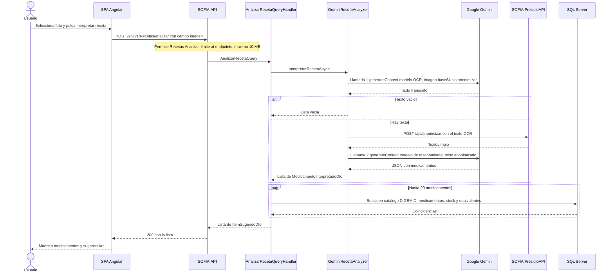
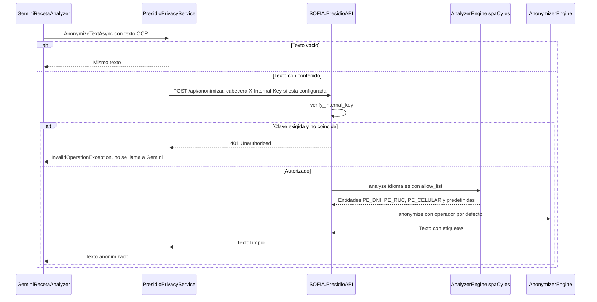
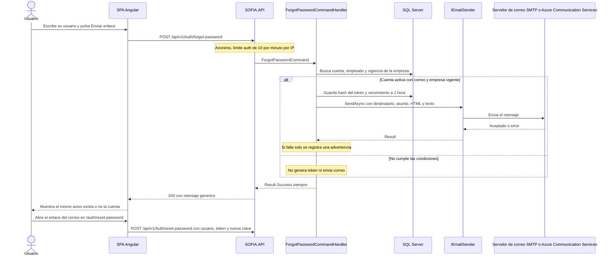
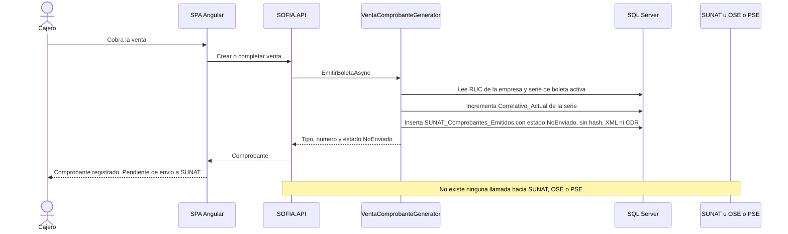
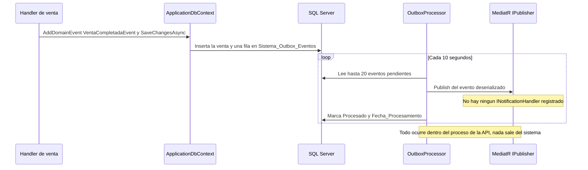

# Integraciones externas de SOFIA: estado actual

| | |
|---|---|
| **Sistema** | SOFIA — Sistema Optimizado Farmacéutico con Inteligencia Artificial |
| **Versión del documento** | 1.1 |
| **Fecha** | 2026-10-14 |
| **Backend** | `sofia-apis`, rama `main`, commit `43f5529` |
| **Frontend** | `sofia-web-spa`, rama `main`, commit `eeffbb6` |
| **Método** | Lectura de código, scripts DbUp, archivos de configuración versionados (`appsettings*.json`, `docker-compose.yml`, `.env.example`, `angular.json`, `staticwebapp.config.json`) y archivos i18n. No se llamó a ningún servicio externo, no se usó el navegador ni la API local, y no se abrió ningún archivo `.env` real ni secretos de usuario. |

## Historial de cambios

### Versión 1.1 (2026-10-14)

Reconciliación con el código actual (`sofia-apis` `00991bc` → `43f5529`, `sofia-web-spa` `31af681` → `eeffbb6`). Ninguna integración externa cambió: no hay clientes HTTP, servicios ni dominios nuevos; los cambios son marcas «En curso» que ya se commitearon y líneas desplazadas.

| Apartado | Decía | Dice ahora | Commit |
|---|---|---|---|
| 5.1, anulación de comprobantes | Citaba `AnularVentaCommandHandler.cs` líneas 61-69 del commit y 70-76 del árbol de trabajo (**En curso**). | Líneas 68-76 del commit actual (el handler suma la resolución de la caja de anulación y el comprobante se anula igual). Sin marca. | `358935e` |
| 5.3, textos de `pos/es.json` | Líneas del commit anterior (238, 239, 241, 357 a 361, 344, 118), con la marca **En curso**. | Líneas 239, 240, 242, 358 a 362, 345 y 119 (el archivo ganó la clave `anularSinSesionAbierta` en la línea 103 y ya está commiteado). Los textos no cambiaron. | `0310dad` |
| 5.3, diálogo de comprobante | `comprobante-dialog.component.html:128-133` para «Estado SUNAT» del comprobante impreso. | `:142-147` (el comprobante impreso agrega vuelto y presentación de venta); `:5` y `:15-20` no cambian. | `063817c` |
| 8.2 (recursos del navegador) | `index.html` agregaba localmente `<script src="environment.js">`; `angular.json` tenía cambios locales (**En curso**). | Ambos commiteados: `index.html:18` carga `environment.js` (mismo origen, no es un recurso externo); `angular.json` cambia la configuración por defecto de compilación a `production` y los patrones de lint. Las líneas citadas de `angular.json` (`:28-32`, `:47`, `:69-76`) no se movieron. | `8f36125` |
| 2.1 y 2.5 (lector de recetas) | `nueva-venta.component.ts:150-151`, `:747`, `:750-765`, `:760-763`. | `:149-150`, `:746`, `:749-764`, `:759-762`. | `063817c` |
| 11.3 «En curso (sin commitear)» | Cuatro archivos con cambios locales. | Ninguno: `git status --short` está limpio en los dos repositorios. | `8f36125`, `358935e` |

Este documento describe **solo lo que existe hoy** en el código: toda salida de SOFIA hacia fuera de su propio proceso (servicios de terceros, microservicios propios, correo, recursos que el navegador descarga de otros dominios) y las integraciones que se suelen dar por hechas pero **no** existen (SUNAT, DIGEMID en línea). No contiene propuestas.

Convenciones:

- Las rutas se citan como `repo/ruta/archivo:línea`.
- De la configuración se dan **nombres de claves**, nunca valores secretos.
- «No verificado» significa que el dato no se puede comprobar leyendo el repositorio (por ejemplo, el comportamiento interno de una librería o la configuración de un entorno desplegado).

## 1. Inventario de salidas externas

### 1.1 Cómo se armó

Los CSV de `docs/_inventario` no incluyen un inventario de integraciones, así que este se construyó buscando en todo el código (excluyendo `bin`, `obj`, `dist` y `node_modules`):

- Backend: `HttpClient`, `IHttpClientFactory`, `AddHttpClient`, `SmtpClient`, `MailKit`, `Azure.`, `Google`, `WebRequest`, `RestClient`, `Refit`, `Polly`, `ApplicationInsights`, `OpenTelemetry`, `Serilog`, `Sentry`, `AddHostedService`, y una lista de proveedores habituales (colas, caché, almacenamiento, pagos, SMS, identidad, consulta de DNI y RUC).
- Configuración: `appsettings*.json`, `launchSettings.json`, `docker-compose.yml`, `.env.example`, los tres `Dockerfile`, los `requirements*.txt` y el flujo de GitHub Actions.
- Paquetes: todos los `.csproj`, `Directory.Build.props`, `package.json` y `requirements.txt`.
- SPA: todas las URL absolutas en `src` y `public`, llamadas `http.get/post/put/delete` cuyo destino no sea la API, `fetch`, `XMLHttpRequest`, `WebSocket`, `EventSource`, `sendBeacon`, y los recursos declarados en `index.html`, `angular.json`, hojas de estilo y `staticwebapp.config.json`.

### 1.2 Resultado

En el backend hay exactamente **dos clientes HTTP** (`sofia-apis/src/SOFIA.Infrastructure/DependencyInjection.cs:142-143`), **dos SDK de correo** (MailKit y Azure Communication Services) y **un proceso en segundo plano** (`DependencyInjection.cs:139`). En el SPA no hay llamadas de código a terceros; solo recursos estáticos (fuentes e iconos).

| N.º | Elemento encontrado | Tipo | ¿Sale del sistema en ejecución? | Apartado |
|---|---|---|---|---|
| 1 | Google Gemini (`GeminiRecetaAnalyzer`, `HttpClient` tipado) | Servicio de terceros en Internet | **Sí** | 2 |
| 2 | Presidio (`PresidioPrivacyService`, `HttpClient` tipado, y el microservicio `SOFIA.PresidioAPI`) | Microservicio propio | Sale del proceso de la API, no de la infraestructura | 3 |
| 3 | Correo por SMTP (`SmtpEmailSender`, paquete `MailKit`) | Servidor de correo | **Sí** (en local, a Mailpit) | 4 |
| 4 | Correo por Azure Communication Services (`AzureCommunicationEmailSender`, paquete `Azure.Communication.Email`) | Servicio de terceros en Internet | **Sí**, cuando es el proveedor elegido | 4 |
| 5 | Correo desactivado (`DisabledEmailSender`) | Sustituto local | No | 4.2, 4.5 |
| 6 | Mailpit (servicio de `docker-compose.yml`) | Herramienta local | No (captura el correo) | 4.6 |
| 7 | Claves `App:FrontendBaseUrl` y `AllowedOrigins` (URL del SPA) | Configuración | No (se usan para armar el enlace y para CORS) | 4.2, 8.3 |
| 8 | Tablas `SUNAT_Series_Fiscales` y `SUNAT_Comprobantes_Emitidos`, estados de comprobante, textos «SUNAT» del SPA | Registro local | **No**: no hay integración | 5 |
| 9 | Catálogo `DIGEMID_Catalogo_Productos` (seed, carga masiva, búsqueda) y tablas `DIGEMID_*` de cuarentena y actas | Datos locales | **No**: no hay integración | 6 |
| 10 | `OutboxProcessor` y `Sistema_Outbox_Eventos` | Proceso interno | No | 7.1 |
| 11 | `Sistema_Notificaciones_Internas` | Solo esquema | No | 7.2 |
| 12 | Tablas `Recetas_Digitalizadas_IA` y `Registro_Privacidad_Presidio` | Solo esquema, sin uso | No | 2.3, 3.4 |
| 13 | SQL Server (`Microsoft.EntityFrameworkCore.SqlServer`, `dbup-sqlserver`, servicios `sqlserver` y `sofia-dbup`) | Base de datos propia | Sale del proceso, no de la infraestructura | 8.1 |
| 14 | Serilog (consola y archivo) | Registro local | No | 8.4 |
| 15 | Application Insights, OpenTelemetry, Sentry, Seq, Datadog | — | No existen | 8.4 |
| 16 | Autenticación JWT propia; proveedores de identidad externos | — | No existen proveedores externos | 8.5 |
| 17 | Métodos de pago (`MetodoPago`); pasarelas de pago | — | No existen pasarelas | 8.5 |
| 18 | Consulta de DNI o RUC, almacenamiento en la nube, SMS, WhatsApp, push, Redis, colas | — | No existen | 8.5 |
| 19 | ClosedXML (Excel) y `HtmlSanitizer` | Librerías locales | No | 8.5 |
| 20 | SPA → API propia (`environment.api.baseurl`) y `/i18n` | Mismo sistema | No es un tercero | 8.2, 8.3 |
| 21 | Google Fonts: fuente Manrope (`index.html`, `_variables.scss`) | Recurso estático de terceros | **Sí**, desde el navegador | 8.2 |
| 22 | Google Fonts: Material Icons (`index.html`) | Recurso estático de terceros | **Sí**, desde el navegador | 8.2 |
| 23 | Iconify (`@iconify/iconify` en `angular.json`; API pública autorizada en la política de contenido) | Recurso de terceros | **Sí**, desde el navegador | 8.2 |
| 24 | `staticwebapp.config.json` (Azure Static Web Apps) | Configuración de alojamiento | No aplica | 8.3 |
| 25 | `environment.js` y `window.__env` | Configuración en tiempo de ejecución, mismo origen | No | 8.2, 8.3 |
| 26 | Analítica, seguimiento, mapas, reCAPTCHA en el SPA | — | No existen | 8.2 |
| 27 | `appsettings.json`, `appsettings.Development.json`, `appsettings.Testing.json` | Configuración | — | 2.2, 4.2, 8.1 |
| 28 | `docker-compose.yml` (servicios `sqlserver`, `presidio-api`, `sofia-api`, `mailpit`, `sofia-dbup`) | Configuración local | — | 2.6, 3.6, 4.6, 8.1 |
| 29 | `.env.example` | Configuración (solo nombres de variables) | — | 2.2, 3.3, 4.6 |
| 30 | `Dockerfile` de la API, de DbUp y de Presidio; imágenes base | Compilación | Solo al construir | 3.6, 8.6 |
| 31 | `requirements.txt` y `requirements-model.txt` (PyPI y rueda de GitHub) | Compilación | Solo al construir | 3.2, 8.6 |
| 32 | Paquetes NuGet y npm | Compilación | Solo al construir | 8.6 |
| 33 | GitHub Actions `security.yml` (NVD, gitleaks) | Integración continua | Solo en CI | 8.6 |
| 34 | Husky.Net, husky, commitlint, SonarAnalyzer | Herramientas de desarrollo | No | 8.6 |
| 35 | `launchSettings.json` y `SOFIA.API.http` (puertos locales) | Desarrollo | No | 1.3 |
| 36 | Endpoints de salud (`/health` de la API y de Presidio) | Entrada, no salida | No | 3.3, 1.3 |

### 1.3 Elementos menores sin apartado propio

- `sofia-apis/src/SOFIA.API/Properties/launchSettings.json:8`, `:17`: la API local escucha en `http://localhost:5300` y `https://localhost:7300`; el SPA en desarrollo apunta a `https://localhost:7300` (`sofia-web-spa/src/environments/environment.ts:7`).
- `sofia-apis/src/SOFIA.API/SOFIA.API.http:1` apunta a `http://localhost:5072`, un puerto que no coincide con `launchSettings.json`. Es un archivo de pruebas manuales desactualizado.
- `sofia-apis/src/SOFIA.API/appsettings.Testing.json:2` define `AllowedOrigins` con `http://localhost:3000` para las pruebas.
- La API expone `GET /health` anónimo (`sofia-apis/src/SOFIA.API/Program.cs:136-143`); lo usa la comprobación de salud del contenedor (`sofia-apis/docker-compose.yml:76-81`). No comprueba el estado de Gemini, Presidio, el correo ni la base de datos.
- `sofia-web-spa/angular.json:28-32` lista `pdfmake` en `allowedCommonJsDependencies`, pero `pdfmake` no está en `sofia-web-spa/package.json`: es configuración sin uso, no una dependencia.

## 2. Google Gemini (lectura de recetas con IA)

**Estado: implementada.** Es la única llamada del backend a un servicio de un tercero en Internet durante el uso normal de la aplicación (junto con el correo, cuando el proveedor es Azure o un SMTP externo).

### 2.1 Para qué se usa y desde dónde

Interpreta la foto de una receta médica y devuelve una lista de medicamentos sugeridos, cruzados con el catálogo y el stock de la sucursal.

| Elemento | Valor | Fuente |
|---|---|---|
| Endpoint de SOFIA | `POST /api/v1/Recetas/analizar` (`multipart/form-data`, campo `imagen`; parámetro de consulta opcional `especialidadContexto`) | `sofia-apis/src/SOFIA.API/Controllers/RecetasController.cs:47-64` |
| Permiso | `Recetas:Analizar` | `sofia-apis/src/SOFIA.API/Controllers/RecetasController.cs:48` |
| Límite de peticiones | Política `ai-endpoints` | `sofia-apis/src/SOFIA.API/Controllers/RecetasController.cs:49` |
| Query de aplicación | `AnalizarRecetaQuery(Stream ImagenStream, string? EspecialidadContexto)` | `sofia-apis/src/SOFIA.Application/Recetas/Queries/AnalizarReceta/AnalizarRecetaQuery.cs:6` |
| Handler | `AnalizarRecetaQueryHandler` | `sofia-apis/src/SOFIA.Application/Recetas/Queries/AnalizarReceta/AnalizarRecetaQueryHandler.cs:9-38` |
| Validador | `AnalizarRecetaQueryValidator`: `EspecialidadContexto` de máximo 50 caracteres y solo letras y espacios (`^[\p{L} ]*$`), porque se interpola en el prompt | `sofia-apis/src/SOFIA.Application/Recetas/Queries/AnalizarReceta/AnalizarRecetaQueryValidator.cs:7-14` |
| Servicio del SPA | `RecetaMedicaService.analizar(imagen, especialidadContexto?)` | `sofia-web-spa/src/app/pages/recetas-medicas/services/receta-medica.service.ts:52-58` |

Pantallas del SPA que lo invocan (las dos llaman a `analizar(imagen)` **sin** `especialidadContexto`):

| Pantalla | Dónde | Fuente |
|---|---|---|
| «Lector de Recetas IA» (clave `scanner.title` de `sofia-web-spa/public/i18n/recetas-medicas/es.json:56`), ruta `/recetas-medicas/escanear` | Botón «Interpretar receta» (`scanner.btn-interpret`, `es.json:62`) | Ruta: `sofia-web-spa/src/app/pages/recetas-medicas/recetas-medicas.routes.ts:8`; permiso de ruta `Analizar`: `sofia-web-spa/src/app/core/auth/route-permissions.ts:30`; llamada: `sofia-web-spa/src/app/pages/recetas-medicas/recetas-scanner/recetas-scanner.component.ts:70-87` |
| Punto de venta, nueva venta (pestaña de escaneo, visible solo con `Recetas:Analizar`) | Método `interpretarReceta()` | `sofia-web-spa/src/app/pages/pos/nueva-venta/nueva-venta.component.ts:149-150` y `:749-764` |

En ambos casos los `input` de archivo declaran `accept="image/*"` (`sofia-web-spa/src/app/pages/recetas-medicas/recetas-scanner/recetas-scanner.component.html:6-14`, `sofia-web-spa/src/app/pages/pos/nueva-venta/nueva-venta.component.html:242-250`) y el arrastre solo acepta archivos cuyo tipo empiece por `image/` (`recetas-scanner.component.ts:109`, `nueva-venta.component.ts:746`). Es un filtro del navegador; el backend no valida el tipo de archivo (ver 2.5).

### 2.2 Componentes

| Pieza | Detalle | Fuente |
|---|---|---|
| Interfaz | `IRecetaAnalyzer.InterpretarRecetaAsync(Stream imagenStream, string? especialidadContexto, CancellationToken)` devuelve `List<MedicamentoInterpretadoDto>` | `sofia-apis/src/SOFIA.Application/Common/Interfaces/IRecetaAnalyzer.cs:5-17` |
| Implementación | `GeminiRecetaAnalyzer` (usa `HttpClient`, `IConfiguration` e `IPrivacyService`) | `sofia-apis/src/SOFIA.Infrastructure/Services/GeminiRecetaAnalyzer.cs:9-19` |
| Registro en DI | `services.AddHttpClient<IRecetaAnalyzer, GeminiRecetaAnalyzer>()`, cliente tipado sin `BaseAddress`, sin `Timeout` explícito y sin manejadores de reintento | `sofia-apis/src/SOFIA.Infrastructure/DependencyInjection.cs:143` |
| Paquete | `Microsoft.Extensions.Http` 10.0.8. No hay SDK de Google: la llamada es HTTP directo | `sofia-apis/src/SOFIA.Infrastructure/SOFIA.Infrastructure.csproj:18` |

Configuración (sección `GeminiApi`, leída con `IConfiguration` en cada llamada; **no hay clase de opciones ni validación al arrancar**):

| Clave | Uso | Valor en `appsettings.json` | Valor por defecto en `docker-compose.yml` | Variable en `.env.example` |
|---|---|---|---|---|
| `GeminiApi:BaseUrl` | Prefijo de la URL | cadena vacía (`appsettings.json:22`) | `https://generativelanguage.googleapis.com/v1beta/models/` (`docker-compose.yml:53`) | `GEMINI_BASE_URL` (`.env.example:14`) |
| `GeminiApi:OcrModel` | Modelo de la primera llamada (OCR) | cadena vacía (`appsettings.json:23`) | `gemini-3.6-flash` (`docker-compose.yml:54`) | `GEMINI_OCR_MODEL` (`.env.example:15`) |
| `GeminiApi:ReasoningModel` | Modelo de la segunda llamada (razonamiento) | cadena vacía (`appsettings.json:24`) | `gemini-2.5-pro` (`docker-compose.yml:55`) | `GEMINI_REASONING_MODEL` (`.env.example:16`) |
| `GeminiApi:ApiKey` | Clave de la API (secreto) | cadena vacía (`appsettings.json:25`, `appsettings.Development.json:3`) | vacío si no se define (`docker-compose.yml:56`) | `GEMINI_API_KEY` (`.env.example:17`) |

Resolución del modelo (`sofia-apis/src/SOFIA.Infrastructure/Services/GeminiRecetaAnalyzer.cs:21`, `:66`, `:106`, `:200-202`):

- OCR: `GeminiApi:OcrModel`; si está vacío, la constante `DefaultModel = "gemini-3.6-flash"`.
- Razonamiento: `GeminiApi:ReasoningModel`; si está vacío, `GeminiApi:OcrModel`; si también está vacío, `DefaultModel`.

Observaciones sobre la configuración, deducidas del código (no ejecutadas):

- `GeminiApi:ApiKey` y `GeminiApi:BaseUrl` se leen con `?? throw` (`GeminiRecetaAnalyzer.cs:29`, `:67`, `:107`). Ese `throw` solo salta si la clave **no existe** en la configuración; `appsettings.json` la define como cadena vacía, así que con la configuración de fábrica no se lanza esa excepción concreta: la petición falla más adelante (URL relativa sin `BaseAddress` o rechazo de Gemini) y termina igualmente en un error 500 (ver 2.5).
- El mensaje de log de inicio dice «Gemini 1.5 API» (`GeminiRecetaAnalyzer.cs:27`), aunque el modelo real es el configurado. Es solo un texto de log desactualizado.

### 2.3 Qué datos salen, en qué orden y qué se guarda

Un análisis hace **como máximo dos llamadas a Gemini y una a Presidio**, en este orden fijo (`GeminiRecetaAnalyzer.cs:23-62`):

| Paso | Destino | Qué se envía | Fuente |
|---|---|---|---|
| 1 | **Gemini** (modelo OCR) | La **imagen completa de la receta, sin anonimizar**, en base64, más un prompt de OCR | `GeminiRecetaAnalyzer.cs:31-38` y `:64-102` |
| 2 | **Presidio** (microservicio interno) | El texto crudo devuelto por el OCR | `GeminiRecetaAnalyzer.cs:48-49` |
| 3 | **Gemini** (modelo de razonamiento) | El texto ya anonimizado, el prompt de sistema y la especialidad | `GeminiRecetaAnalyzer.cs:53-54` y `:104-198` |

> **La imagen de la receta se envía a Gemini ANTES de anonimizar.** El código convierte el archivo a base64 (`GeminiRecetaAnalyzer.cs:32-35`) y llama a `ExtractTextFromImageAsync` (`:38`); la anonimización con Presidio ocurre después (`:49`) y solo sobre el **texto** que devolvió esa primera llamada. Por tanto, todo lo que sea legible en la foto (nombre del paciente, DNI, edad, diagnóstico, nombre, colegiatura y firma del médico, establecimiento, medicamentos) sale del sistema hacia Google en el paso 1. Presidio solo protege la segunda llamada. Son datos personales y datos de salud.

Si el OCR devuelve texto vacío, el proceso termina con una lista vacía y **no** se llama ni a Presidio ni a la segunda petición de Gemini (`GeminiRecetaAnalyzer.cs:40-44`).

**Endpoint exacto.** `POST {GeminiApi:BaseUrl}{modelo}:generateContent` (`GeminiRecetaAnalyzer.cs:68` y `:108`). Con los valores por defecto del `docker-compose.yml` queda `https://generativelanguage.googleapis.com/v1beta/models/<modelo>:generateContent`.

**Autenticación.** La clave viaja en la **cabecera HTTP `x-goog-api-key`** (`GeminiRecetaAnalyzer.cs:89` y `:165`), no en la URL ni en la cadena de consulta.

**Llamada 1 (OCR), cuerpo JSON** (`GeminiRecetaAnalyzer.cs:70-83`):

| Campo | Contenido |
|---|---|
| `contents[0].parts[0].text` | Prompt de OCR (literal en el código, línea 78) |
| `contents[0].parts[1].inline_data.mime_type` | Siempre `"image/jpeg"`, fijo en el código (`:79`), sea cual sea el tipo real del archivo subido |
| `contents[0].parts[1].inline_data.data` | La imagen en base64 |
| `generationConfig` | No se envía |

Prompt de OCR (fragmento, `GeminiRecetaAnalyzer.cs:78`): «Eres un motor de OCR de alta precisión especializado en recetas médicas. […] No interpretes, solo transcribe exactamente lo que ves.»

**Llamada 2 (razonamiento), cuerpo JSON** (`GeminiRecetaAnalyzer.cs:144-159`):

| Campo | Contenido |
|---|---|
| `contents[0].role` | `"user"` |
| `contents[0].parts[0].text` | `promptSistema` + dos saltos de línea + `promptUsuario` (un solo bloque de texto; no se usa `systemInstruction`) |
| `generationConfig.temperature` | `0.2` |
| `generationConfig.response_mime_type` | `"application/json"` |

El prompt de sistema está literal en `GeminiRecetaAnalyzer.cs:110-138`. Presenta al modelo como «SOFIA, un asistente farmacéutico experto en el mercado de PERÚ» (`:111`) y le pide, en siete objetivos (`:117-123`): identificar medicamentos (nombre y concentración) por similitud fonética y marcas peruanas; ignorar las etiquetas de anonimización «`<PE_DNI>`, `<PERSON>`, `<LOCATION>` o `<DATE_TIME>`» (`:118`); corregir errores de lectura; sugerir de 1 a 3 genéricos o complementarios; asignar una confianza decimal de 0.0 a 1.0; ignorar nombres de hospitales o clínicas; y extraer la cantidad a dispensar como entero o `null`. Exige responder «ESTRICTAMENTE en formato JSON» con la forma `{ "medicamentos": [ { "NombreDetectado", "ConcentracionDetectada", "CantidadSugerida", "Sugerencias", "NivelConfianza" } ] }` (`:125-138`).

El prompt de usuario (`GeminiRecetaAnalyzer.cs:140-142`) contiene dos datos:

- `Contexto adicional`: la especialidad recibida o, si viene vacía, el texto fijo `Medicina General`. Como el SPA nunca envía la especialidad (ver 2.1), hoy siempre sale «Medicina General».
- `Texto OCR Sucio`: el texto anonimizado por Presidio.

**Qué se recibe.** De la llamada 1, el texto de `candidates[0].content.parts[0].text` (`GeminiRecetaAnalyzer.cs:94-101`). De la llamada 2, el mismo campo, que se interpreta como JSON y del que se lee la propiedad `medicamentos` hacia `List<MedicamentoInterpretadoDto>` (`:170-190`): `NombreDetectado`, `ConcentracionDetectada`, `CantidadSugerida`, `Sugerencias`, `NivelConfianza` (`IRecetaAnalyzer.cs:5-12`).

**Qué hace SOFIA con la respuesta** (todo local, sin más salidas): toma como máximo 20 medicamentos y 3 sugerencias por medicamento (`AnalizarRecetaQueryHandler.cs:16-17`, `:32`, `:107`), los busca en el catálogo DIGEMID cargado en la base y en el maestro de medicamentos con `IBuscadorService` (`:51`, `:68-72`; implementación sobre `IApplicationDbContext` en `sofia-apis/src/SOFIA.Infrastructure/Services/BuscadorFuzzyService.cs:8`), calcula la confianza final como `NivelConfianza × 0.6 + similitud × 0.4` (`:66`), y agrega stock de la sucursal del usuario y equivalentes terapéuticos (`:74-75`, `:132-205`). Devuelve `List<ItemSugeridoDto>` (`AnalizarRecetaQuery.cs:17-30`).

**Qué se guarda en base de datos: nada.** El handler y el analizador no hacen ninguna escritura:

- La imagen no se almacena (se lee del `IFormFile` a memoria, `RecetasController.cs:59`, `GeminiRecetaAnalyzer.cs:32-35`).
- El texto OCR, el texto anonimizado y la respuesta de Gemini no se persisten.
- Las tablas `Recetas_Digitalizadas_IA` (`sofia-apis/src/SOFIA.DbUp/Scripts/0001_Initial_Schema.sql:412-429`) y `Registro_Privacidad_Presidio` (`:520-536`) existen, con sus entidades y `DbSet` (`sofia-apis/src/SOFIA.Infrastructure/Persistence/ApplicationDbContext.cs:61-62`), pero ningún código llama a `RecetaDigitalizadaIA.Create` ni a `RegistroPrivacidadPresidio.Create` fuera de las propias entidades, ni usa esos `DbSet`. Están sin uso.
- `AnalizarRecetaQuery` no implementa `IAuditableCommand`, así que `AuditBehavior` no registra el análisis (`sofia-apis/src/SOFIA.Application/Common/Behaviors/AuditBehavior.cs:18-21`).

En los logs de la API quedan solo longitudes de texto (`GeminiRecetaAnalyzer.cs:46`, `:51`) y, si Gemini responde con error, el código de estado y el **cuerpo de la respuesta de error de Gemini** (`:211-216`), que además se incluye en el mensaje de la excepción (`:218-221`).

### 2.4 Secuencia



### 2.5 Errores y límites

| Situación | Qué ocurre | Fuente |
|---|---|---|
| No se adjunta imagen o está vacía | `400` con el texto plano `Image is required.` (no es un `ProblemDetails` con código) | `RecetasController.cs:54-57` |
| Archivo mayor de 10 MB | Dos límites de 10 MB en el endpoint: `RequestSizeLimit` (cuerpo completo) y `MultipartBodyLengthLimit` (parte del formulario). Si Kestrel lanza `BadHttpRequestException` con 413, el manejador global responde `413` con el código `Request.TooLarge`. **No verificado** por ejecución cuál de los dos límites actúa primero ni la respuesta exacta cuando es el límite del formulario el que salta | `RecetasController.cs:50-51`; `sofia-apis/src/SOFIA.API/Infrastructure/GlobalExceptionHandler.cs:13`, `:47-54` |
| Tipo de archivo | **No se valida en el backend**: no hay comprobación de extensión, de `ContentType` ni de contenido. Cualquier archivo se envía a Gemini declarado como `image/jpeg` | `RecetasController.cs:52-63`; `GeminiRecetaAnalyzer.cs:79` |
| `especialidadContexto` inválida | Falla el validador; el código de error es dinámico: `AnalizarRecetaQuery.EspecialidadContexto` | `AnalizarRecetaQueryValidator.cs:11-14`; regla de `ValidationBehavior` descrita en `docs/_inventario/REGLAS-AGENTES.md`, sección 4 |
| Más de 10 análisis por minuto de la misma empresa | Política `ai-endpoints`: ventana fija de 10 por minuto **por empresa** (claim `empresaId`; por IP si no hay claim), cola de 2; al superarla, `429` | `sofia-apis/src/SOFIA.API/Extensions/RateLimitingExtensions.cs:14`, `:42-49`, `:55-58` |
| Gemini responde con error HTTP (clave inválida, cuota, modelo inexistente, etc.) | `EnsureSuccessOrThrowAsync` registra el error y lanza `HttpRequestException`; `InterpretarRecetaAsync` la envuelve en `InvalidOperationException("Failed to analyze prescription image.")`. Nadie la captura: el manejador global responde `500` con título `Error del Servidor` y el `traceId`. **No hay un código de error de negocio para «IA no disponible»** | `GeminiRecetaAnalyzer.cs:58-61`, `:204-222`; `GlobalExceptionHandler.cs:56-79` |
| Gemini no responde | No hay `Timeout` configurado en el cliente ni reintentos ni circuit breaker (no existe ningún uso de Polly ni de `Microsoft.Extensions.Http.Resilience` en `sofia-apis/src`). Aplica el tiempo de espera por defecto de `HttpClient` de .NET (100 segundos; valor de la plataforma, no fijado en el código). El resultado es el mismo `500` | `DependencyInjection.cs:143`; `SOFIA.Infrastructure.csproj:8-21` |
| La respuesta de Gemini no trae `candidates[0].content.parts[0].text` | `GetProperty` lanza y se convierte en el mismo `500` | `GeminiRecetaAnalyzer.cs:95-99`, `:171-175`, `:58-61` |
| El JSON de la llamada 2 no se puede interpretar | Se registra el error y se devuelve lista vacía (respuesta `200` sin medicamentos) | `GeminiRecetaAnalyzer.cs:182-197` |
| Falla Presidio | Se aborta antes de la llamada 2 (ver 3.5); resultado `500` | `sofia-apis/src/SOFIA.Infrastructure/Services/PresidioPrivacyService.cs:36-41` |

Lo que ve el usuario ante cualquier error: «Error al interpretar la receta. Intenta nuevamente.» (clave `scanner.error`, `sofia-web-spa/public/i18n/recetas-medicas/es.json:76`; usada en `recetas-scanner.component.ts:82-85` y `nueva-venta.component.ts:759-762`). Si la lista llega vacía: «No se detectaron medicamentos en la imagen. Intenta con una foto más nítida.» (`scanner.no-results`, `es.json:75`).

### 2.6 Local frente a producción

- **Con `docker-compose.yml`**: el contenedor `sofia-api` recibe las cuatro claves `GeminiApi__*` desde variables de entorno con los valores por defecto indicados en 2.2 (`docker-compose.yml:53-56`). Sin `GEMINI_API_KEY` el servicio arranca igual (la variable admite vacío) y el análisis falla en tiempo de ejecución.
- **Ejecutando la API fuera de Docker**: `appsettings.json` y `appsettings.Development.json` dejan las cuatro claves vacías; los valores reales deben venir de secretos de usuario (el proyecto declara `UserSecretsId` en `sofia-apis/src/SOFIA.API/SOFIA.API.csproj:12`) o de variables de entorno. **No verificado** qué valores hay en los secretos de usuario (las reglas prohíben listarlos).
- **Producción**: no hay en el repositorio ningún archivo de despliegue del backend (ni `appsettings.Production.json`, ni infraestructura como código, ni pipeline de despliegue). El código no distingue entornos para Gemini: no existe simulador ni modo sin conexión; siempre llama al servicio real. En las pruebas automatizadas el analizador se ejercita con un `HttpMessageHandler` falso (`RecordingHandler`) y un `IPrivacyService` que no anonimiza (`PassThroughPrivacyService`), sin salir a Internet (`sofia-apis/src/SOFIA.IntegrationTests/Recetas/GeminiRecetaAnalyzerTests.cs:15-32`, `:43-45`).

## 3. Presidio (microservicio interno de anonimización)

**Estado: implementada.** No es un servicio de terceros: es un microservicio propio (`sofia-apis/src/SOFIA.PresidioAPI`, Python con FastAPI) que usa las librerías de Microsoft Presidio y corre junto a la API. Los datos que recibe no salen de la infraestructura de SOFIA.

### 3.1 Para qué se usa y desde dónde

Reemplaza datos personales del texto OCR de la receta antes de la segunda llamada a Gemini. Su único consumidor es `GeminiRecetaAnalyzer` (`sofia-apis/src/SOFIA.Infrastructure/Services/GeminiRecetaAnalyzer.cs:49`), es decir, el mismo endpoint `POST /api/v1/Recetas/analizar` con permiso `Recetas:Analizar` descrito en 2.1. No hay pantalla ni endpoint propio de anonimización que lo use. El endpoint `Auditoria` de anonimización de datos (`sofia-apis/src/SOFIA.API/Controllers/AuditoriaController.cs:13`) **no** usa Presidio: `IPrivacyService` no se inyecta en ningún handler de `SOFIA.Application`.

### 3.2 Componentes

| Pieza | Detalle | Fuente |
|---|---|---|
| Interfaz | `IPrivacyService.AnonymizeTextAsync(string rawText, CancellationToken)` | `sofia-apis/src/SOFIA.Application/Common/Interfaces/IPrivacyService.cs:3-6` |
| Implementación (cliente) | `PresidioPrivacyService` | `sofia-apis/src/SOFIA.Infrastructure/Services/PresidioPrivacyService.cs:8-49` |
| Registro en DI | `AddHttpClient<IPrivacyService, PresidioPrivacyService>` con `ConfigurePresidioClient` | `sofia-apis/src/SOFIA.Infrastructure/DependencyInjection.cs:142`, `:188-199` |
| Microservicio | `main.py` (FastAPI, un solo archivo) | `sofia-apis/src/SOFIA.PresidioAPI/main.py` |
| Dependencias Python | `fastapi==0.142.1`, `uvicorn==0.54.0`, `presidio-analyzer==2.2.351`, `presidio-anonymizer==2.2.351`, `spacy==3.7.5`, `pydantic==2.13.5` | `sofia-apis/src/SOFIA.PresidioAPI/requirements.txt:1-6` |
| Modelo de lenguaje | `es_core_news_md` 3.7.0, instalado desde la rueda publicada en GitHub por `explosion/spacy-models`, verificada por hash SHA-256 | `sofia-apis/src/SOFIA.PresidioAPI/requirements-model.txt:1` |

Configuración:

| Clave | Lado | Uso | Fuente |
|---|---|---|---|
| `PresidioApi:BaseUrl` | API .NET | Dirección base del microservicio. No está en `appsettings.json`. Si falta, se lanza `InvalidOperationException("CRITICAL: Presidio URL (PresidioApi:BaseUrl) is not configured.")` | `DependencyInjection.cs:190-191` |
| `PresidioApi:InternalKey` | API .NET | Secreto compartido opcional. Si tiene valor, se agrega la cabecera `X-Internal-Key` a todas las peticiones | `DependencyInjection.cs:193-198` |
| `PRESIDIO_INTERNAL_KEY` | Microservicio (variable de entorno) | El mismo secreto; vacío desactiva la comprobación | `main.py:12`, `:18-21` |

La comprobación de `PresidioApi:BaseUrl` está dentro del delegado de configuración del `HttpClient`, que se ejecuta al construir el cliente y no al arrancar la aplicación (deducido del uso de `AddHttpClient`, `DependencyInjection.cs:142`; no ejecutado). No hay validación de Presidio al arrancar ni comprobación de salud desde la API.

### 3.3 Endpoints del microservicio

| Método y ruta | Autenticación | Entrada | Salida | Fuente |
|---|---|---|---|---|
| `GET /health` | Ninguna | — | `{"status": "healthy", "service": "presidio-api"}` | `main.py:99-101` |
| `POST /api/anonimizar` | Cabecera `X-Internal-Key` (solo si el microservicio tiene `PRESIDIO_INTERNAL_KEY`) | `{"texto": "<texto>"}`, máximo 20 000 caracteres | `{"TextoLimpio": "<texto anonimizado>"}` | `main.py:11`, `:96-97`, `:103-116` |

La documentación interactiva y el esquema OpenAPI están desactivados (`docs_url=None, redoc_url=None, openapi_url=None`, `main.py:15`).

**Autenticación entre la API y Presidio.** Secreto compartido en la cabecera interna `X-Internal-Key`. El microservicio lo compara en tiempo constante con `hmac.compare_digest` y responde `401` con detalle `Unauthorized` si no coincide (`main.py:18-21`). La comprobación **solo se exige cuando `PRESIDIO_INTERNAL_KEY` tiene valor**; en `docker-compose.yml` y `.env.example` el valor por defecto es vacío (`docker-compose.yml:27`, `:52`; `.env.example:10-11`), de modo que por defecto el microservicio acepta peticiones sin autenticación. No hay TLS entre ambos: la URL del compose es `http://presidio-api:8000` (`docker-compose.yml:51`).

### 3.4 Qué detecta y cómo anonimiza

Motor: spaCy con el modelo en español `es_core_news_md`; único idioma soportado `es` (`main.py:53-58`, `:93`).

Reconocedores:

| Entidad | Origen | Patrón | Puntaje | Palabras de contexto | Fuente |
|---|---|---|---|---|---|
| `PE_DNI` | Personalizado | `\b\d{8}\b` (ocho dígitos) | 0.85 | dni, documento, identidad, doc, identificacion, nro, numero, n°, id | `main.py:24`, `:28`, `:63-71` |
| `PE_RUC` | Personalizado | `\b(?:10\|15\|17\|20)\d{9}\b` (once dígitos que empiezan por 10, 15, 17 o 20) | 0.85 | ruc, registro, unico, contribuyente, empresa, razon, social | `main.py:25`, `:29`, `:73-81` |
| `PE_CELULAR` | Personalizado | `\b9\d{2}[\s\-\.]?\d{3}[\s\-\.]?\d{3}\b` (nueve dígitos que empiezan por 9, con separadores opcionales) | 0.85 | celular, cel, telefono, tel, movil, fono, telf, contacto, llamar | `main.py:26`, `:30`, `:83-91` |
| Predefinidas de Presidio para español | `registry.load_predefined_recognizers(nlp_engine=nlp_engine, languages=["es"])` | Las que traiga `presidio-analyzer` 2.2.351 para `es` | — | — | `main.py:60-61` |

**No verificado**: la lista exacta de entidades predefinidas que quedan activas para español (depende de la librería y del modelo spaCy; habría que ejecutar el servicio). El prompt de razonamiento da por hecho que pueden aparecer `<PERSON>`, `<LOCATION>` y `<DATE_TIME>` además de `<PE_DNI>` (`GeminiRecetaAnalyzer.cs:118`).

Lista de permitidos (`ALLOW_LIST`, `main.py:32-49`): 46 nombres de medicamentos (de «Paracetamol» a «Apronax») y términos farmacéuticos (formas como «tableta», «jarabe», «ampolla»; unidades como «mg», «ml», «ui»; vías como «vo», «iv», «im»; posología como «c/8h», «cada», «horas»; y palabras como «receta», «diagnóstico», «dx», «tratamiento», «cmp», «rne»). Lo que coincide con la lista no se marca como dato personal (`main.py:106-110`).

Análisis: `analyzer.analyze(text, language="es", allow_list=ALLOW_LIST)`, sin filtro de entidades ni umbral de puntaje explícito (`main.py:106-110`).

**Operadores de anonimización.** `anonymizer.anonymize(text=..., analyzer_results=...)` se llama **sin** el parámetro `operators` (`main.py:113`), así que se aplica el operador por defecto de `presidio-anonymizer` para todas las entidades. El código no define enmascarado, hash ni cifrado propios. El formato esperado del reemplazo es la etiqueta con el nombre de la entidad entre signos de menor y mayor, como asume el prompt (`GeminiRecetaAnalyzer.cs:118`). **No verificado** por ejecución.

**Qué recibe y qué devuelve.** Recibe el texto OCR completo, con datos personales y de salud. Devuelve solo el texto anonimizado: **no devuelve la lista de entidades detectadas, ni posiciones, ni puntajes** (`main.py:116`). `main.py` no escribe el texto en ningún log ni lo persiste.

**`Registro_Privacidad_Presidio`: no se registra nada.** La tabla está definida (`sofia-apis/src/SOFIA.DbUp/Scripts/0001_Initial_Schema.sql:520-536`) con las columnas `Anonimizacion_ID`, `Procesamiento_ID` (clave foránea a `Recetas_Digitalizadas_IA`), `Entidad_Detectada`, `Texto_Original_Encriptado`, `Texto_Reemplazo`, `Nivel_Riesgo_PII`, `Fecha_Auditoria` y las de auditoría. Existen la entidad (`sofia-apis/src/SOFIA.Domain/Entities/RegistroPrivacidadPresidio.cs:5-17`), su configuración EF y el `DbSet` (`sofia-apis/src/SOFIA.Infrastructure/Persistence/ApplicationDbContext.cs:61`; `sofia-apis/src/SOFIA.Application/Common/Interfaces/IApplicationDbContext.cs:56`). Pero:

- Ningún código invoca `RegistroPrivacidadPresidio.Create(...)` fuera de la entidad, ni lee o escribe el `DbSet` `RegistrosPrivacidadPresidio`.
- `PresidioPrivacyService` no recibe el contexto de base de datos (`PresidioPrivacyService.cs:8`).
- El microservicio no devuelve los datos que la tabla necesitaría (entidad detectada, texto original, nivel de riesgo).

La tabla permanece vacía por diseño actual del código: **Pendiente**.

### 3.5 Errores: comportamiento cerrado ante fallos

`PresidioPrivacyService.AnonymizeTextAsync` es **fail-closed** (`PresidioPrivacyService.cs:20-41`):

```csharp
catch (Exception ex)
{
    // Fail-closed: patient text must never reach an external LLM unanonymized.
    _logger.LogError(ex, "Critical error connecting to Microsoft Presidio; refusing to process unanonymized patient data.");
    throw new InvalidOperationException("Failed to anonymize patient text via Presidio.", ex);
}
```

| Situación | Qué ocurre | Fuente |
|---|---|---|
| Texto vacío o solo espacios | Se devuelve tal cual, sin llamar al microservicio | `PresidioPrivacyService.cs:15-18` |
| Presidio caído, sin red o respuesta no exitosa (incluye `401` por clave incorrecta) | `EnsureSuccessStatusCode` o el propio `HttpClient` lanzan; se registra el error y se lanza `InvalidOperationException`. **El texto sin anonimizar no se envía a Gemini** | `PresidioPrivacyService.cs:24-25`, `:36-41` |
| Presidio responde con `TextoLimpio` vacío o nulo | Se trata como fallo y se lanza | `PresidioPrivacyService.cs:29-32` |
| Texto OCR de más de 20 000 caracteres | El modelo `TextoRequest` lo rechaza por validación (`max_length`); la respuesta no exitosa cae en el caso anterior. El código HTTP exacto es el estándar de FastAPI y es **No verificado** por ejecución | `main.py:11`, `:96-97` |
| Tiempo de espera y reintentos | No configurados: sin `Timeout` explícito, sin reintentos | `DependencyInjection.cs:142`, `:188-199` |

En todos los casos de fallo, `GeminiRecetaAnalyzer` envuelve la excepción (`GeminiRecetaAnalyzer.cs:58-61`) y la API responde `500` con título `Error del Servidor` (`sofia-apis/src/SOFIA.API/Infrastructure/GlobalExceptionHandler.cs:56-79`). No hay código de error de negocio específico.

Alcance real de la protección: el comportamiento cerrado protege **solo la segunda llamada a Gemini**. Cuando Presidio falla, la imagen ya fue enviada a Gemini en la primera llamada (ver 2.3).

### 3.6 Dockerfile, comprobación de salud y despliegue

| Aspecto | Detalle | Fuente |
|---|---|---|
| Imagen base | `python:3.10.21-slim`, fijada por digest | `sofia-apis/src/SOFIA.PresidioAPI/Dockerfile:1` |
| Instalación | `pip install -r requirements.txt` y luego el modelo spaCy con `--no-deps --require-hashes` | `Dockerfile:7-11` |
| Usuario | No root: usuario `presidio` con UID 10001 | `Dockerfile:15-16` |
| Arranque | `uvicorn main:app --host 0.0.0.0 --port 8000` | `Dockerfile:18-20` |
| Servicio en compose | `presidio-api`, contenedor `sofia-presidio`, publicado solo en la interfaz local `127.0.0.1:8001` hacia el puerto 8000 del contenedor | `sofia-apis/docker-compose.yml:21-29` |
| Comprobación de salud | Petición a `http://localhost:8000/health` con `urllib` cada 20 s, tiempo de espera 15 s, 5 reintentos, periodo inicial de 90 s | `sofia-apis/docker-compose.yml:30-35` |
| Dependencia | `sofia-api` espera a que `presidio-api` esté `service_healthy` | `sofia-apis/docker-compose.yml:69-73` |

- **Local con compose**: la API usa `PresidioApi__BaseUrl=http://presidio-api:8000` (`docker-compose.yml:51`).
- **Local con la API fuera de Docker**: `PresidioApi:BaseUrl` debe aportarse por secretos de usuario o variable de entorno; el contenedor queda accesible en `http://localhost:8001` según el mapeo de puertos. **No verificado** qué valor hay configurado en los secretos de usuario.
- **Producción**: no hay en el repositorio definición de despliegue del microservicio fuera del `docker-compose.yml` (que fija `ASPNETCORE_ENVIRONMENT=Development` para la API, `docker-compose.yml:45`). **No verificado** dónde ni cómo se despliega Presidio en un entorno productivo.

### 3.7 Secuencia



## 4. Correo electrónico

**Estado: implementada**, con un único correo: la recuperación de contraseña.

### 4.1 Para qué se usa y desde dónde

| Elemento | Valor | Fuente |
|---|---|---|
| Pantalla del SPA | «Recupera tu contraseña» (clave `forgotPage.title`), ruta `/auth/forgot-password`, botón «Enviar enlace» (`forgotPage.submit`). Se llega desde el enlace «¿Olvidaste tu contraseña?» (`forgot`) del inicio de sesión | `sofia-web-spa/public/i18n/auth/es.json:9`, `:28-33`; `sofia-web-spa/src/app/app.routes.ts:23-25`; `sofia-web-spa/src/app/pages/auth/login/login.component.html:116` |
| Llamada del SPA | `AuthService.forgotPassword(nombreUsuario)` hace `POST {api}/forgot-password` con `{ nombreUsuario }` | `sofia-web-spa/src/app/core/auth/auth.service.ts:105-107`; `sofia-web-spa/src/app/pages/auth/forgot-password/forgot-password.component.ts:45-65` |
| Endpoint | `POST /api/v1/Auth/forgot-password`, anónimo, política de límite `auth` | `sofia-apis/src/SOFIA.API/Controllers/AuthController.cs:104-111` |
| Permiso | Ninguno (`[AllowAnonymous]`) | `sofia-apis/src/SOFIA.API/Controllers/AuthController.cs:106` |
| Command | `ForgotPasswordCommand(string NombreUsuario)` | `sofia-apis/src/SOFIA.Application/Security/Commands/ForgotPassword/ForgotPasswordCommand.cs:8` |
| Handler | `ForgotPasswordCommandHandler` | `sofia-apis/src/SOFIA.Application/Security/Commands/ForgotPassword/ForgotPasswordCommandHandler.cs:10-43` |
| Validador | `NombreUsuario` obligatorio, máximo 50 caracteres | `sofia-apis/src/SOFIA.Application/Security/Commands/ForgotPassword/ForgotPasswordCommandValidator.cs:7-9` |

**Lista completa de correos que envía el sistema hoy: uno.** `IEmailSender.SendAsync` tiene un único punto de llamada en todo `sofia-apis/src` fuera de las pruebas: `ForgotPasswordCommandHandler.cs:32`. No hay correos de bienvenida, de alta de cuenta, de registro de empresa, de comprobantes, de alertas de stock ni de ningún otro tipo.

| Correo | Asunto | Plantillas | Datos que incluye | Fuente |
|---|---|---|---|---|
| Recuperación de contraseña | `Restablece tu contraseña de SOFIA` | `PasswordRecovery.html` y `PasswordRecovery.txt`, recursos incrustados en `SOFIA.Application` | `{{NOMBRE}}` = nombres del empleado (`Empleado.Nombres`); `{{USUARIO}}` = nombre de usuario de la cuenta; `{{ENLACE}}` = enlace de restablecimiento | `sofia-apis/src/SOFIA.Application/Security/PasswordRecoveryEmail.cs:8-27`; `sofia-apis/src/SOFIA.Application/Security/Templates/PasswordRecovery.html:18-26`; `sofia-apis/src/SOFIA.Application/Security/Templates/PasswordRecovery.txt:1-12`; `sofia-apis/src/SOFIA.Application/SOFIA.Application.csproj:16`; `ForgotPasswordCommandHandler.cs:31` |

El texto del correo indica que «El enlace es válido por 1 hora y solo puede usarse una vez» (`PasswordRecovery.txt:8`) y cierra con el nombre completo del sistema (`PasswordRecovery.txt:12`, `PasswordRecovery.html:30`). En la parte HTML los tres valores se codifican con `WebUtility.HtmlEncode` (`PasswordRecoveryEmail.cs:15-19`).

### 4.2 Componentes

| Pieza | Detalle | Fuente |
|---|---|---|
| Interfaz | `IEmailSender.SendAsync(EmailMessage, CancellationToken)` devuelve `Result` | `sofia-apis/src/SOFIA.Application/Common/Interfaces/IEmailSender.cs:6-9` |
| Mensaje | `EmailMessage(string To, string Subject, string HtmlBody, string TextBody)` | `sofia-apis/src/SOFIA.Application/Common/Models/EmailMessage.cs:3` |
| Enlaces al SPA | `IFrontendLinks.PasswordReset(token, nombreUsuario)`, implementado en `FrontendLinks` | `sofia-apis/src/SOFIA.Application/Common/Interfaces/IFrontendLinks.cs:3-7`; `sofia-apis/src/SOFIA.Infrastructure/Email/FrontendLinks.cs:6-10` |
| Proveedor `Smtp` | `SmtpEmailSender`, con MailKit 4.18.1 | `sofia-apis/src/SOFIA.Infrastructure/Email/SmtpEmailSender.cs:12-67`; `sofia-apis/src/SOFIA.Infrastructure/SOFIA.Infrastructure.csproj:13` |
| Proveedor `AzureCommunication` | `AzureCommunicationEmailSender`, con `Azure.Communication.Email` 1.1.0 y un `EmailClient` singleton | `sofia-apis/src/SOFIA.Infrastructure/Email/AzureCommunicationEmailSender.cs:12-45`; `sofia-apis/src/SOFIA.Infrastructure/SOFIA.Infrastructure.csproj:9`; `sofia-apis/src/SOFIA.Infrastructure/DependencyInjection.cs:183-184` |
| Proveedor `None` | `DisabledEmailSender`: descarta el mensaje y devuelve el error `Email.Disabled` | `sofia-apis/src/SOFIA.Infrastructure/Email/DisabledEmailSender.cs:9-16` |
| Registro en DI | Método `AddEmail` | `sofia-apis/src/SOFIA.Infrastructure/DependencyInjection.cs:146`, `:157-186` |

**Cómo se elige el proveedor** (`DependencyInjection.cs:173-185`), según `Email:Provider` (comparación sin distinguir mayúsculas):

1. Vacío o `None` → `DisabledEmailSender`.
2. `Smtp` → `SmtpEmailSender`.
3. Cualquier otro valor que haya pasado la validación (solo queda `AzureCommunication`) → `AzureCommunicationEmailSender`.

Opciones (`EmailOptions`, sección `Email`, y `AppOptions`, sección `App`). Ninguna está en `appsettings.json`; llegan por variables de entorno o secretos de usuario:

| Clave | Valor por defecto en el código | Uso | Fuente |
|---|---|---|---|
| `Email:Provider` | cadena vacía (equivale a `None`) | `None`, `Smtp` o `AzureCommunication` | `sofia-apis/src/SOFIA.Infrastructure/Email/EmailOptions.cs:5-10`, `:16` |
| `Email:FromAddress` | cadena vacía | Dirección remitente | `EmailOptions.cs:11` |
| `Email:FromDisplayName` | `SOFIA` | Nombre visible del remitente (solo lo usa SMTP; en Azure el nombre lo define el dominio de correo de ACS) | `EmailOptions.cs:12`; `SmtpEmailSender.cs:53`; `AzureCommunicationEmailSender.cs:39-44` |
| `Email:Smtp:Host` | cadena vacía | Servidor SMTP | `EmailOptions.cs:66` |
| `Email:Smtp:Port` | `587` | Puerto | `EmailOptions.cs:67` |
| `Email:Smtp:UseSsl` | `true` | Con `false` no hay cifrado; con `true`, TLS implícito en el puerto 465 y STARTTLS en el resto | `EmailOptions.cs:68-69`; `SmtpEmailSender.cs:61-66` |
| `Email:Smtp:UserName` | nulo | Usuario SMTP (opcional; solo se autentica si tiene valor) | `EmailOptions.cs:70`; `SmtpEmailSender.cs:26-29` |
| `Email:Smtp:Password` | nulo | Contraseña SMTP (secreto) | `EmailOptions.cs:71` |
| `Email:AzureCommunication:ConnectionString` | cadena vacía | Cadena de conexión de Azure Communication Services (secreto) | `EmailOptions.cs:74-77` |
| `App:FrontendBaseUrl` | cadena vacía | URL base del SPA para armar el enlace | `sofia-apis/src/SOFIA.Infrastructure/Email/AppOptions.cs:5-7` |

**Validación al arrancar** (falla rápido con `InvalidOperationException`; `DependencyInjection.cs:157-167`):

| Regla | Fuente |
|---|---|
| Fuera de `Development` y `Testing`, `Email:Provider` no puede ser vacío ni `None` | `EmailOptions.cs:20-28`; `DependencyInjection.cs:159-161` |
| Con proveedor activo, `Email:FromAddress` es obligatorio | `EmailOptions.cs:30-33` |
| `Smtp`: `Email:Smtp:Host` obligatorio, puerto entre 1 y 65535, y usuario y contraseña deben venir juntos | `EmailOptions.cs:35-48` |
| `AzureCommunication`: `Email:AzureCommunication:ConnectionString` obligatoria | `EmailOptions.cs:50-58` |
| Cualquier otro valor de proveedor es error | `EmailOptions.cs:60` |
| `App:FrontendBaseUrl` debe ser una URL absoluta `https` (se acepta `http` solo en `Development` y `Testing`). Se valida si el correo está activo o si el entorno no es de desarrollo | `AppOptions.cs:9-16`; `DependencyInjection.cs:163-167` |

### 4.3 Qué datos salen y qué se guarda

Condiciones para que se envíe (`ForgotPasswordCommandHandler.cs:18-25`): la cuenta existe por `NombreUsuario` (búsqueda sin filtro de empresa) y no está eliminada; `CuentaActiva` es verdadero; el empleado no está eliminado y tiene `Email`; y la empresa tiene suscripción vigente. Si no se cumple alguna, no se genera token ni se envía nada, y la respuesta es idéntica.

Datos que salen hacia el servidor SMTP o hacia Azure Communication Services, en un solo mensaje:

| Campo | Contenido | Dato personal |
|---|---|---|
| Remitente | `Email:FromAddress` (y `Email:FromDisplayName` en SMTP) | No |
| Destinatario | `Empleado.Email` (columna `Empleados.Email`, `sofia-apis/src/SOFIA.DbUp/Scripts/0022_Empleados_Email.sql:1-3`) | Sí: correo del empleado |
| Asunto | Texto fijo | No |
| Cuerpo HTML y texto | Nombres del empleado, nombre de usuario y enlace | Sí: nombres y usuario |
| Enlace | `{App:FrontendBaseUrl}/auth/reset-password#token=<token>&usuario=<usuario>`; el token en claro y el usuario van en el **fragmento** de la URL | Sí: credencial de un solo uso |
| Cabecera `Message-Id` (solo SMTP) | Generada con el dominio de la dirección remitente | No |

Fuentes: `FrontendLinks.cs:8-9`; `SmtpEmailSender.cs:50-59`; `AzureCommunicationEmailSender.cs:40-44`. No se envían datos de salud ni de pacientes.

Qué se recibe: de SMTP nada que se use; de Azure, el identificador de la operación, que solo se escribe en el log (`AzureCommunicationEmailSender.cs:35`). El envío por Azure usa `WaitUntil.Started`: la API no espera a la entrega (`AzureCommunicationEmailSender.cs:20-21`).

Qué se guarda en base de datos:

| Tabla | Columna | Contenido | Fuente |
|---|---|---|---|
| `Seguridad_Cuentas` | `Recovery_Token` | **Hash** SHA-256 en hexadecimal del token (el token en claro no se guarda) | `sofia-apis/src/SOFIA.DbUp/Scripts/0001_Initial_Schema.sql:795`; `sofia-apis/src/SOFIA.Domain/Entities/Cuenta.cs:104-109`; `sofia-apis/src/SOFIA.Application/Security/TokenHasher.cs:15-23` |
| `Seguridad_Cuentas` | `Recovery_Token_Expiry` | Momento actual más 1 hora | `0001_Initial_Schema.sql:796`; `Cuenta.cs:108` |

**No se guarda** el correo enviado, ni su estado, ni un historial de envíos: no existe tabla de correos. El SPA lee el token del fragmento, lo retira de la barra de direcciones y lo envía a `POST /api/v1/Auth/reset-password` (`sofia-web-spa/src/app/pages/auth/reset-password/reset-password.component.ts:73-79`, `:94`; `AuthController.cs:113-120`).

### 4.4 Secuencia



### 4.5 Errores y límites

| Situación | Qué ocurre | Fuente |
|---|---|---|
| El envío falla (SMTP o Azure) | El remitente devuelve `Result.Failure` con el código `Email.SendFailed`. El handler solo escribe una advertencia en el log con el identificador de la cuenta y el código, y **responde éxito igualmente**. El token queda válido durante su hora; el usuario puede pedir otro | `SmtpEmailSender.cs:14`, `:34-44`; `AzureCommunicationEmailSender.cs:23-33`; `ForgotPasswordCommandHandler.cs:32-37`, `:41` |
| Proveedor `None` (solo desarrollo y pruebas) | `DisabledEmailSender` registra una advertencia, descarta el mensaje y devuelve `Email.Disabled`; mismo tratamiento que el caso anterior | `DisabledEmailSender.cs:11-15` |
| Respuesta al cliente | Siempre `200` con `{ Message = "If the account exists, a recovery link will be sent to the registered contact." }`, exista o no la cuenta y se haya enviado o no el correo. Los códigos `Email.SendFailed` y `Email.Disabled` **nunca llegan al SPA** | `AuthController.cs:107-111` |
| Lo que ve el usuario | «Si el usuario existe y tiene un correo registrado, recibirás un enlace para restablecer tu contraseña. Revisa tu bandeja de entrada: el enlace es válido por 1 hora.» (`forgotPage.sent`) | `sofia-web-spa/public/i18n/auth/es.json:32` |
| Más de 10 solicitudes por minuto desde la misma IP | `429`. El SPA muestra «Demasiados intentos. Espera un minuto e inténtalo de nuevo.» (`recovery.tooManyRequests`); ante otro error, «No se pudo procesar la solicitud. Inténtalo de nuevo.» (`forgotPage.error`) | `sofia-apis/src/SOFIA.API/Extensions/RateLimitingExtensions.cs:14`, `:26-32`; `forgot-password.component.ts:59-63`; `auth/es.json:33`, `:52` |
| Reintentos y colas | No existen: un intento por solicitud, en línea, dentro de la misma petición HTTP. No hay cola de correos ni reenvío automático | `ForgotPasswordCommandHandler.cs:31-32` |
| Tiempo de espera | No se fija ninguno en el código; aplica el de MailKit o el del SDK de Azure. **No verificado** su valor | `SmtpEmailSender.cs:24-32`; `AzureCommunicationEmailSender.cs:21` |
| Cancelación de la petición | En SMTP, `OperationCanceledException` no se captura y se propaga | `SmtpEmailSender.cs:34` |
| Qué queda en los logs | SMTP: `MessageId` y solo el nombre del tipo de excepción. Azure: estado, código de error e identificador de operación. No se registra la dirección del destinatario ni el token | `SmtpEmailSender.cs:36-46`; `AzureCommunicationEmailSender.cs:25-35` |

Nota de comportamiento, deducida del código: `ForgotPasswordCommand` es un `ICommand`, por lo que `TransactionBehavior` lo envuelve en una transacción (`sofia-apis/src/SOFIA.Application/Common/Behaviors/TransactionBehavior.cs:16-37`); el correo se envía después de `SaveChangesAsync` (`ForgotPasswordCommandHandler.cs:29`) pero antes de confirmar la transacción.

### 4.6 Local frente a producción

| Entorno | Configuración | Fuente |
|---|---|---|
| Local con `docker-compose.yml` | Proveedor `Smtp` contra el servicio `mailpit` (`axllent/mailpit:v1.31.3`): host `mailpit`, puerto `1025`, sin TLS (`UseSsl=false`), sin usuario. Remitente por defecto `no-reply@sofia.local`, `App__FrontendBaseUrl` por defecto `http://localhost:4200`. Mailpit publica SMTP en `127.0.0.1:1025` y su interfaz web en `http://localhost:8025`. Los correos se quedan en Mailpit; no salen a Internet | `sofia-apis/docker-compose.yml:57-66`, `:74-75`, `:83-89` |
| Local con la API fuera de Docker | Sin configuración, `Email:Provider` queda vacío y en `Development` se usa `DisabledEmailSender` (los correos se descartan). Para probar hay que definir las claves `Email:*` y `App:FrontendBaseUrl` por secretos de usuario o variables de entorno; con el contenedor `mailpit` levantado, el SMTP local queda en `localhost:1025`. **No verificado** qué hay en los secretos de usuario | `DependencyInjection.cs:159-161`, `:173-176`; `sofia-apis/.env.example:19-31` |
| Pruebas de integración | Se fuerza `Email:Provider=None` y se sustituye `IEmailSender` por `CapturingEmailSender`: las pruebas nunca envían correo | `sofia-apis/src/SOFIA.IntegrationTests/Infrastructure/SofiaWebAppFactory.cs:63-65`, `:84-85` |
| Entorno desplegado | El comentario de `.env.example` indica para «Azure staging»: `EMAIL_PROVIDER=AzureCommunication`, remitente del tipo `DoNotReply@<guid>.azurecomm.net` y la cadena de conexión de ACS. Fuera de desarrollo la API no arranca sin proveedor de correo. **No verificado** qué proveedor usa cada entorno real | `sofia-apis/.env.example:19-21`; `EmailOptions.cs:20-28` |

## 5. SUNAT (facturación electrónica)

**Estado: no existe integración.** SOFIA numera y registra comprobantes en su propia base de datos, pero **no envía nada a SUNAT ni a un OSE o PSE, no firma digitalmente, no genera XML UBL y no recibe CDR**.

### 5.1 Qué se genera y se guarda hoy

Al cobrar una venta (`POST` de creación o de completar venta) se emite una **boleta** interna:

| Paso | Detalle | Fuente |
|---|---|---|
| Disparo | `VentaComprobanteGenerator.EmitirBoletaAsync` se llama desde `CreateVentaCommandHandler` y `CompletarVentaCommandHandler` | `sofia-apis/src/SOFIA.Application/Ventas/Commands/CreateVenta/CreateVentaCommandHandler.cs:104`; `sofia-apis/src/SOFIA.Application/Ventas/Commands/CompletarVenta/CompletarVentaCommandHandler.cs:90` |
| Requisitos | La empresa debe tener RUC (error `Venta.Empresa.SinRuc`) y la sucursal una serie de boleta activa (error `Venta.SerieBoleta.NoConfigurada`) | `sofia-apis/src/SOFIA.Application/Ventas/Common/VentaComprobanteGenerator.cs:15-29` |
| Numeración | `UPDATE SUNAT_Series_Fiscales SET Correlativo_Actual = Correlativo_Actual + 1 OUTPUT INSERTED.Correlativo_Actual` (correlativo local, atómico) | `sofia-apis/src/SOFIA.Infrastructure/Persistence/ApplicationDbContext.cs:180-188`; `VentaComprobanteGenerator.cs:44` |
| Montos | Precios con IGV incluido: gravado = total / 1.18 redondeado a 2 decimales; IGV = total − gravado; exonerado = 0 | `VentaComprobanteGenerator.cs:46-47`, `:53`, `:93-98` |
| Cliente | Datos del paciente o, si no hay, tipo `-`, número `00000000` y nombre `CLIENTE EVENTUAL` | `VentaComprobanteGenerator.cs:11-12`, `:81-91` |
| Registro | `SunatComprobanteEmitido.Create(...)` con hash `null`, estado `NoEnviado`, ruta XML `null`, ruta CDR `null` y URL de verificación `null` | `VentaComprobanteGenerator.cs:49-58`, `:65` |

El propio código lo dice en un comentario (`VentaComprobanteGenerator.cs:49`): «Not sent to SUNAT yet: hash, XML, CDR and verification URL stay empty until an OSE/PSE is integrated».

Al procesar una devolución se emite una **nota de crédito** interna con la misma mecánica: correlativo local, mismos datos de cliente que el comprobante de origen, hash y rutas en `null` y estado `NoEnviado` (`sofia-apis/src/SOFIA.Application/Devoluciones/Commands/ProcesarDevolucion/ProcesarDevolucionCommandHandler.cs:196-216`).

Al anular una venta, sus comprobantes no anulados pasan a estado `Anulado` con `SunatComprobanteEmitido.Anular()` (`sofia-apis/src/SOFIA.Domain/Entities/SunatComprobanteEmitido.cs:155-162`; `sofia-apis/src/SOFIA.Application/Ventas/Commands/AnularVenta/AnularVentaCommandHandler.cs:68-76`). La anulación es solo un cambio de estado local: no se comunica una baja a SUNAT.

Tabla `SUNAT_Comprobantes_Emitidos` (`sofia-apis/src/SOFIA.DbUp/Scripts/0001_Initial_Schema.sql:559-586`):

| Columna | Qué se guarda hoy |
|---|---|
| `Comprobante_ID`, `Transaccion_ID`, `Serie_ID`, `Numero_Correlativo`, `Fecha_Emision` | Identificador, venta, serie, correlativo local y fecha |
| `Tipo_Doc_Identidad_Cliente`, `Numero_Identidad_Cliente`, `Razon_Social_Cliente` | Datos del cliente (códigos del catálogo 06 de SUNAT como constantes locales, `sofia-apis/src/SOFIA.Domain/Enums/TipoDocumentoIdentidad.cs:5-12`) |
| `Monto_Gravado_IGV`, `Monto_Exonerado`, `Monto_Total_IGV`, `Monto_Total_Venta` | Montos calculados localmente |
| `Hash_Firma_Digital` | **Siempre `NULL`** |
| `Estado_Aceptacion` | `NoEnviado` al emitir; `Anulado` al anular la venta |
| `Ruta_Archivo_XML` | **Siempre `NULL`** |
| `Ruta_Archivo_CDR` | **Siempre `NULL`** |
| `URL_Publica_Verificacion` | **Siempre `NULL`** |

Estados posibles (`sofia-apis/src/SOFIA.Domain/Enums/EstadoComprobanteSunat.cs:3-10`):

| Estado | Se asigna hoy | Dónde |
|---|---|---|
| `NoEnviado` | Sí, a toda boleta y nota de crédito al crearse | `VentaComprobanteGenerator.cs:55`; `ProcesarDevolucionCommandHandler.cs:206` |
| `Anulado` | Sí, al anular la venta | `SunatComprobanteEmitido.cs:162` |
| `Aceptado` | **Nunca**. Ningún código lo asigna | Comentario del enum, línea 3: «Aceptado and Rechazado are reserved for the future OSE/PSE integration» |
| `Rechazado` | **Nunca**. Ningún código lo asigna | Ídem |

Discrepancia entre esquema y código: la columna `Estado_Aceptacion` tiene `DEFAULT 'Pendiente'` en el script (`0001_Initial_Schema.sql:573`), pero el código nunca usa `Pendiente`: siempre escribe `NoEnviado`. El SPA traduce ambos valores con el mismo texto (ver 5.3).

### 5.2 Evidencia de que no hay envío, firma ni XML

| Comprobación | Resultado |
|---|---|
| Clientes HTTP registrados en el backend | Solo dos: Presidio y Gemini (`sofia-apis/src/SOFIA.Infrastructure/DependencyInjection.cs:142-143`). Ninguno apunta a SUNAT, OSE o PSE |
| Búsqueda en `sofia-apis/src` (archivos `.cs`, `.json`, `.csproj`, `.yml`) de `OSE`, `PSE`, `UBL`, `X509`, `SignedXml`, `XmlDocument`, `XDocument`, `XmlWriter`, `billService`, `CDR` y `certificad` | Sin ninguna coincidencia en código de producción. Las únicas menciones a OSE/PSE son los dos comentarios citados arriba y el título de sección del script SQL (`0001_Initial_Schema.sql:539`) |
| Paquetes NuGet | No hay librerías de firma XML, de UBL ni de facturación electrónica (`sofia-apis/src/SOFIA.Infrastructure/SOFIA.Infrastructure.csproj:8-21`; `sofia-apis/src/SOFIA.API/SOFIA.API.csproj:15-20`; `sofia-apis/src/SOFIA.Application/SOFIA.Application.csproj:8-13`) |
| Configuración | No existe ninguna clave de SUNAT, OSE, PSE, certificado digital ni usuario SOL en `appsettings*.json`, `docker-compose.yml` ni `.env.example` |
| Escrituras de hash, ruta XML, ruta CDR o URL de verificación | Ninguna. Fuera de la entidad y de su configuración EF, esas propiedades solo se **leen** para devolverlas en el detalle de venta (`sofia-apis/src/SOFIA.Application/Ventas/Queries/GetVentaById/GetVentaByIdQueryHandler.cs:93-95`); las dos únicas llamadas a `SunatComprobanteEmitido.Create` las pasan en `null` |
| Procesos en segundo plano | El único `HostedService` es `OutboxProcessor`, que no publica hacia fuera (ver sección 7) |

El prefijo `SUNAT_` de las tablas `SUNAT_Series_Fiscales` y `SUNAT_Comprobantes_Emitidos`, la columna `Motivo_SUNAT_Catalogo` de `Devoluciones_Cabecera` (`0001_Initial_Schema.sql:596`) y los tipos de comprobante `00`, `01`, `03`, `07`, `08` y `PR` (`sofia-apis/src/SOFIA.Domain/Enums/TipoComprobante.cs:5-13`; `sofia-apis/src/SOFIA.DbUp/Scripts/0018_SeriesFiscales_UniqueNumbering.sql:6-7`) son nombres y códigos locales: no implican conexión con SUNAT.

### 5.3 Qué muestra el SPA

Textos exactos de `sofia-web-spa/public/i18n/pos/es.json` en el commit `eeffbb6`.

| Clave | Texto | Línea |
|---|---|---|
| `comprobante.title` | «Venta Procesada Exitosamente» | 239 |
| `comprobante.subtitle` | «Comprobante registrado. Pendiente de envío a SUNAT.» | 240 |
| `comprobante.estadoSunat` | «Estado SUNAT:» | 242 |
| `estadoComprobante.NoEnviado` | «Pendiente de envío a SUNAT» | 358 |
| `estadoComprobante.Pendiente` | «Pendiente de envío a SUNAT» | 359 |
| `estadoComprobante.Aceptado` | «Aceptado por SUNAT» | 360 |
| `estadoComprobante.Rechazado` | «Rechazado por SUNAT» | 361 |
| `estadoComprobante.Anulado` | «Anulado» | 362 |
| `messages.serieBoletaNoConfigurada` | «Esta sucursal no tiene una serie de boletas activa. Configúrala en SUNAT > Series Fiscales para poder cobrar.» | 345 |
| `devolucion.motivoLabel` | «Motivo SUNAT» | 119 |

Dónde se muestran: el diálogo de comprobante tras la venta (`sofia-web-spa/src/app/pages/pos/dialogs/comprobante-dialog/comprobante-dialog.component.html:5`, `:15-20`, `:142-147`) y el detalle de venta (`sofia-web-spa/src/app/pages/pos/venta-detail/venta-detail.component.html:113`). El menú lateral tiene un grupo «SUNAT» con la opción «Series Fiscales» (`sofia-web-spa/public/i18n/es.json:61-62`; ruta `series-fiscales` en `sofia-web-spa/src/app/app.routes.ts:171-173`), que es un mantenimiento local de series.

Como el backend solo asigna `NoEnviado` y `Anulado`, los textos «Aceptado por SUNAT» y «Rechazado por SUNAT» no pueden aparecer hoy con datos generados por la aplicación. La impresión del comprobante se hace en el navegador (`sofia-web-spa/src/app/pages/pos/services/receipt-print.service.ts:72`), sin servicio externo.

### 5.4 Secuencia actual



## 6. DIGEMID

**Estado: no existe integración en línea.** «DIGEMID» en SOFIA es un **catálogo de productos cargado en la base de datos** y un conjunto de tablas locales de cuarentena y actas. El sistema no consulta ningún servicio de DIGEMID ni le envía información.

### 6.1 El catálogo es una tabla local

| Aspecto | Detalle | Fuente |
|---|---|---|
| Tabla | `DIGEMID_Catalogo_Productos` (`Cod_Prod`, `Nom_Prod`, `Concent`, `Forma_Farmaceutica`, `Fraccion`, `Registro_Sanitario`, `Titular`, `Estado` y columnas de auditoría) | `sofia-apis/src/SOFIA.DbUp/Scripts/0003_Digemid_Catalogo.sql:1-23` |
| Carga inicial (seed) | `0004_Seed_Digemid_Catalogo.sql` copia filas desde otra tabla de SQL Server, `[SofiaDb].[dbo].[DigemidCatalogo]`, solo si existe la base `SofiaDb` y la tabla de destino está vacía. Copia `Cod_Prod`, `Nom_Prod` y `Concent`; deja en `NULL` forma farmacéutica, fracción, registro sanitario y titular; y fija `Estado = 'Activo'` y `CreatedBy = 'SYSTEM-MIGRATION'`. Si la base `SofiaDb` no existe, solo imprime un mensaje | `sofia-apis/src/SOFIA.DbUp/Scripts/0004_Seed_Digemid_Catalogo.sql:3-46` |
| Carga masiva | Plantilla Excel, previsualización y carga por lotes desde el SPA, con permiso `DIGEMID:Crear` | `sofia-apis/src/SOFIA.API/Controllers/DIGEMIDController.cs:97-127` |
| Mantenimiento manual | Listar, ver, crear, actualizar, eliminar y exportar (`DIGEMID:Leer`, `Crear`, `Actualizar`, `Eliminar`) | `sofia-apis/src/SOFIA.API/Controllers/DIGEMIDController.cs:54-95`, `:133-135` |
| Pantalla | Ruta `digemid-catalogo` del SPA | `sofia-web-spa/src/app/app.routes.ts:165-167` |

El origen del seed es una tabla `dbo.DigemidCatalogo` que **ningún script DbUp crea** (la única referencia en `sofia-apis/src` es `0004_Seed_Digemid_Catalogo.sql:34`). Es decir, el catálogo inicial depende de datos preexistentes en el servidor de base de datos, no de una descarga. **No verificado**: de dónde salieron esos datos, y qué hace el script en un servidor donde la base se llama `SofiaDb` (como en `docker-compose.yml:46`) pero no tiene esa tabla.

### 6.2 Cómo se usa

- En el análisis de recetas, `BuscadorFuzzyService.BuscarEnDigemidAsync` hace una consulta local sobre `DigemidCatalogoProductos` (`sofia-apis/src/SOFIA.Infrastructure/Services/BuscadorFuzzyService.cs:12-34`; `sofia-apis/src/SOFIA.Application/Recetas/Queries/AnalizarReceta/AnalizarRecetaQueryHandler.cs:51`). El texto «Validado por DIGEMID (…)» que devuelve el endpoint (`AnalizarRecetaQueryHandler.cs:84-86`) significa «coincide con una fila del catálogo local», no una validación en línea contra DIGEMID.
- Las tablas `DIGEMID_Inventario_Cuarentena`, `DIGEMID_Actas_Destruccion` y `DIGEMID_Actas_Detalle` (`sofia-apis/src/SOFIA.DbUp/Scripts/0001_Initial_Schema.sql:632`, `:655`, `:673`) y sus endpoints (`DIGEMIDController.cs:20-52`) son registros internos. No hay envío de actas ni reportes a DIGEMID.

### 6.3 Evidencia de ausencia

Los únicos clientes HTTP del backend son Presidio y Gemini (`sofia-apis/src/SOFIA.Infrastructure/DependencyInjection.cs:142-143`); no hay ninguna URL de DIGEMID en `appsettings*.json`, `docker-compose.yml` ni `.env.example`; y el SPA solo llama a la API propia y a `/i18n` (ver 8.2).

## 7. Outbox y notificaciones internas

**Estado: mecanismo interno. No publica hacia ningún sistema externo.**

### 7.1 `Sistema_Outbox_Eventos` y `OutboxProcessor`

| Aspecto | Detalle | Fuente |
|---|---|---|
| Tabla | `Sistema_Outbox_Eventos`: `Evento_Outbox_ID`, `Tipo_Evento`, `Payload_JSON`, `Fecha_Creacion`, `Procesado`, `Fecha_Procesamiento`, `Error_Publicacion` y auditoría | `sofia-apis/src/SOFIA.DbUp/Scripts/0001_Initial_Schema.sql:503-518` |
| Quién escribe | `ApplicationDbContext.SaveChangesAsync`: por cada evento de dominio de las entidades rastreadas inserta una fila con `Tipo_Evento` = nombre completo del tipo y `Payload_JSON` = el evento serializado | `sofia-apis/src/SOFIA.Infrastructure/Persistence/ApplicationDbContext.cs:112-130` |
| Eventos que existen | **Uno solo**: `VentaCompletadaEvent(Guid VentaId, Guid SucursalId)`, que se agrega al cobrar una venta | `sofia-apis/src/SOFIA.Application/Ventas/Events/VentaCompletadaEvent.cs:6`; `sofia-apis/src/SOFIA.Application/Ventas/Commands/CreateVenta/CreateVentaCommandHandler.cs:116`; `sofia-apis/src/SOFIA.Application/Ventas/Commands/CompletarVenta/CompletarVentaCommandHandler.cs:104` |
| Contenido del payload | Dos identificadores (`VentaId`, `SucursalId`). Sin datos personales | `VentaCompletadaEvent.cs:6` |
| ¿Está activo? | **Sí.** `OutboxProcessor` está registrado como `HostedService` sin condición y arranca con la API en cualquier entorno | `sofia-apis/src/SOFIA.Infrastructure/DependencyInjection.cs:139` |
| Ciclo | Cada 10 segundos lee hasta 20 eventos no procesados y sin error, de todas las empresas, por orden de creación | `sofia-apis/src/SOFIA.Infrastructure/Services/OutboxProcessor.cs:16-33`, `:41-47` |
| Qué hace con cada evento | Resuelve el tipo por reflexión, deserializa el JSON y llama a `IPublisher.Publish` de MediatR, **dentro del mismo proceso** | `OutboxProcessor.cs:86-114` |
| Resultado | Marca `Procesado = 1` con fecha; si falla, guarda hasta 500 caracteres del mensaje en `Error_Publicacion` y el evento **no se reintenta** (el filtro excluye los que tienen error) | `OutboxProcessor.cs:44`, `:56-83` |

**¿Publica hacia fuera? No.** `Publish` entrega el evento a manejadores `INotificationHandler` del propio proceso, y **no existe ninguno** en `sofia-apis/src` (no hay ninguna clase que implemente `INotificationHandler`). En la práctica, cada `VentaCompletadaEvent` se marca como procesado sin producir ningún efecto. No hay cola de mensajes, bus, webhook ni cliente HTTP asociado al outbox: la búsqueda de RabbitMQ, Kafka, Service Bus, MassTransit, SignalR y similares en `sofia-apis/src` no da resultados.



### 7.2 `Sistema_Notificaciones_Internas`

**Estado: pendiente (solo esquema).** La tabla (`sofia-apis/src/SOFIA.DbUp/Scripts/0001_Initial_Schema.sql:770-785`), la entidad (`sofia-apis/src/SOFIA.Domain/Entities/SistemaNotificacionInterna.cs:5`) y el `DbSet` (`sofia-apis/src/SOFIA.Infrastructure/Persistence/ApplicationDbContext.cs:63`) existen, pero:

- Ningún código crea notificaciones (`SistemaNotificacionInterna.Create` no se invoca fuera de la entidad) ni las consulta; en `SOFIA.Application` el nombre solo aparece en `IApplicationDbContext.cs:58`.
- No hay controlador ni endpoint de notificaciones en `sofia-apis/src/SOFIA.API/Controllers`.
- En el SPA, la campana de la cabecera abre un menú con el texto fijo «Sin notificaciones» (clave `header.noNotifications`, `sofia-web-spa/public/i18n/es.json:116`; `sofia-web-spa/src/app/matdash/layouts/full/vertical/header/header.component.html:18-26`).

No hay notificaciones push, SMS, WhatsApp ni correo asociados.

## 8. Otras salidas y dependencias externas

### 8.1 SQL Server

No es un tercero, pero es la otra conexión de red del backend.

| Aspecto | Detalle | Fuente |
|---|---|---|
| Clave | `ConnectionStrings:DefaultConnection` (secreto; vacía en `appsettings.json`) | `sofia-apis/src/SOFIA.API/appsettings.json:2-4`; `sofia-apis/src/SOFIA.Infrastructure/DependencyInjection.cs:30-32` |
| Local | Contenedor `sofia-sqlserver` (`mcr.microsoft.com/mssql/server:2022-latest`), publicado en `127.0.0.1:1434` | `sofia-apis/docker-compose.yml:3-19` |
| Migraciones | `SOFIA.DbUp` (contenedor `sofia-dbup` o ejecutable) aplica los scripts incrustados; usa la misma clave de conexión | `sofia-apis/src/SOFIA.DbUp/Program.cs:5-32`; `sofia-apis/docker-compose.yml:91-101` |

### 8.2 Recursos que el navegador descarga de otros dominios (SPA)

Las únicas peticiones HTTP que hace el código del SPA van a la API propia (`${environment.api.baseurl}/api/...`) y a los archivos de traducción del mismo origen (`/i18n/<idioma>.json`, `sofia-web-spa/src/app/core/transloco/transloco-loader.ts:11`). El token solo se adjunta a la API (`sofia-web-spa/src/app/core/interceptors/auth.interceptor.ts:18-24`). No hay `fetch`, `XMLHttpRequest`, `WebSocket` ni `EventSource` directos en `src/app` (búsqueda por patrón).

Lo que sí sale del navegador hacia terceros son recursos estáticos:

| Recurso | Dominio | Dónde se declara | Datos que salen |
|---|---|---|---|
| Fuente Manrope | `fonts.googleapis.com` (hoja de estilos) y `fonts.gstatic.com` (archivos de fuente) | `sofia-web-spa/src/index.html:11-14`; `sofia-web-spa/src/assets/scss/_variables.scss:1` | IP y agente de usuario del navegador. Ningún dato de la aplicación |
| Fuente de iconos Material Icons | `fonts.googleapis.com` y `fonts.gstatic.com` | `sofia-web-spa/src/index.html:15-17` | Ídem |
| Iconos Iconify (clases `iconify` con `data-icon`, por ejemplo `solar:bell-line-duotone`) | La librería `@iconify/iconify` 2.0.3 va empaquetada en la aplicación; los datos de cada icono se piden en tiempo de ejecución a la API pública de Iconify. La política de seguridad de contenido autoriza `https://api.iconify.design`, `https://api.simplesvg.com` y `https://api.unisvg.com` | `sofia-web-spa/package.json:29`; `sofia-web-spa/angular.json:47`; `sofia-web-spa/public/staticwebapp.config.json:3`; uso en `sofia-web-spa/src/app/matdash/layouts/full/vertical/header/header.component.html:5-20` | IP, agente de usuario y nombres de los iconos pedidos. Ningún dato de la aplicación |

Notas:

- No hay colecciones de iconos incluidas en el paquete (no se usa `addCollection` ni paquetes `@iconify-json`), por lo que sin acceso a la API de Iconify esos iconos no se dibujan. **No verificado** por ejecución.
- La compilación de producción tiene `optimization.fonts: true` (`sofia-web-spa/angular.json:69-76`). **No verificado** por ejecución qué parte de las fuentes queda incrustada en el HTML final.
- La cabecera `Referrer-Policy: strict-origin-when-cross-origin` limita lo que se envía como referente (`staticwebapp.config.json:6`).
- `sofia-web-spa/src/index.html` carga `<script src="environment.js"></script>` (`sofia-web-spa/src/index.html:18`). Es un archivo del mismo origen (`sofia-web-spa/public/environment.js:1`), no un recurso externo. `sofia-web-spa/angular.json` también cambió (configuración de compilación por defecto `production` en la línea 95 y patrones de lint en las líneas 141-148); no afectan a las integraciones. Ambos cambios están commiteados (`8f36125`).

No hay analítica ni seguimiento: la búsqueda de Google Analytics, Tag Manager, Hotjar, Sentry, Application Insights, Firebase, mapas, reCAPTCHA y pasarelas de pago en `sofia-web-spa/src`, `sofia-web-spa/public` y `package.json` no da resultados.

### 8.3 Alojamiento del SPA: Azure Static Web Apps

**Estado: parcial (solo un archivo de configuración).** Existe `sofia-web-spa/public/staticwebapp.config.json` con cabeceras globales: política de seguridad de contenido, `X-Frame-Options`, `X-Content-Type-Options`, `Referrer-Policy`, `Strict-Transport-Security` y `Permissions-Policy` (`staticwebapp.config.json:1-10`). No define rutas, redirecciones ni `navigationFallback`, y en el repositorio del SPA no hay flujo de despliegue (no existe carpeta `.github`; solo ganchos locales en `.husky`).

Relación con la API en producción: `environment.prod.ts` deja `api.baseurl` vacío (`sofia-web-spa/src/environments/environment.prod.ts:3-9`), de modo que las llamadas son relativas al mismo origen, y la política `connect-src 'self' …` no autoriza otro dominio para la API. La URL puede sustituirse en tiempo de ejecución con `window.__env` (`sofia-web-spa/src/environments/environment.model.ts:21-31`), que hoy es un objeto vacío (`sofia-web-spa/public/environment.js:1`). **No verificado**: cómo se enruta `/api` hacia el backend en un entorno desplegado, ni si el SPA está realmente publicado en Azure Static Web Apps.

En el backend, la única configuración relacionada es CORS: en `Development` se aceptan `http://localhost:4200` y `https://localhost:4200`; en otros entornos la clave `AllowedOrigins` es obligatoria (`sofia-apis/src/SOFIA.API/Program.cs:38-64`).

### 8.4 Observabilidad

**No existe integración externa.** Serilog escribe solo en consola y en archivos locales `logs/sofia-.log` con rotación diaria, 30 archivos y 50 MB por archivo (`sofia-apis/src/SOFIA.API/Program.cs:18-29`; paquetes `Serilog.AspNetCore`, `Serilog.Sinks.File` y `Serilog.Enrichers.Environment` en `sofia-apis/src/SOFIA.API/SOFIA.API.csproj:17-19`; volumen `sofia_logs` en `sofia-apis/docker-compose.yml:67-68`). No hay Application Insights, OpenTelemetry, Sentry, Seq ni Datadog en `sofia-apis/src` (búsqueda sin resultados en código de producción).

### 8.5 Otras ausencias verificadas

| Posible integración | Resultado | Evidencia |
|---|---|---|
| Proveedor de identidad externo (Google, Microsoft, OpenID Connect) | No existe. Autenticación propia con JWT firmado con clave simétrica | `sofia-apis/src/SOFIA.Infrastructure/DependencyInjection.cs:59-73`; búsqueda de `OpenIdConnect`, `AddGoogle`, `AddMicrosoftAccount` sin resultados |
| Pasarelas de pago (Niubiz, Culqi, Izipay, Mercado Pago, Stripe) y billeteras | No existen. `YAPE_PLIN`, `TARJETA` y `TRANSFERENCIA` son solo valores del enum `MetodoPago` que el cajero elige; no hay llamada a ningún proveedor | `sofia-apis/src/SOFIA.Domain/Enums/MetodoPago.cs:5-11`; búsqueda sin resultados |
| Consulta de DNI o RUC (RENIEC, SUNAT, servicios de terceros) | No existe | Búsqueda sin resultados |
| Almacenamiento de archivos en la nube (Azure Blob, S3) | No existe. La columna `Ruta_Imagen_Blob` de `Recetas_Digitalizadas_IA` no se usa (ver 2.3) | Sin SDK de almacenamiento en `sofia-apis/src/SOFIA.Infrastructure/SOFIA.Infrastructure.csproj:8-21` |
| SMS, WhatsApp, notificaciones push | No existen | Búsqueda de `Twilio`, `WhatsApp`, `Firebase` sin resultados |
| Caché o colas externas (Redis, RabbitMQ, Kafka, Service Bus) | No existen. La caché es en memoria (`AddMemoryCache`) | `sofia-apis/src/SOFIA.Infrastructure/DependencyInjection.cs:135-136` |
| Otros modelos de IA | No existen. Solo Gemini | `sofia-apis/src/SOFIA.Infrastructure/DependencyInjection.cs:142-143` |
| Excel (carga masiva y exportación) | Local, con la librería ClosedXML; no usa servicios externos | `sofia-apis/src/SOFIA.Infrastructure/SOFIA.Infrastructure.csproj:11` |
| Impresión de comprobantes | Local, en el navegador | `sofia-web-spa/src/app/pages/pos/services/receipt-print.service.ts:72` |

### 8.6 Dependencias de compilación y de desarrollo (no intervienen en la ejecución)

| Elemento | Detalle | Fuente |
|---|---|---|
| Imágenes de contenedor | `mcr.microsoft.com/dotnet/aspnet:10.0`, `mcr.microsoft.com/dotnet/sdk:10.0`, `mcr.microsoft.com/dotnet/runtime:10.0`, `mcr.microsoft.com/mssql/server:2022-latest`, `python:3.10.21-slim` y `axllent/mailpit:v1.31.3` | `sofia-apis/src/SOFIA.API/Dockerfile:1`, `:6`; `sofia-apis/src/SOFIA.DbUp/Dockerfile:1`, `:11`; `sofia-apis/src/SOFIA.PresidioAPI/Dockerfile:1`; `sofia-apis/docker-compose.yml:4`, `:85` |
| Registros de paquetes | NuGet (proyectos `.csproj`), npm (`sofia-web-spa/package.json`), PyPI y una rueda de GitHub para el modelo spaCy | `sofia-apis/src/SOFIA.PresidioAPI/requirements.txt:1-6`; `sofia-apis/src/SOFIA.PresidioAPI/requirements-model.txt:1` |
| Integración continua del backend | GitHub Actions, flujo «Security Scan»: compilación y pruebas, OWASP Dependency-Check (consulta la base NVD) y gitleaks desde `ghcr.io`; sube resultados a GitHub. No despliega ni maneja datos de la aplicación | `sofia-apis/.github/workflows/security.yml:1-122` |
| Ganchos de git | Husky.Net 0.9.1 en el backend (se instala al restaurar) y husky con commitlint en el SPA. Locales | `sofia-apis/dotnet-tools.json`; `sofia-apis/src/SOFIA.API/SOFIA.API.csproj:29-32`; `sofia-web-spa/package.json:16` |
| Analizador estático | `SonarAnalyzer.CSharp` como analizador Roslyn local; no se conecta a un servidor Sonar | `sofia-apis/src/Directory.Build.props:12-17` |

## 9. Tabla resumen

| Integración | Estado (Implementada / Parcial / No existe) | Datos personales que salen | Configuración | Evidencia |
|---|---|---|---|---|
| Google Gemini (OCR y razonamiento de recetas) | Implementada | **Sí, y de salud**: la imagen completa de la receta sin anonimizar (primera llamada) y el texto anonimizado (segunda llamada) | `GeminiApi:BaseUrl`, `GeminiApi:OcrModel`, `GeminiApi:ReasoningModel`, `GeminiApi:ApiKey` | `sofia-apis/src/SOFIA.Infrastructure/Services/GeminiRecetaAnalyzer.cs:23-62`, `:64-102`, `:104-198` |
| Presidio (anonimización de texto) | Implementada (microservicio propio). Registro en `Registro_Privacidad_Presidio`: no existe | Recibe el texto OCR con datos personales y de salud, pero dentro de la infraestructura propia | `PresidioApi:BaseUrl`, `PresidioApi:InternalKey`; variable `PRESIDIO_INTERNAL_KEY` | `sofia-apis/src/SOFIA.Infrastructure/Services/PresidioPrivacyService.cs:13-42`; `sofia-apis/src/SOFIA.PresidioAPI/main.py:103-116` |
| Correo por SMTP | Implementada (un solo correo: recuperación de contraseña) | Correo, nombres y usuario del empleado, y el enlace con token de un solo uso. Sin datos de salud | `Email:Provider`, `Email:FromAddress`, `Email:FromDisplayName`, `Email:Smtp:*`, `App:FrontendBaseUrl` | `sofia-apis/src/SOFIA.Infrastructure/Email/SmtpEmailSender.cs:16-48`; `sofia-apis/src/SOFIA.Application/Security/Commands/ForgotPassword/ForgotPasswordCommandHandler.cs:31-32` |
| Correo por Azure Communication Services | Implementada (alternativa de proveedor para el mismo correo) | Los mismos que por SMTP | `Email:Provider`, `Email:FromAddress`, `Email:AzureCommunication:ConnectionString`, `App:FrontendBaseUrl` | `sofia-apis/src/SOFIA.Infrastructure/Email/AzureCommunicationEmailSender.cs:14-37` |
| SUNAT, OSE o PSE (facturación electrónica) | **No existe** (solo numeración y registro local con estado `NoEnviado`) | Ninguno | Ninguna | `sofia-apis/src/SOFIA.Application/Ventas/Common/VentaComprobanteGenerator.cs:49-58`; `sofia-apis/src/SOFIA.Domain/Enums/EstadoComprobanteSunat.cs:3-10` |
| DIGEMID | **No existe** integración en línea (catálogo local por seed y carga masiva) | Ninguno | Ninguna | `sofia-apis/src/SOFIA.DbUp/Scripts/0003_Digemid_Catalogo.sql:1-23`; `sofia-apis/src/SOFIA.DbUp/Scripts/0004_Seed_Digemid_Catalogo.sql:3-46` |
| Outbox (`Sistema_Outbox_Eventos`, `OutboxProcessor`) | Parcial: activo, pero interno y sin suscriptores; no publica hacia fuera | Ninguno | Ninguna | `sofia-apis/src/SOFIA.Infrastructure/Services/OutboxProcessor.cs:35-114`; `sofia-apis/src/SOFIA.Infrastructure/DependencyInjection.cs:139` |
| Notificaciones internas (`Sistema_Notificaciones_Internas`) | No existe (solo esquema) | Ninguno | Ninguna | `sofia-apis/src/SOFIA.DbUp/Scripts/0001_Initial_Schema.sql:770-785` |
| Google Fonts (Manrope y Material Icons) | Implementada (recurso estático del SPA) | Ninguno de la aplicación; IP y agente de usuario del navegador | Ninguna (URL fijas en el código) | `sofia-web-spa/src/index.html:11-17`; `sofia-web-spa/src/assets/scss/_variables.scss:1` |
| Iconify (iconos del SPA) | Implementada (recurso del SPA) | Ninguno de la aplicación; IP, agente de usuario y nombres de iconos | Dominios autorizados en la política de contenido | `sofia-web-spa/angular.json:47`; `sofia-web-spa/public/staticwebapp.config.json:3` |
| Azure Static Web Apps (alojamiento del SPA) | Parcial: solo archivo de cabeceras; sin flujo de despliegue en el repositorio | No aplica | `staticwebapp.config.json`; `window.__env` | `sofia-web-spa/public/staticwebapp.config.json:1-10` |
| Application Insights u otra telemetría externa | No existe | Ninguno | Ninguna | `sofia-apis/src/SOFIA.API/Program.cs:18-29` |
| Pasarelas de pago, identidad externa, SMS, WhatsApp, almacenamiento en la nube, colas, consulta de DNI o RUC | No existe | Ninguno | Ninguna | Apartado 8.5 |

## 10. Lectura relacionada

- [Arquitectura conceptual de IA de SOFIA](../arquitectura-ia/Arquitectura-Conceptual-IA-SOFIA.md): documento aparte, de carácter conceptual. No se usó como fuente de este documento ni se copió nada de él.

## 11. Pendientes y «No verificado»

### 11.1 Pendientes (existe el esquema o el nombre, falta la funcionalidad)

| Elemento | Qué falta | Apartado |
|---|---|---|
| Envío de comprobantes a SUNAT, OSE o PSE | Todo: generación de XML, firma digital, envío, recepción de CDR y actualización de `Hash_Firma_Digital`, `Ruta_Archivo_XML`, `Ruta_Archivo_CDR`, `URL_Publica_Verificacion` y de los estados `Aceptado` y `Rechazado` | 5 |
| `Registro_Privacidad_Presidio` | Ningún código escribe en la tabla; el microservicio no devuelve las entidades detectadas | 3.4 |
| `Recetas_Digitalizadas_IA` | Ningún código escribe en la tabla; la imagen y el resultado del análisis no se guardan | 2.3 |
| `Sistema_Notificaciones_Internas` | Sin lógica, sin endpoint y sin pantalla (la campana muestra un texto fijo) | 7.2 |
| Suscriptores del outbox | No hay ningún `INotificationHandler`; los eventos se marcan como procesados sin efecto | 7.1 |
| Integración en línea con DIGEMID | No existe; el catálogo es local | 6 |
| Código de error de negocio para fallos de IA | Los fallos de Gemini y Presidio terminan en un `500` genérico | 2.5, 3.5 |

### 11.2 «No verificado»

| N.º | Qué | Por qué |
|---|---|---|
| 1 | Valores reales de `GeminiApi:*`, `PresidioApi:*`, `Email:*` y `App:FrontendBaseUrl` en los secretos de usuario y en cualquier entorno desplegado | Las reglas prohíben listar secretos y abrir archivos `.env`; no hay archivos de despliegue en el repositorio |
| 2 | Dónde y cómo se despliegan en producción la API, Presidio y el SPA, y cómo se enruta `/api` desde el SPA | No hay infraestructura como código ni flujo de despliegue en ninguno de los dos repositorios |
| 3 | Lista exacta de entidades predefinidas de Presidio activas para español y formato exacto del reemplazo por defecto | Depende de `presidio-analyzer` y `presidio-anonymizer` 2.2.351 y del modelo spaCy; no se ejecutó el servicio |
| 4 | Código HTTP que devuelve Presidio cuando el texto supera 20 000 caracteres | Comportamiento estándar de FastAPI; no se ejecutó |
| 5 | Cuál de los dos límites de 10 MB actúa primero en `POST /api/v1/Recetas/analizar` y la respuesta exacta | Requiere ejecutar la API |
| 6 | Tiempos de espera efectivos de `HttpClient`, MailKit y el SDK de Azure | No se fijan en el código; son valores por defecto de cada librería |
| 7 | Comportamiento de la API cuando `GeminiApi:ApiKey` o `GeminiApi:BaseUrl` están vacíos, y momento en que falla la falta de `PresidioApi:BaseUrl` | Deducido del código; no se ejecutó |
| 8 | Origen de los datos de `[SofiaDb].[dbo].[DigemidCatalogo]` y comportamiento del script `0004` si la base existe pero la tabla no | Ningún script DbUp crea esa tabla; no se ejecutó DbUp |
| 9 | Que los iconos Iconify se pidan a la API pública en tiempo de ejecución y qué parte de las fuentes queda incrustada en la compilación de producción | No se usó el navegador ni se compiló el SPA |
| 10 | Ausencia total de `fetch`, `XMLHttpRequest` y llamadas HTTP a otros hosts en el SPA | Comprobado por búsqueda de patrones, no por revisión archivo por archivo |

### 11.3 «En curso (sin commitear)»

Ninguno. Al 2026-10-14 `git status --short` no muestra cambios locales en `sofia-apis` (`43f5529`) ni en `sofia-web-spa` (`eeffbb6`). En la versión 1.0 este apartado listaba cuatro archivos con cambios locales; ya están commiteados y sus citas se volvieron a comprobar:

| Archivo | Afirmación afectada | Apartado |
|---|---|---|
| `sofia-apis/src/SOFIA.Application/Ventas/Commands/AnularVenta/AnularVentaCommandHandler.cs` | Paso a `Anulado` de los comprobantes al anular la venta: líneas 68-76 | 5.1 |
| `sofia-web-spa/public/i18n/pos/es.json` | Textos de SUNAT: líneas 119, 239-242, 345 y 358-362 | 5.3 |
| `sofia-web-spa/src/index.html` | `<script src="environment.js">` en la línea 18 (mismo origen). Las fuentes de Google citadas (`:11-17`) no cambian | 8.2 |
| `sofia-web-spa/angular.json` | Configuración por defecto y patrones de lint: no afectan a las líneas citadas (`:28-32`, `:47`, `:69-76`) | 8.2 |

## 12. Tabla de cobertura

Cada elemento del inventario del apartado 1.2 y cada punto del encargo, con el apartado donde quedó documentado.

| Elemento | Apartado | Observación |
|---|---|---|
| 1. Google Gemini | 2 (2.1 a 2.6) | Modelos, endpoint, autenticación por cabecera, prompts, parámetros, número y orden de llamadas, imagen enviada antes de anonimizar |
| 2. Presidio | 3 (3.1 a 3.7) | Endpoints, reconocedores de Perú, operadores, cabecera interna, spaCy, fail-closed, tabla de registro, Dockerfile, salud |
| 3. Correo por SMTP | 4 | — |
| 4. Correo por Azure Communication Services | 4 | — |
| 5. Correo desactivado (`None`) | 4.2, 4.5, 4.6 | — |
| 6. Mailpit | 4.6 | — |
| 7. `App:FrontendBaseUrl` y `AllowedOrigins` | 4.2, 8.3 | — |
| 8. SUNAT | 5 (5.1 a 5.4) | No existe integración |
| 9. DIGEMID | 6 | No existe integración en línea |
| 10. Outbox | 7.1 | Activo, interno |
| 11. Notificaciones internas | 7.2 | Solo esquema |
| 12. `Recetas_Digitalizadas_IA` y `Registro_Privacidad_Presidio` | 2.3, 3.4 | Sin uso |
| 13. SQL Server y DbUp | 8.1 | — |
| 14. Serilog | 8.4 | — |
| 15. Telemetría externa | 8.4 | Ausencia verificada |
| 16. Identidad externa | 8.5 | Ausencia verificada |
| 17. Pasarelas de pago | 8.5 | Ausencia verificada |
| 18. DNI y RUC, nube, SMS, WhatsApp, push, Redis, colas | 8.5 | Ausencia verificada |
| 19. ClosedXML y HtmlSanitizer | 8.5 | Librerías locales; `HtmlSanitizer` no tiene apartado propio porque no realiza ninguna salida (`sofia-apis/src/SOFIA.Infrastructure/SOFIA.Infrastructure.csproj:12`) |
| 20. SPA hacia la API y `/i18n` | 8.2, 8.3 | — |
| 21. Google Fonts Manrope | 8.2 | — |
| 22. Material Icons | 8.2 | — |
| 23. Iconify | 8.2 | — |
| 24. `staticwebapp.config.json` | 8.3 | — |
| 25. `environment.js` y `window.__env` | 8.2, 8.3 | — |
| 26. Analítica y seguimiento en el SPA | 8.2 | Ausencia verificada |
| 27. `appsettings*.json` | 2.2, 4.2, 8.1, 1.3 | — |
| 28. `docker-compose.yml` | 2.6, 3.6, 4.6, 8.1 | Los cinco servicios |
| 29. `.env.example` | 2.2, 3.3, 4.6 | Solo nombres de variables |
| 30. Dockerfiles e imágenes base | 3.6, 8.6 | — |
| 31. Dependencias Python y modelo spaCy | 3.2, 8.6 | — |
| 32. Paquetes NuGet y npm | 2.2, 4.2, 8.2, 8.6 | — |
| 33. GitHub Actions | 8.6 | — |
| 34. Herramientas de desarrollo | 8.6 | — |
| 35. `launchSettings.json` y `SOFIA.API.http` | 1.3 | — |
| 36. Endpoints de salud | 1.3, 3.3, 3.6 | Son entradas, no salidas |
| Tabla resumen pedida en el encargo | 9 | — |
| Diagramas de secuencia | 2.4, 3.7, 4.4, 5.4, 7.1 | DIGEMID y las ausencias no llevan diagrama porque no hay flujo que representar |
| Enlace a la arquitectura conceptual de IA | 10 | Solo enlace |

Cobertura: 36 de 36 elementos del inventario.

## 13. Fuentes

Backend (`sofia-apis`, commit `00991bc`):

- `docker-compose.yml`, `.env.example`, `dotnet-tools.json`, `.github/workflows/security.yml`
- `src/Directory.Build.props`
- `src/SOFIA.API/Program.cs`, `SOFIA.API.csproj`, `Dockerfile`, `appsettings.json`, `appsettings.Development.json`, `appsettings.Testing.json`, `Properties/launchSettings.json`, `SOFIA.API.http`
- `src/SOFIA.API/Controllers/RecetasController.cs`, `AuthController.cs`, `DIGEMIDController.cs`, `AuditoriaController.cs`
- `src/SOFIA.API/Extensions/RateLimitingExtensions.cs`
- `src/SOFIA.API/Infrastructure/GlobalExceptionHandler.cs`, `SecurityHeadersMiddleware.cs`
- `src/SOFIA.Application/SOFIA.Application.csproj`, `DependencyInjection.cs`
- `src/SOFIA.Application/Common/Interfaces/IRecetaAnalyzer.cs`, `IPrivacyService.cs`, `IEmailSender.cs`, `IFrontendLinks.cs`, `IApplicationDbContext.cs`
- `src/SOFIA.Application/Common/Models/EmailMessage.cs`
- `src/SOFIA.Application/Common/Behaviors/AuditBehavior.cs`, `TransactionBehavior.cs`
- `src/SOFIA.Application/Recetas/Queries/AnalizarReceta/AnalizarRecetaQuery.cs`, `AnalizarRecetaQueryHandler.cs`, `AnalizarRecetaQueryValidator.cs`
- `src/SOFIA.Application/Security/Commands/ForgotPassword/ForgotPasswordCommand.cs`, `ForgotPasswordCommandHandler.cs`, `ForgotPasswordCommandValidator.cs`
- `src/SOFIA.Application/Security/PasswordRecoveryEmail.cs`, `TokenHasher.cs`, `Templates/PasswordRecovery.html`, `Templates/PasswordRecovery.txt`
- `src/SOFIA.Application/Ventas/Common/VentaComprobanteGenerator.cs`, `Ventas/Events/VentaCompletadaEvent.cs`
- `src/SOFIA.Application/Ventas/Commands/CreateVenta/CreateVentaCommandHandler.cs`, `CompletarVenta/CompletarVentaCommandHandler.cs`, `AnularVenta/AnularVentaCommandHandler.cs`
- `src/SOFIA.Application/Ventas/Queries/GetVentaById/GetVentaByIdQueryHandler.cs`
- `src/SOFIA.Application/Devoluciones/Commands/ProcesarDevolucion/ProcesarDevolucionCommandHandler.cs`
- `src/SOFIA.Domain/Entities/SunatComprobanteEmitido.cs`, `SistemaOutboxEvento.cs`, `SistemaNotificacionInterna.cs`, `RegistroPrivacidadPresidio.cs`, `RecetaDigitalizadaIA.cs`, `Cuenta.cs`
- `src/SOFIA.Domain/Enums/EstadoComprobanteSunat.cs`, `TipoComprobante.cs`, `TipoDocumentoIdentidad.cs`, `MetodoPago.cs`
- `src/SOFIA.Infrastructure/SOFIA.Infrastructure.csproj`, `DependencyInjection.cs`
- `src/SOFIA.Infrastructure/Services/GeminiRecetaAnalyzer.cs`, `PresidioPrivacyService.cs`, `OutboxProcessor.cs`, `BuscadorFuzzyService.cs`
- `src/SOFIA.Infrastructure/Email/EmailOptions.cs`, `AppOptions.cs`, `SmtpEmailSender.cs`, `AzureCommunicationEmailSender.cs`, `DisabledEmailSender.cs`, `FrontendLinks.cs`
- `src/SOFIA.Infrastructure/Persistence/ApplicationDbContext.cs`, `Configurations/SunatComprobanteEmitidoConfiguration.cs`
- `src/SOFIA.PresidioAPI/main.py`, `Dockerfile`, `requirements.txt`, `requirements-model.txt`
- `src/SOFIA.DbUp/Program.cs`, `SOFIA.DbUp.csproj`, `Dockerfile`, `appsettings.json`
- `src/SOFIA.DbUp/Scripts/0001_Initial_Schema.sql`, `0003_Digemid_Catalogo.sql`, `0004_Seed_Digemid_Catalogo.sql`, `0018_SeriesFiscales_UniqueNumbering.sql`, `0022_Empleados_Email.sql`
- `src/SOFIA.IntegrationTests/Recetas/GeminiRecetaAnalyzerTests.cs`, `Infrastructure/SofiaWebAppFactory.cs`

Frontend (`sofia-web-spa`, commit `31af681`):

- `package.json`, `angular.json` y `src/index.html`
- `public/staticwebapp.config.json`, `public/environment.js`
- `src/environments/environment.ts`, `environment.prod.ts`, `environment.model.ts`
- `src/assets/scss/_variables.scss`
- `src/app/app.routes.ts`, `src/app/core/auth/auth.service.ts`, `src/app/core/auth/route-permissions.ts`
- `src/app/core/interceptors/auth.interceptor.ts`, `src/app/core/transloco/transloco-loader.ts`
- `src/app/pages/recetas-medicas/services/receta-medica.service.ts`, `recetas-medicas.routes.ts`, `recetas-scanner/recetas-scanner.component.ts` y `.html`
- `src/app/pages/pos/nueva-venta/nueva-venta.component.ts` y `.html`
- `src/app/pages/pos/dialogs/comprobante-dialog/comprobante-dialog.component.html`, `venta-detail/venta-detail.component.html`, `services/receipt-print.service.ts`
- `src/app/pages/auth/forgot-password/forgot-password.component.ts`, `reset-password/reset-password.component.ts`, `login/login.component.html`
- `src/app/matdash/layouts/full/vertical/header/header.component.html`
- `public/i18n/es.json`, `public/i18n/auth/es.json`, `public/i18n/recetas-medicas/es.json`, `public/i18n/pos/es.json`

Inventarios de `docs/_inventario` consultados como lista de control: `endpoints.csv`, `permisos.csv`, `tablas.csv`, `codigos-error.csv`, `commands-queries.csv`.

No se usaron como fuente: `README.md` y `CLAUDE.md` de los repositorios, `sofia-apis/swagger.json`, la memoria del proyecto ni `docs/arquitectura-ia/`.
