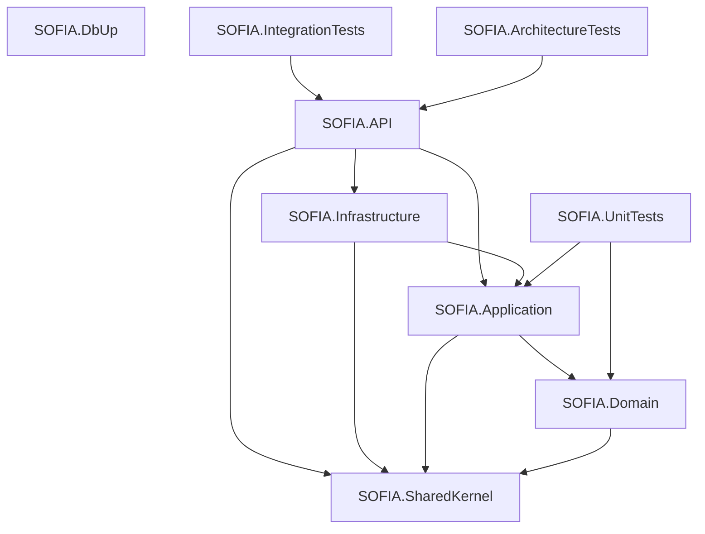
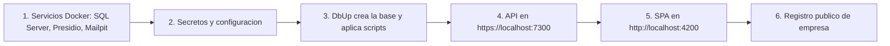
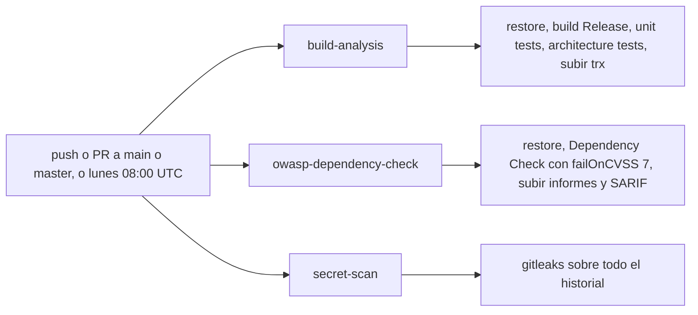

# Guía del desarrollador de SOFIA

| | |
|---|---|
| **Sistema** | SOFIA — Sistema Optimizado Farmacéutico con Inteligencia Artificial |
| **Versión del documento** | 1.0 |
| **Fecha** | 2026-10-06 |
| **Backend** | `sofia-apis`, rama `main`, commit `00991bc` |
| **Frontend** | `sofia-web-spa`, rama `main`, commit `31af681` |
| **Método** | Lectura de código y de archivos de configuración y tooling de ambos repositorios (solo lectura). No se ejecutó ningún comando de compilación, prueba, formato ni servidor. El apartado «Entorno local observado» recoge una comprobación hecha por el orquestador con `docker ps` / `docker inspect`. |

Esta guía es para quien clona por primera vez los dos repositorios de SOFIA:

- `sofia-apis` — backend .NET (API REST, migraciones de base de datos, servicio de anonimización).
- `sofia-web-spa` — frontend Angular.

Cada afirmación lleva su fuente con el formato `repo/ruta/archivo:línea`. Los `README.md` y `CLAUDE.md` de los repositorios **no** se usaron como fuente (tienen errores conocidos). Nunca se escriben valores de secretos: donde haga falta uno verás un marcador como `<tu-contraseña>`.

## Índice

1. [Requisitos previos](#1-requisitos-previos)
2. [Estructura de carpetas](#2-estructura-de-carpetas)
3. [Levantar el entorno local paso a paso](#3-levantar-el-entorno-local-paso-a-paso)
4. [Comandos de calidad](#4-comandos-de-calidad)
5. [Hooks de commit](#5-hooks-de-commit)
6. [Integración continua (CI)](#6-integración-continua-ci)
7. [Convenciones de código](#7-convenciones-de-código)
8. [Recetas](#8-recetas)
9. [Problemas frecuentes al levantar el entorno](#9-problemas-frecuentes-al-levantar-el-entorno)
10. [Pendientes y «No verificado»](#10-pendientes-y-no-verificado)
11. [Tabla de cobertura](#11-tabla-de-cobertura)
12. [Fuentes](#12-fuentes)

## 1. Requisitos previos

Ninguno de los dos repositorios fija la versión de las herramientas con un archivo dedicado: no existe `global.json` en `sofia-apis` ni `.nvmrc`, `.node-version` o campo `engines` en `sofia-web-spa/package.json`. Las versiones siguientes salen de los archivos que sí las declaran.

| Herramienta | Versión | De dónde sale | Para qué la necesitas |
|---|---|---|---|
| SDK de .NET | **10** (cualquier parche; no hay `global.json` que lo fije) | `<TargetFramework>net10.0</TargetFramework>` en todos los proyectos, p. ej. `sofia-apis/src/SOFIA.API/SOFIA.API.csproj:4`; CI usa `dotnet-version: '10.x'` (`sofia-apis/.github/workflows/security.yml:30`); las imágenes de compilación son `mcr.microsoft.com/dotnet/sdk:10.0` (`sofia-apis/src/SOFIA.API/Dockerfile:6`) | Compilar y ejecutar la API, DbUp y las pruebas |
| Herramienta local `husky` (Husky.Net) | **0.9.1**, sin `rollForward` | `sofia-apis/dotnet-tools.json:5-11` | Hooks de commit del backend. Se restaura sola al hacer `dotnet restore` (ver [5.1](#51-backend-sofia-apis-huskynet)) |
| Node.js | `^20.19.0 \|\| ^22.12.0 \|\| >=24.0.0` | **No está declarado en `package.json`.** Es lo que exige `@angular/cli` 20.3.37 según `sofia-web-spa/package-lock.json:1083-1116` | Instalar dependencias, servir, compilar y probar el SPA |
| npm | `^6.11.0 \|\| ^7.5.6 \|\| >=8.0.0` | Mismo bloque `engines` de `@angular/cli` (`sofia-web-spa/package-lock.json:1114`). El repositorio usa `package-lock.json` (npm), no hay `yarn.lock` ni `pnpm-lock.yaml` | Gestor de paquetes del SPA |
| Angular CLI | `~20.3.37` (dependencia de desarrollo; no hace falta instalarlo global, se usa con `npm run ng` o `npx ng`) | `sofia-web-spa/package.json:42` | `ng serve`, `ng build`, `ng test`, `ng lint` |
| TypeScript | `~5.8.3` | `sofia-web-spa/package.json:63` | Compilación del SPA |
| Google Chrome (o Chromium) | No se fija versión | `karma.conf.js` usa `karma-chrome-launcher` con los navegadores `Chrome` y `ChromeHeadlessCI` (`sofia-web-spa/karma.conf.js:10,32-38`) | Ejecutar las pruebas unitarias del SPA |
| Docker (con Compose v2) | No se fija versión | `sofia-apis/docker-compose.yml` (formato sin clave `version`); las pruebas de integración levantan un SQL Server con Testcontainers (`sofia-apis/src/SOFIA.IntegrationTests/Infrastructure/SofiaWebAppFactory.cs:23-25`) | Servicios locales (SQL Server, Presidio, Mailpit) y pruebas de integración |
| SQL Server | Imagen `mcr.microsoft.com/mssql/server:2022-latest` | `sofia-apis/docker-compose.yml:4`; misma imagen en las pruebas de integración (`SofiaWebAppFactory.cs:23`) | Base de datos |
| Python | **3.10** (la imagen es `python:3.10.21-slim`) | `sofia-apis/src/SOFIA.PresidioAPI/Dockerfile:1` | **Solo** si quieres ejecutar el servicio de anonimización (Presidio) fuera de Docker. Sus dependencias están en `requirements.txt` y `requirements-model.txt` (ver [3.1](#31-servicios-con-docker)) |
| Bash | — | El hook `pre-commit` del backend ejecuta `bash .husky/scripts/detect-secrets.sh` (`sofia-apis/.husky/task-runner.json:7-10`) y los hooks de ambos repos son scripts `#!/bin/sh` | Hooks de commit. En Windows lo aporta Git for Windows |
| Git | — | Ambos repos usan hooks de Git (`core.hooksPath` apuntando a `.husky`) | Control de versiones |

Versiones principales de las bibliotecas (por si necesitas contrastar documentación externa):

| Biblioteca | Versión | Fuente |
|---|---|---|
| MediatR | 14.1.0 | `sofia-apis/src/SOFIA.Application/SOFIA.Application.csproj:9` |
| FluentValidation (DI extensions) | 11.11.0 | `SOFIA.Application.csproj:10` |
| Entity Framework Core / SqlServer | 10.0.7 | `SOFIA.Application.csproj:11`, `sofia-apis/src/SOFIA.Infrastructure/SOFIA.Infrastructure.csproj:15-16` |
| Asp.Versioning.Http | 10.0.0 | `SOFIA.API.csproj:16` |
| Serilog.AspNetCore | 9.0.0 | `SOFIA.API.csproj:17` |
| dbup-sqlserver | 7.2.0 | `sofia-apis/src/SOFIA.DbUp/SOFIA.DbUp.csproj:12` |
| SonarAnalyzer.CSharp | 9.32.0.97167 | `sofia-apis/src/Directory.Build.props:13-16` |
| xUnit / Moq / FluentAssertions / MockQueryable.Moq | 2.9.3 / 4.20.72 / 8.10.0 / 10.0.8 | `sofia-apis/src/SOFIA.UnitTests/SOFIA.UnitTests.csproj:11-17` |
| Testcontainers.MsSql | 4.15.0 | `sofia-apis/src/SOFIA.IntegrationTests/SOFIA.IntegrationTests.csproj:18` |
| NetArchTest.eNhancedEdition | 1.4.5 | `sofia-apis/src/SOFIA.ArchitectureTests/SOFIA.ArchitectureTests.csproj:19` |
| Angular (core) / Angular Material y CDK | `~20.3.32` / `~20.2.14` | `sofia-web-spa/package.json:19-28` |
| Transloco | `^7.6.1` | `sofia-web-spa/package.json:30` |
| RxJS / zone.js | `~7.8.2` / `~0.15.1` | `sofia-web-spa/package.json:33,36` |
| ESLint / typescript-eslint / angular-eslint | `^9.39.3` / `^8.56.1` / `^20.7.0` | `sofia-web-spa/package.json:48-49,64` |
| Prettier | `^3.8.3` | `sofia-web-spa/package.json:61` |
| husky (npm) / lint-staged / commitlint | `^8.0.3` / `^16.3.1` / `^19.8.1` | `sofia-web-spa/package.json:44-45,53,60` |
| Karma / Jasmine | `~6.4.0` / `~5.6.0` | `sofia-web-spa/package.json:54-55` |

## 2. Estructura de carpetas

Árboles verificados contra el sistema de archivos y contra `git ls-files` (lo que realmente viaja en un clon). Se omiten `bin/`, `obj/`, `logs/`, `node_modules/`, `dist/`, `.angular/`, `.vs/` y las carpetas de herramientas de asistentes (`.claude/`, `.agents/`, `.antigravity/`).

### 2.1 Backend: `sofia-apis`

```text
sofia-apis/
├── .dependency-check-suppressions.xml   Supresiones de OWASP Dependency Check (hoy vacío: solo un ejemplo comentado)
├── .dockerignore                         Qué no entra al contexto de build de Docker
├── .editorconfig                         Estilo C# y severidades de analizadores (ver 7.1)
├── .env.example                          Plantilla de variables para docker compose (solo nombres y valores de ejemplo)
├── .github/workflows/security.yml        Único workflow de CI (ver 6)
├── .gitignore
├── .gitleaksignore                       Un hallazgo de gitleaks marcado como falso positivo
├── .husky/                               Hooks de Git con Husky.Net (ver 5.1)
│   ├── pre-commit
│   ├── commit-msg
│   ├── task-runner.json
│   └── scripts/
│       ├── detect-secrets.sh
│       └── validate-commit-msg.csx
├── SOFIA.Solution.slnx                   Solución (formato XML .slnx) con 9 proyectos
├── docker-compose.yml                    Servicios locales (ver 3.1)
├── dotnet-tools.json                     Manifiesto de herramientas locales: husky 0.9.1
├── swagger.json                          Foto antigua del contrato; ningún código la genera ni la sirve (ver 3.5)
├── README.md
└── src/
    ├── Directory.Build.props             Agrega SonarAnalyzer.CSharp a los proyectos que no son de prueba ni DbUp
    ├── SOFIA.API/                        Host ASP.NET Core
    ├── SOFIA.Application/                Casos de uso (CQRS con MediatR)
    ├── SOFIA.Domain/                     Entidades, enums, Result/Error
    ├── SOFIA.Infrastructure/             EF Core, autenticación, correo, Excel, servicios externos
    ├── SOFIA.SharedKernel/               Proyecto casi vacío (solo el método de registro)
    ├── SOFIA.DbUp/                       Ejecutable de migraciones SQL
    ├── SOFIA.PresidioAPI/                Servicio Python de anonimización (no es un proyecto .NET)
    ├── SOFIA.UnitTests/                  Pruebas unitarias
    ├── SOFIA.IntegrationTests/           Pruebas de integración (SQL Server real con Testcontainers)
    └── SOFIA.ArchitectureTests/          Pruebas de arquitectura (NetArchTest)
```

No existe una carpeta `tests/`: los tres proyectos de prueba están en `src/` (`sofia-apis/SOFIA.Solution.slnx:4,9,10`).

`SOFIA.PresidioAPI` no figura en la solución (`sofia-apis/SOFIA.Solution.slnx:1-11` lista solo proyectos `.csproj`); se construye únicamente como imagen Docker (`sofia-apis/docker-compose.yml:21-24`).

#### Proyectos y dependencias entre ellos

| Proyecto | Propósito | Referencia a | Fuente |
|---|---|---|---|
| `SOFIA.SharedKernel` | Punto de extensión compartido. Hoy solo contiene `AddSharedKernel()`, que no registra nada | — | `sofia-apis/src/SOFIA.SharedKernel/DependencyInjection.cs:5-7` |
| `SOFIA.Domain` | Entidades (50 archivos en `Entities/`), enums (12 en `Enums/`), `Result`, `Error`, `BaseEntity`, el objeto de valor `Ruc`. `TreatWarningsAsErrors=true`. Expone `internal` a `SOFIA.UnitTests` y `SOFIA.Infrastructure` | SharedKernel | `sofia-apis/src/SOFIA.Domain/SOFIA.Domain.csproj:4,12-17,26` |
| `SOFIA.Application` | Commands, queries, validadores y handlers por módulo; comportamientos del pipeline de MediatR; interfaces que implementa Infrastructure | Domain, SharedKernel | `sofia-apis/src/SOFIA.Application/SOFIA.Application.csproj:4-5`, `DependencyInjection.cs:13-24` |
| `SOFIA.Infrastructure` | `ApplicationDbContext` y 48 configuraciones EF, JWT y permisos, envío de correo, lectura/generación de Excel, clientes de Presidio y Gemini, `OutboxProcessor` | Application, SharedKernel | `sofia-apis/src/SOFIA.Infrastructure/SOFIA.Infrastructure.csproj:4-5`, `DependencyInjection.cs:28-154` |
| `SOFIA.API` | `Program.cs`, 31 controladores, middlewares, manejador global de excepciones, límites de peticiones | Application, Infrastructure, SharedKernel | `sofia-apis/src/SOFIA.API/SOFIA.API.csproj:23-25` |
| `SOFIA.DbUp` | Aplicación de consola que aplica los scripts SQL embebidos de `Scripts/` | — (ninguna referencia de proyecto) | `sofia-apis/src/SOFIA.DbUp/SOFIA.DbUp.csproj:4,18-20` |
| `SOFIA.UnitTests` | xUnit + Moq + FluentAssertions + MockQueryable | Domain, Application | `sofia-apis/src/SOFIA.UnitTests/SOFIA.UnitTests.csproj:25-26` |
| `SOFIA.IntegrationTests` | xUnit + `WebApplicationFactory` + Testcontainers.MsSql | API, Application, Domain, Infrastructure | `sofia-apis/src/SOFIA.IntegrationTests/SOFIA.IntegrationTests.csproj:33-36` |
| `SOFIA.ArchitectureTests` | Tres pruebas: dependencias de capas y que toda acción de controlador declare autorización | Domain, Application, Infrastructure, API | `sofia-apis/src/SOFIA.ArchitectureTests/ArchitectureTests.cs:16-74` |



#### Carpetas principales dentro de cada proyecto

```text
src/SOFIA.API/
├── Controllers/            31 controladores (uno por recurso)
├── Extensions/             ExportExtensions, RateLimitingExtensions, RefreshTokenCookieExtensions, ResultExtensions
├── Infrastructure/         GlobalExceptionHandler, SecurityHeadersMiddleware, PasswordChangeRequiredMiddleware,
│                           atributos (RequireCsrfHeader, AllowDuringPasswordChange, Export*)
├── Services/               CurrentUser (implementa ICurrentUser a partir del HttpContext)
├── Properties/launchSettings.json
├── GlobalUsings.cs         usings globales (MediatR, HasPermission, Asp.Versioning, extensiones propias)
├── Program.cs
├── SOFIA.API.http          Archivo de pruebas HTTP con una sola petición a /health (apunta a un puerto que no es el de launchSettings, ver 9)
├── appsettings.json
├── appsettings.Development.json
├── appsettings.Testing.json
└── Dockerfile

src/SOFIA.Application/
├── Common/
│   ├── Behaviors/          SanitizationBehavior, ValidationBehavior, TransactionBehavior, AuditBehavior
│   ├── Excel/              Contratos y tipos de carga masiva (IExcelReaderService, ImportLimits, PreviewResult...)
│   ├── Extensions/         CurrentUserExtensions, DbUpdateExceptionExtensions, PermissionCacheExtensions, QueryableExtensions
│   ├── Interfaces/         IApplicationDbContext, ICommand, IAuditableCommand, ICurrentUser, IEmailSender, IJwtProvider...
│   ├── Models/             PaginatedList, PaginationLimits, QueryFilters, AuditEntry, EmailMessage...
│   └── Services/           SucursalAccess
├── <Módulo>/               28 carpetas de módulo: Auditoria, DIGEMID, Dashboard, Delivery, Devoluciones, Empleados,
│   │                       Empresas, FormulacionesClinicas, IngredientesActivos, Inventarios, JerarquiasUoM,
│   │                       Laboratorios, Magistrales, Medicamentos, POS, Pacientes, PresentacionesVenta,
│   │                       Profesionales, Proveedores, Recetas, Security, Seguros, SeriesFiscales, Servicios,
│   │                       Sucursales, Transferencias, UnidadesMedida, Ventas
│   ├── Commands/<Caso>/    <Caso>Command.cs, <Caso>CommandValidator.cs, <Caso>CommandHandler.cs
│   ├── Queries/<Caso>/     <Caso>Query.cs, <Caso>QueryHandler.cs
│   └── Common/             Auxiliares del módulo (p. ej. LaboratorioDuplicateChecker)
├── Security/Templates/     Plantillas .html/.txt de correo, embebidas como recurso
├── DependencyInjection.cs  AddApplication(): MediatR + behaviors + validadores
└── GlobalUsings.cs

src/SOFIA.Domain/
├── Common/                 BaseEntity, Result, Error, IAuditableEntity, IDomainEvent, EnumExtensions
├── Entities/               50 archivos
├── Enums/                  12 archivos
└── ValueObjects/           Ruc

src/SOFIA.Infrastructure/
├── Authentication/         JwtOptions, JwtProvider, HasPermissionAttribute, PermissionPolicyProvider,
│                           PermissionAuthorizationHandler, PermissionRequirement, MemoryPermissionCache, PasswordHasher
├── Email/                  EmailOptions, AppOptions, SmtpEmailSender, AzureCommunicationEmailSender, DisabledEmailSender, FrontendLinks
├── Excel/                  ExcelReaderService, ExcelTemplateGenerator
├── Persistence/
│   ├── ApplicationDbContext.cs
│   ├── Configurations/     48 clases IEntityTypeConfiguration
│   └── Converters/         EnumDescriptionConverter
├── Services/               GeminiRecetaAnalyzer, PresidioPrivacyService, BuscadorFuzzyService, HtmlSanitizerService, OutboxProcessor
├── Utils/                  StringUtils
└── DependencyInjection.cs  AddInfrastructure(): validaciones de arranque de la configuración (ver 3.3)

src/SOFIA.DbUp/
├── Program.cs
├── appsettings.json        Solo la clave ConnectionStrings:DefaultConnection, vacía
├── Scripts/                0001_... a 0027_... (27 scripts commiteados)
└── Dockerfile

src/SOFIA.PresidioAPI/
├── main.py                 FastAPI: GET /health y POST /api/anonimizar
├── requirements.txt        fastapi, uvicorn, presidio-analyzer, presidio-anonymizer, spacy, pydantic (versiones fijas)
├── requirements-model.txt  Modelo es_core_news_md 3.7.0 con hash
└── Dockerfile

src/SOFIA.UnitTests/         Una carpeta por módulo (espejo de SOFIA.Application) más Common/
src/SOFIA.IntegrationTests/
├── Infrastructure/         SofiaWebAppFactory, BaseIntegrationTest, TestCurrentUser, CapturingEmailSender, sembradores
├── <Área>/                 Api, Auditoria, Concurrency, Dashboard, Email, Empleados, Excel, FormulacionesClinicas,
│                           Laboratorios, Medicamentos, Pacientes, Persistence, Recetas, Security, Ventas
└── xunit.runner.json       parallelizeTestCollections = false
src/SOFIA.ArchitectureTests/ArchitectureTests.cs
```

> **En curso (sin commitear):** en el árbol de trabajo existe además `src/SOFIA.DbUp/Scripts/0028_Ventas_Sesion_Anulacion.sql` y `src/SOFIA.IntegrationTests/Ventas/AnularVentaCajaIntegrationTests.cs`, que `git status` muestra como no rastreados. No forman parte del commit `00991bc`.

Carpetas vacías que existen solo en esta máquina (Git no las rastrea, así que no aparecerán en tu clon): `src/SOFIA.Application/Laboratorios/Commands/ImportarLaboratorios/` y `src/SOFIA.Application/Security/Queries/Roles/GetPermissionCatalog/`.

### 2.2 Frontend: `sofia-web-spa`

```text
sofia-web-spa/
├── .editorconfig               2 espacios, UTF-8, comillas simples en .ts
├── .gitattributes              Fuerza LF en docker/*.sh y scripts/azure/*.sh (carpetas que no existen en el repo)
├── .gitignore
├── .husky/                     Hooks de Git con husky 8 (ver 5.2)
│   ├── pre-commit
│   └── commit-msg
├── .prettierignore
├── .prettierrc.json
├── angular.json                Workspace de Angular: build, serve, test, lint
├── commitlint.config.js
├── eslint.config.js
├── karma.conf.js
├── package.json / package-lock.json
├── tsconfig.json               Opciones estrictas y alias de rutas
├── tsconfig.app.json
├── tsconfig.spec.json
├── tsconfig.spec.shared.json   Para la configuración de pruebas «shared»
├── README.md
├── public/                     Se copia tal cual a la raíz del build (angular.json:39-45)
│   ├── environment.js          Configuración en tiempo de ejecución (window.__env)
│   ├── staticwebapp.config.json  Cabeceras de seguridad para Azure Static Web Apps
│   ├── favicon.ico
│   ├── i18n/                   es.json y en.json raíz + una carpeta por scope (34 scopes)
│   ├── icons/
│   └── images/
└── src/
    ├── index.html
    ├── main.ts                 bootstrapApplication(AppComponent, appConfig)
    ├── styles.scss
    ├── typings.d.ts            Declara window.__env
    ├── assets/scss/            Estilos de la plantilla (tema, layouts, overrides de Material)
    ├── environments/
    │   ├── environment.ts          Valores por defecto (API en https://localhost:7300)
    │   ├── environment.prod.ts     Producción (URL de API vacía; se espera environment.js)
    │   ├── environment.model.ts    Interfaz WebEnvironment y resolveEnvironment()
    │   └── environment.local.ts    NO está en el repo (.gitignore:53); debes crearlo (ver 3.6)
    └── app/
        ├── app.component.ts / .html / .css / .spec.ts
        ├── app.config.ts       Proveedores: router, HttpClient + interceptores, Transloco, fechas, Material
        ├── app.routes.ts       Rutas raíz; cada módulo se carga con loadChildren
        ├── core/
        │   ├── auth/           AuthService, guards (auth, permission, password-change), route-permissions.ts, user-storage.ts
        │   ├── interceptors/   auth.interceptor.ts
        │   ├── responses/      common-error-response.ts (y api-response-envelope.model.ts, sin uso)
        │   ├── services/
        │   │   ├── logger.service.ts
        │   │   ├── shared/     error-notifier.service.ts, search-state.service.ts, timezone.service.ts
        │   │   └── lookups-module/lookup-catalogs/dto/catalog-item-active.ts
        │   └── transloco/      transloco-loader.ts
        ├── matdash/            Plantilla de administración heredada: layouts (full, blank), servicios y config
        │   ├── config.ts
        │   ├── layouts/full/   full.component + vertical/ (header, sidebar) + horizontal/ + shared/ (breadcrumb, customizer)
        │   ├── layouts/blank/
        │   ├── pipe/
        │   └── services/       core.service.ts, nav.service.ts
        ├── pages/              Una carpeta por funcionalidad (ver tabla siguiente)
        └── shared/
            ├── components/     Componentes reutilizables (page-header, confirm-dialog, carga-masiva-page, range-slider-field...)
            ├── constants/
            ├── date/           Adaptador de fechas y proveedores
            ├── directives/     permiso.directive.ts (*appPermiso) y otras
            ├── material.module.ts
            ├── models/
            ├── pipes/
            ├── services/       loading/ (interceptor y servicio de carga)
            ├── styles/
            ├── testing/        Stubs y proveedores para specs
            └── utils/
```

#### Carpetas de `src/app/pages` con ruta

Cada una tiene su archivo `*.routes.ts` cargado desde `sofia-web-spa/src/app/app.routes.ts`, salvo las que se cargan como componente directo.

| Carpeta | Ruta | Fuente en `app.routes.ts` |
|---|---|---|
| `auth/` (`login`, `forgot-password`, `reset-password`, `auth-brand-panel`) | `auth/login`, `auth/forgot-password`, `auth/reset-password` | líneas 10-31 |
| `empresa/empresa-register` | `auth/register` | líneas 15-21 |
| `dashboard/` | `dashboard` | líneas 39-42 |
| `cambiar-clave/` | `cambiar-clave` | líneas 43-47 |
| `sucursales/` | `sucursales` | líneas 49-53 |
| `empresa/` | `empresas` | líneas 54-58 |
| `empleados/` | `empleados` | líneas 59-63 |
| `roles/` | `roles` | líneas 64-68 |
| `seguridad/` | `cuentas` | líneas 69-73 |
| `unidades-medida/` | `unidades-medida` | líneas 75-79 |
| `jerarquias/` | `jerarquias` | líneas 80-84 |
| `laboratorios/` | `laboratorios` | líneas 85-89 |
| `ingredientes-activos/` | `ingredientes-activos` | líneas 90-94 |
| `medicamentos/` | `medicamentos` | líneas 95-99 |
| `presentaciones-venta/` | `presentaciones-venta` | líneas 100-106 |
| `formulaciones-clinicas/` | `formulaciones-clinicas` | líneas 107-113 |
| `proveedores/` | `proveedores` | líneas 114-118 |
| `aseguradoras/` | `aseguradoras` | líneas 119-123 |
| `lotes/` | `lotes` | líneas 125-128 |
| `stock-por-sucursal/` | `stock-por-sucursal` | líneas 129-135 |
| `sesiones-caja/` | `sesiones-caja` | líneas 137-141 |
| `pos/` | `pos` | líneas 142-146 |
| `pacientes/` | `pacientes` | líneas 148-152 |
| `profesionales-salud/` | `profesionales-salud` | líneas 153-157 |
| `recetas-medicas/` | `recetas-medicas` | líneas 158-162 |
| `digemid-catalogo/` | `digemid-catalogo` | líneas 164-168 |
| `series-fiscales/` | `series-fiscales` | líneas 170-174 |

Cualquier otra URL redirige a `dashboard` (`app.routes.ts:177-180`).

#### Carpetas y código sin uso en el SPA

Cada elemento se comprobó buscando en `src/` (archivos `.ts`, `.html` y `.scss`) el nombre de la clase exportada, el selector del componente o directiva, el nombre del pipe y la ruta de importación. «Sin referencias» significa que la única aparición es su propio archivo.

**a) Código rastreado por Git que no tiene ruta ni referencias**

| Elemento | Qué es | Comprobación |
|---|---|---|
| `src/app/pages/empresa/empresa-maintenance/` (`EmpresaMaintenanceComponent`, selector `app-empresa-maintenance`) | Pantalla de mantenimiento de empresa | No está en `sofia-web-spa/src/app/pages/empresa/empresa.routes.ts:3-14` (solo `empresa-search` y `empresa-detail`) ni en `app.routes.ts`; sin referencias a la clase ni al selector |
| `src/app/shared/components/carga-masiva/` (`CargaMasivaComponent`, selector `sofia-carga-masiva`) | Componente de carga masiva anterior | Sin importaciones de `components/carga-masiva/` ni uso de `<sofia-carga-masiva>`; las pantallas usan `carga-masiva-page` |
| `src/app/shared/components/autocomplete-input-multiple/` | Autocompletado múltiple | Sin importaciones |
| `src/app/shared/components/multiselect-autocomplete-input/` | Autocompletado con selección múltiple | Sin referencias a `MultiselectAutocompleteInputComponent` |
| `src/app/shared/components/datetime-picker/` (`csw-datetime-picker`) | Selector de fecha y hora | Sin referencias |
| `src/app/shared/components/decimal-input/` (`csw-decimal-input`) | Campo decimal | Sin referencias |
| `src/app/shared/components/error-dialog/`, `simple-dialog/`, `success-dialog/`, `text-input-dialog/`, `three-option-dialog/` (selectores `csw-*`) | Diálogos genéricos | Sin referencias a las clases ni a los selectores |
| `src/app/shared/components/status-chips/` (`sofia-status-chips`) | Chips de estado | Sin referencias |
| `src/app/shared/directives/`: `alphanumeric`, `block-manual-date`, `numeric`, `positive-decimal`, `positive-integer`, `valid-description`, `valid-name` | Directivas de entrada (selectores `cswAlphanumeric`, `blockManualDateInput`, `cswNumeric`, `cswPositiveDecimal`, `cswPositiveInteger`, `cswValidDescription`, `cswValidName`) | Sin referencias a las clases ni a los selectores. La única directiva usada de esa carpeta es `permiso.directive.ts` |
| `src/app/shared/pipes/`: `datetimeoffset`, `format-thousands`, `line-break-to-br`, `timezone` | Pipes | Sin uso en plantillas ni importaciones de las clases |
| `src/app/shared/constants/application-constants.ts` (`APP_CONSTANTS`) y `line-break-placeholder.ts` | Constantes | `APP_CONSTANTS` sin referencias; `line-break-placeholder.ts` solo lo importa el pipe sin uso `line-break-to-br` |
| `src/app/shared/services/custom-paginator-intl.service.ts` (`CustomPaginatorIntl`) | Internacionalización del paginador | Sin referencias; `app.config.ts:50` registra `MatPaginatorIntlTransloco` |
| `src/app/shared/utils/catalog-item-autocomplete.util.ts` | Utilidades de autocompletado de catálogos | Sin importaciones. Es el único consumidor de `src/app/core/services/lookups-module/lookup-catalogs/dto/catalog-item-active.ts` |
| `src/app/core/services/shared/timezone.service.ts` | Servicio de zona horaria | Solo lo importan `datetime-picker`, `datetimeoffset.pipe` y `timezone.pipe`, los tres sin uso |
| `src/app/core/responses/api-response-envelope.model.ts` (`ApiResponseEnvelope`) | Modelo de envoltorio de respuesta | Sin referencias |
| `src/app/shared/styles/transmit-sunat-dialog.shared.scss` y `custom-checkbox.scss` | Hojas de estilo | Ningún `.ts`, `.html` ni `.scss` las importa |
| `src/app/matdash/pipe/filter.pipe.ts` (`FilterPipe`, `appFilter`) | Pipe de la plantilla | Sin referencias |
| `src/app/matdash/layouts/blank/` (`BlankComponent`) | Layout en blanco de la plantilla | No está en `app.routes.ts`; solo lo menciona `src/app/matdash/layouts/full/vertical/header/header.component.spec.ts` |

**b) Carpetas vacías que existen solo en esta máquina**

Git no rastrea carpetas vacías, así que no aparecerán en un clon nuevo. Se listan porque sus nombres pueden confundir (sugieren módulos que no tienen pantalla):

- Módulos completos sin ningún archivo: `src/app/pages/auditoria/`, `src/app/pages/inventarios/`, `src/app/pages/login/`, `src/app/pages/servicios/`, `src/app/pages/transferencias/`, `src/app/pages/uom/`.
- Subcarpetas vacías `import/`, `maintenance/` y `search/` dentro de `empleados/`, `laboratorios/`, `medicamentos/`, `pacientes/`, `proveedores/`, `sucursales/` y `unidades-medida/`; `maintenance/` y `search/` dentro de `seguridad/` y de `seguridad/usuarios/`.
- `src/app/core/guards/` (los guards reales están en `src/app/core/auth/`).

**c) Referencias a archivos que no existen**

- `sofia-web-spa/.gitattributes:1-2` menciona `docker/*.sh` y `scripts/azure/*.sh`; ninguna de las dos carpetas existe en el repositorio.
- `sofia-web-spa/.gitignore:52` ignora `/scripts/azure/keyvault-secrets.example.json` y `:55-56` habla de una «copia local opcional de `environment.js.example`» (`/public/environment.local.js`); no existe ningún `environment.js.example` en `public/`.
- `sofia-web-spa/angular.json:28-32` permite las dependencias CommonJS `bezier-easing` y `pdfmake`, que no están en `package.json`.

## 3. Levantar el entorno local paso a paso

Orden recomendado, deducido de las dependencias entre piezas:



### 3.1 Servicios con Docker

Todo sale de `sofia-apis/docker-compose.yml`. Las variables `${...}` las resuelve Docker Compose desde un archivo `.env` junto al compose; la plantilla es `sofia-apis/.env.example` (se copia a `.env`, que está en `.gitignore:7`). Todos los puertos se publican solo en `127.0.0.1`.

| Servicio | Imagen o build | Contenedor | Puertos (anfitrión → contenedor) | Volúmenes | Health check | Variables que necesita |
|---|---|---|---|---|---|---|
| `sqlserver` | `mcr.microsoft.com/mssql/server:2022-latest` (`docker-compose.yml:4`) | `sofia-sqlserver` (`:5`) | `127.0.0.1:1434 → 1433` (`:11`) | `sqlserver_data:/var/opt/mssql` (`:13`) | `sqlcmd ... -Q 'SELECT 1'` cada 15 s, 5 reintentos, 30 s de arranque (`:14-19`) | `SA_PASSWORD` (**obligatoria**: el compose aborta con «Falta SA_PASSWORD» si no está, `:7`). Fijas: `ACCEPT_EULA=Y`, `MSSQL_PID=Developer` (`:8-9`) |
| `presidio-api` | Build de `./src/SOFIA.PresidioAPI` con su `Dockerfile` (`:22-24`); base `python:3.10.21-slim` | `sofia-presidio` (`:25`) | `127.0.0.1:8001 → 8000` (`:29`) | — | `GET http://localhost:8000/health` con `urllib` cada 20 s, 5 reintentos, 90 s de arranque (`:30-35`) | `PRESIDIO_INTERNAL_KEY` (opcional; vacía desactiva la comprobación de clave, `:27` y `main.py:12,18-21`) |
| `sofia-api` | Build de `src/SOFIA.API/Dockerfile` con contexto `.` (`:38-40`) | `sofia-api` (`:41`) | `127.0.0.1:5000 → 8080` (`:43`) | `sofia_logs:/app/logs` (`:68`) | `curl -f http://localhost:8080/health` cada 20 s, 3 reintentos (`:76-81`) | `SA_PASSWORD` y `JWT_SECRET_KEY` (**obligatorias**, `:46-47`); opcionales con valor por defecto: `PRESIDIO_INTERNAL_KEY`, `GEMINI_BASE_URL`, `GEMINI_OCR_MODEL`, `GEMINI_REASONING_MODEL`, `GEMINI_API_KEY`, `APP_FRONTEND_BASE_URL`, `EMAIL_PROVIDER`, `EMAIL_FROM_ADDRESS`, `EMAIL_FROM_DISPLAY_NAME`, `EMAIL_SMTP_HOST`, `EMAIL_SMTP_PORT`, `EMAIL_SMTP_USE_SSL`, `EMAIL_SMTP_USERNAME`, `EMAIL_SMTP_PASSWORD`, `EMAIL_ACS_CONNECTION_STRING` (`:52-66`). Fijas: `ASPNETCORE_ENVIRONMENT=Development`, `Jwt__Issuer`, `Jwt__Audience`, `Jwt__ExpiryMinutes=15`, `PresidioApi__BaseUrl=http://presidio-api:8000` (`:45,48-51`) |
| `mailpit` | `axllent/mailpit:v1.31.3` (`:85`) | `sofia-mailpit` (`:86`) | `127.0.0.1:1025 → 1025` (SMTP) y `127.0.0.1:8025 → 8025` (interfaz web y API) (`:87-89`) | — | — | — |
| `sofia-dbup` | Build de `src/SOFIA.DbUp/Dockerfile` con contexto `.` (`:92-94`) | `sofia-dbup` (`:95`) | — | — | — (`restart: on-failure`, `:101`) | `SA_PASSWORD` (**obligatoria**, `:97`) |

Dependencias de arranque: `sofia-api` espera a que `sqlserver` y `presidio-api` estén sanos y a que `mailpit` haya arrancado (`docker-compose.yml:69-75`); `sofia-dbup` espera a `sqlserver` sano (`:98-100`). El compose **no** hace que `sofia-api` espere a `sofia-dbup`.

Volúmenes con nombre: `sqlserver_data` y `sofia_logs` (`docker-compose.yml:103-105`).

Dentro de la red del compose, la API y DbUp usan `Server=sqlserver,1433` y `Database=SofiaDb` (`:46,97`). Desde tu máquina (por ejemplo, si ejecutas la API con `dotnet run` en vez de con el contenedor) SQL Server queda en `localhost,1434`, Presidio en `http://localhost:8001` y Mailpit en `localhost:1025` (SMTP) y `http://localhost:8025` (bandeja web).

Dos formas de trabajar que el compose permite:

1. **Todo en contenedores**: `docker compose up -d` levanta los cinco servicios; la API queda en `http://localhost:5000`. Ten en cuenta que el SPA apunta por defecto a `https://localhost:7300` (`sofia-web-spa/src/environments/environment.ts:7`), así que tendrías que cambiar la URL en tu `environment.local.ts` (ver [3.6](#36-spa)).
2. **Solo dependencias en contenedores** (`docker compose up -d sqlserver presidio-api mailpit`, como sugiere el comentario de `sofia-apis/.env.example:20`) y la API y DbUp ejecutados con el SDK local. Es el modo al que apuntan `launchSettings.json` y el `environment.ts` del SPA.

**Presidio fuera de Docker (opcional).** El `Dockerfile` muestra los pasos equivalentes: Python 3.10, `pip install -r requirements.txt`, luego `pip install --no-deps --require-hashes -r requirements-model.txt` y arrancar con `uvicorn main:app --host 0.0.0.0 --port 8000` (`sofia-apis/src/SOFIA.PresidioAPI/Dockerfile:1-20`). El servicio expone `GET /health` y `POST /api/anonimizar` (`main.py:99-104`).

#### Entorno local observado (2026-10-06)

Nota verificada por el orquestador con `docker ps` y `docker inspect` (no por este documento): en esta máquina los contenedores en uso se llaman **`sqlserver_db`** (puerto **1433**), **`sofia-presidio`** (puerto **8000**) y **`sofia-mailpit`** (puertos 1025 y 8025).

| | Según `docker-compose.yml` | Observado en esta máquina |
|---|---|---|
| Contenedor de SQL Server | `sofia-sqlserver`, puerto de anfitrión `1434` | `sqlserver_db`, puerto `1433` |
| Presidio | `sofia-presidio`, puerto de anfitrión `8001` | `sofia-presidio`, puerto `8000` |
| Mailpit | `sofia-mailpit`, `1025` y `8025` | `sofia-mailpit`, `1025` y `8025` |

Es decir, los contenedores de esta máquina **no se crearon con ese compose** (al menos SQL Server y Presidio difieren en nombre o puerto). Si creas tu entorno con `docker compose up`, tus puertos serán los de la columna central y tus valores de configuración (cadena de conexión, `PresidioApi:BaseUrl`) deben usar esos puertos, no los de la columna derecha. A las 17:43 del 2026-10-06 Docker Desktop estaba detenido en esta máquina, según el mismo orquestador.

### 3.2 Dónde se configura cada cosa

| Mecanismo | Quién lo usa | Fuente |
|---|---|---|
| `appsettings.json` + `appsettings.{Entorno}.json` | La API (los carga `WebApplication.CreateBuilder`) | `sofia-apis/src/SOFIA.API/Program.cs:16` |
| User-secrets (solo en entorno `Development`) | La API y DbUp **comparten el mismo almacén**: ambos `.csproj` declaran `UserSecretsId` `d0590347-8e2f-47da-a582-fb5f430875ae` | `sofia-apis/src/SOFIA.API/SOFIA.API.csproj:12`, `sofia-apis/src/SOFIA.DbUp/SOFIA.DbUp.csproj:8` |
| User-secrets de las pruebas de integración | `UserSecretsId` `sofia-integration-tests-2026` | `sofia-apis/src/SOFIA.IntegrationTests/SOFIA.IntegrationTests.csproj:8` |
| Variables de entorno (`Seccion__Clave`) | La API en el compose; DbUp también las lee | `sofia-apis/docker-compose.yml:45-66`, `sofia-apis/src/SOFIA.DbUp/Program.cs:9` |
| `.env` junto al compose | Solo Docker Compose (sustituye `${...}`) | `sofia-apis/.env.example:1-2` |

Los demás proyectos (`Application`, `Domain`, `Infrastructure`, `SharedKernel`, `UnitTests`, `ArchitectureTests`) no declaran `UserSecretsId`.

Para guardar un valor en user-secrets el propio repositorio muestra la forma (mensaje del hook de secretos, `sofia-apis/.husky/scripts/detect-secrets.sh:90`):

```bash
dotnet user-secrets set "ConnectionStrings:DefaultConnection" "<tu-cadena-de-conexión>" --project src/SOFIA.API
dotnet user-secrets set "Jwt:SecretKey" "<clave-de-al-menos-32-bytes>" --project src/SOFIA.API
```

### 3.3 Claves de configuración de la API

Solo nombres. «Arranque» significa que la aplicación no llega a iniciar; «al usarse» significa que el error aparece cuando se ejecuta la funcionalidad.

| Clave | ¿Obligatoria? | Valor en `appsettings.json` | Qué pasa si falta | Fuente |
|---|---|---|---|---|
| `ConnectionStrings:DefaultConnection` | Sí para cualquier operación con base de datos | Cadena vacía (`appsettings.json:3`) | No hay validación de arranque: se pasa tal cual a `UseSqlServer`. El fallo aparece en la primera consulta; `OutboxProcessor` consulta cada 10 s y registrará el error en el log | `sofia-apis/src/SOFIA.Infrastructure/DependencyInjection.cs:32`, `Services/OutboxProcessor.cs:20-31` |
| `Jwt:SecretKey` | **Sí (arranque)** | Cadena vacía (`appsettings.json:9`) | `InvalidOperationException` «JWT SecretKey is not configured» si está vacía; «must be at least 32 bytes long» si mide menos de 32 bytes en UTF-8 | `DependencyInjection.cs:54-57`, `sofia-apis/src/SOFIA.Infrastructure/Authentication/JwtOptions.cs:8,17-25` |
| `Jwt:Issuer`, `Jwt:Audience` | **Sí (arranque)** | `SOFIA.API`, `SOFIA.Clients` (`appsettings.json:6-7`) | «JWT Issuer and Audience must be configured» | `JwtOptions.cs:27-30` |
| `Jwt:ExpiryMinutes` | No se valida | `15` (`appsettings.json:8`) | — | `JwtOptions.cs:13` |
| `PresidioApi:BaseUrl` | Sí para analizar recetas con IA | **No está en ningún `appsettings`** | `InvalidOperationException` «Presidio URL (PresidioApi:BaseUrl) is not configured» cuando se crea el cliente HTTP de Presidio (al usarse, no en el arranque: la validación está dentro del delegado de `AddHttpClient`) | `DependencyInjection.cs:142,188-191` |
| `PresidioApi:InternalKey` | No | No está | Si tiene valor, se envía como cabecera `X-Internal-Key`; debe coincidir con `PRESIDIO_INTERNAL_KEY` del servicio | `DependencyInjection.cs:193-198`, `sofia-apis/src/SOFIA.PresidioAPI/main.py:12,18-21` |
| `GeminiApi:ApiKey` | Sí para analizar recetas con IA | Cadena vacía (`appsettings.json:25`, `appsettings.Development.json:3`) | Sin validación de arranque. El `?? throw` solo salta si la clave no existe; con cadena vacía la llamada a Gemini se hace sin clave y falla al usarse | `sofia-apis/src/SOFIA.Infrastructure/Services/GeminiRecetaAnalyzer.cs:29,89` |
| `GeminiApi:BaseUrl` | Sí para analizar recetas con IA | Cadena vacía (`appsettings.json:22`) | Igual que la anterior: se concatena con el modelo para formar la URL | `GeminiRecetaAnalyzer.cs:67-68,107-108` |
| `GeminiApi:OcrModel`, `GeminiApi:ReasoningModel` | No | Cadenas vacías (`appsettings.json:23-24`) | Si están vacías se usa el modelo por defecto del código (`DefaultModel`); el de razonamiento cae primero en el de OCR | `GeminiRecetaAnalyzer.cs:21,66,106,201-202` |
| `Email:Provider` | No en `Development` ni `Testing`; **sí (arranque)** en cualquier otro entorno | No está | En desarrollo, vacío o `None` registra `DisabledEmailSender` (los correos de recuperación se descartan). Fuera de desarrollo: «Email:Provider must be 'Smtp' or 'AzureCommunication'...». Un valor desconocido falla siempre | `DependencyInjection.cs:157-161,173-185`, `sofia-apis/src/SOFIA.Infrastructure/Email/EmailOptions.cs:16,18-28,60` |
| `Email:FromAddress` | **Sí (arranque)** si hay proveedor | No está | «Email:FromAddress is not configured» | `EmailOptions.cs:30-33` |
| `Email:FromDisplayName` | No | Por defecto `SOFIA` en la clase | — | `EmailOptions.cs:12` |
| `Email:Smtp:Host`, `Email:Smtp:Port` | **Sí (arranque)** con proveedor `Smtp` | No están (el puerto por defecto de la clase es 587) | «Email:Smtp:Host and a valid Email:Smtp:Port are required...» | `EmailOptions.cs:35-40,67` |
| `Email:Smtp:UseSsl` | No | Por defecto `true`; `false` solo para un receptor local como Mailpit | — | `EmailOptions.cs:68-69` |
| `Email:Smtp:UserName`, `Email:Smtp:Password` | Deben ir **los dos o ninguno** (arranque) | No están | «Email:Smtp:UserName and Email:Smtp:Password must be set together» | `EmailOptions.cs:42-45` |
| `Email:AzureCommunication:ConnectionString` | **Sí (arranque)** con proveedor `AzureCommunication` | No está | «Email:AzureCommunication:ConnectionString is required...» | `EmailOptions.cs:50-55` |
| `App:FrontendBaseUrl` | **Sí (arranque)** si hay proveedor de correo o si el entorno no es `Development`/`Testing` | No está | «App:FrontendBaseUrl must be an absolute https URL of the SPA (http is only accepted in Development and Testing)» | `DependencyInjection.cs:163-167`, `sofia-apis/src/SOFIA.Infrastructure/Email/AppOptions.cs:9-16` |
| `AllowedOrigins` (lista) | Sí fuera de `Development` | Solo en `appsettings.Testing.json:2` | «'AllowedOrigins' is not configured for the production environment», lanzada al construir la política CORS. En `Development` se ignora | `sofia-apis/src/SOFIA.API/Program.cs:39,44-62` |
| `ForwardedHeaders:KnownProxies` (lista de IP) | No | Lista vacía (`appsettings.json:27-29`) | Vacía = no se confía en `X-Forwarded-For` | `Program.cs:81-95` |
| `AllowedHosts` | No | `localhost` (`appsettings.json:30`); en desarrollo `localhost;127.0.0.1;[::1]` (`appsettings.Development.json:5`) | Filtrado de cabecera `Host` del propio ASP.NET Core | — |
| `Serilog:MinimumLevel:*` | No | `Information` con overrides a `Warning` (`appsettings.json:11-20`) | — | `Program.cs:19-20` |

Claves de las pruebas de integración: variable de entorno `SOFIA_TEST_DB_PASSWORD` o user-secret `Testing:ContainerDbPassword` del proyecto `SOFIA.IntegrationTests` (`sofia-apis/src/SOFIA.IntegrationTests/Infrastructure/SofiaWebAppFactory.cs:33-53`). Ver [4.1](#41-backend).

**Configuración mínima para desarrollar sin IA ni correo:** `ConnectionStrings:DefaultConnection` y `Jwt:SecretKey`. Para recuperar contraseñas contra Mailpit añade `Email:Provider` = `Smtp`, `Email:FromAddress`, `Email:Smtp:Host`, `Email:Smtp:Port`, `Email:Smtp:UseSsl` = `false` y `App:FrontendBaseUrl` (los valores de ejemplo, sin secretos, están en `sofia-apis/.env.example:22-28`; fuera del compose el host de Mailpit es `localhost`, no `mailpit`). Para el análisis de recetas añade `PresidioApi:BaseUrl` y las cuatro claves `GeminiApi:*`.

### 3.4 Base de datos con DbUp

Todo lo siguiente sale de `sofia-apis/src/SOFIA.DbUp/Program.cs` (50 líneas) y de su `.csproj`.

| Pregunta | Respuesta | Fuente |
|---|---|---|
| ¿Cómo se ejecuta? | Es una aplicación de consola (`OutputType=Exe`): `dotnet run --project src/SOFIA.DbUp` desde la raíz de `sofia-apis`, o el servicio `sofia-dbup` del compose | `SOFIA.DbUp.csproj:4`, `docker-compose.yml:91-101` |
| ¿De dónde toma la cadena de conexión? | 1) Si pasas un argumento, **el primer argumento** es la cadena de conexión. 2) Si no, `ConnectionStrings:DefaultConnection` resuelta en este orden de precedencia creciente: `appsettings.json` del directorio actual (opcional) → user-secrets → variables de entorno (`ConnectionStrings__DefaultConnection`) | `Program.cs:5-14` |
| ¿Y si no hay cadena? | Escribe «Connection string is missing!» y termina con código `-1` | `Program.cs:16-22` |
| ¿Qué hace si la base no existe? | La crea: `EnsureDatabase.For.SqlDatabase(connectionString)` | `Program.cs:24-25` |
| ¿Qué scripts aplica? | Los `.sql` embebidos en el ensamblado (`Scripts\*.sql` como `EmbeddedResource`): solo los archivos directamente dentro de `Scripts/`, no subcarpetas | `Program.cs:30`, `SOFIA.DbUp.csproj:18-20` |
| ¿Cómo registra los aplicados? | `Program.cs` no configura diario propio (no hay llamada a `JournalTo...`), así que usa el diario por defecto de la biblioteca `dbup-sqlserver` 7.2.0. **No verificado** en la base el nombre exacto de la tabla (por defecto de la biblioteca es `SchemaVersions`); el código del repositorio no la nombra | `Program.cs:27-32` |
| ¿Qué pasa si un script falla? | Escribe el error, en compilación `DEBUG` espera un `Enter` (`Console.ReadLine()`) y termina con `-1`. En el compose, `restart: on-failure` lo reintenta | `Program.cs:36-45`, `docker-compose.yml:101` |
| ¿Y si todo va bien? | Escribe «Success!» y termina con `0` | `Program.cs:47-50` |

Atención al `appsettings.json` de DbUp: se busca en el **directorio actual** (`SetBasePath(Directory.GetCurrentDirectory())`, `Program.cs:6`), y de todos modos trae la cadena vacía (`sofia-apis/src/SOFIA.DbUp/appsettings.json:3`). En la práctica la cadena llega por user-secrets (compartidos con la API, ver [3.2](#32-dónde-se-configura-cada-cosa)), por variable de entorno o por argumento.

**Convención de nombres de los scripts** (observada en los 27 archivos de `sofia-apis/src/SOFIA.DbUp/Scripts/`): `NNNN_Descripcion_Con_Guiones_Bajos.sql`, con número de cuatro dígitos consecutivo, por ejemplo `0001_Initial_Schema.sql`, `0017_Permiso_Ventas_Anular.sql`, `0027_VentasPagos_Transaccion_Index.sql`. El prefijo numérico es lo que da el orden de ejecución. Cómo agregar uno: ver [8.4](#84-agregar-un-script-de-base-de-datos).

### 3.5 API

**Perfiles de arranque** (`sofia-apis/src/SOFIA.API/Properties/launchSettings.json`):

| Perfil | URL | Entorno | Navegador | Fuente |
|---|---|---|---|---|
| `http` | `http://localhost:5300` | `Development` | No se abre | `launchSettings.json:4-12` |
| `https` | `https://localhost:7300` y `http://localhost:5300` | `Development` | No se abre | `launchSettings.json:13-21` |

Usa el perfil `https` (`dotnet run --project src/SOFIA.API --launch-profile https`): el SPA apunta por defecto a `https://localhost:7300` (`sofia-web-spa/src/environments/environment.ts:7`) y la cookie del token de refresco se emite con `Secure` y `SameSite=None` (`sofia-apis/src/SOFIA.API/Extensions/RefreshTokenCookieExtensions.cs:15-21`). La API aplica `UseHttpsRedirection()` (`Program.cs:125`).

En el contenedor la API escucha en el puerto `8080` (`sofia-apis/src/SOFIA.API/Dockerfile:3`) y el compose lo publica en `127.0.0.1:5000` (`docker-compose.yml:43`).

**Rutas.** Los controladores usan `api/v{version:apiVersion}/[controller]` con versión `1.0` (por ejemplo `sofia-apis/src/SOFIA.API/Controllers/LaboratoriosController.cs:14-15`); la versión por defecto es 1.0 (`Program.cs:68-73`). Ejemplo: `https://localhost:7300/api/v1/laboratorios`.

**CORS en desarrollo.** Política `SofiaCorsPolicy`: en `Development` solo se aceptan los orígenes `http://localhost:4200` y `https://localhost:4200`, con cualquier método y cabecera y con credenciales (`Program.cs:44-50,127`). Si sirves el SPA en otro puerto u otro host, el navegador bloqueará las llamadas. Fuera de `Development` los orígenes salen de `AllowedOrigins` (`Program.cs:51-62`).

**Swagger / OpenAPI: no está habilitado en ningún entorno.** `Program.cs` no registra ni mapea Swagger ni OpenAPI, y ningún `.csproj` referencia paquetes de Swagger u OpenAPI (búsqueda de `swagger`, `openapi` y `scalar` en `src/` sin resultados). El archivo `sofia-apis/swagger.json` de la raíz es una foto antigua que nada genera ni sirve. Para explorar la API consulta los controladores o el inventario `docs/_inventario/endpoints.csv`.

**Health check.** `GET /health`, anónimo, responde `200` con `Status = "Healthy"` y `Timestamp` (`Program.cs:136-143`). No comprueba la base de datos ni los servicios externos.

**Otros comportamientos de arranque que conviene conocer:**

- Logs en formato JSON compacto a consola y a `logs/sofia-.log` (relativo al directorio de trabajo), rotación diaria, 30 archivos, 50 MB por archivo (`Program.cs:19-29`).
- Todo endpoint sin metadatos de autorización exige usuario autenticado (`DependencyInjection.cs:148-151`).
- Límite global de 200 peticiones por minuto por IP; `auth` 10/min por IP, `signup` 5/hora por IP, `ai-endpoints` 10/min por empresa (`sofia-apis/src/SOFIA.API/Extensions/RateLimitingExtensions.cs:17-49`). Al probar el registro repetidamente en local puedes toparte con el límite de 5 por hora.
- `sofia-apis/src/SOFIA.API/SOFIA.API.http:1` apunta a `http://localhost:5072`, puerto que no coincide con ningún perfil de `launchSettings.json`.

### 3.6 SPA

**Archivos de entorno.** El código importa siempre `@environment/environment` (por ejemplo `sofia-web-spa/src/app/core/auth/auth.service.ts:5`); `angular.json` decide qué archivo lo sustituye:

| Configuración de build | Archivo que se usa | Fuente |
|---|---|---|
| `development` (la que usa `ng serve` / `npm start` por defecto) | `src/environments/environment.local.ts` **sustituye** a `environment.ts` | `sofia-web-spa/angular.json:83-93,103-107` |
| `production` | `src/environments/environment.prod.ts` sustituye a `environment.ts` | `angular.json:63-68` |
| Pruebas (`ng test`) | `environment.ts` sin sustitución (el target `test` no define `fileReplacements`) | `angular.json:116-137` |

**`environment.local.ts` está en `.gitignore`** (`sofia-web-spa/.gitignore:53`) **y no viene en el repositorio: tienes que crearlo** antes de `npm start`, porque la configuración `development` lo referencia. Debe exportar lo mismo que `environment.ts` (`sofia-web-spa/src/environments/environment.ts:1-11`), cumpliendo la interfaz `WebEnvironment` (`environment.model.ts:1-7`):

```ts
import { resolveEnvironment } from './environment.model';

export const builtInEnvironment = {
  production: false,
  appVersion: '1.0.0',
  api: {
    baseurl: 'https://localhost:7300', // sin barra final ni /api; cámbialo si tu API escucha en otra URL
  },
};

export const environment = resolveEnvironment(builtInEnvironment);
```

El contenido del `environment.local.ts` de esta máquina no se abrió (es configuración local ignorada por Git).

**`public/environment.js` (configuración en tiempo de ejecución).** Contiene `window.__env = {};` (`sofia-web-spa/public/environment.js:1`). `resolveEnvironment()` usa `window.__env` solo si es un objeto con `production` booleano y `api.baseurl` no vacío; en caso contrario devuelve los valores compilados (`environment.model.ts:9-31`). Con el objeto vacío del repositorio, por tanto, mandan los valores compilados. Sirve para que un despliegue cambie la URL de la API sin recompilar: `environment.prod.ts` trae `baseurl` vacío (`environment.prod.ts:3-9`).

> **En curso (sin commitear):** la etiqueta `<script src="environment.js"></script>` que carga ese archivo está en `src/index.html:18` del árbol de trabajo, pero **no** en el commit `31af681` (`git diff --cached src/index.html`). En el commit documentado nada carga `environment.js`, así que `window.__env` nunca se define y siempre se usan los valores compilados.

**Puerto y host.** `ng serve` usa `localhost:4200` (`angular.json:108-111`). El script `npm start` ejecuta `ng serve -o`, que además abre el navegador (`package.json:7`).

**Proxy.** No hay: no existe ningún `proxy.conf.*` ni opción `proxyConfig` en `angular.json`. El SPA llama a la API directamente por su URL absoluta (`${environment.api.baseurl}/api/v1/...`, por ejemplo `sofia-web-spa/src/app/pages/laboratorios/services/laboratorio.service.ts:17`), por eso dependes de la política CORS de [3.5](#35-api).

**Traducciones.** Se cargan por HTTP desde `/i18n/<ruta>.json` (`sofia-web-spa/src/app/core/transloco/transloco-loader.ts:10-12`), es decir, desde `public/i18n/`. Idiomas `es` y `en`, por defecto `es` (`sofia-web-spa/src/app/app.config.ts:51-59`).

**`public/staticwebapp.config.json`.** Cabeceras globales (CSP, `X-Frame-Options`, HSTS, etc.) para un despliegue en Azure Static Web Apps (`sofia-web-spa/public/staticwebapp.config.json:2-9`); `ng serve` no las aplica. Su `connect-src` solo permite `'self'` y los dominios de Iconify, dato a tener en cuenta en despliegue si la API está en otro origen.

Pasos:

```bash
cd sofia-web-spa
npm install        # también ejecuta "prepare": husky install (package.json:16)
# crea src/environments/environment.local.ts como se indicó
npm start          # ng serve -o  -> http://localhost:4200
```

### 3.7 Primer acceso

No hay usuario sembrado: los scripts de DbUp no insertan ninguna cuenta (el único sembrado de seguridad es `0002_SeedBaseRoles.sql`, que inserta seis roles base sin empresa). El primer usuario se obtiene con el **registro público de empresa**:

1. En el SPA abre `http://localhost:4200/auth/register` (ruta pública, `sofia-web-spa/src/app/app.routes.ts:15-21`, componente `EmpresaRegisterComponent`).
2. El formulario llama a `POST /api/v1/empresas/registrar`, endpoint anónimo con límite `signup` (`sofia-apis/src/SOFIA.API/Controllers/EmpresasController.cs:19-22`).
3. El handler crea en una sola operación la empresa, su sucursal principal, el empleado administrador, su cuenta y un rol `Admin` propio de esa empresa, y devuelve un token de acceso más la cookie de refresco, de modo que quedas con la sesión iniciada (`sofia-apis/src/SOFIA.Application/Empresas/Commands/RegistrarEmpresa/RegistrarEmpresaCommandHandler.cs:54-72,113-114`; `EmpresasController.cs:30-31`).
4. El RUC y el nombre de usuario deben ser únicos en todo el sistema (`RegistrarEmpresaCommandHandler.cs:31-46`).

El rol `Admin` omite todas las comprobaciones de permiso (`sofia-apis/src/SOFIA.Infrastructure/Authentication/PermissionAuthorizationHandler.cs:31-36`), así que con ese usuario puedes entrar a todas las pantallas y crear desde ahí más roles, empleados y cuentas. Las credenciales las eliges tú en el formulario; este documento no contiene ninguna.

## 4. Comandos de calidad

Ningún comando de esta sección se ejecutó para escribir la guía: se documenta lo que hace cada uno según los archivos de configuración.

### 4.1 Backend

Ejecuta todo desde la raíz de `sofia-apis` (donde está `SOFIA.Solution.slnx`). El backend no tiene scripts propios (no hay `Makefile`, ni scripts `.ps1`/`.sh` de build): los comandos son los del SDK, con la configuración de estos archivos.

| Comando | Qué hace exactamente | Fuente |
|---|---|---|
| `dotnet restore SOFIA.Solution.slnx` | Restaura paquetes NuGet de los 9 proyectos. Además dispara el target `husky` de `SOFIA.API.csproj`, que ejecuta `dotnet tool restore` y `dotnet husky install` (instala los hooks) si existe `.git` y la variable `HUSKY` no vale `0` | `sofia-apis/src/SOFIA.API/SOFIA.API.csproj:28-32` |
| `dotnet format` | Aplica las reglas de `sofia-apis/.editorconfig`: sangría de 4 espacios, fin de línea CRLF, UTF-8, `namespace` con ámbito de archivo (error), `var` cuando el tipo es evidente (error), llaves en línea nueva, orden de modificadores (error). El hook `pre-commit` lo ejecuta solo sobre los archivos en staging: `dotnet format --include ${staged}` para `**/*.cs` y `**/*.csproj` | `.editorconfig:3-55`, `sofia-apis/.husky/task-runner.json:12-25` |
| `dotnet build SOFIA.Solution.slnx` | Compila los 9 proyectos con análisis de estilo **dentro de la compilación** (`EnforceCodeStyleInBuild=true`, `AnalysisLevel=latest`). `IDE0055` (formato) es **error**; las reglas de seguridad de SonarAnalyzer listadas en `.editorconfig:57-85` son **error**; las categorías `Style` y `CodeQuality` son advertencia. `TreatWarningsAsErrors` es `true` en `SOFIA.Domain`, `SOFIA.SharedKernel` y `SOFIA.ArchitectureTests`, y `false` en `SOFIA.API`, `SOFIA.Application` y `SOFIA.Infrastructure` | `SOFIA.API.csproj:7-9`, `SOFIA.Domain.csproj:24-26`, `SOFIA.SharedKernel.csproj:7-9`, `SOFIA.ArchitectureTests.csproj:7-9`, `SOFIA.Application.csproj:23-25`, `SOFIA.Infrastructure.csproj:27-29`, `.editorconfig:50-85` |
| (análisis estático) | `SonarAnalyzer.CSharp` se agrega como analizador a todos los proyectos salvo los que terminan en `Tests` y los que contienen `DbUp` | `sofia-apis/src/Directory.Build.props:7-17` |
| `dotnet test src/SOFIA.UnitTests/SOFIA.UnitTests.csproj` | Pruebas unitarias de dominio y aplicación (xUnit, Moq, MockQueryable). No necesitan base de datos, Docker ni configuración | `sofia-apis/src/SOFIA.UnitTests/SOFIA.UnitTests.csproj:10-27` |
| `dotnet test src/SOFIA.ArchitectureTests/SOFIA.ArchitectureTests.csproj` | Tres pruebas: `Domain` no depende de `Application`/`Infrastructure`/`API`; `Application` no depende de `Infrastructure`/`API`; toda acción pública de controlador con verbo HTTP declara `[HasPermission]`, `[Authorize]` o `[AllowAnonymous]` (en el método o en la clase). El hook `pre-commit` la ejecuta en `Release` con `--no-restore` | `sofia-apis/src/SOFIA.ArchitectureTests/ArchitectureTests.cs:16-77`, `.husky/task-runner.json:35-46` |
| `dotnet test src/SOFIA.IntegrationTests/SOFIA.IntegrationTests.csproj` | Pruebas de integración con la API en memoria (`WebApplicationFactory<Program>`) y un SQL Server real en un contenedor Testcontainers. Ver requisitos abajo | `sofia-apis/src/SOFIA.IntegrationTests/Infrastructure/SofiaWebAppFactory.cs:19-25` |
| `dotnet test SOFIA.Solution.slnx` | Ejecuta los tres proyectos de prueba; por tanto necesita lo mismo que las de integración | `sofia-apis/SOFIA.Solution.slnx:4,9,10` |

**Qué necesitan las pruebas de integración** (todo en `SofiaWebAppFactory.cs`):

1. **Docker en ejecución**: cada `SofiaWebAppFactory` crea y arranca un contenedor `mcr.microsoft.com/mssql/server:2022-latest` (líneas 23-25, 55).
2. **Contraseña del contenedor de pruebas**: variable de entorno `SOFIA_TEST_DB_PASSWORD` o, si no existe, el user-secret `Testing:ContainerDbPassword` del proyecto de pruebas. Si falta, lanza `InvalidOperationException` con la instrucción para configurarla (líneas 33-53):

   ```bash
   dotnet user-secrets set "Testing:ContainerDbPassword" "<tu-contraseña>" --project src/SOFIA.IntegrationTests
   ```

3. **`Jwt:SecretKey` de la API**: la fábrica arranca la API en entorno `Development` (línea 61) y no sobrescribe la configuración JWT, así que se aplica la validación de arranque de [3.3](#33-claves-de-configuración-de-la-api). La clave debe estar en los user-secrets de `SOFIA.API` o en la variable de entorno `Jwt__SecretKey`.
4. El correo se fuerza a `Email:Provider = None` y `App:FrontendBaseUrl` a una URL de prueba; `ICurrentUser` e `IEmailSender` se sustituyen por dobles (líneas 63-65, 79-85).
5. El esquema de la base de pruebas **no** lo crean los scripts de DbUp sino `db.Database.EnsureCreated()` a partir del modelo de EF Core (líneas 87-90). Un cambio de esquema hecho solo en un script SQL, sin reflejarlo en la configuración EF, no lo verán estas pruebas.
6. Las colecciones de pruebas no se ejecutan en paralelo (`sofia-apis/src/SOFIA.IntegrationTests/xunit.runner.json:3`).

CI **no** ejecuta las pruebas de integración (ver [6](#6-integración-continua-ci)).

Secuencia habitual antes de un commit, coherente con lo que luego exigen el hook y CI: `dotnet format` → `dotnet build SOFIA.Solution.slnx` → `dotnet test` del proyecto afectado.

### 4.2 SPA

Scripts de `sofia-web-spa/package.json:5-17`:

| Script | Comando real | Qué hace exactamente |
|---|---|---|
| `npm start` | `ng serve -o` | Servidor de desarrollo en `localhost:4200` con la configuración `development` (usa `environment.local.ts`) y abre el navegador (`angular.json:97-112`) |
| `npm run build` | `ng build` | Compila a `dist/sofia-web-spa` con el builder `@angular-devkit/build-angular:browser` (`angular.json:26,33`). **En curso (sin commitear):** en el árbol de trabajo la configuración por defecto es `production` (`angular.json:95`: AOT, optimización, hashes, sin source maps, presupuestos de 5 MB, usa `environment.prod.ts`); en el commit `31af681` es `development` (`git diff --cached angular.json`). Para no depender de eso, indica la configuración: `npm run build -- --configuration production` |
| `npm run watch` | `ng build --watch --configuration development` | Compilación incremental de desarrollo (necesita `environment.local.ts`) |
| `npm test` | `ng test` | Karma + Jasmine con `karma.conf.js`: navegador Chrome con ventana, modo observación (`autoWatch: true`, `singleRun: false`), informes `progress` y `kjhtml`, `tsconfig.spec.json`, sirve `public/` como recursos (`angular.json:116-130`, `karma.conf.js:27-40`) |
| `npm run test:ci` | `ng test --watch=false --browsers=ChromeHeadlessCI` | Una sola pasada en Chrome sin interfaz, con el lanzador `ChromeHeadlessCI` (`ChromeHeadless` + `--no-sandbox --disable-gpu`, `karma.conf.js:33-38`) |
| `npm run lint` | `ng lint --fix` | ESLint a través del builder `@angular-eslint/builder:lint` sobre los patrones `lintFilePatterns`, corrigiendo lo corregible. **En curso (sin commitear):** en el árbol de trabajo los patrones son `src/app/core`, `src/app/pages` y `src/app/shared` (`.ts` y `.html`, `angular.json:141-148`); en el commit `31af681` apuntan a `src/app/modules/**` en lugar de `src/app/pages/**`, carpeta que no existe, por lo que con el commit documentado `ng lint` no revisa las pantallas |
| `npm run lint:fast` | `eslint --cache --cache-location node_modules/.cache/eslint --fix` | ESLint con caché y corrección; es el mismo comando que usa `lint-staged`. Sin argumentos no recibe archivos: pásale rutas (`npm run lint:fast -- src/app/pages/pos`) |
| `npm run lint:ci` | `ESLINT_TYPEAWARE=true eslint --max-warnings=0 .` | ESLint sobre todo el proyecto, con análisis con tipos (carga `tsconfig.json`) y fallando ante cualquier advertencia (`eslint.config.js:12,26`) |
| `npm run precommit:lint` | `lint-staged` | Lo llama el hook `pre-commit` (ver [5.2](#52-spa-sofia-web-spa-husky--lint-staged--commitlint)) |
| `npm run prepare` | `husky install` | Se ejecuta solo tras `npm install`; instala los hooks |
| `npm run ng -- <args>` | `ng` | Acceso al CLI local |

Otras ejecuciones que la configuración permite, aunque no tengan script:

- `npx ng test --configuration shared`: ejecuta solo los specs de `src/app/core/services/shared/**` con `tsconfig.spec.shared.json` (`angular.json:131-136`).
- Cobertura: `karma.conf.js:22-26` deja el informe (`html` y `text-summary`) en `coverage/sofia-web-spa` cuando se ejecuta con la opción de cobertura del CLI (`npx ng test --watch=false --code-coverage`).

**Particularidades en Windows**

- **`npm run lint:ci` no funciona tal cual en la consola de Windows.** El script usa la sintaxis POSIX `VARIABLE=valor comando` (`package.json:15`) y el proyecto no incluye `cross-env` ni otra utilidad equivalente entre sus dependencias (`package.json:38-65`). En `cmd.exe` o PowerShell (el intérprete que npm usa por defecto en Windows) esa línea no es un comando válido. Alternativas equivalentes:

  ```powershell
  # PowerShell
  $env:ESLINT_TYPEAWARE = 'true'; npx eslint --max-warnings=0 .
  ```

  ```bash
  # Git Bash
  ESLINT_TYPEAWARE=true npx eslint --max-warnings=0 .
  ```

- Los hooks son scripts `sh` (`.husky/pre-commit:1`, `.husky/commit-msg:1`); en Windows los ejecuta el `sh` de Git for Windows.

**Qué revisa ESLint** (`sofia-web-spa/eslint.config.js`):

| Ámbito | Reglas | Líneas |
|---|---|---|
| `.ts` en `src/app/pages`, `src/app/shared`, `src/app/core` | `eslint:recommended` + `typescript-eslint` `recommended` y `stylistic`; importaciones sin usar = **error**; variables sin usar = advertencia (se ignoran las que empiezan por `_`); `any` explícito = **error** | 15-49 |
| `.html` en `src/app/pages` y `src/app/shared` | Reglas recomendadas de `@angular-eslint/template` | 57-71 |
| Ignorados | `dist`, `coverage`, `node_modules`, `**/*.generated.ts`, `**/environments/**`, `**/*.d.ts`, `src/app/matdash/**` | 73-83 |
| Análisis con tipos | Solo si `ESLINT_TYPEAWARE=true` | 11-12, 26 |

El plugin `prettier` está registrado en ESLint (`eslint.config.js:30-33`) pero la regla `prettier/prettier` no está activada, y `lint-staged` solo pasa Prettier a `html, css, scss, md, json, yml, yaml` (`package.json:66-73`). En consecuencia, el formato Prettier (`.prettierrc.json`: 2 espacios, comillas simples, punto y coma, ancho 80, `bracketSameLine`) **no se impone automáticamente a los `.ts`**.

**Opciones de compilación relevantes** (`sofia-web-spa/tsconfig.json:9-37`): `strict`, `noImplicitOverride`, `noPropertyAccessFromIndexSignature`, `noImplicitReturns`, `noFallthroughCasesInSwitch`, y en Angular `strictTemplates`, `strictInjectionParameters`, `strictInputAccessModifiers`. Un error de tipos en una plantilla rompe el build.

## 5. Hooks de commit

### 5.1 Backend: `sofia-apis` (Husky.Net)

**Instalación.** No requiere ningún paso manual: el target MSBuild `husky` de `SOFIA.API.csproj` se ejecuta antes de `Restore` y lanza `dotnet tool restore` (instala `husky` 0.9.1 según `dotnet-tools.json`) y `dotnet husky install`, siempre que exista la carpeta `.git` y la propiedad/variable `HUSKY` no sea `0` (`sofia-apis/src/SOFIA.API/SOFIA.API.csproj:28-32`). Basta con un `dotnet restore` o un `dotnet build` de la solución. La carpeta generada `.husky/_/` no se versiona.

**Cómo se omiten.**

- En una compilación o CI: define `HUSKY=0` y el target no instala nada (`SOFIA.API.csproj:29`).
- En Docker se omite solo: `.dockerignore:1` excluye `.git`, y el target exige que exista (`SOFIA.API.csproj:28-29`).
- El workflow de CI del repositorio no define `HUSKY=0` (`sofia-apis/.github/workflows/security.yml`), de modo que allí el `restore` también instala los hooks, sin efecto práctico porque no se hacen commits.

**`pre-commit`** ejecuta `dotnet husky run --group pre-commit` (`sofia-apis/.husky/pre-commit:22`), es decir, estas cuatro tareas de `task-runner.json` en orden:

| # | Tarea | Comando | Qué hace | Fuente |
|---|---|---|---|---|
| 1 | `detect-secrets` | `bash .husky/scripts/detect-secrets.sh` | Recorre los archivos en staging (añadidos, copiados o modificados), toma solo las **líneas añadidas** del diff y busca diez patrones: `Password=...`, `pwd=...`, `ApiKey`/`api_key`/`secret` con valor entre comillas de 8 o más caracteres, `token` con 20 o más, `Bearer ...`, claves de AWS (`AKIA...`), cabeceras de clave privada y `AccountKey=...`. Si hay coincidencia, bloquea el commit. En los archivos `appsettings.json`, `appsettings.Development.json`, `README.md` y cualquier `.md`, una coincidencia se tolera solo si la línea contiene un marcador de relleno (`PLACEHOLDER`, `REDACTED`, `your_password`, `TU_PASSWORD`, `MiPassword`, `<...>` o `***`) | `task-runner.json:4-11`, `scripts/detect-secrets.sh:15-34,37,63-83,86-95` |
| 2 | `dotnet-format` | `dotnet format --include ${staged}` | Formatea solo los archivos en staging que coincidan con `**/*.cs` o `**/*.csproj` | `task-runner.json:12-25` |
| 3 | `re-stage` | `git add ${staged}` | Vuelve a añadir al staging los archivos (ya formateados). Consecuencia: `git add` de un archivo sube su contenido completo, así que un staging parcial de un archivo (solo algunos fragmentos) queda convertido en el archivo entero | `task-runner.json:26-34` |
| 4 | `architecture-tests` | `dotnet test src/SOFIA.ArchitectureTests/SOFIA.ArchitectureTests.csproj --configuration Release --no-restore` | Compila en `Release` y ejecuta las tres pruebas de arquitectura en **cada** commit; si fallan, no hay commit | `task-runner.json:35-46` |

**`commit-msg`** ejecuta `dotnet husky run --group commit-msg --args "$1"` (`sofia-apis/.husky/commit-msg:22`), que lanza `dotnet husky exec .husky/scripts/validate-commit-msg.csx --args <archivo-del-mensaje>` (`task-runner.json:47-58`). El script lee el archivo, le quita espacios al inicio y al final y lo valida contra una única expresión regular (`sofia-apis/.husky/scripts/validate-commit-msg.csx:3-8`):

```text
^(feat|fix|docs|style|refactor|perf|test|chore)\((domain|app|infra|api|ia|db|test)\): .{1,}$
```

| Regla | Valor | Observación |
|---|---|---|
| Tipos permitidos | `feat`, `fix`, `docs`, `style`, `refactor`, `perf`, `test`, `chore` | En minúsculas: la expresión distingue mayúsculas |
| Scope | **Obligatorio**, uno de: `domain`, `app`, `infra`, `api`, `ia`, `db`, `test` | No se acepta ningún otro ni el mensaje sin scope |
| Separador | `: ` (dos puntos y un espacio) | |
| Descripción | Al menos un carácter | Sin regla de mayúsculas/minúsculas ni de punto final |
| Longitud máxima | **No hay** | La expresión no limita la longitud |
| Cuerpo del mensaje | **No se admite** | La expresión se aplica al mensaje completo sin opciones de varias líneas: `.` no acepta saltos de línea y `$` solo coincide al final, así que un mensaje con cuerpo o con pie (por ejemplo `Co-Authored-By`) no pasa. El mensaje debe ser una sola línea |

Ejemplos según esa expresión:

| Mensaje | ¿Válido? | Motivo |
|---|---|---|
| `feat(app): add dashboard summary endpoints with branch scope and real figures` | Sí | Commit real `00991bc` |
| `feat(domain): make the employee second surname optional` | Sí | Commit real `4803d98` |
| `fix(db): add missing index on ventas pagos` | Sí | Tipo y scope permitidos |
| `feat: add dashboard summary` | No | Falta el scope |
| `feat(ventas): add void endpoint` | No | `ventas` no está en la lista de scopes |
| `Feat(app): add void endpoint` | No | El tipo debe ir en minúsculas |
| `build(api): bump packages` | No | `build` no está en la lista de tipos (tampoco `ci` ni `revert`) |
| `feat(app):add void endpoint` | No | Falta el espacio tras los dos puntos |
| `feat(app): add void endpoint` seguido de línea en blanco y un cuerpo | No | El mensaje debe ser de una sola línea |

El historial del repositorio contiene commits que no cumplen la regla actual (scopes como `security`, `auth`, `application`, `ventas`, `roles`, `medicamentos`, y 14 líneas de cuerpo en total sobre 167 commits, según `git log`): son anteriores al hook o se hicieron sin él. No los tomes como ejemplo.

Si usas el editor de Git en lugar de `git commit -m`, ten presente que el validador lee el archivo del mensaje tal cual; **no verificado** en ejecución cómo se comporta con las líneas de comentario que añade Git. Con `git commit -m "<mensaje de una línea>"` no hay ambigüedad.

### 5.2 SPA: `sofia-web-spa` (husky + lint-staged + commitlint)

**Instalación.** `npm install` ejecuta el script `prepare`, que es `husky install` (`sofia-web-spa/package.json:16`): crea `.husky/_/` y configura `core.hooksPath` a `.husky` (comportamiento de husky 8.0.3, la versión instalada según `package.json:53`). La carpeta `.husky/_/` no se versiona.

**Cómo se omiten.** Con la variable de entorno `HUSKY=0`: `husky install` no instala nada y, si ya estaban instalados, cada hook sale sin hacer nada (comportamiento de husky 8.0.3: `node_modules/husky/lib/index.js:10-13` y el `husky.sh` que genera, líneas 12-15). El repositorio no tiene CI propio donde aplicarlo (ver [6](#6-integración-continua-ci)).

**`pre-commit`** ejecuta `npm run -s precommit:lint` (`sofia-web-spa/.husky/pre-commit:4`), es decir, `lint-staged` con esta configuración (`package.json:66-73`):

| Archivos en staging | Comando |
|---|---|
| `*.{ts,tsx,js,mjs,cjs}` | `eslint --cache --cache-location node_modules/.cache/eslint --fix` |
| `*.{html,css,scss,md,json,yml,yaml}` | `prettier --write` |

`.prettierignore` excluye, entre otros, `src/app/matdash/`, `dist/`, `node_modules/` y `package-lock.json` (`sofia-web-spa/.prettierignore:1-35`). No se ejecutan pruebas ni compilación en el hook.

**`commit-msg`** ejecuta `npx --no-install commitlint --edit "$1"` (`sofia-web-spa/.husky/commit-msg:4`) con `commitlint.config.js`, que extiende `@commitlint/config-conventional` (19.8.1) y sobrescribe cuatro reglas (`sofia-web-spa/commitlint.config.js:5-14`):

| Regla | Valor | Origen |
|---|---|---|
| Tipos permitidos (`type-enum`) | `build`, `chore`, `ci`, `docs`, `feat`, `fix`, `perf`, `refactor`, `revert`, `style`, `test` | `config-conventional` |
| Tipo en minúsculas y no vacío (`type-case`, `type-empty`) | Error | `config-conventional` |
| Scope | **Opcional y libre**: no hay lista cerrada (`scope-enum` no está definido). Si lo pones, debe ir en `kebab-case` (error) | `commitlint.config.js:9` |
| Longitud máxima de la cabecera (`header-max-length`) | **100** caracteres (error) | `commitlint.config.js:10` |
| Mayúsculas del asunto (`subject-case`) | No puede estar en `sentence-case`, `start-case`, `pascal-case` ni `upper-case`: en la práctica, empieza en minúscula. Se permiten siglas dentro del texto (`API`, `OAuth`) | `commitlint.config.js:11-12` |
| Asunto no vacío y sin punto final (`subject-empty`, `subject-full-stop`) | Error | `config-conventional` |
| Líneas del cuerpo y del pie (`body-max-line-length`, `footer-max-line-length`) | Máximo 100 caracteres (error) | `config-conventional` |
| Línea en blanco antes del pie (`footer-leading-blank`) | Error (el valor por defecto era advertencia) | `commitlint.config.js:8` |
| Línea en blanco antes del cuerpo (`body-leading-blank`) | Advertencia | `config-conventional` |

Ejemplos según esas reglas:

| Mensaje | ¿Válido? | Motivo |
|---|---|---|
| `feat(dashboard): show real sales, cash, inventory and returns figures by permission` | Sí | Commit real `31af681` |
| `feat(auth): hide action buttons and block create routes the user has no permission for` | Sí | Commit real `2a3649a` |
| `fix: handle 401 on refresh without looping` | Sí | El scope es opcional |
| `fix(series-fiscales): keep API paging in sync` | Sí | Scope en `kebab-case`; la sigla `API` dentro del asunto está permitida |
| `feat(Dashboard): show real sales` | No | Scope fuera de `kebab-case` |
| `feat(dashboard): Show real sales` | No | Asunto en `sentence-case` |
| `feature(dashboard): show real sales` | No | `feature` no es un tipo permitido |
| `fix(pos): correct total rounding.` | No | Punto final en el asunto |
| Una cabecera de 101 caracteres o más | No | Supera `header-max-length` |

En los 78 commits del repositorio la cabecera más larga mide 99 caracteres y ninguno tiene cuerpo (`git log`).

### 5.3 Diferencias entre repos, de un vistazo

| | `sofia-apis` | `sofia-web-spa` |
|---|---|---|
| Herramienta | Husky.Net 0.9.1 + script C# | husky 8 + lint-staged + commitlint |
| Scope | Obligatorio, lista cerrada de 7 | Opcional, libre, `kebab-case` |
| Tipos | 8 (`build`, `ci` y `revert` no existen) | 11 |
| Longitud máxima | Sin límite | 100 caracteres en la cabecera |
| Mayúsculas del asunto | Sin regla | Debe empezar en minúscula |
| Cuerpo del mensaje | No se admite | Se admite (líneas de hasta 100) |
| `pre-commit` | Secretos, formato, re-stage, pruebas de arquitectura | ESLint `--fix` y Prettier sobre lo que está en staging |

## 6. Integración continua (CI)

### 6.1 `sofia-apis`: workflow «Security Scan»

Único archivo: `sofia-apis/.github/workflows/security.yml`.

**Cuándo corre** (líneas 3-10): en cada `push` y `pull_request` a `master` o `main`, y todos los lunes a las 08:00 UTC (para detectar CVE nuevos). Permisos por defecto: `contents: read` (líneas 13-14). Las acciones están fijadas por hash de commit.

**Job 1 — `build-analysis` («Build & Static Analysis»)**, en `ubuntu-latest` (líneas 20-54):

1. `actions/checkout`.
2. `actions/setup-dotnet` con `dotnet-version: '10.x'`.
3. `dotnet restore SOFIA.Solution.slnx`.
4. `dotnet build SOFIA.Solution.slnx --no-restore --configuration Release`. Aquí actúan los analizadores: las reglas de SonarAnalyzer y de estilo con severidad `error` de `.editorconfig` rompen el build.
5. `dotnet test src/SOFIA.UnitTests/SOFIA.UnitTests.csproj --no-build --configuration Release --logger "trx;LogFileName=unit-tests.trx"`.
6. `dotnet test src/SOFIA.ArchitectureTests/SOFIA.ArchitectureTests.csproj --no-build --configuration Release`.
7. Sube los `**/*.trx` como artefacto `test-results` (siempre, aunque falle un paso anterior).

No ejecuta `SOFIA.IntegrationTests`, ni `dotnet format`, ni construye imágenes Docker, ni despliega.

**Job 2 — `owasp-dependency-check`** (líneas 59-104), con permisos adicionales `actions: read` y `security-events: write`:

1. `actions/checkout` y `actions/setup-dotnet` (`10.x`).
2. `dotnet restore SOFIA.Solution.slnx`.
3. `dependency-check/Dependency-Check_Action` sobre la ruta `src`, proyecto `SOFIA`, formato `ALL`, con los argumentos `--failOnCVSS 7` (falla ante vulnerabilidades altas o críticas), `--enableRetired`, `--suppression .dependency-check-suppressions.xml` y `--nvdApiDelay 6000`. La clave `NVD_API_KEY` está comentada (opcional).
4. Sube la carpeta `reports/` como artefacto `owasp-dependency-check-report` (siempre).
5. Sube `reports/dependency-check-report.sarif` a la pestaña de seguridad de GitHub con `continue-on-error: true` (requiere GitHub Advanced Security).

El archivo `sofia-apis/.dependency-check-suppressions.xml` hoy no suprime nada: solo contiene un ejemplo comentado con la instrucción de documentar motivo y fecha de revisión (líneas 3-13).

**Job 3 — `secret-scan` («Secret Scan (gitleaks)»)** (líneas 109-122):

1. `actions/checkout` con `fetch-depth: 0` (historial completo).
2. Ejecuta la imagen `ghcr.io/gitleaks/gitleaks:v8.30.1` (fijada por digest) con `git /repo --redact --verbose --exit-code 1`: analiza todo el historial y falla si encuentra un secreto.

`sofia-apis/.gitleaksignore` marca como falso positivo un único hallazgo: un hash SHA-256 de prueba en `src/SOFIA.UnitTests/Security/Domain/CuentaPasswordTests.cs` (líneas 1-2).



Los tres jobs son independientes (ninguno declara `needs`).

### 6.2 `sofia-web-spa`: no existe

El repositorio del SPA **no tiene carpeta `.github`** ni ningún otro archivo de pipeline (comprobado en el sistema de archivos y en `git ls-files`). No hay CI que ejecute `lint:ci`, `test:ci` ni `build`; los únicos controles automáticos son los hooks locales de [5.2](#52-spa-sofia-web-spa-husky--lint-staged--commitlint). Pese a ello, `eslint.config.js:11` y los nombres de los scripts `test:ci` y `lint:ci` están pensados para un CI.

## 7. Convenciones de código

Solo se listan convenciones que se ven en el código o que impone un analizador o linter configurado. Los ejemplos del backend salen del módulo Laboratorios, que es pequeño y completo.

### 7.1 Backend

| Convención | Ejemplo real | Quién la impone |
|---|---|---|
| **Un archivo por clase en CQRS.** Cada caso de uso tiene su carpeta `Commands/<Caso>/` o `Queries/<Caso>/` con `<Caso>Command.cs`, `<Caso>CommandValidator.cs` y `<Caso>CommandHandler.cs` separados | `sofia-apis/src/SOFIA.Application/Laboratorios/Commands/CreateLaboratorio/` contiene `CreateLaboratorioCommand.cs`, `CreateLaboratorioCommandValidator.cs` y `CreateLaboratorioCommandHandler.cs` | Observado en el código (no hay analizador que lo exija) |
| **Nombres.** Command: `<Verbo><Entidad>Command`; query: `Get<Entidad|Entidades>Query`; handler: mismo nombre + `Handler`; validador: mismo nombre + `Validator`; DTO: `<Entidad>Dto`; controlador: `<Recurso>Controller` | `CreateLaboratorioCommand`, `GetLaboratoriosQuery`, `GetLaboratorioByIdQueryHandler`, `LaboratorioDto` (`SOFIA.Application/Laboratorios/LaboratorioDto.cs:3`), `LaboratoriosController` | Observado |
| **Commands como `record` que implementan `ICommand` o `ICommand<T>`.** El marcador hace que `TransactionBehavior` los envuelva en una transacción; las queries implementan `IRequest<Result<T>>` y no abren transacción | `CreateLaboratorioCommand.cs:9` (`: ICommand<Guid>`), `DeleteLaboratorioCommand.cs:7` (`: ICommand`), `GetLaboratoriosQuery.cs:9`; `SOFIA.Application/Common/Interfaces/ICommand.cs:7-11`; `Common/Behaviors/TransactionBehavior.cs:16-19` | Pipeline de MediatR |
| **`Result` en vez de excepciones para errores de negocio.** Handlers y fábricas de entidad devuelven `Result`/`Result<T>` con un `Error(Code, Message, Type)` y un código HTTP | `CreateLaboratorioCommandHandler.cs:17-20,25,32`; `SOFIA.Domain/Common/Result.cs:29-33`; `SOFIA.Domain/Common/Error.cs:3-14` | Observado |
| **Códigos de error `<Entidad>.<Motivo>`** | `Laboratorio.NotFound`, `Laboratorio.InUse` (`DeleteLaboratorioCommandHandler.cs:17,25`); `Laboratorio.NombreCompania` (`SOFIA.Domain/Entities/Laboratorio.cs:18`) | Observado |
| **El controlador no tiene lógica**: envía el request con `ISender` y traduce el resultado con `ToActionResult()` (200 con el valor o 204) o `ToProblemResult()` (ProblemDetails con `code` en extensiones) | `SOFIA.API/Controllers/LaboratoriosController.cs:20-24,36-42`; `SOFIA.API/Extensions/ResultExtensions.cs:7-23` | Observado |
| **Ruta y versión**: `[ApiController]`, `[ApiVersion("1.0")]`, `[Route("api/v{version:apiVersion}/[controller]")]`, constructor primario con `ISender` | `LaboratoriosController.cs:13-16` | Observado |
| **Permisos con `[HasPermission("Modulo", "Accion")]` en cada acción.** Toda acción debe declarar autorización | `LaboratoriosController.cs:18,26,34,44,58`; `SOFIA.Infrastructure/Authentication/HasPermissionAttribute.cs:5-10` | Prueba de arquitectura `Controller_Actions_Should_Declare_Authorization` (`ArchitectureTests.cs:59-74`), que corre en cada commit y en CI |
| **Validadores FluentValidation** que heredan de `AbstractValidator<TCommand>`; se registran solos por ensamblado. Si fallan, `ValidationBehavior` devuelve `Result.Failure` 400 con código `"{NombreDelRequest}.{Propiedad}"` (no un literal) | `CreateLaboratorioCommandValidator.cs:9-19`; `SOFIA.Application/DependencyInjection.cs:17,24`; `Common/Behaviors/ValidationBehavior.cs:29-31,41,46` | Pipeline de MediatR |
| **Entidades**: `sealed`, heredan de `BaseEntity`, constructor privado sin parámetros para EF, propiedades con `private set`, fábrica estática `Create(...)` y métodos de cambio que devuelven `Result` | `SOFIA.Domain/Entities/Laboratorio.cs:5-12,38`; `SOFIA.Domain/Common/BaseEntity.cs:3-29` | Observado |
| **Auditoría, multiempresa y borrado lógico en la base**: `BaseEntity` aporta `TenantId`, `CreatedAt/By`, `LastModifiedAt/By`, `IsDeleted`, `DeletedAt/By`. Un `Remove()` se convierte en borrado lógico al guardar, y hay filtros globales de borrado lógico y de empresa | `BaseEntity.cs:8-15`; `SOFIA.Infrastructure/Persistence/ApplicationDbContext.cs:145-149,96,109`; uso en `DeleteLaboratorioCommandHandler.cs:29` | `ApplicationDbContext` |
| **Antes de eliminar un maestro se comprueban dependencias** con `AnyAsync` y se responde 409 | `DeleteLaboratorioCommandHandler.cs:20-27` | Observado |
| **Configuraciones EF: una clase `IEntityTypeConfiguration<T>` por entidad** en `Persistence/Configurations/`, con tabla en plural, columnas en `Pascal_Con_Guion_Bajo`, clave `<Entidad>_ID` e índices únicos filtrados por `IsDeleted` y por empresa. Se cargan por ensamblado | `SOFIA.Infrastructure/Persistence/Configurations/LaboratorioConfiguration.cs:11,16,20,25,28-29`; `ApplicationDbContext.cs:80` | Observado |
| **Capas**: `Domain` no depende de nadie; `Application` no depende de `Infrastructure` ni de `API`. Los handlers usan `IApplicationDbContext`, no el `DbContext` concreto | `ArchitectureTests.cs:16-57`; `CreateLaboratorioCommandHandler.cs:11` | Pruebas de arquitectura |
| **`namespace` con ámbito de archivo** | `Laboratorio.cs:3` | `.editorconfig:20` (error) |
| **`var` cuando el tipo es evidente**; orden de modificadores; llaves en línea nueva; sin líneas en blanco múltiples | `CreateLaboratorioCommandHandler.cs:15` | `.editorconfig:16,23,26,54-55` (error) |
| **Descartar explícitamente los valores no usados con `_ =`** | `LaboratorioConfiguration.cs:11-13`; `Program.cs:67` | Categoría `Style` como advertencia (`.editorconfig:50`); en `Domain` y `SharedKernel` las advertencias son error |
| **Inyección por constructor primario** | `LaboratoriosController.cs:16`; `CreateLaboratorioCommandHandler.cs:11` | Observado |
| **Comentarios en inglés y de una línea**, que explican el porqué | `Laboratorio.cs:63`; `RegistrarEmpresaCommandHandler.cs:31,113`; cabecera de script `0026_Empleados_Apellido_Materno_Opcional.sql:1` | Observado. Hay excepciones antiguas en español y de varias líneas, por ejemplo `SOFIA.IntegrationTests/Infrastructure/SofiaWebAppFactory.cs:13-18` y `0002_SeedBaseRoles.sql:1-3` |
| **Mensajes de error**: conviven inglés y español | Inglés: `Laboratorio.cs:18`; español: `RegistrarEmpresaCommandHandler.cs:37` | Sin regla. El SPA traduce por `code`, no por mensaje (ver 7.2) |
| **Paginación**: las queries de listado tienen `PageNumber`/`PageSize` y devuelven `PaginatedList<T>` | `GetLaboratoriosQuery.cs:13-14`; `GetLaboratoriosQueryHandler.cs:27-30` | Observado |
| **Pruebas**: una carpeta por módulo en `SOFIA.UnitTests`, espejo de `Application`, más `Domain/` para la entidad | `SOFIA.UnitTests/Laboratorios/Commands/CreateLaboratorio/CreateLaboratorioCommandHandlerTests.cs`, `SOFIA.UnitTests/Laboratorios/Domain/LaboratorioTests.cs` | Observado |
| **Seguridad como error de compilación**: inyección SQL, credenciales en duro, criptografía débil, CORS permisivo, cookies sin `HttpOnly`/`Secure`, etc. | — | `.editorconfig:57-85` (SonarAnalyzer) |

### 7.2 SPA

| Convención | Ejemplo real | Quién la impone |
|---|---|---|
| **Componentes standalone**; no hay `NgModule` de funcionalidad. El arranque es `bootstrapApplication` | `sofia-web-spa/src/app/pages/laboratorios/laboratorios-search/laboratorios-search.component.ts:15-29`; `src/main.ts:5`. Todos los `*.component.ts` de `pages/` declaran `standalone: true` | Esquemas de `angular.json:9-19` (`standalone: true`); observado |
| **Rutas con carga diferida**: `loadChildren` hacia `<modulo>.routes.ts`, que exporta `<MODULO>_ROUTES` y usa `loadComponent` | `src/app/app.routes.ts:85-89`; `pages/laboratorios/laboratorios.routes.ts:3-32` | Observado |
| **Signals para el estado del componente** e `inject()` en lugar de inyección por constructor | `laboratorios-search.component.ts:31-43`. En `pages/` no hay ningún `constructor(private ...)` | Observado |
| **Entradas con `input()`** en código nuevo; en la plantilla heredada y parte de `shared` siguen los decoradores `@Input()`/`@Output()` | `src/app/shared/directives/permiso.directive.ts:17` frente a `src/app/matdash/layouts/full/vertical/sidebar/sidebar.component.ts:22-24` | Observado (conviven) |
| **Control de flujo nativo** (`@if`, `@for`, `@else`), no `*ngIf`/`*ngFor` | `laboratorios-search.component.html:69,78`; `pages/roles/roles-detail/roles-detail.component.html:9,13,15`. No hay ningún `*ngIf` ni `*ngFor` en los `.html` de `pages/` | Observado |
| **Todo texto de interfaz por Transloco.** Cada pantalla declara su scope con `provideTranslocoScope('<scope>')` y la plantilla abre `*transloco="let t; scope: '<scope>'; read: '<scope>'"`. Los textos comunes (`actions.*`, `generic-labels.*`, `nav.*`, `breadcrumbs.*`, `errors.*`) están en el archivo raíz | `laboratorios-search.component.ts:19`; `laboratorios-search.component.html:1,12,14,32`; `public/i18n/laboratorios/es.json`; `public/i18n/es.json:2,29` | Observado. `missingHandler.logMissingKey` avisa en consola de claves faltantes (`app.config.ts:58`) |
| **Archivos de traducción**: `public/i18n/<scope>/es.json` y `en.json`; ambos idiomas deben existir | `public/i18n/laboratorios/es.json`, `en.json`; `app.config.ts:53-55` | La nomenclatura de los scopes no es uniforme: hay `kebab-case` (`presentaciones-venta`, `series-fiscales`) y `camelCase` (`digemidCatalogo`, `unidadesMedida`) |
| **Alias de rutas de importación** | `@core/*` → `src/app/core/*`, `@shared/*` → `src/app/shared/*`, `@environment/*` → `src/environments/*`, `@matdash/*` → `src/app/matdash/*` (`tsconfig.json:10-16`); uso en `laboratorios-search.component.ts:7-10,13` | `tsconfig.json` |
| **Estructura por funcionalidad** en `pages/<modulo>/`: `<modulo>.routes.ts`, `<modulo>-search/`, `<modulo>-detail/`, `<modulo>-carga-masiva/` (solo maestros), `models/`, `services/` | `src/app/pages/laboratorios/` | Observado |
| **Servicio HTTP por módulo**: `@Injectable({ providedIn: 'root' })`, `inject(HttpClient)`, URL base `${environment.api.baseurl}/api/v1/<recurso>`, métodos tipados que devuelven `Observable` | `pages/laboratorios/services/laboratorio.service.ts:14-40` | Observado |
| **Pantalla de búsqueda**: tarjeta de filtros (`sofia-filter-card`) con formulario reactivo y botones Limpiar/Buscar, tarjeta de resultados (`sofia-results-card`) con tabla, paginador y exportación; botones de crear y carga masiva protegidos con `*appPermiso`; el estado de la búsqueda se guarda y restaura con `SearchStateService` | `laboratorios-search.component.html:2,8,19,27,37,60-72,78-83,121`; `laboratorios-search.component.ts:45,53,55-67` | Observado |
| **Pantalla de detalle**: el mismo componente sirve para `nueva` y `:id`; señales `isNew` e `isEditMode` alternan entre vista y edición | `laboratorios.routes.ts:11-17,25-31`; `pages/laboratorios/laboratorios-detail/laboratorios-detail.component.ts:46-50,70,94,102` | Observado |
| **Permisos en la interfaz** en tres niveles: guard de ruta (`permissionGuard` + `ROUTE_PERMISSIONS`), menú filtrado por módulo y directiva estructural `*appPermiso="'Accion'"` o `"'Modulo:Accion'"` | `src/app/core/auth/permission.guard.ts:10-33`; `core/auth/route-permissions.ts:2-36`; `matdash/layouts/full/vertical/sidebar/sidebar.component.ts:29-34`; `shared/directives/permiso.directive.ts:6-25` | Observado |
| **Errores del backend por código**: se traduce `error.code` a una clave i18n; `saveErrorKey` resuelve primero el código propio de la pantalla y luego los genéricos de base de datos | `shared/utils/save-error-key.util.ts:4-15`; `laboratorios-detail.component.ts:14` | Observado |
| **Token solo hacia la API**: el interceptor añade `Authorization` únicamente a URLs que empiezan por `<baseurl>/api/` | `core/interceptors/auth.interceptor.ts:19-21,23-24,66-69` | Observado |
| **Sin `any` explícito y sin importaciones sin usar** | — | `eslint.config.js:42,47` (error) |
| **Tipado estricto**, también en plantillas | — | `tsconfig.json:9,17-20,34-37` |
| **Formato**: 2 espacios, comillas simples, punto y coma, ancho 80 | — | `.editorconfig:6-12`, `.prettierrc.json:2-10` (Prettier solo se aplica automáticamente a `html/css/scss/md/json/yml`, ver 4.2) |
| **Prefijo de selectores `app-`** | `laboratorios-search.component.ts:16` | Esquemas de `angular.json:11,15,23`. En `shared/components` hay selectores heredados `csw-*` y `sofia-*` |
| **Specs junto al componente** (`*.spec.ts`), con ayudas comunes en `shared/testing/` | `laboratorios-search.component.spec.ts`; `src/app/shared/testing/transloco-testing.providers.ts` | Observado |
| **La carpeta `matdash/` es plantilla heredada**: no se formatea ni se analiza | — | `eslint.config.js:51-55,81`; `.prettierignore:34-35` |

## 8. Recetas

Cada receta sigue cómo está hecho un caso existente. Sustituye `Laboratorio(s)` por tu entidad.

### 8.1 Agregar un endpoint nuevo

Guía: el caso «crear laboratorio» (`POST /api/v1/laboratorios`).

1. **Entidad (si es nueva)** en `src/SOFIA.Domain/Entities/`: clase `sealed` que hereda de `BaseEntity`, con fábrica `Create` que devuelve `Result<T>`. Modelo: `sofia-apis/src/SOFIA.Domain/Entities/Laboratorio.cs:5-36`.
2. **Persistencia (si la entidad es nueva)**:
   - `DbSet` en `sofia-apis/src/SOFIA.Application/Common/Interfaces/IApplicationDbContext.cs:14` y en `sofia-apis/src/SOFIA.Infrastructure/Persistence/ApplicationDbContext.cs:19`.
   - Clase de configuración en `Persistence/Configurations/` (modelo: `LaboratorioConfiguration.cs:7-31`); no hay que registrarla, se carga por ensamblado (`ApplicationDbContext.cs:80`).
   - Script DbUp con la tabla (ver [8.4](#84-agregar-un-script-de-base-de-datos)). El esquema real lo crean los scripts; la configuración EF debe coincidir con ellos.
3. **Caso de uso** en `src/SOFIA.Application/<Módulo>/Commands/<Caso>/` (o `Queries/<Caso>/`), tres archivos:
   - `<Caso>Command.cs`: `record` que implementa `ICommand<T>` o `ICommand` (modelo: `CreateLaboratorioCommand.cs:9`). Una consulta implementa `IRequest<Result<T>>` (modelo: `GetLaboratoriosQuery.cs:9-15`).
   - `<Caso>CommandValidator.cs`: `AbstractValidator<...>` (modelo: `CreateLaboratorioCommandValidator.cs:9-19`). Opcional: `DeleteLaboratorio` no tiene.
   - `<Caso>CommandHandler.cs`: `IRequestHandler<TCommand, Result<T>>` con `IApplicationDbContext` inyectado (modelo: `CreateLaboratorioCommandHandler.cs:11-33`).
   No hay que registrar nada: MediatR y los validadores se descubren por ensamblado (`sofia-apis/src/SOFIA.Application/DependencyInjection.cs:15,24`).
4. **Acción en el controlador** de `src/SOFIA.API/Controllers/` (o controlador nuevo con los tres atributos de `LaboratoriosController.cs:13-15`): atributo `[HasPermission("Modulo", "Accion")]`, verbo HTTP, `sender.Send(...)` y `ToActionResult()` / `ToProblemResult()` (modelo: `LaboratoriosController.cs:34-42`). Sin `[HasPermission]`, `[Authorize]` o `[AllowAnonymous]` la prueba de arquitectura falla y el hook rechaza el commit.
5. **Pruebas unitarias** en `src/SOFIA.UnitTests/<Módulo>/Commands/<Caso>/` (modelo: `SOFIA.UnitTests/Laboratorios/Commands/CreateLaboratorio/CreateLaboratorioCommandHandlerTests.cs`) y, si hay entidad, en `<Módulo>/Domain/`.
6. **Consumo desde el SPA**: método en el servicio del módulo (modelo: `sofia-web-spa/src/app/pages/laboratorios/services/laboratorio.service.ts:36-38`).
7. Antes del commit: `dotnet format`, `dotnet build SOFIA.Solution.slnx` y las pruebas del proyecto afectado (ver [4.1](#41-backend)).

### 8.2 Agregar un permiso nuevo

Un permiso es un par de textos `Modulo` + `Accion`. **No existe una tabla ni una lista de permisos válidos**: el catálogo que muestra la pantalla de roles se calcula por reflexión a partir de los atributos `[HasPermission]` de los controladores (`sofia-apis/src/SOFIA.API/Controllers/RolesController.cs:102-116`), y lo que se guarda por rol son filas de `Seguridad_Permisos_Rol` con `Modulo_Sistema` y `Accion`.

1. **Atributo en la API.** Pon `[HasPermission("<Modulo>", "<Accion>")]` en la acción que quieres proteger (modelo: `LaboratoriosController.cs:34`). Con eso el permiso aparece solo en `GET /api/v1/roles/permissions/catalog` y, por tanto, en la pantalla de permisos del rol. La comparación de nombres no distingue mayúsculas (`sofia-apis/src/SOFIA.Infrastructure/Authentication/PermissionAuthorizationHandler.cs:48-50`); el rol `Admin` no necesita que se le asigne (`:31-36`).
2. **Script DbUp (solo si roles existentes deben recibirlo sin intervención manual).** Modelo real: `sofia-apis/src/SOFIA.DbUp/Scripts/0017_Permiso_Ventas_Anular.sql:1-9`, que al separar `Ventas:Anular` de `Ventas:Actualizar` insertó el permiso nuevo a cada rol que tenía el anterior, con `NOT EXISTS` para ser repetible. Si no necesitas ese reparto, no hace falta script: un administrador lo asigna desde la pantalla de roles.
3. **SPA — etiqueta.** Añade la traducción en `sofia-web-spa/public/i18n/roles/es.json` y `en.json`, bajo `permisos.modulo.<Modulo>` y/o `permisos.accion.<Accion>` (estructura en `roles/es.json:47-57`). Si falta, la pantalla muestra el nombre técnico tal cual (`sofia-web-spa/src/app/pages/roles/roles-detail/roles-detail.component.ts:182-186`). El spec `sofia-web-spa/src/app/pages/roles/roles-i18n.spec.ts:13-27` exige que todo módulo de `ROUTE_PERMISSIONS` tenga etiqueta y que `es` y `en` tengan las mismas claves.
4. **SPA — uso.**
   - Para ocultar un botón: `*appPermiso="'<Accion>'"` (usa el módulo de la ruta actual) o `*appPermiso="'<Modulo>:<Accion>'"` (modelo: `laboratorios-search.component.html:19,27`; directiva en `shared/directives/permiso.directive.ts:6-25`).
   - Para proteger una subruta con una acción distinta de `Leer`/`Crear`: añádela a `ROUTE_ACTIONS` (modelo: `'recetas-medicas/escanear': 'Analizar'` en `sofia-web-spa/src/app/core/auth/route-permissions.ts:29-33`).
   - Si el permiso pertenece a un módulo nuevo con pantalla propia, mapea la ruta en `ROUTE_PERMISSIONS` (ver [8.3](#83-agregar-una-pantalla-nueva-al-spa)).

### 8.3 Agregar una pantalla nueva al SPA

Guía: el módulo `laboratorios`.

1. **Carpeta** `src/app/pages/<modulo>/` con `models/`, `services/`, `<modulo>-search/`, `<modulo>-detail/` y `<modulo>.routes.ts` (modelo: `sofia-web-spa/src/app/pages/laboratorios/`).
2. **Rutas del módulo**: exporta `<MODULO>_ROUTES` con `''` (búsqueda), `nueva` (alta), `carga-masiva` (si aplica) y `:id` (detalle), **en ese orden** para que `nueva` no se interprete como un `:id` (modelo: `laboratorios.routes.ts:3-32`). Usa los segmentos `nueva`, `nuevo` o `carga-masiva`: son los que el guard asocia a la acción `Crear` (`core/auth/route-permissions.ts:36,68-72`).
3. **Ruta raíz**: añade un hijo con `loadChildren` dentro del bloque protegido de `sofia-web-spa/src/app/app.routes.ts:32-175` (modelo: líneas 85-89). Ese bloque ya aplica `authGuard`, `passwordChangeGuard` y `permissionGuard` (líneas 35-37).
4. **`route-permissions.ts`**: añade `'<ruta>': '<ModuloBackend>'` a `ROUTE_PERMISSIONS` (`core/auth/route-permissions.ts:2-26`). Sin esa entrada la ruta no tiene módulo: el guard la deja pasar a cualquier usuario autenticado (`permission.guard.ts:11-12`), el menú la muestra siempre (`sidebar.component.ts:29-33`) y `*appPermiso="'Accion'"` no renderiza nada (`permiso.directive.ts:19-25`).
5. **Menú**: añade el elemento al grupo que corresponda en `sofia-web-spa/src/app/matdash/layouts/full/vertical/sidebar/sidebar-data.ts` con `displayName: 'nav.<clave>'`, `iconName` y `route` (modelo: líneas 63-67).
6. **Traducciones raíz**: `nav.<clave>` y `breadcrumbs.<clave>` en `public/i18n/es.json` y `en.json` (modelo: `es.json:10,41`).
7. **Scope i18n**: crea `public/i18n/<scope>/es.json` y `en.json`, declara `providers: [provideTranslocoScope('<scope>')]` en cada componente y usa `*transloco="let t; scope: '<scope>'; read: '<scope>'"` en la plantilla (modelo: `laboratorios-search.component.ts:19`, `laboratorios-search.component.html:1`).
8. **Etiqueta del módulo de permisos** en `public/i18n/roles/{es,en}.json` → `permisos.modulo.<ModuloBackend>` (lo exige `roles-i18n.spec.ts:13-20`).
9. **Componentes**: standalone, con `MaterialModule`, `TranslocoModule`, `PageHeaderComponent` y `PermisoDirective` según necesites (modelo: `laboratorios-search.component.ts:15-29`); servicio con `HttpClient` (modelo: `laboratorio.service.ts:14-40`).
10. **Specs** junto a cada componente y, antes del commit, `npm run lint` y `npm run test:ci`.

### 8.4 Agregar un script de base de datos

Deducido de `sofia-apis/src/SOFIA.DbUp/Program.cs`, `SOFIA.DbUp.csproj` y los scripts existentes.

1. Crea el archivo en `sofia-apis/src/SOFIA.DbUp/Scripts/` con el siguiente número libre: `NNNN_Descripcion.sql`. El último commiteado es `0027_VentasPagos_Transaccion_Index.sql`.

   > **En curso (sin commitear):** en el árbol de trabajo ya existe `0028_Ventas_Sesion_Anulacion.sql`. Comprueba con `git status` y con el estado de `main` cuál es el siguiente número libre antes de crear el tuyo.

2. No hay que tocar el `.csproj`: `Scripts\*.sql` ya se incluye como recurso embebido (`SOFIA.DbUp.csproj:18-20`). El archivo debe estar directamente en `Scripts/`, no en una subcarpeta.
3. Escribe el script **repetible** cuando sea posible, como hacen los existentes: `IF EXISTS (... sys.columns ...)` antes de un `ALTER` (`0026_Empleados_Apellido_Materno_Opcional.sql:2-3`), `IF NOT EXISTS` antes de un `INSERT` (`0002_SeedBaseRoles.sql:5-9`), `NOT EXISTS` en inserciones masivas (`0017_Permiso_Ventas_Anular.sql:6-8`). Empieza con un comentario de una línea que explique el motivo (`0026...:1`, `0017...:1`) y separa lotes con `GO`.
4. **Nunca modifiques ni renombres un script ya aplicado**: DbUp registra los scripts ejecutados y no vuelve a ejecutarlos; un cambio posterior no llegaría a las bases existentes, y un renombrado se trataría como un script nuevo (comportamiento del diario de DbUp; `Program.cs:27-34` no lo altera).
5. Refleja el cambio en la entidad (`SOFIA.Domain/Entities/`) y en su configuración EF (`SOFIA.Infrastructure/Persistence/Configurations/`). Las pruebas de integración crean el esquema desde el modelo EF con `EnsureCreated()`, no desde los scripts (`SofiaWebAppFactory.cs:87-90`), así que si ambos divergen las pruebas no lo detectan.
6. Aplícalo en local con `dotnet run --project src/SOFIA.DbUp` (ver [3.4](#34-base-de-datos-con-dbup)).
7. Scope del commit: `db` (por ejemplo `feat(db): ...`), que es uno de los siete permitidos ([5.1](#51-backend-sofia-apis-huskynet)).

## 9. Problemas frecuentes al levantar el entorno

Todos se deducen del código o de la configuración; ninguno se reprodujo ejecutando.

| # | Síntoma | Causa | Solución | Fuente |
|---|---|---|---|---|
| 1 | La API no arranca: `InvalidOperationException: CRITICAL: JWT SecretKey is not configured...` | `Jwt:SecretKey` está vacío en `appsettings.json` y no lo has definido | Defínelo en user-secrets de `SOFIA.API` o en la variable `Jwt__SecretKey` | `JwtOptions.cs:17-20`; `DependencyInjection.cs:57` |
| 2 | La API no arranca: `JWT SecretKey must be at least 32 bytes long` | La clave mide menos de 32 bytes en UTF-8 | Usa una clave de 32 caracteres o más | `JwtOptions.cs:8,22-25` |
| 3 | La API arranca pero toda petición con datos falla y el log repite cada 10 s «An error occurred while processing outbox events» | `ConnectionStrings:DefaultConnection` vacía o incorrecta, o SQL Server apagado, o la base aún sin crear | Configura la cadena, arranca SQL Server y ejecuta DbUp | `DependencyInjection.cs:32`; `OutboxProcessor.cs:20-31` |
| 4 | La cadena de conexión «no conecta» aunque el contenedor está arriba | El compose publica SQL Server en el puerto **1434** del anfitrión, no en 1433; y un entorno creado sin el compose (como el observado en esta máquina) usa 1433 | Usa en la cadena el puerto que realmente publica tu contenedor | `docker-compose.yml:11`; [3.1](#31-servicios-con-docker) |
| 5 | `docker compose` aborta con «Falta SA_PASSWORD...» o «Falta JWT_SECRET_KEY...» | No existe `.env` o faltan esas variables | Copia `.env.example` a `.env` y complétalas | `docker-compose.yml:7,46-47,97`; `.env.example:1-8` |
| 6 | DbUp termina con «Connection string is missing!» | No recibió argumento ni encontró `ConnectionStrings:DefaultConnection` en user-secrets o variables de entorno | Pásala como primer argumento o configúrala (los user-secrets son los mismos de la API) | `SOFIA.DbUp/Program.cs:12-22` |
| 7 | DbUp parece colgado tras un error | En compilación `DEBUG` espera una tecla después de mostrar el error | Pulsa `Enter`; corrige el script | `SOFIA.DbUp/Program.cs:41-43` |
| 8 | La API no arranca tras configurar el correo: `Email:FromAddress is not configured`, `Email:Smtp:Host and a valid Email:Smtp:Port are required`, `UserName and Password must be set together` o `App:FrontendBaseUrl must be an absolute https URL` | Configuración de correo incompleta: en cuanto defines `Email:Provider`, el resto pasa a ser obligatorio, incluido `App:FrontendBaseUrl` | Completa todas las claves o deja `Email:Provider` vacío (en desarrollo los correos se descartan) | `EmailOptions.cs:18-60`; `AppOptions.cs:9-16`; `DependencyInjection.cs:157-167` |
| 9 | El análisis de recetas falla con «Presidio URL (PresidioApi:BaseUrl) is not configured» | La clave no está en ningún `appsettings`; solo el compose la define | Añádela a tus user-secrets apuntando a tu contenedor de Presidio | `DependencyInjection.cs:188-191`; `docker-compose.yml:51` |
| 10 | El análisis de recetas falla con «Failed to anonymize patient text via Presidio» | Presidio apagado o inaccesible, o la clave interna no coincide (responde 401). El servicio falla de forma cerrada: no envía texto sin anonimizar | Arranca Presidio; alinea `PresidioApi:InternalKey` con `PRESIDIO_INTERNAL_KEY` (o deja ambas vacías) | `PresidioPrivacyService.cs:36-41`; `main.py:18-21` |
| 11 | El análisis de recetas falla en la llamada a Gemini | `GeminiApi:ApiKey` y `GeminiApi:BaseUrl` vienen vacías en `appsettings.json` y no hay validación de arranque | Configúralas en user-secrets | `GeminiRecetaAnalyzer.cs:29,67-68`; `appsettings.json:21-26` |
| 12 | `npm start` falla porque no encuentra `src/environments/environment.local.ts` | El archivo está en `.gitignore` y la configuración `development` lo usa como reemplazo | Créalo como se indica en [3.6](#36-spa) | `angular.json:87-92`; `.gitignore:53` |
| 13 | El SPA carga pero todas las llamadas fallan por red o certificado | Apunta a `https://localhost:7300`: la API debe estar corriendo con el perfil `https` y el navegador debe confiar en el certificado de desarrollo de ASP.NET Core | Arranca con `--launch-profile https` y confía en el certificado de desarrollo (`dotnet dev-certs https --trust`, comando estándar del SDK; no hay script en el repo) | `environment.ts:7`; `launchSettings.json:13-21` |
| 14 | El navegador bloquea las llamadas por CORS | En desarrollo solo se admiten los orígenes `http://localhost:4200` y `https://localhost:4200` | Sirve el SPA en `localhost:4200` (no en `127.0.0.1` ni en otro puerto) | `Program.cs:44-50` |
| 15 | La sesión se pierde al recargar o el refresco de token no funciona usando la API por HTTP | La cookie `refresh_token` se emite con `Secure` y `SameSite=None` | Usa la API por HTTPS | `RefreshTokenCookieExtensions.cs:15-21` |
| 16 | El registro de empresa responde 429 | Límite `signup`: 5 registros por hora y por IP | Espera o reinicia la API (el contador está en memoria del proceso) | `RateLimitingExtensions.cs:34-40` |
| 17 | Las pruebas de integración fallan al iniciar con «No se encontró la contraseña para el contenedor de tests» | Falta `SOFIA_TEST_DB_PASSWORD` o el user-secret `Testing:ContainerDbPassword` | Configúralo (ver [4.1](#41-backend)) | `SofiaWebAppFactory.cs:33-53` |
| 18 | Las pruebas de integración fallan al crear el contenedor | Docker no está en ejecución | Arranca Docker | `SofiaWebAppFactory.cs:14-15,55` |
| 19 | Las pruebas de integración fallan al construir el host con el error de JWT del punto 1 | La fábrica usa el entorno `Development` y la configuración real de la API | Define `Jwt:SecretKey` en los user-secrets de `SOFIA.API` | `SofiaWebAppFactory.cs:61`; `DependencyInjection.cs:57` |
| 20 | El commit del backend se rechaza con «Formato de mensaje de commit inválido» | Scope ausente o fuera de la lista, tipo no permitido, o mensaje con más de una línea | Ver [5.1](#51-backend-sofia-apis-huskynet) | `validate-commit-msg.csx:6-18` |
| 21 | El commit del backend se rechaza con «POTENTIAL SECRET DETECTED» | Una línea añadida coincide con un patrón de secreto | Quita el valor y usa user-secrets; en `appsettings*.json` y `.md` usa un marcador como `<tu-contraseña>` | `detect-secrets.sh:15-34,63-95` |
| 22 | El commit del backend tarda | Cada commit compila en `Release` y ejecuta las pruebas de arquitectura | Es el comportamiento configurado | `task-runner.json:35-46` |
| 23 | Los hooks del backend no se ejecutan | No has hecho `dotnet restore`/`build` desde el clon, o tienes `HUSKY=0` | Restaura la solución | `SOFIA.API.csproj:28-32` |
| 24 | `npm run lint:ci` falla en Windows antes de ejecutar ESLint | Sintaxis POSIX de variable de entorno en el script | Usa las alternativas de [4.2](#42-spa) | `package.json:15` |
| 25 | `npm test` no arranca | Karma necesita Chrome instalado | Instala Chrome o usa `npm run test:ci` (Chrome sin interfaz, también requiere el binario) | `karma.conf.js:10,32-38` |
| 26 | El health check del contenedor `sofia-api` queda en `unhealthy` | El compose usa `curl`, pero el `Dockerfile` de la API no lo instala; **no verificado** si la imagen base `mcr.microsoft.com/dotnet/aspnet:10.0` lo incluye | Si ocurre, comprueba el endpoint desde el anfitrión: `http://localhost:5000/health` | `docker-compose.yml:77`; `SOFIA.API/Dockerfile:1,26-35` |
| 27 | Buscas Swagger en `/swagger` y no existe | No está habilitado en ningún entorno | Ver [3.5](#35-api) | `Program.cs` (sin registro de Swagger/OpenAPI) |
| 28 | La petición de `SOFIA.API.http` no responde | Apunta a `http://localhost:5072`, que no es ningún puerto de `launchSettings.json` | Cambia la variable a `http://localhost:5300` o `https://localhost:7300` | `SOFIA.API.http:1`; `launchSettings.json:8,17` |

## 10. Pendientes y «No verificado»

### 10.1 No verificado

| # | Afirmación | Por qué no se verificó |
|---|---|---|
| NV-1 | Resultado real de cualquier comando (`dotnet restore/build/test/format/run`, `npm ...`, `ng ...`, `docker compose ...`) | Las reglas del encargo prohíben ejecutarlos: hay otra sesión trabajando sobre el mismo árbol. Todo lo descrito es lo que los archivos de configuración dicen que hacen |
| NV-2 | Nombre de la tabla donde DbUp registra los scripts aplicados | `SOFIA.DbUp/Program.cs` no la configura; depende del valor por defecto de la biblioteca `dbup-sqlserver` 7.2.0 y no se consultó la base de datos |
| NV-3 | Que la imagen `mcr.microsoft.com/dotnet/aspnet:10.0` incluya `curl` (lo necesita el health check de `sofia-api` en el compose) | El `Dockerfile` no lo instala y no se construyó ni inspeccionó la imagen |
| NV-4 | Comportamiento del validador de mensajes del backend cuando el commit se escribe en el editor de Git (líneas de comentario) | Se deduce de la expresión regular, pero no se ejecutó el hook |
| NV-5 | Contenido del `src/environments/environment.local.ts` de esta máquina | Es configuración local ignorada por Git; no se abrió. La forma que debe tener se dedujo de `environment.ts` y `environment.model.ts` |
| NV-6 | Que `dotnet format` sin argumentos, lanzado en la raíz de `sofia-apis`, localice por sí solo `SOFIA.Solution.slnx` | No se ejecutó. El hook siempre lo invoca con `--include` |
| NV-7 | Comportamiento exacto del navegador con la cookie `Secure` + `SameSite=None` cuando la API se sirve por HTTP en `localhost` (problema n.º 15) | Depende del navegador; no se usó el navegador |
| NV-8 | Qué hace `ng lint` con el patrón `src/app/core/**/*.html`, para el que `eslint.config.js` no define bloque de configuración (solo cubre `.html` de `pages` y `shared`) | No se ejecutó el linter |
| NV-9 | Si `docker compose up -d <servicio>` exige las variables marcadas con `:?` de servicios que no se arrancan (por ejemplo `JWT_SECRET_KEY` al levantar solo `sqlserver`) | No se ejecutó Docker Compose |
| NV-10 | Entorno local observado (nombres y puertos de contenedores, Docker detenido a las 17:43) | Dato aportado por el orquestador con `docker ps`/`docker inspect`; este documento no lo comprobó |
| NV-11 | Confianza en el certificado HTTPS de desarrollo | No hay nada en el repositorio que lo configure; se cita el comando estándar del SDK sin ejecutarlo |

### 10.2 En curso (sin commitear)

Afirmaciones que dependen de archivos modificados en el árbol de trabajo y que no forman parte de los commits documentados:

| Archivo | Qué cambia respecto al commit | Dónde afecta en esta guía |
|---|---|---|
| `sofia-web-spa/angular.json` (en staging) | `build.defaultConfiguration` pasa de `development` a `production`; los `lintFilePatterns` pasan de `src/app/modules/**` (carpeta inexistente) a `src/app/pages/**` | [4.2](#42-spa): `npm run build` y `npm run lint` |
| `sofia-web-spa/src/index.html` (en staging) | Añade `<script src="environment.js"></script>` | [3.6](#36-spa): configuración en tiempo de ejecución |
| `sofia-apis/src/SOFIA.DbUp/Scripts/0028_Ventas_Sesion_Anulacion.sql` (sin rastrear) | Script nuevo | [2.1](#21-backend-sofia-apis), [8.4](#84-agregar-un-script-de-base-de-datos): siguiente número libre |
| `sofia-apis/src/SOFIA.IntegrationTests/Ventas/AnularVentaCajaIntegrationTests.cs` (sin rastrear) | Prueba nueva | [2.1](#21-backend-sofia-apis) |

El resto de los archivos en curso listados en las reglas (ventas, caja, `venta-detail`, traducciones de `pos`, los dos `README.md`) no se usan en esta guía.

### 10.3 Pendientes detectados (no existen en los repositorios)

- No hay `global.json` que fije el SDK de .NET ni `engines`/`.nvmrc` que fije Node.
- El SPA no tiene CI, ni `Dockerfile`, ni configuración de proxy.
- No hay Swagger/OpenAPI habilitado en la API.
- No hay script ni documentación en el código para confiar en el certificado de desarrollo ni para crear `environment.local.ts` (no existe un `environment.local.ts.example`).
- CI no ejecuta las pruebas de integración ni `dotnet format`.
- No hay datos de demostración ni usuario sembrado: el primer acceso es siempre por registro de empresa.

## 11. Tabla de cobertura

Inventario: los archivos de configuración y tooling pedidos en el encargo, más los encontrados al recorrer ambos repositorios.

### 11.1 `sofia-apis`

| # | Archivo | Apartado |
|---|---|---|
| 1 | `SOFIA.Solution.slnx` | 2.1, 4.1 |
| 2 | `dotnet-tools.json` | 1, 5.1 |
| 3 | `src/Directory.Build.props` | 1, 2.1, 4.1 |
| 4 | `src/SOFIA.API/SOFIA.API.csproj` | 1, 2.1, 3.2, 4.1, 5.1 |
| 5 | `src/SOFIA.Application/SOFIA.Application.csproj` | 1, 2.1, 4.1 |
| 6 | `src/SOFIA.Domain/SOFIA.Domain.csproj` | 2.1, 4.1 |
| 7 | `src/SOFIA.Infrastructure/SOFIA.Infrastructure.csproj` | 1, 2.1, 4.1 |
| 8 | `src/SOFIA.SharedKernel/SOFIA.SharedKernel.csproj` | 2.1, 4.1 |
| 9 | `src/SOFIA.DbUp/SOFIA.DbUp.csproj` | 1, 2.1, 3.2, 3.4, 8.4 |
| 10 | `src/SOFIA.UnitTests/SOFIA.UnitTests.csproj` | 1, 2.1, 4.1 |
| 11 | `src/SOFIA.IntegrationTests/SOFIA.IntegrationTests.csproj` | 1, 2.1, 3.2, 4.1 |
| 12 | `src/SOFIA.ArchitectureTests/SOFIA.ArchitectureTests.csproj` | 1, 2.1, 4.1 |
| 13 | `src/SOFIA.API/Properties/launchSettings.json` | 3.5 |
| 14 | `src/SOFIA.API/appsettings.json` | 3.3 |
| 15 | `src/SOFIA.API/appsettings.Development.json` | 3.3 |
| 16 | `src/SOFIA.API/appsettings.Testing.json` | 3.3 |
| 17 | `src/SOFIA.DbUp/appsettings.json` | 3.4 |
| 18 | `src/SOFIA.API/Program.cs` (arranque y DI) | 3.3, 3.5 |
| 19 | `src/SOFIA.Infrastructure/DependencyInjection.cs` y clases de opciones (`JwtOptions`, `EmailOptions`, `AppOptions`) | 3.3 |
| 20 | `src/SOFIA.DbUp/Program.cs` | 3.4, 8.4 |
| 21 | `docker-compose.yml` | 3.1 |
| 22 | `src/SOFIA.API/Dockerfile` | 3.1, 3.5, 9 (n.º 26) |
| 23 | `src/SOFIA.DbUp/Dockerfile` | 3.1 |
| 24 | `src/SOFIA.PresidioAPI/Dockerfile` | 1, 3.1 |
| 25 | `src/SOFIA.PresidioAPI/requirements.txt`, `requirements-model.txt` | 2.1, 3.1 |
| 26 | `.env.example` | 3.1, 3.3 |
| 27 | `.dockerignore` | 2.1, 5.1 |
| 28 | `.editorconfig` | 4.1, 7.1 |
| 29 | `.gitignore` | 3.1 |
| 30 | `.husky/pre-commit` | 5.1 |
| 31 | `.husky/commit-msg` | 5.1 |
| 32 | `.husky/task-runner.json` | 5.1 |
| 33 | `.husky/scripts/detect-secrets.sh` | 5.1 |
| 34 | `.husky/scripts/validate-commit-msg.csx` | 5.1 |
| 35 | `.github/workflows/security.yml` | 6.1 |
| 36 | `.gitleaksignore` | 6.1 |
| 37 | `.dependency-check-suppressions.xml` | 6.1 |
| 38 | `src/SOFIA.IntegrationTests/xunit.runner.json` | 2.1, 4.1 |
| 39 | `src/SOFIA.API/SOFIA.API.http` | 2.1, 3.5, 9 (n.º 28) |
| 40 | `swagger.json` | 2.1, 3.5 |
| 41 | `global.json` | No existe (1) |
| 42 | `Directory.Packages.props`, `nuget.config` | No existen (las versiones de paquetes están en cada `.csproj`) |
| 43 | `src/SOFIA.API/SOFIA.API.csproj.user` | Archivo local de Visual Studio, no versionado (`*.user` en `.gitignore`); no se documenta |

### 11.2 `sofia-web-spa`

| # | Archivo | Apartado |
|---|---|---|
| 44 | `package.json` (scripts, dependencias, `lint-staged`) | 1, 4.2, 5.2 |
| 45 | `package-lock.json` | 1 |
| 46 | `angular.json` | 2.2, 3.6, 4.2 |
| 47 | `tsconfig.json` | 4.2, 7.2 |
| 48 | `tsconfig.app.json` | 2.2 (árbol). Extiende `tsconfig.json`, compila a partir de `src/main.ts` y sin tipos globales (`types: []`); es el que usa el target `build` (`angular.json:37`) |
| 49 | `tsconfig.spec.json` | 4.2 |
| 50 | `tsconfig.spec.shared.json` | 2.2, 4.2 |
| 51 | `eslint.config.js` | 4.2, 7.2 |
| 52 | `commitlint.config.js` | 5.2 |
| 53 | `karma.conf.js` | 1, 4.2 |
| 54 | `.husky/pre-commit` | 5.2 |
| 55 | `.husky/commit-msg` | 5.2 |
| 56 | `.editorconfig` | 2.2, 7.2 |
| 57 | `.prettierrc.json` | 4.2, 7.2 |
| 58 | `.prettierignore` | 5.2, 7.2 |
| 59 | `.gitignore` | 2.2, 3.6 |
| 60 | `.gitattributes` | 2.2 |
| 61 | `src/environments/environment.ts` | 3.6 |
| 62 | `src/environments/environment.prod.ts` | 3.6 |
| 63 | `src/environments/environment.model.ts` | 3.6 |
| 64 | `src/environments/environment.local.ts` | 3.6, 9 (n.º 12). No versionado; no se abrió |
| 65 | `public/environment.js` | 3.6 |
| 66 | `public/staticwebapp.config.json` | 2.2, 3.6 |
| 67 | `src/index.html` | 3.6 |
| 68 | `src/app/app.config.ts`, `src/main.ts` | 2.2, 3.6, 7.2 |
| 69 | `.github/workflows/*` | No existe (6.2) |
| 70 | `Dockerfile`, `docker-compose.yml` | No existen |
| 71 | `proxy.conf.*` | No existe (3.6) |
| 72 | `.nvmrc`, `.node-version`, campo `engines` | No existen (1) |
| 73 | `.env.example` | No existe (el SPA no usa archivos `.env`) |
| 74 | `.vscode/` | Carpeta local ignorada por Git (`.gitignore:24`); no se documenta |

### 11.3 Contenido obligatorio del encargo

| Punto del encargo | Apartado |
|---|---|
| 1. Requisitos previos | 1 |
| 2. Estructura de carpetas y código sin uso del SPA | 2 |
| 3. Docker según el compose y entorno local observado | 3.1 |
| 3. Secretos y configuración, `UserSecretsId` | 3.2, 3.3 |
| 3. DbUp | 3.4, 8.4 |
| 3. API: perfiles, puertos, CORS, Swagger, health check | 3.5 |
| 3. SPA: entornos, `environment.js`, puerto, proxy | 3.6 |
| 3. Primer acceso | 3.7 |
| 4. Comandos de calidad | 4 |
| 5. Hooks de commit | 5 |
| 6. CI | 6 |
| 7. Convenciones de código | 7 |
| 8. Recetas (endpoint, permiso, pantalla, script) | 8 |
| 9. Problemas frecuentes | 9 |

## 12. Fuentes

Archivos leídos para esta guía (árbol de trabajo sobre los commits `00991bc` y `31af681`; para los archivos en curso se contrastó con `git diff --cached` y `git status`).

**`sofia-apis` — configuración y tooling**

- `SOFIA.Solution.slnx`, `dotnet-tools.json`, `docker-compose.yml`, `.env.example`, `.editorconfig`, `.dockerignore`, `.gitignore`, `.gitleaksignore`, `.dependency-check-suppressions.xml`
- `.husky/pre-commit`, `.husky/commit-msg`, `.husky/task-runner.json`, `.husky/scripts/detect-secrets.sh`, `.husky/scripts/validate-commit-msg.csx`
- `.github/workflows/security.yml`
- `src/Directory.Build.props` y los nueve `.csproj` de `src/`
- `src/SOFIA.API/Properties/launchSettings.json`, `appsettings.json`, `appsettings.Development.json`, `appsettings.Testing.json`, `SOFIA.API.http`, `Dockerfile`
- `src/SOFIA.DbUp/Program.cs`, `appsettings.json`, `Dockerfile`, y los scripts `0002_SeedBaseRoles.sql`, `0017_Permiso_Ventas_Anular.sql`, `0026_Empleados_Apellido_Materno_Opcional.sql` (más el listado de nombres de `Scripts/`)
- `src/SOFIA.PresidioAPI/main.py`, `Dockerfile`, `requirements.txt`, `requirements-model.txt`

**`sofia-apis` — código**

- `src/SOFIA.API/Program.cs`, `GlobalUsings.cs`
- `src/SOFIA.API/Controllers/LaboratoriosController.cs`, `EmpresasController.cs` (líneas 1-45), `RolesController.cs` (líneas 100-125)
- `src/SOFIA.API/Extensions/ResultExtensions.cs`, `RateLimitingExtensions.cs`, `RefreshTokenCookieExtensions.cs`
- `src/SOFIA.API/Infrastructure/SecurityHeadersMiddleware.cs`, `RequireCsrfHeaderAttribute.cs`
- `src/SOFIA.Application/DependencyInjection.cs`
- `src/SOFIA.Application/Common/Behaviors/ValidationBehavior.cs`, `TransactionBehavior.cs`; `Common/Interfaces/ICommand.cs`, `IAuditableCommand.cs`, `IApplicationDbContext.cs`
- `src/SOFIA.Application/Laboratorios/` (commands `CreateLaboratorio` y `DeleteLaboratorio`, query `GetLaboratorios`, `LaboratorioDto.cs`)
- `src/SOFIA.Application/Empresas/Commands/RegistrarEmpresa/RegistrarEmpresaCommandHandler.cs`
- `src/SOFIA.Application/Security/Commands/Roles/AssignPermission/AssignPermissionToRolCommandHandler.cs`
- `src/SOFIA.Domain/Common/Result.cs`, `Error.cs`, `BaseEntity.cs`; `Entities/Laboratorio.cs`; `DependencyInjection.cs`
- `src/SOFIA.SharedKernel/DependencyInjection.cs`
- `src/SOFIA.Infrastructure/DependencyInjection.cs`
- `src/SOFIA.Infrastructure/Authentication/JwtOptions.cs`, `HasPermissionAttribute.cs`, `PermissionAuthorizationHandler.cs`, `PermissionPolicyProvider.cs`
- `src/SOFIA.Infrastructure/Email/EmailOptions.cs`, `AppOptions.cs`
- `src/SOFIA.Infrastructure/Persistence/ApplicationDbContext.cs` (líneas citadas), `Configurations/LaboratorioConfiguration.cs`
- `src/SOFIA.Infrastructure/Services/GeminiRecetaAnalyzer.cs` (líneas 15-125 y 201-202), `OutboxProcessor.cs` (líneas 1-60), `PresidioPrivacyService.cs`
- `src/SOFIA.ArchitectureTests/ArchitectureTests.cs`
- `src/SOFIA.IntegrationTests/Infrastructure/SofiaWebAppFactory.cs`, `BaseIntegrationTest.cs`, `xunit.runner.json`

**`sofia-web-spa` — configuración y tooling**

- `package.json`, `package-lock.json` (bloque de `@angular/cli`), `angular.json`, `tsconfig.json`, `tsconfig.app.json`, `tsconfig.spec.json`, `tsconfig.spec.shared.json`
- `eslint.config.js`, `commitlint.config.js`, `karma.conf.js`, `.editorconfig`, `.prettierrc.json`, `.prettierignore`, `.gitignore`, `.gitattributes`
- `.husky/pre-commit`, `.husky/commit-msg`
- `public/environment.js`, `public/staticwebapp.config.json`, `src/index.html`, `src/typings.d.ts`
- `src/environments/environment.ts`, `environment.prod.ts`, `environment.model.ts`
- Para los valores por defecto de herramientas instaladas: `node_modules/husky/lib/index.js` (8.0.3) y `node_modules/@commitlint/config-conventional/lib/index.js` (19.8.1)

**`sofia-web-spa` — código**

- `src/main.ts`, `src/app/app.config.ts`, `src/app/app.routes.ts`
- `src/app/core/auth/route-permissions.ts`, `permission.guard.ts`; `core/interceptors/auth.interceptor.ts`; `core/transloco/transloco-loader.ts`
- `src/app/shared/directives/permiso.directive.ts`, `shared/utils/save-error-key.util.ts`
- `src/app/matdash/layouts/full/vertical/sidebar/sidebar-data.ts`, `sidebar.component.ts`
- `src/app/pages/laboratorios/` (`laboratorios.routes.ts`, componentes de búsqueda y detalle, `services/laboratorio.service.ts`)
- `src/app/pages/empresa/empresa.routes.ts`
- `src/app/pages/roles/roles-detail/roles-detail.component.ts` y `.html`, `roles-i18n.spec.ts`, `services/rol.service.ts`
- `public/i18n/es.json`, `public/i18n/laboratorios/es.json`, `public/i18n/roles/es.json`
- Búsquedas de referencias en todo `src/` para el apartado de código sin uso

**Otros**

- `docs/_inventario/REGLAS-AGENTES.md`, `docs/_inventario/README.md`, `docs/_inventario/endpoints.csv`, `docs/_inventario/i18n-scopes.csv`
- `git status`, `git log`, `git ls-files` y `git diff --cached` (solo lectura) en ambos repositorios
- Nota del orquestador sobre el entorno local observado (2026-10-06)

No se usaron como fuente: `README.md` y `CLAUDE.md` de ambos repositorios, `sofia-apis/swagger.json` (solo se constata que existe) ni archivos `.env` reales.
