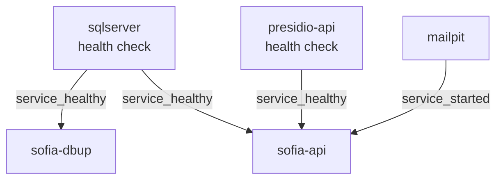

# Despliegue y operación de SOFIA

| | |
|---|---|
| **Sistema** | SOFIA — Sistema Optimizado Farmacéutico con Inteligencia Artificial |
| **Versión del documento** | 1.0 |
| **Fecha** | 2026-10-15 |
| **Backend** | `sofia-apis`, rama `main`, commit `43f5529` |
| **Frontend** | `sofia-web-spa`, rama `main`, commit `eeffbb6` |
| **Método** | Lectura de código y de archivos de configuración de ambos repositorios (solo lectura). No se ejecutó docker, ni compilación, ni servicios, ni navegador, ni llamadas a la API; no se abrió ningún `.env` real. `git status --short` en ambos repositorios: sin cambios sin commitear (no hay marcas «En curso»). |

Este documento describe lo que **existe hoy** en los repositorios para desplegar y operar SOFIA y marca como **Pendiente** lo que no existe. El despliegue previsto es Azure, pero en los repositorios no hay ninguna definición de infraestructura (ver [sección 8](#8-pendientes-para-azure)); por eso no se describe ningún recurso, nombre ni arquitectura de Azure.

Documentos relacionados (no se repite su contenido): [08-guia-del-desarrollador.md](08-guia-del-desarrollador.md) (entorno local, secretos, DbUp, hooks, CI), [02-arquitectura.md](02-arquitectura.md) (configuración, requisitos no funcionales, health check, logging), [07-integraciones.md](07-integraciones.md) (Gemini, Presidio, correo) y [05-seguridad/05b-matriz-de-permisos.md](05-seguridad/05b-matriz-de-permisos.md).

Las rutas sin prefijo de repositorio son relativas a `sofia-apis/` (backend) o `sofia-web-spa/` (SPA) según se indique.

## 1. Componentes desplegables

| Componente | Qué es | Artefacto que produce | Dónde se define |
|---|---|---|---|
| API | ASP.NET Core (.NET 10) `SOFIA.API` | Imagen de contenedor | `sofia-apis/src/SOFIA.API/Dockerfile` |
| Consola DbUp | Aplicación de consola que crea la base y aplica los scripts SQL | Imagen de contenedor | `sofia-apis/src/SOFIA.DbUp/Dockerfile` |
| Microservicio Presidio | FastAPI (Python) que anonimiza texto | Imagen de contenedor | `sofia-apis/src/SOFIA.PresidioAPI/Dockerfile` |
| SPA | Angular 20 | Carpeta de archivos estáticos (`dist`); no hay Dockerfile | `sofia-web-spa/angular.json`, `sofia-web-spa/package.json` |
| SQL Server | Base de datos | No se construye: el compose usa una imagen pública | `sofia-apis/docker-compose.yml:3-19` |
| Servidor de correo | Receptor SMTP local (Mailpit) o proveedor externo configurado por la API | No se construye | `sofia-apis/docker-compose.yml:83-89`; `sofia-apis/src/SOFIA.Infrastructure/Email/EmailOptions.cs` |

No existe ningún otro `Dockerfile`, `.dockerignore` por componente ni definición de orquestación (Kubernetes, Helm, Bicep, Terraform) en los repositorios: se buscaron `Dockerfile*`, `docker-compose*`, `*.yml`, `*.yaml`, `nginx*` hasta cuatro niveles de profundidad (solo hay un `.dockerignore`, en la raíz de `sofia-apis`, y el workflow `security.yml`).

### 1.1 API (`SOFIA.API`)

Fuente: `sofia-apis/src/SOFIA.API/Dockerfile` (35 líneas).

| Aspecto | Valor | Línea |
|---|---|---|
| Etapas | `base` → `build` → `publish` → `final` | 1, 6, 22, 26 |
| Imagen de ejecución (`base`) | `mcr.microsoft.com/dotnet/aspnet:10.0` (etiqueta flotante, sin digest) | 1 |
| Imagen de compilación (`build`) | `mcr.microsoft.com/dotnet/sdk:10.0` (etiqueta flotante, sin digest) | 6 |
| Contexto de build | La raíz de `sofia-apis` (`context: .` en el compose); se copian primero solo los cinco `.csproj` para restaurar y luego todo el árbol | 10-18; `docker-compose.yml:38-40` |
| Compilación y publicación | `dotnet build -c $BUILD_CONFIGURATION` (argumento `Release` por defecto) y `dotnet publish ... /p:UseAppHost=false` | 7, 20, 24 |
| Puertos expuestos | `EXPOSE 8080` y `EXPOSE 8081`. Nada en el repositorio configura Kestrel ni `ASPNETCORE_URLS` ni certificados (búsqueda de `Kestrel`, `ASPNETCORE_URLS`, `ASPNETCORE_HTTP`, `HTTPS_PORT` en código, JSON, compose y Dockerfile: solo un comentario en `GlobalExceptionHandler.cs:46`); el compose publica solo el 8080 | 3-4; `docker-compose.yml:43` |
| Usuario con que corre | `USER $APP_UID` (usuario no administrador de la imagen base); el directorio `/app/logs` se crea y se entrega a ese usuario | 31-33 |
| Punto de entrada | `dotnet SOFIA.API.dll` | 35 |
| Health check | El `Dockerfile` **no** define `HEALTHCHECK`. El compose define `curl -f http://localhost:8080/health` cada 20 s, 10 s de tiempo máximo, 3 reintentos, 20 s de arranque. El `Dockerfile` no instala `curl`; si la imagen base lo trae es **No verificado** (no se ejecutó docker) | `docker-compose.yml:76-81` |
| Variables que necesita | Ver [sección 3.1](#31-claves-de-la-api); el compose las pasa por variables de entorno con doble guion bajo | `docker-compose.yml:44-66` |
| Artefacto | Imagen con la API publicada en `/app` y logs en `/app/logs` | 26-31 |

Observaciones:

- Los pasos de `restore` copian solo los `.csproj`; el `dotnet build` posterior no usa `--no-restore` (línea 20), por lo que vuelve a restaurar con el árbol completo.
- El `.dockerignore` excluye `.git`, `.env`, `.env.*`, `bin`, `obj`, `logs`, `.github`, `.husky`, `docker-compose*.yml` y `**/Dockerfile` del contexto (`sofia-apis/.dockerignore:1-23`).
- `SOFIA.API.csproj` ejecuta `dotnet tool restore` y `dotnet husky install` antes de restaurar solo si existe `.git` y `HUSKY` es distinto de 0 (`SOFIA.API.csproj:29-32`); en el build de Docker `.git` está excluido del contexto, de modo que ese paso no corre.
- El análisis estático SonarAnalyzer se aplica al compilar los proyectos que no son de prueba ni DbUp (`src/Directory.Build.props:8-16`). El `Dockerfile` de la API compila en `Release`; que ese análisis rompa o no el build de la imagen depende de las reglas del analizador y **no se verificó** (no se compiló).

### 1.2 Consola DbUp (`SOFIA.DbUp`)

Fuente: `sofia-apis/src/SOFIA.DbUp/Dockerfile` (15 líneas), `Program.cs`, `SOFIA.DbUp.csproj`.

| Aspecto | Valor | Línea |
|---|---|---|
| Etapas | `build` → `final` | 1, 11 |
| Imagen de compilación | `mcr.microsoft.com/dotnet/sdk:10.0` (sin digest) | 1 |
| Imagen de ejecución | `mcr.microsoft.com/dotnet/runtime:10.0` (sin digest) | 11 |
| Compilación | `dotnet publish -c Release -o /app/publish`; los scripts `Scripts\*.sql` van como recursos embebidos en el ensamblado | 9; `SOFIA.DbUp.csproj:19` |
| Puertos | Ninguno (no hay `EXPOSE`) | — |
| Usuario con que corre | `USER $APP_UID` | 14 |
| Punto de entrada | `dotnet SOFIA.DbUp.dll` | 15 |
| Health check | No aplica: es un proceso que termina. Código de salida `0` si todo va bien (imprime `Success!`) y `-1` si falta la cadena de conexión o si un script falla | `Program.cs:16-22,36-50` |
| Variable que necesita | `ConnectionStrings__DefaultConnection` (o el primer argumento de línea de comandos, que tiene prioridad); también lee `appsettings.json` (opcional, trae la cadena vacía) y user-secrets | `Program.cs:5-14`; `sofia-apis/src/SOFIA.DbUp/appsettings.json:2-4` |
| Artefacto | Imagen con la consola y los scripts embebidos | — |

Detalle del flujo y de los fallos: [sección 4](#4-base-de-datos).

### 1.3 Microservicio Presidio (`SOFIA.PresidioAPI`)

Fuente: `sofia-apis/src/SOFIA.PresidioAPI/Dockerfile` (20 líneas), `main.py`, `requirements.txt`, `requirements-model.txt`.

| Aspecto | Valor | Línea |
|---|---|---|
| Imagen base | `python:3.10.21-slim` fijada por digest `sha256` (etapa única) | 1 |
| Instalación | `pip install --upgrade pip` (sin versión fijada); `pip install -r requirements.txt` con versiones fijas (`fastapi==0.142.1`, `uvicorn==0.54.0`, `presidio-analyzer==2.2.351`, `presidio-anonymizer==2.2.351`, `spacy==3.7.5`, `pydantic==2.13.5`); el modelo `es-core-news-md` 3.7.0 se instala con `--no-deps --require-hashes` | 5-11; `requirements.txt:1-6`; `requirements-model.txt:1` |
| Puertos | `EXPOSE 8000`; `uvicorn main:app --host 0.0.0.0 --port 8000` | 18-20 |
| Usuario con que corre | `useradd --uid 10001 --no-create-home --shell /usr/sbin/nologin presidio` y `USER 10001` | 15-16 |
| Variable que necesita | `PRESIDIO_INTERNAL_KEY` (opcional; si está vacía no se comprueba la clave) | `main.py:12,18-21` |
| Endpoints | `GET /health` (sin clave) y `POST /api/anonimizar` (con la comprobación de clave); sin documentación interactiva ni esquema | `main.py:15,99-104` |
| Health check | El `Dockerfile` no define `HEALTHCHECK`. El compose: `python -c "import urllib.request; urllib.request.urlopen('http://localhost:8000/health')"` cada 20 s, 15 s de tiempo máximo, 5 reintentos, 90 s de arranque | `docker-compose.yml:30-35` |
| Artefacto | Imagen con `main.py` y el modelo de spaCy | 13 |

Observaciones:

- El modelo de spaCy se descarga de GitHub (`github.com/explosion/spacy-models`) durante el build (`requirements-model.txt:1`): el build de la imagen necesita salida a Internet.
- El compose comprueba la salud con Python y no con `curl` (`docker-compose.yml:31`); el `Dockerfile` no instala `curl`.
- Texto máximo de entrada: 20 000 caracteres (`main.py:11,97`).

### 1.4 SPA (`sofia-web-spa`)

Fuente: `sofia-web-spa/angular.json`, `package.json`, `public/`, `src/index.html`. No existe `Dockerfile`, ni configuración de servidor web (nginx u otro), ni workflow de CI en este repositorio.

| Aspecto | Valor | Evidencia |
|---|---|---|
| Cómo se construye | `npm run build` = `ng build` (`package.json:8`). La configuración por defecto es `production` (`angular.json:95`). Constructor `@angular-devkit/build-angular:browser` | `angular.json:26,95` |
| Versiones | Angular `~20.3.32`, TypeScript `~5.8.3`, `@angular/cli ~20.3.37`. La versión de Node necesaria no está declarada (no hay `engines` en `package.json` ni `.nvmrc`): **No verificado** | `package.json:20-28,42,63` |
| Etapas, imagen base, usuario, puertos | No aplica: el SPA no se empaqueta en contenedor en este repositorio | — |
| Artefacto | Carpeta `dist/sofia-web-spa` con archivos estáticos con hash en el nombre (`outputHashing: all`), sin mapas de fuente. Todo el contenido de `public/` se copia a la raíz de la salida (incluidos `environment.js`, `staticwebapp.config.json`, `i18n/`, `icons/`, `images/`, `favicon.ico`) | `angular.json:33,39-45,77-78` |
| Sustitución de entorno | En `production`, `src/environments/environment.ts` se sustituye por `environment.prod.ts` | `angular.json:63-68` |
| Presupuesto de tamaño | 5 MB de advertencia y de error para el paquete inicial y para el estilo de cada componente | `angular.json:51-61` |
| Variables en tiempo de build | Ninguna: el build no lee variables de entorno del sistema; la URL de la API sale de `environment*.ts` o de `environment.js` (ver [sección 3.3](#33-configuración-en-tiempo-de-ejecución-del-spa)) | `environment.model.ts:22-31` |
| Health check | No aplica (archivos estáticos) | — |
| Enrutamiento | `provideRouter` sin `withHashLocation`: las URL son rutas reales (`/auth/register`, etc.), por lo que el servidor que sirva el SPA debe devolver `index.html` para las rutas internas | `src/app/app.config.ts:32-35` |
| Dependencias de terceros en ejecución | Fuentes y hoja de iconos desde `fonts.googleapis.com` y `fonts.gstatic.com` (`index.html:11-17`); la CSP de `staticwebapp.config.json` también permite `api.iconify.design`, `api.simplesvg.com` y `api.unisvg.com` en `connect-src` | `index.html:11-17`; `staticwebapp.config.json:3` |

`public/staticwebapp.config.json` define solo `globalHeaders` (CSP, `X-Frame-Options`, `X-Content-Type-Options`, `Referrer-Policy`, `Strict-Transport-Security`, `Permissions-Policy`) (`staticwebapp.config.json:2-9`). Es un **indicio** de que se prevé Azure Static Web Apps (el nombre y la clave `globalHeaders` corresponden a ese servicio; el repositorio no lo dice de forma explícita). El archivo **no** define `navigationFallback`, ni `routes`, ni proxy hacia la API: ver [sección 8](#8-pendientes-para-azure).

### 1.5 SQL Server

| Aspecto | Valor | Evidencia |
|---|---|---|
| Imagen | `mcr.microsoft.com/mssql/server:2022-latest` (etiqueta flotante), `MSSQL_PID=Developer` (edición de desarrollo) | `docker-compose.yml:4,9` |
| Contraseña del administrador | `SA_PASSWORD`, obligatoria (el compose aborta si falta) | `docker-compose.yml:7` |
| Puerto | `127.0.0.1:1434` en el anfitrión → `1433` en el contenedor | `docker-compose.yml:11` |
| Volumen | `sqlserver_data:/var/opt/mssql` | `docker-compose.yml:12-13` |
| Health check | `sqlcmd ... -U sa -P "$$SA_PASSWORD" -Q 'SELECT 1' -No` cada 15 s, 10 s de tiempo máximo, 5 reintentos, 30 s de arranque | `docker-compose.yml:14-19` |
| Base de datos | `SofiaDb` (la crea DbUp si no existe) | `docker-compose.yml:46,97`; `SOFIA.DbUp/Program.cs:24-25` |

Fuera de Docker el repositorio no define cómo se aprovisiona SQL Server (**Pendiente** para Azure).

### 1.6 Servidor de correo

La API envía correos de recuperación de contraseña a través de un proveedor configurable: `None`, `Smtp` o `AzureCommunication` (`sofia-apis/src/SOFIA.Infrastructure/Email/EmailOptions.cs:6-8`; detalle en [07-integraciones.md](07-integraciones.md)).

| Entorno | Qué trae el repositorio | Evidencia |
|---|---|---|
| Local | Servicio `mailpit` (`axllent/mailpit:v1.31.3`): SMTP en `127.0.0.1:1025` y bandeja web/API en `127.0.0.1:8025`; sin autenticación ni TLS. Sin volumen: los correos no persisten | `docker-compose.yml:83-89` |
| Producción | **No hay servidor de correo** en los repositorios. La API necesita un proveedor externo (`Smtp` con host, o `AzureCommunication` con cadena de conexión). El `.env.example` menciona `AzureCommunication` para «Azure staging» con remitente `DoNotReply@<guid>.azurecomm.net` (solo un comentario; no hay ambiente creado) | `.env.example:19-21` |

El artefacto de este componente es ninguno: no se construye nada.

## 2. `docker-compose.yml`

Archivo: `sofia-apis/docker-compose.yml` (105 líneas). Plantilla de variables: `sofia-apis/.env.example` (31 líneas); el `.env` real queda fuera del repositorio y no se abrió.

### 2.1 Para qué sirve

El compose está pensado para **desarrollo local**, no para producción. Lo sustentan estos hechos del propio archivo: la API corre con `ASPNETCORE_ENVIRONMENT=Development` (línea 45); SQL Server usa `MSSQL_PID=Developer` (línea 9); todos los puertos se publican solo en `127.0.0.1` (líneas 11, 29, 43, 88, 89); incluye un receptor de correo local (Mailpit, línea 84); la API se conecta como `sa` (línea 46); y `.env.example` indica que para «Azure staging» se usarían otros valores de correo (`.env.example:21`). Para desplegar fuera de la máquina del desarrollador no sirve tal cual: ver las diferencias en [3.2](#32-diferencias-development-y-production-que-implementa-el-código) y [7](#7-lista-de-verificación-previa-a-producción).

### 2.2 Servicios

| Servicio | Contenedor | Imagen o build | Puertos (anfitrión → contenedor) | Volumen | Health check | Reinicio | Líneas |
|---|---|---|---|---|---|---|---|
| `sqlserver` | `sofia-sqlserver` | `mcr.microsoft.com/mssql/server:2022-latest` | `127.0.0.1:1434 → 1433` | `sqlserver_data:/var/opt/mssql` | Sí (`sqlcmd`, ver 1.5) | No definido | 3-19 |
| `presidio-api` | `sofia-presidio` | Build de `./src/SOFIA.PresidioAPI` | `127.0.0.1:8001 → 8000` | Ninguno | Sí (Python, ver 1.3) | No definido | 21-35 |
| `sofia-api` | `sofia-api` | Build con contexto `.` y `src/SOFIA.API/Dockerfile` | `127.0.0.1:5000 → 8080` | `sofia_logs:/app/logs` | Sí (`curl`, ver 1.1) | No definido | 37-81 |
| `mailpit` | `sofia-mailpit` | `axllent/mailpit:v1.31.3` | `127.0.0.1:1025 → 1025` y `127.0.0.1:8025 → 8025` | Ninguno | No | No definido | 83-89 |
| `sofia-dbup` | `sofia-dbup` | Build con contexto `.` y `src/SOFIA.DbUp/Dockerfile` | Ninguno | Ninguno | No | `restart: on-failure` | 91-101 |

### 2.3 Dependencias y orden de arranque

- `sofia-api` espera a `sqlserver` y `presidio-api` sanos y a que `mailpit` haya arrancado (`docker-compose.yml:69-75`).
- `sofia-dbup` espera a `sqlserver` sano (`docker-compose.yml:98-100`).
- **`sofia-api` no depende de `sofia-dbup`:** con una base nueva, la API puede arrancar antes de que existan las tablas. Tampoco hay forma en el compose de saber que DbUp terminó bien (no tiene health check ni `service_completed_successfully`).
- Tiempos de arranque (`start_period`): SQL Server 30 s, Presidio 90 s, API 20 s (`docker-compose.yml:19,35,81`). Con 5 reintentos de 15 s en SQL Server y 5 de 20 s en Presidio, el compose declara «no sano» después de agotarlos; el efecto sobre `depends_on` es que la API no arranca (comportamiento estándar de Compose, **No verificado** aquí porque no se ejecutó).

### 2.4 Redes y volúmenes

- **Redes:** el archivo no declara ninguna sección `networks`. Compose crea por defecto una red del proyecto y los servicios se resuelven por nombre de servicio (`sqlserver`, `presidio-api`, `mailpit`), como lo usan las cadenas `Server=sqlserver,1433` y `PresidioApi__BaseUrl=http://presidio-api:8000` (`docker-compose.yml:46,51,97`).
- **Volúmenes con nombre:** `sqlserver_data` (datos de SQL Server) y `sofia_logs` (logs de la API) (`docker-compose.yml:103-105`). `mailpit` y `presidio-api` no tienen volumen.

### 2.5 Variables y su origen

Compose sustituye `${...}` desde el `.env` junto al archivo. «Obligatoria» = el compose aborta con un mensaje si falta (`:?`).

| Variable de `.env` | Servicio(s) | Obligatoria | Valor por defecto no secreto | Se pasa como | Líneas del compose |
|---|---|---|---|---|---|
| `SA_PASSWORD` | `sqlserver`, `sofia-api`, `sofia-dbup` | **Sí** (`:?`) | — | `SA_PASSWORD`; dentro de `ConnectionStrings__DefaultConnection` | 7, 46, 97 |
| `JWT_SECRET_KEY` | `sofia-api` | **Sí** (`:?`, «mínimo 32 caracteres») | — | `Jwt__SecretKey` | 47 |
| `PRESIDIO_INTERNAL_KEY` | `presidio-api`, `sofia-api` | No (`:-` vacío) | vacío (desactiva la comprobación en Presidio) | `PRESIDIO_INTERNAL_KEY` y `PresidioApi__InternalKey` | 27, 52 |
| `GEMINI_BASE_URL` | `sofia-api` | No | `https://generativelanguage.googleapis.com/v1beta/models/` | `GeminiApi__BaseUrl` | 53 |
| `GEMINI_OCR_MODEL` | `sofia-api` | No | `gemini-3.6-flash` | `GeminiApi__OcrModel` | 54 |
| `GEMINI_REASONING_MODEL` | `sofia-api` | No | `gemini-2.5-pro` | `GeminiApi__ReasoningModel` | 55 |
| `GEMINI_API_KEY` | `sofia-api` | No (vacío) | vacío | `GeminiApi__ApiKey` | 56 |
| `APP_FRONTEND_BASE_URL` | `sofia-api` | No | `http://localhost:4200` | `App__FrontendBaseUrl` | 57 |
| `EMAIL_PROVIDER` | `sofia-api` | No | `Smtp` | `Email__Provider` | 58 |
| `EMAIL_FROM_ADDRESS` | `sofia-api` | No | `no-reply@sofia.local` | `Email__FromAddress` | 59 |
| `EMAIL_FROM_DISPLAY_NAME` | `sofia-api` | No | `SOFIA` | `Email__FromDisplayName` | 60 |
| `EMAIL_SMTP_HOST` | `sofia-api` | No | `mailpit` | `Email__Smtp__Host` | 61 |
| `EMAIL_SMTP_PORT` | `sofia-api` | No | `1025` | `Email__Smtp__Port` | 62 |
| `EMAIL_SMTP_USE_SSL` | `sofia-api` | No | `false` | `Email__Smtp__UseSsl` | 63 |
| `EMAIL_SMTP_USERNAME` | `sofia-api` | No (vacío) | vacío | `Email__Smtp__UserName` | 64 |
| `EMAIL_SMTP_PASSWORD` | `sofia-api` | No (vacío) | vacío | `Email__Smtp__Password` | 65 |
| `EMAIL_ACS_CONNECTION_STRING` | `sofia-api` | No (vacío) | vacío | `Email__AzureCommunication__ConnectionString` | 66 |

Valores fijos en el compose (no vienen del `.env`): `ACCEPT_EULA=Y`, `MSSQL_PID=Developer`, `ASPNETCORE_ENVIRONMENT=Development`, `Jwt__Issuer=SOFIA.API`, `Jwt__Audience=SOFIA.Clients`, `Jwt__ExpiryMinutes=15`, `PresidioApi__BaseUrl=http://presidio-api:8000` y la cadena de conexión con `User Id=sa`, `Database=SofiaDb` y `TrustServerCertificate=True` (`docker-compose.yml:8-9,45-51,97`).

Observaciones:

- Las claves que `.env.example` lista coinciden con las que el compose consume (17 variables); `.env.example` marca `SA_PASSWORD` y `JWT_SECRET_KEY` con marcadores `<REEMPLAZAR_...>` (`.env.example:5,8`).
- El compose **no** define `AllowedOrigins`, `ForwardedHeaders__KnownProxies` ni `AllowedHosts`. Con `Development` no hacen falta, pero una variante de producción sí los necesita (ver [3.1](#31-claves-de-la-api)).
- `TrustServerCertificate=True` en la cadena de conexión desactiva la validación del certificado de SQL Server (`docker-compose.yml:46,97`); es aceptable para el contenedor local, pero no es una configuración para producción.
- El `.env` real está ignorado por Git y por el contexto de Docker (`.dockerignore:11-14`); la plantilla es el único archivo de ese tipo versionado.

## 3. Configuración por entorno

El mecanismo de configuración (fuentes, opciones tipadas) está en [02-arquitectura.md, sección 12](02-arquitectura.md#12-configuración) y el modo de cargar secretos en local en [08-guia-del-desarrollador.md, sección 3.2](08-guia-del-desarrollador.md#32-dónde-se-configura-cada-cosa). Aquí se resume lo que necesita un despliegue. No se documentan valores secretos.

Regla de nombres de variables de entorno: ASP.NET Core convierte `Seccion:Clave` en `Seccion__Clave` (el compose lo aplica, `docker-compose.yml:44-66`). Las listas se expresan con índice (`AllowedOrigins__0`, `AllowedOrigins__1`, `ForwardedHeaders__KnownProxies__0`); esa convención es del framework y el repositorio no tiene un ejemplo para listas (**No verificado** aquí).

### 3.1 Claves de la API

Columnas: «Obligatoria en producción» = sin ella la API no sirve la función indicada en un entorno que no sea Development/Testing; «Validación» = cuándo se detecta la falta (arranque = la aplicación no inicia; uso = falla cuando se ejecuta la función).

| Clave | Variable de entorno equivalente | Obligatoria en producción | Validación | Valor por defecto no secreto | Evidencia |
|---|---|---|---|---|---|
| `ConnectionStrings:DefaultConnection` | `ConnectionStrings__DefaultConnection` | Sí (secreto) | Ninguna al arrancar; falla en el primer acceso a datos (`OutboxProcessor` lo intenta cada 10 s y registra el error) | Vacía en `appsettings.json` | `appsettings.json:2-4`; `DependencyInjection.cs:32` |
| `Jwt:SecretKey` | `Jwt__SecretKey` | Sí (secreto) | **Arranque**: vacía → error; menos de 32 bytes UTF-8 → error | Vacía | `appsettings.json:9`; `JwtOptions.cs:8,17-25` |
| `Jwt:Issuer` | `Jwt__Issuer` | Sí | **Arranque**: vacío → error | `SOFIA.API` | `appsettings.json:6`; `JwtOptions.cs:27-30` |
| `Jwt:Audience` | `Jwt__Audience` | Sí | **Arranque**: vacío → error | `SOFIA.Clients` | `appsettings.json:7`; `JwtOptions.cs:27-30` |
| `Jwt:ExpiryMinutes` | `Jwt__ExpiryMinutes` | No | No se valida (sin valor sería 0) | `15` | `appsettings.json:8`; `JwtOptions.cs:13`; `JwtProvider.cs:57` |
| `AllowedOrigins` (lista) | `AllowedOrigins__0`, ... | **Sí** | Falla al construir la política CORS (el momento exacto es No verificado, ver [02-arquitectura.md](02-arquitectura.md#123-qué-hace-fallar-el-inicio)); en Development se ignora | No existe en `appsettings.json`; solo en `appsettings.Testing.json:2` | `Program.cs:39-63` |
| `App:FrontendBaseUrl` | `App__FrontendBaseUrl` | **Sí** (URL absoluta `https`) | **Arranque** si el entorno no es Development/Testing o si hay proveedor de correo | No existe en `appsettings.json` | `AppOptions.cs:9-16`; `DependencyInjection.cs:163-167` |
| `Email:Provider` | `Email__Provider` | **Sí**: `Smtp` o `AzureCommunication` (vacío o `None` no se admite fuera de Development/Testing) | **Arranque** | No existe en `appsettings.json` | `EmailOptions.cs:16,18-28,60`; `DependencyInjection.cs:159-161` |
| `Email:FromAddress` | `Email__FromAddress` | Sí, con proveedor | **Arranque** | — | `EmailOptions.cs:30-33` |
| `Email:FromDisplayName` | `Email__FromDisplayName` | No | — | `SOFIA` (valor de la clase) | `EmailOptions.cs:12` |
| `Email:Smtp:Host` | `Email__Smtp__Host` | Sí, con `Smtp` | **Arranque** | — | `EmailOptions.cs:37-40` |
| `Email:Smtp:Port` | `Email__Smtp__Port` | Sí, con `Smtp` (1 a 65535) | **Arranque** | `587` (valor de la clase) | `EmailOptions.cs:37-40,67` |
| `Email:Smtp:UseSsl` | `Email__Smtp__UseSsl` | No | — | `true` (valor de la clase; `false` solo para un receptor local) | `EmailOptions.cs:68-69` |
| `Email:Smtp:UserName`, `Email:Smtp:Password` | `Email__Smtp__UserName`, `Email__Smtp__Password` | Ambos o ninguno (secreto) | **Arranque**: uno sin el otro → error | — | `EmailOptions.cs:42-45` |
| `Email:AzureCommunication:ConnectionString` | `Email__AzureCommunication__ConnectionString` | Sí, con `AzureCommunication` (secreto) | **Arranque** | — | `EmailOptions.cs:50-56` |
| `PresidioApi:BaseUrl` | `PresidioApi__BaseUrl` | Sí, para analizar recetas con IA | **Uso**: se valida al crear el cliente HTTP (primer análisis) | No existe en `appsettings.json` | `DependencyInjection.cs:142,188-191` |
| `PresidioApi:InternalKey` | `PresidioApi__InternalKey` | Recomendada (secreto); si está vacía no se envía la cabecera, y Presidio solo la exige si tiene su propia clave | Ninguna | Vacía | `DependencyInjection.cs:193-198`; `main.py:12,18-21` |
| `GeminiApi:ApiKey` | `GeminiApi__ApiKey` | Sí, para analizar recetas con IA (secreto) | **Uso**: ausente (`null`) → excepción; cadena vacía → falla al llamar a Gemini | Vacía | `appsettings.json:25`; `GeminiRecetaAnalyzer.cs:29` |
| `GeminiApi:BaseUrl` | `GeminiApi__BaseUrl` | Sí, para analizar recetas con IA | **Uso** (igual que la anterior) | Vacía en `appsettings.json`; el compose y `.env.example` usan `https://generativelanguage.googleapis.com/v1beta/models/` | `appsettings.json:22`; `GeminiRecetaAnalyzer.cs:67-68`; `docker-compose.yml:53` |
| `GeminiApi:OcrModel` | `GeminiApi__OcrModel` | No | — | Vacía → el código usa `gemini-3.6-flash` | `GeminiRecetaAnalyzer.cs:21,66,201-202` |
| `GeminiApi:ReasoningModel` | `GeminiApi__ReasoningModel` | No | — | Vacía → usa el modelo de OCR; si también está vacío, `gemini-3.6-flash` | `GeminiRecetaAnalyzer.cs:106,201-202` |
| `ForwardedHeaders:KnownProxies` (lista de IP) | `ForwardedHeaders__KnownProxies__0`, ... | **Sí si la API está detrás de un proxy o balanceador** (ver [5.6](#56-límites-de-peticiones-y-proxy)) | Una IP inválida falla al construir las opciones | Lista vacía | `appsettings.json:27-29`; `Program.cs:81-95` |
| `AllowedHosts` | `AllowedHosts` | Sí, ajustar al dominio real | Filtro de cabecera `Host` del framework | `localhost` (Development: `localhost;127.0.0.1;[::1]`) | `appsettings.json:30`; `appsettings.Development.json:5` |
| `Serilog:MinimumLevel:*` | `Serilog__MinimumLevel__Default`, etc. | No | — | `Information`; `Microsoft.AspNetCore`, `Microsoft.EntityFrameworkCore` y `System.Net.Http` en `Warning` | `appsettings.json:11-19`; `Program.cs:20` |
| `ASPNETCORE_ENVIRONMENT` | (es la propia variable) | Sí: debe ser distinta de `Development` | — | El compose fija `Development` | `docker-compose.yml:45`; `Program.cs:44,120` |

Para Presidio: `PRESIDIO_INTERNAL_KEY` (ver 1.3). Para DbUp: `ConnectionStrings__DefaultConnection` (ver 1.2).

`PresidioApi:*` no figura en ningún `appsettings`, y `GeminiApi` solo figura vacío (`appsettings.json:21-26`); quien lea solo esos archivos no descubre estas claves.

### 3.2 Diferencias Development y Production que implementa el código

La tabla completa está en [02-arquitectura.md, sección 12.4](02-arquitectura.md#124-diferencias-development-y-production-que-el-código-implementa); estas son las que importan al desplegar:

| Aspecto | Development | Otros entornos | Evidencia |
|---|---|---|---|
| CORS | Orígenes fijos `http://localhost:4200` y `https://localhost:4200` | Los de `AllowedOrigins`; si falta, excepción | `Program.cs:44-62` |
| HSTS | No se envía | Sí (365 días, subdominios incluidos) | `Program.cs:31-36,120-123` |
| Correo | Puede estar sin proveedor (los correos se descartan) | Proveedor obligatorio | `DependencyInjection.cs:159-161,173-175` |
| `App:FrontendBaseUrl` | Acepta `http` | Solo `https` | `AppOptions.cs:9-16` |
| `AllowedHosts` | Amplía a `127.0.0.1` y `[::1]` | `localhost` si no se sobrescribe | `appsettings.Development.json:5` |
| Límite de peticiones, cabeceras de seguridad, redirección a HTTPS | Igual | Igual | `RateLimitingExtensions.cs:12-50`; `Program.cs:125` |

Hay un tercer entorno, `Testing`, con trato de Development para el correo y la URL del SPA y su propio `appsettings.Testing.json` (nivel de log `Warning` y el origen `http://localhost:3000`) (`DependencyInjection.cs:159`; `appsettings.Testing.json:1-7`). No existe `appsettings.Production.json` ni `appsettings.Staging.json`: la configuración de producción debe llegar por variables de entorno u otro proveedor de configuración que añada el despliegue.

**Cookie de sesión.** La cookie `refresh_token` se emite siempre con `HttpOnly`, `Secure` y `SameSite=None` (`RefreshTokenCookieExtensions.cs:5,15-21`); el comentario del código indica que SPA y API viven en sitios distintos (`:7`). Como es `Secure`, el navegador solo la acepta si la comunicación con la API es por HTTPS (comportamiento del navegador, **No verificado** aquí).

### 3.3 Configuración en tiempo de ejecución del SPA

| Archivo | Qué contiene | Efecto |
|---|---|---|
| `public/environment.js` | `window.__env = {};` (una línea) | Se copia a la raíz de la salida del build. Con el objeto vacío no cambia nada: mandan los valores compilados |
| `src/index.html:18` | `` dentro de `<head>` | Se carga antes de que arranque Angular, por lo que `window.__env` ya está definido |
| `src/environments/environment.model.ts:22-31` | `resolveEnvironment()` | Usa `window.__env` solo si es un objeto con `production` booleano y `api.baseurl` de texto no vacío; si no, usa los valores compilados |
| `src/environments/environment.prod.ts` | `production: true`, `appVersion: '1.0.0'`, `api.baseurl: ''` | Es lo que se compila con `ng build` (producción). Con `baseurl` vacío y sin `environment.js` válido, las llamadas se arman como `/api/v1/...` relativas al propio origen del SPA (`auth.service.ts:34`) |
| `src/environments/environment.ts` | `production: false`, `baseurl: 'https://localhost:7300'` | Valores por defecto de desarrollo y de las pruebas |
| `src/environments/environment.local.ts` | Archivo local, ignorado por Git, que `ng serve` usa en `development` | No forma parte del despliegue (ver [08-guia-del-desarrollador.md, sección 3.6](08-guia-del-desarrollador.md#36-spa)) |

**Cómo cambiar la URL de la API sin recompilar:** reemplaza, en el sitio ya desplegado, el archivo `environment.js` por uno que defina `window.__env` con al menos `production` (booleano) y `api.baseurl` (URL sin barra final ni `/api`). Incluye también `appVersion`: `resolveEnvironment()` devuelve el objeto de `window.__env` tal cual (`environment.model.ts:27-28`) y varias pantallas muestran `environment.appVersion` (`header.component.ts:39,58`, `login.component.ts:55`), así que si falta se vería vacío (deducción del código; no se ejecutó). El nombre `environment.js` no lleva hash: es un activo copiado, no un paquete generado (`angular.json:39-45,77`), por lo que el hosting no debe cachearlo de forma agresiva (recomendación derivada; el repositorio no define cabeceras de caché).

El repositorio **no** trae un mecanismo que genere `environment.js` en el despliegue: el `.gitignore` y el `.gitattributes` mencionan `scripts/azure/keyvault-secrets.example.json` y `scripts/azure/*.sh`, pero esa carpeta no existe (`sofia-web-spa/.gitignore:52,55-56`; `sofia-web-spa/.gitattributes:1-2`) → **Pendiente**.

Además, la API debe incluir el origen exacto del SPA en `AllowedOrigins` (CORS con credenciales, sin comodín: `Program.cs:58-61`), y la CSP del hosting estático solo permite `connect-src 'self'` más los dominios de Iconify (`staticwebapp.config.json:3`): si la API está en otro origen, hay que añadirlo a `connect-src` o el navegador bloqueará las llamadas (deducción de la CSP; no se probó).

## 4. Base de datos

El esquema lo crea y lo evoluciona **solo DbUp**; EF Core no migra (búsqueda de `EnsureCreated`, `Database.Migrate` y `MigrateAsync` en código que no es de prueba: sin resultados; `EnsureCreated` solo aparece en la fábrica de pruebas de integración, `SOFIA.IntegrationTests/Infrastructure/SofiaWebAppFactory.cs:90`). La API **no** aplica scripts al arrancar: alguien debe ejecutar la consola DbUp antes (o junto con) el despliegue de la API. Detalle de DbUp y de la convención de nombres: [08-guia-del-desarrollador.md, sección 3.4](08-guia-del-desarrollador.md#34-base-de-datos-con-dbup) y [08, sección 8.4](08-guia-del-desarrollador.md#84-agregar-un-script-de-base-de-datos).

### 4.1 Cómo funciona DbUp

| Aspecto | Comportamiento | Evidencia |
|---|---|---|
| Entrada | Cadena de conexión: primer argumento de línea de comandos o `ConnectionStrings:DefaultConnection` (`appsettings.json` opcional → user-secrets → variables de entorno). Sin cadena: imprime «Connection string is missing!» y sale con `-1` | `SOFIA.DbUp/Program.cs:5-22` |
| Base inexistente | La crea: `EnsureDatabase.For.SqlDatabase(connectionString)`. El usuario de la cadena necesita, por tanto, permiso para crear bases en un ambiente nuevo (requisito derivado de la llamada; el detalle lo resuelve la biblioteca y **no se verificó**) | `Program.cs:24-25` |
| Scripts | Los 28 `.sql` embebidos de `SOFIA.DbUp/Scripts` (solo los del primer nivel de la carpeta) | `Program.cs:30`; `SOFIA.DbUp.csproj:19` |
| Orden | El prefijo numérico de cuatro dígitos (`0001_` a `0028_`), según la convención del repositorio | Ver [08, sección 3.4](08-guia-del-desarrollador.md#34-base-de-datos-con-dbup) |
| Registro de aplicados | El código no configura un diario propio (no hay llamada a `JournalTo...`), así que se usa el de la biblioteca `dbup-sqlserver` 7.2.0; el nombre exacto de la tabla es **No verificado** (ningún archivo del repositorio la nombra) | `Program.cs:27-32`; `SOFIA.DbUp.csproj:12` |
| Transacciones | `Program.cs` no elige modo de transacción (no hay llamadas a `WithTransaction`, `WithTransactionPerScript` ni `WithoutTransaction`) y ningún script abre una (búsqueda de `BEGIN TRAN`, `COMMIT`, `ROLLBACK`, `XACT_ABORT` en los 28 scripts: sin resultados). El efecto del modo por defecto de la biblioteca ante un fallo a mitad de un script es **No verificado** | `Program.cs:27-32` |
| Salida | `Success!` y código `0`; en error, imprime el error y código `-1` (en compilación `DEBUG` espera un `Enter` antes: no ocurre en la imagen, que compila en `Release`) | `Program.cs:36-50`; `SOFIA.DbUp/Dockerfile:9` |
| Registro (log) | `LogToConsole()`: la salida va a la consola del proceso o del contenedor; no escribe archivo | `Program.cs:31` |

### 4.2 Ambiente nuevo

1. Aprovisiona SQL Server y obtén una cadena de conexión (**Pendiente** en Azure: el repositorio no define cómo).
2. Ejecuta DbUp con esa cadena: variable `ConnectionStrings__DefaultConnection` o primer argumento (`dotnet run --project src/SOFIA.DbUp` en el código fuente, o la imagen de `SOFIA.DbUp/Dockerfile`). En el compose lo hace el servicio `sofia-dbup` (`docker-compose.yml:91-101`).
3. Espera el código de salida `0` y el mensaje `Success!`.
4. Arranca la API. El orden DbUp → API **no** lo impone el compose (ver [2.3](#23-dependencias-y-orden-de-arranque)); en un despliegue real debe imponerlo quien despliega.
5. Crea la primera empresa: no hay usuario sembrado; los scripts solo siembran seis roles base sin empresa (`0002_SeedBaseRoles.sql`). El primer usuario sale del registro público de empresa, `POST empresas/registrar`, anónimo y con límite de 5 por hora por IP (ver [08, sección 3.7](08-guia-del-desarrollador.md#37-primer-acceso) y [5.6](#56-límites-de-peticiones-y-proxy)).

### 4.3 Ambiente existente

Al volver a ejecutar DbUp contra una base ya creada, la biblioteca aplica los scripts que no figuran en su diario y omite los demás; esa es la razón de ser de un diario (comportamiento de la biblioteca, **No verificado** porque no se ejecutó y no se abrió la tabla del diario). Para una actualización: despliega primero la versión de DbUp que contiene los scripts nuevos y ejecútala; después despliega la API. La numeración consecutiva de los scripts es una convención (no hay un control en el código que la verifique).

### 4.4 Idempotencia de los scripts

La idempotencia depende de cada script, no de DbUp. Medida por búsqueda de guardas (`IF EXISTS`, `IF NOT EXISTS`, `COL_LENGTH`, `OBJECT_ID`, `sys.*`) en cada archivo:

| Scripts | Guardas de existencia | Consecuencia |
|---|---|---|
| `0001`, `0003`, `0006`, `0007`, `0008`, `0010`, `0011`, `0012`, `0013`, `0014`, `0016` | Ninguna | Si se ejecutan por segunda vez (o tras un fallo parcial), `CREATE TABLE`, `ALTER TABLE ADD` o `CREATE INDEX` fallan por objeto ya existente |
| `0002`, `0004`, `0005`, `0009`, `0015`, `0017`, `0018` a `0028` | Sí (en distinto grado; `0009` solo una) | Se pueden volver a ejecutar sin duplicar, en su mayor parte; no se revisó cada sentencia una por una |

`0001_Initial_Schema.sql` crea 44 tablas en un solo lote de 857 líneas, sin `GO` ni guardas (conteo por búsqueda de `CREATE TABLE`).

### 4.5 Si un script falla

El repositorio no documenta un procedimiento. Lo que se puede afirmar:

- DbUp detiene la ejecución en el primer error, imprime el error y sale con `-1` (`Program.cs:36-45`). En el compose, `restart: on-failure` reintenta el contenedor (`docker-compose.yml:101`), por lo que una falla persistente se repetirá en bucle hasta que se corrija la causa.
- Los scripts siguientes no se ejecutan; la API de la versión nueva puede esperar columnas o índices que no existen.
- Como los scripts no abren transacciones y varios no tienen guardas (4.4), un fallo a mitad de un script sin guardas puede dejar objetos creados a medias; reintentar tal cual puede fallar por «ya existe» (deducción de los dos hechos anteriores; **No verificado** en ejecución). La salida segura es restaurar un respaldo anterior al intento (ver [4.7](#47-respaldos)) o limpiar a mano el estado parcial y reintentar.

**Riesgo detectado en `0004_Seed_Digemid_Catalogo.sql`** (lectura del script; **No verificado** en ejecución): si existe una base de datos llamada `SofiaDb` y `DIGEMID_Catalogo_Productos` está vacía, inserta desde `[SofiaDb].[dbo].[DigemidCatalogo]` (líneas 3-5 y 34); ningún script crea una tabla `DigemidCatalogo` (búsqueda en `SOFIA.DbUp` y en `docs/_inventario/tablas.csv`: sin resultados), y el nombre `SofiaDb` está escrito en el script. En un ambiente nuevo con la base llamada `SofiaDb`, como en el compose (`docker-compose.yml:46`), la sentencia referiría una tabla que no existe. Si la base se llama de otro modo, el script se omite con un mensaje (líneas 43-46) y el catálogo DIGEMID queda vacío hasta una carga masiva. Probar DbUp contra una base nueva antes de producción.

### 4.6 Usuario de base de datos

- **Confirmado:** el compose conecta la API y DbUp como `sa` (`User Id=sa` en `docker-compose.yml:46,97`), el administrador de SQL Server, y `TrustServerCertificate=True` desactiva la validación del certificado. Es un **riesgo** si se replica fuera del desarrollo local: la API no necesita privilegios de administrador (no ejecuta DDL: no hay `EnsureCreated`/migraciones en su código) y DbUp sí necesita crear base y objetos. El repositorio no define roles ni usuarios de SQL Server distintos de `sa` (búsqueda de `CREATE USER`, `CREATE LOGIN`, `GRANT` en los scripts de `SOFIA.DbUp`: sin resultados). Separar un usuario de migración (para DbUp) de otro de aplicación (para la API) es **Pendiente**.
- Lo anterior es una recomendación derivada del uso observado en el código; el repositorio no la documenta.

### 4.7 Respaldos

**Pendiente.** No hay scripts, trabajos ni configuración de respaldo o restauración en los repositorios (búsqueda de `BACKUP DATABASE` en `SOFIA.DbUp` y de archivos de respaldo en la raíz de ambos repositorios: sin resultados). El volumen `sqlserver_data` del compose conserva los datos entre reinicios del contenedor, pero no es un respaldo (`docker-compose.yml:12-13,103-105`).

## 5. Operación

### 5.1 Arranque y parada

El repositorio no trae scripts ni runbooks de arranque o parada. Lo que existe:

| Qué | Cómo | Evidencia |
|---|---|---|
| Entorno local completo | `docker compose up -d` desde `sofia-apis` con un `.env` completo (`SA_PASSWORD` y `JWT_SECRET_KEY` son obligatorias); levanta SQL Server, Presidio, Mailpit, la API y DbUp | `docker-compose.yml`; [08, sección 3.1](08-guia-del-desarrollador.md#31-servicios-con-docker) |
| Solo dependencias en contenedores | `docker compose up -d sqlserver presidio-api mailpit` y la API/DbUp con el SDK local | `.env.example:20`; [08, sección 3.1](08-guia-del-desarrollador.md#31-servicios-con-docker) |
| Orden recomendado | SQL Server → DbUp → API (y Presidio antes de usar el análisis de recetas). El compose solo impone SQL Server y Presidio sanos antes de la API; DbUp no | `docker-compose.yml:69-75,98-100`; [2.3](#23-dependencias-y-orden-de-arranque) |
| Parada | No hay lógica propia de parada en el código. La API usa el host de ASP.NET Core; `OutboxProcessor` es un `BackgroundService` que recibe el token de cancelación del host (`OutboxProcessor.cs:16-33`). La parada ordenada del host y su tiempo de gracia son comportamiento del framework, **No verificado** aquí | `Program.cs:145`; `OutboxProcessor.cs:16-33` |
| Reinicio automático | Solo `restart: on-failure` en `sofia-dbup`; el resto de los servicios no define política de reinicio | `docker-compose.yml:101` |

### 5.2 Health check

| Componente | Endpoint | Qué devuelve | Qué comprueba | Qué no comprueba | Evidencia |
|---|---|---|---|---|---|
| API | `GET /health`, anónimo | HTTP 200 con `Status = "Healthy"` y `Timestamp` en UTC. No expone versión ni entorno | Que el proceso responde a HTTP | Base de datos, Presidio, correo, Gemini, el `OutboxProcessor`. Siempre responde 200 mientras el proceso atienda peticiones (no usa `AddHealthChecks`/`MapHealthChecks`) | `Program.cs:136-143` |
| Presidio | `GET /health`, sin clave | `{"status": "healthy", "service": "presidio-api"}` | Que el proceso FastAPI responde. No carga ni prueba el modelo en la petición (el modelo se carga al importar el módulo, antes de atender) | El análisis de texto | `main.py:53-58,99-101` |
| SQL Server | `sqlcmd ... SELECT 1` (solo en el compose) | Código de salida | Que acepta conexiones con la contraseña de `sa` | — | `docker-compose.yml:14-19` |

Detalles que afectan a quien configure sondas de salud en una plataforma:

- `/health` pasa por el middleware de límite de peticiones: el límite global de 200 por minuto y por IP aplica a todo endpoint sin política con nombre (`RateLimitingExtensions.cs:17-24`; `Program.cs:132`). Una sonda frecuente desde una sola IP tiene cupo de sobra, pero comparte contador con el resto del tráfico de esa IP (deducción del código; no se probó).
- `UseHttpsRedirection()` está antes de `/health` en la tubería (`Program.cs:125,136`). El efecto sobre una sonda por HTTP depende de si hay puerto HTTPS configurado en el host y **no se verificó**.
- `AllowedHosts` filtra la cabecera `Host`: una sonda que use otro nombre de host (la IP interna del contenedor, por ejemplo) puede ser rechazada si no está en la lista (`appsettings.json:30`; comportamiento del framework, **No verificado**).
- El health check de la API en el compose usa `curl`; el `Dockerfile` no lo instala (ver [1.1](#11-api-sofiaapi)).

### 5.3 Logs (Serilog)

Configuración en `SOFIA.API/Program.cs:19-29`; paquetes `Serilog.AspNetCore` 9.0.0, `Serilog.Sinks.File` 7.0.0 y `Serilog.Enrichers.Environment` 3.0.0 (`SOFIA.API.csproj:17-19`).

| Aspecto | Valor | Evidencia |
|---|---|---|
| Sinks | Consola y archivo | `Program.cs:23-29` |
| Formato | JSON compacto (`CompactJsonFormatter`) en ambos | `Program.cs:23,25` |
| Archivo | Ruta relativa `logs/sofia-.log`: se resuelve contra el directorio de trabajo del proceso; en la imagen es `/app/logs` (`WORKDIR /app`), un volumen en el compose (`sofia_logs`) | `Program.cs:26`; `SOFIA.API/Dockerfile:2,30-31`; `docker-compose.yml:67-68` |
| Rotación | Un archivo por día (`RollingInterval.Day`); se conservan 30 archivos | `Program.cs:27-28` |
| Tamaño | Tope de 50 MB por archivo (`fileSizeLimitBytes`). El código no activa `rollOnFileSizeLimit`; según la documentación de Serilog.Sinks.File, sin esa opción el archivo del día deja de recibir eventos al alcanzar el tope. Comportamiento de la biblioteca, **No verificado** en ejecución | `Program.cs:24-29` |
| Niveles | `Information` por defecto; `Warning` para `Microsoft.AspNetCore`, `Microsoft.EntityFrameworkCore` y `System.Net.Http` | `appsettings.json:11-19` |
| Enriquecimiento | Contexto de log y nombre de máquina | `Program.cs:21-22` |
| Log de cada petición | `UseSerilogRequestLogging`, antes del manejador de excepciones, de modo que registra el código de estado final | `Program.cs:115-116` |
| Permisos del directorio | `/app/logs` se crea y se entrega a `$APP_UID` | `SOFIA.API/Dockerfile:30-31` |
| Envío a un servicio externo | No existe (ningún sink de red; búsqueda de `OpenTelemetry` y `ApplicationInsights`: sin resultados, ver [02-arquitectura.md, sección 13.6](02-arquitectura.md#136-logging-con-serilog)) | `SOFIA.API.csproj:15-20` |
| Presidio | Los logs del servidor `uvicorn` van a la salida estándar del contenedor; `main.py` no configura logging propio | `Dockerfile:20`; `main.py` (sin llamadas a `logging`) |
| Logs del SPA | `LoggerService` escribe en consola del navegador solo en modo desarrollo; `error()` siempre | `sofia-web-spa/src/app/core/services/logger.service.ts:5-19` |

**Datos personales en los logs.** No hay enmascaramiento: la protección consiste en no escribirlos (ver [02-arquitectura.md, sección 13.6](02-arquitectura.md#136-logging-con-serilog)). Lo que sí queda en claro, verificado en esta lectura:

- Nombre de usuario e IP del cliente en cada intento de login: fallido, bloqueado, rechazado y exitoso (`SOFIA.Application/Security/Commands/Login/LoginCommandHandler.cs:43,49,58,64,71,85`).
- Cuerpo de la respuesta de error de Gemini (`SOFIA.Infrastructure/Services/GeminiRecetaAnalyzer.cs`, método `EnsureSuccessOrThrowAsync`, con `LogError` y `{Body}`).
- Método y ruta de cada petición (registro de peticiones). Ninguna ruta de controlador contiene parámetros de documento, RUC, correo, nombre o usuario (búsqueda de `[Http*("...{dni|documento|numeroDocumento|ruc|email|nombre|usuario}")]` en `SOFIA.API/Controllers`: sin resultados).
- El contenido de los archivos de log reales es **No verificado** (no se abrieron).

Como los logs llevan IP y usuario, tratar el volumen de logs y sus copias como información sujeta a protección de datos queda a cargo de quien opere (política no definida en el repositorio, **Pendiente**).

### 5.4 Monitoreo y alertas

**Pendiente.** No hay en los repositorios métricas, trazas, paneles, alertas ni agentes de monitoreo: no hay `OpenTelemetry`, `ApplicationInsights` ni equivalentes (búsqueda sin resultados, ver [02-arquitectura.md, sección 13.9](02-arquitectura.md#139-resumen-de-lo-que-no-está-implementado)). Lo único observable es el `/health` de la API y de Presidio, los logs en consola y archivo, y la tabla de eventos pendientes del `OutboxProcessor` (5.5).

### 5.5 Tareas en segundo plano: `OutboxProcessor`

Fuente: `sofia-apis/src/SOFIA.Infrastructure/Services/OutboxProcessor.cs`; se registra con `AddHostedService` (`DependencyInjection.cs:139`).

| Aspecto | Comportamiento | Línea |
|---|---|---|
| Frecuencia | Un ciclo, y luego espera 10 segundos | 20-32 |
| Qué lee | Hasta 20 eventos de `SistemaOutboxEventos` de **todas las empresas** (ignora el filtro de empresa) con `Procesado = false`, `ErrorPublicacion = null` y no eliminados, por fecha de creación | 41-48 |
| Qué hace con cada uno | Busca el tipo por su nombre completo en los ensamblados cargados, lo deserializa del JSON y lo publica con MediatR (`IPublisher.Publish`); marca el evento como procesado con la fecha UTC | 56-70, 86-114 |
| Si un evento falla | Registra el error y guarda el mensaje (hasta 500 caracteres) en `ErrorPublicacion`; ese evento **no se vuelve a intentar** porque el filtro exige `ErrorPublicacion == null` | 71-80, 44 |
| Si el tipo no existe o no es notificación | Advierte en el log y lo da por procesado (no lanza excepción) | 98-108 |
| Fallos generales (por ejemplo, sin base de datos) | Se capturan, se registran como error y el ciclo continúa | 22-29 |
| Origen de los eventos | `ApplicationDbContext.SaveChangesAsync` convierte cada evento de dominio en una fila de outbox | `ApplicationDbContext.cs:112-130` |
| Eventos de dominio que existen hoy | Uno: `VentaCompletadaEvent`, agregado por `CompletarVentaCommandHandler` y `CreateVentaCommandHandler` | `SOFIA.Application/Ventas/Events/VentaCompletadaEvent.cs:6`; `CompletarVentaCommandHandler.cs:104`; `CreateVentaCommandHandler.cs:116` |
| Quién los consume | **Nadie**: no hay ninguna clase que implemente `INotificationHandler` (búsqueda en `src`: sin resultados). El procesador publica el evento y lo marca como procesado sin efecto de negocio | — |
| Varias instancias | La consulta no reserva ni bloquea las filas (no usa un campo de reclamo ni bloqueo de lectura): dos instancias pueden leer los mismos eventos a la vez (deducción del código; no se probó). Como hoy no hay consumidores, el efecto es nulo, pero el diseño no es seguro para varias instancias si se añaden | 41-47 |

Para operación: una cola creciente de eventos con `Procesado = 0` y `ErrorPublicacion IS NULL` indicaría que el procesador no corre o no llega a la base; filas con `ErrorPublicacion` no nulo requieren intervención manual (el procesador no las reintenta).

### 5.6 Límites de peticiones y proxy

Definidos en `SOFIA.API/Extensions/RateLimitingExtensions.cs`; todas las políticas son de ventana fija y el rechazo es HTTP 429 (línea 14). La tabla de endpoints está en [02-arquitectura.md, sección 13.2](02-arquitectura.md#132-límite-de-peticiones-rate-limiting).

| Política | Límite | Partición | Cola | Líneas |
|---|---|---|---|---|
| Global (todo endpoint) | 200 por minuto | IP del cliente | 10 | 17-24 |
| `auth` (login, cambio y recuperación de contraseña) | 10 por minuto | IP del cliente | 0 | 27-32 |
| `signup` (`Empresas/registrar`) | 5 por hora | IP del cliente | 0 | 35-40 |
| `ai-endpoints` (`Recetas/analizar`) | 10 por minuto | Empresa (claim `empresaId`); sin claim, IP | 2 | 43-49, 55-58 |

**Efecto detrás de un proxy o balanceador.** La partición por IP usa `HttpContext.Connection.RemoteIpAddress` (línea 52-53). La API solo reescribe esa dirección desde `X-Forwarded-For` si `ForwardedHeaders:KnownProxies` tiene al menos una IP; con la lista vacía (valor por defecto) desactiva el procesamiento de cabeceras reenviadas (`Program.cs:81-95`; `appsettings.json:27-29`). Por tanto, detrás de un balanceador sin `KnownProxies`, **todos los clientes comparten la IP del balanceador y el mismo cupo**: 10 intentos de login por minuto, 5 registros por hora y 200 peticiones por minuto en total (deducción del código; no se probó). Solo se aceptan IP de proxies exactas (`options.KnownProxies`), no rangos (`options.KnownIPNetworks` se vacía y no se rellena: `Program.cs:88-94`); si la plataforma cambia de IP, hay que actualizar la lista. Otras consecuencias de la IP:

- Se registra como IP del cliente en la auditoría y en los intentos de login (`SOFIA.API/Services/CurrentUser.cs:26-27`; `AuditBehavior.cs:36`).
- Los contadores están en memoria de cada instancia; con varias instancias el límite efectivo se multiplica y no se comparte (no hay `RedisRateLimiting` ni equivalente: ver [02, sección 13.2](02-arquitectura.md#132-límite-de-peticiones-rate-limiting)).
- Los límites no son configurables: están escritos en el código (no hay claves en `appsettings`).

### 5.7 Certificados y HTTPS

| Tema | Qué hay | Evidencia |
|---|---|---|
| API en contenedor | Escucha en el puerto 8080 (el compose lo publica y sondea). El `Dockerfile` también declara `EXPOSE 8081`, pero nada configura un puerto HTTPS ni certificados (no hay configuración de Kestrel ni variables `ASPNETCORE_URLS`/`ASPNETCORE_HTTPS_PORT`; búsqueda en el repositorio: sin resultados). Que 8080 sea el puerto HTTP por defecto de la imagen base es **No verificado** | `SOFIA.API/Dockerfile:3-4`; `docker-compose.yml:43,77` |
| Redirección a HTTPS | La API la aplica siempre (`UseHttpsRedirection`), también en producción | `Program.cs:125` |
| HSTS | Fuera de Development: 365 días con subdominios | `Program.cs:31-36,120-123` |
| Cabeceras de seguridad de la API | `X-Content-Type-Options`, `X-Frame-Options`, `Referrer-Policy`, `X-Permitted-Cross-Domain-Policies`, `Content-Security-Policy` y, en `/api`, `Cache-Control: no-store` | `SOFIA.API/Infrastructure/SecurityHeadersMiddleware.cs:7-25` |
| Cookie de sesión | `Secure` y `SameSite=None`: exige HTTPS entre el navegador y la API | `RefreshTokenCookieExtensions.cs:15-21` |
| Enlace de recuperación de contraseña | `App:FrontendBaseUrl` debe ser `https` fuera de Development/Testing | `AppOptions.cs:9-16` |
| SPA | Cabecera `Strict-Transport-Security` en `staticwebapp.config.json`; el certificado y el dominio los daría la plataforma de hosting, que el repositorio no define | `staticwebapp.config.json:7` |
| SQL Server | La cadena local usa `TrustServerCertificate=True` | `docker-compose.yml:46,97` |
| Terminación TLS y emisión de certificados | **Pendiente**: no hay definición en los repositorios | — |

## 6. CI/CD

Los ganchos de commit locales (Husky.Net en el backend; husky, lint-staged y commitlint en el SPA) no son CI y están descritos en [08-guia-del-desarrollador.md, sección 5](08-guia-del-desarrollador.md#5-hooks-de-commit); la CI está en [08, sección 6](08-guia-del-desarrollador.md#6-integración-continua-ci). Aquí se detalla paso a paso lo que hace cada workflow.

### 6.1 `sofia-apis`: `.github/workflows/security.yml` («Security Scan»)

Es el único workflow de ambos repositorios (`sofia-apis/.github/workflows/` contiene solo este archivo; `sofia-web-spa` no tiene carpeta `.github`).

**Disparadores** (`security.yml:3-10`): `push` y `pull_request` sobre las ramas `master` y `main`, y una ejecución programada los lunes a las 08:00 UTC (`cron: '0 8 * * 1'`) para detectar CVE nuevos. Permisos por defecto: solo lectura de contenido (`:13-14`). Las acciones de terceros están fijadas por SHA de commit.

| Job | Ejecutor | Pasos | Qué falla el job | Líneas |
|---|---|---|---|---|
| `build-analysis` («Build & Static Analysis») | `ubuntu-latest` | 1) `actions/checkout`. 2) `actions/setup-dotnet` con `dotnet-version: '10.x'`. 3) `dotnet restore SOFIA.Solution.slnx`. 4) `dotnet build SOFIA.Solution.slnx --no-restore --configuration Release` (el paso se titula «SonarAnalyzer rules as errors»: `.editorconfig` define varias reglas de seguridad de Sonar como `error`, por ejemplo `S2077`, `S2076`, `S2083`, y `IDE0055` de formato, `.editorconfig:54-63`). 5) `dotnet test` de `SOFIA.UnitTests` (`--no-build`, resultados `.trx`). 6) `dotnet test` de `SOFIA.ArchitectureTests`. 7) `actions/upload-artifact` con `**/*.trx` (`if: always()`, artefacto `test-results`) | Error de compilación o prueba fallida | 20-54 |
| `owasp-dependency-check` | `ubuntu-latest` | 1) checkout. 2) setup-dotnet 10.x. 3) `dotnet restore`. 4) `dependency-check/Dependency-Check_Action` sobre `src` con formato `ALL`, `--failOnCVSS 7`, `--enableRetired`, supresiones en `.dependency-check-suppressions.xml` (archivo sin supresiones activas: solo un ejemplo comentado) y `--nvdApiDelay 6000`. 5) sube la carpeta `reports/` como artefacto. 6) sube el SARIF a la pestaña de seguridad de GitHub (`continue-on-error: true`, requiere GitHub Advanced Security) | Cualquier vulnerabilidad con CVSS 7 o mayor. La clave `NVD_API_KEY` está comentada (solo acelera el análisis) | 59-104; `.dependency-check-suppressions.xml:1-14` |
| `secret-scan` («Secret Scan (gitleaks)») | `ubuntu-latest` | 1) checkout con historial completo (`fetch-depth: 0`). 2) `docker run` de la imagen `ghcr.io/gitleaks/gitleaks:v8.30.1` (fijada por digest) sobre el repositorio, con `--redact --verbose --exit-code 1` | Cualquier secreto detectado en el historial. `.gitleaksignore` exime una línea de un archivo de pruebas unitarias | 109-122; `.gitleaksignore:1-2` |

Lo que el workflow **no** hace: no ejecuta `SOFIA.IntegrationTests` (requieren Docker y una contraseña de pruebas, `SofiaWebAppFactory.cs:16,33-53`); no construye imágenes de contenedor; no publica ninguna imagen; no despliega; no ejecuta `dotnet format --verify-no-changes` (el formato se verifica en el gancho local de commit, `.husky/task-runner.json`).

### 6.2 `sofia-web-spa`: no hay CI

No existe ningún workflow ni archivo de pipeline en el repositorio (no hay carpeta `.github`; búsqueda de `*.yml` y `*.yaml` hasta cuatro niveles: sin resultados). Existen los scripts para correr en CI, pero nada los invoca: `npm run test:ci` (`ng test --watch=false --browsers=ChromeHeadlessCI`) y `npm run lint:ci` (`ESLINT_TYPEAWARE=true eslint --max-warnings=0 .`) (`package.json:11,15`). El build de producción es `npm run build` (`package.json:8`).

### 6.3 Qué falta para un despliegue automatizado (Pendiente)

| Falta | Evidencia de que no existe |
|---|---|
| Workflow de CI para el SPA (lint, pruebas, build) | Sin `.github` en `sofia-web-spa` |
| Construcción y publicación de imágenes (API, DbUp, Presidio) a un registro | `security.yml` no tiene pasos de `docker build` ni de publicación; no hay definición de registro |
| Despliegue de la API, de DbUp y de Presidio a un ambiente | Sin pasos de despliegue, ni definición de infraestructura como código en ambos repositorios |
| Despliegue del SPA | Sin workflow; `staticwebapp.config.json` solo sugiere el destino |
| Ejecución de DbUp como paso del despliegue, antes de la API | El compose no lo impone y no hay pipeline |
| Gestión de secretos del pipeline y de los ambientes | `.env.example` menciona un «Azure staging» sin más; el SPA ignora `scripts/azure/keyvault-secrets.example.json`, que no existe (`.gitignore:52`) |
| Pruebas de integración en CI | No se ejecutan en `security.yml` |
| Promoción entre ambientes y reversión | Sin definición |
| Generación de `environment.js` por ambiente para el SPA | Sin script ni plantilla (ver [3.3](#33-configuración-en-tiempo-de-ejecución-del-spa)) |

## 7. Lista de verificación previa a producción

Solo puntos sustentados por el código o la configuración. Marca cada uno antes de exponer el sistema.

| # | Verificación | Evidencia |
|---|---|---|
| 1 | `ASPNETCORE_ENVIRONMENT` distinto de `Development`. El compose lo fija a `Development`; en ese modo CORS queda fijo a `localhost:4200`, no hay HSTS y el correo puede estar apagado | `docker-compose.yml:45`; `Program.cs:44,120`; `DependencyInjection.cs:159` |
| 2 | `Jwt:SecretKey` generada, secreta, de al menos 32 bytes UTF-8, distinta por ambiente y fuera del repositorio (no uses el marcador de `.env.example`) | `JwtOptions.cs:17-25`; `.env.example:8` |
| 3 | Cadena de conexión (`ConnectionStrings__DefaultConnection`) entregada como secreto; la API no la valida al arrancar, así que compruébala aparte | `DependencyInjection.cs:32` |
| 4 | **Usuario de base de datos sin privilegios de administrador** para la API (el compose usa `sa`); un usuario aparte, con permiso de crear objetos, para DbUp. Quita `TrustServerCertificate=True` si hay certificado válido | `docker-compose.yml:46,97`; [4.6](#46-usuario-de-base-de-datos) |
| 5 | `AllowedOrigins` con el origen exacto (esquema, host y puerto) del SPA; sin él, CORS lanza excepción fuera de Development | `Program.cs:39,51-62` |
| 6 | `App:FrontendBaseUrl` con `https` (URL absoluta del SPA); es la base del enlace de recuperación de contraseña | `AppOptions.cs:9-16`; `FrontendLinks.cs:9` |
| 7 | `Email:Provider` = `Smtp` o `AzureCommunication` (no `None` ni vacío), con `Email:FromAddress` y la configuración del proveedor; `Email:Smtp:UserName` y `Email:Smtp:Password` juntos o ninguno; `UseSsl` en `true` salvo un receptor local | `EmailOptions.cs:16-60,68-69`; `DependencyInjection.cs:159-161` |
| 8 | `AllowedHosts` con el dominio real (el valor base es `localhost`) | `appsettings.json:30` |
| 9 | `ForwardedHeaders:KnownProxies` con las IP del proxy o balanceador; sin ello el límite de peticiones es compartido por todos los clientes y la IP de auditoría es la del proxy | `Program.cs:81-95`; `RateLimitingExtensions.cs:52-53`; [5.6](#56-límites-de-peticiones-y-proxy) |
| 10 | HTTPS de extremo a extremo hacia el navegador (la cookie de sesión es `Secure`, la API redirige a HTTPS y envía HSTS); definir dónde termina TLS | `RefreshTokenCookieExtensions.cs:15-21`; `Program.cs:120-125` |
| 11 | Clave interna de Presidio: la misma cadena en `PRESIDIO_INTERNAL_KEY` (Presidio) y `PresidioApi__InternalKey` (API). Vacía, Presidio acepta cualquier llamada. Presidio no debe quedar accesible desde fuera de la red interna | `main.py:12,18-21`; `DependencyInjection.cs:193-198`; `docker-compose.yml:27,52` |
| 12 | `PresidioApi:BaseUrl` configurada (no figura en ningún `appsettings`) | `DependencyInjection.cs:190` |
| 13 | `GeminiApi:ApiKey` y `GeminiApi:BaseUrl` si se usará el análisis de recetas con IA; sin ellos falla en uso con error 500. Tenerlo en cuenta: la imagen de la receta completa viaja a Gemini en la primera llamada | `GeminiRecetaAnalyzer.cs:29,35-38,67-68,79`; [02, sección 13.1](02-arquitectura.md#131-seguridad) |
| 14 | DbUp ejecutado con éxito (código `0`) **antes** de la API; probar los 28 scripts contra una base nueva (ver el riesgo de `0004` en [4.5](#45-si-un-script-falla)) | `Program.cs:36-50`; [4.5](#45-si-un-script-falla) |
| 15 | Respaldo de la base de datos y prueba de restauración (no existen) | [4.7](#47-respaldos) |
| 16 | **Cifrado de datos personales: pendiente.** El código no cifra campos en la base (búsqueda de `DataProtection`, `AesGcm`, `Aes.Create`, `ENCRYPTBY` y `ColumnEncryption` en `src`: sin resultados). Queda por definir el cifrado en reposo a nivel de plataforma | Ausencia verificada; no hay definición de infraestructura |
| 17 | Volumen persistente para `/app/logs`, sabiendo que el archivo diario tiene un tope de 50 MB y se conservan 30 | `Program.cs:24-29`; `SOFIA.API/Dockerfile:30-31` |
| 18 | No desplegar Mailpit ni exponer puertos de SQL Server o Presidio al exterior. El compose los limita a `127.0.0.1` | `docker-compose.yml:11,29,43,87-89` |
| 19 | SPA: `environment.js` con `production`, `api.baseurl` y `appVersion`; la CSP de `staticwebapp.config.json` debe permitir el origen de la API en `connect-src`; el servidor debe devolver `index.html` en las rutas internas | `environment.model.ts:9-31`; `staticwebapp.config.json:3`; `app.config.ts:32-35` |
| 20 | Imágenes base: `aspnet:10.0`, `sdk:10.0`, `runtime:10.0` y `mssql/server:2022-latest` van por etiqueta flotante (sin digest); decide si fijarlas | `SOFIA.API/Dockerfile:1,6`; `SOFIA.DbUp/Dockerfile:1,11`; `docker-compose.yml:4` |
| 21 | SQL Server en producción con la edición y licencia que correspondan: el compose usa `MSSQL_PID=Developer` | `docker-compose.yml:9` |
| 22 | El `HEALTHCHECK` de la API usa `curl`; verifica que la imagen resultante lo tenga o cambia la sonda | `docker-compose.yml:77`; `SOFIA.API/Dockerfile` (no lo instala) |

## 8. Pendientes para Azure

El despliegue previsto es Azure, pero **no hay ningún ambiente creado** y los repositorios no contienen infraestructura como código (Bicep, Terraform, ARM), ni scripts de aprovisionamiento. La tabla lista solo necesidades que se deducen del código o de la configuración; no propone recursos concretos ni arquitectura.

| Necesidad que se deduce del código | Evidencia | Estado |
|---|---|---|
| Hosting estático para el SPA (indicio de Azure Static Web Apps por el nombre y la clave `globalHeaders`) | `sofia-web-spa/public/staticwebapp.config.json:2-9` | Pendiente |
| Regla de reescritura a `index.html` para las rutas internas del SPA (el archivo no define `navigationFallback`; las rutas no usan `#`) | `staticwebapp.config.json` (solo `globalHeaders`); `app.config.ts:32-35` | Pendiente |
| Cómo llega el SPA a la API: otro origen (requiere `AllowedOrigins`, CSP `connect-src` y cookie `SameSite=None`) o mismo origen (`baseurl` vacío en producción); no está decidido en el código | `environment.prod.ts:6-8`; `staticwebapp.config.json:3`; `Program.cs:51-62` | Pendiente |
| Generación de `environment.js` por ambiente al desplegar el SPA | `public/environment.js:1`; `.gitignore:52,55-56` (menciona archivos que no existen) | Pendiente |
| Hosting para la imagen de la API y para DbUp (contenedores) | `SOFIA.API/Dockerfile`; `SOFIA.DbUp/Dockerfile` | Pendiente |
| Hosting para Presidio (contenedor) accesible solo por la API | `SOFIA.PresidioAPI/Dockerfile`; `main.py:12,18-21` | Pendiente |
| Registro de imágenes de contenedor | No hay pasos de publicación | Pendiente |
| Servidor SQL Server, usuarios (migración y aplicación) y cadena de conexión | `docker-compose.yml:46,97` usa `sa` | Pendiente |
| Respaldo y restauración de la base | Ninguno en los repositorios | Pendiente |
| Almacén de secretos para: `Jwt:SecretKey`, cadena de conexión, `GeminiApi:ApiKey`, `PresidioApi:InternalKey`, `Email:Smtp:Password`, `Email:AzureCommunication:ConnectionString` | Claves secretas de [3.1](#31-claves-de-la-api); `.env.example:19-21` | Pendiente |
| Servicio de correo: la configuración ya prevé `AzureCommunication`, con remitente `DoNotReply@<guid>.azurecomm.net` solo como ejemplo en un comentario | `EmailOptions.cs:8`; `.env.example:21` | Pendiente (el recurso no existe) |
| Terminación TLS, dominio y certificados; red privada entre API, Presidio y base | [5.7](#57-certificados-y-https); la API no configura certificados | Pendiente |
| Lista de proxies de confianza (`ForwardedHeaders:KnownProxies`) según la plataforma | `Program.cs:81-95` | Pendiente |
| Persistencia de logs o envío a un servicio de monitoreo | Logs a archivo y consola; sin sink externo (`Program.cs:23-29`) | Pendiente |
| Monitoreo, alertas y sondas de salud (el `/health` de la API no mira dependencias) | `Program.cs:136-143` | Pendiente |
| Pipeline de despliegue (imágenes, DbUp, API, Presidio, SPA) | [6.3](#63-qué-falta-para-un-despliegue-automatizado-pendiente) | Pendiente |
| Estrategia para varias instancias de la API: límite de peticiones y caché de permisos son por instancia, y `OutboxProcessor` no reserva filas | `RateLimitingExtensions.cs:17-24`; `MemoryPermissionCache.cs:9`; `OutboxProcessor.cs:41-47` | Pendiente |
| Cifrado de datos personales | [7](#7-lista-de-verificación-previa-a-producción), punto 16 | Pendiente |

## Pendientes y «No verificado»

### En curso (sin commitear)

Ninguno. `git status --short` en `sofia-apis` y `sofia-web-spa` no mostró cambios al elaborar este documento (commits `43f5529` y `eeffbb6`).

### No verificado

Este documento se hizo solo con lectura. No se ejecutó docker, ni compilación, ni servicios, ni navegador, ni la API.

| Tema | Por qué no se verificó |
|---|---|
| Que la imagen `aspnet:10.0` incluya `curl` (lo usa el health check del compose) | No se ejecutó docker; el `Dockerfile` no lo instala |
| Que 8080 sea el puerto HTTP por defecto de la imagen y el efecto de `UseHttpsRedirection` sin puerto HTTPS sobre las sondas | No se ejecutó la API en contenedor |
| Compilación de la imagen de la API en `Release` con las reglas de SonarAnalyzer del `.editorconfig` | No se compiló |
| Nombre de la tabla del diario de DbUp, modo de transacción por defecto y comportamiento ante un fallo parcial | Ningún archivo del repositorio lo define; no se ejecutó DbUp |
| Que el script `0004_Seed_Digemid_Catalogo.sql` falle en una base nueva llamada `SofiaDb` (lee `[SofiaDb].[dbo].[DigemidCatalogo]`, que ningún script crea) | No se ejecutó; es una lectura del script |
| Permisos que necesita el usuario de DbUp para `EnsureDatabase` | Comportamiento de la biblioteca |
| Que el archivo de log diario deje de escribir al llegar a 50 MB | Comportamiento de `Serilog.Sinks.File` sin `rollOnFileSizeLimit`; no se ejecutó |
| Contenido de los archivos de log reales y del `.env` real | No se abrieron |
| Forma de las variables de entorno para listas (`AllowedOrigins__0`, `ForwardedHeaders__KnownProxies__0`) | Convención del framework; el repositorio no tiene ejemplo |
| Efecto de `AllowedHosts` sobre sondas con otro nombre de host; cuenta de `/health` contra el límite de peticiones | Comportamiento del framework; no se probó |
| Momento exacto en que falla `AllowedOrigins` ausente | Ver [02-arquitectura.md, sección 12.3](02-arquitectura.md#123-qué-hace-fallar-el-inicio) |
| Versión de Node necesaria para construir el SPA | No hay `engines` ni `.nvmrc` |
| Contenido de `sofia-web-spa/src/environments/environment.local.ts` | Archivo local ignorado por Git; no se abrió |

### Pendientes (no existen en los repositorios)

- Definición de infraestructura de Azure o de cualquier ambiente: ver [sección 8](#8-pendientes-para-azure).
- Pipeline de CI para el SPA y pipeline de despliegue para ambos repositorios: [6.3](#63-qué-falta-para-un-despliegue-automatizado-pendiente).
- Respaldos de la base de datos, monitoreo, alertas y envío de logs: [4.7](#47-respaldos) y [5.4](#54-monitoreo-y-alertas).
- Usuarios de SQL Server distintos de `sa` (migración y aplicación): [4.6](#46-usuario-de-base-de-datos).
- Generación de `environment.js` por ambiente y regla de reescritura de rutas del SPA: [3.3](#33-configuración-en-tiempo-de-ejecución-del-spa) y [8](#8-pendientes-para-azure).
- Cifrado de datos personales: [7](#7-lista-de-verificación-previa-a-producción), punto 16.
- Procedimiento documentado de recuperación ante un script DbUp fallido: [4.5](#45-si-un-script-falla).

### Hallazgos relevantes

- `0004_Seed_Digemid_Catalogo.sql` depende de una tabla (`DigemidCatalogo`) que ningún script crea y del nombre `SofiaDb` escrito en el script (ver [4.5](#45-si-un-script-falla)).
- `sofia-api` no depende de `sofia-dbup` en el compose.
- El compose usa `sa` para la API y para DbUp.
- El archivo de log diario tiene `fileSizeLimitBytes` sin `rollOnFileSizeLimit`.
- `OutboxProcessor` publica `VentaCompletadaEvent`, pero no existe ningún `INotificationHandler`; los eventos fallidos no se reintentan.
- `staticwebapp.config.json` no define `navigationFallback` y el router no usa `#`.
- `.gitignore` y `.gitattributes` del SPA mencionan `scripts/azure/` y `environment.js.example`, que no existen.

## Tabla de cobertura

| Elemento | Dónde queda documentado |
|---|---|
| `sofia-apis/src/SOFIA.API/Dockerfile` | 1.1; 7 (puntos 20, 22) |
| `sofia-apis/src/SOFIA.DbUp/Dockerfile` | 1.2; 4.1 |
| `sofia-apis/src/SOFIA.PresidioAPI/Dockerfile` (y `main.py`, `requirements*.txt`) | 1.3; 5.2; 7 (punto 11) |
| `sofia-apis/docker-compose.yml` | 1.5, 1.6; sección 2; 4.2; 5.1 |
| `sofia-apis/.dockerignore` | 1.1 (observaciones) |
| `sofia-apis/.env.example` | 2.5; 3.1; 7 (punto 2) |
| `sofia-apis/.github/workflows/security.yml` | 6.1 |
| `sofia-apis/.gitleaksignore`, `.dependency-check-suppressions.xml` | 6.1 |
| `sofia-apis/src/SOFIA.API/appsettings.json` | 3.1; 3.2; 5.3 |
| `sofia-apis/src/SOFIA.API/appsettings.Development.json` | 3.1; 3.2 |
| `sofia-apis/src/SOFIA.API/appsettings.Testing.json` | 3.1; 3.2 |
| `sofia-apis/src/SOFIA.DbUp/appsettings.json` | 1.2; 4.1 |
| `sofia-apis/src/SOFIA.DbUp/Program.cs` y scripts (28) | 4 |
| `sofia-apis/src/SOFIA.API/Program.cs` | 3; 5.2; 5.3; 5.6; 5.7 |
| `OutboxProcessor` | 5.5 |
| `RateLimitingExtensions.cs` | 5.6 |
| `sofia-web-spa/public/staticwebapp.config.json` | 1.4; 3.3; 8 |
| `sofia-web-spa/src/environments/environment.ts` | 3.3 |
| `sofia-web-spa/src/environments/environment.prod.ts` | 3.3 |
| `sofia-web-spa/src/environments/environment.model.ts` | 3.3 |
| `sofia-web-spa/src/environments/environment.local.ts` | 3.3 (no se abrió) |
| `sofia-web-spa/public/environment.js` y `src/index.html` | 3.3 |
| `sofia-web-spa/angular.json` y `package.json` | 1.4; 6.2 |
| Workflows del SPA | 6.2 (no existen) |
| Componentes: API, DbUp, Presidio, SPA, SQL Server, correo | Sección 1 |
| Configuración por entorno | Sección 3 |
| Base de datos | Sección 4 |
| Operación | Sección 5 |
| CI/CD | Sección 6 |
| Lista de verificación previa a producción | Sección 7 |
| Pendientes para Azure | Sección 8 |

## Fuentes

Backend (`sofia-apis`):

- `docker-compose.yml`, `.env.example`, `.dockerignore`, `.gitleaksignore`, `.dependency-check-suppressions.xml`, `.editorconfig`, `dotnet-tools.json`, `.gitignore`
- `.github/workflows/security.yml`
- `.husky/task-runner.json`
- `src/Directory.Build.props`
- `src/SOFIA.API/Dockerfile`, `Program.cs`, `SOFIA.API.csproj`, `appsettings.json`, `appsettings.Development.json`, `appsettings.Testing.json`, `Properties/launchSettings.json`, `Extensions/RateLimitingExtensions.cs`, `Extensions/RefreshTokenCookieExtensions.cs`, `Infrastructure/SecurityHeadersMiddleware.cs`, `Infrastructure/GlobalExceptionHandler.cs`, `Services/CurrentUser.cs`, `Controllers/AuthController.cs`, `Controllers/EmpresasController.cs`, `Controllers/RecetasController.cs`
- `src/SOFIA.DbUp/Dockerfile`, `Program.cs`, `SOFIA.DbUp.csproj`, `appsettings.json`, `Scripts/0001` a `Scripts/0028` (lectura de estructura; `0002`, `0003`, `0004`, `0017` y `0028` leídos en parte)
- `src/SOFIA.PresidioAPI/Dockerfile`, `main.py`, `requirements.txt`, `requirements-model.txt`
- `src/SOFIA.Infrastructure/DependencyInjection.cs`, `Authentication/JwtOptions.cs`, `Authentication/JwtProvider.cs`, `Authentication/MemoryPermissionCache.cs`, `Email/EmailOptions.cs`, `Email/AppOptions.cs`, `Email/FrontendLinks.cs`, `Services/OutboxProcessor.cs`, `Services/GeminiRecetaAnalyzer.cs`, `Persistence/ApplicationDbContext.cs`
- `src/SOFIA.Application/Security/Commands/Login/LoginCommandHandler.cs`, `Common/Behaviors/AuditBehavior.cs`, `Ventas/Events/VentaCompletadaEvent.cs`
- `src/SOFIA.IntegrationTests/Infrastructure/SofiaWebAppFactory.cs`

Frontend (`sofia-web-spa`):

- `angular.json`, `package.json`, `.gitignore`, `.gitattributes`, `commitlint.config.js`, `.husky/pre-commit`, `.husky/commit-msg`
- `public/environment.js`, `public/staticwebapp.config.json`
- `src/index.html`, `src/typings.d.ts`
- `src/environments/environment.ts`, `environment.prod.ts`, `environment.model.ts`
- `src/app/app.config.ts`, `src/app/core/services/logger.service.ts`, `src/app/core/auth/auth.service.ts` (líneas citadas)

Documentos del proyecto (usados como pista y contrastados con el código): [08-guia-del-desarrollador.md](08-guia-del-desarrollador.md), [02-arquitectura.md](02-arquitectura.md), [07-integraciones.md](07-integraciones.md), [05-seguridad/05b-matriz-de-permisos.md](05-seguridad/05b-matriz-de-permisos.md) (enlazado; los permisos por endpoint no se repiten aquí). Reglas: `docs/_inventario/REGLAS-AGENTES.md`, `docs/_inventario/README.md`, `docs/_inventario/tablas.csv`.
