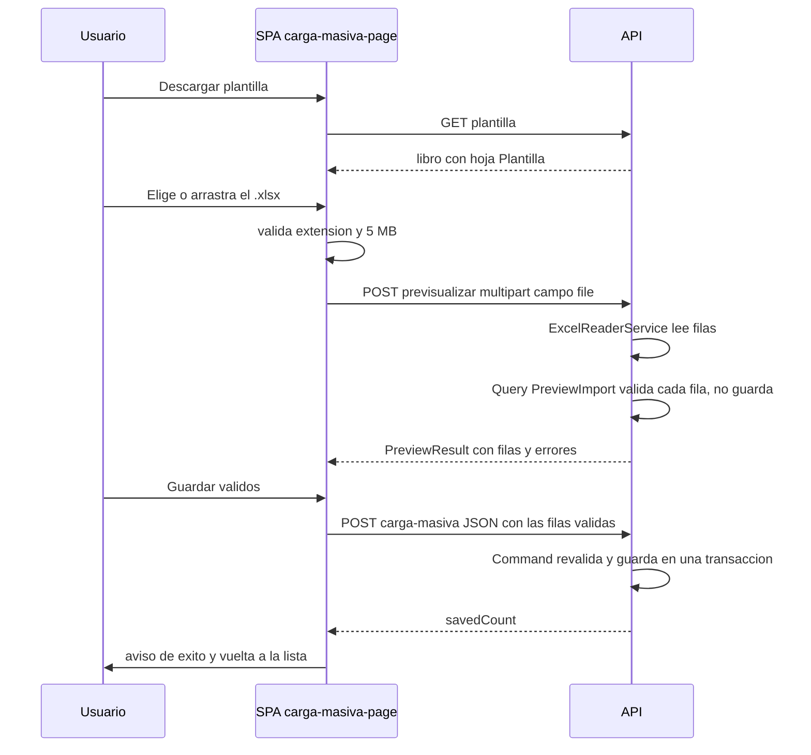

# Carga masiva y exportación a Excel: referencia completa

| | |
|---|---|
| **Sistema** | SOFIA — Sistema Optimizado Farmacéutico con Inteligencia Artificial |
| **Versión del documento** | 1.0 |
| **Fecha** | 2026-10-13 |
| **Backend** | `sofia-apis`, rama `main`, commit `43f5529` |
| **Frontend** | `sofia-web-spa`, rama `main`, commit `eeffbb6` |
| **Método** | Lectura de código de ambos repositorios (sin navegador y sin llamar a la API). `git status --short` en ambos repos: sin cambios sin commitear, por lo que no hay afirmaciones marcadas «En curso (sin commitear)». |

Este documento lo usan quienes escriben el manual de usuario (para explicar cada plantilla) y QA (para probar cada carga). Cubre las **12 cargas masivas** y las **22 exportaciones** del sistema.

**Abreviaturas de rutas en las fuentes:** `API/` = `sofia-apis/src/SOFIA.API/`; `APP/` = `sofia-apis/src/SOFIA.Application/`; `INF/` = `sofia-apis/src/SOFIA.Infrastructure/`; `DOM/` = `sofia-apis/src/SOFIA.Domain/`; `DBUP/` = `sofia-apis/src/SOFIA.DbUp/Scripts/`; `SPA/` = `sofia-web-spa/src/app/`; `I18N/` = `sofia-web-spa/public/i18n/`.

**Documentos relacionados (validados, se enlazan y no se redefinen):**

- Reglas genéricas `RN-IMP-001` a `RN-IMP-017`: [01a, sección 11](01-reglas-de-negocio/01a-administracion-y-seguridad.md). Se remite a ellas por ID. (El encargo hablaba de `RN-IMP-001` a `011`; el documento 01a llega hasta `RN-IMP-017` y se usan todas las que aplican.)
- Comportamiento común de la carga masiva en los catálogos y reglas de importación de cada módulo: [01b, sección 3.1](01-reglas-de-negocio/01b-catalogos.md) y las secciones de cada módulo.
- Componente `carga-masiva-page`, envoltorios y textos `carga-masiva.*`: [19a, §6.5, §6.6 y §8.9](19-inventario-de-pantallas/19a-acceso-layout-y-compartidos.md).

## Contenido

1. [Inventario y conteos](#1-inventario-y-conteos)
2. [Parte 1: mecánica común](#2-parte-1-mecánica-común)
3. [Parte 2: una ficha por carga masiva (12)](#3-parte-2-una-ficha-por-carga-masiva)
4. [Parte 3: una ficha por exportación (22)](#4-parte-3-una-ficha-por-exportación)
5. [Tabla resumen por módulo](#5-tabla-resumen-por-módulo)
6. [Pendientes y «No verificado»](#6-pendientes-y-no-verificado)
7. [Tabla de cobertura](#7-tabla-de-cobertura)
8. [Fuentes](#8-fuentes)

---

## 1. Inventario y conteos

Se filtró `docs/_inventario/endpoints.csv` (241 endpoints) por las rutas que terminan en `plantilla`, `previsualizar`, `carga-masiva` o `exportar` (incluye `DIGEMID/catalogo/...` y `POS/sesiones/exportar`). Resultado, verificado además con `grep` sobre los controladores:

| Concepto | Cantidad | Detalle |
|---|---|---|
| Cargas masivas | **12** | 12 × 3 endpoints (`GET …/plantilla`, `POST …/previsualizar`, `POST …/carga-masiva`) = **36 endpoints** |
| Exportaciones | **22** | `POST …/exportar` (21) + `POST /api/v1/POS/sesiones/exportar` (1) |
| Total de endpoints | **58** | 36 + 22 |
| Cargas con pantalla en el SPA | 12 de 12 | rutas `…/carga-masiva` (`docs/_inventario/rutas-spa.csv`) |
| Exportaciones con botón en pantalla | 22 de 22 | ninguna es «Solo API» |
| Handlers de importación sin endpoint | **0** | ver el párrafo siguiente |

**Handlers de importación «sin endpoint».** Existen diez carpetas vacías `Importar*` en `SOFIA.Application` (ningún archivo dentro): `Empleados/Commands/ImportarEmpleados`, `Inventarios/Commands/ImportarInventario`, `JerarquiasUoM/Commands/ImportarJerarquiasUoM`, `Laboratorios/Commands/ImportarLaboratorios`, `Medicamentos/Commands/ImportarMedicamentos`, `Pacientes/Commands/ImportarPacientes`, `Proveedores/Commands/ImportarProveedores`, `Servicios/Commands/ImportarServicios`, `Sucursales/Commands/ImportarSucursales`, `UnidadesMedida/Commands/ImportarUnidadesMedida` (verificado con `find` sobre `SOFIA.Application`). Son carpetas sin código: **no existen handlers de importación sin endpoint**. Tampoco existe carga masiva de Empleados, Inventario (lotes y stock) ni Servicios: los tres nombres de carpeta no tienen implementación. Todas las cargas implementadas viven en carpetas `CargaMasiva*` y `PreviewImport*`, y las 12 tienen endpoint.

Módulo × permiso exigido (columna `permiso` de `endpoints.csv`, comprobada en los atributos `[HasPermission]`): las tres rutas de cada carga exigen `<Módulo>:Crear`; la exportación exige `<Módulo>:Leer` (en Roles el módulo es `Seguridad`; en Lotes y Stock por sucursal es `Inventarios`; en Sesiones de caja es `POS`; en Recetas es `Recetas`).

---

## 2. Parte 1: mecánica común

### 2.1 Cómo se genera la plantilla

- Cada carga expone `GET …/plantilla`. El controlador define el arreglo de nombres de columna y llama a `ExcelTemplateGenerator.GenerateTemplate(columnas)` (`INF/Excel/ExcelTemplateGenerator.cs:11-20`); devuelve el archivo con tipo `application/vnd.openxmlformats-officedocument.spreadsheetml.sheet` y un nombre de archivo propio del controlador (se indica en cada ficha).
- El libro tiene **una sola hoja llamada «Plantilla»** (`ExcelTemplateGenerator.cs:14`) con **solo la fila 1 de cabeceras**: negrita, texto blanco, fondo azul `#1E88E5`, centrado (`:7-9`, `:64-75`) y ancho de columna ajustado al contenido (`:16`). **No hay fila de ejemplo, ni validación de datos, ni listas desplegables, ni formato de columna.** Regla genérica: `RN-IMP-016`.
- Las cabeceras de la plantilla son exactamente los nombres que el mismo controlador pasa luego al lector del archivo, así que plantilla y lectura nunca divergen (en cada controlador el arreglo se usa en `GetPlantilla` y en `Previsualizar`; en Medicamentos, Jerarquías y Sucursales es una constante compartida).
- El SPA descarga la plantilla con `GET` autenticado y la guarda con el nombre `plantilla-{entidad}.xlsx`, donde `{entidad}` es la ruta de vuelta sin la barra inicial (`SPA/shared/components/carga-masiva-page/carga-masiva-page.component.ts:123-136`; clave `carga-masiva.template-filename` = «plantilla-{{entity}}.xlsx», `I18N/es.json`). Ese nombre sustituye al que envía el servidor.

### 2.2 Cómo se lee el archivo (`ExcelReaderService`)

Todas las vistas previas usan `ReadRows(stream, columnasEsperadas, nombreDeArchivo)` (`INF/Excel/ExcelReaderService.cs:15`). Orden exacto de las comprobaciones:

| Paso | Qué hace | Fuente | Error |
|---|---|---|---|
| 1 | Si se pasó nombre de archivo y su extensión no es `.xlsx` (sin distinguir mayúsculas), rechaza. **Seguros no pasa el nombre**, por lo que esta comprobación no se aplica en Aseguradoras (ver §2.7 y la ficha 3.1). | `ExcelReaderService.cs:17-20`; `API/Controllers/SegurosController.cs:107` | `CargaMasiva.Archivo.Invalido` |
| 2 | Si el flujo no admite posicionamiento, lo copia a memoria. | `:22-27` | — |
| 3 | Exige la firma ZIP (`50 4B 03 04`) en los primeros 4 bytes. | `:29`, `:116-127` | `CargaMasiva.Archivo.Invalido` |
| 4 | Protección contra descompresión: descomprime cada parte contando bytes reales. Rechaza si el total descomprimido supera **50 MB** (`ImportLimits.MaxUncompressedBytes`) o si una parte de más de **1 MB** descomprimida supera **100 veces** su tamaño comprimido (`MaxCompressionRatio`). Un ZIP corrupto (`InvalidDataException`) se trata como archivo inválido. | `:30`, `:129-167`; `APP/Common/Excel/ImportLimits.cs:10,12` | `CargaMasiva.Archivo.ExcedeDescompresion` / `CargaMasiva.Archivo.Invalido` |
| 5 | Abre el libro con ClosedXML; cualquier fallo de apertura es «archivo inválido». | `:32-40` | `CargaMasiva.Archivo.Invalido` |
| 6 | Lee **solo la primera hoja** (`Worksheets.First()`), sea cual sea su nombre. | `:44` | — |
| 7 | Cabeceras: fila 1; se recortan espacios; la comparación **no distingue mayúsculas**; si un título se repite vale la primera columna; las columnas con cabecera vacía se ignoran. El **orden de las columnas no importa** y las columnas extra se ignoran. Una cabecera escrita distinto (por ejemplo con tilde: «Código» en vez de `Codigo`) **no se reconoce** y esa columna se lee como vacía en todas las filas. | `:76-92`, `:100-107` | — |
| 8 | Filas de datos: desde la fila 2, solo filas usadas; una fila **sin ningún valor** en las columnas esperadas se ignora. Cada fila conserva su número real de hoja (`RowNumber`). | `:54-60`, `:69`, `:94-113` | — |
| 9 | Límite de filas: si hay más de **5000 filas con datos**, rechaza todo el archivo (se detecta al encontrar la fila 5001). | `:62-67`; `ImportLimits.cs:8` | `CargaMasiva.Filas.Excedidas` |
| 10 | Valor de celda: `GetString().Trim()`; una celda vacía queda en `null`. | `:105-106` | — |

Detalles que importan para el manual y para QA:

- **Claves del diccionario de la fila**: el lector guarda cada valor bajo el nombre de la columna con la **primera letra en minúscula** (`Codigo` → `codigo`, `NombreCompania` → `nombreCompania`) (`:109`), y el diccionario no distingue mayúsculas (`:98`). Esas claves son las que viajan al SPA en `data` y vuelven en el guardado.
- **Fechas y números**: según la documentación de ClosedXML (`ClosedXML.xml`, `M:ClosedXML.Excel.IXLCell.GetString`), `GetString` devuelve el valor de la celda como texto **sin usar el formato ni el estilo de la celda**. Los validadores de fecha y número leen ese texto: la fecha de nacimiento de Pacientes se interpreta solo si el texto es `dd/MM/yyyy` (§ficha 3.7). Qué texto exacto produce ClosedXML para una celda con tipo fecha real o número con formato regional **no se verificó** (no hay prueba que lo cubra: `SOFIA.IntegrationTests/Excel/ExcelReaderServiceTests.cs` no prueba fechas ni números). Recomendación para el manual: indicar que las columnas de fecha y de número se escriban como **texto** con el formato indicado en cada ficha.
- **Fórmulas, celdas combinadas y filas ocultas**: no verificados.
- La cultura del proceso del servidor no se fija en ningún archivo (`grep` de `CultureInfo`/`InvariantGlobalization` en `SOFIA.API` sin resultados). Los análisis numéricos de Jerarquías y Proveedores usan cultura invariante explícita; el análisis de enteros de Roles (`int.TryParse` sin cultura) y el formato `dd/MM/yyyy` de Pacientes dependen de la cultura del proceso (el carácter `/` de un formato personalizado toma el separador de fecha de la cultura): **No verificado** con qué cultura corre el servidor.

### 2.3 Flujo de dos pasos



1. **Vista previa** (`POST …/previsualizar`): recibe el archivo como `multipart/form-data` en el campo `file` (`IFormFile file`). Si el archivo falta o pesa 0 bytes, el controlador responde 400 con el texto plano «Debe adjuntar un archivo Excel.» (sin `code`; `RN-IMP-013`). Lee el archivo (§2.2), manda las filas a una consulta MediatR `PreviewImport<Módulo>Query` (no es un comando: no abre transacción y **no escribe nada**) y devuelve `200` con el resultado. Cada módulo valida cada fila contra los datos existentes de la empresa (las consultas están filtradas por empresa y excluyen eliminados por los filtros globales de `INF/Persistence/ApplicationDbContext.cs:91-110`).
2. **Confirmación** (`POST …/carga-masiva`): el cuerpo es un **arreglo JSON** de filas (`[FromBody] List<XxxImportRow>`); el SPA envía el `data` de **solo las filas válidas** de la vista previa (`carga-masiva-page.component.ts:138-146`). El servidor **no recuerda la vista previa**: vuelve a validar y a aplicar las reglas de la entidad.
3. El número de filas válidas lo calcula el SPA; el botón «Guardar válidos (N)» queda deshabilitado si no hay ninguna o mientras guarda (`carga-masiva-page.component.html:126-130`).

### 2.4 Qué es transaccional y qué devuelve cada paso

- Todos los `CargaMasiva<…>Command` implementan `ICommand<int>` (`APP/Common/Interfaces/ICommand.cs:11`), que `TransactionBehavior` envuelve en una transacción (`APP/Common/Behaviors/TransactionBehavior.cs:16-37`). Los 12 handlers llaman a `SaveChangesAsync` **una sola vez al final**, así que **el guardado es todo o nada a nivel de base de datos**: si SQL Server rechaza cualquier fila (por ejemplo un índice único), no se guarda ninguna. Lo que **no** es todo o nada es la validación lógica: el handler descarta en silencio las filas que no pasan sus guards (se detalla por módulo).
- Las consultas de vista previa no son comandos, no abren transacción y no escriben.
- El tenant (empresa) de las filas nuevas lo completa `SaveChangesAsync` con la empresa del token (`INF/Persistence/ApplicationDbContext.cs:137,168-177`); Sucursales lo pasa además explícitamente (`CargaMasivaSucursalesCommandHandler.cs:15-19,29`).
- Los textos de las filas **no pasan por el saneador**: `SanitizationBehavior` solo recorre las propiedades `string` del propio request (`APP/Common/Behaviors/SanitizationBehavior.cs:61-80`), y las filas viajan dentro de `List<…ImportRow>`. (Lectura del código; no se probó con datos.)

**Forma de la respuesta de la vista previa** (`APP/Common/Excel/PreviewResult.cs:3-9`, `PreviewRowResult.cs:3-9`, `ValidationError.cs:3-7`), serializada en camelCase:

```json
{
  "rows": [
    {
      "rowNumber": 2,
      "data": { "codigo": "KG", "descripcion": "Kilogramo" },
      "errors": [ { "code": "duplicate", "field": "codigo", "params": { "value": "KG" } } ],
      "isValid": false
    }
  ],
  "totalCount": 1,
  "validCount": 0,
  "errorCount": 1
}
```

`isValid` es `errors.length == 0`. `data` trae **todas** las columnas esperadas, también las vacías (valor `null`). `params` puede ser `null`.

**Forma de la respuesta del guardado**: `200` con `{ "savedCount": N }` (`API/Controllers/<X>Controller.cs`, línea de `Ok(new { savedCount = result.Value })` en cada acción `CargaMasiva`). N es la cantidad realmente guardada; puede ser menor que las filas enviadas. Si falla, `result.ToProblemResult()` (ProblemDetails con extensión `code`).

### 2.5 Códigos de error de fila de la vista previa (lista completa)

El backend emite estos **16 códigos** (conteo con `grep -rhoE 'new ValidationError\("…"'` sobre `SOFIA.Application`). El SPA los muestra con la clave `carga-masiva.validation.<code>` (`carga-masiva-page.component.html:94-97`) pasando `field` y `params` (`carga-masiva-page.component.ts:175-177`). **`{{field}}` es la clave interna en minúsculas inicial** (por ejemplo `nombreRol`), no la etiqueta traducida: el usuario ve «El campo 'nombreRol' es obligatorio».

| Código | Texto exacto en español (`I18N/es.json`, `carga-masiva.validation.*`) | Parámetros que emite el backend | Módulos que lo emiten |
|---|---|---|---|
| `required` | El campo '{{field}}' es obligatorio | — | los 12 |
| `max-length` | '{{field}}' no puede superar los {{max}} caracteres | `max` (entero) | todos menos Jerarquías y DIGEMID |
| `duplicate` | El valor '{{value}}' del campo '{{field}}' ya existe en el sistema | `value` | Unidades de medida, Laboratorios, Ingredientes activos, Medicamentos, Pacientes, Profesionales, Proveedores, Roles, Sucursales, Aseguradoras, DIGEMID (11) |
| `duplicate-in-file` | El valor '{{value}}' del campo '{{field}}' está duplicado en el archivo | `value` | los mismos 11 |
| `invalid-integer` | '{{field}}' debe ser un número entero | — | Roles |
| `min-value` | '{{field}}' debe ser mayor o igual a {{min}} | `min` | Roles |
| `invalid-date` | El formato de '{{field}}' no es válido (usa DD/MM/YYYY) | — | Pacientes |
| `future-date` | '{{field}}' no puede ser una fecha futura | — | Pacientes |
| `invalid-decimal` | '{{field}}' debe ser un número decimal válido | — | Jerarquías, Proveedores |
| `invalid-range` | '{{field}}' debe estar entre {{min}} y {{max}} | `min`, `max` | Proveedores |
| `not-found` | El valor '{{value}}' del campo '{{field}}' no existe en el sistema | `value` | Jerarquías, Medicamentos |
| `ambiguous` | El valor '{{value}}' del campo '{{field}}' coincide con varios registros del sistema | `value` | Jerarquías, Medicamentos |
| `invalid-option` | '{{value}}' no es un valor válido para '{{field}}' | `value` | Medicamentos, Pacientes |
| `positive-number` | '{{field}}' debe ser mayor que cero | — | Jerarquías |
| `must-differ` | '{{field}}' no puede ser igual a '{{other}}' | `other` (el literal `unidadMayor`) | Jerarquías |
| `invalid-document-number` | '{{field}}' no tiene el formato de su tipo de documento (DNI: 8 dígitos, RUC: 11 dígitos, CE: hasta 12 y pasaporte: hasta 20 letras o números) | — | Pacientes |

Notas:

- La clave `carga-masiva.validation.invalid-digits` («'{{field}}' debe contener exactamente {{digits}} dígitos numéricos») **existe en `es.json` pero el backend nunca la emite** (ninguna ocurrencia de `invalid-digits` en `sofia-apis/src`).
- Si el backend emitiera un código sin clave, el SPA mostraría la clave literal (comportamiento de Transloco con clave faltante, `app.config.ts:58`); hoy los 16 códigos tienen texto.
- Los códigos de error de **guardado** (validador de filas, archivo, tamaño) son distintos y están en §2.6.

### 2.6 Errores de archivo y de guardado, y cómo los muestra el SPA

El SPA decide el texto en `cargaMasivaErrorKey` (`carga-masiva-page.component.ts:25-34`) y lo muestra con `showUploadError` (`:161-168`), que interpola `maxMb = 5` y `maxRows = 5000` (`:55`, `:164`). Cualquier otro error cae en `showServerError` con el texto genérico del paso: «Error al procesar el archivo» (`carga-masiva.preview-error`) en la vista previa y «Error al guardar los registros» (`carga-masiva.save-error`) al guardar; si la respuesta trae `traceId`, la notificación incluye la referencia (`SPA/core/services/shared/error-notifier.service.ts:34-46`).

| Origen | Código del backend | HTTP | Texto que ve el usuario (clave) | Fuente del backend |
|---|---|---|---|---|
| Archivo inválido (extensión, firma ZIP, ZIP corrupto, libro ilegible) | `CargaMasiva.Archivo.Invalido` | 400 | «El archivo no es un Excel .xlsx válido. Descarga la plantilla y vuelve a intentarlo.» (`carga-masiva.errors.invalid-file`) | `ExcelReaderService.cs:169-170`; `GlobalExceptionHandler.cs:41-44` |
| Descompresión excesiva | `CargaMasiva.Archivo.ExcedeDescompresion` | 400 | «El archivo excede los límites de contenido permitidos. Revisa que sea una plantilla válida.» (`carga-masiva.errors.decompression`) | `ExcelReaderService.cs:152-154` |
| Más de 5000 filas con datos al leer | `CargaMasiva.Filas.Excedidas` | 400 | «El archivo supera el máximo de 5000 filas. Divídelo en varios archivos.» (`carga-masiva.errors.too-many-rows`) | `ExcelReaderService.cs:62-67` |
| Cuerpo mayor de 5 MB (Kestrel rechaza antes de entrar a la acción) | `Request.TooLarge` (413) | 413 | «El archivo supera el tamaño máximo de 5 MB.» (`carga-masiva.errors.too-large`); el SPA lo muestra ante cualquier 413 (`:27`) | `GlobalExceptionHandler.cs:47-54` |
| Lista vacía o de más de 5000 filas en el guardado | `CargaMasiva<X>Command.Rows` | 400 | Mismo texto de «too-many-rows» (también si la lista llega vacía, `:31`); el SPA no llega a enviar una lista vacía | `APP/Common/Excel/ImportRowsRuleExtensions.cs:8-11`; `ValidationBehavior.cs:30` |
| Una fila del guardado no cumple el validador | `CargaMasiva<X>Command.Rows[i].<Propiedad>` (solo se informa la primera) | 400 | «Algunas filas tienen datos inválidos. Vuelve a subir el archivo y revisa la vista previa.» (`carga-masiva.errors.invalid-rows`, `:32`) | `ValidationBehavior.cs:30-31,41`; validador de cada módulo |
| Archivo ausente o vacío en la vista previa | sin `code` (texto plano) | 400 | «Error al procesar el archivo» (`carga-masiva.preview-error`) | `BadRequest("Debe adjuntar un archivo Excel.")` en cada controlador |
| Falla la plantilla | — | — | «Error al descargar la plantilla. Intenta de nuevo.» (`carga-masiva.download-error`) | `carga-masiva-page.component.ts:134` |
| Solo Aseguradoras: un código ya existente, en la base o repetido en el archivo, hace fallar el índice único | `Db.Duplicado` | 409 | Sin texto propio: «Error al guardar los registros» (`carga-masiva.save-error`) | `GlobalExceptionHandler.cs:36-39,95-108`; ver ficha 3.1 |

Validaciones del propio SPA antes de enviar (`carga-masiva-page.component.ts:97-105`): extensión `.xlsx` (si no, `carga-masiva.errors.invalid-file`) y tamaño máximo 5 MB (`carga-masiva.errors.too-large`). Si no hay filas válidas: «No hay filas válidas para guardar» (`carga-masiva.no-valid-rows`).

### 2.7 Límites efectivos por endpoint

| Límite | Valor | Dónde se aplica | Excepciones |
|---|---|---|---|
| Tamaño del archivo y del cuerpo JSON | 5 MB (`ImportLimits.MaxRequestBytes = 5 * 1024 * 1024`) | `[RequestSizeLimit(ImportLimits.MaxRequestBytes)]` en `previsualizar` y `carga-masiva`, más `[RequestFormLimits(MultipartBodyLengthLimit = …)]` en `previsualizar` | **Aseguradoras (`Seguros`) no tiene ninguno de los dos atributos** en `previsualizar` (`SegurosController.cs:97-99`) ni en `carga-masiva` (`:113-115`): aplican los valores por defecto de ASP.NET Core / Kestrel; el repo no los cambia (sin resultados al buscar `MaxRequestBodySize` o `FormOptions` en `SOFIA.API`). El valor numérico por defecto sale de la documentación del framework, **No verificado en el repo**. El SPA igualmente rechaza archivos de más de 5 MB antes de enviar. |
| Filas al leer el archivo | 5000 | `ExcelReaderService.cs:62-67` | ninguna (también aplica a Aseguradoras) |
| Filas al guardar | 1 a 5000 | `WithinImportLimits()` en el validador de cada módulo | **Aseguradoras no tiene validador de carga masiva**: no hay tope de filas ni comprobación de lista vacía en el guardado (`APP/Seguros/Commands/CargaMasivaSeguros/` solo contiene el comando y el handler). |
| Descompresión | 50 MB totales, razón 100× en partes de más de 1 MB | `ExcelReaderService.cs:130-167` | ninguna |
| Política de límite de peticiones (`rate limit`) | ninguna | columna `rate_limit` vacía en los 58 endpoints de `endpoints.csv` | — |

Endpoints con `[RequestSizeLimit]`: por carga masiva, 2 de 3 (`previsualizar` y `carga-masiva`); la plantilla no lo necesita. Los 11 módulos distintos de Aseguradoras lo tienen en ambos. Ninguna exportación tiene `[RequestSizeLimit]` (el cuerpo solo trae títulos y filtros; los límites de títulos están en §2.8).

### 2.8 Exportación a Excel: cómo funciona

1. **Desde el SPA**: en la pantalla de búsqueda, el botón «Exportar» (`actions.export`, `I18N/es.json`; `mat-stroked-button` con icono `download`, a la izquierda del paginador, visible cuando ya hay resultados; sin `*appPermiso` propio) llama a `exportar()` del componente de búsqueda. El componente arma los **títulos de columna ya traducidos** con `transloco.translate(clave, {}, '<scope>')` y los envía en el cuerpo `POST …/exportar` junto con los **filtros actuales del formulario** y, en las pantallas con fechas, el `dateFormat`. La respuesta se pide como `blob` y se descarga con un enlace temporal (`a.download = <clave export-filename>`). El nombre del archivo lo decide el SPA, no el servidor (el servidor también envía un nombre, que se descarta).
2. **En el servidor**: cada acción `Exportar` arma la **misma consulta del listado** (`Get…Query`) con los filtros recibidos y `PageSize = 10 000` (`PaginationLimits.MaxPageSize`, `APP/Common/Models/PaginationLimits.cs:6`), de modo que la exportación respeta exactamente la lógica de filtrado, orden y alcance por empresa de la búsqueda. Solo se aplican los filtros que figuran en el `…ExportRequest` del controlador; los que el SPA envíe de más se ignoran (ver hallazgo de Presentaciones, §4.12).
3. **Límite de filas**: si el total de la consulta supera 10 000, **no se genera el archivo** y se responde 400 `Export.TooManyRows` con el mensaje «La exportación supera el máximo de 10000 filas. Aplica filtros para reducir los resultados.» (`API/Extensions/ExportExtensions.cs:8-13`; `RN-IMP-008`). **Los 22 componentes de búsqueda ignoran el cuerpo del error** (piden `blob`, y ninguno lee `Export.TooManyRows`: `grep` en `SPA` sin resultados), de modo que el usuario ve solo el aviso genérico de búsqueda de la pantalla (columna «Mensaje de error» de cada ficha).
4. **Validación de la petición** (ASP.NET `[ApiController]`, antes de ejecutar la acción; respuesta 400 con el mensaje del atributo): `Headers` (`[ExportHeaders]`): como máximo 50 títulos, ninguno nulo y cada uno de hasta 100 caracteres; mensaje `Export.Headers.Invalid` (`API/Infrastructure/ExportHeadersAttribute.cs:19-31`; `RN-IMP-009`). `DateFormat` (`[ExportDateFormat]`) en las 7 exportaciones con fechas: solo `dd/MM/yyyy`, `MM/dd/yyyy`, `dd/MM/yyyy HH:mm` o `MM/dd/yyyy HH:mm`; mensaje `Export.DateFormat.Invalid` (`ExportDateFormatAttribute.cs:9-13`; `RN-IMP-011`). Etiquetas «Sí/No» (`[ExportLabel]`) en Empresas: hasta 20 caracteres, mensaje `Export.Label.Invalid` (`ExportLabelAttribute.cs:23-27`; `RN-IMP-010`). **Aseguradoras no aplica `[ExportHeaders]`** a su petición (`SegurosController.cs:122`), por lo que no hay tope de títulos.
5. **No se compara la cantidad de títulos con la de columnas.** El libro escribe tantas cabeceras como títulos reciba (`ExcelTemplateGenerator.cs:27,64-75`) y tantas columnas de datos como valores tenga cada fila; si el SPA enviara menos títulos, las columnas sobrantes saldrían sin cabecera.
6. **Libro generado** (`GenerateReport`, `ExcelTemplateGenerator.cs:22-62`; `RN-IMP-017`): una hoja llamada **«Data»**; fila 1 con el mismo estilo de la plantilla; filas pares (2, 4, …) con fondo `#F5F9FF`; ancho de columna ajustado; `null` sale como celda vacía; `int`, `long`, `double` y `decimal` (convertido a `double`) salen como números, `bool` como booleano y `string` como texto. Las exportaciones que tienen fechas **las convierten antes a texto** con `ToString(formato)`, de modo que en Excel quedan como **texto**, no como fecha.
7. **Formato de fecha y zona horaria.** El formato lo envía el SPA: `dd/MM/yyyy` si el idioma activo es `es`, `MM/dd/yyyy` en cualquier otro idioma; Sesiones de caja agrega `HH:mm` (`dd/MM/yyyy HH:mm` o `MM/dd/yyyy HH:mm`). Empresas usa el formato fijo `dd/MM/yyyy` (no es parámetro). **El servidor nunca convierte la zona horaria**: no existe `TimeZoneInfo`, `ToLocalTime` ni conversión equivalente en `SOFIA.API`, `SOFIA.Application`, `SOFIA.Infrastructure` ni `SOFIA.Domain` (`grep` sin resultados). Las fechas con hora se formatean tal como las entrega la consulta, que las trata como UTC (`ConfigureConventions` marca todos los `DateTime` como UTC, `INF/Persistence/ApplicationDbContext.cs:69-76`; las ventas leen `FechaHoraUtc`): **la hora exportada de Sesiones de caja y la fecha de Ventas y de Series fiscales están en UTC, no en hora de Lima**. Las fechas de calendario (`DateOnly`, como la de nacimiento y la de expedición de recetas) no tienen hora que convertir. El carácter `/` del formato toma el separador de fecha de la cultura del proceso del servidor (**No verificado** cuál).
8. **Errores en el SPA**: ninguna exportación lee el cuerpo del error (la respuesta es un `blob`, por lo que `traceId` nunca se obtiene). Las que usan `showServerError` muestran el texto genérico sin referencia de seguimiento; las que usan `showError` también. En la ficha de cada pantalla figura el texto exacto.
9. **Permiso**: cada exportación exige el permiso `Leer` del módulo (`[HasPermission]` en el controlador; ver §1).

---

## 3. Parte 2: una ficha por carga masiva

Convenciones de las fichas:

- **«Obligatoria»** significa que la vista previa marca error `required` si la celda queda vacía. «Longitud máxima» indica dónde se comprueba: «vista previa» (código `max-length` en pantalla), «guardado» (validador de filas; si una fila lo incumple **se rechaza todo el envío** con `carga-masiva.errors.invalid-rows`) o «entidad» (la fila se omite en silencio).
- Ninguna plantilla trae **fila de ejemplo** (§2.1): la columna «Ejemplo» queda como «no trae».
- El permiso de pantalla es el mismo que el de los tres endpoints (`<Módulo>:Crear`); la ruta `…/carga-masiva` exige `Crear` por la regla `CREATE_SEGMENTS` (`SPA/core/auth/route-permissions.ts:36`) y se llega desde el botón «Carga Masiva» (`carga-masiva.btn`) de la pantalla de búsqueda del módulo, visible con `*appPermiso="'Crear'"`.
- «Etiquetas de columnas en pantalla»: las que muestra la vista previa (clave `fields.*` de la raíz de `I18N/es.json`, que el envoltorio pasa en `columns[].label`). El componente solo usa `key` y `label`; el campo `required` del envoltorio no se muestra en ningún sitio (`carga-masiva-page.component.html:77-84`).
- Mensajes comunes a las 12 fichas: éxito «Se guardaron {{count}} registros correctamente» (`carga-masiva.save-success`, aviso de 3 s, y el SPA vuelve a la lista del módulo); errores de archivo y de guardado: tabla de §2.6.
- Reglas de negocio de cada módulo: sección del módulo en [01b](01-reglas-de-negocio/01b-catalogos.md) (y [01a](01-reglas-de-negocio/01a-administracion-y-seguridad.md) para Roles y Sucursales).

### 3.1 Aseguradoras (módulo API `Seguros`)

| | |
|---|---|
| **Pantalla** | `/aseguradoras/carga-masiva` (`SPA/pages/aseguradoras/aseguradoras.routes.ts:19`, componente `AseguradorasCargaMasivaComponent`); se llega desde `/aseguradoras` (Catálogos › Aseguradoras) con el botón «Carga Masiva» (`aseguradoras-search.component.html:22`). Migas: Inicio › Catálogos › Aseguradoras › Carga Masiva. |
| **Permiso** | `Seguros:Crear` |
| **Endpoints** | `GET /api/v1/Seguros/plantilla` (`API/Controllers/SegurosController.cs:89`; archivo del servidor `plantilla-seguros.xlsx`, `:94`) · `POST /api/v1/Seguros/previsualizar` (`:98`) · `POST /api/v1/Seguros/carga-masiva` (`:114`) |
| **Fuente del comando** | `APP/Seguros/Commands/CargaMasivaSeguros/CargaMasivaSegurosCommand.cs:5-6` y `…CommandHandler.cs`; vista previa `APP/Seguros/Queries/PreviewImportSeguros/PreviewImportSegurosQueryHandler.cs` |

**Plantilla** (hoja «Plantilla»; orden: no importa al leer; `SegurosController.cs:92`)

| Cabecera exacta en el Excel | Dato | Obligatoria | Tipo y formato | Longitud máxima | Ejemplo |
|---|---|---|---|---|---|
| `NombreComercial` | Nombre comercial de la aseguradora | Sí | Texto | 150 (vista previa y entidad) | no trae |
| `CodigoIdentificadorNacional` | Código identificador nacional | Sí | Texto | 50 (vista previa y entidad) | no trae |

**Validaciones de la vista previa** (`PreviewImportSegurosQueryHandler.cs`)

| Columna (campo) | Código de fila | Condición exacta | Línea |
|---|---|---|---|
| `NombreComercial` (`nombreComercial`) | `required` | vacío o solo espacios | `:41` |
| | `max-length` | más de **150** caracteres; **el parámetro `max` que se muestra dice 200** (el mensaje de pantalla dice «no puede superar los 200 caracteres» aunque el límite real es 150) | `:41` |
| `CodigoIdentificadorNacional` (`codigoIdentificadorNacional`) | `required` | vacío | `:43` |
| | `max-length` | más de 50 caracteres | `:47` |
| | `duplicate` | el código ya existe en la empresa en una aseguradora no eliminada, sin distinguir mayúsculas (`ToLower`, `:13-16`) | `:47` |
| | `duplicate-in-file` | el mismo código aparece en más de una fila del archivo (sin distinguir mayúsculas); **todas** las filas repetidas quedan con error, también la primera (`:18-31`) | `:47` |

**Clave de duplicado:** `CodigoIdentificadorNacional` (el nombre comercial puede repetirse).

**Guardado** (`CargaMasivaSegurosCommandHandler.cs:11-25`)

- **No existe validador del comando** (no hay `CargaMasivaSegurosCommandValidator`): no se comprueba que la lista tenga entre 1 y 5000 filas ni las longitudes antes del handler (hallazgo 2 y 3 de 01b §16.3).
- Para cada fila llama a `AseguradoraMedica.Create` (nombre obligatorio y de hasta 150; código obligatorio y de hasta 50; `DOM/Entities/AseguradoraMedica.cs`); si falla, **la fila se omite en silencio** (`:16-17`).
- **No comprueba duplicados**: agrega todas las demás filas y llama a `SaveChangesAsync` una vez (`:19-23`). Si el código ya existe (o se repite en las filas enviadas), el índice único `UX_Aseguradoras_Medicas_Tenant_Codigo_Identificador_Nacional` (`DBUP/0020_SoftDeleteAware_Uniques_And_Checks.sql:3`, solo filas no eliminadas) hace fallar el guardado: `GlobalExceptionHandler` responde **409 `Db.Duplicado`** y la transacción se revierte, **sin guardar ninguna fila** (`GlobalExceptionHandler.cs:36-39,95-108`). El SPA muestra «Error al guardar los registros».
- Devuelve `{ savedCount }` con las filas agregadas. Sin valores por defecto adicionales.
- **Diferencias con la vista previa:** (1) la vista previa detecta los duplicados que el guardado no sabe omitir; si entre la vista previa y el guardado otra persona crea el mismo código, o se llama a la API sin pasar por la vista previa, falla todo el envío. (2) Sin tope de filas ni de tamaño propio en el guardado (§2.7). (3) La vista previa de este módulo no pasa el nombre del archivo al lector (`SegurosController.cs:107`), por lo que **acepta archivos cuyo nombre no termina en `.xlsx`** siempre que su contenido sea un libro válido; el SPA igual lo impide antes de enviar.

**Mensajes que ve el usuario**: los de §2.6. Los códigos de entidad (`AseguradoraMedica.NombreComercial`, etc.) no llegan al usuario porque el handler omite la fila.

**Etiquetas de columnas en pantalla** (`SPA/pages/aseguradoras/aseguradoras-carga-masiva/aseguradoras-carga-masiva.component.ts`): `nombreComercial` → «Nombre Comercial» (`fields.nombreComercial`); `codigoIdentificadorNacional` → «Código Identificador Nacional» (`fields.codigoIdentificadorNacional`).

**Reglas relacionadas:** RN-ASE-002 a RN-ASE-004, RN-ASE-008 a RN-ASE-012 ([01b §12](01-reglas-de-negocio/01b-catalogos.md)).

### 3.2 Catálogo DIGEMID

| | |
|---|---|
| **Pantalla** | `/digemid-catalogo/carga-masiva` (`SPA/pages/digemid-catalogo/digemid-catalogo.routes.ts:12`, `DigemidCatalogoCargaMasivaComponent`); desde `/digemid-catalogo` (DIGEMID › Catálogo DIGEMID), botón «Carga Masiva» (`digemid-catalogo-search.component.html:23`). Migas: Inicio › DIGEMID › Catálogo DIGEMID › Carga Masiva. |
| **Permiso** | `DIGEMID:Crear` |
| **Endpoints** | `GET /api/v1/DIGEMID/catalogo/plantilla` (`API/Controllers/DIGEMIDController.cs:98`; archivo `plantilla-digemid.xlsx`, `:103`) · `POST …/catalogo/previsualizar` (`:107`) · `POST …/catalogo/carga-masiva` (`:125`) |
| **Fuente** | `APP/DIGEMID/Commands/CargaMasivaDigemid/` y `APP/DIGEMID/Queries/PreviewImportDigemid/PreviewImportDigemidQueryHandler.cs` |

**Plantilla** (`DIGEMIDController.cs:101`)

| Cabecera exacta en el Excel | Dato | Obligatoria | Tipo y formato | Longitud máxima | Ejemplo |
|---|---|---|---|---|---|
| `CodProd` | Código del producto | Sí | Texto | 20 (guardado) | no trae |
| `NomProd` | Nombre del producto | Sí | Texto | 255 (guardado) | no trae |
| `Concent` | Concentración | No | Texto | 255 (guardado) | no trae |
| `FormaFarmaceutica` | Forma farmacéutica | No | Texto | 150 (guardado) | no trae |
| `Fraccion` | Fracción | No | Texto | 100 (guardado) | no trae |
| `RegistroSanitario` | Registro sanitario | No | Texto | 50 (guardado) | no trae |
| `Titular` | Titular del registro | No | Texto | 255 (guardado) | no trae |
| `Estado` | Estado | Sí | Texto libre (no hay lista de valores permitidos) | 50 (guardado) | no trae |

**Validaciones de la vista previa** (`PreviewImportDigemidQueryHandler.cs`): solo existen estas; **no hay ninguna comprobación de longitud**.

| Columna (campo) | Código | Condición exacta | Línea |
|---|---|---|---|
| `CodProd` (`codProd`) | `required` | vacío | `:44` |
| | `duplicate` | el código ya existe en el catálogo de la empresa (sin eliminados), sin distinguir mayúsculas (`:13-16`) | `:48` |
| | `duplicate-in-file` | repetido en el archivo (todas las filas repetidas quedan con error; `:18-31`) | `:48` |
| `NomProd` (`nomProd`) | `required` | vacío | `:50` |
| `Estado` (`estado`) | `required` | vacío | `:50` |

**Clave de duplicado:** `CodProd`.

**Guardado** (`CargaMasivaDigemidCommandHandler.cs:12-40`; validador `CargaMasivaDigemidCommandValidator.cs:10-20`)

- **Validador (rechaza todo el envío):** lista de 1 a 5000 filas; `CodProd` obligatorio y ≤ 20; `NomProd` obligatorio y ≤ 255; `Concent` ≤ 255; `FormaFarmaceutica` ≤ 150; `Fraccion` ≤ 100; `RegistroSanitario` ≤ 50; `Titular` ≤ 255; `Estado` obligatorio y ≤ 50 (`:13-20`). Como la vista previa no comprueba longitudes, **una sola fila demasiado larga pasa la vista previa y hace fallar todo el guardado** con `carga-masiva.errors.invalid-rows` (confirma el hallazgo 6 de 01b §16.3).
- **Omitidas en silencio:** `DigemidCatalogoProducto.Create` falla (código o nombre vacíos, `DOM/Entities/DigemidCatalogoProducto.cs`), o el `CodProd` ya existe entre los no eliminados (sin distinguir mayúsculas) o ya lo tomó una fila anterior del archivo; gana la primera (`:15-17`, `:32`).
- Sin valores por defecto: `Estado` se guarda tal como llega. Todo o nada solo ante errores de base de datos (índice `UX_DIGEMID_Catalogo_Productos_Tenant_Cod_Prod`, `DBUP/0020_SoftDeleteAware_Uniques_And_Checks.sql:11`). Devuelve `{ savedCount }`.

**Etiquetas de columnas en pantalla:** `codProd` → «Cód. Producto»; `nomProd` → «Nombre del Producto»; `concent` → «Concentración»; `formaFarmaceutica` → «Forma Farmacéutica»; `fraccion` → «Fracción»; `registroSanitario` → «Registro Sanitario»; `titular` → «Titular»; `estado` → «Estado» (todas `fields.*` de la raíz).

**Reglas relacionadas:** RN-DIG-001 a RN-DIG-006 y RN-DIG-009 a RN-DIG-013 ([01b §13](01-reglas-de-negocio/01b-catalogos.md)).

### 3.3 Ingredientes activos

| | |
|---|---|
| **Pantalla** | `/ingredientes-activos/carga-masiva` (`SPA/pages/ingredientes-activos/ingredientes-activos.routes.ts:19`, `IngredientesActivosCargaMasivaComponent`); desde `/ingredientes-activos` (Catálogos), botón «Carga Masiva» (`ingredientes-activos-search.component.html:23`). |
| **Permiso** | `IngredientesActivos:Crear` |
| **Endpoints** | `GET /api/v1/IngredientesActivos/plantilla` (`API/Controllers/IngredientesActivosController.cs:97`; archivo `plantilla-ingredientesactivos.xlsx`, `:102`) · `POST …/previsualizar` (`:106`) · `POST …/carga-masiva` (`:124`) |
| **Fuente** | `APP/IngredientesActivos/Commands/CargaMasivaIngredientesActivos/` y `APP/IngredientesActivos/Queries/PreviewImportIngredientesActivos/PreviewImportIngredientesActivosQueryHandler.cs` |

**Plantilla** (`IngredientesActivosController.cs:100`)

| Cabecera exacta en el Excel | Dato | Obligatoria | Tipo y formato | Longitud máxima | Ejemplo |
|---|---|---|---|---|---|
| `DenominacionDci` | Denominación común internacional | Sí | Texto | 255 (vista previa y guardado) | no trae |
| `CodigoAtc` | Código ATC | Sí | Texto | 15 (vista previa y guardado) | no trae |

**Validaciones de la vista previa**

| Columna (campo) | Código | Condición exacta | Línea |
|---|---|---|---|
| `DenominacionDci` (`denominacionDci`) | `required` | vacío | `:41` |
| | `max-length` | más de 255 | `:41` |
| `CodigoAtc` (`codigoAtc`) | `required` | vacío | `:43` |
| | `max-length` | más de 15 | `:47` |
| | `duplicate` | el código ATC ya existe en la empresa (sin eliminados), sin distinguir mayúsculas (`:13-16`) | `:47` |
| | `duplicate-in-file` | el mismo ATC en más de una fila (`:18-31`); todas las repetidas con error | `:47` |

**Clave de duplicado en la vista previa:** `CodigoAtc`. **Clave en el guardado y en la base: `DenominacionDci`** (ver abajo).

**Guardado** (`CargaMasivaIngredientesActivosCommandHandler.cs:12-24`; validador `…Validator.cs:10-14`)

- **Validador (rechaza todo):** lista 1 a 5000; `DenominacionDci` obligatoria y ≤ 255; `CodigoAtc` obligatorio y ≤ 15.
- **Omitidas en silencio:** `IngredienteActivo.Create` falla (DCI o ATC vacíos o demasiado largos, `DOM/Entities/IngredienteActivo.cs:12-39`), o la **denominación DCI** ya existe entre los no eliminados (sin distinguir mayúsculas) o ya la tomó una fila anterior (`:15-17`, `:23`). El código ATC **no** se compara al guardar.
- Sin valores por defecto. Índice único de la base: `UX_Ingredientes_Activos_Tenant_Denominacion_DCI` sobre la **DCI** (`DBUP/0020_SoftDeleteAware_Uniques_And_Checks.sql:15`); sobre el ATC solo existe un índice no único (`DBUP/0001_Initial_Schema.sql:125`). Devuelve `{ savedCount }`.
- **Diferencias confirmadas con la vista previa** (hallazgos 4 y 5 de 01b §16.3): (a) la vista previa bloquea dos ingredientes con el mismo ATC aunque la API individual y la base los aceptarían; (b) un archivo con una DCI que ya existe **pasa la vista previa** y, al guardar, esa fila se omite sin aviso (`savedCount` menor que las filas enviadas); (c) dos filas del mismo archivo con la misma DCI pero ATC distinto pasan la vista previa y solo se guarda la primera.

**Etiquetas de columnas en pantalla:** `denominacionDci` → «Denominación DCI»; `codigoAtc` → «Código ATC».

**Reglas relacionadas:** RN-ING-001 a RN-ING-006, RN-ING-010 a RN-ING-015 ([01b §7](01-reglas-de-negocio/01b-catalogos.md)).

### 3.4 Jerarquías de unidades

| | |
|---|---|
| **Pantalla** | `/jerarquias/carga-masiva` (`SPA/pages/jerarquias/jerarquias.routes.ts:19`, `JerarquiasCargaMasivaComponent`); desde `/jerarquias` (Catálogos › Jerarquías de Unidades), botón «Carga Masiva» (`jerarquias-search.component.html:22`). |
| **Permiso** | `JerarquiasUoM:Crear` |
| **Endpoints** | `GET /api/v1/JerarquiasUoM/plantilla` (`API/Controllers/JerarquiasUoMController.cs:113`; archivo `plantilla-jerarquias-uom.xlsx`, `:117`) · `POST …/previsualizar` (`:121`) · `POST …/carga-masiva` (`:138`). Columnas: constante `ImportColumns` (`:19`). |
| **Fuente** | `APP/JerarquiasUoM/Commands/CargaMasivaJerarquiasUoM/` y `APP/JerarquiasUoM/Queries/PreviewImportJerarquiasUoM/PreviewImportJerarquiasUoMQueryHandler.cs` |

**Plantilla**

| Cabecera exacta en el Excel | Dato | Obligatoria | Tipo y formato | Longitud máxima | Ejemplo |
|---|---|---|---|---|---|
| `Producto` | **Nombre comercial** de un medicamento existente | Sí | Texto; se busca por `NombreComercial` sin distinguir mayúsculas | 150 (guardado) | no trae |
| `UnidadMayor` | **Descripción** de una unidad de medida existente | Sí | Texto; se busca por `Descripcion` (no por código) sin distinguir mayúsculas | 50 (guardado) | no trae |
| `UnidadMenor` | Descripción de una unidad de medida existente | Sí | Igual que `UnidadMayor`; debe ser distinta | 50 (guardado) | no trae |
| `Multiplicador` | Cuántas unidades menores tiene una mayor | Sí | Número decimal mayor que 0, con **punto** decimal (cultura invariante; ver nota) | 30 caracteres (guardado) | no trae |

**Validaciones de la vista previa** (`PreviewImportJerarquiasUoMQueryHandler.cs`). Las búsquedas por nombre usan `ImportNameLookup` (`APP/Common/Excel/ImportNameLookup.cs:6-30`, `RN-IMP-015`): `productos` = medicamentos no eliminados por nombre comercial (`:14-17`); `unidades` = unidades de medida por descripción (`:18-20`).

| Columna (campo) | Código | Condición exacta | Línea |
|---|---|---|---|
| `Producto` (`producto`) | `required` | vacío | `:59` |
| | `not-found` | no hay medicamento con ese nombre | `:63` |
| | `ambiguous` | hay más de un medicamento con ese nombre | `:67` |
| `UnidadMayor` (`unidadMayor`) | `required` / `not-found` / `ambiguous` | igual que producto, contra las descripciones de unidades | `:59,63,67` (llamado en `:42`) |
| `UnidadMenor` (`unidadMenor`) | `required` / `not-found` / `ambiguous` | igual | `:59,63,67` (llamado en `:43`) |
| | `must-differ` | `UnidadMayor` y `UnidadMenor` son iguales sin distinguir mayúsculas (campo `unidadMenor`, parámetro `other = "unidadMayor"`) | `:45-49` |
| `Multiplicador` (`multiplicador`) | `required` | vacío | `:75` |
| | `invalid-decimal` | `decimal.TryParse(valor, NumberStyles.Number, CultureInfo.InvariantCulture)` falla | `:77-80` |
| | `positive-number` | valor ≤ 0 | `:81-84` |

**No hay `max-length`, ni detección de duplicados** (ni contra la base ni dentro del archivo) **ni de multiplicadores contradictorios**. **Clave de duplicado en la vista previa:** ninguna.

Nota: `NumberStyles.Number` permite separador de miles; con cultura invariante la coma es separador de miles, no decimal (según la documentación de .NET; el resultado exacto de «0,5» no se probó).

**Guardado** (`CargaMasivaJerarquiasUoMCommandHandler.cs:12-77`; validador `…Validator.cs:11-18`)

- **Validador (rechaza todo):** lista 1 a 5000; `Producto` obligatorio y ≤ 150 (`Medicamento.NombreComercialMaxLength`); `UnidadMayor` y `UnidadMenor` obligatorias y ≤ 50; `Multiplicador` obligatorio y ≤ 30 caracteres.
- **Omitidas en silencio** (`:29-34`, `:37`, `:64-69`): producto o unidad desconocidos o ambiguos; `Multiplicador` que no se puede analizar; `JerarquiaUoM.Create` falla (unidades iguales o multiplicador ≤ 0, `DOM/Entities/JerarquiaUoM.cs`); ya existe una jerarquía con el mismo producto y el mismo par mayor/menor (en la base o en una fila anterior del archivo); o el par ya se puede resolver por otro camino de conversiones con un multiplicador distinto (comparado a 4 decimales, `JerarquiaConversionResolver.Resolve`, `:65-66`). Gana la primera fila.
- Todo o nada solo ante errores de base de datos (índice `UX_Jerarquia_UoM_Producto_Mayor_Menor`, `DBUP/0020_SoftDeleteAware_Uniques_And_Checks.sql:86`). Devuelve `{ savedCount }`.
- **Diferencias confirmadas con la vista previa** (hallazgo 5 de 01b §16.3, `RN-JER-021`): las jerarquías repetidas o inconsistentes aparecen como válidas en la vista previa y se omiten sin aviso al guardar; y un nombre de más de 150/50 caracteres o un multiplicador de más de 30 caracteres que la vista previa acepta hace rechazar **todo** el envío.

**Etiquetas de columnas en pantalla:** `producto` → «Producto»; `unidadMayor` → «Unidad Mayor»; `unidadMenor` → «Unidad Menor»; `multiplicador` → «Multiplicador».

**Reglas relacionadas:** RN-JER-001 a RN-JER-005, RN-JER-008, RN-JER-009, RN-JER-016 a RN-JER-022 ([01b §5](01-reglas-de-negocio/01b-catalogos.md)).

### 3.5 Laboratorios

| | |
|---|---|
| **Pantalla** | `/laboratorios/carga-masiva` (`SPA/pages/laboratorios/laboratorios.routes.ts:19`, `LaboratoriosCargaMasivaComponent`); desde `/laboratorios` (Catálogos), botón «Carga Masiva» (`laboratorios-search.component.html:22`). |
| **Permiso** | `Laboratorios:Crear` |
| **Endpoints** | `GET /api/v1/Laboratorios/plantilla` (`API/Controllers/LaboratoriosController.cs:97`; archivo `plantilla-laboratorios.xlsx`, `:102`) · `POST …/previsualizar` (`:106`) · `POST …/carga-masiva` (`:124`) |
| **Fuente** | `APP/Laboratorios/Commands/CargaMasivaLaboratorios/` y `APP/Laboratorios/Queries/PreviewImportLaboratorios/PreviewImportLaboratoriosQueryHandler.cs` |

**Plantilla** (`LaboratoriosController.cs:100`)

| Cabecera exacta en el Excel | Dato | Obligatoria | Tipo y formato | Longitud máxima | Ejemplo |
|---|---|---|---|---|---|
| `NombreCompania` | Nombre de la compañía | Sí | Texto | 150 (vista previa y guardado) | no trae |
| `CodigoIdentificador` | Código identificador | No | Texto; vacío se guarda como sin código | 50 (vista previa y guardado) | no trae |

**Validaciones de la vista previa**

| Columna (campo) | Código | Condición exacta | Línea |
|---|---|---|---|
| `NombreCompania` (`nombreCompania`) | `required` | vacío | `:43` |
| | `max-length` | más de 150 | `:47` |
| | `duplicate` | el nombre ya existe en la empresa (sin eliminados), sin distinguir mayúsculas (`:12-16`) | `:47` |
| | `duplicate-in-file` | el mismo nombre en más de una fila (`:18-29`) | `:47` |
| `CodigoIdentificador` (`codigoIdentificador`) | `max-length` | más de 50 | `:49` |

**Clave de duplicado en la vista previa:** `NombreCompania`. El `CodigoIdentificador` no se comprueba como duplicado.

**Guardado** (`CargaMasivaLaboratoriosCommandHandler.cs:12-47`; validador `…Validator.cs:10-14`)

- **Validador (rechaza todo):** lista 1 a 5000; `NombreCompania` obligatorio y ≤ 150; `CodigoIdentificador` ≤ 50.
- **Omitidas en silencio:** `Laboratorio.Create` falla (`DOM/Entities/Laboratorio.cs:12-36`; un código vacío o solo espacios se convierte en nulo, `:64`); el nombre ya existe entre los no eliminados o en una fila anterior; o, si trae código, ese **código ya existe** entre los no eliminados o en una fila anterior (`:15-20`, `:32-41`). Gana la primera.
- Índices únicos de la base: nombre (`UX_Laboratorios_Tenant_Nombre_Compania`) y código (`UX_Laboratorios_Tenant_Codigo_Identificador`) (`DBUP/0020_SoftDeleteAware_Uniques_And_Checks.sql:21,25`). Devuelve `{ savedCount }`.
- **Diferencia confirmada con la vista previa** (hallazgo 5 de 01b §16.3, `RN-LAB-015`): un `CodigoIdentificador` repetido (contra la base o dentro del archivo) pasa la vista previa y la fila se omite sin aviso al guardar.

**Etiquetas de columnas en pantalla:** `nombreCompania` → «Nombre de Compañía»; `codigoIdentificador` → «Código Identificador».

**Reglas relacionadas:** RN-LAB-001 a RN-LAB-004, RN-LAB-006, RN-LAB-007, RN-LAB-012 a RN-LAB-017 ([01b §6](01-reglas-de-negocio/01b-catalogos.md)).

### 3.6 Medicamentos

| | |
|---|---|
| **Pantalla** | `/medicamentos/carga-masiva` (`SPA/pages/medicamentos/medicamentos.routes.ts:19`, `MedicamentosCargaMasivaComponent`); desde `/medicamentos` (Catálogos), botón «Carga Masiva» (`medicamentos-search.component.html:22`). |
| **Permiso** | `Medicamentos:Crear` |
| **Endpoints** | `GET /api/v1/Medicamentos/plantilla` (`API/Controllers/MedicamentosController.cs:112`; archivo `plantilla-medicamentos.xlsx`, `:116`) · `POST …/previsualizar` (`:120`) · `POST …/carga-masiva` (`:137`). Columnas: constante `ImportColumns` (`:20-21`). |
| **Fuente** | `APP/Medicamentos/Commands/CargaMasivaMedicamentos/` y `APP/Medicamentos/Queries/PreviewImportMedicamentos/PreviewImportMedicamentosQueryHandler.cs` |

**Plantilla**

| Cabecera exacta en el Excel | Dato | Obligatoria | Tipo y formato | Longitud máxima | Ejemplo |
|---|---|---|---|---|---|
| `CodigoNacional` | Código nacional del medicamento | Sí | Texto | 50 (vista previa y guardado) | no trae |
| `NombreComercial` | Nombre comercial | Sí | Texto | 150 (vista previa y guardado) | no trae |
| `Laboratorio` | **Nombre de la compañía** de un laboratorio existente | Sí | Texto; se busca por `NombreCompania` sin distinguir mayúsculas | 150 (guardado) | no trae |
| `UnidadBase` | **Descripción** de una unidad de medida existente | Sí | Texto; se busca por `Descripcion` (no por código) sin distinguir mayúsculas | 50 (guardado) | no trae |
| `CondicionVenta` | Condición de venta | Sí | Uno de estos cuatro textos, sin distinguir mayúsculas: `Venta Libre (OTC)`, `Receta Simple`, `Receta Retenida`, `Estupefaciente` (descripciones del enum `DOM/Enums/CondicionVenta.cs:7-10`, expuestas por `Medicamento.CondicionesValidas`, `DOM/Entities/Medicamento.cs:27-31`) | 50 (guardado) | no trae |

**Validaciones de la vista previa** (`PreviewImportMedicamentosQueryHandler.cs`). Contexto: códigos existentes = no eliminados (`:15-18`); laboratorios por nombre (`:19-21`); unidades por descripción (`:22-24`); condiciones válidas (`:25`).

| Columna (campo) | Código | Condición exacta | Línea |
|---|---|---|---|
| `CodigoNacional` (`codigoNacional`) | `required` | vacío | `:73` |
| | `max-length` | más de 50 (`Medicamento.CodigoNacionalMaxLength`) | `:77-80` |
| | `duplicate` | el código ya existe entre los medicamentos no eliminados, sin distinguir mayúsculas | `:82-85` |
| | `duplicate-in-file` | el código aparece más de una vez en el archivo (`:39-52`); todas las repetidas con error | `:87-90` |
| `NombreComercial` (`nombreComercial`) | `required` | vacío | `:97` |
| | `max-length` | más de 150 | `:99-102` |
| `Laboratorio` (`laboratorio`) | `required` / `not-found` / `ambiguous` | vacío / no existe un laboratorio con ese nombre / existe más de uno | `:109,113,117` (llamado en `:63`) |
| `UnidadBase` (`unidadBase`) | `required` / `not-found` / `ambiguous` | igual, contra las descripciones de unidades | `:109,113,117` (llamado en `:64`) |
| `CondicionVenta` (`condicionVenta`) | `required` | vacío | `:125` |
| | `invalid-option` | el texto no coincide (sin distinguir mayúsculas) con ninguna de las cuatro condiciones | `:127-130` |

**Clave de duplicado:** `CodigoNacional` (el nombre comercial puede repetirse).

**Guardado** (`CargaMasivaMedicamentosCommandHandler.cs:25-78`; validador `…Validator.cs:11-19`)

- **Validador (rechaza todo):** lista 1 a 5000; `CodigoNacional` obligatorio ≤ 50; `NombreComercial` obligatorio ≤ 150; `Laboratorio` obligatorio ≤ 150; `UnidadBase` obligatoria ≤ 50; `CondicionVenta` obligatoria ≤ 50.
- **Omitidas en silencio:** laboratorio o unidad desconocidos o ambiguos (`:31-38`); condición que no coincide (`:41-46`); `Medicamento.Create` falla (`DOM/Entities/Medicamento.cs:33-56`); el código ya existe entre los no eliminados o en una fila anterior (`:23-26`, `:56`). Gana la primera.
- **Valores por defecto:** `PrecioVentaBase` queda **sin valor** (se llama a `Create` sin precio, `:49-55`; `RN-MED-021`); la condición se guarda como el valor del enum cuyo índice coincide con la posición del texto en `CondicionesValidas`. Índice único `UX_Medicamentos_Tenant_Codigo_Nacional` (`DBUP/0020_SoftDeleteAware_Uniques_And_Checks.sql:29`). Devuelve `{ savedCount }`.
- **Diferencias con la vista previa:** no se encontró ninguna regla que la vista previa dé por válida y el guardado rechace, salvo las que comparten (filas omitidas por carrera: otro usuario crea el mismo código, o un laboratorio/unidad cambia de nombre entre ambos pasos).

**Etiquetas de columnas en pantalla:** `codigoNacional` → «Código Nacional»; `nombreComercial` → «Nombre Comercial»; `laboratorio` → «Laboratorio»; `unidadBase` → «Unidad Base»; `condicionVenta` → «Condición de Venta».

**Reglas relacionadas:** RN-MED-001 a RN-MED-004, RN-MED-009, RN-MED-010, RN-MED-020 a RN-MED-026 ([01b §8](01-reglas-de-negocio/01b-catalogos.md)).

### 3.7 Pacientes

| | |
|---|---|
| **Pantalla** | `/pacientes/carga-masiva` (`SPA/pages/pacientes/pacientes.routes.ts:19`, `PacientesCargaMasivaComponent`); desde `/pacientes` (Pacientes & Atención › Pacientes), botón «Carga Masiva» (`pacientes-search.component.html:22`). |
| **Permiso** | `Pacientes:Crear` |
| **Endpoints** | `GET /api/v1/Pacientes/plantilla` (`API/Controllers/PacientesController.cs:98`; archivo `plantilla-pacientes.xlsx`, `:103`) · `POST …/previsualizar` (`:107`) · `POST …/carga-masiva` (`:125`) |
| **Fuente** | `APP/Pacientes/Commands/CargaMasivaPacientes/` y `APP/Pacientes/Queries/PreviewImportPacientes/PreviewImportPacientesQueryHandler.cs` |

**Plantilla** (`PacientesController.cs:101`)

| Cabecera exacta en el Excel | Dato | Obligatoria | Tipo y formato | Longitud máxima | Ejemplo |
|---|---|---|---|---|---|
| `TipoDocumento` | Tipo de documento de identidad | Sí | Uno de: `1` o `DNI`; `4` o `CE`; `6` o `RUC`; `7` o `PASAPORTE` (sin distinguir mayúsculas; `DOM/Enums/TipoDocumentoIdentidad.cs:9-23,37-48`). El valor `-` (sin documento) **no** se acepta. Se guarda el código (`1`, `4`, `6`, `7`) | 20 (guardado) | no trae |
| `DocIdentidadGub` | Número de documento | Sí | Texto con el formato de su tipo: DNI `^\d{8}$` (8 dígitos); RUC `^\d{11}$` (11 dígitos); CE `^[A-Za-z0-9]{1,12}$`; Pasaporte `^[A-Za-z0-9]{1,20}$` (`TipoDocumentoIdentidad.cs:50-60`) | 50 (vista previa y guardado) | no trae |
| `NombreApellidos` | Nombre y apellidos | Sí | Texto | 200 (vista previa y guardado) | no trae |
| `FechaNacimiento` | Fecha de nacimiento | Sí | Texto con formato exacto **`dd/MM/yyyy`** (año de 4 dígitos), no futura (comparada con la fecha UTC del servidor) | 10 (guardado) | no trae |
| `ContactoPrimario` | Contacto primario | No | Texto | 100 (vista previa y guardado) | no trae |

**Validaciones de la vista previa** (`PreviewImportPacientesQueryHandler.cs`)

| Columna (campo) | Código | Condición exacta | Línea |
|---|---|---|---|
| `TipoDocumento` (`tipoDocumento`) | `required` | vacío | `:47-50` |
| | `invalid-option` | `TipoDocumentoIdentidad.Parse` no reconoce el valor (`:45`) | `:51-54` |
| `DocIdentidadGub` (`docIdentidadGub`) | `invalid-document-number` | el tipo es válido, el número no está vacío y no cumple el formato de su tipo (`EsNumeroValido`) | `:55-58` |
| | `required` | vacío | `:60-63` |
| | `max-length` | más de 50 | `:66` |
| | `duplicate` | el número ya existe entre los pacientes no eliminados de la empresa, sin distinguir mayúsculas (`:14-17`) | `:66` |
| | `duplicate-in-file` | el número aparece más de una vez en el archivo (`:19-32`) | `:66` |
| `NombreApellidos` (`nombreApellidos`) | `required` / `max-length` | vacío / más de 200 | `:68` |
| `FechaNacimiento` (`fechaNacimiento`) | `required` | vacío | `:68` |
| | `invalid-date` | `DateOnly.TryParseExact(texto, "dd/MM/yyyy")` falla | `:68` |
| | `future-date` | la fecha es posterior a hoy (`DateOnly.FromDateTime(DateTime.UtcNow)`, `:34`) | `:68` |
| `ContactoPrimario` (`contactoPrimario`) | `max-length` | más de 100 | `:68` |

**Clave de duplicado:** `DocIdentidadGub` (solo el número; el tipo no entra en la clave).

**Guardado** (`CargaMasivaPacientesCommandHandler.cs:13-38`; validador `…Validator.cs:10-17`)

- **Validador (rechaza todo):** lista 1 a 5000; `TipoDocumento` obligatorio ≤ 20; `DocIdentidadGub` obligatorio ≤ 50; `NombreApellidos` obligatorio ≤ 200; `FechaNacimiento` obligatoria ≤ 10 caracteres; `ContactoPrimario` ≤ 100.
- **Omitidas en silencio:** la fecha no se puede analizar con `dd/MM/yyyy` (`:23-26`); `PacienteCliente.Create` falla (tipo no válido, formato del número, nombre vacío, fecha futura, contacto > 100: `DOM/Entities/PacienteCliente.cs:62-110`); el número ya existe entre los no eliminados o en una fila anterior (`:16-18`, `:29`). Gana la primera.
- El tipo se guarda como código (`TipoDocumentoIdentidad.Parse`, `:28`). Índice único `UX_Pacientes_Clientes_Tenant_Doc_Identidad_Gub` (`DBUP/0020_SoftDeleteAware_Uniques_And_Checks.sql:33`). Devuelve `{ savedCount }`.
- **Diferencias con la vista previa:** ninguna regla distinta (la vista previa y la entidad usan el mismo formato de número y el mismo cálculo de «hoy» en UTC); solo carreras entre ambos pasos.
- **Caso a probar (No verificado):** una celda con fecha real de Excel (no texto). `GetString` no usa el formato de la celda (§2.2); lo que obtiene el lector para una fecha real no se probó, y si no es exactamente `dd/MM/yyyy` la fila sale con `invalid-date`.

**Etiquetas de columnas en pantalla** (`pacientes-carga-masiva.component.ts`): `docIdentidadGub` → «Doc. Identidad»; `nombreApellidos` → «Nombre y Apellidos»; `fechaNacimiento` → «Fecha de Nacimiento»; `contactoPrimario` → «Contacto Primario». **`tipoDocumento` usa la clave `fields.tipoDocumento`, que no existe en la raíz de `I18N/es.json`** (el bloque `fields` de la raíz, `I18N/es.json:173-215`, no la tiene); el texto «Tipo de Documento» está solo en `I18N/pacientes/es.json:93`, que Transloco guarda como `pacientes.fields.tipoDocumento` (`setTranslation` prefija el scope, `node_modules/@jsverse/transloco/fesm2022/jsverse-transloco.mjs:786-799`), y el pipe `transloco` traduce la clave sin ese prefijo (`updateValue`, mismo archivo `:1382-1384`). Por lectura de código, **el encabezado de la primera columna de la vista previa se mostraría con la clave literal `fields.tipoDocumento`** (No verificado en pantalla).

**Reglas relacionadas:** RN-PAC-001, RN-PAC-003 a RN-PAC-008, RN-PAC-011 a RN-PAC-017 ([01b §14](01-reglas-de-negocio/01b-catalogos.md)).

### 3.8 Profesionales de salud

| | |
|---|---|
| **Pantalla** | `/profesionales-salud/carga-masiva` (`SPA/pages/profesionales-salud/profesionales-salud.routes.ts:19`, `ProfesionalesSaludCargaMasivaComponent`); desde `/profesionales-salud` (Pacientes & Atención), botón «Carga Masiva» (`profesionales-salud-search.component.html:23`). |
| **Permiso** | `ProfesionalesSalud:Crear` |
| **Endpoints** | `GET /api/v1/profesionalessalud/plantilla` (`API/Controllers/ProfesionalesSaludController.cs:62`; archivo `plantilla-profesionalessalud.xlsx`, `:67`) · `POST …/previsualizar` (`:71`) · `POST …/carga-masiva` (`:89`) |
| **Fuente** | `APP/Profesionales/Commands/CargaMasivaProfesionalesSalud/` y `APP/Profesionales/Queries/PreviewImportProfesionalesSalud/PreviewImportProfesionalesSaludQueryHandler.cs` |

**Plantilla** (`ProfesionalesSaludController.cs:65`)

| Cabecera exacta en el Excel | Dato | Obligatoria | Tipo y formato | Longitud máxima | Ejemplo |
|---|---|---|---|---|---|
| `NumeroRegistro` | Número de registro profesional | Sí | Texto | 50 (vista previa y guardado) | no trae |
| `NombrePrescriptor` | Nombre del prescriptor | Sí | Texto | 150 (vista previa y guardado) | no trae |
| `DireccionClinica` | Dirección de la clínica | No | Texto | 255 (vista previa y guardado) | no trae |

**Validaciones de la vista previa** (`PreviewImportProfesionalesSaludQueryHandler.cs`)

| Columna (campo) | Código | Condición exacta | Línea |
|---|---|---|---|
| `NumeroRegistro` (`numeroRegistro`) | `required` | vacío | `:44` |
| | `max-length` | más de 50 | `:48` |
| | `duplicate` | el número ya existe entre los profesionales no eliminados, sin distinguir mayúsculas (`:13-16`) | `:48` |
| | `duplicate-in-file` | repetido en el archivo (`:18-31`) | `:48` |
| `NombrePrescriptor` (`nombrePrescriptor`) | `required` / `max-length` | vacío / más de 150 | `:50` |
| `DireccionClinica` (`direccionClinica`) | `max-length` | más de 255 | `:50` |

**Clave de duplicado:** `NumeroRegistro`.

**Guardado** (`CargaMasivaProfesionalesSaludCommandHandler.cs:12-32`; validador `…Validator.cs:10-15`)

- **Validador (rechaza todo):** lista 1 a 5000; `NumeroRegistro` obligatorio ≤ 50; `NombrePrescriptor` obligatorio ≤ 150; `DireccionClinica` ≤ 255.
- **Omitidas en silencio:** `ProfesionalSalud.Create` falla (mismas reglas de vacío y longitud, `DOM/Entities/ProfesionalSalud.cs`); el número ya existe entre los no eliminados o en una fila anterior (`:15-17`, `:23`). Gana la primera.
- Sin valores por defecto. Índice único `UX_Profesionales_Salud_Tenant_Numero_Registro` (`DBUP/0020_SoftDeleteAware_Uniques_And_Checks.sql:37`). Devuelve `{ savedCount }`.
- **Diferencias con la vista previa:** ninguna (mismas longitudes y misma clave de duplicado).

**Etiquetas de columnas en pantalla:** `numeroRegistro` → «Número de Registro»; `nombrePrescriptor` → «Nombre del Prescriptor»; `direccionClinica` → «Dirección Clínica».

**Reglas relacionadas:** RN-PRO-001 a RN-PRO-005, RN-PRO-008 a RN-PRO-012 ([01b §15](01-reglas-de-negocio/01b-catalogos.md)).

### 3.9 Proveedores

| | |
|---|---|
| **Pantalla** | `/proveedores/carga-masiva` (`SPA/pages/proveedores/proveedores.routes.ts:19`, `ProveedoresCargaMasivaComponent`); desde `/proveedores` (Catálogos), botón «Carga Masiva» (`proveedores-search.component.html:22`). |
| **Permiso** | `Proveedores:Crear` |
| **Endpoints** | `GET /api/v1/Proveedores/plantilla` (`API/Controllers/ProveedoresController.cs:110`; archivo `plantilla-proveedores.xlsx`, `:115`) · `POST …/previsualizar` (`:119`) · `POST …/carga-masiva` (`:137`) |
| **Fuente** | `APP/Proveedores/Commands/CargaMasivaProveedores/` y `APP/Proveedores/Queries/PreviewImportProveedores/PreviewImportProveedoresQueryHandler.cs` |

**Plantilla** (`ProveedoresController.cs:113`)

| Cabecera exacta en el Excel | Dato | Obligatoria | Tipo y formato | Longitud máxima | Ejemplo |
|---|---|---|---|---|---|
| `RazonSocial` | Razón social | Sí | Texto | 200 (vista previa y guardado) | no trae |
| `TaxId` | Identificador tributario (RUC / Tax ID) | Sí | Texto; no se valida como RUC | 50 (vista previa y guardado) | no trae |
| `TerminosFinancieros` | Términos financieros | No | Texto | 100 (vista previa y guardado) | no trae |
| `CalificacionEsg` | Calificación ESG | No | Número decimal entre 0 y 100, con **punto** decimal | no aplica | no trae |
| `TasaCumplimiento` | Tasa de cumplimiento | Sí | Número decimal entre 0 y 100, con punto decimal. En esta carga no hay valor por defecto: si falta, la fila es inválida (la entidad usa 100 por defecto solo cuando no se informa el parámetro, `DOM/Entities/ProveedorDistribuidor.cs:15-20`) | no aplica | no trae |

**Validaciones de la vista previa** (`PreviewImportProveedoresQueryHandler.cs`)

| Columna (campo) | Código | Condición exacta | Línea |
|---|---|---|---|
| `RazonSocial` (`razonSocial`) | `required` / `max-length` | vacío / más de 200 | `:44` |
| `TaxId` (`taxId`) | `required` | vacío | `:46` |
| | `max-length` | más de 50 | `:50` |
| | `duplicate` | el TaxId ya existe entre los proveedores no eliminados, sin distinguir mayúsculas (`:13-16`) | `:50` |
| | `duplicate-in-file` | repetido en el archivo (`:18-31`) | `:50` |
| `TerminosFinancieros` (`terminosFinancieros`) | `max-length` | más de 100 | `:52` |
| `CalificacionEsg` (`calificacionEsg`) | `invalid-decimal` | si no está vacía: `decimal.TryParse(valor, NumberStyles.Any, CultureInfo.InvariantCulture)` falla | `:52-54` |
| | `invalid-range` | menor que 0 o mayor que 100 (`min = 0`, `max = 100`) | `:54` |
| `TasaCumplimiento` (`tasaCumplimiento`) | `required` | vacío | `:56` |
| | `invalid-decimal` | el análisis falla (mismos parámetros) | `:56` |
| | `invalid-range` | menor que 0 o mayor que 100 | `:56` |

**Clave de duplicado en la vista previa:** `TaxId`. La razón social **no** se comprueba.

**Guardado** (`CargaMasivaProveedoresCommandHandler.cs:12-39`; validador `…Validator.cs:10-15`; fila `ProveedorImportRow` con `decimal? CalificacionEsg` y `decimal TasaCumplimiento`, `CargaMasivaProveedoresCommand.cs:5-12`)

- **Validador (rechaza todo):** lista 1 a 5000; `RazonSocial` obligatoria ≤ 200; `TaxId` obligatorio ≤ 50; `TerminosFinancieros` ≤ 100. Los rangos numéricos no los valida el validador sino la entidad.
- **Omitidas en silencio:** `ProveedorDistribuidor.Create` falla (textos vacíos o largos, ESG o tasa fuera de 0–100); el `TaxId` **o la razón social** ya existen entre los no eliminados o en una fila anterior (`:15-20`, `:26-34`). Gana la primera.
- Índices únicos: `UX_Proveedores_Dist_Tenant_Tax_ID` y `UX_Proveedores_Dist_Tenant_Razon_Social` (`DBUP/0020_SoftDeleteAware_Uniques_And_Checks.sql:41,45`). Devuelve `{ savedCount }`.
- **Diferencia confirmada con la vista previa** (hallazgo 5 de 01b §16.3, `RN-PRV-015`): una razón social repetida pasa la vista previa y la fila se omite sin aviso al guardar.
- **Riesgo a probar (No verificado en ejecución):** la vista previa acepta números con `NumberStyles.Any` (incluye separador de miles, signo, notación exponencial); el guardado recibe esos mismos textos como números JSON (`decimal`). El cuerpo se convierte con el serializador por defecto de ASP.NET Core (no hay configuración propia: `grep` de `AddJsonOptions` sin resultados), que acepta números escritos como texto; si un texto que pasó la vista previa no es un decimal JSON válido, el guardado fallaría con un 400 de enlace de modelo sin `code` y el SPA mostraría «Error al guardar los registros».

**Etiquetas de columnas en pantalla:** `razonSocial` → «Razón Social»; `taxId` → «Tax ID»; `terminosFinancieros` → «Términos Financieros»; `calificacionEsg` → «Calificación ESG»; `tasaCumplimiento` → «Tasa de Cumplimiento».

**Reglas relacionadas:** RN-PRV-001 a RN-PRV-007, RN-PRV-012 a RN-PRV-017 ([01b §11](01-reglas-de-negocio/01b-catalogos.md)).

### 3.10 Roles

| | |
|---|---|
| **Pantalla** | `/roles/carga-masiva` (`SPA/pages/roles/roles.routes.ts:15`, `RolesCargaMasivaComponent`); desde `/roles` (Administración › Roles & Permisos), botón «Carga Masiva» (`roles-search.component.html:22`). |
| **Permiso** | `Seguridad:Crear` |
| **Endpoints** | `GET /api/v1/Roles/plantilla` (`API/Controllers/RolesController.cs:194`; archivo `plantilla-roles.xlsx`, `:199`) · `POST …/previsualizar` (`:203`) · `POST …/carga-masiva` (`:221`) |
| **Fuente** | `APP/Security/Commands/Roles/CargaMasivaRoles/` y `APP/Security/Queries/Roles/PreviewImportRoles/PreviewImportRolesQueryHandler.cs` |

**Plantilla** (`RolesController.cs:197`)

| Cabecera exacta en el Excel | Dato | Obligatoria | Tipo y formato | Longitud máxima | Ejemplo |
|---|---|---|---|---|---|
| `NombreRol` | Nombre del rol | Sí | Texto | 50 (vista previa y guardado) | no trae |
| `Descripcion` | Descripción | No | Texto | 255 (**solo en el guardado**; la vista previa no la comprueba) | no trae |
| `NivelJerarquia` | Nivel de jerarquía | Sí | Entero mayor o igual a 1 (la vista previa exige ≥ 1; el guardado admite ≥ 0) | no aplica | no trae |

**Validaciones de la vista previa** (`PreviewImportRolesQueryHandler.cs`)

| Columna (campo) | Código | Condición exacta | Línea |
|---|---|---|---|
| `NombreRol` (`nombreRol`) | `required` | vacío | `:43` |
| | `max-length` | más de 50 | `:47` |
| | `duplicate` | el nombre ya existe entre los roles no eliminados de la empresa, sin distinguir mayúsculas (`:13-16`) | `:47` |
| | `duplicate-in-file` | repetido en el archivo (`:18-31`) | `:47` |
| `NivelJerarquia` (`nivelJerarquia`) | `required` | vacío | `:49` |
| | `invalid-integer` | `int.TryParse(valor)` falla (sin cultura explícita) | `:49` |
| | `min-value` | el entero es menor que 1 (`min = 1`) | `:49` |

**Clave de duplicado:** `NombreRol`.

**Guardado** (`CargaMasivaRolesCommandHandler.cs:12-32`; validador `…Validator.cs:10-15`; fila `RolImportRow(string NombreRol, string? Descripcion, int NivelJerarquia)`)

- **Validador (rechaza todo):** lista 1 a 5000; `NombreRol` obligatorio ≤ 50; `Descripcion` ≤ 255; `NivelJerarquia` ≥ 0. Regla `RN-ROL-020` de [01a](01-reglas-de-negocio/01a-administracion-y-seguridad.md).
- **Omitidas en silencio:** `Rol.Create` falla (nombre vacío o > 50, `DOM/Entities/Rol.cs:40-63`); el nombre ya existe entre los no eliminados o en una fila anterior (`:15-17`, `:23`). Gana la primera.
- **Valores por defecto:** el rol se crea **sin permisos asignados** (el handler no los toca) y con la empresa del token (`ApplicationDbContext.cs:168-177`). Índice único `UX_Seguridad_Roles_Tenant_Nombre_Rol` (`DBUP/0020_SoftDeleteAware_Uniques_And_Checks.sql:49`). Devuelve `{ savedCount }`.
- **Diferencias con la vista previa:** (a) una descripción de más de 255 caracteres pasa la vista previa y hace rechazar **todo** el envío; (b) la vista previa es más estricta con el nivel (≥ 1) que el guardado (≥ 0).

**Etiquetas de columnas en pantalla:** `nombreRol` → «Nombre del Rol»; `descripcion` → «Descripción»; `nivelJerarquia` → «Nivel de Jerarquía».

**Reglas relacionadas:** RN-ROL-001, RN-ROL-020 a RN-ROL-023 ([01a §5](01-reglas-de-negocio/01a-administracion-y-seguridad.md)).

### 3.11 Sucursales

| | |
|---|---|
| **Pantalla** | `/sucursales/carga-masiva` (`SPA/pages/sucursales/sucursales.routes.ts:15`, `SucursalesCargaMasivaComponent`); desde `/sucursales` (Administración › Sucursales), botón «Carga Masiva» (`sucursales-search.component.html:22`). |
| **Permiso** | `Sucursales:Crear` |
| **Endpoints** | `GET /api/v1/Sucursales/plantilla` (`API/Controllers/SucursalesController.cs:22`; archivo `plantilla-sucursales.xlsx`, `:26`) · `POST …/previsualizar` (`:30`) · `POST …/carga-masiva` (`:47`). Columnas: constante `Columns` (`:19`). |
| **Fuente** | `APP/Sucursales/Commands/CargaMasivaSucursales/` y `APP/Sucursales/Queries/PreviewImportSucursales/PreviewImportSucursalesQueryHandler.cs` |

**Plantilla**

| Cabecera exacta en el Excel | Dato | Obligatoria | Tipo y formato | Longitud máxima | Ejemplo |
|---|---|---|---|---|---|
| `Nombre` | Nombre de la sucursal | Sí | Texto | 100 (vista previa y guardado) | no trae |
| `DireccionFisica` | Dirección física | Sí | Texto | 255 (vista previa y guardado) | no trae |
| `NumeroLicencia` | Número de licencia | Sí | Texto | 50 (vista previa y guardado) | no trae |

**Validaciones de la vista previa** (`PreviewImportSucursalesQueryHandler.cs`)

| Columna (campo) | Código | Condición exacta | Línea |
|---|---|---|---|
| `Nombre` (`nombre`) | `required` / `max-length` | vacío / más de 100 | `:42` |
| `DireccionFisica` (`direccionFisica`) | `required` / `max-length` | vacío / más de 255 | `:42` |
| `NumeroLicencia` (`numeroLicencia`) | `required` | vacío | `:44` |
| | `max-length` | más de 50 | `:48` |
| | `duplicate` | la licencia ya existe entre las sucursales no eliminadas, sin distinguir mayúsculas (`:13-16`) | `:48` |
| | `duplicate-in-file` | repetida en el archivo (`:18-31`) | `:48` |

**Clave de duplicado:** `NumeroLicencia`.

**Guardado** (`CargaMasivaSucursalesCommandHandler.cs:13-40`; validador `…Validator.cs:10-15`) — regla `RN-SUC-012` de [01a](01-reglas-de-negocio/01a-administracion-y-seguridad.md)

- **Validador (rechaza todo):** lista 1 a 5000; `Nombre` obligatorio ≤ 100; `DireccionFisica` obligatoria ≤ 255; `NumeroLicencia` obligatoria ≤ 50.
- Antes de procesar obtiene la empresa del token; si no hay, devuelve el error de empresa (`:15-19`).
- **Omitidas en silencio:** `Sucursal.Create` falla (nombre, dirección o licencia vacíos, `DOM/Entities/Sucursal.cs`); la licencia ya existe entre las no eliminadas o en una fila anterior (`:22-24`, `:30`). Gana la primera.
- **Valores por defecto:** sin gerente (`null`) y con la empresa del token (`:29`). Índice único `UX_Sucursales_Empresa_Licencia` (`DBUP/0005_Empresa_MultiTenant.sql:81-83`). Devuelve `{ savedCount }`.
- **Diferencias con la vista previa:** ninguna (mismas longitudes y misma clave).

**Etiquetas de columnas en pantalla:** `nombre` → «Nombre»; `direccionFisica` → «Dirección Física»; `numeroLicencia` → «Nº de Licencia».

**Reglas relacionadas:** RN-SUC-001, RN-SUC-011 a RN-SUC-013 ([01a §8](01-reglas-de-negocio/01a-administracion-y-seguridad.md)).

### 3.12 Unidades de medida

| | |
|---|---|
| **Pantalla** | `/unidades-medida/carga-masiva` (`SPA/pages/unidades-medida/unidades-medida.routes.ts:19`, `UnidadesMedidaCargaMasivaComponent`); desde `/unidades-medida` (Catálogos › Unidades de Medida), botón «Carga Masiva» (`unidades-medida-search.component.html:23`). |
| **Permiso** | `UnidadesMedida:Crear` |
| **Endpoints** | `GET /api/v1/UnidadesMedida/plantilla` (`API/Controllers/UnidadesMedidaController.cs:67`; archivo `plantilla-unidadesmedida.xlsx`, `:72`) · `POST …/previsualizar` (`:76`) · `POST …/carga-masiva` (`:94`) |
| **Fuente** | `APP/UnidadesMedida/Commands/CargaMasivaUnidadesMedida/` y `APP/UnidadesMedida/Queries/PreviewImportUnidadesMedida/PreviewImportUnidadesMedidaQueryHandler.cs` |

**Plantilla** (`UnidadesMedidaController.cs:70`)

| Cabecera exacta en el Excel | Dato | Obligatoria | Tipo y formato | Longitud máxima | Ejemplo |
|---|---|---|---|---|---|
| `Codigo` | Código de la unidad | Sí | Texto | 10 (vista previa y guardado) | no trae |
| `Descripcion` | Descripción de la unidad | Sí | Texto | 50 (vista previa y guardado) | no trae |

**Validaciones de la vista previa** (`PreviewImportUnidadesMedidaQueryHandler.cs`)

| Columna (campo) | Código | Condición exacta | Línea |
|---|---|---|---|
| `Codigo` (`codigo`) | `required` | vacío | `:41-44` |
| | `max-length` | más de 10 | `:47` |
| | `duplicate` | el código ya existe entre las unidades no eliminadas de la empresa, sin distinguir mayúsculas (`:13-16`) | `:47` |
| | `duplicate-in-file` | el código aparece más de una vez en el archivo (sin distinguir mayúsculas); todas las filas repetidas con error (`:18-31`) | `:47` |
| `Descripcion` (`descripcion`) | `required` / `max-length` | vacío / más de 50 | `:49` |

**Clave de duplicado:** `Codigo` (la descripción puede repetirse en la carga, aunque `Jerarquías` y `Medicamentos` buscan las unidades por descripción y tratarían una descripción repetida como `ambiguous`).

**Guardado** (`CargaMasivaUnidadesMedidaCommandHandler.cs:12-32`; validador `…Validator.cs:10-15`)

- **Validador (rechaza todo):** lista 1 a 5000; `Codigo` obligatorio ≤ 10; `Descripcion` obligatoria ≤ 50.
- **Omitidas en silencio:** `UnidadMedida.Create` falla (`DOM/Entities/UnidadMedida.cs:12-39`); el código ya existe entre las no eliminadas o en una fila anterior (`:15-17`, `:23`). Gana la primera.
- Sin valores por defecto. Índice único `UX_Unidades_Medida_Tenant_Codigo_UoM` (`DBUP/0020_SoftDeleteAware_Uniques_And_Checks.sql:53`). Devuelve `{ savedCount }`.
- **Diferencias con la vista previa:** ninguna (mismas longitudes y misma clave). Las etiquetas de columna de 01b `RN-UDM-014` (`unidadesMedida.fields.*`) están desactualizadas: el envoltorio actual usa `fields.codigo` y `fields.descripcion` de la raíz.

**Etiquetas de columnas en pantalla:** `codigo` → «Código» (`fields.codigo`); `descripcion` → «Descripción» (`fields.descripcion`).

**Reglas relacionadas:** RN-UDM-001 a RN-UDM-006, RN-UDM-013 a RN-UDM-017 ([01b §4](01-reglas-de-negocio/01b-catalogos.md)).

---

## 4. Parte 3: una ficha por exportación

Reglas comunes de todas las fichas (detalle en §2.8): hoja **«Data»**; límite de **10 000 filas** (`Export.TooManyRows`, 400, sin mensaje propio en el SPA); permiso `Leer` del módulo; botón «Exportar» (`actions.export`) en la pantalla de búsqueda, que aparece cuando ya hay resultados; cada título de columna lo traduce el SPA con `transloco.translate(clave, {}, '<scope>')` (clave del scope indicada en cada tabla); el archivo lo nombra el SPA con la clave `export-filename`. **Ninguna exportación es «Solo API»**: las 22 tienen botón. Las columnas de la tabla van **en el orden del Excel**. «Texto» = la celda sale como texto; «número» = celda numérica.

**Resumen de las 22 exportaciones**

| # | Pantalla (ruta) | Endpoint (`archivo:línea`) | Permiso | Archivo que descarga el SPA | Aviso si falla |
|---|---|---|---|---|---|
| 4.1 | Aseguradoras (`/aseguradoras`) | `POST /api/v1/Seguros/exportar` (`SegurosController.cs:60`) | `Seguros:Leer` | `aseguradoras.xlsx` | Error al buscar aseguradoras |
| 4.2 | Catálogo DIGEMID (`/digemid-catalogo`) | `POST /api/v1/DIGEMID/catalogo/exportar` (`DIGEMIDController.cs:134`) | `DIGEMID:Leer` | `digemid-catalogo.xlsx` | Error al buscar en el catálogo DIGEMID |
| 4.3 | Empleados (`/empleados`) | `POST /api/v1/Empleados/exportar` (`EmpleadosController.cs:64`) | `Empleados:Leer` | `empleados.xlsx` | Error al buscar empleados |
| 4.4 | Empresas (`/empresas`) | `POST /api/v1/Empresas/exportar` (`EmpresasController.cs:74`) | `Empresas:Leer` | `empresas.xlsx` | Error al buscar empresas |
| 4.5 | Formulaciones clínicas (`/formulaciones-clinicas`) | `POST /api/v1/FormulacionesClinicas/exportar` (`FormulacionesClinicasController.cs:72`) | `FormulacionesClinicas:Leer` | `formulaciones-clinicas.xlsx` | Error al buscar formulaciones clínicas |
| 4.6 | Ingredientes activos (`/ingredientes-activos`) | `POST /api/v1/IngredientesActivos/exportar` (`IngredientesActivosController.cs:67`) | `IngredientesActivos:Leer` | `ingredientes-activos.xlsx` | Error al buscar ingredientes activos |
| 4.7 | Jerarquías de unidades (`/jerarquias`) | `POST /api/v1/JerarquiasUoM/exportar` (`JerarquiasUoMController.cs:78`) | `JerarquiasUoM:Leer` | `jerarquias-unidades.xlsx` | Error al buscar jerarquías de unidades |
| 4.8 | Laboratorios (`/laboratorios`) | `POST /api/v1/Laboratorios/exportar` (`LaboratoriosController.cs:67`) | `Laboratorios:Leer` | `laboratorios.xlsx` | Error al buscar laboratorios |
| 4.9 | Lotes (`/lotes`) | `POST /api/v1/LotesInventario/exportar` (`LotesInventarioController.cs:96`) | `Inventarios:Leer` | `lotes.xlsx` | Error al buscar lotes |
| 4.10 | Medicamentos (`/medicamentos`) | `POST /api/v1/Medicamentos/exportar` (`MedicamentosController.cs:76`) | `Medicamentos:Leer` | `medicamentos.xlsx` | Error al buscar medicamentos |
| 4.11 | Pacientes (`/pacientes`) | `POST /api/v1/Pacientes/exportar` (`PacientesController.cs:63`) | `Pacientes:Leer` | `pacientes.xlsx` | Error al buscar pacientes |
| 4.12 | Presentaciones de venta (`/presentaciones-venta`) | `POST /api/v1/PresentacionesVenta/exportar` (`PresentacionesVentaController.cs:60`) | `PresentacionesVenta:Leer` | `presentaciones-venta.xlsx` | Error al buscar presentaciones de venta |
| 4.13 | Profesionales de salud (`/profesionales-salud`) | `POST /api/v1/profesionalessalud/exportar` (`ProfesionalesSaludController.cs:98`) | `ProfesionalesSalud:Leer` | `profesionales-salud.xlsx` | Error al buscar profesionales de salud |
| 4.14 | Proveedores (`/proveedores`) | `POST /api/v1/Proveedores/exportar` (`ProveedoresController.cs:78`) | `Proveedores:Leer` | `proveedores.xlsx` | Error al buscar proveedores |
| 4.15 | Recetas médicas (`/recetas-medicas`) | `POST /api/v1/Recetas/exportar` (`RecetasController.cs:83`) | `Recetas:Leer` | `recetas-medicas.xlsx` | Error al buscar recetas médicas |
| 4.16 | Roles & Permisos (`/roles`) | `POST /api/v1/Roles/exportar` (`RolesController.cs:161`) | `Seguridad:Leer` | `roles.xlsx` | Error al buscar roles |
| 4.17 | Series fiscales (`/series-fiscales`) | `POST /api/v1/SeriesFiscales/exportar` (`SeriesFiscalesController.cs:60`) | `SeriesFiscales:Leer` | `series-fiscales.xlsx` | Error al exportar las series fiscales |
| 4.18 | Sesiones de caja (`/sesiones-caja`) | `POST /api/v1/POS/sesiones/exportar` (`POSController.cs:46`) | `POS:Leer` | `sesiones-caja.xlsx` | Error al buscar sesiones de caja |
| 4.19 | Stock por sucursal (`/stock-por-sucursal`) | `POST /api/v1/StockPorSucursal/exportar` (`StockPorSucursalController.cs:39`) | `Inventarios:Leer` | `stock-por-sucursal.xlsx` | Error al consultar el stock |
| 4.20 | Sucursales (`/sucursales`) | `POST /api/v1/Sucursales/exportar` (`SucursalesController.cs:81`) | `Sucursales:Leer` | `sucursales.xlsx` | Error al buscar sucursales |
| 4.21 | Unidades de medida (`/unidades-medida`) | `POST /api/v1/UnidadesMedida/exportar` (`UnidadesMedidaController.cs:103`) | `UnidadesMedida:Leer` | `unidades-medida.xlsx` | Error al buscar unidades de medida |
| 4.22 | Ventas (`/pos`, `VentasSearchComponent`) | `POST /api/v1/Ventas/exportar` (`VentasController.cs:103`) | `Ventas:Leer` | `ventas.xlsx` | Error al buscar ventas |

Cada aviso es la clave `<scope>.search.search-error` (en Series fiscales `seriesFiscales.search.export-error`; en Ventas `pos.ventasSearch.searchError`) de `I18N/<scope>/es.json`. En las pantallas que usan `showServerError` (4.1, 4.2, 4.5, 4.6, 4.11, 4.13, 4.14) el aviso podría llevar referencia de seguimiento, pero como la respuesta es un `blob` el `traceId` nunca se lee y el efecto es el mismo que `showError`. Los archivos de descarga y avisos de la tabla se resolvieron leyendo cada `export-filename` y `search-error` en su `es.json`.

Ubicación en el código del SPA de cada `exportar()` (componente de búsqueda `SPA/pages/<carpeta>/<…>-search/<…>-search.component.ts`) y de su botón (`….html`): 4.1 `:117-139` / `:119`; 4.2 `:113-137` / `:124`; 4.3 `:152-182` / `:192`; 4.4 `:130-161` / `:139`; 4.5 `:123-148` / `:141`; 4.6 `:117-139` / `:118`; 4.7 `:203-233` / `:215`; 4.8 `:117-139` / `:119`; 4.9 `:168-188` / `:204`; 4.10 `:177-207` / `:227`; 4.11 `:131-160` / `:185`; 4.12 `:161-176` / `:154`; 4.13 `:116-139` / `:129`; 4.14 `:129-154` / `:127`; 4.15 `:180-210` / `:212`; 4.16 `:130-155` / `:136`; 4.17 `:150-183` / `:168`; 4.18 `:127-153` / `:169`; 4.19 `:202-224` / `:237`; 4.20 `:114-140` / `:138`; 4.21 `:116-138` / `:113`; 4.22 `pos/search/ventas-search.component.ts:214-237` / `.html:227`.

### 4.1 Aseguradoras

- **Petición** (`AseguradoraExportRequest`, `SegurosController.cs:122`): `headers`, `nombreComercial`, `codigoIdentificadorNacional`. **Sin `[ExportHeaders]`** (no hay tope de títulos). Archivo del servidor: `aseguradoras.xlsx` (`:85`).
- **Filtros que respeta:** nombre comercial y código identificador nacional (contiene, según la consulta `GetAseguradorasQuery` del listado).

| # | Cabecera (clave del scope `aseguradoras`) | Dato | Formato |
|---|---|---|---|
| 1 | Nombre Comercial (`table.nombreComercial`) | `NombreComercial` | texto |
| 2 | Código Identificador Nacional (`table.codigoIdentificadorNacional`) | `CodigoIdentificadorNacional` | texto |

### 4.2 Catálogo DIGEMID

- **Petición** (`DigemidCatalogoExportRequest`, `DIGEMIDController.cs:165`): `headers`, `codProd`, `nomProd`. Servidor: `digemid-catalogo.xlsx` (`:161`). La consulta del listado se invoca con esos dos filtros (`:137-141`).

| # | Cabecera (scope `digemidCatalogo`) | Dato | Formato |
|---|---|---|---|
| 1 | Código (`table.codProd`) | `CodProd` | texto |
| 2 | Nombre del Producto (`table.nomProd`) | `NomProd` | texto |
| 3 | Forma Farmacéutica (`table.formaFarmaceutica`) | `FormaFarmaceutica` | texto (vacío si es nulo) |
| 4 | Estado (`table.estado`) | `Estado` | texto |

La exportación **no incluye** concentración, fracción, registro sanitario ni titular, aunque la carga masiva sí los acepta.

### 4.3 Empleados

- **Petición** (`EmpleadoExportRequest`, `EmpleadosController.cs:101`): `headers`, `nombres`, `apellidoPaterno`, `apellidoMaterno`, `licencia`, `sucursalNombre`. Servidor: `empleados.xlsx` (`:97`).
- **Filtros que respeta:** nombres, apellido paterno, apellido materno, licencia y nombre de sucursal (contiene). El filtro de sucursal por identificador y el término libre del listado ([RN-EPL-017](01-reglas-de-negocio/01a-administracion-y-seguridad.md)) **no** forman parte de la petición de exportación.

| # | Cabecera (scope `empleados`) | Dato | Formato |
|---|---|---|---|
| 1 | Nombres (`table.nombres`) | `Nombres` | texto |
| 2 | Apellido Paterno (`table.apellidoPaterno`) | `Apellido_Paterno` | texto |
| 3 | Apellido Materno (`table.apellidoMaterno`) | `Apellido_Materno` | texto |
| 4 | Licencia Profesional (`table.licencia`) | `Licencia_Prof` | texto |
| 5 | Correo electrónico (`table.email`) | `Email` | texto |
| 6 | Sucursal Base (`table.sucursal`) | `SucursalNombre` | texto |

### 4.4 Empresas

- **Petición** (`EmpresaExportRequest`, `EmpresasController.cs:110`): `headers`, `yesLabel`, `noLabel` (ambas con `[ExportLabel]`, máx. 20 caracteres), `nombre`, `estado`, `fechaVencimientoDesde`, `fechaVencimientoHasta` (el SPA las envía como instantes ISO: `new Date(valor).toISOString()`). Servidor: `empresas.xlsx` (`:107`). Regla `RN-EMP-018`.
- **Filtros que respeta:** nombre (contiene), estado, vencimiento desde y hasta.
- **Etiquetas Sí/No:** las manda el SPA con `generic-labels.yes` = «Sí» y `generic-labels.no` = «No».

| # | Cabecera (scope `empresa`) | Dato | Formato |
|---|---|---|---|
| 1 | Empresa (`cols.nombre`) | `Nombre` | texto |
| 2 | RUC (`cols.ruc`) | `RUC` | texto |
| 3 | Estado (`cols.estado`) | `Estado.ToString()` | texto: nombre interno del estado sin traducir (`TrialActivo`, `Activo`, `Suspendido`, `Cancelado`; `DOM/Entities/Empresa.cs:6-12`) |
| 4 | Vigente (`cols.estaVigente`) | `EstaVigente` | texto «Sí» / «No» (etiquetas del cliente) |
| 5 | Inicio Trial (`fields.fechaInicioTrial`) | `FechaInicioTrial` | texto `dd/MM/yyyy` **fijo** (no depende del idioma ni de `dateFormat`) |
| 6 | Vencimiento (`fields.fechaVencimiento`) | `FechaVencimiento` | texto `dd/MM/yyyy` fijo |
| 7 | Sucursales (`fields.sucursalesCount`) | `CantidadSucursales` | número entero |

### 4.5 Formulaciones clínicas

- **Petición** (`FormulacionClinicaExportRequest`, `FormulacionesClinicasController.cs:105`): `headers`, `productoNombre`, `ingredienteNombre`. Servidor: `formulaciones-clinicas.xlsx` (`:101`).

| # | Cabecera (scope `formulacionesClinicas`) | Dato | Formato |
|---|---|---|---|
| 1 | Medicamento (`table.producto`) | `ProductoNombre` | texto |
| 2 | Ingrediente Activo (`table.ingrediente`) | `IngredienteNombre` | texto |
| 3 | Concentración (`table.concentracion`) | `ConcentracionDosis` | número decimal (`decimal`, `APP/FormulacionesClinicas/FormulacionClinicaDto.cs:10`) |
| 4 | Unidad de Medida (`table.unidadMedida`) | `UnidadMedidaNombre` | texto |
| 5 | Código TE Orange (`table.codigoTeOrange`) | `CodigoTeOrange` | texto (vacío si es nulo) |

### 4.6 Ingredientes activos

- **Petición** (`IngredienteActivoExportRequest`, `IngredientesActivosController.cs:133`): `headers`, `denominacionDci`, `codigoAtc`. Servidor: `ingredientes-activos.xlsx` (`:93`).

| # | Cabecera (scope `ingredientesActivos`) | Dato | Formato |
|---|---|---|---|
| 1 | Denominación DCI (`table.denominacionDci`) | `DenominacionDci` | texto |
| 2 | Código ATC (`table.codigoAtc`) | `CodigoAtc` | texto |

### 4.7 Jerarquías de unidades

- **Petición** (`JerarquiaUoMExportRequest`, `JerarquiasUoMController.cs:147`): `headers`, `productoNombre`, `unidadMayorNombre`, `unidadMenorNombre`, `multiplicadorMin`, `multiplicadorMax`. Servidor: `jerarquias-uom.xlsx` (`:109`).
- **Filtros que respeta:** producto, unidad mayor, unidad menor y rango de multiplicador. El SPA solo envía el mínimo o el máximo si el deslizador se movió de su extremo (`jerarquias-search.component.ts:212-220`).

| # | Cabecera (scope `jerarquias`) | Dato | Formato |
|---|---|---|---|
| 1 | Producto (`table.producto`) | `ProductoNombre` | texto |
| 2 | Unidad Mayor (`table.unidadMayor`) | `UnidadMayorNombre` | texto |
| 3 | Unidad Menor (`table.unidadMenor`) | `UnidadMenorNombre` | texto |
| 4 | Multiplicador (`table.multiplicador`) | `Multiplicador` | número decimal |

### 4.8 Laboratorios

- **Petición** (`LaboratorioExportRequest`, `LaboratoriosController.cs:133`): `headers`, `nombreCompania`, `codigoIdentificador`. Servidor: `laboratorios.xlsx` (`:93`). Hay prueba de integración de esta exportación (`SOFIA.IntegrationTests/Laboratorios/LaboratoriosExportIntegrationTests.cs`).

| # | Cabecera (scope `laboratorios`) | Dato | Formato |
|---|---|---|---|
| 1 | Nombre de Compañía (`table.nombreCompania`) | `NombreCompania` | texto |
| 2 | Código Identificador (`table.codigoIdentificador`) | `CodigoIdentificador` | texto (vacío si no tiene) |

### 4.9 Lotes

- **Petición** (`LoteExportRequest`, `LotesInventarioController.cs:132`): `headers`, `dateFormat` (`[ExportDateFormat]`), `productoNombre`, `numeroLote`, `caducidadDesde`, `caducidadHasta`, `fabricacionDesde`, `fabricacionHasta`. Servidor: `lotes.xlsx` (`:128`).
- **Filtros que respeta:** producto, número de lote y los rangos de caducidad y de fabricación; el SPA envía las fechas como medianoche local con su desfase horario (`toLocalMidnightIso`, `SPA/shared/utils/date-only.util.ts:40-47`). La consulta toma «hasta» como inclusivo (`GetLotesQueryHandler.cs:46,57`).
- **`dateFormat` que envía el SPA:** `dd/MM/yyyy` si el idioma es `es`, `MM/dd/yyyy` si no (`lotes-search.component.ts:176`).

| # | Cabecera (scope `lotes`) | Dato | Formato |
|---|---|---|---|
| 1 | Producto (`table.producto`) | `NombreProducto` | texto |
| 2 | Número de Lote (`table.numeroLote`) | `NumeroLoteMfr` | texto |
| 3 | Fecha de Fabricación (`table.fabricacion`) | `FechaFabricacion` | texto con `dateFormat`; vacío si el lote no tiene fecha de fabricación (`:123`) |
| 4 | Fecha de Caducidad (`table.caducidad`) | `FechaCaducidad` | texto con `dateFormat` (`:124`) |

Las fechas son `DateTimeOffset`; `ToString(formato)` imprime el día del propio valor, sin convertir zona horaria.

### 4.10 Medicamentos

- **Petición** (`MedicamentoExportRequest`, `MedicamentosController.cs:146`): `headers`, `codigoNacional`, `nombreComercial`, `laboratorioNombre`, `unidadBaseNombre`, `condicionVenta` (entero: índice del enum). Servidor: `medicamentos.xlsx` (`:108`).

| # | Cabecera (scope `medicamentos`) | Dato | Formato |
|---|---|---|---|
| 1 | Código Nacional (`table.codigoNacional`) | `CodigoNacional` | texto |
| 2 | Nombre Comercial (`table.nombreComercial`) | `NombreComercial` | texto |
| 3 | Laboratorio (`table.laboratorio`) | `LaboratorioNombre` | texto |
| 4 | Unidad Base (`table.unidadBase`) | `UnidadBaseNombre` | texto |
| 5 | Condición de Venta (`table.condicionVenta`) | `Medicamento.CondicionesValidas[condición]` | texto: «Venta Libre (OTC)», «Receta Simple», «Receta Retenida» o «Estupefaciente» (`:104`) |

### 4.11 Pacientes

- **Petición** (`PacienteExportRequest`, `PacientesController.cs:134`): `headers`, `dateFormat`, `tipoDocumento`, `docIdentidadGub`, `nombreApellidos`, `fechaNacimientoDesde`, `fechaNacimientoHasta` (el SPA las envía como `yyyy-MM-dd`, `toDateOnly`). Servidor: `pacientes.xlsx` (`:94`).
- **`dateFormat`:** `dd/MM/yyyy` (idioma `es`) o `MM/dd/yyyy` (otro idioma) (`pacientes-search.component.ts:141`).

| # | Cabecera (scope `pacientes`) | Dato | Formato |
|---|---|---|---|
| 1 | Doc. Identidad (`table.docIdentidadGub`) | `DocIdentidadGub` | texto |
| 2 | Tipo Doc. (`table.tipoDocumento`) | abreviatura del tipo | texto: `DNI`, `CE`, `RUC` o `PASAPORTE`; vacío si no tiene tipo o el código no está en la tabla (`:88`) |
| 3 | Nombre y Apellidos (`table.nombreApellidos`) | `NombreApellidos` | texto |
| 4 | Fecha Nacimiento (`table.fechaNacimiento`) | `FechaNacimiento` | texto con `dateFormat` (`:90`) |
| 5 | Contacto Primario (`table.contactoPrimario`) | `ContactoPrimario` | texto |

Observación (lectura de código, no probado por API): `FechaNacimiento` es un `DateOnly` (`APP/Pacientes/Queries/GetPacientes/GetPacientesQuery.cs:9`) y `ExportDateFormatAttribute` también admite los formatos con `HH:mm`; un `DateOnly` no admite especificadores de hora, por lo que una llamada directa a la API con un formato con hora y al menos un paciente produciría un error de formato. El SPA nunca envía esos formatos en esta pantalla.

### 4.12 Presentaciones de venta

- **Petición** (`PresentacionVentaExportRequest`, `PresentacionesVentaController.cs:92`): `headers`, `productoNombre`, `descripcion`. Servidor: `presentaciones-venta.xlsx` (`:88`).
- **Hallazgo de filtros:** el SPA arma `{ productoId, productoNombre, descripcion }` (`presentaciones-venta-search.component.ts:104-110`) y cuando se eligió un producto de la lista **pone `productoNombre` en `undefined`**; la petición de exportación **no tiene `productoId`**, de modo que el servidor lo descarta. Consecuencia por lectura de código: con un producto elegido del autocompletado, el Excel **no queda filtrado por ese producto** (solo por la descripción, si se escribió). No verificado en ejecución.

| # | Cabecera (scope `presentacionesVenta`) | Dato | Formato |
|---|---|---|---|
| 1 | Producto (`table.producto`) | `ProductoNombre` | texto |
| 2 | Unidad de Venta (`table.descripcion`) | `Descripcion` | texto |
| 3 | Equivalencia (`table.cantidadUnidadesBase`) | `CantidadUnidadesBase` | número |
| 4 | Precio de Venta (`table.precioVenta`) | `PrecioVenta` | número |

### 4.13 Profesionales de salud

- **Petición** (`ProfesionalSaludExportRequest`, `ProfesionalesSaludController.cs:128`): `headers`, `numeroRegistro`, `nombrePrescriptor`. Servidor: `profesionalessalud.xlsx` (`:124`).

| # | Cabecera (scope `profesionalesSalud`) | Dato | Formato |
|---|---|---|---|
| 1 | Número de Registro (`table.numeroRegistro`) | `NumeroRegistro` | texto |
| 2 | Nombre del Prescriptor (`table.nombrePrescriptor`) | `NombrePrescriptor` | texto |
| 3 | Dirección de Clínica (`table.direccionClinica`) | `DireccionClinica` | texto (vacío si es nulo) |

### 4.14 Proveedores

- **Petición** (`ProveedorExportRequest`, `ProveedoresController.cs:146`): `headers`, `razonSocial`, `taxId`, `tasaCumplimientoDesde`, `tasaCumplimientoHasta`. Servidor: `proveedores.xlsx` (`:106`). El SPA envía el rango de tasa solo si el deslizador se movió de su extremo (`proveedores-search.component.ts:140-141`).

| # | Cabecera (scope `proveedores`) | Dato | Formato |
|---|---|---|---|
| 1 | Razón Social (`table.razonSocial`) | `RazonSocial` | texto |
| 2 | RUC / Tax ID (`table.taxId`) | `TaxId` | texto |
| 3 | Tasa de Cumplimiento (`table.tasaCumplimiento`) | `TasaCumplimiento` | número decimal |

La exportación no incluye términos financieros ni calificación ESG.

### 4.15 Recetas médicas

- **Petición** (`RecetaExportRequest`, `RecetasController.cs:113`): `headers`, `dateFormat`, `clienteId`, `medicoId`, `fechaInicio`, `fechaFin`. Servidor: `recetas-medicas.xlsx` (`:109`). La consulta se invoca con página 1 y tamaño 10 000 (`:86-88`).
- **Filtros que respeta:** paciente elegido, médico elegido y rango de fechas de expedición (las fechas del selector se envían con `toISOString()`, `recetas-search.component.ts:197-198`). `dateFormat`: `dd/MM/yyyy` (idioma `es`) o `MM/dd/yyyy`.

| # | Cabecera (scope `recetasMedicas`) | Dato | Formato |
|---|---|---|---|
| 1 | Paciente (`table.paciente`) | `ClienteNombre` | texto |
| 2 | Médico (`table.medico`) | `MedicoNombre` | texto |
| 3 | Fecha de Expedición (`table.fechaExpedicion`) | `FechaExpedicion` | texto con `dateFormat` (`DateOnly`) |
| 4 | Repeticiones (`table.repeticiones`) | `RepeticionesMax` | número entero |
| 5 | Indicaciones (`table.indicaciones`) | `IndicacionesUso` | texto (vacío si es nulo) |

Igual que en Pacientes, `FechaExpedicion` es `DateOnly` (`APP/Recetas/Queries/GetRecetas/GetRecetasQuery.cs:13`): un formato con `HH:mm` enviado directamente a la API fallaría al formatear. El SPA no lo envía. No se exporta el número de receta.

### 4.16 Roles

- **Petición** (`RolExportRequest`, `RolesController.cs:233`): `headers`, `nombreRol`, `descripcion`, `nivelJerarquiaDesde`, `nivelJerarquiaHasta`. Servidor: `roles.xlsx` (`:190`). Regla `RN-ROL-023`. El SPA envía el rango de nivel solo si el deslizador se movió (`roles-search.component.ts:141-142`).

| # | Cabecera (scope `roles`) | Dato | Formato |
|---|---|---|---|
| 1 | Nombre del Rol (`table.nombreRol`) | `NombreRol` | texto |
| 2 | Descripción (`table.descripcion`) | `Descripcion` | texto (vacío si es nulo) |
| 3 | Nivel de Jerarquía (`table.nivelJerarquia`) | `NivelJerarquia` | número entero |

### 4.17 Series fiscales

- **Petición** (`SerieFiscalExportRequest`, `SeriesFiscalesController.cs:96`): `headers`, `dateFormat`, `tipoLabels` y `estadoLabels` (diccionarios obligatorios), `sucursalId`, `tipoComprobante`, `estadoSerie`, `prefijoSerie`. Servidor: `series-fiscales.xlsx` (`:92`). Regla `RN-SER-014`.
- **Filtros que respeta:** sucursal, tipo de comprobante, estado y prefijo (el SPA lo recorta y pasa a mayúsculas, `series-fiscales-search.component.ts:94-101`).
- **Etiquetas traducidas que manda el SPA** (`:152-155`): tipos `Boleta` = «Boleta», `Factura` = «Factura», `NotaCredito` = «Nota de Crédito», `Proforma` = «Proforma»; estados `Activa` = «Activa», `Inactiva` = «Inactiva» (`I18N/series-fiscales/es.json`). Un tipo que no esté en el diccionario (`Ticket`, `NotaDebito`) sale con su nombre interno (`GetValueOrDefault`, `:84`).

| # | Cabecera (scope `seriesFiscales`) | Dato | Formato |
|---|---|---|---|
| 1 | Serie (`table.prefijoSerie`) | `PrefijoSerie` | texto |
| 2 | Tipo de Comprobante (`table.tipoComprobante`) | `TipoComprobante` | texto traducido con `tipoLabels` |
| 3 | Sucursal (`table.sucursal`) | `SucursalNombre` | texto |
| 4 | Correlativo Actual (`table.correlativoActual`) | `CorrelativoActual` | número entero |
| 5 | Estado (`table.estadoSerie`) | `EstadoSerie` | texto traducido con `estadoLabels` |
| 6 | Fecha de Creación (`table.createdAt`) | `CreatedAt` | texto con `dateFormat` (`DateTimeOffset`, sin conversión de zona; `:88`) |

El aviso de error de esta pantalla es el único específico de exportación: `seriesFiscales.search.export-error`.

### 4.18 Sesiones de caja (`POST /api/v1/POS/sesiones/exportar`)

- **Petición** (`SesionCajaExportRequest`, `POSController.cs:80`): `headers`, `dateFormat`, `sucursalId`, `estadoSesion`, `fechaInicio`, `fechaFin`. Servidor: `sesiones-caja.xlsx` (`:76`). Es la única exportación cuya ruta no empieza por el controlador del módulo (`POS/sesiones/exportar`).
- **Filtros que respeta:** estado de la sesión y rango de fechas de apertura (inicio al comienzo del día local y fin al último instante del día local, `toLocalDayStartIso`/`toLocalDayEndIso`, `sesiones-search.component.ts:68-75`). El servidor admite `sucursalId`, pero **la pantalla no tiene ese filtro y no lo envía** (el formulario solo tiene estado, fecha inicio y fecha fin, `:42-46`).
- **`dateFormat`:** el único que incluye hora: `dd/MM/yyyy HH:mm` (idioma `es`) o `MM/dd/yyyy HH:mm` (`:140`). La hora sale **en UTC** (§2.8).

| # | Cabecera (scope `sesionesCaja`) | Dato | Formato |
|---|---|---|---|
| 1 | Sucursal (`table.sucursal`) | `SucursalNombre` | texto |
| 2 | Cajero (`table.empleado`) | `EmpleadoNombre` | texto |
| 3 | Apertura (`table.fechaApertura`) | `FechaHoraApertura` | texto con `dateFormat` |
| 4 | Cierre (`table.fechaCierre`) | `FechaHoraCierre` | texto con `dateFormat`; vacío si la sesión sigue abierta |
| 5 | Monto Apertura (`table.montoApertura`) | `MontoAperturaEfectivo` | número |
| 6 | Monto Cierre Declarado (S/) (`fields.montoCierreDeclarado`) | `MontoCierreDeclarado` | número; vacío si no hay cierre |
| 7 | Monto Cierre Calculado (S/) (`fields.montoCierreCalculado`) | `MontoCierreCalculado` | número; vacío si no hay cierre |
| 8 | Diferencia Arqueo (S/) (`fields.diferencia`) | `DiferenciaArqueo` | número; vacío si no hay cierre |
| 9 | Estado (`table.estado`) | `EstadoSesion.ToString()` | texto: nombre interno del estado, sin traducir: `Abierta`, `Cerrada` o `Cuadrada` (`DOM/Enums/EstadoSesion.cs`) |

### 4.19 Stock por sucursal

- **Petición** (`StockPorSucursalExportRequest`, `StockPorSucursalController.cs:81`): `headers`, `dateFormat`, `sucursalNombre`, `productoNombre`, `numeroLote`, `caducidadDesde`, `caducidadHasta`, `cantidadMin`, `cantidadMax`, `soloConStock` (por defecto `true`). Servidor: `stock-por-sucursal.xlsx` (`:75`).
- **Filtros que respeta:** todos los anteriores; el SPA envía `soloConStock = true` si el control no tiene valor (`stock-search.component.ts:150`) y las fechas con `toLocalMidnightIso`. `dateFormat`: `dd/MM/yyyy` (idioma `es`) o `MM/dd/yyyy` (`:211`).

| # | Cabecera (scope `stockPorSucursal`) | Dato | Formato |
|---|---|---|---|
| 1 | Sucursal (`table.sucursal`) | `SucursalNombre` | texto |
| 2 | Producto (`table.producto`) | `ProductoNombre` | texto |
| 3 | Número de Lote (`table.numeroLote`) | `NumeroLote` | texto |
| 4 | Fecha de Caducidad (`table.caducidad`) | `FechaCaducidad` | texto con `dateFormat` (`DateTimeOffset`, `:70`) |
| 5 | Cantidad Física (`table.cantidad`) | `CantidadFisica` | número decimal |

El aviso de error es «Error al consultar el stock» (`stockPorSucursal.search.search-error`).

### 4.20 Sucursales

- **Petición** (`SucursalExportRequest`, `SucursalesController.cs:147`): `headers`, `nombre`, `numeroLicencia`, `direccionFisica`. Servidor: `sucursales.xlsx` (`:111`). Regla `RN-SUC-011`.

| # | Cabecera (scope `sucursales`) | Dato | Formato |
|---|---|---|---|
| 1 | Nombre (`table.nombre`) | `Nombre` | texto |
| 2 | Dirección Física (`table.direccionFisica`) | `DireccionFisica` | texto |
| 3 | Nº de Licencia (`table.numeroLicencia`) | `NumeroLicencia` | texto |
| 4 | Gerente (`table.gerenteNombre`) | `GerenteNombre` | texto (vacío si no tiene gerente) |

### 4.21 Unidades de medida

- **Petición** (`UnidadMedidaExportRequest`, `UnidadesMedidaController.cs:132`): `headers`, `codigo`, `descripcion`. Servidor: `unidadesmedida.xlsx` (`:128`). Regla `RN-UDM-013`.

| # | Cabecera (scope `unidadesMedida`) | Dato | Formato |
|---|---|---|---|
| 1 | Código (`table.codigo`) | `Codigo` | texto |
| 2 | Descripción (`table.descripcion`) | `Descripcion` | texto |

### 4.22 Ventas

- **Petición** (`VentaExportRequest`, `VentasController.cs:141`): `headers`, `dateFormat`, `fechaInicio`, `fechaFin`, `estado`, `empleadoId`, `clienteId`. Servidor: `ventas.xlsx` (`:137`).
- **Filtros que respeta:** rango de fechas (comienzo y fin del día local, `ventas-search.component.ts:149-158`), estado, empleado y cliente elegidos. `dateFormat`: `dd/MM/yyyy` (idioma `es`) o `MM/dd/yyyy` (`:225`). Los textos de columnas salen del scope `pos` (clave `ventasTable.*`); el archivo, de `pos.ventasSearch.exportFilename` y el aviso de `pos.ventasSearch.searchError`.

| # | Cabecera (scope `pos`) | Dato | Formato |
|---|---|---|---|
| 1 | Código de Venta (`ventasTable.colCodigo`) | `CodigoVenta` | texto: `<serie>-<correlativo de 8 dígitos>` del comprobante, o los 8 primeros caracteres del identificador en mayúsculas si no hay comprobante (`APP/Ventas/Queries/GetVentas/GetVentasQueryHandler.cs:81-84`) |
| 2 | Fecha (`ventasTable.colFecha`) | `FechaHora` | texto con `dateFormat`; sin hora; **fecha UTC** (la consulta usa `FechaHoraUtc`) |
| 3 | Cliente (`ventasTable.colCliente`) | `ClienteNombre` | texto; «Público General» si la venta no tiene cliente |
| 4 | Empleado (`ventasTable.colEmpleado`) | `EmpleadoNombre` | texto; «N/A» si no hay empleado |
| 5 | Total (S/) (`ventasTable.colTotal`) | `Total` (`MontoTotalBruto`) | número decimal |
| 6 | Estado (`ventasTable.colEstado`) | `Estado` | texto: nombre interno sin traducir: `Completada`, `Anulada`, `Devuelta` o `Pendiente` (`DOM/Enums/EstadoVenta.cs`) |
| 7 | Ítems (`ventasTable.colItems`) | `ItemsCount` | número entero |

Como la fecha sale en UTC y sin conversión, una venta hecha por la noche en hora de Lima (UTC−5, a partir de las 19:00) aparece con la fecha del día siguiente en el Excel. (Inferencia por lectura de código; no probada con datos.)

---

## 5. Tabla resumen por módulo

«Límite de tamaño» = `[RequestSizeLimit]` de la vista previa y del guardado (§2.7). «Clave de duplicado» = la que usa la vista previa; entre paréntesis, si el guardado usa otra.

| Módulo | Carga masiva | Exportación | Límite de tamaño de la carga | Clave de duplicado |
|---|---|---|---|---|
| Aseguradoras | Sí (3.1) | Sí (4.1) | **Sin `RequestSizeLimit`** (valores por defecto del framework); sin validador de filas | `CodigoIdentificadorNacional` (el guardado no omite duplicados: falla todo con 409 `Db.Duplicado`) |
| Catálogo DIGEMID | Sí (3.2) | Sí (4.2) | 5 MB | `CodProd` |
| Empleados | No | Sí (4.3) | — | — |
| Empresas | No | Sí (4.4) | — | — |
| Formulaciones clínicas | No | Sí (4.5) | — | — |
| Ingredientes activos | Sí (3.3) | Sí (4.6) | 5 MB | Vista previa: `CodigoAtc`; guardado y base: `DenominacionDci` |
| Jerarquías de unidades | Sí (3.4) | Sí (4.7) | 5 MB | Ninguna en la vista previa; guardado: producto + unidad mayor + unidad menor |
| Laboratorios | Sí (3.5) | Sí (4.8) | 5 MB | Vista previa: `NombreCompania`; guardado: nombre o `CodigoIdentificador` |
| Lotes | No | Sí (4.9) | — | — |
| Medicamentos | Sí (3.6) | Sí (4.10) | 5 MB | `CodigoNacional` |
| Pacientes | Sí (3.7) | Sí (4.11) | 5 MB | `DocIdentidadGub` |
| Presentaciones de venta | No | Sí (4.12) | — | — |
| Profesionales de salud | Sí (3.8) | Sí (4.13) | 5 MB | `NumeroRegistro` |
| Proveedores | Sí (3.9) | Sí (4.14) | 5 MB | Vista previa: `TaxId`; guardado: `TaxId` o `RazonSocial` |
| Recetas médicas | No | Sí (4.15) | — | — |
| Roles | Sí (3.10) | Sí (4.16) | 5 MB | `NombreRol` |
| Series fiscales | No | Sí (4.17) | — | — |
| Sesiones de caja | No | Sí (4.18) | — | — |
| Stock por sucursal | No | Sí (4.19) | — | — |
| Sucursales | Sí (3.11) | Sí (4.20) | 5 MB | `NumeroLicencia` |
| Unidades de medida | Sí (3.12) | Sí (4.21) | 5 MB | `Codigo` |
| Ventas | No | Sí (4.22) | — | — |
| Carpetas `Importar*` vacías (Empleados, Inventario, Servicios y otras 7) | **Sin implementación ni endpoint** | — | — | — |

Totales: 12 módulos con carga masiva, 22 exportaciones.

---

## 6. Pendientes y «No verificado»

**En curso (sin commitear):** ninguno. `git status --short` en `sofia-apis` y `sofia-web-spa` no mostró cambios al escribir este documento (commits `43f5529` y `eeffbb6`).

**No verificado**

1. Qué texto produce ClosedXML (`GetString`) para una celda con fecha real de Excel, número con formato regional o fórmula: no hay prueba que lo cubra y no se ejecutó nada (§2.2). Afecta a la fecha de Pacientes y a los números de Roles, Jerarquías y Proveedores. Se recomienda escribir esas columnas como texto.
2. Cultura del proceso del servidor (separador `/` de `dd/MM/yyyy`, `int.TryParse` de Roles, `DateOnly.TryParseExact` de Pacientes): no se fija en el repo.
3. Valor por defecto de Kestrel para los endpoints de Aseguradoras sin `[RequestSizeLimit]` (viene de la documentación del framework, no del repo).
4. Encabezado `fields.tipoDocumento` de Pacientes sin traducir en la vista previa: deducido del código de Transloco, no visto en pantalla (3.7).
5. Conversión de números de la vista previa de Proveedores al guardar (separadores de miles, notación exponencial) y resultado exacto de «0,5» en Jerarquías (3.4, 3.9).
6. Filtro de Presentaciones por producto en la exportación (4.12) y fechas UTC en Ventas y Sesiones (4.18, 4.22): inferencias por lectura de código, no probadas con datos.
7. Formato con `HH:mm` enviado por API directa a Pacientes y Recetas (`DateOnly`): lectura de código, no probado (4.11, 4.15).
8. Celdas combinadas, filas ocultas y fórmulas en el Excel subido.

**Hallazgos para el orquestador (confirmados en el código actual)**

- Aseguradoras: sin validador de carga masiva, sin `RequestSizeLimit`, sin omisión de duplicados (409 `Db.Duplicado` y no se guarda nada), preview sin nombre de archivo y mensaje `max-length` del nombre con 200 en vez de 150, y exportación sin `[ExportHeaders]`.
- Vistas previas que dan por válido lo que el guardado omite o rechaza: Ingredientes (DCI), Jerarquías (duplicados y conflictos), Laboratorios (código), Proveedores (razón social), DIGEMID (longitudes), Roles (descripción > 255), Jerarquías (longitudes y multiplicador > 30 caracteres).
- `carga-masiva.validation.invalid-digits` existe y el backend nunca la emite.
- Los `{{field}}` de los errores de fila muestran la clave interna (`nombreRol`), no la etiqueta.
- Nadie en el SPA traduce `Export.TooManyRows`; ninguna exportación muestra la causa.
- 01b `RN-UDM-014` cita etiquetas `unidadesMedida.fields.*` que ya no existen en el envoltorio (usa `fields.codigo` y `fields.descripcion`).
- 01a menciona `RN-IMP-001` a `011` en el encargo, pero el documento llega a `RN-IMP-017`.
- Carpetas `Importar*` vacías en `SOFIA.Application` (10), sin código.

---

## 7. Tabla de cobertura

Los 58 endpoints del inventario (`docs/_inventario/endpoints.csv`) y su apartado. Cada carga cubre sus tres endpoints (plantilla, previsualizar, carga-masiva) en la ficha indicada.

| Endpoint | Apartado |
|---|---|
| `GET/POST DIGEMID/catalogo/plantilla`, `previsualizar`, `carga-masiva` (3) | 3.2 |
| `GET/POST IngredientesActivos/plantilla`, `previsualizar`, `carga-masiva` (3) | 3.3 |
| `GET/POST JerarquiasUoM/plantilla`, `previsualizar`, `carga-masiva` (3) | 3.4 |
| `GET/POST Laboratorios/plantilla`, `previsualizar`, `carga-masiva` (3) | 3.5 |
| `GET/POST Medicamentos/plantilla`, `previsualizar`, `carga-masiva` (3) | 3.6 |
| `GET/POST Pacientes/plantilla`, `previsualizar`, `carga-masiva` (3) | 3.7 |
| `GET/POST profesionalessalud/plantilla`, `previsualizar`, `carga-masiva` (3) | 3.8 |
| `GET/POST Proveedores/plantilla`, `previsualizar`, `carga-masiva` (3) | 3.9 |
| `GET/POST Roles/plantilla`, `previsualizar`, `carga-masiva` (3) | 3.10 |
| `GET/POST Seguros/plantilla`, `previsualizar`, `carga-masiva` (3) | 3.1 |
| `GET/POST Sucursales/plantilla`, `previsualizar`, `carga-masiva` (3) | 3.11 |
| `GET/POST UnidadesMedida/plantilla`, `previsualizar`, `carga-masiva` (3) | 3.12 |
| `POST Seguros/exportar` | 4.1 |
| `POST DIGEMID/catalogo/exportar` | 4.2 |
| `POST Empleados/exportar` | 4.3 |
| `POST Empresas/exportar` | 4.4 |
| `POST FormulacionesClinicas/exportar` | 4.5 |
| `POST IngredientesActivos/exportar` | 4.6 |
| `POST JerarquiasUoM/exportar` | 4.7 |
| `POST Laboratorios/exportar` | 4.8 |
| `POST LotesInventario/exportar` | 4.9 |
| `POST Medicamentos/exportar` | 4.10 |
| `POST Pacientes/exportar` | 4.11 |
| `POST PresentacionesVenta/exportar` | 4.12 |
| `POST profesionalessalud/exportar` | 4.13 |
| `POST Proveedores/exportar` | 4.14 |
| `POST Recetas/exportar` | 4.15 |
| `POST Roles/exportar` | 4.16 |
| `POST SeriesFiscales/exportar` | 4.17 |
| `POST POS/sesiones/exportar` | 4.18 |
| `POST StockPorSucursal/exportar` | 4.19 |
| `POST Sucursales/exportar` | 4.20 |
| `POST UnidadesMedida/exportar` | 4.21 |
| `POST Ventas/exportar` | 4.22 |
| Handlers de importación sin endpoint | §1: ninguno (10 carpetas `Importar*` vacías) |

Conteo: 36 endpoints de carga masiva + 22 de exportación = 58, todos cubiertos. Mecánica común: §2.

---

## 8. Fuentes

**Backend (`sofia-apis/src`):** `SOFIA.Infrastructure/Excel/ExcelReaderService.cs`, `ExcelTemplateGenerator.cs`; `SOFIA.Application/Common/Excel/*` (`ImportLimits`, `ImportNameLookup`, `ImportRowsRuleExtensions`, `PreviewResult`, `PreviewRowResult`, `ValidationError`, `ExcelRow`, `ExcelImportException`, `IExcelReaderService`); `SOFIA.Application/Common/Behaviors/` (`ValidationBehavior`, `TransactionBehavior`, `SanitizationBehavior`); `Common/Interfaces/ICommand.cs`; `Common/Models/PaginationLimits.cs`, `PaginatedList.cs`; los handlers, comandos, validadores y consultas `CargaMasiva*` y `PreviewImport*` de DIGEMID, IngredientesActivos, JerarquiasUoM, Laboratorios, Medicamentos, Pacientes, Profesionales, Proveedores, Security/Roles, Seguros, Sucursales y UnidadesMedida; `SOFIA.Application/JerarquiasUoM/Common/JerarquiaConversionResolver.cs`; consultas de listado de Ventas, POS, Recetas, Inventarios, SeriesFiscales; `SOFIA.Domain/Entities` (`AseguradoraMedica`, `DigemidCatalogoProducto`, `IngredienteActivo`, `JerarquiaUoM`, `Laboratorio`, `Medicamento`, `PacienteCliente`, `ProfesionalSalud`, `ProveedorDistribuidor`, `Rol`, `Sucursal`, `UnidadMedida`, `LoteInventario`, `Empresa`), `Enums/` (`TipoDocumentoIdentidad`, `CondicionVenta`, `EstadoSesion`, `EstadoVenta`, `TipoComprobante`); `SOFIA.API/Controllers/` (los 22 controladores con rutas de plantilla, previsualización, carga masiva o exportación), `Extensions/ExportExtensions.cs`, `ResultExtensions.cs`, `Infrastructure/ExportHeadersAttribute.cs`, `ExportDateFormatAttribute.cs`, `ExportLabelAttribute.cs`, `GlobalExceptionHandler.cs`; `SOFIA.Infrastructure/Persistence/ApplicationDbContext.cs`; `SOFIA.IntegrationTests/Excel/ExcelReaderServiceTests.cs`, `Api/ExportRequestValidationIntegrationTests.cs`.

**Scripts DbUp:** `0001_Initial_Schema.sql`, `0005_Empresa_MultiTenant.sql`, `0020_SoftDeleteAware_Uniques_And_Checks.sql`.

**Frontend (`sofia-web-spa`):** `src/app/shared/components/carga-masiva-page/` (`.ts`, `.html`), `shared/models/carga-masiva.model.ts`, `shared/utils/date-only.util.ts`, `core/services/shared/error-notifier.service.ts`, `core/auth/route-permissions.ts`, `app.config.ts`, `core/transloco/transloco-loader.ts`, los 12 componentes `*-carga-masiva`, los 22 componentes `*-search` (y sus `.html`) y sus servicios `exportar`; `node_modules/@jsverse/transloco/fesm2022/jsverse-transloco.mjs` (resolución de scopes).

**Textos:** `public/i18n/es.json` (bloques `carga-masiva`, `fields`, `breadcrumbs`, `actions`, `generic-labels`) y los `es.json` de los scopes aseguradoras, digemidCatalogo, empleados, empresa, formulacionesClinicas, ingredientesActivos, jerarquias, laboratorios, lotes, medicamentos, pacientes, pos, presentaciones-venta, profesionalesSalud, proveedores, recetas-medicas, roles, series-fiscales, sesiones-caja, stock-por-sucursal, sucursales y unidadesMedida.

**Otros:** `docs/_inventario/endpoints.csv`, `rutas-spa.csv`; `ClosedXML.xml` del paquete NuGet 0.104.2 (documentación de `GetString`); documentos [01a](01-reglas-de-negocio/01a-administracion-y-seguridad.md), [01b](01-reglas-de-negocio/01b-catalogos.md) y [19a](19-inventario-de-pantallas/19a-acceso-layout-y-compartidos.md).

