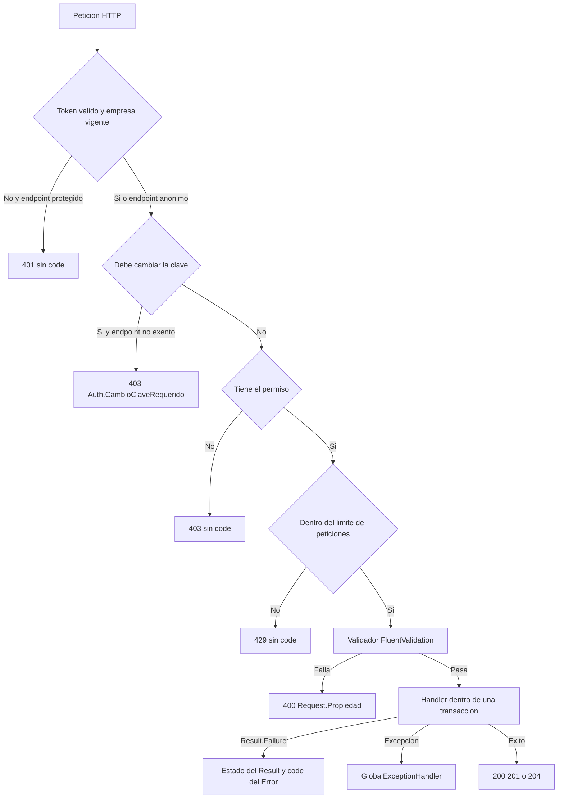

# Catálogo de códigos de error

| | |
|---|---|
| **Sistema** | SOFIA — Sistema Optimizado Farmacéutico con Inteligencia Artificial |
| **Versión del documento** | 1.0 |
| **Fecha** | 2026-10-26 |
| **Backend** | `sofia-apis`, rama `main`, commit `43f5529` |
| **Frontend** | `sofia-web-spa`, rama `main`, commit `eeffbb6` |
| **Método** | Lectura de código. Los códigos, sus mensajes y sus ubicaciones se extrajeron por script de las llamadas `Error.<Tipo>(...)` de `sofia-apis/src` (719 ocurrencias de 347 códigos literales, más los 14 códigos no literales); el HTTP se leyó del número que cada handler pasa a `Result.Failure`; los mensajes del SPA se leyeron por script de los mapas `código → clave` de cada pantalla y de los `es.json`; las reglas se cruzaron con las tablas de los seis documentos de `01-reglas-de-negocio/`. No se ejecutó la aplicación ni se llamó a la API. |

Este documento es la referencia única de los códigos de error que puede devolver la API de SOFIA: qué significa cada uno, cuándo sale, con qué estado HTTP, qué regla de negocio lo define y qué ve el usuario. Lo usan el capítulo de problemas frecuentes del manual, los casos de prueba de QA y soporte.

## Convenciones

**Prefijos de ruta.** Las ubicaciones usan estos prefijos, siempre seguidos de `archivo:línea`:

| Prefijo | Ruta real |
|---|---|
| `APP/` | `sofia-apis/src/SOFIA.Application/` |
| `DOM/` | `sofia-apis/src/SOFIA.Domain/` |
| `INF/` | `sofia-apis/src/SOFIA.Infrastructure/` |
| `API/` | `sofia-apis/src/SOFIA.API/` |
| `SPA/` | `sofia-web-spa/src/app/` |
| `I18N/` | `sofia-web-spa/public/i18n/` |

**Reglas.** Los identificadores `RN-<MOD>-<nnn>` son los del catálogo de reglas de negocio ([01a](01-reglas-de-negocio/01a-administracion-y-seguridad.md), [01b](01-reglas-de-negocio/01b-catalogos.md), [01c1](01-reglas-de-negocio/01c1-inventario-y-recetas.md), [01c2](01-reglas-de-negocio/01c2-ventas-y-comprobantes.md), [01c3](01-reglas-de-negocio/01c3-caja-devoluciones-dashboard.md), [01d](01-reglas-de-negocio/01d-modulos-solo-api.md)). Allí está el detalle de cada regla.

## 1. Cómo leer el catálogo

### 1.1 Forma de la respuesta de error

Cuando un handler falla, la API responde con un `ProblemDetails` que lleva el estado HTTP en `status`, el mensaje del backend en `detail` y el código en la extensión `code` (`API/Extensions/ResultExtensions.cs:13-23`). Ejemplo:

```json
{ "status": 409, "detail": "Another branch already uses this license number.", "code": "Sucursal.NumeroLicencia.Duplicado" }
```

- `code` es el valor que identifica el error y el que usa el SPA para decidir el texto.
- `detail` está en inglés o en español según quién escribió el mensaje; ninguna pantalla del SPA lo muestra (no existe ninguna lectura de `error.detail` en `SPA/`). Sirve para soporte y pruebas de API.
- Las respuestas del manejador de excepciones (`Db.*`, `Concurrency.Conflict`, `Request.*`, `CargaMasiva.*` y los errores 500) añaden además `traceId` (`API/Infrastructure/GlobalExceptionHandler.cs:117-127`). El SPA lo muestra como «Referencia:» seguido del identificador de seguimiento (traceId) solo en las pantallas que usan `showServerError` (`SPA/core/services/shared/error-notifier.service.ts:34-46`).
- Éxito: `Result<T>` devuelve 200 con el valor y `Result` devuelve 204 sin cuerpo (`API/Extensions/ResultExtensions.cs:7-11`); algunos controladores lo sustituyen por 201.

### 1.2 Regla del estado HTTP

El `Tipo` de la columna 2 (`Validation`, `NotFound`, `Conflict`, `Unauthorized`, `Forbidden`, `Failure`) **no decide el estado HTTP**. El estado es el segundo argumento de `Result.Failure(error, n)`; si el handler no lo pasa, es **400** (`DOM/Common/Result.cs:32-33`; el mapeo solo lee `result.StatusCode`, `API/Extensions/ResultExtensions.cs:17,22`). Por eso:

- Un `Error.NotFound` sale con 404 solo si el handler escribió `, 404`; un `Error.Forbidden` o `Error.Conflict` sin número sale como **400**. Ejemplos: `Transferencia.Forbidden` (400, aunque su tipo es `Forbidden`) y `Rol.DuplicateName` (400, aunque su tipo es `Conflict`).
- Los códigos de entidad (`DOM/Entities/*.cs`) devuelven `Result.Failure(Error.Validation(...))` y los handlers los propagan sin número: **400**.
- Los códigos de validación (`{Request}.{Propiedad}`) salen siempre con 400 (`APP/Common/Behaviors/ValidationBehavior.cs:41,46`).
- Cuando el código existe con varios estados (por ejemplo `Venta.Actualizar`), la columna HTTP los lista todos.

La columna «HTTP» de este catálogo es el estado que realmente devuelve la API, leído en el código. Cuando el mismo código sale con distintos estados según el lugar, se indica cuál es cuál.

### 1.3 Cómo genera el SPA el mensaje

1. **No hay traductor global de códigos.** `ErrorNotifierService` solo abre un aviso con el texto que le pasa cada pantalla; no hay interceptor que muestre errores (`SPA/core/services/shared/error-notifier.service.ts:26-28`).
2. **Cada pantalla tiene su mapa `código → clave i18n`** (constantes `SAVE_ERROR_KEYS`, `ERROR_KEYS`, `LOGIN_ERROR_KEYS`, `VENTA_ERROR_KEYS`, etc.) y un mensaje genérico de respaldo. Si el código no está en el mapa de la pantalla, el usuario ve el genérico. La sección 5.1 lista todos los mapas con sus códigos y textos (28 mapas, 106 entradas).
3. **`saveErrorKey`** resuelve el texto de un guardado: primero el mapa de la pantalla, después `Db.Duplicado`, `Db.ReferenciaInvalida` y `Db.ValorInvalido` (`SPA/shared/utils/save-error-key.util.ts:4-15`), y por último el genérico. Lo usan los detalles de Empleados, Ingredientes activos, Jerarquías, Laboratorios, Medicamentos, Pacientes, Profesionales de salud, Precio de proveedor, Proveedores, Recetas, Sucursales y Unidades de medida.
4. **Eliminar se decide por el estado, no por el código.** Casi todos los detalles muestran su mensaje «no se puede eliminar… porque está en uso» ante **cualquier 409** al eliminar, sin mirar el `code`; cualquier otro fallo muestra «Error al eliminar…». Lotes, Formulaciones clínicas y Presentaciones de venta hacen lo mismo al guardar (409 → mensaje de conflicto). Por eso en las tablas el texto de los códigos 409 aparece como «409 al eliminar» o «409 al guardar».
5. **Formulario antes que API.** Los formularios aplican validadores de Angular antes de llamar a la API y muestran el error bajo el campo (por ejemplo `general.errors.required` = «Este campo es obligatorio»). Los códigos de validación de campos obligatorios y longitudes solo se ven si la API rechaza algo que el formulario dejó pasar; la columna de mensaje describe ese caso.
6. **Sesión.** `SPA/core/interceptors/auth.interceptor.ts`: un 403 con `Auth.CambioClaveRequerido` lleva a `/cambiar-clave` (líneas 30-33); un 401 en un endpoint que no es de autenticación pide un token nuevo a `/auth/refresh` una sola vez y repite la petición, y si falla cierra la sesión y lleva a `/auth/login` (líneas 34-63). El interceptor no muestra texto.

Convención de las tablas: en «Mensaje que ve el usuario», `«genérico: …»` significa que el código no está en el mapa de la pantalla que origina la operación y se muestra el texto de respaldo de esa pantalla; «Sin pantalla» significa que el módulo no tiene pantalla en el SPA (solo API).

### 1.4 Códigos de validación dinámicos

`ValidationBehavior` ejecuta los validadores FluentValidation antes del handler. Si falla alguna regla, devuelve 400 con `code` = `"{NombreDelRequest}.{PropertyName del primer fallo}"` y `detail` = todos los mensajes unidos con `"; "` (`APP/Common/Behaviors/ValidationBehavior.cs:27-47`). Si fallan varias propiedades, el código nombra solo la primera según el orden en que el validador declara sus reglas. En reglas sobre colecciones el nombre de la propiedad lleva el índice (`CargaMasivaRolesCommand.Rows[0].NombreRol`). La sección 4 lista cada validador y los códigos que puede producir.

### 1.5 Orden en que se evalúa una petición



Orden de los middlewares: autenticación, cambio de clave obligatorio, autorización, límite de peticiones y controladores (`API/Program.cs:112-134`).


## 2. Códigos transversales

Son los códigos que no pertenecen a un módulo: los que genera el manejador de excepciones, los middlewares y los atributos, los que leen el contexto del usuario, y las respuestas que ni siquiera llevan `code`.

### 2.1 Códigos de excepciones, middleware y carga de archivos

No son literales `Error.<Tipo>(...)` dentro de un handler (por eso el CSV los lista como «no literales»); se construyen en `API/Infrastructure/GlobalExceptionHandler.cs`, `APP/Common/Excel/ExcelImportException.cs` y `API/Infrastructure/RequireCsrfHeaderAttribute.cs`. Todas las respuestas del manejador de excepciones añaden `traceId`.

| Código | Tipo | HTTP | Cuándo sale | Regla(s) | Mensaje del backend (`detail`) | Mensaje que ve el usuario | Dónde se lanza |
|---|---|---|---|---|---|---|---|
| `Db.Duplicado` | Conflict | 409 | Al guardar, SQL Server rechaza el cambio por un índice o restricción único (errores 2601 o 2627): normalmente dos peticiones simultáneas que pasaron la comprobación previa. | RN-GEN-036 | «A record with the same unique value already exists.» | Pantallas que usan `saveErrorKey` (Empleados, Ingredientes activos, Jerarquías, Laboratorios, Medicamentos, Pacientes, Profesionales de salud, Precio de proveedor, Proveedores, Recetas, Sucursales y Unidades de medida): «Ya existe un registro con ese mismo valor. Revisa los datos e inténtalo de nuevo.» (`errors.dbDuplicado`, `I18N/es.json:159`). Resto de pantallas: genérico de guardar. | `API/Infrastructure/GlobalExceptionHandler.cs:102` (constante en `:15`) |
| `Db.ValorInvalido` | Validation | 400 | SQL Server rechaza el cambio por una restricción CHECK (error 547 cuyo mensaje contiene «CHECK constraint»). | RN-GEN-037 | «A value is outside the allowed range.» | Igual que `Db.Duplicado`: «Uno de los valores está fuera del rango permitido.» (`errors.dbValorInvalido`, `I18N/es.json:161`). | `API/Infrastructure/GlobalExceptionHandler.cs:103` (constante en `:17`) |
| `Db.ReferenciaInvalida` | Conflict | 409 | SQL Server rechaza el cambio por una clave foránea (error 547 que no es CHECK): el registro apunta a algo que no existe o sigue en uso. | RN-GEN-038 | «The operation references a record that does not exist or is still in use.» | Igual que `Db.Duplicado`: «El registro hace referencia a datos que ya no existen o todavía está en uso.» (`errors.dbReferenciaInvalida`, `I18N/es.json:160`). | `API/Infrastructure/GlobalExceptionHandler.cs:104` (constante en `:16`) |
| `Concurrency.Conflict` | Conflict | 409 | `DbUpdateConcurrencyException`: la fila cambió (`RowVersion`) entre que se leyó y se guardó. | RN-GEN-035 | «The record was changed by another operation. Reload it and try again.» | Terminal de venta (POS), anular venta, apertura y cierre de caja (sesiones y diálogo del POS), diálogo de devolución y stock por sucursal: «Otra operación modificó estos datos al mismo tiempo. Actualiza la pantalla e inténtalo de nuevo.» (`errors.concurrencyConflict`, `I18N/es.json:158`). Resto de pantallas: genérico. | `API/Infrastructure/GlobalExceptionHandler.cs:87` (constante en `:12`) |
| `Request.TooLarge` | Validation | 413 | `BadHttpRequestException` con estado 413: el cuerpo supera el tamaño máximo permitido. | RN-GEN-039, RN-IMP-004 | «The request body exceeds the allowed size.» | Carga masiva (también por estado 413 sin `code`): «El archivo supera el tamaño máximo de {{maxMb}} MB.» (`carga-masiva.errors.too-large`). Resto: genérico. | `API/Infrastructure/GlobalExceptionHandler.cs:51` (constante en `:13`) |
| `Request.Invalid` | Validation | el de la excepción (normalmente 400) | `BadHttpRequestException` con otro estado: el cuerpo no se pudo leer. | RN-GEN-039 | «The request body could not be read.» | Genérico de la pantalla. | `API/Infrastructure/GlobalExceptionHandler.cs:52` (constante en `:14`) |
| `CargaMasiva.Archivo.Invalido` | Validation | 400 | El archivo subido no es un `.xlsx` válido (extensión, firma o estructura). | RN-IMP-001, RN-IMP-002 | «The file is not a valid .xlsx workbook.» | «El archivo no es un Excel .xlsx válido. Descarga la plantilla y vuelve a intentarlo.» (`carga-masiva.errors.invalid-file`) | `INF/Excel/ExcelReaderService.cs:170` (constante en `APP/Common/Excel/ExcelImportException.cs:8`) |
| `CargaMasiva.Archivo.ExcedeDescompresion` | Validation | 400 | El contenido descomprimido del `.xlsx` supera los límites (protección contra archivos bomba). | RN-IMP-003 | «The file expands beyond the allowed decompression limits.» | «El archivo excede los límites de contenido permitidos. Revisa que sea una plantilla válida.» (`carga-masiva.errors.decompression`) | `INF/Excel/ExcelReaderService.cs:152` (constante en `APP/Common/Excel/ExcelImportException.cs:9`) |
| `CargaMasiva.Filas.Excedidas` | Validation | 400 | El archivo tiene más filas con datos que el máximo de importación. | RN-IMP-005 | «The file exceeds the maximum of {ImportLimits.MaxRows} rows.» | «El archivo supera el máximo de {{maxRows}} filas. Divídelo en varios archivos.» (`carga-masiva.errors.too-many-rows`) | `INF/Excel/ExcelReaderService.cs:64` (constante en `APP/Common/Excel/ExcelImportException.cs:10`) |
| `Auth.Csrf` | Forbidden (no usa `Error`) | 403 | Refrescar o cerrar sesión sin la cabecera `X-SOFIA-CSRF`. | RN-AUT-013 | «The X-SOFIA-CSRF header is required.» | El SPA siempre envía la cabecera (`SPA/core/auth/auth.service.ts:36,89,115`); no tiene texto propio. | `API/Infrastructure/RequireCsrfHeaderAttribute.cs:10` (aplicado en `API/Controllers/AuthController.cs:35,72`) |

En carga masiva, los códigos de validación `CargaMasiva<X>Command.Rows` se muestran como `carga-masiva.errors.too-many-rows` y los `CargaMasiva<X>Command.Rows[n].<Campo>` como «Algunas filas tienen datos inválidos. Vuelve a subir el archivo y revisa la vista previa.» (`carga-masiva.errors.invalid-rows`) (`SPA/shared/components/carga-masiva-page/carga-masiva-page.component.ts:24-34`).

### 2.2 Respuestas sin `code`

| Situación | HTTP | Cuándo sale | Regla(s) | Qué ve el usuario | Dónde |
|---|---|---|---|---|---|
| Token ausente, vencido, mal firmado, con sello de seguridad obsoleto, cuenta inactiva o empresa no vigente | 401 | Cualquier endpoint protegido. | RN-GEN-015 a RN-GEN-018 | Nada propio: el interceptor pide un token nuevo a `/auth/refresh` una vez y repite la petición; si falla, cierra la sesión y lleva a `/auth/login`. Si el 401 llegó en el propio inicio de sesión: `auth.invalidCredentials` «Credenciales inválidas. Verifica tu usuario y contraseña.» | `INF/DependencyInjection.cs:91,107,115,129`; `SPA/core/interceptors/auth.interceptor.ts:34-63` |
| Falta el permiso `[HasPermission]` o la política por defecto | 403 | El rol del usuario no tiene el módulo y acción del endpoint. | RN-GEN-020, RN-GEN-021 | En una ruta: redirección al tablero con «No tienes permisos para acceder a esta pantalla.» (`errors.forbiddenPage`, `I18N/es.json:151`). En una llamada: el genérico de la pantalla. | `INF/Authentication/PermissionAuthorizationHandler.cs:17-56`; `INF/DependencyInjection.cs:149-151` |
| Límite de peticiones superado | 429 | Más de las peticiones permitidas por ventana (política global por IP y políticas por endpoint). | RN-GEN-025 a RN-GEN-028 | Inicio de sesión, recuperar y restablecer contraseña: «Demasiados intentos. Espera un minuto e inténtalo de nuevo.» (`auth.recovery.tooManyRequests`). Resto: genérico. | `API/Extensions/RateLimitingExtensions.cs:14` |
| Cuerpo JSON ilegible o que no cumple los atributos del modelo (`[ExportHeaders]`, `[ExportLabel]`, `[ExportDateFormat]`, `[JsonRequired]`) | 400 | Respuesta automática de `[ApiController]`. | RN-GEN-039 | Genérico de la pantalla. | `API/Infrastructure/ExportHeadersAttribute.cs:12-17` |
| El controlador responde `Unauthorized()` o `BadRequest("texto")` | 401 / 400 | Por ejemplo «ID mismatch.» (ruta distinta del cuerpo), «Debe adjuntar un archivo Excel.», «Image is required.». | RN-GEN-039 | Genérico de la pantalla. | `API/Controllers/AuthController.cs:41,62,92`; `API/Controllers/SucursalesController.cs:131`; `API/Controllers/RecetasController.cs:56` |
| Excepción no prevista | 500 | Cualquier error no manejado. Título «Error del Servidor»; el cuerpo trae `traceId`. | RN-GEN-040 | Inicio de sesión: `auth.serviceUnavailable` «No pudimos conectar con el servidor. Verifica tu conexión a internet e inténtalo de nuevo en unos minutos.» Resto: genérico, y con `showServerError` se añade «Referencia:» seguido del identificador de seguimiento (traceId). | `API/Infrastructure/GlobalExceptionHandler.cs:57-79` |

### 2.3 Códigos literales transversales

Códigos del CSV que no pertenecen a un módulo: el contexto del usuario (`Auth.Empresa`, `Auth.Sucursal`, `Auth.Empleado`), el cambio de clave obligatorio, el código genérico `NotFound`, el envío de correo y las entidades de dominio que ningún handler crea.

| Código | Tipo | HTTP | Cuándo sale | Regla(s) | Mensaje del backend (`detail`) | Mensaje que ve el usuario | Dónde se lanza |
|---|---|---|---|---|---|---|---|
| `Auth.CambioClaveRequerido` | Forbidden | 403 | La cuenta tiene marcado el cambio de contraseña obligatorio (clave asignada por un administrador) y llama a cualquier endpoint que no sea anónimo ni esté exento. | RN-GEN-019 | «You must change your password before continuing.» | El interceptor lleva a `/cambiar-clave`, que muestra «Tu contraseña fue asignada por un administrador. Debes cambiarla antes de continuar.» (`cambiarClave.forced`) | `APP/Security/PasswordChangePolicy.cs:11` |
| `Auth.Empleado` | Unauthorized / Validation | 400 | El handler necesita el empleado del token y el token no lo trae (usuario no autenticado) o no es un GUID válido. | RN-CAJ-002, RN-CAJ-007, RN-CUA-002, RN-DAS-008, RN-DEV-002, RN-GEN-024, RN-MAG-002, RN-TRA-002, RN-TRA-015, RN-VEN-002, RN-VEN-067 | «User must be authenticated.» / «Invalid employee ID in user context.» | Genérico de la operación que originó la petición (no figura en ningún mapa) | `APP/Common/Extensions/CurrentUserExtensions.cs:27` +1 |
| `Auth.Empresa` | Unauthorized / Validation | 400 | El handler necesita la empresa del token y el token no la trae (usuario no autenticado) o no es un GUID válido. | RN-GEN-024, RN-SUC-007, RN-SUC-012 | «User must be authenticated and assigned to a company.» / «Invalid company ID in user context.» | Genérico de la operación que originó la petición (no figura en ningún mapa) | `APP/Common/Extensions/CurrentUserExtensions.cs:42` +1 |
| `Auth.Sucursal` | Unauthorized / Validation | 400 | El handler necesita la sucursal del token y el token no la trae (usuario no autenticado o sin sucursal) o no es un GUID válido. | RN-CAJ-002, RN-CUA-002, RN-DEV-002, RN-GEN-024, RN-MAG-002, RN-MAG-013, RN-MED-017, RN-TRA-002, RN-TRA-012, RN-TRA-015, RN-TRA-021, RN-TRA-025, RN-TRA-026, RN-VEN-002, RN-VEN-062, RN-VEN-070, RN-VEN-075, RN-VEN-077 | «User must be authenticated and assigned to a branch.» / «Invalid branch ID in user context.» | Terminal de venta (POS): «No se pudo determinar el contexto de sucursal asignada del usuario.» (`pos.messages.contextError`); resto de pantallas: genérico de la operación | `APP/Common/Extensions/CurrentUserExtensions.cs:12` +1 |
| `Email.Disabled` | Failure | — (no llega al cliente) | El envío de correo está desactivado por configuración y se intenta enviar un correo (recuperación de contraseña). | — | «Email sending is disabled.» | Ninguno: el handler de recuperación registra el fallo en el log y responde igual para no revelar si la cuenta existe (`APP/Security/Commands/ForgotPassword/ForgotPasswordCommandHandler.cs:33-37`) | `INF/Email/DisabledEmailSender.cs:14` |
| `Email.SendFailed` | Failure | — (no llega al cliente) | El proveedor de correo (SMTP o Azure Communication) rechaza o no puede enviar el correo. | — | «The email could not be sent.» | Ninguno: el handler de recuperación registra el fallo en el log y responde igual para no revelar si la cuenta existe (`APP/Security/Commands/ForgotPassword/ForgotPasswordCommandHandler.cs:33-37`) | `INF/Email/SmtpEmailSender.cs:14` |
| `NotFound` | NotFound | 404 · 400 en `APP/Seguros/Commands/DeleteAseguradora/DeleteAseguradoraCommandHandler.cs:21` | Eliminar, editar o consultar un registro que no existe: despacho de delivery, servicio, inmunización, paciente, proveedor, receta o aseguradora (según el handler). | RN-ASE-005, RN-CAJ-008, RN-DEL-012, RN-DEL-013, RN-DEL-015, RN-DEV-011, RN-PAC-009, RN-PRV-009, RN-REC-012, RN-SRV-016, RN-SRV-017, RN-SRV-018, RN-VEN-018, RN-VEN-064 | «Record not found.» | genérico: Pacientes (detalle): «Error al eliminar el paciente» (`pacientes.detail.delete-error`) · genérico: Proveedores (detalle): «Error al eliminar el proveedor» (`proveedores.detail.delete-error`) · genérico: Recetas médicas (detalle): «Error al eliminar la receta» (`recetasMedicas.delete.error`) · genérico: Aseguradoras (detalle): «Error al eliminar la aseguradora» (`aseguradoras.detail.delete-error`) | `APP/Delivery/Commands/DeleteDespachoDelivery/DeleteDespachoDeliveryCommandHandler.cs:21` +12 |
| `RegistroPrivacidadPresidio.EntidadDetectada` | Validation | 400 | Entidad Detectada: vacío o ausente; supera 50 caracteres. | — | «Entidad Detectada is required.» / «Entidad Detectada must not exceed 50 characters.» | Sin pantalla (solo API) | `DOM/Entities/RegistroPrivacidadPresidio.cs:34` +3 |
| `RegistroPrivacidadPresidio.NivelRiesgoPii` | Validation | 400 | Nivel Riesgo PII: está fuera del rango 0 a 100. | — | «Nivel Riesgo PII must be between 0 and 100.» | Sin pantalla (solo API) | `DOM/Entities/RegistroPrivacidadPresidio.cs:112` +1 |
| `RegistroPrivacidadPresidio.ProcesamientoId` | Validation | 400 | Procesamiento ID: vacío o ausente. | — | «Procesamiento ID is required.» | Sin pantalla (solo API) | `DOM/Entities/RegistroPrivacidadPresidio.cs:29` +1 |
| `RegistroPrivacidadPresidio.TextoOriginalEncriptado` | Validation | 400 | Texto Original Encriptado: vacío o ausente. | — | «Texto Original Encriptado is required.» | Sin pantalla (solo API) | `DOM/Entities/RegistroPrivacidadPresidio.cs:44` +1 |
| `RegistroPrivacidadPresidio.TextoReemplazo` | Validation | 400 | Texto Reemplazo: vacío o ausente; supera 50 caracteres. | — | «Texto Reemplazo is required.» / «Texto Reemplazo must not exceed 50 characters.» | Sin pantalla (solo API) | `DOM/Entities/RegistroPrivacidadPresidio.cs:102` +3 |
| `SistemaNotificacionInterna.EmpleadoOrigenId` | Validation | 400 | Empleado Origen ID: vacío o ausente. | — | «Empleado Origen ID is required.» | Sin pantalla (solo API) | `DOM/Entities/SistemaNotificacionInterna.cs:35` +1 |
| `SistemaNotificacionInterna.EntidadRelacionada` | Validation | 400 | Entidad Relacionada: supera 50 caracteres. | — | «Entidad Relacionada must not exceed 50 characters.» | Sin pantalla (solo API) | `DOM/Entities/SistemaNotificacionInterna.cs:103` +1 |
| `SistemaNotificacionInterna.MensajeTexto` | Validation | 400 | Mensaje Texto: vacío o ausente; supera 500 caracteres. | — | «Mensaje Texto is required.» / «Mensaje Texto must not exceed 500 characters.» | Sin pantalla (solo API) | `DOM/Entities/SistemaNotificacionInterna.cs:45` +3 |
| `SistemaNotificacionInterna.SucursalDestinoId` | Validation | 400 | Sucursal Destino ID: vacío o ausente. | — | «Sucursal Destino ID is required.» | Sin pantalla (solo API) | `DOM/Entities/SistemaNotificacionInterna.cs:40` +1 |
| `SistemaOutboxEvento.PayloadJson` | Validation | 400 | Payload JSON: vacío o ausente. | — | «Payload JSON is required.» | Sin pantalla (solo API) | `DOM/Entities/SistemaOutboxEvento.cs:36` +1 |
| `SistemaOutboxEvento.TipoEvento` | Validation | 400 | Tipo Evento: vacío o ausente; supera 100 caracteres. | — | «Tipo Evento is required.» / «Tipo Evento must not exceed 100 characters.» | Sin pantalla (solo API) | `DOM/Entities/SistemaOutboxEvento.cs:26` +3 |


## 3. Códigos por módulo

Cada tabla lista los códigos que lanzan los handlers, las entidades y los objetos de valor del módulo, en orden alfabético. Los códigos de entidad (`Entidad.Campo`) solo llegan al cliente si el validador del request no detuvo antes la petición; en el flujo normal sale el código del validador (sección 4). Cuando la frase de «Cuándo sale» enuncia una regla, el código sale cuando esa regla se incumple. Los cuatro códigos de duplicado de laboratorios y proveedores no son literales (los arma el verificador de duplicados con constantes) y se marcan con una nota. La columna «Regla(s)» incluye todas las reglas que mencionan el código en el catálogo de reglas.

### 3.1 Autenticación y sesión (`AUT`)

| Código | Tipo | HTTP | Cuándo sale | Regla(s) | Mensaje del backend (`detail`) | Mensaje que ve el usuario | Dónde se lanza |
|---|---|---|---|---|---|---|---|
| `Auth.ClaveActualIncorrecta` | Validation | 400 | Al cambiar la contraseña, la contraseña actual enviada no coincide con la guardada. | RN-AUT-029 | «The current password is incorrect.» | Cambiar contraseña: «La contraseña actual es incorrecta» (`cambiarClave.errors.wrongCurrent`) | `APP/Security/Commands/ChangePassword/ChangePasswordCommandHandler.cs:28` |
| `Auth.EmpresaNoVigente` | Forbidden | 403 | Al iniciar sesión con credenciales correctas, la empresa de la cuenta no está vigente (suscripción no activa). | RN-AUT-009 | «The company's subscription is not active.» | Inicio de sesión: «La suscripción de tu empresa no está activa o ha vencido. Comunícate con soporte para reactivarla.» (`auth.empresaNoVigente`) | `APP/Security/EmpresaVigencia.cs:10` |
| `Auth.InvalidCredentials` | Unauthorized | 401 | Inicio de sesión: usuario inexistente o eliminado, cuenta inactiva o bloqueada, contraseña incorrecta o sucursal base de otra empresa; al cambiar la contraseña, la cuenta del token no existe o está inactiva. Los casos del inicio de sesión responden igual para no dar pistas. | RN-AUT-003, RN-AUT-005, RN-AUT-006, RN-AUT-008, RN-AUT-028 | «Invalid username or password.» | genérico: Cambiar contraseña: «No se pudo cambiar la contraseña. Inténtalo de nuevo.» (`cambiarClave.errors.save`) · genérico: Inicio de sesión: «Credenciales inválidas. Verifica tu usuario y contraseña.» (`auth.invalidCredentials`) | `APP/Security/Commands/ChangePassword/ChangePasswordCommandHandler.cs:22` +4 |
| `Auth.InvalidRefreshToken` | Unauthorized | 401 | Al renovar la sesión, el token de refresco no existe, venció, ya fue revocado (posible robo de sesión), la empresa no está vigente o dos renovaciones lo usan a la vez. | RN-AUT-015, RN-AUT-016, RN-AUT-017, RN-AUT-019 | «Refresh token is invalid or expired.» | Sin mensaje: el interceptor cierra la sesión local y lleva a /auth/login (SPA/core/interceptors/auth.interceptor.ts:34-63) | `APP/Security/Commands/RefreshToken/RefreshTokenCommandHandler.cs:117` |
| `Auth.InvalidToken` | Validation | 400 | Al restablecer la contraseña, el token de recuperación no es el vigente de la cuenta, venció o el usuario no existe (misma respuesta en todos los casos). | RN-AUT-038 | «The recovery token is invalid or has expired.» | Restablecer contraseña: «El enlace no es válido o ya expiró. Solicita uno nuevo.» (`auth.resetPage.invalidToken`) | `DOM/Entities/Cuenta.cs:11` |

### 3.2 Roles y permisos (`ROL`)

| Código | Tipo | HTTP | Cuándo sale | Regla(s) | Mensaje del backend (`detail`) | Mensaje que ve el usuario | Dónde se lanza |
|---|---|---|---|---|---|---|---|
| `Permiso.Accion` | Validation | 400 | Accion: vacío o ausente. | RN-ROL-013 | «Accion is required.» | genérico: Roles (detalle): «Error al guardar el rol» (`roles.detail.save-error`) | `DOM/Entities/PermisoRol.cs:33` |
| `Permiso.Duplicate` | Conflict | 400 | Un permiso (módulo y acción) no se puede asignar dos veces al mismo rol. | RN-ROL-011 | «This permission is already assigned to this role.» | genérico: Roles (detalle): «Error al guardar el rol» (`roles.detail.save-error`) | `APP/Security/Commands/Roles/AssignPermission/AssignPermissionToRolCommandHandler.cs:42` |
| `Permiso.Modulo` | Validation | 400 | Modulo Sistema: vacío o ausente. | RN-ROL-013 | «Modulo Sistema is required.» | genérico: Roles (detalle): «Error al guardar el rol» (`roles.detail.save-error`) | `DOM/Entities/PermisoRol.cs:28` |
| `Permiso.NotFound` | NotFound | 404 | Para revocar, el permiso debe existir y no estar ya revocado. | RN-ROL-014 | «El permiso especificado no existe.» | genérico: Roles (detalle): «Error al guardar el rol» (`roles.detail.save-error`) | `APP/Security/Commands/Roles/RevokePermission/RevokePermissionFromRolCommandHandler.cs:18` |
| `Permiso.RolId` | Validation | 400 | Rol ID: vacío o ausente. | RN-ROL-013 | «Rol ID is required.» | genérico: Roles (detalle): «Error al guardar el rol» (`roles.detail.save-error`) | `DOM/Entities/PermisoRol.cs:23` |
| `Rol.DuplicateName` | Conflict | 400 | El nombre del rol es único dentro de la empresa entre los roles no eliminados. | RN-ROL-005 | «Ya existe un rol con el nombre '{request.NombreRol}'.» | genérico: Roles (detalle): «Error al guardar el rol» (`roles.detail.save-error`) | `APP/Security/Commands/Roles/CreateRol/CreateRolCommandHandler.cs:18` |
| `Rol.InUse` | Conflict | 400 | No se puede eliminar un rol que tiene cuentas no eliminadas vinculadas. | RN-ROL-008 | «No se puede eliminar un rol que tiene usuarios activos vinculados.» | genérico: Roles (detalle): «Error al eliminar el rol» (`roles.detail.delete-error`) | `APP/Security/Commands/Roles/DeleteRol/DeleteRolCommandHandler.cs:24` |
| `Rol.Nombre` | Validation | 400 | Nombre de Rol: vacío o ausente; supera 50 caracteres. | RN-ROL-002 | «Nombre de Rol is required.» / «Nombre de Rol must not exceed 50 characters.» | genérico: Roles (detalle): «Error al guardar el rol» (`roles.detail.save-error`) | `DOM/Entities/Rol.cs:48` +1 |
| `Rol.NotFound` | NotFound | 404 | Toda operación sobre un rol exige que exista en la empresa y no esté eliminado. | RN-CTA-017, RN-ROL-007, RN-ROL-017 | «El rol especificado no existe.» / «El rol no existe.» | genérico: Roles (detalle): al guardar «Error al guardar el rol» (`roles.detail.save-error`); al eliminar «Error al eliminar el rol» (`roles.detail.delete-error`); al cargar «Error al cargar el rol» (`roles.detail.load-error`) · genérico: Cuentas (detalle): «Error al guardar la cuenta» (`cuentas.detail.save-error`) | `APP/Security/Commands/Roles/AssignPermission/AssignPermissionToRolCommandHandler.cs:22` +7 |
| `Rol.PermisosPropios` | Forbidden | 403 | Un usuario que no es Admin intenta añadir permisos a un rol que él mismo tiene asignado. | RN-ROL-010 | «No puedes ampliar los permisos de un rol que tienes asignado.» | Roles (detalle): «No se pueden ampliar los permisos de un rol que la propia cuenta tiene asignado» (`roles.detail.permisos-propios-error`) | `APP/Security/Commands/Roles/AssignPermission/AssignPermissionToRolCommandHandler.cs:28` |

### 3.3 Cuentas de usuario (`CTA`)

| Código | Tipo | HTTP | Cuándo sale | Regla(s) | Mensaje del backend (`detail`) | Mensaje que ve el usuario | Dónde se lanza |
|---|---|---|---|---|---|---|---|
| `Auth.CuentaNotFound` | NotFound | 404 | Para asignar o quitar roles o sucursales, la cuenta debe existir en la empresa y no estar eliminada. | RN-CTA-014 | «La cuenta no existe.» | Cuentas (detalle): «La cuenta no existe» (`cuentas.errors.cuenta-not-found`) | `APP/Security/Commands/Cuentas/AssignSucursal/AssignSucursalToCuentaCommandHandler.cs:18` +3 |
| `Auth.DuplicateAccount` | Conflict | 409 | Se crea una cuenta para un empleado que ya tiene una cuenta no eliminada. | RN-CTA-006 | «Este empleado ya tiene una cuenta de usuario vinculada.» | genérico: Cuentas (detalle): «Error al guardar la cuenta» (`cuentas.detail.save-error`) | `APP/Security/Commands/Register/RegisterAccountCommandHandler.cs:34` |
| `Auth.DuplicateUsername` | Conflict | 409 | El nombre de usuario es único en todo el sistema, no solo en la empresa, entre cuentas no eliminadas (el inicio de sesión no pide empresa). | RN-CTA-007, RN-EMP-006 | «Username is already in use.» | Registro de empresa: «El usuario ya está en uso. Elige otro.» (`empresa.notifications.usuarioDuplicado`) · genérico: Cuentas (detalle): «Error al guardar la cuenta» (`cuentas.detail.save-error`) | `APP/Empresas/Commands/RegistrarEmpresa/RegistrarEmpresaCommandHandler.cs:45` +1 |
| `Cuenta.AdminProtegida` | Forbidden | 403 | Un usuario que no es administrador intenta modificar o eliminar la cuenta de un administrador. | RN-CTA-010 | «Solo un administrador puede modificar o eliminar la cuenta de un administrador.» | Cuentas (detalle): «Solo un administrador puede modificar o eliminar la cuenta de un administrador» (`cuentas.errors.admin-protegida`) | `APP/Security/Commands/Cuentas/DeleteCuenta/DeleteCuentaCommandHandler.cs:25` +1 |
| `Cuenta.EmpleadoId` | Validation | 400 | Empleado ID: vacío o ausente. | RN-CTA-002 | «Empleado ID is required.» | genérico: Cuentas (detalle): «Error al guardar la cuenta» (`cuentas.detail.save-error`) | `DOM/Entities/Cuenta.cs:42` |
| `Cuenta.NotFound` | NotFound | 404 | La cuenta indicada no existe en la empresa (editar, eliminar, consultar o ver el perfil del token). | RN-AUT-023, RN-CTA-009 | «La cuenta especificada no existe.» / «Account not found.» | genérico: Cuentas (detalle): al eliminar «Error al eliminar la cuenta» (`cuentas.detail.delete-error`); al guardar «Error al guardar la cuenta» (`cuentas.detail.save-error`); al cargar «Error al cargar la cuenta» (`cuentas.detail.load-error`) | `APP/Security/Commands/Cuentas/DeleteCuenta/DeleteCuentaCommandHandler.cs:20` +3 |
| `Cuenta.Password` | Validation | 400 | Password Hash: vacío o ausente. | RN-CTA-004 | «Password Hash is required.» | genérico: Cuentas (detalle): «Error al guardar la cuenta» (`cuentas.detail.save-error`) | `DOM/Entities/Cuenta.cs:52` |
| `Cuenta.Usuario` | Validation | 400 | Nombre de Usuario: vacío o ausente. | RN-CTA-003 | «Nombre de Usuario is required.» | genérico: Cuentas (detalle): «Error al guardar la cuenta» (`cuentas.detail.save-error`) | `DOM/Entities/Cuenta.cs:47` |
| `Rol.AdminReservado` | Forbidden | 403 | Un usuario que no es administrador intenta asignar o quitar el rol Admin. | RN-CTA-016 | «Solo un administrador puede asignar o quitar el rol Admin.» | Cuentas (detalle): «Solo un administrador puede asignar o quitar el rol Admin» (`cuentas.errors.admin-reservado`) | `APP/Security/Commands/Roles/AssignRol/AssignRolToUserCommandHandler.cs:38` +1 |
| `Rol.AutoAsignacion` | Forbidden | 403 | Un usuario intenta asignarse o quitarse a sí mismo un rol. | RN-CTA-015 | «No puedes modificar tus propios roles.» | Cuentas (detalle): «Una cuenta no puede modificar sus propios roles» (`cuentas.errors.auto-asignacion`) | `APP/Security/Commands/Roles/AssignRol/AssignRolToUserCommandHandler.cs:25` +1 |

### 3.4 Empresas y suscripción (`EMP`)

| Código | Tipo | HTTP | Cuándo sale | Regla(s) | Mensaje del backend (`detail`) | Mensaje que ve el usuario | Dónde se lanza |
|---|---|---|---|---|---|---|---|
| `Empresa.Nombre` | Validation | 400 | Nombre: vacío o ausente. | RN-EMP-002 | «Nombre is required.» | genérico: Registro de empresa: «Error al registrar la empresa» (`empresa.notifications.registerError`) · genérico: Empresa (detalle): «Error al actualizar la empresa» (`empresa.detail.save-error`) | `DOM/Entities/Empresa.cs:43` +1 |
| `Empresa.NotFound` | NotFound | 404 | Para consultar o editar, la empresa debe existir, no estar eliminada y ser la del usuario. | RN-EMP-017 | «La empresa no existe.» | genérico: Empresa (detalle): al guardar «Error al actualizar la empresa» (`empresa.detail.save-error`); al cargar «Error al cargar la empresa» (`empresa.detail.load-error`) | `APP/Empresas/Commands/UpdateEmpresa/UpdateEmpresaCommandHandler.cs:21` +1 |
| `Empresa.RUC.Duplicado` | Conflict | 409 | El RUC es único en todo el sistema (es el identificador ante SUNAT), no solo dentro de una empresa. | RN-EMP-005 | «Ya existe una empresa registrada con este RUC.» / «Ya existe otra empresa con este RUC.» | Registro de empresa: «Ya existe una empresa registrada con este RUC» (`empresa.notifications.rucDuplicado`) · genérico: Empresa (detalle): «Error al actualizar la empresa» (`empresa.detail.save-error`) | `APP/Empresas/Commands/RegistrarEmpresa/RegistrarEmpresaCommandHandler.cs:37` +1 |
| `Ruc.Invalido` | Validation | 400 | Al registrar la empresa, el RUC no tiene exactamente 11 dígitos numéricos. | RN-EMP-003, RN-EMP-004 | «RUC must be 11 numeric digits.» | genérico: Registro de empresa: «Error al registrar la empresa» (`empresa.notifications.registerError`) | `DOM/ValueObjects/Ruc.cs:20` |
| `Ruc.Vacio` | Validation | 400 | RUC: vacío o ausente. | RN-EMP-003, RN-EMP-004 | «RUC is required.» | genérico: Registro de empresa: «Error al registrar la empresa» (`empresa.notifications.registerError`) | `DOM/ValueObjects/Ruc.cs:15` |

### 3.5 Sucursales (`SUC`)

| Código | Tipo | HTTP | Cuándo sale | Regla(s) | Mensaje del backend (`detail`) | Mensaje que ve el usuario | Dónde se lanza |
|---|---|---|---|---|---|---|---|
| `Sucursal.Direccion` | Validation | 400 | Direccion: vacío o ausente. | RN-EMP-010, RN-SUC-003 | «Direccion is required.» | genérico: Sucursales (detalle): «Error al guardar la sucursal» (`sucursales.detail.save-error`) | `DOM/Entities/Sucursal.cs:37` +2 |
| `Sucursal.InUse` | Conflict | 409 | Se elimina una sucursal referenciada por empleados, cuentas, roles, stock, sesiones de caja, series fiscales, ventas, transferencias, cuarentena u órdenes magistrales. | RN-CUA-023, RN-MAG-023, RN-SUC-009, RN-TRA-030 | «Cannot delete a branch referenced by employees, accounts, roles, stock, cash sessions, fiscal series, sales, transfers, quarantine records or compounding orders.» | Sucursales (detalle): 409 al eliminar «No puedes eliminar esta sucursal porque tiene empleados, usuarios, roles, stock, ventas u otros registros asociados.» (`sucursales.detail.delete-in-use`) | `APP/Sucursales/Commands/DeleteSucursal/DeleteSucursalCommandHandler.cs:23` |
| `Sucursal.Licencia` | Validation | 400 | Licencia: vacío o ausente. | RN-SUC-004 | «Licencia is required.» | genérico: Sucursales (detalle): «Error al guardar la sucursal» (`sucursales.detail.save-error`) | `DOM/Entities/Sucursal.cs:42` +1 |
| `Sucursal.Nombre` | Validation | 400 | Nombre: vacío o ausente. | RN-EMP-010, RN-SUC-002 | «Nombre is required.» | genérico: Sucursales (detalle): «Error al guardar la sucursal» (`sucursales.detail.save-error`) | `DOM/Entities/Sucursal.cs:32` +2 |
| `Sucursal.NotFound` | NotFound | 404 | La sucursal indicada no existe en la empresa (editar, eliminar, consultar, o como sucursal base, adicional, de serie, de stock o de rol). | RN-CTA-019, RN-EPL-003, RN-ROL-017, RN-SER-002, RN-STK-005, RN-SUC-008 | «La sucursal no existe.» / «The specified branch does not exist.» / «Sucursal with ID {request.Id} was not found.» | Cuentas (detalle): «La sucursal no existe» (`cuentas.errors.sucursal-not-found`) · Series fiscales (detalle): «La sucursal seleccionada no existe.» (`seriesFiscales.errors.sucursalNoEncontrada`) · genérico: Empleados (detalle): «Error al guardar el empleado» (`empleados.detail.save-error`) · genérico: Stock por sucursal (alta): «Error al registrar el stock» (`stockPorSucursal.create.save-error`) · genérico: Roles (detalle): «Error al guardar el rol» (`roles.detail.save-error`) · genérico: Sucursales (detalle): al eliminar «Error al eliminar la sucursal» (`sucursales.detail.delete-error`); al guardar «Error al guardar la sucursal» (`sucursales.detail.save-error`); al cargar «Error al cargar la sucursal» (`sucursales.detail.load-error`) | `APP/Empleados/Commands/CreateEmpleado/CreateEmpleadoCommandHandler.cs:18` +8 |
| `Sucursal.NumeroLicencia.Duplicado` | Conflict | 409 | El número de licencia es único dentro de la empresa entre sucursales no eliminadas. | RN-SUC-005 | «Another branch already uses this license number.» | Sucursales (detalle): «Ya existe una sucursal con ese número de licencia.» (`sucursales.detail.duplicate-licencia`) | `APP/Sucursales/Commands/CreateSucursal/CreateSucursalCommandHandler.cs:36` +1 |

### 3.6 Empleados (`EPL`)

| Código | Tipo | HTTP | Cuándo sale | Regla(s) | Mensaje del backend (`detail`) | Mensaje que ve el usuario | Dónde se lanza |
|---|---|---|---|---|---|---|---|
| `Empleado.ApellidoPaterno` | Validation | 400 | Apellido Paterno: vacío o ausente. | RN-EMP-008, RN-EPL-005 | «Apellido Paterno is required.» | genérico: Empleados (detalle): «Error al guardar el empleado» (`empleados.detail.save-error`) | `DOM/Entities/Empleado.cs:100` +1 |
| `Empleado.Email.Duplicado` | Conflict | 409 | Si se indica, el correo es único dentro de la empresa entre empleados no eliminados, sin distinguir mayúsculas. | RN-EPL-010 | «Another employee already uses this email.» | Empleados (detalle): «Ya existe un empleado con ese correo electrónico en tu empresa.» (`empleados.detail.duplicate-email`) | `APP/Empleados/Commands/CreateEmpleado/CreateEmpleadoCommandHandler.cs:49` +1 |
| `Empleado.Email.Invalido` | Validation | 400 | El correo del empleado no tiene formato de dirección válido. | RN-EMP-009, RN-EPL-009 | «Email is not a valid address.» | Empleados (detalle): «Ingresa un correo electrónico válido.» (`empleados.detail.invalid-email`) | `DOM/Entities/Empleado.cs:129` |
| `Empleado.EsGerente` | Conflict | 409 | No se puede eliminar a un empleado que es gerente de una sucursal. | RN-EPL-014 | «Cannot delete an employee who manages a branch.» | Empleados (detalle): 409 al eliminar «No se puede eliminar un empleado que gerencia una sucursal. Asigna otro gerente primero.» (`empleados.detail.delete-manager`) | `APP/Empleados/Commands/DeleteEmpleado/DeleteEmpleadoCommandHandler.cs:24` |
| `Empleado.LicenciaProf.Duplicado` | Conflict | 409 | Si se indica, la licencia profesional es única dentro de la empresa entre empleados no eliminados. | RN-EPL-008 | «Another employee already uses this professional license.» | Empleados (detalle): «Ya existe un empleado con esa licencia profesional.» (`empleados.detail.duplicate-licencia`) | `APP/Empleados/Commands/CreateEmpleado/CreateEmpleadoCommandHandler.cs:41` +1 |
| `Empleado.Nombres` | Validation | 400 | Nombres: vacío o ausente. | RN-EMP-008, RN-EPL-004 | «Nombres is required.» | genérico: Empleados (detalle): «Error al guardar el empleado» (`empleados.detail.save-error`) | `DOM/Entities/Empleado.cs:52` +1 |
| `Empleado.NotFound` | NotFound | 404 | El empleado debe existir en la empresa y no estar eliminado. | RN-CTA-005, RN-CUA-014, RN-EPL-013, RN-SRV-008, RN-SUC-006 | «El empleado especificado no existe.» / «Empleado with ID {request.Id} was not found.» | genérico: Empleados (detalle): al eliminar «Error al eliminar el empleado» (`empleados.detail.delete-error`); al guardar «Error al guardar el empleado» (`empleados.detail.save-error`); al cargar «Error al cargar el empleado» (`empleados.detail.load-error`) · genérico: Cuentas (detalle): «Error al guardar la cuenta» (`cuentas.detail.save-error`) · genérico: Sucursales (detalle): «Error al guardar la sucursal» (`sucursales.detail.save-error`) | `APP/DIGEMID/Commands/GenerarActaDestruccion/GenerarActaDestruccionCommandHandler.cs:15` +7 |
| `Empleado.Sucursal` | Validation | 400 | Sucursal ID: vacío o ausente. | RN-EPL-002 | «Sucursal ID is required.» | genérico: Empleados (detalle): «Error al guardar el empleado» (`empleados.detail.save-error`) | `DOM/Entities/Empleado.cs:47` +1 |
| `Empleado.SucursalBase.AutoAsignacion` | Forbidden | 403 | Nadie cambia su propia sucursal base. | RN-EPL-011 | «No puedes cambiar tu propia sucursal base.» | genérico: Empleados (detalle): «Error al guardar el empleado» (`empleados.detail.save-error`) | `APP/Empleados/Commands/UpdateEmpleado/UpdateEmpleadoCommandHandler.cs:29` |

### 3.7 Series fiscales (`SER`)

| Código | Tipo | HTTP | Cuándo sale | Regla(s) | Mensaje del backend (`detail`) | Mensaje que ve el usuario | Dónde se lanza |
|---|---|---|---|---|---|---|---|
| `SerieFiscal.ActivaDuplicada` | Conflict | 409 | Cada sucursal puede tener como máximo una serie `Activa` por tipo de comprobante. | RN-SER-008 | «The branch already has an active series of this document type.» | Series fiscales (detalle): «La sucursal ya tiene una serie activa de este tipo. Desactívala antes de activar otra.» (`seriesFiscales.errors.activaDuplicada`) | `APP/SeriesFiscales/Common/SerieFiscalConflictChecker.cs:43` +1 |
| `SerieFiscal.ConComprobantes` | Conflict | 409 | Se edita una serie que ya emitió comprobantes y se intenta cambiar algo distinto de su estado. | RN-SER-010 | «Only the status of a series that already issued documents can change.» | Series fiscales (detalle): «La serie ya emitió comprobantes: solo puedes cambiar su estado.» (`seriesFiscales.errors.conComprobantes`) | `APP/SeriesFiscales/Commands/UpdateSerieFiscal/UpdateSerieFiscalCommandHandler.cs:26` |
| `SerieFiscal.InUse` | Conflict | 409 | No se puede eliminar una serie que ya emitió comprobantes. | RN-SER-011 | «Cannot delete a fiscal series that already issued documents.» | Series fiscales (detalle): 409 al eliminar «No se puede eliminar una serie que ya emitió comprobantes. Puedes desactivarla.» (`seriesFiscales.detail.delete-in-use`) | `APP/SeriesFiscales/Commands/DeleteSerieFiscal/DeleteSerieFiscalCommandHandler.cs:25` |
| `SerieFiscal.NotFound` | NotFound | 404 | Para consultar, editar o eliminar, la serie debe existir en la empresa y no estar eliminada. | RN-SER-009 | «The specified fiscal series does not exist.» | Series fiscales (detalle): «La serie fiscal no existe.» (`seriesFiscales.errors.noEncontrada`) · genérico: Series fiscales (detalle): al eliminar «Error al eliminar la serie fiscal» (`seriesFiscales.detail.delete-error`); al cargar «Error al cargar la serie fiscal» (`seriesFiscales.detail.load-error`) | `APP/SeriesFiscales/Commands/DeleteSerieFiscal/DeleteSerieFiscalCommandHandler.cs:18` +2 |
| `SerieFiscal.PrefijoDuplicado` | Conflict | 409 | Dentro de la empresa no puede haber dos series no eliminadas del mismo tipo de comprobante con el mismo prefijo, aunque sean de sucursales distintas. | RN-SER-007 | «Another series of this document type already uses this prefix.» | Series fiscales (detalle): «Ya existe otra serie de este tipo de comprobante con ese prefijo.» (`seriesFiscales.errors.prefijoDuplicado`) | `APP/SeriesFiscales/Common/SerieFiscalConflictChecker.cs:31` +1 |
| `SunatSerieFiscal.CorrelativoActual` | Validation | 400 | Correlativo Actual: es negativo. | RN-SER-005 | «Correlativo Actual must be greater than or equal to zero.» | genérico: Series fiscales (detalle): «Error al guardar la serie fiscal» (`seriesFiscales.detail.save-error`) | `DOM/Entities/SunatSerieFiscal.cs:117` |
| `SunatSerieFiscal.EstadoSerie` | Validation | 400 | El estado de la serie no es Activa ni Inactiva. | RN-SER-006 | «Estado Serie must be Activa or Inactiva.» | genérico: Series fiscales (detalle): «Error al guardar la serie fiscal» (`seriesFiscales.detail.save-error`) | `DOM/Entities/SunatSerieFiscal.cs:122` |
| `SunatSerieFiscal.PrefijoSerie` | Validation | 400 | El prefijo de la serie no tiene 4 caracteres alfanuméricos en mayúscula con la letra que exige el tipo de comprobante. | RN-SER-004 | «Prefijo Serie must be 4 uppercase alphanumerics with the letter required by the document type.» | genérico: Series fiscales (detalle): «Error al guardar la serie fiscal» (`seriesFiscales.detail.save-error`) | `DOM/Entities/SunatSerieFiscal.cs:112` |
| `SunatSerieFiscal.SucursalId` | Validation | 400 | Sucursal ID: vacío o ausente. | RN-SER-002 | «Sucursal ID is required.» | genérico: Series fiscales (detalle): «Error al guardar la serie fiscal» (`seriesFiscales.detail.save-error`) | `DOM/Entities/SunatSerieFiscal.cs:102` |
| `SunatSerieFiscal.TipoComprobante` | Validation | 400 | El tipo de comprobante no admite serie (solo Boleta, Factura, Nota de crédito y Proforma). | RN-SER-003 | «Unsupported document type for a series.» | genérico: Series fiscales (detalle): «Error al guardar la serie fiscal» (`seriesFiscales.detail.save-error`) | `DOM/Entities/SunatSerieFiscal.cs:107` |

### 3.8 Carga masiva y exportación a Excel (`IMP`)

| Código | Tipo | HTTP | Cuándo sale | Regla(s) | Mensaje del backend (`detail`) | Mensaje que ve el usuario | Dónde se lanza |
|---|---|---|---|---|---|---|---|
| `Export.TooManyRows` | Validation | 400 | Una exportación no puede superar 10 000 filas. | RN-ASE-008, RN-CAJ-024, RN-DIG-009, RN-FOR-012, RN-IMP-008, RN-ING-010, RN-JER-016, RN-LAB-012, RN-LOT-019, RN-MED-020, RN-PAC-011, RN-PRE-014, RN-PRO-008, RN-PRV-012, RN-REC-017, RN-STK-016, RN-UDM-013, RN-VEN-078 | «La exportación supera el máximo de {PaginationLimits.MaxPageSize} filas. Aplica filtros para reducir los resultados.» | Series fiscales: «Error al exportar las series fiscales» (`seriesFiscales.search.export-error`); en las demás búsquedas no se encontró un mensaje de exportación propio (No verificado) | `API/Extensions/ExportExtensions.cs:10` |

### 3.9 Unidades de medida (`UDM`)

| Código | Tipo | HTTP | Cuándo sale | Regla(s) | Mensaje del backend (`detail`) | Mensaje que ve el usuario | Dónde se lanza |
|---|---|---|---|---|---|---|---|
| `UnidadMedida.Codigo` | Validation | 400 | Codigo: vacío o ausente; supera 10 caracteres. | RN-UDM-002, RN-UDM-003 | «Codigo is required.» / «Codigo must not exceed 10 characters.» | genérico: Unidades de medida (detalle): «Error al guardar la unidad de medida» (`unidadesMedida.detail.save-error`) | `DOM/Entities/UnidadMedida.cs:16` +3 |
| `UnidadMedida.Codigo.Duplicado` | Conflict | 409 | No puede haber dos unidades de medida no eliminadas con el mismo código dentro de la misma empresa. | RN-UDM-006 | «Another unit of measure already uses this code.» | Unidades de medida (detalle): «Ya existe una unidad de medida con ese código.» (`unidadesMedida.detail.duplicate-codigo`) | `APP/UnidadesMedida/Commands/CreateUnidadMedida/CreateUnidadMedidaCommandHandler.cs:25` +1 |
| `UnidadMedida.Descripcion` | Validation | 400 | Descripcion: vacío o ausente; supera 50 caracteres. | RN-UDM-004, RN-UDM-005 | «Descripcion is required.» / «Descripcion must not exceed 50 characters.» | genérico: Unidades de medida (detalle): «Error al guardar la unidad de medida» (`unidadesMedida.detail.save-error`) | `DOM/Entities/UnidadMedida.cs:26` +3 |
| `UnidadMedida.InUse` | Conflict | 409 | No se puede eliminar una unidad de medida mientras la use algún registro no eliminado. | RN-UDM-010 | «Cannot delete a unit of measure referenced by medications, unit hierarchies or clinical formulations.» | Unidades de medida (detalle): 409 al eliminar «No se puede eliminar la unidad de medida porque está asociada a medicamentos o jerarquías de unidades.» (`unidadesMedida.detail.delete-in-use`) | `APP/UnidadesMedida/Commands/DeleteUnidadMedida/DeleteUnidadMedidaCommandHandler.cs:29` |
| `UnidadMedida.NotFound` | NotFound | 404 | Editar, eliminar o consultar una unidad que no existe (o ya eliminada, o de otra empresa) devuelve «no encontrado». | RN-FOR-007, RN-JER-007, RN-MED-006, RN-UDM-009 | «Unidad de Medida with ID {request.UnidadMedidaId} not found.» / «The specified unit of measure does not exist.» / «Unidad de Medida with ID {request.Id} was not found.» | genérico: Formulaciones clínicas (detalle): «Error al guardar la formulación clínica» (`formulacionesClinicas.detail.save-error`) · genérico: Jerarquías de unidades (detalle): «Error al guardar la jerarquía» (`jerarquias.detail.save-error`) · genérico: Medicamentos (detalle): «Error al guardar el medicamento» (`medicamentos.detail.save-error`) · genérico: Unidades de medida (detalle): al eliminar «Error al eliminar la unidad de medida» (`unidadesMedida.detail.delete-error`); al guardar «Error al guardar la unidad de medida» (`unidadesMedida.detail.save-error`); al cargar «Error al cargar la unidad de medida» (`unidadesMedida.detail.load-error`) | `APP/FormulacionesClinicas/Commands/Create/CreateFormulacionClinicaCommandHandler.cs:46` +8 |

### 3.10 Jerarquías de unidades (`JER`)

| Código | Tipo | HTTP | Cuándo sale | Regla(s) | Mensaje del backend (`detail`) | Mensaje que ve el usuario | Dónde se lanza |
|---|---|---|---|---|---|---|---|
| `JerarquiaUoM.Duplicada` | Conflict | 409 | Un producto no puede tener dos conversiones no eliminadas con la misma unidad mayor y la misma unidad menor (en ese mismo sentido). | RN-JER-008 | «This product already has a conversion between these units.» | Jerarquías de unidades (detalle): «Este producto ya tiene una conversión entre esas unidades.» (`jerarquias.detail.duplicate`) | `APP/JerarquiasUoM/Commands/CreateJerarquiaUoM/CreateJerarquiaUoMCommandHandler.cs:45` +1 |
| `JerarquiaUoM.Multiplicador` | Validation | 400 | Multiplicador: es cero o negativo. | RN-JER-005 | «Multiplicador must be greater than zero.» | genérico: Jerarquías de unidades (detalle): «Error al guardar la jerarquía» (`jerarquias.detail.save-error`) | `DOM/Entities/JerarquiaUoM.cs:47` +1 |
| `JerarquiaUoM.Multiplicador.Inconsistente` | Conflict | 409 | La conversión nueva contradice una equivalencia ya calculable entre las mismas dos unidades del producto (directa, inversa o pasando por otras unidades). | RN-JER-009 | «A conversion between these units already exists for this product (computed: {decimal.Round(yaResuelto.Value, 4)}, entered: {request.Multiplicador}).» | genérico: Jerarquías de unidades (detalle): «Error al guardar la jerarquía» (`jerarquias.detail.save-error`) | `APP/JerarquiasUoM/Commands/CreateJerarquiaUoM/CreateJerarquiaUoMCommandHandler.cs:55` +1 |
| `JerarquiaUoM.NotFound` | NotFound | 404 | Editar, eliminar o consultar una jerarquía inexistente devuelve «no encontrado». | RN-JER-013 | «Jerarquía with ID {request.Id} was not found.» | genérico: Jerarquías de unidades (detalle): al eliminar «Error al eliminar la jerarquía» (`jerarquias.detail.delete-error`); al guardar «Error al guardar la jerarquía» (`jerarquias.detail.save-error`); al cargar «Error al cargar la jerarquía» (`jerarquias.detail.load-error`) | `APP/JerarquiasUoM/Commands/DeleteJerarquiaUoM/DeleteJerarquiaUoMCommandHandler.cs:16` +2 |
| `JerarquiaUoM.ProductoId` | Validation | 400 | Producto ID: vacío o ausente. | RN-JER-002 | «Producto ID is required.» | genérico: Jerarquías de unidades (detalle): «Error al guardar la jerarquía» (`jerarquias.detail.save-error`) | `DOM/Entities/JerarquiaUoM.cs:27` +1 |
| `JerarquiaUoM.UnidadMayorId` | Validation | 400 | Unidad Mayor ID: vacío o ausente. | RN-JER-003 | «Unidad Mayor ID is required.» | genérico: Jerarquías de unidades (detalle): «Error al guardar la jerarquía» (`jerarquias.detail.save-error`) | `DOM/Entities/JerarquiaUoM.cs:32` +1 |
| `JerarquiaUoM.UnidadMenorId` | Validation | 400 | Unidad Menor ID: vacío o ausente. | RN-JER-003 | «Unidad Menor ID is required.» | genérico: Jerarquías de unidades (detalle): «Error al guardar la jerarquía» (`jerarquias.detail.save-error`) | `DOM/Entities/JerarquiaUoM.cs:37` +1 |
| `JerarquiaUoM.Units` | Validation | 400 | La unidad mayor y la unidad menor son la misma. | RN-JER-004 | «Unidad Mayor and Unidad Menor cannot be the same.» | genérico: Jerarquías de unidades (detalle): «Error al guardar la jerarquía» (`jerarquias.detail.save-error`) | `DOM/Entities/JerarquiaUoM.cs:42` +1 |

### 3.11 Laboratorios (`LAB`)

| Código | Tipo | HTTP | Cuándo sale | Regla(s) | Mensaje del backend (`detail`) | Mensaje que ve el usuario | Dónde se lanza |
|---|---|---|---|---|---|---|---|
| `Laboratorio.CodigoIdentificador` | Validation | 400 | Código Identificador: supera 50 caracteres. | RN-LAB-004 | «Código Identificador must not exceed 50 characters.» | genérico: Laboratorios (detalle): «Error al guardar el laboratorio» (`laboratorios.detail.save-error`) | `DOM/Entities/Laboratorio.cs:28` +1 |
| `Laboratorio.CodigoIdentificador.Duplicado` | Conflict | 409 | Si se informa código identificador, ya lo usa otro laboratorio no eliminado de la misma empresa. | RN-LAB-007 | «Another laboratory already uses this identifier code.» | Laboratorios (detalle): «Ya existe un laboratorio con ese código identificador.» (`laboratorios.detail.duplicate-codigo`) | `APP/Laboratorios/Common/LaboratorioDuplicateChecker.cs:29` +2 |
| `Laboratorio.InUse` | Conflict | 409 | No se puede eliminar un laboratorio que tenga medicamentos no eliminados asociados. | RN-LAB-010 | «Cannot delete a laboratory referenced by medications.» | Laboratorios (detalle): 409 al eliminar «No se puede eliminar el laboratorio porque tiene medicamentos asociados.» (`laboratorios.detail.delete-in-use`) | `APP/Laboratorios/Commands/DeleteLaboratorio/DeleteLaboratorioCommandHandler.cs:25` |
| `Laboratorio.NombreCompania` | Validation | 400 | Nombre de Compañía: vacío o ausente; supera 150 caracteres. | RN-LAB-002, RN-LAB-003 | «Nombre de Compañía is required.» / «Nombre de Compañía must not exceed 150 characters.» | genérico: Laboratorios (detalle): «Error al guardar el laboratorio» (`laboratorios.detail.save-error`) | `DOM/Entities/Laboratorio.cs:18` +3 |
| `Laboratorio.NombreCompania.Duplicado` | Conflict | 409 | No puede haber dos laboratorios no eliminados con el mismo nombre de compañía en la misma empresa. | RN-LAB-006 | «Another laboratory already uses this company name.» | Laboratorios (detalle): «Ya existe un laboratorio con ese nombre de compañía.» (`laboratorios.detail.duplicate-nombre`) | `APP/Laboratorios/Common/LaboratorioDuplicateChecker.cs:19` +2 |
| `Laboratorio.NotFound` | NotFound | 404 | Editar, eliminar o consultar un laboratorio inexistente devuelve «no encontrado». | RN-LAB-009, RN-MED-005 | «Laboratorio with ID {request.Id} was not found.» / «The specified laboratory does not exist.» | genérico: Laboratorios (detalle): al eliminar «Error al eliminar el laboratorio» (`laboratorios.detail.delete-error`); al guardar «Error al guardar el laboratorio» (`laboratorios.detail.save-error`); al cargar «Error al cargar el laboratorio» (`laboratorios.detail.load-error`) · genérico: Medicamentos (detalle): «Error al guardar el medicamento» (`medicamentos.detail.save-error`) | `APP/Laboratorios/Commands/DeleteLaboratorio/DeleteLaboratorioCommandHandler.cs:17` +4 |

### 3.12 Ingredientes activos (`ING`)

| Código | Tipo | HTTP | Cuándo sale | Regla(s) | Mensaje del backend (`detail`) | Mensaje que ve el usuario | Dónde se lanza |
|---|---|---|---|---|---|---|---|
| `IngredienteActivo.CodigoAtc` | Validation | 400 | Código ATC: vacío o ausente; supera 15 caracteres. | RN-ING-004, RN-ING-005 | «Código ATC is required.» / «Código ATC must not exceed 15 characters.» | genérico: Ingredientes activos (detalle): «Error al guardar el ingrediente activo» (`ingredientesActivos.detail.save-error`) | `DOM/Entities/IngredienteActivo.cs:26` +3 |
| `IngredienteActivo.DenominacionDci` | Validation | 400 | Denominación DCI: vacío o ausente; supera 255 caracteres. | RN-ING-002, RN-ING-003 | «Denominación DCI is required.» / «Denominación DCI must not exceed 255 characters.» | genérico: Ingredientes activos (detalle): «Error al guardar el ingrediente activo» (`ingredientesActivos.detail.save-error`) | `DOM/Entities/IngredienteActivo.cs:16` +3 |
| `IngredienteActivo.DenominacionDci.Duplicado` | Conflict | 409 | No puede haber dos ingredientes activos no eliminados con la misma denominación DCI en la misma empresa. | RN-ING-006 | «Another active ingredient already uses this INN.» | Ingredientes activos (detalle): «Ya existe un ingrediente activo con esa denominación DCI.» (`ingredientesActivos.detail.duplicate-dci`) | `APP/IngredientesActivos/Commands/CreateIngredienteActivo/CreateIngredienteActivoCommandHandler.cs:25` +1 |
| `IngredienteActivo.InUse` | Conflict | 409 | Se elimina un ingrediente activo que está incluido en formulaciones clínicas. | RN-ING-009 | «Cannot delete an active ingredient referenced by clinical formulations.» | Ingredientes activos (detalle): 409 al eliminar «No puedes eliminar este ingrediente activo porque está incluido en formulaciones clínicas.» (`ingredientesActivos.detail.delete-in-use`) | `APP/IngredientesActivos/Commands/DeleteIngredienteActivo/DeleteIngredienteActivoCommandHandler.cs:25` |
| `IngredienteActivo.NotFound` | NotFound | 404 | Editar, eliminar o consultar un ingrediente activo inexistente devuelve «no encontrado». | RN-FOR-004, RN-ING-008 | «Ingrediente Activo with ID {request.IngredienteId} not found.» / «Ingrediente Activo with ID {request.Id} was not found.» | genérico: Formulaciones clínicas (detalle): «Error al guardar la formulación clínica» (`formulacionesClinicas.detail.save-error`) · genérico: Ingredientes activos (detalle): al eliminar «Error al eliminar el ingrediente activo» (`ingredientesActivos.detail.delete-error`); al guardar «Error al guardar el ingrediente activo» (`ingredientesActivos.detail.save-error`); al cargar «Error al cargar el ingrediente activo» (`ingredientesActivos.detail.load-error`) | `APP/FormulacionesClinicas/Commands/Create/CreateFormulacionClinicaCommandHandler.cs:29` +4 |

### 3.13 Medicamentos (`MED`)

| Código | Tipo | HTTP | Cuándo sale | Regla(s) | Mensaje del backend (`detail`) | Mensaje que ve el usuario | Dónde se lanza |
|---|---|---|---|---|---|---|---|
| `Medicamento.CodigoNacional` | Validation | 400 | Código Nacional: vacío o ausente; supera CodigoNacionalMaxLength caracteres. | RN-MED-002, RN-MED-003 | «Código Nacional is required.» / «Código Nacional must not exceed {CodigoNacionalMaxLength} characters.» | genérico: Medicamentos (detalle): «Error al guardar el medicamento» (`medicamentos.detail.save-error`) | `DOM/Entities/Medicamento.cs:91` +1 |
| `Medicamento.CodigoNacional.Duplicado` | Conflict | 409 | No puede haber dos medicamentos no eliminados con el mismo código nacional en la misma empresa. | RN-MED-010 | «Another product already uses this national code.» | Medicamentos (detalle): «Ya existe un medicamento con ese código nacional.» (`medicamentos.detail.duplicate-codigo`) | `APP/Medicamentos/Commands/CreateMedicamento/CreateMedicamentoCommandHandler.cs:31` +1 |
| `Medicamento.InUse` | Conflict | 409 | Se elimina un medicamento con lotes, presentaciones, jerarquías, formulaciones, precios de proveedor, citas, inmunizaciones u órdenes magistrales asociados. | RN-MAG-023, RN-MED-013, RN-SRV-015 | «Cannot delete a medication referenced by batches, presentations, unit hierarchies, clinical formulations, supplier prices, appointments, immunizations or compounding orders.» | Medicamentos (detalle): 409 al eliminar «No puedes eliminar este medicamento porque tiene lotes, presentaciones u otros registros asociados.» (`medicamentos.detail.delete-in-use`) | `APP/Medicamentos/Commands/DeleteMedicamento/DeleteMedicamentoCommandHandler.cs:23` |
| `Medicamento.LaboratorioId` | Validation | 400 | Laboratorio ID: vacío o ausente. | RN-MED-005 | «Laboratorio ID is required.» | genérico: Medicamentos (detalle): «Error al guardar el medicamento» (`medicamentos.detail.save-error`) | `DOM/Entities/Medicamento.cs:111` |
| `Medicamento.NombreComercial` | Validation | 400 | Nombre Comercial: vacío o ausente; supera NombreComercialMaxLength caracteres. | RN-MED-003, RN-MED-004 | «Nombre Comercial is required.» / «Nombre Comercial must not exceed {NombreComercialMaxLength} characters.» | genérico: Medicamentos (detalle): «Error al guardar el medicamento» (`medicamentos.detail.save-error`) | `DOM/Entities/Medicamento.cs:101` +1 |
| `Medicamento.NotFound` | NotFound | 404 | El producto indicado debe existir en la empresa (no eliminado). | RN-FOR-002, RN-JER-006, RN-JER-011, RN-LOT-009, RN-MAG-004, RN-MED-012, RN-PRV-019, RN-SRV-003, RN-SRV-008, RN-STK-018 | «Medicamento with ID {request.ProductoId} not found.» / «The specified product does not exist.» / «The specified medication does not exist.» / «Medicamento with ID {request.ProductoId} was not found.» / «Medicamento with ID {request.Id} was not found.» / «Medicamento with ID {request.MedicamentoId} was not found.» | Proveedores (registrar precio): «El producto seleccionado ya no existe.» (`proveedores.precios.dialog.errors.medicamento-not-found`) · genérico: Formulaciones clínicas (detalle): «Error al guardar la formulación clínica» (`formulacionesClinicas.detail.save-error`) · genérico: Lotes (detalle): «Error al guardar el lote» (`lotes.detail.save-error`) · genérico: Jerarquías de unidades (detalle): «Error al guardar la jerarquía» (`jerarquias.detail.save-error`) · genérico: Medicamentos (detalle): al eliminar «Error al eliminar el medicamento» (`medicamentos.detail.delete-error`); al guardar «Error al guardar el medicamento» (`medicamentos.detail.save-error`); al cargar «Error al cargar el medicamento» (`medicamentos.detail.load-error`) | `APP/FormulacionesClinicas/Commands/Create/CreateFormulacionClinicaCommandHandler.cs:20` +12 |
| `Medicamento.PrecioVentaBase` | Validation | 400 | Precio de Venta Base: es negativo. | RN-MED-008 | «Precio de Venta Base cannot be negative.» | genérico: Medicamentos (detalle): «Error al guardar el medicamento» (`medicamentos.detail.save-error`) | `DOM/Entities/Medicamento.cs:121` |
| `Medicamento.UnidadBaseId` | Validation | 400 | Unidad Base ID: vacío o ausente. | RN-MED-006 | «Unidad Base ID is required.» | genérico: Medicamentos (detalle): «Error al guardar el medicamento» (`medicamentos.detail.save-error`) | `DOM/Entities/Medicamento.cs:116` |

### 3.14 Presentaciones de venta (`PRE`)

| Código | Tipo | HTTP | Cuándo sale | Regla(s) | Mensaje del backend (`detail`) | Mensaje que ve el usuario | Dónde se lanza |
|---|---|---|---|---|---|---|---|
| `PresentacionVenta.CantidadUnidadesBase` | Validation | 400 | Cantidad Unidades Base: es cero o negativo. | RN-PRE-007 | «Cantidad Unidades Base must be greater than zero.» | genérico: Presentaciones de venta (detalle): «Error al guardar la presentación de venta» (`presentacionesVenta.detail.save-error`) | `DOM/Entities/PresentacionVenta.cs:48` +1 |
| `PresentacionVenta.Descripcion` | Validation | 400 | Descripcion: vacío o ausente; supera 100 caracteres. | RN-PRE-008 | «Descripcion is required.» / «Descripcion cannot exceed 100 characters.» | genérico: Presentaciones de venta (detalle): «Error al guardar la presentación de venta» (`presentacionesVenta.detail.save-error`) | `DOM/Entities/PresentacionVenta.cs:38` +3 |
| `PresentacionVenta.InUse` | Conflict | 409 | No se puede eliminar una presentación de venta que figure en algún detalle de venta no eliminado. | RN-PRE-012 | «Cannot delete a sale presentation that has sales registered.» | Presentaciones de venta (detalle): 409 al eliminar «No se puede eliminar la presentación porque tiene ventas registradas.» (`presentacionesVenta.detail.delete-in-use`) | `APP/PresentacionesVenta/Commands/DeletePresentacionVenta/DeletePresentacionVentaCommandHandler.cs:25` |
| `PresentacionVenta.Jerarquia.NoResuelta` | Validation | 400 | Solo se puede crear o editar una presentación si las jerarquías del producto permiten convertir la unidad de venta a la unidad base del producto. | RN-PRE-006 | «There is no unit conversion registered between the chosen sale unit and this product's base unit. Register the Jerarquía de Unidades first.» | genérico: Presentaciones de venta (detalle): «Error al guardar la presentación de venta» (`presentacionesVenta.detail.save-error`) | `APP/PresentacionesVenta/Commands/CreatePresentacionVenta/CreatePresentacionVentaCommandHandler.cs:44` +1 |
| `PresentacionVenta.NotFound` | NotFound | 404 | Editar, eliminar o consultar una presentación inexistente devuelve «no encontrado». | RN-PRE-011 | «Presentacion de Venta with ID {request.Id} was not found.» | genérico: Presentaciones de venta (detalle): al eliminar «Error al eliminar la presentación de venta» (`presentacionesVenta.detail.delete-error`); al guardar «Error al guardar la presentación de venta» (`presentacionesVenta.detail.save-error`); al cargar «Error al cargar la presentación de venta» (`presentacionesVenta.detail.load-error`) | `APP/PresentacionesVenta/Commands/DeletePresentacionVenta/DeletePresentacionVentaCommandHandler.cs:17` +2 |
| `PresentacionVenta.PrecioVenta` | Validation | 400 | Precio Venta: es negativo. | RN-PRE-009 | «Precio Venta cannot be negative.» | genérico: Presentaciones de venta (detalle): «Error al guardar la presentación de venta» (`presentacionesVenta.detail.save-error`) | `DOM/Entities/PresentacionVenta.cs:53` +1 |
| `PresentacionVenta.Producto` | NotFound | 404 | El producto es obligatorio y debe existir en la empresa (no eliminado). | RN-PRE-002 | «Medicamento with ID {request.ProductoId} was not found.» / «Medicamento with ID {entity.ProductoId} was not found.» | genérico: Presentaciones de venta (detalle): «Error al guardar la presentación de venta» (`presentacionesVenta.detail.save-error`) | `APP/PresentacionesVenta/Commands/CreatePresentacionVenta/CreatePresentacionVentaCommandHandler.cs:18` +1 |
| `PresentacionVenta.ProductoId` | Validation | 400 | Producto ID: vacío o ausente. | RN-PRE-002 | «Producto ID is required.» | genérico: Presentaciones de venta (detalle): «Error al guardar la presentación de venta» (`presentacionesVenta.detail.save-error`) | `DOM/Entities/PresentacionVenta.cs:28` |
| `PresentacionVenta.UnidadVenta` | NotFound | 404 | La unidad de venta es obligatoria y debe existir en la empresa (no eliminada). | RN-PRE-004 | «Unidad de Medida with ID {request.UnidadVentaId} was not found.» | genérico: Presentaciones de venta (detalle): «Error al guardar la presentación de venta» (`presentacionesVenta.detail.save-error`) | `APP/PresentacionesVenta/Commands/CreatePresentacionVenta/CreatePresentacionVentaCommandHandler.cs:32` +1 |
| `PresentacionVenta.UnidadVenta.Duplicada` | Conflict | 409 | Un producto solo puede tener una presentación de venta no eliminada por cada unidad de venta. | RN-PRE-005 | «This product already has a sale presentation for that unit.» | Presentaciones de venta (detalle): 409 al guardar «Ya existe una presentación de venta para esa unidad en este producto.» (`presentacionesVenta.detail.unidad-duplicada`) | `APP/PresentacionesVenta/Commands/CreatePresentacionVenta/CreatePresentacionVentaCommandHandler.cs:25` +1 |
| `PresentacionVenta.UnidadVentaId` | Validation | 400 | Unidad de Venta: vacío o ausente. | RN-PRE-004 | «Unidad de Venta is required.» | genérico: Presentaciones de venta (detalle): «Error al guardar la presentación de venta» (`presentacionesVenta.detail.save-error`) | `DOM/Entities/PresentacionVenta.cs:33` +1 |

### 3.15 Formulaciones clínicas (`FOR`)

| Código | Tipo | HTTP | Cuándo sale | Regla(s) | Mensaje del backend (`detail`) | Mensaje que ve el usuario | Dónde se lanza |
|---|---|---|---|---|---|---|---|
| `Formulacion.Concentracion` | Validation | 400 | Concentracion: es cero o negativo. | RN-FOR-006 | «Concentracion must be greater than zero.» | genérico: Formulaciones clínicas (detalle): «Error al guardar la formulación clínica» (`formulacionesClinicas.detail.save-error`) | `DOM/Entities/FormulacionClinica.cs:39` +1 |
| `Formulacion.Ingrediente.Duplicado` | Conflict | 409 | Un medicamento lista cada ingrediente activo una sola vez. | RN-FOR-005 | «This product already lists that active ingredient.» | Formulaciones clínicas (detalle): 409 al guardar «Ya existe una formulación con los datos ingresados» (`formulacionesClinicas.detail.save-conflict`) | `APP/FormulacionesClinicas/Commands/Create/CreateFormulacionClinicaCommandHandler.cs:37` +1 |
| `Formulacion.IngredienteId` | Validation | 400 | Ingrediente ID: vacío o ausente. | RN-FOR-004 | «Ingrediente ID is required.» | genérico: Formulaciones clínicas (detalle): «Error al guardar la formulación clínica» (`formulacionesClinicas.detail.save-error`) | `DOM/Entities/FormulacionClinica.cs:34` +1 |
| `Formulacion.NotFound` | NotFound | 404 | Editar, eliminar o consultar una formulación inexistente devuelve «no encontrado». | RN-FOR-010 | «Formulación with ID {request.Id} not found.» | genérico: Formulaciones clínicas (detalle): al eliminar «Error al eliminar la formulación clínica» (`formulacionesClinicas.detail.delete-error`); al guardar «Error al guardar la formulación clínica» (`formulacionesClinicas.detail.save-error`); al cargar «Error al cargar la formulación clínica» (`formulacionesClinicas.detail.load-error`) | `APP/FormulacionesClinicas/Commands/Delete/DeleteFormulacionClinicaCommandHandler.cs:17` +2 |
| `Formulacion.ProductoId` | Validation | 400 | Producto ID: vacío o ausente. | RN-FOR-002 | «Producto ID is required.» | genérico: Formulaciones clínicas (detalle): «Error al guardar la formulación clínica» (`formulacionesClinicas.detail.save-error`) | `DOM/Entities/FormulacionClinica.cs:29` |
| `Formulacion.UnidadMedidaId` | Validation | 400 | Unidad Medida ID: vacío o ausente. | RN-FOR-007 | «Unidad Medida ID is required.» | genérico: Formulaciones clínicas (detalle): «Error al guardar la formulación clínica» (`formulacionesClinicas.detail.save-error`) | `DOM/Entities/FormulacionClinica.cs:44` +1 |

### 3.16 Proveedores (`PRV`)

| Código | Tipo | HTTP | Cuándo sale | Regla(s) | Mensaje del backend (`detail`) | Mensaje que ve el usuario | Dónde se lanza |
|---|---|---|---|---|---|---|---|
| `HistorialPrecioProveedor.CantidadMinCompra` | Validation | 400 | Cantidad Mínima de Compra: es menor que 1. | RN-PRV-024 | «Cantidad Mínima de Compra must be at least 1.» | genérico: Proveedores (registrar precio): «Error al registrar el precio» (`proveedores.precios.dialog.save-error`) | `DOM/Entities/HistorialPrecioProveedor.cs:118` +1 |
| `HistorialPrecioProveedor.CostoPorUnidadBase` | Validation | 400 | Costo por Unidad Base: es negativo. | RN-PRV-022 | «Costo por Unidad Base must be greater than or equal to 0.» | genérico: Proveedores (registrar precio): «Error al registrar el precio» (`proveedores.precios.dialog.save-error`) | `DOM/Entities/HistorialPrecioProveedor.cs:42` +1 |
| `HistorialPrecioProveedor.FechaFinVigencia` | Validation | 400 | La fecha fin de vigencia del precio es anterior a la fecha de inicio. | RN-PRV-023 | «Fecha Fin de Vigencia cannot be earlier than Fecha Inicio de Vigencia.» | genérico: Proveedores (registrar precio): «Error al registrar el precio» (`proveedores.precios.dialog.save-error`) | `DOM/Entities/HistorialPrecioProveedor.cs:108` +2 |
| `HistorialPrecioProveedor.FechaInicioVigencia` | Validation | 400 | Fecha de Inicio de Vigencia: vacío o ausente. | RN-PRV-023 | «Fecha de Inicio de Vigencia is required.» | genérico: Proveedores (registrar precio): «Error al registrar el precio» (`proveedores.precios.dialog.save-error`) | `DOM/Entities/HistorialPrecioProveedor.cs:103` +1 |
| `HistorialPrecioProveedor.LeadTimeDias` | Validation | 400 | Lead Time Days: es negativo. | RN-PRV-024 | «Lead Time Days must be greater than or equal to 0.» | genérico: Proveedores (registrar precio): «Error al registrar el precio» (`proveedores.precios.dialog.save-error`) | `DOM/Entities/HistorialPrecioProveedor.cs:113` +1 |
| `HistorialPrecioProveedor.ProductoId` | Validation | 400 | Producto ID: vacío o ausente. | RN-PRV-021 | «Producto ID is required.» | genérico: Proveedores (registrar precio): «Error al registrar el precio» (`proveedores.precios.dialog.save-error`) | `DOM/Entities/HistorialPrecioProveedor.cs:37` +1 |
| `HistorialPrecioProveedor.ProveedorId` | Validation | 400 | Proveedor ID: vacío o ausente. | RN-PRV-021 | «Proveedor ID is required.» | genérico: Proveedores (registrar precio): «Error al registrar el precio» (`proveedores.precios.dialog.save-error`) | `DOM/Entities/HistorialPrecioProveedor.cs:32` +1 |
| `Proveedor.InUse` | Conflict | 409 | Se elimina un proveedor con precios de compra registrados. | RN-PRV-010 | «Cannot delete a supplier referenced by purchase prices.» | Proveedores (detalle): 409 al eliminar «No puedes eliminar este proveedor porque tiene precios de compra registrados.» (`proveedores.detail.delete-in-use`) | `APP/Proveedores/Commands/DeleteProveedor/DeleteProveedorCommandHandler.cs:29` |
| `Proveedor.NotFound` | NotFound | 404 | El proveedor indicado no existe en la empresa (editar, consultar, registrar o listar precios). | RN-PRV-009, RN-PRV-019, RN-PRV-025 | «Proveedor with ID {request.ProveedorId} was not found.» / «Proveedor with ID {request.Id} was not found.» | Proveedores (registrar precio): «El proveedor ya no existe.» (`proveedores.precios.dialog.errors.proveedor-not-found`) · genérico: Proveedores (detalle): al guardar «Error al guardar el proveedor» (`proveedores.detail.save-error`); al cargar «Error al cargar el proveedor» (`proveedores.detail.load-error`) · genérico: Proveedores (precios): «Error al cargar los precios del proveedor» (`proveedores.precios.load-error`) | `APP/Proveedores/Commands/RegistrarPrecioProveedor/RegistrarPrecioProveedorCommandHandler.cs:16` +3 |
| `Proveedor.RazonSocial.Duplicado` | Conflict | 409 | No puede haber dos proveedores no eliminados con la misma razón social en la misma empresa. | RN-PRV-008 | «Another supplier already uses this business name.» | Proveedores (detalle): «Ya existe un proveedor con esa razón social.» (`proveedores.detail.duplicate-razon-social`) | `APP/Proveedores/Common/ProveedorDuplicateChecker.cs:24` +2 |
| `Proveedor.TaxId.Duplicado` | Conflict | 409 | No puede haber dos proveedores no eliminados con el mismo identificador tributario en la misma empresa. | RN-PRV-007 | «Another supplier already uses this tax id.» | Proveedores (detalle): «Ya existe un proveedor con ese identificador tributario.» (`proveedores.detail.duplicate-tax-id`) | `APP/Proveedores/Common/ProveedorDuplicateChecker.cs:19` +2 |
| `ProveedorDistribuidor.CalificacionEsg` | Validation | 400 | ESG Rating: está fuera del rango 0 a 100. | RN-PRV-005 | «ESG Rating must be between 0 and 100.» | genérico: Proveedores (detalle): «Error al guardar el proveedor» (`proveedores.detail.save-error`) | `DOM/Entities/ProveedorDistribuidor.cs:101` +1 |
| `ProveedorDistribuidor.RazonSocial` | Validation | 400 | Razón Social: vacío o ausente; supera 200 caracteres. | RN-PRV-002 | «Razón Social is required.» / «Razón Social must not exceed 200 characters.» | genérico: Proveedores (detalle): «Error al guardar el proveedor» (`proveedores.detail.save-error`) | `DOM/Entities/ProveedorDistribuidor.cs:24` +3 |
| `ProveedorDistribuidor.TasaCumplimiento` | Validation | 400 | Compliance Rate: está fuera del rango 0 a 100. | RN-PRV-006 | «Compliance Rate must be between 0 and 100.» | genérico: Proveedores (detalle): «Error al guardar el proveedor» (`proveedores.detail.save-error`) | `DOM/Entities/ProveedorDistribuidor.cs:106` +1 |
| `ProveedorDistribuidor.TaxId` | Validation | 400 | Tax ID: vacío o ausente; supera 50 caracteres. | RN-PRV-003 | «Tax ID is required.» / «Tax ID must not exceed 50 characters.» | genérico: Proveedores (detalle): «Error al guardar el proveedor» (`proveedores.detail.save-error`) | `DOM/Entities/ProveedorDistribuidor.cs:34` +3 |
| `ProveedorDistribuidor.TerminosFinancieros` | Validation | 400 | Financial Terms: supera 100 caracteres. | RN-PRV-004 | «Financial Terms must not exceed 100 characters.» | genérico: Proveedores (detalle): «Error al guardar el proveedor» (`proveedores.detail.save-error`) | `DOM/Entities/ProveedorDistribuidor.cs:44` +1 |

### 3.17 Aseguradoras (`ASE`)

| Código | Tipo | HTTP | Cuándo sale | Regla(s) | Mensaje del backend (`detail`) | Mensaje que ve el usuario | Dónde se lanza |
|---|---|---|---|---|---|---|---|
| `Aseguradora.NotFound` | NotFound | 404 | Editar o consultar una aseguradora inexistente devuelve «no encontrado» (404). | RN-ASE-005, RN-VEN-047 | «Aseguradora with ID {request.Id} was not found.» / «Aseguradora with ID {aseguradoraId} was not found.» | Terminal de venta (POS): «La aseguradora seleccionada no existe o fue eliminada.» (`pos.messages.aseguradoraNoEncontrada`) · genérico: Aseguradoras (detalle): al guardar «Error al guardar la aseguradora» (`aseguradoras.detail.save-error`); al cargar «Error al cargar la aseguradora» (`aseguradoras.detail.load-error`) | `APP/Seguros/Commands/UpdateAseguradora/UpdateAseguradoraCommandHandler.cs:16` +2 |
| `AseguradoraMedica.CodigoIdentificadorNacional` | Validation | 400 | Código identificador nacional: vacío o ausente; supera 50 caracteres. | RN-ASE-003 | «Código identificador nacional is required.» / «Código identificador nacional must not exceed 50 characters.» | genérico: Aseguradoras (detalle): «Error al guardar la aseguradora» (`aseguradoras.detail.save-error`) | `DOM/Entities/AseguradoraMedica.cs:33` +3 |
| `AseguradoraMedica.NombreComercial` | Validation | 400 | Nombre comercial: vacío o ausente; supera 150 caracteres. | RN-ASE-002 | «Nombre comercial is required.» / «Nombre comercial must not exceed 150 characters.» | genérico: Aseguradoras (detalle): «Error al guardar la aseguradora» (`aseguradoras.detail.save-error`) | `DOM/Entities/AseguradoraMedica.cs:23` +3 |

### 3.18 Catálogo DIGEMID (`DIG`)

| Código | Tipo | HTTP | Cuándo sale | Regla(s) | Mensaje del backend (`detail`) | Mensaje que ve el usuario | Dónde se lanza |
|---|---|---|---|---|---|---|---|
| `DIGEMID.CodProd` | Validation | 400 | CodProd: vacío o ausente. | RN-DIG-002 | «CodProd is required.» | genérico: Catálogo DIGEMID (detalle): «Error al guardar el producto DIGEMID» (`digemidCatalogo.detail.save-error`) | `DOM/Entities/DigemidCatalogoProducto.cs:30` +1 |
| `DIGEMID.NomProd` | Validation | 400 | NomProd: vacío o ausente. | RN-DIG-003 | «NomProd is required.» | genérico: Catálogo DIGEMID (detalle): «Error al guardar el producto DIGEMID» (`digemidCatalogo.detail.save-error`) | `DOM/Entities/DigemidCatalogoProducto.cs:35` +1 |
| `DigemidCatalogo.CodProd.Duplicado` | Conflict | 409 | No puede haber dos productos no eliminados con el mismo código en la misma empresa. | RN-DIG-006 | «Another catalog product already uses this code.» | genérico: Catálogo DIGEMID (detalle): «Error al guardar el producto DIGEMID» (`digemidCatalogo.detail.save-error`) | `APP/DIGEMID/Commands/CreateDigemidProducto/CreateDigemidProductoCommandHandler.cs:32` +1 |
| `DigemidCatalogo.NotFound` | NotFound | 404 | Editar, eliminar o consultar un producto inexistente (o eliminado) devuelve «no encontrado». | RN-DIG-007 | «DigemidCatalogoProducto with ID {request.Id} was not found.» | genérico: Catálogo DIGEMID (detalle): al eliminar «Error al eliminar el producto DIGEMID» (`digemidCatalogo.detail.delete-error`); al guardar «Error al guardar el producto DIGEMID» (`digemidCatalogo.detail.save-error`); al cargar «Error al cargar el producto DIGEMID» (`digemidCatalogo.detail.load-error`) | `APP/DIGEMID/Commands/DeleteDigemidProducto/DeleteDigemidProductoCommandHandler.cs:16` +2 |

### 3.19 Pacientes (`PAC`)

| Código | Tipo | HTTP | Cuándo sale | Regla(s) | Mensaje del backend (`detail`) | Mensaje que ve el usuario | Dónde se lanza |
|---|---|---|---|---|---|---|---|
| `Paciente.DocIdentidadGub.Duplicado` | Conflict | 409 | No puede haber dos pacientes no eliminados con el mismo número de documento en la misma empresa, sin importar el tipo de documento. | RN-PAC-008 | «Another patient already uses this identity document.» | Pacientes (detalle): «Ya existe un paciente con ese documento de identidad.» (`pacientes.detail.duplicate-documento`) | `APP/Pacientes/Commands/CreatePaciente/CreatePacienteCommandHandler.cs:23` +1 |
| `Paciente.InUse` | Conflict | 409 | Se elimina un paciente con recetas, ventas, citas o inmunizaciones asociadas. | RN-PAC-010, RN-SRV-015 | «Cannot delete a patient referenced by prescriptions, sales, appointments or immunizations.» | Pacientes (detalle): 409 al eliminar «No puedes eliminar este paciente porque tiene recetas, ventas u otros registros asociados.» (`pacientes.detail.delete-in-use`) | `APP/Pacientes/Commands/DeletePaciente/DeletePacienteCommandHandler.cs:27` |
| `Paciente.NotFound` | NotFound | 404 | El paciente indicado no existe en la empresa (editar, consultar, receta o venta). | RN-PAC-009, RN-REC-004, RN-SRV-003, RN-SRV-008, RN-VEN-025, RN-VEN-054, RN-VEN-056 | «Paciente with ID {request.Id} was not found.» / «The specified patient does not exist.» | Recetas médicas (detalle): «El paciente seleccionado no existe. Vuelve a seleccionarlo.» (`recetasMedicas.errors.paciente-not-found`) · genérico: Pacientes (detalle): al guardar «Error al guardar el paciente» (`pacientes.detail.save-error`); al cargar «Error al cargar el paciente» (`pacientes.detail.load-error`) · genérico: Terminal de venta (POS): «Ocurrió un error al procesar la venta.» (`pos.messages.ventaError`) | `APP/Pacientes/Commands/UpdatePaciente/UpdatePacienteCommandHandler.cs:17` +7 |
| `PacienteCliente.ContactoPrimario` | Validation | 400 | Contacto Primario: supera 100 caracteres. | RN-PAC-007 | «Contacto Primario must not exceed 100 characters.» | genérico: Pacientes (detalle): «Error al guardar el paciente» (`pacientes.detail.save-error`) | `DOM/Entities/PacienteCliente.cs:111` |
| `PacienteCliente.DocIdentidadGub` | Validation | 400 | Documento de Identidad Gubernamental: vacío o ausente · Documento de Identidad: supera 50 caracteres. | RN-PAC-003 | «Documento de Identidad Gubernamental is required.» / «Documento de Identidad must not exceed 50 characters.» | genérico: Pacientes (detalle): «Error al guardar el paciente» (`pacientes.detail.save-error`) | `DOM/Entities/PacienteCliente.cs:71` +1 |
| `PacienteCliente.DocIdentidadGub.FormatoInvalido` | Validation | 400 | El número de documento no cumple el formato de su tipo (DNI 8 dígitos, RUC 11, carné de extranjería hasta 12, pasaporte hasta 20). | RN-PAC-004 | «Documento de Identidad does not match the format of its type.» | Pacientes (detalle): «El número no corresponde al tipo de documento (DNI: 8 dígitos, RUC: 11 dígitos, CE: hasta 12 y pasaporte: hasta 20 letras o números).» (`pacientes.detail.documento-formato`) | `DOM/Entities/PacienteCliente.cs:86` |
| `PacienteCliente.FechaNacimiento` | Validation | 400 | Fecha de Nacimiento: vacío o ausente; es posterior a hoy. | RN-PAC-006 | «Fecha de Nacimiento is required.» / «Fecha de Nacimiento cannot be in the future.» | genérico: Pacientes (detalle): «Error al guardar el paciente» (`pacientes.detail.save-error`) | `DOM/Entities/PacienteCliente.cs:101` +1 |
| `PacienteCliente.NombreApellidos` | Validation | 400 | Nombre y Apellidos: vacío o ausente; supera 200 caracteres. | RN-PAC-005 | «Nombre y Apellidos is required.» / «Nombre y Apellidos must not exceed 200 characters.» | genérico: Pacientes (detalle): «Error al guardar el paciente» (`pacientes.detail.save-error`) | `DOM/Entities/PacienteCliente.cs:91` +1 |
| `PacienteCliente.TipoDocumento` | Validation | 400 | El tipo de documento no es uno de DNI (1), CE (4), RUC (6) o Pasaporte (7). | RN-PAC-002 | «Tipo de Documento must be DNI (1), CE (4), RUC (6) or Pasaporte (7).» | Pacientes (detalle): «Selecciona un tipo de documento válido.» (`pacientes.detail.tipo-documento-requerido`) | `DOM/Entities/PacienteCliente.cs:81` |

### 3.20 Profesionales de salud (`PRO`)

| Código | Tipo | HTTP | Cuándo sale | Regla(s) | Mensaje del backend (`detail`) | Mensaje que ve el usuario | Dónde se lanza |
|---|---|---|---|---|---|---|---|
| `ProfesionalSalud.DireccionClinica` | Validation | 400 | Dirección de la Clínica: supera 255 caracteres. | RN-PRO-004 | «Dirección de la Clínica must not exceed 255 characters.» | genérico: Profesionales de salud (detalle): «Error al guardar el profesional de salud» (`profesionalesSalud.detail.save-error`) | `DOM/Entities/ProfesionalSalud.cs:40` +1 |
| `ProfesionalSalud.InUse` | Conflict | 409 | Se elimina un profesional de salud con recetas asociadas. | RN-PRO-007 | «Cannot delete a health professional referenced by prescriptions.» | Profesionales de salud (detalle): 409 al eliminar «No puedes eliminar este profesional de salud porque tiene recetas asociadas.» (`profesionalesSalud.detail.delete-in-use`) | `APP/Profesionales/Commands/DeleteProfesionalSalud/DeleteProfesionalSaludCommandHandler.cs:25` |
| `ProfesionalSalud.NombrePrescriptor` | Validation | 400 | Nombre de Prescriptor: vacío o ausente; supera 150 caracteres. | RN-PRO-003 | «Nombre de Prescriptor is required.» / «Nombre de Prescriptor must not exceed 150 characters.» | genérico: Profesionales de salud (detalle): «Error al guardar el profesional de salud» (`profesionalesSalud.detail.save-error`) | `DOM/Entities/ProfesionalSalud.cs:30` +3 |
| `ProfesionalSalud.NotFound` | NotFound | 404 | Editar, eliminar o consultar un profesional inexistente devuelve «no encontrado». | RN-PRO-006, RN-REC-005 | «ProfesionalSalud with ID {request.Id} was not found.» / «The specified health professional does not exist.» | Recetas médicas (detalle): «El médico seleccionado no existe. Vuelve a seleccionarlo.» (`recetasMedicas.errors.medico-not-found`) · genérico: Profesionales de salud (detalle): al eliminar «Error al eliminar el profesional de salud» (`profesionalesSalud.detail.delete-error`); al guardar «Error al guardar el profesional de salud» (`profesionalesSalud.detail.save-error`); al cargar «Error al cargar el profesional de salud» (`profesionalesSalud.detail.load-error`) | `APP/Profesionales/Commands/DeleteProfesionalSalud/DeleteProfesionalSaludCommandHandler.cs:17` +4 |
| `ProfesionalSalud.NumeroRegistro` | Validation | 400 | Número de Registro: vacío o ausente; supera 50 caracteres. | RN-PRO-002 | «Número de Registro is required.» / «Número de Registro must not exceed 50 characters.» | genérico: Profesionales de salud (detalle): «Error al guardar el profesional de salud» (`profesionalesSalud.detail.save-error`) | `DOM/Entities/ProfesionalSalud.cs:20` +3 |
| `ProfesionalSalud.NumeroRegistro.Duplicado` | Conflict | 409 | No puede haber dos profesionales no eliminados con el mismo número de registro en la misma empresa. | RN-PRO-005 | «Another health professional already uses this registration number.» | Profesionales de salud (detalle): «Ya existe un profesional de salud con ese número de registro.» (`profesionalesSalud.detail.duplicate-registro`) | `APP/Profesionales/Commands/CreateProfesionalSalud/CreateProfesionalSaludCommandHandler.cs:25` +1 |

### 3.21 Lotes de inventario (`LOT`)

| Código | Tipo | HTTP | Cuándo sale | Regla(s) | Mensaje del backend (`detail`) | Mensaje que ve el usuario | Dónde se lanza |
|---|---|---|---|---|---|---|---|
| `LoteInventario.Duplicate` | Validation | 400 | No puede haber dos lotes no eliminados con el mismo número para el mismo producto. | RN-LOT-010 | «A batch with number '{request.NumeroLoteMfr}' already exists for this product.» | genérico: Lotes (detalle): «Error al guardar el lote» (`lotes.detail.save-error`) | `APP/Inventarios/Commands/CreateLote/CreateLoteInventarioCommandHandler.cs:28` +1 |
| `LoteInventario.FechaCaducidad` | Validation | 400 | Expiration date: está en el pasado. | RN-LOT-006, RN-MAG-016 | «Expiration date cannot be in the past.» | genérico: Lotes (detalle): al guardar «Error al guardar el lote» (`lotes.detail.save-error`); 409 al guardar «Ya existe un lote con ese número para el producto seleccionado» (`lotes.detail.save-conflict`) | `DOM/Entities/LoteInventario.cs:40` +1 |
| `LoteInventario.FechaFabricacion` | Validation | 400 | La fecha de fabricación es posterior a hoy o posterior a la fecha de caducidad. | RN-LOT-007, RN-LOT-008, RN-MAG-016 | «Manufacture date cannot be in the future.» / «Manufacture date cannot be after expiration date.» | genérico: Lotes (detalle): al guardar «Error al guardar el lote» (`lotes.detail.save-error`); 409 al guardar «Ya existe un lote con ese número para el producto seleccionado» (`lotes.detail.save-conflict`) | `DOM/Entities/LoteInventario.cs:45` +2 |
| `LoteInventario.InUse` | Conflict | 409 | No se puede eliminar un lote que tenga una fila de stock en alguna sucursal (cualquiera que sea su cantidad, incluso 0) o una línea de venta no eliminadas. | RN-LOT-014 | «Cannot delete a batch that has stock or sales registered.» | Lotes (detalle): 409 al eliminar «No se puede eliminar un lote con stock o ventas registradas.» (`lotes.detail.delete-in-use`) | `APP/Inventarios/Commands/DeleteLote/DeleteLoteInventarioCommandHandler.cs:28` |
| `LoteInventario.NotFound` | NotFound | 404 | Editar, eliminar o consultar un lote que no existe (o ya eliminado, o de otra empresa) devuelve «no encontrado». | RN-CUA-004, RN-LOT-013, RN-SRV-009, RN-STK-007 | «The specified batch does not exist.» | genérico: Lotes (detalle): al eliminar «Error al eliminar el lote» (`lotes.detail.delete-error`); al guardar «Error al guardar el lote» (`lotes.detail.save-error`); al cargar «Error al cargar el lote» (`lotes.detail.load-error`) · genérico: Stock por sucursal (alta): «Error al registrar el stock» (`stockPorSucursal.create.save-error`) | `APP/DIGEMID/Commands/AislarLoteCuarentena/AislarLoteCuarentenaCommandHandler.cs:29` +5 |
| `LoteInventario.NumeroLoteMfr` | Validation | 400 | Batch Number (Mfr): vacío o ausente · Batch Number: supera 100 caracteres. | RN-LOT-003, RN-LOT-004, RN-MAG-016 | «Batch Number (Mfr) is required.» / «Batch Number must not exceed 100 characters.» | genérico: Lotes (detalle): al guardar «Error al guardar el lote» (`lotes.detail.save-error`); 409 al guardar «Ya existe un lote con ese número para el producto seleccionado» (`lotes.detail.save-conflict`) | `DOM/Entities/LoteInventario.cs:30` +3 |
| `LoteInventario.ProductoId` | Validation | 400 | Producto ID: vacío o ausente. | RN-LOT-002, RN-MAG-016 | «Producto ID is required.» | genérico: Lotes (detalle): al guardar «Error al guardar el lote» (`lotes.detail.save-error`); 409 al guardar «Ya existe un lote con ese número para el producto seleccionado» (`lotes.detail.save-conflict`) | `DOM/Entities/LoteInventario.cs:25` |

### 3.22 Stock por sucursal (`STK`)

| Código | Tipo | HTTP | Cuándo sale | Regla(s) | Mensaje del backend (`detail`) | Mensaje que ve el usuario | Dónde se lanza |
|---|---|---|---|---|---|---|---|
| `Inventario.Sucursal.NoPermitida` | Forbidden | 403 | Solo se puede ingresar o ajustar stock en sucursales a las que el usuario tiene acceso. | RN-STK-006 | «You are not allowed to operate on this branch's stock.» | Stock por sucursal (alta): «No tienes permiso para operar el stock de esta sucursal» (`stockPorSucursal.errors.sucursal-no-permitida`) | `APP/Inventarios/Commands/AdjustStock/AdjustStockCommandHandler.cs:23` +1 |
| `InventarioSucursal.CantidadFisica` | Validation | 400 | Quantity: es negativo. | RN-MAG-017, RN-STK-004, RN-TRA-020 | «Quantity cannot be negative.» | genérico: Stock por sucursal (alta): «Error al registrar el stock» (`stockPorSucursal.create.save-error`) · genérico: Stock por sucursal (ajuste): «Error al ajustar la cantidad» (`stockPorSucursal.detail.save-error`) | `DOM/Entities/InventarioSucursal.cs:37` +1 |
| `InventarioSucursal.LoteId` | Validation | 400 | Lote ID: vacío o ausente. | RN-MAG-017, RN-STK-003, RN-TRA-020 | «Lote ID is required.» | genérico: Stock por sucursal (alta): «Error al registrar el stock» (`stockPorSucursal.create.save-error`) · genérico: Stock por sucursal (ajuste): «Error al ajustar la cantidad» (`stockPorSucursal.detail.save-error`) | `DOM/Entities/InventarioSucursal.cs:32` |
| `InventarioSucursal.NotFound` | NotFound | 404 | Ajustar o consultar un registro de stock que no existe (o eliminado, o de otra empresa) devuelve «no encontrado». | RN-STK-013 | «The specified stock record does not exist.» | genérico: Stock por sucursal (ajuste): «Error al ajustar la cantidad» (`stockPorSucursal.detail.save-error`) · genérico: Stock por sucursal (detalle): «Error al cargar el registro de stock» (`stockPorSucursal.detail.load-error`) | `APP/Inventarios/Commands/AdjustStock/AdjustStockCommandHandler.cs:18` +1 |
| `InventarioSucursal.RegistroConcurrente` | Conflict | 409 | Dos altas simultáneas de stock del mismo lote en la misma sucursal: la segunda pierde contra el índice único y se pide reintentar. | RN-STK-010 | «The stock row for this branch and batch was created concurrently; retry.» | genérico: Stock por sucursal (alta): «Error al registrar el stock» (`stockPorSucursal.create.save-error`) | `APP/Inventarios/Commands/RegisterInventario/RegisterInventarioCommandHandler.cs:72` |
| `InventarioSucursal.SucursalId` | Validation | 400 | Sucursal ID: vacío o ausente. | RN-MAG-017, RN-STK-002, RN-TRA-020 | «Sucursal ID is required.» | genérico: Stock por sucursal (alta): «Error al registrar el stock» (`stockPorSucursal.create.save-error`) · genérico: Stock por sucursal (ajuste): «Error al ajustar la cantidad» (`stockPorSucursal.detail.save-error`) | `DOM/Entities/InventarioSucursal.cs:27` |

### 3.23 Recetas médicas (`REC`)

| Código | Tipo | HTTP | Cuándo sale | Regla(s) | Mensaje del backend (`detail`) | Mensaje que ve el usuario | Dónde se lanza |
|---|---|---|---|---|---|---|---|
| `RecetaDigitalizadaIA.NivelConfianzaIa` | Validation | 400 | Nivel Confianza IA: está fuera del rango 0 a 100. | RN-REC-030 | «Nivel Confianza IA must be between 0 and 100.» | Sin pantalla (solo API) | `DOM/Entities/RecetaDigitalizadaIA.cs:48` +1 |
| `RecetaDigitalizadaIA.RecetaId` | Validation | 400 | Receta ID: vacío o ausente. | RN-REC-030 | «Receta ID is required.» | Sin pantalla (solo API) | `DOM/Entities/RecetaDigitalizadaIA.cs:33` +1 |
| `RecetaDigitalizadaIA.RutaImagenBlob` | Validation | 400 | Ruta Imagen Blob: vacío o ausente; supera 500 caracteres. | RN-REC-030 | «Ruta Imagen Blob is required.» / «Ruta Imagen Blob must not exceed 500 characters.» | Sin pantalla (solo API) | `DOM/Entities/RecetaDigitalizadaIA.cs:38` +3 |
| `RecetaMedica.ClienteId` | Validation | 400 | Cliente ID: vacío o ausente. | RN-REC-002 | «Cliente ID is required.» | genérico: Recetas médicas (detalle): «Error al crear la receta» (`recetasMedicas.create.save-error`) | `DOM/Entities/RecetaMedica.cs:35` +1 |
| `RecetaMedica.FechaExpedicion` | Validation | 400 | Fecha de Expedición: es posterior a hoy; vacío o ausente. | RN-REC-006, RN-REC-007 | «Fecha de Expedición cannot be in the future.» / «Fecha de Expedición is required.» | Recetas médicas (detalle): «La fecha de expedición no puede ser posterior a hoy.» (`recetasMedicas.errors.fecha-futura`) | `DOM/Entities/RecetaMedica.cs:100` +3 |
| `RecetaMedica.InUse` | Conflict | 409 | No se puede eliminar una receta ya usada en una línea de venta no eliminada. | RN-REC-013 | «Cannot delete a prescription already used in sales.» | Recetas médicas (detalle): 409 al eliminar «No puedes eliminar esta receta porque ya se usó en ventas.» (`recetasMedicas.delete.in-use`) | `APP/Recetas/Commands/DeleteReceta/DeleteRecetaCommandHandler.cs:29` |
| `RecetaMedica.MedicoId` | Validation | 400 | Medico ID: vacío o ausente. | RN-REC-003 | «Medico ID is required.» | genérico: Recetas médicas (detalle): «Error al crear la receta» (`recetasMedicas.create.save-error`) | `DOM/Entities/RecetaMedica.cs:40` +1 |
| `RecetaMedica.NotFound` | NotFound | 404 | Editar, consultar o eliminar una receta que no existe (o eliminada, o de otra empresa) devuelve «no encontrado». | RN-MAG-004, RN-REC-012 | «Receta médica not found.» | Recetas médicas (detalle): «La receta ya no existe.» (`recetasMedicas.errors.not-found`) · genérico: Recetas médicas (detalle): «Error al cargar la receta» (`recetasMedicas.edit.load-error`) | `APP/Magistrales/Commands/IniciarOrdenMagistral/IniciarOrdenMagistralCommandHandler.cs:37` +2 |
| `RecetaMedica.NumeroReceta` | Validation | 400 | Número de receta: supera NumeroRecetaMaxLength caracteres. | RN-REC-010 | «Número de receta must not exceed {NumeroRecetaMaxLength} characters.» | Recetas médicas (detalle): «Revisa los datos ingresados de la receta.» (`recetasMedicas.errors.invalid-data`) | `DOM/Entities/RecetaMedica.cs:124` |
| `RecetaMedica.RepeticionesMax` | Validation | 400 | Repeticiones Máximas: es negativo. | RN-REC-008 | «Repeticiones Máximas must be greater than or equal to 0.» | Recetas médicas (detalle): «Revisa los datos ingresados de la receta.» (`recetasMedicas.errors.invalid-data`) | `DOM/Entities/RecetaMedica.cs:105` +1 |

### 3.24 Ventas (`VEN`)

| Código | Tipo | HTTP | Cuándo sale | Regla(s) | Mensaje del backend (`detail`) | Mensaje que ve el usuario | Dónde se lanza |
|---|---|---|---|---|---|---|---|
| `DetalleVenta.Cantidad` | Validation | 400 | Quantity: es cero o negativo. | RN-VEN-010 | «Quantity must be greater than zero.» | genérico: Terminal de venta (POS): «Ocurrió un error al procesar la venta.» (`pos.messages.ventaError`) | `DOM/Entities/DetalleVenta.cs:39` |
| `DetalleVenta.LoteId` | Validation | 400 | Lote ID: vacío o ausente. | RN-VEN-009 | «Lote ID is required.» | genérico: Terminal de venta (POS): «Ocurrió un error al procesar la venta.» (`pos.messages.ventaError`) | `DOM/Entities/DetalleVenta.cs:34` |
| `DetalleVenta.NotFound` | NotFound | 400 | Al procesar una devolución, la línea de venta indicada no pertenece a la venta. | RN-DEV-011, RN-DEV-034, RN-VEN-083 | «Sale line {detalleId} was not found.» | Devolución de venta (diálogo): «Una de las líneas ya no pertenece a la venta.» (`pos.devolucion.errors.detalleNotFound`) · genérico: Terminal de venta (POS): «Ocurrió un error al procesar la venta.» (`pos.messages.ventaError`) | `DOM/Entities/Venta.cs:132` |
| `DetalleVenta.PrecioUnitario` | Validation | 400 | Price: es negativo. | RN-VEN-020 | «Price cannot be negative.» | genérico: Terminal de venta (POS): «Ocurrió un error al procesar la venta.» (`pos.messages.ventaError`) | `DOM/Entities/DetalleVenta.cs:44` |
| `Venta.Actualizar` | NotFound / Forbidden / Validation | 400 · 404 en `APP/Ventas/Commands/ActualizarVentaPendiente/ActualizarVentaPendienteCommandHandler.cs:31` | Al actualizar los detalles de una venta en espera: la venta no existe (404), es de otra sucursal o no está pendiente (400). | RN-VEN-054 | «Sale not found.» / «You do not have permission to modify sales from another branch.» / «Only a pending sale can have its items modified.» | genérico: Terminal de venta (POS): «Ocurrió un error al procesar la venta.» (`pos.messages.ventaError`) | `APP/Ventas/Commands/ActualizarVentaPendiente/ActualizarVentaPendienteCommandHandler.cs:31` +2 |
| `Venta.ActualizarDetalles` | Validation | 400 | Se reemplazan los detalles de una venta que no está pendiente. | RN-VEN-054, RN-VEN-083 | «Only a pending sale can have its items modified.» | genérico: Terminal de venta (POS): «Ocurrió un error al procesar la venta.» (`pos.messages.ventaError`) | `DOM/Entities/Venta.cs:166` |
| `Venta.Anular` | NotFound / Forbidden / Validation | 400 · 404 en `APP/Ventas/Commands/AnularVenta/AnularVentaCommandHandler.cs:25` | Al anular: la venta no existe (404), es de otra sucursal o ya está anulada (400). | RN-VEN-062, RN-VEN-064, RN-VEN-065 | «Sale not found.» / «You do not have permission to cancel sales from another branch.» / «The sale is already cancelled.» | genérico: Detalle de venta (anular): «Error al anular la venta.» (`pos.ventasDetail.anularError`) | `APP/Ventas/Commands/AnularVenta/AnularVentaCommandHandler.cs:25` +2 |
| `Venta.Anular.ConDevoluciones` | Validation | 400 | Se anula una venta que ya tiene devoluciones registradas. | RN-VEN-065, RN-VEN-066 | «A sale with returns cannot be voided.» / «Cannot cancel a sale with returns. Use the returns module.» | Detalle de venta (anular): «Esta venta tiene devoluciones registradas y ya no puede anularse. Gestiona los cambios desde Devoluciones.» (`pos.ventasDetail.anularConDevoluciones`) | `APP/Ventas/Commands/AnularVenta/AnularVentaCommandHandler.cs:50` +1 |
| `Venta.Anular.SinSesionAbierta` | Validation | 400 | Se anula una venta cobrada y quien anula no tiene su propia caja abierta en la sucursal. | RN-VEN-067 | «You need an open cash register session to void a charged sale.» | Detalle de venta (anular): «Necesitas tener tu propia caja abierta en esta sucursal para anular una venta cobrada.» (`pos.ventasDetail.anularSinSesionAbierta`) | `APP/Ventas/Commands/AnularVenta/AnularVentaCommandHandler.cs:116` |
| `Venta.Caja` | Validation | 400 | La venta no trae sesión de caja, la sesión no existe o no está abierta, o se reasigna una venta que no está pendiente. | RN-VEN-003, RN-VEN-004, RN-VEN-006, RN-VEN-083 | «A cash register session is required to process the sale.» / «The cash register session is not open or does not exist.» / «Only a pending sale can be moved to another cash register session.» | genérico: Terminal de venta (POS): «Ocurrió un error al procesar la venta.» (`pos.messages.ventaError`) | `APP/Ventas/Commands/CreateVenta/CreateVentaCommandHandler.cs:136` +3 |
| `Venta.Caja.NoPropia` | Forbidden | 403 | Al crear la venta, la sesión de caja indicada es de otro cajero o de otra sucursal. | RN-VEN-005 | «The cash register session belongs to another cashier or branch.» | Terminal de venta (POS): «La caja seleccionada pertenece a otro cajero o sucursal. Recarga la página para usar tu propia caja abierta.» (`pos.messages.cajaNoPropia`) | `APP/Ventas/Commands/CreateVenta/CreateVentaCommandHandler.cs:149` |
| `Venta.Caja.SinSesionAbierta` | Validation | 400 | Al cobrar una venta en espera, quien cobra no tiene su propia caja abierta en la sucursal de la venta. | RN-VEN-006, RN-VEN-056 | «You need an open cash register session to collect the sale.» | Terminal de venta (POS): «Necesitas tener tu propia caja abierta en esta sucursal para cobrar la venta.» (`pos.messages.cajaSinSesionAbierta`) | `APP/Ventas/Commands/CompletarVenta/CompletarVentaCommandHandler.cs:132` |
| `Venta.Completar` | NotFound / Forbidden / Validation | 400 · 404 en `APP/Ventas/Commands/CompletarVenta/CompletarVentaCommandHandler.cs:34` | Al cobrar una venta en espera: la venta no existe (404), es de otra sucursal o no está pendiente (400). | RN-VEN-056 | «Sale not found.» / «You do not have permission to complete sales from another branch.» / «Only a pending sale can be completed.» | genérico: Terminal de venta (POS): «Ocurrió un error al procesar la venta.» (`pos.messages.ventaError`) | `APP/Ventas/Commands/CompletarVenta/CompletarVentaCommandHandler.cs:34` +2 |
| `Venta.Cuarentena` | Validation | 400 | Un lote de la venta tiene un registro de cuarentena en estado Retenido. | RN-CUA-007, RN-VEN-012 | «Lot {detailDto.LoteId} is in quarantine and cannot be sold under any circumstances.» | genérico: Terminal de venta (POS): «Ocurrió un error al procesar la venta.» (`pos.messages.ventaError`) | `APP/Ventas/Common/VentaDetalleFactory.cs:172` |
| `Venta.Detalles` | Validation | 400 | La venta, o el reemplazo de detalles, no trae ninguna línea. | RN-VEN-008, RN-VEN-083 | «A sale must have at least one detail.» | genérico: Terminal de venta (POS): «Ocurrió un error al procesar la venta.» (`pos.messages.ventaError`) | `DOM/Entities/Venta.cs:171` +1 |
| `Venta.EmpleadoId` | Validation | 400 | Empleado ID: vacío o ausente. | RN-VEN-002, RN-VEN-083 | «Empleado ID is required.» | genérico: Terminal de venta (POS): «Ocurrió un error al procesar la venta.» (`pos.messages.ventaError`) | `DOM/Entities/Venta.cs:54` |
| `Venta.EmpleadoVerificaRecetaId` | Validation | 400 | The employee who verified the prescription: vacío o ausente. | RN-VEN-035, RN-VEN-083 | «The employee who verified the prescription is required.» | genérico: Terminal de venta (POS): «Ocurrió un error al procesar la venta.» (`pos.messages.ventaError`) | `DOM/Entities/Venta.cs:210` |
| `Venta.Empresa.SinRuc` | Validation | 400 | La empresa no tiene RUC registrado y por eso no puede emitir comprobantes al cobrar. | RN-CMP-002, RN-VEN-007 | «The company has no RUC, so it cannot issue receipts.» | Terminal de venta (POS): «Tu empresa no tiene RUC registrado, por lo que no puede emitir comprobantes. Complétalo en Administración > Empresa para poder cobrar.» (`pos.messages.empresaSinRuc`) | `APP/Ventas/Common/VentaComprobanteGenerator.cs:20` |
| `Venta.Forbidden` | Forbidden | 400 | Se consulta el detalle de una venta que no es de la sucursal del token. | RN-VEN-074 | «No tiene permiso para ver esta venta.» | genérico: Detalle de venta: «Error al cargar la venta» (`pos.ventasDetail.loadError`) | `APP/Ventas/Queries/GetVentaById/GetVentaByIdQueryHandler.cs:52` |
| `Venta.Lote` | NotFound | 400 | El lote de una línea no existe en la sucursal del cajero (no tiene fila de stock allí). | RN-VEN-011, RN-VEN-016, RN-VEN-038 | «El lote {detalle.LoteId} no existe en esta sucursal.» / «El lote {detailDto.LoteId} no existe en esta sucursal.» | genérico: Terminal de venta (POS): «Ocurrió un error al procesar la venta.» (`pos.messages.ventaError`) | `APP/Ventas/Common/VentaDetalleFactory.cs:126` +3 |
| `Venta.Lote.Vencido` | Validation | 400 | Un lote de la venta ya pasó su fecha de caducidad (se vende hasta el final de ese día). | RN-VEN-013 | «Lot {lote.NumeroLoteMfr} is expired and cannot be sold.» | Terminal de venta (POS): «Uno de los lotes está vencido y no se puede vender. Retíralo del carrito.» (`pos.messages.loteVencido`) | `APP/Ventas/Common/VentaDetalleFactory.cs:186` |
| `Venta.LotesDisponibles.ProductoRequerido` | Validation | 400 | La consulta de lotes disponibles llega sin identificador ni nombre de producto. | RN-VEN-075 | «A product id or name is required.» | genérico: Terminal de venta (lotes): «No se pudieron cargar los lotes disponibles. Inténtalo nuevamente.» (`pos.messages.lotesError`) | `APP/Ventas/Queries/GetLotesDisponiblesVenta/GetLotesDisponiblesVentaQueryHandler.cs:25` |
| `Venta.MotivoAnulacion` | Validation | 400 | Se anula una venta sin motivo. | RN-VEN-063, RN-VEN-083 | «A reason for cancellation must be provided.» | genérico: Terminal de venta (POS): «Ocurrió un error al procesar la venta.» (`pos.messages.ventaError`) | `DOM/Entities/Venta.cs:103` |
| `Venta.NotFound` | NotFound | 404 | La venta indicada no existe en la empresa (detalle, devolución, delivery, servicios). | RN-DEL-003, RN-DEV-003, RN-SRV-003, RN-SRV-008, RN-VEN-074 | «La venta original no fue encontrada.» / «No se encontró la venta con ID {request.Id}» | Devolución de venta (diálogo): «La venta ya no existe.» (`pos.devolucion.errors.ventaNotFound`) · genérico: Detalle de venta: «Error al cargar la venta» (`pos.ventasDetail.loadError`) | `APP/Delivery/Commands/ProgramarDelivery/ProgramarDeliveryCommandHandler.cs:20` +4 |
| `Venta.Pagos` | Validation | 400 | Los pagos no son válidos: la venta está anulada o devuelta, no hay ningún pago, la suma no cubre el total, o hay vuelto sin pago en efectivo. | RN-VEN-039, RN-VEN-043, RN-VEN-044, RN-VEN-046, RN-VEN-051, RN-VEN-083 | «Cannot register payments on a cancelled or returned sale.» / «At least one payment is required.» / «The sum of payments is insufficient to cover the sale total.» / «Change can only be given when a cash payment is included.» | genérico: Terminal de venta (POS): «Ocurrió un error al procesar la venta.» (`pos.messages.ventaError`) | `DOM/Entities/Venta.cs:223` +3 |
| `Venta.Pagos.ReferenciaRequerida` | Validation | 400 | Un pago que no es en efectivo (Yape o Plin, tarjeta, transferencia) llega sin número de operación. | RN-VEN-042 | «An operation reference is required for non-cash payments.» | Terminal de venta (POS): «Ingresa el número de operación de cada pago que no sea en efectivo.» (`pos.messages.referenciaRequerida`) | `DOM/Entities/VentaPago.cs:91` |
| `Venta.Pagos.VueltoExcedeEfectivo` | Validation | 400 | El vuelto es mayor que el efectivo recibido. | RN-VEN-044 | «The change cannot exceed the cash received.» | Terminal de venta (POS): «El vuelto no puede ser mayor que el efectivo recibido. Ajusta los montos de pago.» (`pos.messages.vueltoExcedeEfectivo`) | `DOM/Entities/Venta.cs:253` |
| `Venta.Presentacion` | NotFound / Validation | 400 | La presentación de venta de una línea no existe, o no corresponde al producto del lote. | RN-VEN-018 | «La presentacion de venta {detailDto.PresentacionVentaId.Value} no existe.» / «La presentacion seleccionada no corresponde al producto del lote.» | genérico: Terminal de venta (POS): «Ocurrió un error al procesar la venta.» (`pos.messages.ventaError`) | `APP/Ventas/Common/VentaDetalleFactory.cs:229` +1 |
| `Venta.Receta.Agotada` | Validation | 400 | La receta indicada ya fue dispensada el máximo de veces que permite. | RN-REC-031, RN-VEN-033 | «The prescription has no dispensations left.» | Terminal de venta (POS): «La receta médica ya fue dispensada el máximo de veces permitido.» (`pos.messages.recetaAgotada`) | `DOM/Entities/RecetaMedica.cs:143` |
| `Venta.Receta.NoEncontrada` | Validation | 400 | La receta indicada en una línea no existe en la empresa. | RN-VEN-030, RN-VEN-038 | «The medical prescription does not exist.» | Terminal de venta (POS): «La receta médica seleccionada no existe o fue eliminada.» (`pos.messages.recetaNoEncontrada`) | `APP/Ventas/Common/VentaDetalleFactory.cs:141` +1 |
| `Venta.Receta.NumeroRequerido` | Validation | 400 | Se vende un producto de receta retenida o estupefaciente con una receta que no tiene número. | RN-VEN-032, RN-VEN-038 | «Retained-prescription and narcotic products need a prescription with its number.» | Terminal de venta (POS): «La receta seleccionada no tiene número de receta. Agrégalo en la receta para vender productos de receta retenida o estupefacientes.» (`pos.messages.recetaNumeroRequerido`) | `APP/Ventas/Common/VentaDetalleFactory.cs:158` |
| `Venta.Receta.OtroPaciente` | Validation | 400 | La receta indicada pertenece a un paciente distinto del cliente de la venta. | RN-VEN-026, RN-VEN-031 | «The medical prescription belongs to another patient.» | Terminal de venta (POS): «La receta médica no pertenece al cliente de la venta.» (`pos.messages.recetaOtroPaciente`) | `APP/Ventas/Common/VentaDetalleFactory.cs:268` |
| `Venta.Receta.Requerida` | Validation | 400 | Una línea lleva un producto que exige receta médica y no trae una receta válida. | RN-VEN-026, RN-VEN-029, RN-VEN-038 | «This product requires a medical prescription.» | Terminal de venta (POS): «Uno de los productos requiere receta médica. Selecciona el cliente y una de sus recetas registradas.» (`pos.messages.recetaRequerida`) | `APP/Ventas/Common/VentaDetalleFactory.cs:154` |
| `Venta.Receta.VerificacionRequerida` | Validation | 400 | Se cobra una venta con receta que exige verificación y la receta no está marcada como verificada. | RN-VEN-034, RN-VEN-038 | «Confirm that the prescription was verified before charging this sale.» | Terminal de venta (POS): «Marca "Receta verificada" para confirmar que revisaste la receta del cliente antes de cobrar.» (`pos.messages.recetaVerificacionRequerida`) | `APP/Ventas/Common/VentaRecetaVerificacion.cs:18` |
| `Venta.Seguro.MontoInvalido` | Validation | 400 | El monto cubierto por el seguro está fuera del rango entre 0 y el total de la venta. | RN-VEN-047 | «The insurance coverage must be between zero and the sale total.» | Terminal de venta (POS): «El monto cubierto por el seguro debe estar entre 0 y el total de la venta.» (`pos.messages.seguroMontoInvalido`) | `DOM/Entities/Venta.cs:233` |
| `Venta.SerieBoleta.NoConfigurada` | Validation | 400 | La sucursal no tiene una serie de boletas activa para emitir el comprobante. | RN-CMP-003, RN-VEN-007 | «The branch has no active boleta series.» | Terminal de venta (POS): «Esta sucursal no tiene una serie de boletas activa. Configúrala en SUNAT > Series Fiscales para poder cobrar.» (`pos.messages.serieBoletaNoConfigurada`) | `APP/Ventas/Common/VentaComprobanteGenerator.cs:27` |
| `Venta.SinPrecio` | Validation | 400 | El producto del lote no tiene precio de venta configurado. | RN-VEN-019 | «El producto del lote {detailDto.LoteId} no tiene precio de venta configurado.» | Terminal de venta (POS): «Este producto no tiene precio de venta configurado en el catálogo. Pide a un administrador que lo registre.» (`pos.messages.sinPrecio`) | `APP/Ventas/Common/VentaDetalleFactory.cs:220` |
| `Venta.Stock` | Validation | 400 | La cantidad de una línea, convertida a unidades base, supera la cantidad física del lote en la sucursal del cajero. | RN-VEN-014 | «Stock insuficiente para el lote {detailDto.LoteId}. Disponible: {inventario.CantidadFisica}» | genérico: Terminal de venta (POS): «Ocurrió un error al procesar la venta.» (`pos.messages.ventaError`) | `APP/Ventas/Common/VentaDetalleFactory.cs:68` |
| `Venta.SucursalId` | Validation | 400 | Sucursal ID: vacío o ausente. | RN-VEN-002, RN-VEN-083 | «Sucursal ID is required.» | genérico: Terminal de venta (POS): «Ocurrió un error al procesar la venta.» (`pos.messages.ventaError`) | `DOM/Entities/Venta.cs:49` |
| `VentaPago.FechaPago` | Validation | 400 | La fecha de pago del pago está vacía. | RN-VEN-046 | «Fecha de Pago is required.» | genérico: Terminal de venta (POS): «Ocurrió un error al procesar la venta.» (`pos.messages.ventaError`) | `DOM/Entities/VentaPago.cs:42` +1 |
| `VentaPago.MontoPagado` | Validation | 400 | Monto Pagado: es cero o negativo. | RN-VEN-041 | «Monto Pagado must be greater than 0.» | genérico: Terminal de venta (POS): «Ocurrió un error al procesar la venta.» (`pos.messages.ventaError`) | `DOM/Entities/VentaPago.cs:27` +1 |
| `VentaPago.ReferenciaOperacion` | Validation | 400 | Referencia de Operación: supera 100 caracteres. | RN-VEN-042 | «Referencia de Operación must not exceed 100 characters.» | genérico: Terminal de venta (POS): «Ocurrió un error al procesar la venta.» (`pos.messages.ventaError`) | `DOM/Entities/VentaPago.cs:37` +1 |
| `VentaReclamoSeguro.AseguradoraId` | Validation | 400 | Aseguradora ID: vacío o ausente. | RN-VEN-048 | «Aseguradora ID is required.» | genérico: Terminal de venta (POS): «Ocurrió un error al procesar la venta.» (`pos.messages.ventaError`) | `DOM/Entities/VentaReclamoSeguro.cs:35` +1 |
| `VentaReclamoSeguro.CodigoAutorizacion` | Validation | 400 | Código autorización: supera 100 caracteres. | RN-VEN-048 | «Código autorización must not exceed 100 characters.» | genérico: Terminal de venta (POS): «Ocurrió un error al procesar la venta.» (`pos.messages.ventaError`) | `DOM/Entities/VentaReclamoSeguro.cs:114` +1 |
| `VentaReclamoSeguro.DetalleVentaId` | Validation | 400 | Detalle Venta ID: vacío o ausente. | RN-VEN-048 | «Detalle Venta ID is required.» | genérico: Terminal de venta (POS): «Ocurrió un error al procesar la venta.» (`pos.messages.ventaError`) | `DOM/Entities/VentaReclamoSeguro.cs:30` +1 |
| `VentaReclamoSeguro.EstadoReclamo` | Validation | 400 | Estado reclamo: vacío o ausente; supera 50 caracteres. | RN-VEN-048 | «Estado reclamo is required.» / «Estado reclamo must not exceed 50 characters.» | genérico: Terminal de venta (POS): «Ocurrió un error al procesar la venta.» (`pos.messages.ventaError`) | `DOM/Entities/VentaReclamoSeguro.cs:104` +3 |
| `VentaReclamoSeguro.MontoCopagoPaciente` | Validation | 400 | Monto copago paciente: es negativo. | RN-VEN-048 | «Monto copago paciente cannot be negative.» | genérico: Terminal de venta (POS): «Ocurrió un error al procesar la venta.» (`pos.messages.ventaError`) | `DOM/Entities/VentaReclamoSeguro.cs:45` +1 |
| `VentaReclamoSeguro.MontoCubierto` | Validation | 400 | Monto cubierto: es negativo. | RN-VEN-048 | «Monto cubierto cannot be negative.» | genérico: Terminal de venta (POS): «Ocurrió un error al procesar la venta.» (`pos.messages.ventaError`) | `DOM/Entities/VentaReclamoSeguro.cs:40` +1 |

### 3.25 Comprobantes emitidos (`CMP`)

| Código | Tipo | HTTP | Cuándo sale | Regla(s) | Mensaje del backend (`detail`) | Mensaje que ve el usuario | Dónde se lanza |
|---|---|---|---|---|---|---|---|
| `SunatComprobanteEmitido.EstadoAceptacion` | Validation | 400 | Estado Aceptación: vacío o ausente; supera 20 caracteres. | RN-CMP-008 | «Estado Aceptación is required.» / «Estado Aceptación must not exceed 20 characters.» | genérico: Terminal de venta (POS): «Ocurrió un error al procesar la venta.» (`pos.messages.ventaError`) | `DOM/Entities/SunatComprobanteEmitido.cs:259` +1 |
| `SunatComprobanteEmitido.HashFirmaDigital` | Validation | 400 | Hash Firma Digital: supera 255 caracteres. | RN-CMP-008 | «Hash Firma Digital must not exceed 255 characters.» | genérico: Terminal de venta (POS): «Ocurrió un error al procesar la venta.» (`pos.messages.ventaError`) | `DOM/Entities/SunatComprobanteEmitido.cs:254` |
| `SunatComprobanteEmitido.MontoExonerado` | Validation | 400 | Monto Exonerado: es negativo. | RN-CMP-006, RN-CMP-008, RN-DEV-021 | «Monto Exonerado must be greater than or equal to zero.» | genérico: Terminal de venta (POS): «Ocurrió un error al procesar la venta.» (`pos.messages.ventaError`) | `DOM/Entities/SunatComprobanteEmitido.cs:232` |
| `SunatComprobanteEmitido.MontoGravadoIgv` | Validation | 400 | Monto Gravado IGV: es negativo. | RN-CMP-006, RN-CMP-008, RN-DEV-021 | «Monto Gravado IGV must be greater than or equal to zero.» | genérico: Terminal de venta (POS): «Ocurrió un error al procesar la venta.» (`pos.messages.ventaError`) | `DOM/Entities/SunatComprobanteEmitido.cs:227` |
| `SunatComprobanteEmitido.MontoTotalIgv` | Validation | 400 | Monto Total IGV: es negativo. | RN-CMP-006, RN-CMP-008, RN-DEV-021 | «Monto Total IGV must be greater than or equal to zero.» | genérico: Terminal de venta (POS): «Ocurrió un error al procesar la venta.» (`pos.messages.ventaError`) | `DOM/Entities/SunatComprobanteEmitido.cs:237` |
| `SunatComprobanteEmitido.MontoTotalVenta` | Validation | 400 | Monto Total Venta: es negativo. | RN-CMP-006, RN-CMP-008, RN-DEV-021 | «Monto Total Venta must be greater than or equal to zero.» | genérico: Terminal de venta (POS): «Ocurrió un error al procesar la venta.» (`pos.messages.ventaError`) | `DOM/Entities/SunatComprobanteEmitido.cs:242` |
| `SunatComprobanteEmitido.NumeroCorrelativo` | Validation | 400 | Numero Correlativo: es cero o negativo. | RN-CMP-004, RN-CMP-008 | «Numero Correlativo must be greater than zero.» | genérico: Terminal de venta (POS): «Ocurrió un error al procesar la venta.» (`pos.messages.ventaError`) | `DOM/Entities/SunatComprobanteEmitido.cs:180` |
| `SunatComprobanteEmitido.NumeroIdentidadCliente` | Validation | 400 | Numero Identidad Cliente: vacío o ausente; supera 20 caracteres. | RN-CMP-005, RN-CMP-008 | «Numero Identidad Cliente is required.» / «Numero Identidad Cliente must not exceed 20 characters.» | genérico: Terminal de venta (POS): «Ocurrió un error al procesar la venta.» (`pos.messages.ventaError`) | `DOM/Entities/SunatComprobanteEmitido.cs:201` +1 |
| `SunatComprobanteEmitido.RazonSocialCliente` | Validation | 400 | Razón Social Cliente: vacío o ausente; supera 200 caracteres. | RN-CMP-005, RN-CMP-008 | «Razón Social Cliente is required.» / «Razón Social Cliente must not exceed 200 characters.» | genérico: Terminal de venta (POS): «Ocurrió un error al procesar la venta.» (`pos.messages.ventaError`) | `DOM/Entities/SunatComprobanteEmitido.cs:211` +1 |
| `SunatComprobanteEmitido.RutaArchivoCdr` | Validation | 400 | Ruta Archivo CDR: supera 500 caracteres. | RN-CMP-008 | «Ruta Archivo CDR must not exceed 500 characters.» | genérico: Terminal de venta (POS): «Ocurrió un error al procesar la venta.» (`pos.messages.ventaError`) | `DOM/Entities/SunatComprobanteEmitido.cs:274` |
| `SunatComprobanteEmitido.RutaArchivoXml` | Validation | 400 | Ruta Archivo XML: supera 500 caracteres. | RN-CMP-008 | «Ruta Archivo XML must not exceed 500 characters.» | genérico: Terminal de venta (POS): «Ocurrió un error al procesar la venta.» (`pos.messages.ventaError`) | `DOM/Entities/SunatComprobanteEmitido.cs:269` |
| `SunatComprobanteEmitido.SerieId` | Validation | 400 | Serie ID: vacío o ausente. | RN-CMP-008 | «Serie ID is required.» | genérico: Terminal de venta (POS): «Ocurrió un error al procesar la venta.» (`pos.messages.ventaError`) | `DOM/Entities/SunatComprobanteEmitido.cs:175` |
| `SunatComprobanteEmitido.TipoDocIdentidadCliente` | Validation | 400 | Tipo Doc Identidad Cliente: vacío o ausente; supera 1 caracteres. | RN-CMP-005, RN-CMP-008 | «Tipo Doc Identidad Cliente is required.» / «Tipo Doc Identidad Cliente must not exceed 1 character.» | genérico: Terminal de venta (POS): «Ocurrió un error al procesar la venta.» (`pos.messages.ventaError`) | `DOM/Entities/SunatComprobanteEmitido.cs:191` +1 |
| `SunatComprobanteEmitido.TransaccionId` | Validation | 400 | Transaccion ID: vacío o ausente. | RN-CMP-008 | «Transaccion ID is required.» | genérico: Terminal de venta (POS): «Ocurrió un error al procesar la venta.» (`pos.messages.ventaError`) | `DOM/Entities/SunatComprobanteEmitido.cs:170` |
| `SunatComprobanteEmitido.UrlPublicaVerificacion` | Validation | 400 | URL Publica Verificación: supera 500 caracteres. | RN-CMP-008 | «URL Publica Verificación must not exceed 500 characters.» | genérico: Terminal de venta (POS): «Ocurrió un error al procesar la venta.» (`pos.messages.ventaError`) | `DOM/Entities/SunatComprobanteEmitido.cs:279` |
| `SunatComprobanteEmitido.YaAnulado` | Validation | 400 | Se anula un comprobante que ya estaba anulado. | RN-CMP-012 | «The document is already voided.» | genérico: Terminal de venta (POS): «Ocurrió un error al procesar la venta.» (`pos.messages.ventaError`) | `DOM/Entities/SunatComprobanteEmitido.cs:159` |

### 3.26 Caja (`CAJ`)

| Código | Tipo | HTTP | Cuándo sale | Regla(s) | Mensaje del backend (`detail`) | Mensaje que ve el usuario | Dónde se lanza |
|---|---|---|---|---|---|---|---|
| `Caja` | NotFound | 404 | Al cerrar la caja, la sesión indicada no existe (de la empresa y no eliminada). | RN-CAJ-008 | «Sesion no encontrada» | genérico: Sesiones de caja (cierre): «Error al cerrar la sesión» (`sesionesCaja.cierre.save-error`) | `APP/POS/Commands/CerrarCaja/CerrarCajaCommandHandler.cs:25` |
| `PosSesionCaja.Cerrar` | Validation | 400 | Se cierra una sesión de caja que no está en estado Abierta. | RN-CAJ-010 | «Only open sessions can be closed.» | genérico: Apertura de caja: «No se pudo aperturar la caja» (`pos.checkout.aperturarCajaError`) · genérico: Sesiones de caja (apertura): «Error al aperturar la sesión» (`sesionesCaja.create.save-error`) · genérico: Sesiones de caja (cierre): «Error al cerrar la sesión» (`sesionesCaja.cierre.save-error`) | `DOM/Entities/PosSesionCaja.cs:125` |
| `PosSesionCaja.EmpleadoId` | Validation | 400 | Empleado ID: vacío o ausente. | RN-CAJ-006 | «Empleado ID is required.» | genérico: Apertura de caja: «No se pudo aperturar la caja» (`pos.checkout.aperturarCajaError`) · genérico: Sesiones de caja (apertura): «Error al aperturar la sesión» (`sesionesCaja.create.save-error`) · genérico: Sesiones de caja (cierre): «Error al cerrar la sesión» (`sesionesCaja.cierre.save-error`) | `DOM/Entities/PosSesionCaja.cs:39` +1 |
| `PosSesionCaja.FechaHoraApertura` | Validation | 400 | Fecha de Apertura: vacío o ausente. | RN-CAJ-006 | «Fecha de Apertura is required.» | genérico: Apertura de caja: «No se pudo aperturar la caja» (`pos.checkout.aperturarCajaError`) · genérico: Sesiones de caja (apertura): «Error al aperturar la sesión» (`sesionesCaja.create.save-error`) · genérico: Sesiones de caja (cierre): «Error al cerrar la sesión» (`sesionesCaja.cierre.save-error`) | `DOM/Entities/PosSesionCaja.cs:44` +1 |
| `PosSesionCaja.FechaHoraCierre` | Validation | 400 | La fecha y hora de cierre es anterior a la de apertura. | RN-CAJ-006, RN-CAJ-010 | «Fecha de Cierre cannot be earlier than Fecha de Apertura.» / «Closing date/time cannot be before opening date/time.» | genérico: Apertura de caja: «No se pudo aperturar la caja» (`pos.checkout.aperturarCajaError`) · genérico: Sesiones de caja (apertura): «Error al aperturar la sesión» (`sesionesCaja.create.save-error`) · genérico: Sesiones de caja (cierre): «Error al cerrar la sesión» (`sesionesCaja.cierre.save-error`) | `DOM/Entities/PosSesionCaja.cs:105` +1 |
| `PosSesionCaja.MontoAperturaEfectivo` | Validation | 400 | Monto de Apertura: es negativo. | RN-CAJ-003, RN-CAJ-006 | «Monto de Apertura must be greater than or equal to 0.» | genérico: Apertura de caja: «No se pudo aperturar la caja» (`pos.checkout.aperturarCajaError`) · genérico: Sesiones de caja (apertura): «Error al aperturar la sesión» (`sesionesCaja.create.save-error`) · genérico: Sesiones de caja (cierre): «Error al cerrar la sesión» (`sesionesCaja.cierre.save-error`) | `DOM/Entities/PosSesionCaja.cs:49` +1 |
| `PosSesionCaja.MontoCierreCalculado` | Validation | 400 | Calculated closing cash: es negativo · Monto de Cierre Calculado: es negativo. | RN-CAJ-006, RN-CAJ-016 | «Calculated closing cash cannot be negative.» / «Monto de Cierre Calculado cannot be negative.» | genérico: Apertura de caja: «No se pudo aperturar la caja» (`pos.checkout.aperturarCajaError`) · genérico: Sesiones de caja (apertura): «Error al aperturar la sesión» (`sesionesCaja.create.save-error`) · genérico: Sesiones de caja (cierre): «Error al cerrar la sesión» (`sesionesCaja.cierre.save-error`) | `DOM/Entities/PosSesionCaja.cs:140` +1 |
| `PosSesionCaja.MontoCierreDeclarado` | Validation | 400 | Monto de Cierre Declarado: es negativo · Declared closing cash: es negativo. | RN-CAJ-006, RN-CAJ-009 | «Monto de Cierre Declarado cannot be negative.» / «Declared closing cash cannot be negative.» | genérico: Apertura de caja: «No se pudo aperturar la caja» (`pos.checkout.aperturarCajaError`) · genérico: Sesiones de caja (apertura): «Error al aperturar la sesión» (`sesionesCaja.create.save-error`) · genérico: Sesiones de caja (cierre): «Error al cerrar la sesión» (`sesionesCaja.cierre.save-error`) | `DOM/Entities/PosSesionCaja.cs:100` +1 |
| `PosSesionCaja.NoPropia` | Forbidden | 403 | Quien cierra la caja no es el cajero que la abrió ni un administrador. | RN-CAJ-007 | «Only the cashier who opened the session or an administrator can close it.» | Sesiones de caja (cierre): «Solo el cajero que abrió la caja o un administrador puede cerrarla.» (`sesionesCaja.cierre.no-propia`) | `APP/POS/Commands/CerrarCaja/CerrarCajaCommandHandler.cs:31` |
| `PosSesionCaja.SucursalId` | Validation | 400 | Sucursal ID: vacío o ausente. | RN-CAJ-006 | «Sucursal ID is required.» | genérico: Apertura de caja: «No se pudo aperturar la caja» (`pos.checkout.aperturarCajaError`) · genérico: Sesiones de caja (apertura): «Error al aperturar la sesión» (`sesionesCaja.create.save-error`) · genérico: Sesiones de caja (cierre): «Error al cerrar la sesión» (`sesionesCaja.cierre.save-error`) | `DOM/Entities/PosSesionCaja.cs:34` +1 |
| `PosSesionCaja.YaAbierta` | Conflict | 409 | El cajero ya tiene una sesión de caja abierta (en cualquier sucursal) y pide abrir otra. | RN-CAJ-004, RN-CAJ-026 | «Ya tienes una caja abierta. Ciérrala antes de abrir otra.» | Apertura de caja: «Ya tienes una caja abierta. Ciérrala antes de abrir otra.» (`pos.checkout.cajaYaAbierta`) · Sesiones de caja (apertura): «Ya tienes una caja abierta. Ciérrala antes de abrir otra.» (`sesionesCaja.create.ya-abierta`) | `APP/POS/Commands/AperturarCaja/AperturarCajaCommandHandler.cs:59` |
| `SesionCaja.NotFound` | NotFound | 404 | Al consultar el detalle de una sesión de caja, la sesión no existe en la empresa. | RN-CAJ-020, RN-CAJ-023 | «Sesion de Caja not found.» | genérico: Sesiones de caja (detalle): «Error al cargar la sesión de caja» (`sesionesCaja.detail.load-error`) | `APP/POS/Queries/GetSesionById/GetSesionByIdQueryHandler.cs:39` |

### 3.27 Devoluciones (`DEV`)

| Código | Tipo | HTTP | Cuándo sale | Regla(s) | Mensaje del backend (`detail`) | Mensaje que ve el usuario | Dónde se lanza |
|---|---|---|---|---|---|---|---|
| `Devolucion.Caja.SinSesionAbierta` | Validation | 400 | Quien procesa la devolución no tiene su propia caja abierta en la sucursal. | RN-DEV-005 | «You need an open cash register session to process a return.» | Devolución de venta (diálogo): «Necesitas una caja abierta para procesar la devolución.» (`pos.devolucion.errors.sinSesionAbierta`) | `APP/Devoluciones/Commands/ProcesarDevolucion/ProcesarDevolucionCommandHandler.cs:50` |
| `Devolucion.Cantidad.Excedida` | Validation | 400 | La cantidad pedida en una línea supera lo que queda por devolver de esa línea de venta. | RN-DEV-012, RN-DEV-013, RN-DEV-028, RN-DEV-034, RN-VEN-083 | «The returned quantity exceeds what remains to be returned on sale line {detalleId}.» | Devolución de venta (diálogo): «La cantidad supera lo que queda por devolver en alguna línea. Actualiza la pantalla e inténtalo de nuevo.» (`pos.devolucion.errors.cantidadExcedida`) | `DOM/Entities/Venta.cs:142` |
| `Devolucion.ComprobanteOrigen.NoEmitido` | Validation | 400 | Debe haber una boleta o factura que acreditar. | RN-DEV-006, RN-DEV-008 | «The sale has no issued boleta or factura to credit.» | Devolución de venta (diálogo): «La venta no tiene boleta ni factura emitida que acreditar.» (`pos.devolucion.errors.comprobanteNoEmitido`) | `APP/Devoluciones/Commands/ProcesarDevolucion/ProcesarDevolucionCommandHandler.cs:129` |
| `Devolucion.NotFound` | NotFound | 404 | Al consultar el detalle de una devolución, la devolución no existe en la empresa. | RN-DEV-031 | «Devolucion not found.» | Sin pantalla (solo API) | `APP/Devoluciones/Queries/GetDevolucionById/GetDevolucionByIdQueryHandler.cs:23` |
| `Devolucion.SerieNotaCredito.NoConfigurada` | Validation | 400 | Debe haber una serie de nota de crédito activa en la sucursal de la venta. | RN-DEV-007 | «The branch has no active credit note series.» | Devolución de venta (diálogo): «La sucursal no tiene una serie de nota de crédito activa. Configúrala en Series Fiscales.» (`pos.devolucion.errors.serieNcNoConfigurada`) | `APP/Devoluciones/Commands/ProcesarDevolucion/ProcesarDevolucionCommandHandler.cs:136` |
| `Devolucion.Venta.EstadoInvalido` | Validation | 400 | Se intenta devolver una venta que no está en estado Completada. | RN-DEV-008, RN-DEV-034, RN-VEN-083 | «Only a completed sale can be returned.» | Devolución de venta (diálogo): «Solo se pueden devolver ventas completadas.» (`pos.devolucion.errors.estadoInvalido`) | `DOM/Entities/Venta.cs:118` |
| `Devolucion.Venta.OtraSucursal` | Forbidden | 403 | Solo se devuelven ventas de la propia sucursal. | RN-DEV-004 | «Only sales of your own branch can be returned.» | Devolución de venta (diálogo): «Solo puedes devolver ventas de tu propia sucursal.» (`pos.devolucion.errors.otraSucursal`) | `APP/Devoluciones/Commands/ProcesarDevolucion/ProcesarDevolucionCommandHandler.cs:41` |
| `DevolucionCabecera.ComprobanteOrigenId` | Validation | 400 | Comprobante de origen ID: vacío o ausente. | RN-DEV-027, RN-DEV-033 | «Comprobante de origen ID is required.» | genérico: Devolución de venta (diálogo): «Error al procesar la devolución.» (`pos.devolucion.error`) | `DOM/Entities/DevolucionCabecera.cs:36` +1 |
| `DevolucionCabecera.Detalles` | Validation | 400 | La devolución no trae ninguna línea de detalle. | RN-DEV-009, RN-DEV-033, RN-DEV-034, RN-VEN-083 | «A return must contain at least one detail line.» | genérico: Devolución de venta (diálogo): «Error al procesar la devolución.» (`pos.devolucion.error`) | `DOM/Entities/DevolucionCabecera.cs:66` +1 |
| `DevolucionCabecera.EmpleadoAutorizaId` | Validation | 400 | Empleado que autoriza ID: vacío o ausente. | RN-DEV-027, RN-DEV-033 | «Empleado que autoriza ID is required.» | genérico: Devolución de venta (diálogo): «Error al procesar la devolución.» (`pos.devolucion.error`) | `DOM/Entities/DevolucionCabecera.cs:103` +1 |
| `DevolucionCabecera.MontoReembolsado` | Validation | 400 | The refunded amount: es negativo. | RN-DEV-019, RN-DEV-033 | «The refunded amount cannot be negative.» | genérico: Devolución de venta (diálogo): «Error al procesar la devolución.» (`pos.devolucion.error`) | `DOM/Entities/DevolucionCabecera.cs:146` |
| `DevolucionCabecera.MotivoSunatCatalogo` | Validation | 400 | Motivo SUNAT del catálogo: vacío o ausente; no tiene exactamente 2 caracteres. | RN-DEV-014, RN-DEV-033 | «Motivo SUNAT del catálogo is required.» / «Motivo SUNAT del catálogo must be exactly 2 characters.» | genérico: Devolución de venta (diálogo): «Error al procesar la devolución.» (`pos.devolucion.error`) | `DOM/Entities/DevolucionCabecera.cs:108` +3 |
| `DevolucionCabecera.SesionId` | Validation | 400 | Se reembolsa una devolución sin sesión de caja. | RN-DEV-019, RN-DEV-033 | «A cash register session is required to refund a return.» | genérico: Devolución de venta (diálogo): «Error al procesar la devolución.» (`pos.devolucion.error`) | `DOM/Entities/DevolucionCabecera.cs:141` |
| `DevolucionCabecera.SustentoDescriptivo` | Validation | 400 | Sustento descriptivo: vacío o ausente; supera 255 caracteres. | RN-DEV-015, RN-DEV-033 | «Sustento descriptivo is required.» / «Sustento descriptivo must not exceed 255 characters.» | genérico: Devolución de venta (diálogo): «Error al procesar la devolución.» (`pos.devolucion.error`) | `DOM/Entities/DevolucionCabecera.cs:118` +3 |
| `DevolucionDetalle.CantidadDevuelta` | Validation | 400 | Cantidad devuelta: es cero o negativo. | RN-DEV-010, RN-DEV-034, RN-VEN-083 | «Cantidad devuelta must be greater than zero.» | genérico: Devolución de venta (diálogo): «Error al procesar la devolución.» (`pos.devolucion.error`) | `DOM/Entities/DevolucionDetalle.cs:30` +2 |
| `DevolucionDetalle.DetalleVentaId` | Validation | 400 | Detalle Venta ID: vacío o ausente. | RN-DEV-010, RN-DEV-034 | «Detalle Venta ID is required.» | genérico: Devolución de venta (diálogo): «Error al procesar la devolución.» (`pos.devolucion.error`) | `DOM/Entities/DevolucionDetalle.cs:25` +1 |

### 3.28 Dashboard (`DAS`)

Este módulo no define códigos de error literales propios. Las consultas del dashboard no devuelven `Result.Failure` con código propio; solo pasan por el validador (sección 4) y los códigos transversales (sección 2).

### 3.29 Transferencias (`TRA`)

| Código | Tipo | HTTP | Cuándo sale | Regla(s) | Mensaje del backend (`detail`) | Mensaje que ve el usuario | Dónde se lanza |
|---|---|---|---|---|---|---|---|
| `DetalleTransferencia.CantidadEnviada` | Validation | 400 | Sent quantity: es cero o negativo. | RN-TRA-006, RN-TRA-027 | «Sent quantity must be greater than zero.» | Sin pantalla (solo API) | `DOM/Entities/DetalleTransferencia.cs:29` |
| `DetalleTransferencia.LoteId` | Validation | 400 | Lote ID: vacío o ausente. | RN-TRA-006, RN-TRA-027 | «Lote ID is required.» | Sin pantalla (solo API) | `DOM/Entities/DetalleTransferencia.cs:24` |
| `Transferencia.Detalles` | Validation | 400 | La transferencia no trae ninguna línea. | RN-TRA-006, RN-TRA-027 | «Transfer must contain at least one detail.» | Sin pantalla (solo API) | `DOM/Entities/Transferencia.cs:59` |
| `Transferencia.EmpleadoEmisorId` | Validation | 400 | El empleado emisor de la transferencia está vacío (el handler lo toma del token, por eso no se alcanza por la API). | RN-TRA-027 | «Empleado emisor es requerido.» | Sin pantalla (solo API) | `DOM/Entities/Transferencia.cs:54` |
| `Transferencia.EmpleadoReceptorId` | Validation | 400 | El empleado receptor al recibir está vacío (el handler lo toma del token, por eso no se alcanza por la API). | RN-TRA-016, RN-TRA-027 | «Empleado receptor es requerido.» | Sin pantalla (solo API) | `DOM/Entities/Transferencia.cs:112` |
| `Transferencia.EstadoLogistico` | Validation | 400 | La operación no corresponde al estado de la transferencia: recibir una que no está En_Transito, despachar una que no está Iniciada o Aprobada, cancelar una Completada, Recibida_Parcial o ya Cancelada; el estado Aprobada no se alcanza por la API. | RN-TRA-011, RN-TRA-013, RN-TRA-016, RN-TRA-022, RN-TRA-027 | «Only transfers in transit can be received.» / «No se puede cancelar una transferencia en estado {EstadoLogistico}.» / «Solo se pueden aprobar transferencias en estado Iniciada.» / «Solo se pueden despachar transferencias en estado Iniciada o Aprobada.» | Sin pantalla (solo API) | `DOM/Entities/Transferencia.cs:107` +3 |
| `Transferencia.Forbidden` | Forbidden | 400 | La sucursal del token no es la que corresponde: origen para despachar y cancelar, destino para recibir, origen o destino para ver el detalle. | RN-TRA-012, RN-TRA-015, RN-TRA-021, RN-TRA-026 | «Only staff from the origin branch can cancel this transfer.» / «Only staff from the origin branch can dispatch this transfer.» / «Only staff from the destination branch can receive this transfer.» / «No tiene permisos para acceder a esta transferencia ya que no pertenece a la sucursal de origen ni destino.» | Sin pantalla (solo API) | `APP/Transferencias/Commands/CancelarTransferencia/CancelarTransferenciaCommandHandler.cs:34` +3 |
| `Transferencia.LoteNotFound` | NotFound | 404 | El lote debe tener stock registrado en el origen. | RN-TRA-007 | «El lote {detailDto.LoteId} no se encuentra registrado en la sucursal de origen.» | Sin pantalla (solo API) | `APP/Transferencias/Commands/CreateTransferencia/CreateTransferenciaCommandHandler.cs:56` |
| `Transferencia.NotFound` | NotFound | 404 | La transferencia indicada no existe en la empresa (despachar, recibir, cancelar o ver el detalle). | RN-TRA-012, RN-TRA-015, RN-TRA-021, RN-TRA-026 | «La transferencia con ID {request.Id} no existe.» / «Transfer with ID {request.Id} does not exist.» | Sin pantalla (solo API) | `APP/Transferencias/Commands/CancelarTransferencia/CancelarTransferenciaCommandHandler.cs:23` +3 |
| `Transferencia.Recepcion` | Validation | 400 | Al recibir, una línea trae un lote que no pertenece a la transferencia, una cantidad negativa o una cantidad mayor que la enviada. | RN-TRA-018, RN-TRA-027 | «El lote {loteId} no pertenece a esta transferencia.» / «Received quantity cannot be negative.» / «La cantidad recibida ({cantidadRecibida}) no puede superar la cantidad enviada ({detalle.CantidadEnviada}) para el lote {loteId}.» | Sin pantalla (solo API) | `DOM/Entities/Transferencia.cs:125` +2 |
| `Transferencia.StockInsuficiente` | Validation | 400 | Al crear o despachar, la cantidad de un lote supera la cantidad física que hay en la sucursal de origen. | RN-TRA-008, RN-TRA-009, RN-TRA-014 | «Stock insuficiente para el lote {detailDto.LoteId} en la sucursal de origen. Disponible: {inventario.CantidadFisica}» / «Stock insuficiente para despachar el lote {detalle.LoteId}. Disponible: {inventario?.CantidadFisica ?? 0}» | Sin pantalla (solo API) | `APP/Transferencias/Commands/CreateTransferencia/CreateTransferenciaCommandHandler.cs:61` +1 |
| `Transferencia.SucursalDestino` | Validation | 400 | La sucursal de destino es la misma que la de origen. | RN-TRA-004 | «La sucursal de destino debe ser diferente de la sucursal de origen.» | Sin pantalla (solo API) | `APP/Transferencias/Commands/CreateTransferencia/CreateTransferenciaCommandHandler.cs:36` |
| `Transferencia.SucursalDestinoId` | Validation | 400 | La sucursal de destino está vacía o es la misma que la de origen. | RN-TRA-004, RN-TRA-027 | «Sucursal de destino es requerida.» / «La sucursal de destino debe ser diferente de la sucursal de origen.» | Sin pantalla (solo API) | `DOM/Entities/Transferencia.cs:44` +1 |
| `Transferencia.SucursalDestinoNotFound` | NotFound | 404 | El destino debe existir. | RN-TRA-005 | «La sucursal de destino especificada no existe.» | Sin pantalla (solo API) | `APP/Transferencias/Commands/CreateTransferencia/CreateTransferenciaCommandHandler.cs:43` |
| `Transferencia.SucursalOrigenId` | Validation | 400 | La sucursal de origen de la transferencia está vacía (el handler la toma del token, por eso no se alcanza por la API). | RN-TRA-004, RN-TRA-027 | «Sucursal de origen es requerida.» | Sin pantalla (solo API) | `DOM/Entities/Transferencia.cs:39` |

### 3.30 Delivery (`DEL`)

| Código | Tipo | HTTP | Cuándo sale | Regla(s) | Mensaje del backend (`detail`) | Mensaje que ve el usuario | Dónde se lanza |
|---|---|---|---|---|---|---|---|
| `Delivery` | NotFound | 404 | Al cambiar el estado de un despacho de delivery, el despacho no existe. | RN-DEL-009 | «Despacho no encontrado» | Sin pantalla (solo API) | `APP/Delivery/Commands/UpdateDeliveryEstado/UpdateDeliveryEstadoCommandHandler.cs:16` |
| `Delivery.Estado.TransicionInvalida` | Validation | 400 | El despacho pasa a un estado que no es una transición permitida desde su estado actual. | RN-DEL-010 | «A dispatch cannot move from {EstadoDespacho} to {estadoDespacho}.» | Sin pantalla (solo API) | `DOM/Entities/DespachoDelivery.cs:126` |
| `Delivery.Venta.Anulada` | Conflict | 409 | No se programa delivery de una venta anulada. | RN-DEL-005 | «A cancelled sale cannot be delivered.» | Sin pantalla (solo API) | `APP/Delivery/Commands/ProgramarDelivery/ProgramarDeliveryCommandHandler.cs:30` |
| `Delivery.Venta.SucursalNoPermitida` | Forbidden | 403 | La sucursal de la venta debe ser accesible. | RN-DEL-004 | «You are not allowed to schedule deliveries for this branch's sales.» | Sin pantalla (solo API) | `APP/Delivery/Commands/ProgramarDelivery/ProgramarDeliveryCommandHandler.cs:25` |
| `Delivery.Venta.YaProgramado` | Conflict | 409 | Una venta tiene como máximo un despacho vivo. | RN-DEL-006 | «This sale already has a delivery dispatch.» | Sin pantalla (solo API) | `APP/Delivery/Commands/ProgramarDelivery/ProgramarDeliveryCommandHandler.cs:35` |
| `DespachoDelivery.CodigoRastreo` | Validation | 400 | Código de rastreo: supera 100 caracteres. | RN-DEL-007, RN-DEL-011 | «Código de rastreo must not exceed 100 characters.» | Sin pantalla (solo API) | `DOM/Entities/DespachoDelivery.cs:111` +1 |
| `DespachoDelivery.DireccionEntrega` | Validation | 400 | Dirección de entrega: vacío o ausente; supera 255 caracteres. | RN-DEL-007, RN-DEL-011 | «Dirección de entrega is required.» / «Dirección de entrega must not exceed 255 characters.» | Sin pantalla (solo API) | `DOM/Entities/DespachoDelivery.cs:101` +3 |
| `DespachoDelivery.EvidenciaFotograficaUrl` | Validation | 400 | Evidencia fotográfica URL: supera 500 caracteres. | RN-DEL-007, RN-DEL-011 | «Evidencia fotográfica URL must not exceed 500 characters.» | Sin pantalla (solo API) | `DOM/Entities/DespachoDelivery.cs:121` +1 |
| `DespachoDelivery.PlataformaServicio` | Validation | 400 | Plataforma de servicio: vacío o ausente; supera 50 caracteres. | RN-DEL-007, RN-DEL-011 | «Plataforma de servicio is required.» / «Plataforma de servicio must not exceed 50 characters.» | Sin pantalla (solo API) | `DOM/Entities/DespachoDelivery.cs:36` +3 |
| `DespachoDelivery.RepartidorNombre` | Validation | 400 | Nombre de repartidor: supera 150 caracteres. | RN-DEL-007, RN-DEL-011 | «Nombre de repartidor must not exceed 150 characters.» | Sin pantalla (solo API) | `DOM/Entities/DespachoDelivery.cs:116` +1 |
| `DespachoDelivery.VentaId` | Validation | 400 | Venta ID: vacío o ausente. | RN-DEL-007 | «Venta ID is required.» | Sin pantalla (solo API) | `DOM/Entities/DespachoDelivery.cs:31` |

### 3.31 Órdenes magistrales (`MAG`)

| Código | Tipo | HTTP | Cuándo sale | Regla(s) | Mensaje del backend (`detail`) | Mensaje que ve el usuario | Dónde se lanza |
|---|---|---|---|---|---|---|---|
| `Inventario.NotFound` | NotFound | 404 | Al iniciar una orden magistral, la fila de stock indicada como insumo no existe. | RN-MAG-005 | «Inventario ID {dto.InventarioSucursalId} no encontrado.» | Sin pantalla (solo API) | `APP/Magistrales/Commands/IniciarOrdenMagistral/IniciarOrdenMagistralCommandHandler.cs:70` |
| `Inventario.StockInsuficiente` | Validation | 400 | Al iniciar una orden magistral, un insumo pide más cantidad de la que hay en el stock. | RN-MAG-007 | «Stock insuficiente para el inventario {dto.InventarioSucursalId}. Stock actual: {inventario.CantidadFisica}» | Sin pantalla (solo API) | `APP/Magistrales/Commands/IniciarOrdenMagistral/IniciarOrdenMagistralCommandHandler.cs:116` |
| `Magistral.Insumo.LoteVencido` | Validation | 400 | Un insumo de la orden magistral pertenece a un lote vencido. | RN-MAG-006 | «El lote del inventario {dto.InventarioSucursalId} está vencido y no puede usarse como insumo.» | Sin pantalla (solo API) | `APP/Magistrales/Commands/IniciarOrdenMagistral/IniciarOrdenMagistralCommandHandler.cs:112` |
| `MagistralConsumoInsumo.CantidadConsumida` | Validation | 400 | Cantidad Consumida: es cero o negativo. | RN-MAG-009, RN-MAG-022 | «Cantidad Consumida must be greater than zero.» | Sin pantalla (solo API) | `DOM/Entities/MagistralConsumoInsumo.cs:36` +1 |
| `MagistralConsumoInsumo.LoteMateriaPrimaId` | Validation | 400 | Lote Materia Prima ID: vacío o ausente. | RN-MAG-009, RN-MAG-022 | «Lote Materia Prima ID is required.» | Sin pantalla (solo API) | `DOM/Entities/MagistralConsumoInsumo.cs:31` +1 |
| `MagistralConsumoInsumo.OrdenProduccionId` | Validation | 400 | Orden Producción ID: vacío o ausente. | RN-MAG-009, RN-MAG-022 | «Orden Producción ID is required.» | Sin pantalla (solo API) | `DOM/Entities/MagistralConsumoInsumo.cs:26` +1 |
| `MagistralConsumoInsumo.UnidadMedida` | Validation | 400 | Unidad Medida: vacío o ausente; supera 20 caracteres. | RN-MAG-009, RN-MAG-022 | «Unidad Medida is required.» / «Unidad Medida must not exceed 20 characters.» | Sin pantalla (solo API) | `DOM/Entities/MagistralConsumoInsumo.cs:41` +3 |
| `MagistralOrdenProduccion.CantidadProducida` | Validation | 400 | Cantidad Producida: es cero o negativo. | RN-MAG-010, RN-MAG-022 | «Cantidad Producida must be greater than zero.» | Sin pantalla (solo API) | `DOM/Entities/MagistralOrdenProduccion.cs:109` +1 |
| `MagistralOrdenProduccion.EstadoProduccion` | Validation | 400 | Estado Producción: vacío o ausente; supera 20 caracteres. | RN-MAG-010, RN-MAG-022 | «Estado Producción is required.» / «Estado Producción must not exceed 20 characters.» | Sin pantalla (solo API) | `DOM/Entities/MagistralOrdenProduccion.cs:114` +3 |
| `MagistralOrdenProduccion.ProductoResultanteId` | Validation | 400 | Producto Resultante ID: vacío o ausente. | RN-MAG-010, RN-MAG-022 | «Producto Resultante ID is required.» | Sin pantalla (solo API) | `DOM/Entities/MagistralOrdenProduccion.cs:47` +1 |
| `MagistralOrdenProduccion.QuimicoPreparadorId` | Validation | 400 | Químico Preparador ID: vacío o ausente. | RN-MAG-010, RN-MAG-022 | «Químico Preparador ID is required.» | Sin pantalla (solo API) | `DOM/Entities/MagistralOrdenProduccion.cs:104` +1 |
| `MagistralOrdenProduccion.SucursalId` | Validation | 400 | Sucursal ID: vacío o ausente. | RN-MAG-010, RN-MAG-022 | «Sucursal ID is required.» | Sin pantalla (solo API) | `DOM/Entities/MagistralOrdenProduccion.cs:42` +1 |
| `Orden.Cantidad` | Validation | 400 | Al completar una orden magistral, la cantidad producida no es válida. | RN-MAG-015 | «Order must have a valid produced quantity.» | Sin pantalla (solo API) | `APP/Magistrales/Commands/CompletarOrdenMagistral/CompletarOrdenMagistralCommandHandler.cs:41` |
| `Orden.Estado` | Validation | 400 | Se completa una orden magistral que no está en estado Iniciada. | RN-MAG-014 | «Only orders in progress can be completed.» | Sin pantalla (solo API) | `APP/Magistrales/Commands/CompletarOrdenMagistral/CompletarOrdenMagistralCommandHandler.cs:36` |
| `Orden.NotFound` | NotFound | 404 | Al completar una orden magistral, la orden no existe en la empresa. | RN-MAG-013 | «Production order not found.» | Sin pantalla (solo API) | `APP/Magistrales/Commands/CompletarOrdenMagistral/CompletarOrdenMagistralCommandHandler.cs:26` |
| `OrdenMagistral.NotFound` | NotFound | 404 | Al consultar el detalle de una orden magistral, la orden no existe. | RN-MAG-019 | «Orden Magistral not found.» | Sin pantalla (solo API) | `APP/Magistrales/Queries/GetOrdenById/GetOrdenByIdQueryHandler.cs:23` |
| `OrdenMagistral.OtraSucursal` | Forbidden | 403 | Al completar una orden magistral, la orden es de una sucursal distinta de la del token. | RN-MAG-013 | «Only orders of your own branch can be completed.» | Sin pantalla (solo API) | `APP/Magistrales/Commands/CompletarOrdenMagistral/CompletarOrdenMagistralCommandHandler.cs:31` |

### 3.32 Servicios e inmunizaciones (`SRV`)

| Código | Tipo | HTTP | Cuándo sale | Regla(s) | Mensaje del backend (`detail`) | Mensaje que ve el usuario | Dónde se lanza |
|---|---|---|---|---|---|---|---|
| `Inmunizacion.Lote.Vencido` | Validation | 400 | Se registra una inmunización con un lote que ya estaba vencido en la fecha de administración. | RN-SRV-009 | «Lot {lote.NumeroLoteMfr} was expired when the dose was administered.» | Sin pantalla (solo API) | `APP/Servicios/Commands/RegistrarInmunizacion/RegistrarInmunizacionCommandHandler.cs:41` |
| `ServicioAgenda.ClienteId` | Validation | 400 | Cliente ID: vacío o ausente. | RN-SRV-004, RN-SRV-021 | «Cliente ID is required.» | Sin pantalla (solo API) | `DOM/Entities/ServicioAgenda.cs:28` +1 |
| `ServicioAgenda.EstadoCita` | Validation | 400 | Estado de cita: vacío o ausente; supera 20 caracteres. | RN-SRV-004, RN-SRV-021 | «Estado de cita is required.» / «Estado de cita must not exceed 20 characters.» | Sin pantalla (solo API) | `DOM/Entities/ServicioAgenda.cs:38` +3 |
| `ServicioAgenda.ProductoId` | Validation | 400 | Producto ID: vacío o ausente. | RN-SRV-004, RN-SRV-021 | «Producto ID is required.» | Sin pantalla (solo API) | `DOM/Entities/ServicioAgenda.cs:33` +1 |
| `ServicioClinicoInmunizacion.ClienteId` | Validation | 400 | Cliente ID: vacío o ausente. | RN-SRV-010 | «Cliente ID is required.» | Sin pantalla (solo API) | `DOM/Entities/ServicioClinicoInmunizacion.cs:74` |
| `ServicioClinicoInmunizacion.LoteId` | Validation | 400 | Lote ID: vacío o ausente. | RN-SRV-010 | «Lote ID is required.» | Sin pantalla (solo API) | `DOM/Entities/ServicioClinicoInmunizacion.cs:89` |
| `ServicioClinicoInmunizacion.ProductoId` | Validation | 400 | Producto ID: vacío o ausente. | RN-SRV-010 | «Producto ID is required.» | Sin pantalla (solo API) | `DOM/Entities/ServicioClinicoInmunizacion.cs:84` |
| `ServicioClinicoInmunizacion.ProfesionalAdmnId` | Validation | 400 | Profesional Administrador ID: vacío o ausente. | RN-SRV-010 | «Profesional Administrador ID is required.» | Sin pantalla (solo API) | `DOM/Entities/ServicioClinicoInmunizacion.cs:79` |
| `ServicioClinicoInmunizacion.SitioAnatomico` | Validation | 400 | Sitio anatómico: vacío o ausente; supera 100 caracteres. | RN-SRV-010 | «Sitio anatómico is required.» / «Sitio anatómico must not exceed 100 characters.» | Sin pantalla (solo API) | `DOM/Entities/ServicioClinicoInmunizacion.cs:110` +1 |
| `ServicioClinicoInmunizacion.ViaAdministracion` | Validation | 400 | Vía de administración: vacío o ausente; supera 50 caracteres. | RN-SRV-010 | «Vía de administración is required.» / «Vía de administración must not exceed 50 characters.» | Sin pantalla (solo API) | `DOM/Entities/ServicioClinicoInmunizacion.cs:100` +1 |
| `ServicioClinicoInmunizacion.VolumenDosis` | Validation | 400 | Volumen de dosis: es cero o negativo. | RN-SRV-010 | «Volumen de dosis must be greater than zero.» | Sin pantalla (solo API) | `DOM/Entities/ServicioClinicoInmunizacion.cs:120` |

### 3.33 Cuarentena y actas DIGEMID (`CUA`)

| Código | Tipo | HTTP | Cuándo sale | Regla(s) | Mensaje del backend (`detail`) | Mensaje que ve el usuario | Dónde se lanza |
|---|---|---|---|---|---|---|---|
| `DetalleDevolucion.NotFound` | NotFound | 404 | Al aislar en cuarentena un lote devuelto, la línea de devolución indicada no existe. | RN-CUA-004, RN-CUA-011 | «The specified return line does not exist.» | Sin pantalla (solo API) | `APP/DIGEMID/Commands/AislarLoteCuarentena/AislarLoteCuarentenaCommandHandler.cs:35` |
| `DigemidActaDestruccion.EmpresaResiduosBiocontaminados` | Validation | 400 | Empresa: supera 150 caracteres · Empresa de Residuos Biocontaminados: vacío o ausente. | RN-CUA-015, RN-CUA-018 | «Empresa must not exceed 150 characters.» / «Empresa de Residuos Biocontaminados is required.» | Sin pantalla (solo API) | `DOM/Entities/DigemidActaDestruccion.cs:101` +3 |
| `DigemidActaDestruccion.ManifiestoTransporteDoc` | Validation | 400 | Manifiesto de Transporte Doc: supera 50 caracteres. | RN-CUA-015, RN-CUA-018 | «Manifiesto de Transporte Doc must not exceed 50 characters.» | Sin pantalla (solo API) | `DOM/Entities/DigemidActaDestruccion.cs:106` +1 |
| `DigemidActaDestruccion.NumeroResolucionInterna` | Validation | 400 | Número de Resolución Interna: vacío o ausente; supera 50 caracteres. | RN-CUA-015, RN-CUA-018 | «Número de Resolución Interna is required.» / «Número de Resolución Interna must not exceed 50 characters.» | Sin pantalla (solo API) | `DOM/Entities/DigemidActaDestruccion.cs:32` +3 |
| `DigemidActaDestruccion.RegenteResponsableId` | Validation | 400 | Regente Responsable ID: vacío o ausente. | RN-CUA-015, RN-CUA-018 | «Regente Responsable ID is required.» | Sin pantalla (solo API) | `DOM/Entities/DigemidActaDestruccion.cs:111` +1 |
| `DigemidActaDestruccion.RutaActaFirmadaPdf` | Validation | 400 | Ruta de Acta Firmada PDF: supera 500 caracteres. | RN-CUA-015, RN-CUA-018 | «Ruta de Acta Firmada PDF must not exceed 500 characters.» | Sin pantalla (solo API) | `DOM/Entities/DigemidActaDestruccion.cs:116` +1 |
| `DigemidActaDetalle.ActaId` | Validation | 400 | Acta ID: vacío o ausente. | RN-CUA-022 | «Acta ID is required.» | Sin pantalla (solo API) | `DOM/Entities/DigemidActaDetalle.cs:24` +1 |
| `DigemidActaDetalle.CantidadDestruida` | Validation | 400 | Cantidad Destruida: es cero o negativo. | RN-CUA-022 | «Cantidad Destruida must be greater than zero.» | Sin pantalla (solo API) | `DOM/Entities/DigemidActaDetalle.cs:34` +1 |
| `DigemidActaDetalle.RegistroCuarentenaId` | Validation | 400 | Registro Cuarentena ID: vacío o ausente. | RN-CUA-022 | «Registro Cuarentena ID is required.» | Sin pantalla (solo API) | `DOM/Entities/DigemidActaDetalle.cs:29` +1 |
| `DigemidInventarioCuarentena.CantidadAislada` | Validation | 400 | Cantidad Aislada: es cero o negativo. | RN-CUA-006 | «Cantidad Aislada must be greater than zero.» | Sin pantalla (solo API) | `DOM/Entities/DigemidInventarioCuarentena.cs:113` +1 |
| `DigemidInventarioCuarentena.EmpleadoRegistraId` | Validation | 400 | Empleado Registra ID: vacío o ausente. | RN-CUA-006 | «Empleado Registra ID is required.» | Sin pantalla (solo API) | `DOM/Entities/DigemidInventarioCuarentena.cs:108` +1 |
| `DigemidInventarioCuarentena.EstadoResolucion` | Validation | 400 | El estado de resolución del registro de cuarentena está vacío o no es uno de Retenido, Liberado, Destruido o Devuelto. | RN-CUA-006 | «Estado Resolucion is required.» / «Estado Resolucion must be one of: Retenido, Liberado, Destruido, Devuelto.» | Sin pantalla (solo API) | `DOM/Entities/DigemidInventarioCuarentena.cs:128` +3 |
| `DigemidInventarioCuarentena.LoteId` | Validation | 400 | Lote ID: vacío o ausente. | RN-CUA-006 | «Lote ID is required.» | Sin pantalla (solo API) | `DOM/Entities/DigemidInventarioCuarentena.cs:103` +1 |
| `DigemidInventarioCuarentena.MotivoAislamiento` | Validation | 400 | Motivo Aislamiento: vacío o ausente; supera 50 caracteres. | RN-CUA-006 | «Motivo Aislamiento is required.» / «Motivo Aislamiento must not exceed 50 characters.» | Sin pantalla (solo API) | `DOM/Entities/DigemidInventarioCuarentena.cs:118` +3 |
| `DigemidInventarioCuarentena.SucursalId` | Validation | 400 | Sucursal ID: vacío o ausente. | RN-CUA-006 | «Sucursal ID is required.» | Sin pantalla (solo API) | `DOM/Entities/DigemidInventarioCuarentena.cs:36` +1 |

### 3.34 Auditoría (`AUD`)

| Código | Tipo | HTTP | Cuándo sale | Regla(s) | Mensaje del backend (`detail`) | Mensaje que ve el usuario | Dónde se lanza |
|---|---|---|---|---|---|---|---|
| `Auditoria.Anonimizacion.NoImplementada` | Failure | 501 | Se llama al endpoint de anonimización de datos; no está implementado, responde 501 y no cambia ningún dato. | RN-AUD-003 | «Data anonymization is not implemented yet; no data was changed.» | Sin pantalla (solo API) | `APP/Auditoria/Commands/AnonimizarDatos/AnonimizarDatosCommandHandler.cs:9` |
| `AuditoriaEventoSeguridad.DireccionIp` | Validation | 400 | Dirección IP: supera 45 caracteres. | RN-AUD-008, RN-GEN-014 | «Dirección IP must not exceed 45 characters.» | Sin pantalla (solo API) | `DOM/Entities/AuditoriaEventoSeguridad.cs:65` |
| `AuditoriaEventoSeguridad.EmpleadoId` | Validation | 400 | Empleado ID: vacío o ausente. | RN-AUD-008, RN-GEN-014 | «Empleado ID is required.» | Sin pantalla (solo API) | `DOM/Entities/AuditoriaEventoSeguridad.cs:35` |
| `AuditoriaEventoSeguridad.RegistroIdAfectado` | Validation | 400 | Registro ID Afectado: vacío o ausente. | RN-AUD-008, RN-GEN-014 | «Registro ID Afectado is required.» | Sin pantalla (solo API) | `DOM/Entities/AuditoriaEventoSeguridad.cs:50` |
| `AuditoriaEventoSeguridad.TablaAfectada` | Validation | 400 | Tabla Afectada: vacío o ausente; supera 50 caracteres. | RN-AUD-008, RN-GEN-014 | «Tabla Afectada is required.» / «Tabla Afectada must not exceed 50 characters.» | Sin pantalla (solo API) | `DOM/Entities/AuditoriaEventoSeguridad.cs:40` +1 |
| `AuditoriaEventoSeguridad.TipoAccion` | Validation | 400 | Tipo Acción: vacío o ausente; supera 20 caracteres. | RN-AUD-008, RN-GEN-014 | «Tipo Acción is required.» / «Tipo Acción must not exceed 20 characters.» | Sin pantalla (solo API) | `DOM/Entities/AuditoriaEventoSeguridad.cs:55` +1 |

## 4. Códigos de validación dinámicos

Son los que genera `ValidationBehavior` (sección 1.4): `{Request}.{Propiedad}`, siempre con 400. La lista sale de leer cada archivo `*Validator.cs` (las propiedades de cada `RuleFor` y `RuleForEach`); el código real depende de qué regla falle primero, así que cualquiera de los listados puede aparecer. Las propiedades de colecciones llevan índice (`Rows[0].Campo`, `Detalles[0].LoteId`). Los 5 validadores cuyo cuerpo es `// TODO: Add validation rules` no producen ningún código.

| Request | Módulo | Códigos que puede producir | Regla(s) | Mensaje del SPA | Validador |
|---|---|---|---|---|---|
| `AnonimizarDatosCommand` | AUD | `AnonimizarDatosCommand.Tabla`; `AnonimizarDatosCommand.RegistroId` | RN-AUD-002 | genérico de la pantalla (5.2) | `APP/Auditoria/Commands/AnonimizarDatos/AnonimizarDatosCommandValidator.cs` |
| `AislarLoteCuarentenaCommand` | DIG/CUA | `AislarLoteCuarentenaCommand.LoteId`; `AislarLoteCuarentenaCommand.CantidadAislada`; `AislarLoteCuarentenaCommand.MotivoAislamiento`; `AislarLoteCuarentenaCommand.EstadoResolucion` | RN-CUA-003 | genérico de la pantalla (5.2) | `APP/DIGEMID/Commands/AislarLoteCuarentena/AislarLoteCuarentenaCommandValidator.cs` |
| `CargaMasivaDigemidCommand` | DIG/CUA | `CargaMasivaDigemidCommand.Rows`; `CargaMasivaDigemidCommand.Rows[0].CodProd`; `CargaMasivaDigemidCommand.Rows[0].NomProd`; `CargaMasivaDigemidCommand.Rows[0].Concent`; `CargaMasivaDigemidCommand.Rows[0].FormaFarmaceutica`; `CargaMasivaDigemidCommand.Rows[0].Fraccion`; `CargaMasivaDigemidCommand.Rows[0].RegistroSanitario`; `CargaMasivaDigemidCommand.Rows[0].Titular`; `CargaMasivaDigemidCommand.Rows[0].Estado` | RN-DIG-002, RN-DIG-005, RN-DIG-012 | genérico de la pantalla (5.2) | `APP/DIGEMID/Commands/CargaMasivaDigemid/CargaMasivaDigemidCommandValidator.cs` |
| `GenerarActaDestruccionCommand` | DIG/CUA | Ninguno (validador vacío: `// TODO`) | RN-CUA-013 | — | `APP/DIGEMID/Commands/GenerarActaDestruccion/GenerarActaDestruccionCommandValidator.cs` |
| `GetCuarentenaQuery` | DIG/CUA | `GetCuarentenaQuery.SucursalId` | RN-CUA-012 | genérico de la pantalla (5.2) | `APP/DIGEMID/Queries/GetCuarentena/GetCuarentenaQueryValidator.cs` |
| `GetDashboardDevolucionesQuery` | DAS | `GetDashboardDevolucionesQuery.Hoy` | RN-DAS-002 | genérico de la pantalla (5.2) | `APP/Dashboard/Queries/GetDashboardDevoluciones/GetDashboardDevolucionesQueryValidator.cs` |
| `GetDashboardInventarioQuery` | DAS | `GetDashboardInventarioQuery.Hoy` | RN-DAS-002 | genérico de la pantalla (5.2) | `APP/Dashboard/Queries/GetDashboardInventario/GetDashboardInventarioQueryValidator.cs` |
| `GetDashboardVentasQuery` | DAS | `GetDashboardVentasQuery.Hoy` | RN-DAS-002 | genérico de la pantalla (5.2) | `APP/Dashboard/Queries/GetDashboardVentas/GetDashboardVentasQueryValidator.cs` |
| `ProgramarDeliveryCommand` | DEL | Ninguno (validador vacío: `// TODO`) | RN-DEL-002 | — | `APP/Delivery/Commands/ProgramarDelivery/ProgramarDeliveryCommandValidator.cs` |
| `UpdateDeliveryEstadoCommand` | DEL | `UpdateDeliveryEstadoCommand.Id`; `UpdateDeliveryEstadoCommand.NuevoEstado` | RN-DEL-009 | genérico de la pantalla (5.2) | `APP/Delivery/Commands/UpdateDeliveryEstado/UpdateDeliveryEstadoCommandValidator.cs` |
| `ProcesarDevolucionCommand` | DEV | `ProcesarDevolucionCommand.ComprobanteOrigenId`; `ProcesarDevolucionCommand.MotivoSunatCatalogo`; `ProcesarDevolucionCommand.SustentoDescriptivo`; `ProcesarDevolucionCommand.MetodoReembolso`; `ProcesarDevolucionCommand.Detalles`; `ProcesarDevolucionCommand.Detalles[0].DetalleVentaId`; `ProcesarDevolucionCommand.Detalles[0].CantidadDevuelta`; `ProcesarDevolucionCommand.Detalles[0].DestinoFisicoLogico` | RN-DEV-003, RN-DEV-009, RN-DEV-010, RN-DEV-014, RN-DEV-015, RN-DEV-018 | genérico de la pantalla (5.2) | `APP/Devoluciones/Commands/ProcesarDevolucion/ProcesarDevolucionCommandValidator.cs` |
| `GetDevolucionesQuery` | DEV | `GetDevolucionesQuery.EmpleadoAutorizaId` | RN-DEV-030 | genérico de la pantalla (5.2) | `APP/Devoluciones/Queries/GetDevoluciones/GetDevolucionesQueryValidator.cs` |
| `CreateEmpleadoCommand` | EPL | `CreateEmpleadoCommand.Sucursal_Base_ID`; `CreateEmpleadoCommand.Nombres`; `CreateEmpleadoCommand.Apellido_Paterno`; `CreateEmpleadoCommand.Apellido_Materno`; `CreateEmpleadoCommand.Licencia_Prof`; `CreateEmpleadoCommand.Email` | RN-EPL-002, RN-EPL-004, RN-EPL-005, RN-EPL-006, RN-EPL-007, RN-EPL-009 | genérico de la pantalla (5.2) | `APP/Empleados/Commands/CreateEmpleado/CreateEmpleadoCommandValidator.cs` |
| `UpdateEmpleadoCommand` | EPL | `UpdateEmpleadoCommand.Id`; `UpdateEmpleadoCommand.Sucursal_Base_ID`; `UpdateEmpleadoCommand.Nombres`; `UpdateEmpleadoCommand.Apellido_Paterno`; `UpdateEmpleadoCommand.Apellido_Materno`; `UpdateEmpleadoCommand.Licencia_Prof`; `UpdateEmpleadoCommand.Email` | RN-EPL-002, RN-EPL-004, RN-EPL-005, RN-EPL-006, RN-EPL-007, RN-EPL-009 | genérico de la pantalla (5.2) | `APP/Empleados/Commands/UpdateEmpleado/UpdateEmpleadoCommandValidator.cs` |
| `GetEmpleadosWithPaginationQuery` | EPL | `GetEmpleadosWithPaginationQuery.SucursalId` | RN-EPL-017 | genérico de la pantalla (5.2) | `APP/Empleados/Queries/GetEmpleadosWithPagination/GetEmpleadosWithPaginationQueryValidator.cs` |
| `RegistrarEmpresaCommand` | EMP | `RegistrarEmpresaCommand.NombreEmpresa`; `RegistrarEmpresaCommand.Usuario`; `RegistrarEmpresaCommand.Password`; `RegistrarEmpresaCommand.RUC`; `RegistrarEmpresaCommand.AdminNombres`; `RegistrarEmpresaCommand.AdminApellidoPaterno`; `RegistrarEmpresaCommand.AdminApellidoMaterno`; `RegistrarEmpresaCommand.AdminEmail`; `RegistrarEmpresaCommand.DireccionSede` | RN-EMP-002, RN-EMP-003, RN-EMP-006, RN-EMP-007, RN-EMP-008, RN-EMP-009, RN-EMP-010, RN-EMP-011 | `DireccionSede`: «Ingresa la dirección de la sede principal (máximo 255 caracteres) (empresa-register)» · el resto: genérico de la pantalla | `APP/Empresas/Commands/RegistrarEmpresa/RegistrarEmpresaCommandValidator.cs` |
| `UpdateEmpresaCommand` | EMP | `UpdateEmpresaCommand.Nombre`; `UpdateEmpresaCommand.RUC` | RN-EMP-002, RN-EMP-004, RN-EMP-017 | genérico de la pantalla (5.2) | `APP/Empresas/Commands/UpdateEmpresa/UpdateEmpresaCommandValidator.cs` |
| `CreateFormulacionClinicaCommand` | FOR | `CreateFormulacionClinicaCommand.ProductoId`; `CreateFormulacionClinicaCommand.IngredienteId`; `CreateFormulacionClinicaCommand.ConcentracionDosis`; `CreateFormulacionClinicaCommand.UnidadMedidaId`; `CreateFormulacionClinicaCommand.CodigoTeOrange` | RN-FOR-002, RN-FOR-004, RN-FOR-006, RN-FOR-007, RN-FOR-008 | genérico de la pantalla (5.2) | `APP/FormulacionesClinicas/Commands/Create/CreateFormulacionClinicaCommandValidator.cs` |
| `UpdateFormulacionClinicaCommand` | FOR | `UpdateFormulacionClinicaCommand.Id`; `UpdateFormulacionClinicaCommand.IngredienteId`; `UpdateFormulacionClinicaCommand.ConcentracionDosis`; `UpdateFormulacionClinicaCommand.UnidadMedidaId`; `UpdateFormulacionClinicaCommand.CodigoTeOrange` | RN-FOR-004, RN-FOR-006, RN-FOR-007, RN-FOR-008, RN-FOR-009 | genérico de la pantalla (5.2) | `APP/FormulacionesClinicas/Commands/Update/UpdateFormulacionClinicaCommandValidator.cs` |
| `CargaMasivaIngredientesActivosCommand` | ING | `CargaMasivaIngredientesActivosCommand.Rows`; `CargaMasivaIngredientesActivosCommand.Rows[0].DenominacionDci`; `CargaMasivaIngredientesActivosCommand.Rows[0].CodigoAtc` | RN-ING-002, RN-ING-005, RN-ING-014 | genérico de la pantalla (5.2) | `APP/IngredientesActivos/Commands/CargaMasivaIngredientesActivos/CargaMasivaIngredientesActivosCommandValidator.cs` |
| `CreateIngredienteActivoCommand` | ING | `CreateIngredienteActivoCommand.DenominacionDci`; `CreateIngredienteActivoCommand.CodigoAtc` | RN-ING-002, RN-ING-005 | genérico de la pantalla (5.2) | `APP/IngredientesActivos/Commands/CreateIngredienteActivo/CreateIngredienteActivoCommandValidator.cs` |
| `UpdateIngredienteActivoCommand` | ING | `UpdateIngredienteActivoCommand.Id`; `UpdateIngredienteActivoCommand.DenominacionDci`; `UpdateIngredienteActivoCommand.CodigoAtc` | RN-ING-002, RN-ING-005, RN-ING-007 | genérico de la pantalla (5.2) | `APP/IngredientesActivos/Commands/UpdateIngredienteActivo/UpdateIngredienteActivoCommandValidator.cs` |
| `AdjustStockCommand` | LOT/STK | `AdjustStockCommand.Id`; `AdjustStockCommand.NuevaCantidad` | RN-STK-004, RN-STK-012 | genérico de la pantalla (5.2) | `APP/Inventarios/Commands/AdjustStock/AdjustStockCommandValidator.cs` |
| `CreateLoteInventarioCommand` | LOT/STK | `CreateLoteInventarioCommand.ProductoId`; `CreateLoteInventarioCommand.NumeroLoteMfr`; `CreateLoteInventarioCommand.FechaCaducidad`; `CreateLoteInventarioCommand.FechaFabricacion` | RN-LOT-002, RN-LOT-007 | genérico de la pantalla (5.2) | `APP/Inventarios/Commands/CreateLote/CreateLoteInventarioCommandValidator.cs` |
| `RegisterInventarioCommand` | LOT/STK | `RegisterInventarioCommand.SucursalId`; `RegisterInventarioCommand.LoteId`; `RegisterInventarioCommand.Cantidad` | RN-STK-002, RN-STK-003, RN-STK-004 | genérico de la pantalla (5.2) | `APP/Inventarios/Commands/RegisterInventario/RegisterInventarioCommandValidator.cs` |
| `UpdateLoteInventarioCommand` | LOT/STK | `UpdateLoteInventarioCommand.Id`; `UpdateLoteInventarioCommand.NumeroLoteMfr`; `UpdateLoteInventarioCommand.FechaCaducidad`; `UpdateLoteInventarioCommand.FechaFabricacion` | RN-LOT-003, RN-LOT-007, RN-LOT-011 | genérico de la pantalla (5.2) | `APP/Inventarios/Commands/UpdateLote/UpdateLoteInventarioCommandValidator.cs` |
| `CargaMasivaJerarquiasUoMCommand` | JER | `CargaMasivaJerarquiasUoMCommand.Rows`; `CargaMasivaJerarquiasUoMCommand.Rows[0].Producto`; `CargaMasivaJerarquiasUoMCommand.Rows[0].UnidadMayor`; `CargaMasivaJerarquiasUoMCommand.Rows[0].UnidadMenor`; `CargaMasivaJerarquiasUoMCommand.Rows[0].Multiplicador` | RN-JER-002, RN-JER-003, RN-JER-020 | genérico de la pantalla (5.2) | `APP/JerarquiasUoM/Commands/CargaMasivaJerarquiasUoM/CargaMasivaJerarquiasUoMCommandValidator.cs` |
| `CreateJerarquiaUoMCommand` | JER | `CreateJerarquiaUoMCommand.ProductoId`; `CreateJerarquiaUoMCommand.UnidadMayorId`; `CreateJerarquiaUoMCommand.UnidadMenorId`; `CreateJerarquiaUoMCommand.Multiplicador` | RN-JER-002, RN-JER-005 | genérico de la pantalla (5.2) | `APP/JerarquiasUoM/Commands/CreateJerarquiaUoM/CreateJerarquiaUoMCommandValidator.cs` |
| `UpdateJerarquiaUoMCommand` | JER | `UpdateJerarquiaUoMCommand.Id`; `UpdateJerarquiaUoMCommand.ProductoId`; `UpdateJerarquiaUoMCommand.UnidadMayorId`; `UpdateJerarquiaUoMCommand.UnidadMenorId`; `UpdateJerarquiaUoMCommand.Multiplicador` | RN-JER-002, RN-JER-005, RN-JER-012 | genérico de la pantalla (5.2) | `APP/JerarquiasUoM/Commands/UpdateJerarquiaUoM/UpdateJerarquiaUoMCommandValidator.cs` |
| `CargaMasivaLaboratoriosCommand` | LAB | `CargaMasivaLaboratoriosCommand.Rows`; `CargaMasivaLaboratoriosCommand.Rows[0].NombreCompania`; `CargaMasivaLaboratoriosCommand.Rows[0].CodigoIdentificador` | RN-LAB-002, RN-LAB-004, RN-LAB-016 | genérico de la pantalla (5.2) | `APP/Laboratorios/Commands/CargaMasivaLaboratorios/CargaMasivaLaboratoriosCommandValidator.cs` |
| `CreateLaboratorioCommand` | LAB | `CreateLaboratorioCommand.NombreCompania`; `CreateLaboratorioCommand.CodigoIdentificador` | RN-LAB-002, RN-LAB-004 | genérico de la pantalla (5.2) | `APP/Laboratorios/Commands/CreateLaboratorio/CreateLaboratorioCommandValidator.cs` |
| `UpdateLaboratorioCommand` | LAB | `UpdateLaboratorioCommand.Id`; `UpdateLaboratorioCommand.NombreCompania`; `UpdateLaboratorioCommand.CodigoIdentificador` | RN-LAB-002, RN-LAB-004, RN-LAB-008 | genérico de la pantalla (5.2) | `APP/Laboratorios/Commands/UpdateLaboratorio/UpdateLaboratorioCommandValidator.cs` |
| `CompletarOrdenMagistralCommand` | MAG | `CompletarOrdenMagistralCommand.OrdenId`; `CompletarOrdenMagistralCommand.NumeroLoteMfr`; `CompletarOrdenMagistralCommand.FechaCaducidad` | RN-MAG-012 | genérico de la pantalla (5.2) | `APP/Magistrales/Commands/CompletarOrdenMagistral/CompletarOrdenMagistralCommandValidator.cs` |
| `IniciarOrdenMagistralCommand` | MAG | `IniciarOrdenMagistralCommand.ProductoResultanteId`; `IniciarOrdenMagistralCommand.CantidadProducida`; `IniciarOrdenMagistralCommand.Consumos`; `IniciarOrdenMagistralCommand.Consumos[0].InventarioSucursalId`; `IniciarOrdenMagistralCommand.Consumos[0].CantidadConsumida` | RN-MAG-003 | genérico de la pantalla (5.2) | `APP/Magistrales/Commands/IniciarOrdenMagistral/IniciarOrdenMagistralCommandValidator.cs` |
| `GetOrdenesQuery` | MAG | `GetOrdenesQuery.SucursalId` | RN-MAG-018 | genérico de la pantalla (5.2) | `APP/Magistrales/Queries/GetOrdenes/GetOrdenesQueryValidator.cs` |
| `CargaMasivaMedicamentosCommand` | MED | `CargaMasivaMedicamentosCommand.Rows`; `CargaMasivaMedicamentosCommand.Rows[0].CodigoNacional`; `CargaMasivaMedicamentosCommand.Rows[0].NombreComercial`; `CargaMasivaMedicamentosCommand.Rows[0].Laboratorio`; `CargaMasivaMedicamentosCommand.Rows[0].UnidadBase`; `CargaMasivaMedicamentosCommand.Rows[0].CondicionVenta` | RN-MED-002, RN-MED-004, RN-MED-025 | genérico de la pantalla (5.2) | `APP/Medicamentos/Commands/CargaMasivaMedicamentos/CargaMasivaMedicamentosCommandValidator.cs` |
| `CreateMedicamentoCommand` | MED | `CreateMedicamentoCommand.CodigoNacional`; `CreateMedicamentoCommand.NombreComercial`; `CreateMedicamentoCommand.LaboratorioId`; `CreateMedicamentoCommand.UnidadBaseId`; `CreateMedicamentoCommand.CondicionVenta`; `CreateMedicamentoCommand.PrecioVentaBase` | RN-MED-002, RN-MED-008 | genérico de la pantalla (5.2) | `APP/Medicamentos/Commands/CreateMedicamento/CreateMedicamentoCommandValidator.cs` |
| `UpdateMedicamentoCommand` | MED | `UpdateMedicamentoCommand.Id`; `UpdateMedicamentoCommand.CodigoNacional`; `UpdateMedicamentoCommand.NombreComercial`; `UpdateMedicamentoCommand.LaboratorioId`; `UpdateMedicamentoCommand.UnidadBaseId`; `UpdateMedicamentoCommand.CondicionVenta`; `UpdateMedicamentoCommand.PrecioVentaBase` | RN-MED-002, RN-MED-008, RN-MED-011 | genérico de la pantalla (5.2) | `APP/Medicamentos/Commands/UpdateMedicamento/UpdateMedicamentoCommandValidator.cs` |
| `AperturarCajaCommand` | CAJ | `AperturarCajaCommand.MontoAperturaEfectivo` | RN-CAJ-003 | genérico de la pantalla (5.2) | `APP/POS/Commands/AperturarCaja/AperturarCajaCommandValidator.cs` |
| `CerrarCajaCommand` | CAJ | `CerrarCajaCommand.SesionId`; `CerrarCajaCommand.MontoCierre` | RN-CAJ-009 | genérico de la pantalla (5.2) | `APP/POS/Commands/CerrarCaja/CerrarCajaCommandValidator.cs` |
| `GetSesionesQuery` | CAJ | `GetSesionesQuery.SucursalId`; `GetSesionesQuery.EmpleadoId` | RN-CAJ-021 | genérico de la pantalla (5.2) | `APP/POS/Queries/GetSesiones/GetSesionesQueryValidator.cs` |
| `CargaMasivaPacientesCommand` | PAC | `CargaMasivaPacientesCommand.Rows`; `CargaMasivaPacientesCommand.Rows[0].TipoDocumento`; `CargaMasivaPacientesCommand.Rows[0].DocIdentidadGub`; `CargaMasivaPacientesCommand.Rows[0].NombreApellidos`; `CargaMasivaPacientesCommand.Rows[0].FechaNacimiento`; `CargaMasivaPacientesCommand.Rows[0].ContactoPrimario` | RN-PAC-003, RN-PAC-005, RN-PAC-007, RN-PAC-016 | genérico de la pantalla (5.2) | `APP/Pacientes/Commands/CargaMasivaPacientes/CargaMasivaPacientesCommandValidator.cs` |
| `CreatePacienteCommand` | PAC | `CreatePacienteCommand.TipoDocumento`; `CreatePacienteCommand.DocIdentidadGub`; `CreatePacienteCommand.NombreApellidos`; `CreatePacienteCommand.ContactoPrimario` | RN-PAC-002, RN-PAC-005, RN-PAC-007 | `TipoDocumento`: «Selecciona un tipo de documento válido. (pacientes-detail)» · `DocIdentidadGub`: «El número no corresponde al tipo de documento (DNI: 8 dígitos, RUC: 11 dígitos, CE: hasta 12 y pasaporte: hasta 20 letras o números). (pacientes-detail)» · el resto: genérico de la pantalla | `APP/Pacientes/Commands/CreatePaciente/CreatePacienteCommandValidator.cs` |
| `UpdatePacienteCommand` | PAC | `UpdatePacienteCommand.TipoDocumento`; `UpdatePacienteCommand.DocIdentidadGub`; `UpdatePacienteCommand.NombreApellidos`; `UpdatePacienteCommand.ContactoPrimario` | RN-PAC-002, RN-PAC-005, RN-PAC-007 | `TipoDocumento`: «Selecciona un tipo de documento válido. (pacientes-detail)» · `DocIdentidadGub`: «El número no corresponde al tipo de documento (DNI: 8 dígitos, RUC: 11 dígitos, CE: hasta 12 y pasaporte: hasta 20 letras o números). (pacientes-detail)» · el resto: genérico de la pantalla | `APP/Pacientes/Commands/UpdatePaciente/UpdatePacienteCommandValidator.cs` |
| `CreatePresentacionVentaCommand` | PRE | `CreatePresentacionVentaCommand.ProductoId`; `CreatePresentacionVentaCommand.UnidadVentaId`; `CreatePresentacionVentaCommand.PrecioVenta` | RN-PRE-002, RN-PRE-004, RN-PRE-009 | genérico de la pantalla (5.2) | `APP/PresentacionesVenta/Commands/CreatePresentacionVenta/CreatePresentacionVentaCommandValidator.cs` |
| `UpdatePresentacionVentaCommand` | PRE | `UpdatePresentacionVentaCommand.Id`; `UpdatePresentacionVentaCommand.UnidadVentaId`; `UpdatePresentacionVentaCommand.PrecioVenta` | RN-PRE-004, RN-PRE-009, RN-PRE-010 | genérico de la pantalla (5.2) | `APP/PresentacionesVenta/Commands/UpdatePresentacionVenta/UpdatePresentacionVentaCommandValidator.cs` |
| `CargaMasivaProfesionalesSaludCommand` | PRO | `CargaMasivaProfesionalesSaludCommand.Rows`; `CargaMasivaProfesionalesSaludCommand.Rows[0].NumeroRegistro`; `CargaMasivaProfesionalesSaludCommand.Rows[0].NombrePrescriptor`; `CargaMasivaProfesionalesSaludCommand.Rows[0].DireccionClinica` | RN-PRO-002, RN-PRO-004, RN-PRO-011 | genérico de la pantalla (5.2) | `APP/Profesionales/Commands/CargaMasivaProfesionalesSalud/CargaMasivaProfesionalesSaludCommandValidator.cs` |
| `CreateProfesionalSaludCommand` | PRO | `CreateProfesionalSaludCommand.NumeroRegistro`; `CreateProfesionalSaludCommand.NombrePrescriptor`; `CreateProfesionalSaludCommand.DireccionClinica` | RN-PRO-002, RN-PRO-004 | genérico de la pantalla (5.2) | `APP/Profesionales/Commands/CreateProfesionalSalud/CreateProfesionalSaludCommandValidator.cs` |
| `CargaMasivaProveedoresCommand` | PRV | `CargaMasivaProveedoresCommand.Rows`; `CargaMasivaProveedoresCommand.Rows[0].RazonSocial`; `CargaMasivaProveedoresCommand.Rows[0].TaxId`; `CargaMasivaProveedoresCommand.Rows[0].TerminosFinancieros` | RN-PRV-002, RN-PRV-004, RN-PRV-016 | genérico de la pantalla (5.2) | `APP/Proveedores/Commands/CargaMasivaProveedores/CargaMasivaProveedoresCommandValidator.cs` |
| `CreateProveedorCommand` | PRV | Ninguno (validador vacío: `// TODO`) | — | — | `APP/Proveedores/Commands/CreateProveedor/CreateProveedorCommandValidator.cs` |
| `RegistrarPrecioProveedorCommand` | PRV | `RegistrarPrecioProveedorCommand.ProveedorId`; `RegistrarPrecioProveedorCommand.MedicamentoId`; `RegistrarPrecioProveedorCommand.PrecioCompra`; `RegistrarPrecioProveedorCommand.DescuentoPorcentaje` | RN-PRV-018 | genérico de la pantalla (5.2) | `APP/Proveedores/Commands/RegistrarPrecioProveedor/RegistrarPrecioProveedorCommandValidator.cs` |
| `CreateRecetaCommand` | REC | `CreateRecetaCommand.ClienteId`; `CreateRecetaCommand.MedicoId`; `CreateRecetaCommand.FechaExpedicion`; `CreateRecetaCommand.RepeticionesMax`; `CreateRecetaCommand.IndicacionesUso`; `CreateRecetaCommand.NumeroReceta` | RN-REC-002, RN-REC-003, RN-REC-006, RN-REC-008, RN-REC-009, RN-REC-010 | `FechaExpedicion`: «Revisa los datos ingresados de la receta. (recetas-detail)» · `RepeticionesMax`: «Revisa los datos ingresados de la receta. (recetas-detail)» · `IndicacionesUso`: «Revisa los datos ingresados de la receta. (recetas-detail)» · `NumeroReceta`: «Revisa los datos ingresados de la receta. (recetas-detail)» · el resto: genérico de la pantalla | `APP/Recetas/Commands/CreateReceta/CreateRecetaCommandValidator.cs` |
| `UpdateRecetaCommand` | REC | `UpdateRecetaCommand.Id`; `UpdateRecetaCommand.ClienteId`; `UpdateRecetaCommand.MedicoId`; `UpdateRecetaCommand.FechaExpedicion`; `UpdateRecetaCommand.RepeticionesMax`; `UpdateRecetaCommand.IndicacionesUso`; `UpdateRecetaCommand.NumeroReceta` | RN-REC-002, RN-REC-003, RN-REC-006, RN-REC-008, RN-REC-009, RN-REC-010, RN-REC-011 | `FechaExpedicion`: «Revisa los datos ingresados de la receta. (recetas-detail)» · `RepeticionesMax`: «Revisa los datos ingresados de la receta. (recetas-detail)» · `IndicacionesUso`: «Revisa los datos ingresados de la receta. (recetas-detail)» · `NumeroReceta`: «Revisa los datos ingresados de la receta. (recetas-detail)» · el resto: genérico de la pantalla | `APP/Recetas/Commands/UpdateReceta/UpdateRecetaCommandValidator.cs` |
| `AnalizarRecetaQuery` | REC | `AnalizarRecetaQuery.EspecialidadContexto` | RN-REC-020 | genérico de la pantalla (5.2) | `APP/Recetas/Queries/AnalizarReceta/AnalizarRecetaQueryValidator.cs` |
| `GetRecetasQuery` | REC | `GetRecetasQuery.ClienteId` | RN-REC-016 | genérico de la pantalla (5.2) | `APP/Recetas/Queries/GetRecetas/GetRecetasQueryValidator.cs` |
| `ChangePasswordCommand` | AUT/ROL/CTA | `ChangePasswordCommand.CuentaId`; `ChangePasswordCommand.CurrentPassword`; `ChangePasswordCommand.NewPassword` | RN-AUT-024, RN-AUT-025, RN-AUT-026, RN-AUT-027 | genérico de la pantalla (5.2) | `APP/Security/Commands/ChangePassword/ChangePasswordCommandValidator.cs` |
| `UpdateCuentaCommand` | AUT/ROL/CTA | `UpdateCuentaCommand.Id` | RN-CTA-009, RN-CTA-011 | genérico de la pantalla (5.2) | `APP/Security/Commands/Cuentas/UpdateCuenta/UpdateCuentaCommandValidator.cs` |
| `ForgotPasswordCommand` | AUT/ROL/CTA | `ForgotPasswordCommand.NombreUsuario` | RN-AUT-032 | No llega al cliente: el controlador descarta el resultado (6.1) | `APP/Security/Commands/ForgotPassword/ForgotPasswordCommandValidator.cs` |
| `LoginCommand` | AUT/ROL/CTA | `LoginCommand.NombreUsuario`; `LoginCommand.Password` | RN-AUT-001, RN-AUT-002 | genérico de la pantalla (5.2) | `APP/Security/Commands/Login/LoginCommandValidator.cs` |
| `RefreshTokenCommand` | AUT/ROL/CTA | `RefreshTokenCommand.Token` | RN-AUT-014 | genérico de la pantalla (5.2) | `APP/Security/Commands/RefreshToken/RefreshTokenCommandValidator.cs` |
| `RegisterAccountCommand` | AUT/ROL/CTA | `RegisterAccountCommand.EmpleadoId`; `RegisterAccountCommand.NombreUsuario`; `RegisterAccountCommand.Password` | RN-CTA-002, RN-CTA-003, RN-CTA-004, RN-CTA-008 | genérico de la pantalla (5.2) | `APP/Security/Commands/Register/RegisterAccountCommandValidator.cs` |
| `ResetPasswordCommand` | AUT/ROL/CTA | `ResetPasswordCommand.NombreUsuario`; `ResetPasswordCommand.Token`; `ResetPasswordCommand.NewPassword` | RN-AUT-037 | genérico de la pantalla (5.2) | `APP/Security/Commands/ResetPassword/ResetPasswordCommandValidator.cs` |
| `CargaMasivaRolesCommand` | AUT/ROL/CTA | `CargaMasivaRolesCommand.Rows`; `CargaMasivaRolesCommand.Rows[0].NombreRol`; `CargaMasivaRolesCommand.Rows[0].Descripcion`; `CargaMasivaRolesCommand.Rows[0].NivelJerarquia` | RN-IMP-006, RN-ROL-020, RN-ROL-021 | genérico de la pantalla (5.2) | `APP/Security/Commands/Roles/CargaMasivaRoles/CargaMasivaRolesCommandValidator.cs` |
| `CreateRolCommand` | AUT/ROL/CTA | `CreateRolCommand.NombreRol`; `CreateRolCommand.Descripcion`; `CreateRolCommand.NivelJerarquia` | RN-ROL-002, RN-ROL-003, RN-ROL-004 | genérico de la pantalla (5.2) | `APP/Security/Commands/Roles/CreateRol/CreateRolCommandValidator.cs` |
| `UpdateRolCommand` | AUT/ROL/CTA | `UpdateRolCommand.Id`; `UpdateRolCommand.Descripcion`; `UpdateRolCommand.NivelJerarquia` | RN-ROL-003, RN-ROL-004, RN-ROL-007 | genérico de la pantalla (5.2) | `APP/Security/Commands/Roles/UpdateRol/UpdateRolCommandValidator.cs` |
| `CreateAseguradoraCommand` | ASE | Ninguno (validador vacío: `// TODO`) | — | — | `APP/Seguros/Commands/CreateAseguradora/CreateAseguradoraCommandValidator.cs` |
| `CreateSerieFiscalCommand` | SER | `CreateSerieFiscalCommand.SucursalId`; `CreateSerieFiscalCommand.TipoComprobante`; `CreateSerieFiscalCommand.PrefijoSerie`; `CreateSerieFiscalCommand.CorrelativoActual`; `CreateSerieFiscalCommand.EstadoSerie` | RN-GEN-011, RN-SER-002, RN-SER-003, RN-SER-004, RN-SER-005, RN-SER-006 | `PrefijoSerie`: «El prefijo debe tener 4 caracteres en mayúsculas y empezar con la letra que exige el tipo de comprobante. (series-fiscales-detail)» · el resto: genérico de la pantalla | `APP/SeriesFiscales/Commands/CreateSerieFiscal/CreateSerieFiscalCommandValidator.cs` |
| `UpdateSerieFiscalCommand` | SER | `UpdateSerieFiscalCommand.Id`; `UpdateSerieFiscalCommand.SucursalId`; `UpdateSerieFiscalCommand.TipoComprobante`; `UpdateSerieFiscalCommand.PrefijoSerie`; `UpdateSerieFiscalCommand.CorrelativoActual`; `UpdateSerieFiscalCommand.EstadoSerie` | RN-GEN-011, RN-SER-002, RN-SER-003, RN-SER-004, RN-SER-005, RN-SER-006 | `PrefijoSerie`: «El prefijo debe tener 4 caracteres en mayúsculas y empezar con la letra que exige el tipo de comprobante. (series-fiscales-detail)» · el resto: genérico de la pantalla | `APP/SeriesFiscales/Commands/UpdateSerieFiscal/UpdateSerieFiscalCommandValidator.cs` |
| `AgendarServicioCommand` | SRV | Ninguno (validador vacío: `// TODO`) | RN-SRV-002 | — | `APP/Servicios/Commands/AgendarServicio/AgendarServicioCommandValidator.cs` |
| `RegistrarInmunizacionCommand` | SRV | `RegistrarInmunizacionCommand.FechaAdmnFisica` | RN-SRV-007 | genérico de la pantalla (5.2) | `APP/Servicios/Commands/RegistrarInmunizacion/RegistrarInmunizacionCommandValidator.cs` |
| `GetInmunizacionesQuery` | SRV | `GetInmunizacionesQuery.ClienteId` | RN-SRV-014 | genérico de la pantalla (5.2) | `APP/Servicios/Queries/GetInmunizaciones/GetInmunizacionesQueryValidator.cs` |
| `CargaMasivaSucursalesCommand` | SUC | `CargaMasivaSucursalesCommand.Rows`; `CargaMasivaSucursalesCommand.Rows[0].Nombre`; `CargaMasivaSucursalesCommand.Rows[0].DireccionFisica`; `CargaMasivaSucursalesCommand.Rows[0].NumeroLicencia` | RN-IMP-006, RN-SUC-012 | genérico de la pantalla (5.2) | `APP/Sucursales/Commands/CargaMasivaSucursales/CargaMasivaSucursalesCommandValidator.cs` |
| `CreateSucursalCommand` | SUC | `CreateSucursalCommand.Nombre`; `CreateSucursalCommand.DireccionFisica`; `CreateSucursalCommand.NumeroLicencia` | RN-SUC-002, RN-SUC-003, RN-SUC-004 | genérico de la pantalla (5.2) | `APP/Sucursales/Commands/CreateSucursal/CreateSucursalCommandValidator.cs` |
| `UpdateSucursalCommand` | SUC | `UpdateSucursalCommand.Id`; `UpdateSucursalCommand.Nombre`; `UpdateSucursalCommand.DireccionFisica`; `UpdateSucursalCommand.NumeroLicencia` | RN-SUC-002, RN-SUC-003, RN-SUC-004, RN-SUC-008 | genérico de la pantalla (5.2) | `APP/Sucursales/Commands/UpdateSucursal/UpdateSucursalCommandValidator.cs` |
| `CreateTransferenciaCommand` | TRA | `CreateTransferenciaCommand.SucursalDestinoId`; `CreateTransferenciaCommand.Detalles`; `CreateTransferenciaCommand.Detalles[0].LoteId`; `CreateTransferenciaCommand.Detalles[0].CantidadEnviada` | RN-TRA-003, RN-TRA-006 | genérico de la pantalla (5.2) | `APP/Transferencias/Commands/CreateTransferencia/CreateTransferenciaCommandValidator.cs` |
| `RecibirTransferenciaCommand` | TRA | `RecibirTransferenciaCommand.Id`; `RecibirTransferenciaCommand.Recepciones`; `RecibirTransferenciaCommand.Recepciones[0].LoteId`; `RecibirTransferenciaCommand.Recepciones[0].CantidadRecibida` | RN-TRA-017 | genérico de la pantalla (5.2) | `APP/Transferencias/Commands/RecibirTransferencia/RecibirTransferenciaCommandValidator.cs` |
| `CargaMasivaUnidadesMedidaCommand` | UDM | `CargaMasivaUnidadesMedidaCommand.Rows`; `CargaMasivaUnidadesMedidaCommand.Rows[0].Codigo`; `CargaMasivaUnidadesMedidaCommand.Rows[0].Descripcion` | RN-UDM-002, RN-UDM-005, RN-UDM-016 | genérico de la pantalla (5.2) | `APP/UnidadesMedida/Commands/CargaMasivaUnidadesMedida/CargaMasivaUnidadesMedidaCommandValidator.cs` |
| `CreateUnidadMedidaCommand` | UDM | `CreateUnidadMedidaCommand.Codigo`; `CreateUnidadMedidaCommand.Descripcion` | RN-UDM-002, RN-UDM-005 | genérico de la pantalla (5.2) | `APP/UnidadesMedida/Commands/CreateUnidadMedida/CreateUnidadMedidaCommandValidator.cs` |
| `UpdateUnidadMedidaCommand` | UDM | `UpdateUnidadMedidaCommand.Id`; `UpdateUnidadMedidaCommand.Codigo`; `UpdateUnidadMedidaCommand.Descripcion` | RN-UDM-002, RN-UDM-005, RN-UDM-008 | genérico de la pantalla (5.2) | `APP/UnidadesMedida/Commands/UpdateUnidadMedida/UpdateUnidadMedidaCommandValidator.cs` |
| `ActualizarVentaPendienteCommand` | VEN | `ActualizarVentaPendienteCommand.VentaId`; `ActualizarVentaPendienteCommand.Detalles`; `ActualizarVentaPendienteCommand.Detalles[0].LoteId`; `ActualizarVentaPendienteCommand.Detalles[0].Cantidad` | RN-VEN-008, RN-VEN-009, RN-VEN-010, RN-VEN-054 | genérico de la pantalla (5.2) | `APP/Ventas/Commands/ActualizarVentaPendiente/ActualizarVentaPendienteCommandValidator.cs` |
| `AnularVentaCommand` | VEN | `AnularVentaCommand.VentaId`; `AnularVentaCommand.Motivo` | RN-VEN-063 | genérico de la pantalla (5.2) | `APP/Ventas/Commands/AnularVenta/AnularVentaCommandValidator.cs` |
| `CompletarVentaCommand` | VEN | `CompletarVentaCommand.VentaId`; `CompletarVentaCommand.Pagos`; `CompletarVentaCommand.Pagos[0].MetodoPago`; `CompletarVentaCommand.Pagos[0].MontoPagado`; `CompletarVentaCommand.Pagos[0].ReferenciaOperacion`; `CompletarVentaCommand.Pagos.ReferenciaRequerida`; `CompletarVentaCommand.MontoCubiertoSeguro`; `CompletarVentaCommand.AseguradoraId` | RN-VEN-039, RN-VEN-040, RN-VEN-041, RN-VEN-042, RN-VEN-047, RN-VEN-056 | `Pagos.ReferenciaRequerida`: «Ingresa el número de operación de cada pago que no sea en efectivo. (nueva-venta)» · `MontoCubiertoSeguro`: «El monto cubierto por el seguro debe estar entre 0 y el total de la venta. (nueva-venta)» · `AseguradoraId`: «Selecciona una aseguradora para aplicar la cobertura del seguro. (nueva-venta)» · el resto: genérico de la pantalla | `APP/Ventas/Commands/CompletarVenta/CompletarVentaCommandValidator.cs` |
| `CreateVentaCommand` | VEN | `CreateVentaCommand.Detalles`; `CreateVentaCommand.Detalles[0].LoteId`; `CreateVentaCommand.Detalles[0].Cantidad`; `CreateVentaCommand.Pagos`; `CreateVentaCommand.Pagos[0].MetodoPago`; `CreateVentaCommand.Pagos[0].MontoPagado`; `CreateVentaCommand.Pagos[0].ReferenciaOperacion`; `CreateVentaCommand.Pagos.ReferenciaRequerida`; `CreateVentaCommand.MontoCubiertoSeguro`; `CreateVentaCommand.AseguradoraId` | RN-VEN-008, RN-VEN-009, RN-VEN-010, RN-VEN-039, RN-VEN-040, RN-VEN-041, RN-VEN-042, RN-VEN-047 | `Pagos.ReferenciaRequerida`: «Ingresa el número de operación de cada pago que no sea en efectivo. (nueva-venta)» · `MontoCubiertoSeguro`: «El monto cubierto por el seguro debe estar entre 0 y el total de la venta. (nueva-venta)» · `AseguradoraId`: «Selecciona una aseguradora para aplicar la cobertura del seguro. (nueva-venta)» · el resto: genérico de la pantalla | `APP/Ventas/Commands/CreateVenta/CreateVentaCommandValidator.cs` |

Total: 83 validadores y 279 códigos posibles (los 5 validadores vacíos suman 0). `CreateVentaCommand` y `CompletarVentaCommand` usan `OverridePropertyName("Pagos.ReferenciaRequerida")` para que el código no dependa del índice del pago (`APP/Ventas/Commands/CreateVenta/CreateVentaCommandValidator.cs:40`, `APP/Ventas/Commands/CompletarVenta/CompletarVentaCommandValidator.cs:26`).

## 5. Códigos sin traducción en el SPA

### 5.1 Mapas código → mensaje de cada pantalla

Todas las constantes `código → clave i18n` del SPA (más dos mapas en línea: el de `saveErrorKey` de la pantalla de stock y la comprobación de `Rol.PermisosPropios` en roles). Un código que no está en el mapa de la pantalla que originó la operación cae en el genérico.

| Pantalla o diálogo | Constante | Archivo:línea | Códigos | Texto de cada código |
|---|---|---|---|---|
| Inicio de sesión | `LOGIN_ERROR_KEYS` | `SPA/pages/auth/login/login.component.ts:15` | `Auth.EmpresaNoVigente` | «La suscripción de tu empresa no está activa o ha vencido. Comunícate con soporte para reactivarla.» (`auth.empresaNoVigente`) |
| Restablecer contraseña | `ERROR_KEYS` | `SPA/pages/auth/reset-password/reset-password.component.ts:20` | `Auth.InvalidToken` | «El enlace no es válido o ya expiró. Solicita uno nuevo.» (`auth.resetPage.invalidToken`) |
| Cambiar contraseña | `ERROR_KEYS` | `SPA/pages/cambiar-clave/cambiar-clave.component.ts:15` | `Auth.ClaveActualIncorrecta` | «La contraseña actual es incorrecta» (`cambiarClave.errors.wrongCurrent`) |
| Empleados (detalle) | `SAVE_ERROR_KEYS` | `SPA/pages/empleados/empleados-detail/empleados-detail.component.ts:19` | `Empleado.LicenciaProf.Duplicado`; `Empleado.Email.Duplicado`; `Empleado.Email.Invalido` | «Ya existe un empleado con esa licencia profesional.» (`empleados.detail.duplicate-licencia`) · «Ya existe un empleado con ese correo electrónico en tu empresa.» (`empleados.detail.duplicate-email`) · «Ingresa un correo electrónico válido.» (`empleados.detail.invalid-email`) |
| Registro de empresa | `ERROR_KEYS` | `SPA/pages/empresa/empresa-register/empresa-register.component.ts:22` | `Empresa.RUC.Duplicado`; `Auth.DuplicateUsername`; `RegistrarEmpresaCommand.DireccionSede` | «Ya existe una empresa registrada con este RUC» (`empresa.notifications.rucDuplicado`) · «El usuario ya está en uso. Elige otro.» (`empresa.notifications.usuarioDuplicado`) · «Ingresa la dirección de la sede principal (máximo 255 caracteres)» (`empresa.notifications.direccionSedeInvalida`) |
| Ingredientes activos (detalle) | `SAVE_ERROR_KEYS` | `SPA/pages/ingredientes-activos/ingredientes-activos-detail/ingredientes-activos-detail.component.ts:17` | `IngredienteActivo.DenominacionDci.Duplicado` | «Ya existe un ingrediente activo con esa denominación DCI.» (`ingredientesActivos.detail.duplicate-dci`) |
| Jerarquías de unidades (detalle) | `SAVE_ERROR_KEYS` | `SPA/pages/jerarquias/jerarquias-detail/jerarquias-detail.component.ts:19` | `JerarquiaUoM.Duplicada` | «Este producto ya tiene una conversión entre esas unidades.» (`jerarquias.detail.duplicate`) |
| Laboratorios (detalle) | `SAVE_ERROR_KEYS` | `SPA/pages/laboratorios/laboratorios-detail/laboratorios-detail.component.ts:17` | `Laboratorio.NombreCompania.Duplicado`; `Laboratorio.CodigoIdentificador.Duplicado` | «Ya existe un laboratorio con ese nombre de compañía.» (`laboratorios.detail.duplicate-nombre`) · «Ya existe un laboratorio con ese código identificador.» (`laboratorios.detail.duplicate-codigo`) |
| Medicamentos (detalle) | `SAVE_ERROR_KEYS` | `SPA/pages/medicamentos/medicamentos-detail/medicamentos-detail.component.ts:19` | `Medicamento.CodigoNacional.Duplicado` | «Ya existe un medicamento con ese código nacional.» (`medicamentos.detail.duplicate-codigo`) |
| Pacientes (detalle) | `SAVE_ERROR_KEYS` | `SPA/pages/pacientes/pacientes-detail/pacientes-detail.component.ts:19` | `Paciente.DocIdentidadGub.Duplicado`; `PacienteCliente.DocIdentidadGub.FormatoInvalido`; `CreatePacienteCommand.DocIdentidadGub`; `UpdatePacienteCommand.DocIdentidadGub`; `PacienteCliente.TipoDocumento`; `CreatePacienteCommand.TipoDocumento`; `UpdatePacienteCommand.TipoDocumento` | «Ya existe un paciente con ese documento de identidad.» (`pacientes.detail.duplicate-documento`) · «El número no corresponde al tipo de documento (DNI: 8 dígitos, RUC: 11 dígitos, CE: hasta 12 y pasaporte: hasta 20 letras o números).» (`pacientes.detail.documento-formato`) · «El número no corresponde al tipo de documento (DNI: 8 dígitos, RUC: 11 dígitos, CE: hasta 12 y pasaporte: hasta 20 letras o números).» (`pacientes.detail.documento-formato`) · «El número no corresponde al tipo de documento (DNI: 8 dígitos, RUC: 11 dígitos, CE: hasta 12 y pasaporte: hasta 20 letras o números).» (`pacientes.detail.documento-formato`) · «Selecciona un tipo de documento válido.» (`pacientes.detail.tipo-documento-requerido`) · «Selecciona un tipo de documento válido.» (`pacientes.detail.tipo-documento-requerido`) · «Selecciona un tipo de documento válido.» (`pacientes.detail.tipo-documento-requerido`) |
| Diálogo Aperturar caja (POS) | `APERTURA_ERROR_KEYS` | `SPA/pages/pos/dialogs/aperturar-caja-dialog/aperturar-caja-dialog.component.ts:13` | `PosSesionCaja.YaAbierta`; `Concurrency.Conflict` | «Ya tienes una caja abierta. Ciérrala antes de abrir otra.» (`pos.checkout.cajaYaAbierta`) · «Otra operación modificó estos datos al mismo tiempo. Actualiza la pantalla e inténtalo de nuevo.» (`errors.concurrencyConflict`) |
| Diálogo Devolver venta (POS) | `DEVOLVER_ERROR_KEYS` | `SPA/pages/pos/dialogs/devolver-venta-dialog/devolver-venta-dialog.component.ts:22` | `Venta.NotFound`; `Devolucion.Venta.OtraSucursal`; `Devolucion.Caja.SinSesionAbierta`; `Devolucion.ComprobanteOrigen.NoEmitido`; `Devolucion.SerieNotaCredito.NoConfigurada`; `Devolucion.Venta.EstadoInvalido`; `Devolucion.Cantidad.Excedida`; `DetalleVenta.NotFound`; `Concurrency.Conflict` | «La venta ya no existe.» (`pos.devolucion.errors.ventaNotFound`) · «Solo puedes devolver ventas de tu propia sucursal.» (`pos.devolucion.errors.otraSucursal`) · «Necesitas una caja abierta para procesar la devolución.» (`pos.devolucion.errors.sinSesionAbierta`) · «La venta no tiene boleta ni factura emitida que acreditar.» (`pos.devolucion.errors.comprobanteNoEmitido`) · «La sucursal no tiene una serie de nota de crédito activa. Configúrala en Series Fiscales.» (`pos.devolucion.errors.serieNcNoConfigurada`) · «Solo se pueden devolver ventas completadas.» (`pos.devolucion.errors.estadoInvalido`) · «La cantidad supera lo que queda por devolver en alguna línea. Actualiza la pantalla e inténtalo de nuevo.» (`pos.devolucion.errors.cantidadExcedida`) · «Una de las líneas ya no pertenece a la venta.» (`pos.devolucion.errors.detalleNotFound`) · «Otra operación modificó estos datos al mismo tiempo. Actualiza la pantalla e inténtalo de nuevo.» (`errors.concurrencyConflict`) |
| Terminal de venta (POS) | `VENTA_ERROR_KEYS` | `SPA/pages/pos/nueva-venta/nueva-venta.component.ts:72` | `Venta.SinPrecio`; `Venta.Seguro.MontoInvalido`; `CreateVentaCommand.MontoCubiertoSeguro`; `CompletarVentaCommand.MontoCubiertoSeguro`; `CreateVentaCommand.AseguradoraId`; `CompletarVentaCommand.AseguradoraId`; `Aseguradora.NotFound`; `Venta.Caja.NoPropia`; `Venta.Caja.SinSesionAbierta`; `Venta.Pagos.VueltoExcedeEfectivo`; `Venta.Pagos.ReferenciaRequerida`; `CreateVentaCommand.Pagos.ReferenciaRequerida`; `CompletarVentaCommand.Pagos.ReferenciaRequerida`; `Venta.Receta.Requerida`; `Venta.Receta.NoEncontrada`; `Venta.Receta.OtroPaciente`; `Venta.Receta.Agotada`; `Venta.Receta.NumeroRequerido`; `Venta.Receta.VerificacionRequerida`; `Venta.Lote.Vencido`; `Venta.SerieBoleta.NoConfigurada`; `Venta.Empresa.SinRuc`; `Auth.Sucursal`; `Concurrency.Conflict` | «Este producto no tiene precio de venta configurado en el catálogo. Pide a un administrador que lo registre.» (`pos.messages.sinPrecio`) · «El monto cubierto por el seguro debe estar entre 0 y el total de la venta.» (`pos.messages.seguroMontoInvalido`) · «El monto cubierto por el seguro debe estar entre 0 y el total de la venta.» (`pos.messages.seguroMontoInvalido`) · «El monto cubierto por el seguro debe estar entre 0 y el total de la venta.» (`pos.messages.seguroMontoInvalido`) · «Selecciona una aseguradora para aplicar la cobertura del seguro.» (`pos.messages.seguroSinAseguradora`) · «Selecciona una aseguradora para aplicar la cobertura del seguro.» (`pos.messages.seguroSinAseguradora`) · «La aseguradora seleccionada no existe o fue eliminada.» (`pos.messages.aseguradoraNoEncontrada`) · «La caja seleccionada pertenece a otro cajero o sucursal. Recarga la página para usar tu propia caja abierta.» (`pos.messages.cajaNoPropia`) · «Necesitas tener tu propia caja abierta en esta sucursal para cobrar la venta.» (`pos.messages.cajaSinSesionAbierta`) · «El vuelto no puede ser mayor que el efectivo recibido. Ajusta los montos de pago.» (`pos.messages.vueltoExcedeEfectivo`) · «Ingresa el número de operación de cada pago que no sea en efectivo.» (`pos.messages.referenciaRequerida`) · «Ingresa el número de operación de cada pago que no sea en efectivo.» (`pos.messages.referenciaRequerida`) · «Ingresa el número de operación de cada pago que no sea en efectivo.» (`pos.messages.referenciaRequerida`) · «Uno de los productos requiere receta médica. Selecciona el cliente y una de sus recetas registradas.» (`pos.messages.recetaRequerida`) · «La receta médica seleccionada no existe o fue eliminada.» (`pos.messages.recetaNoEncontrada`) · «La receta médica no pertenece al cliente de la venta.» (`pos.messages.recetaOtroPaciente`) · «La receta médica ya fue dispensada el máximo de veces permitido.» (`pos.messages.recetaAgotada`) · «La receta seleccionada no tiene número de receta. Agrégalo en la receta para vender productos de receta retenida o estupefacientes.» (`pos.messages.recetaNumeroRequerido`) · «Marca "Receta verificada" para confirmar que revisaste la receta del cliente antes de cobrar.» (`pos.messages.recetaVerificacionRequerida`) · «Uno de los lotes está vencido y no se puede vender. Retíralo del carrito.» (`pos.messages.loteVencido`) · «Esta sucursal no tiene una serie de boletas activa. Configúrala en SUNAT > Series Fiscales para poder cobrar.» (`pos.messages.serieBoletaNoConfigurada`) · «Tu empresa no tiene RUC registrado, por lo que no puede emitir comprobantes. Complétalo en Administración > Empresa para poder cobrar.» (`pos.messages.empresaSinRuc`) · «No se pudo determinar el contexto de sucursal asignada del usuario.» (`pos.messages.contextError`) · «Otra operación modificó estos datos al mismo tiempo. Actualiza la pantalla e inténtalo de nuevo.» (`errors.concurrencyConflict`) |
| Detalle de venta (anular) | `ANULAR_ERROR_KEYS` | `SPA/pages/pos/venta-detail/venta-detail.component.ts:19` | `Venta.Anular.ConDevoluciones`; `Venta.Anular.SinSesionAbierta`; `Concurrency.Conflict` | «Esta venta tiene devoluciones registradas y ya no puede anularse. Gestiona los cambios desde Devoluciones.» (`pos.ventasDetail.anularConDevoluciones`) · «Necesitas tener tu propia caja abierta en esta sucursal para anular una venta cobrada.» (`pos.ventasDetail.anularSinSesionAbierta`) · «Otra operación modificó estos datos al mismo tiempo. Actualiza la pantalla e inténtalo de nuevo.» (`errors.concurrencyConflict`) |
| Profesionales de salud (detalle) | `SAVE_ERROR_KEYS` | `SPA/pages/profesionales-salud/profesionales-salud-detail/profesionales-salud-detail.component.ts:17` | `ProfesionalSalud.NumeroRegistro.Duplicado` | «Ya existe un profesional de salud con ese número de registro.» (`profesionalesSalud.detail.duplicate-registro`) |
| Diálogo Registrar precio de proveedor | `SAVE_ERROR_KEYS` | `SPA/pages/proveedores/precio-proveedor-dialog/precio-proveedor-dialog.component.ts:21` | `Proveedor.NotFound`; `Medicamento.NotFound` | «El proveedor ya no existe.» (`proveedores.precios.dialog.errors.proveedor-not-found`) · «El producto seleccionado ya no existe.» (`proveedores.precios.dialog.errors.medicamento-not-found`) |
| Proveedores (detalle) | `SAVE_ERROR_KEYS` | `SPA/pages/proveedores/proveedores-detail/proveedores-detail.component.ts:19` | `Proveedor.TaxId.Duplicado`; `Proveedor.RazonSocial.Duplicado` | «Ya existe un proveedor con ese identificador tributario.» (`proveedores.detail.duplicate-tax-id`) · «Ya existe un proveedor con esa razón social.» (`proveedores.detail.duplicate-razon-social`) |
| Recetas médicas (detalle) | `SAVE_ERROR_KEYS` | `SPA/pages/recetas-medicas/recetas-detail/recetas-detail.component.ts:27` | `Paciente.NotFound`; `ProfesionalSalud.NotFound`; `RecetaMedica.NotFound`; `RecetaMedica.FechaExpedicion`; `RecetaMedica.RepeticionesMax`; `RecetaMedica.NumeroReceta`; `CreateRecetaCommand.FechaExpedicion`; `CreateRecetaCommand.RepeticionesMax`; `CreateRecetaCommand.IndicacionesUso`; `CreateRecetaCommand.NumeroReceta`; `UpdateRecetaCommand.FechaExpedicion`; `UpdateRecetaCommand.RepeticionesMax`; `UpdateRecetaCommand.IndicacionesUso`; `UpdateRecetaCommand.NumeroReceta` | «El paciente seleccionado no existe. Vuelve a seleccionarlo.» (`recetasMedicas.errors.paciente-not-found`) · «El médico seleccionado no existe. Vuelve a seleccionarlo.» (`recetasMedicas.errors.medico-not-found`) · «La receta ya no existe.» (`recetasMedicas.errors.not-found`) · «La fecha de expedición no puede ser posterior a hoy.» (`recetasMedicas.errors.fecha-futura`) · «Revisa los datos ingresados de la receta.» (`recetasMedicas.errors.invalid-data`) · «Revisa los datos ingresados de la receta.» (`recetasMedicas.errors.invalid-data`) · «Revisa los datos ingresados de la receta.» (`recetasMedicas.errors.invalid-data`) · «Revisa los datos ingresados de la receta.» (`recetasMedicas.errors.invalid-data`) · «Revisa los datos ingresados de la receta.» (`recetasMedicas.errors.invalid-data`) · «Revisa los datos ingresados de la receta.» (`recetasMedicas.errors.invalid-data`) · «Revisa los datos ingresados de la receta.» (`recetasMedicas.errors.invalid-data`) · «Revisa los datos ingresados de la receta.» (`recetasMedicas.errors.invalid-data`) · «Revisa los datos ingresados de la receta.» (`recetasMedicas.errors.invalid-data`) · «Revisa los datos ingresados de la receta.» (`recetasMedicas.errors.invalid-data`) |
| Cuentas (detalle) | `ERROR_KEYS` | `SPA/pages/seguridad/cuentas-detail/cuentas-detail.component.ts:23` | `Rol.AutoAsignacion`; `Rol.AdminReservado`; `Cuenta.AdminProtegida`; `Auth.CuentaNotFound`; `Sucursal.NotFound` | «Una cuenta no puede modificar sus propios roles» (`cuentas.errors.auto-asignacion`) · «Solo un administrador puede asignar o quitar el rol Admin» (`cuentas.errors.admin-reservado`) · «Solo un administrador puede modificar o eliminar la cuenta de un administrador» (`cuentas.errors.admin-protegida`) · «La cuenta no existe» (`cuentas.errors.cuenta-not-found`) · «La sucursal no existe» (`cuentas.errors.sucursal-not-found`) |
| Series fiscales (detalle) | `SAVE_ERROR_KEYS` | `SPA/pages/series-fiscales/series-fiscales-detail/series-fiscales-detail.component.ts:34` | `SerieFiscal.PrefijoDuplicado`; `SerieFiscal.ActivaDuplicada`; `SerieFiscal.ConComprobantes`; `SerieFiscal.NotFound`; `Sucursal.NotFound`; `CreateSerieFiscalCommand.PrefijoSerie`; `UpdateSerieFiscalCommand.PrefijoSerie` | «Ya existe otra serie de este tipo de comprobante con ese prefijo.» (`seriesFiscales.errors.prefijoDuplicado`) · «La sucursal ya tiene una serie activa de este tipo. Desactívala antes de activar otra.» (`seriesFiscales.errors.activaDuplicada`) · «La serie ya emitió comprobantes: solo puedes cambiar su estado.» (`seriesFiscales.errors.conComprobantes`) · «La serie fiscal no existe.» (`seriesFiscales.errors.noEncontrada`) · «La sucursal seleccionada no existe.» (`seriesFiscales.errors.sucursalNoEncontrada`) · «El prefijo debe tener 4 caracteres en mayúsculas y empezar con la letra que exige el tipo de comprobante.» (`seriesFiscales.errors.prefijoInvalido`) · «El prefijo debe tener 4 caracteres en mayúsculas y empezar con la letra que exige el tipo de comprobante.» (`seriesFiscales.errors.prefijoInvalido`) |
| Sesiones de caja (detalle) | `CIERRE_ERROR_KEYS` | `SPA/pages/sesiones-caja/sesiones-detail/sesiones-detail.component.ts:16` | `PosSesionCaja.NoPropia`; `Concurrency.Conflict` | «Solo el cajero que abrió la caja o un administrador puede cerrarla.» (`sesionesCaja.cierre.no-propia`) · «Otra operación modificó estos datos al mismo tiempo. Actualiza la pantalla e inténtalo de nuevo.» (`errors.concurrencyConflict`) |
| Sesiones de caja (detalle) | `APERTURA_ERROR_KEYS` | `SPA/pages/sesiones-caja/sesiones-detail/sesiones-detail.component.ts:22` | `PosSesionCaja.YaAbierta`; `Concurrency.Conflict` | «Ya tienes una caja abierta. Ciérrala antes de abrir otra.» (`sesionesCaja.create.ya-abierta`) · «Otra operación modificó estos datos al mismo tiempo. Actualiza la pantalla e inténtalo de nuevo.» (`errors.concurrencyConflict`) |
| Sucursales (detalle) | `SAVE_ERROR_KEYS` | `SPA/pages/sucursales/sucursales-detail/sucursales-detail.component.ts:19` | `Sucursal.NumeroLicencia.Duplicado` | «Ya existe una sucursal con ese número de licencia.» (`sucursales.detail.duplicate-licencia`) |
| Unidades de medida (detalle) | `SAVE_ERROR_KEYS` | `SPA/pages/unidades-medida/unidades-medida-detail/unidades-medida-detail.component.ts:17` | `UnidadMedida.Codigo.Duplicado` | «Ya existe una unidad de medida con ese código.» (`unidadesMedida.detail.duplicate-codigo`) |
| Carga masiva (componente compartido) | `CARGA_MASIVA_ERROR_KEYS` | `SPA/shared/components/carga-masiva-page/carga-masiva-page.component.ts:17` | `CargaMasiva.Archivo.Invalido`; `CargaMasiva.Archivo.ExcedeDescompresion`; `CargaMasiva.Filas.Excedidas`; `Request.TooLarge` | «El archivo no es un Excel .xlsx válido. Descarga la plantilla y vuelve a intentarlo.» (`carga-masiva.errors.invalid-file`) · «El archivo excede los límites de contenido permitidos. Revisa que sea una plantilla válida.» (`carga-masiva.errors.decompression`) · «El archivo supera el máximo de {{maxRows}} filas. Divídelo en varios archivos.» (`carga-masiva.errors.too-many-rows`) · «El archivo supera el tamaño máximo de {{maxMb}} MB.» (`carga-masiva.errors.too-large`) |
| Utilidad `saveErrorKey` (añadida a las pantallas que la usan) | `DB_ERROR_KEYS` | `SPA/shared/utils/save-error-key.util.ts:4` | `Db.Duplicado`; `Db.ReferenciaInvalida`; `Db.ValorInvalido` | «Ya existe un registro con ese mismo valor. Revisa los datos e inténtalo de nuevo.» (`errors.dbDuplicado`) · «El registro hace referencia a datos que ya no existen o todavía está en uso.» (`errors.dbReferenciaInvalida`) · «Uno de los valores está fuera del rango permitido.» (`errors.dbValorInvalido`) |
| Stock por sucursal (detalle) | `saveErrorKey (método)` | `SPA/pages/stock-por-sucursal/stock-detail/stock-detail.component.ts:222` | `Concurrency.Conflict`; `Inventario.Sucursal.NoPermitida` | «Otra operación modificó estos datos al mismo tiempo. Actualiza la pantalla e inténtalo de nuevo.» (`errors.concurrencyConflict`) · «No tienes permiso para operar el stock de esta sucursal» (`stockPorSucursal.errors.sucursal-no-permitida`) |
| Roles (detalle) | `comprobación en línea` | `SPA/pages/roles/roles-detail/roles-detail.component.ts:301` | `Rol.PermisosPropios` | «No se pueden ampliar los permisos de un rol que la propia cuenta tiene asignado» (`roles.detail.permisos-propios-error`) |

Resumen: 28 mapas y 106 entradas.

### 5.2 Códigos que caen en el genérico de su pantalla

Códigos literales que no figuran en ningún mapa del SPA y que pasan por una pantalla: el usuario ve el genérico de la pantalla que originó la operación (no el `detail` del backend). Los de módulos sin pantalla están en 5.3.

| Código | Pantalla y texto genérico |
|---|---|
| `AseguradoraMedica.CodigoIdentificadorNacional` | genérico: Aseguradoras (detalle): «Error al guardar la aseguradora» (`aseguradoras.detail.save-error`) |
| `AseguradoraMedica.NombreComercial` | genérico: Aseguradoras (detalle): «Error al guardar la aseguradora» (`aseguradoras.detail.save-error`) |
| `Auth.DuplicateAccount` | genérico: Cuentas (detalle): «Error al guardar la cuenta» (`cuentas.detail.save-error`) |
| `Auth.InvalidCredentials` | genérico: Cambiar contraseña: «No se pudo cambiar la contraseña. Inténtalo de nuevo.» (`cambiarClave.errors.save`) · genérico: Inicio de sesión: «Credenciales inválidas. Verifica tu usuario y contraseña.» (`auth.invalidCredentials`) |
| `Caja` | genérico: Sesiones de caja (cierre): «Error al cerrar la sesión» (`sesionesCaja.cierre.save-error`) |
| `Cuenta.EmpleadoId` | genérico: Cuentas (detalle): «Error al guardar la cuenta» (`cuentas.detail.save-error`) |
| `Cuenta.NotFound` | genérico: Cuentas (detalle): al eliminar «Error al eliminar la cuenta» (`cuentas.detail.delete-error`); al guardar «Error al guardar la cuenta» (`cuentas.detail.save-error`); al cargar «Error al cargar la cuenta» (`cuentas.detail.load-error`) |
| `Cuenta.Password` | genérico: Cuentas (detalle): «Error al guardar la cuenta» (`cuentas.detail.save-error`) |
| `Cuenta.Usuario` | genérico: Cuentas (detalle): «Error al guardar la cuenta» (`cuentas.detail.save-error`) |
| `DIGEMID.CodProd` | genérico: Catálogo DIGEMID (detalle): «Error al guardar el producto DIGEMID» (`digemidCatalogo.detail.save-error`) |
| `DIGEMID.NomProd` | genérico: Catálogo DIGEMID (detalle): «Error al guardar el producto DIGEMID» (`digemidCatalogo.detail.save-error`) |
| `DetalleVenta.Cantidad` | genérico: Terminal de venta (POS): «Ocurrió un error al procesar la venta.» (`pos.messages.ventaError`) |
| `DetalleVenta.LoteId` | genérico: Terminal de venta (POS): «Ocurrió un error al procesar la venta.» (`pos.messages.ventaError`) |
| `DetalleVenta.PrecioUnitario` | genérico: Terminal de venta (POS): «Ocurrió un error al procesar la venta.» (`pos.messages.ventaError`) |
| `DevolucionCabecera.ComprobanteOrigenId` | genérico: Devolución de venta (diálogo): «Error al procesar la devolución.» (`pos.devolucion.error`) |
| `DevolucionCabecera.Detalles` | genérico: Devolución de venta (diálogo): «Error al procesar la devolución.» (`pos.devolucion.error`) |
| `DevolucionCabecera.EmpleadoAutorizaId` | genérico: Devolución de venta (diálogo): «Error al procesar la devolución.» (`pos.devolucion.error`) |
| `DevolucionCabecera.MontoReembolsado` | genérico: Devolución de venta (diálogo): «Error al procesar la devolución.» (`pos.devolucion.error`) |
| `DevolucionCabecera.MotivoSunatCatalogo` | genérico: Devolución de venta (diálogo): «Error al procesar la devolución.» (`pos.devolucion.error`) |
| `DevolucionCabecera.SesionId` | genérico: Devolución de venta (diálogo): «Error al procesar la devolución.» (`pos.devolucion.error`) |
| `DevolucionCabecera.SustentoDescriptivo` | genérico: Devolución de venta (diálogo): «Error al procesar la devolución.» (`pos.devolucion.error`) |
| `DevolucionDetalle.CantidadDevuelta` | genérico: Devolución de venta (diálogo): «Error al procesar la devolución.» (`pos.devolucion.error`) |
| `DevolucionDetalle.DetalleVentaId` | genérico: Devolución de venta (diálogo): «Error al procesar la devolución.» (`pos.devolucion.error`) |
| `DigemidCatalogo.CodProd.Duplicado` | genérico: Catálogo DIGEMID (detalle): «Error al guardar el producto DIGEMID» (`digemidCatalogo.detail.save-error`) |
| `DigemidCatalogo.NotFound` | genérico: Catálogo DIGEMID (detalle): al eliminar «Error al eliminar el producto DIGEMID» (`digemidCatalogo.detail.delete-error`); al guardar «Error al guardar el producto DIGEMID» (`digemidCatalogo.detail.save-error`); al cargar «Error al cargar el producto DIGEMID» (`digemidCatalogo.detail.load-error`) |
| `Empleado.ApellidoPaterno` | genérico: Empleados (detalle): «Error al guardar el empleado» (`empleados.detail.save-error`) |
| `Empleado.Nombres` | genérico: Empleados (detalle): «Error al guardar el empleado» (`empleados.detail.save-error`) |
| `Empleado.NotFound` | genérico: Empleados (detalle): al eliminar «Error al eliminar el empleado» (`empleados.detail.delete-error`); al guardar «Error al guardar el empleado» (`empleados.detail.save-error`); al cargar «Error al cargar el empleado» (`empleados.detail.load-error`) · genérico: Cuentas (detalle): «Error al guardar la cuenta» (`cuentas.detail.save-error`) · genérico: Sucursales (detalle): «Error al guardar la sucursal» (`sucursales.detail.save-error`) |
| `Empleado.Sucursal` | genérico: Empleados (detalle): «Error al guardar el empleado» (`empleados.detail.save-error`) |
| `Empleado.SucursalBase.AutoAsignacion` | genérico: Empleados (detalle): «Error al guardar el empleado» (`empleados.detail.save-error`) |
| `Empresa.Nombre` | genérico: Registro de empresa: «Error al registrar la empresa» (`empresa.notifications.registerError`) · genérico: Empresa (detalle): «Error al actualizar la empresa» (`empresa.detail.save-error`) |
| `Empresa.NotFound` | genérico: Empresa (detalle): al guardar «Error al actualizar la empresa» (`empresa.detail.save-error`); al cargar «Error al cargar la empresa» (`empresa.detail.load-error`) |
| `Formulacion.Concentracion` | genérico: Formulaciones clínicas (detalle): «Error al guardar la formulación clínica» (`formulacionesClinicas.detail.save-error`) |
| `Formulacion.IngredienteId` | genérico: Formulaciones clínicas (detalle): «Error al guardar la formulación clínica» (`formulacionesClinicas.detail.save-error`) |
| `Formulacion.NotFound` | genérico: Formulaciones clínicas (detalle): al eliminar «Error al eliminar la formulación clínica» (`formulacionesClinicas.detail.delete-error`); al guardar «Error al guardar la formulación clínica» (`formulacionesClinicas.detail.save-error`); al cargar «Error al cargar la formulación clínica» (`formulacionesClinicas.detail.load-error`) |
| `Formulacion.ProductoId` | genérico: Formulaciones clínicas (detalle): «Error al guardar la formulación clínica» (`formulacionesClinicas.detail.save-error`) |
| `Formulacion.UnidadMedidaId` | genérico: Formulaciones clínicas (detalle): «Error al guardar la formulación clínica» (`formulacionesClinicas.detail.save-error`) |
| `HistorialPrecioProveedor.CantidadMinCompra` | genérico: Proveedores (registrar precio): «Error al registrar el precio» (`proveedores.precios.dialog.save-error`) |
| `HistorialPrecioProveedor.CostoPorUnidadBase` | genérico: Proveedores (registrar precio): «Error al registrar el precio» (`proveedores.precios.dialog.save-error`) |
| `HistorialPrecioProveedor.FechaFinVigencia` | genérico: Proveedores (registrar precio): «Error al registrar el precio» (`proveedores.precios.dialog.save-error`) |
| `HistorialPrecioProveedor.FechaInicioVigencia` | genérico: Proveedores (registrar precio): «Error al registrar el precio» (`proveedores.precios.dialog.save-error`) |
| `HistorialPrecioProveedor.LeadTimeDias` | genérico: Proveedores (registrar precio): «Error al registrar el precio» (`proveedores.precios.dialog.save-error`) |
| `HistorialPrecioProveedor.ProductoId` | genérico: Proveedores (registrar precio): «Error al registrar el precio» (`proveedores.precios.dialog.save-error`) |
| `HistorialPrecioProveedor.ProveedorId` | genérico: Proveedores (registrar precio): «Error al registrar el precio» (`proveedores.precios.dialog.save-error`) |
| `IngredienteActivo.CodigoAtc` | genérico: Ingredientes activos (detalle): «Error al guardar el ingrediente activo» (`ingredientesActivos.detail.save-error`) |
| `IngredienteActivo.DenominacionDci` | genérico: Ingredientes activos (detalle): «Error al guardar el ingrediente activo» (`ingredientesActivos.detail.save-error`) |
| `IngredienteActivo.NotFound` | genérico: Formulaciones clínicas (detalle): «Error al guardar la formulación clínica» (`formulacionesClinicas.detail.save-error`) · genérico: Ingredientes activos (detalle): al eliminar «Error al eliminar el ingrediente activo» (`ingredientesActivos.detail.delete-error`); al guardar «Error al guardar el ingrediente activo» (`ingredientesActivos.detail.save-error`); al cargar «Error al cargar el ingrediente activo» (`ingredientesActivos.detail.load-error`) |
| `InventarioSucursal.CantidadFisica` | genérico: Stock por sucursal (alta): «Error al registrar el stock» (`stockPorSucursal.create.save-error`) · genérico: Stock por sucursal (ajuste): «Error al ajustar la cantidad» (`stockPorSucursal.detail.save-error`) |
| `InventarioSucursal.LoteId` | genérico: Stock por sucursal (alta): «Error al registrar el stock» (`stockPorSucursal.create.save-error`) · genérico: Stock por sucursal (ajuste): «Error al ajustar la cantidad» (`stockPorSucursal.detail.save-error`) |
| `InventarioSucursal.NotFound` | genérico: Stock por sucursal (ajuste): «Error al ajustar la cantidad» (`stockPorSucursal.detail.save-error`) · genérico: Stock por sucursal (detalle): «Error al cargar el registro de stock» (`stockPorSucursal.detail.load-error`) |
| `InventarioSucursal.RegistroConcurrente` | genérico: Stock por sucursal (alta): «Error al registrar el stock» (`stockPorSucursal.create.save-error`) |
| `InventarioSucursal.SucursalId` | genérico: Stock por sucursal (alta): «Error al registrar el stock» (`stockPorSucursal.create.save-error`) · genérico: Stock por sucursal (ajuste): «Error al ajustar la cantidad» (`stockPorSucursal.detail.save-error`) |
| `JerarquiaUoM.Multiplicador` | genérico: Jerarquías de unidades (detalle): «Error al guardar la jerarquía» (`jerarquias.detail.save-error`) |
| `JerarquiaUoM.Multiplicador.Inconsistente` | genérico: Jerarquías de unidades (detalle): «Error al guardar la jerarquía» (`jerarquias.detail.save-error`) |
| `JerarquiaUoM.NotFound` | genérico: Jerarquías de unidades (detalle): al eliminar «Error al eliminar la jerarquía» (`jerarquias.detail.delete-error`); al guardar «Error al guardar la jerarquía» (`jerarquias.detail.save-error`); al cargar «Error al cargar la jerarquía» (`jerarquias.detail.load-error`) |
| `JerarquiaUoM.ProductoId` | genérico: Jerarquías de unidades (detalle): «Error al guardar la jerarquía» (`jerarquias.detail.save-error`) |
| `JerarquiaUoM.UnidadMayorId` | genérico: Jerarquías de unidades (detalle): «Error al guardar la jerarquía» (`jerarquias.detail.save-error`) |
| `JerarquiaUoM.UnidadMenorId` | genérico: Jerarquías de unidades (detalle): «Error al guardar la jerarquía» (`jerarquias.detail.save-error`) |
| `JerarquiaUoM.Units` | genérico: Jerarquías de unidades (detalle): «Error al guardar la jerarquía» (`jerarquias.detail.save-error`) |
| `Laboratorio.CodigoIdentificador` | genérico: Laboratorios (detalle): «Error al guardar el laboratorio» (`laboratorios.detail.save-error`) |
| `Laboratorio.NombreCompania` | genérico: Laboratorios (detalle): «Error al guardar el laboratorio» (`laboratorios.detail.save-error`) |
| `Laboratorio.NotFound` | genérico: Laboratorios (detalle): al eliminar «Error al eliminar el laboratorio» (`laboratorios.detail.delete-error`); al guardar «Error al guardar el laboratorio» (`laboratorios.detail.save-error`); al cargar «Error al cargar el laboratorio» (`laboratorios.detail.load-error`) · genérico: Medicamentos (detalle): «Error al guardar el medicamento» (`medicamentos.detail.save-error`) |
| `LoteInventario.Duplicate` | genérico: Lotes (detalle): «Error al guardar el lote» (`lotes.detail.save-error`) |
| `LoteInventario.FechaCaducidad` | genérico: Lotes (detalle): al guardar «Error al guardar el lote» (`lotes.detail.save-error`); 409 al guardar «Ya existe un lote con ese número para el producto seleccionado» (`lotes.detail.save-conflict`) |
| `LoteInventario.FechaFabricacion` | genérico: Lotes (detalle): al guardar «Error al guardar el lote» (`lotes.detail.save-error`); 409 al guardar «Ya existe un lote con ese número para el producto seleccionado» (`lotes.detail.save-conflict`) |
| `LoteInventario.NotFound` | genérico: Lotes (detalle): al eliminar «Error al eliminar el lote» (`lotes.detail.delete-error`); al guardar «Error al guardar el lote» (`lotes.detail.save-error`); al cargar «Error al cargar el lote» (`lotes.detail.load-error`) · genérico: Stock por sucursal (alta): «Error al registrar el stock» (`stockPorSucursal.create.save-error`) |
| `LoteInventario.NumeroLoteMfr` | genérico: Lotes (detalle): al guardar «Error al guardar el lote» (`lotes.detail.save-error`); 409 al guardar «Ya existe un lote con ese número para el producto seleccionado» (`lotes.detail.save-conflict`) |
| `LoteInventario.ProductoId` | genérico: Lotes (detalle): al guardar «Error al guardar el lote» (`lotes.detail.save-error`); 409 al guardar «Ya existe un lote con ese número para el producto seleccionado» (`lotes.detail.save-conflict`) |
| `Medicamento.CodigoNacional` | genérico: Medicamentos (detalle): «Error al guardar el medicamento» (`medicamentos.detail.save-error`) |
| `Medicamento.LaboratorioId` | genérico: Medicamentos (detalle): «Error al guardar el medicamento» (`medicamentos.detail.save-error`) |
| `Medicamento.NombreComercial` | genérico: Medicamentos (detalle): «Error al guardar el medicamento» (`medicamentos.detail.save-error`) |
| `Medicamento.PrecioVentaBase` | genérico: Medicamentos (detalle): «Error al guardar el medicamento» (`medicamentos.detail.save-error`) |
| `Medicamento.UnidadBaseId` | genérico: Medicamentos (detalle): «Error al guardar el medicamento» (`medicamentos.detail.save-error`) |
| `NotFound` | genérico: Pacientes (detalle): «Error al eliminar el paciente» (`pacientes.detail.delete-error`) · genérico: Proveedores (detalle): «Error al eliminar el proveedor» (`proveedores.detail.delete-error`) · genérico: Recetas médicas (detalle): «Error al eliminar la receta» (`recetasMedicas.delete.error`) · genérico: Aseguradoras (detalle): «Error al eliminar la aseguradora» (`aseguradoras.detail.delete-error`) |
| `PacienteCliente.ContactoPrimario` | genérico: Pacientes (detalle): «Error al guardar el paciente» (`pacientes.detail.save-error`) |
| `PacienteCliente.DocIdentidadGub` | genérico: Pacientes (detalle): «Error al guardar el paciente» (`pacientes.detail.save-error`) |
| `PacienteCliente.FechaNacimiento` | genérico: Pacientes (detalle): «Error al guardar el paciente» (`pacientes.detail.save-error`) |
| `PacienteCliente.NombreApellidos` | genérico: Pacientes (detalle): «Error al guardar el paciente» (`pacientes.detail.save-error`) |
| `Permiso.Accion` | genérico: Roles (detalle): «Error al guardar el rol» (`roles.detail.save-error`) |
| `Permiso.Duplicate` | genérico: Roles (detalle): «Error al guardar el rol» (`roles.detail.save-error`) |
| `Permiso.Modulo` | genérico: Roles (detalle): «Error al guardar el rol» (`roles.detail.save-error`) |
| `Permiso.NotFound` | genérico: Roles (detalle): «Error al guardar el rol» (`roles.detail.save-error`) |
| `Permiso.RolId` | genérico: Roles (detalle): «Error al guardar el rol» (`roles.detail.save-error`) |
| `PosSesionCaja.Cerrar` | genérico: Apertura de caja: «No se pudo aperturar la caja» (`pos.checkout.aperturarCajaError`) · genérico: Sesiones de caja (apertura): «Error al aperturar la sesión» (`sesionesCaja.create.save-error`) · genérico: Sesiones de caja (cierre): «Error al cerrar la sesión» (`sesionesCaja.cierre.save-error`) |
| `PosSesionCaja.EmpleadoId` | genérico: Apertura de caja: «No se pudo aperturar la caja» (`pos.checkout.aperturarCajaError`) · genérico: Sesiones de caja (apertura): «Error al aperturar la sesión» (`sesionesCaja.create.save-error`) · genérico: Sesiones de caja (cierre): «Error al cerrar la sesión» (`sesionesCaja.cierre.save-error`) |
| `PosSesionCaja.FechaHoraApertura` | genérico: Apertura de caja: «No se pudo aperturar la caja» (`pos.checkout.aperturarCajaError`) · genérico: Sesiones de caja (apertura): «Error al aperturar la sesión» (`sesionesCaja.create.save-error`) · genérico: Sesiones de caja (cierre): «Error al cerrar la sesión» (`sesionesCaja.cierre.save-error`) |
| `PosSesionCaja.FechaHoraCierre` | genérico: Apertura de caja: «No se pudo aperturar la caja» (`pos.checkout.aperturarCajaError`) · genérico: Sesiones de caja (apertura): «Error al aperturar la sesión» (`sesionesCaja.create.save-error`) · genérico: Sesiones de caja (cierre): «Error al cerrar la sesión» (`sesionesCaja.cierre.save-error`) |
| `PosSesionCaja.MontoAperturaEfectivo` | genérico: Apertura de caja: «No se pudo aperturar la caja» (`pos.checkout.aperturarCajaError`) · genérico: Sesiones de caja (apertura): «Error al aperturar la sesión» (`sesionesCaja.create.save-error`) · genérico: Sesiones de caja (cierre): «Error al cerrar la sesión» (`sesionesCaja.cierre.save-error`) |
| `PosSesionCaja.MontoCierreCalculado` | genérico: Apertura de caja: «No se pudo aperturar la caja» (`pos.checkout.aperturarCajaError`) · genérico: Sesiones de caja (apertura): «Error al aperturar la sesión» (`sesionesCaja.create.save-error`) · genérico: Sesiones de caja (cierre): «Error al cerrar la sesión» (`sesionesCaja.cierre.save-error`) |
| `PosSesionCaja.MontoCierreDeclarado` | genérico: Apertura de caja: «No se pudo aperturar la caja» (`pos.checkout.aperturarCajaError`) · genérico: Sesiones de caja (apertura): «Error al aperturar la sesión» (`sesionesCaja.create.save-error`) · genérico: Sesiones de caja (cierre): «Error al cerrar la sesión» (`sesionesCaja.cierre.save-error`) |
| `PosSesionCaja.SucursalId` | genérico: Apertura de caja: «No se pudo aperturar la caja» (`pos.checkout.aperturarCajaError`) · genérico: Sesiones de caja (apertura): «Error al aperturar la sesión» (`sesionesCaja.create.save-error`) · genérico: Sesiones de caja (cierre): «Error al cerrar la sesión» (`sesionesCaja.cierre.save-error`) |
| `PresentacionVenta.CantidadUnidadesBase` | genérico: Presentaciones de venta (detalle): «Error al guardar la presentación de venta» (`presentacionesVenta.detail.save-error`) |
| `PresentacionVenta.Descripcion` | genérico: Presentaciones de venta (detalle): «Error al guardar la presentación de venta» (`presentacionesVenta.detail.save-error`) |
| `PresentacionVenta.Jerarquia.NoResuelta` | genérico: Presentaciones de venta (detalle): «Error al guardar la presentación de venta» (`presentacionesVenta.detail.save-error`) |
| `PresentacionVenta.NotFound` | genérico: Presentaciones de venta (detalle): al eliminar «Error al eliminar la presentación de venta» (`presentacionesVenta.detail.delete-error`); al guardar «Error al guardar la presentación de venta» (`presentacionesVenta.detail.save-error`); al cargar «Error al cargar la presentación de venta» (`presentacionesVenta.detail.load-error`) |
| `PresentacionVenta.PrecioVenta` | genérico: Presentaciones de venta (detalle): «Error al guardar la presentación de venta» (`presentacionesVenta.detail.save-error`) |
| `PresentacionVenta.Producto` | genérico: Presentaciones de venta (detalle): «Error al guardar la presentación de venta» (`presentacionesVenta.detail.save-error`) |
| `PresentacionVenta.ProductoId` | genérico: Presentaciones de venta (detalle): «Error al guardar la presentación de venta» (`presentacionesVenta.detail.save-error`) |
| `PresentacionVenta.UnidadVenta` | genérico: Presentaciones de venta (detalle): «Error al guardar la presentación de venta» (`presentacionesVenta.detail.save-error`) |
| `PresentacionVenta.UnidadVentaId` | genérico: Presentaciones de venta (detalle): «Error al guardar la presentación de venta» (`presentacionesVenta.detail.save-error`) |
| `ProfesionalSalud.DireccionClinica` | genérico: Profesionales de salud (detalle): «Error al guardar el profesional de salud» (`profesionalesSalud.detail.save-error`) |
| `ProfesionalSalud.NombrePrescriptor` | genérico: Profesionales de salud (detalle): «Error al guardar el profesional de salud» (`profesionalesSalud.detail.save-error`) |
| `ProfesionalSalud.NumeroRegistro` | genérico: Profesionales de salud (detalle): «Error al guardar el profesional de salud» (`profesionalesSalud.detail.save-error`) |
| `ProveedorDistribuidor.CalificacionEsg` | genérico: Proveedores (detalle): «Error al guardar el proveedor» (`proveedores.detail.save-error`) |
| `ProveedorDistribuidor.RazonSocial` | genérico: Proveedores (detalle): «Error al guardar el proveedor» (`proveedores.detail.save-error`) |
| `ProveedorDistribuidor.TasaCumplimiento` | genérico: Proveedores (detalle): «Error al guardar el proveedor» (`proveedores.detail.save-error`) |
| `ProveedorDistribuidor.TaxId` | genérico: Proveedores (detalle): «Error al guardar el proveedor» (`proveedores.detail.save-error`) |
| `ProveedorDistribuidor.TerminosFinancieros` | genérico: Proveedores (detalle): «Error al guardar el proveedor» (`proveedores.detail.save-error`) |
| `RecetaMedica.ClienteId` | genérico: Recetas médicas (detalle): «Error al crear la receta» (`recetasMedicas.create.save-error`) |
| `RecetaMedica.MedicoId` | genérico: Recetas médicas (detalle): «Error al crear la receta» (`recetasMedicas.create.save-error`) |
| `Rol.DuplicateName` | genérico: Roles (detalle): «Error al guardar el rol» (`roles.detail.save-error`) |
| `Rol.InUse` | genérico: Roles (detalle): «Error al eliminar el rol» (`roles.detail.delete-error`) |
| `Rol.Nombre` | genérico: Roles (detalle): «Error al guardar el rol» (`roles.detail.save-error`) |
| `Rol.NotFound` | genérico: Roles (detalle): al guardar «Error al guardar el rol» (`roles.detail.save-error`); al eliminar «Error al eliminar el rol» (`roles.detail.delete-error`); al cargar «Error al cargar el rol» (`roles.detail.load-error`) · genérico: Cuentas (detalle): «Error al guardar la cuenta» (`cuentas.detail.save-error`) |
| `Ruc.Invalido` | genérico: Registro de empresa: «Error al registrar la empresa» (`empresa.notifications.registerError`) |
| `Ruc.Vacio` | genérico: Registro de empresa: «Error al registrar la empresa» (`empresa.notifications.registerError`) |
| `SesionCaja.NotFound` | genérico: Sesiones de caja (detalle): «Error al cargar la sesión de caja» (`sesionesCaja.detail.load-error`) |
| `Sucursal.Direccion` | genérico: Sucursales (detalle): «Error al guardar la sucursal» (`sucursales.detail.save-error`) |
| `Sucursal.Licencia` | genérico: Sucursales (detalle): «Error al guardar la sucursal» (`sucursales.detail.save-error`) |
| `Sucursal.Nombre` | genérico: Sucursales (detalle): «Error al guardar la sucursal» (`sucursales.detail.save-error`) |
| `SunatComprobanteEmitido.EstadoAceptacion` | genérico: Terminal de venta (POS): «Ocurrió un error al procesar la venta.» (`pos.messages.ventaError`) |
| `SunatComprobanteEmitido.HashFirmaDigital` | genérico: Terminal de venta (POS): «Ocurrió un error al procesar la venta.» (`pos.messages.ventaError`) |
| `SunatComprobanteEmitido.MontoExonerado` | genérico: Terminal de venta (POS): «Ocurrió un error al procesar la venta.» (`pos.messages.ventaError`) |
| `SunatComprobanteEmitido.MontoGravadoIgv` | genérico: Terminal de venta (POS): «Ocurrió un error al procesar la venta.» (`pos.messages.ventaError`) |
| `SunatComprobanteEmitido.MontoTotalIgv` | genérico: Terminal de venta (POS): «Ocurrió un error al procesar la venta.» (`pos.messages.ventaError`) |
| `SunatComprobanteEmitido.MontoTotalVenta` | genérico: Terminal de venta (POS): «Ocurrió un error al procesar la venta.» (`pos.messages.ventaError`) |
| `SunatComprobanteEmitido.NumeroCorrelativo` | genérico: Terminal de venta (POS): «Ocurrió un error al procesar la venta.» (`pos.messages.ventaError`) |
| `SunatComprobanteEmitido.NumeroIdentidadCliente` | genérico: Terminal de venta (POS): «Ocurrió un error al procesar la venta.» (`pos.messages.ventaError`) |
| `SunatComprobanteEmitido.RazonSocialCliente` | genérico: Terminal de venta (POS): «Ocurrió un error al procesar la venta.» (`pos.messages.ventaError`) |
| `SunatComprobanteEmitido.RutaArchivoCdr` | genérico: Terminal de venta (POS): «Ocurrió un error al procesar la venta.» (`pos.messages.ventaError`) |
| `SunatComprobanteEmitido.RutaArchivoXml` | genérico: Terminal de venta (POS): «Ocurrió un error al procesar la venta.» (`pos.messages.ventaError`) |
| `SunatComprobanteEmitido.SerieId` | genérico: Terminal de venta (POS): «Ocurrió un error al procesar la venta.» (`pos.messages.ventaError`) |
| `SunatComprobanteEmitido.TipoDocIdentidadCliente` | genérico: Terminal de venta (POS): «Ocurrió un error al procesar la venta.» (`pos.messages.ventaError`) |
| `SunatComprobanteEmitido.TransaccionId` | genérico: Terminal de venta (POS): «Ocurrió un error al procesar la venta.» (`pos.messages.ventaError`) |
| `SunatComprobanteEmitido.UrlPublicaVerificacion` | genérico: Terminal de venta (POS): «Ocurrió un error al procesar la venta.» (`pos.messages.ventaError`) |
| `SunatComprobanteEmitido.YaAnulado` | genérico: Terminal de venta (POS): «Ocurrió un error al procesar la venta.» (`pos.messages.ventaError`) |
| `SunatSerieFiscal.CorrelativoActual` | genérico: Series fiscales (detalle): «Error al guardar la serie fiscal» (`seriesFiscales.detail.save-error`) |
| `SunatSerieFiscal.EstadoSerie` | genérico: Series fiscales (detalle): «Error al guardar la serie fiscal» (`seriesFiscales.detail.save-error`) |
| `SunatSerieFiscal.PrefijoSerie` | genérico: Series fiscales (detalle): «Error al guardar la serie fiscal» (`seriesFiscales.detail.save-error`) |
| `SunatSerieFiscal.SucursalId` | genérico: Series fiscales (detalle): «Error al guardar la serie fiscal» (`seriesFiscales.detail.save-error`) |
| `SunatSerieFiscal.TipoComprobante` | genérico: Series fiscales (detalle): «Error al guardar la serie fiscal» (`seriesFiscales.detail.save-error`) |
| `UnidadMedida.Codigo` | genérico: Unidades de medida (detalle): «Error al guardar la unidad de medida» (`unidadesMedida.detail.save-error`) |
| `UnidadMedida.Descripcion` | genérico: Unidades de medida (detalle): «Error al guardar la unidad de medida» (`unidadesMedida.detail.save-error`) |
| `UnidadMedida.NotFound` | genérico: Formulaciones clínicas (detalle): «Error al guardar la formulación clínica» (`formulacionesClinicas.detail.save-error`) · genérico: Jerarquías de unidades (detalle): «Error al guardar la jerarquía» (`jerarquias.detail.save-error`) · genérico: Medicamentos (detalle): «Error al guardar el medicamento» (`medicamentos.detail.save-error`) · genérico: Unidades de medida (detalle): al eliminar «Error al eliminar la unidad de medida» (`unidadesMedida.detail.delete-error`); al guardar «Error al guardar la unidad de medida» (`unidadesMedida.detail.save-error`); al cargar «Error al cargar la unidad de medida» (`unidadesMedida.detail.load-error`) |
| `Venta.Actualizar` | genérico: Terminal de venta (POS): «Ocurrió un error al procesar la venta.» (`pos.messages.ventaError`) |
| `Venta.ActualizarDetalles` | genérico: Terminal de venta (POS): «Ocurrió un error al procesar la venta.» (`pos.messages.ventaError`) |
| `Venta.Anular` | genérico: Detalle de venta (anular): «Error al anular la venta.» (`pos.ventasDetail.anularError`) |
| `Venta.Caja` | genérico: Terminal de venta (POS): «Ocurrió un error al procesar la venta.» (`pos.messages.ventaError`) |
| `Venta.Completar` | genérico: Terminal de venta (POS): «Ocurrió un error al procesar la venta.» (`pos.messages.ventaError`) |
| `Venta.Cuarentena` | genérico: Terminal de venta (POS): «Ocurrió un error al procesar la venta.» (`pos.messages.ventaError`) |
| `Venta.Detalles` | genérico: Terminal de venta (POS): «Ocurrió un error al procesar la venta.» (`pos.messages.ventaError`) |
| `Venta.EmpleadoId` | genérico: Terminal de venta (POS): «Ocurrió un error al procesar la venta.» (`pos.messages.ventaError`) |
| `Venta.EmpleadoVerificaRecetaId` | genérico: Terminal de venta (POS): «Ocurrió un error al procesar la venta.» (`pos.messages.ventaError`) |
| `Venta.Forbidden` | genérico: Detalle de venta: «Error al cargar la venta» (`pos.ventasDetail.loadError`) |
| `Venta.Lote` | genérico: Terminal de venta (POS): «Ocurrió un error al procesar la venta.» (`pos.messages.ventaError`) |
| `Venta.LotesDisponibles.ProductoRequerido` | genérico: Terminal de venta (lotes): «No se pudieron cargar los lotes disponibles. Inténtalo nuevamente.» (`pos.messages.lotesError`) |
| `Venta.MotivoAnulacion` | genérico: Terminal de venta (POS): «Ocurrió un error al procesar la venta.» (`pos.messages.ventaError`) |
| `Venta.Pagos` | genérico: Terminal de venta (POS): «Ocurrió un error al procesar la venta.» (`pos.messages.ventaError`) |
| `Venta.Presentacion` | genérico: Terminal de venta (POS): «Ocurrió un error al procesar la venta.» (`pos.messages.ventaError`) |
| `Venta.Stock` | genérico: Terminal de venta (POS): «Ocurrió un error al procesar la venta.» (`pos.messages.ventaError`) |
| `Venta.SucursalId` | genérico: Terminal de venta (POS): «Ocurrió un error al procesar la venta.» (`pos.messages.ventaError`) |
| `VentaPago.FechaPago` | genérico: Terminal de venta (POS): «Ocurrió un error al procesar la venta.» (`pos.messages.ventaError`) |
| `VentaPago.MontoPagado` | genérico: Terminal de venta (POS): «Ocurrió un error al procesar la venta.» (`pos.messages.ventaError`) |
| `VentaPago.ReferenciaOperacion` | genérico: Terminal de venta (POS): «Ocurrió un error al procesar la venta.» (`pos.messages.ventaError`) |
| `VentaReclamoSeguro.AseguradoraId` | genérico: Terminal de venta (POS): «Ocurrió un error al procesar la venta.» (`pos.messages.ventaError`) |
| `VentaReclamoSeguro.CodigoAutorizacion` | genérico: Terminal de venta (POS): «Ocurrió un error al procesar la venta.» (`pos.messages.ventaError`) |
| `VentaReclamoSeguro.DetalleVentaId` | genérico: Terminal de venta (POS): «Ocurrió un error al procesar la venta.» (`pos.messages.ventaError`) |
| `VentaReclamoSeguro.EstadoReclamo` | genérico: Terminal de venta (POS): «Ocurrió un error al procesar la venta.» (`pos.messages.ventaError`) |
| `VentaReclamoSeguro.MontoCopagoPaciente` | genérico: Terminal de venta (POS): «Ocurrió un error al procesar la venta.» (`pos.messages.ventaError`) |
| `VentaReclamoSeguro.MontoCubierto` | genérico: Terminal de venta (POS): «Ocurrió un error al procesar la venta.» (`pos.messages.ventaError`) |

Total: 170 códigos.

### 5.3 Códigos sin pantalla (solo API o internos)

Los 97 códigos siguientes no pasan por ninguna pantalla del SPA (módulos Transferencias, Delivery, Magistrales, Servicios e inmunizaciones, Cuarentena y actas, Auditoría, devolución consultada por API, o códigos internos): quien los ve es el consumidor de la API.

`Auditoria.Anonimizacion.NoImplementada`, `AuditoriaEventoSeguridad.DireccionIp`, `AuditoriaEventoSeguridad.EmpleadoId`, `AuditoriaEventoSeguridad.RegistroIdAfectado`, `AuditoriaEventoSeguridad.TablaAfectada`, `AuditoriaEventoSeguridad.TipoAccion`, `Auth.CambioClaveRequerido`, `Auth.Empleado`, `Auth.Empresa`, `Auth.InvalidRefreshToken`, `Delivery`, `Delivery.Estado.TransicionInvalida`, `Delivery.Venta.Anulada`, `Delivery.Venta.SucursalNoPermitida`, `Delivery.Venta.YaProgramado`, `DespachoDelivery.CodigoRastreo`, `DespachoDelivery.DireccionEntrega`, `DespachoDelivery.EvidenciaFotograficaUrl`, `DespachoDelivery.PlataformaServicio`, `DespachoDelivery.RepartidorNombre`, `DespachoDelivery.VentaId`, `DetalleDevolucion.NotFound`, `DetalleTransferencia.CantidadEnviada`, `DetalleTransferencia.LoteId`, `Devolucion.NotFound`, `DigemidActaDestruccion.EmpresaResiduosBiocontaminados`, `DigemidActaDestruccion.ManifiestoTransporteDoc`, `DigemidActaDestruccion.NumeroResolucionInterna`, `DigemidActaDestruccion.RegenteResponsableId`, `DigemidActaDestruccion.RutaActaFirmadaPdf`, `DigemidActaDetalle.ActaId`, `DigemidActaDetalle.CantidadDestruida`, `DigemidActaDetalle.RegistroCuarentenaId`, `DigemidInventarioCuarentena.CantidadAislada`, `DigemidInventarioCuarentena.EmpleadoRegistraId`, `DigemidInventarioCuarentena.EstadoResolucion`, `DigemidInventarioCuarentena.LoteId`, `DigemidInventarioCuarentena.MotivoAislamiento`, `DigemidInventarioCuarentena.SucursalId`, `Email.Disabled`, `Email.SendFailed`, `Export.TooManyRows`, `Inmunizacion.Lote.Vencido`, `Inventario.NotFound`, `Inventario.StockInsuficiente`, `Magistral.Insumo.LoteVencido`, `MagistralConsumoInsumo.CantidadConsumida`, `MagistralConsumoInsumo.LoteMateriaPrimaId`, `MagistralConsumoInsumo.OrdenProduccionId`, `MagistralConsumoInsumo.UnidadMedida`, `MagistralOrdenProduccion.CantidadProducida`, `MagistralOrdenProduccion.EstadoProduccion`, `MagistralOrdenProduccion.ProductoResultanteId`, `MagistralOrdenProduccion.QuimicoPreparadorId`, `MagistralOrdenProduccion.SucursalId`, `Orden.Cantidad`, `Orden.Estado`, `Orden.NotFound`, `OrdenMagistral.NotFound`, `OrdenMagistral.OtraSucursal`, `RecetaDigitalizadaIA.NivelConfianzaIa`, `RecetaDigitalizadaIA.RecetaId`, `RecetaDigitalizadaIA.RutaImagenBlob`, `RegistroPrivacidadPresidio.EntidadDetectada`, `RegistroPrivacidadPresidio.NivelRiesgoPii`, `RegistroPrivacidadPresidio.ProcesamientoId`, `RegistroPrivacidadPresidio.TextoOriginalEncriptado`, `RegistroPrivacidadPresidio.TextoReemplazo`, `ServicioAgenda.ClienteId`, `ServicioAgenda.EstadoCita`, `ServicioAgenda.ProductoId`, `ServicioClinicoInmunizacion.ClienteId`, `ServicioClinicoInmunizacion.LoteId`, `ServicioClinicoInmunizacion.ProductoId`, `ServicioClinicoInmunizacion.ProfesionalAdmnId`, `ServicioClinicoInmunizacion.SitioAnatomico`, `ServicioClinicoInmunizacion.ViaAdministracion`, `ServicioClinicoInmunizacion.VolumenDosis`, `SistemaNotificacionInterna.EmpleadoOrigenId`, `SistemaNotificacionInterna.EntidadRelacionada`, `SistemaNotificacionInterna.MensajeTexto`, `SistemaNotificacionInterna.SucursalDestinoId`, `SistemaOutboxEvento.PayloadJson`, `SistemaOutboxEvento.TipoEvento`, `Transferencia.Detalles`, `Transferencia.EmpleadoEmisorId`, `Transferencia.EmpleadoReceptorId`, `Transferencia.EstadoLogistico`, `Transferencia.Forbidden`, `Transferencia.LoteNotFound`, `Transferencia.NotFound`, `Transferencia.Recepcion`, `Transferencia.StockInsuficiente`, `Transferencia.SucursalDestino`, `Transferencia.SucursalDestinoId`, `Transferencia.SucursalDestinoNotFound`, `Transferencia.SucursalOrigenId`.

## 6. Códigos que nunca llegan al cliente y mensajes sin código

### 6.1 Códigos definidos que el cliente no recibe

| Código(s) | Por qué no llegan | Dónde |
|---|---|---|
| `AuditoriaEventoSeguridad.*` (5 códigos: `DireccionIp`, `EmpleadoId`, `RegistroIdAfectado`, `TablaAfectada`, `TipoAccion`) | Los genera la entidad al registrar un evento de seguridad. Si el evento es inválido, `AuditBehavior` lanza `InvalidOperationException` (el código solo queda en el texto de la excepción) y el cliente recibe un 500 sin `code`; en el restablecimiento de contraseña el fallo se ignora y no se guarda el evento. Con los datos que arman los handlers hoy no se alcanzan. | `APP/Common/Behaviors/AuditBehavior.cs:36-42`; `APP/Security/Commands/ResetPassword/ResetPasswordCommandHandler.cs:40-44` |
| `Email.Disabled`, `Email.SendFailed` | El único consumidor, la recuperación de contraseña, registra el fallo en el log y responde igual; además el controlador descarta el resultado y siempre responde 200 con un mensaje fijo. | `APP/Security/Commands/ForgotPassword/ForgotPasswordCommandHandler.cs:32-37`; `API/Controllers/AuthController.cs:109` |
| Cualquier código de validación de `ForgotPasswordCommand` (`ForgotPasswordCommand.*`) | El controlador hace `_ = await sender.Send(command)` y responde siempre 200: el resultado de la validación nunca se devuelve. Ver sección 4. | `API/Controllers/AuthController.cs:109` |
| `SistemaOutboxEvento.PayloadJson`, `SistemaOutboxEvento.TipoEvento` | Se generan al convertir un evento de dominio en fila de la bandeja de salida; si la fila no pasa la validación se descarta sin error y el guardado continúa. | `INF/Persistence/ApplicationDbContext.cs:121-128` |
| `RegistroPrivacidadPresidio.*` (5 códigos), `SistemaNotificacionInterna.*` (4 códigos) | Las entidades existen y validan, pero ningún handler ni servicio llama a su método `Create` (búsqueda de `RegistroPrivacidadPresidio.Create` y `SistemaNotificacionInterna.Create` en `sofia-apis/src`: sin llamadas). | `DOM/Entities/RegistroPrivacidadPresidio.cs`; `DOM/Entities/SistemaNotificacionInterna.cs` |
| `Error.NullValue` | `Error.NullValue` está definido pero ningún archivo de `src` lo usa (búsqueda de `NullValue`: solo la definición). No es un código que pueda devolver la API hoy. | `DOM/Common/Error.cs:6` |

### 6.2 Códigos de entidad que el catálogo de reglas marca como inalcanzables

Códigos que el catálogo de reglas describe como guards de entidad que ningún camino de la API alcanza (el token, el validador o el handler garantizan antes el dato). Están en las tablas del apartado 3 porque el código los define, pero no los espere en una respuesta real. La marca «inalcanzable» se tomó de la celda de código de cada regla; confírmala en la regla citada antes de usarla en una prueba. Solo se listan los códigos que el catálogo marca así en todas sus menciones; otros códigos de entidad son inalcanzables solo en alguno de sus mensajes (por ejemplo Transferencia.EstadoLogistico, cuyo estado Aprobada no se alcanza por la API) y la regla correspondiente lo indica.

| Código | Regla(s) que lo marcan |
|---|---|
| `DespachoDelivery.VentaId` | RN-DEL-007 |
| `DetalleVenta.PrecioUnitario` | RN-VEN-020 |
| `DigemidActaDetalle.CantidadDestruida` | RN-CUA-022 |
| `DigemidInventarioCuarentena.EstadoResolucion` | RN-CUA-006 |
| `MagistralConsumoInsumo.UnidadMedida` | RN-MAG-009 |
| `MagistralOrdenProduccion.EstadoProduccion` | RN-MAG-010 |
| `Orden.Cantidad` | RN-MAG-015 |
| `PosSesionCaja.FechaHoraCierre` | RN-CAJ-006, RN-CAJ-010 |
| `ServicioAgenda.ProductoId` | RN-SRV-004 |
| `ServicioClinicoInmunizacion.LoteId` | RN-SRV-010 |
| `SunatComprobanteEmitido.YaAnulado` | RN-CMP-012 |
| `VentaPago.FechaPago` | RN-VEN-046 |

Total: 12 códigos.

### 6.3 Mensajes del SPA sin un código que los dispare

Entradas de los mapas del SPA cuyo código no existe en el backend (ni como literal, ni como código dinámico `{Request}.{Propiedad}` de un validador, ni como código de excepción):

Ninguna: todas las entradas de los mapas corresponden a un código existente.

Además, estas entradas de los mapas apuntan a códigos de entidad marcados como inalcanzables en 6.2: `DetalleVenta.NotFound (DEVOLVER_ERROR_KEYS)`.

Claves de error definidas en los archivos de traducción y sin uso en `SPA/`: `errors.forbidden`, `errors.unauthorized`, `errors.notFound`, `errors.serverError` y `errors.networkError` (`I18N/es.json`); `pos.messages.cobrarError` (`I18N/pos/es.json`); `cuentas.roles.assign-error`, `cuentas.roles.remove-error` (`I18N/cuentas/es.json`); `roles.permisos.save-error` y `roles.configuracion.sucursales-save-error` (`I18N/roles/es.json`). El método `showSmartErrors` está definido y no tiene llamadas (`SPA/core/services/shared/error-notifier.service.ts:18-24`).

## 7. Resumen

- Códigos literales documentados: 347 de 347 (CSV), más 4 códigos no literales de duplicados, 3 de carga masiva, 6 de excepciones y `Auth.Csrf`.
- Validadores: 83 (279 códigos dinámicos posibles; 5 sin reglas).
- Códigos que no llegan al cliente (6.1): 5 grupos; inalcanzables según el catálogo de reglas (6.2): 12.
- Códigos que caen en el genérico de su pantalla (5.2): ver la sección; sin pantalla (5.3): ver la sección.

## 8. Pendientes y «No verificado»

### 8.1 En curso (sin commitear)

Ninguno. `git status --short` no devolvió cambios en `sofia-apis` ni en `sofia-web-spa` al 2026-10-26, y los commits son los de la línea base (`43f5529` y `eeffbb6`).

### 8.2 No verificado

- **No se ejecutó la aplicación ni se llamó a la API.** Los estados HTTP se leyeron del código (segundo argumento de `Result.Failure`, 400 por defecto), no se comprobaron contra una respuesta real.
- **Pantalla que origina cada operación.** El texto de la columna «Mensaje que ve el usuario» se calculó con el mapa de cada pantalla (leído del código y de los `es.json`) y con una correspondencia handler → pantalla por carpeta (por ejemplo `Application/Laboratorios` → detalle de Laboratorios). No se abrió cada pantalla para confirmar que invoca el endpoint que lanza el código; los endpoints de consulta de apoyo (por ejemplo `GetStockByMedicamento`, `GetUnidadesVendiblesUoM`, `GetProfile`, `RefreshToken`) no se asignaron a una pantalla y sus códigos aparecen sin genérico.
- **Exportación a Excel.** Solo Series fiscales tiene un mensaje de exportación propio (`seriesFiscales.search.export-error`). No se verificó qué muestran las demás pantallas de búsqueda ante `Export.TooManyRows`.
- **Marca «inalcanzable»** (6.2): se tomó de las celdas de código del catálogo de reglas; no se volvió a demostrar contra el código.
- **Columna «Cuándo sale»**: es una frase por código escrita a partir de la regla del catálogo, de los mensajes del backend o, para los guards de entidad, generada desde el mensaje (`campo: vacío o ausente; supera N caracteres`). No sustituye a la regla completa.
- **Los 13 códigos sin regla** en el catálogo (`Email.*`, `RegistroPrivacidadPresidio.*`, `SistemaNotificacionInterna.*`, `SistemaOutboxEvento.*`) se describen solo desde el código.

### 8.3 Hallazgos

1. **El tipo del error no coincide con el estado.** Códigos de tipo `Forbidden`, `Conflict` o `NotFound` que el código devuelve con 400 por no pasar número: `DetalleVenta.NotFound`, `NotFound` (solo en `DeleteAseguradoraCommandHandler`, `APP/Seguros/Commands/DeleteAseguradora/DeleteAseguradoraCommandHandler.cs:21`; en los otros 12 sitios devuelve 404), `Permiso.Duplicate`, `Rol.DuplicateName`, `Rol.InUse`, `Transferencia.Forbidden`, `Venta.Forbidden`, `Venta.Lote`, `Venta.Presentacion` y la rama `Forbidden` de `Venta.Actualizar`, `Venta.Anular` y `Venta.Completar`.
2. **`Rol.InUse` devuelve 400 y no 409.** Como el SPA decide el mensaje de «en uso» por el estado 409, al eliminar un rol con cuentas vinculadas el usuario ve el genérico «Error al eliminar el rol» (`roles.detail.delete-error`), no un mensaje de dependencia.
3. **Texto con codificación rota en el backend.** `Formulacion.NotFound` y `JerarquiaUoM.NotFound` traen en el `detail` «Formulación» y «Jerarquía» (doble codificación en el fuente, por ejemplo `APP/FormulacionesClinicas/Queries/GetById/GetFormulacionByIdQueryHandler.cs:33`). El SPA no muestra el `detail`, así que solo afecta a quien lea la API.
4. **`ForgotPasswordCommand` nunca devuelve su código de validación**: el controlador descarta el resultado (`API/Controllers/AuthController.cs:109`).
5. **Claves de traducción de error sin uso** (6.3) y **5 validadores vacíos** (`// TODO`), sin reglas: `CreateProveedorCommand`, `CreateAseguradoraCommand`, `ProgramarDeliveryCommand`, `GenerarActaDestruccionCommand` y `AgendarServicioCommand`.
6. **Mensajes del backend mezclados.** Hay `detail` en inglés y en español; ninguno se muestra al usuario.
7. **`Error.NullValue`** está definido y sin uso.
8. **Discrepancia con el catálogo 01a.** 01a (sección 2, punto 4) dice que de las pantallas de su alcance solo Empleados y Sucursales usan `saveErrorKey`; en todo el SPA lo usan doce pantallas (sección 1.3 de este documento).


## 9. Tabla de cobertura

Inventario de partida: `_inventario/codigos-error.csv` (347 códigos literales), `codigos-error-no-literales.csv` (14 expresiones) y `validadores.csv` (83 validadores). El recuento se comprobó con un script de lectura sobre este mismo documento: cada código se busca como primera celda de una fila de las tablas de las secciones 2 y 3.

### 9.1 Códigos literales (347)

| Sección | Códigos | Cantidad |
|---|---|---|
| 2.3 | `Auth.CambioClaveRequerido`, `Auth.Empleado`, `Auth.Empresa`, `Auth.Sucursal`, `Email.Disabled`, `Email.SendFailed`, `NotFound`, `RegistroPrivacidadPresidio.EntidadDetectada`, `RegistroPrivacidadPresidio.NivelRiesgoPii`, `RegistroPrivacidadPresidio.ProcesamientoId`, `RegistroPrivacidadPresidio.TextoOriginalEncriptado`, `RegistroPrivacidadPresidio.TextoReemplazo`, `SistemaNotificacionInterna.EmpleadoOrigenId`, `SistemaNotificacionInterna.EntidadRelacionada`, `SistemaNotificacionInterna.MensajeTexto`, `SistemaNotificacionInterna.SucursalDestinoId`, `SistemaOutboxEvento.PayloadJson`, `SistemaOutboxEvento.TipoEvento` | 18 |
| 3.1 | `Auth.ClaveActualIncorrecta`, `Auth.EmpresaNoVigente`, `Auth.InvalidCredentials`, `Auth.InvalidRefreshToken`, `Auth.InvalidToken` | 5 |
| 3.2 | `Permiso.Accion`, `Permiso.Duplicate`, `Permiso.Modulo`, `Permiso.NotFound`, `Permiso.RolId`, `Rol.DuplicateName`, `Rol.InUse`, `Rol.Nombre`, `Rol.NotFound`, `Rol.PermisosPropios` | 10 |
| 3.3 | `Auth.CuentaNotFound`, `Auth.DuplicateAccount`, `Auth.DuplicateUsername`, `Cuenta.AdminProtegida`, `Cuenta.EmpleadoId`, `Cuenta.NotFound`, `Cuenta.Password`, `Cuenta.Usuario`, `Rol.AdminReservado`, `Rol.AutoAsignacion` | 10 |
| 3.4 | `Empresa.Nombre`, `Empresa.NotFound`, `Empresa.RUC.Duplicado`, `Ruc.Invalido`, `Ruc.Vacio` | 5 |
| 3.5 | `Sucursal.Direccion`, `Sucursal.InUse`, `Sucursal.Licencia`, `Sucursal.Nombre`, `Sucursal.NotFound`, `Sucursal.NumeroLicencia.Duplicado` | 6 |
| 3.6 | `Empleado.ApellidoPaterno`, `Empleado.Email.Duplicado`, `Empleado.Email.Invalido`, `Empleado.EsGerente`, `Empleado.LicenciaProf.Duplicado`, `Empleado.Nombres`, `Empleado.NotFound`, `Empleado.Sucursal`, `Empleado.SucursalBase.AutoAsignacion` | 9 |
| 3.7 | `SerieFiscal.ActivaDuplicada`, `SerieFiscal.ConComprobantes`, `SerieFiscal.InUse`, `SerieFiscal.NotFound`, `SerieFiscal.PrefijoDuplicado`, `SunatSerieFiscal.CorrelativoActual`, `SunatSerieFiscal.EstadoSerie`, `SunatSerieFiscal.PrefijoSerie`, `SunatSerieFiscal.SucursalId`, `SunatSerieFiscal.TipoComprobante` | 10 |
| 3.8 | `Export.TooManyRows` | 1 |
| 3.9 | `UnidadMedida.Codigo`, `UnidadMedida.Codigo.Duplicado`, `UnidadMedida.Descripcion`, `UnidadMedida.InUse`, `UnidadMedida.NotFound` | 5 |
| 3.10 | `JerarquiaUoM.Duplicada`, `JerarquiaUoM.Multiplicador`, `JerarquiaUoM.Multiplicador.Inconsistente`, `JerarquiaUoM.NotFound`, `JerarquiaUoM.ProductoId`, `JerarquiaUoM.UnidadMayorId`, `JerarquiaUoM.UnidadMenorId`, `JerarquiaUoM.Units` | 8 |
| 3.11 | `Laboratorio.CodigoIdentificador`, `Laboratorio.InUse`, `Laboratorio.NombreCompania`, `Laboratorio.NotFound` | 4 |
| 3.12 | `IngredienteActivo.CodigoAtc`, `IngredienteActivo.DenominacionDci`, `IngredienteActivo.DenominacionDci.Duplicado`, `IngredienteActivo.InUse`, `IngredienteActivo.NotFound` | 5 |
| 3.13 | `Medicamento.CodigoNacional`, `Medicamento.CodigoNacional.Duplicado`, `Medicamento.InUse`, `Medicamento.LaboratorioId`, `Medicamento.NombreComercial`, `Medicamento.NotFound`, `Medicamento.PrecioVentaBase`, `Medicamento.UnidadBaseId` | 8 |
| 3.14 | `PresentacionVenta.CantidadUnidadesBase`, `PresentacionVenta.Descripcion`, `PresentacionVenta.InUse`, `PresentacionVenta.Jerarquia.NoResuelta`, `PresentacionVenta.NotFound`, `PresentacionVenta.PrecioVenta`, `PresentacionVenta.Producto`, `PresentacionVenta.ProductoId`, `PresentacionVenta.UnidadVenta`, `PresentacionVenta.UnidadVenta.Duplicada`, `PresentacionVenta.UnidadVentaId` | 11 |
| 3.15 | `Formulacion.Concentracion`, `Formulacion.Ingrediente.Duplicado`, `Formulacion.IngredienteId`, `Formulacion.NotFound`, `Formulacion.ProductoId`, `Formulacion.UnidadMedidaId` | 6 |
| 3.16 | `HistorialPrecioProveedor.CantidadMinCompra`, `HistorialPrecioProveedor.CostoPorUnidadBase`, `HistorialPrecioProveedor.FechaFinVigencia`, `HistorialPrecioProveedor.FechaInicioVigencia`, `HistorialPrecioProveedor.LeadTimeDias`, `HistorialPrecioProveedor.ProductoId`, `HistorialPrecioProveedor.ProveedorId`, `Proveedor.InUse`, `Proveedor.NotFound`, `ProveedorDistribuidor.CalificacionEsg`, `ProveedorDistribuidor.RazonSocial`, `ProveedorDistribuidor.TasaCumplimiento`, `ProveedorDistribuidor.TaxId`, `ProveedorDistribuidor.TerminosFinancieros` | 14 |
| 3.17 | `Aseguradora.NotFound`, `AseguradoraMedica.CodigoIdentificadorNacional`, `AseguradoraMedica.NombreComercial` | 3 |
| 3.18 | `DIGEMID.CodProd`, `DIGEMID.NomProd`, `DigemidCatalogo.CodProd.Duplicado`, `DigemidCatalogo.NotFound` | 4 |
| 3.19 | `Paciente.DocIdentidadGub.Duplicado`, `Paciente.InUse`, `Paciente.NotFound`, `PacienteCliente.ContactoPrimario`, `PacienteCliente.DocIdentidadGub`, `PacienteCliente.DocIdentidadGub.FormatoInvalido`, `PacienteCliente.FechaNacimiento`, `PacienteCliente.NombreApellidos`, `PacienteCliente.TipoDocumento` | 9 |
| 3.20 | `ProfesionalSalud.DireccionClinica`, `ProfesionalSalud.InUse`, `ProfesionalSalud.NombrePrescriptor`, `ProfesionalSalud.NotFound`, `ProfesionalSalud.NumeroRegistro`, `ProfesionalSalud.NumeroRegistro.Duplicado` | 6 |
| 3.21 | `LoteInventario.Duplicate`, `LoteInventario.FechaCaducidad`, `LoteInventario.FechaFabricacion`, `LoteInventario.InUse`, `LoteInventario.NotFound`, `LoteInventario.NumeroLoteMfr`, `LoteInventario.ProductoId` | 7 |
| 3.22 | `Inventario.Sucursal.NoPermitida`, `InventarioSucursal.CantidadFisica`, `InventarioSucursal.LoteId`, `InventarioSucursal.NotFound`, `InventarioSucursal.RegistroConcurrente`, `InventarioSucursal.SucursalId` | 6 |
| 3.23 | `RecetaDigitalizadaIA.NivelConfianzaIa`, `RecetaDigitalizadaIA.RecetaId`, `RecetaDigitalizadaIA.RutaImagenBlob`, `RecetaMedica.ClienteId`, `RecetaMedica.FechaExpedicion`, `RecetaMedica.InUse`, `RecetaMedica.MedicoId`, `RecetaMedica.NotFound`, `RecetaMedica.NumeroReceta`, `RecetaMedica.RepeticionesMax` | 10 |
| 3.24 | `DetalleVenta.Cantidad`, `DetalleVenta.LoteId`, `DetalleVenta.NotFound`, `DetalleVenta.PrecioUnitario`, `Venta.Actualizar`, `Venta.ActualizarDetalles`, `Venta.Anular`, `Venta.Anular.ConDevoluciones`, `Venta.Anular.SinSesionAbierta`, `Venta.Caja`, `Venta.Caja.NoPropia`, `Venta.Caja.SinSesionAbierta`, `Venta.Completar`, `Venta.Cuarentena`, `Venta.Detalles`, `Venta.EmpleadoId`, `Venta.EmpleadoVerificaRecetaId`, `Venta.Empresa.SinRuc`, `Venta.Forbidden`, `Venta.Lote`, `Venta.Lote.Vencido`, `Venta.LotesDisponibles.ProductoRequerido`, `Venta.MotivoAnulacion`, `Venta.NotFound`, `Venta.Pagos`, `Venta.Pagos.ReferenciaRequerida`, `Venta.Pagos.VueltoExcedeEfectivo`, `Venta.Presentacion`, `Venta.Receta.Agotada`, `Venta.Receta.NoEncontrada`, `Venta.Receta.NumeroRequerido`, `Venta.Receta.OtroPaciente`, `Venta.Receta.Requerida`, `Venta.Receta.VerificacionRequerida`, `Venta.Seguro.MontoInvalido`, `Venta.SerieBoleta.NoConfigurada`, `Venta.SinPrecio`, `Venta.Stock`, `Venta.SucursalId`, `VentaPago.FechaPago`, `VentaPago.MontoPagado`, `VentaPago.ReferenciaOperacion`, `VentaReclamoSeguro.AseguradoraId`, `VentaReclamoSeguro.CodigoAutorizacion`, `VentaReclamoSeguro.DetalleVentaId`, `VentaReclamoSeguro.EstadoReclamo`, `VentaReclamoSeguro.MontoCopagoPaciente`, `VentaReclamoSeguro.MontoCubierto` | 48 |
| 3.25 | `SunatComprobanteEmitido.EstadoAceptacion`, `SunatComprobanteEmitido.HashFirmaDigital`, `SunatComprobanteEmitido.MontoExonerado`, `SunatComprobanteEmitido.MontoGravadoIgv`, `SunatComprobanteEmitido.MontoTotalIgv`, `SunatComprobanteEmitido.MontoTotalVenta`, `SunatComprobanteEmitido.NumeroCorrelativo`, `SunatComprobanteEmitido.NumeroIdentidadCliente`, `SunatComprobanteEmitido.RazonSocialCliente`, `SunatComprobanteEmitido.RutaArchivoCdr`, `SunatComprobanteEmitido.RutaArchivoXml`, `SunatComprobanteEmitido.SerieId`, `SunatComprobanteEmitido.TipoDocIdentidadCliente`, `SunatComprobanteEmitido.TransaccionId`, `SunatComprobanteEmitido.UrlPublicaVerificacion`, `SunatComprobanteEmitido.YaAnulado` | 16 |
| 3.26 | `Caja`, `PosSesionCaja.Cerrar`, `PosSesionCaja.EmpleadoId`, `PosSesionCaja.FechaHoraApertura`, `PosSesionCaja.FechaHoraCierre`, `PosSesionCaja.MontoAperturaEfectivo`, `PosSesionCaja.MontoCierreCalculado`, `PosSesionCaja.MontoCierreDeclarado`, `PosSesionCaja.NoPropia`, `PosSesionCaja.SucursalId`, `PosSesionCaja.YaAbierta`, `SesionCaja.NotFound` | 12 |
| 3.27 | `Devolucion.Caja.SinSesionAbierta`, `Devolucion.Cantidad.Excedida`, `Devolucion.ComprobanteOrigen.NoEmitido`, `Devolucion.NotFound`, `Devolucion.SerieNotaCredito.NoConfigurada`, `Devolucion.Venta.EstadoInvalido`, `Devolucion.Venta.OtraSucursal`, `DevolucionCabecera.ComprobanteOrigenId`, `DevolucionCabecera.Detalles`, `DevolucionCabecera.EmpleadoAutorizaId`, `DevolucionCabecera.MontoReembolsado`, `DevolucionCabecera.MotivoSunatCatalogo`, `DevolucionCabecera.SesionId`, `DevolucionCabecera.SustentoDescriptivo`, `DevolucionDetalle.CantidadDevuelta`, `DevolucionDetalle.DetalleVentaId` | 16 |
| 3.29 | `DetalleTransferencia.CantidadEnviada`, `DetalleTransferencia.LoteId`, `Transferencia.Detalles`, `Transferencia.EmpleadoEmisorId`, `Transferencia.EmpleadoReceptorId`, `Transferencia.EstadoLogistico`, `Transferencia.Forbidden`, `Transferencia.LoteNotFound`, `Transferencia.NotFound`, `Transferencia.Recepcion`, `Transferencia.StockInsuficiente`, `Transferencia.SucursalDestino`, `Transferencia.SucursalDestinoId`, `Transferencia.SucursalDestinoNotFound`, `Transferencia.SucursalOrigenId` | 15 |
| 3.30 | `Delivery`, `Delivery.Estado.TransicionInvalida`, `Delivery.Venta.Anulada`, `Delivery.Venta.SucursalNoPermitida`, `Delivery.Venta.YaProgramado`, `DespachoDelivery.CodigoRastreo`, `DespachoDelivery.DireccionEntrega`, `DespachoDelivery.EvidenciaFotograficaUrl`, `DespachoDelivery.PlataformaServicio`, `DespachoDelivery.RepartidorNombre`, `DespachoDelivery.VentaId` | 11 |
| 3.31 | `Inventario.NotFound`, `Inventario.StockInsuficiente`, `Magistral.Insumo.LoteVencido`, `MagistralConsumoInsumo.CantidadConsumida`, `MagistralConsumoInsumo.LoteMateriaPrimaId`, `MagistralConsumoInsumo.OrdenProduccionId`, `MagistralConsumoInsumo.UnidadMedida`, `MagistralOrdenProduccion.CantidadProducida`, `MagistralOrdenProduccion.EstadoProduccion`, `MagistralOrdenProduccion.ProductoResultanteId`, `MagistralOrdenProduccion.QuimicoPreparadorId`, `MagistralOrdenProduccion.SucursalId`, `Orden.Cantidad`, `Orden.Estado`, `Orden.NotFound`, `OrdenMagistral.NotFound`, `OrdenMagistral.OtraSucursal` | 17 |
| 3.32 | `Inmunizacion.Lote.Vencido`, `ServicioAgenda.ClienteId`, `ServicioAgenda.EstadoCita`, `ServicioAgenda.ProductoId`, `ServicioClinicoInmunizacion.ClienteId`, `ServicioClinicoInmunizacion.LoteId`, `ServicioClinicoInmunizacion.ProductoId`, `ServicioClinicoInmunizacion.ProfesionalAdmnId`, `ServicioClinicoInmunizacion.SitioAnatomico`, `ServicioClinicoInmunizacion.ViaAdministracion`, `ServicioClinicoInmunizacion.VolumenDosis` | 11 |
| 3.33 | `DetalleDevolucion.NotFound`, `DigemidActaDestruccion.EmpresaResiduosBiocontaminados`, `DigemidActaDestruccion.ManifiestoTransporteDoc`, `DigemidActaDestruccion.NumeroResolucionInterna`, `DigemidActaDestruccion.RegenteResponsableId`, `DigemidActaDestruccion.RutaActaFirmadaPdf`, `DigemidActaDetalle.ActaId`, `DigemidActaDetalle.CantidadDestruida`, `DigemidActaDetalle.RegistroCuarentenaId`, `DigemidInventarioCuarentena.CantidadAislada`, `DigemidInventarioCuarentena.EmpleadoRegistraId`, `DigemidInventarioCuarentena.EstadoResolucion`, `DigemidInventarioCuarentena.LoteId`, `DigemidInventarioCuarentena.MotivoAislamiento`, `DigemidInventarioCuarentena.SucursalId` | 15 |
| 3.34 | `Auditoria.Anonimizacion.NoImplementada`, `AuditoriaEventoSeguridad.DireccionIp`, `AuditoriaEventoSeguridad.EmpleadoId`, `AuditoriaEventoSeguridad.RegistroIdAfectado`, `AuditoriaEventoSeguridad.TablaAfectada`, `AuditoriaEventoSeguridad.TipoAccion` | 6 |

Resultado: 347 de 347 códigos literales ubicados en una sección.

### 9.2 Códigos no literales (14)

| Expresión en el inventario | Valor real | Sección |
|---|---|---|
| code (`ValidationBehavior.cs:31`) | `{Request}.{Propiedad}` | 1.4 y 4 |
| `NombreDuplicado` (`LaboratorioDuplicateChecker.cs:19`) | `Laboratorio.NombreCompania.Duplicado` | 3.11 |
| `CodigoDuplicado` (`LaboratorioDuplicateChecker.cs:29`) | `Laboratorio.CodigoIdentificador.Duplicado` | 3.11 |
| `TaxIdDuplicado` (`ProveedorDuplicateChecker.cs:19`) | `Proveedor.TaxId.Duplicado` | 3.16 |
| `RazonSocialDuplicada` (`ProveedorDuplicateChecker.cs:24`) | `Proveedor.RazonSocial.Duplicado` | 3.16 |
| `ExcelImportException.FilasExcedidas` (`ExcelReaderService.cs:64`) | `CargaMasiva.Filas.Excedidas` | 2.1 |
| `ExcelImportException.ArchivoExcedeDescompresion` (`ExcelReaderService.cs:152`) | `CargaMasiva.Archivo.ExcedeDescompresion` | 2.1 |
| `ExcelImportException.ArchivoInvalido` (`ExcelReaderService.cs:170`) | `CargaMasiva.Archivo.Invalido` | 2.1 |
| `RequestTooLargeCode` (`GlobalExceptionHandler.cs:51`) | `Request.TooLarge` | 2.1 |
| `RequestInvalidCode` (`GlobalExceptionHandler.cs:52`) | `Request.Invalid` | 2.1 |
| `ConcurrencyConflictCode` (`GlobalExceptionHandler.cs:87`) | `Concurrency.Conflict` | 2.1 |
| `DuplicadoCode` (`GlobalExceptionHandler.cs:102`) | `Db.Duplicado` | 2.1 |
| `ValorInvalidoCode` (`GlobalExceptionHandler.cs:103`) | `Db.ValorInvalido` | 2.1 |
| `ReferenciaInvalidaCode` (`GlobalExceptionHandler.cs:104`) | `Db.ReferenciaInvalida` | 2.1 |

Resultado: 14 de 14 expresiones cubiertas.

### 9.3 Otros elementos

| Elemento | Sección |
|---|---|
| 83 validadores de `validadores.csv` (279 códigos posibles; 5 validadores vacíos) | 4 |
| Códigos fuera del CSV (`Auth.Csrf`; el CSV no los lista porque la constante vive en un atributo) | 2.1 |
| Respuestas sin `code` (401, 403 por permiso, 429, 400 automático, 500) | 2.2 |
| Mapas código → mensaje del SPA (28 mapas, 106 entradas) | 5.1 |
| Códigos que caen en el genérico de su pantalla | 5.2 |
| Códigos sin pantalla | 5.3 |
| Códigos que no llegan al cliente, inalcanzables y claves sin uso | 6 |

## 10. Fuentes

**Inventarios** (`sofia-docs/_inventario/`): `codigos-error.csv`, `codigos-error-ocurrencias.csv`, `codigos-error-no-literales.csv`, `validadores.csv`, `README.md`, `REGLAS-AGENTES.md`.

**Catálogo de reglas** (`sofia-docs/ola-1-fundamentos/01-reglas-de-negocio/`): `01a-administracion-y-seguridad.md`, `01b-catalogos.md`, `01c1-inventario-y-recetas.md`, `01c2-ventas-y-comprobantes.md`, `01c3-caja-devoluciones-dashboard.md`, `01d-modulos-solo-api.md` (columnas de código, HTTP, regla y mensaje de cada regla, y las tablas de cobertura de códigos y validadores).

**Backend** (`sofia-apis/src`): todos los archivos citados en la columna «Dónde se lanza» (719 ocurrencias de `Error.<Tipo>(...)`), más `SOFIA.Domain/Common/Result.cs`, `SOFIA.Domain/Common/Error.cs`, `SOFIA.API/Extensions/ResultExtensions.cs`, `SOFIA.API/Extensions/ExportExtensions.cs`, `SOFIA.API/Infrastructure/GlobalExceptionHandler.cs`, `SOFIA.API/Infrastructure/RequireCsrfHeaderAttribute.cs`, `SOFIA.API/Infrastructure/PasswordChangeRequiredMiddleware.cs`, `SOFIA.API/Extensions/RateLimitingExtensions.cs`, `SOFIA.API/Controllers/AuthController.cs`, `SOFIA.API/Program.cs`, `SOFIA.Application/Common/Behaviors/ValidationBehavior.cs`, `SOFIA.Application/Common/Behaviors/AuditBehavior.cs`, `SOFIA.Application/Common/Excel/ExcelImportException.cs`, `SOFIA.Infrastructure/Excel/ExcelReaderService.cs`, `SOFIA.Infrastructure/Persistence/ApplicationDbContext.cs`, `SOFIA.Infrastructure/DependencyInjection.cs`, `SOFIA.Infrastructure/Authentication/PermissionAuthorizationHandler.cs`, los 83 archivos `*Validator.cs` de `validadores.csv` y los verificadores `LaboratorioDuplicateChecker.cs`, `ProveedorDuplicateChecker.cs` y `SerieFiscalConflictChecker.cs`.

**Frontend** (`sofia-web-spa`): las 28 constantes y comprobaciones de código listadas en 5.1 (`src/app/pages/**`, `src/app/shared/components/carga-masiva-page`, `src/app/shared/utils/save-error-key.util.ts`), `src/app/core/interceptors/auth.interceptor.ts`, `src/app/core/services/shared/error-notifier.service.ts`, `src/app/core/auth/auth.service.ts`, los manejadores de eliminación por estado 409 de cada detalle, y los textos de `public/i18n/es.json` y de los `public/i18n/<scope>/es.json`.

**Scripts de apoyo** (scratchpad de la sesión, prefijo `21-`): extracción de mensajes y ubicaciones desde el código, lectura de los mapas del SPA contra los `es.json`, cruce con las tablas del catálogo de reglas y generación de las tablas de este documento.
