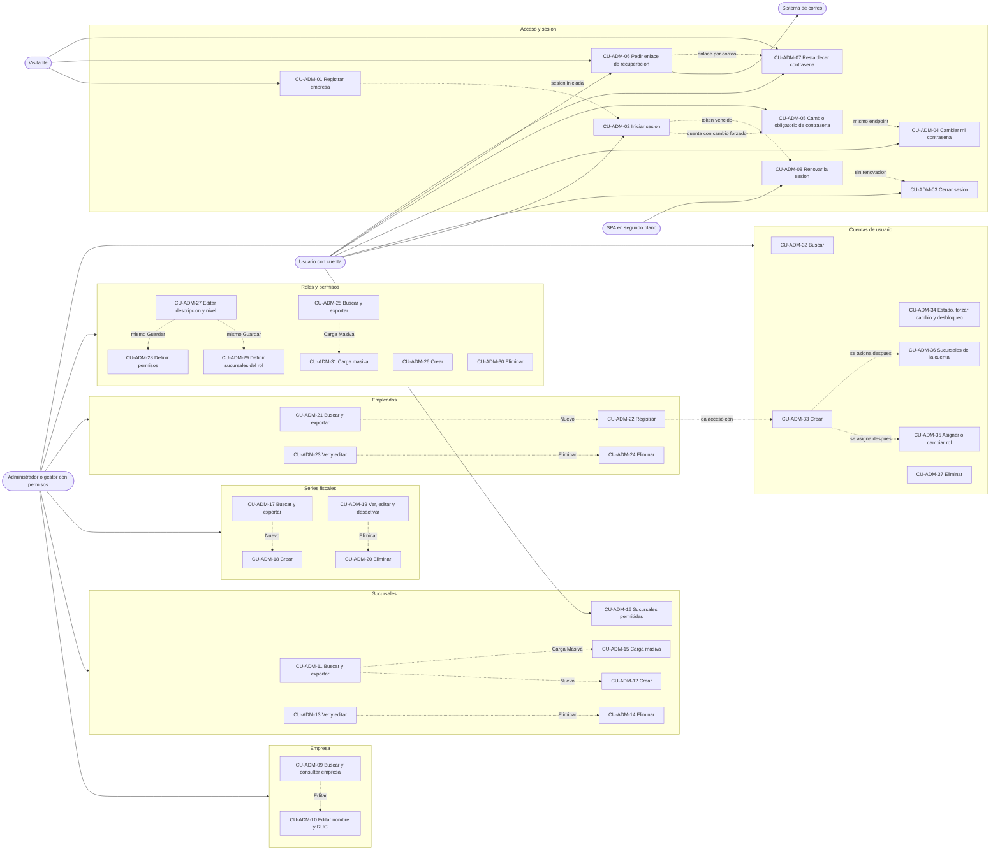

# Casos de uso — Parte A: acceso y administración

| | |
|---|---|
| **Sistema** | SOFIA — Sistema Optimizado Farmacéutico con Inteligencia Artificial |
| **Versión del documento** | 1.0 |
| **Fecha** | 2026-10-26 |
| **Backend** | `sofia-apis`, rama `main`, commit `43f5529` |
| **Frontend** | `sofia-web-spa`, rama `main`, commit `eeffbb6` |
| **Método** | Lectura de código (controladores y handlers de `sofia-apis`, verificados línea a línea para códigos de error y estados HTTP) y de los documentos validados: reglas 01a, seguridad 05a y 05b, pantallas 19a y 19b, carga masiva 20, procesos 14, manual de usuario (capítulos 1 a 3) e historias de usuario 12a. No se usó el navegador ni se llamó a la API. `git status --short` estaba vacío en ambos repositorios al empezar: no hay afirmaciones «En curso (sin commitear)». |

## 1. Cómo leer este documento

Este documento es la parte A de tres de los casos de uso de SOFIA. Cubre el acceso al sistema (registro de empresa, sesión, contraseñas) y la administración de la empresa (empresa, sucursales, series fiscales, empleados, roles y permisos, cuentas de usuario). Las otras partes cubren catálogos, inventario y atención (`CU-CAT`, `CU-INV`) y punto de venta y caja (`CU-VEN`, `CU-CAJ`, `CU-DEV`, `CU-DAS`, `CU-OPS`).

**Qué es un caso de uso aquí.** Una interacción completa entre un actor y el sistema, con su flujo principal, sus variantes, sus errores y lo que queda guardado. Cada caso enlaza con la historia de usuario que lo motiva (documento [12a](../12-historias-de-usuario/12a-acceso-y-administracion.md)) y con las reglas de negocio del catálogo [01a](../../ola-1-fundamentos/01-reglas-de-negocio/01a-administracion-y-seguridad.md). Los permisos están en la [matriz 05b](../../ola-1-fundamentos/05-seguridad/05b-matriz-de-permisos.md), las pantallas en [19a](../../ola-1-fundamentos/19-inventario-de-pantallas/19a-acceso-layout-y-compartidos.md) y [19b](../../ola-1-fundamentos/19-inventario-de-pantallas/19b-administracion.md), la carga masiva en el [documento 20](../../ola-1-fundamentos/20-carga-masiva-y-exportacion.md) y los procesos de punta a punta en el [documento 14](../14-procesos-de-negocio.md) (procesos 1 y 2).

**Convenciones**

- Un permiso se escribe `Módulo:Acción` (por ejemplo `Sucursales:Crear`). El rol `Admin` pasa cualquier comprobación de permiso (RN-GEN-021), por eso en «Actor principal» se indica el permiso que necesita cualquier otro rol.
- La ruta de las pantallas es la del SPA. Los endpoints se escriben con el prefijo `/api/v1/` y el nombre del controlador tal como está en el código (ASP.NET no distingue mayúsculas).
- **Código de error** es el valor de la propiedad `code` de la respuesta. Los validadores FluentValidation no tienen código literal: `ValidationBehavior` genera `{Request}.{Propiedad del primer fallo}` y responde 400 (RN-GEN-011). Cuando el error no trae `code` (401, 403 de permiso, 429) se escribe «sin code».
- **Mensaje que ve el usuario.** El SPA nunca muestra el `detail` de la API (RN-GEN-011, 01a §2): cada pantalla traduce los códigos que conoce y, para el resto, muestra el mensaje genérico de la operación. Donde se escribe «genérico» es ese mensaje, con su texto exacto.
- **Estado HTTP real.** El estado sale del segundo argumento de `Result.Failure`, no del tipo del error (01a §1.1). Por eso `Rol.DuplicateName`, `Rol.InUse` y `Permiso.Duplicate` (tipo `Conflict`) responden 400.
- **Brecha conocida** marca un comportamiento actual que un lector podría dar por hecho que no existe o que es distinto; siempre lleva su fuente.
- Los textos de pantalla se copian de los archivos `es.json` del SPA. Las referencias `HU-ADM-nnn` apuntan al documento 12a.

**Actores**

| Actor | Quién es | Qué lo identifica |
|---|---|---|
| Visitante | Persona sin sesión que registra su botica | Ninguno (endpoint anónimo) |
| Usuario | Cualquier persona con cuenta e inicio de sesión | Token de acceso; sin permiso de módulo (cambiar su propia clave, cerrar sesión) |
| Administrador | Cuenta con el rol `Admin` (la que crea el registro de la empresa) | Rol `Admin`: pasa todos los permisos y accede a todas las sucursales (RN-GEN-021, RN-GEN-023) |
| Gestor | Cuenta con otro rol que tiene los permisos del caso | Permisos `Módulo:Acción` del rol |
| SPA | El cliente web actuando en segundo plano (renovación de sesión) | Cookie de refresco y cabecera `X-SOFIA-CSRF` |
| Sistema de correo | Proveedor SMTP o Azure Communication Services (`Email:Provider`) | Solo en la recuperación de contraseña |

---

## 2. Acceso y sesión

### CU-ADM-01 — Registrar la empresa y su administrador

| | |
|---|---|
| **Actor principal** | Visitante (futuro administrador). No necesita cuenta ni permisos |
| **Actores secundarios** | Ninguno: el registro no envía correo ni exige verificarlo |
| **Disparador** | El visitante abre `/auth/register` o pulsa «Registrar empresa nueva» en «Iniciar sesión» |
| **Precondiciones** | Sin sesión iniciada. El RUC y el nombre de usuario elegidos no existen en el sistema (ambos son únicos en toda la plataforma). Desde la misma IP no se superaron 5 registros por hora |
| **Pantalla** | `/auth/register` — «Registrar Empresa» |
| **Endpoints** | `POST /api/v1/Empresas/registrar` (anónimo, política de límite `SignUpPolicy`) |
| **Reglas** | [RN-EMP-002](../../ola-1-fundamentos/01-reglas-de-negocio/01a-administracion-y-seguridad.md), [RN-EMP-003](../../ola-1-fundamentos/01-reglas-de-negocio/01a-administracion-y-seguridad.md), [RN-EMP-005](../../ola-1-fundamentos/01-reglas-de-negocio/01a-administracion-y-seguridad.md), [RN-EMP-006](../../ola-1-fundamentos/01-reglas-de-negocio/01a-administracion-y-seguridad.md), [RN-EMP-007](../../ola-1-fundamentos/01-reglas-de-negocio/01a-administracion-y-seguridad.md), [RN-EMP-008](../../ola-1-fundamentos/01-reglas-de-negocio/01a-administracion-y-seguridad.md), [RN-EMP-009](../../ola-1-fundamentos/01-reglas-de-negocio/01a-administracion-y-seguridad.md), [RN-EMP-010](../../ola-1-fundamentos/01-reglas-de-negocio/01a-administracion-y-seguridad.md), [RN-EMP-011](../../ola-1-fundamentos/01-reglas-de-negocio/01a-administracion-y-seguridad.md), [RN-EMP-012](../../ola-1-fundamentos/01-reglas-de-negocio/01a-administracion-y-seguridad.md), [RN-EMP-013](../../ola-1-fundamentos/01-reglas-de-negocio/01a-administracion-y-seguridad.md), [RN-CTA-007](../../ola-1-fundamentos/01-reglas-de-negocio/01a-administracion-y-seguridad.md), [RN-AUT-026](../../ola-1-fundamentos/01-reglas-de-negocio/01a-administracion-y-seguridad.md), [RN-AUT-031](../../ola-1-fundamentos/01-reglas-de-negocio/01a-administracion-y-seguridad.md), [RN-GEN-010](../../ola-1-fundamentos/01-reglas-de-negocio/01a-administracion-y-seguridad.md), [RN-GEN-012](../../ola-1-fundamentos/01-reglas-de-negocio/01a-administracion-y-seguridad.md), [RN-GEN-015](../../ola-1-fundamentos/01-reglas-de-negocio/01a-administracion-y-seguridad.md), [RN-GEN-027](../../ola-1-fundamentos/01-reglas-de-negocio/01a-administracion-y-seguridad.md) |
| **Historia** | [HU-ADM-001](../12-historias-de-usuario/12a-acceso-y-administracion.md) |

**Flujo principal**
1. El visitante abre «Registrar Empresa» y completa los nueve campos: Nombre de la Empresa, RUC, Dirección de la sede principal, Nombres del administrador, Apellido paterno, Apellido materno (opcional), Correo electrónico, Usuario Administrador y Contraseña.
2. El SPA valida cada campo al salir de él: obligatorios, nombre de empresa hasta 200 caracteres, RUC de exactamente 11 dígitos (RN-EMP-003), dirección no vacía ni solo espacios y hasta 255 (RN-EMP-010), nombres y apellidos hasta 75 (RN-EMP-008), correo con formato y hasta 254 (RN-EMP-009), usuario de 4 a 50 (RN-EMP-006), contraseña de 8 o más (RN-EMP-007, RN-AUT-026). Si algo falla marca todos los campos y no envía.
3. El visitante pulsa «Registrar Empresa». El botón pasa a «Procesando...» y el SPA envía los textos con `trim()` (el apellido materno vacío viaja como `null`).
4. El sistema acepta la petición sin sesión porque el endpoint es anónimo (RN-GEN-015), aplica el límite de 5 registros por hora por IP (RN-GEN-027), limpia el HTML de los textos (RN-GEN-010) y ejecuta el validador del request con las mismas reglas del paso 2 (RN-GEN-011).
5. El sistema comprueba que el RUC no esté usado por otra empresa no eliminada (RN-EMP-005) y que el nombre de usuario no esté usado por ninguna cuenta no eliminada de ninguna empresa (RN-CTA-007).
6. En una sola transacción (RN-GEN-012, RN-EMP-011) el sistema crea: la empresa en estado `TrialActivo` con 30 días de prueba (RN-EMP-012); la sucursal «Sede Principal» con la dirección escrita y el número de licencia vacío (RN-EMP-010); el empleado administrador con su correo; la cuenta con contraseña en hash BCrypt (RN-AUT-031) y sin obligación de cambiarla; el rol `Admin` propio de la empresa, con descripción «Administrador de la empresa» y nivel 0, asignado a la cuenta; y un token de refresco (solo se guarda su hash).
7. El sistema responde 201 con `{ token }` y coloca la cookie `refresh_token` de 7 días (RN-EMP-013).
8. El SPA guarda el token, muestra «Empresa registrada correctamente. ¡Bienvenido!» (3 segundos) y abre `/dashboard`.

**Flujos alternativos**
- **A1 — La persona ya tiene cuenta** (paso 1): pulsa «Iniciar sesión» al pie del formulario y va a `/auth/login` (CU-ADM-02).
- **A2 — Ver la contraseña** (paso 1): el icono de ojo muestra u oculta el texto escrito.
- **A3 — Datos opcionales de la sede** (paso 4): la API acepta `NombreSede` y `NumeroLicencia` (RN-EMP-010), pero la pantalla no los envía; sin nombre la sede se llama «Sede Principal» y sin licencia nace con la licencia vacía, que pasa a ser obligatoria en su primera edición (CU-ADM-13).

**Excepciones**

| Paso | Situación | Código de error | HTTP | Mensaje que ve el usuario | Qué pasa después |
|---|---|---|---|---|---|
| 2 | Campo vacío, formato o longitud inválidos | — (formulario) | — | Bajo el campo: «Este campo es obligatorio», «El RUC debe tener exactamente 11 dígitos numéricos», «Máximo 255 caracteres», «El usuario debe tener al menos 4 caracteres», «La contraseña debe tener al menos 8 caracteres», «Ingresa un correo electrónico válido» y similares (`empresa.form.*`) | No se envía nada |
| 4 | Más de 5 registros por hora desde la misma IP | sin code | 429 | Genérico: «Error al registrar la empresa» (`empresa.notifications.registerError`) | Esperar una hora |
| 4 | La API rechaza la dirección (vacía o de más de 255) y es el primer campo inválido | `RegistrarEmpresaCommand.DireccionSede` | 400 | «Ingresa la dirección de la sede principal (máximo 255 caracteres)» (`empresa.notifications.direccionSedeInvalida`) | Se queda en el formulario |
| 4 | Cualquier otro rechazo del validador (nombre, RUC, usuario, contraseña, nombres, correo) | `RegistrarEmpresaCommand.<Propiedad>` | 400 | Genérico: «Error al registrar la empresa» | Se queda en el formulario |
| 5 | RUC ya registrado | `Empresa.RUC.Duplicado` | 409 | «Ya existe una empresa registrada con este RUC» (`empresa.notifications.rucDuplicado`) | Revisar el RUC |
| 5 | Usuario ya usado en cualquier empresa | `Auth.DuplicateUsername` | 409 | «El usuario ya está en uso. Elige otro.» (`empresa.notifications.usuarioDuplicado`) | Elegir otro usuario |
| 6 | El RUC pertenece a una empresa eliminada o dos registros compiten por el mismo RUC o usuario (el índice único lo rechaza) | `Db.Duplicado` | 409 | Genérico: «Error al registrar la empresa» (la pantalla no usa `saveErrorKey`) | Se revierte todo; reintentar con otros datos |
| 6 | Error inesperado (RN-GEN-040) | sin code (`traceId`) | 500 | Genérico: «Error al registrar la empresa» | Se revierte todo |

**Postcondiciones**
- Éxito: filas nuevas en `Empresas` (TrialActivo, vencimiento a 30 días, `ExigirRegistroReceta` apagado), `Sucursales`, `Empleados`, `Seguridad_Cuentas`, `Seguridad_Roles`, `Seguridad_Cuentas_Roles` y `RefreshTokens`, todas con el `TenantId` de la nueva empresa y `CreatedBy`/`CreatedAt` (RN-GEN-004, RN-GEN-005). La sesión queda iniciada.
- Fallo: no se crea ninguna fila (transacción).

**Brecha conocida.** El registro no genera evento de auditoría de seguridad: `RegistrarEmpresaCommand` implementa `ICommand<LoginResult>` y no `IAuditableCommand` (`sofia-apis/src/SOFIA.Application/Empresas/Commands/RegistrarEmpresa/RegistrarEmpresaCommand.cs`; procesos 14, §12.1 brecha 1). No existe campo para repetir la contraseña ni verificación del correo (manual, capítulo 1 §3.3 y §3.4).

---

### CU-ADM-02 — Iniciar sesión

| | |
|---|---|
| **Actor principal** | Usuario con cuenta activa (sin permisos de módulo) |
| **Actores secundarios** | Ninguno |
| **Disparador** | El usuario abre `/auth/login`, o el sistema lo lleva ahí por falta de sesión (`authGuard`), tras cerrar sesión, cambiar o restablecer la contraseña |
| **Precondiciones** | La cuenta existe, no está eliminada y está activa; la empresa está vigente; la cuenta no está bloqueada. No se superaron 10 intentos por minuto desde la IP |
| **Pantalla** | `/auth/login` — «Iniciar sesión» |
| **Endpoints** | `POST /api/v1/Auth/login` (anónimo, política `AuthPolicy`); después `GET /api/v1/Auth/me` (solo autenticado) para cargar los permisos |
| **Reglas** | [RN-AUT-001](../../ola-1-fundamentos/01-reglas-de-negocio/01a-administracion-y-seguridad.md) a [RN-AUT-012](../../ola-1-fundamentos/01-reglas-de-negocio/01a-administracion-y-seguridad.md), [RN-GEN-012](../../ola-1-fundamentos/01-reglas-de-negocio/01a-administracion-y-seguridad.md), [RN-GEN-018](../../ola-1-fundamentos/01-reglas-de-negocio/01a-administracion-y-seguridad.md), [RN-GEN-026](../../ola-1-fundamentos/01-reglas-de-negocio/01a-administracion-y-seguridad.md), [RN-EMP-014](../../ola-1-fundamentos/01-reglas-de-negocio/01a-administracion-y-seguridad.md), [RN-CTA-012](../../ola-1-fundamentos/01-reglas-de-negocio/01a-administracion-y-seguridad.md) |
| **Historia** | [HU-ADM-002](../12-historias-de-usuario/12a-acceso-y-administracion.md), [HU-ADM-003](../12-historias-de-usuario/12a-acceso-y-administracion.md), [HU-ADM-016](../12-historias-de-usuario/12a-acceso-y-administracion.md) |

**Flujo principal**
1. El usuario escribe su Usuario y su Contraseña (ambos obligatorios en el formulario) y pulsa «Ingresar».
2. El SPA envía `POST /api/v1/Auth/login` con `{ nombreUsuario, password }` y `withCredentials`. El botón muestra un círculo de espera.
3. El sistema aplica el límite de 10 peticiones por minuto por IP (RN-GEN-026) y valida el request: usuario obligatorio de hasta 50 caracteres y contraseña obligatoria (RN-AUT-001, RN-AUT-002).
4. El sistema busca la cuenta por nombre de usuario en todas las empresas, sin eliminar (RN-AUT-003), y verifica la contraseña con BCrypt contra el hash real o contra uno ficticio si la cuenta no existe, para que el tiempo de respuesta sea el mismo (RN-AUT-004).
5. El sistema comprueba que la cuenta exista y esté activa (RN-AUT-003, RN-CTA-012), que no esté bloqueada (`Bloqueado_Hasta` futuro, RN-AUT-005), que la contraseña sea correcta (RN-AUT-006) y que la sucursal base del empleado sea de la misma empresa (RN-AUT-008).
6. El sistema comprueba que la empresa esté vigente (RN-AUT-009, RN-EMP-014); solo lo hace después de validar la contraseña.
7. El sistema pone en 0 los intentos fallidos, quita el bloqueo (las fechas se guardan en UTC, RN-GEN-006), emite el token de acceso (con rol, empresa, sucursal base, sello de seguridad e indicador `pwd_change`, RN-AUT-011) y un token de refresco de 7 días, del que solo guarda el hash SHA-256 (RN-AUT-010, RN-AUT-012).
8. El sistema responde 200 con `{ accessToken, requiereCambioClave }` y la cookie `refresh_token` (`HttpOnly`, `Secure`, `SameSite=None`).
9. El SPA guarda el token en `localStorage` (clave `sofia_token`), borra los borradores de venta de otros usuarios y abre `/dashboard`. No hay «recordarme» ni regreso a la pantalla anterior.

**Flujos alternativos**
- **A1 — La cuenta debe cambiar su clave** (paso 9): si `requiereCambioClave` es verdadero, el SPA abre `/cambiar-clave` en vez del panel (CU-ADM-05).
- **A2 — Olvidó la contraseña** (paso 1): el enlace «¿Olvidaste tu contraseña?» abre `/auth/forgot-password` (CU-ADM-06).
- **A3 — No tiene empresa** (paso 1): el enlace «Registrar empresa nueva» abre `/auth/register` (CU-ADM-01).
- **A4 — Cuenta bloqueada que se desbloquea** (paso 5): el bloqueo termina a los 15 minutos, al restablecer la clave por correo (CU-ADM-07) o cuando un gestor marca «Resetear Intentos Fallidos» (CU-ADM-34).

**Excepciones**

| Paso | Situación | Código de error | HTTP | Mensaje que ve el usuario | Qué pasa después |
|---|---|---|---|---|---|
| 1 | Usuario o contraseña vacíos | — (formulario) | — | «El usuario es obligatorio» / «La contraseña es obligatoria» | No se envía |
| 3 | Más de 10 intentos por minuto desde la IP | sin code | 429 | «Demasiados intentos. Espera un minuto e inténtalo de nuevo.» (`auth.recovery.tooManyRequests`) | Esperar un minuto |
| 3 | La API rechaza usuario o contraseña vacíos o usuario de más de 50 | `LoginCommand.NombreUsuario` / `LoginCommand.Password` | 400 | «Credenciales inválidas. Verifica tu usuario y contraseña.» (`auth.invalidCredentials`) | Reintentar |
| 5 | Cuenta inexistente, inactiva o eliminada | `Auth.InvalidCredentials` | 401 | «Credenciales inválidas. Verifica tu usuario y contraseña.» | Reintentar; el mensaje no distingue la causa |
| 5 | Cuenta bloqueada (aunque la clave sea correcta) | `Auth.InvalidCredentials` | 401 | El mismo «Credenciales inválidas…»; el SPA no informa del bloqueo | No suma intentos; esperar 15 minutos o desbloqueo |
| 5 | Contraseña incorrecta | `Auth.InvalidCredentials` | 401 | El mismo «Credenciales inválidas…» | Suma un intento fallido, que se guarda aunque la petición termine en error; al quinto la cuenta se bloquea 15 minutos (RN-AUT-007) |
| 5 | La sucursal base pertenece a otra empresa | `Auth.InvalidCredentials` | 401 | El mismo «Credenciales inválidas…» | No se emite token |
| 6 | Suscripción vencida, suspendida o cancelada | `Auth.EmpresaNoVigente` | 403 | «La suscripción de tu empresa no está activa o ha vencido. Comunícate con soporte para reactivarla.» (`auth.empresaNoVigente`) | Contactar a soporte; ningún endpoint ni pantalla cambia el estado (RN-EMP-015) |
| 2 | Sin respuesta, 408 o error 5xx | sin code (en 5xx `traceId`) | 0 / 408 / 5xx | «No pudimos conectar con el servidor. Verifica tu conexión a internet e inténtalo de nuevo en unos minutos.» (`auth.serviceUnavailable`) | Reintentar |

**Postcondiciones**
- Éxito: `Intentos_Fallidos` en 0 y `Bloqueado_Hasta` limpio; nueva fila en `RefreshTokens` (hash, vence en 7 días); registro en el log con usuario e IP (nunca la contraseña). No se revocan las sesiones anteriores de la cuenta (05a §1.7).
- Fallo por contraseña incorrecta: `Intentos_Fallidos` aumenta en 1 (y `Bloqueado_Hasta` queda a 15 minutos al llegar a 5). Los demás fallos no cambian nada.

**Brecha conocida.** El SPA no avisa del bloqueo ni distingue la causa del rechazo (RN-AUT-005; manual, capítulo 1 §6.5). El bloqueo es por cuenta y no por IP: quien conoce un usuario puede provocarlo (05a §1.2). No hay evento de auditoría de inicio de sesión (RN-GEN-013). Un 429 también cae en el mismo mensaje de límite; cualquier otro 4xx sin mapa muestra «Credenciales inválidas…».

---

### CU-ADM-03 — Cerrar sesión

| | |
|---|---|
| **Actor principal** | Usuario con sesión iniciada (o con la cookie de refresco vigente aunque su token de acceso haya vencido) |
| **Actores secundarios** | Ninguno |
| **Disparador** | El usuario elige «Cerrar sesión» en el menú de usuario de la cabecera; o el interceptor no logra renovar la sesión (CU-ADM-08) |
| **Precondiciones** | Ninguna: el endpoint es anónimo e idempotente |
| **Pantalla** | Cabecera › imagen de perfil («Menú de usuario») › «Cerrar sesión»; destino `/auth/login` |
| **Endpoints** | `POST /api/v1/Auth/logout` (anónimo, exige la cabecera `X-SOFIA-CSRF`) |
| **Reglas** | [RN-AUT-013](../../ola-1-fundamentos/01-reglas-de-negocio/01a-administracion-y-seguridad.md), [RN-AUT-020](../../ola-1-fundamentos/01-reglas-de-negocio/01a-administracion-y-seguridad.md), [RN-AUT-021](../../ola-1-fundamentos/01-reglas-de-negocio/01a-administracion-y-seguridad.md), [RN-AUT-022](../../ola-1-fundamentos/01-reglas-de-negocio/01a-administracion-y-seguridad.md), [RN-GEN-017](../../ola-1-fundamentos/01-reglas-de-negocio/01a-administracion-y-seguridad.md) |
| **Historia** | [HU-ADM-005](../12-historias-de-usuario/12a-acceso-y-administracion.md) |

**Flujo principal**
1. El usuario abre el menú de usuario y pulsa «Cerrar sesión». No hay diálogo de confirmación.
2. El SPA envía `POST /api/v1/Auth/logout` con la cookie de refresco y la cabecera `X-SOFIA-CSRF: 1`.
3. El sistema comprueba la cabecera `X-SOFIA-CSRF` (RN-AUT-013) y borra siempre la cookie `refresh_token` (RN-AUT-020).
4. El sistema identifica la cuenta por el token de acceso (si es válido) y por la cookie de refresco (si no ha vencido, aunque ya esté rotada) (RN-AUT-020).
5. El sistema revoca todos los tokens de refresco activos de esa cuenta y cambia su sello de seguridad: se cierran sus sesiones en todos los dispositivos y los tokens de acceso vivos dejan de servir (RN-AUT-021, RN-GEN-017). Si una renovación simultánea cambia un token a mitad de camino, reintenta hasta 3 veces (RN-AUT-022).
6. El sistema responde 204.
7. Sin esperar la respuesta, el SPA borra los datos locales del usuario (borradores del punto de venta, filtros de búsqueda en memoria, permisos, token) y navega a `/auth/login`, aunque la llamada falle.

**Flujos alternativos**
- **A1 — Sin sesión identificable** (paso 4): si no hay token válido ni cookie vigente, el sistema responde éxito igualmente y no revela si había sesión (RN-AUT-020).
- **A2 — Sesión vencida sin cierre explícito** (paso 1): cuando el `authGuard` o el interceptor no pueden renovar, el SPA limpia la sesión local y lleva a `/auth/login` sin mensaje; los borradores del punto de venta sobreviven en ese caso (05a §6.3).

**Excepciones**

| Paso | Situación | Código de error | HTTP | Mensaje que ve el usuario | Qué pasa después |
|---|---|---|---|---|---|
| 3 | Falta la cabecera `X-SOFIA-CSRF` (el SPA siempre la envía) | `Auth.Csrf` | 403 | Ninguno: el SPA ignora el error del cierre | El SPA igualmente borra la sesión local y va a `/auth/login`; el servidor no revoca nada |
| 5 | Una renovación simultánea sigue cambiando tokens tras 3 intentos | `Concurrency.Conflict` | 409 | Ninguno | Igual que arriba |
| 6 | Sin conexión o error 5xx | sin code | 0 / 5xx | Ninguno | El SPA va a `/auth/login`; la sesión del servidor puede seguir viva hasta vencer |

**Postcondiciones**
- Éxito: tokens de refresco de la cuenta con `IsRevoked`; nuevo `Security_Stamp`; cookie borrada; `localStorage` sin `sofia_token`.
- Fallo: el navegador queda sin sesión local; en el servidor puede no haberse revocado nada.

**Brecha conocida.** El cierre de sesión no se audita (`LogoutCommand` es `ICommand`, no `IAuditableCommand`; 05a §3.1). Cerrar sesión en un equipo cierra también las sesiones de la misma cuenta en otros equipos (RN-AUT-021).

---

### CU-ADM-04 — Cambiar mi contraseña

| | |
|---|---|
| **Actor principal** | Usuario con sesión iniciada. No necesita permiso de módulo |
| **Actores secundarios** | Ninguno |
| **Disparador** | El usuario elige «Cambiar contraseña» en el menú de usuario de la cabecera |
| **Precondiciones** | Sesión iniciada; la cuenta activa y no eliminada; menos de 10 peticiones por minuto desde la IP |
| **Pantalla** | `/cambiar-clave` — «Cambiar contraseña» (modo voluntario) |
| **Endpoints** | `POST /api/v1/Auth/change-password` (solo autenticado, política `AuthPolicy`, marcado `[AllowDuringPasswordChange]`) |
| **Reglas** | [RN-AUT-024](../../ola-1-fundamentos/01-reglas-de-negocio/01a-administracion-y-seguridad.md), [RN-AUT-025](../../ola-1-fundamentos/01-reglas-de-negocio/01a-administracion-y-seguridad.md), [RN-AUT-026](../../ola-1-fundamentos/01-reglas-de-negocio/01a-administracion-y-seguridad.md), [RN-AUT-027](../../ola-1-fundamentos/01-reglas-de-negocio/01a-administracion-y-seguridad.md), [RN-AUT-028](../../ola-1-fundamentos/01-reglas-de-negocio/01a-administracion-y-seguridad.md), [RN-AUT-029](../../ola-1-fundamentos/01-reglas-de-negocio/01a-administracion-y-seguridad.md), [RN-AUT-030](../../ola-1-fundamentos/01-reglas-de-negocio/01a-administracion-y-seguridad.md), [RN-AUT-031](../../ola-1-fundamentos/01-reglas-de-negocio/01a-administracion-y-seguridad.md), [RN-GEN-013](../../ola-1-fundamentos/01-reglas-de-negocio/01a-administracion-y-seguridad.md), [RN-GEN-017](../../ola-1-fundamentos/01-reglas-de-negocio/01a-administracion-y-seguridad.md), [RN-GEN-026](../../ola-1-fundamentos/01-reglas-de-negocio/01a-administracion-y-seguridad.md) |
| **Historia** | [HU-ADM-006](../12-historias-de-usuario/12a-acceso-y-administracion.md) |

**Flujo principal**
1. El usuario abre «Cambiar contraseña» desde el menú de usuario. Ve los botones «Cancelar» y la flecha de volver porque el cambio no es obligatorio.
2. Escribe la «Contraseña actual», la «Nueva contraseña» y la «Confirmar nueva contraseña». El ojo muestra u oculta los tres campos.
3. El SPA valida: los tres obligatorios, la nueva con al menos 8 caracteres (RN-AUT-026), distinta de la actual (RN-AUT-027) y coincidente con la confirmación. Si algo falla no envía.
4. El usuario pulsa «Guardar». El SPA envía `{ currentPassword, newPassword }`.
5. El sistema toma la cuenta del token (nunca otra, RN-AUT-024), valida el request (actual obligatoria; nueva obligatoria, de 8 o más y distinta, RN-AUT-025 a RN-AUT-027) y comprueba que la cuenta exista, esté activa y no eliminada (RN-AUT-028).
6. El sistema verifica la contraseña actual contra el hash BCrypt; si no coincide responde 400 y no 401, para que el cliente no lo confunda con una sesión vencida (RN-AUT-029).
7. El sistema guarda el nuevo hash (RN-AUT-031), cambia el sello de seguridad, apaga «debe cambiar la clave», anula cualquier token de recuperación pendiente y revoca todos los tokens de refresco de la cuenta (RN-AUT-030).
8. El sistema inserta el evento de auditoría `CLAVE_CAMBIAR` (tabla `Seguridad_Cuentas`, id de la cuenta, IP) en la misma transacción, con empleado, tabla, id y tipo de acción obligatorios (RN-GEN-013, RN-GEN-014), borra la cookie y responde 204.
9. El SPA muestra «Contraseña actualizada. Inicia sesión con tu nueva contraseña.» (6 segundos), borra la sesión local y navega a `/auth/login`. Todas las sesiones de la cuenta, la actual incluida, quedan cerradas.

**Flujos alternativos**
- **A1 — Cancelar** (paso 4): «Cancelar» o la flecha de volver regresan a `/dashboard` sin cambiar nada.
- **A2 — No recuerda la actual** (paso 2): debe cerrar sesión y usar la recuperación por correo (CU-ADM-06 y CU-ADM-07).

**Excepciones**

| Paso | Situación | Código de error | HTTP | Mensaje que ve el usuario | Qué pasa después |
|---|---|---|---|---|---|
| 3 | Campo vacío, nueva corta, igual a la actual o confirmación distinta | — (formulario) | — | «Este campo es obligatorio», «Debe tener al menos 8 caracteres», «La nueva contraseña debe ser distinta de la actual», «Las contraseñas no coinciden» | No se envía |
| 4 | Más de 10 peticiones por minuto desde la IP | sin code | 429 | Genérico: «No se pudo cambiar la contraseña. Inténtalo de nuevo.» (`cambiarClave.errors.save`) | Esperar un minuto |
| 5 | El validador de la API rechaza la actual o la nueva | `ChangePasswordCommand.CurrentPassword` / `ChangePasswordCommand.NewPassword` | 400 | Genérico: «No se pudo cambiar la contraseña. Inténtalo de nuevo.» | Corregir |
| 5 | El id del token no es un GUID válido | sin code | 401 | Genérico (el interceptor intenta renovar y, si falla, lleva a «Iniciar sesión») | Volver a iniciar sesión |
| 5 | La cuenta ya no existe, está inactiva o eliminada | `Auth.InvalidCredentials` | 401 | Genérico; el interceptor intenta renovar y, si falla, cierra la sesión local | Volver a iniciar sesión |
| 6 | Contraseña actual incorrecta | `Auth.ClaveActualIncorrecta` | 400 | «La contraseña actual es incorrecta» (`cambiarClave.errors.wrongCurrent`) | Se queda en la pantalla; no suma intentos de bloqueo |

**Postcondiciones**
- Éxito: nuevo `Password_Hash`; nuevo `Security_Stamp`; `Requiere_Cambio_Clave` en falso; `Recovery_Token` anulado; tokens de refresco revocados; evento `CLAVE_CAMBIAR` en `Auditoria_Eventos_Seguridad`.
- Fallo: la contraseña, el sello y las sesiones no cambian.

**Brecha conocida.** La política es solo longitud mínima de 8: no hay requisitos de mayúsculas, números o símbolos, ni historial, ni longitud máxima en el backend (05a §4.1). Equivocarse en la contraseña actual no suma intentos de bloqueo (manual, capítulo 3 §8.1). Qué hace el saneador de HTML con una contraseña actual que contenga `<` o `>` no se verificó (01a §12.2).

---

### CU-ADM-05 — Cambiar la contraseña cuando es obligatorio

| | |
|---|---|
| **Actor principal** | Usuario cuya cuenta tiene «Requiere Cambio de Clave» (por ejemplo, un cajero con la contraseña inicial que le dio el administrador) |
| **Actores secundarios** | Administrador (quien creó la cuenta o forzó el cambio, ver CU-ADM-33 y CU-ADM-34) |
| **Disparador** | Al iniciar sesión la respuesta trae `requiereCambioClave = true`; o el `passwordChangeGuard` redirige cualquier otra ruta; o el servidor responde 403 `Auth.CambioClaveRequerido` en sesión viva |
| **Precondiciones** | `Requiere_Cambio_Clave` verdadero en la cuenta (se lee de la base de datos en cada petición, así que un cambio forzado por un administrador alcanza también a los tokens vivos) |
| **Pantalla** | `/cambiar-clave` — «Cambiar contraseña» (modo forzado) |
| **Endpoints** | `POST /api/v1/Auth/change-password` y `GET /api/v1/Auth/me` (únicos autenticados que el servidor deja pasar en este estado) |
| **Reglas** | [RN-GEN-019](../../ola-1-fundamentos/01-reglas-de-negocio/01a-administracion-y-seguridad.md), [RN-AUT-010](../../ola-1-fundamentos/01-reglas-de-negocio/01a-administracion-y-seguridad.md), [RN-AUT-024](../../ola-1-fundamentos/01-reglas-de-negocio/01a-administracion-y-seguridad.md) a [RN-AUT-030](../../ola-1-fundamentos/01-reglas-de-negocio/01a-administracion-y-seguridad.md), [RN-CTA-008](../../ola-1-fundamentos/01-reglas-de-negocio/01a-administracion-y-seguridad.md), [RN-CTA-011](../../ola-1-fundamentos/01-reglas-de-negocio/01a-administracion-y-seguridad.md) |
| **Historia** | [HU-ADM-007](../12-historias-de-usuario/12a-acceso-y-administracion.md) |

**Flujo principal**
1. El usuario inicia sesión (CU-ADM-02) con la contraseña inicial. La respuesta trae `requiereCambioClave = true` y el SPA abre `/cambiar-clave` (RN-AUT-010).
2. La pantalla muestra el aviso «Tu contraseña fue asignada por un administrador. Debes cambiarla antes de continuar.» (`cambiarClave.forced`) y no muestra «Cancelar» ni la flecha de volver.
3. Si el usuario elige otra opción del menú o escribe otra dirección, el `passwordChangeGuard` lo devuelve a `/cambiar-clave` sin mensaje.
4. Si una petición a otro endpoint llega al servidor, el middleware responde 403 `Auth.CambioClaveRequerido` salvo en los endpoints anónimos, `GET /Auth/me` y `POST /Auth/change-password` (RN-GEN-019); el interceptor del SPA navega a `/cambiar-clave`.
5. El usuario escribe la contraseña actual, la nueva y la confirmación y pulsa «Guardar»; el sistema ejecuta los pasos 3 a 9 de CU-ADM-04 (RN-AUT-024 a RN-AUT-030).
6. El SPA cierra la sesión local y lleva a `/auth/login`. El usuario entra con la contraseña nueva y ya no se le pide cambiarla.

**Flujos alternativos**
- **A1 — El administrador fuerza el cambio con el usuario conectado** (paso 4): el siguiente request del usuario recibe 403 `Auth.CambioClaveRequerido` y el SPA lo lleva a `/cambiar-clave` (RN-GEN-019, RN-CTA-011).
- **A2 — La contraseña inicial no coincide** (paso 5): ver la excepción de CU-ADM-04 paso 6.

**Excepciones**

| Paso | Situación | Código de error | HTTP | Mensaje que ve el usuario | Qué pasa después |
|---|---|---|---|---|---|
| 4 | Petición a un endpoint no exento mientras la cuenta debe cambiar su clave | `Auth.CambioClaveRequerido` | 403 | Sin mensaje propio: el interceptor navega a `/cambiar-clave`, donde se ve el aviso `cambiarClave.forced` | Debe completar el cambio |
| 5 | Contraseña actual incorrecta | `Auth.ClaveActualIncorrecta` | 400 | «La contraseña actual es incorrecta» | Se queda en la pantalla |
| 5 | Validador, límite de peticiones o error genérico | ver CU-ADM-04 | 400 / 429 / 5xx | «No se pudo cambiar la contraseña. Inténtalo de nuevo.» | Reintentar |

**Postcondiciones**
- Éxito: las de CU-ADM-04; además `Requiere_Cambio_Clave` en falso.
- Fallo: la cuenta sigue obligada a cambiar la clave.

**Brecha conocida.** El formulario de creación de la cuenta no avisa de que el usuario tendrá que cambiar la contraseña (RN-CTA-008, 19b §5.2); y desde la pantalla de cuentas el administrador solo puede encender «Forzar Cambio de Contraseña», no apagarlo: se apaga cuando el usuario cambia o restablece su clave (RN-CTA-011).

---

### CU-ADM-06 — Pedir el enlace para recuperar la contraseña

| | |
|---|---|
| **Actor principal** | Usuario sin sesión que olvidó su contraseña |
| **Actores secundarios** | Sistema de correo (SMTP o Azure Communication Services) |
| **Disparador** | El usuario pulsa «¿Olvidaste tu contraseña?» en «Iniciar sesión», o «Solicitar un nuevo enlace» desde el restablecimiento |
| **Precondiciones** | Ninguna. Para que se envíe correo: la cuenta existe, no está eliminada y está activa, su empleado no está eliminado y tiene correo, y la empresa está vigente |
| **Pantalla** | `/auth/forgot-password` — «Recupera tu contraseña» |
| **Endpoints** | `POST /api/v1/Auth/forgot-password` (anónimo, política `AuthPolicy`) |
| **Reglas** | [RN-AUT-032](../../ola-1-fundamentos/01-reglas-de-negocio/01a-administracion-y-seguridad.md), [RN-AUT-033](../../ola-1-fundamentos/01-reglas-de-negocio/01a-administracion-y-seguridad.md), [RN-AUT-034](../../ola-1-fundamentos/01-reglas-de-negocio/01a-administracion-y-seguridad.md), [RN-AUT-035](../../ola-1-fundamentos/01-reglas-de-negocio/01a-administracion-y-seguridad.md), [RN-AUT-036](../../ola-1-fundamentos/01-reglas-de-negocio/01a-administracion-y-seguridad.md), [RN-GEN-026](../../ola-1-fundamentos/01-reglas-de-negocio/01a-administracion-y-seguridad.md), [RN-EMP-014](../../ola-1-fundamentos/01-reglas-de-negocio/01a-administracion-y-seguridad.md) |
| **Historia** | [HU-ADM-008](../12-historias-de-usuario/12a-acceso-y-administracion.md) |

**Flujo principal**
1. El usuario abre «Recupera tu contraseña» y escribe su Usuario (obligatorio, hasta 50 caracteres).
2. Pulsa «Enviar enlace»; el SPA envía `{ nombreUsuario }` (con `trim()`).
3. El sistema aplica el límite de 10 peticiones por minuto por IP (RN-GEN-026) y busca la cuenta por usuario en todas las empresas.
4. Si se cumplen las condiciones (cuenta activa, empleado con correo, empresa vigente; RN-AUT-034), el sistema genera un token aleatorio de 32 bytes, guarda solo su hash SHA-256 con vencimiento a 1 hora y sustituye cualquier token anterior de la cuenta (RN-AUT-035).
5. El sistema envía al correo del empleado el mensaje con asunto «Restablece tu contraseña de SOFIA» y el enlace `{URL del frontend}/auth/reset-password#token=…&usuario=…`; el token viaja en el fragmento de la URL (RN-AUT-036). Si el envío falla solo se registra una advertencia y el token sigue válido su hora.
6. El sistema responde siempre 200 con el mismo mensaje, exista o no la cuenta (RN-AUT-033).
7. El SPA reemplaza el formulario por la alerta «Si el usuario existe y tiene un correo registrado, recibirás un enlace para restablecer tu contraseña. Revisa tu bandeja de entrada: el enlace es válido por 1 hora.» (`auth.forgotPage.sent`).

**Flujos alternativos**
- **A1 — La cuenta no cumple las condiciones** (paso 4): no se genera token ni se envía correo; la respuesta y el mensaje son los mismos (RN-AUT-034).
- **A2 — Pide el enlace dos veces** (paso 4): solo el último sirve; el nuevo reemplaza al anterior (RN-AUT-035).
- **A3 — Volver** (paso 1): «Volver a iniciar sesión» abre `/auth/login`.
- **A4 — Entorno de desarrollo o pruebas sin proveedor de correo** (paso 5): el mensaje se descarta (RN-AUT-036).

**Excepciones**

| Paso | Situación | Código de error | HTTP | Mensaje que ve el usuario | Qué pasa después |
|---|---|---|---|---|---|
| 1 | Usuario vacío | — (formulario) | — | «El usuario es obligatorio» | No se envía |
| 3 | Más de 10 peticiones por minuto | sin code | 429 | «Demasiados intentos. Espera un minuto e inténtalo de nuevo.» (`auth.recovery.tooManyRequests`) | Esperar un minuto |
| 3 | Usuario vacío o de más de 50 llega a la API | `ForgotPasswordCommand.NombreUsuario` (no llega al cliente) | 200 | El mismo mensaje de éxito: el controlador descarta el resultado del comando (RN-AUT-032) | No se genera token |
| 2 | Sin conexión o error 5xx | sin code | 0 / 5xx | «No se pudo procesar la solicitud. Inténtalo de nuevo.» (`auth.forgotPage.error`) | Reintentar |

**Postcondiciones**
- Éxito (cuenta elegible): `Recovery_Token` (hash) y `Recovery_Token_Expiry` (+1 hora) actualizados en `Seguridad_Cuentas`; correo enviado o descartado.
- Fallo o cuenta no elegible: no cambia nada. No se registra evento de auditoría.

**Brecha conocida.** La respuesta es uniforme a propósito (no permite enumerar usuarios), por lo que el usuario no sabe si le llegará correo; un empleado sin correo no puede recuperar su contraseña por esta vía (RN-AUT-034; manual, capítulo 3 §3.2). El camino con cuenta válida hace una escritura y un envío antes de responder, así que el tiempo de respuesta puede diferir; no se midió (05a §5.3, «No verificado»).

---

### CU-ADM-07 — Restablecer la contraseña con el enlace

| | |
|---|---|
| **Actor principal** | Usuario sin sesión que recibió el enlace de recuperación |
| **Actores secundarios** | Ninguno |
| **Disparador** | El usuario abre el enlace del correo |
| **Precondiciones** | Token vigente (menos de 1 hora, un solo uso, el más reciente de esa cuenta) |
| **Pantalla** | `/auth/reset-password` — «Crea una nueva contraseña» |
| **Endpoints** | `POST /api/v1/Auth/reset-password` (anónimo, política `AuthPolicy`) |
| **Reglas** | [RN-AUT-037](../../ola-1-fundamentos/01-reglas-de-negocio/01a-administracion-y-seguridad.md), [RN-AUT-038](../../ola-1-fundamentos/01-reglas-de-negocio/01a-administracion-y-seguridad.md), [RN-AUT-039](../../ola-1-fundamentos/01-reglas-de-negocio/01a-administracion-y-seguridad.md), [RN-AUT-031](../../ola-1-fundamentos/01-reglas-de-negocio/01a-administracion-y-seguridad.md), [RN-GEN-013](../../ola-1-fundamentos/01-reglas-de-negocio/01a-administracion-y-seguridad.md), [RN-GEN-017](../../ola-1-fundamentos/01-reglas-de-negocio/01a-administracion-y-seguridad.md), [RN-GEN-026](../../ola-1-fundamentos/01-reglas-de-negocio/01a-administracion-y-seguridad.md) |
| **Historia** | [HU-ADM-009](../12-historias-de-usuario/12a-acceso-y-administracion.md) |

**Flujo principal**
1. El usuario abre el enlace. El SPA lee `token` y `usuario` del fragmento de la URL y reemplaza la dirección por `/auth/reset-password` sin fragmento.
2. La pantalla muestra «Nueva contraseña» y «Confirmar nueva contraseña» (obligatorias, de 8 o más y coincidentes; el ojo controla ambas).
3. El usuario pulsa «Guardar contraseña». El SPA envía `{ nombreUsuario, token, newPassword }`.
4. El sistema valida que usuario, token y nueva contraseña estén presentes y que la nueva tenga al menos 8 caracteres (RN-AUT-037).
5. El sistema calcula el hash de la nueva contraseña antes de buscar la cuenta, para igualar tiempos (RN-AUT-031), y comprueba que la cuenta exista, que tenga un token vigente y que su hash coincida en tiempo constante (RN-AUT-038).
6. El sistema guarda el nuevo hash, cambia el sello de seguridad, apaga «debe cambiar la clave», consume el token (un solo uso), pone en 0 los intentos fallidos y quita el bloqueo (RN-AUT-039).
7. El sistema revoca todos los tokens de refresco de la cuenta y registra el evento `CLAVE_RESTABLECER` con el empleado dueño de la cuenta como actor y la IP del cliente (RN-AUT-039, RN-GEN-013).
8. El sistema responde 204. El SPA muestra «Contraseña restablecida. Inicia sesión con tu nueva contraseña.» (6 segundos), limpia la sesión local y abre `/auth/login`.

**Flujos alternativos**
- **A1 — Enlace sin token o sin usuario** (paso 1): el formulario no aparece; se ve «Este enlace de recuperación está incompleto o ya fue usado. Solicita uno nuevo.» (`auth.resetPage.invalidLink`) y el botón «Solicitar un nuevo enlace» lleva a `/auth/forgot-password` (CU-ADM-06).
- **A2 — Volver** (paso 2): «Volver a iniciar sesión» abre `/auth/login` sin cambiar nada.

**Excepciones**

| Paso | Situación | Código de error | HTTP | Mensaje que ve el usuario | Qué pasa después |
|---|---|---|---|---|---|
| 2 | Campos vacíos, nueva corta o confirmación distinta | — (formulario) | — | «La contraseña es obligatoria», «Debe tener al menos 8 caracteres», «Las contraseñas no coinciden» | No se envía |
| 3 | Más de 10 peticiones por minuto | sin code | 429 | «Demasiados intentos. Espera un minuto e inténtalo de nuevo.» | Esperar un minuto |
| 4 | El validador de la API rechaza usuario, token o nueva contraseña | `ResetPasswordCommand.NombreUsuario` / `ResetPasswordCommand.Token` / `ResetPasswordCommand.NewPassword` | 400 | Genérico: «No se pudo restablecer la contraseña. Inténtalo de nuevo.» (`auth.resetPage.error`) | Reintentar |
| 5 | Usuario inexistente, token incorrecto, vencido, ya usado o reemplazado | `Auth.InvalidToken` | 400 | «El enlace no es válido o ya expiró. Solicita uno nuevo.» (`auth.resetPage.invalidToken`) | Pedir un enlace nuevo (CU-ADM-06) |
| 3 | Sin conexión o error 5xx | sin code | 0 / 5xx | «No se pudo restablecer la contraseña. Inténtalo de nuevo.» | Reintentar |

**Postcondiciones**
- Éxito: nuevo `Password_Hash` y `Security_Stamp`; `Recovery_Token` en nulo; intentos en 0 y sin bloqueo; `RefreshTokens` revocados; evento `CLAVE_RESTABLECER`.
- Fallo: la contraseña no cambia; el token sigue vigente salvo que ya estuviera vencido o usado.

**Brecha conocida.** El handler no vuelve a comprobar que la cuenta esté activa ni que la empresa esté vigente en este paso: se comprobó al emitir el token (RN-AUT-039). La política de contraseña es solo de longitud (05a §4.1).

---

### CU-ADM-08 — Renovar la sesión

| | |
|---|---|
| **Actor principal** | SPA, en nombre del usuario con sesión (no hay acción visible del usuario) |
| **Actores secundarios** | Ninguno |
| **Disparador** | El `authGuard` encuentra el token de acceso vencido al entrar a una ruta del layout; o una petición a la API recibe 401 (el interceptor pide un token nuevo y repite la petición una sola vez) |
| **Precondiciones** | Cookie `refresh_token` vigente (menos de 7 días, no revocada); cuenta activa; sucursal base de la misma empresa; empresa vigente |
| **Pantalla** | Ninguna: ocurre en segundo plano; si falla, el usuario ve `/auth/login` sin mensaje |
| **Endpoints** | `POST /api/v1/Auth/refresh` (anónimo, exige `X-SOFIA-CSRF`, solo límite general de 200 por minuto) |
| **Reglas** | [RN-AUT-013](../../ola-1-fundamentos/01-reglas-de-negocio/01a-administracion-y-seguridad.md), [RN-AUT-014](../../ola-1-fundamentos/01-reglas-de-negocio/01a-administracion-y-seguridad.md), [RN-AUT-015](../../ola-1-fundamentos/01-reglas-de-negocio/01a-administracion-y-seguridad.md), [RN-AUT-016](../../ola-1-fundamentos/01-reglas-de-negocio/01a-administracion-y-seguridad.md), [RN-AUT-017](../../ola-1-fundamentos/01-reglas-de-negocio/01a-administracion-y-seguridad.md), [RN-AUT-018](../../ola-1-fundamentos/01-reglas-de-negocio/01a-administracion-y-seguridad.md), [RN-AUT-019](../../ola-1-fundamentos/01-reglas-de-negocio/01a-administracion-y-seguridad.md), [RN-AUT-023](../../ola-1-fundamentos/01-reglas-de-negocio/01a-administracion-y-seguridad.md), [RN-GEN-016](../../ola-1-fundamentos/01-reglas-de-negocio/01a-administracion-y-seguridad.md), [RN-GEN-017](../../ola-1-fundamentos/01-reglas-de-negocio/01a-administracion-y-seguridad.md), [RN-GEN-018](../../ola-1-fundamentos/01-reglas-de-negocio/01a-administracion-y-seguridad.md), [RN-GEN-025](../../ola-1-fundamentos/01-reglas-de-negocio/01a-administracion-y-seguridad.md), [RN-CTA-012](../../ola-1-fundamentos/01-reglas-de-negocio/01a-administracion-y-seguridad.md) |
| **Historia** | [HU-ADM-004](../12-historias-de-usuario/12a-acceso-y-administracion.md), [HU-ADM-016](../12-historias-de-usuario/12a-acceso-y-administracion.md) |

**Flujo principal**
1. El token de acceso vence (su duración la fija `Jwt:ExpiryMinutes`; unos 15 minutos en el entorno del manual) o el servidor responde 401 a una petición (RN-GEN-016, RN-GEN-017, RN-GEN-018).
2. El SPA agrupa las renovaciones simultáneas en una sola petición y envía `POST /api/v1/Auth/refresh` con la cookie y la cabecera `X-SOFIA-CSRF: 1`; este endpoint solo tiene el límite general de 200 peticiones por minuto por IP (RN-GEN-025).
3. El sistema comprueba la cabecera (RN-AUT-013) y que exista la cookie (RN-AUT-014).
4. El sistema busca el token por su hash SHA-256 y exige que exista y no esté vencido (RN-AUT-015); si está revocado lo rechaza y, si fue revocado hace más de 30 segundos, trata el caso como robo de sesión (RN-AUT-016).
5. El sistema recarga la cuenta (activa, no eliminada, con sus roles vivos), exige que la sucursal base sea de la misma empresa y que la empresa esté vigente (RN-AUT-017, RN-CTA-012).
6. El sistema revoca el token usado y emite un par nuevo (acceso y refresco de 7 días) con los roles, la sucursal base y el indicador de cambio de clave actuales (RN-AUT-018). Si dos renovaciones usan el mismo token a la vez, solo una gana (RN-AUT-019).
7. El sistema responde 200 con `{ accessToken, requiereCambioClave }` y la cookie nueva.
8. El SPA guarda el token y repite la petición original con el token nuevo; si no hay token local vigente, el `authGuard` deja entrar a la ruta. El usuario no nota nada. Los permisos del perfil (`GET /Auth/me`) se leen una sola vez por usuario (RN-AUT-023).

**Flujos alternativos**
- **A1 — Token vigente** (paso 1): si el token local no venció, no se llama a `refresh`.
- **A2 — Reutilización de un token ya rotado** (paso 4): el sistema revoca todos los tokens de refresco de la cuenta y cambia su sello de seguridad, con lo que también los tokens de acceso vivos dejan de servir (RN-AUT-016).

**Excepciones**

| Paso | Situación | Código de error | HTTP | Mensaje que ve el usuario | Qué pasa después |
|---|---|---|---|---|---|
| 3 | Falta la cabecera `X-SOFIA-CSRF` | `Auth.Csrf` | 403 | Ninguno | El refresco falla y el SPA lleva a `/auth/login` sin mensaje |
| 3 | No hay cookie `refresh_token` | sin code | 401 | Ninguno | El SPA cierra la sesión local y lleva a `/auth/login` |
| 3 | Cookie presente pero vacía | `RefreshTokenCommand.Token` | 400 | Ninguno | Igual que arriba |
| 4 | Token inexistente, vencido o revocado | `Auth.InvalidRefreshToken` | 401 | Ninguno | `auth.logout()` (CU-ADM-03): borra datos locales y va a `/auth/login` |
| 5 | Cuenta inactiva o eliminada, sucursal base de otra empresa, o empresa no vigente | `Auth.InvalidRefreshToken` | 401 | Ninguno; si la causa es la empresa, el token no se revoca para que al reactivarla no parezca un robo | Ídem; al iniciar sesión se verá `auth.empresaNoVigente` si es la empresa |
| 6 | Otra renovación ganó la carrera (conflicto de `RowVersion`, RN-GEN-035) | `Auth.InvalidRefreshToken` | 401 | Ninguno | La otra renovación conserva la sesión; esta pestaña va a `/auth/login` solo si su reintento también falla |

**Postcondiciones**
- Éxito: token usado con `IsRevoked`; nueva fila en `RefreshTokens` (7 días); cookie reemplazada.
- Fallo: no se crea sesión nueva; en el caso de reutilización quedan revocados todos los tokens de la cuenta y el sello cambia.

**Brecha conocida.** No hay renovación proactiva ni temporizador: el token se renueva al navegar con el token vencido o al recibir el primer 401, y el cierre por sesión vencida no muestra ningún aviso (19a §5.4; manual, capítulo 1 §9.1). Tampoco se audita (el comando no es auditable).

---
## 3. Empresa

### CU-ADM-09 — Buscar y consultar mi empresa, y exportarla a Excel

| | |
|---|---|
| **Actor principal** | Administrador, o gestor con `Empresas:Leer` |
| **Actores secundarios** | Ninguno |
| **Disparador** | El actor elige Administración › «Empresa» en el menú lateral |
| **Precondiciones** | Sesión iniciada; permiso `Empresas:Leer` (el menú oculta la opción y el `permissionGuard` bloquea la ruta si falta) |
| **Pantalla** | `/empresas` — «Empresas» (búsqueda) y `/empresas/:id` — «Empresas» (detalle en modo ver) |
| **Endpoints** | `GET /api/v1/Empresas`, `GET /api/v1/Empresas/{id}`, `POST /api/v1/Empresas/exportar` (todos `Empresas:Leer`) |
| **Reglas** | [RN-EMP-001](../../ola-1-fundamentos/01-reglas-de-negocio/01a-administracion-y-seguridad.md), [RN-EMP-012](../../ola-1-fundamentos/01-reglas-de-negocio/01a-administracion-y-seguridad.md), [RN-EMP-014](../../ola-1-fundamentos/01-reglas-de-negocio/01a-administracion-y-seguridad.md), [RN-EMP-015](../../ola-1-fundamentos/01-reglas-de-negocio/01a-administracion-y-seguridad.md), [RN-EMP-016](../../ola-1-fundamentos/01-reglas-de-negocio/01a-administracion-y-seguridad.md), [RN-EMP-017](../../ola-1-fundamentos/01-reglas-de-negocio/01a-administracion-y-seguridad.md), [RN-EMP-018](../../ola-1-fundamentos/01-reglas-de-negocio/01a-administracion-y-seguridad.md), [RN-GEN-001](../../ola-1-fundamentos/01-reglas-de-negocio/01a-administracion-y-seguridad.md), [RN-GEN-009](../../ola-1-fundamentos/01-reglas-de-negocio/01a-administracion-y-seguridad.md), [RN-IMP-008](../../ola-1-fundamentos/01-reglas-de-negocio/01a-administracion-y-seguridad.md), [RN-IMP-009](../../ola-1-fundamentos/01-reglas-de-negocio/01a-administracion-y-seguridad.md), [RN-IMP-010](../../ola-1-fundamentos/01-reglas-de-negocio/01a-administracion-y-seguridad.md), [RN-IMP-017](../../ola-1-fundamentos/01-reglas-de-negocio/01a-administracion-y-seguridad.md) |
| **Historia** | [HU-ADM-013](../12-historias-de-usuario/12a-acceso-y-administracion.md), [HU-ADM-014](../12-historias-de-usuario/12a-acceso-y-administracion.md) |

**Flujo principal**
1. El actor abre «Empresa». La pantalla «Búsqueda de Empresas» no muestra resultados hasta pulsar «Buscar» (o hasta restaurar el estado de una visita anterior, que se guarda en memoria).
2. Opcionalmente completa los filtros: Nombre de la Empresa (contiene, sin distinguir mayúsculas), Estado («Todos», «Trial Activo», «Activo», «Suspendido», «Cancelado») y Vencimiento desde / hasta (solo con el calendario).
3. Pulsa «Buscar». El SPA vuelve a la página 1 y envía `GET /api/v1/Empresas?pageNumber&pageSize[&nombre][&estado][&fechaVencimientoDesde][&fechaVencimientoHasta]`.
4. El sistema devuelve solo las empresas de la empresa del token, sin leer filas eliminadas (aislamiento por empresa y filtro de borrado lógico, RN-GEN-001, RN-GEN-002, RN-EMP-017), con los límites de vencimiento inclusivos y normalizados a UTC (RN-GEN-008), ordenadas por nombre y paginadas de 25 en 25 por defecto (el SPA pide 10, 25 o 50; RN-GEN-009, RN-EMP-018). Cada fila trae si la empresa está vigente (RN-EMP-014) y su número de sucursales no eliminadas.
5. El SPA muestra «Resultados (N)» con las columnas Empresa (enlace), RUC, Estado y Vigente (icono).
6. El actor hace clic en el nombre. El SPA pide `GET /api/v1/Empresas/{id}` y muestra, de solo lectura, Estado, Sucursales, Inicio Trial y Vencimiento (`dd/MM/yyyy`), Nombre de la Empresa y RUC. Una empresa nueva nace en `TrialActivo` con 30 días (RN-EMP-012). El detalle no muestra «Vigente» ni los días restantes.
7. Desde la tabla, el actor pulsa «Exportar». El SPA envía `POST /api/v1/Empresas/exportar` con siete títulos traducidos, las etiquetas «Sí» y «No» y los filtros del formulario en ese momento.
8. El sistema reutiliza la consulta del listado con `PageSize = 10 000`; si el total no supera 10 000 genera `empresas.xlsx` con una hoja «Data» (cabecera con estilo, filas alternas sombreadas, fechas como texto `dd/MM/yyyy`) (RN-IMP-008 a RN-IMP-010, RN-IMP-017). El SPA descarga el archivo.

**Flujos alternativos**
- **A1 — Limpiar** (paso 2): «Limpiar» vacía los filtros, oculta la tabla, vuelve a la página 1 y borra el estado guardado.
- **A2 — Sin permiso** (paso 1): quien no tiene `Empresas:Leer` (RN-EMP-001, RN-GEN-020) no ve la opción; si escribe la dirección, el SPA muestra «No tienes permisos para acceder a esta pantalla.» y vuelve a `/dashboard`.
- **A3 — Sin botón «Nuevo»** (paso 1): no existe crear ni eliminar empresas desde la pantalla; el alta es el registro público (CU-ADM-01) y la suscripción no se puede cambiar (RN-EMP-015); `ExigirRegistroReceta` tampoco tiene pantalla (RN-EMP-016).

**Excepciones**

| Paso | Situación | Código de error | HTTP | Mensaje que ve el usuario | Qué pasa después |
|---|---|---|---|---|---|
| 3 | Falla la búsqueda (cualquier causa) | según el error | 4xx / 5xx | «Error al buscar empresas» (`empresa.search.search-error`) | Se queda en la pantalla |
| 3 | Falta el permiso en el servidor | sin code | 403 | Genérico: «Error al buscar empresas» | — |
| 6 | La empresa no existe o no es la del usuario | `Empresa.NotFound` | 404 | «Error al cargar la empresa» (`empresa.detail.load-error`) | — |
| 8 | Más de 10 000 filas | `Export.TooManyRows` | 400 | Genérico: «Error al buscar empresas» (la pantalla reutiliza esa clave y no lee el cuerpo del error) | No se genera archivo; aplicar filtros |
| 8 | Títulos nulos, más de 50 o de más de 100 caracteres; etiqueta de más de 20 | sin code (mensaje del modelo `Export.Headers.Invalid` / `Export.Label.Invalid`) | 400 | Genérico: «Error al buscar empresas» | — |

**Postcondiciones**
- Éxito: ninguna fila cambia; el SPA guarda en memoria los filtros y la página.
- Fallo: nada cambia.

**Brecha conocida.** El SPA no filtra por empresa: lo hace el servidor, por lo que el resultado es siempre una fila (la empresa del usuario); desde el SPA esto no se comprobó con datos reales (19b §7, «No verificado» 1). La fila vacía de la tabla dice «Resultados» y no «Sin resultados» (19b §1.1). Con «Vencimiento hasta» la fecha elegida se envía a medianoche local, sin ajustar al fin del día (19b §1.1). La exportación sale con el estado sin traducir, por ejemplo `TrialActivo` (documento 20 §4.4, citado por el manual, capítulo 2 §3.1).

---

### CU-ADM-10 — Editar el nombre y el RUC de mi empresa

| | |
|---|---|
| **Actor principal** | Administrador, o gestor con `Empresas:Leer` y `Empresas:Actualizar` |
| **Actores secundarios** | Ninguno |
| **Disparador** | El actor pulsa «Editar» en el detalle de la empresa |
| **Precondiciones** | Sesión iniciada; el actor abrió `/empresas/:id` (CU-ADM-09); la empresa es la suya |
| **Pantalla** | `/empresas/:id` — «Empresas» (modo editar) |
| **Endpoints** | `PUT /api/v1/Empresas/{id}` (`Empresas:Actualizar`) |
| **Reglas** | [RN-EMP-002](../../ola-1-fundamentos/01-reglas-de-negocio/01a-administracion-y-seguridad.md), [RN-EMP-004](../../ola-1-fundamentos/01-reglas-de-negocio/01a-administracion-y-seguridad.md), [RN-EMP-005](../../ola-1-fundamentos/01-reglas-de-negocio/01a-administracion-y-seguridad.md), [RN-EMP-017](../../ola-1-fundamentos/01-reglas-de-negocio/01a-administracion-y-seguridad.md), [RN-GEN-012](../../ola-1-fundamentos/01-reglas-de-negocio/01a-administracion-y-seguridad.md), [RN-GEN-013](../../ola-1-fundamentos/01-reglas-de-negocio/01a-administracion-y-seguridad.md), [RN-GEN-017](../../ola-1-fundamentos/01-reglas-de-negocio/01a-administracion-y-seguridad.md) |
| **Historia** | [HU-ADM-015](../12-historias-de-usuario/12a-acceso-y-administracion.md) |

**Flujo principal**
1. El actor pulsa «Editar» (visible solo con `Empresas:Actualizar`). Se habilitan el nombre y el RUC; los demás datos (estado, sucursales, inicio de prueba, vencimiento) siguen de solo lectura.
2. Cambia el Nombre de la Empresa (obligatorio; el campo admite 150 caracteres) y/o el RUC (campo de hasta 20 caracteres; el formulario no valida el formato).
3. Pulsa «Guardar». Si el formulario es inválido marca todo y no envía.
4. El SPA envía `PUT /api/v1/Empresas/{id}` con `{ nombre, ruc }`.
5. El sistema valida: nombre obligatorio de hasta 200 caracteres (RN-EMP-002); RUC, si se envía no nulo, de exactamente 11 dígitos (RN-EMP-004).
6. El sistema busca la empresa no eliminada y propia (RN-EMP-017); si el RUC no es nulo comprueba que ninguna otra empresa no eliminada lo use, en todo el sistema (RN-EMP-005).
7. El sistema actualiza nombre y RUC, inserta el evento `EMPRESA_ACTUALIZAR` (sin nombre ni RUC en el detalle) en la misma transacción y responde 204 (RN-GEN-012, RN-GEN-013).
8. El SPA muestra «Empresa actualizada correctamente», vuelve al modo ver y recarga los datos; no navega a la búsqueda.

**Flujos alternativos**
- **A1 — Cancelar** (paso 2): «Cancelar» restaura nombre y RUC leídos y vuelve al modo ver.
- **A2 — Sin permiso** (paso 1): sin `Empresas:Actualizar` el botón «Editar» no aparece.

**Excepciones**

| Paso | Situación | Código de error | HTTP | Mensaje que ve el usuario | Qué pasa después |
|---|---|---|---|---|---|
| 3 | Nombre vacío | — (formulario) | — | «Este campo es obligatorio» | No se envía |
| 5 | Nombre vacío o de más de 200; RUC vacío (cadena vacía) o que no tiene 11 dígitos numéricos | `UpdateEmpresaCommand.Nombre` / `UpdateEmpresaCommand.RUC` | 400 | Genérico: «Error al actualizar la empresa» (`empresa.detail.save-error`) | Se queda en modo editar; el RUC no cambia |
| 6 | Empresa inexistente o de otra empresa | `Empresa.NotFound` | 404 | Genérico: «Error al actualizar la empresa» | — |
| 6 | RUC usado por otra empresa | `Empresa.RUC.Duplicado` | 409 | Genérico: «Error al actualizar la empresa» (la pantalla no traduce el código) | Revisar el RUC; si es el tuyo, contactar a soporte |
| 7 | Dos empresas compiten por el mismo RUC, o el RUC pertenece a una empresa eliminada (el índice único no distingue eliminadas) | `Db.Duplicado` | 409 | Genérico: «Error al actualizar la empresa» | No se guarda |
| 4 | Falta el permiso en el servidor | sin code | 403 | Genérico | — |

**Postcondiciones**
- Éxito: `Empresas.Nombre` y `RUC` actualizados con `LastModifiedBy`/`LastModifiedAt`; evento `EMPRESA_ACTUALIZAR` en `Auditoria_Eventos_Seguridad`.
- Fallo: no cambia nada.

**Brecha conocida.** Diferencias formulario/API: el formulario limita el nombre a 150 (la API admite 200) y no exige 11 dígitos al RUC; un RUC borrado se envía como texto vacío y la API lo rechaza (RN-EMP-004, 19b §1.2). Aunque el rótulo dice «RUC (11 dígitos, opcional)», desde la pantalla no se puede dejar la empresa sin RUC (manual, capítulo 2 §3.3). La pantalla no distingue RUC duplicado de los demás errores. El componente `EmpresaMaintenanceComponent` no está enrutado (01a §12.3, hallazgo 10).

---

## 4. Sucursales

### CU-ADM-11 — Buscar sucursales y exportarlas a Excel

| | |
|---|---|
| **Actor principal** | Administrador, o gestor con `Sucursales:Leer` |
| **Actores secundarios** | Ninguno |
| **Disparador** | El actor elige Administración › «Sucursales» |
| **Precondiciones** | Sesión iniciada; permiso `Sucursales:Leer` |
| **Pantalla** | `/sucursales` — «Sucursales» |
| **Endpoints** | `GET /api/v1/Sucursales`, `POST /api/v1/Sucursales/exportar` (`Sucursales:Leer`) |
| **Reglas** | [RN-SUC-001](../../ola-1-fundamentos/01-reglas-de-negocio/01a-administracion-y-seguridad.md), [RN-SUC-011](../../ola-1-fundamentos/01-reglas-de-negocio/01a-administracion-y-seguridad.md), [RN-GEN-001](../../ola-1-fundamentos/01-reglas-de-negocio/01a-administracion-y-seguridad.md), [RN-GEN-009](../../ola-1-fundamentos/01-reglas-de-negocio/01a-administracion-y-seguridad.md), [RN-IMP-008](../../ola-1-fundamentos/01-reglas-de-negocio/01a-administracion-y-seguridad.md), [RN-IMP-009](../../ola-1-fundamentos/01-reglas-de-negocio/01a-administracion-y-seguridad.md), [RN-IMP-017](../../ola-1-fundamentos/01-reglas-de-negocio/01a-administracion-y-seguridad.md) |
| **Historia** | [HU-ADM-017](../12-historias-de-usuario/12a-acceso-y-administracion.md) |

**Flujo principal**
1. El actor abre «Sucursales»; la tabla no aparece hasta pulsar «Buscar».
2. Completa, si quiere, Nombre, Nº de Licencia y Dirección Física (cada uno busca por «contiene»).
3. Pulsa «Buscar». El SPA envía `GET /api/v1/Sucursales?pageNumber&pageSize[&nombre][&numeroLicencia][&direccionFisica]` con el índice de página actual (no vuelve a la página 1).
4. El sistema devuelve las sucursales no eliminadas de la empresa del token (RN-GEN-001), ordenadas por nombre; página de 10 por defecto en el servidor (RN-SUC-011, RN-GEN-009).
5. El SPA muestra «Resultados (N)» con Nombre (enlace), Nº de Licencia, Dirección Física y Gerente («—» si no hay).
6. El actor pulsa «Exportar». El SPA envía `POST /api/v1/Sucursales/exportar` con cuatro títulos traducidos y los filtros del formulario.
7. El sistema reutiliza la consulta con `PageSize = 10 000`; si no se supera genera `sucursales.xlsx` con las columnas nombre, dirección, licencia y gerente (RN-IMP-008, RN-IMP-009, RN-IMP-017) y el SPA lo descarga.

**Flujos alternativos**
- **A1 — Limpiar** (paso 2): vacía los tres filtros, oculta la tabla, vuelve a la página 1 y borra el estado guardado.
- **A2 — Volver desde un detalle** (paso 1): la pantalla restaura filtros y página guardados en memoria y repite la búsqueda.
- **A3 — Acceso a otras acciones** (paso 1): con `Sucursales:Crear` aparecen «Carga Masiva» (CU-ADM-15) y «Nuevo» (CU-ADM-12).

**Excepciones**

| Paso | Situación | Código de error | HTTP | Mensaje que ve el usuario | Qué pasa después |
|---|---|---|---|---|---|
| 3 | Falla la búsqueda o la exportación | según el error | 4xx / 5xx | «Error al buscar sucursales» (`sucursales.search.search-error`) | Se queda en la pantalla |
| 3 | Falta el permiso en el servidor | sin code | 403 | Genérico: «Error al buscar sucursales» | — |
| 7 | Más de 10 000 filas | `Export.TooManyRows` | 400 | Genérico: «Error al buscar sucursales» | No se genera archivo; aplicar filtros |
| 7 | Títulos inválidos | sin code (`Export.Headers.Invalid`) | 400 | Genérico: «Error al buscar sucursales» | — |

**Postcondiciones**
- Éxito: ninguna fila cambia.
- Fallo: nada cambia.

**Brecha conocida.** `search()` no reinicia la página: si cambias un filtro estando en la página 3, «Buscar» pide la página 3 de los nuevos filtros (19b §2.1; manual, capítulo 2 §6.2, no comprobado en vivo). La exportación lleva los filtros del formulario en ese momento, no los de la última búsqueda.

---

### CU-ADM-12 — Crear una sucursal

| | |
|---|---|
| **Actor principal** | Administrador, o gestor con `Sucursales:Leer` y `Sucursales:Crear` |
| **Actores secundarios** | Ninguno |
| **Disparador** | El actor pulsa «Nuevo» en `/sucursales` |
| **Precondiciones** | Sesión iniciada. Para elegir gerente se necesita además `Empleados:Leer` |
| **Pantalla** | `/sucursales/nueva` — «Sucursales» (modo crear) |
| **Endpoints** | `POST /api/v1/Sucursales` (`Sucursales:Crear`); `GET /api/v1/Empleados?searchTerm=…` (`Empleados:Leer`) para el gerente |
| **Reglas** | [RN-SUC-001](../../ola-1-fundamentos/01-reglas-de-negocio/01a-administracion-y-seguridad.md), [RN-SUC-002](../../ola-1-fundamentos/01-reglas-de-negocio/01a-administracion-y-seguridad.md), [RN-SUC-003](../../ola-1-fundamentos/01-reglas-de-negocio/01a-administracion-y-seguridad.md), [RN-SUC-004](../../ola-1-fundamentos/01-reglas-de-negocio/01a-administracion-y-seguridad.md), [RN-SUC-005](../../ola-1-fundamentos/01-reglas-de-negocio/01a-administracion-y-seguridad.md), [RN-SUC-006](../../ola-1-fundamentos/01-reglas-de-negocio/01a-administracion-y-seguridad.md), [RN-SUC-007](../../ola-1-fundamentos/01-reglas-de-negocio/01a-administracion-y-seguridad.md), [RN-GEN-024](../../ola-1-fundamentos/01-reglas-de-negocio/01a-administracion-y-seguridad.md), [RN-GEN-036](../../ola-1-fundamentos/01-reglas-de-negocio/01a-administracion-y-seguridad.md), [RN-GEN-037](../../ola-1-fundamentos/01-reglas-de-negocio/01a-administracion-y-seguridad.md), [RN-GEN-038](../../ola-1-fundamentos/01-reglas-de-negocio/01a-administracion-y-seguridad.md) |
| **Historia** | [HU-ADM-018](../12-historias-de-usuario/12a-acceso-y-administracion.md) |

**Flujo principal**
1. El actor completa Nombre (hasta 100), Nº de Licencia (hasta 50) y Dirección Física (hasta 255), todos obligatorios (RN-SUC-002 a RN-SUC-004). El campo Gerente es opcional: al escribir al menos 2 letras, el SPA espera 500 ms y consulta `GET /api/v1/Empleados?pageNumber=1&pageSize=20&searchTerm=…`; solo se puede elegir un empleado de la lista.
2. Pulsa «Guardar». Si el formulario es inválido marca los campos con «Este campo es obligatorio» y no envía.
3. El SPA envía `POST /api/v1/Sucursales` con nombre, dirección, licencia y `gerenteId` (omitido si no se eligió).
4. El sistema toma la empresa del token (RN-SUC-007, RN-GEN-024), valida el request (RN-SUC-002 a RN-SUC-004) y comprueba que ninguna otra sucursal no eliminada de la empresa use la licencia (RN-SUC-005).
5. Si se indicó gerente, el sistema comprueba que sea un empleado de la empresa (RN-SUC-006).
6. El sistema crea la sucursal y responde 201 con su id.
7. El SPA muestra «Sucursal guardada correctamente» y navega a `/sucursales` con los filtros vacíos y sin tabla.

**Flujos alternativos**
- **A1 — Cancelar** (paso 2): navega a `/sucursales` sin guardar.
- **A2 — Carga de varias sucursales** (paso 1): para crear muchas a la vez se usa la carga masiva (CU-ADM-15).
- **A3 — Sin gerente** (paso 1): la sucursal se crea sin gerente y se le puede asignar después (CU-ADM-13).

**Excepciones**

| Paso | Situación | Código de error | HTTP | Mensaje que ve el usuario | Qué pasa después |
|---|---|---|---|---|---|
| 2 | Campo obligatorio vacío | — (formulario) | — | «Este campo es obligatorio» | No se envía |
| 4 | El validador de la API rechaza nombre, dirección o licencia | `CreateSucursalCommand.Nombre` / `.DireccionFisica` / `.NumeroLicencia` | 400 | Genérico: «Error al guardar la sucursal» (`sucursales.detail.save-error`) | Se queda en el formulario |
| 4 | El token no trae empresa | `Auth.Empresa` | 400 (tipo `Unauthorized`, estado 400) | Genérico: «Error al guardar la sucursal» | — |
| 4 | Licencia ya usada en la empresa | `Sucursal.NumeroLicencia.Duplicado` | 409 | «Ya existe una sucursal con ese número de licencia.» (`sucursales.detail.duplicate-licencia`) | Corregir la licencia; se conserva lo escrito |
| 5 | El gerente no existe en la empresa | `Empleado.NotFound` | 404 | Genérico: «Error al guardar la sucursal» | — |
| 6 | La base rechaza un valor único repetido (carrera, RN-GEN-036) | `Db.Duplicado` | 409 | «Ya existe un registro con ese mismo valor. Revisa los datos e inténtalo de nuevo.» (`errors.dbDuplicado`) | No se guarda |
| 6 | Restricción CHECK / clave foránea de la base (RN-GEN-037, RN-GEN-038) | `Db.ValorInvalido` / `Db.ReferenciaInvalida` | 400 / 409 | «Uno de los valores está fuera del rango permitido.» / «El registro hace referencia a datos que ya no existen o todavía está en uso.» | No se guarda |
| 3 | Falta el permiso en el servidor | sin code | 403 | Genérico | — |

**Postcondiciones**
- Éxito: nueva fila en `Sucursales` con el `TenantId` de la empresa (RN-GEN-004), `CreatedBy` y `CreatedAt`.
- Fallo: no se crea nada.

**Brecha conocida.** Crear sucursales no genera evento de auditoría de seguridad (`CreateSucursalCommand` no es `IAuditableCommand`; procesos 14, §4.2 postcondiciones y §12.1 brecha 2; RN-GEN-013). Quien crea la sucursal sin `Empleados:Leer` no podrá buscar gerente y el SPA no lo avisa (19b §2.2, «No verificado»).

---

### CU-ADM-13 — Ver y editar una sucursal

| | |
|---|---|
| **Actor principal** | Administrador, o gestor con `Sucursales:Leer` (ver) y `Sucursales:Actualizar` (editar) |
| **Actores secundarios** | Ninguno |
| **Disparador** | El actor hace clic en el nombre de una sucursal en `/sucursales` |
| **Precondiciones** | Sesión iniciada. La sucursal existe en la empresa. Para completar la sede principal creada por el registro: su licencia está vacía (CU-ADM-01) |
| **Pantalla** | `/sucursales/:id` — «Sucursales» (modos ver y editar) |
| **Endpoints** | `GET /api/v1/Sucursales/{id}` (`Sucursales:Leer`); `PUT /api/v1/Sucursales/{id}` (`Sucursales:Actualizar`) |
| **Reglas** | [RN-SUC-001](../../ola-1-fundamentos/01-reglas-de-negocio/01a-administracion-y-seguridad.md), [RN-SUC-002](../../ola-1-fundamentos/01-reglas-de-negocio/01a-administracion-y-seguridad.md), [RN-SUC-003](../../ola-1-fundamentos/01-reglas-de-negocio/01a-administracion-y-seguridad.md), [RN-SUC-004](../../ola-1-fundamentos/01-reglas-de-negocio/01a-administracion-y-seguridad.md), [RN-SUC-005](../../ola-1-fundamentos/01-reglas-de-negocio/01a-administracion-y-seguridad.md), [RN-SUC-006](../../ola-1-fundamentos/01-reglas-de-negocio/01a-administracion-y-seguridad.md), [RN-SUC-008](../../ola-1-fundamentos/01-reglas-de-negocio/01a-administracion-y-seguridad.md), [RN-EMP-010](../../ola-1-fundamentos/01-reglas-de-negocio/01a-administracion-y-seguridad.md), [RN-GEN-036](../../ola-1-fundamentos/01-reglas-de-negocio/01a-administracion-y-seguridad.md), [RN-GEN-037](../../ola-1-fundamentos/01-reglas-de-negocio/01a-administracion-y-seguridad.md), [RN-GEN-038](../../ola-1-fundamentos/01-reglas-de-negocio/01a-administracion-y-seguridad.md) |
| **Historia** | [HU-ADM-019](../12-historias-de-usuario/12a-acceso-y-administracion.md) |

**Flujo principal**
1. El actor abre el detalle. El SPA pide `GET /api/v1/Sucursales/{id}` y muestra Nombre, Nº de Licencia, Dirección Física y Gerente deshabilitados (RN-SUC-008).
2. Con `Sucursales:Actualizar` pulsa «Editar»: los campos se habilitan y aparecen «Cancelar», «Guardar» y «Eliminar» (este último solo con `Sucursales:Eliminar`).
3. Cambia lo que necesite. En la sede principal creada por el registro, el Nº de Licencia está vacío y debe completarse porque la edición lo exige (RN-SUC-004, RN-EMP-010). El gerente se cambia con el mismo buscador de CU-ADM-12; vaciar el campo envía `gerenteId` nulo.
4. Pulsa «Guardar». Si el formulario es inválido no envía.
5. El SPA envía `PUT /api/v1/Sucursales/{id}` con los cuatro datos (reenvía el gerente que ya tenía si no se tocó).
6. El sistema valida nombre, dirección y licencia (RN-SUC-002 a RN-SUC-004), comprueba que la sucursal exista en la empresa, que la licencia no la use otra sucursal (RN-SUC-005) y, si el gerente cambió, que sea empleado de la empresa (RN-SUC-006).
7. El sistema guarda y responde 204. El SPA muestra «Sucursal guardada correctamente», vuelve al modo ver y recarga el detalle.

**Flujos alternativos**
- **A1 — Cancelar** (paso 3): descarta los cambios, restaura incluido el gerente y vuelve al modo ver.
- **A2 — Eliminar** (paso 2): ver CU-ADM-14.

**Excepciones**

| Paso | Situación | Código de error | HTTP | Mensaje que ve el usuario | Qué pasa después |
|---|---|---|---|---|---|
| 1 | La sucursal no existe o es de otra empresa | `Sucursal.NotFound` | 404 | «Error al cargar la sucursal» (`sucursales.detail.load-error`) | — |
| 4 | Campo obligatorio vacío (incluye la licencia de la sede principal) | — (formulario) | — | «Este campo es obligatorio» | No se envía |
| 6 | Validador de la API | `UpdateSucursalCommand.Nombre` / `.DireccionFisica` / `.NumeroLicencia` / `.Id` | 400 | Genérico: «Error al guardar la sucursal» | Se queda en modo editar |
| 6 | La sucursal ya no existe | `Sucursal.NotFound` | 404 | Genérico: «Error al guardar la sucursal» | — |
| 6 | Licencia ya usada por otra sucursal | `Sucursal.NumeroLicencia.Duplicado` | 409 | «Ya existe una sucursal con ese número de licencia.» | Corregir |
| 6 | El gerente no existe en la empresa | `Empleado.NotFound` | 404 | Genérico: «Error al guardar la sucursal» | — |
| 7 | Valor único repetido, CHECK o clave foránea de la base | `Db.Duplicado` / `Db.ValorInvalido` / `Db.ReferenciaInvalida` | 409 / 400 / 409 | Textos de `errors.dbDuplicado`, `errors.dbValorInvalido`, `errors.dbReferenciaInvalida` | No se guarda |

**Postcondiciones**
- Éxito: la fila de `Sucursales` queda actualizada con `LastModifiedBy`/`LastModifiedAt`.
- Fallo: no cambia nada.

**Brecha conocida.** Editar sucursales no genera evento de auditoría de seguridad (RN-GEN-013; procesos 14 §12.1 brecha 2). En la tabla de `/sucursales` la celda de licencia de la sede principal se ve en blanco, no «—» (19b §2.2). La API podría permitir que un empleado gerencie dos sucursales; no se verificó (01a §12.2).

---

### CU-ADM-14 — Eliminar una sucursal

| | |
|---|---|
| **Actor principal** | Administrador, o gestor con `Sucursales:Leer` y `Sucursales:Eliminar` |
| **Actores secundarios** | Ninguno |
| **Disparador** | El actor pulsa «Eliminar» en el modo editar de una sucursal existente |
| **Precondiciones** | Sesión iniciada; la sucursal existe; ningún registro no eliminado la referencia |
| **Pantalla** | `/sucursales/:id` — «Sucursales» (modo editar) con el diálogo «Confirmar eliminación» |
| **Endpoints** | `DELETE /api/v1/Sucursales/{id}` (`Sucursales:Eliminar`) |
| **Reglas** | [RN-SUC-001](../../ola-1-fundamentos/01-reglas-de-negocio/01a-administracion-y-seguridad.md), [RN-SUC-008](../../ola-1-fundamentos/01-reglas-de-negocio/01a-administracion-y-seguridad.md), [RN-SUC-009](../../ola-1-fundamentos/01-reglas-de-negocio/01a-administracion-y-seguridad.md), [RN-GEN-003](../../ola-1-fundamentos/01-reglas-de-negocio/01a-administracion-y-seguridad.md), [RN-EPL-017](../../ola-1-fundamentos/01-reglas-de-negocio/01a-administracion-y-seguridad.md), [RN-SER-014](../../ola-1-fundamentos/01-reglas-de-negocio/01a-administracion-y-seguridad.md) |
| **Historia** | [HU-ADM-020](../12-historias-de-usuario/12a-acceso-y-administracion.md) |

**Flujo principal**
1. En el modo editar, el actor pulsa «Eliminar». El SPA abre el diálogo «Confirmar eliminación» con el mensaje «¿Estás seguro de que deseas eliminar esta sucursal?».
2. El actor pulsa «Confirmar». El SPA envía `DELETE /api/v1/Sucursales/{id}`.
3. El sistema busca la sucursal en la empresa (RN-SUC-008).
4. El sistema comprueba, en este orden, si algún registro no eliminado la referencia: empleados con esa sucursal base, cuentas con la sucursal asignada, roles con la sucursal asignada, stock por sucursal, sesiones de caja, series fiscales, ventas, transferencias (origen o destino), inventario en cuarentena DIGEMID y órdenes de producción magistral (RN-SUC-009).
5. Si no hay referencias, el sistema marca la sucursal como eliminada (borrado lógico, RN-GEN-003) y responde 204.
6. El SPA muestra «Sucursal eliminada correctamente» y navega a `/sucursales`.

**Flujos alternativos**
- **A1 — Cancelar el diálogo** (paso 1): no se borra nada y el actor sigue en modo editar.
- **A2 — Quitar primero lo que la usa** (paso 4): el actor reasigna empleados y cuentas, quita la sucursal de los roles y elimina las series sin comprobantes (CU-ADM-20) antes de reintentar.

**Excepciones**

| Paso | Situación | Código de error | HTTP | Mensaje que ve el usuario | Qué pasa después |
|---|---|---|---|---|---|
| 3 | La sucursal no existe o es de otra empresa | `Sucursal.NotFound` | 404 | «Error al eliminar la sucursal» (`sucursales.detail.delete-error`) | — |
| 4 | La sucursal está referenciada por alguno de los registros de la lista | `Sucursal.InUse` | 409 | «No puedes eliminar esta sucursal porque tiene empleados, usuarios, roles, stock, ventas u otros registros asociados.» (`sucursales.detail.delete-in-use`) | La sucursal no se borra; el actor sigue en modo editar |
| 2 | Falta el permiso o error de red / 5xx | sin code | 403 / 0 / 5xx | «Error al eliminar la sucursal» | — |

**Postcondiciones**
- Éxito: `IsDeleted = 1`, `DeletedAt` y `DeletedBy` en la sucursal; deja de aparecer en listados y selectores.
- Fallo: no cambia nada.

**Brecha conocida.** El SPA decide el mensaje por el estado HTTP 409, no por el código: cualquier 409 al eliminar muestra el texto de «registros asociados», incluso un `Concurrency.Conflict` (01a §12.3, hallazgo 3; `sucursales-detail.component.ts:199-202`). El aviso no dice cuál de las dependencias bloquea (manual, capítulo 2 §7.3), y el SPA no avisa antes de confirmar. Eliminar no genera evento de auditoría. Los listados de empleados y de series fiscales ocultan los registros cuya sucursal fue eliminada antes de esta validación (RN-EPL-017, RN-SER-014).

---

### CU-ADM-15 — Cargar sucursales desde un Excel

| | |
|---|---|
| **Actor principal** | Administrador, o gestor con `Sucursales:Leer` y `Sucursales:Crear` |
| **Actores secundarios** | Ninguno |
| **Disparador** | El actor pulsa «Carga Masiva» en `/sucursales` |
| **Precondiciones** | Sesión iniciada; un archivo `.xlsx` de hasta 5 MB y 5000 filas hecho con la plantilla |
| **Pantalla** | `/sucursales/carga-masiva` — «Carga Masiva» (componente común `app-carga-masiva-page`) |
| **Endpoints** | `GET /api/v1/Sucursales/plantilla`, `POST /api/v1/Sucursales/previsualizar` (multipart, campo `file`), `POST /api/v1/Sucursales/carga-masiva` (JSON); todos `Sucursales:Crear` |
| **Reglas** | [RN-SUC-012](../../ola-1-fundamentos/01-reglas-de-negocio/01a-administracion-y-seguridad.md), [RN-SUC-013](../../ola-1-fundamentos/01-reglas-de-negocio/01a-administracion-y-seguridad.md), [RN-SUC-001](../../ola-1-fundamentos/01-reglas-de-negocio/01a-administracion-y-seguridad.md), [RN-IMP-001](../../ola-1-fundamentos/01-reglas-de-negocio/01a-administracion-y-seguridad.md), [RN-IMP-002](../../ola-1-fundamentos/01-reglas-de-negocio/01a-administracion-y-seguridad.md), [RN-IMP-003](../../ola-1-fundamentos/01-reglas-de-negocio/01a-administracion-y-seguridad.md), [RN-IMP-004](../../ola-1-fundamentos/01-reglas-de-negocio/01a-administracion-y-seguridad.md), [RN-IMP-005](../../ola-1-fundamentos/01-reglas-de-negocio/01a-administracion-y-seguridad.md), [RN-IMP-006](../../ola-1-fundamentos/01-reglas-de-negocio/01a-administracion-y-seguridad.md), [RN-IMP-007](../../ola-1-fundamentos/01-reglas-de-negocio/01a-administracion-y-seguridad.md), [RN-IMP-012](../../ola-1-fundamentos/01-reglas-de-negocio/01a-administracion-y-seguridad.md), [RN-IMP-013](../../ola-1-fundamentos/01-reglas-de-negocio/01a-administracion-y-seguridad.md), [RN-IMP-014](../../ola-1-fundamentos/01-reglas-de-negocio/01a-administracion-y-seguridad.md), [RN-IMP-016](../../ola-1-fundamentos/01-reglas-de-negocio/01a-administracion-y-seguridad.md), [RN-GEN-012](../../ola-1-fundamentos/01-reglas-de-negocio/01a-administracion-y-seguridad.md), [RN-GEN-024](../../ola-1-fundamentos/01-reglas-de-negocio/01a-administracion-y-seguridad.md), [RN-GEN-039](../../ola-1-fundamentos/01-reglas-de-negocio/01a-administracion-y-seguridad.md) |
| **Historia** | [HU-ADM-021](../12-historias-de-usuario/12a-acceso-y-administracion.md), [HU-ADM-046](../12-historias-de-usuario/12a-acceso-y-administracion.md) |

**Flujo principal**
1. El actor pulsa «Descargar plantilla». El SPA pide `GET /api/v1/Sucursales/plantilla` y guarda `plantilla-sucursales.xlsx`: una hoja «Plantilla» con solo la fila de cabecera `Nombre`, `DireccionFisica`, `NumeroLicencia` (RN-IMP-016).
2. El actor llena una sucursal por fila desde la fila 2 y guarda el archivo como `.xlsx`.
3. Arrastra el archivo a la zona punteada o hace clic en ella. El SPA comprueba que el nombre termine en `.xlsx` y pese menos de 5 MB.
4. El SPA envía `POST /api/v1/Sucursales/previsualizar` y muestra «Procesando archivo...».
5. El sistema exige que el archivo no esté vacío (RN-IMP-013), que la extensión sea `.xlsx` y que el contenido sea un libro real con firma ZIP (RN-IMP-001, RN-IMP-002), que no sea un archivo bomba (50 MB descomprimidos, razón 100:1; RN-IMP-003) y que no tenga más de 5000 filas con datos (RN-IMP-005). Lee solo la primera hoja, compara las cabeceras sin distinguir mayúsculas y recorta los valores (RN-IMP-012).
6. El sistema valida cada fila sin guardar nada: nombre obligatorio y hasta 100 caracteres, dirección obligatoria y hasta 255, licencia obligatoria, hasta 50, que no exista ya en la empresa y que no se repita en el archivo (RN-SUC-013). Devuelve 200 con las filas, sus errores y los totales (RN-IMP-014).
7. El SPA muestra «Vista previa» con «N filas totales», «N filas válidas», «N filas con error» y la tabla con una columna de errores y el Estado de cada fila.
8. El actor pulsa «Guardar válidos (N)». El SPA envía solo las filas válidas a `POST /api/v1/Sucursales/carga-masiva` en JSON.
9. El sistema vuelve a validar la lista (de 1 a 5000 filas; nombre, dirección y licencia; RN-IMP-006, RN-IMP-007, RN-SUC-012) y, en una sola transacción (RN-GEN-012), crea las sucursales en la empresa del token y sin gerente (RN-GEN-024). Omite sin error las filas cuya licencia ya existe en la empresa o se repite en una fila anterior.
10. El sistema responde 200 con `{ savedCount }`. El SPA muestra «Se guardaron N registros correctamente» y navega a `/sucursales`.

**Flujos alternativos**
- **A1 — Corregir y volver a subir** (paso 7): las filas no se corrigen en pantalla; el actor corrige su Excel y lo sube otra vez, y la vista previa nueva reemplaza a la anterior.
- **A2 — Sin filas válidas** (paso 8): el botón «Guardar válidos» está deshabilitado.
- **A3 — Otra persona crea una licencia entre la vista previa y el guardado** (paso 9): esa fila se omite en silencio y el aviso dice cuántas se guardaron realmente.

**Excepciones**

| Paso | Situación | Código de error | HTTP | Mensaje que ve el usuario | Qué pasa después |
|---|---|---|---|---|---|
| 1 | Falla la descarga de la plantilla | según el error | — | «Error al descargar la plantilla. Intenta de nuevo.» (`carga-masiva.download-error`) | Reintentar |
| 3 | El nombre no termina en `.xlsx` o el contenido no es un libro Excel (extensión, firma ZIP, ZIP corrupto, libro ilegible) | `CargaMasiva.Archivo.Invalido` | 400 (antes, en el navegador) | «El archivo no es un Excel .xlsx válido. Descarga la plantilla y vuelve a intentarlo.» (`carga-masiva.errors.invalid-file`) | No se procesa |
| 3 | Pesa más de 5 MB (RN-IMP-004, RN-GEN-039) | `Request.TooLarge` (si llega al servidor) | 413 | «El archivo supera el tamaño máximo de 5 MB.» (`carga-masiva.errors.too-large`) | Dividir el archivo |
| 5 | Archivo ausente o vacío en la vista previa | sin code (texto plano «Debe adjuntar un archivo Excel.») | 400 | «Error al procesar el archivo» (`carga-masiva.preview-error`) | El SPA siempre envía un archivo |
| 5 | Descompresión excesiva | `CargaMasiva.Archivo.ExcedeDescompresion` | 400 | «El archivo excede los límites de contenido permitidos. Revisa que sea una plantilla válida.» (`carga-masiva.errors.decompression`) | Rehacer desde la plantilla |
| 5 | Más de 5000 filas con datos | `CargaMasiva.Filas.Excedidas` | 400 | «El archivo supera el máximo de 5000 filas. Divídelo en varios archivos.» (`carga-masiva.errors.too-many-rows`) | Dividir el archivo |
| 6 | Fila inválida (nombre, dirección o licencia vacíos o demasiado largos; licencia existente o repetida) | códigos de fila `required`, `max-length`, `duplicate`, `duplicate-in-file` (no son `code` HTTP) | 200 | Por fila: «El campo 'nombre' es obligatorio», «'nombre' no puede superar los 100 caracteres», «El valor '…' del campo 'numeroLicencia' ya existe en el sistema», «El valor '…' del campo 'numeroLicencia' está duplicado en el archivo» (`carga-masiva.validation.*`) | La fila no se guarda; el contador «N filas con error» sube |
| 9 | La lista está vacía o tiene más de 5000 elementos | `CargaMasivaSucursalesCommand.Rows` | 400 | «El archivo supera el máximo de 5000 filas. Divídelo en varios archivos.» | Dividir el archivo |
| 9 | Una fila no cumple el validador al guardar | `CargaMasivaSucursalesCommand.Rows[i].<Campo>` | 400 | «Algunas filas tienen datos inválidos. Vuelve a subir el archivo y revisa la vista previa.» (`carga-masiva.errors.invalid-rows`) | No se guarda ninguna fila |
| 9 | El token no trae empresa | `Auth.Empresa` | 400 | «Error al guardar los registros» (`carga-masiva.save-error`) | — |
| 4 / 9 | Otro error | según el error | 4xx / 5xx | «Error al procesar el archivo» / «Error al guardar los registros» | Reintentar |

**Postcondiciones**
- Éxito: una fila nueva en `Sucursales` por cada fila válida no duplicada, sin gerente y con el `TenantId` de la empresa; los textos de las filas no pasan por el saneador de HTML (documento 20 §2.4).
- Fallo: no se guarda ninguna fila (transacción). La vista previa nunca escribe.

**Brecha conocida.** En la vista previa, cuando una licencia se repite en el archivo se marcan todas las filas repetidas, incluida la primera (manual, capítulo 2 §8.3 y §13 #2). Los nombres de campo salen como claves internas (`nombre`, `direccionFisica`, `numeroLicencia`), no con la etiqueta de la pantalla (documento 20 §2.5). La carga masiva no genera evento de auditoría.

---

### CU-ADM-16 — Ofrecer solo las sucursales a las que tengo acceso

| | |
|---|---|
| **Actor principal** | Usuario con sesión iniciada (no necesita permiso de módulo); lo dispara un selector de sucursal de otra pantalla |
| **Actores secundarios** | Ninguno |
| **Disparador** | Una pantalla que filtra o elige sucursal carga sus opciones (hoy, «Stock por Sucursal», `/stock-por-sucursal`, parte B) |
| **Precondiciones** | Sesión iniciada |
| **Pantalla** | Sin pantalla propia; la usan `stock-search.component.ts` y `stock-detail.component.ts` |
| **Endpoints** | `GET /api/v1/Sucursales/permitidas` (cualquier usuario autenticado) |
| **Reglas** | [RN-SUC-001](../../ola-1-fundamentos/01-reglas-de-negocio/01a-administracion-y-seguridad.md), [RN-SUC-010](../../ola-1-fundamentos/01-reglas-de-negocio/01a-administracion-y-seguridad.md), [RN-GEN-023](../../ola-1-fundamentos/01-reglas-de-negocio/01a-administracion-y-seguridad.md) |
| **Historia** | [HU-ADM-022](../12-historias-de-usuario/12a-acceso-y-administracion.md) |

**Flujo principal**
1. La pantalla llama a `GET /api/v1/Sucursales/permitidas`.
2. El sistema calcula las sucursales accesibles del usuario, una vez por petición (RN-GEN-023): para el rol `Admin`, todas las de su empresa; para otros, su sucursal base, las asignadas a su cuenta y las asignadas a sus roles.
3. El sistema cruza ese conjunto con las sucursales no eliminadas de la empresa, de modo que una asignación obsoleta o ajena no da acceso, las ordena por nombre y responde 200 (RN-SUC-010).
4. La pantalla muestra solo esas opciones en el selector.

**Flujos alternativos**
- **A1 — Sin autenticación** (paso 2): el conjunto accesible es vacío.

**Excepciones**

| Paso | Situación | Código de error | HTTP | Mensaje que ve el usuario | Qué pasa después |
|---|---|---|---|---|---|
| 1 | Token ausente, vencido o inválido | sin code | 401 | Ninguno propio: el interceptor intenta renovar la sesión (CU-ADM-08) | Si falla, va a `/auth/login` |
| 1 | Error de red o 5xx | sin code | 0 / 5xx | El de la pantalla que lo consume (no verificado) | — |

**Postcondiciones**
- Éxito: ninguna fila cambia.
- Fallo: nada cambia.

**Brecha conocida.** El acceso por sucursal asignada solo se aplica a los módulos que usan `ISucursalAccess`; ventas, apertura de caja y devoluciones usan solo la sucursal base del token (05b §7). Asignar o quitar una sucursal a una cuenta no invalida su token: el efecto se calcula en cada petición (RN-CTA-019).

---

## 5. Series fiscales

### CU-ADM-17 — Buscar series fiscales y exportarlas a Excel

| | |
|---|---|
| **Actor principal** | Administrador, o gestor con `SeriesFiscales:Leer` (y `Sucursales:Leer` para el filtro de sucursal) |
| **Actores secundarios** | Ninguno |
| **Disparador** | El actor elige SUNAT › «Series Fiscales» |
| **Precondiciones** | Sesión iniciada |
| **Pantalla** | `/series-fiscales` — «Series Fiscales» |
| **Endpoints** | `GET /api/v1/SeriesFiscales`, `POST /api/v1/SeriesFiscales/exportar` (`SeriesFiscales:Leer`); `GET /api/v1/Sucursales?pageNumber=1&pageSize=1000` (`Sucursales:Leer`) para el filtro |
| **Reglas** | [RN-SER-001](../../ola-1-fundamentos/01-reglas-de-negocio/01a-administracion-y-seguridad.md), [RN-SER-014](../../ola-1-fundamentos/01-reglas-de-negocio/01a-administracion-y-seguridad.md), [RN-IMP-008](../../ola-1-fundamentos/01-reglas-de-negocio/01a-administracion-y-seguridad.md), [RN-IMP-009](../../ola-1-fundamentos/01-reglas-de-negocio/01a-administracion-y-seguridad.md), [RN-IMP-011](../../ola-1-fundamentos/01-reglas-de-negocio/01a-administracion-y-seguridad.md), [RN-IMP-017](../../ola-1-fundamentos/01-reglas-de-negocio/01a-administracion-y-seguridad.md), [RN-GEN-009](../../ola-1-fundamentos/01-reglas-de-negocio/01a-administracion-y-seguridad.md) |
| **Historia** | [HU-ADM-040](../12-historias-de-usuario/12a-acceso-y-administracion.md), [HU-ADM-047](../12-historias-de-usuario/12a-acceso-y-administracion.md) |

**Flujo principal**
1. Al abrir la pantalla, el SPA carga hasta 1000 sucursales para el filtro «Sucursal».
2. El actor completa, si quiere, Sucursal («Todas» por defecto), Prefijo de Serie (hasta 4 caracteres; el SPA lo recorta y lo pasa a mayúsculas), Tipo de Comprobante («Todos», «Boleta», «Factura», «Nota de Crédito», «Proforma») y Estado («Todos», «Activa», «Inactiva»).
3. Pulsa «Buscar». El SPA envía `GET /api/v1/SeriesFiscales` con los filtros (el tipo viaja como número).
4. El sistema devuelve las series de la empresa cuya sucursal no esté eliminada, filtradas por sucursal, tipo, estado y prefijo (contiene), ordenadas por prefijo y tipo, con una indicación por fila de si ya tiene comprobantes (RN-SER-014).
5. El SPA muestra «Resultados (N)» con Serie (enlace), Tipo de Comprobante, Sucursal, Correlativo Actual y Estado.
6. El actor pulsa «Exportar». El SPA envía `POST /api/v1/SeriesFiscales/exportar` con seis títulos, `dateFormat` (`dd/MM/yyyy` si el idioma es español, `MM/dd/yyyy` en otro caso), los textos de tipo y estado y los filtros.
7. El sistema reutiliza la consulta con `PageSize = 10 000` y, si no se supera, genera `series-fiscales.xlsx` (hoja «Data») con prefijo, tipo, sucursal, correlativo, estado y fecha de creación (RN-IMP-008, RN-IMP-009, RN-IMP-011, RN-IMP-017). La fecha va en UTC, sin convertir a hora de Lima.

**Flujos alternativos**
- **A1 — Limpiar** (paso 2): vacía filtros, oculta la tabla y borra el estado guardado.
- **A2 — Con permiso de creación** (paso 2): aparece «Nuevo» (CU-ADM-18).

**Excepciones**

| Paso | Situación | Código de error | HTTP | Mensaje que ve el usuario | Qué pasa después |
|---|---|---|---|---|---|
| 1 | Fallan las sucursales del filtro (incluye no tener `Sucursales:Leer`) | según el error | 403 / 5xx | «No se pudieron cargar las sucursales» (`seriesFiscales.search.sucursales-error`) | El filtro queda sin opciones |
| 3 | Falla la búsqueda | según el error | 4xx / 5xx | «Error al buscar series fiscales» (`seriesFiscales.search.search-error`) | — |
| 7 | Más de 10 000 filas | `Export.TooManyRows` | 400 | «Error al exportar las series fiscales» (`seriesFiscales.search.export-error`) | No se genera archivo; aplicar filtros |
| 7 | Títulos o formato de fecha inválidos | sin code (`Export.Headers.Invalid` / `Export.DateFormat.Invalid`) | 400 | «Error al exportar las series fiscales» | — |

**Postcondiciones**
- Éxito: ninguna fila cambia.
- Fallo: nada cambia.

**Brecha conocida.** Si la API devolviera una serie de tipo Ticket o Nota de Débito, la tabla mostraría la clave cruda `seriesFiscales.tipos.Ticket`; no se verificó si existen esas filas (19b §6.1). Solo se cargan 1000 sucursales para el filtro. `search()` no reinicia la página.

---

### CU-ADM-18 — Crear una serie fiscal

| | |
|---|---|
| **Actor principal** | Administrador, o gestor con `SeriesFiscales:Leer` y `SeriesFiscales:Crear` |
| **Actores secundarios** | Ninguno |
| **Disparador** | El actor pulsa «Nuevo» en `/series-fiscales` |
| **Precondiciones** | Sesión iniciada; existe al menos una sucursal. Sin una serie de Boleta activa en la sucursal no se podrán cobrar ventas, y sin una de Nota de Crédito activa no se podrán procesar devoluciones (partes C del catálogo) |
| **Pantalla** | `/series-fiscales/nueva` — «Series Fiscales» (modo crear) |
| **Endpoints** | `POST /api/v1/SeriesFiscales` (`SeriesFiscales:Crear`); `GET /api/v1/Sucursales?pageNumber=1&pageSize=1000` |
| **Reglas** | [RN-SER-001](../../ola-1-fundamentos/01-reglas-de-negocio/01a-administracion-y-seguridad.md), [RN-SER-002](../../ola-1-fundamentos/01-reglas-de-negocio/01a-administracion-y-seguridad.md), [RN-SER-003](../../ola-1-fundamentos/01-reglas-de-negocio/01a-administracion-y-seguridad.md), [RN-SER-004](../../ola-1-fundamentos/01-reglas-de-negocio/01a-administracion-y-seguridad.md), [RN-SER-005](../../ola-1-fundamentos/01-reglas-de-negocio/01a-administracion-y-seguridad.md), [RN-SER-006](../../ola-1-fundamentos/01-reglas-de-negocio/01a-administracion-y-seguridad.md), [RN-SER-007](../../ola-1-fundamentos/01-reglas-de-negocio/01a-administracion-y-seguridad.md), [RN-SER-008](../../ola-1-fundamentos/01-reglas-de-negocio/01a-administracion-y-seguridad.md), [RN-SER-012](../../ola-1-fundamentos/01-reglas-de-negocio/01a-administracion-y-seguridad.md), [RN-SER-013](../../ola-1-fundamentos/01-reglas-de-negocio/01a-administracion-y-seguridad.md), [RN-GEN-013](../../ola-1-fundamentos/01-reglas-de-negocio/01a-administracion-y-seguridad.md) |
| **Historia** | [HU-ADM-041](../12-historias-de-usuario/12a-acceso-y-administracion.md), [HU-ADM-044](../12-historias-de-usuario/12a-acceso-y-administracion.md) |

**Flujo principal**
1. El actor completa: Sucursal (obligatoria), Tipo de Comprobante (Boleta por defecto; también Factura, Nota de Crédito, Proforma), Prefijo de Serie, Correlativo Actual (0 por defecto) y Estado (Activa por defecto).
2. El SPA convierte el prefijo a mayúsculas al escribir y valida: exactamente 4 caracteres `A-Z` o dígitos, con la letra del tipo (Boleta `B`, Factura `F`, Nota de Crédito `B` o `F`, Proforma sin restricción; RN-SER-004); correlativo entero mayor o igual a 0 (RN-SER-005).
3. Pulsa «Guardar». Si el formulario es inválido marca los campos y no envía.
4. El SPA envía `POST /api/v1/SeriesFiscales` con `{ sucursalId, tipoComprobante, prefijoSerie, correlativoActual, estadoSerie }`.
5. El sistema valida el request: sucursal obligatoria (RN-SER-002), tipo entre los cuatro configurables (RN-SER-003), prefijo, correlativo y estado `Activa` o `Inactiva` (RN-SER-006).
6. El sistema comprueba que la sucursal exista en la empresa (RN-SER-002), que no exista otra serie no eliminada del mismo tipo con el mismo prefijo en la empresa (RN-SER-007) y que, si la nueva queda `Activa`, la sucursal no tenga ya una `Activa` de ese tipo (RN-SER-008).
7. El sistema crea la serie, inserta el evento `SERIE_CREAR` (tipo, prefijo, correlativo y estado en el detalle) en la misma transacción (RN-SER-012, RN-GEN-013) y responde 201 con el id.
8. El SPA muestra «Serie fiscal guardada correctamente» y navega a `/series-fiscales`.

**Flujos alternativos**
- **A1 — Cancelar** (paso 3): navega a `/series-fiscales` sin guardar.
- **A2 — Continuar una numeración anterior** (paso 1): se escribe en «Correlativo Actual» el último número emitido (por ejemplo 250); el siguiente comprobante usará 251.
- **A3 — Guardar inactiva** (paso 1): si ya existe una serie activa del mismo tipo en la sucursal, la nueva puede guardarse como «Inactiva» (no hay límite de inactivas).

**Excepciones**

| Paso | Situación | Código de error | HTTP | Mensaje que ve el usuario | Qué pasa después |
|---|---|---|---|---|---|
| 3 | Sucursal o prefijo vacíos | — (formulario) | — | «Este campo es obligatorio» | No se envía |
| 3 | Prefijo mal formado o sin la letra del tipo | — (formulario) | — | «El prefijo debe tener 4 caracteres en mayúsculas y empezar con la letra que exige el tipo de comprobante.» (`seriesFiscales.errors.prefijoInvalido`) | No se envía |
| 3 | Correlativo vacío, negativo o decimal | — (formulario) | — | «Este campo es obligatorio» / «El correlativo debe ser un número entero mayor o igual a 0.» (`seriesFiscales.errors.correlativoInvalido`) | No se envía |
| 5 | El validador de la API rechaza el prefijo | `CreateSerieFiscalCommand.PrefijoSerie` | 400 | «El prefijo debe tener 4 caracteres en mayúsculas y empezar con la letra que exige el tipo de comprobante.» | Corregir |
| 5 | El validador rechaza sucursal, tipo, correlativo o estado | `CreateSerieFiscalCommand.SucursalId` / `.TipoComprobante` / `.CorrelativoActual` / `.EstadoSerie` | 400 | Genérico: «Error al guardar la serie fiscal» (`seriesFiscales.detail.save-error`) | — |
| 6 | La sucursal no existe en la empresa | `Sucursal.NotFound` | 404 | «La sucursal seleccionada no existe.» (`seriesFiscales.errors.sucursalNoEncontrada`) | Recargar |
| 6 | Prefijo repetido para el mismo tipo en la empresa (también si se pierde la carrera contra el índice) | `SerieFiscal.PrefijoDuplicado` | 409 | «Ya existe otra serie de este tipo de comprobante con ese prefijo.» (`seriesFiscales.errors.prefijoDuplicado`) | Elegir otro prefijo (por ejemplo `B002`) |
| 6 | La sucursal ya tiene una serie activa de ese tipo (también por carrera) | `SerieFiscal.ActivaDuplicada` | 409 | «La sucursal ya tiene una serie activa de este tipo. Desactívala antes de activar otra.» (`seriesFiscales.errors.activaDuplicada`) | Desactivar la anterior o guardar como «Inactiva» |
| 7 | Regla de la entidad no cubierta por el validador | `SunatSerieFiscal.<Campo>` | 400 | Genérico: «Error al guardar la serie fiscal» | — |

**Postcondiciones**
- Éxito: nueva fila en `SUNAT_Series_Fiscales` con el `TenantId` de la empresa; evento `SERIE_CREAR` en `Auditoria_Eventos_Seguridad`.
- Fallo: no se crea nada.

**Brecha conocida.** El SPA no avisa de la regla de una sola serie activa por sucursal y tipo hasta que la API la rechaza (19b §6.2). El formulario no usa `saveErrorKey`, por lo que los códigos `Db.*` caen en el genérico. La numeración se consume después, de forma atómica, al emitir comprobantes de venta o devolución: una sola instrucción suma 1 al correlativo y devuelve el valor nuevo, así que dos emisiones simultáneas nunca reciben el mismo número (RN-SER-013, `ApplicationDbContext.cs:180-188`; lo ejercen los casos de uso de ventas y devoluciones, partes C).

---

### CU-ADM-19 — Ver, editar y desactivar una serie fiscal

| | |
|---|---|
| **Actor principal** | Administrador, o gestor con `SeriesFiscales:Leer` (ver) y `SeriesFiscales:Actualizar` (editar) |
| **Actores secundarios** | Ninguno |
| **Disparador** | El actor hace clic en el prefijo de una serie en `/series-fiscales` |
| **Precondiciones** | Sesión iniciada; la serie existe en la empresa |
| **Pantalla** | `/series-fiscales/:id` — «Series Fiscales» (modos ver y editar) |
| **Endpoints** | `GET /api/v1/SeriesFiscales/{id}` (`SeriesFiscales:Leer`); `PUT /api/v1/SeriesFiscales/{id}` (`SeriesFiscales:Actualizar`) |
| **Reglas** | [RN-SER-001](../../ola-1-fundamentos/01-reglas-de-negocio/01a-administracion-y-seguridad.md), [RN-SER-002](../../ola-1-fundamentos/01-reglas-de-negocio/01a-administracion-y-seguridad.md), [RN-SER-003](../../ola-1-fundamentos/01-reglas-de-negocio/01a-administracion-y-seguridad.md), [RN-SER-004](../../ola-1-fundamentos/01-reglas-de-negocio/01a-administracion-y-seguridad.md), [RN-SER-005](../../ola-1-fundamentos/01-reglas-de-negocio/01a-administracion-y-seguridad.md), [RN-SER-006](../../ola-1-fundamentos/01-reglas-de-negocio/01a-administracion-y-seguridad.md), [RN-SER-007](../../ola-1-fundamentos/01-reglas-de-negocio/01a-administracion-y-seguridad.md), [RN-SER-008](../../ola-1-fundamentos/01-reglas-de-negocio/01a-administracion-y-seguridad.md), [RN-SER-009](../../ola-1-fundamentos/01-reglas-de-negocio/01a-administracion-y-seguridad.md), [RN-SER-010](../../ola-1-fundamentos/01-reglas-de-negocio/01a-administracion-y-seguridad.md), [RN-SER-012](../../ola-1-fundamentos/01-reglas-de-negocio/01a-administracion-y-seguridad.md), [RN-GEN-013](../../ola-1-fundamentos/01-reglas-de-negocio/01a-administracion-y-seguridad.md) |
| **Historia** | [HU-ADM-042](../12-historias-de-usuario/12a-acceso-y-administracion.md) |

**Flujo principal**
1. El actor abre el detalle: el SPA pide `GET /api/v1/SeriesFiscales/{id}` (RN-SER-009) y muestra los cinco campos deshabilitados.
2. Con `SeriesFiscales:Actualizar` pulsa «Editar». Si la serie ya emitió comprobantes aparece el aviso «Esta serie ya emitió comprobantes: solo puedes cambiar su estado.» y solo queda habilitado el campo Estado; si no, se habilitan los cinco campos.
3. El actor cambia lo que necesite; para desactivar una serie elige Estado «Inactiva».
4. Pulsa «Guardar». El SPA envía `PUT /api/v1/SeriesFiscales/{id}` con los cinco datos (los bloqueados se reenvían sin cambios).
5. El sistema busca la serie en la empresa (RN-SER-009) y comprueba si tiene comprobantes emitidos no eliminados; si los tiene y el cuerpo cambia sucursal, tipo, prefijo o correlativo, rechaza el cambio (RN-SER-010).
6. El sistema repite las comprobaciones de CU-ADM-18 pasos 5 y 6 (sucursal, prefijo único, una sola activa por sucursal y tipo, ahora excluyendo la propia serie).
7. El sistema guarda, inserta el evento `SERIE_ACTUALIZAR` y responde 204 (RN-SER-012).
8. El SPA muestra «Serie fiscal guardada correctamente» y navega a `/series-fiscales`.

**Flujos alternativos**
- **A1 — Reactivar** (paso 3): se elige «Activa»; solo se permite si la sucursal no tiene otra activa de ese tipo.
- **A2 — Cancelar** (paso 3): restaura lo leído y vuelve al modo ver.
- **A3 — Eliminar** (paso 2): ver CU-ADM-20.

**Excepciones**

| Paso | Situación | Código de error | HTTP | Mensaje que ve el usuario | Qué pasa después |
|---|---|---|---|---|---|
| 1 | No se puede cargar la serie | `SerieFiscal.NotFound` u otro | 404 / 5xx | «Error al cargar la serie fiscal» (`seriesFiscales.detail.load-error`) | — |
| 4 | Errores de formulario (obligatorios, prefijo, correlativo) | — (formulario) | — | Los de CU-ADM-18 paso 3 | No se envía |
| 5 | La serie no existe | `SerieFiscal.NotFound` | 404 | «La serie fiscal no existe.» (`seriesFiscales.errors.noEncontrada`) | Volver a la búsqueda |
| 5 | Cambiar sucursal, tipo, prefijo o correlativo de una serie con comprobantes | `SerieFiscal.ConComprobantes` | 409 | «La serie ya emitió comprobantes: solo puedes cambiar su estado.» (`seriesFiscales.errors.conComprobantes`) | Cambiar solo el estado |
| 6 | Sucursal inexistente, prefijo repetido o segunda serie activa | `Sucursal.NotFound` / `SerieFiscal.PrefijoDuplicado` / `SerieFiscal.ActivaDuplicada` | 404 / 409 / 409 | Los de CU-ADM-18 paso 6 | — |
| 5 | Validador de la API | `UpdateSerieFiscalCommand.PrefijoSerie` / `.SucursalId` / `.Id` / `.TipoComprobante` / `.CorrelativoActual` / `.EstadoSerie` | 400 | `PrefijoSerie`: «El prefijo debe tener 4 caracteres en mayúsculas y empezar con la letra que exige el tipo de comprobante.»; el resto: «Error al guardar la serie fiscal» | — |

**Postcondiciones**
- Éxito: la fila de `SUNAT_Series_Fiscales` queda actualizada; evento `SERIE_ACTUALIZAR`.
- Fallo: no cambia nada.

**Brecha conocida.** La edición vuelve a la búsqueda (a diferencia de Empresa y Sucursales, que se quedan en el detalle). Una serie desactivada deja a la sucursal sin ese tipo de comprobante hasta que haya otra activa. Que la pantalla muestre el bloqueo de campos y los mensajes `conComprobantes` no se verificó en la aplicación porque la empresa de prueba no había emitido comprobantes (manual, capítulo 2 §14 #7).

---

### CU-ADM-20 — Eliminar una serie fiscal

| | |
|---|---|
| **Actor principal** | Administrador, o gestor con `SeriesFiscales:Leer` y `SeriesFiscales:Eliminar` |
| **Actores secundarios** | Ninguno |
| **Disparador** | El actor pulsa «Eliminar» en el modo editar de una serie existente |
| **Precondiciones** | La serie existe y no ha emitido comprobantes |
| **Pantalla** | `/series-fiscales/:id` — «Series Fiscales» (modo editar) con el diálogo «Confirmar eliminación» |
| **Endpoints** | `DELETE /api/v1/SeriesFiscales/{id}` (`SeriesFiscales:Eliminar`) |
| **Reglas** | [RN-SER-001](../../ola-1-fundamentos/01-reglas-de-negocio/01a-administracion-y-seguridad.md), [RN-SER-009](../../ola-1-fundamentos/01-reglas-de-negocio/01a-administracion-y-seguridad.md), [RN-SER-011](../../ola-1-fundamentos/01-reglas-de-negocio/01a-administracion-y-seguridad.md), [RN-SER-012](../../ola-1-fundamentos/01-reglas-de-negocio/01a-administracion-y-seguridad.md), [RN-GEN-003](../../ola-1-fundamentos/01-reglas-de-negocio/01a-administracion-y-seguridad.md), [RN-GEN-013](../../ola-1-fundamentos/01-reglas-de-negocio/01a-administracion-y-seguridad.md) |
| **Historia** | [HU-ADM-043](../12-historias-de-usuario/12a-acceso-y-administracion.md) |

**Flujo principal**
1. El actor pulsa «Eliminar». El SPA abre «Confirmar eliminación» con «¿Estás seguro de que deseas eliminar esta serie fiscal?».
2. Pulsa «Confirmar». El SPA envía `DELETE /api/v1/SeriesFiscales/{id}`.
3. El sistema busca la serie en la empresa (RN-SER-009) y comprueba que no tenga comprobantes emitidos no eliminados (RN-SER-011).
4. El sistema marca la serie como eliminada (borrado lógico, RN-GEN-003), inserta el evento `SERIE_ELIMINAR` en la misma transacción (RN-SER-012, RN-GEN-013) y responde 204.
5. El SPA muestra «Serie fiscal eliminada correctamente» y navega a `/series-fiscales`.

**Flujos alternativos**
- **A1 — Cancelar el diálogo** (paso 1): no se borra nada.
- **A2 — Serie con comprobantes** (paso 3): el actor la desactiva en su lugar (CU-ADM-19, paso 3 del flujo principal, con estado «Inactiva»).

**Excepciones**

| Paso | Situación | Código de error | HTTP | Mensaje que ve el usuario | Qué pasa después |
|---|---|---|---|---|---|
| 3 | La serie no existe | `SerieFiscal.NotFound` | 404 | «Error al eliminar la serie fiscal» (`seriesFiscales.detail.delete-error`) | — |
| 3 | La serie ya emitió comprobantes | `SerieFiscal.InUse` | 409 | «No se puede eliminar una serie que ya emitió comprobantes. Puedes desactivarla.» (`seriesFiscales.detail.delete-in-use`) | No se borra; desactivarla |
| 2 | Falta el permiso o error de red / 5xx | sin code | 403 / 0 / 5xx | «Error al eliminar la serie fiscal» | — |

**Postcondiciones**
- Éxito: `IsDeleted = 1` en la serie; evento `SERIE_ELIMINAR`; el prefijo y la combinación sucursal-tipo-activa quedan libres.
- Fallo: no cambia nada.

**Brecha conocida.** El SPA decide por el estado 409, no por el código: cualquier 409 al eliminar muestra el texto de «ya emitió comprobantes» (01a §12.3, hallazgo 3; `series-fiscales-detail.component.ts:233-239`).

---
## 6. Empleados

### CU-ADM-21 — Buscar empleados y exportarlos a Excel

| | |
|---|---|
| **Actor principal** | Administrador, o gestor con `Empleados:Leer` |
| **Actores secundarios** | Ninguno |
| **Disparador** | El actor elige Administración › «Empleados» |
| **Precondiciones** | Sesión iniciada. Para el filtro de sucursal con autocompletado: `Sucursales:Leer` |
| **Pantalla** | `/empleados` — «Empleados» |
| **Endpoints** | `GET /api/v1/Empleados`, `POST /api/v1/Empleados/exportar` (`Empleados:Leer`); `GET /api/v1/Sucursales?pageNumber=1&pageSize=20&nombre=…` (`Sucursales:Leer`) |
| **Reglas** | [RN-EPL-001](../../ola-1-fundamentos/01-reglas-de-negocio/01a-administracion-y-seguridad.md), [RN-EPL-016](../../ola-1-fundamentos/01-reglas-de-negocio/01a-administracion-y-seguridad.md), [RN-EPL-017](../../ola-1-fundamentos/01-reglas-de-negocio/01a-administracion-y-seguridad.md), [RN-GEN-001](../../ola-1-fundamentos/01-reglas-de-negocio/01a-administracion-y-seguridad.md), [RN-GEN-009](../../ola-1-fundamentos/01-reglas-de-negocio/01a-administracion-y-seguridad.md), [RN-IMP-008](../../ola-1-fundamentos/01-reglas-de-negocio/01a-administracion-y-seguridad.md), [RN-IMP-009](../../ola-1-fundamentos/01-reglas-de-negocio/01a-administracion-y-seguridad.md), [RN-IMP-017](../../ola-1-fundamentos/01-reglas-de-negocio/01a-administracion-y-seguridad.md) |
| **Historia** | [HU-ADM-023](../12-historias-de-usuario/12a-acceso-y-administracion.md) |

**Flujo principal**
1. El actor abre «Empleados»; la tabla aparece solo tras «Buscar».
2. Completa, si quiere, Nombres, Apellido Paterno, Apellido Materno, Licencia Profesional (todos «contiene») y Sucursal Base. Al escribir en Sucursal Base, el SPA espera 300 ms y ofrece hasta 20 sucursales cuyo nombre contenga el texto; si no hay coincidencias muestra la opción deshabilitada «Sin resultados». El filtro enviado es el texto del campo, se haya elegido una opción o no.
3. Pulsa «Buscar». El SPA envía `GET /api/v1/Empleados?pageNumber&pageSize[&nombres][&apellidoPaterno][&apellidoMaterno][&licencia][&sucursalNombre]` con la página actual.
4. El sistema devuelve los empleados de la empresa, sin los de sucursal base eliminada, ordenados por apellido paterno, apellido materno y nombres, con el nombre completo armado (RN-EPL-016, RN-EPL-017, RN-GEN-001).
5. El SPA muestra «Resultados (N)» con Nombre Completo (enlace), Apellido Paterno, Apellido Materno, Licencia Profesional («—»), Correo electrónico («—») y Sucursal Base.
6. El actor pulsa «Exportar». El SPA envía `POST /api/v1/Empleados/exportar` con seis títulos y los filtros del formulario.
7. El sistema reutiliza la consulta con `PageSize = 10 000` y, si no se supera, genera `empleados.xlsx` con nombres, apellido paterno, apellido materno, licencia, correo y sucursal (RN-IMP-008, RN-IMP-009, RN-IMP-017).

**Flujos alternativos**
- **A1 — Limpiar** (paso 2): vacía los cinco filtros, la lista de sugerencias y la tabla.
- **A2 — Con permiso de creación** (paso 1): aparece «Nuevo» (CU-ADM-22).
- **A3 — Filtro por sucursal de otro módulo** (paso 3): otras pantallas pueden enviar un `SucursalId`; si se envía, no puede ser el GUID vacío (RN-EPL-017).

**Excepciones**

| Paso | Situación | Código de error | HTTP | Mensaje que ve el usuario | Qué pasa después |
|---|---|---|---|---|---|
| 3 | Falla la búsqueda o la exportación | según el error | 4xx / 5xx | «Error al buscar empleados» (`empleados.search.search-error`) | — |
| 3 | `SucursalId` enviado con el GUID vacío | `GetEmpleadosWithPaginationQuery.SucursalId` | 400 | Genérico: «Error al buscar empleados» | El formulario de la pantalla no lo envía |
| 7 | Más de 10 000 filas | `Export.TooManyRows` | 400 | Genérico: «Error al buscar empleados» | Aplicar filtros |
| 2 | Sin `Sucursales:Leer` el autocompletado no ofrece sugerencias | sin code | 403 | Ninguno (falla en silencio; no verificado) | El filtro funciona con texto libre |

**Postcondiciones**
- Éxito: ninguna fila cambia.
- Fallo: nada cambia.

**Brecha conocida.** La columna Apellido Materno deja la celda vacía cuando es nulo, a diferencia de Licencia y Correo («—») (19b §3.1). Un usuario con `Empleados:Leer` ve los correos y licencias de todos los empleados de la empresa (manual, capítulo 3 §11).

---

### CU-ADM-22 — Registrar un empleado

| | |
|---|---|
| **Actor principal** | Administrador, o gestor con `Empleados:Leer` y `Empleados:Crear` (y `Sucursales:Leer` para elegir la sucursal base) |
| **Actores secundarios** | Ninguno |
| **Disparador** | El actor pulsa «Nuevo» en `/empleados` |
| **Precondiciones** | Sesión iniciada; existe la sucursal base |
| **Pantalla** | `/empleados/nueva` — «Empleados» (modo crear) |
| **Endpoints** | `POST /api/v1/Empleados` (`Empleados:Crear`); `GET /api/v1/Sucursales?…&nombre=…` |
| **Reglas** | [RN-EPL-001](../../ola-1-fundamentos/01-reglas-de-negocio/01a-administracion-y-seguridad.md), [RN-EPL-002](../../ola-1-fundamentos/01-reglas-de-negocio/01a-administracion-y-seguridad.md), [RN-EPL-003](../../ola-1-fundamentos/01-reglas-de-negocio/01a-administracion-y-seguridad.md), [RN-EPL-004](../../ola-1-fundamentos/01-reglas-de-negocio/01a-administracion-y-seguridad.md), [RN-EPL-005](../../ola-1-fundamentos/01-reglas-de-negocio/01a-administracion-y-seguridad.md), [RN-EPL-006](../../ola-1-fundamentos/01-reglas-de-negocio/01a-administracion-y-seguridad.md), [RN-EPL-007](../../ola-1-fundamentos/01-reglas-de-negocio/01a-administracion-y-seguridad.md), [RN-EPL-008](../../ola-1-fundamentos/01-reglas-de-negocio/01a-administracion-y-seguridad.md), [RN-EPL-009](../../ola-1-fundamentos/01-reglas-de-negocio/01a-administracion-y-seguridad.md), [RN-EPL-010](../../ola-1-fundamentos/01-reglas-de-negocio/01a-administracion-y-seguridad.md), [RN-EPL-018](../../ola-1-fundamentos/01-reglas-de-negocio/01a-administracion-y-seguridad.md), [RN-GEN-036](../../ola-1-fundamentos/01-reglas-de-negocio/01a-administracion-y-seguridad.md), [RN-GEN-037](../../ola-1-fundamentos/01-reglas-de-negocio/01a-administracion-y-seguridad.md), [RN-GEN-038](../../ola-1-fundamentos/01-reglas-de-negocio/01a-administracion-y-seguridad.md) |
| **Historia** | [HU-ADM-024](../12-historias-de-usuario/12a-acceso-y-administracion.md) |

**Flujo principal**
1. El actor completa Nombres y Apellido Paterno (obligatorios, hasta 75), Apellido Materno (opcional, hasta 75), Sucursal Base (obligatoria: debe elegir una opción de la lista), Licencia Profesional (opcional, hasta 50) y Correo electrónico (opcional, hasta 254, con formato de correo).
2. Pulsa «Guardar». El SPA marca todo como tocado; si el formulario es inválido o no se eligió sucursal, no envía.
3. El SPA envía `POST /api/v1/Empleados` con `{ sucursal_Base_ID, nombres, apellido_Paterno, apellido_Materno (nulo si vacío), licencia_Prof, email }`. El correo se envía recortado; la licencia vacía se omite.
4. El sistema valida el request (RN-EPL-002, RN-EPL-004 a RN-EPL-007, RN-EPL-009) y comprueba que la sucursal exista en la empresa y no esté eliminada (RN-EPL-003).
5. El sistema comprueba que la licencia profesional, si se indicó, no la use otro empleado no eliminado de la empresa (RN-EPL-008) y que el correo, si se indicó, no lo use otro (sin distinguir mayúsculas; el mismo correo puede existir en otra empresa; RN-EPL-010).
6. El sistema crea el empleado en la empresa del token con el apellido materno en nulo si vino en blanco y el correo recortado y en minúsculas (RN-EPL-006, RN-EPL-009, RN-EPL-018) y responde 201 con el id.
7. El SPA muestra «Empleado guardado correctamente» y navega a `/empleados`.

**Flujos alternativos**
- **A1 — Cancelar** (paso 2): navega a `/empleados` sin guardar.
- **A2 — Dar acceso al sistema** (paso 7): el empleado no puede entrar por sí solo; se le crea una cuenta con CU-ADM-33. Sin correo no podrá recuperar su contraseña por correo (CU-ADM-06).

**Excepciones**

| Paso | Situación | Código de error | HTTP | Mensaje que ve el usuario | Qué pasa después |
|---|---|---|---|---|---|
| 2 | Nombres, apellido paterno o sucursal base vacíos | — (formulario) | — | «Este campo es obligatorio» | No se envía |
| 2 | Correo con formato inválido para Angular | — (formulario) | — | «Ingresa un correo electrónico válido.» (`empleados.detail.invalid-email`) | No se envía |
| 4 | Validador de la API: sucursal, nombres, apellidos, licencia o correo | `CreateEmpleadoCommand.Sucursal_Base_ID` / `.Nombres` / `.Apellido_Paterno` / `.Apellido_Materno` / `.Licencia_Prof` / `.Email` | 400 | Genérico: «Error al guardar el empleado» (`empleados.detail.save-error`) | Corregir |
| 4 | La sucursal no existe en la empresa | `Sucursal.NotFound` | 404 | Genérico: «Error al guardar el empleado» | — |
| 4 | Correo con forma `texto@texto` sin punto (pasa el formulario, lo rechaza la entidad) | `Empleado.Email.Invalido` | 400 | «Ingresa un correo electrónico válido.» | Corregir el correo |
| 5 | Licencia profesional repetida en la empresa | `Empleado.LicenciaProf.Duplicado` | 409 | «Ya existe un empleado con esa licencia profesional.» (`empleados.detail.duplicate-licencia`) | Usar otro número |
| 5 | Correo repetido en la empresa | `Empleado.Email.Duplicado` | 409 | «Ya existe un empleado con ese correo electrónico en tu empresa.» (`empleados.detail.duplicate-email`) | Usar otro correo |
| 6 | Valor único repetido por carrera, CHECK o clave foránea de la base | `Db.Duplicado` / `Db.ValorInvalido` / `Db.ReferenciaInvalida` | 409 / 400 / 409 | Textos de `errors.dbDuplicado`, `errors.dbValorInvalido`, `errors.dbReferenciaInvalida` | No se guarda |

**Postcondiciones**
- Éxito: nueva fila en `Empleados` con el `TenantId` de la empresa.
- Fallo: no se crea nada.

**Brecha conocida.** Crear empleados no genera evento de auditoría de seguridad (procesos 14 §12.1 brecha 2). El correo se valida de forma laxa en pantalla: `persona@dominio` pasa el formulario y recién el servidor lo rechaza (manual, capítulo 3 §13). La huella biométrica es un dato binario opcional del modelo que la pantalla no ofrece (RN-EPL-018).

---

### CU-ADM-23 — Ver y editar un empleado

| | |
|---|---|
| **Actor principal** | Administrador, o gestor con `Empleados:Leer` (ver) y `Empleados:Actualizar` (editar) |
| **Actores secundarios** | Ninguno |
| **Disparador** | El actor hace clic en el nombre de un empleado en `/empleados` |
| **Precondiciones** | Sesión iniciada; el empleado existe en la empresa |
| **Pantalla** | `/empleados/:id` — «Empleados» (modos ver y editar) |
| **Endpoints** | `GET /api/v1/Empleados/{id}` (`Empleados:Leer`); `PUT /api/v1/Empleados/{id}` (`Empleados:Actualizar`) |
| **Reglas** | [RN-EPL-001](../../ola-1-fundamentos/01-reglas-de-negocio/01a-administracion-y-seguridad.md), [RN-EPL-002](../../ola-1-fundamentos/01-reglas-de-negocio/01a-administracion-y-seguridad.md), [RN-EPL-003](../../ola-1-fundamentos/01-reglas-de-negocio/01a-administracion-y-seguridad.md), [RN-EPL-004](../../ola-1-fundamentos/01-reglas-de-negocio/01a-administracion-y-seguridad.md), [RN-EPL-005](../../ola-1-fundamentos/01-reglas-de-negocio/01a-administracion-y-seguridad.md), [RN-EPL-006](../../ola-1-fundamentos/01-reglas-de-negocio/01a-administracion-y-seguridad.md), [RN-EPL-007](../../ola-1-fundamentos/01-reglas-de-negocio/01a-administracion-y-seguridad.md), [RN-EPL-008](../../ola-1-fundamentos/01-reglas-de-negocio/01a-administracion-y-seguridad.md), [RN-EPL-009](../../ola-1-fundamentos/01-reglas-de-negocio/01a-administracion-y-seguridad.md), [RN-EPL-010](../../ola-1-fundamentos/01-reglas-de-negocio/01a-administracion-y-seguridad.md), [RN-EPL-011](../../ola-1-fundamentos/01-reglas-de-negocio/01a-administracion-y-seguridad.md), [RN-EPL-012](../../ola-1-fundamentos/01-reglas-de-negocio/01a-administracion-y-seguridad.md), [RN-EPL-013](../../ola-1-fundamentos/01-reglas-de-negocio/01a-administracion-y-seguridad.md), [RN-EPL-018](../../ola-1-fundamentos/01-reglas-de-negocio/01a-administracion-y-seguridad.md) |
| **Historia** | [HU-ADM-025](../12-historias-de-usuario/12a-acceso-y-administracion.md) |

**Flujo principal**
1. El actor abre el detalle. El SPA pide `GET /api/v1/Empleados/{id}` (RN-EPL-013) y muestra los seis campos deshabilitados. La ficha no muestra si el empleado tiene cuenta.
2. Con `Empleados:Actualizar` pulsa «Editar»: se habilitan los campos y aparecen «Cancelar», «Guardar» y «Eliminar» (este con `Empleados:Eliminar`).
3. Cambia lo que necesite; las reglas de los campos son las de CU-ADM-22.
4. Pulsa «Guardar». El SPA envía `PUT /api/v1/Empleados/{id}` con el mismo cuerpo que al crear.
5. El sistema busca el empleado (RN-EPL-013). Si la sucursal base cambia, comprueba que quien edita no sea el propio empleado (RN-EPL-011) y que la sucursal exista en la empresa (RN-EPL-003).
6. El sistema comprueba licencia y correo únicos entre los demás empleados de la empresa (RN-EPL-008, RN-EPL-010) y reemplaza todos los datos del empleado con lo que llega en la petición (RN-EPL-018).
7. Si la sucursal base cambió, cambia el sello de seguridad de las cuentas del empleado: sus tokens vivos, que llevan la sucursal anterior, dejan de servir (RN-EPL-012).
8. El sistema guarda y responde 204. El SPA muestra «Empleado guardado correctamente» y navega a `/empleados`.

**Flujos alternativos**
- **A1 — Cancelar** (paso 3): restaura la copia leída y vuelve al modo ver.
- **A2 — Eliminar** (paso 2): ver CU-ADM-24.

**Excepciones**

| Paso | Situación | Código de error | HTTP | Mensaje que ve el usuario | Qué pasa después |
|---|---|---|---|---|---|
| 1 | No se puede cargar el empleado | `Empleado.NotFound` u otro | 404 / 5xx | «Error al cargar el empleado» (`empleados.detail.load-error`) | — |
| 4 | Formulario inválido | — (formulario) | — | Los de CU-ADM-22 paso 2 | No se envía |
| 5 | El empleado no existe | `Empleado.NotFound` | 404 | Genérico: «Error al guardar el empleado» | — |
| 5 | El empleado intenta cambiar su propia sucursal base | `Empleado.SucursalBase.AutoAsignacion` | 403 | Genérico: «Error al guardar el empleado» | Otro administrador debe hacerlo |
| 5 | La sucursal nueva no existe | `Sucursal.NotFound` | 404 | Genérico: «Error al guardar el empleado» | — |
| 6 | Licencia o correo repetidos | `Empleado.LicenciaProf.Duplicado` / `Empleado.Email.Duplicado` | 409 | «Ya existe un empleado con esa licencia profesional.» / «Ya existe un empleado con ese correo electrónico en tu empresa.» | Corregir |
| 6 | Validador o entidad | `UpdateEmpleadoCommand.<Campo>` / `Empleado.Email.Invalido` | 400 | Genérico / «Ingresa un correo electrónico válido.» | Corregir |
| 8 | Valor único por carrera, CHECK o clave foránea | `Db.Duplicado` / `Db.ValorInvalido` / `Db.ReferenciaInvalida` | 409 / 400 / 409 | Textos `errors.db*` | No se guarda |

**Postcondiciones**
- Éxito: fila de `Empleados` reemplazada con `LastModifiedBy`/`LastModifiedAt`; si cambió la sucursal base, nuevo `Security_Stamp` en sus cuentas.
- Fallo: no cambia nada.

**Brecha conocida.** El SPA no traduce `Empleado.SucursalBase.AutoAsignacion`: se ve el genérico (19b §3.2). Al cambiar la sucursal base de un empleado con cuenta, la sesión de esa persona se invalida y el SPA no lo anuncia (RN-EPL-012). Después de guardar, el SPA vuelve a la búsqueda y no se queda en la ficha.

---

### CU-ADM-24 — Eliminar un empleado

| | |
|---|---|
| **Actor principal** | Administrador, o gestor con `Empleados:Leer` y `Empleados:Eliminar` |
| **Actores secundarios** | Ninguno |
| **Disparador** | El actor pulsa «Eliminar» en el modo editar de un empleado |
| **Precondiciones** | El empleado existe y no gerencia ninguna sucursal |
| **Pantalla** | `/empleados/:id` — «Empleados» (modo editar) con el diálogo «Confirmar eliminación» |
| **Endpoints** | `DELETE /api/v1/Empleados/{id}` (`Empleados:Eliminar`) |
| **Reglas** | [RN-EPL-001](../../ola-1-fundamentos/01-reglas-de-negocio/01a-administracion-y-seguridad.md), [RN-EPL-013](../../ola-1-fundamentos/01-reglas-de-negocio/01a-administracion-y-seguridad.md), [RN-EPL-014](../../ola-1-fundamentos/01-reglas-de-negocio/01a-administracion-y-seguridad.md), [RN-EPL-015](../../ola-1-fundamentos/01-reglas-de-negocio/01a-administracion-y-seguridad.md), [RN-GEN-003](../../ola-1-fundamentos/01-reglas-de-negocio/01a-administracion-y-seguridad.md) |
| **Historia** | [HU-ADM-026](../12-historias-de-usuario/12a-acceso-y-administracion.md) |

**Flujo principal**
1. El actor pulsa «Eliminar». El SPA abre «Confirmar eliminación» con «¿Estás seguro de que deseas eliminar este empleado?».
2. Pulsa «Confirmar». El SPA envía `DELETE /api/v1/Empleados/{id}`.
3. El sistema busca el empleado con la sucursal que gerencia (RN-EPL-013) y comprueba que no gerencie ninguna (RN-EPL-014).
4. El sistema marca el empleado como eliminado (borrado lógico, RN-GEN-003) sin comprobar si tiene una cuenta ni otras referencias (RN-EPL-015) y responde 204.
5. El SPA muestra «Empleado eliminado correctamente» y navega a `/empleados`.

**Flujos alternativos**
- **A1 — Cancelar el diálogo** (paso 1): no se borra nada.
- **A2 — Empleado gerente** (paso 3): el actor abre la sucursal (CU-ADM-13), cambia o vacía el gerente y vuelve a intentar.
- **A3 — Orden recomendado para dar de baja a una persona**: primero eliminar su cuenta (CU-ADM-37) y después el empleado.

**Excepciones**

| Paso | Situación | Código de error | HTTP | Mensaje que ve el usuario | Qué pasa después |
|---|---|---|---|---|---|
| 3 | El empleado no existe | `Empleado.NotFound` | 404 | «Error al eliminar el empleado» (`empleados.detail.delete-error`) | — |
| 3 | El empleado gerencia una sucursal | `Empleado.EsGerente` | 409 | «No se puede eliminar un empleado que gerencia una sucursal. Asigna otro gerente primero.» (`empleados.detail.delete-manager`) | No se borra |
| 2 | Falta el permiso o error de red / 5xx | sin code | 403 / 0 / 5xx | «Error al eliminar el empleado» | — |

**Postcondiciones**
- Éxito: `IsDeleted = 1`, `DeletedAt`, `DeletedBy` en el empleado; deja de aparecer en listados.
- Fallo: no cambia nada.

**Brecha conocida.** Eliminar un empleado que tiene cuenta no se impide: la cuenta desaparece de la lista y no se puede abrir ni eliminar desde la pantalla, pero sigue existiendo y su usuario queda ocupado (manual, capítulo 3 §9.1; RN-EPL-015, 01a §12.3 hallazgo 7). El SPA decide por el estado 409: cualquier 409 al eliminar muestra el texto de «gerencia una sucursal» (19b §3.2, hallazgo 3). Eliminar no genera evento de auditoría.

---

## 7. Roles y permisos

### CU-ADM-25 — Buscar roles y exportarlos a Excel

| | |
|---|---|
| **Actor principal** | Administrador, o gestor con `Seguridad:Leer` |
| **Actores secundarios** | Ninguno |
| **Disparador** | El actor elige Administración › «Roles & Permisos» |
| **Precondiciones** | Sesión iniciada |
| **Pantalla** | `/roles` — «Roles» |
| **Endpoints** | `GET /api/v1/Roles`, `POST /api/v1/Roles/exportar` (`Seguridad:Leer`) |
| **Reglas** | [RN-ROL-001](../../ola-1-fundamentos/01-reglas-de-negocio/01a-administracion-y-seguridad.md), [RN-ROL-019](../../ola-1-fundamentos/01-reglas-de-negocio/01a-administracion-y-seguridad.md), [RN-ROL-023](../../ola-1-fundamentos/01-reglas-de-negocio/01a-administracion-y-seguridad.md), [RN-GEN-001](../../ola-1-fundamentos/01-reglas-de-negocio/01a-administracion-y-seguridad.md), [RN-GEN-009](../../ola-1-fundamentos/01-reglas-de-negocio/01a-administracion-y-seguridad.md), [RN-IMP-008](../../ola-1-fundamentos/01-reglas-de-negocio/01a-administracion-y-seguridad.md), [RN-IMP-009](../../ola-1-fundamentos/01-reglas-de-negocio/01a-administracion-y-seguridad.md), [RN-IMP-017](../../ola-1-fundamentos/01-reglas-de-negocio/01a-administracion-y-seguridad.md) |
| **Historia** | [HU-ADM-027](../12-historias-de-usuario/12a-acceso-y-administracion.md) |

**Flujo principal**
1. El actor abre «Roles & Permisos»; la tabla aparece solo tras «Buscar».
2. Completa, si quiere, Nombre del Rol y Descripción (contiene) y el deslizador de Nivel de Jerarquía (0 a 100; el SPA solo envía «desde» si es distinto de 0 y «hasta» si es distinto de 100).
3. Pulsa «Buscar». El SPA envía `GET /api/v1/Roles?pageNumber&pageSize[&nombreRol][&descripcion][&nivelJerarquiaDesde][&nivelJerarquiaHasta]`.
4. El sistema devuelve los roles no eliminados de la empresa que cumplen los filtros (el nivel es inclusivo en ambos extremos), ordenados por nivel de mayor a menor y paginados de 25 en 25 por defecto (RN-ROL-019, RN-GEN-001, RN-GEN-009).
5. El SPA muestra «Resultados (N)» con Nombre del Rol (enlace), Descripción («—») y Nivel de Jerarquía.
6. El actor pulsa «Exportar». El SPA envía `POST /api/v1/Roles/exportar` con tres títulos y los filtros del formulario.
7. El sistema reutiliza la consulta con `PageSize = 10 000` y, si no se supera, genera `roles.xlsx` con nombre, descripción y nivel (RN-ROL-023, RN-IMP-008, RN-IMP-009, RN-IMP-017).

**Flujos alternativos**
- **A1 — Limpiar** (paso 2): vacía los textos, devuelve el deslizador a 0 — 100 y oculta la tabla.
- **A2 — Con permiso de creación** (paso 1): aparecen «Carga Masiva» (CU-ADM-31) y «Nuevo» (CU-ADM-26).
- **A3 — Uso desde Cuentas** (paso 3): el buscador de rol de la ficha de cuenta usa este mismo endpoint (CU-ADM-35).

**Excepciones**

| Paso | Situación | Código de error | HTTP | Mensaje que ve el usuario | Qué pasa después |
|---|---|---|---|---|---|
| 3 | Falla la búsqueda o la exportación | según el error | 4xx / 5xx | «Error al buscar roles» (`roles.search.search-error`) | — |
| 7 | Más de 10 000 filas | `Export.TooManyRows` | 400 | Genérico: «Error al buscar roles» | Aplicar filtros |
| 7 | Títulos inválidos | sin code (`Export.Headers.Invalid`) | 400 | Genérico: «Error al buscar roles» | — |

**Postcondiciones**
- Éxito: ninguna fila cambia.
- Fallo: nada cambia.

**Brecha conocida.** El deslizador de nivel no se guarda en el estado restaurado: al volver a la pantalla se restauran los textos pero el rango vuelve a 0 — 100 (19b §4.1). La fila vacía de la tabla dice «Resultados» y no «Sin resultados».

---

### CU-ADM-26 — Crear un rol

| | |
|---|---|
| **Actor principal** | Administrador, o gestor con `Seguridad:Leer` y `Seguridad:Crear` |
| **Actores secundarios** | Ninguno |
| **Disparador** | El actor pulsa «Nuevo» en `/roles` |
| **Precondiciones** | Sesión iniciada |
| **Pantalla** | `/roles/nueva` — «Roles» (modo crear; no muestra la tarjeta «Configuración del Rol») |
| **Endpoints** | `POST /api/v1/Roles` (`Seguridad:Crear`) |
| **Reglas** | [RN-ROL-001](../../ola-1-fundamentos/01-reglas-de-negocio/01a-administracion-y-seguridad.md), [RN-ROL-002](../../ola-1-fundamentos/01-reglas-de-negocio/01a-administracion-y-seguridad.md), [RN-ROL-003](../../ola-1-fundamentos/01-reglas-de-negocio/01a-administracion-y-seguridad.md), [RN-ROL-004](../../ola-1-fundamentos/01-reglas-de-negocio/01a-administracion-y-seguridad.md), [RN-ROL-005](../../ola-1-fundamentos/01-reglas-de-negocio/01a-administracion-y-seguridad.md), [RN-ROL-009](../../ola-1-fundamentos/01-reglas-de-negocio/01a-administracion-y-seguridad.md), [RN-GEN-013](../../ola-1-fundamentos/01-reglas-de-negocio/01a-administracion-y-seguridad.md) |
| **Historia** | [HU-ADM-028](../12-historias-de-usuario/12a-acceso-y-administracion.md) |

**Flujo principal**
1. El actor completa Nombre del Rol (obligatorio; el formulario admite 100 caracteres), Nivel de Jerarquía (entero obligatorio; el formulario exige 1 o más, con valor inicial 0 que no es válido) y Descripción (opcional, hasta 255).
2. Pulsa «Guardar». Si el formulario es inválido marca los campos y no envía.
3. El SPA envía `POST /api/v1/Roles` con `{ nombreRol, descripcion, nivelJerarquia }`.
4. El sistema valida: nombre obligatorio de hasta 50 caracteres (RN-ROL-002), descripción de hasta 255 (RN-ROL-003), nivel mayor o igual a 0 (RN-ROL-004).
5. El sistema comprueba que no exista otro rol no eliminado con el mismo nombre en la empresa (RN-ROL-005).
6. El sistema crea el rol en la empresa del token, sin permisos ni sucursales; inserta el evento `ROL_CREAR` con el nivel como detalle en la misma transacción (RN-ROL-009, RN-GEN-013) y responde 201 con el id.
7. El SPA muestra «Rol guardado correctamente» y navega a `/roles`. Los permisos y sucursales se definen después, al editar el rol (CU-ADM-28 y CU-ADM-29).

**Flujos alternativos**
- **A1 — Cancelar** (paso 2): navega a `/roles` sin guardar.
- **A2 — Crear varios roles** (paso 1): se usa la carga masiva (CU-ADM-31).

**Excepciones**

| Paso | Situación | Código de error | HTTP | Mensaje que ve el usuario | Qué pasa después |
|---|---|---|---|---|---|
| 2 | Nombre vacío o nivel menor que 1 o vacío | — (formulario) | — | «Este campo es obligatorio» (también para nivel 0) | No se envía |
| 4 | Nombre de 51 a 100 caracteres, descripción de más de 255 o nivel negativo | `CreateRolCommand.NombreRol` / `.Descripcion` / `.NivelJerarquia` | 400 | Genérico: «Error al guardar el rol» (`roles.detail.save-error`) | Se queda en el formulario |
| 5 | Ya existe un rol con ese nombre | `Rol.DuplicateName` | 400 (tipo `Conflict`, estado 400) | Genérico: «Error al guardar el rol» | Elegir otro nombre |
| 6 | Dos altas del mismo nombre compiten | `Db.Duplicado` | 409 | Genérico: «Error al guardar el rol» (la pantalla no usa `saveErrorKey`) | — |
| 6 | Regla de la entidad | `Rol.Nombre` | 400 | Genérico: «Error al guardar el rol» | — |
| 3 | Falta el permiso en el servidor | sin code | 403 | Genérico | — |

**Postcondiciones**
- Éxito: nueva fila en `Seguridad_Roles` con el `TenantId` de la empresa; evento `ROL_CREAR`.
- Fallo: no se crea nada.

**Brecha conocida.** El nombre de un rol no se puede cambiar después de crearlo y la pantalla no explica por qué: la clave `roles.detail.nombreRolHint` existe y la plantilla no la usa (RN-ROL-006, 19b §4.2). El nombre duplicado, el demasiado largo y cualquier otro rechazo muestran el mismo genérico. El nivel de jerarquía solo ordena el listado: no limita nada (RN-ROL-004). No existe protección especial del rol `Admin` en crear, editar ni eliminar (05b §6.4).

---

### CU-ADM-27 — Editar la descripción y el nivel de un rol

| | |
|---|---|
| **Actor principal** | Administrador, o gestor con `Seguridad:Leer` y `Seguridad:Actualizar` |
| **Actores secundarios** | Ninguno |
| **Disparador** | El actor pulsa «Editar» en `/roles/:id` |
| **Precondiciones** | El rol existe en la empresa |
| **Pantalla** | `/roles/:id` — «Roles» (modos ver y editar) |
| **Endpoints** | `GET /api/v1/Roles/{id}` (`Seguridad:Leer`); `PUT /api/v1/Roles/{id}` (`Seguridad:Actualizar`) |
| **Reglas** | [RN-ROL-001](../../ola-1-fundamentos/01-reglas-de-negocio/01a-administracion-y-seguridad.md), [RN-ROL-003](../../ola-1-fundamentos/01-reglas-de-negocio/01a-administracion-y-seguridad.md), [RN-ROL-004](../../ola-1-fundamentos/01-reglas-de-negocio/01a-administracion-y-seguridad.md), [RN-ROL-006](../../ola-1-fundamentos/01-reglas-de-negocio/01a-administracion-y-seguridad.md), [RN-ROL-007](../../ola-1-fundamentos/01-reglas-de-negocio/01a-administracion-y-seguridad.md), [RN-ROL-009](../../ola-1-fundamentos/01-reglas-de-negocio/01a-administracion-y-seguridad.md), [RN-GEN-013](../../ola-1-fundamentos/01-reglas-de-negocio/01a-administracion-y-seguridad.md) |
| **Historia** | [HU-ADM-029](../12-historias-de-usuario/12a-acceso-y-administracion.md) |

**Flujo principal**
1. El actor abre el rol. El SPA pide `GET /api/v1/Roles/{id}` (RN-ROL-007) y muestra Nombre del Rol, Nivel de Jerarquía y Descripción deshabilitados, y la tarjeta «Configuración del Rol».
2. Con `Seguridad:Actualizar` pulsa «Editar». Se habilitan la descripción y el nivel; el nombre sigue bloqueado (RN-ROL-006).
3. Cambia la descripción (hasta 255) y/o el nivel (entero de 1 o más en el formulario) y pulsa «Guardar».
4. El SPA envía primero `PUT /api/v1/Roles/{id}` con `{ descripcion, nivelJerarquia }`. A continuación, si el actor tiene `Seguridad:GestionarPermisos`, guarda en la misma acción las sucursales y los permisos del rol (CU-ADM-29 y CU-ADM-28).
5. El sistema valida que el nivel esté presente (dato requerido del cuerpo) y sea mayor o igual a 0, y la descripción de hasta 255 (RN-ROL-003, RN-ROL-004); busca el rol no eliminado de la empresa (RN-ROL-007).
6. El sistema actualiza descripción y nivel, inserta el evento `ROL_ACTUALIZAR` con el nivel como detalle (RN-ROL-009, RN-GEN-013) y responde 204.
7. Una vez terminados todos los pasos, el SPA muestra «Rol guardado correctamente», vuelve al modo ver y recarga el rol, las sucursales y los permisos. Se queda en la ficha.

**Flujos alternativos**
- **A1 — Cancelar** (paso 3): restaura descripción, nivel, sucursales y permisos a lo leído.
- **A2 — Sin `GestionarPermisos`** (paso 4): «Guardar» solo envía descripción y nivel; las casillas de permisos y sucursales están deshabilitadas.

**Excepciones**

| Paso | Situación | Código de error | HTTP | Mensaje que ve el usuario | Qué pasa después |
|---|---|---|---|---|---|
| 1 | No se puede cargar el rol | `Rol.NotFound` u otro | 404 / 5xx | «Error al cargar el rol» (`roles.detail.load-error`) | — |
| 3 | Nivel vacío o menor que 1; descripción de más de 255 | — (formulario) | — | «Este campo es obligatorio» (para el nivel, cualquiera de las dos validaciones) | No se envía |
| 5 | Falta `nivelJerarquia` en el cuerpo (RN-GEN-041) | sin code (respuesta automática del modelo) | 400 | Genérico: «Error al guardar el rol» | — |
| 5 | Id vacío, descripción de más de 255 o nivel negativo | `UpdateRolCommand.Id` / `.Descripcion` / `.NivelJerarquia` | 400 | Genérico: «Error al guardar el rol» | — |
| 5 | El rol no existe | `Rol.NotFound` | 404 | Genérico: «Error al guardar el rol» | — |

**Postcondiciones**
- Éxito: fila de `Seguridad_Roles` actualizada; evento `ROL_ACTUALIZAR`.
- Fallo: no cambia nada del paso fallido; los pasos anteriores del mismo «Guardar» ya quedaron guardados.

**Brecha conocida.** El guardado de rol, sucursales y permisos no es atómico: si falla un paso intermedio, los anteriores ya quedaron guardados y la pantalla muestra solo el error (19b §4.2). El formulario exige nivel 1 o más, la API acepta 0 (RN-ROL-004).

---

### CU-ADM-28 — Definir los permisos de un rol

| | |
|---|---|
| **Actor principal** | Administrador, o gestor con `Seguridad:Leer`, `Seguridad:Actualizar` y `Seguridad:GestionarPermisos` |
| **Actores secundarios** | Ninguno |
| **Disparador** | El actor marca o desmarca casillas en la pestaña «Permisos» de `/roles/:id` en modo editar y pulsa «Guardar» |
| **Precondiciones** | El rol existe; el actor está en modo editar. El actor no puede ampliar los permisos de un rol que él mismo tiene asignado, salvo que sea `Admin` |
| **Pantalla** | `/roles/:id` — «Configuración del Rol» › pestañas «Menú», «Permisos» y «Sucursales» |
| **Endpoints** | `GET /api/v1/Roles/permissions/catalog`, `GET /api/v1/Roles/{id}/permissions` (`Seguridad:Leer`); `POST /api/v1/Roles/permissions`, `DELETE /api/v1/Roles/permissions/{permisoId}` (`Seguridad:GestionarPermisos`) |
| **Reglas** | [RN-ROL-001](../../ola-1-fundamentos/01-reglas-de-negocio/01a-administracion-y-seguridad.md), [RN-ROL-007](../../ola-1-fundamentos/01-reglas-de-negocio/01a-administracion-y-seguridad.md), [RN-ROL-010](../../ola-1-fundamentos/01-reglas-de-negocio/01a-administracion-y-seguridad.md), [RN-ROL-011](../../ola-1-fundamentos/01-reglas-de-negocio/01a-administracion-y-seguridad.md), [RN-ROL-012](../../ola-1-fundamentos/01-reglas-de-negocio/01a-administracion-y-seguridad.md), [RN-ROL-013](../../ola-1-fundamentos/01-reglas-de-negocio/01a-administracion-y-seguridad.md), [RN-ROL-014](../../ola-1-fundamentos/01-reglas-de-negocio/01a-administracion-y-seguridad.md), [RN-ROL-015](../../ola-1-fundamentos/01-reglas-de-negocio/01a-administracion-y-seguridad.md), [RN-ROL-016](../../ola-1-fundamentos/01-reglas-de-negocio/01a-administracion-y-seguridad.md), [RN-GEN-013](../../ola-1-fundamentos/01-reglas-de-negocio/01a-administracion-y-seguridad.md), [RN-GEN-020](../../ola-1-fundamentos/01-reglas-de-negocio/01a-administracion-y-seguridad.md), [RN-GEN-021](../../ola-1-fundamentos/01-reglas-de-negocio/01a-administracion-y-seguridad.md), [RN-GEN-022](../../ola-1-fundamentos/01-reglas-de-negocio/01a-administracion-y-seguridad.md) |
| **Historia** | [HU-ADM-030](../12-historias-de-usuario/12a-acceso-y-administracion.md) |

**Flujo principal**
1. Al abrir el rol, el SPA pide en paralelo el catálogo de permisos y los permisos del rol. El catálogo son exactamente los pares módulo y acción declarados con `[HasPermission]` en los controladores (27 módulos y 105 permisos), agrupados y ordenados (RN-ROL-016).
2. La pestaña «Permisos» muestra un panel por módulo con la casilla del módulo y el contador «N/M acciones». Las casillas solo se pueden marcar en modo editar y con `Seguridad:GestionarPermisos`. La pestaña «Menú» muestra una vista previa de solo lectura del menú lateral según los permisos marcados en ese momento (una pantalla aparece si el rol tiene `Leer` de su módulo).
3. El actor marca y desmarca casillas. Nada se envía todavía: el cambio queda en pantalla hasta «Guardar».
4. Al pulsar «Guardar» (tras guardar descripción y nivel, CU-ADM-27), el SPA calcula la diferencia contra lo leído y envía en paralelo un `POST /api/v1/Roles/permissions` con `{ rolId, moduloSistema, accion }` por cada permiso agregado y un `DELETE /api/v1/Roles/permissions/{permisoId}` por cada permiso quitado.
5. Para cada alta, el sistema busca el rol no eliminado (RN-ROL-007); si el actor tiene asignado ese rol y no es `Admin`, rechaza la ampliación (RN-ROL-010); si el permiso ya existe lo rechaza como duplicado, pero si existía revocado restaura la misma fila en vez de crear otra (RN-ROL-011, RN-ROL-012). El módulo y la acción no se contrastan con el catálogo en el servidor (RN-ROL-013).
6. El sistema inserta el evento `PERMISO_ASIGNAR` (rol y permiso en el detalle) e invalida la caché de permisos de ese rol en la empresa (RN-ROL-015, RN-GEN-022).
7. Para cada baja, el sistema busca el permiso no revocado, lo marca como eliminado, inserta `PERMISO_REVOCAR` e invalida la caché (RN-ROL-014, RN-ROL-015).
8. Al terminar todo, el SPA muestra «Rol guardado correctamente» y recarga. El aviso de la pantalla indica que los usuarios conectados verán su menú actualizado al recargar la página.

**Flujos alternativos**
- **A1 — Rol `Admin`** (paso 2): el rol `Admin` no tiene casillas marcadas y aun así lo puede todo, porque el acceso depende del nombre y no de las casillas (RN-GEN-021; 05b §6.4).
- **A2 — Sin cambios** (paso 4): si no hay diferencias no se llama a ningún endpoint de permisos.
- **A3 — Cancelar** (paso 3): descarta lo marcado y restaura lo leído.
- **A4 — Sin `GestionarPermisos`** (paso 2): las casillas quedan deshabilitadas y «Guardar» no envía permisos.

**Excepciones**

| Paso | Situación | Código de error | HTTP | Mensaje que ve el usuario | Qué pasa después |
|---|---|---|---|---|---|
| 1 | Falla la carga de permisos | según el error | 4xx / 5xx | «Error al cargar los permisos» (`roles.permisos.load-error`, con referencia si trae `traceId`) | — |
| 5 | El rol no existe | `Rol.NotFound` | 404 | Genérico: «Error al guardar el rol» | — |
| 5 | Ampliar los permisos de un rol que el actor tiene asignado sin ser `Admin` | `Rol.PermisosPropios` | 403 | «No se pueden ampliar los permisos de un rol que la propia cuenta tiene asignado» (`roles.detail.permisos-propios-error`) | Pedirlo a un administrador |
| 5 | El permiso ya está asignado al rol | `Permiso.Duplicate` | 400 (tipo `Conflict`, estado 400) | Genérico: «Error al guardar el rol» | La pantalla solo envía los permisos nuevos respecto de los cargados |
| 5 | Datos de la entidad incompletos | `Permiso.RolId` / `Permiso.Modulo` / `Permiso.Accion` | 400 | Genérico: «Error al guardar el rol» | La pantalla solo ofrece los pares del catálogo |
| 7 | El permiso no existe o ya estaba revocado | `Permiso.NotFound` | 404 | Genérico: «Error al guardar el rol» | — |
| 4 | Falta `Seguridad:GestionarPermisos` en el servidor | sin code | 403 | Genérico | — |

**Postcondiciones**
- Éxito: filas de `Seguridad_Permisos_Rol` creadas, restauradas o eliminadas lógicamente; eventos `PERMISO_ASIGNAR` y `PERMISO_REVOCAR`; caché de permisos del rol invalidada en la instancia que atiende (en otra instancia el cambio tarda hasta 5 minutos, RN-GEN-022). Los tokens vivos conservan los nombres de rol: los permisos se leen de la base de datos en cada petición (05b §1.1).
- Fallo: los permisos de los pasos ya ejecutados quedan guardados; el resto no.

**Brecha conocida.** No existe un rol «Cajero» u otro preconfigurado: los seis roles de `0002_SeedBaseRoles.sql` no son utilizables por ninguna empresa y cada empresa crea los suyos (05b §6.3). La caché de permisos solo se invalida en la instancia que atiende (RN-GEN-022). Quitar un permiso que otra pantalla usa por dentro puede hacer que esa pantalla falle en silencio (manual, capítulo 3 §6). El servidor no valida el par módulo y acción contra el catálogo (RN-ROL-013).

---

### CU-ADM-29 — Definir las sucursales de un rol

| | |
|---|---|
| **Actor principal** | Administrador, o gestor con `Seguridad:Leer`, `Seguridad:Actualizar` y `Seguridad:GestionarPermisos` |
| **Actores secundarios** | Ninguno |
| **Disparador** | El actor marca sucursales en la pestaña «Sucursales» de `/roles/:id` en modo editar y pulsa «Guardar» |
| **Precondiciones** | El rol existe; modo editar |
| **Pantalla** | `/roles/:id` — «Configuración del Rol» › «Sucursales» |
| **Endpoints** | `GET /api/v1/Roles/{id}/sucursales` (`Seguridad:Leer`); `PUT /api/v1/Roles/{id}/sucursales` (`Seguridad:GestionarPermisos`) |
| **Reglas** | [RN-ROL-001](../../ola-1-fundamentos/01-reglas-de-negocio/01a-administracion-y-seguridad.md), [RN-ROL-007](../../ola-1-fundamentos/01-reglas-de-negocio/01a-administracion-y-seguridad.md), [RN-ROL-017](../../ola-1-fundamentos/01-reglas-de-negocio/01a-administracion-y-seguridad.md), [RN-ROL-018](../../ola-1-fundamentos/01-reglas-de-negocio/01a-administracion-y-seguridad.md), [RN-GEN-013](../../ola-1-fundamentos/01-reglas-de-negocio/01a-administracion-y-seguridad.md), [RN-GEN-023](../../ola-1-fundamentos/01-reglas-de-negocio/01a-administracion-y-seguridad.md) |
| **Historia** | [HU-ADM-031](../12-historias-de-usuario/12a-acceso-y-administracion.md) |

**Flujo principal**
1. Al abrir el rol, el SPA pide `GET /api/v1/Roles/{id}/sucursales`. El sistema devuelve todas las sucursales no eliminadas de la empresa, ordenadas por nombre, indicando cuáles están asignadas al rol (RN-ROL-018).
2. La pestaña «Sucursales» muestra una casilla por sucursal (si no hay, «No hay sucursales disponibles»). Se pueden marcar solo en modo editar y con `Seguridad:GestionarPermisos`.
3. El actor marca y desmarca. Nada se envía hasta «Guardar».
4. Al pulsar «Guardar» (después del `PUT` de descripción y nivel), el SPA envía siempre `PUT /api/v1/Roles/{id}/sucursales` con `{ sucursalIds }`, aunque no hayas tocado nada; una lista vacía quita todas.
5. El sistema comprueba que el rol exista y que todas las sucursales indicadas (sin repetidos) pertenezcan a la empresa y no estén eliminadas (RN-ROL-007, RN-ROL-017).
6. El sistema reemplaza el conjunto completo, inserta el evento `ROL_SUCURSALES` con la cantidad e informa 204 (RN-ROL-017, RN-GEN-013).
7. El efecto es que las cuentas con ese rol podrán operar también en esas sucursales, además de su sucursal base y de las asignadas a la cuenta; el acceso se calcula en cada petición (RN-GEN-023).

**Flujos alternativos**
- **A1 — Quitar todas** (paso 4): se desmarcan todas las casillas y el rol queda sin sucursales.
- **A2 — Cancelar** (paso 3): restaura lo leído.

**Excepciones**

| Paso | Situación | Código de error | HTTP | Mensaje que ve el usuario | Qué pasa después |
|---|---|---|---|---|---|
| 1 | Falla la carga | según el error | 4xx / 5xx | «Error al cargar las sucursales» (`roles.configuracion.sucursales-load-error`, con referencia si trae `traceId`) | — |
| 5 | El rol no existe | `Rol.NotFound` | 404 | Genérico: «Error al guardar el rol» | — |
| 5 | Alguna sucursal no existe en la empresa | `Sucursal.NotFound` | 404 | Genérico: «Error al guardar el rol» | No se cambia el conjunto |
| 4 | Falta `Seguridad:GestionarPermisos` en el servidor | sin code | 403 | Genérico | — |

**Postcondiciones**
- Éxito: `Seguridad_Roles_Sucursales` reemplazada para el rol; evento `ROL_SUCURSALES`.
- Fallo: el conjunto anterior se conserva.

**Brecha conocida.** Las sucursales de un rol sirven para consultar (sesiones de caja, inventario), pero el punto de venta y las ventas se trabajan siempre en la sucursal base de la persona (manual, capítulo 3 §5.5; 05b §7). Una sucursal asignada a un rol impide eliminar esa sucursal (RN-SUC-009).

---

### CU-ADM-30 — Eliminar un rol

| | |
|---|---|
| **Actor principal** | Administrador, o gestor con `Seguridad:Leer` y `Seguridad:Eliminar` |
| **Actores secundarios** | Ninguno |
| **Disparador** | El actor pulsa «Eliminar» en el modo editar de un rol |
| **Precondiciones** | El rol existe y ninguna cuenta no eliminada lo tiene asignado |
| **Pantalla** | `/roles/:id` — «Roles» (modo editar) con el diálogo «Confirmar eliminación» |
| **Endpoints** | `DELETE /api/v1/Roles/{id}` (`Seguridad:Eliminar`) |
| **Reglas** | [RN-ROL-001](../../ola-1-fundamentos/01-reglas-de-negocio/01a-administracion-y-seguridad.md), [RN-ROL-007](../../ola-1-fundamentos/01-reglas-de-negocio/01a-administracion-y-seguridad.md), [RN-ROL-008](../../ola-1-fundamentos/01-reglas-de-negocio/01a-administracion-y-seguridad.md), [RN-ROL-009](../../ola-1-fundamentos/01-reglas-de-negocio/01a-administracion-y-seguridad.md), [RN-GEN-003](../../ola-1-fundamentos/01-reglas-de-negocio/01a-administracion-y-seguridad.md), [RN-GEN-013](../../ola-1-fundamentos/01-reglas-de-negocio/01a-administracion-y-seguridad.md), [RN-GEN-022](../../ola-1-fundamentos/01-reglas-de-negocio/01a-administracion-y-seguridad.md) |
| **Historia** | [HU-ADM-032](../12-historias-de-usuario/12a-acceso-y-administracion.md) |

**Flujo principal**
1. El actor pulsa «Eliminar». El SPA abre «Confirmar eliminación» con «¿Estás seguro de que deseas eliminar este rol?».
2. Pulsa «Confirmar». El SPA envía `DELETE /api/v1/Roles/{id}`.
3. El sistema busca el rol con sus cuentas (RN-ROL-007) y comprueba que ninguna cuenta no eliminada lo tenga asignado (RN-ROL-008).
4. El sistema marca el rol como eliminado (borrado lógico, RN-GEN-003), inserta el evento `ROL_ELIMINAR` y responde 204 (RN-ROL-009, RN-GEN-013).
5. El sistema invalida la caché de permisos del nombre de ese rol, para que un rol nuevo con el mismo nombre no herede permisos en caché (RN-ROL-009, RN-GEN-022).
6. El SPA muestra «Rol eliminado correctamente» y navega a `/roles`.

**Flujos alternativos**
- **A1 — Cancelar el diálogo** (paso 1): no se borra nada y el actor sigue en modo editar.
- **A2 — Rol en uso** (paso 3): el actor cambia primero el rol de esas cuentas (CU-ADM-35) y vuelve a intentar.

**Excepciones**

| Paso | Situación | Código de error | HTTP | Mensaje que ve el usuario | Qué pasa después |
|---|---|---|---|---|---|
| 3 | El rol no existe | `Rol.NotFound` | 404 | «Error al eliminar el rol» (`roles.detail.delete-error`) | — |
| 3 | El rol tiene cuentas no eliminadas vinculadas | `Rol.InUse` | 400 (tipo `Conflict`, estado 400) | «Error al eliminar el rol» (sin traducción del código) | No se borra |
| 2 | Falta el permiso o error de red / 5xx | sin code | 403 / 0 / 5xx | «Error al eliminar el rol» | — |

**Postcondiciones**
- Éxito: `IsDeleted = 1` en el rol; evento `ROL_ELIMINAR`; caché invalidada. Sus permisos quedan huérfanos pero sin efecto.
- Fallo: no cambia nada.

**Brecha conocida.** El aviso es el mismo para cualquier causa y no dice que el rol está en uso. Nada impide eliminar el rol `Admin` si no tiene cuentas, con lo que la empresa perdería su acceso total: no lo elimines (RN-ROL-008, 01a §12.3 hallazgo 7; manual, capítulo 3 §9.3).

---

### CU-ADM-31 — Cargar roles desde un Excel

| | |
|---|---|
| **Actor principal** | Administrador, o gestor con `Seguridad:Leer` y `Seguridad:Crear` |
| **Actores secundarios** | Ninguno |
| **Disparador** | El actor pulsa «Carga Masiva» en `/roles` |
| **Precondiciones** | Sesión iniciada; un archivo `.xlsx` de hasta 5 MB y 5000 filas hecho con la plantilla |
| **Pantalla** | `/roles/carga-masiva` — «Carga Masiva» (componente común `app-carga-masiva-page`) |
| **Endpoints** | `GET /api/v1/Roles/plantilla`, `POST /api/v1/Roles/previsualizar` (multipart, campo `file`), `POST /api/v1/Roles/carga-masiva` (JSON); todos `Seguridad:Crear` |
| **Reglas** | [RN-ROL-020](../../ola-1-fundamentos/01-reglas-de-negocio/01a-administracion-y-seguridad.md), [RN-ROL-021](../../ola-1-fundamentos/01-reglas-de-negocio/01a-administracion-y-seguridad.md), [RN-ROL-022](../../ola-1-fundamentos/01-reglas-de-negocio/01a-administracion-y-seguridad.md), [RN-IMP-001](../../ola-1-fundamentos/01-reglas-de-negocio/01a-administracion-y-seguridad.md), [RN-IMP-002](../../ola-1-fundamentos/01-reglas-de-negocio/01a-administracion-y-seguridad.md), [RN-IMP-003](../../ola-1-fundamentos/01-reglas-de-negocio/01a-administracion-y-seguridad.md), [RN-IMP-004](../../ola-1-fundamentos/01-reglas-de-negocio/01a-administracion-y-seguridad.md), [RN-IMP-005](../../ola-1-fundamentos/01-reglas-de-negocio/01a-administracion-y-seguridad.md), [RN-IMP-006](../../ola-1-fundamentos/01-reglas-de-negocio/01a-administracion-y-seguridad.md), [RN-IMP-007](../../ola-1-fundamentos/01-reglas-de-negocio/01a-administracion-y-seguridad.md), [RN-IMP-012](../../ola-1-fundamentos/01-reglas-de-negocio/01a-administracion-y-seguridad.md), [RN-IMP-013](../../ola-1-fundamentos/01-reglas-de-negocio/01a-administracion-y-seguridad.md), [RN-IMP-014](../../ola-1-fundamentos/01-reglas-de-negocio/01a-administracion-y-seguridad.md), [RN-IMP-016](../../ola-1-fundamentos/01-reglas-de-negocio/01a-administracion-y-seguridad.md), [RN-GEN-012](../../ola-1-fundamentos/01-reglas-de-negocio/01a-administracion-y-seguridad.md), [RN-GEN-039](../../ola-1-fundamentos/01-reglas-de-negocio/01a-administracion-y-seguridad.md) |
| **Historia** | [HU-ADM-033](../12-historias-de-usuario/12a-acceso-y-administracion.md), [HU-ADM-046](../12-historias-de-usuario/12a-acceso-y-administracion.md) |

**Flujo principal**
1. El actor pulsa «Descargar plantilla». El SPA pide `GET /api/v1/Roles/plantilla` y guarda `plantilla-roles.xlsx`, con la cabecera `NombreRol`, `Descripcion`, `NivelJerarquia` en una hoja «Plantilla» (RN-IMP-016).
2. El actor llena un rol por fila desde la fila 2, guarda como `.xlsx`, lo arrastra a la zona punteada o hace clic en ella. El SPA comprueba extensión `.xlsx` y 5 MB.
3. El SPA envía `POST /api/v1/Roles/previsualizar`. El sistema aplica las comprobaciones de archivo de CU-ADM-15 paso 5 (RN-IMP-001 a RN-IMP-005, RN-IMP-012, RN-IMP-013).
4. El sistema valida cada fila sin guardar: nombre obligatorio y hasta 50 caracteres; que no exista un rol con ese nombre en la empresa (sin distinguir mayúsculas) y que no se repita en el archivo; nivel obligatorio, entero y de 1 o más (RN-ROL-022). La descripción no se valida en la vista previa. Devuelve 200 con las filas y los totales (RN-IMP-014).
5. El SPA muestra «Vista previa» con los contadores y los errores por fila.
6. El actor pulsa «Guardar válidos (N)». El SPA envía solo las filas válidas a `POST /api/v1/Roles/carga-masiva`.
7. El sistema vuelve a validar (de 1 a 5000 filas; nombre obligatorio de hasta 50, descripción de hasta 255, nivel mayor o igual a 0; RN-ROL-020, RN-IMP-006, RN-IMP-007) y, en una sola transacción (RN-GEN-012), crea los roles que no existan; omite sin error los que ya existen o se repiten en una fila anterior (RN-ROL-021).
8. El sistema responde 200 con `{ savedCount }`. El SPA muestra «Se guardaron N registros correctamente» y navega a `/roles`.

**Flujos alternativos**
- **A1 — Corregir y volver a subir** (paso 5): la vista previa nueva reemplaza a la anterior; las filas no se corrigen en pantalla.
- **A2 — Marcar permisos después** (paso 8): los roles creados por carga masiva nacen sin permisos ni sucursales; se definen con CU-ADM-28 y CU-ADM-29.

**Excepciones**

| Paso | Situación | Código de error | HTTP | Mensaje que ve el usuario | Qué pasa después |
|---|---|---|---|---|---|
| 1 | Falla la plantilla | según el error | — | «Error al descargar la plantilla. Intenta de nuevo.» | Reintentar |
| 2 / 3 | Archivo que no es un `.xlsx` válido | `CargaMasiva.Archivo.Invalido` | 400 | «El archivo no es un Excel .xlsx válido. Descarga la plantilla y vuelve a intentarlo.» | No se procesa |
| 2 / 3 | Más de 5 MB | `Request.TooLarge` | 413 | «El archivo supera el tamaño máximo de 5 MB.» | Dividir |
| 3 | Descompresión excesiva | `CargaMasiva.Archivo.ExcedeDescompresion` | 400 | «El archivo excede los límites de contenido permitidos. Revisa que sea una plantilla válida.» | Rehacer |
| 3 | Más de 5000 filas | `CargaMasiva.Filas.Excedidas` | 400 | «El archivo supera el máximo de 5000 filas. Divídelo en varios archivos.» | Dividir |
| 3 | Archivo ausente o vacío | sin code (texto plano) | 400 | «Error al procesar el archivo» (`carga-masiva.preview-error`) | — |
| 4 | Fila inválida | códigos de fila `required`, `max-length`, `duplicate`, `duplicate-in-file`, `invalid-integer`, `min-value` (no son `code` HTTP) | 200 | Por fila: «El campo 'nombreRol' es obligatorio», «'nombreRol' no puede superar los 50 caracteres», «El valor '…' del campo 'nombreRol' ya existe en el sistema», «El valor '…' del campo 'nombreRol' está duplicado en el archivo», «'nivelJerarquia' debe ser un número entero», «'nivelJerarquia' debe ser mayor o igual a 1» | La fila no se guarda |
| 7 | Lista vacía o de más de 5000 | `CargaMasivaRolesCommand.Rows` | 400 | «El archivo supera el máximo de 5000 filas. Divídelo en varios archivos.» | Dividir |
| 7 | Una fila no cumple el validador (por ejemplo descripción de más de 255, que la vista previa no comprueba) | `CargaMasivaRolesCommand.Rows[i].NombreRol` / `.Descripcion` / `.NivelJerarquia` | 400 | «Algunas filas tienen datos inválidos. Vuelve a subir el archivo y revisa la vista previa.» | No se guarda ninguna fila |
| 6 / 7 | Otro error | según el error | 4xx / 5xx | «Error al procesar el archivo» / «Error al guardar los registros» | — |

**Postcondiciones**
- Éxito: nuevas filas en `Seguridad_Roles` con el `TenantId` de la empresa, sin permisos; la carga masiva de roles no genera eventos de auditoría (RN-ROL-021).
- Fallo: no se guarda ninguna fila.

**Brecha conocida.** La vista previa exige nivel 1 o más y el guardado acepta 0 (RN-ROL-022); una descripción de más de 255 caracteres pasa la vista previa y hace rechazar todo el envío (documento 20 §3.10). Si entre la vista previa y el guardado otra persona crea un rol con el mismo nombre, esa fila se omite sin aviso (el aviso solo da el total guardado). Que `int.TryParse` use la cultura del servidor no se verificó (documento 20 §2.2).

---

## 8. Cuentas de usuario

### CU-ADM-32 — Buscar cuentas de usuario

| | |
|---|---|
| **Actor principal** | Administrador, o gestor con `Seguridad:Leer` |
| **Actores secundarios** | Ninguno |
| **Disparador** | El actor elige Administración › «Cuentas de Usuario» |
| **Precondiciones** | Sesión iniciada |
| **Pantalla** | `/cuentas` — «Cuentas de Usuario» |
| **Endpoints** | `GET /api/v1/Cuentas` (`Seguridad:Leer`) |
| **Reglas** | [RN-CTA-001](../../ola-1-fundamentos/01-reglas-de-negocio/01a-administracion-y-seguridad.md), [RN-CTA-020](../../ola-1-fundamentos/01-reglas-de-negocio/01a-administracion-y-seguridad.md), [RN-GEN-001](../../ola-1-fundamentos/01-reglas-de-negocio/01a-administracion-y-seguridad.md), [RN-GEN-009](../../ola-1-fundamentos/01-reglas-de-negocio/01a-administracion-y-seguridad.md) |
| **Historia** | [HU-ADM-034](../12-historias-de-usuario/12a-acceso-y-administracion.md) |

**Flujo principal**
1. El actor abre «Cuentas de Usuario»; la tabla aparece solo tras «Buscar».
2. Completa, si quiere, Nombre de Usuario y Empleado (contiene, sin distinguir mayúsculas), Cuenta Activa («—», «Activa», «Inactiva») y Bloqueado («—», «Sí», «No»).
3. Pulsa «Buscar». El SPA envía `GET /api/v1/Cuentas?pageNumber&pageSize[&nombreUsuario][&nombreEmpleado][&cuentaActiva][&bloqueado]` (los booleanos se envían también si son `false`).
4. El sistema devuelve las cuentas no eliminadas de la empresa, ordenadas por usuario y paginadas de 25 en 25 por defecto; «bloqueada» significa que la fecha de bloqueo es posterior a la hora actual (RN-CTA-020).
5. El SPA muestra «Resultados (N)» con Usuario (enlace), Empleado, Estado (icono), Bloqueado (candado cerrado o abierto) e Intentos.

**Flujos alternativos**
- **A1 — Limpiar** (paso 2): vacía los cuatro filtros y oculta la tabla.
- **A2 — Con permiso de creación** (paso 1): aparece «Nuevo» (CU-ADM-33).
- **A3 — Encontrar cuentas bloqueadas** (paso 2): el filtro «Bloqueado = Sí» lista las que hay que desbloquear (CU-ADM-34).

**Excepciones**

| Paso | Situación | Código de error | HTTP | Mensaje que ve el usuario | Qué pasa después |
|---|---|---|---|---|---|
| 3 | Falla la búsqueda | según el error | 4xx / 5xx | «Error al buscar cuentas» (`cuentas.search.search-error`) | — |
| 3 | Falta el permiso en el servidor | sin code | 403 | Genérico: «Error al buscar cuentas» | — |

**Postcondiciones**
- Éxito: ninguna fila cambia.
- Fallo: nada cambia.

**Brecha conocida.** No existe exportación ni carga masiva de cuentas (19b §5). El estado de bloqueo de la tabla se calcula con la hora del navegador (`isBloqueado`, 19b §5.1). Una cuenta cuyo empleado fue eliminado deja de aparecer (manual, capítulo 3 §9.1).

---

### CU-ADM-33 — Crear la cuenta de un empleado

| | |
|---|---|
| **Actor principal** | Administrador, o gestor con `Seguridad:Leer` y `Seguridad:Crear` (y `Empleados:Leer` para elegir al empleado) |
| **Actores secundarios** | Ninguno |
| **Disparador** | El actor pulsa «Nuevo» en `/cuentas` |
| **Precondiciones** | Existe el empleado y no tiene cuenta |
| **Pantalla** | `/cuentas/nueva` — «Cuentas de Usuario» (modo crear) |
| **Endpoints** | `POST /api/v1/Cuentas` (`Seguridad:Crear`); `GET /api/v1/Empleados?pageNumber=1&pageSize=20&searchTerm=…` (`Empleados:Leer`) |
| **Reglas** | [RN-CTA-001](../../ola-1-fundamentos/01-reglas-de-negocio/01a-administracion-y-seguridad.md), [RN-CTA-002](../../ola-1-fundamentos/01-reglas-de-negocio/01a-administracion-y-seguridad.md), [RN-CTA-003](../../ola-1-fundamentos/01-reglas-de-negocio/01a-administracion-y-seguridad.md), [RN-CTA-004](../../ola-1-fundamentos/01-reglas-de-negocio/01a-administracion-y-seguridad.md), [RN-CTA-005](../../ola-1-fundamentos/01-reglas-de-negocio/01a-administracion-y-seguridad.md), [RN-CTA-006](../../ola-1-fundamentos/01-reglas-de-negocio/01a-administracion-y-seguridad.md), [RN-CTA-007](../../ola-1-fundamentos/01-reglas-de-negocio/01a-administracion-y-seguridad.md), [RN-CTA-008](../../ola-1-fundamentos/01-reglas-de-negocio/01a-administracion-y-seguridad.md), [RN-AUT-026](../../ola-1-fundamentos/01-reglas-de-negocio/01a-administracion-y-seguridad.md), [RN-AUT-031](../../ola-1-fundamentos/01-reglas-de-negocio/01a-administracion-y-seguridad.md), [RN-GEN-013](../../ola-1-fundamentos/01-reglas-de-negocio/01a-administracion-y-seguridad.md) |
| **Historia** | [HU-ADM-035](../12-historias-de-usuario/12a-acceso-y-administracion.md) |

**Flujo principal**
1. El actor elige el Empleado escribiendo al menos 2 letras y eligiendo a la persona de la lista (hasta 20 resultados; el SPA no filtra los empleados que ya tienen cuenta), escribe el Nombre de Usuario (obligatorio, hasta 50) y la Contraseña inicial (obligatoria, de 8 a 128 caracteres; sin botón para mostrarla).
2. Pulsa «Guardar». Si falta el empleado o el formulario es inválido, no envía.
3. El SPA envía `POST /api/v1/Cuentas` con `{ empleadoId, nombreUsuario, password }`.
4. El sistema valida: empleado obligatorio, usuario obligatorio de hasta 50 caracteres y contraseña obligatoria de al menos 8 (RN-CTA-002 a RN-CTA-004, RN-AUT-026).
5. El sistema comprueba que el empleado exista en la empresa y no esté eliminado (RN-CTA-005), que no tenga ya una cuenta no eliminada (RN-CTA-006) y que el nombre de usuario no lo use ninguna cuenta no eliminada de ninguna empresa (RN-CTA-007).
6. El sistema crea la cuenta con la contraseña en hash BCrypt (RN-AUT-031): activa, con 0 intentos fallidos, con sello de seguridad nuevo, obligada a cambiar la clave en su primer ingreso y en la empresa de quien la crea; inserta el evento `CUENTA_REGISTRAR` con el empleado en el detalle (RN-CTA-008, RN-GEN-013) y responde 201 con `{ id }`.
7. El SPA muestra «Cuenta guardada correctamente» y abre `/cuentas/:id` de la cuenta nueva en modo ver, que muestra «Sin roles asignados» y «Sin sucursales adicionales asignadas».

**Flujos alternativos**
- **A1 — Asignar rol y sucursales** (paso 7): el formulario de alta no pide rol ni sucursales; se asignan después con CU-ADM-35 y CU-ADM-36. Una cuenta sin rol puede iniciar sesión pero ningún endpoint con permiso le responde.
- **A2 — Cancelar** (paso 2): navega a `/cuentas` sin guardar.
- **A3 — Primer ingreso del empleado** (paso 7): al iniciar sesión por primera vez la persona debe cambiar la contraseña (CU-ADM-05).

**Excepciones**

| Paso | Situación | Código de error | HTTP | Mensaje que ve el usuario | Qué pasa después |
|---|---|---|---|---|---|
| 2 | Empleado, usuario o contraseña vacíos | — (formulario) | — | «Este campo es obligatorio» | No se envía |
| 2 | Usuario de más de 50 caracteres | — (formulario) | — | «La longitud máxima es de 100 caracteres» (el límite real es 50) | No se envía |
| 2 | Contraseña de 1 a 7 caracteres o de más de 128 | — (formulario) | — | Ninguno: el formulario es inválido y «Guardar» no envía | Usar de 8 a 128 caracteres |
| 4 | Validador de la API | `RegisterAccountCommand.EmpleadoId` / `.NombreUsuario` / `.Password` | 400 | Genérico: «Error al guardar la cuenta» (`cuentas.detail.save-error`) | — |
| 5 | El empleado no existe | `Empleado.NotFound` | 404 | Genérico: «Error al guardar la cuenta» | — |
| 5 | El empleado ya tiene una cuenta | `Auth.DuplicateAccount` | 409 | Genérico: «Error al guardar la cuenta» | Elegir otro empleado |
| 5 | Usuario ya usado en cualquier empresa | `Auth.DuplicateUsername` | 409 | Genérico: «Error al guardar la cuenta» | Elegir otro usuario |
| 6 | Carrera contra el índice único (usuario o empleado) | `Db.Duplicado` | 409 | Genérico: «Error al guardar la cuenta» | — |
| 6 | Regla de la entidad | `Cuenta.EmpleadoId` / `Cuenta.Usuario` / `Cuenta.Password` | 400 | Genérico | — |

**Postcondiciones**
- Éxito: nueva fila en `Seguridad_Cuentas` (activa, `Requiere_Cambio_Clave` verdadero, 0 intentos); evento `CUENTA_REGISTRAR`.
- Fallo: no se crea nada.

**Brecha conocida.** En creación el SPA no traduce los códigos de la API (`ERROR_KEYS` solo se usa al editar, eliminar y gestionar sucursales): `Auth.DuplicateAccount` y `Auth.DuplicateUsername` se ven como «Error al guardar la cuenta» (19b §5.2). El mensaje de longitud dice 100 y el límite es 50; con menos de 8 caracteres no hay mensaje (RN-CTA-003, RN-CTA-004). La contraseña inicial la escribe quien crea la cuenta, no se muestra después y el formulario no avisa de que deberá cambiarse.

---

### CU-ADM-34 — Administrar el estado de una cuenta: activar, desactivar, forzar el cambio de clave y desbloquear

| | |
|---|---|
| **Actor principal** | Administrador, o gestor con `Seguridad:Leer` y `Seguridad:Actualizar` |
| **Actores secundarios** | Ninguno |
| **Disparador** | El actor pulsa «Editar» en `/cuentas/:id` |
| **Precondiciones** | La cuenta existe en la empresa. Si es la cuenta de un administrador, el actor debe tener el rol `Admin` |
| **Pantalla** | `/cuentas/:id` — «Cuentas de Usuario» (modos ver y editar) |
| **Endpoints** | `GET /api/v1/Cuentas/{id}` (`Seguridad:Leer`); `PUT /api/v1/Cuentas/{id}` (`Seguridad:Actualizar`) |
| **Reglas** | [RN-CTA-001](../../ola-1-fundamentos/01-reglas-de-negocio/01a-administracion-y-seguridad.md), [RN-CTA-009](../../ola-1-fundamentos/01-reglas-de-negocio/01a-administracion-y-seguridad.md), [RN-CTA-010](../../ola-1-fundamentos/01-reglas-de-negocio/01a-administracion-y-seguridad.md), [RN-CTA-011](../../ola-1-fundamentos/01-reglas-de-negocio/01a-administracion-y-seguridad.md), [RN-CTA-012](../../ola-1-fundamentos/01-reglas-de-negocio/01a-administracion-y-seguridad.md), [RN-AUT-005](../../ola-1-fundamentos/01-reglas-de-negocio/01a-administracion-y-seguridad.md), [RN-AUT-007](../../ola-1-fundamentos/01-reglas-de-negocio/01a-administracion-y-seguridad.md), [RN-GEN-013](../../ola-1-fundamentos/01-reglas-de-negocio/01a-administracion-y-seguridad.md), [RN-GEN-017](../../ola-1-fundamentos/01-reglas-de-negocio/01a-administracion-y-seguridad.md), [RN-GEN-019](../../ola-1-fundamentos/01-reglas-de-negocio/01a-administracion-y-seguridad.md) |
| **Historia** | [HU-ADM-036](../12-historias-de-usuario/12a-acceso-y-administracion.md) |

**Flujo principal**
1. El actor abre la cuenta. El SPA pide `GET /api/v1/Cuentas/{id}` (RN-CTA-009) y muestra, de solo lectura: Nombre de Usuario, Empleado, Intentos Fallidos, Cuenta Activa, Bloqueado, Requiere Cambio de Clave, Bloqueado Hasta (solo si la cuenta tiene fecha de bloqueo) y Creado el.
2. Con `Seguridad:Actualizar` pulsa «Editar». Usuario y Empleado quedan deshabilitados (no se pueden cambiar). Aparecen tres controles: «Cuenta Activa» (interruptor, con el valor actual), «Forzar Cambio de Contraseña» (interruptor, siempre apagado al abrir) y «Resetear Intentos Fallidos» (casilla, siempre desmarcada).
3. El actor ajusta uno o varios controles y pulsa «Guardar».
4. El SPA envía `PUT /api/v1/Cuentas/{id}` con `{ cuentaActiva, forzarCambioClave, resetearIntentos }`.
5. El sistema busca la cuenta de la empresa (RN-CTA-009) y, si tiene el rol `Admin`, exige que el actor también lo tenga (RN-CTA-010).
6. El sistema aplica solo lo que cambia: activa o desactiva la cuenta si el valor difiere del actual; enciende la obligación de cambiar la clave si se pidió (solo se puede encender); y, si se marcó, pone los intentos fallidos en 0 y quita el bloqueo (RN-CTA-011).
7. El sistema inserta el evento `CUENTA_ACTUALIZAR` y responde 204 (RN-GEN-013).
8. El SPA muestra «Cuenta guardada correctamente», vuelve al modo ver y recarga la ficha. Se queda en la ficha.
9. Efectos posteriores: una cuenta desactivada no puede iniciar sesión, renovar la sesión ni cambiar la clave, y sus tokens de acceso vivos dejan de servir en la siguiente petición (RN-CTA-012, RN-GEN-017); con el cambio forzado, el siguiente request de la persona recibe 403 `Auth.CambioClaveRequerido` y el SPA la lleva a `/cambiar-clave` (RN-GEN-019, CU-ADM-05); con los intentos reseteados la cuenta puede volver a iniciar sesión antes de los 15 minutos del bloqueo (RN-AUT-005, RN-AUT-007).

**Flujos alternativos**
- **A1 — Cancelar** (paso 3): descarta los cambios de los tres controles.
- **A2 — Desbloquear una cuenta** (paso 3): el actor ubica la cuenta con el filtro «Bloqueado = Sí» (CU-ADM-32), marca «Resetear Intentos Fallidos» y guarda; «Bloqueado Hasta» desaparece de la ficha.
- **A3 — Cambiar el rol o las sucursales en la misma pantalla** (paso 3): en el mismo «Guardar» se aplica el cambio de rol (CU-ADM-35); las sucursales se aplican al instante (CU-ADM-36).

**Excepciones**

| Paso | Situación | Código de error | HTTP | Mensaje que ve el usuario | Qué pasa después |
|---|---|---|---|---|---|
| 1 | No se puede cargar la cuenta | `Cuenta.NotFound` u otro | 404 / 5xx | «Error al cargar la cuenta» (`cuentas.detail.load-error`) | — |
| 5 | La cuenta no existe | `Cuenta.NotFound` | 404 | Genérico: «Error al guardar la cuenta» | — |
| 5 | Un actor sin rol `Admin` intenta modificar la cuenta de un administrador | `Cuenta.AdminProtegida` | 403 | «Solo un administrador puede modificar o eliminar la cuenta de un administrador» (`cuentas.errors.admin-protegida`) | Pedirlo a un administrador |
| 4 | Id vacío | `UpdateCuentaCommand.Id` | 400 | Genérico: «Error al guardar la cuenta» | — |
| 4 | Falta `Seguridad:Actualizar` en el servidor | sin code | 403 | Genérico | — |

**Postcondiciones**
- Éxito: `Cuenta_Activa`, `Requiere_Cambio_Clave`, `Intentos_Fallidos` y `Bloqueado_Hasta` actualizados según lo pedido; evento `CUENTA_ACTUALIZAR`.
- Fallo: no cambia nada.

**Brecha conocida.** No existe una acción «Restablecer contraseña» ni «Bloquear» en la pantalla: el bloqueo es solo automático por intentos fallidos y la única palanca sobre la clave de otra persona es «Forzar Cambio de Contraseña», que sirve mientras ella conozca su contraseña actual (manual, capítulo 3 §7.5; 19b §5). Nada impide que alguien desactive su propia cuenta (19b §5, resumen). Apagar «Forzar Cambio de Contraseña» a mano no es posible: se apaga cuando el usuario cambia o restablece su clave (RN-CTA-011).

---

### CU-ADM-35 — Asignar o cambiar el rol de una cuenta

| | |
|---|---|
| **Actor principal** | Administrador, o gestor con `Seguridad:Leer`, `Seguridad:Actualizar` y `Seguridad:AsignarRoles` |
| **Actores secundarios** | Ninguno |
| **Disparador** | El actor elige un rol en «Agregar rol...» de la tarjeta «Roles Asignados» de `/cuentas/:id` en modo editar y pulsa «Guardar» |
| **Precondiciones** | La cuenta y el rol existen en la empresa; la cuenta no es la del propio actor |
| **Pantalla** | `/cuentas/:id` — tarjeta «Roles Asignados» |
| **Endpoints** | `GET /api/v1/Roles?nombreRol=…&pageSize=20` (`Seguridad:Leer`); `POST /api/v1/Cuentas/{id}/roles/{rolId}` y `DELETE /api/v1/Cuentas/{id}/roles/{rolId}` (`Seguridad:AsignarRoles`). Existen equivalentes sin pantalla: `POST /api/v1/Roles/assign-to-user` y `POST /api/v1/Roles/remove-from-user` |
| **Reglas** | [RN-CTA-001](../../ola-1-fundamentos/01-reglas-de-negocio/01a-administracion-y-seguridad.md), [RN-CTA-014](../../ola-1-fundamentos/01-reglas-de-negocio/01a-administracion-y-seguridad.md), [RN-CTA-015](../../ola-1-fundamentos/01-reglas-de-negocio/01a-administracion-y-seguridad.md), [RN-CTA-016](../../ola-1-fundamentos/01-reglas-de-negocio/01a-administracion-y-seguridad.md), [RN-CTA-017](../../ola-1-fundamentos/01-reglas-de-negocio/01a-administracion-y-seguridad.md), [RN-CTA-018](../../ola-1-fundamentos/01-reglas-de-negocio/01a-administracion-y-seguridad.md), [RN-ROL-007](../../ola-1-fundamentos/01-reglas-de-negocio/01a-administracion-y-seguridad.md), [RN-ROL-001](../../ola-1-fundamentos/01-reglas-de-negocio/01a-administracion-y-seguridad.md), [RN-GEN-013](../../ola-1-fundamentos/01-reglas-de-negocio/01a-administracion-y-seguridad.md), [RN-GEN-017](../../ola-1-fundamentos/01-reglas-de-negocio/01a-administracion-y-seguridad.md), [RN-GEN-021](../../ola-1-fundamentos/01-reglas-de-negocio/01a-administracion-y-seguridad.md) |
| **Historia** | [HU-ADM-037](../12-historias-de-usuario/12a-acceso-y-administracion.md) |

**Flujo principal**
1. En modo editar, con `Seguridad:AsignarRoles`, la tarjeta muestra un buscador «Agregar rol...» con el rol actual como texto inicial; sin ese permiso el rol se ve solo como texto. La pantalla maneja un solo rol por cuenta (el primero de la lista). Para cambiar de rol el actor borra el texto y escribe las primeras letras del rol nuevo, porque el texto inicial filtra la lista.
2. El actor elige el rol y pulsa «Guardar». El SPA primero envía `PUT /api/v1/Cuentas/{id}` (CU-ADM-34) y, si el rol es distinto, `DELETE /api/v1/Cuentas/{id}/roles/{rolActual}` seguido de `POST /api/v1/Cuentas/{id}/roles/{rolNuevo}`.
3. Para cada llamada, el sistema busca la cuenta no eliminada de la empresa (RN-CTA-014); rechaza si la cuenta es la del propio actor (RN-CTA-015); busca el rol no eliminado (RN-CTA-017, RN-ROL-007); y, si el rol es `Admin`, exige que el actor también sea `Admin` (RN-CTA-016, RN-GEN-021).
4. Asignar un rol que la cuenta ya tiene no cambia nada; quitar un rol que no tiene responde éxito sin cambios (RN-CTA-017).
5. El sistema cambia el sello de seguridad de la cuenta, de modo que su token de acceso actual deja de servir y los roles nuevos se aplican en la siguiente renovación de la sesión (RN-CTA-018, RN-GEN-017), inserta `ROL_ASIGNAR_CUENTA` o `ROL_QUITAR_CUENTA` en la misma transacción (RN-GEN-013) y responde 204 (200 en los endpoints de `RolesController`).
6. El SPA muestra «Cuenta guardada correctamente», vuelve al modo ver y muestra el rol nuevo. Se queda en la ficha.

**Flujos alternativos**
- **A1 — Dejar el campo vacío** (paso 2): vaciar el buscador no quita el rol; desde esta pantalla no se puede dejar una cuenta sin rol.
- **A2 — Cancelar** (paso 2): descarta el rol elegido.
- **A3 — Efecto en la persona** (paso 5): la persona tendrá que volver a iniciar sesión o esperar a su siguiente renovación para ver el menú nuevo.

**Excepciones**

| Paso | Situación | Código de error | HTTP | Mensaje que ve el usuario | Qué pasa después |
|---|---|---|---|---|---|
| 3 | La cuenta no existe | `Auth.CuentaNotFound` | 404 | «La cuenta no existe» (`cuentas.errors.cuenta-not-found`) | — |
| 3 | El actor intenta cambiar los roles de su propia cuenta | `Rol.AutoAsignacion` | 403 | «Una cuenta no puede modificar sus propios roles» (`cuentas.errors.auto-asignacion`) | Pedirlo a otro administrador |
| 3 | El rol no existe | `Rol.NotFound` | 404 | Genérico: «Error al guardar la cuenta» | — |
| 3 | Un actor sin rol `Admin` asigna o quita el rol `Admin` | `Rol.AdminReservado` | 403 | «Solo un administrador puede asignar o quitar el rol Admin» (`cuentas.errors.admin-reservado`) | Pedirlo a un administrador |
| 2 | Falta `Seguridad:AsignarRoles` en el servidor | sin code | 403 | Genérico | — |

**Postcondiciones**
- Éxito: fila de `Seguridad_Cuentas_Roles` creada o eliminada; nuevo `Security_Stamp` de la cuenta; evento `ROL_ASIGNAR_CUENTA` o `ROL_QUITAR_CUENTA`.
- Fallo: el cambio de la llamada que falla no se aplica.

**Brecha conocida.** La secuencia de cambio de rol (quitar y luego asignar) no es atómica: si falla la asignación, el rol anterior ya fue quitado (19b §5.2). Como nadie puede quitarse sus propios roles, siempre queda al menos el administrador que actúa (RN-CTA-016). La pantalla no anuncia que el cambio de rol invalida la sesión de esa cuenta.

---

### CU-ADM-36 — Agregar y quitar sucursales de una cuenta

| | |
|---|---|
| **Actor principal** | Administrador, o gestor con `Seguridad:Leer` y `Seguridad:Actualizar` (y `Sucursales:Leer` para ver la lista) |
| **Actores secundarios** | Ninguno |
| **Disparador** | El actor elige una sucursal en «Agregar sucursal...» o pulsa el icono de papelera «Quitar sucursal» en la tarjeta «Sucursales Asignadas» de `/cuentas/:id`, en modo editar |
| **Precondiciones** | La cuenta y la sucursal existen en la empresa |
| **Pantalla** | `/cuentas/:id` — tarjeta «Sucursales Asignadas» |
| **Endpoints** | `POST /api/v1/Cuentas/{id}/sucursales/{sucursalId}` y `DELETE /api/v1/Cuentas/{id}/sucursales/{sucursalId}` (`Seguridad:Actualizar`); `GET /api/v1/Sucursales?nombre=…&pageSize=20` (`Sucursales:Leer`) |
| **Reglas** | [RN-CTA-001](../../ola-1-fundamentos/01-reglas-de-negocio/01a-administracion-y-seguridad.md), [RN-CTA-014](../../ola-1-fundamentos/01-reglas-de-negocio/01a-administracion-y-seguridad.md), [RN-CTA-019](../../ola-1-fundamentos/01-reglas-de-negocio/01a-administracion-y-seguridad.md), [RN-GEN-013](../../ola-1-fundamentos/01-reglas-de-negocio/01a-administracion-y-seguridad.md), [RN-GEN-023](../../ola-1-fundamentos/01-reglas-de-negocio/01a-administracion-y-seguridad.md) |
| **Historia** | [HU-ADM-038](../12-historias-de-usuario/12a-acceso-y-administracion.md) |

**Flujo principal**
1. En modo editar, la tarjeta lista las sucursales adicionales de la cuenta («Sin sucursales adicionales asignadas» si no hay) y un buscador «Agregar sucursal...» que oculta las ya asignadas.
2. El actor elige una sucursal. El SPA envía de inmediato `POST /api/v1/Cuentas/{id}/sucursales/{sucursalId}`, sin «Guardar» y sin confirmación.
3. El sistema busca la cuenta no eliminada (RN-CTA-014) y la sucursal de la empresa no eliminada (RN-CTA-019). Asignar una ya asignada no cambia nada y responde éxito.
4. El sistema inserta el evento `CUENTA_SUC_ASIGNAR` y responde 204. El efecto sobre el acceso se calcula en cada petición, sin invalidar el token (RN-CTA-019, RN-GEN-023).
5. El SPA muestra «Sucursal asignada correctamente» y recarga la lista.
6. Para quitar, el actor pulsa el icono de papelera de la fila. El SPA envía `DELETE /api/v1/Cuentas/{id}/sucursales/{sucursalId}`; el sistema inserta `CUENTA_SUC_QUITAR` (quitar una no asignada no cambia nada) y responde 204.
7. El SPA muestra «Sucursal eliminada correctamente» (solo la quita de esa cuenta; la sucursal sigue existiendo) y recarga la lista.

**Flujos alternativos**
- **A1 — Cancelar** (paso 1): «Cancelar» no deshace las sucursales ya aplicadas.
- **A2 — Sucursales por rol** (paso 1): las sucursales asignadas al rol de la cuenta (CU-ADM-29) se suman a estas sin aparecer en la tarjeta.

**Excepciones**

| Paso | Situación | Código de error | HTTP | Mensaje que ve el usuario | Qué pasa después |
|---|---|---|---|---|---|
| 3 | La cuenta no existe | `Auth.CuentaNotFound` | 404 | «La cuenta no existe» (`cuentas.errors.cuenta-not-found`) | — |
| 3 | La sucursal no existe en la empresa | `Sucursal.NotFound` | 404 | «La sucursal no existe» (`cuentas.errors.sucursal-not-found`) | — |
| 2 | Otro error al asignar | según el error | 4xx / 5xx | «Error al asignar la sucursal» (`cuentas.sucursales.assign-error`) | — |
| 6 | Otro error al quitar | según el error | 4xx / 5xx | «Error al eliminar la sucursal» (`cuentas.sucursales.remove-error`) | — |
| 2 | Falta `Seguridad:Actualizar` en el servidor | sin code | 403 | Genérico del paso | — |

**Postcondiciones**
- Éxito: fila de `Seguridad_CuentasSucursales` creada o eliminada; evento `CUENTA_SUC_ASIGNAR` o `CUENTA_SUC_QUITAR`.
- Fallo: no cambia nada.

**Brecha conocida.** El mensaje de quitar dice «Sucursal eliminada correctamente» aunque la sucursal solo se quita de la cuenta (19b §5.2; manual, capítulo 3 §7.7). Una sucursal asignada a una cuenta impide eliminar esa sucursal (RN-SUC-009). El punto de venta y las ventas se trabajan siempre en la sucursal base de la persona; las asignadas sirven para consultar (05b §7).

---

### CU-ADM-37 — Eliminar una cuenta

| | |
|---|---|
| **Actor principal** | Administrador, o gestor con `Seguridad:Leer` y `Seguridad:Eliminar` |
| **Actores secundarios** | Ninguno |
| **Disparador** | El actor pulsa «Eliminar» en el modo editar de una cuenta |
| **Precondiciones** | La cuenta existe; si es la de un administrador, el actor debe tener el rol `Admin` |
| **Pantalla** | `/cuentas/:id` — «Cuentas de Usuario» (modo editar) con el diálogo «Eliminar cuenta» |
| **Endpoints** | `DELETE /api/v1/Cuentas/{id}` (`Seguridad:Eliminar`) |
| **Reglas** | [RN-CTA-001](../../ola-1-fundamentos/01-reglas-de-negocio/01a-administracion-y-seguridad.md), [RN-CTA-009](../../ola-1-fundamentos/01-reglas-de-negocio/01a-administracion-y-seguridad.md), [RN-CTA-010](../../ola-1-fundamentos/01-reglas-de-negocio/01a-administracion-y-seguridad.md), [RN-CTA-013](../../ola-1-fundamentos/01-reglas-de-negocio/01a-administracion-y-seguridad.md), [RN-GEN-003](../../ola-1-fundamentos/01-reglas-de-negocio/01a-administracion-y-seguridad.md), [RN-GEN-013](../../ola-1-fundamentos/01-reglas-de-negocio/01a-administracion-y-seguridad.md) |
| **Historia** | [HU-ADM-039](../12-historias-de-usuario/12a-acceso-y-administracion.md) |

**Flujo principal**
1. El actor pulsa «Eliminar». El SPA abre el diálogo «Eliminar cuenta» con el mensaje «¿Estás seguro de que deseas eliminar esta cuenta de usuario? Esta acción no se puede deshacer.» y los botones «Cancelar» y «Confirmar».
2. Pulsa «Confirmar». El SPA envía `DELETE /api/v1/Cuentas/{id}`.
3. El sistema busca la cuenta de la empresa (RN-CTA-009) y, si tiene el rol `Admin`, exige que el actor también lo tenga (RN-CTA-010).
4. El sistema marca la cuenta como eliminada (borrado lógico, RN-GEN-003), inserta el evento `CUENTA_ELIMINAR` y responde 204 (RN-CTA-013, RN-GEN-013). El nombre de usuario y el empleado quedan libres para una cuenta nueva.
5. El SPA muestra «Cuenta eliminada correctamente» y navega a `/cuentas`.

**Flujos alternativos**
- **A1 — Cancelar el diálogo** (paso 1): no se borra nada.
- **A2 — Mejor desactivar** (paso 1): si solo se quiere impedir el acceso temporalmente, el actor desactiva la cuenta (CU-ADM-34).

**Excepciones**

| Paso | Situación | Código de error | HTTP | Mensaje que ve el usuario | Qué pasa después |
|---|---|---|---|---|---|
| 3 | La cuenta no existe | `Cuenta.NotFound` | 404 | «Error al eliminar la cuenta» (`cuentas.detail.delete-error`) | — |
| 3 | Un actor sin rol `Admin` intenta eliminar la cuenta de un administrador | `Cuenta.AdminProtegida` | 403 | «Solo un administrador puede modificar o eliminar la cuenta de un administrador» (`cuentas.errors.admin-protegida`) | Pedirlo a un administrador |
| 2 | Falta el permiso o error de red / 5xx | sin code | 403 / 0 / 5xx | «Error al eliminar la cuenta» | — |

**Postcondiciones**
- Éxito: `IsDeleted = 1` en la cuenta; evento `CUENTA_ELIMINAR`; los índices únicos ignoran las eliminadas, por lo que usuario y empleado se pueden reutilizar. Sus tokens dejan de servir porque la comprobación por petición exige cuenta no eliminada (RN-GEN-017).
- Fallo: no cambia nada.

**Brecha conocida.** Ninguna regla impide que un usuario elimine su propia cuenta (01a §12.3 hallazgo 7). Eliminar la cuenta no elimina al empleado. Cuando el empleado se eliminó antes que la cuenta, la cuenta queda inaccesible desde la pantalla y su usuario ocupado (CU-ADM-24). Eliminar la cuenta no revoca explícitamente los tokens de refresco: el siguiente refresco o petición falla porque la cuenta ya no se encuentra (RN-AUT-017, RN-GEN-017).

---
## 9. Diagrama de casos de uso

El diagrama agrupa los 37 casos por área. Las flechas continuas unen a cada actor con los casos que dispara; las punteadas son relaciones entre casos («continúa en» o «usa»).

Actores secundarios: el sistema de correo interviene solo en CU-ADM-06. El administrador (rol `Admin`) puede ejecutar todos los casos de las áreas Empresa a Cuentas sin permisos explícitos; un gestor con otro rol necesita los permisos indicados en la cabecera de cada caso.

---

## 10. Trazabilidad

### 10.1 Caso de uso, reglas, pantallas y endpoints

Se generó leyendo la cabecera de cada caso (filas «Reglas», «Pantalla» y «Endpoints»).

| Caso de uso | Reglas | Pantallas | Endpoints |
|---|---|---|---|
| CU-ADM-01 Registrar la empresa y su administrador | RN-EMP-002, RN-EMP-003, RN-EMP-005, RN-EMP-006, RN-EMP-007, RN-EMP-008, RN-EMP-009, RN-EMP-010, RN-EMP-011, RN-EMP-012, RN-EMP-013, RN-CTA-007, RN-AUT-026, RN-AUT-031, RN-GEN-010, RN-GEN-012, RN-GEN-015, RN-GEN-027 | `/auth/register` — «Registrar Empresa» | `POST /api/v1/Empresas/registrar` (anónimo, política de límite `SignUpPolicy`) |
| CU-ADM-02 Iniciar sesión | RN-AUT-001, RN-AUT-012, RN-GEN-012, RN-GEN-018, RN-GEN-026, RN-EMP-014, RN-CTA-012, RN-AUT-002, RN-AUT-003, RN-AUT-004, RN-AUT-005, RN-AUT-006, RN-AUT-007, RN-AUT-008, RN-AUT-009, RN-AUT-010, RN-AUT-011 | `/auth/login` — «Iniciar sesión» | `POST /api/v1/Auth/login` (anónimo, política `AuthPolicy`); después `GET /api/v1/Auth/me` (solo autenticado) para cargar los permisos |
| CU-ADM-03 Cerrar sesión | RN-AUT-013, RN-AUT-020, RN-AUT-021, RN-AUT-022, RN-GEN-017 | Cabecera › imagen de perfil («Menú de usuario») › «Cerrar sesión»; destino `/auth/login` | `POST /api/v1/Auth/logout` (anónimo, exige la cabecera `X-SOFIA-CSRF`) |
| CU-ADM-04 Cambiar mi contraseña | RN-AUT-024, RN-AUT-025, RN-AUT-026, RN-AUT-027, RN-AUT-028, RN-AUT-029, RN-AUT-030, RN-AUT-031, RN-GEN-013, RN-GEN-017, RN-GEN-026 | `/cambiar-clave` — «Cambiar contraseña» (modo voluntario) | `POST /api/v1/Auth/change-password` (solo autenticado, política `AuthPolicy`, marcado `[AllowDuringPasswordChange]`) |
| CU-ADM-05 Cambiar la contraseña cuando es obligatorio | RN-GEN-019, RN-AUT-010, RN-AUT-024, RN-AUT-030, RN-CTA-008, RN-CTA-011, RN-AUT-025, RN-AUT-026, RN-AUT-027, RN-AUT-028, RN-AUT-029 | `/cambiar-clave` — «Cambiar contraseña» (modo forzado) | `POST /api/v1/Auth/change-password` y `GET /api/v1/Auth/me` (únicos autenticados que el servidor deja pasar en este estado) |
| CU-ADM-06 Pedir el enlace para recuperar la contraseña | RN-AUT-032, RN-AUT-033, RN-AUT-034, RN-AUT-035, RN-AUT-036, RN-GEN-026, RN-EMP-014 | `/auth/forgot-password` — «Recupera tu contraseña» | `POST /api/v1/Auth/forgot-password` (anónimo, política `AuthPolicy`) |
| CU-ADM-07 Restablecer la contraseña con el enlace | RN-AUT-037, RN-AUT-038, RN-AUT-039, RN-AUT-031, RN-GEN-013, RN-GEN-017, RN-GEN-026 | `/auth/reset-password` — «Crea una nueva contraseña» | `POST /api/v1/Auth/reset-password` (anónimo, política `AuthPolicy`) |
| CU-ADM-08 Renovar la sesión | RN-AUT-013, RN-AUT-014, RN-AUT-015, RN-AUT-016, RN-AUT-017, RN-AUT-018, RN-AUT-019, RN-AUT-023, RN-GEN-016, RN-GEN-017, RN-GEN-018, RN-GEN-025, RN-CTA-012 | Ninguna: ocurre en segundo plano; si falla, el usuario ve `/auth/login` sin mensaje | `POST /api/v1/Auth/refresh` (anónimo, exige `X-SOFIA-CSRF`, solo límite general de 200 por minuto) |
| CU-ADM-09 Buscar y consultar mi empresa, y exportarla a Excel | RN-EMP-001, RN-EMP-012, RN-EMP-014, RN-EMP-015, RN-EMP-016, RN-EMP-017, RN-EMP-018, RN-GEN-001, RN-GEN-009, RN-IMP-008, RN-IMP-009, RN-IMP-010, RN-IMP-017 | `/empresas` — «Empresas» (búsqueda) y `/empresas/:id` — «Empresas» (detalle en modo ver) | `GET /api/v1/Empresas`, `GET /api/v1/Empresas/{id}`, `POST /api/v1/Empresas/exportar` (todos `Empresas:Leer`) |
| CU-ADM-10 Editar el nombre y el RUC de mi empresa | RN-EMP-002, RN-EMP-004, RN-EMP-005, RN-EMP-017, RN-GEN-012, RN-GEN-013, RN-GEN-017 | `/empresas/:id` — «Empresas» (modo editar) | `PUT /api/v1/Empresas/{id}` (`Empresas:Actualizar`) |
| CU-ADM-11 Buscar sucursales y exportarlas a Excel | RN-SUC-001, RN-SUC-011, RN-GEN-001, RN-GEN-009, RN-IMP-008, RN-IMP-009, RN-IMP-017 | `/sucursales` — «Sucursales» | `GET /api/v1/Sucursales`, `POST /api/v1/Sucursales/exportar` (`Sucursales:Leer`) |
| CU-ADM-12 Crear una sucursal | RN-SUC-001, RN-SUC-002, RN-SUC-003, RN-SUC-004, RN-SUC-005, RN-SUC-006, RN-SUC-007, RN-GEN-024, RN-GEN-036, RN-GEN-037, RN-GEN-038 | `/sucursales/nueva` — «Sucursales» (modo crear) | `POST /api/v1/Sucursales` (`Sucursales:Crear`); `GET /api/v1/Empleados?searchTerm=…` (`Empleados:Leer`) para el gerente |
| CU-ADM-13 Ver y editar una sucursal | RN-SUC-001, RN-SUC-002, RN-SUC-003, RN-SUC-004, RN-SUC-005, RN-SUC-006, RN-SUC-008, RN-EMP-010, RN-GEN-036, RN-GEN-037, RN-GEN-038 | `/sucursales/:id` — «Sucursales» (modos ver y editar) | `GET /api/v1/Sucursales/{id}` (`Sucursales:Leer`); `PUT /api/v1/Sucursales/{id}` (`Sucursales:Actualizar`) |
| CU-ADM-14 Eliminar una sucursal | RN-SUC-001, RN-SUC-008, RN-SUC-009, RN-GEN-003, RN-EPL-017, RN-SER-014 | `/sucursales/:id` — «Sucursales» (modo editar) con el diálogo «Confirmar eliminación» | `DELETE /api/v1/Sucursales/{id}` (`Sucursales:Eliminar`) |
| CU-ADM-15 Cargar sucursales desde un Excel | RN-SUC-012, RN-SUC-013, RN-SUC-001, RN-IMP-001, RN-IMP-002, RN-IMP-003, RN-IMP-004, RN-IMP-005, RN-IMP-006, RN-IMP-007, RN-IMP-012, RN-IMP-013, RN-IMP-014, RN-IMP-016, RN-GEN-012, RN-GEN-024, RN-GEN-039 | `/sucursales/carga-masiva` — «Carga Masiva» (componente común `app-carga-masiva-page`) | `GET /api/v1/Sucursales/plantilla`, `POST /api/v1/Sucursales/previsualizar` (multipart, campo `file`), `POST /api/v1/Sucursales/carga-masiva` (JSON); todos `Sucursales:Crear` |
| CU-ADM-16 Ofrecer solo las sucursales a las que tengo acceso | RN-SUC-001, RN-SUC-010, RN-GEN-023 | Sin pantalla propia; la usan `stock-search.component.ts` y `stock-detail.component.ts` | `GET /api/v1/Sucursales/permitidas` (cualquier usuario autenticado) |
| CU-ADM-17 Buscar series fiscales y exportarlas a Excel | RN-SER-001, RN-SER-014, RN-IMP-008, RN-IMP-009, RN-IMP-011, RN-IMP-017, RN-GEN-009 | `/series-fiscales` — «Series Fiscales» | `GET /api/v1/SeriesFiscales`, `POST /api/v1/SeriesFiscales/exportar` (`SeriesFiscales:Leer`); `GET /api/v1/Sucursales?pageNumber=1&pageSize=1000` (`Sucursales:Leer`) para el filtro |
| CU-ADM-18 Crear una serie fiscal | RN-SER-001, RN-SER-002, RN-SER-003, RN-SER-004, RN-SER-005, RN-SER-006, RN-SER-007, RN-SER-008, RN-SER-012, RN-SER-013, RN-GEN-013 | `/series-fiscales/nueva` — «Series Fiscales» (modo crear) | `POST /api/v1/SeriesFiscales` (`SeriesFiscales:Crear`); `GET /api/v1/Sucursales?pageNumber=1&pageSize=1000` |
| CU-ADM-19 Ver, editar y desactivar una serie fiscal | RN-SER-001, RN-SER-002, RN-SER-003, RN-SER-004, RN-SER-005, RN-SER-006, RN-SER-007, RN-SER-008, RN-SER-009, RN-SER-010, RN-SER-012, RN-GEN-013 | `/series-fiscales/:id` — «Series Fiscales» (modos ver y editar) | `GET /api/v1/SeriesFiscales/{id}` (`SeriesFiscales:Leer`); `PUT /api/v1/SeriesFiscales/{id}` (`SeriesFiscales:Actualizar`) |
| CU-ADM-20 Eliminar una serie fiscal | RN-SER-001, RN-SER-009, RN-SER-011, RN-SER-012, RN-GEN-003, RN-GEN-013 | `/series-fiscales/:id` — «Series Fiscales» (modo editar) con el diálogo «Confirmar eliminación» | `DELETE /api/v1/SeriesFiscales/{id}` (`SeriesFiscales:Eliminar`) |
| CU-ADM-21 Buscar empleados y exportarlos a Excel | RN-EPL-001, RN-EPL-016, RN-EPL-017, RN-GEN-001, RN-GEN-009, RN-IMP-008, RN-IMP-009, RN-IMP-017 | `/empleados` — «Empleados» | `GET /api/v1/Empleados`, `POST /api/v1/Empleados/exportar` (`Empleados:Leer`); `GET /api/v1/Sucursales?pageNumber=1&pageSize=20&nombre=…` (`Sucursales:Leer`) |
| CU-ADM-22 Registrar un empleado | RN-EPL-001, RN-EPL-002, RN-EPL-003, RN-EPL-004, RN-EPL-005, RN-EPL-006, RN-EPL-007, RN-EPL-008, RN-EPL-009, RN-EPL-010, RN-EPL-018, RN-GEN-036, RN-GEN-037, RN-GEN-038 | `/empleados/nueva` — «Empleados» (modo crear) | `POST /api/v1/Empleados` (`Empleados:Crear`); `GET /api/v1/Sucursales?…&nombre=…` |
| CU-ADM-23 Ver y editar un empleado | RN-EPL-001, RN-EPL-002, RN-EPL-003, RN-EPL-004, RN-EPL-005, RN-EPL-006, RN-EPL-007, RN-EPL-008, RN-EPL-009, RN-EPL-010, RN-EPL-011, RN-EPL-012, RN-EPL-013, RN-EPL-018 | `/empleados/:id` — «Empleados» (modos ver y editar) | `GET /api/v1/Empleados/{id}` (`Empleados:Leer`); `PUT /api/v1/Empleados/{id}` (`Empleados:Actualizar`) |
| CU-ADM-24 Eliminar un empleado | RN-EPL-001, RN-EPL-013, RN-EPL-014, RN-EPL-015, RN-GEN-003 | `/empleados/:id` — «Empleados» (modo editar) con el diálogo «Confirmar eliminación» | `DELETE /api/v1/Empleados/{id}` (`Empleados:Eliminar`) |
| CU-ADM-25 Buscar roles y exportarlos a Excel | RN-ROL-001, RN-ROL-019, RN-ROL-023, RN-GEN-001, RN-GEN-009, RN-IMP-008, RN-IMP-009, RN-IMP-017 | `/roles` — «Roles» | `GET /api/v1/Roles`, `POST /api/v1/Roles/exportar` (`Seguridad:Leer`) |
| CU-ADM-26 Crear un rol | RN-ROL-001, RN-ROL-002, RN-ROL-003, RN-ROL-004, RN-ROL-005, RN-ROL-009, RN-GEN-013 | `/roles/nueva` — «Roles» (modo crear; no muestra la tarjeta «Configuración del Rol») | `POST /api/v1/Roles` (`Seguridad:Crear`) |
| CU-ADM-27 Editar la descripción y el nivel de un rol | RN-ROL-001, RN-ROL-003, RN-ROL-004, RN-ROL-006, RN-ROL-007, RN-ROL-009, RN-GEN-013 | `/roles/:id` — «Roles» (modos ver y editar) | `GET /api/v1/Roles/{id}` (`Seguridad:Leer`); `PUT /api/v1/Roles/{id}` (`Seguridad:Actualizar`) |
| CU-ADM-28 Definir los permisos de un rol | RN-ROL-001, RN-ROL-007, RN-ROL-010, RN-ROL-011, RN-ROL-012, RN-ROL-013, RN-ROL-014, RN-ROL-015, RN-ROL-016, RN-GEN-013, RN-GEN-020, RN-GEN-021, RN-GEN-022 | `/roles/:id` — «Configuración del Rol» › pestañas «Menú», «Permisos» y «Sucursales» | `GET /api/v1/Roles/permissions/catalog`, `GET /api/v1/Roles/{id}/permissions` (`Seguridad:Leer`); `POST /api/v1/Roles/permissions`, `DELETE /api/v1/Roles/permissions/{permisoId}` (`Seguridad:GestionarPermisos`) |
| CU-ADM-29 Definir las sucursales de un rol | RN-ROL-001, RN-ROL-007, RN-ROL-017, RN-ROL-018, RN-GEN-013, RN-GEN-023 | `/roles/:id` — «Configuración del Rol» › «Sucursales» | `GET /api/v1/Roles/{id}/sucursales` (`Seguridad:Leer`); `PUT /api/v1/Roles/{id}/sucursales` (`Seguridad:GestionarPermisos`) |
| CU-ADM-30 Eliminar un rol | RN-ROL-001, RN-ROL-007, RN-ROL-008, RN-ROL-009, RN-GEN-003, RN-GEN-013, RN-GEN-022 | `/roles/:id` — «Roles» (modo editar) con el diálogo «Confirmar eliminación» | `DELETE /api/v1/Roles/{id}` (`Seguridad:Eliminar`) |
| CU-ADM-31 Cargar roles desde un Excel | RN-ROL-020, RN-ROL-021, RN-ROL-022, RN-IMP-001, RN-IMP-002, RN-IMP-003, RN-IMP-004, RN-IMP-005, RN-IMP-006, RN-IMP-007, RN-IMP-012, RN-IMP-013, RN-IMP-014, RN-IMP-016, RN-GEN-012, RN-GEN-039 | `/roles/carga-masiva` — «Carga Masiva» (componente común `app-carga-masiva-page`) | `GET /api/v1/Roles/plantilla`, `POST /api/v1/Roles/previsualizar` (multipart, campo `file`), `POST /api/v1/Roles/carga-masiva` (JSON); todos `Seguridad:Crear` |
| CU-ADM-32 Buscar cuentas de usuario | RN-CTA-001, RN-CTA-020, RN-GEN-001, RN-GEN-009 | `/cuentas` — «Cuentas de Usuario» | `GET /api/v1/Cuentas` (`Seguridad:Leer`) |
| CU-ADM-33 Crear la cuenta de un empleado | RN-CTA-001, RN-CTA-002, RN-CTA-003, RN-CTA-004, RN-CTA-005, RN-CTA-006, RN-CTA-007, RN-CTA-008, RN-AUT-026, RN-AUT-031, RN-GEN-013 | `/cuentas/nueva` — «Cuentas de Usuario» (modo crear) | `POST /api/v1/Cuentas` (`Seguridad:Crear`); `GET /api/v1/Empleados?pageNumber=1&pageSize=20&searchTerm=…` (`Empleados:Leer`) |
| CU-ADM-34 Administrar el estado de una cuenta: activar, desactivar, forzar el cambio de clave y desbloquear | RN-CTA-001, RN-CTA-009, RN-CTA-010, RN-CTA-011, RN-CTA-012, RN-AUT-005, RN-AUT-007, RN-GEN-013, RN-GEN-017, RN-GEN-019 | `/cuentas/:id` — «Cuentas de Usuario» (modos ver y editar) | `GET /api/v1/Cuentas/{id}` (`Seguridad:Leer`); `PUT /api/v1/Cuentas/{id}` (`Seguridad:Actualizar`) |
| CU-ADM-35 Asignar o cambiar el rol de una cuenta | RN-CTA-001, RN-CTA-014, RN-CTA-015, RN-CTA-016, RN-CTA-017, RN-CTA-018, RN-ROL-007, RN-ROL-001, RN-GEN-013, RN-GEN-017, RN-GEN-021 | `/cuentas/:id` — tarjeta «Roles Asignados» | `GET /api/v1/Roles?nombreRol=…&pageSize=20` (`Seguridad:Leer`); `POST /api/v1/Cuentas/{id}/roles/{rolId}` y `DELETE /api/v1/Cuentas/{id}/roles/{rolId}` (`Seguridad:AsignarRoles`). Existen equivalentes sin pantalla: `POST /api/v1/Roles/assign-to-user` y `POST /api/v1/Roles/remove-from-user` |
| CU-ADM-36 Agregar y quitar sucursales de una cuenta | RN-CTA-001, RN-CTA-014, RN-CTA-019, RN-GEN-013, RN-GEN-023 | `/cuentas/:id` — tarjeta «Sucursales Asignadas» | `POST /api/v1/Cuentas/{id}/sucursales/{sucursalId}` y `DELETE /api/v1/Cuentas/{id}/sucursales/{sucursalId}` (`Seguridad:Actualizar`); `GET /api/v1/Sucursales?nombre=…&pageSize=20` (`Sucursales:Leer`) |
| CU-ADM-37 Eliminar una cuenta | RN-CTA-001, RN-CTA-009, RN-CTA-010, RN-CTA-013, RN-GEN-003, RN-GEN-013 | `/cuentas/:id` — «Cuentas de Usuario» (modo editar) con el diálogo «Eliminar cuenta» | `DELETE /api/v1/Cuentas/{id}` (`Seguridad:Eliminar`) |

### 10.2 Historia de usuario y caso de uso

Cada caso enlaza con su historia en la cabecera. Esta tabla las ordena por historia ([12a](../12-historias-de-usuario/12a-acceso-y-administracion.md)).

| Historia | Caso de uso | Nota |
|---|---|---|
| HU-ADM-001 | CU-ADM-01 | |
| HU-ADM-002 | CU-ADM-02 | |
| HU-ADM-003 | CU-ADM-02 | El bloqueo por intentos es parte del flujo de inicio de sesión (paso 5 y excepciones) |
| HU-ADM-004 | CU-ADM-08 | |
| HU-ADM-005 | CU-ADM-03 | |
| HU-ADM-006 | CU-ADM-04 | |
| HU-ADM-007 | CU-ADM-05 | |
| HU-ADM-008 | CU-ADM-06 | |
| HU-ADM-009 | CU-ADM-07 | |
| HU-ADM-010, HU-ADM-011, HU-ADM-012 | Sin caso de uso propio | Menú por permisos, guard de rutas e idioma de la interfaz: no están en el alcance del encargo. Sus reglas visibles aparecen como A2 de CU-ADM-09 y en las excepciones de cada caso |
| HU-ADM-013, HU-ADM-014 | CU-ADM-09 | |
| HU-ADM-015 | CU-ADM-10 | |
| HU-ADM-016 | CU-ADM-02, CU-ADM-08 | La suscripción no vigente se manifiesta en el inicio de sesión (403 `Auth.EmpresaNoVigente`) y en la renovación (401) |
| HU-ADM-017 | CU-ADM-11 | |
| HU-ADM-018 | CU-ADM-12 | |
| HU-ADM-019 | CU-ADM-13 | |
| HU-ADM-020 | CU-ADM-14 | |
| HU-ADM-021 | CU-ADM-15 | |
| HU-ADM-022 | CU-ADM-16 | |
| HU-ADM-023 | CU-ADM-21 | |
| HU-ADM-024 | CU-ADM-22 | |
| HU-ADM-025 | CU-ADM-23 | |
| HU-ADM-026 | CU-ADM-24 | |
| HU-ADM-027 | CU-ADM-25 | |
| HU-ADM-028 | CU-ADM-26 | |
| HU-ADM-029 | CU-ADM-27 | |
| HU-ADM-030 | CU-ADM-28 | |
| HU-ADM-031 | CU-ADM-29 | |
| HU-ADM-032 | CU-ADM-30 | |
| HU-ADM-033 | CU-ADM-31 | |
| HU-ADM-034 | CU-ADM-32 | |
| HU-ADM-035 | CU-ADM-33 | |
| HU-ADM-036 | CU-ADM-34 | |
| HU-ADM-037 | CU-ADM-35 | |
| HU-ADM-038 | CU-ADM-36 | |
| HU-ADM-039 | CU-ADM-37 | |
| HU-ADM-040 | CU-ADM-17 | |
| HU-ADM-041 | CU-ADM-18 | |
| HU-ADM-042 | CU-ADM-19 | |
| HU-ADM-043 | CU-ADM-20 | |
| HU-ADM-044 | CU-ADM-18 | Numeración atómica: se documenta en la brecha/nota de CU-ADM-18; la ejercen las partes de ventas y devoluciones |
| HU-ADM-045 | Transversal | Aislamiento por empresa y borrado lógico: ver 12.2 |
| HU-ADM-046 | CU-ADM-15, CU-ADM-31 | |
| HU-ADM-047 | CU-ADM-09, CU-ADM-11, CU-ADM-17, CU-ADM-21, CU-ADM-25 | La exportación es un paso final de cada búsqueda |
| HU-ADM-048 | Transversal | Auditoría: los eventos se citan en los pasos de guardado de cada caso (RN-GEN-013); ver 12.2 |
| HU-ADM-049, HU-ADM-050 | Transversal | Protección de la API y respuestas de error: ver 12.2 y las tablas de excepciones |

---

## 11. Pendientes y «No verificado»

### 11.1 En curso (sin commitear)

Ninguno. `git status --short` estaba vacío en `sofia-apis` (`43f5529`) y en `sofia-web-spa` (`eeffbb6`) al empezar.

### 11.2 No verificado

| # | Tema | Por qué |
|---|---|---|
| 1 | Cuerpo exacto de las respuestas 401, 403 de permiso, 429 y 400 de validación del modelo | Las genera el framework; no se llamó a la API. Se documenta solo que no llevan `code` (01a §12.2) |
| 2 | Duración del token de acceso | El código no tiene valor por defecto: la fija `Jwt:ExpiryMinutes`. «Unos 15 minutos» viene del manual (capítulo 1 §9.1), que a su vez no esperó el vencimiento |
| 3 | Efecto del saneador de HTML sobre una contraseña actual con `<` o `>` | `CurrentPassword` no está en la lista de propiedades excluidas; no se probó (01a §12.2) |
| 4 | Diferencia de tiempo de respuesta en la recuperación de contraseña (camino con cuenta válida frente a los demás) | No se midió (05a §5.3) |
| 5 | Qué ve un usuario sin `Empleados:Leer` o `Sucursales:Leer` en los buscadores de gerente, empleado, sucursal base y filtro de sucursal | El SPA no lo comprueba; la lista queda vacía o falla en silencio, no se probó (19b §7 #2) |
| 6 | Series con comprobantes emitidos en pantalla (campos bloqueados, `SerieFiscal.ConComprobantes`, `SerieFiscal.InUse`) | La empresa de prueba del manual no había emitido comprobantes; se documenta desde el código (manual, capítulo 2 §14 #7) |
| 7 | Contenido de los archivos Excel exportados y de las plantillas | El navegador del manual no muestra descargas; las columnas salen del código y del documento 20 (manual, capítulo 2 §14 #1) |
| 8 | Que `int.TryParse` del nivel de jerarquía de la carga masiva de roles y el separador de fecha dependan de la cultura del servidor | No se fija la cultura en el código (documento 20 §2.2) |
| 9 | Si un empleado puede ser gerente de dos sucursales | La relación es uno a uno en el modelo pero ningún script crea el índice único (01a §12.2) |
| 10 | Sensibilidad a mayúsculas del nombre duplicado de un rol (`Rol.DuplicateName`) | El handler compara con `==` en la consulta; depende de la collation de la base, que no se consultó |
| 11 | Nombres de tabla `Seguridad_CuentasSucursales` y `Seguridad_Roles_Sucursales` | Tomados del documento de procesos (14, §4.2); no se abrieron los scripts DbUp para este documento |
| 12 | Comportamiento visual de la vista angosta y de los avisos con la sesión de otra persona abierta a la vez | Solo lectura del código; el manual tampoco lo recorrió |

### 11.3 Hallazgos y discrepancias

1. **Registro de empresa: 201, no 200.** `EmpresasController.Registrar` responde `StatusCode(201, new { token })` (`sofia-apis/src/SOFIA.API/Controllers/EmpresasController.cs:31`) y el handler devuelve `Result.Success(..., 201)` (`RegistrarEmpresaCommandHandler.cs:146`). El diagrama de secuencia del documento 14 (§3) escribe «200 con token de acceso y cookie refresh_token»; el código manda.
2. **Tipo de error y estado HTTP no coinciden** en `Rol.DuplicateName`, `Rol.InUse` y `Permiso.Duplicate` (tipo `Conflict`, responden 400) y en `Auth.Empresa` (tipo `Unauthorized`, responde 400 al crear sucursales y cargarlas): ya señalado en 01a §12.3 hallazgo 1.
3. **El usuario nunca ve el mensaje de la API.** Códigos de negocio de este alcance sin texto propio en su pantalla: `Rol.DuplicateName`, `Rol.InUse`, `Rol.NotFound`, `Permiso.Duplicate`, `Permiso.NotFound`, `Auth.DuplicateAccount` y `Auth.DuplicateUsername` (en Cuentas), `Empleado.NotFound`, `Cuenta.NotFound`, `Empresa.NotFound`, `Empresa.RUC.Duplicado` (en el detalle de empresa), `Empleado.SucursalBase.AutoAsignacion`, `Sucursal.NotFound` (en Sucursales, Empleados y Roles), `Export.TooManyRows`, `Auth.Empresa`, `Auth.Csrf`, `Auth.InvalidRefreshToken`, `Concurrency.Conflict` y `Db.*` fuera de Empleados y Sucursales.
4. **Tres pantallas deciden por estado y no por código al eliminar** (empleado, serie fiscal, sucursal): cualquier 409 muestra su texto específico.
5. **Eliminar un empleado con cuenta** deja la cuenta oculta e inaccesible desde la pantalla, con el usuario ocupado (RN-EPL-015; manual, capítulo 3 §9.1).
6. **Auditoría incompleta:** no generan evento de seguridad el registro de empresa, el inicio y cierre de sesión, la creación, edición y eliminación de sucursales y empleados, ni las cargas masivas (RN-GEN-013; procesos 14 §12.1 brechas 1 y 2).
7. **Suscripción sin operaciones expuestas:** activar, suspender, cancelar y extender la prueba existen en la entidad pero ningún endpoint las invoca; una empresa nueva queda bloqueada al vencer su prueba sin intervención en la base de datos (RN-EMP-015, RN-EMP-014; procesos 14 §12.1 brecha 11).
8. **Formulario y API con límites distintos:** nombre de rol (100 frente a 50), nivel de jerarquía (1 frente a 0), usuario de la cuenta (el mensaje dice 100, el límite es 50), contraseña inicial sin mensaje para menos de 8, nombre de empresa en el detalle (150 frente a 200), RUC en el detalle sin exigir 11 dígitos (01a §12.3 hallazgo 4).
9. **No existe «restablecer contraseña» de otro usuario** desde las cuentas: solo «Forzar Cambio de Contraseña» (19b §7, pendientes de producto).
10. **Sin carga masiva ni exportación** de empleados (carga), series fiscales (carga) y cuentas (ambas) (19b §7).

---

## 12. Tabla de cobertura

### 12.1 Reglas de negocio del alcance (203) y caso de uso donde se ejercen

Las reglas de `01a` en este alcance son 203 (GEN 41, AUT 39, ROL 23, CTA 20, EMP 18, SUC 13, EPL 18, SER 14, IMP 17). La tabla se generó con un script de lectura que recorre este documento, toma el lugar más específico donde cada regla aparece (paso del flujo principal, flujo alternativo, fila de excepciones, postcondiciones o brecha) y, para las reglas de «permiso exigido», la cabecera del caso. Las 9 reglas que no aparecen aquí tienen su explicación en 12.2. El mismo script comprobó que todos los identificadores `RN-…` citados en este documento existen en el catálogo 01a (0 inexistentes).

| Regla | Caso de uso y paso |
|---|---|
| RN-AUT-001 | CU-ADM-02 (paso 3) |
| RN-AUT-002 | CU-ADM-02 (paso 3) |
| RN-AUT-003 | CU-ADM-02 (paso 4) |
| RN-AUT-004 | CU-ADM-02 (paso 4) |
| RN-AUT-005 | CU-ADM-02 (paso 5); CU-ADM-34 (paso 9) |
| RN-AUT-006 | CU-ADM-02 (paso 5) |
| RN-AUT-007 | CU-ADM-34 (paso 9); CU-ADM-02 (excepción (paso 5)) |
| RN-AUT-008 | CU-ADM-02 (paso 5) |
| RN-AUT-009 | CU-ADM-02 (paso 6) |
| RN-AUT-010 | CU-ADM-02 (paso 7); CU-ADM-05 (paso 1) |
| RN-AUT-011 | CU-ADM-02 (paso 7) |
| RN-AUT-012 | CU-ADM-02 (paso 7) |
| RN-AUT-013 | CU-ADM-03 (paso 3); CU-ADM-08 (paso 3) |
| RN-AUT-014 | CU-ADM-08 (paso 3) |
| RN-AUT-015 | CU-ADM-08 (paso 4) |
| RN-AUT-016 | CU-ADM-08 (paso 4) |
| RN-AUT-017 | CU-ADM-08 (paso 5); CU-ADM-37 (brecha conocida) |
| RN-AUT-018 | CU-ADM-08 (paso 6) |
| RN-AUT-019 | CU-ADM-08 (paso 6) |
| RN-AUT-020 | CU-ADM-03 (paso 3) |
| RN-AUT-021 | CU-ADM-03 (paso 5) |
| RN-AUT-022 | CU-ADM-03 (paso 5) |
| RN-AUT-023 | CU-ADM-08 (paso 8) |
| RN-AUT-024 | CU-ADM-04 (paso 5); CU-ADM-05 (paso 5) |
| RN-AUT-025 | CU-ADM-04 (paso 5); CU-ADM-05 (paso 5) |
| RN-AUT-026 | CU-ADM-01 (paso 2); CU-ADM-04 (paso 3); CU-ADM-05 (paso 5); CU-ADM-33 (paso 4) |
| RN-AUT-027 | CU-ADM-04 (paso 3); CU-ADM-05 (paso 5) |
| RN-AUT-028 | CU-ADM-04 (paso 5); CU-ADM-05 (paso 5) |
| RN-AUT-029 | CU-ADM-04 (paso 6); CU-ADM-05 (paso 5) |
| RN-AUT-030 | CU-ADM-04 (paso 7); CU-ADM-05 (paso 5) |
| RN-AUT-031 | CU-ADM-01 (paso 6); CU-ADM-04 (paso 7); CU-ADM-07 (paso 5); CU-ADM-33 (paso 6) |
| RN-AUT-032 | CU-ADM-06 (excepción (paso 3)) |
| RN-AUT-033 | CU-ADM-06 (paso 6) |
| RN-AUT-034 | CU-ADM-06 (paso 4) |
| RN-AUT-035 | CU-ADM-06 (paso 4) |
| RN-AUT-036 | CU-ADM-06 (paso 5) |
| RN-AUT-037 | CU-ADM-07 (paso 4) |
| RN-AUT-038 | CU-ADM-07 (paso 5) |
| RN-AUT-039 | CU-ADM-07 (paso 6) |
| RN-CTA-001 | CU-ADM-32 (cabecera: permiso exigido por el caso); CU-ADM-33 (cabecera: permiso exigido por el caso); CU-ADM-34 (cabecera: permiso exigido por el caso); CU-ADM-35 (cabecera: permiso exigido por el caso) |
| RN-CTA-002 | CU-ADM-33 (paso 4) |
| RN-CTA-003 | CU-ADM-33 (paso 4) |
| RN-CTA-004 | CU-ADM-33 (paso 4) |
| RN-CTA-005 | CU-ADM-33 (paso 5) |
| RN-CTA-006 | CU-ADM-33 (paso 5) |
| RN-CTA-007 | CU-ADM-01 (paso 5); CU-ADM-33 (paso 5) |
| RN-CTA-008 | CU-ADM-33 (paso 6); CU-ADM-05 (brecha conocida) |
| RN-CTA-009 | CU-ADM-34 (paso 1); CU-ADM-37 (paso 3) |
| RN-CTA-010 | CU-ADM-34 (paso 5); CU-ADM-37 (paso 3) |
| RN-CTA-011 | CU-ADM-34 (paso 6); CU-ADM-05 (alternativo A1) |
| RN-CTA-012 | CU-ADM-02 (paso 5); CU-ADM-08 (paso 5); CU-ADM-34 (paso 9) |
| RN-CTA-013 | CU-ADM-37 (paso 4) |
| RN-CTA-014 | CU-ADM-35 (paso 3); CU-ADM-36 (paso 3) |
| RN-CTA-015 | CU-ADM-35 (paso 3) |
| RN-CTA-016 | CU-ADM-35 (paso 3) |
| RN-CTA-017 | CU-ADM-35 (paso 3) |
| RN-CTA-018 | CU-ADM-35 (paso 5) |
| RN-CTA-019 | CU-ADM-36 (paso 3); CU-ADM-16 (brecha conocida) |
| RN-CTA-020 | CU-ADM-32 (paso 4) |
| RN-EMP-001 | CU-ADM-09 (alternativo A2) |
| RN-EMP-002 | CU-ADM-10 (paso 5) |
| RN-EMP-003 | CU-ADM-01 (paso 2) |
| RN-EMP-004 | CU-ADM-10 (paso 5) |
| RN-EMP-005 | CU-ADM-01 (paso 5); CU-ADM-10 (paso 6) |
| RN-EMP-006 | CU-ADM-01 (paso 2) |
| RN-EMP-007 | CU-ADM-01 (paso 2) |
| RN-EMP-008 | CU-ADM-01 (paso 2) |
| RN-EMP-009 | CU-ADM-01 (paso 2) |
| RN-EMP-010 | CU-ADM-01 (paso 2); CU-ADM-13 (paso 3) |
| RN-EMP-011 | CU-ADM-01 (paso 6) |
| RN-EMP-012 | CU-ADM-01 (paso 6); CU-ADM-09 (paso 6) |
| RN-EMP-013 | CU-ADM-01 (paso 7) |
| RN-EMP-014 | CU-ADM-02 (paso 6); CU-ADM-09 (paso 4) |
| RN-EMP-015 | CU-ADM-09 (alternativo A3); CU-ADM-02 (excepción (paso 6)) |
| RN-EMP-016 | CU-ADM-09 (alternativo A3) |
| RN-EMP-017 | CU-ADM-09 (paso 4); CU-ADM-10 (paso 6) |
| RN-EMP-018 | CU-ADM-09 (paso 4) |
| RN-EPL-001 | CU-ADM-21 (cabecera: permiso exigido por el caso); CU-ADM-22 (cabecera: permiso exigido por el caso); CU-ADM-23 (cabecera: permiso exigido por el caso); CU-ADM-24 (cabecera: permiso exigido por el caso) |
| RN-EPL-002 | CU-ADM-22 (paso 4) |
| RN-EPL-003 | CU-ADM-22 (paso 4); CU-ADM-23 (paso 5) |
| RN-EPL-004 | CU-ADM-22 (paso 4) |
| RN-EPL-005 | CU-ADM-22 (paso 4) |
| RN-EPL-006 | CU-ADM-22 (paso 4) |
| RN-EPL-007 | CU-ADM-22 (paso 4) |
| RN-EPL-008 | CU-ADM-22 (paso 5); CU-ADM-23 (paso 6) |
| RN-EPL-009 | CU-ADM-22 (paso 4) |
| RN-EPL-010 | CU-ADM-22 (paso 5); CU-ADM-23 (paso 6) |
| RN-EPL-011 | CU-ADM-23 (paso 5) |
| RN-EPL-012 | CU-ADM-23 (paso 7) |
| RN-EPL-013 | CU-ADM-23 (paso 1); CU-ADM-24 (paso 3) |
| RN-EPL-014 | CU-ADM-24 (paso 3) |
| RN-EPL-015 | CU-ADM-24 (paso 4) |
| RN-EPL-016 | CU-ADM-21 (paso 4) |
| RN-EPL-017 | CU-ADM-21 (paso 4); CU-ADM-14 (brecha conocida) |
| RN-EPL-018 | CU-ADM-22 (paso 6); CU-ADM-23 (paso 6) |
| RN-GEN-001 | CU-ADM-09 (paso 4); CU-ADM-11 (paso 4); CU-ADM-21 (paso 4); CU-ADM-25 (paso 4) |
| RN-GEN-002 | CU-ADM-09 (paso 4) |
| RN-GEN-003 | CU-ADM-14 (paso 5); CU-ADM-20 (paso 4); CU-ADM-24 (paso 4); CU-ADM-30 (paso 4) |
| RN-GEN-004 | CU-ADM-01 (postcondiciones); CU-ADM-12 (postcondiciones) |
| RN-GEN-005 | CU-ADM-01 (postcondiciones) |
| RN-GEN-006 | CU-ADM-02 (paso 7) |
| RN-GEN-008 | CU-ADM-09 (paso 4) |
| RN-GEN-009 | CU-ADM-09 (paso 4); CU-ADM-11 (paso 4); CU-ADM-25 (paso 4) |
| RN-GEN-010 | CU-ADM-01 (paso 4) |
| RN-GEN-011 | CU-ADM-01 (paso 4) |
| RN-GEN-012 | CU-ADM-01 (paso 6); CU-ADM-10 (paso 7); CU-ADM-15 (paso 9); CU-ADM-31 (paso 7) |
| RN-GEN-013 | CU-ADM-04 (paso 8); CU-ADM-07 (paso 7); CU-ADM-10 (paso 7); CU-ADM-18 (paso 7) |
| RN-GEN-014 | CU-ADM-04 (paso 8) |
| RN-GEN-015 | CU-ADM-01 (paso 4) |
| RN-GEN-016 | CU-ADM-08 (paso 1) |
| RN-GEN-017 | CU-ADM-03 (paso 5); CU-ADM-08 (paso 1); CU-ADM-34 (paso 9); CU-ADM-35 (paso 5) |
| RN-GEN-018 | CU-ADM-08 (paso 1) |
| RN-GEN-019 | CU-ADM-05 (paso 4); CU-ADM-34 (paso 9) |
| RN-GEN-020 | CU-ADM-09 (alternativo A2) |
| RN-GEN-021 | CU-ADM-35 (paso 3); CU-ADM-28 (alternativo A1) |
| RN-GEN-022 | CU-ADM-28 (paso 6); CU-ADM-30 (paso 5) |
| RN-GEN-023 | CU-ADM-16 (paso 2); CU-ADM-29 (paso 7); CU-ADM-36 (paso 4) |
| RN-GEN-024 | CU-ADM-12 (paso 4); CU-ADM-15 (paso 9) |
| RN-GEN-025 | CU-ADM-08 (paso 2) |
| RN-GEN-026 | CU-ADM-02 (paso 3); CU-ADM-06 (paso 3) |
| RN-GEN-027 | CU-ADM-01 (paso 4) |
| RN-GEN-035 | CU-ADM-08 (excepción (paso 6)) |
| RN-GEN-036 | CU-ADM-12 (excepción (paso 6)) |
| RN-GEN-037 | CU-ADM-12 (excepción (paso 6)) |
| RN-GEN-038 | CU-ADM-12 (excepción (paso 6)) |
| RN-GEN-039 | CU-ADM-15 (excepción (paso 3)) |
| RN-GEN-040 | CU-ADM-01 (excepción (paso 6)) |
| RN-GEN-041 | CU-ADM-27 (excepción (paso 5)) |
| RN-IMP-001 | CU-ADM-15 (paso 5); CU-ADM-31 (paso 3) |
| RN-IMP-002 | CU-ADM-15 (paso 5); CU-ADM-31 (paso 3) |
| RN-IMP-003 | CU-ADM-15 (paso 5); CU-ADM-31 (paso 3) |
| RN-IMP-004 | CU-ADM-31 (paso 3); CU-ADM-15 (excepción (paso 3)) |
| RN-IMP-005 | CU-ADM-15 (paso 5); CU-ADM-31 (paso 3) |
| RN-IMP-006 | CU-ADM-15 (paso 9); CU-ADM-31 (paso 7) |
| RN-IMP-007 | CU-ADM-15 (paso 9); CU-ADM-31 (paso 7) |
| RN-IMP-008 | CU-ADM-09 (paso 8); CU-ADM-11 (paso 7); CU-ADM-17 (paso 7); CU-ADM-21 (paso 7) |
| RN-IMP-009 | CU-ADM-09 (paso 8); CU-ADM-11 (paso 7); CU-ADM-17 (paso 7); CU-ADM-21 (paso 7) |
| RN-IMP-010 | CU-ADM-09 (paso 8) |
| RN-IMP-011 | CU-ADM-17 (paso 7) |
| RN-IMP-012 | CU-ADM-15 (paso 5); CU-ADM-31 (paso 3) |
| RN-IMP-013 | CU-ADM-15 (paso 5); CU-ADM-31 (paso 3) |
| RN-IMP-014 | CU-ADM-15 (paso 6); CU-ADM-31 (paso 4) |
| RN-IMP-016 | CU-ADM-15 (paso 1); CU-ADM-31 (paso 1) |
| RN-IMP-017 | CU-ADM-09 (paso 8); CU-ADM-11 (paso 7); CU-ADM-17 (paso 7); CU-ADM-21 (paso 7) |
| RN-ROL-001 | CU-ADM-25 (cabecera: permiso exigido por el caso); CU-ADM-26 (cabecera: permiso exigido por el caso); CU-ADM-27 (cabecera: permiso exigido por el caso); CU-ADM-28 (cabecera: permiso exigido por el caso) |
| RN-ROL-002 | CU-ADM-26 (paso 4) |
| RN-ROL-003 | CU-ADM-26 (paso 4); CU-ADM-27 (paso 5) |
| RN-ROL-004 | CU-ADM-26 (paso 4); CU-ADM-27 (paso 5) |
| RN-ROL-005 | CU-ADM-26 (paso 5) |
| RN-ROL-006 | CU-ADM-27 (paso 2); CU-ADM-26 (brecha conocida) |
| RN-ROL-007 | CU-ADM-27 (paso 1); CU-ADM-28 (paso 5); CU-ADM-29 (paso 5); CU-ADM-30 (paso 3) |
| RN-ROL-008 | CU-ADM-30 (paso 3) |
| RN-ROL-009 | CU-ADM-26 (paso 6); CU-ADM-27 (paso 6); CU-ADM-30 (paso 4) |
| RN-ROL-010 | CU-ADM-28 (paso 5) |
| RN-ROL-011 | CU-ADM-28 (paso 5) |
| RN-ROL-012 | CU-ADM-28 (paso 5) |
| RN-ROL-013 | CU-ADM-28 (paso 5) |
| RN-ROL-014 | CU-ADM-28 (paso 7) |
| RN-ROL-015 | CU-ADM-28 (paso 6) |
| RN-ROL-016 | CU-ADM-28 (paso 1) |
| RN-ROL-017 | CU-ADM-29 (paso 5) |
| RN-ROL-018 | CU-ADM-29 (paso 1) |
| RN-ROL-019 | CU-ADM-25 (paso 4) |
| RN-ROL-020 | CU-ADM-31 (paso 7) |
| RN-ROL-021 | CU-ADM-31 (paso 7) |
| RN-ROL-022 | CU-ADM-31 (paso 4) |
| RN-ROL-023 | CU-ADM-25 (paso 7) |
| RN-SER-001 | CU-ADM-17 (cabecera: permiso exigido por el caso); CU-ADM-18 (cabecera: permiso exigido por el caso); CU-ADM-19 (cabecera: permiso exigido por el caso); CU-ADM-20 (cabecera: permiso exigido por el caso) |
| RN-SER-002 | CU-ADM-18 (paso 5) |
| RN-SER-003 | CU-ADM-18 (paso 5) |
| RN-SER-004 | CU-ADM-18 (paso 2) |
| RN-SER-005 | CU-ADM-18 (paso 2) |
| RN-SER-006 | CU-ADM-18 (paso 5) |
| RN-SER-007 | CU-ADM-18 (paso 6) |
| RN-SER-008 | CU-ADM-18 (paso 6) |
| RN-SER-009 | CU-ADM-19 (paso 1); CU-ADM-20 (paso 3) |
| RN-SER-010 | CU-ADM-19 (paso 5) |
| RN-SER-011 | CU-ADM-20 (paso 3) |
| RN-SER-012 | CU-ADM-18 (paso 7); CU-ADM-19 (paso 7); CU-ADM-20 (paso 4) |
| RN-SER-013 | CU-ADM-18 (brecha conocida) |
| RN-SER-014 | CU-ADM-17 (paso 4); CU-ADM-14 (brecha conocida) |
| RN-SUC-001 | CU-ADM-11 (cabecera: permiso exigido por el caso); CU-ADM-12 (cabecera: permiso exigido por el caso); CU-ADM-13 (cabecera: permiso exigido por el caso); CU-ADM-14 (cabecera: permiso exigido por el caso) |
| RN-SUC-002 | CU-ADM-12 (paso 1); CU-ADM-13 (paso 6) |
| RN-SUC-003 | CU-ADM-12 (paso 1); CU-ADM-13 (paso 6) |
| RN-SUC-004 | CU-ADM-12 (paso 1); CU-ADM-13 (paso 3) |
| RN-SUC-005 | CU-ADM-12 (paso 4); CU-ADM-13 (paso 6) |
| RN-SUC-006 | CU-ADM-12 (paso 5); CU-ADM-13 (paso 6) |
| RN-SUC-007 | CU-ADM-12 (paso 4) |
| RN-SUC-008 | CU-ADM-13 (paso 1); CU-ADM-14 (paso 3) |
| RN-SUC-009 | CU-ADM-14 (paso 4); CU-ADM-29 (brecha conocida); CU-ADM-36 (brecha conocida) |
| RN-SUC-010 | CU-ADM-16 (paso 3) |
| RN-SUC-011 | CU-ADM-11 (paso 4) |
| RN-SUC-012 | CU-ADM-15 (paso 9) |
| RN-SUC-013 | CU-ADM-15 (paso 6) |

### 12.2 Reglas del alcance sin caso de uso propio

| Regla | Qué es | Dónde se manifiesta en los casos |
|---|---|---|
| RN-GEN-007 | Los eventos de dominio de una entidad se convierten en filas de la bandeja de salida antes de guardar | Mecanismo interno de toda escritura; ninguno de los casos de esta parte expone o depende de un evento de dominio. Se aplica en el paso de guardado de cada caso |
| RN-GEN-028 | Límite de 10 peticiones por minuto de los endpoints de IA | Fuera de alcance: lo usa el módulo de recetas (parte B) |
| RN-GEN-029 | IP real del cliente (`X-Forwarded-For` solo desde proxies conocidos) | Plataforma. Su efecto visible es la IP del evento de auditoría (CU-ADM-04 paso 8, CU-ADM-07 paso 7) y la del límite de peticiones (CU-ADM-01 paso 4, CU-ADM-02 paso 3); ver HU-ADM-049 |
| RN-GEN-030 | Cabeceras de seguridad de cada respuesta | Plataforma; ver HU-ADM-049 |
| RN-GEN-031 | Redirección a HTTPS y HSTS | Plataforma; ver HU-ADM-049 |
| RN-GEN-032 | Orígenes permitidos (CORS), con credenciales para la cookie de refresco | Plataforma; condiciona que el SPA pueda enviar `refresh` y `logout` con la cookie (CU-ADM-03, CU-ADM-08); ver HU-ADM-049 |
| RN-GEN-033 | La API no arranca sin la configuración mínima del token | Plataforma (arranque); no es una interacción de usuario |
| RN-GEN-034 | `GET /health` anónimo | Plataforma; no es un caso de uso de negocio |
| RN-IMP-015 | Búsqueda por nombre en cargas masivas que referencian otro catálogo | No aplica en esta parte: ni la carga de sucursales ni la de roles referencian otro catálogo por nombre. La usan cargas de las partes B |

Las reglas de permiso exigido (RN-ROL-001, RN-CTA-001, RN-SUC-001, RN-EPL-001, RN-SER-001) aparecen en la tabla 12.1 como «cabecera»: son precondición de todos los casos del módulo y su incumplimiento se ve como 403 sin `code`.

### 12.3 Endpoints del alcance (60 de 60) y caso de uso

| Endpoint | Caso de uso |
|---|---|
| `POST /api/v1/Auth/login` | CU-ADM-02 |
| `POST /api/v1/Auth/refresh` | CU-ADM-08 |
| `GET /api/v1/Auth/me` | CU-ADM-02 (paso 9), CU-ADM-05, CU-ADM-08 (paso 8) |
| `POST /api/v1/Auth/logout` | CU-ADM-03 |
| `POST /api/v1/Auth/change-password` | CU-ADM-04, CU-ADM-05 |
| `POST /api/v1/Auth/forgot-password` | CU-ADM-06 |
| `POST /api/v1/Auth/reset-password` | CU-ADM-07 |
| `POST /api/v1/Empresas/registrar` | CU-ADM-01 |
| `GET /api/v1/Empresas`, `GET /api/v1/Empresas/{id}`, `POST /api/v1/Empresas/exportar` | CU-ADM-09 |
| `PUT /api/v1/Empresas/{id}` | CU-ADM-10 |
| `GET /api/v1/Sucursales`, `POST /api/v1/Sucursales/exportar` | CU-ADM-11 |
| `POST /api/v1/Sucursales` | CU-ADM-12 |
| `GET /api/v1/Sucursales/{id}`, `PUT /api/v1/Sucursales/{id}` | CU-ADM-13 |
| `DELETE /api/v1/Sucursales/{id}` | CU-ADM-14 |
| `GET /api/v1/Sucursales/plantilla`, `POST /api/v1/Sucursales/previsualizar`, `POST /api/v1/Sucursales/carga-masiva` | CU-ADM-15 |
| `GET /api/v1/Sucursales/permitidas` | CU-ADM-16 |
| `GET /api/v1/SeriesFiscales`, `POST /api/v1/SeriesFiscales/exportar` | CU-ADM-17 |
| `POST /api/v1/SeriesFiscales` | CU-ADM-18 |
| `GET /api/v1/SeriesFiscales/{id}`, `PUT /api/v1/SeriesFiscales/{id}` | CU-ADM-19 |
| `DELETE /api/v1/SeriesFiscales/{id}` | CU-ADM-20 |
| `GET /api/v1/Empleados`, `POST /api/v1/Empleados/exportar` | CU-ADM-21 |
| `POST /api/v1/Empleados` | CU-ADM-22 |
| `GET /api/v1/Empleados/{id}`, `PUT /api/v1/Empleados/{id}` | CU-ADM-23 |
| `DELETE /api/v1/Empleados/{id}` | CU-ADM-24 |
| `GET /api/v1/Roles`, `POST /api/v1/Roles/exportar` | CU-ADM-25 |
| `POST /api/v1/Roles` | CU-ADM-26 |
| `GET /api/v1/Roles/{id}`, `PUT /api/v1/Roles/{id}` | CU-ADM-27 |
| `GET /api/v1/Roles/permissions/catalog`, `GET /api/v1/Roles/{id}/permissions`, `POST /api/v1/Roles/permissions`, `DELETE /api/v1/Roles/permissions/{permisoId}` | CU-ADM-28 |
| `GET /api/v1/Roles/{id}/sucursales`, `PUT /api/v1/Roles/{id}/sucursales` | CU-ADM-29 |
| `DELETE /api/v1/Roles/{id}` | CU-ADM-30 |
| `GET /api/v1/Roles/plantilla`, `POST /api/v1/Roles/previsualizar`, `POST /api/v1/Roles/carga-masiva` | CU-ADM-31 |
| `POST /api/v1/Roles/assign-to-user`, `POST /api/v1/Roles/remove-from-user` | CU-ADM-35 (equivalentes sin pantalla de los endpoints de `Cuentas`) |
| `GET /api/v1/Cuentas` | CU-ADM-32 |
| `POST /api/v1/Cuentas` | CU-ADM-33 |
| `GET /api/v1/Cuentas/{id}`, `PUT /api/v1/Cuentas/{id}` | CU-ADM-34 |
| `POST /api/v1/Cuentas/{id}/roles/{rolId}`, `DELETE /api/v1/Cuentas/{id}/roles/{rolId}` | CU-ADM-35 |
| `POST /api/v1/Cuentas/{id}/sucursales/{sucursalId}`, `DELETE /api/v1/Cuentas/{id}/sucursales/{sucursalId}` | CU-ADM-36 |
| `DELETE /api/v1/Cuentas/{id}` | CU-ADM-37 |

### 12.4 Rutas del SPA del alcance y caso de uso

| Ruta | Caso de uso |
|---|---|
| `/auth/register` | CU-ADM-01 |
| `/auth/login` | CU-ADM-02 (destino de CU-ADM-03, CU-ADM-04, CU-ADM-07 y CU-ADM-08) |
| `/auth/forgot-password` | CU-ADM-06 |
| `/auth/reset-password` | CU-ADM-07 |
| `/cambiar-clave` | CU-ADM-04, CU-ADM-05 |
| `/empresas`, `/empresas/:id` | CU-ADM-09, CU-ADM-10 |
| `/sucursales`, `/sucursales/nueva`, `/sucursales/:id`, `/sucursales/carga-masiva` | CU-ADM-11, CU-ADM-12, CU-ADM-13 y CU-ADM-14, CU-ADM-15 |
| `/series-fiscales`, `/series-fiscales/nueva`, `/series-fiscales/:id` | CU-ADM-17, CU-ADM-18, CU-ADM-19 y CU-ADM-20 |
| `/empleados`, `/empleados/nueva`, `/empleados/:id` | CU-ADM-21, CU-ADM-22, CU-ADM-23 y CU-ADM-24 |
| `/roles`, `/roles/nueva`, `/roles/:id`, `/roles/carga-masiva` | CU-ADM-25, CU-ADM-26, CU-ADM-27 a CU-ADM-30, CU-ADM-31 |
| `/cuentas`, `/cuentas/nueva`, `/cuentas/:id` | CU-ADM-32, CU-ADM-33, CU-ADM-34 a CU-ADM-37 |

El componente `EmpresaMaintenanceComponent` no está enrutado y no tiene caso de uso (01a §12.3 hallazgo 10).

---

## 13. Fuentes

Documentos del proyecto (como guía; las afirmaciones críticas se verificaron en el código):

- `sofia-docs/_inventario/REGLAS-AGENTES.md`, `sofia-docs/_inventario/README.md` y `sofia-docs/_inventario/endpoints.csv`.
- `sofia-docs/ola-1-fundamentos/01-reglas-de-negocio/01a-administracion-y-seguridad.md` (v1.1).
- `sofia-docs/ola-1-fundamentos/05-seguridad/05a-autenticacion-y-controles.md` y `05b-matriz-de-permisos.md`.
- `sofia-docs/ola-1-fundamentos/19-inventario-de-pantallas/19a-acceso-layout-y-compartidos.md` y `19b-administracion.md` (v1.1).
- `sofia-docs/ola-1-fundamentos/20-carga-masiva-y-exportacion.md` y `06-glosario.md`.
- `sofia-docs/ola-2-funcional/14-procesos-de-negocio.md` (procesos 1 y 2).
- `sofia-docs/ola-2-funcional/12-historias-de-usuario/12a-acceso-y-administracion.md`.
- `sofia-docs/ola-2-funcional/manual-usuario/capitulo-01-primeros-pasos.md`, `capitulo-02-empresa-sucursales-series.md` y `capitulo-03-empleados-roles-cuentas.md`.

Código de `sofia-apis` (`43f5529`) leído para este documento:

- `src/SOFIA.API/Controllers/`: `AuthController.cs`, `CuentasController.cs`, `RolesController.cs`, `EmpresasController.cs`, `SucursalesController.cs`, `EmpleadosController.cs`, `SeriesFiscalesController.cs` (rutas, permisos, estados de éxito).
- `src/SOFIA.Application/Security/Commands/`: `Login`, `RefreshToken`, `Logout`, `ChangePassword`, `ForgotPassword`, `ResetPassword`, `Register`, `Cuentas/UpdateCuenta`, `Cuentas/DeleteCuenta`, `Roles/CreateRol`, `UpdateRol`, `DeleteRol`, `AssignPermission`, `RevokePermission`, `SetSucursales`, `AssignRol` (handlers y comandos).
- `src/SOFIA.Application/Empresas/Commands/RegistrarEmpresa` y `UpdateEmpresa`; `Sucursales/Commands/DeleteSucursal`; `Empleados/Commands/UpdateEmpleado` y `DeleteEmpleado`; `SeriesFiscales/Commands/CreateSerieFiscal` y `UpdateSerieFiscal`.
- Búsqueda de todos los `Result.Failure` de `Security`, `Empresas`, `Sucursales`, `Empleados` y `SeriesFiscales` para confirmar código, tipo y estado HTTP de cada error citado.

Código de `sofia-web-spa` (`eeffbb6`): `src/app/pages/sucursales/services/sucursal.service.ts` y los usos de `getPermitidas()` en `stock-por-sucursal` (CU-ADM-16). El resto de las pantallas, sus mensajes y sus claves i18n se tomaron de 19a, 19b, el documento 20 y el manual de usuario, que ya los verificaron contra los `es.json`.
