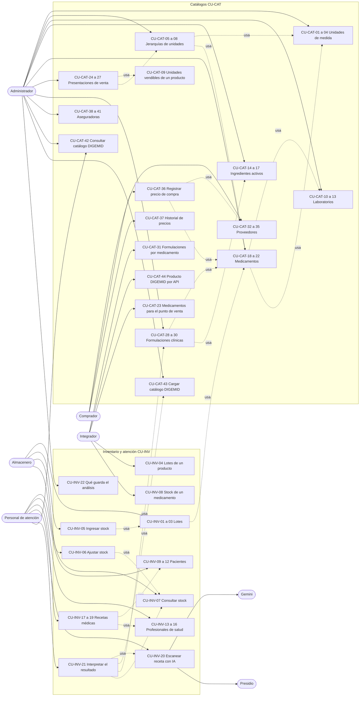

# Casos de uso — Parte B: catálogos, inventario y atención

| | |
|---|---|
| **Sistema** | SOFIA — Sistema Optimizado Farmacéutico con Inteligencia Artificial |
| **Versión del documento** | 1.0 |
| **Fecha** | 2026-10-27 |
| **Backend** | `sofia-apis`, rama `main`, commit `43f5529` |
| **Frontend** | `sofia-web-spa`, rama `main`, commit `eeffbb6` |
| **Método** | Lectura de los documentos validados (reglas 01b v1.1 y 01c1, inventario de pantallas 19c, 19d y 19e, carga masiva 20, matriz de permisos 05b, integraciones 07, procesos 3 y 7, manual capítulo 4, historias de usuario 12b) y comprobación puntual en el código, en `endpoints.csv` y en los `es.json`. No se ejecutó la aplicación ni se llamó a la API: los mensajes salen de los `es.json` a través de los documentos fuente. |

## 1. Cómo leer este documento

Este documento describe, caso de uso por caso de uso, cómo interactúan los actores con SOFIA en la **parte B**: catálogos maestros (unidades de medida, jerarquías de unidades, laboratorios, ingredientes activos, medicamentos, presentaciones de venta, formulaciones clínicas, proveedores con sus precios, aseguradoras y catálogo DIGEMID), inventario (lotes y stock por sucursal) y atención (pacientes, profesionales de salud, recetas médicas y análisis de recetas con IA). Acceso y administración (`CU-ADM`, parte A) y punto de venta y caja (parte C) los cubren otros documentos.

**Convenciones**

- IDs `CU-CAT-nn` (catálogos) y `CU-INV-nn` (inventario y atención). La numeración sigue a la de las historias de usuario: `CU-CAT-07` corresponde a [HU-CAT-007][HU-B], `CU-INV-05` a [HU-INV-005][HU-B]. Cada caso de uso enlaza su historia en la fila «Historia».
- Las reglas `RN-…` se enlazan con la sección de su documento (la lista de enlaces está al final). Las reglas transversales `GEN` e `IMP` son las de la parte A.
- Los textos entre « » son los que ve el usuario, tal como están en los `es.json`. Cuando el sistema no tiene un mensaje propio, la tabla de excepciones dice cuál es el genérico de la pantalla.
- **Brecha conocida**: lo que el sistema hace hoy distinto de lo que el negocio esperaría. Siempre se describe el comportamiento actual y se cita la fuente. Nada se da por cumplido si el sistema no lo hace.
- **Estado** de cada caso: «Implementado», «Parcial» o «Solo API (sin pantalla)».
- «No verificado» marca lo que no se pudo comprobar en la aplicación; el apartado 8 los reúne.
- Permisos como los exige el endpoint: `Módulo:Acción`. Para entrar a una pantalla siempre se necesita `Leer` del módulo; las rutas `…/nueva` y `…/carga-masiva` exigen además `Crear`, salvo `/stock-por-sucursal/nueva` (`Inventarios:Actualizar`) y `/recetas-medicas/escanear` (`Recetas:Analizar`).

## 2. Actores

| Actor | Quién es |
|---|---|
| Administrador | Usuario cuyo rol se llama `Admin`: pasa cualquier comprobación de permiso y accede a todas las sucursales. Todo lo que se dice de «el usuario» vale para cualquier rol que tenga el permiso indicado. No hay rol preconfigurado utilizable salvo `Admin`: cada empresa define los suyos ([05b §6][SEG-B]). |
| Almacenero | Usuario con permisos del módulo `Inventarios` (lotes y stock). |
| Comprador | Usuario con `Proveedores` y, para registrar costos, `Proveedores:RegistrarPrecioProveedor`. |
| Personal de atención | Usuario con permisos de `Pacientes`, `ProfesionalesSalud` y `Recetas`. |
| Sistema | SOFIA (API y SPA): valida, guarda y audita. |
| Gemini (Google) | Servicio externo que lee la imagen de la receta (OCR) y la interpreta; solo interviene en `CU-INV-20` y `CU-INV-21`. |
| Presidio | Servicio externo que anonimiza el texto de la receta antes de enviarlo a la IA ([07][INT]). |
| Integrador | Quien consume la API directamente (casos «Solo API»). |

## 3. Comportamientos comunes

Para no repetirlos en cada caso de uso, estos comportamientos valen para todas las pantallas de la parte B. Cada caso nombra solo lo que cambia.

### 3.1 Permiso de ruta y botones

- Guardia de ruta: `Leer` del módulo del primer segmento de la URL; `nueva` y `carga-masiva` exigen además `Crear`. Sin permiso el SPA muestra «No tienes permisos para acceder a esta pantalla.» (`errors.forbiddenPage`) y redirige a `/dashboard` (19c §0). **No verificado en la aplicación** (el administrador tiene todos los permisos).
- Los botones **Nuevo** y **Carga Masiva** exigen `Crear`; **Editar**, `Actualizar`; **Eliminar**, `Eliminar` (directiva `*appPermiso`). El endpoint vuelve a exigir el permiso: sin él la API responde 403 (RN-GEN-020).
- Todas las operaciones se limitan a los datos de la empresa del usuario y no ven registros eliminados ([RN-GEN-001], [RN-GEN-002]).

### 3.2 Búsqueda (patrón de las pantallas de búsqueda)

1. El usuario abre la pantalla: ve la tarjeta «Búsqueda de …» con «Ingresa los criterios de búsqueda» y **ninguna tabla**.
2. Escribe filtros («contiene», sin distinguir mayúsculas) y hace clic en **Buscar** (o pulsa Enter en un filtro de texto).
3. El sistema devuelve una página ordenada según cada módulo; el SPA muestra «Resultados (N)» y la tabla, con la primera columna como enlace al detalle.
4. **Limpiar** vacía los filtros y oculta la tabla; al volver del detalle con la flecha, la búsqueda recuerda los filtros y se repite sola. El paginador ofrece 10, 25 y 50 filas (10 por defecto); **Buscar** no vuelve a la página 1 ([RN-GEN-009]).

Excepción común de búsqueda: cualquier fallo muestra el aviso «Error al buscar …» propio de la pantalla (se cita en cada caso).

### 3.3 Exportación a Excel

1. Tras buscar, el usuario hace clic en **Exportar** (abajo a la izquierda).
2. El SPA envía `POST …/exportar` con los títulos de columna ya traducidos (máximo 50, hasta 100 caracteres cada uno) y los filtros que tenga escritos en ese momento; el archivo es un libro con una hoja «Data» y nombre fijo por pantalla ([RN-IMP-009], [RN-IMP-017]).
3. Si la consulta filtrada tiene más de 10 000 filas no se genera el archivo (`Export.TooManyRows`, HTTP 400, [RN-IMP-008]); el SPA no tiene texto propio: muestra el aviso «Error al buscar …» de la pantalla.

### 3.4 Detalle: ver, crear, editar y eliminar

- Las rutas `/x/nueva` y `/x/:id` usan el mismo componente. Crear abre el formulario habilitado con **Cancelar** y **Guardar**; abrir un registro lo muestra en modo ver (campos deshabilitados, botón **Editar** con `Actualizar`); **Editar** habilita los campos y muestra **Cancelar**, **Guardar** y **Eliminar** (con `Eliminar`).
- Crear con éxito vuelve a la búsqueda (sin tabla, o con los filtros guardados). Editar con éxito se queda en el detalle en modo ver, salvo donde el caso diga que navega a la búsqueda.
- **Eliminar** abre «Confirmar eliminación» con **Cancelar** y **Confirmar**; la eliminación es lógica ([RN-GEN-003]) y el código o nombre del registro queda libre.
- Un campo obligatorio vacío muestra «Este campo es obligatorio» (`general.errors.required`) y no se envía nada. Un campo de solo espacios pasa el formulario pero el servidor lo rechaza: el usuario ve el aviso genérico de guardado de la pantalla.
- Todos los códigos de error de validación son `{NombreDelRequest}.{Propiedad}` con HTTP 400 ([RN-GEN-011]); el SPA los trata como «sin traducción» y muestra el genérico de la pantalla, salvo donde se indique.

### 3.5 Carga masiva (flujo común)

Aplica a diez catálogos: unidades, jerarquías, laboratorios, ingredientes, medicamentos, proveedores, aseguradoras, DIGEMID, pacientes y profesionales de salud. Presentaciones, formulaciones, lotes, stock y recetas **no** tienen carga masiva. Necesita `Crear` del módulo.

1. El usuario hace clic en **Carga Masiva** y llega a `…/carga-masiva` («Carga Masiva»).
2. Hace clic en **Descargar plantilla** (`GET …/plantilla`): se guarda `plantilla-<módulo>.xlsx`, una hoja «Plantilla» con solo la fila de títulos ([RN-IMP-016]).
3. Llena el Excel y lo elige (arrastrar o clic). El SPA comprueba en el navegador la extensión `.xlsx` y los 5 MB.
4. El SPA envía `POST …/previsualizar`. El sistema lee la primera hoja (máx. 5000 filas), valida cada fila sin guardar nada y devuelve filas, errores por fila y totales ([RN-IMP-012], [RN-IMP-014]).
5. El usuario ve «N filas totales», «N filas válidas», «N filas con error», la tabla con los errores y la columna «Estado». Si hay errores, corrige el Excel y lo vuelve a subir (no se edita en pantalla).
6. Hace clic en **Guardar válidos (N)**. El SPA envía solo las filas válidas a `POST …/carga-masiva`; el sistema revalida, aplica los guards de cada entidad, **omite sin error** las filas que chocan con un valor único existente y responde `{ savedCount }`.
7. El SPA muestra «Se guardaron N registros correctamente» y vuelve a la búsqueda.

**Excepciones comunes de la carga masiva** (valen para los diez casos; cada caso agrega las propias):

| Paso | Situación | Código de error | HTTP | Mensaje que ve el usuario | Qué pasa después |
|---|---|---|---|---|---|
| 2 | Falla la descarga de la plantilla | — | — | «Error al descargar la plantilla. Intenta de nuevo.» (`carga-masiva.download-error`) | No se descarga nada; puede reintentar |
| 3 | Archivo que no termina en `.xlsx` | `CargaMasiva.Archivo.Invalido` (el SPA lo detecta antes de enviar) | 400 | «El archivo no es un Excel .xlsx válido. Descarga la plantilla y vuelve a intentarlo.» | No hay vista previa |
| 3 | Archivo de más de 5 MB | `Request.TooLarge` (el SPA lo detecta antes de enviar) | 413 | «El archivo supera el tamaño máximo de 5 MB.» | No hay vista previa |
| 4 | El contenido no es un libro Excel real, o se descomprime por encima de los límites | `CargaMasiva.Archivo.Invalido` · `CargaMasiva.Archivo.ExcedeDescompresion` | 400 | «El archivo no es un Excel .xlsx válido. Descarga la plantilla y vuelve a intentarlo.» · «El archivo excede los límites de contenido permitidos. Revisa que sea una plantilla válida.» | No hay vista previa |
| 4 | Más de 5000 filas con datos | `CargaMasiva.Filas.Excedidas` | 400 | «El archivo supera el máximo de 5000 filas. Divídelo en varios archivos.» | No hay vista previa |
| 4 | Sin archivo adjunto (no ocurre desde la pantalla) | — (texto plano «Debe adjuntar un archivo Excel.») | 400 | Sin traducción: «Error al procesar el archivo» (`carga-masiva.preview-error`) | No hay vista previa |
| 4 | Otro fallo al procesar | — | 500 | «Error al procesar el archivo» | No hay vista previa |
| 6 | Ninguna fila válida | — (el SPA no llama a la API) | — | «No hay filas válidas para guardar» (`carga-masiva.no-valid-rows`) | No se guarda nada |
| 6 | Lista vacía o de más de 5000 elementos | `CargaMasiva<Entidad>Command.Rows` | 400 | «El archivo supera el máximo de 5000 filas. Divídelo en varios archivos.» (también si la lista llega vacía) | No se guarda nada |
| 6 | El servidor rechaza una fila al revalidar (por ejemplo un texto demasiado largo) | `CargaMasiva<Entidad>Command.Rows[i].<Campo>` | 400 | «Algunas filas tienen datos inválidos. Vuelve a subir el archivo y revisa la vista previa.» | No se guarda **ninguna** fila |
| 6 | Otro fallo al guardar | — | 500 | «Error al guardar los registros» (`carga-masiva.save-error`) | No se guarda nada (la operación es transaccional) |

Mensajes por fila de la vista previa (`carga-masiva.validation.<código>`; el nombre del campo se ve como lo usa el sistema por dentro, por ejemplo `codigo`): `required` «El campo '{campo}' es obligatorio»; `max-length` «'{campo}' no puede superar los {max} caracteres»; `duplicate` «El valor '{valor}' del campo '{campo}' ya existe en el sistema»; `duplicate-in-file` «El valor '{valor}' del campo '{campo}' está duplicado en el archivo» (todas las apariciones, también la primera); `invalid-decimal`, `invalid-range`, `invalid-date`, `future-date`, `invalid-option`, `not-found`, `ambiguous`, `must-differ`, `positive-number`, `invalid-document-number` con los textos de `carga-masiva.validation.*`.

> **Brecha conocida (común).** La vista previa no anticipa todo lo que el guardado descarta: filas «válidas» que luego se omiten sin aviso, por lo que «Se guardaron N» puede ser menor que las filas válidas, incluso 0. Fuente: RN-LAB-015, RN-ING-013, RN-JER-021, RN-PRV-015 y manual cap. 4 §9.3.

### 3.6 Errores transversales que pueden aparecer en cualquier guardado

| Situación | Código | HTTP | Mensaje (pantallas con el mapa común `saveErrorKey`) |
|---|---|---|---|
| Dos personas guardan el mismo valor único a la vez | `Db.Duplicado` ([RN-GEN-036]) | 409 | «Ya existe un registro con ese mismo valor. Revisa los datos e inténtalo de nuevo.» (`errors.dbDuplicado`) |
| La base rechaza una referencia | `Db.ReferenciaInvalida` ([RN-GEN-038]) | 409 | «El registro hace referencia a datos que ya no existen o todavía está en uso.» |
| Un valor viola una restricción CHECK | `Db.ValorInvalido` ([RN-GEN-037]) | 400 | «Uno de los valores está fuera del rango permitido.» |
| Otro usuario cambió la misma fila de stock | `Concurrency.Conflict` ([RN-GEN-035]) | 409 | «Otra operación modificó estos datos al mismo tiempo. Actualiza la pantalla e inténtalo de nuevo.» (solo stock) |
| Falta de permiso | — ([RN-GEN-020]) | 403 | Sin texto propio: el genérico de la operación |

Estos tres primeros avisos son **No verificado en la aplicación** (difíciles de provocar). Aseguradoras, presentaciones, formulaciones, lotes y stock **no** usan el mapa común: cada una trata los estados HTTP a su manera y se describe en su caso.

---

## 4. Casos de uso de catálogos (`CU-CAT`)

### 4.1 Unidades de medida

### CU-CAT-01 — Registrar y editar una unidad de medida

| | |
|---|---|
| **Actor principal** | Administrador (o rol con `UnidadesMedida:Crear` para registrar y `UnidadesMedida:Actualizar` para editar) |
| **Actores secundarios** | Sistema |
| **Disparador** | El actor necesita una unidad nueva (unidad, caja, blíster, miligramo…) o corregir una existente |
| **Precondiciones** | Sesión iniciada; `UnidadesMedida:Leer` y `UnidadesMedida:Crear` (registrar) o `UnidadesMedida:Actualizar` (editar) |
| **Pantalla** | `/unidades-medida/nueva` y `/unidades-medida/:id` — «Unidades de Medida» |
| **Endpoints** | `POST /api/v1/UnidadesMedida`; `PUT /api/v1/UnidadesMedida/{id}`; `GET /api/v1/UnidadesMedida/{id}` |
| **Reglas** | [RN-UDM-001], [RN-UDM-002], [RN-UDM-003], [RN-UDM-004], [RN-UDM-005], [RN-UDM-006], [RN-UDM-007], [RN-UDM-008], [RN-UDM-009] |
| **Historia** | [HU-CAT-001][HU-B] |
| **Estado** | Implementado |

**Flujo principal (registrar)**
1. El actor hace clic en **Nuevo** en `/unidades-medida` (botón visible con `UnidadesMedida:Crear`).
2. El SPA abre el formulario con «Código» (máx. 10 caracteres, obligatorio) y «Descripción» (máx. 50, obligatoria). Un campo vacío muestra «Este campo es obligatorio» y no se envía nada.
3. El actor escribe, por ejemplo, `UND` / «Unidad» y hace clic en **Guardar**.
4. El sistema valida que código y descripción no estén vacíos ni excedan sus longitudes ([RN-UDM-002] a [RN-UDM-005]).
5. El sistema comprueba que no exista en la empresa otra unidad no eliminada con el mismo código ([RN-UDM-006]); el código de una unidad eliminada está libre ([RN-UDM-007]).
6. El sistema guarda la unidad y responde 201 con su identificador.
7. El SPA muestra «Unidad de medida guardada correctamente» y vuelve a la búsqueda (sin tabla, o con los filtros que tenía).

**Flujos alternativos**
- **A1 — Editar una unidad** (desde el paso 1): el actor abre el código en la tabla (`GET …/{id}`, `UnidadesMedida:Leer`), hace clic en **Editar** (`UnidadesMedida:Actualizar`), cambia los datos y hace clic en **Guardar**. El sistema repite los pasos 4 y 5 excluyendo la propia unidad, guarda y responde 204. El SPA muestra «Unidad de medida guardada correctamente» y **se queda en el detalle**, en modo ver y con los datos recargados.
- **A2 — Cancelar** (pasos 2 a 3): **Cancelar** en crear vuelve a la búsqueda; en editar descarta lo escrito y vuelve al modo ver.

**Excepciones**

| Paso | Situación | Código de error | HTTP | Mensaje que ve el usuario | Qué pasa después |
|---|---|---|---|---|---|
| 2 | Campo obligatorio vacío | — (validación del formulario) | — | «Este campo es obligatorio» | No se envía nada |
| 4 | Código o descripción de solo espacios, o fuera de longitud (llega al servidor) | `CreateUnidadMedidaCommand.Codigo` / `.Descripcion` (editar: `UpdateUnidadMedidaCommand.…`) | 400 | Sin traducción: «Error al guardar la unidad de medida» (`unidadesMedida.detail.save-error`) | Se queda en el formulario |
| 5 | Código ya usado por otra unidad (también con otra capitalización según el manual) | `UnidadMedida.Codigo.Duplicado` | 409 | «Ya existe una unidad de medida con ese código.» (`unidadesMedida.detail.duplicate-codigo`) | Se queda en el formulario |
| 6 | Dos peticiones simultáneas pasan la comprobación | `Db.Duplicado` | 409 | «Ya existe un registro con ese mismo valor. Revisa los datos e inténtalo de nuevo.» (**No verificado**) | Se queda en el formulario |
| A1 | La unidad ya no existe o es de otra empresa | `UnidadMedida.NotFound` | 404 | Al guardar: «Error al guardar la unidad de medida»; al abrir el detalle: «Error al cargar la unidad de medida» (`unidadesMedida.detail.load-error`) | No se modifica nada |
| A1 | (Solo API) identificador vacío en el cuerpo | `UpdateUnidadMedidaCommand.Id` | 400 | Sin traducción; la pantalla nunca lo provoca (la API toma siempre el identificador de la URL) | No se modifica nada |

**Postcondiciones**
- Éxito: existe una unidad no eliminada con ese código y descripción en la empresa, disponible como unidad base, de jerarquía, de presentación y de dosis.
- Fallo: no se crea ni modifica ninguna unidad.

> **Brecha conocida.** Un texto de solo espacios pasa el formulario y el servidor lo rechaza con un código sin traducción; la comparación de código al crear y editar usa igualdad de SQL y la intercalación no está definida en los scripts (**No verificado**). Fuente: [01b §4][01b-UDM], manual cap. 4 §5.3.

### CU-CAT-02 — Buscar, consultar y exportar unidades de medida

| | |
|---|---|
| **Actor principal** | Administrador (o rol con `UnidadesMedida:Leer`) |
| **Actores secundarios** | Sistema |
| **Disparador** | El actor quiere revisar qué unidades existen antes de crear medicamentos |
| **Precondiciones** | Sesión iniciada; `UnidadesMedida:Leer` |
| **Pantalla** | `/unidades-medida` — «Unidades de Medida» (migas «Inicio / Catálogos / Unidades de Medida», tarjeta «Búsqueda de Unidades de Medida») |
| **Endpoints** | `GET /api/v1/UnidadesMedida`; `POST /api/v1/UnidadesMedida/exportar` |
| **Reglas** | [RN-UDM-001], [RN-UDM-012], [RN-UDM-013], [RN-GEN-009], [RN-IMP-008], [RN-IMP-009], [RN-IMP-017] |
| **Historia** | [HU-CAT-002][HU-B] |
| **Estado** | Implementado |

**Flujo principal**
1. El actor abre «Unidades de Medida» (menú CATÁLOGOS) y ve los filtros «Código» y «Descripción», ambos con lupa.
2. Escribe filtros (o ninguno) y hace clic en **Buscar** (comportamiento de [§3.2](#32-búsqueda-patrón-de-las-pantallas-de-búsqueda)).
3. El sistema filtra por «contiene» en código y descripción, ordena por descripción y luego por identificador y pagina (por defecto 10 por página) ([RN-UDM-012]).
4. El SPA muestra «Resultados (N)» con las columnas «Código» (enlace al detalle) y «Descripción».

**Flujos alternativos**
- **A1 — Exportar** (después del paso 4): el actor hace clic en **Exportar**; el sistema genera `unidades-medida.xlsx` con la hoja «Data» y las columnas «Código» y «Descripción», con los filtros escritos en ese momento ([RN-UDM-013], [§3.3](#33-exportación-a-excel)).
- **A2 — Abrir el detalle** (paso 4): clic en el código; el detalle se abre en modo ver (ver [CU-CAT-01](#cu-cat-01--registrar-y-editar-una-unidad-de-medida)).

**Excepciones**

| Paso | Situación | Código de error | HTTP | Mensaje que ve el usuario | Qué pasa después |
|---|---|---|---|---|---|
| 3 | Ningún registro coincide | — | 200 | «Resultados (0)»; fila «Resultados»; paginador «Sin resultados» | La tabla queda vacía |
| 3 | Falla la búsqueda | — | 4xx/5xx | «Error al buscar unidades de medida» (`unidadesMedida.search.search-error`) | No se muestra tabla nueva |
| A1 | Más de 10 000 filas con los filtros | `Export.TooManyRows` | 400 | «Error al buscar unidades de medida» (sin texto propio) | No se genera archivo |

**Postcondiciones**
- Éxito: sin cambios de datos; el actor ve (o descarga) la lista filtrada.
- Fallo: sin cambios de datos.

> **Nota.** El contenido del archivo exportado y su descarga son **No verificado en la aplicación**; sí se comprobó que el servidor responde 200 (manual cap. 4 §5.4).

### CU-CAT-03 — Eliminar una unidad de medida

| | |
|---|---|
| **Actor principal** | Administrador (o rol con `UnidadesMedida:Eliminar`) |
| **Actores secundarios** | Sistema |
| **Disparador** | La unidad ya no se usa |
| **Precondiciones** | `UnidadesMedida:Leer` y `UnidadesMedida:Eliminar`; la unidad existe |
| **Pantalla** | `/unidades-medida/:id`, botón **Eliminar** en modo editar |
| **Endpoints** | `DELETE /api/v1/UnidadesMedida/{id}` |
| **Reglas** | [RN-UDM-001], [RN-UDM-007], [RN-UDM-009], [RN-UDM-010], [RN-UDM-011], [RN-GEN-003] |
| **Historia** | [HU-CAT-003][HU-B] |
| **Estado** | Implementado |

**Flujo principal**
1. El actor abre la unidad, hace clic en **Editar** y luego en **Eliminar**.
2. El SPA abre «Confirmar eliminación» con «¿Estás seguro de que deseas eliminar esta unidad de medida?» y los botones **Cancelar** y **Confirmar**.
3. El actor hace clic en **Confirmar**.
4. El sistema comprueba que la unidad exista y que ningún registro no eliminado la use: medicamento (unidad base), jerarquía (unidad mayor o menor) o formulación clínica (unidad de dosis) ([RN-UDM-010]).
5. El sistema la marca como eliminada (borrado lógico, [RN-UDM-011]) y responde 204.
6. El SPA muestra «Unidad de medida eliminada correctamente» y vuelve a la búsqueda, que repite los filtros.

**Flujos alternativos**
- **A1 — Cancelar** (paso 2): el cuadro se cierra y no se borra nada.

**Excepciones**

| Paso | Situación | Código de error | HTTP | Mensaje que ve el usuario | Qué pasa después |
|---|---|---|---|---|---|
| 4 | La unidad no existe (otra persona la eliminó antes) | `UnidadMedida.NotFound` | 404 | «Error al eliminar la unidad de medida» (`unidadesMedida.detail.delete-error`) | Sigue en el detalle |
| 4 | La unidad está en uso | `UnidadMedida.InUse` | 409 | «No se puede eliminar la unidad de medida porque está asociada a medicamentos o jerarquías de unidades.» (`unidadesMedida.detail.delete-in-use`) | La unidad sigue existiendo |

**Postcondiciones**
- Éxito: la unidad queda eliminada, desaparece de todas las listas y su código queda libre.
- Fallo: la unidad no cambia.

> **Brecha conocida.** (1) El texto de «en uso» no menciona las formulaciones clínicas, que también bloquean. (2) La pantalla muestra ese texto ante **cualquier** 409, también uno de concurrencia. (3) El handler no consulta las presentaciones de venta que usan la unidad como unidad de venta, por lo que se puede eliminar aunque una presentación la use. (4) El bloqueo por uso es **No verificado en la aplicación**. Fuente: [01b §4][01b-UDM], 19c §1.2.

### CU-CAT-04 — Cargar unidades de medida desde un Excel

| | |
|---|---|
| **Actor principal** | Administrador (o rol con `UnidadesMedida:Crear`) |
| **Actores secundarios** | Sistema |
| **Disparador** | El actor necesita crear muchas unidades de una vez |
| **Precondiciones** | `UnidadesMedida:Leer` y `UnidadesMedida:Crear` |
| **Pantalla** | `/unidades-medida/carga-masiva` — «Carga Masiva» (botón **Carga Masiva** de `/unidades-medida`) |
| **Endpoints** | `GET /api/v1/UnidadesMedida/plantilla`; `POST /api/v1/UnidadesMedida/previsualizar`; `POST /api/v1/UnidadesMedida/carga-masiva` |
| **Reglas** | [RN-UDM-002], [RN-UDM-003], [RN-UDM-004], [RN-UDM-005], [RN-UDM-006], [RN-UDM-014], [RN-UDM-015], [RN-UDM-016], [RN-UDM-017], [RN-IMP-001], [RN-IMP-002], [RN-IMP-003], [RN-IMP-004], [RN-IMP-005], [RN-IMP-006], [RN-IMP-013], [RN-IMP-014], [RN-IMP-015], [RN-IMP-016] |
| **Historia** | [HU-CAT-004][HU-B] |
| **Estado** | Implementado |

**Flujo principal**
Sigue el flujo común de [§3.5](#35-carga-masiva-flujo-común) con estas particularidades:
1. Plantilla `plantilla-unidades-medida.xlsx` con las columnas `Codigo` (obligatoria, máx. 10) y `Descripcion` (obligatoria, máx. 50), sin tilde ([RN-UDM-014]).
2. En la vista previa el sistema marca por fila: campo obligatorio vacío, longitud excedida, código que ya existe en la empresa y código repetido en el archivo (todas las apariciones, sin distinguir mayúsculas) ([RN-UDM-002] a [RN-UDM-006], [RN-UDM-015]). La descripción puede repetirse.
3. Al guardar, el sistema revalida cada fila, guarda las que pasan los guards de la entidad y no chocan con un código existente (si llegaran repetidas guarda la primera y omite las siguientes sin error) y responde `{ savedCount }` ([RN-UDM-016]).
4. El SPA muestra «Se guardaron N registros correctamente» y vuelve a la búsqueda de unidades.

**Flujos alternativos**
- **A1 — Filas con error**: el actor corrige el Excel y lo vuelve a subir; la nueva vista previa reemplaza a la anterior.

**Excepciones**

| Paso | Situación | Código de error | HTTP | Mensaje que ve el usuario | Qué pasa después |
|---|---|---|---|---|---|
| 2 | Código vacío | fila: `required` | 200 | «El campo 'codigo' es obligatorio» | La fila no se guarda |
| 2 | Código de más de 10 o descripción de más de 50 caracteres | fila: `max-length` | 200 | «'codigo' no puede superar los 10 caracteres» / «'descripcion' no puede superar los 50 caracteres» (dos mensajes si ambas fallan) | La fila no se guarda |
| 2 | Código ya existente | fila: `duplicate` | 200 | «El valor 'UND' del campo 'codigo' ya existe en el sistema» | La fila no se guarda |
| 2 | Código repetido en el archivo | fila: `duplicate-in-file` | 200 | «El valor 'LT' del campo 'codigo' está duplicado en el archivo» (en todas las apariciones) | Ninguna se guarda |
| 3 | Lista de filas vacía o de más de 5000 (solo API) | `CargaMasivaUnidadesMedidaCommand.Rows` | 400 | «El archivo supera el máximo de 5000 filas. Divídelo en varios archivos.» | No se guarda nada |
| 3 | Fila rechazada por el validador al guardar | `CargaMasivaUnidadesMedidaCommand.Rows[i].Codigo` / `.Descripcion` | 400 | «Algunas filas tienen datos inválidos. Vuelve a subir el archivo y revisa la vista previa.» | No se guarda ninguna |
| 1–4 | Archivo, tamaño, filas, descarga y fallos genéricos | Ver tabla de excepciones comunes de [§3.5](#35-carga-masiva-flujo-común) | — | Ver §3.5 | Ver §3.5 |

**Postcondiciones**
- Éxito: se crean las unidades válidas no duplicadas; la cantidad guardada se informa en el aviso.
- Fallo: no se crea ninguna unidad.

> **Nota.** Comprobado en la aplicación con un archivo de 7 filas (2 válidas, 5 con error; guardó 2). Contenido de la plantilla y errores de tamaño o filas: **No verificado** (manual cap. 4 §9.2 y §12).

### 4.2 Jerarquías de unidades

### CU-CAT-05 — Registrar y editar la conversión entre dos unidades de un producto

| | |
|---|---|
| **Actor principal** | Administrador (o rol con `JerarquiasUoM:Crear` / `JerarquiasUoM:Actualizar`) |
| **Actores secundarios** | Sistema |
| **Disparador** | El actor define cuántas unidades menores entran en una mayor para un producto (por ejemplo 1 caja = 10 blísteres) |
| **Precondiciones** | `JerarquiasUoM:Leer` y `JerarquiasUoM:Crear` (registrar) o `JerarquiasUoM:Actualizar` (editar); para elegir producto y unidades, `Medicamentos:Leer` y `UnidadesMedida:Leer` (el SPA no lo comprueba); existen el producto y las dos unidades |
| **Pantalla** | `/jerarquias/nueva` y `/jerarquias/:id` — «Jerarquías de Unidades» |
| **Endpoints** | `POST /api/v1/JerarquiasUoM`; `PUT /api/v1/JerarquiasUoM/{id}`; `GET /api/v1/JerarquiasUoM/{id}`; `GET /api/v1/medicamentos` y `GET /api/v1/unidadesmedida` (sugerencias) |
| **Reglas** | [RN-JER-001], [RN-JER-002], [RN-JER-003], [RN-JER-004], [RN-JER-005], [RN-JER-006], [RN-JER-007], [RN-JER-008], [RN-JER-009], [RN-JER-010], [RN-JER-012], [RN-JER-013] |
| **Historia** | [HU-CAT-005][HU-B] |
| **Estado** | Implementado (varios rechazos del servidor llegan como mensaje genérico) |

**Flujo principal (registrar)**
1. El actor hace clic en **Nuevo** en `/jerarquias`.
2. El SPA muestra «Producto», «Unidad Mayor» y «Unidad Menor» (campos con sugerencias que consultan al escribir, 300 ms, hasta 20 resultados) y «Multiplicador» (ayuda «Cuántas unidades menores equivalen a una unidad mayor»).
3. El actor **elige una opción de la lista** en cada uno de los tres campos y escribe el multiplicador; hace clic en **Guardar**.
4. El SPA valida: las tres elecciones hechas, unidades distintas y multiplicador mínimo 0,0001. Si no, no envía nada.
5. El sistema valida producto, unidades y multiplicador mayor que cero ([RN-JER-002] a [RN-JER-005]), que el producto exista ([RN-JER-006]) y que las dos unidades existan ([RN-JER-007]).
6. El sistema comprueba que el producto no tenga ya una conversión no eliminada con la misma unidad mayor y menor ([RN-JER-008]).
7. El sistema calcula, con las demás conversiones del producto, la equivalencia entre las dos unidades (mayor a menor multiplica, menor a mayor divide; recorrido por anchura; [RN-JER-010]); si existe, el multiplicador debe coincidir redondeado a 4 decimales ([RN-JER-009]).
8. El sistema guarda (multiplicador con 4 decimales) y responde 201.
9. El SPA muestra «Jerarquía guardada correctamente» y vuelve a `/jerarquias`.

**Flujos alternativos**
- **A1 — Editar** (desde el paso 1): el actor abre el producto en la tabla, hace clic en **Editar** y cambia datos; el sistema revalida solo el producto o la unidad que cambió y repite los pasos 6 y 7 excluyendo la propia jerarquía; responde 204. A diferencia de otros catálogos, el SPA **vuelve a `/jerarquias`** en vez de quedarse en el detalle ([RN-JER-012]).
- **A2 — Conversión coherente** (paso 7): con «Caja a Blíster = 10» y «Blíster a Unidad = 10», registrar «Caja a Unidad = 100» se acepta porque coincide con lo calculado.

**Excepciones**

| Paso | Situación | Código de error | HTTP | Mensaje que ve el usuario | Qué pasa después |
|---|---|---|---|---|---|
| 4 | No se eligió una opción de la lista (producto o unidad) | — | — | «Este campo es obligatorio» | No se envía nada |
| 4 | Misma unidad mayor y menor | — (en servidor: `CreateJerarquiaUoMCommand.` con punto final) | 400 | «La unidad mayor y la unidad menor no pueden ser la misma» (`jerarquias.detail.same-unidad-error`) | No se envía nada |
| 4 | Multiplicador vacío o menor que 0,0001 | `CreateJerarquiaUoMCommand.Multiplicador` (servidor) | 400 | «El multiplicador debe ser mayor que cero» (`jerarquias.detail.multiplicador-error`) | No se envía nada |
| 5 | Producto o unidades eliminados o ajenos | `Medicamento.NotFound` · `UnidadMedida.NotFound` | 404 | Sin traducción: «Error al guardar la jerarquía» (`jerarquias.detail.save-error`) | Se queda en el formulario |
| 6 | Conversión repetida en el mismo sentido | `JerarquiaUoM.Duplicada` | 409 | «Este producto ya tiene una conversión entre esas unidades.» (`jerarquias.detail.duplicate`) | Se queda en el formulario |
| 6 | Carrera entre dos peticiones | `Db.Duplicado` | 409 | «Ya existe un registro con ese mismo valor. Revisa los datos e inténtalo de nuevo.» (**No verificado**) | Se queda en el formulario |
| 7 | Contradice la equivalencia calculada | `JerarquiaUoM.Multiplicador.Inconsistente` | 409 | Sin traducción: «Error al guardar la jerarquía» (no muestra el valor calculado) | Se queda en el formulario |
| 8 | Multiplicador que viola el CHECK de la base | `Db.ValorInvalido` | 400 | «Uno de los valores está fuera del rango permitido.» | Se queda en el formulario |
| A1 | La jerarquía ya no existe | `JerarquiaUoM.NotFound` | 404 | Al guardar: «Error al guardar la jerarquía»; al abrir: «Error al cargar la jerarquía» (`jerarquias.detail.load-error`) | Sin cambios |
| A1 | (Solo API) identificador vacío | `UpdateJerarquiaUoMCommand.Id` | 400 | Sin traducción | Sin cambios |

**Postcondiciones**
- Éxito: el producto tiene una conversión nueva o modificada; alimenta las unidades vendibles ([CU-CAT-09](#cu-cat-09--conocer-en-qué-unidades-se-puede-vender-un-producto)).
- Fallo: no se crea ni modifica nada.

> **Brecha conocida.** `JerarquiaUoM.Multiplicador.Inconsistente`, `Medicamento.NotFound` y `UnidadMedida.NotFound` no tienen traducción; el usuario ve el mensaje genérico. **No verificado en la aplicación:** el manual no recorrió esta pantalla. Fuente: 19c §2.2, [01b §5][01b-JER].

### CU-CAT-06 — Buscar, consultar y exportar jerarquías de unidades

| | |
|---|---|
| **Actor principal** | Administrador (o rol con `JerarquiasUoM:Leer`) |
| **Actores secundarios** | Sistema |
| **Disparador** | El actor revisa cómo está configurado cada producto |
| **Precondiciones** | `JerarquiasUoM:Leer` (y `Medicamentos:Leer`, `UnidadesMedida:Leer` para las sugerencias de los filtros) |
| **Pantalla** | `/jerarquias` — «Jerarquías de Unidades» (tarjeta «Búsqueda de Jerarquías») |
| **Endpoints** | `GET /api/v1/JerarquiasUoM`; `POST /api/v1/JerarquiasUoM/exportar` |
| **Reglas** | [RN-JER-001], [RN-JER-015], [RN-JER-016], [RN-GEN-009], [RN-IMP-008], [RN-IMP-009] |
| **Historia** | [HU-CAT-006][HU-B] |
| **Estado** | Implementado |

**Flujo principal**
1. El actor abre «Jerarquías de Unidades» (menú CATÁLOGOS). Ve los filtros «Producto», «Unidad Mayor» y «Unidad Menor» (texto con lupa y sugerencias) y un deslizador «Multiplicador: 0 — 1000» con paso 1.
2. Escribe filtros y/o mueve el deslizador y hace clic en **Buscar**. Los filtros de texto valen aunque no elija sugerencia: buscan por nombre «contiene».
3. El sistema excluye las jerarquías cuyo producto o unidades estén eliminados, filtra por nombre de producto, unidad mayor, unidad menor y rango de multiplicador (inclusivo), y ordena por nombre comercial del producto ([RN-JER-015]). Solo se envía el límite del deslizador que se movió.
4. El SPA muestra «Resultados (N)» con «Producto» (enlace), «Unidad Mayor», «Unidad Menor» y «Multiplicador».

**Flujos alternativos**
- **A1 — Exportar** (después del paso 4): `jerarquias-unidades.xlsx` con las columnas «Producto», «Unidad Mayor», «Unidad Menor» y «Multiplicador» y los filtros de nombre y multiplicador escritos ([RN-JER-016]).

**Excepciones**

| Paso | Situación | Código de error | HTTP | Mensaje que ve el usuario | Qué pasa después |
|---|---|---|---|---|---|
| 3 | Sin coincidencias | — | 200 | «Resultados (0)»; la fila vacía dice «Sin resultados» | Tabla vacía |
| 3 | Falla la búsqueda o la exportación | — | 4xx/5xx | «Error al buscar jerarquías de unidades» (`jerarquias.search.search-error`) | Sin tabla nueva |
| A1 | Más de 10 000 filas | `Export.TooManyRows` | 400 | «Error al buscar jerarquías de unidades» | No se genera archivo |
| 1 | Falla la carga de sugerencias (por ejemplo sin `Medicamentos:Leer`) | — | 403/5xx | Ningún aviso; la lista de sugerencias no se llena (**No verificado** qué ve exactamente) | El resto de la pantalla funciona |

**Postcondiciones**
- Éxito: sin cambios de datos.
- Fallo: sin cambios de datos.

> **Nota.** El deslizador no permite multiplicadores con decimales ni mayores a 1000. Fuente: 19c §2.1.

### CU-CAT-07 — Eliminar una conversión de unidades

| | |
|---|---|
| **Actor principal** | Administrador (o rol con `JerarquiasUoM:Eliminar`) |
| **Actores secundarios** | Sistema |
| **Disparador** | La conversión es errónea y hay que volver a definirla |
| **Precondiciones** | `JerarquiasUoM:Leer` y `JerarquiasUoM:Eliminar`; la jerarquía existe |
| **Pantalla** | `/jerarquias/:id` (botón **Eliminar** en modo editar) |
| **Endpoints** | `DELETE /api/v1/JerarquiasUoM/{id}` |
| **Reglas** | [RN-JER-001], [RN-JER-013], [RN-JER-014], [RN-GEN-003] |
| **Historia** | [HU-CAT-007][HU-B] |
| **Estado** | Implementado (sin validación de dependencias) |

**Flujo principal**
1. El actor edita la jerarquía y hace clic en **Eliminar**.
2. El SPA abre «Confirmar eliminación» con «¿Estás seguro de que deseas eliminar esta jerarquía?».
3. El actor hace clic en **Confirmar**.
4. El sistema comprueba que la jerarquía exista y la marca como eliminada; **no** valida si una presentación de venta usa su equivalencia ([RN-JER-014]). Responde 204.
5. El SPA muestra «Jerarquía eliminada correctamente» y vuelve a `/jerarquias`.

**Flujos alternativos**
- **A1 — Cancelar** (paso 2): no se borra nada.

**Excepciones**

| Paso | Situación | Código de error | HTTP | Mensaje que ve el usuario | Qué pasa después |
|---|---|---|---|---|---|
| 4 | La jerarquía ya no existe | `JerarquiaUoM.NotFound` | 404 | «Error al eliminar la jerarquía» (`jerarquias.detail.delete-error`) | Sigue en el detalle |
| 4 | Cualquier 409 (por ejemplo concurrencia) | cualquiera | 409 | «No se puede eliminar la jerarquía porque está en uso.» (`jerarquias.detail.delete-in-use`) | Sin cambios |

**Postcondiciones**
- Éxito: la conversión queda eliminada; las presentaciones ya guardadas conservan su equivalencia.
- Fallo: sin cambios.

> **Brecha conocida.** El mensaje «en uso» existe en la pantalla pero el backend nunca devuelve 409 de negocio al eliminar una jerarquía ([RN-JER-014]). **No verificado:** si eliminar una jerarquía recalcula presentaciones ya guardadas; por el código, la equivalencia se guarda al crear o editar la presentación y no se recalcula ([RN-PRE-007]). Fuente: 19d §7.

### CU-CAT-08 — Cargar jerarquías de unidades desde un Excel

| | |
|---|---|
| **Actor principal** | Administrador (o rol con `JerarquiasUoM:Crear`) |
| **Actores secundarios** | Sistema |
| **Disparador** | El actor configura rápido muchos productos |
| **Precondiciones** | `JerarquiasUoM:Leer` y `JerarquiasUoM:Crear`; los productos y unidades existen |
| **Pantalla** | `/jerarquias/carga-masiva` — «Carga Masiva» |
| **Endpoints** | `GET /api/v1/JerarquiasUoM/plantilla`; `POST /api/v1/JerarquiasUoM/previsualizar`; `POST /api/v1/JerarquiasUoM/carga-masiva` |
| **Reglas** | [RN-JER-002], [RN-JER-003], [RN-JER-004], [RN-JER-005], [RN-JER-008], [RN-JER-009], [RN-JER-017], [RN-JER-018], [RN-JER-019], [RN-JER-020], [RN-JER-021], [RN-JER-022], [RN-IMP-015] |
| **Historia** | [HU-CAT-008][HU-B] |
| **Estado** | Implementado (la vista previa no anticipa duplicados ni contradicciones) |

**Flujo principal**
Sigue [§3.5](#35-carga-masiva-flujo-común) con:
1. Plantilla `plantilla-jerarquias.xlsx` con las columnas `Producto` (máx. 150), `UnidadMayor` (50), `UnidadMenor` (50) y `Multiplicador` (30), todas obligatorias ([RN-JER-017], [RN-JER-020]).
2. En la vista previa el producto se identifica por su **nombre comercial** y las unidades por su **descripción** (no por código), sin distinguir mayúsculas; el multiplicador se lee con punto decimal ([RN-JER-018], [RN-JER-019]).
3. La vista previa **no** comprueba duplicados ni consistencia de multiplicadores ([RN-JER-021]).
4. Al guardar, el sistema procesa las filas en orden, tiene en cuenta las aceptadas antes en el mismo archivo y omite sin error las que repiten una conversión o contradicen un multiplicador ya calculable; responde la cantidad guardada.
5. El SPA muestra «Se guardaron N registros correctamente» (N puede ser menor que las filas válidas) y vuelve a la búsqueda.

**Excepciones**

| Paso | Situación | Código de error | HTTP | Mensaje que ve el usuario | Qué pasa después |
|---|---|---|---|---|---|
| 2 | Campo vacío | fila: `required` | 200 | «El campo 'producto' es obligatorio» (análogo para `unidadMayor`, `unidadMenor`, `multiplicador`) | La fila no se guarda |
| 2 | Producto o unidad inexistente | fila: `not-found` | 200 | «El valor 'X' del campo 'producto' no existe en el sistema» | La fila no se guarda |
| 2 | Nombre que coincide con varios registros | fila: `ambiguous` | 200 | «El valor 'X' del campo 'unidadMayor' coincide con varios registros del sistema» | La fila no se guarda |
| 2 | Unidades iguales | fila: `must-differ` | 200 | «'unidadMenor' no puede ser igual a 'unidadMayor'» | La fila no se guarda |
| 2 | Multiplicador no numérico | fila: `invalid-decimal` | 200 | «'multiplicador' debe ser un número decimal válido» | La fila no se guarda |
| 2 | Multiplicador cero o negativo | fila: `positive-number` | 200 | «'multiplicador' debe ser mayor que cero» | La fila no se guarda |
| 3 | Longitud excedida en el validador del guardado | `CargaMasivaJerarquiasUoMCommand.Rows[i].Producto` etc. | 400 | «Algunas filas tienen datos inválidos. Vuelve a subir el archivo y revisa la vista previa.» | No se guarda ninguna |
| 4 | Lista vacía o de más de 5000 | `CargaMasivaJerarquiasUoMCommand.Rows` | 400 | «El archivo supera el máximo de 5000 filas. Divídelo en varios archivos.» | No se guarda nada |
| 4 | Fila duplicada o inconsistente que pasó la vista previa | — (fila omitida) | 200 | «Se guardaron N registros correctamente» con N menor | La fila no se guarda, sin aviso |
| 1–5 | Archivo, tamaño, filas, descarga y fallos genéricos | Ver [§3.5](#35-carga-masiva-flujo-común) | — | Ver §3.5 | Ver §3.5 |

**Postcondiciones**
- Éxito: se crean las conversiones aceptadas; se informa cuántas.
- Fallo: no se crea ninguna.

> **Brecha conocida.** La vista previa de jerarquías no revisa duplicados ni consistencia ([RN-JER-021]). **No verificado:** con cultura invariante, `1,5` podría leerse como 15 (nota de [01b §5][01b-JER]). El manual no recorrió esta carga.

### CU-CAT-09 — Conocer en qué unidades se puede vender un producto

| | |
|---|---|
| **Actor principal** | Pantalla de presentaciones de venta (en nombre del usuario con `JerarquiasUoM:Leer`) |
| **Actores secundarios** | Sistema |
| **Disparador** | El actor elige un producto en la pantalla o en el diálogo de presentaciones de venta |
| **Precondiciones** | `JerarquiasUoM:Leer`; el producto existe |
| **Pantalla** | Sin pantalla propia: alimenta «Unidad de Venta» de `/presentaciones-venta/nueva` y del diálogo «Presentaciones de Venta» |
| **Endpoints** | `GET /api/v1/JerarquiasUoM/unidades-vendibles?productoId=<guid>` |
| **Reglas** | [RN-JER-010], [RN-JER-011] |
| **Historia** | [HU-CAT-009][HU-B] |
| **Estado** | Implementado (consumido por presentaciones de venta; ninguna pantalla de jerarquías lo llama) |

**Flujo principal**
1. El SPA pide las unidades vendibles del producto elegido.
2. El sistema toma las jerarquías del producto, reúne todas las unidades que aparecen, excluye la unidad base del medicamento y descarta las que no se pueden convertir a la unidad base ([RN-JER-011]).
3. Para cada unidad calcula las unidades base que contiene (recorrido por anchura, [RN-JER-010]).
4. El sistema devuelve `{ unidadMedidaId, descripcion, cantidadUnidadesBase }` ordenado de mayor a menor cantidad (por ejemplo «Caja» 100 y «Blíster» 10 si la base es «Unidad»).
5. El SPA muestra cada opción como «{descripción} ({equivalencia} {unidad base})».

**Flujos alternativos**
- **A1 — Producto sin jerarquías** (paso 2): la lista llega vacía; el SPA muestra «Este producto no tiene una Jerarquía de Unidades registrada. Cárgala primero para poder definir presentaciones de venta.» y, con `JerarquiasUoM:Crear`, el botón «Ir a Jerarquías de Unidades».

**Excepciones**

| Paso | Situación | Código de error | HTTP | Mensaje que ve el usuario | Qué pasa después |
|---|---|---|---|---|---|
| 2 | El producto no existe (eliminado o de otra empresa) | `Medicamento.NotFound` | 404 | Sin aviso propio: la pantalla de presentaciones deja la lista vacía y muestra el texto «sin jerarquía» | No se puede definir presentación |
| 1 | Falta `JerarquiasUoM:Leer` | — | 403 | Igual: texto «sin jerarquía» (efecto **No verificado** en ejecución) | Igual |

**Postcondiciones**
- Éxito: sin cambios de datos; el actor ve las unidades en las que puede vender el producto.
- Fallo: sin cambios de datos.

### 4.3 Laboratorios

### CU-CAT-10 — Registrar y editar un laboratorio

| | |
|---|---|
| **Actor principal** | Administrador (o rol con `Laboratorios:Crear` / `Laboratorios:Actualizar`) |
| **Actores secundarios** | Sistema |
| **Disparador** | El actor necesita el fabricante o titular al que pertenecerán sus medicamentos |
| **Precondiciones** | `Laboratorios:Leer` y `Laboratorios:Crear` (registrar) o `Laboratorios:Actualizar` (editar) |
| **Pantalla** | `/laboratorios/nueva` y `/laboratorios/:id` — «Laboratorios» |
| **Endpoints** | `POST /api/v1/Laboratorios`; `PUT /api/v1/Laboratorios/{id}`; `GET /api/v1/Laboratorios/{id}` |
| **Reglas** | [RN-LAB-001], [RN-LAB-002], [RN-LAB-003], [RN-LAB-004], [RN-LAB-005], [RN-LAB-006], [RN-LAB-007], [RN-LAB-008], [RN-LAB-009], [RN-LAB-011] |
| **Historia** | [HU-CAT-010][HU-B] |
| **Estado** | Implementado |

**Flujo principal (registrar)**
1. El actor hace clic en **Nuevo** en `/laboratorios`.
2. El SPA muestra «Nombre de Compañía» (obligatorio, máx. 150) y «Código Identificador» (opcional, máx. 50).
3. El actor escribe, por ejemplo, «Laboratorio Demo Andino» / `DEMO-AND` y hace clic en **Guardar**.
4. El sistema valida nombre no vacío y longitudes ([RN-LAB-002] a [RN-LAB-004]); un código vacío o de solo espacios se guarda como «sin código» ([RN-LAB-005]).
5. El sistema comprueba primero que no exista otro laboratorio no eliminado con el mismo nombre ([RN-LAB-006]) y después, si hay código, que no se repita ([RN-LAB-007]).
6. El sistema guarda y responde 201.
7. El SPA muestra «Laboratorio guardado correctamente» y vuelve a la búsqueda.

**Flujos alternativos**
- **A1 — Editar** (desde el paso 1): abrir el laboratorio, **Editar**, cambiar y **Guardar**; el sistema repite 4 y 5 excluyendo el propio registro y responde 204. El SPA muestra «Laboratorio guardado correctamente» y se queda en el detalle. Borrar el código deja al laboratorio «sin código».
- **A2 — Sin código** (paso 3): se pueden tener varios laboratorios sin código.

**Excepciones**

| Paso | Situación | Código de error | HTTP | Mensaje que ve el usuario | Qué pasa después |
|---|---|---|---|---|---|
| 2 | Nombre vacío | — (formulario) | — | «Este campo es obligatorio» | No se envía nada |
| 4 | Nombre de solo espacios o longitud excedida | `CreateLaboratorioCommand.NombreCompania` / `.CodigoIdentificador` (editar: `UpdateLaboratorioCommand.…`) | 400 | Sin traducción: «Error al guardar el laboratorio» (`laboratorios.detail.save-error`) | Se queda en el formulario |
| 5 | Nombre repetido (el manual comprobó que se rechaza en minúsculas) | `Laboratorio.NombreCompania.Duplicado` | 409 | «Ya existe un laboratorio con ese nombre de compañía.» (`laboratorios.detail.duplicate-nombre`) | Se queda en el formulario |
| 5 | Código identificador repetido | `Laboratorio.CodigoIdentificador.Duplicado` | 409 | «Ya existe un laboratorio con ese código identificador.» (`laboratorios.detail.duplicate-codigo`) | Se queda en el formulario |
| 6 | Carrera entre dos peticiones | `Db.Duplicado` | 409 | «Ya existe un registro con ese mismo valor. Revisa los datos e inténtalo de nuevo.» (**No verificado**) | Se queda en el formulario |
| A1 | El laboratorio ya no existe | `Laboratorio.NotFound` | 404 | Guardar: «Error al guardar el laboratorio»; abrir: «Error al cargar el laboratorio» (`laboratorios.detail.load-error`) | Sin cambios |
| A1 | (Solo API) identificador vacío | `UpdateLaboratorioCommand.Id` | 400 | Sin traducción | Sin cambios |

**Postcondiciones**
- Éxito: existe el laboratorio, elegible al registrar medicamentos.
- Fallo: no se crea ni modifica nada.

> **Brecha conocida.** La comparación de duplicados al crear y editar usa igualdad de SQL; la intercalación no está definida en los scripts (**No verificado**). Fuente: [01b §6][01b-LAB], manual cap. 4 §6.3.

### CU-CAT-11 — Buscar, consultar y exportar laboratorios

| | |
|---|---|
| **Actor principal** | Administrador (o rol con `Laboratorios:Leer`) |
| **Actores secundarios** | Sistema |
| **Disparador** | El actor revisa los laboratorios registrados |
| **Precondiciones** | `Laboratorios:Leer` |
| **Pantalla** | `/laboratorios` — «Laboratorios» (tarjeta «Búsqueda de Laboratorios») |
| **Endpoints** | `GET /api/v1/Laboratorios`; `POST /api/v1/Laboratorios/exportar` |
| **Reglas** | [RN-LAB-001], [RN-LAB-012], [RN-GEN-009], [RN-IMP-008], [RN-IMP-009] |
| **Historia** | [HU-CAT-011][HU-B] |
| **Estado** | Implementado |

**Flujo principal**
1. El actor abre «Laboratorios» (menú CATÁLOGOS) y ve los filtros «Nombre de Compañía» y «Código Identificador» (texto con lupa).
2. Escribe filtros y hace clic en **Buscar** ([§3.2](#32-búsqueda-patrón-de-las-pantallas-de-búsqueda)).
3. El sistema filtra por «contiene», ordena por nombre y luego por identificador y pagina ([RN-LAB-012]).
4. El SPA muestra «Nombre de Compañía» (enlace) y «Código Identificador» («—» si no tiene).

**Flujos alternativos**
- **A1 — Exportar**: `laboratorios.xlsx` con las columnas «Nombre de Compañía» y «Código Identificador» (vacío si no tiene) con los filtros escritos.

**Excepciones**

| Paso | Situación | Código de error | HTTP | Mensaje que ve el usuario | Qué pasa después |
|---|---|---|---|---|---|
| 3 | Sin coincidencias | — | 200 | «Resultados (0)»; fila «Resultados»; paginador «Sin resultados» | Tabla vacía |
| 3 | Falla la búsqueda o la exportación | — | 4xx/5xx | «Error al buscar laboratorios» (`laboratorios.search.search-error`) | Sin tabla nueva |
| A1 | Más de 10 000 filas | `Export.TooManyRows` | 400 | «Error al buscar laboratorios» | No se genera archivo |

**Postcondiciones**
- Éxito / Fallo: sin cambios de datos.

### CU-CAT-12 — Eliminar un laboratorio

| | |
|---|---|
| **Actor principal** | Administrador (o rol con `Laboratorios:Eliminar`) |
| **Actores secundarios** | Sistema |
| **Disparador** | El laboratorio ya no se usa |
| **Precondiciones** | `Laboratorios:Leer` y `Laboratorios:Eliminar`; el laboratorio existe |
| **Pantalla** | `/laboratorios/:id` (botón **Eliminar** en modo editar) |
| **Endpoints** | `DELETE /api/v1/Laboratorios/{id}` |
| **Reglas** | [RN-LAB-001], [RN-LAB-009], [RN-LAB-010], [RN-LAB-011], [RN-GEN-003] |
| **Historia** | [HU-CAT-012][HU-B] |
| **Estado** | Implementado |

**Flujo principal**
1. El actor edita el laboratorio y hace clic en **Eliminar**.
2. El SPA abre «Confirmar eliminación» con «¿Estás seguro de que deseas eliminar este laboratorio?».
3. El actor hace clic en **Confirmar**.
4. El sistema comprueba que exista y que ningún medicamento no eliminado lo use ([RN-LAB-010]).
5. El sistema lo marca como eliminado, libera su nombre y código ([RN-LAB-011]) y responde 204.
6. El SPA muestra «Laboratorio eliminado correctamente» y vuelve a la búsqueda.

**Flujos alternativos**
- **A1 — Cancelar** (paso 2): no se borra nada.

**Excepciones**

| Paso | Situación | Código de error | HTTP | Mensaje que ve el usuario | Qué pasa después |
|---|---|---|---|---|---|
| 4 | El laboratorio no existe | `Laboratorio.NotFound` | 404 | «Error al eliminar el laboratorio» (`laboratorios.detail.delete-error`) | Sigue en el detalle |
| 4 | Tiene medicamentos asociados | `Laboratorio.InUse` | 409 | «No se puede eliminar el laboratorio porque tiene medicamentos asociados.» (`laboratorios.detail.delete-in-use`; la pantalla lo muestra ante cualquier 409) | Sin cambios |

**Postcondiciones**
- Éxito: laboratorio eliminado; nombre y código quedan libres.
- Fallo: sin cambios.

> **Nota.** El bloqueo por medicamentos asociados es **No verificado en la aplicación** en el manual del capítulo 4 (aún no había medicamentos); viene de 19c §3.2.

### CU-CAT-13 — Cargar laboratorios desde un Excel

| | |
|---|---|
| **Actor principal** | Administrador (o rol con `Laboratorios:Crear`) |
| **Actores secundarios** | Sistema |
| **Disparador** | El actor necesita crear muchos laboratorios |
| **Precondiciones** | `Laboratorios:Leer` y `Laboratorios:Crear` |
| **Pantalla** | `/laboratorios/carga-masiva` — «Carga Masiva» |
| **Endpoints** | `GET /api/v1/Laboratorios/plantilla`; `POST /api/v1/Laboratorios/previsualizar`; `POST /api/v1/Laboratorios/carga-masiva` |
| **Reglas** | [RN-LAB-002], [RN-LAB-003], [RN-LAB-004], [RN-LAB-006], [RN-LAB-007], [RN-LAB-013], [RN-LAB-014], [RN-LAB-015], [RN-LAB-016], [RN-LAB-017], [RN-IMP-001], [RN-IMP-005], [RN-IMP-006], [RN-IMP-014] |
| **Historia** | [HU-CAT-013][HU-B] |
| **Estado** | Implementado (la vista previa no revisa el código identificador repetido) |

**Flujo principal**
Sigue [§3.5](#35-carga-masiva-flujo-común) con:
1. Plantilla `plantilla-laboratorios.xlsx`: `NombreCompania` (obligatoria, máx. 150) y `CodigoIdentificador` (opcional, máx. 50) ([RN-LAB-013]).
2. La vista previa marca: nombre vacío o demasiado largo, código demasiado largo, nombre que ya existe y nombre repetido en el archivo (todas las apariciones) ([RN-LAB-014]). **No** revisa que el código identificador esté repetido ([RN-LAB-015]).
3. Al guardar, el sistema omite sin error las filas cuyo nombre o código ya existe o se repite (conserva la primera) y responde la cantidad guardada ([RN-LAB-016]).
4. El SPA muestra «Se guardaron N registros correctamente» y vuelve a la búsqueda.

**Excepciones**

| Paso | Situación | Código de error | HTTP | Mensaje que ve el usuario | Qué pasa después |
|---|---|---|---|---|---|
| 2 | Nombre vacío | fila: `required` | 200 | «El campo 'nombreCompania' es obligatorio» | La fila no se guarda |
| 2 | Nombre de más de 150 o código de más de 50 caracteres | fila: `max-length` | 200 | «'nombreCompania' no puede superar los 150 caracteres» | La fila no se guarda |
| 2 | Nombre ya existente | fila: `duplicate` | 200 | «El valor 'Laboratorio Demo Andino' del campo 'nombreCompania' ya existe en el sistema» | La fila no se guarda |
| 2 | Nombre repetido en el archivo | fila: `duplicate-in-file` | 200 | «El valor 'X' del campo 'nombreCompania' está duplicado en el archivo» | Ninguna aparición se guarda |
| 3 | Código identificador ya usado (pasó la vista previa) | — (fila omitida) | 200 | «Se guardaron N registros correctamente» con N menor; el manual comprobó «Se guardaron 0 registros correctamente» | La fila no se guarda, sin aviso |
| 3 | Validador del guardado rechaza una fila | `CargaMasivaLaboratoriosCommand.Rows[i].NombreCompania` / `.CodigoIdentificador` | 400 | «Algunas filas tienen datos inválidos. Vuelve a subir el archivo y revisa la vista previa.» | No se guarda ninguna |
| 3 | Lista vacía o de más de 5000 | `CargaMasivaLaboratoriosCommand.Rows` | 400 | «El archivo supera el máximo de 5000 filas. Divídelo en varios archivos.» | No se guarda nada |
| 1–4 | Archivo, tamaño, filas, descarga y fallos genéricos | Ver [§3.5](#35-carga-masiva-flujo-común) | — | Ver §3.5 | Ver §3.5 |

**Postcondiciones**
- Éxito: se crean los laboratorios aceptados.
- Fallo: no se crea ninguno.

> **Brecha conocida.** Comprobado en la aplicación (manual cap. 4 §9.3): una fila con código identificador repetido pasa la vista previa y se omite al guardar con aviso de éxito «Se guardaron 0 registros correctamente». Fuente: [RN-LAB-015].

### 4.4 Ingredientes activos

### CU-CAT-14 — Registrar y editar un ingrediente activo

| | |
|---|---|
| **Actor principal** | Administrador (o rol con `IngredientesActivos:Crear` / `IngredientesActivos:Actualizar`) |
| **Actores secundarios** | Sistema |
| **Disparador** | El actor registra el principio activo de un medicamento |
| **Precondiciones** | `IngredientesActivos:Leer` y `IngredientesActivos:Crear` (registrar) o `IngredientesActivos:Actualizar` (editar) |
| **Pantalla** | `/ingredientes-activos/nueva` y `/ingredientes-activos/:id` — «Ingredientes Activos» |
| **Endpoints** | `POST /api/v1/IngredientesActivos`; `PUT /api/v1/IngredientesActivos/{id}`; `GET /api/v1/IngredientesActivos/{id}` |
| **Reglas** | [RN-ING-001], [RN-ING-002], [RN-ING-003], [RN-ING-004], [RN-ING-005], [RN-ING-006], [RN-ING-007], [RN-ING-008] |
| **Historia** | [HU-CAT-014][HU-B] |
| **Estado** | Implementado |

**Flujo principal (registrar)**
1. El actor hace clic en **Nuevo** en `/ingredientes-activos`.
2. El SPA muestra «Denominación DCI» (obligatoria, máx. 255) y «Código ATC» (obligatorio, máx. 15).
3. El actor escribe, por ejemplo, «Paracetamol» / `N02BE01` y hace clic en **Guardar**.
4. El sistema valida que ambos campos no estén vacíos y sus longitudes; **no** valida la estructura del código ATC ([RN-ING-002] a [RN-ING-005]).
5. El sistema comprueba que no exista otro ingrediente no eliminado con la misma denominación DCI; el código ATC **sí puede repetirse** ([RN-ING-006]).
6. El sistema guarda y responde 201.
7. El SPA muestra «Ingrediente activo guardado correctamente» y vuelve a la búsqueda.

**Flujos alternativos**
- **A1 — Editar**: abrir, **Editar**, cambiar y **Guardar**; mismas validaciones excluyendo el propio registro; responde 204; el SPA muestra el mismo aviso y se queda en el detalle.

**Excepciones**

| Paso | Situación | Código de error | HTTP | Mensaje que ve el usuario | Qué pasa después |
|---|---|---|---|---|---|
| 2 | Campo vacío | — (formulario) | — | «Este campo es obligatorio» | No se envía nada |
| 4 | Solo espacios o longitud excedida | `CreateIngredienteActivoCommand.DenominacionDci` / `.CodigoAtc` (editar: `UpdateIngredienteActivoCommand.…`) | 400 | Sin traducción: «Error al guardar el ingrediente activo» (`ingredientesActivos.detail.save-error`) | Se queda en el formulario |
| 5 | DCI ya registrada | `IngredienteActivo.DenominacionDci.Duplicado` | 409 | «Ya existe un ingrediente activo con esa denominación DCI.» (`ingredientesActivos.detail.duplicate-dci`) | Se queda en el formulario |
| 6 | Carrera | `Db.Duplicado` | 409 | «Ya existe un registro con ese mismo valor. Revisa los datos e inténtalo de nuevo.» (**No verificado**) | Se queda en el formulario |
| A1 | El ingrediente ya no existe | `IngredienteActivo.NotFound` | 404 | Guardar: «Error al guardar el ingrediente activo»; abrir: «Error al cargar el ingrediente activo» | Sin cambios |
| A1 | (Solo API) identificador vacío | `UpdateIngredienteActivoCommand.Id` | 400 | Sin traducción | Sin cambios |

**Postcondiciones**
- Éxito: el ingrediente existe y puede usarse en formulaciones clínicas.
- Fallo: no se crea ni modifica nada.

### CU-CAT-15 — Buscar, consultar y exportar ingredientes activos

| | |
|---|---|
| **Actor principal** | Administrador (o rol con `IngredientesActivos:Leer`) |
| **Actores secundarios** | Sistema |
| **Disparador** | El actor revisa los ingredientes registrados |
| **Precondiciones** | `IngredientesActivos:Leer` |
| **Pantalla** | `/ingredientes-activos` — «Ingredientes Activos» (tarjeta «Búsqueda de Ingredientes Activos») |
| **Endpoints** | `GET /api/v1/IngredientesActivos`; `POST /api/v1/IngredientesActivos/exportar` |
| **Reglas** | [RN-ING-001], [RN-ING-010], [RN-GEN-009], [RN-IMP-008], [RN-IMP-009] |
| **Historia** | [HU-CAT-015][HU-B] |
| **Estado** | Implementado |

**Flujo principal**
1. El actor abre «Ingredientes Activos» y ve los filtros «Denominación DCI» y «Código ATC».
2. Escribe filtros y hace clic en **Buscar** ([§3.2](#32-búsqueda-patrón-de-las-pantallas-de-búsqueda)).
3. El sistema filtra por «contiene», ordena por denominación y luego por identificador y pagina ([RN-ING-010]).
4. El SPA muestra «Denominación DCI» (enlace) y «Código ATC».

**Flujos alternativos**
- **A1 — Exportar**: `ingredientes-activos.xlsx` con «Denominación DCI» y «Código ATC».

**Excepciones**

| Paso | Situación | Código de error | HTTP | Mensaje que ve el usuario | Qué pasa después |
|---|---|---|---|---|---|
| 3 | Sin coincidencias | — | 200 | «Resultados (0)»; fila «Resultados»; «Sin resultados» | Tabla vacía |
| 3 | Falla la búsqueda o exportación | — | 4xx/5xx | «Error al buscar ingredientes activos» (`ingredientesActivos.search.search-error`) | Sin tabla nueva |
| A1 | Más de 10 000 filas | `Export.TooManyRows` | 400 | «Error al buscar ingredientes activos» | No se genera archivo |

**Postcondiciones**
- Éxito / Fallo: sin cambios de datos.

### CU-CAT-16 — Eliminar un ingrediente activo

| | |
|---|---|
| **Actor principal** | Administrador (o rol con `IngredientesActivos:Eliminar`) |
| **Actores secundarios** | Sistema |
| **Disparador** | El ingrediente ya no se usa |
| **Precondiciones** | `IngredientesActivos:Leer` y `IngredientesActivos:Eliminar`; el ingrediente existe |
| **Pantalla** | `/ingredientes-activos/:id` (botón **Eliminar** en modo editar) |
| **Endpoints** | `DELETE /api/v1/IngredientesActivos/{id}` |
| **Reglas** | [RN-ING-001], [RN-ING-008], [RN-ING-009], [RN-GEN-003] |
| **Historia** | [HU-CAT-016][HU-B] |
| **Estado** | Implementado |

**Flujo principal**
1. El actor edita el ingrediente y hace clic en **Eliminar**.
2. El SPA abre «Confirmar eliminación» con «¿Estás seguro de que deseas eliminar este ingrediente activo?».
3. El actor hace clic en **Confirmar**.
4. El sistema comprueba que exista y que ninguna formulación clínica no eliminada lo use ([RN-ING-009]).
5. El sistema lo marca como eliminado y responde 204.
6. El SPA muestra «Ingrediente activo eliminado correctamente» y vuelve a la búsqueda.

**Flujos alternativos**
- **A1 — Cancelar** (paso 2): no se borra nada.

**Excepciones**

| Paso | Situación | Código de error | HTTP | Mensaje que ve el usuario | Qué pasa después |
|---|---|---|---|---|---|
| 4 | El ingrediente no existe | `IngredienteActivo.NotFound` | 404 | «Error al eliminar el ingrediente activo» (`ingredientesActivos.detail.delete-error`) | Sigue en el detalle |
| 4 | Incluido en formulaciones clínicas | `IngredienteActivo.InUse` | 409 | «No puedes eliminar este ingrediente activo porque está incluido en formulaciones clínicas.» (`ingredientesActivos.detail.delete-in-use`; ante cualquier 409) | Sin cambios |

**Postcondiciones**
- Éxito: ingrediente eliminado. Fallo: sin cambios.

> **Nota.** Bloqueo por formulaciones: **No verificado en la aplicación** (manual cap. 4 §7.5; pendiente del capítulo 5). Es una regla nueva del commit `27597cd`.

### CU-CAT-17 — Cargar ingredientes activos desde un Excel

| | |
|---|---|
| **Actor principal** | Administrador (o rol con `IngredientesActivos:Crear`) |
| **Actores secundarios** | Sistema |
| **Disparador** | El actor necesita crear muchos ingredientes |
| **Precondiciones** | `IngredientesActivos:Leer` y `IngredientesActivos:Crear` |
| **Pantalla** | `/ingredientes-activos/carga-masiva` — «Carga Masiva» |
| **Endpoints** | `GET /api/v1/IngredientesActivos/plantilla`; `POST /api/v1/IngredientesActivos/previsualizar`; `POST /api/v1/IngredientesActivos/carga-masiva` |
| **Reglas** | [RN-ING-002], [RN-ING-003], [RN-ING-004], [RN-ING-005], [RN-ING-006], [RN-ING-011], [RN-ING-012], [RN-ING-013], [RN-ING-014], [RN-ING-015], [RN-IMP-001], [RN-IMP-005], [RN-IMP-006], [RN-IMP-014] |
| **Historia** | [HU-CAT-017][HU-B] |
| **Estado** | Implementado (la vista previa valida una clave distinta de la del guardado) |

**Flujo principal**
Sigue [§3.5](#35-carga-masiva-flujo-común) con:
1. Plantilla `plantilla-ingredientes-activos.xlsx`: `DenominacionDci` (máx. 255) y `CodigoAtc` (máx. 15), obligatorias ([RN-ING-011]).
2. La vista previa marca campos vacíos, longitudes y el **código ATC** que ya existe o se repite en el archivo ([RN-ING-012]). **No** revisa la denominación DCI repetida ([RN-ING-013]).
3. Al guardar, el sistema omite sin error las filas cuya DCI ya existe o se repite (conserva la primera) y responde la cantidad guardada ([RN-ING-014]).
4. El SPA muestra «Se guardaron N registros correctamente» y vuelve a la búsqueda.

**Excepciones**

| Paso | Situación | Código de error | HTTP | Mensaje que ve el usuario | Qué pasa después |
|---|---|---|---|---|---|
| 2 | DCI o ATC vacíos | fila: `required` | 200 | «El campo 'denominacionDci' es obligatorio» / «El campo 'codigoAtc' es obligatorio» | La fila no se guarda |
| 2 | Longitud excedida | fila: `max-length` | 200 | «'codigoAtc' no puede superar los 15 caracteres» (análogo para 255 en `denominacionDci`) | La fila no se guarda |
| 2 | ATC ya existente | fila: `duplicate` | 200 | «El valor 'N02BE01' del campo 'codigoAtc' ya existe en el sistema» | La fila no se guarda |
| 2 | ATC repetido en el archivo | fila: `duplicate-in-file` | 200 | «El valor 'R03AC02' del campo 'codigoAtc' está duplicado en el archivo» | Ninguna aparición se guarda |
| 3 | DCI ya existente (pasó la vista previa) | — (fila omitida) | 200 | «Se guardaron N registros correctamente» con N menor (el manual: 2 guardados de 3 válidas) | La fila no se guarda, sin aviso |
| 3 | Validador rechaza una fila | `CargaMasivaIngredientesActivosCommand.Rows[i].DenominacionDci` / `.CodigoAtc` | 400 | «Algunas filas tienen datos inválidos. Vuelve a subir el archivo y revisa la vista previa.» | No se guarda ninguna |
| 3 | Lista vacía o de más de 5000 | `CargaMasivaIngredientesActivosCommand.Rows` | 400 | «El archivo supera el máximo de 5000 filas. Divídelo en varios archivos.» | No se guarda nada |
| 1–4 | Archivo, tamaño, filas, descarga y fallos genéricos | Ver [§3.5](#35-carga-masiva-flujo-común) | — | Ver §3.5 | Ver §3.5 |

**Postcondiciones**
- Éxito: se crean los ingredientes con DCI nueva. Fallo: no se crea ninguno.

> **Brecha conocida.** Contradicción del código: crear, editar, el índice y el guardado tratan la DCI como clave única, pero la vista previa valida el ATC. Un archivo con dos ingredientes distintos que comparten ATC queda bloqueado en la vista previa aunque la pantalla individual los aceptaría; una DCI ya registrada pasa la vista previa y se omite al guardar. Comprobado en la aplicación (manual cap. 4 §9.4). Fuente: [01b §7][01b-ING].

### 4.5 Medicamentos

### CU-CAT-18 — Registrar y editar un medicamento

| | |
|---|---|
| **Actor principal** | Administrador (o rol con `Medicamentos:Crear` / `Medicamentos:Actualizar`) |
| **Actores secundarios** | Sistema |
| **Disparador** | El actor da de alta o corrige un producto del catálogo |
| **Precondiciones** | `Medicamentos:Leer` y `Medicamentos:Crear` (registrar) o `Medicamentos:Actualizar` (editar); existen al menos un laboratorio y una unidad de medida (para elegirlos hace falta `Laboratorios:Leer` y `UnidadesMedida:Leer`; el SPA no lo comprueba) |
| **Pantalla** | `/medicamentos/nueva` y `/medicamentos/:id` — «Medicamentos» |
| **Endpoints** | `POST /api/v1/Medicamentos`; `PUT /api/v1/Medicamentos/{id}`; `GET /api/v1/Medicamentos/{id}`; `GET /api/v1/Medicamentos/condiciones-venta`; `GET /api/v1/Laboratorios`; `GET /api/v1/UnidadesMedida` |
| **Reglas** | [RN-MED-001], [RN-MED-002], [RN-MED-003], [RN-MED-004], [RN-MED-005], [RN-MED-006], [RN-MED-007], [RN-MED-008], [RN-MED-009], [RN-MED-010], [RN-MED-011], [RN-MED-012], [RN-MED-019] |
| **Historia** | [HU-CAT-018][HU-B] |
| **Estado** | Implementado |

**Flujo principal (registrar)**
1. El actor hace clic en **Nuevo** en `/medicamentos`.
2. El SPA pide las condiciones de venta (`GET …/condiciones-venta`: «Venta Libre (OTC)», «Receta Simple», «Receta Retenida», «Estupefaciente», en ese orden; [RN-MED-019]) y muestra el formulario: «Código Nacional» (máx. 50), «Nombre Comercial» (máx. 150), «Laboratorio» y «Unidad Base» (con sugerencias), «Condición de Venta» (lista) y «Precio de Venta Base» (prefijo «S/»); los seis son obligatorios.
3. El actor completa los campos, **eligiendo una opción de la lista** de laboratorio y de unidad, y hace clic en **Guardar**.
4. El SPA valida obligatoriedad, longitudes y precio mínimo 0; si falta la elección en laboratorio o unidad, marca «Este campo es obligatorio» y no envía nada.
5. El sistema valida código, nombre, laboratorio, unidad, condición (uno de los cuatro valores del enum) y precio no negativo ([RN-MED-002] a [RN-MED-008]); el precio se guarda con 2 decimales.
6. El sistema comprueba que existan el laboratorio y la unidad base ([RN-MED-005], [RN-MED-006]).
7. El sistema comprueba que no haya otro medicamento no eliminado con el mismo código nacional ([RN-MED-010]).
8. El sistema guarda y responde 201.
9. El SPA muestra «Medicamento guardado correctamente» y vuelve a `/medicamentos`.

**Flujos alternativos**
- **A1 — Editar** (desde el paso 1): abrir el código en la tabla, **Editar**, cambiar y **Guardar**; el sistema revalida laboratorio y unidad solo si cambiaron y repite la unicidad excluyendo el propio registro; responde 204. El SPA muestra «Medicamento guardado correctamente», vuelve al modo ver y recarga el registro.
- **A2 — Medicamento antiguo sin precio** (A1): el campo «Precio de Venta Base» aparece vacío; por ser obligatorio hay que informarlo para guardar ([RN-MED-009]).
- **A3 — Presentaciones de venta**: en modo ver, el botón «Presentaciones de Venta» abre el diálogo de [CU-CAT-25](#cu-cat-25--administrar-las-presentaciones-desde-la-ficha-de-un-medicamento).

**Excepciones**

| Paso | Situación | Código de error | HTTP | Mensaje que ve el usuario | Qué pasa después |
|---|---|---|---|---|---|
| 2 | Falla la carga de condiciones | — | 4xx/5xx | «Error al cargar las condiciones de venta» (`medicamentos.detail.condiciones-error`) | El select queda sin opciones |
| 4 | Campo vacío o sin elección de la lista | — (formulario) | — | «Este campo es obligatorio»; precio vacío o negativo: «El precio no puede ser negativo» (`medicamentos.detail.precioVentaBase-error`, único mensaje del campo) | No se envía nada |
| 5 | Código o nombre de solo espacios, longitud excedida, laboratorio/unidad vacíos, condición inválida o precio negativo | `CreateMedicamentoCommand.CodigoNacional` / `.NombreComercial` / `.LaboratorioId` / `.UnidadBaseId` / `.CondicionVenta` / `.PrecioVentaBase` (editar: `UpdateMedicamentoCommand.…`) | 400 | Sin traducción: «Error al guardar el medicamento» (`medicamentos.detail.save-error`) | Se queda en el formulario |
| 6 | Laboratorio o unidad inexistentes | `Laboratorio.NotFound` · `UnidadMedida.NotFound` | 404 | Sin traducción: «Error al guardar el medicamento» | Se queda en el formulario |
| 7 | Código nacional repetido | `Medicamento.CodigoNacional.Duplicado` | 409 | «Ya existe un medicamento con ese código nacional.» (`medicamentos.detail.duplicate-codigo`) | Se queda en el formulario |
| 8 | Carrera entre dos peticiones | `Db.Duplicado` | 409 | «Ya existe un registro con ese mismo valor. Revisa los datos e inténtalo de nuevo.» (**No verificado**) | Se queda en el formulario |
| 8 | Precio que viola el CHECK de la base | `Db.ValorInvalido` | 400 | «Uno de los valores está fuera del rango permitido.» | Se queda en el formulario |
| A1 | El medicamento ya no existe | `Medicamento.NotFound` | 404 | Guardar: «Error al guardar el medicamento»; abrir: «Error al cargar el medicamento» (`medicamentos.detail.load-error`) | Ficha vacía y deshabilitada |
| A1 | (Solo API) identificador vacío | `UpdateMedicamentoCommand.Id` | 400 | Sin traducción | Sin cambios |

**Postcondiciones**
- Éxito: existe el medicamento con laboratorio, unidad base, condición de venta y precio base; queda disponible para lotes, jerarquías, presentaciones y formulaciones.
- Fallo: no se crea ni modifica nada.

> **Brecha conocida.** Si una petición directa a la API omite el precio o envía una condición de venta que no se convierte al enum, la respuesta es **No verificado** (ocurre antes del validador). Fuente: [01b §8][01b-MED], RN-MED-007 y RN-MED-009.

### CU-CAT-19 — Buscar y exportar medicamentos

| | |
|---|---|
| **Actor principal** | Administrador (o rol con `Medicamentos:Leer`) |
| **Actores secundarios** | Sistema |
| **Disparador** | El actor busca o revisa el catálogo |
| **Precondiciones** | `Medicamentos:Leer` (y `Laboratorios:Leer`, `UnidadesMedida:Leer` para las sugerencias) |
| **Pantalla** | `/medicamentos` — «Medicamentos» (tarjeta «Búsqueda de Medicamentos») |
| **Endpoints** | `GET /api/v1/Medicamentos`; `POST /api/v1/Medicamentos/exportar`; `GET /api/v1/Medicamentos/condiciones-venta`; `GET /api/v1/Laboratorios` y `GET /api/v1/UnidadesMedida` (sugerencias) |
| **Reglas** | [RN-MED-001], [RN-MED-014], [RN-MED-019], [RN-MED-020], [RN-GEN-009], [RN-IMP-008], [RN-IMP-009] |
| **Historia** | [HU-CAT-019][HU-B] |
| **Estado** | Implementado |

**Flujo principal**
1. El actor abre «Medicamentos» (menú CATÁLOGOS). El SPA pide las condiciones de venta y muestra los filtros «Código Nacional», «Nombre Comercial», «Laboratorio» y «Unidad Base» (texto con sugerencias) y «Condición de Venta» («— Todos —» y las cuatro condiciones).
2. Escribe filtros y hace clic en **Buscar**.
3. El sistema excluye los medicamentos cuyo laboratorio o unidad base estén eliminados, filtra por «contiene» (sin distinguir mayúsculas) en código, nombre, laboratorio y unidad, por condición exacta, y ordena por nombre comercial ([RN-MED-014]). El laboratorio y la unidad se filtran por **nombre**, aunque no se elija una sugerencia.
4. El SPA muestra «Código Nacional» (enlace), «Nombre Comercial», «Laboratorio», «Unidad Base» y «Condición de Venta». No muestra precio ni stock.

**Flujos alternativos**
- **A1 — Exportar**: `medicamentos.xlsx` con las cinco columnas (condición en texto), con los filtros escritos; no incluye precio ni stock ([RN-MED-020]).

**Excepciones**

| Paso | Situación | Código de error | HTTP | Mensaje que ve el usuario | Qué pasa después |
|---|---|---|---|---|---|
| 1 | Falla la carga de condiciones | — | 4xx/5xx | Ningún aviso: el select queda solo con «— Todos —» y la columna mostraría el número | La búsqueda sigue funcionando |
| 3 | Sin coincidencias | — | 200 | «Resultados (0)»; la fila dice «Sin resultados» | Tabla vacía |
| 3 | Falla la búsqueda o la exportación | — | 4xx/5xx | «Error al buscar medicamentos» (`medicamentos.search.search-error`) | Sin tabla nueva |
| A1 | Más de 10 000 filas | `Export.TooManyRows` | 400 | «Error al buscar medicamentos» | No se genera archivo |

**Postcondiciones**
- Éxito / Fallo: sin cambios de datos.

### CU-CAT-20 — Consultar el detalle de un medicamento y su stock por sucursal

| | |
|---|---|
| **Actor principal** | Administrador o almacenero (con `Medicamentos:Leer`) |
| **Actores secundarios** | Sistema |
| **Disparador** | El actor decide si hay que reponer |
| **Precondiciones** | `Medicamentos:Leer`; el medicamento existe |
| **Pantalla** | `/medicamentos/:id` — tarjeta «Stock por Sucursal» |
| **Endpoints** | `GET /api/v1/Medicamentos/{id}` |
| **Reglas** | [RN-MED-012], [RN-MED-018] |
| **Historia** | [HU-CAT-020][HU-B] |
| **Estado** | Implementado |

**Flujo principal**
1. El actor hace clic en el código nacional en la tabla de [CU-CAT-19](#cu-cat-19--buscar-y-exportar-medicamentos).
2. El sistema devuelve el medicamento con su stock total y el stock por sucursal, sumando la cantidad física de sus lotes en cada sucursal ([RN-MED-018]).
3. El SPA muestra la ficha en modo ver (campos deshabilitados) y la tarjeta «Stock por Sucursal» con «Stock Total: N» y la tabla «Sucursal» / «Stock».

**Flujos alternativos**
- **A1 — Sin stock** (paso 3): «Stock Total: 0» y «Sin stock registrado».
- **A2 — Crear o editar**: la tarjeta de stock no se muestra.

**Excepciones**

| Paso | Situación | Código de error | HTTP | Mensaje que ve el usuario | Qué pasa después |
|---|---|---|---|---|---|
| 2 | El medicamento no existe | `Medicamento.NotFound` | 404 | «Error al cargar el medicamento» | Ficha vacía y deshabilitada; con `Actualizar` sigue visible **Editar** |

**Postcondiciones**
- Éxito / Fallo: sin cambios de datos.

> **Nota.** La regla no describe filtro por vencimiento ni por sucursales permitidas en este stock; la diferencia con «stock vendible» ([RN-STK-017]) **no se verificó** en el código de la consulta. Fuente: HU-CAT-020, 19d §1.2.

### CU-CAT-21 — Eliminar un medicamento

| | |
|---|---|
| **Actor principal** | Administrador (o rol con `Medicamentos:Eliminar`) |
| **Actores secundarios** | Sistema |
| **Disparador** | El producto ya no se vende |
| **Precondiciones** | `Medicamentos:Leer` y `Medicamentos:Eliminar`; el medicamento existe |
| **Pantalla** | `/medicamentos/:id` (botón **Eliminar** en modo editar) |
| **Endpoints** | `DELETE /api/v1/Medicamentos/{id}` |
| **Reglas** | [RN-MED-001], [RN-MED-012], [RN-MED-013], [RN-GEN-003] |
| **Historia** | [HU-CAT-021][HU-B] |
| **Estado** | Implementado |

**Flujo principal**
1. El actor edita el medicamento y hace clic en **Eliminar**.
2. El SPA abre «Confirmar eliminación» con «¿Estás seguro de que deseas eliminar este medicamento?».
3. El actor hace clic en **Confirmar**.
4. El sistema comprueba, en este orden, que no lo referencien registros no eliminados de: lotes, presentaciones de venta, jerarquías, formulaciones clínicas, historial de precios de proveedor, servicios de agenda, servicios de inmunización y órdenes magistrales ([RN-MED-013]). Las ventas **no** se comprueban.
5. El sistema lo marca como eliminado y responde 204.
6. El SPA muestra «Medicamento eliminado correctamente» y vuelve a `/medicamentos`.

**Flujos alternativos**
- **A1 — Cancelar** (paso 2): no se borra nada.

**Excepciones**

| Paso | Situación | Código de error | HTTP | Mensaje que ve el usuario | Qué pasa después |
|---|---|---|---|---|---|
| 4 | El medicamento no existe | `Medicamento.NotFound` | 404 | «Error al eliminar el medicamento» (`medicamentos.detail.delete-error`) | Sigue en el detalle |
| 4 | Tiene registros asociados | `Medicamento.InUse` | 409 | «No puedes eliminar este medicamento porque tiene lotes, presentaciones u otros registros asociados.» (`medicamentos.detail.delete-in-use`; ante cualquier 409) | Sin cambios |

**Postcondiciones**
- Éxito: medicamento eliminado; sus ventas pasadas no se tocan. Fallo: sin cambios.

> **Brecha conocida.** El texto no dice cuál de las ocho causas aplica. El bloqueo es **No verificado en la aplicación** (regla nueva de `27597cd`). Fuente: 19d §1.2 y §6, [RN-MED-013].

### CU-CAT-22 — Cargar medicamentos desde un Excel

| | |
|---|---|
| **Actor principal** | Administrador (o rol con `Medicamentos:Crear`) |
| **Actores secundarios** | Sistema |
| **Disparador** | El actor puebla el catálogo al empezar |
| **Precondiciones** | `Medicamentos:Leer` y `Medicamentos:Crear`; existen los laboratorios y unidades que referencia el archivo |
| **Pantalla** | `/medicamentos/carga-masiva` — «Carga Masiva» |
| **Endpoints** | `GET /api/v1/Medicamentos/plantilla`; `POST /api/v1/Medicamentos/previsualizar`; `POST /api/v1/Medicamentos/carga-masiva` |
| **Reglas** | [RN-MED-002], [RN-MED-003], [RN-MED-004], [RN-MED-007], [RN-MED-010], [RN-MED-021], [RN-MED-022], [RN-MED-023], [RN-MED-024], [RN-MED-025], [RN-MED-026], [RN-IMP-015] |
| **Historia** | [HU-CAT-022][HU-B] |
| **Estado** | Parcial (la plantilla no tiene precio) |

**Flujo principal**
Sigue [§3.5](#35-carga-masiva-flujo-común) con:
1. Plantilla `plantilla-medicamentos.xlsx`: `CodigoNacional` (50), `NombreComercial` (150), `Laboratorio` (150), `UnidadBase` (50) y `CondicionVenta` (50), todas obligatorias; **sin columna de precio** ([RN-MED-021], [RN-MED-025]).
2. En la vista previa el laboratorio se busca por **nombre de compañía** y la unidad por **descripción**, sin distinguir mayúsculas; la condición debe coincidir con uno de los cuatro textos ([RN-MED-022], [RN-MED-023]); el código nacional repetido en el archivo marca todas sus apariciones ([RN-MED-024]).
3. Al guardar, el sistema omite sin error las filas cuyo código ya existe o se repite (conserva la primera) y crea los medicamentos **sin precio de venta base**.
4. El SPA muestra «Se guardaron N registros correctamente» y vuelve a la búsqueda.

**Excepciones**

| Paso | Situación | Código de error | HTTP | Mensaje que ve el usuario | Qué pasa después |
|---|---|---|---|---|---|
| 2 | Campo vacío | fila: `required` | 200 | «El campo 'codigoNacional' es obligatorio» (análogo para los otros cuatro) | La fila no se guarda |
| 2 | Longitud excedida | fila: `max-length` | 200 | «'codigoNacional' no puede superar los 50 caracteres» / «'nombreComercial' no puede superar los 150 caracteres» | La fila no se guarda |
| 2 | Laboratorio o unidad inexistente | fila: `not-found` | 200 | «El valor 'X' del campo 'laboratorio' no existe en el sistema» | La fila no se guarda |
| 2 | Nombre que coincide con varios registros | fila: `ambiguous` | 200 | «El valor 'X' del campo 'unidadBase' coincide con varios registros del sistema» | La fila no se guarda |
| 2 | Condición no válida | fila: `invalid-option` | 200 | «'X' no es un valor válido para 'condicionVenta'» | La fila no se guarda |
| 2 | Código ya existente o repetido | fila: `duplicate` · `duplicate-in-file` | 200 | «El valor 'X' del campo 'codigoNacional' ya existe en el sistema» / «… está duplicado en el archivo» | La fila no se guarda |
| 3 | Validador rechaza una fila | `CargaMasivaMedicamentosCommand.Rows[i].CodigoNacional` etc. | 400 | «Algunas filas tienen datos inválidos. Vuelve a subir el archivo y revisa la vista previa.» | No se guarda ninguna |
| 3 | Lista vacía o de más de 5000 | `CargaMasivaMedicamentosCommand.Rows` | 400 | «El archivo supera el máximo de 5000 filas. Divídelo en varios archivos.» | No se guarda nada |
| 1–4 | Archivo, tamaño, filas, descarga y fallos genéricos | Ver [§3.5](#35-carga-masiva-flujo-común) | — | Ver §3.5 | Ver §3.5 |

**Postcondiciones**
- Éxito: se crean medicamentos con precio de venta base vacío; para venderlos hay que asignarles precio al editar o una presentación con precio.
- Fallo: no se crea ninguno.

> **Brecha conocida.** El formulario exige el precio pero la carga masiva no lo trae ([RN-MED-021]); el [proceso 3](../14-procesos-de-negocio.md) advierte que sin precio no se pueden vender ([RN-VEN-019]). El comentario de la entidad que afirma que los registros nuevos siempre llevan precio queda contradicho. El manual no recorrió esta carga.

### CU-CAT-23 — Ofrecer medicamentos al punto de venta con stock y los más vendidos

| | |
|---|---|
| **Actor principal** | Punto de venta (parte C) en nombre del cajero con `Medicamentos:Leer` |
| **Actores secundarios** | Sistema |
| **Disparador** | El cajero abre el punto de venta |
| **Precondiciones** | `Medicamentos:Leer`; para las opciones dependientes de sucursal, una sucursal en la sesión |
| **Pantalla** | Sin pantalla en el catálogo: la consume el punto de venta (parte C) |
| **Endpoints** | `GET /api/v1/Medicamentos` con `IncluirStock`, `SoloStockVendibleEnMiSucursal` y `OrdenarPorMasVendidos` |
| **Reglas** | [RN-MED-015], [RN-MED-016], [RN-MED-017], [RN-STK-017] |
| **Historia** | [HU-CAT-023][HU-B] |
| **Estado** | Solo API en este catálogo (la pantalla de medicamentos no usa estas opciones) |

**Flujo principal**
1. El punto de venta pide el listado de medicamentos con las opciones `IncluirStock`, `SoloStockVendibleEnMiSucursal` y/o `OrdenarPorMasVendidos`.
2. Con `IncluirStock` el sistema suma la cantidad física de los lotes de cada medicamento en todas las sucursales ([RN-MED-015]).
3. Con `SoloStockVendibleEnMiSucursal` solo cuenta el stock vendible de la sucursal del usuario: cantidad mayor que 0, lote no vencido y sin retención activa en cuarentena ([RN-STK-017]).
4. Con `OrdenarPorMasVendidos` ordena por unidades vendidas en la sucursal del usuario en los últimos 30 días, contando solo ventas `Completada`; los no vendidos van después y a igualdad por nombre comercial ([RN-MED-016]).
5. El sistema devuelve la página.

**Excepciones**

| Paso | Situación | Código de error | HTTP | Mensaje que ve el usuario | Qué pasa después |
|---|---|---|---|---|---|
| 1 | El usuario no tiene sucursal en la sesión y pide una opción dependiente de sucursal | `Auth.Sucursal` | 400 | Lo decide el punto de venta (parte C) | La consulta falla |

**Postcondiciones**
- Éxito / Fallo: sin cambios de datos.

> **Nota.** La pantalla de búsqueda de medicamentos nunca pide `IncluirStock`. **No verificado en la aplicación:** estas opciones no se recorrieron en el manual.

### 4.6 Presentaciones de venta

### CU-CAT-24 — Registrar y editar una presentación de venta

| | |
|---|---|
| **Actor principal** | Administrador (o rol con `PresentacionesVenta:Crear` / `PresentacionesVenta:Actualizar`) |
| **Actores secundarios** | Sistema |
| **Disparador** | El actor define en qué unidad (por ejemplo «Caja») y a qué precio se vende un producto |
| **Precondiciones** | `PresentacionesVenta:Leer` y `PresentacionesVenta:Crear` (registrar) o `PresentacionesVenta:Actualizar` (editar); `Medicamentos:Leer`; `JerarquiasUoM:Leer` (sin él el usuario ve el texto «sin jerarquía», **No verificado**); el producto tiene jerarquías ([CU-CAT-05](#cu-cat-05--registrar-y-editar-la-conversión-entre-dos-unidades-de-un-producto)) |
| **Pantalla** | `/presentaciones-venta/nueva` y `/presentaciones-venta/:id` — «Presentaciones de Venta» |
| **Endpoints** | `POST /api/v1/PresentacionesVenta`; `PUT /api/v1/PresentacionesVenta/{id}`; `GET /api/v1/PresentacionesVenta/{id}`; `GET /api/v1/JerarquiasUoM/unidades-vendibles` ([CU-CAT-09](#cu-cat-09--conocer-en-qué-unidades-se-puede-vender-un-producto)); `GET /api/v1/medicamentos` |
| **Reglas** | [RN-PRE-001], [RN-PRE-002], [RN-PRE-003], [RN-PRE-004], [RN-PRE-005], [RN-PRE-006], [RN-PRE-007], [RN-PRE-008], [RN-PRE-009], [RN-PRE-010], [RN-PRE-011], [RN-PRE-015] |
| **Historia** | [HU-CAT-024][HU-B] |
| **Estado** | Implementado |

**Flujo principal (registrar)**
1. El actor hace clic en **Nuevo** en `/presentaciones-venta`.
2. En «Producto» escribe y **elige** un medicamento de la lista (nombre comercial, 300 ms, hasta 20).
3. El SPA pide las unidades vendibles del producto. Si hay, muestra «Unidad de Venta» (lista con «{descripción} ({equivalencia} {unidad base})», por ejemplo «Caja (30 Tableta)») y «Precio de Venta» (prefijo «S/»).
4. El actor elige la unidad, escribe el precio y hace clic en **Guardar**. El SPA valida producto elegido, unidad y precio mínimo 0.
5. El sistema valida producto, unidad y precio no negativo ([RN-PRE-002], [RN-PRE-004], [RN-PRE-009]) y que el producto y la unidad existan.
6. El sistema comprueba que el producto no tenga ya una presentación no eliminada para esa unidad ([RN-PRE-005]).
7. El sistema calcula la equivalencia en unidades base con las jerarquías del producto (si no hay conversión, rechaza; [RN-PRE-006]) y la guarda con 4 decimales, congelada ([RN-PRE-007]); copia la descripción de la unidad elegida ([RN-PRE-008]).
8. El sistema guarda y responde 201.
9. El SPA muestra «Presentación de venta guardada correctamente» y vuelve a `/presentaciones-venta`.

**Flujos alternativos**
- **A1 — Editar** (desde el paso 1): abrir la presentación, **Editar**; el producto queda deshabilitado con la ayuda «El producto de una presentación no se puede modificar luego de creada» ([RN-PRE-003]); se puede cambiar la unidad y el precio. El sistema repite 5 a 7 excluyendo la propia presentación y responde 204. El SPA muestra el mismo aviso y **vuelve a `/presentaciones-venta`**.
- **A2 — Producto sin jerarquía** (paso 3): el SPA muestra «Este producto no tiene una Jerarquía de Unidades registrada. Cárgala primero para poder definir presentaciones de venta.» y no dibuja unidad ni precio; con `JerarquiasUoM:Crear` ofrece «Ir a Jerarquías de Unidades» (`/jerarquias/nueva`).

**Excepciones**

| Paso | Situación | Código de error | HTTP | Mensaje que ve el usuario | Qué pasa después |
|---|---|---|---|---|---|
| 4 | Producto sin elegir | — (formulario) | — | «Este campo es obligatorio» | No se envía nada |
| 4 | Unidad sin elegir | — (formulario) | — | «Debes seleccionar una unidad de venta» (`presentacionesVenta.detail.unidadVenta-error`) | No se envía nada |
| 4 | Precio vacío o negativo | — (formulario); en servidor `CreatePresentacionVentaCommand.PrecioVenta` | 400 | «El precio de venta no puede ser negativo» (`presentacionesVenta.detail.precioVenta-error`) | No se envía nada |
| 5 | Producto o unidad inexistentes | `PresentacionVenta.Producto` · `PresentacionVenta.UnidadVenta` | 404 | Sin traducción: «Error al guardar la presentación de venta» (`presentacionesVenta.detail.save-error`) | Se queda en el formulario |
| 6 | Ya existe presentación para esa unidad | `PresentacionVenta.UnidadVenta.Duplicada` | 409 | «Ya existe una presentación de venta para esa unidad en este producto.» (`presentacionesVenta.detail.unidad-duplicada`; la pantalla lo muestra ante cualquier 409) | Se queda en el formulario |
| 7 | Las jerarquías no permiten convertir a la unidad base | `PresentacionVenta.Jerarquia.NoResuelta` | 400 | Sin traducción: «Error al guardar la presentación de venta» | Se queda en el formulario |
| 7 | Equivalencia o precio violan el CHECK de la base | `Db.ValorInvalido` | 400 | Sin mapa común en esta pantalla: «Error al guardar la presentación de venta» | Se queda en el formulario |
| 8 | Carrera | `Db.Duplicado` (409) | 409 | La pantalla lo trata como «unidad duplicada» (ver paso 6) | Se queda en el formulario |
| A1 | La presentación ya no existe | `PresentacionVenta.NotFound` | 404 | Guardar: «Error al guardar la presentación de venta»; abrir: «Error al cargar la presentación de venta» (`presentacionesVenta.detail.load-error`) | Sin cambios |
| A1 | (Solo API) identificador vacío | `UpdatePresentacionVentaCommand.Id` | 400 | Sin traducción | Sin cambios |

**Postcondiciones**
- Éxito: el producto tiene una presentación con unidad, equivalencia en unidades base (valor guardado, no se recalcula si cambian las jerarquías) y precio propio.
- Fallo: no se crea ni modifica nada.

> **Brecha conocida.** La API no impide crear una presentación cuya unidad sea la propia unidad base (el cálculo devuelve 1); la pantalla no ofrece ese caso. La pantalla no usa el mapa común de errores de base de datos. Fuente: [01b §9][01b-PRE], 19d §2.2.

### CU-CAT-25 — Administrar las presentaciones desde la ficha de un medicamento

| | |
|---|---|
| **Actor principal** | Administrador (con `JerarquiasUoM:Leer` y `PresentacionesVenta:Leer`; `Crear`, `Actualizar`, `Eliminar` según la acción) |
| **Actores secundarios** | Sistema |
| **Disparador** | El actor quiere gestionar las presentaciones sin salir de la ficha del medicamento |
| **Precondiciones** | La ficha del medicamento está en modo ver; el medicamento existe |
| **Pantalla** | Diálogo «Presentaciones de Venta» (700 px) abierto desde el botón «Presentaciones de Venta» de `/medicamentos/:id` |
| **Endpoints** | `GET /api/v1/JerarquiasUoM/unidades-vendibles`; `GET /api/v1/PresentacionesVenta?productoId=…&pageNumber=1&pageSize=100`; `POST /api/v1/PresentacionesVenta`; `PUT /api/v1/PresentacionesVenta/{id}`; `DELETE /api/v1/PresentacionesVenta/{id}` |
| **Reglas** | [RN-PRE-001], [RN-PRE-002], [RN-PRE-004], [RN-PRE-005], [RN-PRE-006], [RN-PRE-007], [RN-PRE-009], [RN-PRE-012], [RN-PRE-013], [RN-PRE-015] |
| **Historia** | [HU-CAT-025][HU-B] |
| **Estado** | Implementado |

**Flujo principal**
1. El actor hace clic en «Presentaciones de Venta» en la ficha del medicamento.
2. El SPA carga las unidades vendibles y las presentaciones del producto (solo la primera página de 100) y muestra el nombre del medicamento y la tabla «Unidad de Venta», «Equivalencia» (valor + unidad base, por ejemplo «30 Tableta»), «Precio de Venta» y los iconos editar y eliminar.
3. El actor hace clic en «Agregar presentación» (`PresentacionesVenta:Crear`); aparece un formulario en línea con «Unidad de Venta» (solo las unidades vendibles que aún no tienen presentación) y «Precio de Venta».
4. Elige unidad, escribe el precio y hace clic en **Guardar**.
5. El sistema aplica las mismas reglas que [CU-CAT-24](#cu-cat-24--registrar-y-editar-una-presentación-de-venta) (unicidad por unidad, equivalencia calculada, precio no negativo) y guarda.
6. El SPA muestra «Presentación de venta guardada correctamente», recarga la lista y cierra el formulario.

**Flujos alternativos**
- **A1 — Editar**: el icono de lápiz (`PresentacionesVenta:Actualizar`) abre el formulario en línea con la unidad y el precio; guardar llama a `PUT`.
- **A2 — Eliminar**: el icono de papelera (`PresentacionesVenta:Eliminar`) abre «Confirmar eliminación» con «¿Estás seguro de que deseas eliminar esta presentación de venta?»; al confirmar, el sistema la elimina (ver [CU-CAT-27](#cu-cat-27--eliminar-una-presentación-de-venta)) y el SPA muestra «Presentación de venta eliminada correctamente».
- **A3 — Todas las unidades ya tienen presentación**: «Agregar presentación» queda deshabilitado con el tooltip «Ya existe una presentación para cada unidad definida en la Jerarquía de este producto.»
- **A4 — Sin jerarquía**: el diálogo muestra «Este producto no tiene una Jerarquía de Unidades registrada. Cárgala primero para poder definir presentaciones de venta.» y, con `JerarquiasUoM:Crear`, el botón «Ir a Jerarquías de Unidades» (cierra el diálogo y va a `/jerarquias/nueva`).
- **A5 — Sin presentaciones**: «Este producto todavía no tiene presentaciones de venta.»

**Excepciones**

| Paso | Situación | Código de error | HTTP | Mensaje que ve el usuario | Qué pasa después |
|---|---|---|---|---|---|
| 2 | Falla la carga | — | 4xx/5xx | «Error al cargar las presentaciones de venta» (`presentacionesVenta.modal.load-error`) | El diálogo queda sin datos |
| 4 | Unidad sin elegir | — (formulario) | — | «Este campo es obligatorio» | No se envía nada |
| 4 | Precio vacío o negativo | — (formulario) | — | «El precio de venta no puede ser negativo» | No se envía nada |
| 5 | Ya existe presentación para esa unidad | `PresentacionVenta.UnidadVenta.Duplicada` | 409 | «Ya existe una presentación de venta para esa unidad.» (`presentacionesVenta.modal.unidad-duplicada`) | El formulario sigue abierto |
| 5 | Otro rechazo (`PresentacionVenta.Jerarquia.NoResuelta`, `*.NotFound`) | según el caso | 400/404 | «Error al guardar la presentación de venta» (`presentacionesVenta.modal.save-error`) | El formulario sigue abierto |
| A2 | La presentación figura en una venta | `PresentacionVenta.InUse` | 409 | «No se puede eliminar la presentación porque tiene ventas registradas.» (`presentacionesVenta.modal.delete-in-use`) | Sin cambios |
| A2 | Otro fallo al eliminar | — | 404/5xx | «Error al eliminar la presentación de venta» (`presentacionesVenta.modal.delete-error`) | Sin cambios |

**Postcondiciones**
- Éxito: las presentaciones del medicamento quedan actualizadas.
- Fallo: no cambia ninguna.

> **Nota.** El diálogo no valida los permisos de lectura: lo hace el botón que lo abre. Los textos del diálogo y de la pantalla están duplicados en el `es.json` (`modal.*` frente a `detail.*`). Fuente: 19d §2.4.

### CU-CAT-26 — Buscar y exportar presentaciones de venta

| | |
|---|---|
| **Actor principal** | Administrador (o rol con `PresentacionesVenta:Leer`) |
| **Actores secundarios** | Sistema |
| **Disparador** | El actor revisa las presentaciones de venta |
| **Precondiciones** | `PresentacionesVenta:Leer` (y `Medicamentos:Leer` para el autocompletado de producto) |
| **Pantalla** | `/presentaciones-venta` — «Presentaciones de Venta» (tarjeta «Búsqueda de Presentaciones de Venta») |
| **Endpoints** | `GET /api/v1/PresentacionesVenta`; `POST /api/v1/PresentacionesVenta/exportar` |
| **Reglas** | [RN-PRE-001], [RN-PRE-014], [RN-GEN-009], [RN-IMP-008], [RN-IMP-009] |
| **Historia** | [HU-CAT-026][HU-B] |
| **Estado** | Implementado |

**Flujo principal**
1. El actor abre «Presentaciones de Venta» y ve los filtros «Producto» (autocompletado) y «Unidad de Venta».
2. Escribe filtros y hace clic en **Buscar**. Si elige una sugerencia de producto el filtro es por producto exacto; si solo escribe, por nombre «contiene».
3. El sistema excluye las presentaciones cuyo producto esté eliminado, filtra y ordena por nombre del producto y luego por descripción ([RN-PRE-014]).
4. El SPA muestra «Producto» (enlace), «Unidad de Venta», «Equivalencia» y «Precio de Venta» («S/ » con dos decimales).

**Flujos alternativos**
- **A1 — Exportar**: `presentaciones-venta.xlsx` con producto, descripción, cantidad de unidades base y precio de venta.

**Excepciones**

| Paso | Situación | Código de error | HTTP | Mensaje que ve el usuario | Qué pasa después |
|---|---|---|---|---|---|
| 3 | Sin coincidencias | — | 200 | «Resultados (0)»; fila «Sin resultados» | Tabla vacía |
| 3 | Falla la búsqueda o la exportación | — | 4xx/5xx | «Error al buscar presentaciones de venta» (`presentacionesVenta.search.search-error`) | Sin tabla nueva |
| A1 | Más de 10 000 filas | `Export.TooManyRows` | 400 | «Error al buscar presentaciones de venta» | No se genera archivo |

**Postcondiciones**
- Éxito / Fallo: sin cambios de datos.

> **Nota.** Si el actor borra el texto de «Producto», el identificador elegido antes no se descarta y «Buscar» sigue filtrando por ese producto (según lectura del código; no se ejecutó). Fuente: 19d §2.1.

### CU-CAT-27 — Eliminar una presentación de venta

| | |
|---|---|
| **Actor principal** | Administrador (o rol con `PresentacionesVenta:Eliminar`) |
| **Actores secundarios** | Sistema |
| **Disparador** | La presentación ya no se ofrece |
| **Precondiciones** | `PresentacionesVenta:Leer` y `PresentacionesVenta:Eliminar`; la presentación existe |
| **Pantalla** | `/presentaciones-venta/:id` (botón **Eliminar** en modo editar) y el diálogo de [CU-CAT-25](#cu-cat-25--administrar-las-presentaciones-desde-la-ficha-de-un-medicamento) |
| **Endpoints** | `DELETE /api/v1/PresentacionesVenta/{id}` |
| **Reglas** | [RN-PRE-001], [RN-PRE-011], [RN-PRE-012], [RN-PRE-013], [RN-GEN-003] |
| **Historia** | [HU-CAT-027][HU-B] |
| **Estado** | Implementado |

**Flujo principal**
1. El actor edita la presentación y hace clic en **Eliminar**.
2. El SPA abre «Confirmar eliminación» con «¿Estás seguro de que deseas eliminar esta presentación de venta?».
3. El actor hace clic en **Confirmar**.
4. El sistema comprueba que exista y que no figure en ningún detalle de venta no eliminado ([RN-PRE-012]).
5. El sistema la elimina (borrado lógico) y responde 204.
6. El SPA muestra «Presentación de venta eliminada correctamente» y vuelve a `/presentaciones-venta`.

**Flujos alternativos**
- **A1 — Cancelar** (paso 2): no se borra nada.

**Excepciones**

| Paso | Situación | Código de error | HTTP | Mensaje que ve el usuario | Qué pasa después |
|---|---|---|---|---|---|
| 4 | La presentación no existe | `PresentacionVenta.NotFound` | 404 | «Error al eliminar la presentación de venta» (`presentacionesVenta.detail.delete-error`) | Sin cambios |
| 4 | Figura en alguna venta | `PresentacionVenta.InUse` | 409 | «No se puede eliminar la presentación porque tiene ventas registradas.» (`presentacionesVenta.detail.delete-in-use`; ante cualquier 409) | Sin cambios |

**Postcondiciones**
- Éxito: presentación eliminada; la unidad queda libre para una nueva presentación del producto. Fallo: sin cambios.

### 4.7 Formulaciones clínicas

### CU-CAT-28 — Registrar y editar una formulación clínica

| | |
|---|---|
| **Actor principal** | Administrador (o rol con `FormulacionesClinicas:Crear` / `FormulacionesClinicas:Actualizar`) |
| **Actores secundarios** | Sistema |
| **Disparador** | El actor registra qué ingrediente activo, en qué concentración y unidad, contiene un medicamento |
| **Precondiciones** | `FormulacionesClinicas:Leer` y `FormulacionesClinicas:Crear` (registrar) o `FormulacionesClinicas:Actualizar` (editar); `Medicamentos:Leer`, `IngredientesActivos:Leer` y `UnidadesMedida:Leer` para elegir valores (el SPA no lo comprueba) |
| **Pantalla** | `/formulaciones-clinicas/nueva` y `/formulaciones-clinicas/:id` — «Formulaciones Clínicas» |
| **Endpoints** | `POST /api/v1/FormulacionesClinicas`; `PUT /api/v1/FormulacionesClinicas/{id}`; `GET /api/v1/FormulacionesClinicas/{id}` |
| **Reglas** | [RN-FOR-001], [RN-FOR-002], [RN-FOR-003], [RN-FOR-004], [RN-FOR-005], [RN-FOR-006], [RN-FOR-007], [RN-FOR-008], [RN-FOR-009], [RN-FOR-010] |
| **Historia** | [HU-CAT-028][HU-B] |
| **Estado** | Implementado |

**Flujo principal (registrar)**
1. El actor hace clic en **Nuevo** en `/formulaciones-clinicas`.
2. El SPA muestra «Medicamento», «Ingrediente Activo», «Unidad de Medida» (con sugerencias; hay que elegir una opción), «Concentración de Dosis» (número, mínimo 0,0001) y «Código TE Orange» (opcional, máx. 5).
3. El actor completa y hace clic en **Guardar**.
4. El sistema valida medicamento, ingrediente, unidad, concentración mayor que cero y código TE Orange de hasta 5 caracteres ([RN-FOR-002], [RN-FOR-004], [RN-FOR-006] a [RN-FOR-008]) y que medicamento, ingrediente y unidad existan.
5. El sistema comprueba que el medicamento no tenga ya ese ingrediente en una formulación no eliminada ([RN-FOR-005]).
6. El sistema guarda (concentración con 4 decimales) y responde 201.
7. El SPA muestra «Formulación clínica guardada correctamente» y vuelve a `/formulaciones-clinicas`.

**Flujos alternativos**
- **A1 — Editar** (desde el paso 1): el medicamento queda deshabilitado ([RN-FOR-003]); se puede cambiar ingrediente, concentración, unidad y código. El sistema revalida el ingrediente y la unidad solo si cambiaron y responde 204. El SPA muestra el mismo aviso y **vuelve a `/formulaciones-clinicas`**.

**Excepciones**

| Paso | Situación | Código de error | HTTP | Mensaje que ve el usuario | Qué pasa después |
|---|---|---|---|---|---|
| 3 | Falta una elección de la lista | — (formulario) | — | «Este campo es obligatorio» | No se envía nada |
| 3 | Concentración vacía, cero o menor que 0,0001 | `CreateFormulacionClinicaCommand.ConcentracionDosis` (servidor) | 400 | «Este campo es obligatorio» (único mensaje del campo, aunque no describe el problema) | No se envía nada |
| 4 | Código TE Orange de más de 5 caracteres (llega al servidor) | `CreateFormulacionClinicaCommand.CodigoTeOrange` | 400 | Sin traducción: «Error al guardar la formulación clínica» (`formulacionesClinicas.detail.save-error`) | Se queda en el formulario |
| 4 | Medicamento, ingrediente o unidad inexistentes | `Medicamento.NotFound` · `IngredienteActivo.NotFound` · `UnidadMedida.NotFound` | 404 | «Error al guardar la formulación clínica» | Se queda en el formulario |
| 5 | El medicamento ya lista ese ingrediente | `Formulacion.Ingrediente.Duplicado` | 409 | «Ya existe una formulación con los datos ingresados» (`formulacionesClinicas.detail.save-conflict`; ante cualquier 409) | Se queda en el formulario |
| A1 | La formulación ya no existe | `Formulacion.NotFound` | 404 | Guardar: «Error al guardar la formulación clínica»; abrir: «Error al cargar la formulación clínica» (`formulacionesClinicas.detail.load-error`) | Sin cambios |
| A1 | (Solo API) identificador vacío | `UpdateFormulacionClinicaCommand.Id` | 400 | Sin traducción | Sin cambios |

**Postcondiciones**
- Éxito: el medicamento tiene el ingrediente con su concentración y unidad; se usa para encontrar equivalentes terapéuticos en [CU-INV-21](#cu-inv-21--interpretar-el-resultado-del-escaneo-digemid-confianza-stock-y-equivalentes).
- Fallo: no se crea ni modifica nada.

> **Brecha conocida.** La pantalla no usa el mapa común de errores de base de datos; para cambiar la concentración de un ingrediente hay que editar esa fila. Fuente: [01b §10][01b-FOR], 19d §3.2.

### CU-CAT-29 — Buscar y exportar formulaciones clínicas

| | |
|---|---|
| **Actor principal** | Administrador (o rol con `FormulacionesClinicas:Leer`) |
| **Actores secundarios** | Sistema |
| **Disparador** | El actor revisa qué ingredientes tiene cada medicamento |
| **Precondiciones** | `FormulacionesClinicas:Leer` |
| **Pantalla** | `/formulaciones-clinicas` — «Formulaciones Clínicas» (tarjeta «Búsqueda de Formulaciones Clínicas») |
| **Endpoints** | `GET /api/v1/FormulacionesClinicas`; `POST /api/v1/FormulacionesClinicas/exportar` |
| **Reglas** | [RN-FOR-001], [RN-FOR-012], [RN-GEN-009], [RN-IMP-008], [RN-IMP-009] |
| **Historia** | [HU-CAT-029][HU-B] |
| **Estado** | Implementado |

**Flujo principal**
1. El actor abre «Formulaciones Clínicas» y ve los filtros «Medicamento» e «Ingrediente Activo» (texto con lupa).
2. Escribe filtros y hace clic en **Buscar**.
3. El sistema filtra por «contiene» (sin distinguir mayúsculas) en nombre del medicamento y del ingrediente y ordena por nombre del medicamento ([RN-FOR-012]).
4. El SPA muestra «Medicamento» (enlace), «Ingrediente Activo», «Concentración», «Unidad de Medida» y «Código TE Orange».

**Flujos alternativos**
- **A1 — Exportar**: `formulaciones-clinicas.xlsx` con las cinco columnas y los filtros escritos.

**Excepciones**

| Paso | Situación | Código de error | HTTP | Mensaje que ve el usuario | Qué pasa después |
|---|---|---|---|---|---|
| 3 | Sin coincidencias | — | 200 | «Resultados (0)»; la fila dice «Resultados» | Tabla vacía |
| 3 | Falla la búsqueda o la exportación | — | 4xx/5xx | «Error al buscar formulaciones clínicas» (`formulacionesClinicas.search.search-error`; la exportación añade «Referencia: …» si hay `traceId`) | Sin tabla nueva |
| A1 | Más de 10 000 filas | `Export.TooManyRows` | 400 | «Error al buscar formulaciones clínicas» | No se genera archivo |

**Postcondiciones**
- Éxito / Fallo: sin cambios de datos.

### CU-CAT-30 — Eliminar una formulación clínica

| | |
|---|---|
| **Actor principal** | Administrador (o rol con `FormulacionesClinicas:Eliminar`) |
| **Actores secundarios** | Sistema |
| **Disparador** | La formulación es incorrecta o ya no aplica |
| **Precondiciones** | `FormulacionesClinicas:Leer` y `FormulacionesClinicas:Eliminar`; la formulación existe |
| **Pantalla** | `/formulaciones-clinicas/:id` (botón **Eliminar** en modo editar) |
| **Endpoints** | `DELETE /api/v1/FormulacionesClinicas/{id}` |
| **Reglas** | [RN-FOR-001], [RN-FOR-010], [RN-FOR-011], [RN-GEN-003] |
| **Historia** | [HU-CAT-030][HU-B] |
| **Estado** | Implementado (sin validación de dependencias) |

**Flujo principal**
1. El actor edita la formulación y hace clic en **Eliminar**.
2. El SPA abre «Confirmar eliminación» con «¿Estás seguro de que deseas eliminar esta formulación clínica?».
3. El actor hace clic en **Confirmar**.
4. El sistema comprueba que exista, la marca como eliminada y responde 204 ([RN-FOR-011]).
5. El SPA muestra «Formulación clínica eliminada correctamente» y vuelve a `/formulaciones-clinicas`.

**Flujos alternativos**
- **A1 — Cancelar** (paso 2): no se borra nada.

**Excepciones**

| Paso | Situación | Código de error | HTTP | Mensaje que ve el usuario | Qué pasa después |
|---|---|---|---|---|---|
| 4 | La formulación no existe | `Formulacion.NotFound` | 404 | «Error al eliminar la formulación clínica» (`formulacionesClinicas.detail.delete-error`; ante cualquier error, no distingue el 409) | Sin cambios |

**Postcondiciones**
- Éxito: formulación eliminada; el ingrediente y el medicamento quedan libres para volver a combinarse. Fallo: sin cambios.

### CU-CAT-31 — Consultar las formulaciones de un medicamento (solo API)

| | |
|---|---|
| **Actor principal** | Integrador |
| **Actores secundarios** | Sistema |
| **Disparador** | Un sistema externo necesita los ingredientes de un medicamento |
| **Precondiciones** | `FormulacionesClinicas:Leer` |
| **Pantalla** | Solo API (sin pantalla): ninguna pantalla del SPA lo llama |
| **Endpoints** | `GET /api/v1/FormulacionesClinicas/medicamento/{productoId}` |
| **Reglas** | [RN-FOR-001], [RN-FOR-013] |
| **Historia** | [HU-CAT-031][HU-B] |
| **Estado** | Solo API (sin pantalla) |

**Flujo principal**
1. El integrador llama al endpoint con el identificador del medicamento.
2. El sistema devuelve todas las formulaciones no eliminadas de ese producto.

**Flujos alternativos**
- **A1 — Producto inexistente** (paso 2): devuelve una lista vacía; no valida que el producto exista ([RN-FOR-013]).

**Excepciones**

| Paso | Situación | Código de error | HTTP | Mensaje que ve el usuario | Qué pasa después |
|---|---|---|---|---|---|
| 1 | Sin `FormulacionesClinicas:Leer` | — ([RN-GEN-020]) | 403 | No aplica (API) | Sin datos |

**Postcondiciones**
- Éxito / Fallo: sin cambios de datos.

### 4.8 Proveedores y precios de compra

### CU-CAT-32 — Registrar y editar un proveedor

| | |
|---|---|
| **Actor principal** | Comprador o administrador (con `Proveedores:Crear` / `Proveedores:Actualizar`) |
| **Actores secundarios** | Sistema |
| **Disparador** | El actor da de alta o corrige un proveedor o distribuidor |
| **Precondiciones** | `Proveedores:Leer` y `Proveedores:Crear` (registrar) o `Proveedores:Actualizar` (editar) |
| **Pantalla** | `/proveedores/nueva` y `/proveedores/:id` — «Proveedores» |
| **Endpoints** | `POST /api/v1/Proveedores`; `PUT /api/v1/Proveedores/{id}`; `GET /api/v1/Proveedores/{id}` |
| **Reglas** | [RN-PRV-001], [RN-PRV-002], [RN-PRV-003], [RN-PRV-004], [RN-PRV-005], [RN-PRV-006], [RN-PRV-007], [RN-PRV-008], [RN-PRV-009], [RN-PRV-011] |
| **Historia** | [HU-CAT-032][HU-B] |
| **Estado** | Implementado |

**Flujo principal (registrar)**
1. El actor hace clic en **Nuevo** en `/proveedores`.
2. El SPA muestra «Razón Social» (máx. 200), «RUC / Tax ID» (máx. **30** en el formulario), «Tasa de Cumplimiento» (valor inicial 100, 0 a 100), «Calificación ESG» (opcional, 0 a 100) y «Términos Financieros» (opcional, máx. **500** en el formulario).
3. El actor completa y hace clic en **Guardar**. Si el formulario es inválido no se envía nada.
4. El sistema aplica los guards de la entidad (no hay validador de comandos): razón social obligatoria (≤ 200), identificador tributario obligatorio (≤ 50, **sin validar formato de RUC**), términos ≤ 100, ESG entre 0 y 100, tasa entre 0 y 100 ([RN-PRV-002] a [RN-PRV-006]).
5. El sistema comprueba primero que no exista otro proveedor no eliminado con el mismo identificador tributario ([RN-PRV-007]) y después con la misma razón social ([RN-PRV-008]).
6. El sistema guarda y responde **200** con el identificador (no 201, [RN-PRV-011]).
7. El SPA muestra «Proveedor guardado correctamente» y vuelve a `/proveedores`.

**Flujos alternativos**
- **A1 — Editar** (desde el paso 1): abrir, **Editar** (la tarjeta «Precios de compra» se oculta mientras se edita), cambiar y **Guardar**; mismas reglas excluyendo el propio proveedor. El SPA muestra el aviso, vuelve al modo ver y recarga el proveedor (los precios no se recargan).

**Excepciones**

| Paso | Situación | Código de error | HTTP | Mensaje que ve el usuario | Qué pasa después |
|---|---|---|---|---|---|
| 3 | Campo obligatorio vacío o tasa fuera de rango | — (formulario) | — | «Este campo es obligatorio» (también para tasa fuera de rango) | No se envía nada |
| 3 | Calificación ESG fuera de rango | — (formulario) | — | Ninguno: **Guardar** no envía y no hay texto visible | No se envía nada |
| 4 | Razón social o identificador de solo espacios, o campo fuera de longitud (por ejemplo términos de 101 a 500 caracteres) | `ProveedorDistribuidor.RazonSocial` · `.TaxId` · `.TerminosFinancieros` · `.CalificacionEsg` · `.TasaCumplimiento` | 400 | Sin traducción: «Error al guardar el proveedor» (`proveedores.detail.save-error`) | Se queda en el formulario |
| 5 | Identificador tributario repetido | `Proveedor.TaxId.Duplicado` | 409 | «Ya existe un proveedor con ese identificador tributario.» (`proveedores.detail.duplicate-tax-id`) | Se queda en el formulario |
| 5 | Razón social repetida | `Proveedor.RazonSocial.Duplicado` | 409 | «Ya existe un proveedor con esa razón social.» (`proveedores.detail.duplicate-razon-social`) | Se queda en el formulario |
| 6 | Carrera | `Db.Duplicado` | 409 | «Ya existe un registro con ese mismo valor. Revisa los datos e inténtalo de nuevo.» (**No verificado**) | Se queda en el formulario |
| A1 | El proveedor ya no existe | `Proveedor.NotFound` | 404 | Guardar: «Error al guardar el proveedor»; abrir: «Error al cargar el proveedor» (`proveedores.detail.load-error`) | Sin cambios |

**Postcondiciones**
- Éxito: existe el proveedor, disponible para registrar precios de compra ([CU-CAT-36](#cu-cat-36--registrar-el-precio-de-compra-de-un-producto-con-un-proveedor)).
- Fallo: no se crea ni modifica nada.

> **Brecha conocida.** `CreateProveedorCommandValidator` está vacío (solo un `TODO`) y no hay validador para editar. Discrepancias formulario/API: identificador tributario 30 frente a 50; términos financieros 500 frente a 100. El campo «RUC / Tax ID» no se valida como RUC. Fuente: [01b §11][01b-PRV], 19d §4.2.

### CU-CAT-33 — Buscar y exportar proveedores

| | |
|---|---|
| **Actor principal** | Comprador o administrador (con `Proveedores:Leer`) |
| **Actores secundarios** | Sistema |
| **Disparador** | El actor busca o revisa sus proveedores |
| **Precondiciones** | `Proveedores:Leer` |
| **Pantalla** | `/proveedores` — «Proveedores» (tarjeta «Búsqueda de Proveedores») |
| **Endpoints** | `GET /api/v1/Proveedores`; `POST /api/v1/Proveedores/exportar` |
| **Reglas** | [RN-PRV-001], [RN-PRV-012], [RN-GEN-009], [RN-IMP-008], [RN-IMP-009] |
| **Historia** | [HU-CAT-033][HU-B] |
| **Estado** | Implementado |

**Flujo principal**
1. El actor abre «Proveedores» y ve «Razón Social», «RUC / Tax ID» (texto con lupa) y el deslizador «Tasa de Cumplimiento: 0 — 100».
2. Escribe filtros y/o mueve el deslizador y hace clic en **Buscar**. Solo se envía el límite que se movió.
3. El sistema filtra por «contiene» y por rango de tasa (inclusivo), ordena por razón social y luego por identificador ([RN-PRV-012]).
4. El SPA muestra «Razón Social» (enlace), «RUC / Tax ID» y «Tasa de Cumplimiento». No muestra términos financieros ni ESG.

**Flujos alternativos**
- **A1 — Exportar**: `proveedores.xlsx` con razón social, identificador tributario y tasa, con los filtros escritos.

**Excepciones**

| Paso | Situación | Código de error | HTTP | Mensaje que ve el usuario | Qué pasa después |
|---|---|---|---|---|---|
| 3 | Sin coincidencias | — | 200 | «Resultados (0)»; la fila dice «Resultados» | Tabla vacía |
| 3 | Falla la búsqueda o la exportación | — | 4xx/5xx | «Error al buscar proveedores» (`proveedores.search.search-error`; la exportación añade «Referencia: …» si hay `traceId`) | Sin tabla nueva |
| A1 | Más de 10 000 filas | `Export.TooManyRows` | 400 | «Error al buscar proveedores» | No se genera archivo |

**Postcondiciones**
- Éxito / Fallo: sin cambios de datos.

> **Nota.** Al volver del detalle se restauran los textos, la página y el tamaño, pero **no** el deslizador (queda en 0 — 100). Según lectura del código; no se ejecutó. Fuente: 19d §4.1.

### CU-CAT-34 — Eliminar un proveedor

| | |
|---|---|
| **Actor principal** | Comprador o administrador (con `Proveedores:Eliminar`) |
| **Actores secundarios** | Sistema |
| **Disparador** | El proveedor ya no se usa |
| **Precondiciones** | `Proveedores:Leer` y `Proveedores:Eliminar`; el proveedor existe |
| **Pantalla** | `/proveedores/:id` (botón **Eliminar** en modo editar) |
| **Endpoints** | `DELETE /api/v1/Proveedores/{id}` |
| **Reglas** | [RN-PRV-001], [RN-PRV-009], [RN-PRV-010], [RN-GEN-003] |
| **Historia** | [HU-CAT-034][HU-B] |
| **Estado** | Implementado |

**Flujo principal**
1. El actor edita el proveedor y hace clic en **Eliminar**.
2. El SPA abre «Confirmar eliminación» con «¿Estás seguro de que deseas eliminar este proveedor?».
3. El actor hace clic en **Confirmar**.
4. El sistema comprueba que exista y que no tenga registros no eliminados en el historial de precios de compra ([RN-PRV-010]).
5. El sistema lo marca como eliminado y responde **200** con el identificador eliminado.
6. El SPA muestra «Proveedor eliminado correctamente» y vuelve a `/proveedores`.

**Flujos alternativos**
- **A1 — Cancelar** (paso 2): no se borra nada.

**Excepciones**

| Paso | Situación | Código de error | HTTP | Mensaje que ve el usuario | Qué pasa después |
|---|---|---|---|---|---|
| 4 | El proveedor no existe | `NotFound` (código genérico) | 404 | «Error al eliminar el proveedor» (`proveedores.detail.delete-error`) | Sin cambios |
| 4 | Tiene precios de compra registrados | `Proveedor.InUse` | 409 | «No puedes eliminar este proveedor porque tiene precios de compra registrados.» (`proveedores.detail.delete-in-use`; ante cualquier 409) | Sin cambios |

**Postcondiciones**
- Éxito: proveedor eliminado. Fallo: sin cambios.

> **Nota.** Un proveedor con precios registrados no se puede eliminar y no existe forma de eliminar un precio (ver [CU-CAT-36](#cu-cat-36--registrar-el-precio-de-compra-de-un-producto-con-un-proveedor)): en la práctica, quien registra un precio deja al proveedor sin posibilidad de borrarse. Se deduce de [RN-PRV-010] y [RN-PRV-021]. Bloqueo **No verificado en la aplicación**.

### CU-CAT-35 — Cargar proveedores desde un Excel

| | |
|---|---|
| **Actor principal** | Comprador o administrador (con `Proveedores:Crear`) |
| **Actores secundarios** | Sistema |
| **Disparador** | El actor necesita crear muchos proveedores |
| **Precondiciones** | `Proveedores:Leer` y `Proveedores:Crear` |
| **Pantalla** | `/proveedores/carga-masiva` — «Carga Masiva» |
| **Endpoints** | `GET /api/v1/Proveedores/plantilla`; `POST /api/v1/Proveedores/previsualizar`; `POST /api/v1/Proveedores/carga-masiva` |
| **Reglas** | [RN-PRV-002], [RN-PRV-003], [RN-PRV-004], [RN-PRV-005], [RN-PRV-006], [RN-PRV-007], [RN-PRV-008], [RN-PRV-013], [RN-PRV-014], [RN-PRV-015], [RN-PRV-016], [RN-PRV-017] |
| **Historia** | [HU-CAT-035][HU-B] |
| **Estado** | Implementado (la vista previa no revisa la razón social repetida) |

**Flujo principal**
Sigue [§3.5](#35-carga-masiva-flujo-común) con:
1. Plantilla `plantilla-proveedores.xlsx`: `RazonSocial`, `TaxId` y `TasaCumplimiento` (obligatorias), `TerminosFinancieros` y `CalificacionEsg` (opcionales); números con punto decimal ([RN-PRV-013]).
2. La vista previa marca campos vacíos, longitudes (razón social 200, tax id 50, términos 100), decimales inválidos, rangos 0 a 100 de ESG y tasa, identificador tributario ya existente y repetido en el archivo ([RN-PRV-014]). **No** revisa la razón social repetida ([RN-PRV-015]).
3. Al guardar, el sistema aplica los guards de la entidad y omite sin error las filas cuyo identificador o razón social ya existe o se repite; los rangos de ESG y tasa los revisa la entidad y la fila se omite ([RN-PRV-016]).
4. El SPA muestra «Se guardaron N registros correctamente» y vuelve a la búsqueda.

**Excepciones**

| Paso | Situación | Código de error | HTTP | Mensaje que ve el usuario | Qué pasa después |
|---|---|---|---|---|---|
| 2 | Campo obligatorio vacío | fila: `required` | 200 | «El campo 'razonSocial' es obligatorio» (análogo para `taxId`, `tasaCumplimiento`) | La fila no se guarda |
| 2 | Longitud excedida | fila: `max-length` | 200 | «'razonSocial' no puede superar los 200 caracteres» (50 y 100 para `taxId` y `terminosFinancieros`) | La fila no se guarda |
| 2 | Número no válido | fila: `invalid-decimal` | 200 | «'tasaCumplimiento' debe ser un número decimal válido» | La fila no se guarda |
| 2 | ESG o tasa fuera de 0 a 100 | fila: `invalid-range` | 200 | «'calificacionEsg' debe estar entre 0 y 100» | La fila no se guarda |
| 2 | Tax ID ya existente o repetido en el archivo | fila: `duplicate` · `duplicate-in-file` | 200 | «El valor 'X' del campo 'taxId' ya existe en el sistema» / «… está duplicado en el archivo» | La fila no se guarda |
| 3 | Razón social repetida (pasó la vista previa) | — (fila omitida) | 200 | «Se guardaron N registros correctamente» con N menor | La fila no se guarda, sin aviso |
| 3 | Validador rechaza una fila | `CargaMasivaProveedoresCommand.Rows[i].RazonSocial` etc. | 400 | «Algunas filas tienen datos inválidos. Vuelve a subir el archivo y revisa la vista previa.» | No se guarda ninguna |
| 3 | Lista vacía o de más de 5000 | `CargaMasivaProveedoresCommand.Rows` | 400 | «El archivo supera el máximo de 5000 filas. Divídelo en varios archivos.» | No se guarda nada |
| 1–4 | Archivo, tamaño, filas, descarga y fallos genéricos | Ver [§3.5](#35-carga-masiva-flujo-común) | — | Ver §3.5 | Ver §3.5 |

**Postcondiciones**
- Éxito: se crean los proveedores aceptados. Fallo: no se crea ninguno.

> **Brecha conocida.** La vista previa no anticipa la razón social repetida ([RN-PRV-015]). **No verificado:** que el guardado acepte los números tal como los devuelve la vista previa (depende de la serialización JSON) y cómo interpreta `1,5`. El manual no recorrió esta carga. Fuente: [01b §16.1][01b-PEND].

### CU-CAT-36 — Registrar el precio de compra de un producto con un proveedor

| | |
|---|---|
| **Actor principal** | Comprador (con `Proveedores:RegistrarPrecioProveedor`) |
| **Actores secundarios** | Sistema |
| **Disparador** | El proveedor cambia el costo de un producto |
| **Precondiciones** | `Proveedores:Leer` y `Proveedores:RegistrarPrecioProveedor`; el proveedor y el medicamento existen; `Medicamentos:Leer` para buscar el producto (sin él la lista queda vacía sin aviso) |
| **Pantalla** | Diálogo «Registrar precio de compra» (520 px), botón «Registrar precio» de la tarjeta «Precios de compra» de `/proveedores/:id` (modo ver) |
| **Endpoints** | `POST /api/v1/Proveedores/precios`; `GET /api/v1/medicamentos` (búsqueda del producto) |
| **Reglas** | [RN-PRV-018], [RN-PRV-019], [RN-PRV-020], [RN-PRV-021], [RN-PRV-022], [RN-PRV-023], [RN-PRV-024], [RN-PRV-027], [RN-PRV-028] |
| **Historia** | [HU-CAT-036][HU-B] |
| **Estado** | Implementado |

**Flujo principal**
1. El actor abre el proveedor en modo ver y hace clic en «Registrar precio».
2. El SPA muestra el diálogo con el texto «El nuevo precio reemplaza al vigente de este producto con este proveedor; el anterior queda en el historial.» y los campos «Producto» (escribe y elige de la lista; 300 ms, hasta 20), «Precio de compra por unidad base (S/)», «Descuento (%)» (inicial 0) y «Costo neto por unidad base», que se calcula en pantalla (precio × (1 − descuento/100), 4 decimales) o muestra «—» si los valores no son válidos ([RN-PRV-027]).
3. El actor completa y hace clic en **Guardar** (Enter no guarda). Si el formulario es inválido se marcan los campos y no se envía nada.
4. El sistema valida proveedor y medicamento no vacíos, precio mayor que cero y no mayor a 9 999 999,9999, descuento entre 0 y 100 ([RN-PRV-018]).
5. El sistema comprueba primero que exista el proveedor y después el medicamento ([RN-PRV-019]).
6. El sistema calcula el costo neto con la misma fórmula (redondeo a 4 decimales, hacia afuera en el punto medio), crea un registro de `Historial_Precios_Prov` con inicio de vigencia en el instante actual (UTC), sin fin, plazo de entrega 0 y cantidad mínima 1, y **cierra** con ese mismo instante los precios abiertos del mismo proveedor y producto; todo en un único guardado ([RN-PRV-020]). Responde 200 con el identificador del registro nuevo.
7. El SPA muestra «Precio registrado correctamente», cierra el diálogo y recarga la tarjeta desde la primera página.

**Flujos alternativos**
- **A1 — Cancelar** (pasos 2 a 3): el diálogo se cierra sin recargar.

**Excepciones**

| Paso | Situación | Código de error | HTTP | Mensaje que ve el usuario | Qué pasa después |
|---|---|---|---|---|---|
| 3 | Producto escrito pero no elegido de la lista | — (formulario) | — | «Selecciona un producto de la lista» (`proveedores.precios.dialog.errors.producto`) | No se envía nada |
| 3 | Precio vacío / cero o negativo / superior al máximo | — (formulario) | — | «Este campo es obligatorio» / «Debe ser mayor que 0» / «El precio es demasiado alto» | No se envía nada |
| 3 | Descuento vacío / fuera de 0 a 100 | — (formulario) | — | «Este campo es obligatorio» / «Debe estar entre 0 y 100» | No se envía nada |
| 4 | El validador del servidor rechaza | `RegistrarPrecioProveedorCommand.ProveedorId` · `.MedicamentoId` · `.PrecioCompra` · `.DescuentoPorcentaje` | 400 | Sin traducción: «Error al registrar el precio» (`proveedores.precios.dialog.save-error`) | El diálogo sigue abierto |
| 5 | El proveedor ya no existe | `Proveedor.NotFound` | 404 | «El proveedor ya no existe.» | El diálogo sigue abierto |
| 5 | El producto ya no existe | `Medicamento.NotFound` | 404 | «El producto seleccionado ya no existe.» | El diálogo sigue abierto |
| 6 | Fecha de vigencia inconsistente al cerrar un precio abierto (solo si el inicio fuera posterior al instante actual) | `HistorialPrecioProveedor.FechaFinVigencia` | 400 | «Error al registrar el precio» | No se guarda nada |
| 6 | Violación de restricciones de base de datos | `Db.ValorInvalido` · `Db.ReferenciaInvalida` | 400/409 | Textos `errors.db*` (**No verificado**) | El diálogo sigue abierto |

**Postcondiciones**
- Éxito: el producto tiene un solo precio vigente con el proveedor; el anterior queda cerrado en el historial. Los guards de plazo de entrega y cantidad mínima son inalcanzables desde este flujo ([RN-PRV-021] a [RN-PRV-024]).
- Fallo: no se registra ni se cierra ningún precio.

> **Brecha conocida.** Un precio ya registrado no se puede editar ni eliminar (ningún comando invoca `HistorialPrecioProveedor.Update` y no existe comando de borrado); el plazo de entrega y la cantidad mínima no se pueden informar; y la regla de un solo precio abierto por proveedor y producto no tiene índice único: dos registros simultáneos podrían dejar dos precios abiertos (**No verificado**, sin prueba de concurrencia). Fuente: [01b §11][01b-PRV], nota del módulo y hallazgo 1 de 16.3.

### CU-CAT-37 — Consultar el historial de precios de compra de un proveedor

| | |
|---|---|
| **Actor principal** | Comprador o administrador (con `Proveedores:Leer`) |
| **Actores secundarios** | Sistema |
| **Disparador** | El actor revisa cuánto cobra el proveedor por cada producto |
| **Precondiciones** | `Proveedores:Leer`; el proveedor existe |
| **Pantalla** | `/proveedores/:id`, tarjeta «Precios de compra» (solo en modo ver de un proveedor existente) |
| **Endpoints** | `GET /api/v1/Proveedores/{id}/precios?pageNumber=&pageSize=` |
| **Reglas** | [RN-PRV-025], [RN-PRV-026], [RN-GEN-009] |
| **Historia** | [HU-CAT-037][HU-B] |
| **Estado** | Implementado |

**Flujo principal**
1. El actor abre el proveedor en `/proveedores/:id`.
2. El SPA pide la primera página de precios (10 filas).
3. El sistema devuelve registros vigentes y cerrados con producto, nombre comercial, costo por unidad base, inicio y fin de vigencia e indicador `vigente`, ordenados por inicio de vigencia descendente, luego fecha de creación descendente y luego identificador ([RN-PRV-025]).
4. El SPA muestra «Producto», «Costo por unidad base» («S/» con 4 decimales, costo neto), «Vigente desde» y «Vigente hasta» (`dd/MM/yyyy`; si no hay fin, «Vigente»), con paginador de 5, 10 y 25 filas ([RN-PRV-026]).

**Flujos alternativos**
- **A1 — Sin precios** (paso 4): «Este proveedor aún no tiene precios registrados.»
- **A2 — Cambiar de página** (paso 4): el SPA pide la página elegida.

**Excepciones**

| Paso | Situación | Código de error | HTTP | Mensaje que ve el usuario | Qué pasa después |
|---|---|---|---|---|---|
| 3 | El proveedor no existe | `Proveedor.NotFound` | 404 | «Error al cargar los precios del proveedor» (`proveedores.precios.load-error`) | La tarjeta queda sin datos |
| 3 | Producto del precio que ya no existe | — | 200 | La celda «Producto» sale vacía | Sin efecto |

**Postcondiciones**
- Éxito / Fallo: sin cambios de datos.

> **Nota.** El SPA decide «Vigente» solo por la fecha de fin nula; no usa el indicador `vigente` de la API. La tarjeta no tiene permiso propio: se ve con cualquier usuario que entre a la ficha; su lectura depende de `Proveedores:Leer`. Fuente: 19d §4.3.

### 4.9 Aseguradoras

### CU-CAT-38 — Registrar y editar una aseguradora

| | |
|---|---|
| **Actor principal** | Administrador (o rol con `Seguros:Crear` / `Seguros:Actualizar`) |
| **Actores secundarios** | Sistema |
| **Disparador** | El actor da de alta o corrige una aseguradora médica con la que trabaja la botica |
| **Precondiciones** | `Seguros:Leer` y `Seguros:Crear` (registrar) o `Seguros:Actualizar` (editar). El módulo de permisos se llama `Seguros` (se rotula «Aseguradoras») |
| **Pantalla** | `/aseguradoras/nueva` y `/aseguradoras/:id` — «Aseguradoras Médicas» |
| **Endpoints** | `POST /api/v1/Seguros`; `PUT /api/v1/Seguros/{id}`; `GET /api/v1/Seguros/{id}` |
| **Reglas** | [RN-ASE-001], [RN-ASE-002], [RN-ASE-003], [RN-ASE-004], [RN-ASE-005], [RN-ASE-007] |
| **Historia** | [HU-CAT-038][HU-B] |
| **Estado** | Parcial (sin control de duplicados en los handlers ni mensaje propio) |

**Flujo principal (registrar)**
1. El actor hace clic en **Nuevo** en `/aseguradoras`.
2. El SPA muestra «Nombre Comercial» (máx. 150) y «Código Identificador Nacional» (máx. 50), ambos obligatorios.
3. El actor completa y hace clic en **Guardar**. Un campo vacío muestra «Este campo es obligatorio» y no se envía nada.
4. El sistema aplica los guards de la entidad (no hay validador de comandos): nombre y código no vacíos y dentro de longitud ([RN-ASE-002], [RN-ASE-003]).
5. El sistema **no** comprueba duplicados: lo hace únicamente el índice único de la base (código identificador nacional por empresa, [RN-ASE-004]).
6. El sistema guarda y responde **200** con el identificador (no 201, [RN-ASE-007]).
7. El SPA muestra «Aseguradora guardada correctamente» y vuelve a `/aseguradoras`.

**Flujos alternativos**
- **A1 — Editar**: abrir, **Editar**, cambiar y **Guardar**; el SPA muestra el mismo aviso, vuelve al modo ver y recarga.

**Excepciones**

| Paso | Situación | Código de error | HTTP | Mensaje que ve el usuario | Qué pasa después |
|---|---|---|---|---|---|
| 3 | Campo vacío | — (formulario) | — | «Este campo es obligatorio» | No se envía nada |
| 4 | Nombre o código de solo espacios o fuera de longitud | `AseguradoraMedica.NombreComercial` · `AseguradoraMedica.CodigoIdentificadorNacional` | 400 | «Error al guardar la aseguradora» (`aseguradoras.detail.save-error`) | Se queda en el formulario |
| 5 | Código identificador nacional repetido | `Db.Duplicado` (lo produce el índice único) | 409 | La pantalla no mapea códigos: «Error al guardar la aseguradora» (no dice «ya existe») | Se queda en el formulario |
| A1 | La aseguradora ya no existe | `Aseguradora.NotFound` | 404 | Guardar: «Error al guardar la aseguradora»; abrir: «Error al cargar la aseguradora» (`aseguradoras.detail.load-error`) | Sin cambios |

**Postcondiciones**
- Éxito: existe la aseguradora, elegible al cobrar con seguro en el punto de venta (parte C).
- Fallo: no se crea ni modifica nada.

> **Brecha conocida.** Cualquier error al guardar (409 por código duplicado, validación, 404, 500) se ve como «Error al guardar la aseguradora»; `CreateAseguradoraCommandValidator` está vacío y no hay validador para editar. Fuente: [01b §12][01b-ASE], 19d §5.2.

### CU-CAT-39 — Buscar y exportar aseguradoras

| | |
|---|---|
| **Actor principal** | Administrador (o rol con `Seguros:Leer`) |
| **Actores secundarios** | Sistema |
| **Disparador** | El actor revisa las aseguradoras registradas |
| **Precondiciones** | `Seguros:Leer` |
| **Pantalla** | `/aseguradoras` — «Aseguradoras Médicas» (tarjeta «Búsqueda de Aseguradoras») |
| **Endpoints** | `GET /api/v1/Seguros`; `POST /api/v1/Seguros/exportar` |
| **Reglas** | [RN-ASE-001], [RN-ASE-008], [RN-GEN-009], [RN-IMP-008], [RN-IMP-009] |
| **Historia** | [HU-CAT-039][HU-B] |
| **Estado** | Implementado |

**Flujo principal**
1. El actor abre «Aseguradoras» y ve los filtros «Nombre Comercial» y «Código Identificador Nacional».
2. Escribe filtros y hace clic en **Buscar**.
3. El sistema filtra por «contiene»; **no define un orden explícito**, por lo que el orden de las filas no está garantizado ([RN-ASE-008]).
4. El SPA muestra «Nombre Comercial» (enlace) y «Código Identificador Nacional».

**Flujos alternativos**
- **A1 — Exportar**: `aseguradoras.xlsx` con las dos columnas y los filtros escritos.

**Excepciones**

| Paso | Situación | Código de error | HTTP | Mensaje que ve el usuario | Qué pasa después |
|---|---|---|---|---|---|
| 3 | Sin coincidencias | — | 200 | «Resultados (0)»; la fila dice «Resultados» | Tabla vacía |
| 3 | Falla la búsqueda o la exportación | — | 4xx/5xx | «Error al buscar aseguradoras» (`aseguradoras.search.search-error`; la exportación añade «Referencia: …» si hay `traceId`) | Sin tabla nueva |
| A1 | Más de 10 000 filas | `Export.TooManyRows` | 400 | «Error al buscar aseguradoras» | No se genera archivo |

**Postcondiciones**
- Éxito / Fallo: sin cambios de datos.

> **Nota.** La solicitud de exportación declara `Headers` sin el atributo `[ExportHeaders]` que usan los demás controladores ([01b §12][01b-ASE], nota del módulo).

### CU-CAT-40 — Eliminar una aseguradora

| | |
|---|---|
| **Actor principal** | Administrador (o rol con `Seguros:Eliminar`) |
| **Actores secundarios** | Sistema |
| **Disparador** | La aseguradora ya no se usa |
| **Precondiciones** | `Seguros:Leer` y `Seguros:Eliminar`; la aseguradora existe |
| **Pantalla** | `/aseguradoras/:id` (botón **Eliminar** en modo editar) |
| **Endpoints** | `DELETE /api/v1/Seguros/{id}` |
| **Reglas** | [RN-ASE-001], [RN-ASE-005], [RN-ASE-006], [RN-GEN-003] |
| **Historia** | [HU-CAT-040][HU-B] |
| **Estado** | Implementado (sin validación de dependencias) |

**Flujo principal**
1. El actor edita la aseguradora y hace clic en **Eliminar**.
2. El SPA abre «Confirmar eliminación» con «¿Estás seguro de que deseas eliminar esta aseguradora?».
3. El actor hace clic en **Confirmar**.
4. El sistema comprueba que exista, la marca como eliminada y responde 200 con el identificador. **No** valida reclamos de seguro asociados ([RN-ASE-006]).
5. El SPA muestra «Aseguradora eliminada correctamente» y vuelve a `/aseguradoras`.

**Flujos alternativos**
- **A1 — Cancelar** (paso 2): no se borra nada.

**Excepciones**

| Paso | Situación | Código de error | HTTP | Mensaje que ve el usuario | Qué pasa después |
|---|---|---|---|---|---|
| 4 | La aseguradora no existe | `NotFound` (genérico) | **400** (el handler no indica 404) | «Error al eliminar la aseguradora» (`aseguradoras.detail.delete-error`; cualquier error se ve igual) | Sin cambios |

**Postcondiciones**
- Éxito: aseguradora eliminada; su código queda libre. Fallo: sin cambios.

> **Brecha conocida.** Eliminar una aseguradora inexistente responde 400 (no 404) y la eliminación no valida dependencias. Fuente: [RN-ASE-005], [RN-ASE-006].

### CU-CAT-41 — Cargar aseguradoras desde un Excel

| | |
|---|---|
| **Actor principal** | Administrador (o rol con `Seguros:Crear`) |
| **Actores secundarios** | Sistema |
| **Disparador** | El actor necesita crear muchas aseguradoras |
| **Precondiciones** | `Seguros:Leer` y `Seguros:Crear` |
| **Pantalla** | `/aseguradoras/carga-masiva` — «Carga Masiva» |
| **Endpoints** | `GET /api/v1/Seguros/plantilla`; `POST /api/v1/Seguros/previsualizar`; `POST /api/v1/Seguros/carga-masiva` |
| **Reglas** | [RN-ASE-002], [RN-ASE-003], [RN-ASE-004], [RN-ASE-009], [RN-ASE-010], [RN-ASE-011], [RN-ASE-012] |
| **Historia** | [HU-CAT-041][HU-B] |
| **Estado** | Parcial (el guardado no controla duplicados y un duplicado hace fallar todo el envío) |

**Flujo principal**
Sigue [§3.5](#35-carga-masiva-flujo-común) con:
1. Plantilla (la API la nombra `plantilla-seguros.xlsx`, el SPA la guarda como `plantilla-aseguradoras.xlsx`): `NombreComercial` y `CodigoIdentificadorNacional`, obligatorias ([RN-ASE-009]).
2. La vista previa marca campos vacíos, longitudes, código ya existente y repetido en el archivo ([RN-ASE-010]).
3. Al guardar, el sistema **no tiene validador ni control de duplicados**: guarda toda fila que pase los guards de la entidad; si alguna repite un código existente o de otra fila, el índice único rechaza el guardado y **no se guarda ninguna** fila ([RN-ASE-011]).
4. El SPA muestra «Se guardaron N registros correctamente» y vuelve a la búsqueda.

**Excepciones**

| Paso | Situación | Código de error | HTTP | Mensaje que ve el usuario | Qué pasa después |
|---|---|---|---|---|---|
| 2 | Campo vacío | fila: `required` | 200 | «El campo 'nombreComercial' es obligatorio» (análogo para `codigoIdentificadorNacional`) | La fila no se guarda |
| 2 | Nombre de más de 150 caracteres | fila: `max-length` | 200 | «'nombreComercial' no puede superar los **200** caracteres» (el mensaje informa 200 aunque el límite real es 150) | La fila no se guarda |
| 2 | Código de más de 50 caracteres | fila: `max-length` | 200 | «'codigoIdentificadorNacional' no puede superar los 50 caracteres» | La fila no se guarda |
| 2 | Código ya existente o repetido en el archivo | fila: `duplicate` · `duplicate-in-file` | 200 | «El valor 'X' del campo 'codigoIdentificadorNacional' ya existe en el sistema» / «… está duplicado en el archivo» | La fila no se guarda |
| 3 | Un duplicado llega al guardado (el dato cambió entre la vista previa y el guardado) | `Db.Duplicado` | 409 | No está en el mapa de carga masiva: «Error al guardar los registros» | No se guarda **ninguna** fila |
| 4 | (Solo API) lista vacía o de más de 5000 | — (no hay validador de lista) | — | No se valida en el comando | Comportamiento **No verificado** |
| 4 | Sin archivo (el lector se invoca sin nombre de archivo y no comprueba la extensión `.xlsx` en el servidor; sí la firma y el contenido) | — (texto plano) | 400 | «Error al procesar el archivo» | No hay vista previa |
| 1–4 | Archivo, tamaño, filas, descarga y fallos genéricos | Ver [§3.5](#35-carga-masiva-flujo-común) | — | Ver §3.5 | Ver §3.5 |

**Postcondiciones**
- Éxito: se crean todas las aseguradoras del envío. Fallo: no se crea ninguna.

> **Brecha conocida.** El guardado de aseguradoras no omite duplicados (a diferencia de los demás catálogos), no tiene validador de comando y no valida el tamaño de la lista. Fuente: [RN-ASE-011], [RN-ASE-012].

### 4.10 Catálogo DIGEMID

### CU-CAT-42 — Buscar, ver y exportar el catálogo DIGEMID

| | |
|---|---|
| **Actor principal** | Administrador, cajero u otro usuario con `DIGEMID:Leer` |
| **Actores secundarios** | Sistema |
| **Disparador** | El actor consulta qué productos DIGEMID tiene cargados su empresa |
| **Precondiciones** | `DIGEMID:Leer` |
| **Pantalla** | `/digemid-catalogo` y `/digemid-catalogo/:id` — «Catálogo DIGEMID» (migas «Inicio / DIGEMID / Catálogo DIGEMID», tarjeta «Búsqueda en Catálogo DIGEMID»); menú: grupo DIGEMID |
| **Endpoints** | `GET /api/v1/DIGEMID/catalogo`; `GET /api/v1/DIGEMID/catalogo/{id}`; `POST /api/v1/DIGEMID/catalogo/exportar` |
| **Reglas** | [RN-DIG-001], [RN-DIG-007], [RN-DIG-009], [RN-GEN-009], [RN-IMP-008], [RN-IMP-009] |
| **Historia** | [HU-CAT-042][HU-B] |
| **Estado** | Implementado (solo lectura) |

**Flujo principal**
1. El actor abre «Catálogo DIGEMID». Ve los filtros «Código de Producto» y «Nombre del Producto» y un único botón en la tarjeta: **Carga Masiva** (con `DIGEMID:Crear`); **no existe «Nuevo»**.
2. Escribe filtros y hace clic en **Buscar**. Una empresa recién registrada tiene el catálogo vacío («Resultados (0)»).
3. El sistema filtra por «contiene», ordena por nombre y luego por identificador ([RN-DIG-009]). El filtro de nombre **distingue los acentos** (`cápsula` no encuentra «CAPSULA»).
4. El SPA muestra «Código» (enlace), «Nombre del Producto», «Forma Farmacéutica» («—» si no tiene) y «Estado».
5. El actor hace clic en el código: `GET …/catalogo/{id}` y el SPA muestra ocho campos siempre deshabilitados (Código de Producto, Nombre del Producto, Concentración, Forma Farmacéutica, Fracción, Registro Sanitario, Titular, Estado), sin botones de edición.

**Flujos alternativos**
- **A1 — Exportar**: `digemid-catalogo.xlsx` con cuatro columnas («Código», «Nombre del Producto», «Forma Farmacéutica», «Estado»); no incluye concentración, fracción, registro sanitario ni titular.
- **A2 — `/digemid-catalogo/nueva` a mano**: se abre el formulario vacío y deshabilitado y un aviso de error de carga; no se puede crear nada.

**Excepciones**

| Paso | Situación | Código de error | HTTP | Mensaje que ve el usuario | Qué pasa después |
|---|---|---|---|---|---|
| 3 | Sin coincidencias | — | 200 | «Resultados (0)»; la fila dice «Resultados» | Tabla vacía |
| 3 | Falla la búsqueda o la exportación | — | 4xx/5xx | «Error al buscar en el catálogo DIGEMID» (`digemidCatalogo.search.search-error`) | Sin tabla nueva |
| 5 | El producto no existe | `DigemidCatalogo.NotFound` | 404 | «Error al cargar el producto DIGEMID» (`digemidCatalogo.detail.load-error`) | Ficha vacía y deshabilitada |
| A1 | Más de 10 000 filas | `Export.TooManyRows` | 400 | «Error al buscar en el catálogo DIGEMID» | No se genera archivo |
| A2 | Recarga directa en `/digemid-catalogo/nueva` | — | — | El aviso muestra la clave sin traducir `digemidCatalogo.detail.load-error` (el aviso sale antes de cargar los textos; comprobado en el manual) | No se crea nada |

**Postcondiciones**
- Éxito / Fallo: sin cambios de datos.

> **Nota.** El catálogo es una tabla local por empresa; SOFIA **no** se conecta a DIGEMID. El contenido del archivo exportado es **No verificado**; si el seed `0004_Seed_Digemid_Catalogo.sql` deja productos visibles para cada empresa es **No verificado** (la empresa de prueba mostró 0). Fuente: manual cap. 4 §8 y §11, [01b §13][01b-DIG].

### CU-CAT-43 — Cargar el catálogo DIGEMID desde un Excel

| | |
|---|---|
| **Actor principal** | Administrador (o rol con `DIGEMID:Crear`) |
| **Actores secundarios** | Sistema |
| **Disparador** | El actor llena o actualiza el catálogo local de productos DIGEMID (única forma de agregar productos desde la pantalla) |
| **Precondiciones** | `DIGEMID:Leer` y `DIGEMID:Crear` |
| **Pantalla** | `/digemid-catalogo/carga-masiva` — «Carga Masiva» |
| **Endpoints** | `GET /api/v1/DIGEMID/catalogo/plantilla`; `POST /api/v1/DIGEMID/catalogo/previsualizar`; `POST /api/v1/DIGEMID/catalogo/carga-masiva` |
| **Reglas** | [RN-DIG-002], [RN-DIG-003], [RN-DIG-004], [RN-DIG-005], [RN-DIG-006], [RN-DIG-010], [RN-DIG-011], [RN-DIG-012], [RN-DIG-013] |
| **Historia** | [HU-CAT-043][HU-B] |
| **Estado** | Implementado (la vista previa no valida longitudes) |

**Flujo principal**
Sigue [§3.5](#35-carga-masiva-flujo-común) con:
1. Plantilla `plantilla-digemid-catalogo.xlsx` con ocho columnas: `CodProd` (20), `NomProd` (255) y `Estado` (50) obligatorias; `Concent` (255), `FormaFarmaceutica` (150), `Fraccion` (100), `RegistroSanitario` (50) y `Titular` (255) opcionales ([RN-DIG-010]).
2. La vista previa marca `CodProd`, `NomProd` y `Estado` vacíos, código ya existente y repetido en el archivo; **no valida longitudes** ([RN-DIG-002] a [RN-DIG-006], [RN-DIG-011]).
3. Al guardar, el validador de la carga sí exige las longitudes; guarda las filas que pasan los guards y no repiten código, y omite sin error las repetidas ([RN-DIG-012]).
4. El SPA muestra «Se guardaron N registros correctamente» y vuelve a la búsqueda.

**Excepciones**

| Paso | Situación | Código de error | HTTP | Mensaje que ve el usuario | Qué pasa después |
|---|---|---|---|---|---|
| 2 | `CodProd`, `NomProd` o `Estado` vacíos | fila: `required` | 200 | «El campo 'codProd' es obligatorio» (análogo para `nomProd`, `estado`) | La fila no se guarda |
| 2 | Código ya existente | fila: `duplicate` | 200 | «El valor 'demo-0001' del campo 'codProd' ya existe en el sistema» | La fila no se guarda |
| 2 | Código repetido en el archivo (sin distinguir mayúsculas) | fila: `duplicate-in-file` | 200 | «El valor 'DEMO-0008' del campo 'codProd' está duplicado en el archivo» (en ambas filas) | Ninguna se guarda |
| 3 | Una fila excede una longitud (por ejemplo registro sanitario de 60 caracteres) | `CargaMasivaDigemidCommand.Rows[i].RegistroSanitario` etc. | 400 | «Algunas filas tienen datos inválidos. Vuelve a subir el archivo y revisa la vista previa.» (comprobado en la aplicación) | No se guarda **nada**, ni siquiera las filas buenas |
| 3 | Lista vacía o de más de 5000 | `CargaMasivaDigemidCommand.Rows` | 400 | «El archivo supera el máximo de 5000 filas. Divídelo en varios archivos.» | No se guarda nada |
| 1–4 | Archivo, tamaño, filas, descarga y fallos genéricos | Ver [§3.5](#35-carga-masiva-flujo-común) | — | Ver §3.5 | Ver §3.5 |

**Postcondiciones**
- Éxito: el catálogo local tiene los productos nuevos; el análisis de recetas con IA los usa para marcar medicamentos «validados por DIGEMID» ([CU-INV-21](#cu-inv-21--interpretar-el-resultado-del-escaneo-digemid-confianza-stock-y-equivalentes)).
- Fallo: no se crea ningún producto.

> **Brecha conocida.** Un texto demasiado largo pasa la vista previa y hace fallar el guardado completo (comprobado en el manual cap. 4 §8.5); revisa los límites antes de subir. Fuente: [RN-DIG-005].

### CU-CAT-44 — Crear, editar y eliminar un producto DIGEMID (solo API)

| | |
|---|---|
| **Actor principal** | Integrador |
| **Actores secundarios** | Sistema |
| **Disparador** | Un sistema externo mantiene el catálogo local producto por producto |
| **Precondiciones** | `DIGEMID:Crear` (crear), `DIGEMID:Actualizar` (editar) o `DIGEMID:Eliminar` (eliminar) |
| **Pantalla** | Solo API (sin pantalla): no existe la ruta `/digemid-catalogo/nueva` ni los botones **Nuevo**, **Editar** y **Eliminar** |
| **Endpoints** | `POST /api/v1/DIGEMID/catalogo`; `PUT /api/v1/DIGEMID/catalogo/{id}`; `DELETE /api/v1/DIGEMID/catalogo/{id}` |
| **Reglas** | [RN-DIG-001], [RN-DIG-002], [RN-DIG-003], [RN-DIG-004], [RN-DIG-005], [RN-DIG-006], [RN-DIG-007], [RN-DIG-008] |
| **Historia** | [HU-CAT-044][HU-B] |
| **Estado** | Solo API (sin pantalla) |

**Flujo principal (crear)**
1. El integrador envía `POST …/catalogo` con código, nombre y los demás datos.
2. El sistema aplica los guards de la entidad (código y nombre no vacíos); **no hay validador** de crear ni de editar ni validación de longitud ([RN-DIG-002] a [RN-DIG-005]).
3. El sistema comprueba que no exista otro producto no eliminado con el mismo código ([RN-DIG-006]).
4. El sistema guarda y responde **201** con el identificador ([RN-DIG-008]).

**Flujos alternativos**
- **A1 — Editar**: `PUT …/catalogo/{id}` con las mismas validaciones excluyendo el propio producto.
- **A2 — Eliminar**: `DELETE …/catalogo/{id}`: borrado lógico, sin validar dependencias; responde 204 ([RN-DIG-008]).

**Excepciones**

| Paso | Situación | Código de error | HTTP | Mensaje | Qué pasa después |
|---|---|---|---|---|---|
| 2 | Código o nombre vacíos | `DIGEMID.CodProd` · `DIGEMID.NomProd` | 400 | Solo API: sin texto de pantalla | No se crea |
| 3 | Código repetido | `DigemidCatalogo.CodProd.Duplicado` | 409 | Solo API | No se crea |
| 3 | Carrera | `Db.Duplicado` | 409 | Solo API | No se crea |
| A1/A2 | El producto no existe | `DigemidCatalogo.NotFound` | 404 | Solo API | Sin cambios |

**Postcondiciones**
- Éxito: el producto queda creado, modificado o eliminado en el catálogo de la empresa. Fallo: sin cambios.

> **Brecha conocida.** El estado no se valida al crear o editar; qué responde la API sin estado o con textos más largos que la columna es **No verificado** (el manejador global solo traduce los errores SQL 2601, 2627 y 547). Fuente: [RN-DIG-004], [RN-DIG-005], [01b §16.1][01b-PEND].

---

## 5. Casos de uso de inventario y atención (`CU-INV`)

### 5.1 Lotes de inventario

### CU-INV-01 — Registrar y editar un lote

| | |
|---|---|
| **Actor principal** | Almacenero o administrador (con `Inventarios:Crear` para registrar, `Inventarios:Actualizar` para editar) |
| **Actores secundarios** | Sistema |
| **Disparador** | El actor recibe un lote de un medicamento y quiere registrar su número y fechas |
| **Precondiciones** | `Inventarios:Leer` y `Inventarios:Crear` (registrar) o `Inventarios:Actualizar` (editar); `Medicamentos:Leer` para elegir el producto; el medicamento existe |
| **Pantalla** | `/lotes/nueva` y `/lotes/:id` — «Lotes» |
| **Endpoints** | `POST /api/v1/LotesInventario`; `PUT /api/v1/LotesInventario/{id}`; `GET /api/v1/LotesInventario/{id}` |
| **Reglas** | [RN-LOT-001], [RN-LOT-002], [RN-LOT-003], [RN-LOT-004], [RN-LOT-005], [RN-LOT-006], [RN-LOT-007], [RN-LOT-008], [RN-LOT-009], [RN-LOT-010], [RN-LOT-011], [RN-LOT-012], [RN-LOT-013], [RN-LOT-016] |
| **Historia** | [HU-INV-001][HU-B] |
| **Estado** | Implementado (la mayoría de los rechazos del servidor se ven como mensaje genérico) |

**Flujo principal (registrar)**
1. El actor hace clic en **Nuevo** en `/lotes`.
2. El SPA muestra «Producto» (se elige de la lista), «Número de Lote» (máx. 100), «Fecha de Fabricación» (opcional) y «Fecha de Caducidad» (obligatoria).
3. El actor completa y hace clic en **Guardar**. Un campo obligatorio vacío o un producto no elegido de la lista muestra «Este campo es obligatorio» y no se envía nada. El SPA envía las fechas como medianoche local, de modo que un lote que caduca hoy es válido todo ese día.
4. El sistema valida producto, número de lote (no vacío, ≤ 100), caducidad obligatoria y no vencida (vencido = caducidad menor o igual a «ahora menos un día») y fabricación no futura ([RN-LOT-002] a [RN-LOT-007]); al crear, la fabricación no puede ser posterior a la caducidad ([RN-LOT-008]).
5. El sistema comprueba que el medicamento exista ([RN-LOT-009]) y que no haya otro lote no eliminado con el mismo número para ese producto ([RN-LOT-010]); el mismo número puede repetirse en productos distintos.
6. El sistema guarda y responde 201. El lote **nace sin existencias** ([RN-LOT-016]).
7. El SPA muestra «Lote guardado correctamente» y vuelve a `/lotes`.

**Flujos alternativos**
- **A1 — Editar** (desde el paso 1): abrir el lote, **Editar**; el producto queda deshabilitado ([RN-LOT-012]); se puede cambiar número, fabricación y caducidad. El sistema vuelve a exigir caducidad vigente y excluye el propio lote en la unicidad; **no** compara fabricación con caducidad. Responde 204. El SPA muestra «Lote guardado correctamente» y **vuelve a `/lotes`**.
- **A2 — Fabricación vacía** (paso 3): se guarda; la tabla la muestra como «—».

**Excepciones**

| Paso | Situación | Código de error | HTTP | Mensaje que ve el usuario | Qué pasa después |
|---|---|---|---|---|---|
| 3 | Producto, número o caducidad vacíos | — (formulario) | — | «Este campo es obligatorio» | No se envía nada |
| 4 | Número de solo espacios o excedido | `CreateLoteInventarioCommand.NumeroLoteMfr` (editar: `UpdateLoteInventarioCommand.NumeroLoteMfr`) | 400 | Sin traducción: «Error al guardar el lote» (`lotes.detail.save-error`) | Se queda en el formulario |
| 4 | Caducidad vencida (el selector no limita fechas) | `CreateLoteInventarioCommand.FechaCaducidad` (editar: `UpdateLoteInventarioCommand.FechaCaducidad`) | 400 | «Error al guardar el lote» | Se queda en el formulario |
| 4 | Fabricación futura | `CreateLoteInventarioCommand.FechaFabricacion` | 400 | «Error al guardar el lote» | Se queda en el formulario |
| 4 | Fabricación posterior a la caducidad (solo al crear) | `LoteInventario.FechaFabricacion` | 400 | «Error al guardar el lote» | Se queda en el formulario |
| 5 | El producto no existe | `Medicamento.NotFound` | 404 | «Error al guardar el lote» | Se queda en el formulario |
| 5 | Número repetido para el producto | `LoteInventario.Duplicate` (tipo `Validation`, sin HTTP explícito) | 400 | «Error al guardar el lote» (el texto de duplicado solo sale ante un 409) | Se queda en el formulario |
| 6 | Dos altas simultáneas llegan al índice único | `Db.Duplicado` | 409 | «Ya existe un lote con ese número para el producto seleccionado» (`lotes.detail.save-conflict`; la pantalla muestra este texto ante **cualquier** 409, también `Db.ReferenciaInvalida` o concurrencia) | Se queda en el formulario |
| A1 | Lote ya vencido (cualquier cambio, aunque sea corregir el número) | `UpdateLoteInventarioCommand.FechaCaducidad` | 400 | «Error al guardar el lote» mientras no se ponga una caducidad vigente | Sin cambios |
| A1 | El lote no existe | `LoteInventario.NotFound` | 404 | Guardar: «Error al guardar el lote»; abrir: «Error al cargar el lote» (`lotes.detail.load-error`) | Sin cambios |
| A1 | (Solo API) identificador vacío | `UpdateLoteInventarioCommand.Id` | 400 | Sin traducción | Sin cambios |

**Postcondiciones**
- Éxito: existe el lote (sin existencias) listo para recibir stock ([CU-INV-05](#cu-inv-05--ingresar-stock-de-un-lote-en-una-sucursal)). Los comandos de lote no generan evento de auditoría.
- Fallo: no se crea ni modifica nada.

> **Brecha conocida.** El aviso de duplicado casi nunca aparece (el duplicado detectado por el handler responde 400); editar un lote vencido siempre falla; la fabricación posterior a la caducidad solo se rechaza al crear. **No verificado:** si el número de lote distingue mayúsculas y la elección con teclado en el autocompletado. El manual no recorrió esta pantalla. Fuente: [01c1 §3][01c1-LOT], hallazgos 1 y 3.

### CU-INV-02 — Buscar, consultar y exportar lotes

| | |
|---|---|
| **Actor principal** | Almacenero o administrador (con `Inventarios:Leer`) |
| **Actores secundarios** | Sistema |
| **Disparador** | El actor revisa qué lotes existen y cuándo caducan |
| **Precondiciones** | `Inventarios:Leer` (y `Medicamentos:Leer` para las sugerencias de producto) |
| **Pantalla** | `/lotes` y `/lotes/:id` — «Lotes» (grupo de menú «Inventario»; tarjeta «Búsqueda de Lotes») |
| **Endpoints** | `GET /api/v1/LotesInventario`; `GET /api/v1/LotesInventario/{id}`; `POST /api/v1/LotesInventario/exportar` |
| **Reglas** | [RN-LOT-001], [RN-LOT-013], [RN-LOT-017], [RN-LOT-019], [RN-GEN-009], [RN-IMP-008], [RN-IMP-009], [RN-IMP-011] |
| **Historia** | [HU-INV-002][HU-B] |
| **Estado** | Implementado (sin indicador de lote vencido) |

**Flujo principal**
1. El actor abre «Lotes» y ve los filtros «Producto», «Número de Lote», «Caducidad Desde», «Caducidad Hasta», «Fabricación Desde» y «Fabricación Hasta».
2. Escribe filtros y hace clic en **Buscar**. El producto y el número se filtran por «contiene» (sin distinguir mayúsculas) aunque no elija una sugerencia.
3. El sistema excluye lotes eliminados y de medicamentos eliminados, aplica los rangos inclusivos de fecha (el día «hasta» completo; un filtro de fabricación excluye los lotes sin fecha de fabricación) y ordena por fecha de creación descendente ([RN-LOT-017]).
4. El SPA muestra «Producto» (enlace), «Número de Lote», «Fecha de Fabricación» («—» si no tiene) y «Fecha de Caducidad».
5. El actor hace clic en el producto: `GET …/{id}` y el SPA muestra el detalle en modo ver con **Editar** (`Inventarios:Actualizar`).

**Flujos alternativos**
- **A1 — Exportar**: `lotes.xlsx` con «Producto», «Número de Lote», «Fecha de Fabricación» y «Fecha de Caducidad»; las fechas salen `dd/MM/yyyy` con el idioma español y `MM/dd/yyyy` con otro ([RN-LOT-019], [RN-IMP-011]).

**Excepciones**

| Paso | Situación | Código de error | HTTP | Mensaje que ve el usuario | Qué pasa después |
|---|---|---|---|---|---|
| 3 | Sin coincidencias (o «Desde» posterior a «Hasta») | — | 200 | «Resultados (0)»; la fila dice «Sin resultados» | Tabla vacía |
| 3 | Falla la búsqueda o la exportación | — | 4xx/5xx | «Error al buscar lotes» (`lotes.search.search-error`) | Sin tabla nueva |
| 5 | El lote no existe o es de otra empresa | `LoteInventario.NotFound` | 404 | «Error al cargar el lote» | Ficha vacía |
| A1 | Más de 10 000 filas | `Export.TooManyRows` | 400 | «Error al buscar lotes» | No se genera archivo |

**Postcondiciones**
- Éxito / Fallo: sin cambios de datos.

> **Nota.** La tabla no marca lotes vencidos ni por vencer. La API acepta un parámetro libre `SearchTerm` que la pantalla no envía. Sin `Medicamentos:Leer` las sugerencias fallan sin aviso (**No verificado** qué ve el usuario).

### CU-INV-03 — Eliminar un lote

| | |
|---|---|
| **Actor principal** | Almacenero o administrador (con `Inventarios:Eliminar`) |
| **Actores secundarios** | Sistema |
| **Disparador** | El lote se registró por error |
| **Precondiciones** | `Inventarios:Leer` y `Inventarios:Eliminar`; el lote existe |
| **Pantalla** | `/lotes/:id` (botón **Eliminar** en modo editar) |
| **Endpoints** | `DELETE /api/v1/LotesInventario/{id}` |
| **Reglas** | [RN-LOT-001], [RN-LOT-013], [RN-LOT-014], [RN-LOT-015], [RN-GEN-003] |
| **Historia** | [HU-INV-003][HU-B] |
| **Estado** | Implementado |

**Flujo principal**
1. El actor edita el lote y hace clic en **Eliminar**.
2. El SPA abre «Confirmar eliminación» con «¿Estás seguro de que deseas eliminar este lote?».
3. El actor hace clic en **Confirmar**.
4. El sistema comprueba que exista y que no tenga una fila de stock (cualquier cantidad, incluso 0) ni una línea de venta no eliminadas ([RN-LOT-014]).
5. El sistema lo elimina (borrado lógico), libera el número de lote para ese producto y responde 204 ([RN-LOT-015]).
6. El SPA muestra «Lote eliminado correctamente» y vuelve a `/lotes`.

**Flujos alternativos**
- **A1 — Cancelar** (paso 2): no se borra nada.

**Excepciones**

| Paso | Situación | Código de error | HTTP | Mensaje que ve el usuario | Qué pasa después |
|---|---|---|---|---|---|
| 4 | El lote no existe | `LoteInventario.NotFound` | 404 | «Error al eliminar el lote» (`lotes.detail.delete-error`) | Sin cambios |
| 4 | Tiene stock o ventas | `LoteInventario.InUse` | 409 | «No se puede eliminar un lote con stock o ventas registradas.» (`lotes.detail.delete-in-use`; ante cualquier 409) | Sin cambios |

**Postcondiciones**
- Éxito: lote eliminado; su número queda libre. Fallo: sin cambios.

> **Brecha conocida.** El guard solo revisa stock y ventas: un lote usado en transferencias, cuarentena, inmunizaciones u órdenes magistrales se puede eliminar porque el borrado lógico no dispara las claves foráneas. Fuente: [RN-LOT-014].

### CU-INV-04 — Consultar los lotes de un producto (solo API)

| | |
|---|---|
| **Actor principal** | Integrador |
| **Actores secundarios** | Sistema |
| **Disparador** | Otra aplicación necesita los lotes de un producto |
| **Precondiciones** | `Inventarios:Leer` |
| **Pantalla** | Solo API (sin pantalla): el SPA no llama a este endpoint |
| **Endpoints** | `GET /api/v1/LotesInventario/producto/{productoId}` |
| **Reglas** | [RN-LOT-018] |
| **Historia** | [HU-INV-004][HU-B] |
| **Estado** | Solo API (sin pantalla) |

**Flujo principal**
1. El integrador llama al endpoint con el identificador del producto.
2. El sistema devuelve una lista paginada de sus lotes ordenada por caducidad descendente.

**Flujos alternativos**
- **A1 — Producto inexistente** (paso 2): devuelve una lista vacía (no comprueba que el producto exista); si falta el producto en un lote, su nombre sale como «Unknown».

**Excepciones**

| Paso | Situación | Código de error | HTTP | Mensaje | Qué pasa después |
|---|---|---|---|---|---|
| 1 | Sin `Inventarios:Leer` | — ([RN-GEN-020]) | 403 | No aplica (API) | Sin datos |

**Postcondiciones**
- Éxito / Fallo: sin cambios de datos.

### 5.2 Stock por sucursal

### CU-INV-05 — Ingresar stock de un lote en una sucursal

| | |
|---|---|
| **Actor principal** | Almacenero o administrador (con `Inventarios:Actualizar`; **no** se exige `Crear`) |
| **Actores secundarios** | Sistema |
| **Disparador** | Entran unidades de un lote a una sucursal |
| **Precondiciones** | `Inventarios:Leer` e `Inventarios:Actualizar`; existen el lote ([CU-INV-01](#cu-inv-01--registrar-y-editar-un-lote)) y la sucursal; el actor tiene acceso a esa sucursal |
| **Pantalla** | `/stock-por-sucursal/nueva` — «Stock por Sucursal» (ingreso; botón **Nuevo** de `/stock-por-sucursal`) |
| **Endpoints** | `POST /api/v1/LotesInventario/stock`; `GET /api/v1/Sucursales/permitidas`; `GET /api/v1/LotesInventario` (búsqueda del lote) |
| **Reglas** | [RN-STK-001], [RN-STK-002], [RN-STK-003], [RN-STK-004], [RN-STK-005], [RN-STK-006], [RN-STK-007], [RN-STK-008], [RN-STK-009], [RN-STK-010], [RN-STK-011], [RN-GEN-023], [RN-GEN-035] |
| **Historia** | [HU-INV-005][HU-B] |
| **Estado** | Parcial (guardar sin elegir lote no muestra ningún mensaje) |

**Flujo principal**
1. El actor hace clic en **Nuevo** en `/stock-por-sucursal` (visible con `Inventarios:Actualizar`).
2. El SPA muestra «Sucursal» (solo las sucursales permitidas: base, asignadas a su cuenta y a sus roles; `Admin` ve todas), «Lote» (búsqueda por número) y «Cantidad Física» (valor inicial 0).
3. El actor elige sucursal y lote, escribe la cantidad y hace clic en **Guardar**. Una cantidad negativa o vacía muestra «La cantidad no puede ser negativa» y no se envía nada.
4. El sistema valida sucursal, lote y cantidad no negativa (hasta 4 decimales) ([RN-STK-002] a [RN-STK-004]).
5. El sistema comprueba que la sucursal exista ([RN-STK-005]) y que el actor tenga acceso a ella ([RN-STK-006]); luego que el lote exista. **No** comprueba que el lote esté vigente ni fuera de cuarentena ([RN-STK-007]).
6. Si ya existe stock de ese lote en esa sucursal, **suma** la cantidad a la existente; solo reemplaza con `EsAjusteDirecto = true` (la pantalla nunca lo envía) ([RN-STK-008]). Si no existe, crea una fila nueva con la cantidad ([RN-STK-009]). Una sucursal tiene una sola fila por lote ([RN-STK-010]).
7. El sistema responde 200 con el identificador de la fila.
8. El SPA muestra «Stock registrado correctamente» y vuelve a `/stock-por-sucursal`.

**Flujos alternativos**
- **A1 — Reemplazo directo** (solo API): con `EsAjusteDirecto = true` la cantidad se reemplaza y se genera el evento de auditoría `STOCK_AJUSTAR`; la suma no genera evento.

**Excepciones**

| Paso | Situación | Código de error | HTTP | Mensaje que ve el usuario | Qué pasa después |
|---|---|---|---|---|---|
| 3 | Cantidad negativa o vacía | — (formulario); en servidor `RegisterInventarioCommand.Cantidad` | 400 | «La cantidad no puede ser negativa» (`stockPorSucursal.detail.cantidad-invalid`) | No se envía nada |
| 3 | Guardar sin haber elegido un lote | — | — | Ningún mensaje: por lectura del código `saveNew()` lanza una excepción de JavaScript y no se envía la petición (**No verificado en ejecución**) | No se guarda nada |
| 4 | Sucursal o lote vacíos (solo API) | `RegisterInventarioCommand.SucursalId` · `RegisterInventarioCommand.LoteId` | 400 | «Error al registrar el stock» (`stockPorSucursal.create.save-error`) | Se queda en el formulario |
| 5 | La sucursal no existe | `Sucursal.NotFound` | 404 | «Error al registrar el stock» | Se queda en el formulario |
| 5 | Sucursal fuera del acceso del actor | `Inventario.Sucursal.NoPermitida` | 403 | «No tienes permiso para operar el stock de esta sucursal» (`stockPorSucursal.errors.sucursal-no-permitida`) | Se queda en el formulario |
| 5 | El lote no existe | `LoteInventario.NotFound` | 404 | «Error al registrar el stock» | Se queda en el formulario |
| 6 | Dos ingresos simultáneos intentan crear la misma fila | `InventarioSucursal.RegistroConcurrente` | 409 | «Error al registrar el stock»; debe reintentar | Se queda en el formulario |
| 6 | Otra operación (venta, ajuste) cambió la fila | `Concurrency.Conflict` | 409 | «Otra operación modificó estos datos al mismo tiempo. Actualiza la pantalla e inténtalo de nuevo.» (`errors.concurrencyConflict`) | Se queda en el formulario |
| 2 | Falla la carga de sucursales | — | 4xx/5xx | «No se pudieron cargar tus sucursales» (`stockPorSucursal.autocomplete.sucursales-error`) | No se puede elegir sucursal |
| 6 | Cualquier otro código (incluidos `Db.*`) | según el caso | — | «Error al registrar el stock» (la pantalla no usa el mapa común) | Se queda en el formulario |

**Postcondiciones**
- Éxito: la sucursal tiene stock del lote (nuevo o sumado); queda disponible para vender si el lote está vigente y sin retención.
- Fallo: el stock no cambia.

> **Brecha conocida.** (1) Guardar sin lote falla en silencio. (2) Los textos «Debes seleccionar una sucursal» y «Debes seleccionar un lote» están declarados pero, por lectura del código, no llegan a pintarse. (3) Se puede ingresar stock de un lote vencido o retenido en cuarentena. (4) No hay orden de compra ni recepción de proveedor: el stock se ingresa a mano ([proceso 3](../14-procesos-de-negocio.md)). El manual no recorrió esta pantalla. Fuente: [01c1 §4][01c1-STK], hallazgos 2 y 7.

### CU-INV-06 — Ajustar el stock de un lote en una sucursal

| | |
|---|---|
| **Actor principal** | Almacenero o administrador (con `Inventarios:Actualizar`) |
| **Actores secundarios** | Sistema |
| **Disparador** | El conteo real difiere del que muestra el sistema |
| **Precondiciones** | `Inventarios:Leer` e `Inventarios:Actualizar`; el registro de stock existe y es de una sucursal a la que el actor tiene acceso |
| **Pantalla** | `/stock-por-sucursal/:id` — «Detalle de Stock» |
| **Endpoints** | `GET /api/v1/StockPorSucursal/{id}`; `PUT /api/v1/StockPorSucursal/{id}/ajustar` |
| **Reglas** | [RN-STK-001], [RN-STK-004], [RN-STK-006], [RN-STK-011], [RN-STK-012], [RN-STK-013], [RN-GEN-013], [RN-GEN-035] |
| **Historia** | [HU-INV-006][HU-B] |
| **Estado** | Implementado |

**Flujo principal**
1. El actor abre el registro desde la tabla de [CU-INV-07](#cu-inv-07--consultar-y-exportar-el-stock-por-sucursal) y hace clic en **Editar**; solo se habilita «Cantidad Física» (sucursal, producto, lote y caducidad son de solo lectura).
2. Escribe la nueva cantidad y hace clic en **Guardar**. Un valor negativo o vacío muestra «La cantidad no puede ser negativa» y no se envía nada; 0 es válido.
3. El sistema comprueba que el registro exista y que el actor tenga acceso a su sucursal ([RN-STK-013], [RN-STK-006]).
4. El sistema **fija** la cantidad física al valor indicado (no suma) con control de concurrencia por versión de fila ([RN-STK-012], [RN-STK-011]), registra el evento de auditoría `STOCK_AJUSTAR` con la nueva cantidad y responde 204.
5. El SPA muestra «Cantidad ajustada correctamente» y **vuelve a `/stock-por-sucursal`**.

**Flujos alternativos**
- **A1 — Cancelar** (paso 2): la cantidad vuelve a la leída y el detalle a modo ver.
- **A2 — Sin permiso**: con solo `Inventarios:Leer` se ve el detalle pero no el botón **Editar**.

**Excepciones**

| Paso | Situación | Código de error | HTTP | Mensaje que ve el usuario | Qué pasa después |
|---|---|---|---|---|---|
| 1 | Al abrir: el registro no existe o es de una sucursal sin acceso | `InventarioSucursal.NotFound` | 404 | «Error al cargar el registro de stock» (`stockPorSucursal.detail.load-error`); la tarjeta no se pinta | No se puede editar |
| 2 | Cantidad negativa o vacía | — (formulario); servidor `AdjustStockCommand.NuevaCantidad` | 400 | «La cantidad no puede ser negativa» | No se envía nada |
| 3 | El registro no existe al ajustar | `InventarioSucursal.NotFound` | 404 | «Error al ajustar la cantidad» (`stockPorSucursal.detail.save-error`) | Se queda en el detalle |
| 3 | Sucursal fuera del acceso del actor (al ajustar) | `Inventario.Sucursal.NoPermitida` | 403 | «No tienes permiso para operar el stock de esta sucursal» | Se queda en el detalle |
| 4 | Otra operación cambió la fila mientras se editaba | `Concurrency.Conflict` | 409 | «Otra operación modificó estos datos al mismo tiempo. Actualiza la pantalla e inténtalo de nuevo.» | Se queda en el detalle |
| 4 | (Solo API) identificador vacío | `AdjustStockCommand.Id` | 400 | Sin traducción | Sin cambios |

**Postcondiciones**
- Éxito: la cantidad física del lote en la sucursal es la indicada y queda el evento `STOCK_AJUSTAR`.
- Fallo: la cantidad no cambia.

> **Brecha conocida.** Ajustar una sucursal no permitida responde 403 pero consultar el mismo registro responde 404. Un valor que desborde `DECIMAL(12,4)` es **No verificado**. No existe operación para eliminar una fila de stock. El manual no recorrió esta pantalla. Fuente: [01c1 §4][01c1-STK], hallazgo 8.

### CU-INV-07 — Consultar y exportar el stock por sucursal

| | |
|---|---|
| **Actor principal** | Almacenero o administrador (con `Inventarios:Leer`) |
| **Actores secundarios** | Sistema |
| **Disparador** | El actor decide qué reponer |
| **Precondiciones** | `Inventarios:Leer` (y `Medicamentos:Leer` para las sugerencias de producto) |
| **Pantalla** | `/stock-por-sucursal` — «Stock por Sucursal» (grupo de menú «Inventario»; tarjeta «Consulta de Stock por Sucursal») |
| **Endpoints** | `GET /api/v1/StockPorSucursal`; `GET /api/v1/StockPorSucursal/{id}`; `POST /api/v1/StockPorSucursal/exportar`; `GET /api/v1/Sucursales/permitidas` |
| **Reglas** | [RN-STK-001], [RN-STK-014], [RN-STK-015], [RN-STK-016], [RN-STK-017], [RN-GEN-009], [RN-GEN-023], [RN-IMP-008], [RN-IMP-009], [RN-IMP-011] |
| **Historia** | [HU-INV-007][HU-B] |
| **Estado** | Implementado |

**Flujo principal**
1. El actor abre «Stock por Sucursal». Ve los filtros «Sucursal», «Producto», «Número de Lote», «Caducidad Desde», «Caducidad Hasta», «Cantidad Mínima», «Cantidad Máxima» y la casilla «Solo con stock disponible», marcada por defecto.
2. Elige filtros y hace clic en **Buscar**.
3. El sistema devuelve solo el stock de las sucursales a las que el actor tiene acceso (`Admin`: todas) y excluye registros cuya sucursal, lote o producto estén eliminados ([RN-STK-014]); con la casilla marcada solo cantidad mayor que 0; rangos de caducidad y cantidad inclusivos; ordena por sucursal, producto y caducidad ascendente ([RN-STK-015]).
4. El SPA muestra «Sucursal» (enlace al detalle), «Producto», «Número de Lote», «Fecha de Caducidad» y «Cantidad Física».

**Flujos alternativos**
- **A1 — Exportar**: `stock-por-sucursal.xlsx` con las cinco columnas, fechas `dd/MM/yyyy` (español) o `MM/dd/yyyy`, respetando los filtros y la casilla ([RN-STK-016]).
- **A2 — Lote vencido**: sigue apareciendo con stock, sin indicador, pero **no es stock vendible** (vendible = cantidad mayor que 0, lote no vencido y sin retención activa en cuarentena, [RN-STK-017]).
- **A3 — Limpiar**: vuelve a marcar la casilla.

**Excepciones**

| Paso | Situación | Código de error | HTTP | Mensaje que ve el usuario | Qué pasa después |
|---|---|---|---|---|---|
| 3 | Sin coincidencias | — | 200 | «Resultados (0)»; la fila dice «Sin resultados» | Tabla vacía |
| 3 | Falla la búsqueda o la exportación | — | 4xx/5xx | «Error al consultar el stock» (`stockPorSucursal.search.search-error`) | Sin tabla nueva |
| 1 | Falla la carga de sucursales | — | 4xx/5xx | «No se pudieron cargar tus sucursales» | No se puede filtrar por sucursal |
| A1 | Más de 10 000 filas | `Export.TooManyRows` | 400 | «Error al consultar el stock» | No se genera archivo |

**Postcondiciones**
- Éxito / Fallo: sin cambios de datos.

> **Nota.** Desde el dashboard, los indicadores de lotes vencidos y por vencer abren esta pantalla con la caducidad ya filtrada (parte C). El manual no recorrió esta pantalla.

### CU-INV-08 — Consultar el stock de un medicamento en todas las sucursales (solo API)

| | |
|---|---|
| **Actor principal** | Integrador |
| **Actores secundarios** | Sistema |
| **Disparador** | Otra aplicación necesita el total y el desglose del stock de un medicamento |
| **Precondiciones** | `Inventarios:Leer` |
| **Pantalla** | Solo API (sin pantalla): el SPA no llama a este endpoint |
| **Endpoints** | `GET /api/v1/LotesInventario/stock/medicamento/{medicamentoId}` |
| **Reglas** | [RN-STK-018] |
| **Historia** | [HU-INV-008][HU-B] |
| **Estado** | Solo API (sin pantalla) |

**Flujo principal**
1. El integrador llama al endpoint con el identificador del medicamento.
2. El sistema comprueba que el medicamento exista y devuelve el total y el desglose por sucursal y por lote, ordenado por caducidad. Suma **todas** las sucursales de la empresa (no aplica las sucursales permitidas del usuario) e incluye lotes vencidos y filas con cantidad 0.

**Excepciones**

| Paso | Situación | Código de error | HTTP | Mensaje | Qué pasa después |
|---|---|---|---|---|---|
| 2 | El medicamento no existe | `Medicamento.NotFound` | 404 | No aplica (API) | Sin datos |

**Postcondiciones**
- Éxito / Fallo: sin cambios de datos.

> **Brecha conocida.** Suma el stock de sucursales a las que el usuario no tiene acceso y cuenta lotes vencidos. Fuente: [01c1 hallazgo 4][01c1-HAL].

### 5.3 Pacientes

### CU-INV-09 — Registrar y editar un paciente

| | |
|---|---|
| **Actor principal** | Personal de atención o administrador (con `Pacientes:Crear` / `Pacientes:Actualizar`) |
| **Actores secundarios** | Sistema |
| **Disparador** | El actor registra a un paciente o cliente para asociarlo a recetas y ventas |
| **Precondiciones** | `Pacientes:Leer` y `Pacientes:Crear` (registrar) o `Pacientes:Actualizar` (editar) |
| **Pantalla** | `/pacientes/nueva` y `/pacientes/:id` — «Pacientes» (grupo de menú «Pacientes & Atención») |
| **Endpoints** | `POST /api/v1/Pacientes`; `PUT /api/v1/Pacientes/{id}`; `GET /api/v1/Pacientes/{id}` |
| **Reglas** | [RN-PAC-001], [RN-PAC-002], [RN-PAC-003], [RN-PAC-004], [RN-PAC-005], [RN-PAC-006], [RN-PAC-007], [RN-PAC-008], [RN-PAC-009] |
| **Historia** | [HU-INV-009][HU-B] |
| **Estado** | Implementado (el formulario y la API difieren en algunos límites) |

**Flujo principal (registrar)**
1. El actor hace clic en **Nuevo** en `/pacientes`.
2. El SPA muestra «Tipo de Documento» (lista: «DNI», «Carné de extranjería», «RUC», «Pasaporte», guardados con los códigos SUNAT 1, 4, 6 y 7), «Documento de Identidad» (máx. 20 en el formulario), «Nombre y Apellidos» (máx. 200), «Fecha de Nacimiento» y «Contacto Primario» (opcional, máx. 150 en el formulario).
3. El actor completa y hace clic en **Guardar**. El SPA valida obligatoriedad y el formato del número según el tipo (DNI 8 dígitos; RUC 11; carné de extranjería de 1 a 12 letras o números; pasaporte de 1 a 20); si no, no envía nada.
4. El sistema valida tipo (1, 4, 6 o 7), número (no vacío, ≤ 50, formato de su tipo), nombre (≤ 200), fecha de nacimiento no futura y contacto (≤ 100). Los guards se evalúan en este orden y solo se informa el primero que falla: documento vacío, longitud, tipo, formato, nombre, fecha, contacto ([RN-PAC-002] a [RN-PAC-007]).
5. El sistema comprueba que no haya otro paciente no eliminado con el mismo número de documento, **sin importar el tipo** ([RN-PAC-008]).
6. El sistema guarda y responde **200** con el identificador (no 201).
7. El SPA muestra «Paciente guardado correctamente» y vuelve a `/pacientes`.

**Flujos alternativos**
- **A1 — Editar** (desde el paso 1): abrir, **Editar**, cambiar y **Guardar**; el número se revalida si cambia el tipo; la unicidad excluye al propio paciente. El SPA muestra el mismo aviso, se queda en el detalle y recarga los datos.
- **A2 — Paciente antiguo sin tipo de documento** (A1): el tipo aparece vacío y hay que elegirlo para poder guardar.

**Excepciones**

| Paso | Situación | Código de error | HTTP | Mensaje que ve el usuario | Qué pasa después |
|---|---|---|---|---|---|
| 3 | Campo obligatorio vacío | — (formulario) | — | «Este campo es obligatorio» | No se envía nada |
| 3 | Número que no cumple el formato de su tipo | — (formulario); servidor `CreatePacienteCommand.DocIdentidadGub` / `PacienteCliente.DocIdentidadGub.FormatoInvalido` | 400 | «El número no corresponde al tipo de documento (DNI: 8 dígitos, RUC: 11 dígitos, CE: hasta 12 y pasaporte: hasta 20 letras o números).» (`pacientes.detail.documento-formato`) | No se envía nada |
| 4 | Tipo fuera de 1, 4, 6, 7 | `CreatePacienteCommand.TipoDocumento` · `PacienteCliente.TipoDocumento` · `Db.ValorInvalido` | 400 | «Selecciona un tipo de documento válido.» (`pacientes.detail.tipo-documento-requerido`) | Se queda en el formulario |
| 4 | Número vacío o de más de 50 (llega al servidor) | `CreatePacienteCommand.DocIdentidadGub` (editar: `UpdatePacienteCommand.DocIdentidadGub`) | 400 | El código está asociado al mensaje de formato (también cuando la causa es vacío o longitud) | Se queda en el formulario |
| 4 | Nombre de solo espacios | `CreatePacienteCommand.NombreApellidos` · `PacienteCliente.NombreApellidos` | 400 | Sin traducción: «Error al guardar el paciente» (`pacientes.detail.save-error`) | Se queda en el formulario |
| 4 | Fecha de nacimiento futura (el selector no la limita) | `PacienteCliente.FechaNacimiento` | 400 | «Error al guardar el paciente» | Se queda en el formulario |
| 4 | Contacto de 101 a 150 caracteres (pasa el formulario) | `CreatePacienteCommand.ContactoPrimario` | 400 | «Error al guardar el paciente» | Se queda en el formulario |
| 5 | Documento ya registrado | `Paciente.DocIdentidadGub.Duplicado` | 409 | «Ya existe un paciente con ese documento de identidad.» (`pacientes.detail.duplicate-documento`) | Se queda en el formulario |
| 6 | Carrera | `Db.Duplicado` | 409 | «Ya existe un registro con ese mismo valor. Revisa los datos e inténtalo de nuevo.» (**No verificado**) | Se queda en el formulario |
| A1 | El paciente ya no existe | `Paciente.NotFound` | 404 | Guardar: «Error al guardar el paciente»; abrir: «Error al cargar el paciente» (`pacientes.detail.load-error`) | Sin cambios |

**Postcondiciones**
- Éxito: existe el paciente, elegible en recetas y ventas.
- Fallo: no se crea ni modifica nada.

> **Brecha conocida.** El formulario limita el documento a 20 caracteres (la API 50) y el contacto a 150 (la API 100); la fecha futura no se valida en el formulario. **No verificado en la aplicación:** el manual no recorrió esta pantalla. Fuente: [01b §14][01b-PAC], 19e §3.2.

### CU-INV-10 — Buscar, consultar y exportar pacientes

| | |
|---|---|
| **Actor principal** | Personal de atención o administrador (con `Pacientes:Leer`) |
| **Actores secundarios** | Sistema |
| **Disparador** | El actor busca a la persona que atiende |
| **Precondiciones** | `Pacientes:Leer` |
| **Pantalla** | `/pacientes` — «Pacientes» (tarjeta «Búsqueda de Pacientes») |
| **Endpoints** | `GET /api/v1/Pacientes`; `POST /api/v1/Pacientes/exportar` |
| **Reglas** | [RN-PAC-001], [RN-PAC-011], [RN-GEN-009], [RN-IMP-008], [RN-IMP-009], [RN-IMP-011] |
| **Historia** | [HU-INV-010][HU-B] |
| **Estado** | Implementado |

**Flujo principal**
1. El actor abre «Pacientes». Ve «Tipo de Documento» («Todos», «DNI», «Carné de extranjería», «RUC», «Pasaporte»), «Documento de Identidad», «Nombre y Apellidos», «Fecha Nacimiento Desde» y «Fecha Nacimiento Hasta».
2. Elige filtros y hace clic en **Buscar**.
3. El sistema filtra el tipo de forma exacta, el documento y el nombre por «contiene» y la fecha de nacimiento por rango inclusivo; ordena por nombre y luego por identificador ([RN-PAC-011]).
4. El SPA muestra «Doc. Identidad» (enlace), «Tipo Doc.» («—» si no tiene), «Nombre y Apellidos», «Fecha Nacimiento» (`dd/MM/yyyy`) y «Contacto Primario» («—» si no tiene).

**Flujos alternativos**
- **A1 — Exportar**: `pacientes.xlsx` con las cinco columnas; «Tipo Doc.» sale con la abreviatura («DNI», «CE», «RUC», «PASAPORTE»); fechas `dd/MM/yyyy` en español y `MM/dd/yyyy` en otro idioma.

**Excepciones**

| Paso | Situación | Código de error | HTTP | Mensaje que ve el usuario | Qué pasa después |
|---|---|---|---|---|---|
| 3 | Sin coincidencias | — | 200 | «Resultados (0)»; la fila dice «Resultados» | Tabla vacía |
| 3 | Falla la búsqueda o la exportación | — | 4xx/5xx | «Error al buscar pacientes» (`pacientes.search.search-error`; con «Referencia: …» si hay `traceId`) | Sin tabla nueva |
| A1 | Más de 10 000 filas | `Export.TooManyRows` | 400 | «Error al buscar pacientes» | No se genera archivo |

**Postcondiciones**
- Éxito / Fallo: sin cambios de datos.

### CU-INV-11 — Eliminar un paciente

| | |
|---|---|
| **Actor principal** | Personal de atención o administrador (con `Pacientes:Eliminar`) |
| **Actores secundarios** | Sistema |
| **Disparador** | El paciente se registró por error o está duplicado |
| **Precondiciones** | `Pacientes:Leer` y `Pacientes:Eliminar`; el paciente existe |
| **Pantalla** | `/pacientes/:id` (botón **Eliminar** en modo editar) |
| **Endpoints** | `DELETE /api/v1/Pacientes/{id}` |
| **Reglas** | [RN-PAC-001], [RN-PAC-009], [RN-PAC-010], [RN-GEN-003] |
| **Historia** | [HU-INV-011][HU-B] |
| **Estado** | Implementado |

**Flujo principal**
1. El actor edita el paciente y hace clic en **Eliminar**.
2. El SPA abre «Confirmar eliminación» con «¿Estás seguro de que deseas eliminar este paciente?».
3. El actor hace clic en **Confirmar**.
4. El sistema comprueba que exista y que no lo referencien, en este orden, recetas, ventas, servicios de agenda ni servicios clínicos de inmunización no eliminados ([RN-PAC-010]).
5. El sistema lo elimina (borrado lógico) y responde **200** con el identificador.
6. El SPA muestra «Paciente eliminado correctamente» y vuelve a `/pacientes`.

**Flujos alternativos**
- **A1 — Cancelar** (paso 2): no se borra nada.

**Excepciones**

| Paso | Situación | Código de error | HTTP | Mensaje que ve el usuario | Qué pasa después |
|---|---|---|---|---|---|
| 4 | El paciente no existe | `NotFound` (código genérico) | 404 | «Error al eliminar el paciente» (`pacientes.detail.delete-error`) | Sin cambios |
| 4 | Tiene recetas, ventas u otros registros | `Paciente.InUse` | 409 | «No puedes eliminar este paciente porque tiene recetas, ventas u otros registros asociados.» (`pacientes.detail.delete-in-use`; ante cualquier 409) | Sin cambios |

**Postcondiciones**
- Éxito: paciente eliminado; su documento queda libre. Fallo: sin cambios.

> **Nota.** El bloqueo es **No verificado en la aplicación** (regla nueva de `27597cd`; viene de 19e §6).

### CU-INV-12 — Cargar pacientes desde un Excel

| | |
|---|---|
| **Actor principal** | Personal de atención o administrador (con `Pacientes:Crear`) |
| **Actores secundarios** | Sistema |
| **Disparador** | El actor migra su cartera de clientes |
| **Precondiciones** | `Pacientes:Leer` y `Pacientes:Crear` |
| **Pantalla** | `/pacientes/carga-masiva` — «Carga Masiva» |
| **Endpoints** | `GET /api/v1/Pacientes/plantilla`; `POST /api/v1/Pacientes/previsualizar`; `POST /api/v1/Pacientes/carga-masiva` |
| **Reglas** | [RN-PAC-002], [RN-PAC-003], [RN-PAC-004], [RN-PAC-005], [RN-PAC-006], [RN-PAC-007], [RN-PAC-008], [RN-PAC-012], [RN-PAC-013], [RN-PAC-014], [RN-PAC-015], [RN-PAC-016], [RN-PAC-017] |
| **Historia** | [HU-INV-012][HU-B] |
| **Estado** | Implementado (la primera columna de la vista previa podría mostrar una clave sin traducir) |

**Flujo principal**
Sigue [§3.5](#35-carga-masiva-flujo-común) con:
1. Plantilla `plantilla-pacientes.xlsx`: `TipoDocumento` (20), `DocIdentidadGub` (50), `NombreApellidos` (200) y `FechaNacimiento` (10), obligatorias, y `ContactoPrimario` (100), opcional ([RN-PAC-012], [RN-PAC-016]).
2. El tipo de documento se escribe como código (`1`, `4`, `6`, `7`) o abreviatura (`DNI`, `CE`, `RUC`, `PASAPORTE`) sin distinguir mayúsculas ([RN-PAC-013]); la fecha exactamente como `dd/MM/yyyy` ([RN-PAC-014]).
3. La vista previa marca campos vacíos, longitudes, tipo inválido, formato del número, fecha inválida o futura, documento ya existente y repetido en el archivo ([RN-PAC-015]).
4. Al guardar, el sistema omite sin error las filas con documento existente o repetido (conserva la primera) y las de fecha mal formada.
5. El SPA muestra «Se guardaron N registros correctamente» y vuelve a la búsqueda.

**Excepciones**

| Paso | Situación | Código de error | HTTP | Mensaje que ve el usuario | Qué pasa después |
|---|---|---|---|---|---|
| 3 | Campo vacío | fila: `required` | 200 | «El campo 'docIdentidadGub' es obligatorio» (análogo para los demás) | La fila no se guarda |
| 3 | Longitud excedida | fila: `max-length` | 200 | «'docIdentidadGub' no puede superar los 50 caracteres» / «'nombreApellidos' no puede superar los 200 caracteres» | La fila no se guarda |
| 3 | Tipo no válido | fila: `invalid-option` | 200 | «'X' no es un valor válido para 'tipoDocumento'» | La fila no se guarda |
| 3 | Número que no cumple el formato de su tipo | fila: `invalid-document-number` | 200 | «'docIdentidadGub' no tiene el formato de su tipo de documento (DNI: 8 dígitos, RUC: 11 dígitos, CE: hasta 12 y pasaporte: hasta 20 letras o números)» | La fila no se guarda |
| 3 | Fecha mal escrita / futura | fila: `invalid-date` · `future-date` | 200 | «El formato de 'fechaNacimiento' no es válido (usa DD/MM/YYYY)» / «'fechaNacimiento' no puede ser una fecha futura» | La fila no se guarda |
| 3 | Documento ya existente / repetido | fila: `duplicate` · `duplicate-in-file` | 200 | «El valor 'X' del campo 'docIdentidadGub' ya existe en el sistema» / «… está duplicado en el archivo» | La fila no se guarda |
| 4 | Validador rechaza una fila | `CargaMasivaPacientesCommand.Rows[i].TipoDocumento` etc. | 400 | «Algunas filas tienen datos inválidos. Vuelve a subir el archivo y revisa la vista previa.» | No se guarda ninguna |
| 4 | Lista vacía o de más de 5000 | `CargaMasivaPacientesCommand.Rows` | 400 | «El archivo supera el máximo de 5000 filas. Divídelo en varios archivos.» | No se guarda nada |
| 1–5 | Archivo, tamaño, filas, descarga y fallos genéricos | Ver [§3.5](#35-carga-masiva-flujo-común) | — | Ver §3.5 | Ver §3.5 |

**Postcondiciones**
- Éxito: se crean los pacientes aceptados. Fallo: no se crea ninguno.

> **Brecha conocida.** La columna «tipo de documento» se declara con la clave `fields.tipoDocumento`, que no existe en la raíz de `es.json`: el encabezado podría verse como texto crudo (**No verificado en ejecución**). Fuente: 19e §3.3.

### 5.4 Profesionales de salud

### CU-INV-13 — Registrar y editar un profesional de salud

| | |
|---|---|
| **Actor principal** | Personal de atención o administrador (con `ProfesionalesSalud:Crear` / `ProfesionalesSalud:Actualizar`) |
| **Actores secundarios** | Sistema |
| **Disparador** | El actor registra a un médico que prescribe, para elegirlo en las recetas |
| **Precondiciones** | `ProfesionalesSalud:Leer` y `ProfesionalesSalud:Crear` (registrar) o `ProfesionalesSalud:Actualizar` (editar) |
| **Pantalla** | `/profesionales-salud/nueva` y `/profesionales-salud/:id` — «Profesionales de Salud» (grupo de menú «Pacientes & Atención») |
| **Endpoints** | `POST /api/v1/profesionalessalud`; `PUT /api/v1/profesionalessalud/{id}`; `GET /api/v1/profesionalessalud/{id}` |
| **Reglas** | [RN-PRO-001], [RN-PRO-002], [RN-PRO-003], [RN-PRO-004], [RN-PRO-005], [RN-PRO-006] |
| **Historia** | [HU-INV-013][HU-B] |
| **Estado** | Implementado (el formulario y la API difieren en algunos límites) |

**Flujo principal (registrar)**
1. El actor hace clic en **Nuevo** en `/profesionales-salud`.
2. El SPA muestra «Número de Registro» (máx. 50, obligatorio), «Nombre del Prescriptor» (obligatorio, máx. 200 en el formulario) y «Dirección de Clínica» (opcional, máx. 300 en el formulario).
3. El actor completa y hace clic en **Guardar**. Un campo obligatorio vacío muestra «Este campo es obligatorio» y no se envía nada.
4. El sistema valida número (no vacío, ≤ 50), nombre (no vacío, ≤ 150) y dirección (≤ 255) ([RN-PRO-002] a [RN-PRO-004]). Al crear lo hace el validador del comando; al editar no existe validador y lo hace la entidad.
5. El sistema comprueba que no haya otro profesional no eliminado con el mismo número de registro ([RN-PRO-005]).
6. El sistema guarda y responde 201.
7. El SPA muestra «Profesional de salud guardado correctamente» y vuelve a `/profesionales-salud`.

**Flujos alternativos**
- **A1 — Editar**: abrir, **Editar**, cambiar y **Guardar**; la unicidad excluye al propio profesional. El SPA muestra el mismo aviso, se queda en el detalle y recarga.

**Excepciones**

| Paso | Situación | Código de error | HTTP | Mensaje que ve el usuario | Qué pasa después |
|---|---|---|---|---|---|
| 3 | Campo obligatorio vacío | — (formulario) | — | «Este campo es obligatorio» | No se envía nada |
| 4 | Número o nombre de solo espacios, o fuera de longitud (nombre 151 a 200, dirección 256 a 300) | `CreateProfesionalSaludCommand.NumeroRegistro` / `.NombrePrescriptor` / `.DireccionClinica` (al editar: `ProfesionalSalud.NumeroRegistro` / `.NombrePrescriptor` / `.DireccionClinica`) | 400 | Sin traducción: «Error al guardar el profesional de salud» (`profesionalesSalud.detail.save-error`) | Se queda en el formulario |
| 5 | Número de registro repetido | `ProfesionalSalud.NumeroRegistro.Duplicado` | 409 | «Ya existe un profesional de salud con ese número de registro.» (`profesionalesSalud.detail.duplicate-registro`) | Se queda en el formulario |
| 6 | Carrera | `Db.Duplicado` | 409 | «Ya existe un registro con ese mismo valor. Revisa los datos e inténtalo de nuevo.» (**No verificado**) | Se queda en el formulario |
| A1 | El profesional ya no existe | `ProfesionalSalud.NotFound` | 404 | Guardar: «Error al guardar el profesional de salud»; abrir: «Error al cargar el profesional de salud» (`profesionalesSalud.detail.load-error`) | Sin cambios |

**Postcondiciones**
- Éxito: existe el profesional, elegible como médico en las recetas ([CU-INV-17](#cu-inv-17--registrar-y-editar-una-receta-médica)).
- Fallo: no se crea ni modifica nada.

> **Brecha conocida.** Discrepancias formulario/API: nombre 200 frente a 150; dirección 300 frente a 255. El catálogo solo tiene tres datos: no existen especialidad ni tipo de profesional. **No verificado en la aplicación:** el manual no recorrió esta pantalla. Fuente: [01b §15][01b-PRO], 19e §4.2.

### CU-INV-14 — Buscar y exportar profesionales de salud

| | |
|---|---|
| **Actor principal** | Personal de atención o administrador (con `ProfesionalesSalud:Leer`) |
| **Actores secundarios** | Sistema |
| **Disparador** | El actor ubica al médico de una receta |
| **Precondiciones** | `ProfesionalesSalud:Leer` |
| **Pantalla** | `/profesionales-salud` — «Profesionales de Salud» (tarjeta «Búsqueda de Profesionales de Salud») |
| **Endpoints** | `GET /api/v1/profesionalessalud`; `POST /api/v1/profesionalessalud/exportar` |
| **Reglas** | [RN-PRO-001], [RN-PRO-008], [RN-GEN-009], [RN-IMP-008], [RN-IMP-009] |
| **Historia** | [HU-INV-014][HU-B] |
| **Estado** | Implementado |

**Flujo principal**
1. El actor abre «Profesionales de Salud» y ve los filtros «Número de Registro» y «Nombre del Prescriptor».
2. Escribe filtros y hace clic en **Buscar**.
3. El sistema filtra por «contiene» y ordena por nombre del prescriptor y luego por identificador ([RN-PRO-008]).
4. El SPA muestra «Número de Registro» (enlace), «Nombre del Prescriptor» y «Dirección de Clínica» («—» si no tiene).

**Flujos alternativos**
- **A1 — Exportar**: `profesionales-salud.xlsx` con las tres columnas y los mismos filtros.

**Excepciones**

| Paso | Situación | Código de error | HTTP | Mensaje que ve el usuario | Qué pasa después |
|---|---|---|---|---|---|
| 3 | Sin coincidencias | — | 200 | «Resultados (0)»; la fila dice «Resultados» | Tabla vacía |
| 3 | Falla la búsqueda o la exportación | — | 4xx/5xx | «Error al buscar profesionales de salud» (`profesionalesSalud.search.search-error`; con «Referencia: …» si hay `traceId`) | Sin tabla nueva |
| A1 | Más de 10 000 filas | `Export.TooManyRows` | 400 | «Error al buscar profesionales de salud» | No se genera archivo |

**Postcondiciones**
- Éxito / Fallo: sin cambios de datos.

### CU-INV-15 — Eliminar un profesional de salud

| | |
|---|---|
| **Actor principal** | Personal de atención o administrador (con `ProfesionalesSalud:Eliminar`) |
| **Actores secundarios** | Sistema |
| **Disparador** | El profesional se registró por error o está duplicado |
| **Precondiciones** | `ProfesionalesSalud:Leer` y `ProfesionalesSalud:Eliminar`; el profesional existe |
| **Pantalla** | `/profesionales-salud/:id` (botón **Eliminar** en modo editar) |
| **Endpoints** | `DELETE /api/v1/profesionalessalud/{id}` |
| **Reglas** | [RN-PRO-001], [RN-PRO-006], [RN-PRO-007], [RN-GEN-003] |
| **Historia** | [HU-INV-015][HU-B] |
| **Estado** | Implementado |

**Flujo principal**
1. El actor edita el profesional y hace clic en **Eliminar**.
2. El SPA abre «Confirmar eliminación» con «¿Estás seguro de que deseas eliminar este profesional de salud?».
3. El actor hace clic en **Confirmar**.
4. El sistema comprueba que exista y que ninguna receta no eliminada lo tenga como médico ([RN-PRO-007]).
5. El sistema lo elimina (borrado lógico) y responde 204.
6. El SPA muestra «Profesional de salud eliminado correctamente» y vuelve a `/profesionales-salud`.

**Flujos alternativos**
- **A1 — Cancelar** (paso 2): no se borra nada.

**Excepciones**

| Paso | Situación | Código de error | HTTP | Mensaje que ve el usuario | Qué pasa después |
|---|---|---|---|---|---|
| 4 | El profesional no existe | `ProfesionalSalud.NotFound` | 404 | «Error al eliminar el profesional de salud» (`profesionalesSalud.detail.delete-error`) | Sin cambios |
| 4 | Alguna receta lo tiene como médico | `ProfesionalSalud.InUse` | 409 | «No puedes eliminar este profesional de salud porque tiene recetas asociadas.» (`profesionalesSalud.detail.delete-in-use`; ante cualquier 409) | Sin cambios |

**Postcondiciones**
- Éxito: profesional eliminado; su número queda libre. Fallo: sin cambios.

> **Nota.** El bloqueo es **No verificado en la aplicación**.

### CU-INV-16 — Cargar profesionales de salud desde un Excel

| | |
|---|---|
| **Actor principal** | Personal de atención o administrador (con `ProfesionalesSalud:Crear`) |
| **Actores secundarios** | Sistema |
| **Disparador** | El actor completa el catálogo de prescriptores |
| **Precondiciones** | `ProfesionalesSalud:Leer` y `ProfesionalesSalud:Crear` |
| **Pantalla** | `/profesionales-salud/carga-masiva` — «Carga Masiva» |
| **Endpoints** | `GET /api/v1/profesionalessalud/plantilla`; `POST /api/v1/profesionalessalud/previsualizar`; `POST /api/v1/profesionalessalud/carga-masiva` |
| **Reglas** | [RN-PRO-002], [RN-PRO-003], [RN-PRO-004], [RN-PRO-005], [RN-PRO-009], [RN-PRO-010], [RN-PRO-011], [RN-PRO-012] |
| **Historia** | [HU-INV-016][HU-B] |
| **Estado** | Implementado |

**Flujo principal**
Sigue [§3.5](#35-carga-masiva-flujo-común) con:
1. Plantilla `plantilla-profesionales-salud.xlsx`: `NumeroRegistro` (obligatoria, 50), `NombrePrescriptor` (obligatoria, 150) y `DireccionClinica` (opcional, 255) ([RN-PRO-009]); la vista previa rotula la tercera columna «Dirección Clínica».
2. La vista previa marca campos vacíos, longitudes, número ya existente y repetido en el archivo ([RN-PRO-010]).
3. Al guardar, el sistema guarda solo la primera de cada número y omite sin error las repetidas o ya existentes ([RN-PRO-011]).
4. El SPA muestra «Se guardaron N registros correctamente» y vuelve a la búsqueda.

**Excepciones**

| Paso | Situación | Código de error | HTTP | Mensaje que ve el usuario | Qué pasa después |
|---|---|---|---|---|---|
| 2 | Campo obligatorio vacío | fila: `required` | 200 | «El campo 'numeroRegistro' es obligatorio» (o 'nombrePrescriptor') | La fila no se guarda |
| 2 | Longitud excedida | fila: `max-length` | 200 | «'nombrePrescriptor' no puede superar los 150 caracteres» | La fila no se guarda |
| 2 | Número ya existente / repetido | fila: `duplicate` · `duplicate-in-file` | 200 | «El valor 'X' del campo 'numeroRegistro' ya existe en el sistema» / «… está duplicado en el archivo» | La fila no se guarda |
| 3 | Validador rechaza una fila | `CargaMasivaProfesionalesSaludCommand.Rows[i].NumeroRegistro` etc. | 400 | «Algunas filas tienen datos inválidos. Vuelve a subir el archivo y revisa la vista previa.» | No se guarda ninguna |
| 3 | Lista vacía o de más de 5000 | `CargaMasivaProfesionalesSaludCommand.Rows` | 400 | «El archivo supera el máximo de 5000 filas. Divídelo en varios archivos.» | No se guarda nada |
| 1–4 | Archivo, tamaño, filas, descarga y fallos genéricos | Ver [§3.5](#35-carga-masiva-flujo-común) | — | Ver §3.5 | Ver §3.5 |

**Postcondiciones**
- Éxito: se crean los profesionales aceptados. Fallo: no se crea ninguno.

> **Nota.** El manual no recorrió esta carga.

### 5.5 Recetas médicas y análisis con IA

### CU-INV-17 — Registrar y editar una receta médica

| | |
|---|---|
| **Actor principal** | Personal de atención o cajero (con `Recetas:Crear` / `Recetas:Actualizar`) |
| **Actores secundarios** | Sistema |
| **Disparador** | El actor registra la cabecera de una receta para asociarla a una venta de productos con receta |
| **Precondiciones** | `Recetas:Leer` y `Recetas:Crear` (registrar) o `Recetas:Actualizar` (editar); `Pacientes:Leer` y `ProfesionalesSalud:Leer` para elegir paciente y médico; existen el paciente ([CU-INV-09](#cu-inv-09--registrar-y-editar-un-paciente)) y el profesional ([CU-INV-13](#cu-inv-13--registrar-y-editar-un-profesional-de-salud)) |
| **Pantalla** | `/recetas-medicas/nueva` y `/recetas-medicas/:id` — «Recetas Médicas» (grupo de menú «Pacientes & Atención»); también el enlace «registrar receta» del punto de venta, que abre `/recetas-medicas/nueva` en otra pestaña |
| **Endpoints** | `POST /api/v1/Recetas`; `PUT /api/v1/Recetas/{id}`; `GET /api/v1/Recetas/{id}` |
| **Reglas** | [RN-REC-001], [RN-REC-002], [RN-REC-003], [RN-REC-004], [RN-REC-005], [RN-REC-006], [RN-REC-007], [RN-REC-008], [RN-REC-009], [RN-REC-010], [RN-REC-011], [RN-REC-012], [RN-REC-015], [RN-REC-031] |
| **Historia** | [HU-INV-017][HU-B] |
| **Estado** | Implementado (la receta no tiene líneas de medicamentos ni vigencia por fecha) |

**Flujo principal (registrar)**
1. El actor hace clic en **Nuevo** en `/recetas-medicas`.
2. El SPA muestra «Paciente» y «Médico» (con sugerencias; cada opción lleva «— {documento}» o «— {número de registro}»), «Fecha de Expedición» (el selector no permite fechas posteriores a hoy), «Repeticiones Máximas» (número, mínimo 0), «Número de receta» (máx. 30; ayuda «Necesario para vender receta retenida o estupefacientes.») e «Indicaciones de uso».
3. El actor completa y hace clic en **Guardar**. El SPA valida paciente y médico elegidos, fecha obligatoria y número de receta de hasta 30 caracteres; si falla, no envía nada.
4. El sistema valida paciente, médico, fecha de expedición obligatoria y no futura, repeticiones no negativas (si no se informan al crear valen 0), indicaciones de hasta 1 000 caracteres y número de hasta 30 ([RN-REC-002], [RN-REC-003], [RN-REC-006] a [RN-REC-010]).
5. El sistema comprueba que existan el paciente y el médico ([RN-REC-004], [RN-REC-005]).
6. El sistema guarda (el número sin espacios al inicio ni al final; vacío queda «sin número»; sin unicidad) y responde **200** con el identificador (no 201, [RN-REC-015]).
7. El SPA muestra «Receta creada correctamente» y vuelve a `/recetas-medicas`.

**Flujos alternativos**
- **A1 — Editar** (desde el paso 1): abrir, **Editar** (paciente y médico llegan precargados), cambiar y **Guardar**; el sistema solo comprueba la existencia del paciente o del médico si cambiaron y responde 200. El SPA muestra «Receta actualizada correctamente», vuelve al modo ver y recarga.
- **A2 — Dispensación** (se aplica al vender): la receta fija cuántas veces se puede dispensar: venta libre sin límite, receta simple 1 más las repeticiones máximas, retenida o estupefaciente 1; al agotarse la venta se rechaza con `Venta.Receta.Agotada` ([RN-REC-031], parte C).

**Excepciones**

| Paso | Situación | Código de error | HTTP | Mensaje que ve el usuario | Qué pasa después |
|---|---|---|---|---|---|
| 3 | Paciente o médico sin elegir | — (formulario) | — | «Debes seleccionar un paciente» / «Debes seleccionar un médico» | No se envía nada |
| 3 | Fecha vacía | — (formulario) | — | «La fecha de expedición es requerida» | No se envía nada |
| 3 | Número de receta de más de 30 caracteres | — (formulario) | — | «El número de receta admite hasta 30 caracteres» | No se envía nada |
| 3 | Repeticiones vacías o negativas | — (formulario) | — | Ningún mensaje (sin `mat-error`) | No se envía nada |
| 4 | Fecha posterior a hoy (UTC) | `RecetaMedica.FechaExpedicion` | 400 | «La fecha de expedición no puede ser posterior a hoy.» (`recetasMedicas.errors.fecha-futura`) | Se queda en el formulario |
| 4 | Fecha vacía, repeticiones negativas, indicaciones de más de 1 000 o número de más de 30 (llegan al servidor) | `CreateRecetaCommand.FechaExpedicion` / `.RepeticionesMax` / `.IndicacionesUso` / `.NumeroReceta` (editar: `UpdateRecetaCommand.…`) | 400 | «Revisa los datos ingresados de la receta.» (`recetasMedicas.errors.invalid-data`) | Se queda en el formulario |
| 4 | Paciente o médico vacíos (solo API) | `CreateRecetaCommand.ClienteId` · `.MedicoId` | 400 | «Error al crear la receta» (`recetasMedicas.create.save-error`) / «Error al actualizar la receta» | Se queda en el formulario |
| 5 | El paciente no existe | `Paciente.NotFound` | 404 | «El paciente seleccionado no existe. Vuelve a seleccionarlo.» | Se queda en el formulario |
| 5 | El médico no existe | `ProfesionalSalud.NotFound` | 404 | «El médico seleccionado no existe. Vuelve a seleccionarlo.» | Se queda en el formulario |
| 6 | Errores de base de datos | `Db.Duplicado` · `Db.ReferenciaInvalida` · `Db.ValorInvalido` | 409/400 | Textos `errors.db*` (mapa común; **No verificado**) | Se queda en el formulario |
| A1 | La receta ya no existe | `RecetaMedica.NotFound` | 404 | Al guardar: «La receta ya no existe.» (`recetasMedicas.errors.not-found`); al abrir: «Error al cargar la receta» (`recetasMedicas.edit.load-error`) | Sin cambios |
| A1 | (Solo API) identificador vacío | `UpdateRecetaCommand.Id` | 400 | «Error al actualizar la receta» | Sin cambios |

**Postcondiciones**
- Éxito: existe la cabecera de la receta (sin líneas de medicamentos); se puede vincular a una venta. Los comandos de receta no generan evento de auditoría.
- Fallo: no se crea ni modifica nada.

> **Brecha conocida.** En el detalle, cambiar el texto de paciente o médico sin elegir otra opción no descarta la elección anterior (por lectura del código; **No verificado en ejecución**). Las repeticiones máximas no tienen mensaje de error. La receta no tiene vigencia por antigüedad. El manual no recorrió esta pantalla. Fuente: [01c1 §5][01c1-REC], 19e §5.2.

### CU-INV-18 — Buscar y exportar recetas médicas

| | |
|---|---|
| **Actor principal** | Personal de atención o cajero (con `Recetas:Leer`) |
| **Actores secundarios** | Sistema |
| **Disparador** | El actor busca la receta que debe adjuntar a una venta |
| **Precondiciones** | `Recetas:Leer` (y `Pacientes:Leer`, `ProfesionalesSalud:Leer` para las sugerencias) |
| **Pantalla** | `/recetas-medicas` — «Recetas Médicas» (tarjeta «Búsqueda de Recetas Médicas»); botones «Escanear receta» (`Recetas:Analizar`) y «Nuevo» (`Recetas:Crear`) |
| **Endpoints** | `GET /api/v1/Recetas`; `POST /api/v1/Recetas/exportar` |
| **Reglas** | [RN-REC-001], [RN-REC-016], [RN-REC-017], [RN-GEN-008], [RN-GEN-009], [RN-IMP-008], [RN-IMP-009], [RN-IMP-011] |
| **Historia** | [HU-INV-018][HU-B] |
| **Estado** | Implementado |

**Flujo principal**
1. El actor abre «Recetas Médicas» y ve los filtros «Paciente» («Buscar paciente...»), «Médico» («Buscar médico...»), «Fecha desde» y «Fecha hasta».
2. Elige filtros y hace clic en **Buscar** (Enter no busca en Paciente y Médico). Paciente y médico **solo filtran si se elige una opción de la lista**: la búsqueda envía el identificador, no el texto.
3. El sistema filtra por paciente, médico y fecha de expedición desde/hasta (inclusivas, sin validación cruzada) y ordena por fecha de expedición descendente ([RN-REC-016]).
4. El SPA muestra «Paciente» (enlace), «Médico», «Fecha de Expedición» (`dd/MM/yyyy`), «Repeticiones» e «Indicaciones» («—» si no tiene). El número de receta no se muestra. Si el paciente o el médico fue eliminado, su nombre sale vacío.

**Flujos alternativos**
- **A1 — Exportar**: `recetas-medicas.xlsx` con «Paciente», «Médico», «Fecha de Expedición», «Repeticiones» e «Indicaciones» (sin número de receta); fechas `dd/MM/yyyy` (español) o `MM/dd/yyyy` ([RN-REC-017]).

**Excepciones**

| Paso | Situación | Código de error | HTTP | Mensaje que ve el usuario | Qué pasa después |
|---|---|---|---|---|---|
| 3 | Sin coincidencias | — | 200 | «Resultados (0)»; la fila dice «Sin resultados» | Tabla vacía |
| 3 | Falla la búsqueda o la exportación | — | 4xx/5xx | «Error al buscar recetas médicas» (`recetasMedicas.search.search-error`) | Sin tabla nueva |
| 3 | (Solo API) filtro de paciente con GUID vacío | `GetRecetasQuery.ClienteId` | 400 | Sin traducción | Sin tabla nueva |
| 2 | Sin `Pacientes:Leer` o `ProfesionalesSalud:Leer`: la API de sugerencias responde 403 sin manejador | — | 403 | Sin sugerencias; qué ve exactamente: **No verificado en ejecución** | No se puede filtrar por ese campo |
| A1 | Más de 10 000 filas | `Export.TooManyRows` | 400 | «Error al buscar recetas médicas» | No se genera archivo |

**Postcondiciones**
- Éxito / Fallo: sin cambios de datos.

> **Nota.** **No verificado:** cómo interpreta el servidor las fechas enviadas como instante si el navegador está al este de UTC (en Perú, UTC-5, el día coincide). Fuente: [01c1 §6.1][01c1-PEND].

### CU-INV-19 — Eliminar una receta médica

| | |
|---|---|
| **Actor principal** | Personal de atención o administrador (con `Recetas:Eliminar`) |
| **Actores secundarios** | Sistema |
| **Disparador** | La receta se registró por error |
| **Precondiciones** | `Recetas:Leer` y `Recetas:Eliminar`; la receta existe |
| **Pantalla** | `/recetas-medicas/:id` (botón **Eliminar** al pie, solo en modo editar) |
| **Endpoints** | `DELETE /api/v1/Recetas/{id}` |
| **Reglas** | [RN-REC-001], [RN-REC-012], [RN-REC-013], [RN-REC-014], [RN-GEN-003] |
| **Historia** | [HU-INV-019][HU-B] |
| **Estado** | Implementado |

**Flujo principal**
1. El actor edita la receta y hace clic en **Eliminar**.
2. El SPA abre «Eliminar receta» con «¿Estás seguro de que deseas eliminar esta receta médica? Esta acción no se puede deshacer.».
3. El actor hace clic en **Confirmar**.
4. El sistema comprueba que exista y que ninguna línea de venta no eliminada la use; la comprobación cuenta también las ventas anuladas ([RN-REC-013]).
5. El sistema la elimina (borrado lógico) y responde **200** con el identificador ([RN-REC-014]).
6. El SPA muestra «Receta eliminada correctamente» y vuelve a `/recetas-medicas`.

**Flujos alternativos**
- **A1 — Cancelar** (paso 2): no se borra nada.

**Excepciones**

| Paso | Situación | Código de error | HTTP | Mensaje que ve el usuario | Qué pasa después |
|---|---|---|---|---|---|
| 4 | La receta no existe | `NotFound` (código genérico) | 404 | «Error al eliminar la receta» (`recetasMedicas.delete.error`) | Sin cambios |
| 4 | La receta ya se usó en una venta | `RecetaMedica.InUse` | 409 | «No puedes eliminar esta receta porque ya se usó en ventas.» (`recetasMedicas.delete.in-use`; ante cualquier 409) | Sin cambios |

**Postcondiciones**
- Éxito: receta eliminada. Fallo: sin cambios.

> **Brecha conocida.** No se revisan otras referencias (órdenes magistrales, procesamientos de IA): la eliminación es lógica y no dispara las claves foráneas. Fuente: [RN-REC-013].

### CU-INV-20 — Escanear una receta con IA

| | |
|---|---|
| **Actor principal** | Cajero o personal de atención (con `Recetas:Analizar`, rotulado «Analizar con IA») |
| **Actores secundarios** | Sistema; Gemini (OCR e interpretación); Presidio (anonimización) |
| **Disparador** | El cliente trae una receta en papel y el actor quiere saber rápido qué pide y si lo tiene |
| **Precondiciones** | `Recetas:Leer` y `Recetas:Analizar`; una imagen de la receta; la empresa no superó el límite de 10 análisis por minuto |
| **Pantalla** | `/recetas-medicas/escanear` — «Lector de Recetas IA» (botón «Escanear receta» de `/recetas-medicas`; el punto de venta usa el mismo servicio, parte C) |
| **Endpoints** | `POST /api/v1/Recetas/analizar` (multipart, campo `imagen`; política `AiPolicy`) |
| **Reglas** | [RN-REC-001], [RN-REC-018], [RN-REC-019], [RN-REC-020], [RN-REC-021], [RN-GEN-028], [RN-GEN-039] |
| **Historia** | [HU-INV-020][HU-B] |
| **Estado** | Implementado (solo muestra el resultado; ver [CU-INV-22](#cu-inv-22--proteger-los-datos-del-paciente-y-entender-qué-guarda-el-análisis)) |

**Flujo principal**
1. El actor abre «Lector de Recetas IA»: tarjeta «Escanear receta médica» con la insignia «Análisis con IA», el subtítulo «Toma una foto de la receta o selecciona una imagen de la galería» y la zona «Captura o selecciona una imagen para comenzar» / «o arrastra una imagen aquí».
2. Hace clic en «Tomar foto» (cámara trasera en un teléfono, selector de archivos en un equipo), en «Galería» o arrastra un archivo. El SPA solo acepta tipos `image/*`, usa el primer archivo y muestra la vista previa y el nombre.
3. Hace clic en **Interpretar receta** (visible solo con imagen elegida). El SPA muestra «Interpretando...» y bloquea «Tomar foto», «Galería» y «Limpiar».
4. El sistema comprueba el permiso, el límite de 10 peticiones por minuto por empresa (hasta 2 en cola) y el tamaño del cuerpo (máx. 10 MB) ([RN-REC-018]).
5. El sistema lee la imagen entera sin validar su tipo ni contenido y la envía a Gemini declarándola siempre `image/jpeg` ([RN-REC-019]).
6. Gemini extrae el texto (OCR); Presidio lo anonimiza; Gemini interpreta solo el texto anonimizado y devuelve los medicamentos ([RN-REC-021]; detalle en [07][INT]).
7. El sistema completa el resultado ([CU-INV-21](#cu-inv-21--interpretar-el-resultado-del-escaneo-digemid-confianza-stock-y-equivalentes)) y responde 200.
8. El SPA muestra los resultados.

**Flujos alternativos**
- **A1 — Limpiar**: quita la imagen, la vista previa y los resultados; al elegir otro archivo también se limpian los resultados anteriores.
- **A2 — Sin imagen** (paso 3): el botón **Interpretar receta** no se muestra.
- **A3 — Especialidad de contexto** (solo API): si se informa `especialidadContexto` debe tener máximo 50 caracteres y solo letras (con tildes) y espacios; si no se informa se usa «Medicina General». La pantalla nunca envía este dato ([RN-REC-020]).

**Excepciones**

| Paso | Situación | Código de error | HTTP | Mensaje que ve el usuario | Qué pasa después |
|---|---|---|---|---|---|
| 1 | Sin `Recetas:Analizar` | — ([RN-GEN-020]) | 403 | No se ve el botón «Escanear receta»; a mano en la ruta: «No tienes permisos para acceder a esta pantalla.» y vuelve al Inicio (**No verificado**) | No se analiza nada |
| 4 | Más de 10 análisis en un minuto | — (sin `code`) | 429 | «Error al interpretar la receta. Intenta nuevamente.» (`recetasMedicas.scanner.error`) (**No verificado**) | Sin resultado |
| 4 | El cuerpo supera 10 MB | `Request.TooLarge` | 413 | «Error al interpretar la receta. Intenta nuevamente.» (el SPA no limita el tamaño) | Sin resultado |
| 4 | (Solo API) sin imagen | — (texto plano «Image is required.») | 400 | Sin traducción en pantalla | Sin resultado |
| 4 | (Solo API) especialidad de contexto no válida | `AnalizarRecetaQuery.EspecialidadContexto` | 400 | Solo API | Sin resultado |
| 6 | Falla de red, falta la clave de API de Gemini, falla Gemini o Presidio (la anonimización fallida o vacía aborta el análisis) | — (excepción no controlada; con `traceId`) | 500 | «Error al interpretar la receta. Intenta nuevamente.» | Sin resultado; el texto del paciente no llega a la IA |
| 6 | Gemini no extrae texto o responde algo que no es el JSON esperado | — | 200 | «No se detectaron medicamentos en la imagen. Intenta con una foto más nítida.» (`recetasMedicas.scanner.no-results`) | Lista vacía |

**Postcondiciones**
- Éxito: el actor ve el resultado en pantalla; **no se guarda nada** (ni receta, ni imagen, ni procesamiento, ni auditoría).
- Fallo: nada cambia.

> **Brecha conocida.** La pantalla muestra el mismo aviso ante cualquier fallo (límite, archivo grande o inválido, fallo de IA o permiso): el usuario no sabe si debe esperar, cambiar la imagen o reintentar. El servidor no valida el tipo de archivo. **No verificado en la aplicación:** comportamiento real de Gemini y Presidio y formato de imagen admitido; el manual no recorrió el escáner. Fuente: [RN-REC-018], [RN-REC-019], 19e §5.3.

### CU-INV-21 — Interpretar el resultado del escaneo: DIGEMID, confianza, stock y equivalentes

| | |
|---|---|
| **Actor principal** | Cajero o personal de atención (con `Recetas:Analizar`) |
| **Actores secundarios** | Sistema |
| **Disparador** | El análisis de [CU-INV-20](#cu-inv-20--escanear-una-receta-con-ia) devuelve medicamentos detectados |
| **Precondiciones** | Un análisis terminado; opcionalmente el catálogo DIGEMID local cargado ([CU-CAT-43](#cu-cat-43--cargar-el-catálogo-digemid-desde-un-excel)) y formulaciones clínicas ([CU-CAT-28](#cu-cat-28--registrar-y-editar-una-formulación-clínica)) |
| **Pantalla** | `/recetas-medicas/escanear` — secciones «Medicamentos de la receta» y «Sugerencias IA» |
| **Endpoints** | `POST /api/v1/Recetas/analizar` |
| **Reglas** | [RN-REC-022], [RN-REC-023], [RN-REC-024], [RN-REC-025], [RN-REC-026], [RN-REC-027], [RN-REC-028], [RN-STK-017] |
| **Historia** | [HU-INV-021][HU-B] |
| **Estado** | Implementado |

**Flujo principal**
1. El sistema procesa solo los primeros 20 medicamentos devueltos por la IA y por cada uno como máximo 3 sugerencias; el resto se descarta sin aviso ([RN-REC-022]).
2. Para cada medicamento busca su nombre en el catálogo DIGEMID local de la empresa: deben estar contenidas todas las palabras; si no hay resultado reintenta con la primera palabra; ordena hasta 50 candidatos por parecido de texto y toma los 5 mejores. Si hay alguno, la razón es «Validado por DIGEMID (nombre)»; si no, «Detectado en receta» ([RN-REC-023]).
3. Busca el producto en el catálogo de medicamentos de la empresa con el nombre y la concentración DIGEMID (o con el texto detectado): hasta 50 medicamentos cuyo nombre contenga la primera palabra; acepta el mejor solo si su parecido es mayor a 0,4. Sin coincidencia, el resultado no trae producto ([RN-REC-024]).
4. Calcula la confianza final = nivel de la IA × 0,6 + parecido × 0,4, redondeada a 2 decimales (parecido 0,9 con coincidencia DIGEMID, 1,0 sin ella; las sugerencias llevan 0,70) ([RN-REC-025]). La pantalla la rotula «Confianza: Alta» desde 0,85, «Media» desde 0,65 y «Baja» por debajo.
5. Calcula el stock en la sucursal del token sumando solo lotes **no vencidos** (si el token no trae sucursal válida, 0); no descuenta lotes retenidos en cuarentena ([RN-REC-026]).
6. Para un producto encontrado lista los equivalentes terapéuticos: demás medicamentos de la empresa con la misma formulación (ingrediente, concentración y unidad), sin repetidos, con laboratorio y stock ([RN-REC-027]).
7. Cada sugerencia de la IA se busca en el catálogo de la empresa; las que no coinciden se descartan; las que sí se devuelven como «Recomendacion», razón «Sugerido por {medicamento}», sin DIGEMID ni equivalentes ([RN-REC-028]).
8. El SPA muestra «Medicamentos de la receta (N)» con nombre, «Detectado como: "…"» si difiere, insignia «DIGEMID» si fue validado, razón, «Cantidad sugerida: N» si la IA leyó una cantidad, «En stock: N unidades» o «Sin stock», «Equivalentes terapéuticos:» y «Sugerencias IA (N)». Si el prescrito no tiene stock pero algún equivalente sí: «No hay stock del medicamento prescrito, pero hay equivalentes disponibles.»

**Flujos alternativos**
- **A1 — Catálogo DIGEMID vacío**: el análisis funciona pero ningún medicamento sale validado.
- **A2 — Sin coincidencia en el catálogo de la empresa** (paso 3): el medicamento aparece con el nombre DIGEMID o el texto detectado, sin stock ni equivalentes.

**Excepciones**

| Paso | Situación | Código de error | HTTP | Mensaje que ve el usuario | Qué pasa después |
|---|---|---|---|---|---|
| 1 | La IA no detecta medicamentos | — | 200 | «No se detectaron medicamentos en la imagen. Intenta con una foto más nítida.» | Lista vacía |
| 2–7 | Fallos del análisis | Ver [CU-INV-20](#cu-inv-20--escanear-una-receta-con-ia) | 500 | «Error al interpretar la receta. Intenta nuevamente.» | Sin resultado |

**Postcondiciones**
- Éxito: sin cambios de datos; el actor decide qué vender o registrar.
- Fallo: sin cambios de datos.

> **Brecha conocida.** Con la misma confianza de la IA, un medicamento no encontrado en DIGEMID queda con confianza final **mayor** que uno validado (parecido 1,0 frente a 0,9). El texto «DIGEMID» de la insignia está escrito en el código y no en los `es.json`. **No verificado en la aplicación:** calidad con Gemini y Presidio reales. Fuente: [01c1 hallazgo 5][01c1-HAL].

### CU-INV-22 — Proteger los datos del paciente y entender qué guarda el análisis

| | |
|---|---|
| **Actor principal** | Administrador |
| **Actores secundarios** | Sistema; Presidio; Gemini |
| **Disparador** | El administrador quiere saber qué sale de la botica y qué queda registrado al escanear una receta |
| **Precondiciones** | `Recetas:Analizar` para usar la pantalla |
| **Pantalla** | `/recetas-medicas/escanear` |
| **Endpoints** | `POST /api/v1/Recetas/analizar` |
| **Reglas** | [RN-REC-021], [RN-REC-029], [RN-REC-030] |
| **Historia** | [HU-INV-022][HU-B] |
| **Estado** | Parcial (el resultado no se guarda ni pasa al punto de venta desde esta pantalla; las tablas de recetas digitalizadas son solo esquema) |

**Flujo principal**
1. El actor interpreta una receta ([CU-INV-20](#cu-inv-20--escanear-una-receta-con-ia)).
2. Gemini extrae el texto de la imagen (OCR); si no extrae nada, el resultado es una lista vacía.
3. Presidio anonimiza el texto; si falla o devuelve vacío, el análisis se aborta y el texto del paciente no llega a la IA.
4. Gemini interpreta solo el texto anonimizado.
5. El sistema devuelve el resultado al cliente **sin escribir nada** ([RN-REC-029]): no crea receta, no registra el procesamiento ni genera evento de auditoría.
6. Para que la receta cuente en una venta, el actor debe registrarla aparte en «Recetas Médicas › Nuevo» ([CU-INV-17](#cu-inv-17--registrar-y-editar-una-receta-médica)); la pantalla no tiene botones para crearla ni para pasar los medicamentos a la venta.

**Excepciones**

| Paso | Situación | Código de error | HTTP | Mensaje que ve el usuario | Qué pasa después |
|---|---|---|---|---|---|
| 3 | Presidio falla o devuelve vacío | — (excepción no controlada) | 500 | «Error al interpretar la receta. Intenta nuevamente.» | Análisis abortado; el texto no llega a la IA |
| 2, 4 | Falla de red, clave de Gemini ausente o falla Gemini | — (con `traceId`) | 500 | «Error al interpretar la receta. Intenta nuevamente.» | Sin resultado |
| 4 | Gemini no responde el JSON esperado | — | 200 | «No se detectaron medicamentos en la imagen. Intenta con una foto más nítida.» | Lista vacía sin error |

**Postcondiciones**
- Éxito: no queda nada guardado. Las tablas `Recetas_Digitalizadas_IA` y `Registro_Privacidad_Presidio` existen pero ningún código las usa; los guards de `RecetaDigitalizadaIA` (receta y ruta de imagen obligatorias, ruta ≤ 500 caracteres, confianza 0 a 100) no se pueden alcanzar ([RN-REC-030]).
- Fallo: no queda nada guardado.

> **Pendiente.** Persistir la imagen y el resultado, crear la receta desde el escaneo y enlazarla a la venta no existen hoy ([RN-REC-029], [RN-REC-030]). La imagen viaja a un servicio externo (Gemini); **No verificado** si algún registro de infraestructura la conserva ([proceso 7](../14-procesos-de-negocio.md), postcondiciones; [07][INT]).

---

## 6. Diagrama de casos de uso

Los casos de uso se agrupan por catálogo o módulo (cada nodo agrupa los casos de registrar y editar, buscar y exportar, eliminar y cargar desde Excel); los casos con relaciones propias van como nodos aparte. Una flecha continua indica quién inicia el caso; una flecha punteada indica «usa» (el caso necesita el resultado del otro).

---

## 7. Tabla de trazabilidad

| Caso de uso | Reglas | Pantallas | Endpoints |
|---|---|---|---|
| [CU-CAT-01](#cu-cat-01--registrar-y-editar-una-unidad-de-medida) Registrar y editar una unidad de medida | RN-UDM-001 a 009 | `/unidades-medida/nueva` y `/unidades-medida/:id` | `POST /UnidadesMedida`; `PUT /UnidadesMedida/{id}`; `GET /UnidadesMedida/{id}` |
| [CU-CAT-02](#cu-cat-02--buscar-consultar-y-exportar-unidades-de-medida) Buscar, consultar y exportar unidades de medida | RN-UDM-001, RN-UDM-012, RN-UDM-013, RN-GEN-009, RN-IMP-008, RN-IMP-009, RN-IMP-017 | `/unidades-medida` | `GET /UnidadesMedida`; `POST /UnidadesMedida/exportar` |
| [CU-CAT-03](#cu-cat-03--eliminar-una-unidad-de-medida) Eliminar una unidad de medida | RN-UDM-001, RN-UDM-007, RN-UDM-009 a 011, RN-GEN-003 | `/unidades-medida/:id` | `DELETE /UnidadesMedida/{id}` |
| [CU-CAT-04](#cu-cat-04--cargar-unidades-de-medida-desde-un-excel) Cargar unidades de medida desde un Excel | RN-UDM-002 a 006, RN-UDM-014 a 017, RN-IMP-001 a 006, RN-IMP-013 a 016 | `/unidades-medida/carga-masiva` | `GET /UnidadesMedida/plantilla`; `POST /UnidadesMedida/previsualizar`; `POST /UnidadesMedida/carga-masiva` |
| [CU-CAT-05](#cu-cat-05--registrar-y-editar-la-conversión-entre-dos-unidades-de-un-producto) Registrar y editar la conversión entre dos unidades de un producto | RN-JER-001 a 010, RN-JER-012, RN-JER-013 | `/jerarquias/nueva` y `/jerarquias/:id` | `POST /JerarquiasUoM`; `PUT /JerarquiasUoM/{id}`; `GET /JerarquiasUoM/{id}`; `GET /medicamentos` y `GET /unidadesmedida` (sugerencias) |
| [CU-CAT-06](#cu-cat-06--buscar-consultar-y-exportar-jerarquías-de-unidades) Buscar, consultar y exportar jerarquías de unidades | RN-JER-001, RN-JER-015, RN-JER-016, RN-GEN-009, RN-IMP-008, RN-IMP-009 | `/jerarquias` | `GET /JerarquiasUoM`; `POST /JerarquiasUoM/exportar` |
| [CU-CAT-07](#cu-cat-07--eliminar-una-conversión-de-unidades) Eliminar una conversión de unidades | RN-JER-001, RN-JER-013, RN-JER-014, RN-GEN-003 | `/jerarquias/:id` | `DELETE /JerarquiasUoM/{id}` |
| [CU-CAT-08](#cu-cat-08--cargar-jerarquías-de-unidades-desde-un-excel) Cargar jerarquías de unidades desde un Excel | RN-JER-002 a 005, RN-JER-008, RN-JER-009, RN-JER-017 a 022, RN-IMP-015 | `/jerarquias/carga-masiva` | `GET /JerarquiasUoM/plantilla`; `POST /JerarquiasUoM/previsualizar`; `POST /JerarquiasUoM/carga-masiva` |
| [CU-CAT-09](#cu-cat-09--conocer-en-qué-unidades-se-puede-vender-un-producto) Conocer en qué unidades se puede vender un producto | RN-JER-010, RN-JER-011 | Sin pantalla propia (alimenta presentaciones de venta) | `GET /JerarquiasUoM/unidades-vendibles` |
| [CU-CAT-10](#cu-cat-10--registrar-y-editar-un-laboratorio) Registrar y editar un laboratorio | RN-LAB-001 a 009, RN-LAB-011 | `/laboratorios/nueva` y `/laboratorios/:id` | `POST /Laboratorios`; `PUT /Laboratorios/{id}`; `GET /Laboratorios/{id}` |
| [CU-CAT-11](#cu-cat-11--buscar-consultar-y-exportar-laboratorios) Buscar, consultar y exportar laboratorios | RN-LAB-001, RN-LAB-012, RN-GEN-009, RN-IMP-008, RN-IMP-009 | `/laboratorios` | `GET /Laboratorios`; `POST /Laboratorios/exportar` |
| [CU-CAT-12](#cu-cat-12--eliminar-un-laboratorio) Eliminar un laboratorio | RN-LAB-001, RN-LAB-009 a 011, RN-GEN-003 | `/laboratorios/:id` | `DELETE /Laboratorios/{id}` |
| [CU-CAT-13](#cu-cat-13--cargar-laboratorios-desde-un-excel) Cargar laboratorios desde un Excel | RN-LAB-002 a 004, RN-LAB-006, RN-LAB-007, RN-LAB-013 a 017, RN-IMP-001, RN-IMP-005, RN-IMP-006, RN-IMP-014 | `/laboratorios/carga-masiva` | `GET /Laboratorios/plantilla`; `POST /Laboratorios/previsualizar`; `POST /Laboratorios/carga-masiva` |
| [CU-CAT-14](#cu-cat-14--registrar-y-editar-un-ingrediente-activo) Registrar y editar un ingrediente activo | RN-ING-001 a 008 | `/ingredientes-activos/nueva` y `/ingredientes-activos/:id` | `POST /IngredientesActivos`; `PUT /IngredientesActivos/{id}`; `GET /IngredientesActivos/{id}` |
| [CU-CAT-15](#cu-cat-15--buscar-consultar-y-exportar-ingredientes-activos) Buscar, consultar y exportar ingredientes activos | RN-ING-001, RN-ING-010, RN-GEN-009, RN-IMP-008, RN-IMP-009 | `/ingredientes-activos` | `GET /IngredientesActivos`; `POST /IngredientesActivos/exportar` |
| [CU-CAT-16](#cu-cat-16--eliminar-un-ingrediente-activo) Eliminar un ingrediente activo | RN-ING-001, RN-ING-008, RN-ING-009, RN-GEN-003 | `/ingredientes-activos/:id` | `DELETE /IngredientesActivos/{id}` |
| [CU-CAT-17](#cu-cat-17--cargar-ingredientes-activos-desde-un-excel) Cargar ingredientes activos desde un Excel | RN-ING-002 a 006, RN-ING-011 a 015, RN-IMP-001, RN-IMP-005, RN-IMP-006, RN-IMP-014 | `/ingredientes-activos/carga-masiva` | `GET /IngredientesActivos/plantilla`; `POST /IngredientesActivos/previsualizar`; `POST /IngredientesActivos/carga-masiva` |
| [CU-CAT-18](#cu-cat-18--registrar-y-editar-un-medicamento) Registrar y editar un medicamento | RN-MED-001 a 012, RN-MED-019 | `/medicamentos/nueva` y `/medicamentos/:id` | `POST /Medicamentos`; `PUT /Medicamentos/{id}`; `GET /Medicamentos/{id}`; `GET /Medicamentos/condiciones-venta`; `GET /Laboratorios`; `GET /UnidadesMedida` |
| [CU-CAT-19](#cu-cat-19--buscar-y-exportar-medicamentos) Buscar y exportar medicamentos | RN-MED-001, RN-MED-014, RN-MED-019, RN-MED-020, RN-GEN-009, RN-IMP-008, RN-IMP-009 | `/medicamentos` | `GET /Medicamentos`; `POST /Medicamentos/exportar`; `GET /Medicamentos/condiciones-venta`; `GET /Laboratorios`; `GET /UnidadesMedida` |
| [CU-CAT-20](#cu-cat-20--consultar-el-detalle-de-un-medicamento-y-su-stock-por-sucursal) Consultar el detalle de un medicamento y su stock por sucursal | RN-MED-012, RN-MED-018 | `/medicamentos/:id` | `GET /Medicamentos/{id}` |
| [CU-CAT-21](#cu-cat-21--eliminar-un-medicamento) Eliminar un medicamento | RN-MED-001, RN-MED-012, RN-MED-013, RN-GEN-003 | `/medicamentos/:id` | `DELETE /Medicamentos/{id}` |
| [CU-CAT-22](#cu-cat-22--cargar-medicamentos-desde-un-excel) Cargar medicamentos desde un Excel | RN-MED-002 a 004, RN-MED-007, RN-MED-010, RN-MED-021 a 026, RN-IMP-015 | `/medicamentos/carga-masiva` | `GET /Medicamentos/plantilla`; `POST /Medicamentos/previsualizar`; `POST /Medicamentos/carga-masiva` |
| [CU-CAT-23](#cu-cat-23--ofrecer-medicamentos-al-punto-de-venta-con-stock-y-los-más-vendidos) Ofrecer medicamentos al punto de venta con stock y los más vendidos | RN-MED-015 a 017, RN-STK-017 | Sin pantalla en el catálogo (lo consume el punto de venta) | `GET /Medicamentos` con `IncluirStock`, `SoloStockVendibleEnMiSucursal` y `OrdenarPorMasVendidos` |
| [CU-CAT-24](#cu-cat-24--registrar-y-editar-una-presentación-de-venta) Registrar y editar una presentación de venta | RN-PRE-001 a 011, RN-PRE-015 | `/presentaciones-venta/nueva` y `/presentaciones-venta/:id` | `POST /PresentacionesVenta`; `PUT /PresentacionesVenta/{id}`; `GET /PresentacionesVenta/{id}`; `GET /JerarquiasUoM/unidades-vendibles`; `GET /medicamentos` |
| [CU-CAT-25](#cu-cat-25--administrar-las-presentaciones-desde-la-ficha-de-un-medicamento) Administrar las presentaciones desde la ficha de un medicamento | RN-PRE-001, RN-PRE-002, RN-PRE-004 a 007, RN-PRE-009, RN-PRE-012, RN-PRE-013, RN-PRE-015 | Diálogo «Presentaciones de Venta» (desde `/medicamentos/:id`) | `GET /JerarquiasUoM/unidades-vendibles`; `GET /PresentacionesVenta?productoId=…`; `POST /PresentacionesVenta`; `PUT /PresentacionesVenta/{id}`; `DELETE /PresentacionesVenta/{id}` |
| [CU-CAT-26](#cu-cat-26--buscar-y-exportar-presentaciones-de-venta) Buscar y exportar presentaciones de venta | RN-PRE-001, RN-PRE-014, RN-GEN-009, RN-IMP-008, RN-IMP-009 | `/presentaciones-venta` | `GET /PresentacionesVenta`; `POST /PresentacionesVenta/exportar` |
| [CU-CAT-27](#cu-cat-27--eliminar-una-presentación-de-venta) Eliminar una presentación de venta | RN-PRE-001, RN-PRE-011 a 013, RN-GEN-003 | `/presentaciones-venta/:id` | `DELETE /PresentacionesVenta/{id}` |
| [CU-CAT-28](#cu-cat-28--registrar-y-editar-una-formulación-clínica) Registrar y editar una formulación clínica | RN-FOR-001 a 010 | `/formulaciones-clinicas/nueva` y `/formulaciones-clinicas/:id` | `POST /FormulacionesClinicas`; `PUT /FormulacionesClinicas/{id}`; `GET /FormulacionesClinicas/{id}` |
| [CU-CAT-29](#cu-cat-29--buscar-y-exportar-formulaciones-clínicas) Buscar y exportar formulaciones clínicas | RN-FOR-001, RN-FOR-012, RN-GEN-009, RN-IMP-008, RN-IMP-009 | `/formulaciones-clinicas` | `GET /FormulacionesClinicas`; `POST /FormulacionesClinicas/exportar` |
| [CU-CAT-30](#cu-cat-30--eliminar-una-formulación-clínica) Eliminar una formulación clínica | RN-FOR-001, RN-FOR-010, RN-FOR-011, RN-GEN-003 | `/formulaciones-clinicas/:id` | `DELETE /FormulacionesClinicas/{id}` |
| [CU-CAT-31](#cu-cat-31--consultar-las-formulaciones-de-un-medicamento-solo-api) Consultar las formulaciones de un medicamento (solo API) | RN-FOR-001, RN-FOR-013 | Solo API (sin pantalla) | `GET /FormulacionesClinicas/medicamento/{productoId}` |
| [CU-CAT-32](#cu-cat-32--registrar-y-editar-un-proveedor) Registrar y editar un proveedor | RN-PRV-001 a 009, RN-PRV-011 | `/proveedores/nueva` y `/proveedores/:id` | `POST /Proveedores`; `PUT /Proveedores/{id}`; `GET /Proveedores/{id}` |
| [CU-CAT-33](#cu-cat-33--buscar-y-exportar-proveedores) Buscar y exportar proveedores | RN-PRV-001, RN-PRV-012, RN-GEN-009, RN-IMP-008, RN-IMP-009 | `/proveedores` | `GET /Proveedores`; `POST /Proveedores/exportar` |
| [CU-CAT-34](#cu-cat-34--eliminar-un-proveedor) Eliminar un proveedor | RN-PRV-001, RN-PRV-009, RN-PRV-010, RN-GEN-003 | `/proveedores/:id` | `DELETE /Proveedores/{id}` |
| [CU-CAT-35](#cu-cat-35--cargar-proveedores-desde-un-excel) Cargar proveedores desde un Excel | RN-PRV-002 a 008, RN-PRV-013 a 017 | `/proveedores/carga-masiva` | `GET /Proveedores/plantilla`; `POST /Proveedores/previsualizar`; `POST /Proveedores/carga-masiva` |
| [CU-CAT-36](#cu-cat-36--registrar-el-precio-de-compra-de-un-producto-con-un-proveedor) Registrar el precio de compra de un producto con un proveedor | RN-PRV-018 a 024, RN-PRV-027, RN-PRV-028 | Diálogo «Registrar precio de compra» (desde `/proveedores/:id`) | `POST /Proveedores/precios`; `GET /medicamentos` (búsqueda del producto) |
| [CU-CAT-37](#cu-cat-37--consultar-el-historial-de-precios-de-compra-de-un-proveedor) Consultar el historial de precios de compra de un proveedor | RN-PRV-025, RN-PRV-026, RN-GEN-009 | `/proveedores/:id`, tarjeta «Precios de compra» | `GET /Proveedores/{id}/precios` |
| [CU-CAT-38](#cu-cat-38--registrar-y-editar-una-aseguradora) Registrar y editar una aseguradora | RN-ASE-001 a 005, RN-ASE-007 | `/aseguradoras/nueva` y `/aseguradoras/:id` | `POST /Seguros`; `PUT /Seguros/{id}`; `GET /Seguros/{id}` |
| [CU-CAT-39](#cu-cat-39--buscar-y-exportar-aseguradoras) Buscar y exportar aseguradoras | RN-ASE-001, RN-ASE-008, RN-GEN-009, RN-IMP-008, RN-IMP-009 | `/aseguradoras` | `GET /Seguros`; `POST /Seguros/exportar` |
| [CU-CAT-40](#cu-cat-40--eliminar-una-aseguradora) Eliminar una aseguradora | RN-ASE-001, RN-ASE-005, RN-ASE-006, RN-GEN-003 | `/aseguradoras/:id` | `DELETE /Seguros/{id}` |
| [CU-CAT-41](#cu-cat-41--cargar-aseguradoras-desde-un-excel) Cargar aseguradoras desde un Excel | RN-ASE-002 a 004, RN-ASE-009 a 012 | `/aseguradoras/carga-masiva` | `GET /Seguros/plantilla`; `POST /Seguros/previsualizar`; `POST /Seguros/carga-masiva` |
| [CU-CAT-42](#cu-cat-42--buscar-ver-y-exportar-el-catálogo-digemid) Buscar, ver y exportar el catálogo DIGEMID | RN-DIG-001, RN-DIG-007, RN-DIG-009, RN-GEN-009, RN-IMP-008, RN-IMP-009 | `/digemid-catalogo` y `/digemid-catalogo/:id` | `GET /DIGEMID/catalogo`; `GET /DIGEMID/catalogo/{id}`; `POST /DIGEMID/catalogo/exportar` |
| [CU-CAT-43](#cu-cat-43--cargar-el-catálogo-digemid-desde-un-excel) Cargar el catálogo DIGEMID desde un Excel | RN-DIG-002 a 006, RN-DIG-010 a 013 | `/digemid-catalogo/carga-masiva` | `GET /DIGEMID/catalogo/plantilla`; `POST /DIGEMID/catalogo/previsualizar`; `POST /DIGEMID/catalogo/carga-masiva` |
| [CU-CAT-44](#cu-cat-44--crear-editar-y-eliminar-un-producto-digemid-solo-api) Crear, editar y eliminar un producto DIGEMID (solo API) | RN-DIG-001 a 008 | Solo API (sin pantalla) | `POST /DIGEMID/catalogo`; `PUT /DIGEMID/catalogo/{id}`; `DELETE /DIGEMID/catalogo/{id}` |
| [CU-INV-01](#cu-inv-01--registrar-y-editar-un-lote) Registrar y editar un lote | RN-LOT-001 a 013, RN-LOT-016 | `/lotes/nueva` y `/lotes/:id` | `POST /LotesInventario`; `PUT /LotesInventario/{id}`; `GET /LotesInventario/{id}` |
| [CU-INV-02](#cu-inv-02--buscar-consultar-y-exportar-lotes) Buscar, consultar y exportar lotes | RN-LOT-001, RN-LOT-013, RN-LOT-017, RN-LOT-019, RN-GEN-009, RN-IMP-008, RN-IMP-009, RN-IMP-011 | `/lotes` y `/lotes/:id` | `GET /LotesInventario`; `GET /LotesInventario/{id}`; `POST /LotesInventario/exportar` |
| [CU-INV-03](#cu-inv-03--eliminar-un-lote) Eliminar un lote | RN-LOT-001, RN-LOT-013 a 015, RN-GEN-003 | `/lotes/:id` | `DELETE /LotesInventario/{id}` |
| [CU-INV-04](#cu-inv-04--consultar-los-lotes-de-un-producto-solo-api) Consultar los lotes de un producto (solo API) | RN-LOT-018 | Solo API (sin pantalla) | `GET /LotesInventario/producto/{productoId}` |
| [CU-INV-05](#cu-inv-05--ingresar-stock-de-un-lote-en-una-sucursal) Ingresar stock de un lote en una sucursal | RN-STK-001 a 011, RN-GEN-023, RN-GEN-035 | `/stock-por-sucursal/nueva` | `POST /LotesInventario/stock`; `GET /Sucursales/permitidas`; `GET /LotesInventario` |
| [CU-INV-06](#cu-inv-06--ajustar-el-stock-de-un-lote-en-una-sucursal) Ajustar el stock de un lote en una sucursal | RN-STK-001, RN-STK-004, RN-STK-006, RN-STK-011 a 013, RN-GEN-013, RN-GEN-035 | `/stock-por-sucursal/:id` | `GET /StockPorSucursal/{id}`; `PUT /StockPorSucursal/{id}/ajustar` |
| [CU-INV-07](#cu-inv-07--consultar-y-exportar-el-stock-por-sucursal) Consultar y exportar el stock por sucursal | RN-STK-001, RN-STK-014 a 017, RN-GEN-009, RN-GEN-023, RN-IMP-008, RN-IMP-009, RN-IMP-011 | `/stock-por-sucursal` | `GET /StockPorSucursal`; `GET /StockPorSucursal/{id}`; `POST /StockPorSucursal/exportar`; `GET /Sucursales/permitidas` |
| [CU-INV-08](#cu-inv-08--consultar-el-stock-de-un-medicamento-en-todas-las-sucursales-solo-api) Consultar el stock de un medicamento en todas las sucursales (solo API) | RN-STK-018 | Solo API (sin pantalla) | `GET /LotesInventario/stock/medicamento/{medicamentoId}` |
| [CU-INV-09](#cu-inv-09--registrar-y-editar-un-paciente) Registrar y editar un paciente | RN-PAC-001 a 009 | `/pacientes/nueva` y `/pacientes/:id` | `POST /Pacientes`; `PUT /Pacientes/{id}`; `GET /Pacientes/{id}` |
| [CU-INV-10](#cu-inv-10--buscar-consultar-y-exportar-pacientes) Buscar, consultar y exportar pacientes | RN-PAC-001, RN-PAC-011, RN-GEN-009, RN-IMP-008, RN-IMP-009, RN-IMP-011 | `/pacientes` | `GET /Pacientes`; `POST /Pacientes/exportar` |
| [CU-INV-11](#cu-inv-11--eliminar-un-paciente) Eliminar un paciente | RN-PAC-001, RN-PAC-009, RN-PAC-010, RN-GEN-003 | `/pacientes/:id` | `DELETE /Pacientes/{id}` |
| [CU-INV-12](#cu-inv-12--cargar-pacientes-desde-un-excel) Cargar pacientes desde un Excel | RN-PAC-002 a 008, RN-PAC-012 a 017 | `/pacientes/carga-masiva` | `GET /Pacientes/plantilla`; `POST /Pacientes/previsualizar`; `POST /Pacientes/carga-masiva` |
| [CU-INV-13](#cu-inv-13--registrar-y-editar-un-profesional-de-salud) Registrar y editar un profesional de salud | RN-PRO-001 a 006 | `/profesionales-salud/nueva` y `/profesionales-salud/:id` | `POST /profesionalessalud`; `PUT /profesionalessalud/{id}`; `GET /profesionalessalud/{id}` |
| [CU-INV-14](#cu-inv-14--buscar-y-exportar-profesionales-de-salud) Buscar y exportar profesionales de salud | RN-PRO-001, RN-PRO-008, RN-GEN-009, RN-IMP-008, RN-IMP-009 | `/profesionales-salud` | `GET /profesionalessalud`; `POST /profesionalessalud/exportar` |
| [CU-INV-15](#cu-inv-15--eliminar-un-profesional-de-salud) Eliminar un profesional de salud | RN-PRO-001, RN-PRO-006, RN-PRO-007, RN-GEN-003 | `/profesionales-salud/:id` | `DELETE /profesionalessalud/{id}` |
| [CU-INV-16](#cu-inv-16--cargar-profesionales-de-salud-desde-un-excel) Cargar profesionales de salud desde un Excel | RN-PRO-002 a 005, RN-PRO-009 a 012 | `/profesionales-salud/carga-masiva` | `GET /profesionalessalud/plantilla`; `POST /profesionalessalud/previsualizar`; `POST /profesionalessalud/carga-masiva` |
| [CU-INV-17](#cu-inv-17--registrar-y-editar-una-receta-médica) Registrar y editar una receta médica | RN-REC-001 a 012, RN-REC-015, RN-REC-031 | `/recetas-medicas/nueva` y `/recetas-medicas/:id` | `POST /Recetas`; `PUT /Recetas/{id}`; `GET /Recetas/{id}` |
| [CU-INV-18](#cu-inv-18--buscar-y-exportar-recetas-médicas) Buscar y exportar recetas médicas | RN-REC-001, RN-REC-016, RN-REC-017, RN-GEN-008, RN-GEN-009, RN-IMP-008, RN-IMP-009, RN-IMP-011 | `/recetas-medicas` | `GET /Recetas`; `POST /Recetas/exportar` |
| [CU-INV-19](#cu-inv-19--eliminar-una-receta-médica) Eliminar una receta médica | RN-REC-001, RN-REC-012 a 014, RN-GEN-003 | `/recetas-medicas/:id` | `DELETE /Recetas/{id}` |
| [CU-INV-20](#cu-inv-20--escanear-una-receta-con-ia) Escanear una receta con IA | RN-REC-001, RN-REC-018 a 021, RN-GEN-028, RN-GEN-039 | `/recetas-medicas/escanear` | `POST /Recetas/analizar` |
| [CU-INV-21](#cu-inv-21--interpretar-el-resultado-del-escaneo-digemid-confianza-stock-y-equivalentes) Interpretar el resultado del escaneo | RN-REC-022 a 028, RN-STK-017 | `/recetas-medicas/escanear` | `POST /Recetas/analizar` |
| [CU-INV-22](#cu-inv-22--proteger-los-datos-del-paciente-y-entender-qué-guarda-el-análisis) Proteger los datos del paciente y entender qué guarda el análisis | RN-REC-021, RN-REC-029, RN-REC-030 | `/recetas-medicas/escanear` | `POST /Recetas/analizar` |

---

## 8. Pendientes y «No verificado»

### 8.1 En curso (sin commitear)

Ninguno. `git status --short` en `sofia-apis` (`43f5529`) y en `sofia-web-spa` (`eeffbb6`) no mostró cambios locales al empezar. Los archivos de lotes, stock y recetas no cambiaron entre los commits sobre los que se escribió 01c1 (`9dd1705`, `063817c`) y los vigentes (`git diff --stat` sin resultados), por lo que 01c1 sigue siendo válido para esos módulos.

### 8.2 Brechas del sistema que los casos describen tal cual

| # | Brecha | Casos | Fuente |
|---|---|---|---|
| 1 | La vista previa de la carga masiva no anticipa lo que el guardado descarta (código identificador de laboratorio, DCI, razón social de proveedor, duplicados de jerarquías); «Se guardaron N» puede ser menor que las filas válidas, incluso 0. | CU-CAT-08, 13, 17, 35 | RN-JER-021, RN-LAB-015, RN-ING-013, RN-PRV-015 |
| 2 | La vista previa de ingredientes valida el ATC (que a mano se puede repetir) y no la DCI (la clave real). | CU-CAT-17 | RN-ING-012, RN-ING-013 |
| 3 | La vista previa de DIGEMID no valida longitudes y el guardado rechaza todo el envío si una fila es demasiado larga. | CU-CAT-43 | RN-DIG-005 |
| 4 | La carga masiva de aseguradoras no controla duplicados ni el tamaño de la lista: un duplicado hace fallar todo el envío. | CU-CAT-41 | RN-ASE-011 |
| 5 | Los medicamentos creados por carga masiva quedan sin precio de venta base. | CU-CAT-22 | RN-MED-021 |
| 6 | Crear, editar y eliminar un producto DIGEMID es solo API. Los demás catálogos con recorrido por API sin pantalla: formulaciones por medicamento, lotes por producto, stock por medicamento. | CU-CAT-31, 44; CU-INV-04, 08 | RN-DIG-008, RN-FOR-013, RN-LOT-018, RN-STK-018 |
| 7 | Eliminaciones sin validación de dependencias: jerarquías, formulaciones, aseguradoras y productos DIGEMID. La unidad de medida no consulta las presentaciones de venta; un lote usado en transferencias, cuarentena, inmunizaciones u órdenes magistrales se puede eliminar; una receta cuenta también las ventas anuladas. | CU-CAT-03, 07, 30, 40, 44; CU-INV-03, 19 | RN-UDM-010, RN-JER-014, RN-FOR-011, RN-ASE-006, RN-DIG-008, RN-LOT-014, RN-REC-013 |
| 8 | Las pantallas tratan cualquier 409 como un caso concreto («en uso», «unidad duplicada», «lote duplicado», «ya existe»), también un conflicto de concurrencia. | CU-CAT-03, 12, 16, 21, 24, 25, 27, 28, 34; CU-INV-01, 03, 11, 15, 19 | 01b §16.3 hallazgo 10 |
| 9 | Aseguradoras no distingue el código duplicado (siempre «Error al guardar la aseguradora») y eliminar una inexistente responde 400. | CU-CAT-38, 40 | RN-ASE-004, RN-ASE-005 |
| 10 | Un precio de compra registrado no se puede editar ni eliminar, el plazo de entrega y la cantidad mínima no se pueden informar, y por eso un proveedor con precios no se puede eliminar. La regla de un solo precio abierto no tiene índice único. | CU-CAT-34, 36 | RN-PRV-010, RN-PRV-021 a 024 |
| 11 | Diferencias de longitud entre formulario y API en proveedor (30/50 y 500/100), paciente (20/50 y 150/100) y profesional (200/150 y 300/255). | CU-CAT-32; CU-INV-09, 13 | 01b §16.3 hallazgo 11 |
| 12 | Lotes: el aviso de duplicado casi nunca aparece (responde 400); editar un lote vencido siempre falla; la fabricación posterior a la caducidad solo se rechaza al crear. | CU-INV-01 | RN-LOT-008, RN-LOT-010 |
| 13 | Stock: guardar el ingreso sin elegir lote falla en silencio; se puede ingresar stock de un lote vencido o retenido; ajustar una sucursal no permitida responde 403 y consultarla 404; el stock por medicamento suma todas las sucursales. | CU-INV-05, 06, 08 | RN-STK-003, RN-STK-007, RN-STK-013, RN-STK-018 |
| 14 | Análisis de recetas: el mismo aviso para cualquier fallo; un medicamento sin coincidencia DIGEMID queda con confianza mayor que uno validado; el análisis no guarda nada (las tablas de recetas digitalizadas y de privacidad son solo esquema); no hay vigencia de receta por antigüedad. | CU-INV-17, 20, 21, 22 | RN-REC-007, RN-REC-018, RN-REC-025, RN-REC-029 |
| 15 | La columna «tipo de documento» de la carga masiva de pacientes usa una clave de textos que no existe en la raíz de `es.json`. | CU-INV-12 | 19e §3.3 |

### 8.3 No verificado

| # | Qué no se verificó | Por qué | Casos |
|---|---|---|---|
| 1 | Si la comparación de duplicados al crear y editar distingue mayúsculas (código de unidad, nombre y código de laboratorio, DCI, código nacional, identificador y razón social de proveedor, código DIGEMID, documento de paciente, número de profesional, número de lote). | La intercalación no está definida en los scripts DbUp revisados. El manual comprobó que `und` se rechaza si existe `UND`, que «laboratorio demo andino» se rechaza si existe «Laboratorio Demo Andino» y que «paracetamol» se rechaza si existe «Paracetamol». | CU-CAT-01, 10, 14, 18, 32, 44; CU-INV-01, 09, 13 |
| 2 | Cómo interpreta la carga masiva un número con coma (`1,5`) y si el guardado de proveedores acepta los números tal como los devuelve la vista previa. | Depende de la cultura y de la serialización JSON; no se ejecutó. | CU-CAT-08, 35 |
| 3 | La respuesta cuando el cuerpo trae una condición de venta que no se convierte al enum o se omite el precio base. | Ocurre antes del validador; no se llamó a la API. | CU-CAT-18 |
| 4 | La respuesta al crear o editar un producto DIGEMID sin estado o con textos más largos que la columna; si los productos del seed `0004_Seed_Digemid_Catalogo.sql` quedan asociados a alguna empresa. | No hay validador; no se revisó el seed ni se llamó a la API. | CU-CAT-42, 44 |
| 5 | Código HTTP y cuerpo exactos de la falta de permiso (403) y del límite de 10 peticiones por minuto del análisis (429). | Los genera el middleware de ASP.NET; no se llamó a la API. | Todos; CU-INV-20 |
| 6 | Los bloqueos por uso al eliminar unidad de medida, laboratorio, ingrediente activo, medicamento, paciente y profesional, y el aviso de «en uso». | El manual los dejó pendientes (no había registros dependientes) o no recorrió esas pantallas; los textos vienen de 19c, 19d y 19e. | CU-CAT-03, 12, 16, 21; CU-INV-11, 15 |
| 7 | Pantallas no recorridas en la aplicación: jerarquías, medicamentos, presentaciones, formulaciones, proveedores, aseguradoras, lotes, stock, pacientes, profesionales, recetas y escáner. | Solo el capítulo 4 del manual (unidades, laboratorios, ingredientes y DIGEMID) se recorrió en la aplicación; el resto sale de la lectura de código y de los `es.json`. | Todos salvo CU-CAT-01 a 04, 10 a 17 y 42 a 43 |
| 8 | El contenido y la descarga de los archivos exportados y de las plantillas. | El navegador integrado no muestra las descargas; sí se comprobó el 200 del servidor. | Todos los de exportar y cargar |
| 9 | La redirección al Inicio por falta de permiso de ruta. | El administrador tiene todos los permisos. | Todos |
| 10 | Qué ve el usuario sin los permisos de lectura de otros módulos (sugerencias de producto, laboratorio, unidad, paciente, médico). | Las suscripciones no tienen manejador de error. | CU-CAT-05, 06, 18, 19, 24, 28; CU-INV-01, 02, 07, 17, 18 |
| 11 | Si modificar o eliminar una jerarquía recalcula las presentaciones ya guardadas. | Por lectura del código la equivalencia se guarda al crear o editar la presentación y no se recalcula. | CU-CAT-07, 24 |
| 12 | Si dos registros simultáneos de precio dejan dos precios abiertos del mismo proveedor y producto. | No hay índice único ni prueba de concurrencia. | CU-CAT-36 |
| 13 | El desbordamiento de `DECIMAL(12,4)` en stock; la excepción de JavaScript al guardar el ingreso sin lote; la clave sin traducir en la carga masiva de pacientes. | Lectura del código; no se ejecutó. | CU-INV-05, 06, 12 |
| 14 | El comportamiento real de Gemini y Presidio (calidad, formato de imagen admitido) y si algún registro de infraestructura conserva la imagen. | Requiere servicios externos. | CU-INV-20, 21, 22 |
| 15 | Si el filtro de fecha de recetas coincide con el día elegido cuando el navegador está al este de UTC. | La pantalla envía un instante y el servidor toma la parte de fecha. | CU-INV-18 |
| 16 | Los avisos de base de datos (`Db.Duplicado`, `Db.ReferenciaInvalida`, `Db.ValorInvalido`). | No se pueden provocar desde la pantalla. | Los casos de registrar y editar |

### 8.4 Observaciones sobre las fuentes

- Las rutas de endpoints de la sección 7 omiten el prefijo `/api/v1`. El módulo de permisos de aseguradoras es `Seguros` (rotulado «Aseguradoras»); el de lotes y stock es `Inventarios` (rotulado «Inventario»).
- Los inventarios CSV de endpoints coinciden con los controladores citados. Las plantillas y la carga masiva de aseguradoras (`Seguros/plantilla`, `previsualizar`, `carga-masiva`) existen en `endpoints.csv`.
- Este documento no tiene entradas de las partes A y C: los casos de acceso, administración, punto de venta y caja los cubren otros documentos.

---

## 9. Tabla de cobertura

### 9.1 Casos de uso

Inventario de este documento: 44 casos de catálogos (`CU-CAT-01` a `CU-CAT-44`) y 22 de inventario y atención (`CU-INV-01` a `CU-INV-22`), uno por cada historia de [12b][HU-B] (66 de 66). Ninguno quedó sin escribir.

### 9.2 Reglas de negocio de mi alcance

Las 275 reglas de los prefijos `UDM`, `JER`, `LAB`, `ING`, `MED`, `PRE`, `FOR`, `PRV`, `ASE`, `DIG`, `LOT`, `STK`, `PAC`, `PRO` y `REC` de [01b][01b-UDM] y [01c1][01c1-LOT] están cubiertas por al menos un caso de uso; las `GEN` e `IMP` que se citan son las de la parte A. Un script de lectura (scratchpad `13b-check.js`) comprobó que los 306 IDs `RN-` citados en este documento existen en los catálogos de reglas y que ninguna regla del alcance quedó sin citar. La columna «Paso» indica el primer paso del flujo, alternativo o excepción donde el caso aplica la regla. Cuando una regla solo figura en la fila «Reglas» del caso, su comportamiento se describe en los pasos de validación y en las tablas de excepciones de ese caso (un permiso `-001` figura en las precondiciones).

| Regla | Caso de uso y paso |
|---|---|
| [RN-UDM-001] | CU-CAT-01, CU-CAT-02, CU-CAT-03 — precondiciones (permiso del módulo) |
| [RN-UDM-002] | CU-CAT-01 — paso 4; también CU-CAT-04 |
| [RN-UDM-003] | CU-CAT-01, CU-CAT-04 — fila «Reglas» y excepciones |
| [RN-UDM-004] | CU-CAT-01, CU-CAT-04 — fila «Reglas» y excepciones |
| [RN-UDM-005] | CU-CAT-01 — paso 4; también CU-CAT-04 |
| [RN-UDM-006] | CU-CAT-01 — paso 5; también CU-CAT-04 |
| [RN-UDM-007] | CU-CAT-01 — paso 5; también CU-CAT-03 |
| [RN-UDM-008] | CU-CAT-01 — fila «Reglas» y excepción de identificador vacío (solo API) |
| [RN-UDM-009] | CU-CAT-01, CU-CAT-03 — excepciones `UnidadMedida.NotFound` |
| [RN-UDM-010] | CU-CAT-03 — paso 4 |
| [RN-UDM-011] | CU-CAT-03 — paso 5 |
| [RN-UDM-012] | CU-CAT-02 — paso 3 |
| [RN-UDM-013] | CU-CAT-02 — A1 |
| [RN-UDM-014] | CU-CAT-04 — paso 1 |
| [RN-UDM-015] | CU-CAT-04 — paso 2 |
| [RN-UDM-016] | CU-CAT-04 — paso 3 |
| [RN-UDM-017] | CU-CAT-04 — fila «Reglas» y excepción de archivo ausente (§3.5) |
| [RN-JER-001] | CU-CAT-05, CU-CAT-06, CU-CAT-07 — precondiciones (permiso del módulo) |
| [RN-JER-002] | CU-CAT-05 — paso 5; también CU-CAT-08 |
| [RN-JER-003] | CU-CAT-05, CU-CAT-08 — fila «Reglas» y excepciones |
| [RN-JER-004] | CU-CAT-05, CU-CAT-08 — excepción de unidades iguales |
| [RN-JER-005] | CU-CAT-05 — paso 5; también CU-CAT-08 |
| [RN-JER-006] | CU-CAT-05 — paso 5 |
| [RN-JER-007] | CU-CAT-05 — paso 5 |
| [RN-JER-008] | CU-CAT-05 — paso 6; también CU-CAT-08 |
| [RN-JER-009] | CU-CAT-05 — paso 7; también CU-CAT-08 |
| [RN-JER-010] | CU-CAT-05 — paso 7; también CU-CAT-09 |
| [RN-JER-011] | CU-CAT-09 — paso 2 |
| [RN-JER-012] | CU-CAT-05 — A1 |
| [RN-JER-013] | CU-CAT-05, CU-CAT-07 — excepciones `JerarquiaUoM.NotFound` |
| [RN-JER-014] | CU-CAT-07 — paso 4 |
| [RN-JER-015] | CU-CAT-06 — paso 3 |
| [RN-JER-016] | CU-CAT-06 — A1 |
| [RN-JER-017] | CU-CAT-08 — paso 1 |
| [RN-JER-018] | CU-CAT-08 — paso 2 |
| [RN-JER-019] | CU-CAT-08 — paso 2 |
| [RN-JER-020] | CU-CAT-08 — paso 1 |
| [RN-JER-021] | CU-CAT-08 — paso 3 |
| [RN-JER-022] | CU-CAT-08 — fila «Reglas» y excepción de archivo ausente (§3.5) |
| [RN-LAB-001] | CU-CAT-10, CU-CAT-11, CU-CAT-12 — precondiciones (permiso del módulo) |
| [RN-LAB-002] | CU-CAT-10 — paso 4; también CU-CAT-13 |
| [RN-LAB-003] | CU-CAT-10, CU-CAT-13 — fila «Reglas» y excepciones |
| [RN-LAB-004] | CU-CAT-10 — paso 4; también CU-CAT-13 |
| [RN-LAB-005] | CU-CAT-10 — paso 4 |
| [RN-LAB-006] | CU-CAT-10 — paso 5; también CU-CAT-13 |
| [RN-LAB-007] | CU-CAT-10 — paso 5; también CU-CAT-13 |
| [RN-LAB-008] | CU-CAT-10 — fila «Reglas» y excepción de identificador vacío (solo API) |
| [RN-LAB-009] | CU-CAT-10, CU-CAT-12 — excepciones `Laboratorio.NotFound` |
| [RN-LAB-010] | CU-CAT-12 — paso 4 |
| [RN-LAB-011] | CU-CAT-12 — paso 5; también CU-CAT-10 |
| [RN-LAB-012] | CU-CAT-11 — paso 3 |
| [RN-LAB-013] | CU-CAT-13 — paso 1 |
| [RN-LAB-014] | CU-CAT-13 — paso 2 |
| [RN-LAB-015] | CU-CAT-13 — paso 2 |
| [RN-LAB-016] | CU-CAT-13 — paso 3 |
| [RN-LAB-017] | CU-CAT-13 — fila «Reglas» y excepción de archivo ausente (§3.5) |
| [RN-ING-001] | CU-CAT-14, CU-CAT-15, CU-CAT-16 — precondiciones (permiso del módulo) |
| [RN-ING-002] | CU-CAT-14 — paso 4; también CU-CAT-17 |
| [RN-ING-003] | CU-CAT-14, CU-CAT-17 — fila «Reglas» y excepciones |
| [RN-ING-004] | CU-CAT-14, CU-CAT-17 — fila «Reglas» y excepciones |
| [RN-ING-005] | CU-CAT-14 — paso 4; también CU-CAT-17 |
| [RN-ING-006] | CU-CAT-14 — paso 5; también CU-CAT-17 |
| [RN-ING-007] | CU-CAT-14 — excepción de identificador vacío (solo API) |
| [RN-ING-008] | CU-CAT-14, CU-CAT-16 — excepciones `IngredienteActivo.NotFound` |
| [RN-ING-009] | CU-CAT-16 — paso 4 |
| [RN-ING-010] | CU-CAT-15 — paso 3 |
| [RN-ING-011] | CU-CAT-17 — paso 1 |
| [RN-ING-012] | CU-CAT-17 — paso 2 |
| [RN-ING-013] | CU-CAT-17 — paso 2 |
| [RN-ING-014] | CU-CAT-17 — paso 3 |
| [RN-ING-015] | CU-CAT-17 — fila «Reglas» y excepción de archivo ausente (§3.5) |
| [RN-MED-001] | CU-CAT-18, CU-CAT-19, CU-CAT-21 — precondiciones (permiso del módulo) |
| [RN-MED-002] | CU-CAT-18 — paso 5; también CU-CAT-22 |
| [RN-MED-003] | CU-CAT-18, CU-CAT-22 — fila «Reglas» y excepciones |
| [RN-MED-004] | CU-CAT-18, CU-CAT-22 — fila «Reglas» y excepciones |
| [RN-MED-005] | CU-CAT-18 — paso 6 |
| [RN-MED-006] | CU-CAT-18 — paso 6 |
| [RN-MED-007] | CU-CAT-18 — paso 5 (condición de venta); también CU-CAT-22 |
| [RN-MED-008] | CU-CAT-18 — paso 5 |
| [RN-MED-009] | CU-CAT-18 — A2 |
| [RN-MED-010] | CU-CAT-18 — paso 7; también CU-CAT-22 |
| [RN-MED-011] | CU-CAT-18 — excepción de identificador vacío (solo API) |
| [RN-MED-012] | CU-CAT-18, CU-CAT-20, CU-CAT-21 — excepciones `Medicamento.NotFound` |
| [RN-MED-013] | CU-CAT-21 — paso 4 |
| [RN-MED-014] | CU-CAT-19 — paso 3 |
| [RN-MED-015] | CU-CAT-23 — paso 2 |
| [RN-MED-016] | CU-CAT-23 — paso 4 |
| [RN-MED-017] | CU-CAT-23 — excepción `Auth.Sucursal` |
| [RN-MED-018] | CU-CAT-20 — paso 2 |
| [RN-MED-019] | CU-CAT-18 — paso 2; también CU-CAT-19 |
| [RN-MED-020] | CU-CAT-19 — A1 |
| [RN-MED-021] | CU-CAT-22 — paso 1 |
| [RN-MED-022] | CU-CAT-22 — paso 2 |
| [RN-MED-023] | CU-CAT-22 — paso 2 |
| [RN-MED-024] | CU-CAT-22 — paso 2 |
| [RN-MED-025] | CU-CAT-22 — paso 1 |
| [RN-MED-026] | CU-CAT-22 — fila «Reglas» y excepción de archivo ausente (§3.5) |
| [RN-PRE-001] | CU-CAT-24, CU-CAT-25, CU-CAT-26, CU-CAT-27 — precondiciones (permiso del módulo) |
| [RN-PRE-002] | CU-CAT-24 — paso 5; también CU-CAT-25 |
| [RN-PRE-003] | CU-CAT-24 — A1 |
| [RN-PRE-004] | CU-CAT-24 — paso 5; también CU-CAT-25 |
| [RN-PRE-005] | CU-CAT-24 — paso 6; también CU-CAT-25 |
| [RN-PRE-006] | CU-CAT-24 — paso 7; también CU-CAT-25 |
| [RN-PRE-007] | CU-CAT-24 — paso 7; también CU-CAT-25 y CU-CAT-07 |
| [RN-PRE-008] | CU-CAT-24 — paso 7 |
| [RN-PRE-009] | CU-CAT-24 — paso 5; también CU-CAT-25 |
| [RN-PRE-010] | CU-CAT-24 — excepción de identificador vacío (solo API) |
| [RN-PRE-011] | CU-CAT-24, CU-CAT-27 — excepciones `PresentacionVenta.NotFound` |
| [RN-PRE-012] | CU-CAT-27 — paso 4; también CU-CAT-25 |
| [RN-PRE-013] | CU-CAT-25, CU-CAT-27 — A2 y paso 5 |
| [RN-PRE-014] | CU-CAT-26 — paso 3 |
| [RN-PRE-015] | CU-CAT-24, CU-CAT-25 — pasos 2 y 3 (solo se ofrecen las unidades vendibles) |
| [RN-FOR-001] | CU-CAT-28, CU-CAT-29, CU-CAT-30, CU-CAT-31 — precondiciones (permiso del módulo) |
| [RN-FOR-002] | CU-CAT-28 — paso 4 |
| [RN-FOR-003] | CU-CAT-28 — A1 |
| [RN-FOR-004] | CU-CAT-28 — paso 4 |
| [RN-FOR-005] | CU-CAT-28 — paso 5 |
| [RN-FOR-006] | CU-CAT-28 — paso 4 |
| [RN-FOR-007] | CU-CAT-28 — paso 4 (unidad) y excepciones `UnidadMedida.NotFound` |
| [RN-FOR-008] | CU-CAT-28 — paso 4 |
| [RN-FOR-009] | CU-CAT-28 — excepción de identificador vacío (solo API) |
| [RN-FOR-010] | CU-CAT-28, CU-CAT-30 — excepciones `Formulacion.NotFound` |
| [RN-FOR-011] | CU-CAT-30 — paso 4 |
| [RN-FOR-012] | CU-CAT-29 — paso 3 |
| [RN-FOR-013] | CU-CAT-31 — A1 |
| [RN-PRV-001] | CU-CAT-32, CU-CAT-33, CU-CAT-34 — precondiciones (permiso del módulo) |
| [RN-PRV-002] | CU-CAT-32 — paso 4; también CU-CAT-35 |
| [RN-PRV-003] | CU-CAT-32, CU-CAT-35 — paso 4 y excepciones |
| [RN-PRV-004] | CU-CAT-32, CU-CAT-35 — paso 4 y excepciones |
| [RN-PRV-005] | CU-CAT-32, CU-CAT-35 — paso 4 y excepciones |
| [RN-PRV-006] | CU-CAT-32 — paso 4; también CU-CAT-35 |
| [RN-PRV-007] | CU-CAT-32 — paso 5; también CU-CAT-35 |
| [RN-PRV-008] | CU-CAT-32 — paso 5; también CU-CAT-35 |
| [RN-PRV-009] | CU-CAT-32, CU-CAT-34 — excepciones `Proveedor.NotFound` y `NotFound` |
| [RN-PRV-010] | CU-CAT-34 — paso 4 |
| [RN-PRV-011] | CU-CAT-32 — paso 6 |
| [RN-PRV-012] | CU-CAT-33 — paso 3 |
| [RN-PRV-013] | CU-CAT-35 — paso 1 |
| [RN-PRV-014] | CU-CAT-35 — paso 2 |
| [RN-PRV-015] | CU-CAT-35 — paso 2 |
| [RN-PRV-016] | CU-CAT-35 — paso 3 |
| [RN-PRV-017] | CU-CAT-35 — fila «Reglas» y excepción de archivo ausente (§3.5) |
| [RN-PRV-018] | CU-CAT-36 — paso 4 |
| [RN-PRV-019] | CU-CAT-36 — paso 5 |
| [RN-PRV-020] | CU-CAT-36 — paso 6 |
| [RN-PRV-021] | CU-CAT-36 — postcondiciones; también CU-CAT-34 |
| [RN-PRV-022] | CU-CAT-36 — postcondiciones (guard inalcanzable desde este flujo) |
| [RN-PRV-023] | CU-CAT-36 — excepción de vigencia (paso 6) |
| [RN-PRV-024] | CU-CAT-36 — postcondiciones |
| [RN-PRV-025] | CU-CAT-37 — paso 3 |
| [RN-PRV-026] | CU-CAT-37 — paso 4 |
| [RN-PRV-027] | CU-CAT-36 — paso 2 |
| [RN-PRV-028] | CU-CAT-36 — precondiciones (`Medicamentos:Leer`) y paso 2 |
| [RN-ASE-001] | CU-CAT-38, CU-CAT-39, CU-CAT-40 — precondiciones (permiso del módulo) |
| [RN-ASE-002] | CU-CAT-38 — paso 4; también CU-CAT-41 |
| [RN-ASE-003] | CU-CAT-38 — paso 4; también CU-CAT-41 |
| [RN-ASE-004] | CU-CAT-38 — paso 5; también CU-CAT-41 |
| [RN-ASE-005] | CU-CAT-40 — excepción `NotFound` con HTTP 400; también CU-CAT-38 |
| [RN-ASE-006] | CU-CAT-40 — paso 4 |
| [RN-ASE-007] | CU-CAT-38 — paso 6 |
| [RN-ASE-008] | CU-CAT-39 — paso 3 |
| [RN-ASE-009] | CU-CAT-41 — paso 1 |
| [RN-ASE-010] | CU-CAT-41 — paso 2 |
| [RN-ASE-011] | CU-CAT-41 — paso 3 |
| [RN-ASE-012] | CU-CAT-41 — excepción de archivo sin nombre |
| [RN-DIG-001] | CU-CAT-42, CU-CAT-44 — precondiciones (permiso del módulo) |
| [RN-DIG-002] | CU-CAT-43 — paso 2; también CU-CAT-44 |
| [RN-DIG-003] | CU-CAT-43, CU-CAT-44 — paso 2 y excepciones |
| [RN-DIG-004] | CU-CAT-43 — plantilla (paso 1); CU-CAT-44 — postcondiciones |
| [RN-DIG-005] | CU-CAT-43 — paso 3 y excepción de longitud; también CU-CAT-44 |
| [RN-DIG-006] | CU-CAT-43 — paso 2; también CU-CAT-44 — paso 3 |
| [RN-DIG-007] | CU-CAT-42 — excepción `DigemidCatalogo.NotFound`; también CU-CAT-44 |
| [RN-DIG-008] | CU-CAT-44 — paso 4 |
| [RN-DIG-009] | CU-CAT-42 — paso 3 |
| [RN-DIG-010] | CU-CAT-43 — paso 1 |
| [RN-DIG-011] | CU-CAT-43 — paso 2 |
| [RN-DIG-012] | CU-CAT-43 — paso 3 |
| [RN-DIG-013] | CU-CAT-43 — fila «Reglas» y excepción de archivo ausente (§3.5) |
| [RN-PAC-001] | CU-INV-09, CU-INV-10, CU-INV-11 — precondiciones (permiso del módulo) |
| [RN-PAC-002] | CU-INV-09 — paso 4; también CU-INV-12 |
| [RN-PAC-003] | CU-INV-09, CU-INV-12 — paso 4 y excepciones |
| [RN-PAC-004] | CU-INV-09, CU-INV-12 — paso 3 y excepciones |
| [RN-PAC-005] | CU-INV-09, CU-INV-12 — paso 4 y excepciones |
| [RN-PAC-006] | CU-INV-09, CU-INV-12 — paso 4 y excepciones |
| [RN-PAC-007] | CU-INV-09 — paso 4; también CU-INV-12 |
| [RN-PAC-008] | CU-INV-09 — paso 5; también CU-INV-12 |
| [RN-PAC-009] | CU-INV-09, CU-INV-11 — excepciones `Paciente.NotFound` y `NotFound` |
| [RN-PAC-010] | CU-INV-11 — paso 4 |
| [RN-PAC-011] | CU-INV-10 — paso 3 |
| [RN-PAC-012] | CU-INV-12 — paso 1 |
| [RN-PAC-013] | CU-INV-12 — paso 2 |
| [RN-PAC-014] | CU-INV-12 — paso 2 |
| [RN-PAC-015] | CU-INV-12 — paso 3 |
| [RN-PAC-016] | CU-INV-12 — paso 1 |
| [RN-PAC-017] | CU-INV-12 — fila «Reglas» y excepción de archivo ausente (§3.5) |
| [RN-PRO-001] | CU-INV-13, CU-INV-14, CU-INV-15 — precondiciones (permiso del módulo) |
| [RN-PRO-002] | CU-INV-13 — paso 4; también CU-INV-16 |
| [RN-PRO-003] | CU-INV-13, CU-INV-16 — paso 4 y excepciones |
| [RN-PRO-004] | CU-INV-13 — paso 4; también CU-INV-16 |
| [RN-PRO-005] | CU-INV-13 — paso 5; también CU-INV-16 |
| [RN-PRO-006] | CU-INV-13, CU-INV-15 — excepciones `ProfesionalSalud.NotFound` |
| [RN-PRO-007] | CU-INV-15 — paso 4 |
| [RN-PRO-008] | CU-INV-14 — paso 3 |
| [RN-PRO-009] | CU-INV-16 — paso 1 |
| [RN-PRO-010] | CU-INV-16 — paso 2 |
| [RN-PRO-011] | CU-INV-16 — paso 3 |
| [RN-PRO-012] | CU-INV-16 — fila «Reglas» y excepción de archivo ausente (§3.5) |
| [RN-LOT-001] | CU-INV-01, CU-INV-02, CU-INV-03 — precondiciones (permiso del módulo) |
| [RN-LOT-002] | CU-INV-01 — paso 4 |
| [RN-LOT-003] | CU-INV-01 — paso 4 y excepciones |
| [RN-LOT-004] | CU-INV-01 — paso 4 y excepciones |
| [RN-LOT-005] | CU-INV-01 — paso 3 y excepciones |
| [RN-LOT-006] | CU-INV-01 — paso 4 y excepciones |
| [RN-LOT-007] | CU-INV-01 — paso 4 |
| [RN-LOT-008] | CU-INV-01 — paso 4 |
| [RN-LOT-009] | CU-INV-01 — paso 5 |
| [RN-LOT-010] | CU-INV-01 — paso 5 |
| [RN-LOT-011] | CU-INV-01 — excepción de identificador vacío (solo API) |
| [RN-LOT-012] | CU-INV-01 — A1 |
| [RN-LOT-013] | CU-INV-01, CU-INV-02, CU-INV-03 — excepciones `LoteInventario.NotFound` |
| [RN-LOT-014] | CU-INV-03 — paso 4 |
| [RN-LOT-015] | CU-INV-03 — paso 5 |
| [RN-LOT-016] | CU-INV-01 — paso 6 |
| [RN-LOT-017] | CU-INV-02 — paso 3 |
| [RN-LOT-018] | CU-INV-04 — pasos 1 y 2 |
| [RN-LOT-019] | CU-INV-02 — A1 |
| [RN-STK-001] | CU-INV-05, CU-INV-06, CU-INV-07 — precondiciones (permiso del módulo) |
| [RN-STK-002] | CU-INV-05 — paso 4 |
| [RN-STK-003] | CU-INV-05 — paso 4 y excepción de guardar sin lote |
| [RN-STK-004] | CU-INV-05 — paso 4; también CU-INV-06 |
| [RN-STK-005] | CU-INV-05 — paso 5 |
| [RN-STK-006] | CU-INV-05 — paso 5; también CU-INV-06 |
| [RN-STK-007] | CU-INV-05 — paso 5 |
| [RN-STK-008] | CU-INV-05 — paso 6 |
| [RN-STK-009] | CU-INV-05 — paso 6 |
| [RN-STK-010] | CU-INV-05 — paso 6 |
| [RN-STK-011] | CU-INV-06 — paso 4; también CU-INV-05 |
| [RN-STK-012] | CU-INV-06 — paso 4 |
| [RN-STK-013] | CU-INV-06 — paso 3 |
| [RN-STK-014] | CU-INV-07 — paso 3 |
| [RN-STK-015] | CU-INV-07 — paso 3 |
| [RN-STK-016] | CU-INV-07 — A1 |
| [RN-STK-017] | CU-INV-07 — A2; también CU-CAT-23, CU-INV-21 |
| [RN-STK-018] | CU-INV-08 — paso 2 |
| [RN-REC-001] | CU-INV-17, CU-INV-18, CU-INV-19, CU-INV-20 — precondiciones (permiso del módulo) |
| [RN-REC-002] | CU-INV-17 — paso 4 |
| [RN-REC-003] | CU-INV-17 — paso 4 |
| [RN-REC-004] | CU-INV-17 — paso 5 |
| [RN-REC-005] | CU-INV-17 — paso 5 |
| [RN-REC-006] | CU-INV-17 — paso 4 |
| [RN-REC-007] | CU-INV-17 — paso 4 y excepción de fecha posterior a hoy |
| [RN-REC-008] | CU-INV-17 — paso 4 y excepciones |
| [RN-REC-009] | CU-INV-17 — paso 4 y excepciones |
| [RN-REC-010] | CU-INV-17 — paso 4 |
| [RN-REC-011] | CU-INV-17 — excepción de identificador vacío (solo API) |
| [RN-REC-012] | CU-INV-17, CU-INV-19 — excepciones `RecetaMedica.NotFound` y `NotFound` |
| [RN-REC-013] | CU-INV-19 — paso 4 |
| [RN-REC-014] | CU-INV-19 — paso 5 |
| [RN-REC-015] | CU-INV-17 — paso 6 |
| [RN-REC-016] | CU-INV-18 — paso 3 |
| [RN-REC-017] | CU-INV-18 — A1 |
| [RN-REC-018] | CU-INV-20 — paso 4 |
| [RN-REC-019] | CU-INV-20 — paso 5 |
| [RN-REC-020] | CU-INV-20 — A3 |
| [RN-REC-021] | CU-INV-20 — paso 6; también CU-INV-22 |
| [RN-REC-022] | CU-INV-21 — paso 1 |
| [RN-REC-023] | CU-INV-21 — paso 2 |
| [RN-REC-024] | CU-INV-21 — paso 3 |
| [RN-REC-025] | CU-INV-21 — paso 4 |
| [RN-REC-026] | CU-INV-21 — paso 5 |
| [RN-REC-027] | CU-INV-21 — paso 6 |
| [RN-REC-028] | CU-INV-21 — paso 7 |
| [RN-REC-029] | CU-INV-22 — paso 5 |
| [RN-REC-030] | CU-INV-22 — postcondiciones |
| [RN-REC-031] | CU-INV-17 — A2 |

### 9.3 Endpoints de mi alcance

127 endpoints de `endpoints.csv` (controladores `UnidadesMedida`, `JerarquiasUoM`, `Laboratorios`, `IngredientesActivos`, `Medicamentos`, `PresentacionesVenta`, `FormulacionesClinicas`, `Proveedores`, `Seguros`, `DIGEMID` solo las rutas `catalogo/…`, `LotesInventario`, `StockPorSucursal`, `Pacientes`, `ProfesionalesSalud` y `Recetas`); un script comparó método y ruta con la fila «Endpoints» de cada caso: 127 de 127 cubiertos. Las rutas van sin el prefijo `/api/v1`. Los endpoints de cuarentena y actas de `DIGEMIDController` no son de este documento.

| Endpoint | Casos de uso |
|---|---|
| `GET /DIGEMID/catalogo` | CU-CAT-42 |
| `GET /DIGEMID/catalogo/{id}` | CU-CAT-42 |
| `POST /DIGEMID/catalogo` | CU-CAT-44 |
| `PUT /DIGEMID/catalogo/{id}` | CU-CAT-44 |
| `DELETE /DIGEMID/catalogo/{id}` | CU-CAT-44 |
| `GET /DIGEMID/catalogo/plantilla` | CU-CAT-43 |
| `POST /DIGEMID/catalogo/previsualizar` | CU-CAT-43 |
| `POST /DIGEMID/catalogo/carga-masiva` | CU-CAT-43 |
| `POST /DIGEMID/catalogo/exportar` | CU-CAT-42 |
| `GET /FormulacionesClinicas` | CU-CAT-29 |
| `GET /FormulacionesClinicas/medicamento/{productoId}` | CU-CAT-31 |
| `GET /FormulacionesClinicas/{id}` | CU-CAT-28 |
| `POST /FormulacionesClinicas` | CU-CAT-28 |
| `PUT /FormulacionesClinicas/{id}` | CU-CAT-28 |
| `DELETE /FormulacionesClinicas/{id}` | CU-CAT-30 |
| `POST /FormulacionesClinicas/exportar` | CU-CAT-29 |
| `GET /IngredientesActivos` | CU-CAT-15 |
| `GET /IngredientesActivos/{id}` | CU-CAT-14 |
| `POST /IngredientesActivos` | CU-CAT-14 |
| `PUT /IngredientesActivos/{id}` | CU-CAT-14 |
| `DELETE /IngredientesActivos/{id}` | CU-CAT-16 |
| `POST /IngredientesActivos/exportar` | CU-CAT-15 |
| `GET /IngredientesActivos/plantilla` | CU-CAT-17 |
| `POST /IngredientesActivos/previsualizar` | CU-CAT-17 |
| `POST /IngredientesActivos/carga-masiva` | CU-CAT-17 |
| `GET /JerarquiasUoM` | CU-CAT-06 |
| `GET /JerarquiasUoM/unidades-vendibles` | CU-CAT-09, CU-CAT-24, CU-CAT-25 |
| `GET /JerarquiasUoM/{id}` | CU-CAT-05 |
| `POST /JerarquiasUoM` | CU-CAT-05 |
| `PUT /JerarquiasUoM/{id}` | CU-CAT-05 |
| `DELETE /JerarquiasUoM/{id}` | CU-CAT-07 |
| `POST /JerarquiasUoM/exportar` | CU-CAT-06 |
| `GET /JerarquiasUoM/plantilla` | CU-CAT-08 |
| `POST /JerarquiasUoM/previsualizar` | CU-CAT-08 |
| `POST /JerarquiasUoM/carga-masiva` | CU-CAT-08 |
| `GET /Laboratorios` | CU-CAT-11, CU-CAT-18, CU-CAT-19 |
| `GET /Laboratorios/{id}` | CU-CAT-10 |
| `POST /Laboratorios` | CU-CAT-10 |
| `PUT /Laboratorios/{id}` | CU-CAT-10 |
| `DELETE /Laboratorios/{id}` | CU-CAT-12 |
| `POST /Laboratorios/exportar` | CU-CAT-11 |
| `GET /Laboratorios/plantilla` | CU-CAT-13 |
| `POST /Laboratorios/previsualizar` | CU-CAT-13 |
| `POST /Laboratorios/carga-masiva` | CU-CAT-13 |
| `GET /LotesInventario` | CU-INV-02, CU-INV-05 |
| `GET /LotesInventario/{id}` | CU-INV-01, CU-INV-02 |
| `GET /LotesInventario/producto/{productoId}` | CU-INV-04 |
| `POST /LotesInventario` | CU-INV-01 |
| `PUT /LotesInventario/{id}` | CU-INV-01 |
| `DELETE /LotesInventario/{id}` | CU-INV-03 |
| `POST /LotesInventario/stock` | CU-INV-05 |
| `GET /LotesInventario/stock/medicamento/{medicamentoId}` | CU-INV-08 |
| `POST /LotesInventario/exportar` | CU-INV-02 |
| `GET /Medicamentos/condiciones-venta` | CU-CAT-18, CU-CAT-19 |
| `GET /Medicamentos` | CU-CAT-05, CU-CAT-19, CU-CAT-23, CU-CAT-24, CU-CAT-36 |
| `GET /Medicamentos/{id}` | CU-CAT-18, CU-CAT-20 |
| `POST /Medicamentos` | CU-CAT-18 |
| `PUT /Medicamentos/{id}` | CU-CAT-18 |
| `DELETE /Medicamentos/{id}` | CU-CAT-21 |
| `POST /Medicamentos/exportar` | CU-CAT-19 |
| `GET /Medicamentos/plantilla` | CU-CAT-22 |
| `POST /Medicamentos/previsualizar` | CU-CAT-22 |
| `POST /Medicamentos/carga-masiva` | CU-CAT-22 |
| `POST /Pacientes` | CU-INV-09 |
| `GET /Pacientes` | CU-INV-10 |
| `GET /Pacientes/{id}` | CU-INV-09 |
| `PUT /Pacientes/{id}` | CU-INV-09 |
| `DELETE /Pacientes/{id}` | CU-INV-11 |
| `POST /Pacientes/exportar` | CU-INV-10 |
| `GET /Pacientes/plantilla` | CU-INV-12 |
| `POST /Pacientes/previsualizar` | CU-INV-12 |
| `POST /Pacientes/carga-masiva` | CU-INV-12 |
| `GET /PresentacionesVenta` | CU-CAT-25, CU-CAT-26 |
| `GET /PresentacionesVenta/{id}` | CU-CAT-24 |
| `POST /PresentacionesVenta` | CU-CAT-24, CU-CAT-25 |
| `PUT /PresentacionesVenta/{id}` | CU-CAT-24, CU-CAT-25 |
| `DELETE /PresentacionesVenta/{id}` | CU-CAT-25, CU-CAT-27 |
| `POST /PresentacionesVenta/exportar` | CU-CAT-26 |
| `GET /profesionalessalud` | CU-INV-14 |
| `GET /profesionalessalud/{id}` | CU-INV-13 |
| `POST /profesionalessalud` | CU-INV-13 |
| `PUT /profesionalessalud/{id}` | CU-INV-13 |
| `DELETE /profesionalessalud/{id}` | CU-INV-15 |
| `GET /profesionalessalud/plantilla` | CU-INV-16 |
| `POST /profesionalessalud/previsualizar` | CU-INV-16 |
| `POST /profesionalessalud/carga-masiva` | CU-INV-16 |
| `POST /profesionalessalud/exportar` | CU-INV-14 |
| `POST /Proveedores` | CU-CAT-32 |
| `POST /Proveedores/precios` | CU-CAT-36 |
| `GET /Proveedores` | CU-CAT-33 |
| `GET /Proveedores/{id}` | CU-CAT-32 |
| `GET /Proveedores/{id}/precios` | CU-CAT-37 |
| `PUT /Proveedores/{id}` | CU-CAT-32 |
| `DELETE /Proveedores/{id}` | CU-CAT-34 |
| `POST /Proveedores/exportar` | CU-CAT-33 |
| `GET /Proveedores/plantilla` | CU-CAT-35 |
| `POST /Proveedores/previsualizar` | CU-CAT-35 |
| `POST /Proveedores/carga-masiva` | CU-CAT-35 |
| `POST /Recetas` | CU-INV-17 |
| `GET /Recetas` | CU-INV-18 |
| `GET /Recetas/{id}` | CU-INV-17 |
| `POST /Recetas/analizar` | CU-INV-20, CU-INV-21, CU-INV-22 |
| `PUT /Recetas/{id}` | CU-INV-17 |
| `DELETE /Recetas/{id}` | CU-INV-19 |
| `POST /Recetas/exportar` | CU-INV-18 |
| `POST /Seguros` | CU-CAT-38 |
| `GET /Seguros` | CU-CAT-39 |
| `GET /Seguros/{id}` | CU-CAT-38 |
| `PUT /Seguros/{id}` | CU-CAT-38 |
| `DELETE /Seguros/{id}` | CU-CAT-40 |
| `POST /Seguros/exportar` | CU-CAT-39 |
| `GET /Seguros/plantilla` | CU-CAT-41 |
| `POST /Seguros/previsualizar` | CU-CAT-41 |
| `POST /Seguros/carga-masiva` | CU-CAT-41 |
| `GET /StockPorSucursal` | CU-INV-07 |
| `GET /StockPorSucursal/{id}` | CU-INV-06, CU-INV-07 |
| `PUT /StockPorSucursal/{id}/ajustar` | CU-INV-06 |
| `POST /StockPorSucursal/exportar` | CU-INV-07 |
| `GET /UnidadesMedida` | CU-CAT-02, CU-CAT-18 |
| `GET /UnidadesMedida/{id}` | CU-CAT-01 |
| `POST /UnidadesMedida` | CU-CAT-01 |
| `PUT /UnidadesMedida/{id}` | CU-CAT-01 |
| `DELETE /UnidadesMedida/{id}` | CU-CAT-03 |
| `GET /UnidadesMedida/plantilla` | CU-CAT-04 |
| `POST /UnidadesMedida/previsualizar` | CU-CAT-04 |
| `POST /UnidadesMedida/carga-masiva` | CU-CAT-04 |
| `POST /UnidadesMedida/exportar` | CU-CAT-02 |

### 9.4 Rutas del SPA de mi alcance

55 rutas de `rutas-spa.csv` de las pantallas de esta parte: 55 de 55 cubiertas (el script buscó cada ruta en la fila «Pantalla» de los casos).

| Ruta | Casos de uso |
|---|---|
| `/aseguradoras` | CU-CAT-39 |
| `/aseguradoras/nueva` | CU-CAT-38 |
| `/aseguradoras/carga-masiva` | CU-CAT-41 |
| `/aseguradoras/:id` | CU-CAT-38, CU-CAT-40 |
| `/digemid-catalogo` | CU-CAT-42 |
| `/digemid-catalogo/carga-masiva` | CU-CAT-43 |
| `/digemid-catalogo/:id` | CU-CAT-42 |
| `/formulaciones-clinicas` | CU-CAT-29 |
| `/formulaciones-clinicas/nueva` | CU-CAT-28 |
| `/formulaciones-clinicas/:id` | CU-CAT-28, CU-CAT-30 |
| `/ingredientes-activos` | CU-CAT-15 |
| `/ingredientes-activos/nueva` | CU-CAT-14 |
| `/ingredientes-activos/carga-masiva` | CU-CAT-17 |
| `/ingredientes-activos/:id` | CU-CAT-14, CU-CAT-16 |
| `/jerarquias` | CU-CAT-06 |
| `/jerarquias/nueva` | CU-CAT-05 |
| `/jerarquias/carga-masiva` | CU-CAT-08 |
| `/jerarquias/:id` | CU-CAT-05, CU-CAT-07 |
| `/laboratorios` | CU-CAT-11 |
| `/laboratorios/nueva` | CU-CAT-10 |
| `/laboratorios/carga-masiva` | CU-CAT-13 |
| `/laboratorios/:id` | CU-CAT-10, CU-CAT-12 |
| `/lotes` | CU-INV-02 |
| `/lotes/nueva` | CU-INV-01 |
| `/lotes/:id` | CU-INV-01, CU-INV-02, CU-INV-03 |
| `/medicamentos` | CU-CAT-19 |
| `/medicamentos/nueva` | CU-CAT-18 |
| `/medicamentos/carga-masiva` | CU-CAT-22 |
| `/medicamentos/:id` | CU-CAT-18, CU-CAT-20, CU-CAT-21, CU-CAT-25 |
| `/pacientes` | CU-INV-10 |
| `/pacientes/nueva` | CU-INV-09 |
| `/pacientes/carga-masiva` | CU-INV-12 |
| `/pacientes/:id` | CU-INV-09, CU-INV-11 |
| `/presentaciones-venta` | CU-CAT-26 |
| `/presentaciones-venta/nueva` | CU-CAT-24 |
| `/presentaciones-venta/:id` | CU-CAT-24, CU-CAT-27 |
| `/profesionales-salud` | CU-INV-14 |
| `/profesionales-salud/nueva` | CU-INV-13 |
| `/profesionales-salud/carga-masiva` | CU-INV-16 |
| `/profesionales-salud/:id` | CU-INV-13, CU-INV-15 |
| `/proveedores` | CU-CAT-33 |
| `/proveedores/nueva` | CU-CAT-32 |
| `/proveedores/carga-masiva` | CU-CAT-35 |
| `/proveedores/:id` | CU-CAT-32, CU-CAT-34, CU-CAT-36, CU-CAT-37 |
| `/recetas-medicas` | CU-INV-18 |
| `/recetas-medicas/escanear` | CU-INV-20, CU-INV-21, CU-INV-22 |
| `/recetas-medicas/nueva` | CU-INV-17 |
| `/recetas-medicas/:id` | CU-INV-17, CU-INV-19 |
| `/stock-por-sucursal` | CU-INV-05, CU-INV-07 |
| `/stock-por-sucursal/nueva` | CU-INV-05 |
| `/stock-por-sucursal/:id` | CU-INV-06 |
| `/unidades-medida` | CU-CAT-02, CU-CAT-04 |
| `/unidades-medida/nueva` | CU-CAT-01 |
| `/unidades-medida/carga-masiva` | CU-CAT-04 |
| `/unidades-medida/:id` | CU-CAT-01, CU-CAT-03 |

---

## 10. Fuentes

Documentos consultados (rutas relativas a `D:\Baufest\GIT\Sofia\sofia-docs\`):

- `_inventario/REGLAS-AGENTES.md`, `_inventario/README.md`, `_inventario/endpoints.csv`, `_inventario/rutas-spa.csv`.
- `ola-1-fundamentos/01-reglas-de-negocio/01b-catalogos.md` (v1.1) y `01c1-inventario-y-recetas.md`; reglas transversales `GEN` e `IMP` de `01a-administracion-y-seguridad.md`; `RN-VEN-019` de `01c2-ventas-y-comprobantes.md`.
- `ola-1-fundamentos/19-inventario-de-pantallas/19c-catalogos-1.md`, `19d-catalogos-2.md` y `19e-inventario-y-atencion.md` (a través de las historias de usuario).
- `ola-1-fundamentos/20-carga-masiva-y-exportacion.md` y `07-integraciones.md` (análisis de recetas con Gemini y Presidio).
- `ola-1-fundamentos/05-seguridad/05b-matriz-de-permisos.md` (módulos y acciones, negaciones 403, roles base).
- `ola-2-funcional/14-procesos-de-negocio.md` (procesos 3 y 7) y `ola-2-funcional/manual-usuario/capitulo-04-catalogos-basicos.md` (recorridos reales en la aplicación local).
- `ola-2-funcional/12-historias-de-usuario/12b-catalogos-inventario-atencion.md` (66 historias, base de este documento).

Código y archivos de textos consultados directamente:

- `sofia-apis/src/SOFIA.API/Infrastructure/GlobalExceptionHandler.cs` (códigos `Db.*`, `Concurrency.Conflict`, `Request.TooLarge`, errores de carga masiva).
- `sofia-apis/src/SOFIA.DbUp/Scripts/0019_Concurrency_RowVersion.sql` (tablas con versión de fila).
- `sofia-web-spa/public/i18n/es.json` (bloque `carga-masiva`, textos de los mensajes comunes) y `public/i18n/<scope>/es.json` de medicamentos, presentaciones de venta y formulaciones clínicas.
- `sofia-web-spa/src/app/shared/components/carga-masiva-page/carga-masiva-page.component.ts` (traducción de errores de carga masiva y límites de 5 MB y 5000 filas).
- Comprobación de commits y cambios: `git log -1`, `git status --short` y `git diff --stat` en lectura sobre `sofia-apis` y `sofia-web-spa` (ningún comando git se ejecutó dentro de `sofia-docs`).

---

## 11. Enlaces

Definiciones de los enlaces de reglas y documentos usados en los casos de uso (cada `[RN-…]` enlaza con la sección de su catálogo de reglas).

[RN-UDM-001]: ../../ola-1-fundamentos/01-reglas-de-negocio/01b-catalogos.md#4-unidades-de-medida-udm
[RN-UDM-002]: ../../ola-1-fundamentos/01-reglas-de-negocio/01b-catalogos.md#4-unidades-de-medida-udm
[RN-UDM-003]: ../../ola-1-fundamentos/01-reglas-de-negocio/01b-catalogos.md#4-unidades-de-medida-udm
[RN-UDM-004]: ../../ola-1-fundamentos/01-reglas-de-negocio/01b-catalogos.md#4-unidades-de-medida-udm
[RN-UDM-005]: ../../ola-1-fundamentos/01-reglas-de-negocio/01b-catalogos.md#4-unidades-de-medida-udm
[RN-UDM-006]: ../../ola-1-fundamentos/01-reglas-de-negocio/01b-catalogos.md#4-unidades-de-medida-udm
[RN-UDM-007]: ../../ola-1-fundamentos/01-reglas-de-negocio/01b-catalogos.md#4-unidades-de-medida-udm
[RN-UDM-008]: ../../ola-1-fundamentos/01-reglas-de-negocio/01b-catalogos.md#4-unidades-de-medida-udm
[RN-UDM-009]: ../../ola-1-fundamentos/01-reglas-de-negocio/01b-catalogos.md#4-unidades-de-medida-udm
[RN-UDM-010]: ../../ola-1-fundamentos/01-reglas-de-negocio/01b-catalogos.md#4-unidades-de-medida-udm
[RN-UDM-011]: ../../ola-1-fundamentos/01-reglas-de-negocio/01b-catalogos.md#4-unidades-de-medida-udm
[RN-UDM-012]: ../../ola-1-fundamentos/01-reglas-de-negocio/01b-catalogos.md#4-unidades-de-medida-udm
[RN-UDM-013]: ../../ola-1-fundamentos/01-reglas-de-negocio/01b-catalogos.md#4-unidades-de-medida-udm
[RN-UDM-014]: ../../ola-1-fundamentos/01-reglas-de-negocio/01b-catalogos.md#4-unidades-de-medida-udm
[RN-UDM-015]: ../../ola-1-fundamentos/01-reglas-de-negocio/01b-catalogos.md#4-unidades-de-medida-udm
[RN-UDM-016]: ../../ola-1-fundamentos/01-reglas-de-negocio/01b-catalogos.md#4-unidades-de-medida-udm
[RN-UDM-017]: ../../ola-1-fundamentos/01-reglas-de-negocio/01b-catalogos.md#4-unidades-de-medida-udm
[RN-JER-001]: ../../ola-1-fundamentos/01-reglas-de-negocio/01b-catalogos.md#5-jerarquías-de-unidades-jer
[RN-JER-002]: ../../ola-1-fundamentos/01-reglas-de-negocio/01b-catalogos.md#5-jerarquías-de-unidades-jer
[RN-JER-003]: ../../ola-1-fundamentos/01-reglas-de-negocio/01b-catalogos.md#5-jerarquías-de-unidades-jer
[RN-JER-004]: ../../ola-1-fundamentos/01-reglas-de-negocio/01b-catalogos.md#5-jerarquías-de-unidades-jer
[RN-JER-005]: ../../ola-1-fundamentos/01-reglas-de-negocio/01b-catalogos.md#5-jerarquías-de-unidades-jer
[RN-JER-006]: ../../ola-1-fundamentos/01-reglas-de-negocio/01b-catalogos.md#5-jerarquías-de-unidades-jer
[RN-JER-007]: ../../ola-1-fundamentos/01-reglas-de-negocio/01b-catalogos.md#5-jerarquías-de-unidades-jer
[RN-JER-008]: ../../ola-1-fundamentos/01-reglas-de-negocio/01b-catalogos.md#5-jerarquías-de-unidades-jer
[RN-JER-009]: ../../ola-1-fundamentos/01-reglas-de-negocio/01b-catalogos.md#5-jerarquías-de-unidades-jer
[RN-JER-010]: ../../ola-1-fundamentos/01-reglas-de-negocio/01b-catalogos.md#5-jerarquías-de-unidades-jer
[RN-JER-011]: ../../ola-1-fundamentos/01-reglas-de-negocio/01b-catalogos.md#5-jerarquías-de-unidades-jer
[RN-JER-012]: ../../ola-1-fundamentos/01-reglas-de-negocio/01b-catalogos.md#5-jerarquías-de-unidades-jer
[RN-JER-013]: ../../ola-1-fundamentos/01-reglas-de-negocio/01b-catalogos.md#5-jerarquías-de-unidades-jer
[RN-JER-014]: ../../ola-1-fundamentos/01-reglas-de-negocio/01b-catalogos.md#5-jerarquías-de-unidades-jer
[RN-JER-015]: ../../ola-1-fundamentos/01-reglas-de-negocio/01b-catalogos.md#5-jerarquías-de-unidades-jer
[RN-JER-016]: ../../ola-1-fundamentos/01-reglas-de-negocio/01b-catalogos.md#5-jerarquías-de-unidades-jer
[RN-JER-017]: ../../ola-1-fundamentos/01-reglas-de-negocio/01b-catalogos.md#5-jerarquías-de-unidades-jer
[RN-JER-018]: ../../ola-1-fundamentos/01-reglas-de-negocio/01b-catalogos.md#5-jerarquías-de-unidades-jer
[RN-JER-019]: ../../ola-1-fundamentos/01-reglas-de-negocio/01b-catalogos.md#5-jerarquías-de-unidades-jer
[RN-JER-020]: ../../ola-1-fundamentos/01-reglas-de-negocio/01b-catalogos.md#5-jerarquías-de-unidades-jer
[RN-JER-021]: ../../ola-1-fundamentos/01-reglas-de-negocio/01b-catalogos.md#5-jerarquías-de-unidades-jer
[RN-JER-022]: ../../ola-1-fundamentos/01-reglas-de-negocio/01b-catalogos.md#5-jerarquías-de-unidades-jer
[RN-LAB-001]: ../../ola-1-fundamentos/01-reglas-de-negocio/01b-catalogos.md#6-laboratorios-lab
[RN-LAB-002]: ../../ola-1-fundamentos/01-reglas-de-negocio/01b-catalogos.md#6-laboratorios-lab
[RN-LAB-003]: ../../ola-1-fundamentos/01-reglas-de-negocio/01b-catalogos.md#6-laboratorios-lab
[RN-LAB-004]: ../../ola-1-fundamentos/01-reglas-de-negocio/01b-catalogos.md#6-laboratorios-lab
[RN-LAB-005]: ../../ola-1-fundamentos/01-reglas-de-negocio/01b-catalogos.md#6-laboratorios-lab
[RN-LAB-006]: ../../ola-1-fundamentos/01-reglas-de-negocio/01b-catalogos.md#6-laboratorios-lab
[RN-LAB-007]: ../../ola-1-fundamentos/01-reglas-de-negocio/01b-catalogos.md#6-laboratorios-lab
[RN-LAB-008]: ../../ola-1-fundamentos/01-reglas-de-negocio/01b-catalogos.md#6-laboratorios-lab
[RN-LAB-009]: ../../ola-1-fundamentos/01-reglas-de-negocio/01b-catalogos.md#6-laboratorios-lab
[RN-LAB-010]: ../../ola-1-fundamentos/01-reglas-de-negocio/01b-catalogos.md#6-laboratorios-lab
[RN-LAB-011]: ../../ola-1-fundamentos/01-reglas-de-negocio/01b-catalogos.md#6-laboratorios-lab
[RN-LAB-012]: ../../ola-1-fundamentos/01-reglas-de-negocio/01b-catalogos.md#6-laboratorios-lab
[RN-LAB-013]: ../../ola-1-fundamentos/01-reglas-de-negocio/01b-catalogos.md#6-laboratorios-lab
[RN-LAB-014]: ../../ola-1-fundamentos/01-reglas-de-negocio/01b-catalogos.md#6-laboratorios-lab
[RN-LAB-015]: ../../ola-1-fundamentos/01-reglas-de-negocio/01b-catalogos.md#6-laboratorios-lab
[RN-LAB-016]: ../../ola-1-fundamentos/01-reglas-de-negocio/01b-catalogos.md#6-laboratorios-lab
[RN-LAB-017]: ../../ola-1-fundamentos/01-reglas-de-negocio/01b-catalogos.md#6-laboratorios-lab
[RN-ING-001]: ../../ola-1-fundamentos/01-reglas-de-negocio/01b-catalogos.md#7-ingredientes-activos-ing
[RN-ING-002]: ../../ola-1-fundamentos/01-reglas-de-negocio/01b-catalogos.md#7-ingredientes-activos-ing
[RN-ING-003]: ../../ola-1-fundamentos/01-reglas-de-negocio/01b-catalogos.md#7-ingredientes-activos-ing
[RN-ING-004]: ../../ola-1-fundamentos/01-reglas-de-negocio/01b-catalogos.md#7-ingredientes-activos-ing
[RN-ING-005]: ../../ola-1-fundamentos/01-reglas-de-negocio/01b-catalogos.md#7-ingredientes-activos-ing
[RN-ING-006]: ../../ola-1-fundamentos/01-reglas-de-negocio/01b-catalogos.md#7-ingredientes-activos-ing
[RN-ING-007]: ../../ola-1-fundamentos/01-reglas-de-negocio/01b-catalogos.md#7-ingredientes-activos-ing
[RN-ING-008]: ../../ola-1-fundamentos/01-reglas-de-negocio/01b-catalogos.md#7-ingredientes-activos-ing
[RN-ING-009]: ../../ola-1-fundamentos/01-reglas-de-negocio/01b-catalogos.md#7-ingredientes-activos-ing
[RN-ING-010]: ../../ola-1-fundamentos/01-reglas-de-negocio/01b-catalogos.md#7-ingredientes-activos-ing
[RN-ING-011]: ../../ola-1-fundamentos/01-reglas-de-negocio/01b-catalogos.md#7-ingredientes-activos-ing
[RN-ING-012]: ../../ola-1-fundamentos/01-reglas-de-negocio/01b-catalogos.md#7-ingredientes-activos-ing
[RN-ING-013]: ../../ola-1-fundamentos/01-reglas-de-negocio/01b-catalogos.md#7-ingredientes-activos-ing
[RN-ING-014]: ../../ola-1-fundamentos/01-reglas-de-negocio/01b-catalogos.md#7-ingredientes-activos-ing
[RN-ING-015]: ../../ola-1-fundamentos/01-reglas-de-negocio/01b-catalogos.md#7-ingredientes-activos-ing
[RN-MED-001]: ../../ola-1-fundamentos/01-reglas-de-negocio/01b-catalogos.md#8-medicamentos-med
[RN-MED-002]: ../../ola-1-fundamentos/01-reglas-de-negocio/01b-catalogos.md#8-medicamentos-med
[RN-MED-003]: ../../ola-1-fundamentos/01-reglas-de-negocio/01b-catalogos.md#8-medicamentos-med
[RN-MED-004]: ../../ola-1-fundamentos/01-reglas-de-negocio/01b-catalogos.md#8-medicamentos-med
[RN-MED-005]: ../../ola-1-fundamentos/01-reglas-de-negocio/01b-catalogos.md#8-medicamentos-med
[RN-MED-006]: ../../ola-1-fundamentos/01-reglas-de-negocio/01b-catalogos.md#8-medicamentos-med
[RN-MED-007]: ../../ola-1-fundamentos/01-reglas-de-negocio/01b-catalogos.md#8-medicamentos-med
[RN-MED-008]: ../../ola-1-fundamentos/01-reglas-de-negocio/01b-catalogos.md#8-medicamentos-med
[RN-MED-009]: ../../ola-1-fundamentos/01-reglas-de-negocio/01b-catalogos.md#8-medicamentos-med
[RN-MED-010]: ../../ola-1-fundamentos/01-reglas-de-negocio/01b-catalogos.md#8-medicamentos-med
[RN-MED-011]: ../../ola-1-fundamentos/01-reglas-de-negocio/01b-catalogos.md#8-medicamentos-med
[RN-MED-012]: ../../ola-1-fundamentos/01-reglas-de-negocio/01b-catalogos.md#8-medicamentos-med
[RN-MED-013]: ../../ola-1-fundamentos/01-reglas-de-negocio/01b-catalogos.md#8-medicamentos-med
[RN-MED-014]: ../../ola-1-fundamentos/01-reglas-de-negocio/01b-catalogos.md#8-medicamentos-med
[RN-MED-015]: ../../ola-1-fundamentos/01-reglas-de-negocio/01b-catalogos.md#8-medicamentos-med
[RN-MED-016]: ../../ola-1-fundamentos/01-reglas-de-negocio/01b-catalogos.md#8-medicamentos-med
[RN-MED-017]: ../../ola-1-fundamentos/01-reglas-de-negocio/01b-catalogos.md#8-medicamentos-med
[RN-MED-018]: ../../ola-1-fundamentos/01-reglas-de-negocio/01b-catalogos.md#8-medicamentos-med
[RN-MED-019]: ../../ola-1-fundamentos/01-reglas-de-negocio/01b-catalogos.md#8-medicamentos-med
[RN-MED-020]: ../../ola-1-fundamentos/01-reglas-de-negocio/01b-catalogos.md#8-medicamentos-med
[RN-MED-021]: ../../ola-1-fundamentos/01-reglas-de-negocio/01b-catalogos.md#8-medicamentos-med
[RN-MED-022]: ../../ola-1-fundamentos/01-reglas-de-negocio/01b-catalogos.md#8-medicamentos-med
[RN-MED-023]: ../../ola-1-fundamentos/01-reglas-de-negocio/01b-catalogos.md#8-medicamentos-med
[RN-MED-024]: ../../ola-1-fundamentos/01-reglas-de-negocio/01b-catalogos.md#8-medicamentos-med
[RN-MED-025]: ../../ola-1-fundamentos/01-reglas-de-negocio/01b-catalogos.md#8-medicamentos-med
[RN-MED-026]: ../../ola-1-fundamentos/01-reglas-de-negocio/01b-catalogos.md#8-medicamentos-med
[RN-PRE-001]: ../../ola-1-fundamentos/01-reglas-de-negocio/01b-catalogos.md#9-presentaciones-de-venta-pre
[RN-PRE-002]: ../../ola-1-fundamentos/01-reglas-de-negocio/01b-catalogos.md#9-presentaciones-de-venta-pre
[RN-PRE-003]: ../../ola-1-fundamentos/01-reglas-de-negocio/01b-catalogos.md#9-presentaciones-de-venta-pre
[RN-PRE-004]: ../../ola-1-fundamentos/01-reglas-de-negocio/01b-catalogos.md#9-presentaciones-de-venta-pre
[RN-PRE-005]: ../../ola-1-fundamentos/01-reglas-de-negocio/01b-catalogos.md#9-presentaciones-de-venta-pre
[RN-PRE-006]: ../../ola-1-fundamentos/01-reglas-de-negocio/01b-catalogos.md#9-presentaciones-de-venta-pre
[RN-PRE-007]: ../../ola-1-fundamentos/01-reglas-de-negocio/01b-catalogos.md#9-presentaciones-de-venta-pre
[RN-PRE-008]: ../../ola-1-fundamentos/01-reglas-de-negocio/01b-catalogos.md#9-presentaciones-de-venta-pre
[RN-PRE-009]: ../../ola-1-fundamentos/01-reglas-de-negocio/01b-catalogos.md#9-presentaciones-de-venta-pre
[RN-PRE-010]: ../../ola-1-fundamentos/01-reglas-de-negocio/01b-catalogos.md#9-presentaciones-de-venta-pre
[RN-PRE-011]: ../../ola-1-fundamentos/01-reglas-de-negocio/01b-catalogos.md#9-presentaciones-de-venta-pre
[RN-PRE-012]: ../../ola-1-fundamentos/01-reglas-de-negocio/01b-catalogos.md#9-presentaciones-de-venta-pre
[RN-PRE-013]: ../../ola-1-fundamentos/01-reglas-de-negocio/01b-catalogos.md#9-presentaciones-de-venta-pre
[RN-PRE-014]: ../../ola-1-fundamentos/01-reglas-de-negocio/01b-catalogos.md#9-presentaciones-de-venta-pre
[RN-PRE-015]: ../../ola-1-fundamentos/01-reglas-de-negocio/01b-catalogos.md#9-presentaciones-de-venta-pre
[RN-FOR-001]: ../../ola-1-fundamentos/01-reglas-de-negocio/01b-catalogos.md#10-formulaciones-clínicas-for
[RN-FOR-002]: ../../ola-1-fundamentos/01-reglas-de-negocio/01b-catalogos.md#10-formulaciones-clínicas-for
[RN-FOR-003]: ../../ola-1-fundamentos/01-reglas-de-negocio/01b-catalogos.md#10-formulaciones-clínicas-for
[RN-FOR-004]: ../../ola-1-fundamentos/01-reglas-de-negocio/01b-catalogos.md#10-formulaciones-clínicas-for
[RN-FOR-005]: ../../ola-1-fundamentos/01-reglas-de-negocio/01b-catalogos.md#10-formulaciones-clínicas-for
[RN-FOR-006]: ../../ola-1-fundamentos/01-reglas-de-negocio/01b-catalogos.md#10-formulaciones-clínicas-for
[RN-FOR-007]: ../../ola-1-fundamentos/01-reglas-de-negocio/01b-catalogos.md#10-formulaciones-clínicas-for
[RN-FOR-008]: ../../ola-1-fundamentos/01-reglas-de-negocio/01b-catalogos.md#10-formulaciones-clínicas-for
[RN-FOR-009]: ../../ola-1-fundamentos/01-reglas-de-negocio/01b-catalogos.md#10-formulaciones-clínicas-for
[RN-FOR-010]: ../../ola-1-fundamentos/01-reglas-de-negocio/01b-catalogos.md#10-formulaciones-clínicas-for
[RN-FOR-011]: ../../ola-1-fundamentos/01-reglas-de-negocio/01b-catalogos.md#10-formulaciones-clínicas-for
[RN-FOR-012]: ../../ola-1-fundamentos/01-reglas-de-negocio/01b-catalogos.md#10-formulaciones-clínicas-for
[RN-FOR-013]: ../../ola-1-fundamentos/01-reglas-de-negocio/01b-catalogos.md#10-formulaciones-clínicas-for
[RN-PRV-001]: ../../ola-1-fundamentos/01-reglas-de-negocio/01b-catalogos.md#11-proveedores-prv
[RN-PRV-002]: ../../ola-1-fundamentos/01-reglas-de-negocio/01b-catalogos.md#11-proveedores-prv
[RN-PRV-003]: ../../ola-1-fundamentos/01-reglas-de-negocio/01b-catalogos.md#11-proveedores-prv
[RN-PRV-004]: ../../ola-1-fundamentos/01-reglas-de-negocio/01b-catalogos.md#11-proveedores-prv
[RN-PRV-005]: ../../ola-1-fundamentos/01-reglas-de-negocio/01b-catalogos.md#11-proveedores-prv
[RN-PRV-006]: ../../ola-1-fundamentos/01-reglas-de-negocio/01b-catalogos.md#11-proveedores-prv
[RN-PRV-007]: ../../ola-1-fundamentos/01-reglas-de-negocio/01b-catalogos.md#11-proveedores-prv
[RN-PRV-008]: ../../ola-1-fundamentos/01-reglas-de-negocio/01b-catalogos.md#11-proveedores-prv
[RN-PRV-009]: ../../ola-1-fundamentos/01-reglas-de-negocio/01b-catalogos.md#11-proveedores-prv
[RN-PRV-010]: ../../ola-1-fundamentos/01-reglas-de-negocio/01b-catalogos.md#11-proveedores-prv
[RN-PRV-011]: ../../ola-1-fundamentos/01-reglas-de-negocio/01b-catalogos.md#11-proveedores-prv
[RN-PRV-012]: ../../ola-1-fundamentos/01-reglas-de-negocio/01b-catalogos.md#11-proveedores-prv
[RN-PRV-013]: ../../ola-1-fundamentos/01-reglas-de-negocio/01b-catalogos.md#11-proveedores-prv
[RN-PRV-014]: ../../ola-1-fundamentos/01-reglas-de-negocio/01b-catalogos.md#11-proveedores-prv
[RN-PRV-015]: ../../ola-1-fundamentos/01-reglas-de-negocio/01b-catalogos.md#11-proveedores-prv
[RN-PRV-016]: ../../ola-1-fundamentos/01-reglas-de-negocio/01b-catalogos.md#11-proveedores-prv
[RN-PRV-017]: ../../ola-1-fundamentos/01-reglas-de-negocio/01b-catalogos.md#11-proveedores-prv
[RN-PRV-018]: ../../ola-1-fundamentos/01-reglas-de-negocio/01b-catalogos.md#11-proveedores-prv
[RN-PRV-019]: ../../ola-1-fundamentos/01-reglas-de-negocio/01b-catalogos.md#11-proveedores-prv
[RN-PRV-020]: ../../ola-1-fundamentos/01-reglas-de-negocio/01b-catalogos.md#11-proveedores-prv
[RN-PRV-021]: ../../ola-1-fundamentos/01-reglas-de-negocio/01b-catalogos.md#11-proveedores-prv
[RN-PRV-022]: ../../ola-1-fundamentos/01-reglas-de-negocio/01b-catalogos.md#11-proveedores-prv
[RN-PRV-023]: ../../ola-1-fundamentos/01-reglas-de-negocio/01b-catalogos.md#11-proveedores-prv
[RN-PRV-024]: ../../ola-1-fundamentos/01-reglas-de-negocio/01b-catalogos.md#11-proveedores-prv
[RN-PRV-025]: ../../ola-1-fundamentos/01-reglas-de-negocio/01b-catalogos.md#11-proveedores-prv
[RN-PRV-026]: ../../ola-1-fundamentos/01-reglas-de-negocio/01b-catalogos.md#11-proveedores-prv
[RN-PRV-027]: ../../ola-1-fundamentos/01-reglas-de-negocio/01b-catalogos.md#11-proveedores-prv
[RN-PRV-028]: ../../ola-1-fundamentos/01-reglas-de-negocio/01b-catalogos.md#11-proveedores-prv
[RN-ASE-001]: ../../ola-1-fundamentos/01-reglas-de-negocio/01b-catalogos.md#12-aseguradoras-ase
[RN-ASE-002]: ../../ola-1-fundamentos/01-reglas-de-negocio/01b-catalogos.md#12-aseguradoras-ase
[RN-ASE-003]: ../../ola-1-fundamentos/01-reglas-de-negocio/01b-catalogos.md#12-aseguradoras-ase
[RN-ASE-004]: ../../ola-1-fundamentos/01-reglas-de-negocio/01b-catalogos.md#12-aseguradoras-ase
[RN-ASE-005]: ../../ola-1-fundamentos/01-reglas-de-negocio/01b-catalogos.md#12-aseguradoras-ase
[RN-ASE-006]: ../../ola-1-fundamentos/01-reglas-de-negocio/01b-catalogos.md#12-aseguradoras-ase
[RN-ASE-007]: ../../ola-1-fundamentos/01-reglas-de-negocio/01b-catalogos.md#12-aseguradoras-ase
[RN-ASE-008]: ../../ola-1-fundamentos/01-reglas-de-negocio/01b-catalogos.md#12-aseguradoras-ase
[RN-ASE-009]: ../../ola-1-fundamentos/01-reglas-de-negocio/01b-catalogos.md#12-aseguradoras-ase
[RN-ASE-010]: ../../ola-1-fundamentos/01-reglas-de-negocio/01b-catalogos.md#12-aseguradoras-ase
[RN-ASE-011]: ../../ola-1-fundamentos/01-reglas-de-negocio/01b-catalogos.md#12-aseguradoras-ase
[RN-ASE-012]: ../../ola-1-fundamentos/01-reglas-de-negocio/01b-catalogos.md#12-aseguradoras-ase
[RN-DIG-001]: ../../ola-1-fundamentos/01-reglas-de-negocio/01b-catalogos.md#13-catálogo-digemid-dig
[RN-DIG-002]: ../../ola-1-fundamentos/01-reglas-de-negocio/01b-catalogos.md#13-catálogo-digemid-dig
[RN-DIG-003]: ../../ola-1-fundamentos/01-reglas-de-negocio/01b-catalogos.md#13-catálogo-digemid-dig
[RN-DIG-004]: ../../ola-1-fundamentos/01-reglas-de-negocio/01b-catalogos.md#13-catálogo-digemid-dig
[RN-DIG-005]: ../../ola-1-fundamentos/01-reglas-de-negocio/01b-catalogos.md#13-catálogo-digemid-dig
[RN-DIG-006]: ../../ola-1-fundamentos/01-reglas-de-negocio/01b-catalogos.md#13-catálogo-digemid-dig
[RN-DIG-007]: ../../ola-1-fundamentos/01-reglas-de-negocio/01b-catalogos.md#13-catálogo-digemid-dig
[RN-DIG-008]: ../../ola-1-fundamentos/01-reglas-de-negocio/01b-catalogos.md#13-catálogo-digemid-dig
[RN-DIG-009]: ../../ola-1-fundamentos/01-reglas-de-negocio/01b-catalogos.md#13-catálogo-digemid-dig
[RN-DIG-010]: ../../ola-1-fundamentos/01-reglas-de-negocio/01b-catalogos.md#13-catálogo-digemid-dig
[RN-DIG-011]: ../../ola-1-fundamentos/01-reglas-de-negocio/01b-catalogos.md#13-catálogo-digemid-dig
[RN-DIG-012]: ../../ola-1-fundamentos/01-reglas-de-negocio/01b-catalogos.md#13-catálogo-digemid-dig
[RN-DIG-013]: ../../ola-1-fundamentos/01-reglas-de-negocio/01b-catalogos.md#13-catálogo-digemid-dig
[RN-PAC-001]: ../../ola-1-fundamentos/01-reglas-de-negocio/01b-catalogos.md#14-pacientes-pac
[RN-PAC-002]: ../../ola-1-fundamentos/01-reglas-de-negocio/01b-catalogos.md#14-pacientes-pac
[RN-PAC-003]: ../../ola-1-fundamentos/01-reglas-de-negocio/01b-catalogos.md#14-pacientes-pac
[RN-PAC-004]: ../../ola-1-fundamentos/01-reglas-de-negocio/01b-catalogos.md#14-pacientes-pac
[RN-PAC-005]: ../../ola-1-fundamentos/01-reglas-de-negocio/01b-catalogos.md#14-pacientes-pac
[RN-PAC-006]: ../../ola-1-fundamentos/01-reglas-de-negocio/01b-catalogos.md#14-pacientes-pac
[RN-PAC-007]: ../../ola-1-fundamentos/01-reglas-de-negocio/01b-catalogos.md#14-pacientes-pac
[RN-PAC-008]: ../../ola-1-fundamentos/01-reglas-de-negocio/01b-catalogos.md#14-pacientes-pac
[RN-PAC-009]: ../../ola-1-fundamentos/01-reglas-de-negocio/01b-catalogos.md#14-pacientes-pac
[RN-PAC-010]: ../../ola-1-fundamentos/01-reglas-de-negocio/01b-catalogos.md#14-pacientes-pac
[RN-PAC-011]: ../../ola-1-fundamentos/01-reglas-de-negocio/01b-catalogos.md#14-pacientes-pac
[RN-PAC-012]: ../../ola-1-fundamentos/01-reglas-de-negocio/01b-catalogos.md#14-pacientes-pac
[RN-PAC-013]: ../../ola-1-fundamentos/01-reglas-de-negocio/01b-catalogos.md#14-pacientes-pac
[RN-PAC-014]: ../../ola-1-fundamentos/01-reglas-de-negocio/01b-catalogos.md#14-pacientes-pac
[RN-PAC-015]: ../../ola-1-fundamentos/01-reglas-de-negocio/01b-catalogos.md#14-pacientes-pac
[RN-PAC-016]: ../../ola-1-fundamentos/01-reglas-de-negocio/01b-catalogos.md#14-pacientes-pac
[RN-PAC-017]: ../../ola-1-fundamentos/01-reglas-de-negocio/01b-catalogos.md#14-pacientes-pac
[RN-PRO-001]: ../../ola-1-fundamentos/01-reglas-de-negocio/01b-catalogos.md#15-profesionales-de-salud-pro
[RN-PRO-002]: ../../ola-1-fundamentos/01-reglas-de-negocio/01b-catalogos.md#15-profesionales-de-salud-pro
[RN-PRO-003]: ../../ola-1-fundamentos/01-reglas-de-negocio/01b-catalogos.md#15-profesionales-de-salud-pro
[RN-PRO-004]: ../../ola-1-fundamentos/01-reglas-de-negocio/01b-catalogos.md#15-profesionales-de-salud-pro
[RN-PRO-005]: ../../ola-1-fundamentos/01-reglas-de-negocio/01b-catalogos.md#15-profesionales-de-salud-pro
[RN-PRO-006]: ../../ola-1-fundamentos/01-reglas-de-negocio/01b-catalogos.md#15-profesionales-de-salud-pro
[RN-PRO-007]: ../../ola-1-fundamentos/01-reglas-de-negocio/01b-catalogos.md#15-profesionales-de-salud-pro
[RN-PRO-008]: ../../ola-1-fundamentos/01-reglas-de-negocio/01b-catalogos.md#15-profesionales-de-salud-pro
[RN-PRO-009]: ../../ola-1-fundamentos/01-reglas-de-negocio/01b-catalogos.md#15-profesionales-de-salud-pro
[RN-PRO-010]: ../../ola-1-fundamentos/01-reglas-de-negocio/01b-catalogos.md#15-profesionales-de-salud-pro
[RN-PRO-011]: ../../ola-1-fundamentos/01-reglas-de-negocio/01b-catalogos.md#15-profesionales-de-salud-pro
[RN-PRO-012]: ../../ola-1-fundamentos/01-reglas-de-negocio/01b-catalogos.md#15-profesionales-de-salud-pro
[RN-LOT-001]: ../../ola-1-fundamentos/01-reglas-de-negocio/01c1-inventario-y-recetas.md#3-lotes-de-inventario-lot
[RN-LOT-002]: ../../ola-1-fundamentos/01-reglas-de-negocio/01c1-inventario-y-recetas.md#3-lotes-de-inventario-lot
[RN-LOT-003]: ../../ola-1-fundamentos/01-reglas-de-negocio/01c1-inventario-y-recetas.md#3-lotes-de-inventario-lot
[RN-LOT-004]: ../../ola-1-fundamentos/01-reglas-de-negocio/01c1-inventario-y-recetas.md#3-lotes-de-inventario-lot
[RN-LOT-005]: ../../ola-1-fundamentos/01-reglas-de-negocio/01c1-inventario-y-recetas.md#3-lotes-de-inventario-lot
[RN-LOT-006]: ../../ola-1-fundamentos/01-reglas-de-negocio/01c1-inventario-y-recetas.md#3-lotes-de-inventario-lot
[RN-LOT-007]: ../../ola-1-fundamentos/01-reglas-de-negocio/01c1-inventario-y-recetas.md#3-lotes-de-inventario-lot
[RN-LOT-008]: ../../ola-1-fundamentos/01-reglas-de-negocio/01c1-inventario-y-recetas.md#3-lotes-de-inventario-lot
[RN-LOT-009]: ../../ola-1-fundamentos/01-reglas-de-negocio/01c1-inventario-y-recetas.md#3-lotes-de-inventario-lot
[RN-LOT-010]: ../../ola-1-fundamentos/01-reglas-de-negocio/01c1-inventario-y-recetas.md#3-lotes-de-inventario-lot
[RN-LOT-011]: ../../ola-1-fundamentos/01-reglas-de-negocio/01c1-inventario-y-recetas.md#3-lotes-de-inventario-lot
[RN-LOT-012]: ../../ola-1-fundamentos/01-reglas-de-negocio/01c1-inventario-y-recetas.md#3-lotes-de-inventario-lot
[RN-LOT-013]: ../../ola-1-fundamentos/01-reglas-de-negocio/01c1-inventario-y-recetas.md#3-lotes-de-inventario-lot
[RN-LOT-014]: ../../ola-1-fundamentos/01-reglas-de-negocio/01c1-inventario-y-recetas.md#3-lotes-de-inventario-lot
[RN-LOT-015]: ../../ola-1-fundamentos/01-reglas-de-negocio/01c1-inventario-y-recetas.md#3-lotes-de-inventario-lot
[RN-LOT-016]: ../../ola-1-fundamentos/01-reglas-de-negocio/01c1-inventario-y-recetas.md#3-lotes-de-inventario-lot
[RN-LOT-017]: ../../ola-1-fundamentos/01-reglas-de-negocio/01c1-inventario-y-recetas.md#3-lotes-de-inventario-lot
[RN-LOT-018]: ../../ola-1-fundamentos/01-reglas-de-negocio/01c1-inventario-y-recetas.md#3-lotes-de-inventario-lot
[RN-LOT-019]: ../../ola-1-fundamentos/01-reglas-de-negocio/01c1-inventario-y-recetas.md#3-lotes-de-inventario-lot
[RN-STK-001]: ../../ola-1-fundamentos/01-reglas-de-negocio/01c1-inventario-y-recetas.md#4-stock-por-sucursal-stk
[RN-STK-002]: ../../ola-1-fundamentos/01-reglas-de-negocio/01c1-inventario-y-recetas.md#4-stock-por-sucursal-stk
[RN-STK-003]: ../../ola-1-fundamentos/01-reglas-de-negocio/01c1-inventario-y-recetas.md#4-stock-por-sucursal-stk
[RN-STK-004]: ../../ola-1-fundamentos/01-reglas-de-negocio/01c1-inventario-y-recetas.md#4-stock-por-sucursal-stk
[RN-STK-005]: ../../ola-1-fundamentos/01-reglas-de-negocio/01c1-inventario-y-recetas.md#4-stock-por-sucursal-stk
[RN-STK-006]: ../../ola-1-fundamentos/01-reglas-de-negocio/01c1-inventario-y-recetas.md#4-stock-por-sucursal-stk
[RN-STK-007]: ../../ola-1-fundamentos/01-reglas-de-negocio/01c1-inventario-y-recetas.md#4-stock-por-sucursal-stk
[RN-STK-008]: ../../ola-1-fundamentos/01-reglas-de-negocio/01c1-inventario-y-recetas.md#4-stock-por-sucursal-stk
[RN-STK-009]: ../../ola-1-fundamentos/01-reglas-de-negocio/01c1-inventario-y-recetas.md#4-stock-por-sucursal-stk
[RN-STK-010]: ../../ola-1-fundamentos/01-reglas-de-negocio/01c1-inventario-y-recetas.md#4-stock-por-sucursal-stk
[RN-STK-011]: ../../ola-1-fundamentos/01-reglas-de-negocio/01c1-inventario-y-recetas.md#4-stock-por-sucursal-stk
[RN-STK-012]: ../../ola-1-fundamentos/01-reglas-de-negocio/01c1-inventario-y-recetas.md#4-stock-por-sucursal-stk
[RN-STK-013]: ../../ola-1-fundamentos/01-reglas-de-negocio/01c1-inventario-y-recetas.md#4-stock-por-sucursal-stk
[RN-STK-014]: ../../ola-1-fundamentos/01-reglas-de-negocio/01c1-inventario-y-recetas.md#4-stock-por-sucursal-stk
[RN-STK-015]: ../../ola-1-fundamentos/01-reglas-de-negocio/01c1-inventario-y-recetas.md#4-stock-por-sucursal-stk
[RN-STK-016]: ../../ola-1-fundamentos/01-reglas-de-negocio/01c1-inventario-y-recetas.md#4-stock-por-sucursal-stk
[RN-STK-017]: ../../ola-1-fundamentos/01-reglas-de-negocio/01c1-inventario-y-recetas.md#4-stock-por-sucursal-stk
[RN-STK-018]: ../../ola-1-fundamentos/01-reglas-de-negocio/01c1-inventario-y-recetas.md#4-stock-por-sucursal-stk
[RN-REC-001]: ../../ola-1-fundamentos/01-reglas-de-negocio/01c1-inventario-y-recetas.md#5-recetas-médicas-rec
[RN-REC-002]: ../../ola-1-fundamentos/01-reglas-de-negocio/01c1-inventario-y-recetas.md#5-recetas-médicas-rec
[RN-REC-003]: ../../ola-1-fundamentos/01-reglas-de-negocio/01c1-inventario-y-recetas.md#5-recetas-médicas-rec
[RN-REC-004]: ../../ola-1-fundamentos/01-reglas-de-negocio/01c1-inventario-y-recetas.md#5-recetas-médicas-rec
[RN-REC-005]: ../../ola-1-fundamentos/01-reglas-de-negocio/01c1-inventario-y-recetas.md#5-recetas-médicas-rec
[RN-REC-006]: ../../ola-1-fundamentos/01-reglas-de-negocio/01c1-inventario-y-recetas.md#5-recetas-médicas-rec
[RN-REC-007]: ../../ola-1-fundamentos/01-reglas-de-negocio/01c1-inventario-y-recetas.md#5-recetas-médicas-rec
[RN-REC-008]: ../../ola-1-fundamentos/01-reglas-de-negocio/01c1-inventario-y-recetas.md#5-recetas-médicas-rec
[RN-REC-009]: ../../ola-1-fundamentos/01-reglas-de-negocio/01c1-inventario-y-recetas.md#5-recetas-médicas-rec
[RN-REC-010]: ../../ola-1-fundamentos/01-reglas-de-negocio/01c1-inventario-y-recetas.md#5-recetas-médicas-rec
[RN-REC-011]: ../../ola-1-fundamentos/01-reglas-de-negocio/01c1-inventario-y-recetas.md#5-recetas-médicas-rec
[RN-REC-012]: ../../ola-1-fundamentos/01-reglas-de-negocio/01c1-inventario-y-recetas.md#5-recetas-médicas-rec
[RN-REC-013]: ../../ola-1-fundamentos/01-reglas-de-negocio/01c1-inventario-y-recetas.md#5-recetas-médicas-rec
[RN-REC-014]: ../../ola-1-fundamentos/01-reglas-de-negocio/01c1-inventario-y-recetas.md#5-recetas-médicas-rec
[RN-REC-015]: ../../ola-1-fundamentos/01-reglas-de-negocio/01c1-inventario-y-recetas.md#5-recetas-médicas-rec
[RN-REC-016]: ../../ola-1-fundamentos/01-reglas-de-negocio/01c1-inventario-y-recetas.md#5-recetas-médicas-rec
[RN-REC-017]: ../../ola-1-fundamentos/01-reglas-de-negocio/01c1-inventario-y-recetas.md#5-recetas-médicas-rec
[RN-REC-018]: ../../ola-1-fundamentos/01-reglas-de-negocio/01c1-inventario-y-recetas.md#5-recetas-médicas-rec
[RN-REC-019]: ../../ola-1-fundamentos/01-reglas-de-negocio/01c1-inventario-y-recetas.md#5-recetas-médicas-rec
[RN-REC-020]: ../../ola-1-fundamentos/01-reglas-de-negocio/01c1-inventario-y-recetas.md#5-recetas-médicas-rec
[RN-REC-021]: ../../ola-1-fundamentos/01-reglas-de-negocio/01c1-inventario-y-recetas.md#5-recetas-médicas-rec
[RN-REC-022]: ../../ola-1-fundamentos/01-reglas-de-negocio/01c1-inventario-y-recetas.md#5-recetas-médicas-rec
[RN-REC-023]: ../../ola-1-fundamentos/01-reglas-de-negocio/01c1-inventario-y-recetas.md#5-recetas-médicas-rec
[RN-REC-024]: ../../ola-1-fundamentos/01-reglas-de-negocio/01c1-inventario-y-recetas.md#5-recetas-médicas-rec
[RN-REC-025]: ../../ola-1-fundamentos/01-reglas-de-negocio/01c1-inventario-y-recetas.md#5-recetas-médicas-rec
[RN-REC-026]: ../../ola-1-fundamentos/01-reglas-de-negocio/01c1-inventario-y-recetas.md#5-recetas-médicas-rec
[RN-REC-027]: ../../ola-1-fundamentos/01-reglas-de-negocio/01c1-inventario-y-recetas.md#5-recetas-médicas-rec
[RN-REC-028]: ../../ola-1-fundamentos/01-reglas-de-negocio/01c1-inventario-y-recetas.md#5-recetas-médicas-rec
[RN-REC-029]: ../../ola-1-fundamentos/01-reglas-de-negocio/01c1-inventario-y-recetas.md#5-recetas-médicas-rec
[RN-REC-030]: ../../ola-1-fundamentos/01-reglas-de-negocio/01c1-inventario-y-recetas.md#5-recetas-médicas-rec
[RN-REC-031]: ../../ola-1-fundamentos/01-reglas-de-negocio/01c1-inventario-y-recetas.md#5-recetas-médicas-rec
[RN-GEN-001]: ../../ola-1-fundamentos/01-reglas-de-negocio/01a-administracion-y-seguridad.md#3-reglas-transversales-gen
[RN-GEN-002]: ../../ola-1-fundamentos/01-reglas-de-negocio/01a-administracion-y-seguridad.md#3-reglas-transversales-gen
[RN-GEN-003]: ../../ola-1-fundamentos/01-reglas-de-negocio/01a-administracion-y-seguridad.md#3-reglas-transversales-gen
[RN-GEN-008]: ../../ola-1-fundamentos/01-reglas-de-negocio/01a-administracion-y-seguridad.md#3-reglas-transversales-gen
[RN-GEN-009]: ../../ola-1-fundamentos/01-reglas-de-negocio/01a-administracion-y-seguridad.md#3-reglas-transversales-gen
[RN-GEN-011]: ../../ola-1-fundamentos/01-reglas-de-negocio/01a-administracion-y-seguridad.md#3-reglas-transversales-gen
[RN-GEN-013]: ../../ola-1-fundamentos/01-reglas-de-negocio/01a-administracion-y-seguridad.md#3-reglas-transversales-gen
[RN-GEN-020]: ../../ola-1-fundamentos/01-reglas-de-negocio/01a-administracion-y-seguridad.md#3-reglas-transversales-gen
[RN-GEN-023]: ../../ola-1-fundamentos/01-reglas-de-negocio/01a-administracion-y-seguridad.md#3-reglas-transversales-gen
[RN-GEN-028]: ../../ola-1-fundamentos/01-reglas-de-negocio/01a-administracion-y-seguridad.md#3-reglas-transversales-gen
[RN-GEN-035]: ../../ola-1-fundamentos/01-reglas-de-negocio/01a-administracion-y-seguridad.md#3-reglas-transversales-gen
[RN-GEN-036]: ../../ola-1-fundamentos/01-reglas-de-negocio/01a-administracion-y-seguridad.md#3-reglas-transversales-gen
[RN-GEN-037]: ../../ola-1-fundamentos/01-reglas-de-negocio/01a-administracion-y-seguridad.md#3-reglas-transversales-gen
[RN-GEN-038]: ../../ola-1-fundamentos/01-reglas-de-negocio/01a-administracion-y-seguridad.md#3-reglas-transversales-gen
[RN-GEN-039]: ../../ola-1-fundamentos/01-reglas-de-negocio/01a-administracion-y-seguridad.md#3-reglas-transversales-gen
[RN-IMP-001]: ../../ola-1-fundamentos/01-reglas-de-negocio/01a-administracion-y-seguridad.md#11-carga-masiva-y-exportación-a-excel-reglas-genéricas-imp
[RN-IMP-002]: ../../ola-1-fundamentos/01-reglas-de-negocio/01a-administracion-y-seguridad.md#11-carga-masiva-y-exportación-a-excel-reglas-genéricas-imp
[RN-IMP-003]: ../../ola-1-fundamentos/01-reglas-de-negocio/01a-administracion-y-seguridad.md#11-carga-masiva-y-exportación-a-excel-reglas-genéricas-imp
[RN-IMP-004]: ../../ola-1-fundamentos/01-reglas-de-negocio/01a-administracion-y-seguridad.md#11-carga-masiva-y-exportación-a-excel-reglas-genéricas-imp
[RN-IMP-005]: ../../ola-1-fundamentos/01-reglas-de-negocio/01a-administracion-y-seguridad.md#11-carga-masiva-y-exportación-a-excel-reglas-genéricas-imp
[RN-IMP-006]: ../../ola-1-fundamentos/01-reglas-de-negocio/01a-administracion-y-seguridad.md#11-carga-masiva-y-exportación-a-excel-reglas-genéricas-imp
[RN-IMP-008]: ../../ola-1-fundamentos/01-reglas-de-negocio/01a-administracion-y-seguridad.md#11-carga-masiva-y-exportación-a-excel-reglas-genéricas-imp
[RN-IMP-009]: ../../ola-1-fundamentos/01-reglas-de-negocio/01a-administracion-y-seguridad.md#11-carga-masiva-y-exportación-a-excel-reglas-genéricas-imp
[RN-IMP-011]: ../../ola-1-fundamentos/01-reglas-de-negocio/01a-administracion-y-seguridad.md#11-carga-masiva-y-exportación-a-excel-reglas-genéricas-imp
[RN-IMP-012]: ../../ola-1-fundamentos/01-reglas-de-negocio/01a-administracion-y-seguridad.md#11-carga-masiva-y-exportación-a-excel-reglas-genéricas-imp
[RN-IMP-013]: ../../ola-1-fundamentos/01-reglas-de-negocio/01a-administracion-y-seguridad.md#11-carga-masiva-y-exportación-a-excel-reglas-genéricas-imp
[RN-IMP-014]: ../../ola-1-fundamentos/01-reglas-de-negocio/01a-administracion-y-seguridad.md#11-carga-masiva-y-exportación-a-excel-reglas-genéricas-imp
[RN-IMP-015]: ../../ola-1-fundamentos/01-reglas-de-negocio/01a-administracion-y-seguridad.md#11-carga-masiva-y-exportación-a-excel-reglas-genéricas-imp
[RN-IMP-016]: ../../ola-1-fundamentos/01-reglas-de-negocio/01a-administracion-y-seguridad.md#11-carga-masiva-y-exportación-a-excel-reglas-genéricas-imp
[RN-IMP-017]: ../../ola-1-fundamentos/01-reglas-de-negocio/01a-administracion-y-seguridad.md#11-carga-masiva-y-exportación-a-excel-reglas-genéricas-imp
[RN-VEN-019]: ../../ola-1-fundamentos/01-reglas-de-negocio/01c2-ventas-y-comprobantes.md

[HU-B]: ../12-historias-de-usuario/12b-catalogos-inventario-atencion.md
[SEG-B]: ../../ola-1-fundamentos/05-seguridad/05b-matriz-de-permisos.md#6-roles-base-y-permisos-sembrados
[INT]: ../../ola-1-fundamentos/07-integraciones.md
[01b-UDM]: ../../ola-1-fundamentos/01-reglas-de-negocio/01b-catalogos.md#4-unidades-de-medida-udm
[01b-JER]: ../../ola-1-fundamentos/01-reglas-de-negocio/01b-catalogos.md#5-jerarquías-de-unidades-jer
[01b-LAB]: ../../ola-1-fundamentos/01-reglas-de-negocio/01b-catalogos.md#6-laboratorios-lab
[01b-ING]: ../../ola-1-fundamentos/01-reglas-de-negocio/01b-catalogos.md#7-ingredientes-activos-ing
[01b-MED]: ../../ola-1-fundamentos/01-reglas-de-negocio/01b-catalogos.md#8-medicamentos-med
[01b-PRE]: ../../ola-1-fundamentos/01-reglas-de-negocio/01b-catalogos.md#9-presentaciones-de-venta-pre
[01b-FOR]: ../../ola-1-fundamentos/01-reglas-de-negocio/01b-catalogos.md#10-formulaciones-clínicas-for
[01b-PRV]: ../../ola-1-fundamentos/01-reglas-de-negocio/01b-catalogos.md#11-proveedores-prv
[01b-ASE]: ../../ola-1-fundamentos/01-reglas-de-negocio/01b-catalogos.md#12-aseguradoras-ase
[01b-DIG]: ../../ola-1-fundamentos/01-reglas-de-negocio/01b-catalogos.md#13-catálogo-digemid-dig
[01b-PAC]: ../../ola-1-fundamentos/01-reglas-de-negocio/01b-catalogos.md#14-pacientes-pac
[01b-PRO]: ../../ola-1-fundamentos/01-reglas-de-negocio/01b-catalogos.md#15-profesionales-de-salud-pro
[01b-PEND]: ../../ola-1-fundamentos/01-reglas-de-negocio/01b-catalogos.md#161-no-verificado
[01c1-LOT]: ../../ola-1-fundamentos/01-reglas-de-negocio/01c1-inventario-y-recetas.md#3-lotes-de-inventario-lot
[01c1-STK]: ../../ola-1-fundamentos/01-reglas-de-negocio/01c1-inventario-y-recetas.md#4-stock-por-sucursal-stk
[01c1-REC]: ../../ola-1-fundamentos/01-reglas-de-negocio/01c1-inventario-y-recetas.md#5-recetas-médicas-rec
[01c1-HAL]: ../../ola-1-fundamentos/01-reglas-de-negocio/01c1-inventario-y-recetas.md#63-hallazgos-del-código
[01c1-PEND]: ../../ola-1-fundamentos/01-reglas-de-negocio/01c1-inventario-y-recetas.md#61-no-verificado

