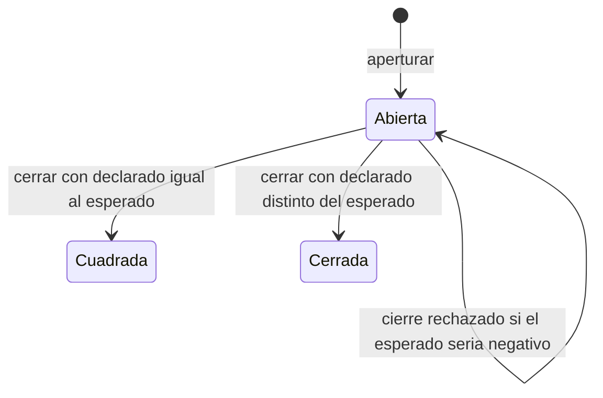
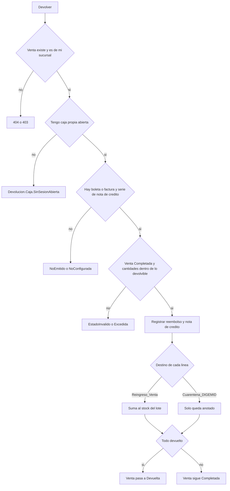
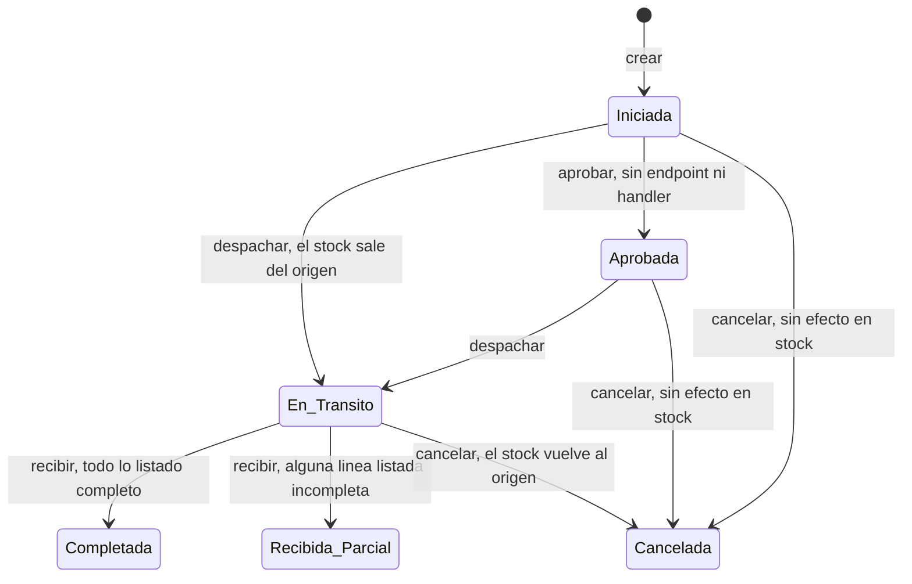
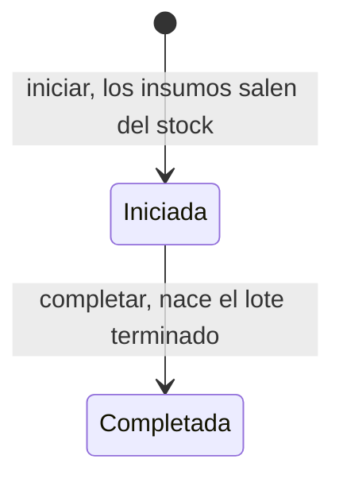
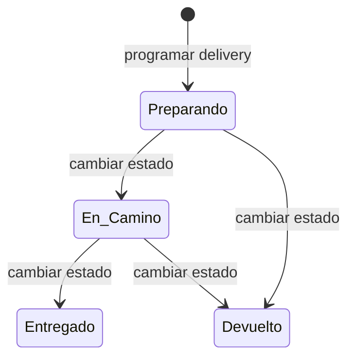
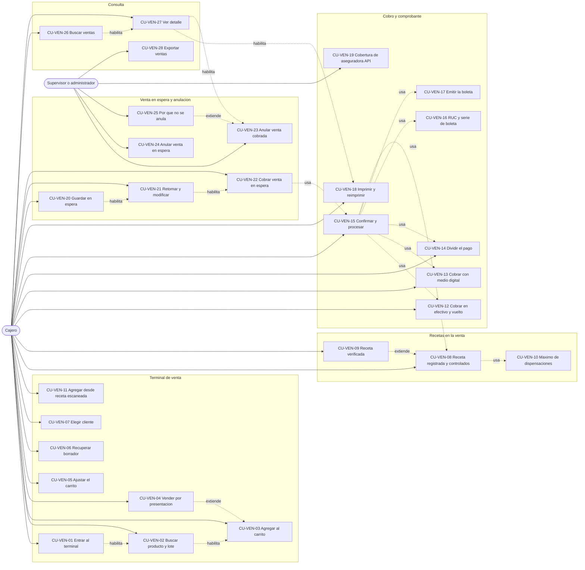
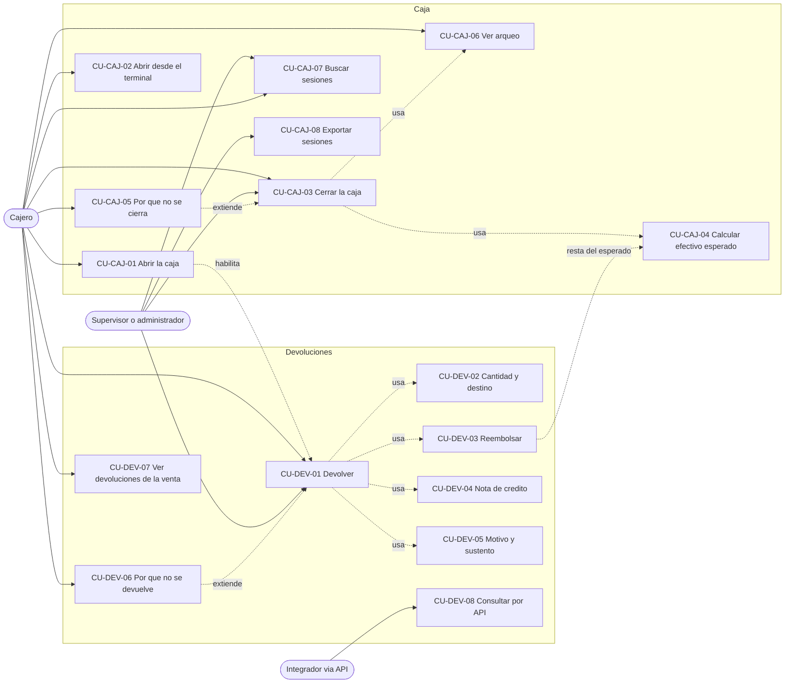
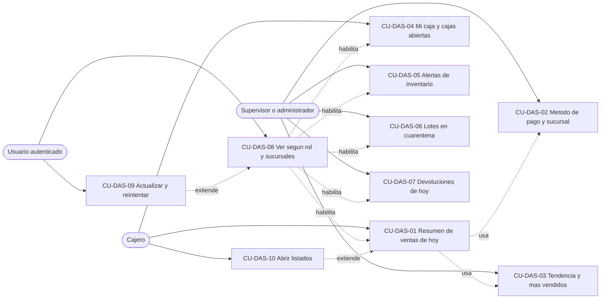
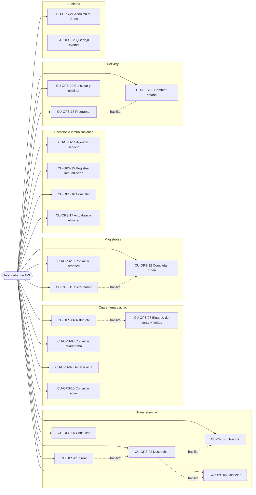

# Casos de uso — Parte C: punto de venta, caja, devoluciones, dashboard y módulos solo API

| | |
|---|---|
| **Sistema** | SOFIA — Sistema Optimizado Farmacéutico con Inteligencia Artificial |
| **Versión del documento** | 1.0 |
| **Fecha** | 2026-10-27 |
| **Backend** | `sofia-apis`, rama `main`, commit `43f5529` |
| **Frontend** | `sofia-web-spa`, rama `main`, commit `eeffbb6` |
| **Método** | Lectura de los documentos validados (reglas 01c1, 01c2 v1.1, 01c3 y 01d; inventario de pantallas 19a y 19f; matriz de permisos 05b; procesos de negocio 4, 5, 6, 8 y 9; historias de usuario 12c; catálogo de códigos de error 21) y comprobación puntual en el código (`VentasController`, `CreateVentaCommandHandler`, `ProcesarDevolucionCommandHandler`, `CerrarCajaCommandHandler`, `ArqueoCajaCalculator`, `ValidationBehavior`, `ResultExtensions`) y en `endpoints.csv`. `git status --short` está limpio en ambos repositorios. No se ejecutó la aplicación ni se llamó a la API: los mensajes salen de los `es.json` a través de los documentos fuente. |

## 1. Cómo leer este documento

Este documento describe, caso de uso por caso de uso, cómo interactúan los actores con SOFIA en la **parte C**: el punto de venta (terminal de venta, recetas en la venta, pagos y comprobante, venta en espera, anulación y consulta de ventas), la caja (apertura, cierre y arqueo), las devoluciones, el dashboard y los módulos que solo existen en la API (transferencias, cuarentena y actas DIGEMID, órdenes magistrales, servicios e inmunizaciones, delivery y auditoría). Acceso y administración (`CU-ADM`, parte A) y catálogos, inventario y atención (`CU-CAT` y `CU-INV`, parte B) los cubren [13a][CU-A] y [13b][CU-B].

**Convenciones**

- IDs `CU-VEN-nn` (ventas y comprobantes), `CU-CAJ-nn` (caja), `CU-DEV-nn` (devoluciones), `CU-DAS-nn` (dashboard) y `CU-OPS-nn` (módulos solo API; actor «integrador vía API», sin pantalla). La numeración sigue a la de las historias de usuario de [12c][HU-C]: `CU-VEN-07` corresponde a `HU-VEN-007`, `CU-OPS-15` a `HU-OPS-015`. Cada caso enlaza su historia en la fila «Historia».
- Las reglas `RN-…` se enlazan con la sección de su catálogo de reglas (la lista de enlaces está al final). Las reglas transversales `GEN`, `IMP`, `SER`, `EMP`, `STK` y `LOT` son las de las partes A y B.
- Los textos entre « » son los que ve el usuario, tal como están en los `es.json`. Cuando el sistema no tiene un mensaje propio, la tabla de excepciones dice cuál es el genérico de la pantalla; en el cobro, muchos rechazos del servidor se ven como «Ocurrió un error al procesar la venta.» y así se dice donde corresponde.
- **Brecha conocida**: lo que el sistema hace hoy distinto de lo que el negocio esperaría. Siempre se describe el comportamiento actual y se cita la fuente (hallazgo del catálogo de reglas o historia de usuario). Nada se da por cumplido si el sistema no lo hace.
- **Estado** de cada caso: «Implementado», «Parcial» o «Solo API (sin pantalla)».
- «No verificado» marca lo que no se pudo comprobar en la aplicación; el apartado 11 los reúne.
- Permisos como los exige el endpoint: `Módulo:Acción`. En la matriz de permisos de la pantalla de roles, el módulo `POS` se rotula «Sesiones de Caja».
- Los importes están en soles (S/). Los ejemplos numéricos son ilustrativos (no son datos de la aplicación).
- Los códigos de error de los validadores no son literales: `ValidationBehavior` genera `{NombreDelRequest}.{Propiedad}` con HTTP 400 (`sofia-apis/src/SOFIA.Application/Common/Behaviors/ValidationBehavior.cs:25`). En las tablas se escriben abreviados (`CreateVentaCommand.Detalles…`).

## 2. Actores

| Actor | Quién es |
|---|---|
| Cajero | Usuario de mostrador con un rol limitado: vende, cobra, abre y cierra su caja, anula y devuelve según los permisos que se le marcaron. El script `0002` crea el rol «Cajero» **sin permisos**: los concede el administrador ([05b][SEG-C]). |
| Supervisor / administrador | Usuario con el rol `Admin` (pasa cualquier comprobación de permiso, [RN-GEN-021]) o con permisos de gestión (`Ventas:Anular`, `Devoluciones:ProcesarDevolucion`, `POS:CerrarCaja`). En ventas, caja y devoluciones el `Admin` tampoco opera otras sucursales distintas de la de su token. |
| Cualquier usuario autenticado | Entra al Inicio (`/dashboard`); cada bloque exige el `Leer` de su módulo. |
| Cliente | Persona que compra o devuelve. No usa el sistema; en la venta es opcional y se identifica como paciente. |
| Sistema | SOFIA (API y SPA): valida, guarda, calcula y audita. |
| Integrador vía API | Quien consume la API directamente con un token de un usuario que tiene los permisos del módulo. Es el actor de los casos `CU-OPS` (los módulos no tienen pantalla) y de las consultas de devoluciones sin pantalla. |

## 3. Comportamientos comunes

Para no repetirlos en cada caso, estos comportamientos valen para toda la parte C. Cada caso nombra solo lo que cambia.

### 3.1 Contexto del token

- La sucursal y el empleado de toda operación salen del token (claims `sucursalId` y `empleadoId`), no se eligen ([RN-VEN-002], [RN-CAJ-002], [RN-DEV-002]). Si falta alguno el sistema responde `Auth.Sucursal` o `Auth.Empleado` con HTTP 400 ([RN-GEN-024]). `Auth.Sucursal` solo tiene texto propio en el terminal de venta: «No se pudo determinar el contexto de sucursal asignada del usuario.» (`pos.messages.contextError`).
- El rol `Admin` no se salta la comparación con la sucursal del token en ventas, caja (apertura), devoluciones, transferencias y órdenes magistrales ([RN-VEN-062], [RN-DEV-004], [RN-TRA-012], [RN-MAG-013]).

### 3.2 Permisos y rutas

- Cada endpoint exige un permiso `Módulo:Acción`. Sin permiso la API responde 403 ([RN-GEN-020]); el SPA no tiene texto propio y muestra el genérico de la operación. La forma exacta de la respuesta es **No verificado**.
- Guardia de ruta del SPA: `Leer` del módulo; `/pos/nueva` exige además `Ventas:Crear` y `/sesiones-caja/nueva` además `POS:AperturarCaja`. Sin permiso el SPA muestra «No tienes permisos para acceder a esta pantalla.» (`errors.forbiddenPage`) y redirige a `/dashboard`. `/pos/nueva?continuar={id}` no exige `Ventas:Actualizar` en la ruta, aunque la API sí lo exige al cobrar o actualizar la venta en espera (hallazgo a1 de [05b][SEG-C]).
- Un rol que solo tenga `Ventas` y `POS` no puede vender: el terminal consulta además `Medicamentos:Leer`, `Pacientes:Leer`, `Recetas:Leer` y `POS:Leer` ([19f §0.4][PAN-F]).

### 3.3 Cómo se convierte un rechazo en respuesta HTTP

- El código HTTP es el número que pasa el handler. Un `Result.Failure` sin número responde **400** aunque el error sea de tipo `NotFound`, `Forbidden` o `Conflict` (`sofia-apis/src/SOFIA.Domain/Common/Result.cs:32-33`; `sofia-apis/src/SOFIA.API/Extensions/ResultExtensions.cs`). Por eso, por ejemplo, `Venta.Lote` y `Transferencia.Forbidden` responden 400. La columna «HTTP» de las tablas es siempre el número real.
- Éxito: crear venta, cobrar una venta en espera, abrir y cerrar caja y procesar devolución responden **200** (no 201); actualizar detalles y anular responden **204**. Las consultas `GET Pos/{id}`, `GET Devoluciones/{id}`, y las de delivery, magistrales y servicios por identificador devuelven el objeto `Result` completo con el dato en `value`.
- Un `Result.Failure` no revierte lo ya guardado ([RN-GEN-012]); en ventas ningún comando guarda antes de validar, salvo el aumento del correlativo de la serie.
- Cada pantalla traduce los errores con su propio mapa de códigos; lo que no está en el mapa muestra el genérico de la pantalla. Cobrar y dejar en espera: «Ocurrió un error al procesar la venta.» (`pos.messages.ventaError`); anular: «Error al anular la venta.»; devolver: «Error al procesar la devolución.»; abrir caja: «Error al aperturar la sesión» (pantalla) o «No se pudo aperturar la caja» (terminal); cerrar caja: «Error al cerrar la sesión»; buscar ventas: «Error al buscar ventas»; buscar sesiones: «Error al buscar sesiones de caja»; un fallo del dashboard: «No se pudo cargar esta sección.». El catálogo completo de códigos está en [21][CAT-ERR].
- Errores de base de datos que pueden aparecer en cualquier guardado ([RN-GEN-035] a [RN-GEN-038]): `Db.Duplicado` (409), `Db.ReferenciaInvalida` (409), `Db.ValorInvalido` (400) y `Concurrency.Conflict` (409). De ellos solo `Concurrency.Conflict` tiene texto en las pantallas de la parte C: «Otra operación modificó estos datos al mismo tiempo. Actualiza la pantalla e inténtalo de nuevo.» (`errors.concurrencyConflict`); los demás caen en el genérico.

### 3.4 Búsquedas, exportaciones y fechas

- Las búsquedas de `/pos` y `/sesiones-caja` muestran la tabla solo tras **Buscar** (o con filtros guardados), recuerdan filtros y página al volver, paginan 10, 25 y 50 (10 por defecto) y **Buscar** no vuelve a la página 1 ([RN-GEN-009]). **Limpiar** vacía los filtros y oculta la tabla.
- **Exportar** envía `POST …/exportar` con los títulos traducidos y los filtros escritos; no genera el archivo si hay más de 10 000 filas (`Export.TooManyRows`, 400, [RN-IMP-008]) y el SPA muestra el aviso «Error al buscar …» de la pantalla. Las fechas del Excel se formatean en UTC sin convertir a hora local ([RN-VEN-078], [RN-CAJ-024]).
- Los filtros de fecha son inclusivos y se envían como inicio y fin del día local en UTC ([RN-GEN-008]). Las fechas se guardan en UTC ([RN-GEN-006]).

### 3.5 Casos sin pantalla (`CU-OPS`)

En los casos «Solo API (sin pantalla)» no existe «mensaje que ve el usuario»: la columna dice el `code` y el `detail` que devuelve la API en un `ProblemDetails` (`status`, `detail` y la extensión `code`). Los mensajes internos están en inglés o español según el archivo. Los permisos de transferencias, delivery, magistrales, servicios, cuarentena y actas, y auditoría **no los siembra ningún script**: los concede el administrador. Ninguna operación de estos módulos genera evento de auditoría ([RN-AUD-006]).

---

## 4. Casos de uso del punto de venta (`CU-VEN`)

### 4.1 Terminal de venta: caja, productos, carrito y cliente

### CU-VEN-01 — Entrar al terminal de venta con la caja propia abierta

| | |
|---|---|
| **Actor principal** | Cajero (`Ventas:Leer` y `Ventas:Crear`; `POS:Leer` para que el terminal encuentre su caja) |
| **Actores secundarios** | Sistema |
| **Disparador** | Llega un cliente al mostrador y el cajero quiere vender |
| **Precondiciones** | Sesión iniciada con sucursal y empleado en el token; el cajero tiene **su propia caja abierta** en su sucursal (si no, el caso termina en la tarjeta de aviso, alternativo A1) |
| **Pantalla** | `/pos/nueva` — «Terminal de Punto de Venta (POS)». No está en el menú: se llega desde «Nueva Venta POS» de `/pos`, desde «Cobrar Venta» del detalle de una venta en espera o desde el diálogo del comprobante |
| **Endpoints** | `GET /api/v1/POS/sesiones` (sucursal, empleado y estado Abierta); `GET /api/v1/Ventas/configuracion`; `GET /api/v1/Medicamentos/condiciones-venta` |
| **Reglas** | [RN-VEN-001], [RN-VEN-002], [RN-VEN-003], [RN-VEN-004], [RN-VEN-005], [RN-VEN-077], [RN-VEN-028] |
| **Historia** | [HU-VEN-001] |
| **Estado** | Implementado |

**Flujo principal**
1. El cajero abre `/pos/nueva`. El guard de ruta exige `Ventas:Leer` y `Ventas:Crear` ([RN-VEN-001]).
2. El SPA muestra un indicador de carga y, con la sucursal y el empleado del token ([RN-VEN-002]), busca la sesión de caja: `GET /api/v1/POS/sesiones` con `estadoSesion=Abierta`, página 1 de tamaño 1.
3. El SPA lee la configuración de la empresa (`GET Ventas/configuracion`, devuelve solo `ExigirRegistroReceta`, [RN-VEN-077], [RN-VEN-028]), los nombres de las condiciones de venta y lanza la primera búsqueda de productos ([CU-VEN-02]).
4. Si vuelve una sesión, el SPA guarda su identificador y habilita el terminal: búsqueda de productos, carrito, «Datos del Cliente» y «Método de Pago».
5. El terminal no muestra la hora de apertura, el monto inicial ni el efectivo esperado de la caja.

**Flujos alternativos**
- **A1 — No hay caja propia abierta** (paso 2): el terminal muestra solo una tarjeta con «Debes aperturar la caja del turno antes de procesar una venta.» No se ve el catálogo, el carrito ni los pagos; no se puede vender ni dejar una venta en espera. Si el cajero tiene `POS:AperturarCaja` ve el botón **Aperturar Caja**, que abre el diálogo de [CU-CAJ-02](#cu-caj-02--abrir-la-caja-desde-el-terminal-de-venta); si la apertura termina bien, el terminal vuelve a buscar la caja y se habilita. Sin ese permiso la tarjeta solo informa.
- **A2 — La caja abierta es de otro cajero** (paso 2): el terminal busca la sesión del empleado y la sucursal del token; una caja ajena no sirve y el cajero ve el aviso de A1.
- **A3 — Retomar una venta en espera** (paso 1): con `?continuar={id}` el terminal carga la venta en lugar del borrador local ([CU-VEN-21](#cu-ven-21--retomar-y-modificar-una-venta-en-espera)).
- **A4 — La configuración no carga** (paso 3): no se muestra ningún error; el terminal asume que la empresa exige registro de receta (modo estricto, [RN-VEN-028]).

**Excepciones**

| Paso | Situación | Código de error | HTTP | Mensaje que ve el usuario | Qué pasa después |
|---|---|---|---|---|---|
| 1 | El actor no tiene `Ventas:Crear` | — (guard de ruta) | — | «No tienes permisos para acceder a esta pantalla.» (`errors.forbiddenPage`) | Redirige a `/dashboard` |
| 2 | El token no trae sucursal o empleado | `Auth.Sucursal` · `Auth.Empleado` (el SPA ni siquiera llama) | — | Igual que A1 | Solo la tarjeta de aviso |
| 2 | Falla la búsqueda de la caja (por ejemplo, el rol no tiene `POS:Leer`) | — | 403 | Igual que A1, **sin ningún aviso de error** | El cajero que sí tiene caja abierta y pulsa **Aperturar Caja** ve «Ya tienes una caja abierta. Ciérrala antes de abrir otra.» |
| 3 | La sucursal falta al consultar lotes o configuración | `Auth.Sucursal` | 400 | «No se pudo determinar el contexto de sucursal asignada del usuario.» (`pos.messages.contextError`) | La consulta queda sin datos |
| 3 | Falla `GET Ventas/configuracion` | — | 4xx/5xx | Ninguno | Modo estricto ([RN-VEN-028]) |
| Venta | (al cobrar) la sesión indicada es de otro cajero o de otra sucursal | `Venta.Caja.NoPropia` ([RN-VEN-005]) | 403 | «La caja seleccionada pertenece a otro cajero o sucursal. Recarga la página para usar tu propia caja abierta.» (`pos.messages.cajaNoPropia`) | No se registra la venta |
| Venta | (al cobrar) la sesión no existe, está cerrada o no se envió | `Venta.Caja` ([RN-VEN-003], [RN-VEN-004]) | 400 | Sin traducción: «Ocurrió un error al procesar la venta.» (`pos.messages.ventaError`) | No se registra la venta |

**Postcondiciones**
- Éxito: el terminal queda habilitado con el identificador de la caja propia; no se guarda nada en el servidor.
- Fallo: no se puede vender; no cambia ningún dato.

> **Brecha conocida.** Sin `POS:Leer` el terminal trata la falla como «sin caja» sin avisar del error; además consulta endpoints de otros módulos (`Medicamentos:Leer`, `Pacientes:Leer`, `Recetas:Leer`) sin controlarlos en el SPA. Una venta con la caja cerrada o inexistente se ve con el genérico. Fuente: [HU-VEN-001], 19f §0.4 y §3.1, [RN-VEN-003], [RN-VEN-004].

### CU-VEN-02 — Buscar productos y elegir el lote

| | |
|---|---|
| **Actor principal** | Cajero (`Ventas:Crear` para los lotes; `Medicamentos:Leer` para el catálogo) |
| **Actores secundarios** | Sistema |
| **Disparador** | El cliente pide un producto |
| **Precondiciones** | Terminal habilitado con caja propia abierta ([CU-VEN-01]); hay lotes vendibles en la sucursal del cajero |
| **Pantalla** | `/pos/nueva` — columna «Producto» (campo «Buscar producto...», chips de condición, tarjetas de producto y filas «Lote:») |
| **Endpoints** | `GET /api/v1/Medicamentos`; `GET /api/v1/Medicamentos/condiciones-venta`; `GET /api/v1/Ventas/lotes-disponibles` |
| **Reglas** | [RN-VEN-001], [RN-VEN-011], [RN-VEN-012], [RN-VEN-013], [RN-VEN-014], [RN-VEN-075] |
| **Historia** | [HU-VEN-002] |
| **Estado** | Implementado |

**Flujo principal**
1. Al entrar, sin texto ni chip, el SPA pide `GET Medicamentos` (12 por página, solo con stock vendible en la sucursal propia) y muestra los productos más vendidos de los últimos 30 días primero.
2. El cajero escribe en «Buscar producto...» (la búsqueda es por nombre comercial y se lanza unos 300 ms después de dejar de teclear) o hace clic en un chip: «Todos», «Venta Libre (OTC)», «Receta Simple», «Receta Retenida» o «Estupefaciente».
3. Cada tarjeta muestra el nombre comercial, «{laboratorio} · {código nacional}», el aviso «Requiere receta» si no es de venta libre, el precio «S/ 0.50 c/u» (o «Sin precio») y una insignia de stock vendible: «Agotado» (0), «Stock bajo» (1 a 10) o «Disponible» (más de 10).
4. El cajero hace clic en una tarjeta. El SPA pide `GET Ventas/lotes-disponibles?productoId=…` ([RN-VEN-001]: permiso `Ventas:Crear`).
5. El sistema devuelve como máximo 50 lotes **vendibles de la sucursal del token**: cantidad mayor que 0, lote no vencido y sin retención en cuarentena, ordenados por vencimiento más próximo y luego por número de lote ([RN-VEN-075], [RN-VEN-012], [RN-VEN-013]). Un lote se vende hasta el final de su día de caducidad.
6. El SPA muestra «Lote:» y una fila por lote con el número y «Stock Disp: {cantidad}». El terminal no muestra la fecha de vencimiento.
7. El cajero elige un lote; sigue [CU-VEN-03]. El sistema no obliga a vender primero el lote que vence antes.

**Flujos alternativos**
- **A1 — Sin resultados** (paso 2): «No se encontraron medicamentos o lotes disponibles.»
- **A2 — Producto sin lotes** (paso 5): igual que A1 en la lista de lotes.
- **A3 — Llamada directa a la API** (paso 4): `GET Ventas/lotes-disponibles?productoNombre=…` también filtra por nombre comercial (sin distinguir mayúsculas); sin `productoId` ni `productoNombre` se rechaza.

**Excepciones**

| Paso | Situación | Código de error | HTTP | Mensaje que ve el usuario | Qué pasa después |
|---|---|---|---|---|---|
| 1-2 | Falla la búsqueda de productos | — | 4xx/5xx | «No se pudo cargar el catálogo de medicamentos. Inténtalo nuevamente.» (`pos.messages.catalogoError`) | La búsqueda sigue funcionando con el siguiente texto |
| 4 | Falla la consulta de lotes | — | 4xx/5xx | «No se pudieron cargar los lotes disponibles. Inténtalo nuevamente.» (`pos.messages.lotesError`) | La lista de lotes queda vacía |
| 4 | La API recibe la consulta sin `productoId` ni `productoNombre` (el SPA nunca lo hace) | `Venta.LotesDisponibles.ProductoRequerido` | 400 | Sin traducción: `pos.messages.lotesError` | Sin lotes |
| 4 | El token no trae sucursal | `Auth.Sucursal` | 400 | «No se pudo determinar el contexto de sucursal asignada del usuario.» (`pos.messages.contextError`) | Sin lotes |
| Cobro posterior | Un lote que solo tiene stock en otra sucursal, o que no existe, llega a la petición de venta | `Venta.Lote` ([RN-VEN-011]) | 400 | «Ocurrió un error al procesar la venta.» | No se registra la venta |
| Cobro posterior | El lote entró en cuarentena entre la búsqueda y el cobro | `Venta.Cuarentena` ([RN-VEN-012]) | 400 | «Ocurrió un error al procesar la venta.» | No se registra la venta |
| Cobro posterior | Otro cajero agotó el lote | `Venta.Stock` ([RN-VEN-014]) | 400 | «Ocurrió un error al procesar la venta.» | El carrito se conserva |

**Postcondiciones**
- Éxito: el cajero tiene elegido un lote; no se guarda nada en el servidor.
- Fallo: sin cambios.

> **Brecha conocida.** El terminal no muestra la fecha de vencimiento del lote ni avisa si hay stock en otra sucursal (los textos de pedido de transferencia desde el POS existen sin uso). Los rechazos de lote inexistente, sin stock en la sucursal, en cuarentena o sin stock suficiente se ven con el genérico. Fuente: [HU-VEN-002], 01c2 §5.3 hallazgo 3.

### CU-VEN-03 — Agregar productos al carrito

| | |
|---|---|
| **Actor principal** | Cajero (`Ventas:Crear`) |
| **Actores secundarios** | Sistema |
| **Disparador** | El cajero eligió un lote ([CU-VEN-02]) y el cliente indicó la cantidad |
| **Precondiciones** | Terminal habilitado; lote elegido con precio de catálogo |
| **Pantalla** | `/pos/nueva` — formulario de agregado y panel «Resumen de Venta» |
| **Endpoints** | Ninguno al agregar (validación local); el servidor revalida todo al cobrar con `POST /api/v1/Ventas` |
| **Reglas** | [RN-VEN-008], [RN-VEN-009], [RN-VEN-010], [RN-VEN-011], [RN-VEN-014], [RN-VEN-019], [RN-VEN-020], [RN-VEN-021], [RN-VEN-022], [RN-VEN-023], [RN-VEN-024], [RN-VEN-080] |
| **Historia** | [HU-VEN-003] |
| **Estado** | Implementado |

**Flujo principal**
1. Con el lote elegido aparece el formulario: «Cantidad» (valor inicial 1) y «Precio Unitario (S/)», de solo lectura, con el precio del catálogo ([RN-VEN-019]).
2. El cajero escribe la cantidad (por ejemplo 100) y hace clic en **Agregar**.
3. El SPA valida en este orden ([RN-VEN-024]): cantidad en unidades base contra la existencia del lote, precio mayor que 0, cantidad mayor que 0.
4. El SPA agrega la línea al panel «Resumen de Venta · n»: producto, lote, «S/ 0.50 c/u» y total de la línea «S/ 50.00». Si ya hay una línea del mismo lote y la misma presentación, suma a esa línea sin pasar de la existencia.
5. El SPA recalcula los totales ([RN-VEN-021]): «Subtotal (Op. Gravada):» (total ÷ 1,18), «IGV (18%):» y «TOTAL A PAGAR:». Ejemplo: 100 unidades a S/ 0.50 dan S/ 42.37, S/ 7.63 y S/ 50.00. No existen descuentos ([RN-VEN-023]).
6. El SPA limpia la selección de lote y producto.
7. Al cobrar ([CU-VEN-15]), el servidor vuelve a validar cada línea, resuelve el precio y el costo histórico vigente del precio de proveedor (0 si no hay) y guarda la cantidad en unidades base ([RN-VEN-008] a [RN-VEN-011], [RN-VEN-014], [RN-VEN-020], [RN-VEN-022], [RN-VEN-080]).

**Flujos alternativos**
- **A1 — Mismo producto con otro lote** (paso 4): genera una línea nueva.
- **A2 — Cantidades con decimales** (paso 3): el SPA las acepta si son mayores que 0; cómo redondea la base de datos más de 2 decimales es **No verificado** ([RN-VEN-010], [RN-VEN-020]).
- **A3 — Por presentación** (paso 1): ver [CU-VEN-04].

**Excepciones**

| Paso | Situación | Código de error | HTTP | Mensaje que ve el usuario | Qué pasa después |
|---|---|---|---|---|---|
| 3 | La cantidad supera la existencia del lote | — (validación local) | — | «Stock máximo disponible alcanzado ({{stock}} un.).» (`pos.messages.stockMaxReached`) | No se agrega la línea |
| 3 | Precio 0 o producto sin precio en el catálogo | — (validación local) | — | «Este producto no tiene precio de venta configurado en el catálogo. Pide a un administrador que lo registre.» (`pos.messages.sinPrecio`) | No se agrega la línea |
| 3 | Cantidad 0 o vacía | — (validación local) | — | «Ingresa una cantidad válida para agregar el producto.» (`pos.messages.cantidadPrecioInvalidos`) | No se agrega la línea |
| 4 | Repetir el lote y superar la existencia | — (validación local) | — | «Stock máximo disponible alcanzado ({{stock}} un.).» | La cantidad queda en la existencia |
| 7 | El servidor encuentra el producto sin precio | `Venta.SinPrecio` ([RN-VEN-019]) | 400 | «Este producto no tiene precio de venta configurado en el catálogo. Pide a un administrador que lo registre.» | No se registra la venta |
| 7 | Otro cajero agotó el lote | `Venta.Stock` | 400 | «Ocurrió un error al procesar la venta.» | El carrito se conserva |
| 7 | El lote venció mientras se armaba la venta | `Venta.Lote.Vencido` ([RN-VEN-013]) | 400 | «Uno de los lotes está vencido y no se puede vender. Retíralo del carrito.» (`pos.messages.loteVencido`) | El cajero quita la línea |
| 7 | Línea sin lote, cantidad ≤ 0 | `CreateVentaCommand.Detalles[i].LoteId` · `.Cantidad` | 400 | «Ocurrió un error al procesar la venta.» (el SPA no deja llegar a este caso) | No se registra la venta |
| 7 | Importe fuera de rango en la base | `Db.ValorInvalido` ([RN-VEN-080]) | 400 | «Ocurrió un error al procesar la venta.» | No se registra la venta |

**Postcondiciones**
- Éxito: el carrito tiene una línea más (o una cantidad mayor); el servidor no ha guardado nada. El borrador queda en el navegador ([CU-VEN-06]).
- Fallo: el carrito no cambia.

> **Brecha conocida.** Casi todos los rechazos de negocio del cobro se ven con el genérico (01c2 §5.3 hallazgo 3). Los precios 0 no se rechazan en el servidor (solo el nulo; hallazgo 20). Subtotal e IGV de la pantalla (`total ÷ 1,18` sin redondear) pueden diferir en un centavo del desglose guardado en la boleta (hallazgo 11; **No verificado**). Fuente: [HU-VEN-003].

### CU-VEN-04 — Vender por presentación (caja, blíster)

| | |
|---|---|
| **Actor principal** | Cajero (`Ventas:Crear`) |
| **Actores secundarios** | Sistema |
| **Disparador** | El cliente pide una caja o un blíster en lugar de unidades sueltas |
| **Precondiciones** | Lote elegido ([CU-VEN-02]); el producto tiene al menos una presentación de venta en el catálogo |
| **Pantalla** | `/pos/nueva` — selector «Presentación» del formulario de agregado |
| **Endpoints** | `GET /api/v1/Ventas/presentaciones?productoId=`; `POST /api/v1/Ventas` (al cobrar) |
| **Reglas** | [RN-VEN-017], [RN-VEN-018], [RN-VEN-019], [RN-VEN-020], [RN-VEN-076], [RN-PRE-001] a [RN-PRE-015] (catálogo) |
| **Historia** | [HU-VEN-004] |
| **Estado** | Implementado |

**Flujo principal**
1. Al elegir un lote, el SPA pide `GET Ventas/presentaciones` y el sistema devuelve todas las presentaciones del producto (descripción, unidades base, precio), ordenadas por descripción ([RN-VEN-076]).
2. Si hay presentaciones aparece el selector «Presentación» con «Unidad» y, por cada una, «{descripción} (S/ {precio})», por ejemplo «Caja x10 (S/ 4.50)».
3. El cajero elige «Caja x10 (S/ 4.50)»; la cantidad vuelve a 1 y el precio pasa a ser el de la presentación. El máximo de «Cantidad» son las presentaciones enteras que caben en el lote (35 unidades y cajas de 10 permiten 3).
4. Escribe Cantidad 2 y hace clic en **Agregar**. El SPA convierte a unidades base (`cantidad × unidades base`) y calcula el precio por unidad base (`precio ÷ unidades base`). La línea del carrito muestra «2 × Caja x10», «S/ 0.45 c/u» y total «S/ 9.00».
5. Al cobrar, el SPA envía la cantidad en unidades de la presentación y el identificador de la presentación; el servidor calcula la cantidad base (`2 × 10 = 20`), descuenta 20 unidades del stock del lote y guarda ambas cantidades y la presentación ([RN-VEN-017]).

**Flujos alternativos**
- **A1 — Volver a «Unidad»** (paso 3): la cantidad vuelve a 1 y el precio al del catálogo.
- **A2 — Producto sin presentaciones** (paso 2): no aparece el selector; solo se vende por unidad.
- **A3 — Ajustar en el carrito**: «+» y «−» avanzan de a una presentación (de 20 a 30 unidades base y de 2 a 3 presentaciones).
- **A4 — Medicamento sin precio base** (paso 4): la presentación con precio se vende igual; el precio unitario es el de la presentación dividido entre sus unidades base ([RN-VEN-019]).

**Excepciones**

| Paso | Situación | Código de error | HTTP | Mensaje que ve el usuario | Qué pasa después |
|---|---|---|---|---|---|
| 1 | Falla la carga de presentaciones | — | 4xx/5xx | «No se pudieron cargar las presentaciones del producto. Inténtalo nuevamente.» (`pos.messages.presentacionesError`) | Solo se vende por unidad |
| 5 | La presentación no existe o es de otro producto | `Venta.Presentacion` ([RN-VEN-018]) | 400 | «Ocurrió un error al procesar la venta.» | No se registra la venta |
| 5 | La cantidad en presentaciones excede el lote (se suma sin tope al repetir la presentación) | `Venta.Stock` | 400 | «Ocurrió un error al procesar la venta.» | El carrito se conserva |

**Postcondiciones**
- Éxito: el carrito tiene la línea por presentación; al cobrar, el stock baja en unidades base.
- Fallo: sin cambios.

> **Brecha conocida.** Si el precio de la presentación no divide exacto entre sus unidades base (por ejemplo S/ 10.00 entre 3), el servidor no redondea el precio unitario y no se verificó cómo lo convierte la base a 2 decimales ([RN-VEN-020], 01c2 §5.1 puntos 1 y 2). Fuente: [HU-VEN-004], 19f §3.15.

### CU-VEN-05 — Ajustar, quitar y vaciar el carrito

| | |
|---|---|
| **Actor principal** | Cajero (`Ventas:Crear`) |
| **Actores secundarios** | Sistema |
| **Disparador** | El cliente cambia de idea antes de pagar |
| **Precondiciones** | Terminal habilitado |
| **Pantalla** | `/pos/nueva` — panel «Resumen de Venta» |
| **Endpoints** | Ninguno (acciones locales) |
| **Reglas** | [RN-VEN-008], [RN-VEN-014], [RN-VEN-024], [RN-VEN-045] |
| **Historia** | [HU-VEN-005] |
| **Estado** | Implementado |

**Flujo principal**
1. Con el carrito vacío el cajero ve «El carrito está vacío.»; no ve los totales y los botones **Procesar Venta** y **Guardar y Atender Siguiente** están deshabilitados ([RN-VEN-008]).
2. Con líneas, el cajero hace clic en «+» o «−» de una línea: la cantidad cambia en un paso (1 unidad base, o las unidades de la presentación) y se recalculan el total de la línea y los totales.
3. Para quitar una línea hace clic en «×»; para quitarlas todas, en **Vaciar**. Ninguna acción pide confirmación.
4. Al quedar el carrito vacío los pagos vuelven a un único pago en «Efectivo» por 0 y al modo de pago simple ([RN-VEN-045]); el cliente, la receta y la cobertura elegidos no se descartan.

**Flujos alternativos**
- **A1 — Cantidad exacta**: el carrito no tiene campo para escribirla; el cajero usa «+» y «−», o quita la línea y la agrega de nuevo.

**Excepciones**

| Paso | Situación | Código de error | HTTP | Mensaje que ve el usuario | Qué pasa después |
|---|---|---|---|---|---|
| 2 | «+» por encima de la existencia del lote | — (validación local, [RN-VEN-014], [RN-VEN-024]) | — | «Stock máximo disponible alcanzado ({{stock}} un.).» | La cantidad queda igual |
| 2 | «−» en la cantidad mínima | — | — | Ninguno | No pasa nada |

**Postcondiciones**
- Éxito: el carrito refleja el cambio; el servidor no sabe nada.
- Fallo: sin cambios.

### CU-VEN-06 — Recuperar la venta en curso tras recargar (borrador local)

| | |
|---|---|
| **Actor principal** | Cajero (`Ventas:Crear`; `Pacientes:Leer` para restaurar el cliente) |
| **Actores secundarios** | Sistema (el navegador guarda el borrador) |
| **Disparador** | El cajero recarga la página o cierra y vuelve a abrir la pestaña con una venta a medias |
| **Precondiciones** | Terminal con carrito, cliente o pagos en curso |
| **Pantalla** | `/pos/nueva` (comportamiento automático) |
| **Endpoints** | `GET /api/v1/Pacientes/{id}` (solo para restaurar el cliente) |
| **Reglas** | [RN-VEN-045], [RN-VEN-053] |
| **Historia** | [HU-VEN-006] |
| **Estado** | Implementado |

**Flujo principal**
1. En cada cambio del carrito, los pagos, el cliente, la receta o la aseguradora, el SPA guarda un borrador en el navegador del equipo (`localStorage`, una clave por usuario) con las líneas, los pagos (método, monto y número de operación), el identificador del cliente y de la receta; no guarda datos personales.
2. El cajero recarga la página dentro de las 12 horas.
3. El SPA lee el borrador y restaura carrito, pagos (pasa al modo dividido si hay más de un pago), cliente (con `GET Pacientes/{id}`; si falla, lo descarta), receta elegida y monto de aseguradora. La casilla «Receta verificada» no se restaura.
4. El borrador se borra al cobrar con éxito, al vaciar el carrito sin cliente ni aseguradora, al cerrar sesión y cuando otro usuario inicia sesión en el mismo navegador.

**Flujos alternativos**
- **A1 — Borrador caducado** (paso 3): pasadas 12 horas desde el último guardado, el borrador se descarta y el terminal empieza vacío.
- **A2 — Venta en espera retomada** (paso 3): solo sobreviven los pagos que no son efectivo, con monto y número de operación; el efectivo escrito nunca se conserva ([RN-VEN-053]).

**Excepciones**

| Paso | Situación | Código de error | HTTP | Mensaje que ve el usuario | Qué pasa después |
|---|---|---|---|---|---|
| 3 | Falla `GET Pacientes/{id}` al restaurar el cliente | — | 4xx/5xx | Ninguno | El cliente se descarta |
| 3 | El borrador está corrupto o es antiguo | — | — | Ninguno | Se descarta y se borra |

**Postcondiciones**
- Éxito: el terminal vuelve al estado guardado; el servidor no interviene.
- Fallo: el terminal empieza vacío.

> **Brecha conocida.** El borrador no vuelve a validar los lotes (las líneas conservan la existencia con que se guardaron); `saveDraft` y `restoreDraft` usan `localStorage` sin `try/catch` (**No verificado**); un borrador antiguo con aseguradora puede reducir el «TOTAL A PAGAR» sin forma visible de quitarla porque el bloque está oculto ([CU-VEN-19]). Fuente: [HU-VEN-006], 19f §3.8 y §3.9.

### CU-VEN-07 — Elegir al cliente de la venta

| | |
|---|---|
| **Actor principal** | Cajero (`Ventas:Crear`; `Pacientes:Leer` para buscar) |
| **Actores secundarios** | Cliente, Sistema |
| **Disparador** | El cajero quiere que la boleta salga a nombre del comprador, o necesita usar sus recetas |
| **Precondiciones** | Terminal habilitado; el paciente está registrado ([CU-INV-09], parte B) |
| **Pantalla** | `/pos/nueva` — panel «Datos del Cliente» |
| **Endpoints** | `GET /api/v1/Pacientes` (búsqueda); en el cobro, `POST /api/v1/Ventas` con `clienteId` |
| **Reglas** | [RN-VEN-025], [RN-VEN-026], [RN-VEN-027], [RN-CMP-005] |
| **Historia** | [HU-VEN-007] |
| **Estado** | Implementado |

**Flujo principal**
1. El cajero escribe en «Buscar paciente por nombre o documento...». Con solo dígitos el SPA busca por documento; con otro texto, por nombre y apellidos (unos 300 ms después de teclear, hasta 20 opciones «{nombre} · DNI 45781236»).
2. Elige una opción. Bajo el campo se ve su documento, aparece el selector «Receta médica» y se cargan sus recetas registradas.
3. Al cobrar, el SPA envía `clienteId`; el sistema comprueba que sea un paciente de la empresa no eliminado ([RN-VEN-025]) y lo guarda en la venta.
4. La boleta sale con el tipo y número de documento del paciente y su nombre y apellidos ([RN-CMP-005]).

**Flujos alternativos**
- **A1 — Sin cliente** (paso 1): bajo el campo se lee «Cliente Eventual (Público General)»; la boleta sale a nombre de «CLIENTE EVENTUAL» con documento `00000000`, y el listado y el detalle muestran «Público General». El cliente no es obligatorio y no hay monto que obligue a identificar al comprador ([RN-VEN-026]).
- **A2 — Cambiar de cliente** (paso 2): al escribir otro texto se descartan el cliente y su receta elegida.
- **A3 — Productos controlados** (paso 2): sin cliente no se puede elegir una receta registrada y, por tanto, no se pueden vender productos de receta retenida o estupefacientes ([CU-VEN-08]).
- **A4 — Actualizar una venta en espera** (paso 3): el `clienteId` enviado reemplaza al guardado; si no se envía, el cliente queda en blanco ([RN-VEN-027]).

**Excepciones**

| Paso | Situación | Código de error | HTTP | Mensaje que ve el usuario | Qué pasa después |
|---|---|---|---|---|---|
| 1 | La búsqueda no encuentra a nadie | — | 200 | Ninguno (la lista queda vacía, sin «Sin resultados») | El cajero puede vender sin cliente |
| 3 | El paciente se eliminó mientras se armaba la venta | `Paciente.NotFound` | 404 | «Ocurrió un error al procesar la venta.» | No se registra la venta |
| 3 | La base rechaza la referencia | `Db.ReferenciaInvalida` ([RN-GEN-038]) | 409 | «Ocurrió un error al procesar la venta.» | No se registra la venta |

**Postcondiciones**
- Éxito: la venta queda ligada al paciente (`Cliente_ID`) o sin cliente.
- Fallo: no se registra la venta.

> **Brecha conocida.** No hay botón para quitar al cliente (vaciar el campo no lo descarta; **No verificado**) ni se puede registrar un paciente desde el terminal. Omitir `ClienteId` al actualizar o al cobrar con líneas reenviadas borra el cliente (01c2 §5.3 hallazgo 9). Un paciente con ventas no eliminadas ya no se puede eliminar (`Paciente.InUse`, 409, desde `27597cd`). Fuente: [HU-VEN-007].

### 4.2 Recetas en la venta

### CU-VEN-08 — Vender productos que exigen receta registrada

| | |
|---|---|
| **Actor principal** | Cajero (`Ventas:Crear`; `Recetas:Leer` para la lista; `Recetas:Crear` para el enlace «Registrar receta»; `Pacientes:Leer` para elegir al cliente) |
| **Actores secundarios** | Cliente, Sistema |
| **Disparador** | El carrito tiene un producto de receta simple, receta retenida o estupefaciente |
| **Precondiciones** | Terminal habilitado; el cliente es un paciente registrado y tiene la receta registrada ([CU-INV-17], parte B); para productos controlados la receta tiene **número de receta** |
| **Pantalla** | `/pos/nueva` — selector «Receta médica» del panel «Datos del Cliente» |
| **Endpoints** | `GET /api/v1/Recetas?clienteId=…` (lista del cliente, hasta 50); `POST /api/v1/Ventas` (al cobrar) |
| **Reglas** | [RN-VEN-026], [RN-VEN-028], [RN-VEN-029], [RN-VEN-030], [RN-VEN-031], [RN-VEN-032], [RN-VEN-036], [RN-VEN-037], [RN-VEN-077] |
| **Historia** | [HU-VEN-008] |
| **Estado** | Implementado |

**Flujo principal**
1. El cajero agrega un producto controlado, por ejemplo 2 unidades de «Clonazepam Demo 2 mg» (Receta Retenida) ([CU-VEN-03]). El terminal avisa: «Hay productos de receta retenida o estupefacientes: selecciona al cliente y una receta registrada que tenga número de receta.» y bloquea **Procesar Venta** ([RN-VEN-037]).
2. El cajero elige al cliente ([CU-VEN-07]); aparece el selector «Receta médica» con «Sin receta» y una opción por receta registrada: «{fecha dd/MM/yyyy} · {médico} · N.° {número}».
3. Elige la receta que tiene número. El aviso desaparece y **Procesar Venta** se habilita al cubrir el pago.
4. El SPA adjunta esa receta a **todas** las líneas del carrito, también a las de venta libre ([RN-VEN-036]).
5. Al cobrar, el servidor aplica la matriz de exigencia por línea ([RN-VEN-029]): venta libre nunca exige receta; receta simple la exige si la empresa «exige registro de receta» (si no, ver [CU-VEN-09]); receta retenida y estupefaciente la exigen siempre. Comprueba que la receta exista ([RN-VEN-030]), que sea del cliente de la venta ([RN-VEN-031]) y que la de un producto controlado tenga número ([RN-VEN-032]). Después aplica el máximo de dispensaciones ([CU-VEN-10]).
6. La política de la empresa se lee en cada comando; si no se puede resolver la empresa se trata como encendida ([RN-VEN-028], [RN-VEN-077]).

**Flujos alternativos**
- **A1 — Receta simple y la empresa exige registro** (paso 1): sin receta elegida el terminal muestra «Hay productos que requieren una receta registrada: selecciona al cliente y su receta antes de cobrar.» y bloquea el cobro.
- **A2 — Receta elegida sin número** (paso 3): con un producto controlado el terminal muestra «La receta seleccionada no tiene número de receta: agrégalo en la receta para vender productos de receta retenida o estupefacientes.» y bloquea el cobro. El terminal no tiene campo para escribir el número: hay que agregarlo en la receta.
- **A3 — Registrar una receta nueva** (paso 2): con `Recetas:Crear` el enlace **Registrar receta** abre `/recetas-medicas/nueva` en otra pestaña; al volver a la pestaña del terminal las recetas del cliente se recargan.
- **A4 — Solo venta libre** (paso 1): no hay aviso ni se exige receta.
- **A5 — Dejar la venta en espera** (paso 1): no exige receta ni número ([CU-VEN-20]).

**Excepciones**

| Paso | Situación | Código de error | HTTP | Mensaje que ve el usuario | Qué pasa después |
|---|---|---|---|---|---|
| 5 | Producto controlado, o receta simple con política encendida, sin receta | `Venta.Receta.Requerida` | 400 | «Uno de los productos requiere receta médica. Selecciona el cliente y una de sus recetas registradas.» (`pos.messages.recetaRequerida`) | No se registra la venta |
| 5 | La receta no existe o fue eliminada | `Venta.Receta.NoEncontrada` | 400 | «La receta médica seleccionada no existe o fue eliminada.» (`pos.messages.recetaNoEncontrada`) | No se registra la venta |
| 5 | La receta es de otro paciente, o la venta no tiene cliente | `Venta.Receta.OtroPaciente` | 400 | «La receta médica no pertenece al cliente de la venta.» (`pos.messages.recetaOtroPaciente`) | No se registra la venta |
| 5 | Producto controlado con receta sin número | `Venta.Receta.NumeroRequerido` | 400 | «La receta seleccionada no tiene número de receta. Agrégalo en la receta para vender productos de receta retenida o estupefacientes.» (`pos.messages.recetaNumeroRequerido`) | No se registra la venta |
| 5 | La base rechaza la receta de la línea | `Db.ReferenciaInvalida` ([RN-VEN-030]) | 409 | «Ocurrió un error al procesar la venta.» | No se registra la venta |

**Postcondiciones**
- Éxito: las líneas guardan el identificador de la receta y la venta consume una dispensación de ella.
- Fallo: no se registra la venta; el carrito se conserva.

> **Brecha conocida.** El terminal no tiene campo para el número de la receta y adjunta una sola receta a todo el carrito aunque la API admite una por línea (01c2 hallazgo 14). La política «exigir registro de receta» de la empresa solo se cambia en la base de datos: no hay endpoint ni pantalla ([RN-EMP-016]). Las líneas de un borrador antiguo sin condición de venta no las bloquea el terminal; decide el servidor. Fuente: [HU-VEN-008], 19f §3.5.

### CU-VEN-09 — Confirmar «Receta verificada» en empresas flexibles

| | |
|---|---|
| **Actor principal** | Cajero (`Ventas:Crear`, o `Ventas:Actualizar` al cobrar una venta en espera; `Ventas:Leer` para ver la verificación) |
| **Actores secundarios** | Cliente, Sistema |
| **Disparador** | Se vende un producto de receta simple, sin receta registrada, en una empresa que no exige registrarla |
| **Precondiciones** | La empresa tiene apagado «exigir registro de receta» (valor con el que nace toda empresa); el carrito tiene receta simple, ninguna línea controlada y ninguna receta elegida |
| **Pantalla** | `/pos/nueva` — casilla «Receta verificada»; `/pos/:id` — «Verificación de receta» |
| **Endpoints** | `POST /api/v1/Ventas`; `PUT /api/v1/Ventas/{id}/completar`; `GET /api/v1/Ventas/{id}` |
| **Reglas** | [RN-VEN-028], [RN-VEN-029], [RN-VEN-034], [RN-VEN-035], [RN-VEN-037], [RN-EMP-016] |
| **Historia** | [HU-VEN-009] |
| **Estado** | Implementado |

**Flujo principal**
1. El cajero agrega «Amoxicilina Demo 500 mg» (Receta Simple) sin elegir receta. Como la empresa es flexible, el terminal muestra la casilla «Receta verificada» con «Confirmas que revisaste la receta física del cliente. Quedará registrado a tu nombre.» y deja **Procesar Venta** deshabilitado hasta marcarla ([RN-VEN-037]).
2. El cajero revisa la receta de papel, marca la casilla y cobra ([CU-VEN-15]); el SPA envía `recetaVerificada = true`.
3. El servidor comprueba que alguna línea necesita la confirmación ([RN-VEN-029], [RN-VEN-034]) y que la petición la trae.
4. El servidor guarda en la venta quién verificó (el empleado que cobra) y cuándo (UTC) ([RN-VEN-035]).
5. El detalle de la venta muestra «Verificación de receta»: «Receta verificada por Carlos Cajero Demo el 26/10/2026 10:15» ([CU-VEN-27]).

**Flujos alternativos**
- **A1 — Con receta registrada** (paso 1): la casilla no aparece y no se guarda verificación.
- **A2 — Con un producto controlado** (paso 1): la casilla no aparece; sigue haciendo falta una receta registrada con número ([CU-VEN-08]).
- **A3 — La casilla se desmarca sola** (paso 1): si el carrito deja de necesitarla (por ejemplo, se quita la línea de receta simple) y nunca se guarda en el borrador.
- **A4 — Venta en espera** (paso 2): guardar en espera no pide la confirmación; se pide al cobrar. Al cobrar una venta que otro dejó en espera, la verificación queda a nombre de quien cobra ([CU-VEN-22]).
- **A5 — Ninguna línea la necesita** (paso 3): el valor enviado se ignora y no se guarda nada.

**Excepciones**

| Paso | Situación | Código de error | HTTP | Mensaje que ve el usuario | Qué pasa después |
|---|---|---|---|---|---|
| 3 | El servidor exige la confirmación y la petición no la trae (el terminal no mostraba la casilla) | `Venta.Receta.VerificacionRequerida` | 400 | «Marca "Receta verificada" para confirmar que revisaste la receta del cliente antes de cobrar.» (`pos.messages.recetaVerificacionRequerida`) | El terminal pasa a modo flexible y muestra la casilla |
| 4 | El identificador de quien verifica es vacío (inalcanzable: sale del token) | `Venta.EmpleadoVerificaRecetaId` | 400 | Sin traducción | No se registra la venta |

**Postcondiciones**
- Éxito: `Ventas_Cabecera.Empleado_Verifica_Receta_ID` y `Fecha_Verificacion_Receta` quedan registrados.
- Fallo: no se registra la venta.

> **Brecha conocida.** Solo se guarda quién y cuándo verificó; el número de la receta de papel no se guarda en ninguna parte ([RN-VEN-035]). La opción de la empresa que activa o apaga esta confirmación no se puede cambiar desde ninguna pantalla ([RN-EMP-016]). Fuente: [HU-VEN-009].

### CU-VEN-10 — Respetar el máximo de dispensaciones de una receta

| | |
|---|---|
| **Actor principal** | Cajero (`Ventas:Crear` / `Ventas:Actualizar`) |
| **Actores secundarios** | Sistema |
| **Disparador** | El cajero cobra una venta con una receta que ya se usó |
| **Precondiciones** | La venta lleva una receta registrada del cliente en líneas de productos que no son de venta libre |
| **Pantalla** | `/pos/nueva` (el rechazo se ve al cobrar) |
| **Endpoints** | `POST /api/v1/Ventas`; `PUT /api/v1/Ventas/{id}/completar` |
| **Reglas** | [RN-VEN-033], [RN-REC-031], [RN-DEV-026] |
| **Historia** | [HU-VEN-010] |
| **Estado** | Implementado |

**Flujo principal**
1. El cajero cobra una venta con receta ([CU-VEN-08]).
2. El sistema cuenta las ventas **distintas** que ya usaron esa receta en líneas de productos que no son de venta libre: ventas no eliminadas y no anuladas (completadas, devueltas y en espera), sin contar la venta en espera cuyas líneas se están reemplazando ([RN-VEN-033]).
3. Aplica el máximo según la condición de venta ([RN-REC-031]): venta libre sin límite (no cuenta ni consume), receta simple 1 más las repeticiones máximas de la receta, receta retenida 1 y estupefaciente 1.
4. Si no se supera, el cobro sigue su curso; varias líneas de la misma receta en una venta son una sola dispensación.

**Flujos alternativos**
- **A1 — Una venta en espera ya consume la dispensación** (paso 2): si otro cajero guardó en espera una venta con la receta, la segunda venta se rechaza.
- **A2 — Anular libera** (paso 2): anular la venta que usó la receta la libera, porque el conteo ignora las ventas anuladas.
- **A3 — Devolver no libera** (paso 2): una venta con devolución sigue contando y no se puede anular ([RN-DEV-026]).
- **A4 — Actualizar una venta en espera** (paso 2): las líneas anteriores no cuentan contra sí mismas.

**Excepciones**

| Paso | Situación | Código de error | HTTP | Mensaje que ve el usuario | Qué pasa después |
|---|---|---|---|---|---|
| 3 | La receta ya fue dispensada el máximo de veces | `Venta.Receta.Agotada` | 400 | «La receta médica ya fue dispensada el máximo de veces permitido.» (`pos.messages.recetaAgotada`) | No se guarda la venta; el carrito se conserva |

**Postcondiciones**
- Éxito: la venta cuenta como una dispensación; las recetas no se marcan «usadas» en ninguna columna (el conteo se recalcula con las ventas).
- Fallo: no se registra la venta.

> **Brecha conocida.** El terminal no muestra cuántas dispensaciones le quedan a la receta: el rechazo llega al cobrar. Al cobrar una venta en espera sin reenviar las líneas (solo por API) no se vuelve a comprobar el máximo ([RN-VEN-016]). Fuente: [HU-VEN-010].

### CU-VEN-11 — Agregar al carrito los medicamentos de una receta escaneada

| | |
|---|---|
| **Actor principal** | Cajero (`Recetas:Analizar`, que habilita la pestaña; `Ventas:Crear`) |
| **Actores secundarios** | Gemini y Presidio (análisis de la receta, parte B), Sistema |
| **Disparador** | El cliente trae una receta de papel y el cajero quiere armar el carrito desde ella |
| **Precondiciones** | Terminal habilitado; el cajero tiene `Recetas:Analizar` |
| **Pantalla** | `/pos/nueva` — pestaña «Receta» |
| **Endpoints** | `POST /api/v1/Recetas/analizar` (multipart); `GET /api/v1/Ventas/lotes-disponibles?productoNombre=` |
| **Reglas** | [RN-VEN-036], [RN-VEN-075] |
| **Historia** | [HU-VEN-011] |
| **Estado** | Implementado |

**Flujo principal**
1. El cajero abre la pestaña «Receta» (sin `Recetas:Analizar` no existen las pestañas «Producto» y «Receta»).
2. Elige una imagen con **Tomar foto** o **Galería** (o la arrastra) y hace clic en **Interpretar receta**; el SPA muestra «Interpretando...» y envía `POST Recetas/analizar`.
3. El SPA muestra el banner «{n} medicamento(s) detectado(s) en la receta» y una fila por cada ítem de tipo receta, con confianza «Alta» (0,85 o más), «Media» (0,65 o más) o «Baja», «En stock» o «Sin stock» y la insignia «DIGEMID» si está validado.
4. El cajero hace clic en el botón «+» de una fila con stock. El SPA pide `GET Ventas/lotes-disponibles?productoNombre=…` y agrega al carrito el primer lote disponible (el que vence antes), sin presentación y a precio de catálogo, con la cantidad sugerida o 1 sin pasar de la existencia ([RN-VEN-075]). El botón cambia a «✓» y no se vuelve a agregar.
5. Escanear **no** asocia ninguna receta registrada a la venta: para vender productos de receta el cajero debe elegir al cliente y su receta registrada ([CU-VEN-08], [RN-VEN-036]).

**Flujos alternativos**
- **A1 — No se detectó nada** (paso 3): «No se detectaron medicamentos en la imagen. Intenta con una foto más nítida.»

**Excepciones**

| Paso | Situación | Código de error | HTTP | Mensaje que ve el usuario | Qué pasa después |
|---|---|---|---|---|---|
| 2 | Falla el análisis | — | 4xx/5xx | «Error al interpretar la receta. Intenta nuevamente.» (`recetasMedicas.scanner.error`) | Puede reintentar |
| 4 | El medicamento no tiene lotes en la sucursal | — | 200 (lista vacía) | «El medicamento detectado no tiene stock en esta sucursal.» (`pos.messages.noStockLocalReceta`) | No se agrega |
| 4 | El primer lote no tiene precio de catálogo | — (validación local) | — | «Este producto no tiene precio de venta configurado en el catálogo. Pide a un administrador que lo registre.» | No se agrega |
| 4 | Falla la consulta de lotes | — | 4xx/5xx | «No se pudieron cargar los lotes disponibles. Inténtalo nuevamente.» | No se agrega |

**Postcondiciones**
- Éxito: el carrito tiene las líneas agregadas; no se guarda nada en el servidor (el análisis de la receta sí lo registra la parte B según sus reglas).
- Fallo: el carrito no cambia.

> **Brecha conocida.** El número `n` del banner cuenta también los ítems de tipo «Recomendacion», que el terminal no lista; tampoco muestra los equivalentes terapéuticos; no hay botón «Limpiar» en esta pestaña (19f §3.6). Fuente: [HU-VEN-011].

### 4.3 Pagos, cobro y comprobante

### CU-VEN-12 — Cobrar en efectivo y entregar el vuelto

| | |
|---|---|
| **Actor principal** | Cajero (`Ventas:Crear`) |
| **Actores secundarios** | Cliente, Sistema |
| **Disparador** | El cliente paga en efectivo |
| **Precondiciones** | Terminal habilitado con caja propia abierta; carrito con al menos una línea |
| **Pantalla** | `/pos/nueva` — panel «Método de Pago» (ficha «Efectivo», campo «Recibido (S/)») |
| **Endpoints** | `POST /api/v1/Ventas` |
| **Reglas** | [RN-VEN-039], [RN-VEN-041], [RN-VEN-043], [RN-VEN-044], [RN-VEN-046], [RN-VEN-081] |
| **Historia** | [HU-VEN-012] |
| **Estado** | Implementado |

**Flujo principal**
1. Tras agregar productos hay un único pago en «Efectivo» por 0, que no cubre el total. El cajero elige la ficha «Efectivo» y escribe «Recibido (S/)» 60.00 para un «TOTAL A PAGAR:» de S/ 50.00.
2. El SPA calcula el vuelto como la suma de los pagos menos el monto a pagar (redondeado a centavos) y lo muestra en «Vuelto: S/ 10.00» y en los totales como «Vuelto a Entregar:» ([RN-VEN-044]). **Procesar Venta** se habilita porque el pago cubre el total y el vuelto no supera el efectivo entregado.
3. El cajero confirma el cobro ([CU-VEN-15]).
4. El servidor exige al menos un pago ([RN-VEN-039]), cada pago mayor que 0 ([RN-VEN-041]) y una suma que cubra el monto a pagar, sin tolerancia de centavos ([RN-VEN-043]). Si hay vuelto, exige un pago en efectivo y que el vuelto no supere el efectivo ([RN-VEN-044]).
5. El pago queda registrado por **60.00** (lo que entregó el cliente), no por 50.00; el vuelto no se guarda: se recalcula como suma de pagos menos monto a pagar. La venta pasa a `Completada` y la fecha del pago es el instante del cobro, en UTC ([RN-VEN-046]).
6. El detalle de la venta muestra «Vuelto:» S/ 10.00 ([CU-VEN-27]). En el arqueo, el efectivo neto de la venta es 60.00 − 10.00 = 50.00 ([CU-CAJ-04]).

**Flujos alternativos**
- **A1 — Monto exacto** (paso 1): «Recibido (S/)» 50.00; no hay vuelto y **Procesar Venta** queda habilitado.
- **A2 — El efectivo no alcanza** (paso 2): «Recibido (S/)» 40.00 muestra «Monto Pendiente:» S/ 10.00 y **Procesar Venta** queda deshabilitado, sin mensaje de «monto insuficiente».

**Excepciones**

| Paso | Situación | Código de error | HTTP | Mensaje que ve el usuario | Qué pasa después |
|---|---|---|---|---|---|
| 2 | Vuelto mayor que el efectivo entregado (el SPA lo evita) | `Venta.Pagos.VueltoExcedeEfectivo` ([RN-VEN-044]) | 400 | «El vuelto no puede ser mayor que el efectivo recibido. Ajusta los montos de pago.» (`pos.messages.vueltoExcedeEfectivo`) | No se registra la venta |
| 4 | La suma de pagos no cubre el monto a pagar (por ejemplo 49.99 para 50.00) | `Venta.Pagos` ([RN-VEN-043]) | 400 | Sin traducción: «Ocurrió un error al procesar la venta.» | No se registra la venta |
| 4 | Hay vuelto y ningún pago en efectivo | `Venta.Pagos` ([RN-VEN-044]) | 400 | «Ocurrió un error al procesar la venta.» | No se registra la venta |
| 4 | Petición sin pagos y con estado distinto de `Pendiente` | `CreateVentaCommand.Pagos` ([RN-VEN-039]) | 400 | «Ocurrió un error al procesar la venta.» | No se registra la venta |
| 4 | Pago de monto 0 o negativo | `CreateVentaCommand.Pagos[i].MontoPagado` ([RN-VEN-041]) | 400 | «Ocurrió un error al procesar la venta.» | No se registra la venta |
| 5 | Monto fuera de rango en la base | `Db.ValorInvalido` ([RN-VEN-081]) | 400 | «Ocurrió un error al procesar la venta.» | No se registra la venta |

**Postcondiciones**
- Éxito: `Ventas_Pagos` tiene el pago en efectivo por lo recibido; la venta está `Completada`.
- Fallo: no se registra la venta; el carrito y los pagos se conservan.

> **Brecha conocida.** Si el servidor rechaza la suma de pagos o un vuelto sin efectivo, el cajero ve el genérico (`Venta.Pagos` no está traducido salvo `VueltoExcedeEfectivo`); `pos.messages.montoInsuficiente`, `sumaPagosInsuficiente` y `vueltoSinEfectivoError` existen sin uso (01c2 hallazgo 4). El monto de un pago no se reajusta solo al cambiar el carrito (**No verificado**). Cómo convierte la base un monto con más de 2 decimales es **No verificado**. Fuente: [HU-VEN-012].

### CU-VEN-13 — Cobrar con Yape / Plin, tarjeta o transferencia

| | |
|---|---|
| **Actor principal** | Cajero (`Ventas:Crear`) |
| **Actores secundarios** | Cliente, Sistema |
| **Disparador** | El cliente paga con un medio digital |
| **Precondiciones** | Terminal habilitado con caja propia abierta; carrito con líneas; el cajero tiene el número de operación del medio de pago |
| **Pantalla** | `/pos/nueva` — panel «Método de Pago» (fichas, «Monto (S/)», «Nro Operación») |
| **Endpoints** | `POST /api/v1/Ventas` |
| **Reglas** | [RN-VEN-040], [RN-VEN-042], [RN-VEN-081] |
| **Historia** | [HU-VEN-013] |
| **Estado** | Implementado |

**Flujo principal**
1. El cajero hace clic en la ficha «Yape / Plin» (las otras son «Efectivo», «Tarjeta Débito/Crédito» y «Transferencia», [RN-VEN-040]). Queda un único pago por ese método con el monto igual al total a pagar y aparecen «Monto (S/)» y «Nro Operación».
2. El cajero escribe el número de operación (por ejemplo `YP-778812`). El campo corta en 100 caracteres y el SPA recorta los espacios antes de enviar. **Procesar Venta** se habilita.
3. El cajero confirma el cobro ([CU-VEN-15]).
4. El servidor exige un número de operación no vacío (ni solo espacios) de hasta 100 caracteres en todo pago que no sea en efectivo ([RN-VEN-042]); el número no tiene que ser único.
5. El pago se guarda con el método (`YAPE_PLIN`, `TARJETA` o `TRANSFERENCIA`) y el número de operación; la venta pasa a `Completada`.

**Flujos alternativos**
- **A1 — Efectivo** (paso 1): no aparece «Nro Operación» ([CU-VEN-12]).
- **A2 — Mismo número en dos ventas** (paso 4): el sistema lo acepta.

**Excepciones**

| Paso | Situación | Código de error | HTTP | Mensaje que ve el usuario | Qué pasa después |
|---|---|---|---|---|---|
| 2 | Falta el número de operación o es solo espacios | — (validación local) | — | «Ingresa el N° de operación para poder cobrar.» (`pos.checkout.referenciaRequerida`), en rojo bajo los pagos | **Procesar Venta** deshabilitado |
| 4 | El servidor recibe un pago no efectivo sin número | `CreateVentaCommand.Pagos.ReferenciaRequerida` · `Venta.Pagos.ReferenciaRequerida` | 400 | «Ingresa el número de operación de cada pago que no sea en efectivo.» (`pos.messages.referenciaRequerida`) | No se registra la venta |
| 4 | Número de más de 100 caracteres | `CreateVentaCommand.Pagos[i].ReferenciaOperacion` | 400 | «Ocurrió un error al procesar la venta.» | No se registra la venta |
| 4 | Método fuera del enumerado | `CreateVentaCommand.Pagos[i].MetodoPago` (o error de forma del cuerpo, [RN-GEN-041]) | 400 | «Ocurrió un error al procesar la venta.» (el SPA no lo provoca: usa una lista fija) | No se registra la venta |

**Postcondiciones**
- Éxito: `Ventas_Pagos` guarda método, monto y número de operación.
- Fallo: no se registra la venta.

> **Brecha conocida.** El número de operación no es único ni se valida su formato (ni en el código ni en la base), y el sistema no distingue tarjeta de débito de crédito; la base no impone el método ni la exigencia del número ([RN-VEN-081]). Fuente: [HU-VEN-013], 01c2 hallazgo 18.

### CU-VEN-14 — Dividir el pago en varios métodos

| | |
|---|---|
| **Actor principal** | Cajero (`Ventas:Crear`) |
| **Actores secundarios** | Cliente, Sistema |
| **Disparador** | El cliente paga parte en efectivo y parte con otro medio |
| **Precondiciones** | Terminal habilitado con caja propia abierta; carrito con líneas |
| **Pantalla** | `/pos/nueva` — «+ Dividir en varios métodos de pago», «Agregar Método de Pago», «Volver a pago simple» |
| **Endpoints** | `POST /api/v1/Ventas` |
| **Reglas** | [RN-VEN-039], [RN-VEN-041], [RN-VEN-042], [RN-VEN-043], [RN-VEN-044], [RN-VEN-045] |
| **Historia** | [HU-VEN-014] |
| **Estado** | Implementado |

**Flujo principal**
1. Con un total de S/ 50.00, el cajero hace clic en «+ Dividir en varios métodos de pago» ([RN-VEN-045]).
2. Registra «Yape / Plin» por 40.00 con número de operación `YP-778812` y «Efectivo» por 15.00. «Agregar Método de Pago» añade una fila con el primer método que aún no usó (o «Efectivo» si ya usó los cuatro) y el monto pendiente.
3. El SPA suma 55.00 y muestra «Vuelto a Entregar:» S/ 5.00. Como el vuelto no supera el efectivo (15.00), **Procesar Venta** se habilita.
4. El cajero confirma el cobro ([CU-VEN-15]). El servidor acepta cualquier cantidad de pagos mientras cada uno sea mayor que 0 y la suma cubra el monto a pagar ([RN-VEN-039], [RN-VEN-041], [RN-VEN-043]); aplica el número de operación a los no efectivo ([RN-VEN-042]) y la regla del vuelto sobre efectivo ([RN-VEN-044]).
5. El efectivo neto que entra al cajón es 15.00 − 5.00 = 10.00; el pago de Yape / Plin no aporta efectivo.

**Flujos alternativos**
- **A1 — Elegir un método ya usado** (paso 2): las dos filas se fusionan, se suman los montos y se conserva el primer número de operación no vacío. El terminal no deja dos filas del mismo método.
- **A2 — Quitar un pago**: la «×» de una fila lo elimina, salvo que sea el único.
- **A3 — Volver a pago simple**: queda un único pago en «Efectivo» por el total y se pierden los demás.
- **A4 — API**: llamada directa con dos pagos del mismo método; el servidor los acepta.

**Excepciones**

| Paso | Situación | Código de error | HTTP | Mensaje que ve el usuario | Qué pasa después |
|---|---|---|---|---|---|
| 3 | Una fila no efectivo sin número de operación | — (validación local) | — | «Ingresa el N° de operación para poder cobrar.»; el campo se marca en rojo | **Procesar Venta** deshabilitado |
| 3 | El vuelto supera el efectivo (por ejemplo tarjeta 60.00 y efectivo 5.00 para 50.00) | — (el SPA deshabilita el botón, sin mensaje) · `Venta.Pagos.VueltoExcedeEfectivo` si llega al servidor | 400 | «El vuelto no puede ser mayor que el efectivo recibido. Ajusta los montos de pago.» | No se registra la venta. En consecuencia, los pagos que no son efectivo no pueden sumar más que el monto a pagar |
| 4 | Petición sin pagos y con estado distinto de `Pendiente` | `CreateVentaCommand.Pagos` | 400 | «Ocurrió un error al procesar la venta.» | No se registra la venta |

**Postcondiciones**
- Éxito: `Ventas_Pagos` tiene una fila por pago; el vuelto no se guarda.
- Fallo: no se registra la venta; los pagos escritos se conservan.

### CU-VEN-15 — Confirmar y procesar la venta

| | |
|---|---|
| **Actor principal** | Cajero (`Ventas:Crear`) |
| **Actores secundarios** | Cliente, Sistema |
| **Disparador** | El carrito, el cliente y los pagos están listos |
| **Precondiciones** | Caja propia abierta; la empresa tiene RUC y la sucursal una serie de boleta activa ([CU-VEN-16]); pagos que cubren el total |
| **Pantalla** | `/pos/nueva` — botón «Procesar Venta»; diálogo «Confirmar Procesamiento de Venta»; diálogo «Venta Procesada Exitosamente» |
| **Endpoints** | `POST /api/v1/Ventas` |
| **Reglas** | [RN-VEN-002], [RN-VEN-015], [RN-VEN-021], [RN-VEN-049], [RN-VEN-050], [RN-VEN-051], [RN-VEN-057], [RN-VEN-058], [RN-VEN-060], [RN-VEN-061], [RN-VEN-079], [RN-VEN-080], [RN-VEN-081], [RN-VEN-082], [RN-VEN-083] |
| **Historia** | [HU-VEN-015] |
| **Estado** | Implementado |

**Flujo principal**
1. El cajero hace clic en **Procesar Venta** (habilitado solo si hay líneas, caja propia, pago que cubre el total, números de operación completos y, si corresponde, receta o «Receta verificada»).
2. El SPA abre «Confirmar Procesamiento de Venta» («Verifica los detalles antes de registrar la transacción.») con «Cliente:», «Cantidad de Ítems:» (número de líneas), «Método de Pago:», «Total a Pagar:» y, solo si se pagó de más, «Vuelto Entregado:».
3. El cajero hace clic en **Confirmar y Procesar Venta**. El SPA envía `POST /api/v1/Ventas` con `clienteId`, `sesionId`, `detalles` (lote, cantidad, presentación y receta; **sin precio**), `pagos` y, si corresponde, `recetaVerificada`.
4. El sistema evalúa en este orden: permiso → validador → sucursal y empleado del token ([RN-VEN-002]) → cliente → caja ([CU-VEN-01]) → aseguradora → por cada línea (cuarentena, lote, vencido, producto, receta, stock en la sucursal, presentación y precio, stock suficiente, costo) → dispensaciones → verificación de receta → pagos → comprobante (RUC y serie) → reclamo de seguro.
5. Si todo pasa, el sistema arma la venta, descuenta el stock en unidades base ([RN-VEN-015]), calcula el total ([RN-VEN-021]), registra los pagos y la deja `Completada` ([RN-VEN-049], [RN-VEN-050]), emite la boleta ([CU-VEN-17]), agrega el evento `VentaCompletadaEvent` a la bandeja de salida ([RN-VEN-060]) y guarda todo en **una sola transacción**. La fecha y hora son del servidor, en UTC ([RN-VEN-058]).
6. El servidor responde **200** (no 201) con `{ ventaId, comprobante }`.
7. El SPA borra el borrador local y abre «Venta Procesada Exitosamente» ([CU-VEN-18]); no muestra aviso adicional.

**Flujos alternativos**
- **A1 — Cancelar la confirmación** (paso 2): **Cancelar** o Esc devuelven al terminal sin enviar nada.
- **A2 — Doble clic** (paso 3): el diálogo se cierra al instante y **Procesar Venta** queda «procesando», lo que impide un segundo envío.
- **A3 — Estados al crear por API** (paso 3): `Completada` con al menos un pago cobra; `Pendiente` sin pagos queda en espera ([CU-VEN-20]); `Pendiente` con pagos cobra de inmediato y queda `Completada`; `Anulada` o `Devuelta` con pagos se rechazan al registrar los pagos y `Completada` sin pagos la rechaza el validador ([RN-VEN-051]).

**Excepciones** (los mensajes específicos de receta, pagos y comprobante están en [CU-VEN-08] a [CU-VEN-14] y [CU-VEN-16])

| Paso | Situación | Código de error | HTTP | Mensaje que ve el usuario | Qué pasa después |
|---|---|---|---|---|---|
| 4 | Falta sucursal o empleado en el token | `Auth.Sucursal` · `Auth.Empleado` | 400 | `Auth.Sucursal`: «No se pudo determinar el contexto de sucursal asignada del usuario.»; `Auth.Empleado`: «Ocurrió un error al procesar la venta.» | No se registra la venta |
| 4 | Sin permiso `Ventas:Crear` | — ([RN-GEN-020]) | 403 | «Ocurrió un error al procesar la venta.» | No se registra la venta |
| 4 | Caja inválida | `Venta.Caja` · `Venta.Caja.NoPropia` | 400 · 403 | Ver [CU-VEN-01] | No se registra la venta |
| 4 | Stock, cuarentena, lote o presentación | `Venta.Stock` · `Venta.Cuarentena` · `Venta.Lote` · `Venta.Presentacion` | 400 | «Ocurrió un error al procesar la venta.» | El carrito y los pagos se conservan |
| 4 | Lote vencido | `Venta.Lote.Vencido` | 400 | «Uno de los lotes está vencido y no se puede vender. Retíralo del carrito.» | El carrito se conserva |
| 5 | Otro cajero modificó el stock o la venta a la vez | `Concurrency.Conflict` ([RN-VEN-057]) | 409 | «Otra operación modificó estos datos al mismo tiempo. Actualiza la pantalla e inténtalo de nuevo.» (**No verificado** en ejecución) | No se guarda nada; puede reintentar |
| 5 | Estado fuera del conjunto, total negativo, cantidad ≤ 0, pago ≤ 0 | `Db.ValorInvalido` ([RN-VEN-079], [RN-VEN-080], [RN-VEN-081]) | 400 | «Ocurrió un error al procesar la venta.» | No se guarda nada |
| 5 | Referencia a un registro inexistente | `Db.ReferenciaInvalida` | 409 | «Ocurrió un error al procesar la venta.» | No se guarda nada |
| cualquiera | Error de red o código no traducido | — | — | «Ocurrió un error al procesar la venta.» (`pos.messages.ventaError`) | El carrito y los pagos se conservan |

**Postcondiciones**
- Éxito: filas en `Ventas_Cabecera` (`Completada`), `Ventas_Detalle` (precio fijado y costo histórico por línea), `Ventas_Pagos` y `SUNAT_Comprobantes_Emitidos`; stock descontado en `Inventario_Sucursal`; correlativo de la serie aumentado en 1; evento en la bandeja de salida. La venta queda ligada a la sesión de caja con la que se cobró. **No** hay evento de auditoría de seguridad: la trazabilidad es `CreatedBy`/`CreatedAt` ([RN-VEN-061]).
- Fallo: no se guarda nada de la venta (el stock descontado en memoria se descarta); la única escritura inmediata es el aumento del correlativo, dentro de la misma transacción.

> **Brecha conocida.** La API responde 200 y no 201 al crear y cobrar; las restricciones de la base (estado, monto, claves foráneas) no tienen traducción en el mapa de cobro; los índices de rendimiento no tienen efecto visible ([RN-VEN-082]) y los guards de la entidad `Venta` que ninguna ruta alcanza no producen mensajes ([RN-VEN-083]). Fuente: [HU-VEN-015], 01c2 §2.

### CU-VEN-16 — Cobrar solo con RUC de la empresa y serie de boleta activa

| | |
|---|---|
| **Actor principal** | Cajero (`Ventas:Crear` / `Ventas:Actualizar`) |
| **Actores secundarios** | Administrador (corrige la empresa o la serie), Sistema |
| **Disparador** | El cajero confirma un cobro y el sistema comprueba que se pueda emitir la boleta |
| **Precondiciones** | La empresa tiene RUC; la sucursal tiene una serie de tipo Boleta en estado `Activa` (una sola por tipo y sucursal) |
| **Pantalla** | `/pos/nueva` (el rechazo se ve al confirmar el cobro) |
| **Endpoints** | `POST /api/v1/Ventas`; `PUT /api/v1/Ventas/{id}/completar` |
| **Reglas** | [RN-VEN-007], [RN-CMP-002], [RN-CMP-003], [RN-EMP-003], [RN-EMP-004], [RN-SER-008] |
| **Historia** | [HU-VEN-016] |
| **Estado** | Implementado |

**Flujo principal**
1. El cajero confirma el cobro ([CU-VEN-15]).
2. Después de armar líneas y pagos, el sistema lee el RUC de la empresa de la sucursal de la venta ([RN-CMP-002], [RN-EMP-003]); es la primera comprobación al emitir y no consume correlativo.
3. El sistema busca la serie de boletas de la sucursal con estado `Activa` y no eliminada ([RN-CMP-003], [RN-SER-008]); una serie `Inactiva` no sirve.
4. Con RUC y serie, la emisión continúa ([CU-VEN-17]).

**Flujos alternativos**
- **A1 — Dejar la venta en espera** (paso 1): no necesita RUC ni serie; el rechazo ocurrirá al cobrarla ([RN-VEN-007], [CU-VEN-20]).

**Excepciones**

| Paso | Situación | Código de error | HTTP | Mensaje que ve el usuario | Qué pasa después |
|---|---|---|---|---|---|
| 2 | La empresa no tiene RUC (se puede quitar al editarla, [RN-EMP-004]) o no se puede resolver | `Venta.Empresa.SinRuc` | 400 | «Tu empresa no tiene RUC registrado, por lo que no puede emitir comprobantes. Complétalo en Administración > Empresa para poder cobrar.» (`pos.messages.empresaSinRuc`) | No se guarda la venta ni se consume correlativo |
| 3 | La sucursal no tiene serie de boletas activa | `Venta.SerieBoleta.NoConfigurada` | 400 | «Esta sucursal no tiene una serie de boletas activa. Configúrala en SUNAT > Series Fiscales para poder cobrar.» (`pos.messages.serieBoletaNoConfigurada`) | No se guarda la venta ni se consume correlativo |
| 2-3 | Faltan el RUC y la serie | `Venta.Empresa.SinRuc` (primero) | 400 | El aviso del RUC | Igual |

**Postcondiciones**
- Éxito: se continúa con la emisión de la boleta.
- Fallo: no se guarda la venta; el administrador debe completar el RUC en Administración > Empresa o activar la serie en Series Fiscales (parte A) y el cajero reintenta.

### CU-VEN-17 — Emitir la boleta al cobrar

| | |
|---|---|
| **Actor principal** | Cajero (`Ventas:Crear` / `Ventas:Actualizar`; `Ventas:Leer` para ver el comprobante) |
| **Actores secundarios** | Sistema |
| **Disparador** | Una venta pasa a `Completada` (crear con pagos o cobrar una venta en espera) |
| **Precondiciones** | Empresa con RUC y sucursal con serie de boleta activa ([CU-VEN-16]) |
| **Pantalla** | Diálogo «Venta Procesada Exitosamente» (en `/pos/nueva`) y bloque «Comprobante» en `/pos/:id` |
| **Endpoints** | `POST /api/v1/Ventas`; `PUT /api/v1/Ventas/{id}/completar`; `GET /api/v1/Ventas/{id}` |
| **Reglas** | [RN-VEN-059], [RN-CMP-001], [RN-CMP-004], [RN-CMP-005], [RN-CMP-006], [RN-CMP-007], [RN-CMP-008], [RN-CMP-009], [RN-CMP-010], [RN-CMP-011], [RN-CMP-013], [RN-CMP-015] |
| **Historia** | [HU-VEN-017] |
| **Estado** | Parcial (la boleta se registra solo en SOFIA: no se envía a SUNAT, sin hash, XML, constancia ni URL de verificación, y las ventas nunca emiten factura) |

**Flujo principal**
1. En el cobro ([CU-VEN-15] o [CU-VEN-22]) el sistema emite **una boleta**, nunca una factura, aunque el cliente tenga RUC ([RN-CMP-001]).
2. Obtiene el correlativo con una sola instrucción que suma 1 al correlativo actual de la serie y devuelve el valor nuevo, dentro de la transacción del comando ([RN-CMP-004]). Con correlativo inicial 0, la primera boleta es `B001-00000001` (prefijo de la serie y 8 dígitos).
3. Toma el cliente: sin cliente, o con un documento de más de 20 caracteres, la boleta va a «CLIENTE EVENTUAL», tipo de documento `-` y número `00000000`; con cliente lleva su tipo (código SUNAT `1` DNI, `4` carné de extranjería, `6` RUC, `7` pasaporte), su número y su nombre ([RN-CMP-005]).
4. Calcula los importes ([RN-CMP-006]): total de la venta antes de restar cualquier cobertura; base gravada = total ÷ 1,18 redondeada a 2 decimales (mitad hacia arriba); IGV = total − base; exonerado 0. Ejemplos: 10,00 → 8,47 y 1,53; 50,00 → 42,37 y 7,63; 100,00 → 84,75 y 15,25.
5. Guarda la boleta con estado `NoEnviado`, sin hash, XML, constancia ni URL, con la fecha de emisión del servidor ([RN-CMP-007], [RN-CMP-008]). El nombre, RUC y dirección del emisor **no** se guardan: se leen de la empresa y la sucursal cada vez que se muestra el comprobante ([RN-CMP-011]).
6. El código de la venta pasa a ser el número de la boleta; una venta en espera (sin boleta) tiene como código los 8 primeros caracteres de su identificador, en mayúsculas ([RN-VEN-059]).
7. La respuesta trae el comprobante (`comprobante`, nulo si la venta quedó en espera) y el detalle de la venta lo lee como su boleta o factura, nunca como una nota de crédito ([RN-CMP-013]). El diálogo muestra «Nº Comprobante:» «Boleta B001-00000001» y «Estado SUNAT:» «Pendiente de envío a SUNAT».

**Flujos alternativos**
- **A1 — Venta en espera** (paso 1): no tiene boleta ni consume correlativo.
- **A2 — Nota de crédito** (paso 2): las notas de crédito de las devoluciones comparten la entidad, el contador atómico de su propia serie y el índice único ([RN-CMP-015], [CU-DEV-04]).

**Excepciones**

| Paso | Situación | Código de error | HTTP | Mensaje que ve el usuario | Qué pasa después |
|---|---|---|---|---|---|
| 2 | Falta el RUC o la serie | `Venta.Empresa.SinRuc` · `Venta.SerieBoleta.NoConfigurada` | 400 | Ver [CU-VEN-16] | No se guarda la venta |
| 5 | Dos cobros obtienen el mismo número de la misma serie | `Db.Duplicado` ([RN-CMP-009]) | 409 | «Ocurrió un error al procesar la venta.» (**No verificado** en ejecución) | Se rechaza el segundo guardado |
| 5 | Referencia a venta o serie inexistente | `Db.ReferenciaInvalida` ([RN-CMP-010]) | 409 | «Ocurrió un error al procesar la venta.» | No se guarda |
| 5 | Datos del cliente o importes fuera de las restricciones de la entidad (inalcanzables con lo que arma el generador) | `SunatComprobanteEmitido.<Propiedad>` ([RN-CMP-008]) | 400 | Sin mensaje: no hay ruta que los dispare | — |

**Postcondiciones**
- Éxito: fila en `SUNAT_Comprobantes_Emitidos` (estado `NoEnviado`) y `Correlativo_Actual` de la serie aumentado en 1.
- Fallo: no se guarda la venta ni el correlativo (una excepción al guardar revierte también el aumento; un `Result.Failure` sin excepción dejaría un hueco, pero con el código actual no hay entradas que lo provoquen).

> **Brecha conocida.** No existe envío a SUNAT (sin OSE/PSE, hash, XML, constancia ni URL pública) y las ventas nunca emiten factura ([RN-CMP-007]; 01c2 hallazgo 6). Los importes del ticket impreso los calcula el navegador y pueden diferir en un centavo del desglose guardado (hallazgo 11; **No verificado**). El valor por defecto del estado en el script es `Pendiente` y el código escribe `NoEnviado` (el SPA traduce ambos igual; hallazgo 13). Los datos del emisor cambian en las boletas antiguas si cambian en la empresa (hallazgo 12). Fuente: [HU-VEN-017].

### CU-VEN-18 — Imprimir y reimprimir el comprobante

| | |
|---|---|
| **Actor principal** | Cajero (el botón «Nueva Venta POS» del diálogo exige `Ventas:Crear`; para reimprimir hace falta ver el detalle, `Ventas:Leer`) |
| **Actores secundarios** | Cliente, Sistema |
| **Disparador** | Se acaba de cobrar la venta, o el cliente pide otra copia |
| **Precondiciones** | La venta tiene comprobante y no está `Anulada` |
| **Pantalla** | Diálogo «Venta Procesada Exitosamente» (tras cobrar y desde **Reimprimir Comprobante** en `/pos/:id`) |
| **Endpoints** | Ninguno (los datos viajan en la respuesta del cobro o en `GET /api/v1/Ventas/{id}`) |
| **Reglas** | [RN-CMP-011], [RN-CMP-012], [RN-CMP-014] |
| **Historia** | [HU-VEN-018] |
| **Estado** | Implementado |

**Flujo principal**
1. Tras cobrar, el SPA abre «Venta Procesada Exitosamente» («Comprobante registrado. Pendiente de envío a SUNAT.») con «Nº Comprobante:», «Estado SUNAT:», «Total Pagado:» y «Medio de Pago:». El diálogo no se cierra con Esc ni haciendo clic fuera: solo con sus botones.
2. El cajero hace clic en **Imprimir Comprobante**. El SPA copia el ticket a un `iframe` oculto y abre el diálogo de impresión del navegador (rollo continuo de 80 mm); la impresión no es automática y se repite cada vez que el cajero hace clic.
3. El ticket muestra razón social, «RUC:», dirección de la sucursal, tipo y número, fecha «dd/MM/yyyy HH:mm», la tabla «Producto / Lote», «Cant.», «P. Unit.» y «Subtotal», «Datos del Cliente:», «Documento:» (no se imprime para el cliente eventual), «Subtotal (Op. Gravada):», «IGV (18%):», «TOTAL A PAGAR:», una fila por pago, «Vuelto:» solo si es mayor que 0, «Estado SUNAT:» y «Cajero:». Una línea por presentación imprime «1 × Caja (10)» y el precio por presentación.
4. El cajero hace clic en **Nueva Venta POS** (con `Ventas:Crear`; limpia el terminal y deja `/pos/nueva`) o en **Volver a Caja POS** (limpia el terminal y va a `/pos`).

**Flujos alternativos**
- **A1 — Reimprimir desde el detalle** (paso 1): en `/pos/:id` el botón **Reimprimir Comprobante** abre el mismo diálogo con los datos de la venta guardada, la fecha de la venta, el cajero que la hizo y el vuelto recalculado (pagos menos total, sin considerar la cobertura de seguro). Los datos del emisor se leen de la empresa y la sucursal en ese momento ([RN-CMP-011]).
- **A2 — Venta anulada** (paso 1): el detalle no ofrece **Reimprimir Comprobante** ([RN-CMP-012]).

**Excepciones**

| Paso | Situación | Código de error | HTTP | Mensaje que ve el usuario | Qué pasa después |
|---|---|---|---|---|---|
| 2 | El navegador bloquea o cancela la impresión | — | — | Ninguno (lo maneja el navegador; **No verificado**) | El cajero puede repetir |

**Postcondiciones**
- Éxito: se imprimió (o se puede reimprimir) el ticket; el servidor no cambia.
- Fallo: sin cambios.

> **Brecha conocida.** La reimpresión muestra el título «Venta Procesada Exitosamente» aunque no se haya procesado nada; el ticket no incluye código QR, hash, enlace de verificación ni leyenda legal; la fecha del ticket recién cobrado es la del navegador; la columna del importe se rotula «Subtotal» ([RN-CMP-014], 19f §5). Fuente: [HU-VEN-018].

### CU-VEN-19 — Cubrir parte de la venta con una aseguradora

| | |
|---|---|
| **Actor principal** | Integrador vía API (`Ventas:Crear` / `Ventas:Actualizar`); en la pantalla el cajero no puede usarlo |
| **Actores secundarios** | Aseguradora (solo como dato; no hay integración), Sistema |
| **Disparador** | Una aseguradora cubre parte del monto de la venta |
| **Precondiciones** | La aseguradora existe en la empresa ([CU-CAT-38], parte B) |
| **Pantalla** | `/pos/nueva` — bloque «Cobertura de Seguro (opcional)», construido pero **oculto** con una constante del código (`mostrarAseguradora = false`); ningún rol ni configuración lo muestra |
| **Endpoints** | `POST /api/v1/Ventas` y `PUT /api/v1/Ventas/{id}/completar` (campos `aseguradoraId` y `montoCubiertoSeguro`) |
| **Reglas** | [RN-VEN-023], [RN-VEN-047], [RN-VEN-048] |
| **Historia** | [HU-VEN-019] |
| **Estado** | Parcial (la API está completa; el SPA nunca envía cobertura) |

**Flujo principal**
1. El integrador llama a la API de cobro con una venta de S/ 100.00, una aseguradora válida y `montoCubiertoSeguro` 40.00.
2. El validador exige monto no negativo y, si es mayor que 0, aseguradora ([RN-VEN-047]). El sistema comprueba que la aseguradora exista en la empresa (sin aseguradora la cobertura vale 0) y que la cobertura esté entre 0 y el total.
3. El monto a pagar es 100.00 − 40.00 = 60.00: los pagos solo tienen que cubrir S/ 60.00. Si el cliente paga S/ 100.00 en efectivo, el vuelto es 40.00 y el efectivo neto de la venta es 60.00.
4. Si hay aseguradora y monto (aunque sea 0), el sistema crea un reclamo ligado a la **primera línea** de la venta con estado «Aprobado», el monto cubierto, el copago del paciente (total − cobertura) y un código de autorización `AUTH_` más 8 caracteres hexadecimales generados por el sistema ([RN-VEN-047], [RN-VEN-048]).
5. La boleta se emite por el total completo ([CU-VEN-17]).

**Flujos alternativos**
- **A1 — Anular la venta** (paso 4): no toca el reclamo.
- **A2 — Descuentos** (paso 3): no existen; la cobertura es el único ajuste al monto a cobrar ([RN-VEN-023]).

**Excepciones**

| Paso | Situación | Código de error | HTTP | Mensaje que ve el usuario | Qué pasa después |
|---|---|---|---|---|---|
| 2 | Monto cubierto negativo o mayor que el total | `CreateVentaCommand.MontoCubiertoSeguro` · `CompletarVentaCommand.MontoCubiertoSeguro` · `Venta.Seguro.MontoInvalido` | 400 | «El monto cubierto por el seguro debe estar entre 0 y el total de la venta.» (`pos.messages.seguroMontoInvalido`) | No se registra la venta |
| 2 | Monto mayor que 0 sin aseguradora | `CreateVentaCommand.AseguradoraId` · `CompletarVentaCommand.AseguradoraId` | 400 | «Selecciona una aseguradora para aplicar la cobertura del seguro.» (`pos.messages.seguroSinAseguradora`) | No se registra la venta |
| 2 | La aseguradora fue eliminada o es de otra empresa | `Aseguradora.NotFound` | 404 | «La aseguradora seleccionada no existe o fue eliminada.» (`pos.messages.aseguradoraNoEncontrada`) | No se registra la venta |
| 4 | La base rechaza la línea o la aseguradora del reclamo | `Db.ReferenciaInvalida` ([RN-VEN-048]) | 409 | «Ocurrió un error al procesar la venta.» | No se registra la venta |

**Postcondiciones**
- Éxito: fila en `Ventas_Reclamos_Seguro`; los reclamos los consumen el arqueo ([CU-CAJ-04]), el dashboard y las devoluciones ([CU-DEV-03]).
- Fallo: no se registra la venta.

> **Brecha conocida.** El código de autorización lo inventa el sistema, el estado siempre es «Aprobado», nada impide dos reclamos para la misma línea y anular no los toca (01c2 hallazgo 5). Un borrador antiguo con aseguradora restaurado reduciría el «TOTAL A PAGAR» sin forma visible de quitarlo (**No verificado**). Fuente: [HU-VEN-019].

### 4.4 Venta en espera

### CU-VEN-20 — Guardar la venta en espera

| | |
|---|---|
| **Actor principal** | Cajero (`Ventas:Crear`) |
| **Actores secundarios** | Sistema |
| **Disparador** | El cliente debe buscar el dinero o la receta y el cajero quiere atender al siguiente |
| **Precondiciones** | Terminal habilitado con caja propia abierta; carrito con al menos una línea |
| **Pantalla** | `/pos/nueva` — botón **Guardar y Atender Siguiente** |
| **Endpoints** | `POST /api/v1/Ventas` con estado `Pendiente` y sin pagos |
| **Reglas** | [RN-VEN-003], [RN-VEN-004], [RN-VEN-008], [RN-VEN-015], [RN-VEN-049], [RN-VEN-051], [RN-VEN-052], [RN-VEN-059] |
| **Historia** | [HU-VEN-020] |
| **Estado** | Implementado |

**Flujo principal**
1. El cajero hace clic en **Guardar y Atender Siguiente**. El botón solo se deshabilita con el carrito vacío, sin caja o mientras se procesa; no pide receta, pagos ni número de operación.
2. El SPA envía `POST /api/v1/Ventas` con `estado = Pendiente`, `pagos = []`, la sesión de caja, el cliente y las líneas.
3. El sistema valida cliente, caja ([RN-VEN-003], [RN-VEN-004]) y cada línea como en un cobro ([CU-VEN-15]), pero **no** exige «Receta verificada», RUC ni serie ([RN-VEN-052]).
4. El sistema descuenta el stock de las líneas desde ese momento ([RN-VEN-015]), crea la venta `Pendiente` ligada a la caja con que se creó ([RN-VEN-049], [RN-VEN-051]) y responde 200.
5. El SPA muestra «Venta guardada en espera. Retómala desde Ventas cuando el cliente vuelva.» y deja el terminal limpio para el siguiente cliente.

**Flujos alternativos**
- **A1 — Qué reserva la venta en espera** (paso 4): el stock, la dispensación de la receta que use ([CU-VEN-10]) y la caja con que se creó. No tiene pagos, boleta, correlativo ni evento de dominio, y su código de venta son los 8 primeros caracteres del identificador, en mayúsculas ([RN-VEN-059]).
- **A2 — No caduca** (paso 4): la venta sigue `Pendiente` con su stock y su dispensación reservados hasta que se cobre ([CU-VEN-22]) o se anule ([CU-VEN-24]).

**Excepciones**

| Paso | Situación | Código de error | HTTP | Mensaje que ve el usuario | Qué pasa después |
|---|---|---|---|---|---|
| 1 | Sin caja abierta | — | — | El terminal no muestra el botón: solo «Debes aperturar la caja del turno antes de procesar una venta.» | No se puede guardar |
| 3 | La sesión indicada no existe o no está abierta | `Venta.Caja` | 400 | «Ocurrió un error al procesar la venta.» | No se guarda |
| 3 | Stock insuficiente, lote en cuarentena, vencido, etc. | `Venta.Stock` · `Venta.Cuarentena` · `Venta.Lote` · `Venta.Lote.Vencido` | 400 | Los del mapa de cobro o «Ocurrió un error al procesar la venta.» | No se guarda; el carrito se conserva |
| 3 | Carrito vacío (solo API) | `CreateVentaCommand.Detalles` | 400 | «Ocurrió un error al procesar la venta.» | No se guarda |

**Postcondiciones**
- Éxito: venta `Pendiente` con sus líneas, stock descontado y dispensación reservada.
- Fallo: no se guarda nada.

> **Brecha conocida.** No hay vencimiento ni proceso que libere una venta en espera: puede dejar stock y dispensaciones reservados indefinidamente (01c2 hallazgo 7). Al cerrar la caja no hay aviso ni bloqueo por ventas en espera ([RN-CAJ-017], [CU-CAJ-03]). Fuente: [HU-VEN-020].

### CU-VEN-21 — Retomar y modificar una venta en espera

| | |
|---|---|
| **Actor principal** | Cajero (`Ventas:Leer`; «Cobrar Venta» exige `Ventas:Crear` y `Ventas:Actualizar`; la API exige `Ventas:Actualizar`) |
| **Actores secundarios** | Sistema |
| **Disparador** | El cliente vuelve y el cajero quiere retomar su venta o cambiarla |
| **Precondiciones** | Existe una venta `Pendiente` de la sucursal del token (la puede retomar cualquier usuario de esa sucursal con los permisos) |
| **Pantalla** | `/pos` — «Ventas» (filtro «Estado»); `/pos/:id` — **Cobrar Venta**; `/pos/nueva?continuar={id}` |
| **Endpoints** | `GET /api/v1/Ventas`; `GET /api/v1/Ventas/{id}`; `PUT /api/v1/Ventas/{id}/detalles` |
| **Reglas** | [RN-VEN-008], [RN-VEN-009], [RN-VEN-010], [RN-VEN-025], [RN-VEN-027], [RN-VEN-053], [RN-VEN-054], [RN-VEN-055] |
| **Historia** | [HU-VEN-021] |
| **Estado** | Implementado |

**Flujo principal**
1. En `/pos` el cajero elige «Estado» = «Pendiente» y hace clic en **Buscar** ([CU-VEN-26]); abre el código de la venta.
2. En `/pos/:id` hace clic en **Cobrar Venta** (visible solo con `Ventas:Crear` y `Ventas:Actualizar`). El SPA navega a `/pos/nueva?continuar={id}`.
3. El terminal pide `GET Ventas/{id}` y carga las líneas con su precio guardado, el cliente y la receta de la primera línea que tenga una. La existencia de cada lote es el stock vendible actual más lo que la propia venta ya reservaba. Muestra «Estás retomando una venta en espera: puedes agregar, quitar o modificar productos antes de cobrar.»
4. El cajero agrega, quita o cambia líneas, el cliente o la receta; las líneas nuevas usan el precio del catálogo.
5. Para guardar los cambios hace clic en **Actualizar Venta en Espera**: el SPA envía `PUT /api/v1/Ventas/{id}/detalles` con las líneas y el cliente.
6. El sistema comprueba que la venta exista, sea de la sucursal del token y esté `Pendiente` ([RN-VEN-054]); valida las líneas como al crear (receta incluida) pero sin pedir «Receta verificada». Devuelve al stock todas las líneas anteriores, descuenta las nuevas, recalcula el total, borra las líneas anteriores y agrega las nuevas ([RN-VEN-055]); el cliente queda como el enviado ([RN-VEN-027]). No exige caja abierta ni cambia la caja. Responde 204.
7. El SPA muestra «Venta guardada en espera. Retómala desde Ventas cuando el cliente vuelva.», limpia el terminal y navega a `/pos/nueva` sin `continuar`.

**Flujos alternativos**
- **A1 — Cobrar en lugar de guardar** (paso 5): ver [CU-VEN-22].
- **A2 — Sin los dos permisos** (paso 2): el detalle no muestra **Cobrar Venta**.
- **A3 — La venta ya no está pendiente** (paso 3): el terminal muestra «Esta venta ya no está en espera; te llevamos a su detalle.» y navega a `/pos/{id}`.
- **A4 — Quitar el cliente** (paso 6): si se guarda sin cliente seleccionado, la venta queda sin cliente.

**Excepciones**

| Paso | Situación | Código de error | HTTP | Mensaje que ve el usuario | Qué pasa después |
|---|---|---|---|---|---|
| 3 | La venta no existe o es de otra sucursal | `Venta.NotFound` · `Venta.Forbidden` | 404 · 400 | «Error al cargar la venta» (`pos.ventasDetail.loadError`) | El terminal queda vacío en modo venta nueva |
| 6 | La venta no existe | `Venta.Actualizar` | 404 | «Ocurrió un error al procesar la venta.» | No se modifica |
| 6 | La venta es de otra sucursal o ya no está `Pendiente` | `Venta.Actualizar` | 400 | «Ocurrió un error al procesar la venta.» | No se modifica |
| 6 | Las líneas nuevas traen receta de otro paciente, lote vencido, etc. | Los del cobro ([CU-VEN-08], [CU-VEN-15]) | 400 | Los mismos mensajes que al cobrar | No se modifica |
| 6 | Lista de líneas vacía, lote vacío o cantidad ≤ 0 (llamada directa) | `ActualizarVentaPendienteCommand.Detalles` · `.Detalles[i].LoteId` · `.Detalles[i].Cantidad` ([RN-VEN-008] a [RN-VEN-010]) | 400 | «Ocurrió un error al procesar la venta.» | No se modifica |
| 6 | El cliente enviado no existe | `Paciente.NotFound` | 404 | «Ocurrió un error al procesar la venta.» | No se modifica |
| 6 | Otro usuario modificó la misma venta o stock | `Concurrency.Conflict` | 409 | «Otra operación modificó estos datos al mismo tiempo. Actualiza la pantalla e inténtalo de nuevo.» | No se modifica |

**Postcondiciones**
- Éxito: la venta sigue `Pendiente` con las líneas y el cliente nuevos y el stock reajustado.
- Fallo: la venta queda como estaba.

> **Brecha conocida.** La ruta `/pos/nueva?continuar=` solo exige `Ventas:Leer` y `Ventas:Crear`: quien escriba la URL sin `Ventas:Actualizar` abre la pantalla y el servidor responde 403 al guardar o cobrar (19f §0.2, hallazgo a1 de [05b][SEG-C]). `Venta.Actualizar` y `Venta.Completar` responden 400 aunque sean de tipo no encontrado o prohibido (01c2 §2). Fuente: [HU-VEN-021].

### CU-VEN-22 — Cobrar una venta en espera

| | |
|---|---|
| **Actor principal** | Cajero (`Ventas:Actualizar`; el botón **Cobrar Venta** exige además `Ventas:Crear`) |
| **Actores secundarios** | Cliente, Sistema |
| **Disparador** | El cliente vuelve a pagar su venta en espera |
| **Precondiciones** | Venta `Pendiente` de la sucursal del token; el cajero tiene **su propia caja abierta en esa sucursal**; RUC y serie de boleta activos |
| **Pantalla** | `/pos/nueva?continuar={id}` — botón **Procesar Venta** y diálogo «Confirmar Procesamiento de Venta» |
| **Endpoints** | `PUT /api/v1/Ventas/{id}/completar` |
| **Reglas** | [RN-VEN-002], [RN-VEN-006], [RN-VEN-007], [RN-VEN-016], [RN-VEN-027], [RN-VEN-034], [RN-VEN-038], [RN-VEN-046], [RN-VEN-056], [RN-VEN-057], [RN-VEN-060] |
| **Historia** | [HU-VEN-022] |
| **Estado** | Implementado |

**Flujo principal**
1. El cajero retoma la venta ([CU-VEN-21]), completa el pago ([CU-VEN-12], [CU-VEN-13], [CU-VEN-14]) y confirma con **Confirmar y Procesar Venta**. El SPA envía `PUT /api/v1/Ventas/{id}/completar` con `pagos`, todas las líneas del carrito, `clienteId`, `aseguradoraId`, `montoCubiertoSeguro` y `recetaVerificada`.
2. El sistema comprueba que la venta exista, sea de la sucursal del token y esté `Pendiente`, y que el token tenga empleado ([RN-VEN-056], [RN-VEN-002]).
3. Busca la caja propia del cajero: empleado del token, sucursal del token, estado `Abierta`. Esta comprobación va antes que las de cobertura, líneas, pagos y comprobante ([RN-VEN-006]).
4. Valida cobertura, líneas y receta (como en [CU-VEN-15] cuando se reenvían las líneas; la verificación de receta queda a nombre de quien cobra, [RN-VEN-034]), pagos ([RN-VEN-046]) y emite la boleta ([CU-VEN-16], [CU-VEN-17]).
5. La venta se **reasigna a la caja propia de quien cobra**, sea cual fuere la caja con que se guardó; el efectivo cuenta en el arqueo de esa sesión ([CU-CAJ-04]). El empleado que registró la venta no cambia ([RN-VEN-002]).
6. La venta pasa a `Completada`, el código de venta pasa a ser el número de la boleta, se agrega `VentaCompletadaEvent` ([RN-VEN-060]) y todo se guarda en una transacción. Responde 200 con `{ ventaId, comprobante }`.
7. El SPA abre «Venta Procesada Exitosamente» ([CU-VEN-18]).

**Flujos alternativos**
- **A1 — Cobrar sin reenviar las líneas** (paso 1, solo API): se conservan las líneas guardadas y no se vuelve a revisar cuarentena, vencimiento, stock, precio, paciente de la receta ni dispensaciones; solo se vuelve a juzgar la política de receta de cada línea y que el lote y el producto existan ([RN-VEN-016], [RN-VEN-038]). Si la empresa pasó a «exigir registro de receta» mientras la venta esperaba, el cobro se rechaza con `Venta.Receta.Requerida`.
- **A2 — El `clienteId` del request** (paso 1): al reenviar líneas reemplaza al guardado; sin reenviar líneas se ignora ([RN-VEN-027]).

**Excepciones**

| Paso | Situación | Código de error | HTTP | Mensaje que ve el usuario | Qué pasa después |
|---|---|---|---|---|---|
| 2 | La venta no existe | `Venta.Completar` | 404 | «Ocurrió un error al procesar la venta.» | No se cobra |
| 2 | La venta es de otra sucursal o ya no está `Pendiente` | `Venta.Completar` | 400 | «Ocurrió un error al procesar la venta.» | No se cobra |
| 2 | Identificador de venta vacío (llamada directa) | `CompletarVentaCommand.VentaId` | 400 | «Ocurrió un error al procesar la venta.» | No se cobra |
| 3 | El cajero no tiene caja propia abierta en la sucursal | `Venta.Caja.SinSesionAbierta` | 400 | «Necesitas tener tu propia caja abierta en esta sucursal para cobrar la venta.» (`pos.messages.cajaSinSesionAbierta`) | No se cobra; el cajero abre su caja y reintenta |
| 4 | Falta «Receta verificada» | `Venta.Receta.VerificacionRequerida` | 400 | «Marca "Receta verificada" para confirmar que revisaste la receta del cliente antes de cobrar.» | No se cobra |
| 4 | Receta requerida (política activada durante la espera) | `Venta.Receta.Requerida` | 400 | «Uno de los productos requiere receta médica. Selecciona el cliente y una de sus recetas registradas.» | No se cobra |
| 4 | Lista `Detalles` reenviada vacía | `Venta.Detalles` | 400 | «Ocurrió un error al procesar la venta.» | No se cobra |
| 4 | Falta RUC o serie | `Venta.Empresa.SinRuc` · `Venta.SerieBoleta.NoConfigurada` | 400 | Ver [CU-VEN-16] | No se cobra |
| 6 | Dos cajeros cobran la misma venta a la vez | `Concurrency.Conflict` ([RN-VEN-057]) | 409 | «Otra operación modificó estos datos al mismo tiempo. Actualiza la pantalla e inténtalo de nuevo.» (**No verificado** en ejecución) | Solo se guarda un cobro |

**Postcondiciones**
- Éxito: igual que [CU-VEN-15]; además `Sesion_ID` de la venta es la caja de quien cobra.
- Fallo: la venta sigue `Pendiente`.

> **Brecha conocida.** El cobro sin reenviar líneas no revalida vencimiento, cuarentena, stock, paciente de la receta ni dispensaciones; el terminal siempre reenvía las líneas, así que el caso solo es alcanzable por API (01c2 hallazgo 10). Fuente: [HU-VEN-022].

### 4.5 Anulación de ventas

### CU-VEN-23 — Anular una venta cobrada

| | |
|---|---|
| **Actor principal** | Supervisor o cajero con `Ventas:Anular` |
| **Actores secundarios** | Sistema |
| **Disparador** | Hubo un error en el cobro y hay que revertirlo |
| **Precondiciones** | Venta `Completada`, de la sucursal del token y sin devoluciones; el actor tiene **su propia caja abierta** en esa sucursal |
| **Pantalla** | `/pos/:id` — botón **Anular Venta**; diálogo «Anular Venta» |
| **Endpoints** | `PUT /api/v1/Ventas/{id}/anular` (cuerpo: el motivo como texto JSON) |
| **Reglas** | [RN-VEN-002], [RN-VEN-061], [RN-VEN-062], [RN-VEN-063], [RN-VEN-064], [RN-VEN-067], [RN-VEN-068], [RN-VEN-069], [RN-CMP-012], [RN-CAJ-012] |
| **Historia** | [HU-VEN-023] |
| **Estado** | Implementado |

**Flujo principal**
1. En el detalle de la venta, el actor hace clic en **Anular Venta** (visible si la venta está `Completada` o `Pendiente`, sin devoluciones y con `Ventas:Anular`). Se abre «Anular Venta»: «Esta acción revierte el stock descontado. Ingresa el motivo de la anulación.»
2. Escribe el «Motivo de Anulación» (obligatorio, hasta 255 caracteres) y hace clic en **Anular Venta**. El SPA envía `PUT /api/v1/Ventas/{id}/anular`.
3. El sistema comprueba que la venta exista, sea de la sucursal del token (aunque el actor sea `Admin`) y esté en un estado anulable ([RN-VEN-062], [RN-VEN-064]; no hace falta ser el cajero que la vendió), que el motivo no esté en blanco ([RN-VEN-063]) y que no tenga devoluciones ([CU-VEN-25]).
4. Como la venta está `Completada`, busca la caja propia abierta del actor en la sucursal de la venta y la guarda en `Sesion_Anulacion_ID` ([RN-VEN-067]).
5. Devuelve a cada fila de stock la cantidad vendida en unidades base (si la fila ya no existe, la línea se omite sin aviso), pasa la boleta a `Anulado` ([RN-CMP-012]), deja la venta `Anulada` con su motivo y registra el evento de auditoría `VENTA_ANULAR` ([RN-VEN-068], [RN-VEN-069], [RN-VEN-061]). Los pagos y el reclamo de seguro quedan como estaban; la dispensación de la receta queda liberada. Responde 204.
6. El SPA muestra «Venta anulada correctamente.» y recarga el detalle: «Motivo de Anulación:», estado «Anulada», sin **Reimprimir Comprobante**.

**Flujos alternativos**
- **A1 — Anular desde otra caja** (paso 4): si la venta se cobró en efectivo en la caja A y se anula con la caja B, el arqueo de B resta ese efectivo y la caja A sigue contándola mientras no se cierre ([RN-CAJ-012], [CU-CAJ-04]).
- **A2 — Sin permiso** (paso 1): el detalle no muestra **Anular Venta**.
- **A3 — Cancelar** (paso 2): **Cancelar** o Esc no anulan nada.

**Excepciones**

| Paso | Situación | Código de error | HTTP | Mensaje que ve el usuario | Qué pasa después |
|---|---|---|---|---|---|
| 2 | Motivo vacío | — (validación del diálogo) | — | «El motivo es obligatorio.» (`pos.ventasDetail.motivoRequired`) | El diálogo no se cierra |
| 3 | Motivo de solo espacios | `Venta.MotivoAnulacion` / `AnularVentaCommand.Motivo` | 400 | «Error al anular la venta.» (`pos.ventasDetail.anularError`) | No se anula |
| 3 | Venta inexistente | `Venta.Anular` | 404 | «Error al anular la venta.» | No se anula |
| 3 | Venta de otra sucursal | `Venta.Anular` (`Forbidden`) | 400 | «Error al anular la venta.» | No se anula |
| 4 | Sin caja propia abierta en esa sucursal | `Venta.Anular.SinSesionAbierta` | 400 | «Necesitas tener tu propia caja abierta en esta sucursal para anular una venta cobrada.» (`pos.ventasDetail.anularSinSesionAbierta`) | No se anula |
| 4 | Token sin empleado | `Auth.Empleado` | 400 | «Error al anular la venta.» | No se anula |
| 5 | Alguien modificó la venta o el stock a la vez | `Concurrency.Conflict` | 409 | «Otra operación modificó estos datos al mismo tiempo. Actualiza la pantalla e inténtalo de nuevo.» (**No verificado** en ejecución) | No se anula |

**Postcondiciones**
- Éxito: `Ventas_Cabecera` con estado `Anulada`, `Motivo_Anulacion` y `Sesion_Anulacion_ID`; stock devuelto; boleta `Anulado`; evento de auditoría `VENTA_ANULAR` (tabla `Ventas_Cabecera`, detalle «estado: Anulada»). No se informa a SUNAT.
- Fallo: la venta queda como estaba.

> **Brecha conocida.** La anulación no crea ninguna fila de reverso de pagos: el efectivo devuelto se refleja solo por la caja de anulación (01c2 hallazgo 19). El permiso `Ventas:Anular` es aparte de `Ventas:Actualizar` (script `0017`). El `Admin` solo anula ventas de la sucursal de su token. Fuente: [HU-VEN-023].

### CU-VEN-24 — Anular una venta en espera

| | |
|---|---|
| **Actor principal** | Cajero o supervisor con `Ventas:Anular` |
| **Actores secundarios** | Sistema |
| **Disparador** | El cliente no volvió y hay que liberar lo que la venta reservaba |
| **Precondiciones** | Venta `Pendiente` de la sucursal del token |
| **Pantalla** | `/pos/:id` — botón **Anular Venta** |
| **Endpoints** | `PUT /api/v1/Ventas/{id}/anular` |
| **Reglas** | [RN-VEN-052], [RN-VEN-065], [RN-VEN-067], [RN-VEN-068], [RN-VEN-069] |
| **Historia** | [HU-VEN-024] |
| **Estado** | Implementado |

**Flujo principal**
1. El actor abre el detalle de la venta `Pendiente` y hace clic en **Anular Venta**; escribe el motivo («Cliente no volvió») y confirma ([CU-VEN-23], pasos 1 a 3).
2. Como la venta nunca se cobró, el sistema **no exige caja abierta** y no guarda `Sesion_Anulacion_ID` ([RN-VEN-067]).
3. El sistema devuelve al stock lo reservado, deja la venta `Anulada` y libera la dispensación de la receta ([RN-VEN-052], [RN-VEN-068]). No hay boleta que pasar a `Anulado`. Registra `VENTA_ANULAR` ([RN-VEN-069]).
4. El SPA muestra «Venta anulada correctamente.»

**Flujos alternativos**
- **A1 — Sin caja abierta** (paso 2): la anulación se hace igual.

**Excepciones**: las de [CU-VEN-23] que no dependen de la caja (motivo, venta inexistente o de otra sucursal, conflicto de concurrencia).

**Postcondiciones**
- Éxito: venta `Anulada`; stock reservado devuelto; dispensación liberada.
- Fallo: la venta sigue `Pendiente`.

### CU-VEN-25 — Saber por qué una venta no se puede anular

| | |
|---|---|
| **Actor principal** | Cajero o supervisor con `Ventas:Anular` |
| **Actores secundarios** | Sistema |
| **Disparador** | El actor intenta anular una venta y el sistema no se lo permite |
| **Precondiciones** | Detalle de una venta |
| **Pantalla** | `/pos/:id` — botón **Anular Venta** y diálogo «Anular Venta» |
| **Endpoints** | `PUT /api/v1/Ventas/{id}/anular` |
| **Reglas** | [RN-VEN-062], [RN-VEN-063], [RN-VEN-064], [RN-VEN-065], [RN-VEN-066] |
| **Historia** | [HU-VEN-025] |
| **Estado** | Implementado |

**Flujo principal**
1. El actor abre el detalle de una venta. El botón **Anular Venta** solo aparece si la venta está `Completada` o `Pendiente`, no tiene devoluciones y el actor tiene `Ventas:Anular`.
2. Si el estado es `Anulada` el detalle no ofrece botones; si es `Devuelta` solo permite **Reimprimir Comprobante**.
3. Si la petición llega al servidor, este rechaza la anulación y la pantalla muestra el mensaje según el código ([RN-VEN-065], [RN-VEN-066]): una venta con alguna línea devuelta ya no se anula, porque anular restauraría y reembolsaría dos veces las unidades ya devueltas.

**Flujos alternativos**
- **A1 — Gestionar el cambio con una devolución** (paso 3): el actor devuelve lo que falte desde el mismo detalle ([CU-DEV-01]); el texto del mensaje remite a «Devoluciones», que no es una pantalla.

**Excepciones**

| Paso | Situación | Código de error | HTTP | Mensaje que ve el usuario | Qué pasa después |
|---|---|---|---|---|---|
| 3 | La venta tiene devoluciones, o está `Devuelta` | `Venta.Anular.ConDevoluciones` | 400 | «Esta venta tiene devoluciones registradas y ya no puede anularse. Gestiona los cambios desde Devoluciones.» (`pos.ventasDetail.anularConDevoluciones`) | No se anula |
| 3 | La venta ya está `Anulada` | `Venta.Anular` | 400 | «Error al anular la venta.» | No se anula |
| 3 | La venta es de otra sucursal (también para el `Admin`) | `Venta.Anular` | 400 | «Error al anular la venta.» | No se anula |
| 3 | Motivo de solo espacios | `Venta.MotivoAnulacion` | 400 | «Error al anular la venta.» | No se anula |
| 2 | Motivo de más de 255 caracteres | — (validación del diálogo) | — | Ninguno: el botón **Anular Venta** no hace nada | El diálogo sigue abierto |
| 3 | La venta no existe o es de otra empresa | `Venta.Anular` | 404 | «Error al anular la venta.» | No se anula |

**Postcondiciones**
- Éxito (del intento): ninguna; el actor entiende la causa.
- Fallo: la venta no cambia.

> **Brecha conocida.** Solo `Venta.Anular.ConDevoluciones`, `Venta.Anular.SinSesionAbierta` y `Concurrency.Conflict` tienen mensaje propio; lo demás se ve como «Error al anular la venta.» (01c2 §2 punto 5). Fuente: [HU-VEN-025].

### 4.6 Consulta de ventas

### CU-VEN-26 — Buscar las ventas de mi sucursal

| | |
|---|---|
| **Actor principal** | Cajero o supervisor (`Ventas:Leer`; `Empleados:Leer` y `Pacientes:Leer` para los filtros; «Nueva Venta POS» exige `Ventas:Crear`) |
| **Actores secundarios** | Sistema |
| **Disparador** | El actor quiere encontrar una venta, retomar una en espera o revisar lo vendido |
| **Precondiciones** | Sesión iniciada con sucursal en el token |
| **Pantalla** | `/pos` — «Ventas» (migas «Inicio / Punto de Venta / Ventas»; tarjeta «Ventas» con el subtítulo «Consulta el historial de ventas registradas») |
| **Endpoints** | `GET /api/v1/Ventas`; `GET /api/v1/Empleados`; `GET /api/v1/Pacientes` (autocompletar de los filtros) |
| **Reglas** | [RN-VEN-001], [RN-VEN-059], [RN-VEN-070], [RN-VEN-071], [RN-VEN-072], [RN-VEN-073], [RN-GEN-008], [RN-GEN-009] |
| **Historia** | [HU-VEN-026] |
| **Estado** | Implementado |

**Flujo principal**
1. El actor abre `/pos`: ve los filtros «Empleado», «Cliente», «Fecha desde», «Fecha hasta» y «Estado» y ningún resultado hasta pulsar **Buscar** (comportamiento de [§3.4](#34-búsquedas-exportaciones-y-fechas)).
2. Elige filtros: «Empleado» y «Cliente» son buscadores con autocompletar (el filtro solo se aplica si se **elige una opción**; en «Cliente», solo dígitos busca por documento y otro texto por nombre); las fechas se envían como inicio y fin del día local; «Estado» ofrece «— Todos —», «Completada», «Anulada», «Devuelta» y «Pendiente».
3. Hace clic en **Buscar**. El sistema devuelve solo las ventas de la **sucursal del token** (de todos los empleados; no hay filtro de sucursal y el `Admin` tampoco ve otras), no eliminadas, ordenadas por fecha y hora descendente y paginadas ([RN-VEN-070] a [RN-VEN-073]).
4. El SPA muestra «Resultados (N)» con «Código de Venta» (enlace al detalle), «Fecha», «Cliente» («Público General» si no hubo cliente), «Empleado», «Total (S/)», «Estado» e «Ítems». El código es `B001-00000001` si hay boleta, o los 8 primeros caracteres del identificador si la venta está en espera ([RN-VEN-059]).
5. Para ver solo sus ventas, el cajero filtra por «Empleado».

**Flujos alternativos**
- **A1 — Exportar** (paso 4): ver [CU-VEN-28].
- **A2 — Nueva venta** (paso 1): con `Ventas:Crear`, **Nueva Venta POS** va a `/pos/nueva`.
- **A3 — Retomar una venta en espera** (paso 3): filtrar por «Pendiente» y abrir el código ([CU-VEN-21]).
- **A4 — Limpiar** (paso 4): vacía los filtros, oculta la tabla, vuelve a la página 1 y borra lo recordado.

**Excepciones**

| Paso | Situación | Código de error | HTTP | Mensaje que ve el usuario | Qué pasa después |
|---|---|---|---|---|---|
| 1 | Sin `Ventas:Leer` | — (guard de ruta) | — | «No tienes permisos para acceder a esta pantalla.» | Redirige a `/dashboard` |
| 3 | El token no trae sucursal | `Auth.Sucursal` | 400 | «Error al buscar ventas» (`pos.ventasSearch.searchError`) | No se muestra tabla nueva |
| 3 | Falla la búsqueda | — | 4xx/5xx | «Error al buscar ventas» | No se muestra tabla nueva |
| 2 | «Empleado» o «Cliente» sin coincidencias | — | 200 | Opción deshabilitada «Sin resultados» (`pos.ventasSearch.autocompleteNoResults`) | El filtro no se aplica |

**Postcondiciones**
- Éxito: sin cambios de datos.
- Fallo: sin cambios de datos.

> **Brecha conocida.** No hay vista «mis ventas», ni filtro por código de venta o por monto, ni acceso a otras sucursales desde esta pantalla; cómo se cambia la sucursal activa del token no se verificó (01c2 hallazgo 16 y §5.1 punto 6). **Buscar** no reinicia la página. **No verificado:** el nombre que muestra el listado cuando el empleado de la venta fue eliminado. Fuente: [HU-VEN-026].

### CU-VEN-27 — Ver el detalle de una venta

| | |
|---|---|
| **Actor principal** | Cajero o supervisor (`Ventas:Leer`) |
| **Actores secundarios** | Sistema |
| **Disparador** | El actor abre el código de una venta en el listado, o llega desde un aviso |
| **Precondiciones** | La venta es de la sucursal del token |
| **Pantalla** | `/pos/:id` — «Detalle de Venta» |
| **Endpoints** | `GET /api/v1/Ventas/{id}` |
| **Reglas** | [RN-VEN-001], [RN-VEN-035], [RN-VEN-059], [RN-VEN-074], [RN-CMP-013] |
| **Historia** | [HU-VEN-027] |
| **Estado** | Implementado |

**Flujo principal**
1. El actor abre `/pos/:id`. El sistema exige que la venta exista y sea de la sucursal del token ([RN-VEN-074]).
2. El SPA muestra el código de venta y «dd/MM/yyyy HH:mm — {estado}» (el estado es texto, no chip), «Motivo de Anulación:» si existe, «Cliente», «Empleado», «Total (S/)» y, si la venta se cobró con «Receta verificada», «Verificación de receta»: «Receta verificada por {nombre} el {dd/MM/yyyy HH:mm}» ([RN-VEN-035]).
3. Muestra el bloque «Comprobante» («Nº Comprobante:» y «Estado SUNAT:»), «Productos Vendidos» (Producto, Lote, Cantidad —«2 × Caja x10 (20)» si se vendió por presentación—, «Devuelto», «P. Unitario (S/)», «Subtotal (S/)»), «Pagos Registrados» («Método de Pago», «Monto (S/)», «Referencia de Operación», «Fecha de Pago») y «Vuelto:» si es mayor que 0 ([RN-CMP-013], [RN-VEN-059]).
4. Si la venta tiene devoluciones, muestra «Devoluciones / Notas de crédito» ([CU-DEV-07]).
5. Según el estado y los permisos ofrece: **Reimprimir Comprobante** (hay comprobante y no está `Anulada`, [CU-VEN-18]), **Cobrar Venta** (`Pendiente`, `Ventas:Crear` y `Ventas:Actualizar`, [CU-VEN-21]), **Devolver** (`Completada`, con comprobante, con algo por devolver y `Devoluciones:ProcesarDevolucion`, [CU-DEV-01]) y **Anular Venta** (`Completada` o `Pendiente`, sin devoluciones y `Ventas:Anular`, [CU-VEN-23]).

**Excepciones**

| Paso | Situación | Código de error | HTTP | Mensaje que ve el usuario | Qué pasa después |
|---|---|---|---|---|---|
| 1 | La venta no existe | `Venta.NotFound` | 404 | «Error al cargar la venta» (`pos.ventasDetail.loadError`) | La pantalla queda sin datos |
| 1 | La venta es de otra sucursal | `Venta.Forbidden` | 400 | «Error al cargar la venta» | La pantalla queda sin datos |
| 1 | El token no trae sucursal | `Auth.Sucursal` | 400 | «Error al cargar la venta» | La pantalla queda sin datos |
| 1 | Sin `Ventas:Leer` | — (guard de ruta) | — | «No tienes permisos para acceder a esta pantalla.» | Redirige a `/dashboard` |

**Postcondiciones**
- Éxito: sin cambios de datos.
- Fallo: sin cambios de datos.

> **Brecha conocida.** Cualquier fallo al abrir la venta muestra el mismo «Error al cargar la venta». «Cobrar Venta» no exige caja abierta: si no la hay, el terminal avisa ([CU-VEN-01]). Fuente: [HU-VEN-027].

### CU-VEN-28 — Exportar ventas a Excel

| | |
|---|---|
| **Actor principal** | Supervisor (`Ventas:Leer`) |
| **Actores secundarios** | Sistema |
| **Disparador** | El actor quiere revisar o archivar las ventas que buscó |
| **Precondiciones** | Se hizo una búsqueda en `/pos` ([CU-VEN-26]) |
| **Pantalla** | `/pos` — botón **Exportar** |
| **Endpoints** | `POST /api/v1/Ventas/exportar` |
| **Reglas** | [RN-VEN-078], [RN-IMP-008], [RN-IMP-009], [RN-IMP-010], [RN-IMP-011] |
| **Historia** | [HU-VEN-028] |
| **Estado** | Implementado |

**Flujo principal**
1. El actor hace clic en **Exportar**. El SPA envía `POST /api/v1/Ventas/exportar` con los títulos ya traducidos, el formato de fecha (`dd/MM/yyyy` en español, `MM/dd/yyyy` en otro idioma) y los filtros actuales (fechas, estado, empleado, cliente).
2. El sistema ejecuta la misma consulta del listado sin paginar y, si no pasa de 10 000 filas, genera `ventas.xlsx` con las columnas «Código de Venta», «Fecha», «Cliente», «Empleado», «Total (S/)», «Estado» e «Ítems» ([RN-VEN-078]). El estado sale como Completada, Anulada, Devuelta o Pendiente.
3. La fecha se formatea sobre la fecha y hora **en UTC, sin convertir a hora local**.

**Excepciones**

| Paso | Situación | Código de error | HTTP | Mensaje que ve el usuario | Qué pasa después |
|---|---|---|---|---|---|
| 2 | Más de 10 000 ventas con el filtro | `Export.TooManyRows` ([RN-IMP-008]) | 400 | «Error al buscar ventas» | No se genera el archivo |
| 1-2 | Cualquier otro fallo | — | 4xx/5xx | «Error al buscar ventas» | No se genera el archivo |

**Postcondiciones**
- Éxito: se descarga `ventas.xlsx`; sin cambios de datos.
- Fallo: sin archivo.

> **Brecha conocida.** Una venta hecha después de las 19:00 hora de Lima (UTC−5) saldría con la fecha del día siguiente (01c2 hallazgo 8; **No verificado** en ejecución). Fuente: [HU-VEN-028].

---

## 5. Casos de uso de caja (`CU-CAJ`)

Una sesión de caja (`PosSesionCaja`, tabla `POS_Sesiones_Caja`) es el turno de un cajero: nace con el efectivo con que abre y termina cuando el cajero —o un administrador— declara el efectivo que contó; el sistema compara lo declarado con lo que debería haber (arqueo). No existe un catálogo de cajas físicas: la sesión se identifica por cajero y sucursal. Estados: `Abierta`, `Cuadrada` (diferencia exactamente 0) y `Cerrada` (cualquier otra diferencia); los dos últimos son definitivos.

### CU-CAJ-01 — Abrir la caja del turno

| | |
|---|---|
| **Actor principal** | Cajero (`POS:AperturarCaja`; la ruta exige además `POS:Leer`) |
| **Actores secundarios** | Sistema |
| **Disparador** | Empieza el turno del cajero |
| **Precondiciones** | Sesión iniciada con sucursal y empleado en el token; el cajero **no tiene otra caja abierta en ninguna sucursal** |
| **Pantalla** | `/sesiones-caja` › **Nuevo** › `/sesiones-caja/nueva` — «Sesiones de Caja»; también el botón **Abrir caja** del Inicio |
| **Endpoints** | `POST /api/v1/POS/apertura` |
| **Reglas** | [RN-CAJ-001], [RN-CAJ-002], [RN-CAJ-003], [RN-CAJ-004], [RN-CAJ-005], [RN-CAJ-006], [RN-CAJ-025], [RN-CAJ-026], [RN-CAJ-027] |
| **Historia** | [HU-CAJ-001] |
| **Estado** | Implementado |

**Flujo principal**
1. El cajero abre `/sesiones-caja` y hace clic en **Nuevo** (visible con `POS:AperturarCaja`, [RN-CAJ-001]). El SPA abre `/sesiones-caja/nueva` con «La caja se abrirá a tu nombre, en tu sucursal activa y con la hora actual.»
2. El campo «Cajero» está bloqueado con su nombre; «Monto Apertura (S/)» parte en 0 (cero es válido). El cajero escribe, por ejemplo, 100 y hace clic en **Aperturar**.
3. El SPA valida que el monto sea obligatorio y no negativo; si no, «Ingresa un monto válido» y no envía nada ([RN-CAJ-003]).
4. El SPA envía `POST /api/v1/POS/apertura` con `{ montoAperturaEfectivo }`. El sistema valida (monto ≥ 0), toma la sucursal y el empleado del token y la hora del servidor en UTC ([RN-CAJ-002]) y busca cualquier sesión abierta no eliminada del empleado, en cualquier sucursal ([RN-CAJ-004]).
5. El sistema crea la sesión `Abierta` con la fecha y hora de apertura y el monto de apertura, con los campos del arqueo vacíos ([RN-CAJ-005], [RN-CAJ-025]), registra el evento de auditoría `CAJA_APERTURAR` («estado: Abierta; apertura: {monto}») y responde 200 con el identificador.
6. El SPA muestra «Sesión aperturada correctamente» y vuelve a `/sesiones-caja`.

**Flujos alternativos**
- **A1 — Desde el Inicio** (paso 1): si el Inicio muestra «No tienes una caja abierta», el botón **Abrir caja** (con `POS:AperturarCaja`) lleva a `/sesiones-caja/nueva`.
- **A2 — Dos aperturas simultáneas** (paso 4): un índice único filtrado (`UX_POS_Sesiones_Caja_Empleado_Abierta`) hace que solo se cree una; la otra recibe el mismo error de caja ya abierta ([RN-CAJ-026]; **No verificado** en ejecución).
- **A3 — Efecto de la apertura** (paso 5): la caja abierta habilita vender ([CU-VEN-01]), cobrar una venta en espera ([CU-VEN-22]), anular una venta cobrada ([CU-VEN-23]) y devolver ([CU-DEV-01]).

**Excepciones**

| Paso | Situación | Código de error | HTTP | Mensaje que ve el usuario | Qué pasa después |
|---|---|---|---|---|---|
| 1 | Sin `POS:AperturarCaja` | — (guard de ruta; sin botón **Nuevo**) | — | «No tienes permisos para acceder a esta pantalla.» | Redirige a `/dashboard` |
| 3 | Monto vacío o negativo | — (validación del formulario) · `AperturarCajaCommand.MontoAperturaEfectivo` si llega al servidor | — · 400 | «Ingresa un monto válido» (`sesionesCaja.create.monto-requerido`) | No se envía nada |
| 4 | El cajero ya tiene una caja abierta (en cualquier sucursal) | `PosSesionCaja.YaAbierta` | 409 | «Ya tienes una caja abierta. Ciérrala antes de abrir otra.» (`sesionesCaja.create.ya-abierta`) | No se abre otra |
| 4 | El token no trae sucursal o empleado | `Auth.Sucursal` · `Auth.Empleado` | 400 | «Error al aperturar la sesión» (`sesionesCaja.create.save-error`) | No se abre |
| 4 | Conflicto de concurrencia | `Concurrency.Conflict` | 409 | «Otra operación modificó estos datos al mismo tiempo. Actualiza la pantalla e inténtalo de nuevo.» | No se abre |
| 5 | Monto negativo en la base o referencia inválida | `Db.ValorInvalido` · `Db.ReferenciaInvalida` ([RN-CAJ-025], [RN-CAJ-027]) | 400 · 409 | «Error al aperturar la sesión» | No se abre |

**Postcondiciones**
- Éxito: sesión `Abierta` a nombre del cajero, en su sucursal base y con la hora del servidor; evento `CAJA_APERTURAR`.
- Fallo: no se crea ninguna sesión.

> **Brecha conocida.** Cualquier error no traducido se ve como «Error al aperturar la sesión». Tras abrir, la pantalla vuelve a la lista y no al terminal de venta. El script define el monto como `DECIMAL(10,2)` (máximo 99 999 999,99) y EF como `DECIMAL(12,2)`: qué hace la base con montos mayores o con más de 2 decimales es **No verificado**. Los guards de la entidad (sucursal, empleado, fecha, monto) no los alcanza ninguna ruta ([RN-CAJ-006]). Una sola caja abierta por empleado en toda la empresa, no por sucursal (01c3 hallazgo 11). Fuente: [HU-CAJ-001].

### CU-CAJ-02 — Abrir la caja desde el terminal de venta

| | |
|---|---|
| **Actor principal** | Cajero (`POS:AperturarCaja`) |
| **Actores secundarios** | Sistema |
| **Disparador** | El cajero entra a `/pos/nueva` sin caja abierta ([CU-VEN-01], alternativo A1) |
| **Precondiciones** | El cajero no tiene caja abierta |
| **Pantalla** | `/pos/nueva` — diálogo «Aperturar Caja» (botón **Aperturar Caja** de la tarjeta de estado) |
| **Endpoints** | `POST /api/v1/POS/apertura` |
| **Reglas** | [RN-CAJ-002], [RN-CAJ-003], [RN-CAJ-004], [RN-CAJ-005], [RN-VEN-003] |
| **Historia** | [HU-CAJ-002] |
| **Estado** | Implementado |

**Flujo principal**
1. El cajero hace clic en **Aperturar Caja**. Se abre el diálogo «Aperturar Caja» («Ingresa los datos para aperturar la caja de esta sucursal y continuar con la venta.») con «Empleado» bloqueado con su nombre y «Monto de Apertura (S/)» con valor inicial 0.
2. Escribe 100 y hace clic en **Aperturar Caja**. El SPA valida el monto y envía `POST /api/v1/POS/apertura`; el sistema hace lo mismo que en [CU-CAJ-01] (pasos 4 y 5).
3. El SPA muestra «Caja aperturada correctamente», cierra el diálogo y el terminal vuelve a buscar la caja y se habilita ([RN-VEN-003]).

**Flujos alternativos**
- **A1 — Cancelar**: **Cancelar**, Esc o clic fuera cierran el diálogo; el terminal no vuelve a comprobar la caja.

**Excepciones**

| Paso | Situación | Código de error | HTTP | Mensaje que ve el usuario | Qué pasa después |
|---|---|---|---|---|---|
| 2 | Monto vacío o negativo | — (validación del formulario) | — | «Ingresa un monto válido» (`pos.checkout.montoAperturaRequired`) | No se envía nada |
| 2 | Ya tiene una caja abierta | `PosSesionCaja.YaAbierta` | 409 | «Ya tienes una caja abierta. Ciérrala antes de abrir otra.» (`pos.checkout.cajaYaAbierta`) | El diálogo sigue abierto |
| 2 | Conflicto de concurrencia | `Concurrency.Conflict` | 409 | «Otra operación modificó estos datos al mismo tiempo. Actualiza la pantalla e inténtalo de nuevo.» | El diálogo sigue abierto |
| 2 | Cualquier otro error | — | — | «No se pudo aperturar la caja» (`pos.checkout.aperturarCajaError`) | El diálogo sigue abierto |

**Postcondiciones**
- Éxito: sesión `Abierta`; evento `CAJA_APERTURAR`; terminal habilitado.
- Fallo: no se crea ninguna sesión.

### CU-CAJ-03 — Cerrar la caja y declarar el efectivo contado

| | |
|---|---|
| **Actor principal** | Cajero titular de la sesión, o administrador (`POS:CerrarCaja`; la ruta exige `POS:Leer`) |
| **Actores secundarios** | Sistema |
| **Disparador** | Termina el turno y el cajero cuenta el efectivo del cajón |
| **Precondiciones** | La sesión está `Abierta`; el actor es quien la abrió o tiene el rol `Admin` |
| **Pantalla** | `/sesiones-caja/:id` — «Detalle de Sesión», botón **Cerrar Sesión** y panel «Cerrar Sesión» |
| **Endpoints** | `GET /api/v1/POS/{id}`; `POST /api/v1/POS/cierre` |
| **Reglas** | [RN-CAJ-001], [RN-CAJ-007], [RN-CAJ-008], [RN-CAJ-009], [RN-CAJ-010], [RN-CAJ-011], [RN-CAJ-015], [RN-CAJ-017], [RN-CAJ-018], [RN-CAJ-019] |
| **Historia** | [HU-CAJ-003] |
| **Estado** | Implementado |

**Fórmula del efectivo esperado ([RN-CAJ-011]; el cálculo completo está en [CU-CAJ-04])**

`Efectivo esperado = Monto de apertura + Efectivo neto de las ventas que entran − Efectivo neto de las ventas de otras cajas anuladas desde esta sesión − Reembolsos en efectivo de las devoluciones procesadas desde esta sesión`

`Diferencia de arqueo = Monto declarado − Efectivo esperado` ([RN-CAJ-015]).

**Ejemplo numérico.** Apertura 100,00; venta V1 de 50,00 cobrada con efectivo de 60,00 (vuelto 10,00) aporta +50,00; V2 de 30,00 con tarjeta aporta 0,00; V3 de 20,00 cobrada en efectivo en otra caja y anulada desde esta aporta −20,00; V4 de 40,00 en efectivo cobrada aquí y anulada después desde otra caja aporta +40,00; devolución con reembolso en efectivo de 15,00. Esperado = 100,00 + (50,00 + 0,00 − 20,00 + 40,00) − 15,00 = **155,00**.

| Monto declarado | Diferencia | Estado | Lectura |
|---|---|---|---|
| 155,00 | 0,00 | `Cuadrada` | Cuadre exacto |
| 150,00 | −5,00 | `Cerrada` | Faltante |
| 160,00 | +5,00 | `Cerrada` | Sobrante |
| 155,01 | +0,01 | `Cerrada` | No hay tolerancia |

**Flujo principal**
1. El cajero cuenta el efectivo, abre su sesión (`GET POS/{id}`, [RN-CAJ-023]) y hace clic en **Cerrar Sesión** (visible en una sesión `Abierta` para cualquiera con `POS:CerrarCaja`). El panel «Cerrar Sesión» pide «Monto Cierre Declarado (S/)»; no muestra el efectivo esperado (el detalle de una sesión abierta muestra «—» en calculado y diferencia).
2. Escribe el monto contado (obligatorio, no negativo; si no, «Ingresa el monto declarado al cierre» y no se envía) y hace clic en **Confirmar Cierre** ([RN-CAJ-009]). No hay otra confirmación.
3. El SPA envía `POST /api/v1/POS/cierre` con `{ sesionId, montoCierre }`.
4. El sistema exige empleado en el token, que la sesión exista ([RN-CAJ-008]) y que el actor sea el titular o `Admin` ([RN-CAJ-007]; el `Admin` cierra la sesión de cualquier cajero y sucursal de su empresa).
5. Calcula el efectivo esperado con la fórmula y comprueba que la sesión esté `Abierta` y que el esperado no sea negativo ([RN-CAJ-010]).
6. Guarda la hora de cierre (UTC del servidor), el monto declarado, el esperado («Monto Cierre Calculado») y la diferencia con signo; fija el estado `Cuadrada` si la diferencia es exactamente 0 y `Cerrada` en cualquier otro caso ([RN-CAJ-015]); registra `CAJA_CERRAR` («cierre desde Abierta; declarado: {monto}») y responde 200 ([RN-CAJ-019]).
7. El SPA muestra «Sesión cerrada correctamente» y vuelve a la lista. El resultado del arqueo se ve al reabrir el detalle ([CU-CAJ-06]).

**Flujos alternativos**
- **A1 — Administrador cierra la caja de otro cajero** (paso 4): permitido.
- **A2 — Cancelar el panel** (paso 1): **Cancelar** lo oculta y no cierra nada.
- **A3 — Ventas en espera** (paso 5): el cierre no las revisa ni bloquea; no entran en el arqueo y las cobrará más tarde quien tenga su propia caja abierta, contando en el arqueo de esa otra sesión ([RN-CAJ-017]).
- **A4 — Foto del momento** (paso 6): el esperado se calcula una sola vez; lo que ocurra después (por ejemplo anular desde otra caja una venta cobrada aquí) no cambia lo guardado, y una sesión cerrada no admite más ventas ni devoluciones ([RN-CAJ-018]).

**Excepciones**

| Paso | Situación | Código de error | HTTP | Mensaje que ve el usuario | Qué pasa después |
|---|---|---|---|---|---|
| 2 | Monto declarado vacío o negativo | — (validación del formulario) · `CerrarCajaCommand.MontoCierre` / `.SesionId` si llega al servidor | — · 400 | «Ingresa el monto declarado al cierre» (`sesionesCaja.cierre.monto-requerido`) | No se envía nada |
| 4 | Falta el empleado en el token | `Auth.Empleado` | 400 | «Error al cerrar la sesión» (`sesionesCaja.cierre.save-error`) | No se cierra |
| 4 | La sesión no existe o no es de la empresa | `Caja` | 404 | «Error al cerrar la sesión» | No se cierra |
| 4 | El actor no es el titular ni `Admin` (aunque tenga `POS:CerrarCaja` y sea de la misma sucursal) | `PosSesionCaja.NoPropia` | 403 | «Solo el cajero que abrió la caja o un administrador puede cerrarla.» (`sesionesCaja.cierre.no-propia`) | El botón se ofrece igual: el rechazo llega al confirmar |
| 5 | La sesión ya está `Cerrada` o `Cuadrada` | `PosSesionCaja.Cerrar` | 400 | «Error al cerrar la sesión» | No se cierra |
| 5 | El efectivo esperado es negativo | `PosSesionCaja.MontoCierreCalculado` ([RN-CAJ-016]) | 400 | «Error al cerrar la sesión» | La sesión sigue `Abierta` (ver [CU-CAJ-05]) |
| 6 | Dos cierres simultáneos | `Concurrency.Conflict` | 409 | «Otra operación modificó estos datos al mismo tiempo. Actualiza la pantalla e inténtalo de nuevo.» (**No verificado** en ejecución) | Solo se guarda uno |

**Postcondiciones**
- Éxito: sesión `Cuadrada` o `Cerrada`, definitiva (no se reabre, edita ni elimina), con hora de cierre, declarado, calculado y diferencia; evento `CAJA_CERRAR`.
- Fallo: la sesión sigue `Abierta`.

> **Brecha conocida.** El SPA no muestra el resultado del arqueo al cerrar y no rotula la diferencia como «faltante» o «sobrante» (los textos «FALTANTE EN CAJA» y «SOBRANTE EN CAJA» de `pos/es.json` no los usa ningún componente). Si una venta se crea mientras otro usuario cierra la misma caja, podría quedar fuera del arqueo (01c3 §6.1 punto 2, **No verificado**). Fuente: [HU-CAJ-003].

### CU-CAJ-04 — Calcular el efectivo esperado (arqueo)

| | |
|---|---|
| **Actor principal** | Sistema (lo dispara el cajero al cerrar la caja, o al ver «Efectivo esperado» en el Inicio) |
| **Actores secundarios** | Cajero (`POS:CerrarCaja` / `POS:Leer`) |
| **Disparador** | `POST POS/cierre` ([CU-CAJ-03]) o `GET Dashboard/caja` ([CU-DAS-04]) |
| **Precondiciones** | Existe una sesión de caja |
| **Pantalla** | Sin pantalla propia: el esperado se ve en «Monto Cierre Calculado (S/)» tras el cierre y en «Efectivo esperado» del Inicio |
| **Endpoints** | `POST /api/v1/POS/cierre`; `GET /api/v1/Dashboard/caja` |
| **Reglas** | [RN-CAJ-011], [RN-CAJ-012], [RN-CAJ-013], [RN-CAJ-014], [RN-CAJ-017], [RN-CAJ-018], [RN-CAJ-027], [RN-VEN-006], [RN-VEN-044], [RN-VEN-047], [RN-VEN-067] |
| **Historia** | [HU-CAJ-004] |
| **Estado** | Implementado |

**Flujo principal**
1. El sistema suma los reembolsos en efectivo de las devoluciones no eliminadas procesadas **desde esta sesión** (sin importar en qué sesión se cobró la venta devuelta; los reembolsos por Yape / Plin, tarjeta o transferencia no tocan el arqueo, [RN-CAJ-014]).
2. Selecciona las ventas no eliminadas y no `Pendiente` según dónde se cobró (`Sesion_ID`) y dónde se anuló (`Sesion_Anulacion_ID`) ([RN-CAJ-012], [RN-CAJ-027]):

| Caso | Cobrada en | Estado y dónde se anuló | Entra |
|---|---|---|---|
| A | Esta sesión | `Completada` o `Devuelta` | Con signo + |
| B | Esta sesión | `Anulada` desde esta misma sesión | No entra (neto 0) |
| C | Otra sesión | `Anulada` desde esta | Con signo − (el efectivo salió de este cajón) |
| D | Esta sesión | `Anulada` desde otra sesión | Con signo + (se cobró aquí y aquí sigue contando) |
| E | Esta sesión | `Anulada` sin sesión de anulación (anterior al script `0028`) | No entra |

3. Para cada venta que entra calcula el efectivo neto ([RN-CAJ-013], [RN-VEN-044], [RN-VEN-047]): `Monto a pagar = Total − Σ cobertura de seguro`; `Vuelto = el mayor entre 0 y (Σ pagos − Monto a pagar)`; `Efectivo neto = Σ pagos en efectivo − Vuelto`. Los pagos con otros métodos no aportan efectivo y el vuelto se descuenta siempre del efectivo. En el caso C el efectivo neto se resta.
4. Devuelve `Apertura + Σ efectivo neto − Σ reembolsos en efectivo`. Si no hay ventas que entren, el esperado es apertura − reembolsos.
5. Las ventas en espera nunca entran; al cobrarlas pertenecen a la sesión de quien las cobra ([RN-VEN-006], [RN-CAJ-017]). El valor se calcula una sola vez al cerrar y no se recalcula ([RN-CAJ-018]).

**Ejemplos numéricos.** (a) Con vuelto: apertura 100,00; V1 de 50,00 pagada con 60,00 en efectivo (neto 50,00) y V2 de 30,00 con tarjeta (neto 0,00) → esperado 100,00 + 50,00 + 0,00 = **150,00**. (b) Vuelto con pago mixto: venta de 50,00 pagada con 40,00 por Yape / Plin y 15,00 en efectivo → pagos 55,00, vuelto 5,00, efectivo neto 15,00 − 5,00 = 10,00. (c) Con seguro: venta de 100,00 con cobertura de 40,00 pagada con 100,00 en efectivo → monto a pagar 60,00, vuelto 40,00, efectivo neto 60,00. (d) El ejemplo completo con anulaciones y reembolso está en [CU-CAJ-03] (155,00).

**Flujos alternativos**
- **A1 — Venta `Devuelta`** (paso 2): sigue entrando con signo +; lo que salió se resta aparte como reembolso.
- **A2 — Esperado en el Inicio** (disparador): `GET Dashboard/caja` calcula el esperado solo para la caja propia abierta con la misma fórmula ([RN-DAS-015]).

**Excepciones**: ninguna propia; un esperado negativo impide cerrar ([CU-CAJ-05]).

**Postcondiciones**
- Éxito: el esperado queda guardado en la sesión al cerrar (`Monto_Cierre_Calculado`); las tres columnas que lee el arqueo son `Ventas_Cabecera.Sesion_ID`, `Ventas_Cabecera.Sesion_Anulacion_ID` y `Devoluciones_Cabecera.Sesion_ID`.
- Fallo: no aplica.

> **Brecha conocida.** El esperado no se ve en el panel de cierre. Las ventas y devoluciones anteriores a los scripts `0016` y `0028` pueden no tener sesión anotada ([RN-CAJ-027]). Fuente: [HU-CAJ-004].

### CU-CAJ-05 — Entender por qué no se puede cerrar una caja

| | |
|---|---|
| **Actor principal** | Cajero (`POS:CerrarCaja`) |
| **Actores secundarios** | Sistema |
| **Disparador** | El cajero intenta cerrar su caja y el sistema responde «Error al cerrar la sesión» |
| **Precondiciones** | Sesión `Abierta` |
| **Pantalla** | `/sesiones-caja/:id` — panel «Cerrar Sesión» |
| **Endpoints** | `POST /api/v1/POS/cierre` |
| **Reglas** | [RN-CAJ-008], [RN-CAJ-010], [RN-CAJ-016], [RN-CAJ-025] |
| **Historia** | [HU-CAJ-005] |
| **Estado** | Parcial (cuando el efectivo esperado es negativo no existe otra vía de cierre) |

**Flujo principal**
1. El cajero declara un monto y hace clic en **Confirmar Cierre** ([CU-CAJ-03]).
2. El sistema calcula el esperado. Si es menor que 0 (por ejemplo, abrió con S/ 10.00, no vendió en efectivo y procesó una devolución con reembolso en efectivo de S/ 15.00 de una venta cobrada en otra caja: 10,00 − 15,00 = −5,00), la entidad rechaza el cierre ([RN-CAJ-016]); la restricción `CHK_POS_Sesiones_Caja_Montos` repite la regla.
3. El SPA muestra «Error al cerrar la sesión» y la sesión sigue `Abierta`. El código no ofrece otra vía para cerrarla.

**Excepciones**

| Paso | Situación | Código de error | HTTP | Mensaje que ve el usuario | Qué pasa después |
|---|---|---|---|---|---|
| 2 | Efectivo esperado negativo | `PosSesionCaja.MontoCierreCalculado` | 400 | «Error al cerrar la sesión» (el mensaje del servidor está en inglés y no llega al usuario) | La sesión sigue `Abierta` |
| 2 | La sesión no existe o no es de una sucursal accesible | `Caja` | 404 | «Error al cerrar la sesión» | No se cierra |
| 2 | La sesión no está `Abierta` | `PosSesionCaja.Cerrar` | 400 | «Error al cerrar la sesión» | No se cierra |
| 2 | Falta el empleado en el token | `Auth.Empleado` | 400 | «Error al cerrar la sesión» | No se cierra |
| 2 | Dos cierres simultáneos | `Concurrency.Conflict` | 409 | «Otra operación modificó estos datos al mismo tiempo. Actualiza la pantalla e inténtalo de nuevo.» | Solo se guarda uno |
| 2 | La base rechaza el calculado negativo (inalcanzable por el guard previo) | `Db.ValorInvalido` | 400 | «Error al cerrar la sesión» | No se cierra |

**Postcondiciones**
- Éxito: el actor entiende la causa; la sesión no cambia.
- Fallo: la sesión sigue `Abierta`.

> **Brecha conocida.** Un efectivo esperado negativo impide cerrar y el usuario no puede resolverlo en pantalla (01c3 §6.3 hallazgo 1; proceso 6 §8.5). Fuente: [HU-CAJ-005].

### CU-CAJ-06 — Ver el resultado del arqueo de una sesión

| | |
|---|---|
| **Actor principal** | Cajero o supervisor (`POS:Leer`) |
| **Actores secundarios** | Sistema |
| **Disparador** | El actor quiere revisar cómo cerró una caja |
| **Precondiciones** | La sesión es de una sucursal accesible para el actor |
| **Pantalla** | `/sesiones-caja/:id` — «Detalle de Sesión» |
| **Endpoints** | `GET /api/v1/POS/{id}` |
| **Reglas** | [RN-CAJ-015], [RN-CAJ-020], [RN-CAJ-023] |
| **Historia** | [HU-CAJ-006] |
| **Estado** | Implementado |

**Flujo principal**
1. El actor abre el código de la sucursal en la lista de sesiones ([CU-CAJ-07]). El SPA pide `GET POS/{id}`; el sistema exige que la sesión exista, no esté eliminada y sea de una sucursal accesible ([RN-CAJ-020], [RN-CAJ-023]).
2. El SPA muestra, en solo lectura: «Sucursal», «Cajero», «Fecha / Hora Apertura», «Fecha / Hora Cierre», «Estado» («Abierta», «Cerrada» o «Cuadrada»), «Monto Apertura (S/)», «Monto Cierre Declarado (S/)», «Monto Cierre Calculado (S/)» (el esperado guardado) y «Diferencia Arqueo (S/)» con 2 decimales ([RN-CAJ-015]). Una diferencia negativa (faltante) lleva «−»; una positiva (sobrante) se muestra sin el signo «+».
3. En una sesión `Abierta` los campos de cierre, calculado y diferencia muestran «—»; con `POS:CerrarCaja` aparece **Cerrar Sesión** ([CU-CAJ-03]).

**Excepciones**

| Paso | Situación | Código de error | HTTP | Mensaje que ve el usuario | Qué pasa después |
|---|---|---|---|---|---|
| 1 | La sesión no existe o es de una sucursal que el actor no ve | `SesionCaja.NotFound` | 404 | «Error al cargar la sesión de caja» (`sesionesCaja.detail.load-error`) | La pantalla queda sin datos |

**Postcondiciones**
- Éxito: sin cambios de datos.
- Fallo: sin cambios de datos.

> **Brecha conocida.** `GET Pos/{id}` devuelve el objeto `Result` completo y la sesión viene en `value` (01c3 hallazgo 8). No hay botón para imprimir un reporte de arqueo. Fuente: [HU-CAJ-006].

### CU-CAJ-07 — Buscar sesiones de caja

| | |
|---|---|
| **Actor principal** | Supervisor o cajero (`POS:Leer`) |
| **Actores secundarios** | Sistema |
| **Disparador** | El actor quiere revisar cajas abiertas y cierres anteriores |
| **Precondiciones** | Sesión iniciada |
| **Pantalla** | `/sesiones-caja` — «Sesiones de Caja» (tarjeta «Búsqueda de Sesiones de Caja») |
| **Endpoints** | `GET /api/v1/POS/sesiones` |
| **Reglas** | [RN-CAJ-020], [RN-CAJ-021], [RN-CAJ-022], [RN-GEN-008], [RN-GEN-009], [RN-GEN-023] |
| **Historia** | [HU-CAJ-007] |
| **Estado** | Parcial (la API admite filtrar por sucursal y por cajero; la pantalla no ofrece esos filtros) |

**Flujo principal**
1. El actor abre `/sesiones-caja`: ve los filtros «Estado» («— Todos —», «Abierta», «Cerrada», «Cuadrada»), «Apertura desde» y «Apertura hasta» y ninguna tabla hasta pulsar **Buscar** ([§3.4](#34-búsquedas-exportaciones-y-fechas)).
2. El SPA envía `GET /api/v1/POS/sesiones` con los filtros que tengan valor; las fechas van como inicio y fin del día local.
3. El sistema devuelve las sesiones de las sucursales accesibles del actor y de **todos** los cajeros de esas sucursales (el `Admin`, las de toda la empresa), ordenadas por apertura descendente y paginadas ([RN-CAJ-020], [RN-CAJ-021]).
4. El SPA muestra «Resultados (N)» con «Sucursal» (enlace al detalle, [CU-CAJ-06]), «Cajero», «Apertura», «Cierre» («—» si está abierta), «Monto Apertura» y «Estado» ([RN-CAJ-022]). El calculado, el declarado y la diferencia se ven en el detalle y en el Excel ([CU-CAJ-08]).
5. El terminal de venta usa este mismo listado, con sucursal y empleado del token y estado `Abierta`, para encontrar la caja del cajero ([CU-VEN-01]).

**Excepciones**

| Paso | Situación | Código de error | HTTP | Mensaje que ve el usuario | Qué pasa después |
|---|---|---|---|---|---|
| 3 | Sin resultados | — | 200 | «Sin resultados» | La tabla queda vacía |
| 3 | Falla la búsqueda | — | 4xx/5xx | «Error al buscar sesiones de caja» (`sesionesCaja.search.search-error`) | No se muestra tabla nueva |
| 2 | (Solo API) sucursal o empleado igual al GUID vacío | `GetSesionesQuery.SucursalId` · `GetSesionesQuery.EmpleadoId` | 400 | Sin traducción | — |
| 3 | (Solo API) sucursal no accesible | — | 200 | Página vacía, no un error | — |

**Postcondiciones**
- Éxito: sin cambios de datos.
- Fallo: sin cambios de datos.

> **Brecha conocida.** No existe una vista «solo mis sesiones»; cualquier usuario con `POS:Leer` ve las sesiones de todos los cajeros de sus sucursales, y el Inicio entrega el monto de apertura de las cajas ajenas (01c3 hallazgo 9). La pantalla no ofrece filtro por sucursal ni por cajero. **No verificado:** el nombre que muestra el listado si la sucursal o el empleado fueron eliminados. Fuente: [HU-CAJ-007].

### CU-CAJ-08 — Exportar sesiones de caja a Excel

| | |
|---|---|
| **Actor principal** | Supervisor (`POS:Leer`) |
| **Actores secundarios** | Sistema |
| **Disparador** | El actor quiere auditar los cierres fuera del sistema |
| **Precondiciones** | Se hizo una búsqueda en `/sesiones-caja` ([CU-CAJ-07]) |
| **Pantalla** | `/sesiones-caja` — botón **Exportar** |
| **Endpoints** | `POST /api/v1/POS/sesiones/exportar` |
| **Reglas** | [RN-CAJ-024], [RN-IMP-008], [RN-IMP-009], [RN-IMP-010], [RN-IMP-011] |
| **Historia** | [HU-CAJ-008] |
| **Estado** | Implementado |

**Flujo principal**
1. El actor hace clic en **Exportar**. El SPA envía `POST /api/v1/POS/sesiones/exportar` con 9 títulos traducidos, el formato de fecha (`dd/MM/yyyy HH:mm` en español, `MM/dd/yyyy HH:mm` en otro idioma) y los filtros de estado y fechas (sin el de empleado, que la exportación no admite).
2. El sistema ejecuta la consulta con el mismo alcance de sucursales, sin paginar, y genera `sesiones-caja.xlsx` con las columnas «Sucursal», «Cajero», «Apertura», «Cierre», «Monto Apertura», «Monto Cierre Declarado (S/)», «Monto Cierre Calculado (S/)», «Diferencia Arqueo (S/)» y «Estado» ([RN-CAJ-024]).
3. Las fechas se escriben en UTC sin convertir a hora local.

**Excepciones**

| Paso | Situación | Código de error | HTTP | Mensaje que ve el usuario | Qué pasa después |
|---|---|---|---|---|---|
| 2 | Más de 10 000 sesiones con el filtro | `Export.TooManyRows` ([RN-IMP-008]) | 400 | «Error al buscar sesiones de caja» | No se genera el archivo |
| 1-2 | Cualquier otro fallo | — | 4xx/5xx | «Error al buscar sesiones de caja» | No se genera el archivo |

**Postcondiciones**
- Éxito: se descarga `sesiones-caja.xlsx`; sin cambios de datos.
- Fallo: sin archivo.

> **Brecha conocida.** Una apertura a las 20:00 hora de Lima se exportaría con la hora y el día del día siguiente (01c3 hallazgo 3; **No verificado**). Fuente: [HU-CAJ-008].

---

## 6. Casos de uso de devoluciones (`CU-DEV`)

Una devolución registra que el cliente devuelve parte o todo lo que compró en una venta **cobrada** (`Completada`): el sistema valida cuánto se puede devolver por línea, emite una nota de crédito, registra el reembolso (monto y método, que sale de la caja abierta de quien procesa), repone la mercadería al stock o la marca con destino a cuarentena y deja constancia de quién autorizó. **En el SPA solo existe el diálogo «Procesar devolución»**, que se abre desde el detalle de una venta; el listado y el detalle de devoluciones son «Solo API (sin pantalla)». El campo `comprobanteOrigenId` del request **lleva el identificador de la venta**, no el del comprobante.

### CU-DEV-01 — Devolver parte o todo lo vendido

| | |
|---|---|
| **Actor principal** | Cajero o supervisor (`Devoluciones:ProcesarDevolucion`; `Ventas:Leer` para llegar al detalle) |
| **Actores secundarios** | Cliente, Sistema |
| **Disparador** | El cliente devuelve mercadería de una venta cobrada |
| **Precondiciones** | Venta `Completada` de la sucursal del token, con comprobante y con cantidad devolvible; el actor tiene **su propia caja abierta** en esa sucursal; la sucursal tiene una serie de nota de crédito activa |
| **Pantalla** | `/pos/:id` — botón **Devolver** y diálogo «Procesar devolución — {código de la venta}» |
| **Endpoints** | `POST /api/v1/Devoluciones` |
| **Reglas** | [RN-DEV-001], [RN-DEV-002], [RN-DEV-009], [RN-DEV-010], [RN-DEV-020], [RN-DEV-025], [RN-DEV-026], [RN-DEV-027], [RN-DEV-028], [RN-DEV-029], [RN-VEN-066] |
| **Historia** | [HU-DEV-001] |
| **Estado** | Implementado |

**Flujo principal**
1. En el detalle de la venta `Completada` el actor hace clic en **Devolver** (visible si hay comprobante, queda alguna unidad devolvible y tiene `Devoluciones:ProcesarDevolucion`, [RN-DEV-001]). Se abre «Procesar devolución — B001-00000001»: «Indica cuántas unidades devuelve el cliente en cada línea y su destino. Se emitirá una nota de crédito y el reembolso saldrá de tu caja abierta.»
2. Indica las cantidades y destinos ([CU-DEV-02]), el método de reembolso ([CU-DEV-03]) y el motivo y el sustento ([CU-DEV-05]) y hace clic en **Procesar devolución**. Sin ninguna cantidad mayor que 0 el SPA muestra «Ingresa al menos una cantidad a devolver.» y no envía nada ([RN-DEV-009]). Solo se envían las líneas con cantidad mayor que 0.
3. El SPA envía `POST /api/v1/Devoluciones` con `comprobanteOrigenId` (el id de la **venta**), `motivoSunatCatalogo`, `sustentoDescriptivo`, `metodoReembolso` y `detalles`.
4. El sistema evalúa en este orden: permiso → validador ([RN-DEV-009], [RN-DEV-010]) → empleado y sucursal del token ([RN-DEV-002]) → la venta existe y es de la sucursal ([CU-DEV-06]) → caja propia abierta → boleta o factura y serie de nota de crédito → estado `Completada` y cantidades por línea → motivo y sustento → reembolso → stock → nota de crédito → guardar.
5. El empleado que autoriza es quien tiene la sesión iniciada: no se pide supervisor ni PIN ([RN-DEV-027]).
6. En **una sola transacción** guarda la cabecera y las líneas de la devolución, repone el stock de las líneas con destino «Reingreso a venta», emite la nota de crédito ([CU-DEV-04]), cambia el estado de la venta (`Devuelta` si todas las líneas quedan devueltas por completo, si no sigue `Completada`; [RN-DEV-025]) y registra el evento `DEVOLUCION_PROCESAR` («venta: {id}; items: {n}; reembolso: {método}», [RN-DEV-029]). La venta se marca como modificada para que dos devoluciones simultáneas entren en conflicto ([RN-DEV-028]).
7. Responde **200** con el identificador de la devolución. El SPA muestra «Devolución procesada y nota de crédito emitida.», cierra el diálogo y recarga el detalle: columna «Devuelto» y sección «Devoluciones / Notas de crédito» ([CU-DEV-07]).

**Flujos alternativos**
- **A1 — Devolución parcial** (paso 6): devolver 30 de 100 unidades; la venta sigue `Completada` y quedan 70 devolvibles.
- **A2 — Devolución total en dos pasos** (paso 1): con **Devolver todo lo pendiente** (70 unidades) el motivo propuesto es «06 — Devolución total» y la venta pasa a `Devuelta`, que ya no admite más devoluciones ni anulación.
- **A3 — Qué no cambia** (paso 6): los pagos, el total, la boleta y su estado no cambian; la receta médica y sus dispensaciones no se tocan ([RN-DEV-026], [CU-VEN-10]); una venta con devoluciones ya no se puede anular ([RN-VEN-066], [CU-VEN-25]).
- **A4 — Repetir la devolución** (paso 3): el botón se deshabilita mientras guarda; un segundo intento recibe `Devolucion.Cantidad.Excedida` si ya no queda saldo, o el conflicto de concurrencia.

**Excepciones** (las condiciones de rechazo detalladas están en [CU-DEV-06])

| Paso | Situación | Código de error | HTTP | Mensaje que ve el usuario | Qué pasa después |
|---|---|---|---|---|---|
| 2 | Ninguna cantidad mayor que 0 | — (validación local) · `ProcesarDevolucionCommand.Detalles` si llega al servidor | — · 400 | «Ingresa al menos una cantidad a devolver.» (`pos.devolucion.sinCantidades`) | No se envía nada |
| 4 | Falta empleado o sucursal en el token | `Auth.Empleado` · `Auth.Sucursal` | 400 | «Error al procesar la devolución.» (`pos.devolucion.error`) | No se guarda nada |
| 4 | Sin `Devoluciones:ProcesarDevolucion` | — ([RN-GEN-020]) | 403 | «Error al procesar la devolución.» | No se guarda nada |
| 6 | Dos devoluciones simultáneas de la misma venta, o devolución y venta sobre el mismo stock | `Concurrency.Conflict` | 409 | «Otra operación modificó estos datos al mismo tiempo. Actualiza la pantalla e inténtalo de nuevo.» (**No verificado** en ejecución) | Solo se guarda una |
| 4 | Cantidad mayor que lo devolvible | `Devolucion.Cantidad.Excedida` | 400 | «La cantidad supera lo que queda por devolver en alguna línea. Actualiza la pantalla e inténtalo de nuevo.» | No se guarda nada |
| 6 | Violación de restricciones de la base | `Db.ValorInvalido` · `Db.ReferenciaInvalida` | 400 · 409 | «Error al procesar la devolución.» | No se guarda nada |

**Postcondiciones**
- Éxito: filas en `Devoluciones_Cabecera` y `Devoluciones_Detalle`, una nota de crédito en `SUNAT_Comprobantes_Emitidos`, correlativo de la serie aumentado en 1, stock repuesto (solo con destino «Reingreso a venta»), estado de la venta actualizado y evento de auditoría.
- Fallo: no queda nada (ni devolución, ni reintegro de stock, ni nota de crédito, ni cambio de estado, ni auditoría).

> **Brecha conocida.** No hay listado ni pantalla de devoluciones: solo se llega desde el detalle de una venta ([CU-DEV-07], [CU-DEV-08]). El permiso `Devoluciones:ProcesarDevolucion` no lo siembra ningún rol. No hay plazo máximo para devolver ni límite de devoluciones por venta ([RN-DEV-008]). La operación no tiene clave de idempotencia ([RN-DEV-028]). Fuente: [HU-DEV-001].

### CU-DEV-02 — Elegir la cantidad y el destino de cada línea devuelta

| | |
|---|---|
| **Actor principal** | Cajero (`Devoluciones:ProcesarDevolucion`) |
| **Actores secundarios** | Sistema |
| **Disparador** | El cajero define qué devuelve el cliente de cada línea y qué se hace con la mercadería |
| **Precondiciones** | Diálogo «Procesar devolución» abierto ([CU-DEV-01]) |
| **Pantalla** | `/pos/:id` — tabla del diálogo (Producto, Lote, Vendido, Devuelto, Devolvible, A devolver, Destino) |
| **Endpoints** | `POST /api/v1/Devoluciones` |
| **Reglas** | [RN-DEV-009], [RN-DEV-010], [RN-DEV-011], [RN-DEV-012], [RN-DEV-013], [RN-DEV-023], [RN-DEV-024], [RN-DEV-034], [RN-CUA-011], [RN-STK-011] |
| **Historia** | [HU-DEV-002] |
| **Estado** | Parcial (el destino «Cuarentena DIGEMID» solo queda anotado: no repone stock ni crea el registro de cuarentena) |

**Flujo principal**
1. La tabla lista solo las líneas con cantidad devolvible mayor que 0, siempre en **unidades base** aunque la línea se vendiera por presentación. Devolvible = cantidad vendida − suma de lo ya devuelto de esa línea (devoluciones vivas, de cualquier destino) ([RN-DEV-012]). Ejemplo: vendido 10, devuelto 4, devolvible 6.
2. El cajero escribe «A devolver» (parte en 0; el campo se ajusta entre 0 y lo devolvible al salir de él) o usa **Devolver todo lo pendiente**. Pedir 6 es válido y deja la línea completa; pedir 7 se ajusta a 6.
3. Elige el «Destino» por línea: «Reingreso a venta» (valor inicial) o «Cuarentena DIGEMID».
4. En el servidor, cada línea debe pertenecer a la venta indicada ([RN-DEV-011]); el tope se verifica con las cantidades ya devueltas ([RN-DEV-012]); si la misma línea viene repetida, para el tope se **suman** sus cantidades y cada repetición se guarda como línea propia ([RN-DEV-013]).
5. Con «Reingreso a venta», la cantidad devuelta se **suma** a la fila de stock del **mismo lote** en la sucursal de la venta ([RN-DEV-023]); si el lote venció o entró en cuarentena después de la venta, recupera su stock físico pero deja de ser vendible.
6. Con «Cuarentena DIGEMID», la línea guarda el destino pero **no** se repone stock ni se crea un registro de cuarentena ([RN-DEV-024], [RN-CUA-011]); la nota de crédito y el reembolso se calculan igual.

**Flujos alternativos**
- **A1 — La fila de stock ya no existe** (paso 5): la devolución, la nota de crédito y el reembolso se registran igual y el stock no se repone, sin aviso.
- **A2 — Aislar después por API** (paso 6): quien aísle el lote con `POST DIGEMID/cuarentena` puede informar la línea de devolución (`DetalleDevId`) ([CU-OPS-06]); el sistema no compara cantidades ni lote.

**Excepciones**

| Paso | Situación | Código de error | HTTP | Mensaje que ve el usuario | Qué pasa después |
|---|---|---|---|---|---|
| 2 | Todas las cantidades en 0 | — (validación local) | — | «Ingresa al menos una cantidad a devolver.» | No se envía nada |
| 4 | Línea inexistente, de otra venta o de otra empresa | `DetalleVenta.NotFound` ([RN-DEV-011]) | 400 | «Una de las líneas ya no pertenece a la venta.» (`pos.devolucion.errors.detalleNotFound`) | No se guarda nada |
| 4 | Cantidad mayor que lo devolvible (también la suma de líneas repetidas) | `Devolucion.Cantidad.Excedida` | 400 | «La cantidad supera lo que queda por devolver en alguna línea. Actualiza la pantalla e inténtalo de nuevo.» (`pos.devolucion.errors.cantidadExcedida`) | No se guarda nada |
| 4 | Línea sin identificador, cantidad ≤ 0 o destino fuera del enumerado (llamada directa) | `ProcesarDevolucionCommand.Detalles[i].DetalleVentaId` · `.CantidadDevuelta` · `.DestinoFisicoLogico` ([RN-DEV-010]) | 400 | «Error al procesar la devolución.» | No se guarda nada |
| 5 | Otra operación cambió la misma fila de stock | `Concurrency.Conflict` ([RN-STK-011]) | 409 | «Otra operación modificó estos datos al mismo tiempo. Actualiza la pantalla e inténtalo de nuevo.» | No se guarda nada |
| 5 | Referencia de línea inválida en la base | `Db.ReferenciaInvalida` ([RN-DEV-034]) | 409 | «Error al procesar la devolución.» | No se guarda nada |

**Postcondiciones**
- Éxito: líneas de devolución con cantidad (en unidades base) y destino; stock repuesto solo con «Reingreso a venta».
- Fallo: no se guarda nada.

> **Brecha conocida.** «Cuarentena DIGEMID» no crea el aislamiento y el lote no aparece en «Lotes en cuarentena» del Inicio hasta que alguien lo aísle con la API (01c3 hallazgo 4). Si la fila de stock ya no existe, el reintegro se omite sin aviso (hallazgo 6). Qué hace la base con más de 2 decimales en la cantidad (`DECIMAL(8,2)`) es **No verificado**. Fuente: [HU-DEV-002].

### CU-DEV-03 — Reembolsar al cliente

| | |
|---|---|
| **Actor principal** | Cajero (`Devoluciones:ProcesarDevolucion`) |
| **Actores secundarios** | Cliente, Sistema |
| **Disparador** | El cajero define cuánto y por qué medio se reembolsa |
| **Precondiciones** | Diálogo «Procesar devolución» abierto; el actor tiene **su propia caja abierta** (se exige sea cual sea el método) |
| **Pantalla** | `/pos/:id` — «Método de reembolso» y «Reembolso estimado» del diálogo; «Reembolsado (S/)» y «Método de reembolso» en el detalle |
| **Endpoints** | `POST /api/v1/Devoluciones` |
| **Reglas** | [RN-DEV-005], [RN-DEV-016], [RN-DEV-017], [RN-DEV-018], [RN-DEV-019], [RN-DEV-035], [RN-DEV-036], [RN-CAJ-014] |
| **Historia** | [HU-DEV-003] |
| **Estado** | Implementado |

**Flujo principal**
1. El cajero elige el «Método de reembolso»: «Efectivo» (valor inicial), «Yape / Plin», «Tarjeta Débito/Crédito» o «Transferencia». Si la petición omite el método, el servidor asume efectivo. El método **no** se compara con cómo pagó el cliente ([RN-DEV-018]).
2. El diálogo muestra «Reembolso estimado» = Σ (cantidad a devolver × precio unitario de la línea), sin redondear ni descontar seguro ([RN-DEV-016]).
3. El sistema calcula el **monto devuelto** = Σ (cantidad × precio fijado en la línea de venta), redondeado a 2 decimales con la mitad hacia el par (0,125 → 0,12; 0,135 → 0,14); es el importe de la nota de crédito ([CU-DEV-04]).
4. Calcula el **monto reembolsado** = monto devuelto × proporción del cliente, donde proporción = (total de la venta − Σ cobertura de seguro) ÷ total, acotada entre 0 y 1 ([RN-DEV-017]). Sin seguro la proporción es 1. Ejemplo: venta de 10 unidades a 3,00 (total 30,00) con cobertura de 12,00; se devuelven 4 unidades → monto devuelto 12,00; proporción 0,6; reembolso **7,20** (la nota va por 12,00).
5. Anota en la devolución la caja del actor, el monto reembolsado (nunca negativo) y el método ([RN-DEV-019], [RN-DEV-005]). El sistema **no mueve dinero**, solo lo registra; no comprueba que el cajón tenga efectivo suficiente.
6. Solo el método efectivo afecta al arqueo: se resta del esperado de esa sesión ([RN-CAJ-014], [CU-CAJ-04]). Los otros tres no.
7. El detalle de la venta muestra después «Reembolsado (S/)» y «Método de reembolso» ([CU-DEV-07]).

**Flujos alternativos**
- **A1 — Reembolso parcial en efectivo** (paso 3): 30 unidades a S/ 0.50 sin seguro → «Reembolso estimado» S/ 15.00, monto devuelto y reembolsado 15,00, y el esperado de la caja baja 15,00.
- **A2 — Reembolso por medio digital** (paso 6): queda registrado con ese método y no resta del arqueo.
- **A3 — Reembolso en efectivo de una venta pagada con tarjeta** (paso 1): el sistema lo permite; el efectivo sale de la caja de quien devuelve.

**Excepciones**

| Paso | Situación | Código de error | HTTP | Mensaje que ve el usuario | Qué pasa después |
|---|---|---|---|---|---|
| 5 | El actor no tiene caja propia abierta (cualquier método) | `Devolucion.Caja.SinSesionAbierta` | 400 | «Necesitas una caja abierta para procesar la devolución.» (`pos.devolucion.errors.sinSesionAbierta`) | No se guarda nada; esta comprobación va antes que las de comprobante, estado y cantidades |
| 1 | Método fuera del enumerado | `ProcesarDevolucionCommand.MetodoReembolso` | 400 | «Error al procesar la devolución.» | No se guarda nada |
| 5 | Sesión vacía o monto negativo (inalcanzable por API) | `DevolucionCabecera.SesionId` · `DevolucionCabecera.MontoReembolsado` | 400 | «Error al procesar la devolución.» | No se guarda nada |
| 5 | La base rechaza un monto negativo o una referencia | `Db.ValorInvalido` · `Db.ReferenciaInvalida` ([RN-DEV-035], [RN-DEV-036]) | 400 · 409 | «Error al procesar la devolución.» | No se guarda nada |

**Postcondiciones**
- Éxito: `Devoluciones_Cabecera` guarda sesión de caja, monto reembolsado (`DECIMAL(12,2)`) y método (`EFECTIVO`, `YAPE_PLIN`, `TARJETA` o `TRANSFERENCIA`).
- Fallo: no se guarda nada.

> **Brecha conocida.** El reembolso no se compara con los pagos originales; el «Reembolso estimado» no aplica el seguro ni el redondeo del servidor (01c3 hallazgo 10). La cobertura de seguro hoy no se captura desde la pantalla ([CU-VEN-19]). El monto reembolsado es nulo en devoluciones anteriores al script `0016` ([RN-DEV-035]). Fuente: [HU-DEV-003].

### CU-DEV-04 — Emitir la nota de crédito de la devolución

| | |
|---|---|
| **Actor principal** | Sistema (lo dispara el cajero al procesar la devolución, `Devoluciones:ProcesarDevolucion`) |
| **Actores secundarios** | Cajero |
| **Disparador** | `POST Devoluciones` supera las validaciones ([CU-DEV-01]) |
| **Precondiciones** | La venta tiene una boleta o factura emitida; la sucursal tiene una serie de nota de crédito `Activa` |
| **Pantalla** | `/pos/:id` — sección «Devoluciones / Notas de crédito» |
| **Endpoints** | `POST /api/v1/Devoluciones` |
| **Reglas** | [RN-DEV-006], [RN-DEV-007], [RN-DEV-020], [RN-DEV-021], [RN-DEV-022], [RN-DEV-033], [RN-DEV-035], [RN-DEV-036], [RN-DEV-037], [RN-CMP-015], [RN-SER-004], [RN-SER-013] |
| **Historia** | [HU-DEV-004] |
| **Estado** | Parcial (la nota se registra en SOFIA; no se envía a SUNAT y la pantalla solo muestra su número: no la imprime ni la muestra como documento) |

**Flujo principal**
1. El sistema toma el comprobante de origen: la boleta o factura no eliminada de la venta (nunca una nota de crédito anterior; si hubiera varias, la de fecha de emisión más antigua) ([RN-DEV-006]).
2. Busca la serie de tipo nota de crédito, `Activa` y no eliminada, de la sucursal de la venta ([RN-DEV-007]); no consume correlativo todavía.
3. Después de validar todo lo demás, obtiene el correlativo con la misma instrucción atómica de las boletas ([RN-DEV-020], [RN-SER-013], [CU-VEN-17]) y emite **una** nota de crédito, con número `{prefijo}-{correlativo de 8 dígitos}` (por ejemplo `BC01-00000001`), estado `NoEnviado`, sin hash, XML, constancia ni URL, y fecha de emisión del servidor.
4. Calcula los importes sobre el **monto devuelto** ([RN-DEV-021]): base gravada = total ÷ 1,18 redondeada a 2 decimales (mitad hacia arriba), IGV = total − base, exonerado 0. Ejemplos: 15,00 → base 12,71, IGV 2,29; 12,00 → base 10,17, IGV 1,83. La nota va por el 100 % del crédito, incluida la parte de la aseguradora.
5. La nota repite el tipo, el número y el nombre del cliente del comprobante que revierte ([RN-DEV-022]); queda ligada a la **misma venta**, pero el detalle nunca la toma como «el comprobante» de la venta ni cambia el código de venta. La devolución guarda el comprobante de origen y la nota emitida.
6. Boletas y notas comparten el índice único de serie y correlativo ([RN-DEV-037], [RN-CMP-015]); una venta tiene una boleta o factura y cero o más notas.
7. El detalle de la venta muestra por cada devolución: «Nota de crédito» (el número o «—»), «Fecha» (`dd/MM/yyyy HH:mm`), «Reembolsado (S/)» y «Método de reembolso».

**Flujos alternativos**
- **A1 — Serie y comprobante** (paso 2): la única serie activa de la sucursal se usa tanto para devoluciones de boletas como de facturas; el sistema no la compara con el comprobante de origen ([RN-SER-004]).

**Excepciones**

| Paso | Situación | Código de error | HTTP | Mensaje que ve el usuario | Qué pasa después |
|---|---|---|---|---|---|
| 1 | La venta no tiene boleta ni factura (por ejemplo, está en espera) | `Devolucion.ComprobanteOrigen.NoEmitido` | 400 | «La venta no tiene boleta ni factura emitida que acreditar.» (`pos.devolucion.errors.comprobanteNoEmitido`) | No se guarda nada |
| 2 | La sucursal no tiene serie de nota de crédito activa | `Devolucion.SerieNotaCredito.NoConfigurada` | 400 | «La sucursal no tiene una serie de nota de crédito activa. Configúrala en Series Fiscales.» (`pos.devolucion.errors.serieNcNoConfigurada`) | No se consume correlativo |
| 3 | Importes o datos del cliente fuera de las restricciones de la entidad (inalcanzables) | `SunatComprobanteEmitido.<Propiedad>` ([RN-CMP-008]) | 400 | «Error al procesar la devolución.» | No se guarda nada |
| 3 | Dos notas obtienen el mismo número de la misma serie | `Db.Duplicado` ([RN-DEV-037]) | 409 | «Error al procesar la devolución.» | Se rechaza el segundo guardado |
| 3 | Referencia de venta o serie inválida | `Db.ReferenciaInvalida` | 409 | «Error al procesar la devolución.» | No se guarda nada |
| 5 | Comprobante de origen o empleado vacíos; motivo de 1 carácter (único alcanzable) | `DevolucionCabecera.ComprobanteOrigenId` · `.EmpleadoAutorizaId` · `.MotivoSunatCatalogo` ([RN-DEV-033]) | 400 | «Error al procesar la devolución.» | No se guarda nada |

**Postcondiciones**
- Éxito: nota de crédito `NoEnviado` en `SUNAT_Comprobantes_Emitidos` ligada a la venta; `Comprobante_NC_ID` en la devolución.
- Fallo: no se consume correlativo (una excepción al guardar revierte también el aumento).

> **Brecha conocida.** No se envía nada a SUNAT. La serie de nota de crédito activa se usa sin compararla con el comprobante de origen y el prefijo `B`/`F` que exige [RN-SER-004] no se contrasta (01c3 hallazgo 6). El SPA no imprime ni muestra la nota como documento ([RN-DEV-022]). Fuente: [HU-DEV-004].

### CU-DEV-05 — Indicar el motivo SUNAT y el sustento

| | |
|---|---|
| **Actor principal** | Cajero (`Devoluciones:ProcesarDevolucion`) |
| **Actores secundarios** | Sistema |
| **Disparador** | El cajero registra por qué se devuelve |
| **Precondiciones** | Diálogo «Procesar devolución» abierto |
| **Pantalla** | `/pos/:id` — campos «Motivo SUNAT» y «Sustento» del diálogo |
| **Endpoints** | `POST /api/v1/Devoluciones` |
| **Reglas** | [RN-DEV-014], [RN-DEV-015], [RN-DEV-033], [RN-GEN-010] |
| **Historia** | [HU-DEV-005] |
| **Estado** | Implementado |

**Flujo principal**
1. «Motivo SUNAT» ofrece «06 — Devolución total» y «07 — Devolución por ítem». Se propone «06» cuando cada línea tiene su cantidad devolvible completa y «07» en cualquier otro caso; el cajero puede cambiarlo a mano, pero el siguiente cambio de cantidades lo vuelve a fijar.
2. El cajero escribe el «Sustento» (obligatorio, el campo corta la escritura en 255 caracteres y se recorta de espacios al enviar).
3. El servidor limpia el HTML del texto ([RN-GEN-010]), exige el motivo no vacío y de hasta 2 caracteres y el sustento no vacío de hasta 255 ([RN-DEV-014], [RN-DEV-015]); la entidad exige que el motivo tenga exactamente 2 caracteres ([RN-DEV-033]). No se valida contra ningún catálogo SUNAT ni que «06» coincida con una devolución total.

**Excepciones**

| Paso | Situación | Código de error | HTTP | Mensaje que ve el usuario | Qué pasa después |
|---|---|---|---|---|---|
| 2 | «Sustento» vacío | — (validación del formulario) | — | «El sustento es obligatorio.» (`pos.devolucion.sustentoRequired`) | No se envía nada |
| 2 | «Sustento» de solo espacios | — (el botón no hace nada) · `ProcesarDevolucionCommand.SustentoDescriptivo` si llega al servidor | — · 400 | Ninguno | El diálogo sigue abierto |
| 3 | Motivo de 1 carácter (llamada directa; el validador lo acepta y la entidad lo rechaza) | `DevolucionCabecera.MotivoSunatCatalogo` | 400 | «Error al procesar la devolución.» (el mensaje de la entidad está en inglés y no llega al usuario) | No se guarda nada |
| 3 | Motivo vacío o de más de 2 caracteres | `ProcesarDevolucionCommand.MotivoSunatCatalogo` | 400 | «Error al procesar la devolución.» | No se guarda nada |

**Postcondiciones**
- Éxito: la devolución guarda el motivo (`VARCHAR(2)`) y el sustento (`VARCHAR(255)`).
- Fallo: no se guarda nada.

> **Brecha conocida.** El motivo no se valida contra ningún catálogo y el mensaje de la entidad para un motivo de un carácter no llega al usuario (01c3 hallazgo 6). Fuente: [HU-DEV-005].

### CU-DEV-06 — Saber por qué no se puede devolver una venta

| | |
|---|---|
| **Actor principal** | Cajero (`Devoluciones:ProcesarDevolucion`) |
| **Actores secundarios** | Sistema |
| **Disparador** | El actor procesa una devolución y el sistema la rechaza |
| **Precondiciones** | Diálogo «Procesar devolución» abierto |
| **Pantalla** | `/pos/:id` — diálogo «Procesar devolución» |
| **Endpoints** | `POST /api/v1/Devoluciones` |
| **Reglas** | [RN-DEV-002], [RN-DEV-003], [RN-DEV-004], [RN-DEV-005], [RN-DEV-006], [RN-DEV-007], [RN-DEV-008] |
| **Historia** | [HU-DEV-006] |
| **Estado** | Implementado |

**Flujo principal**
1. El actor procesa la devolución ([CU-DEV-01]).
2. El sistema evalúa las precondiciones en este orden y se detiene en la primera que falla: empleado y sucursal del token ([RN-DEV-002]) → la venta existe ([RN-DEV-003]) → es de la sucursal del token, también para el `Admin` ([RN-DEV-004]) → caja propia abierta ([RN-DEV-005]) → boleta o factura ([RN-DEV-006]) y serie de nota de crédito ([RN-DEV-007]) → estado `Completada` ([RN-DEV-008]) → cantidades ([CU-DEV-02]).
3. El SPA traduce el código al mensaje de la tabla y conserva el diálogo abierto.

**Flujos alternativos**
- **A1 — Venta en espera** (paso 2): no se ofrece **Devolver**; si la petición llega al servidor se detiene por no tener boleta ni factura.
- **A2 — Sin plazo ni límite** (paso 2): una venta antigua con cantidad devolvible todavía se puede devolver ([RN-DEV-008]).

**Excepciones**

| Paso | Situación | Código de error | HTTP | Mensaje que ve el usuario | Qué pasa después |
|---|---|---|---|---|---|
| 2 | Falta empleado o sucursal en el token | `Auth.Empleado` · `Auth.Sucursal` | 400 | «Error al procesar la devolución.» | No se guarda nada |
| 2 | Identificador de venta vacío (llamada directa) | `ProcesarDevolucionCommand.ComprobanteOrigenId` | 400 | «Error al procesar la devolución.» | No se guarda nada |
| 2 | La venta ya no existe | `Venta.NotFound` | 404 | «La venta ya no existe.» (`pos.devolucion.errors.ventaNotFound`) | No se guarda nada |
| 2 | La venta es de otra sucursal (también para el `Admin`) | `Devolucion.Venta.OtraSucursal` | 403 | «Solo puedes devolver ventas de tu propia sucursal.» (`pos.devolucion.errors.otraSucursal`) | No se guarda nada |
| 2 | No hay caja propia abierta en la sucursal | `Devolucion.Caja.SinSesionAbierta` | 400 | «Necesitas una caja abierta para procesar la devolución.» (`pos.devolucion.errors.sinSesionAbierta`) | Es lo único que se ve aunque falten también el comprobante o la serie |
| 2 | La venta no tiene boleta ni factura | `Devolucion.ComprobanteOrigen.NoEmitido` | 400 | «La venta no tiene boleta ni factura emitida que acreditar.» | No se guarda nada |
| 2 | La sucursal no tiene serie de nota de crédito activa | `Devolucion.SerieNotaCredito.NoConfigurada` | 400 | «La sucursal no tiene una serie de nota de crédito activa. Configúrala en Series Fiscales.» | No se guarda nada |
| 2 | La venta está `Anulada` o `Devuelta` | `Devolucion.Venta.EstadoInvalido` | 400 | «Solo se pueden devolver ventas completadas.» (`pos.devolucion.errors.estadoInvalido`) | No se guarda nada |
| 2 | Cantidad mayor que lo devolvible | `Devolucion.Cantidad.Excedida` | 400 | «La cantidad supera lo que queda por devolver en alguna línea. Actualiza la pantalla e inténtalo de nuevo.» | No se guarda nada |
| 2 | Una línea no pertenece a la venta | `DetalleVenta.NotFound` | 400 | «Una de las líneas ya no pertenece a la venta.» | No se guarda nada |
| 2 | Otra operación modificó los datos | `Concurrency.Conflict` | 409 | «Otra operación modificó estos datos al mismo tiempo. Actualiza la pantalla e inténtalo de nuevo.» | No se guarda nada |
| 2 | Cualquier otro error | — | — | «Error al procesar la devolución.» (`pos.devolucion.error`) | No se guarda nada |

**Postcondiciones**
- Éxito (del intento): ninguna; el actor entiende la causa.
- Fallo: no se guarda nada.

### CU-DEV-07 — Ver las devoluciones de una venta

| | |
|---|---|
| **Actor principal** | Cajero o supervisor (`Ventas:Leer`) |
| **Actores secundarios** | Sistema |
| **Disparador** | El actor quiere saber qué se devolvió de una venta |
| **Precondiciones** | Venta de la sucursal del token |
| **Pantalla** | `/pos/:id` — columna «Devuelto» de «Productos Vendidos» y sección «Devoluciones / Notas de crédito» |
| **Endpoints** | `GET /api/v1/Ventas/{id}` |
| **Reglas** | [RN-DEV-022], [RN-DEV-032], [RN-VEN-074] |
| **Historia** | [HU-DEV-007] |
| **Estado** | Parcial (solo se ven dentro del detalle de la venta; no existe pantalla de listado ni de detalle de devoluciones) |

**Flujo principal**
1. El actor abre el detalle de la venta ([CU-VEN-27]). La consulta devuelve las líneas con la cantidad ya devuelta y las devoluciones con su nota de crédito ([RN-VEN-074], [RN-DEV-032]).
2. La columna «Devuelto» de «Productos Vendidos» muestra lo devuelto de cada línea (por ejemplo 30 de 100).
3. Si la venta tiene devoluciones, aparece «Devoluciones / Notas de crédito» con una fila por devolución, de la más antigua a la más reciente: «Nota de crédito» (número o «—»), «Fecha», «Reembolsado (S/)» y «Método de reembolso» ([RN-DEV-022]). Sin devoluciones la sección no aparece.
4. El Inicio cuenta las devoluciones del día ([CU-DAS-07]).

**Excepciones**: las de [CU-VEN-27] («Error al cargar la venta»).

**Postcondiciones**
- Éxito: sin cambios de datos.
- Fallo: sin cambios de datos.

> **Brecha conocida.** No hay listado ni detalle de devoluciones en el SPA. Fuente: [HU-DEV-007], 19f §7.

### CU-DEV-08 — Consultar devoluciones por API

| | |
|---|---|
| **Actor principal** | Integrador vía API (`Devoluciones:Leer`) |
| **Actores secundarios** | Sistema |
| **Disparador** | Un sistema externo necesita listar devoluciones o consultar una |
| **Precondiciones** | Token válido con `Devoluciones:Leer` |
| **Pantalla** | Solo API (sin pantalla) |
| **Endpoints** | `GET /api/v1/Devoluciones`; `GET /api/v1/Devoluciones/{id}` |
| **Reglas** | [RN-DEV-030], [RN-DEV-031], [RN-DEV-032] |
| **Historia** | [HU-DEV-008] |
| **Estado** | Solo API (sin pantalla) |

**Flujo principal**
1. El integrador llama a `GET /api/v1/Devoluciones` con filtros opcionales: empleado que autoriza y fechas desde y hasta (inclusivas, en UTC, [RN-GEN-008]); página 1 de 10 por defecto ([RN-GEN-009]).
2. El sistema devuelve (200, valor directo) las devoluciones de las **sucursales accesibles** del usuario ([RN-GEN-023], tomando la sucursal de la venta cuyo comprobante se acredita), ordenadas por fecha descendente. Cada fila trae solo identificador, comprobante de origen, empleado que autoriza, fecha, motivo SUNAT y sustento; no trae monto, método de reembolso, nota de crédito, líneas ni destino.
3. Con `GET /api/v1/Devoluciones/{id}` el sistema exige que la devolución exista y que la venta de su comprobante esté en una sucursal accesible, y responde 200 con el objeto `Result` completo y los mismos seis campos en `value` ([RN-DEV-031]).
4. No existe exportación de devoluciones.

**Excepciones**

| Paso | Situación | Código de error | HTTP | Mensaje que ve el usuario | Qué pasa después |
|---|---|---|---|---|---|
| 1 | Empleado que autoriza igual al GUID vacío | `GetDevolucionesQuery.EmpleadoAutorizaId` | 400 | Sin pantalla: `code` y `detail` del `ProblemDetails` | — |
| 3 | La devolución no existe o es de una sucursal no accesible | `Devolucion.NotFound` | 404 | Sin pantalla: `code` y `detail` | — |
| 1 | Sin `Devoluciones:Leer` | — ([RN-GEN-020]) | 403 | Sin pantalla | — |

**Postcondiciones**
- Éxito: sin cambios de datos.
- Fallo: sin cambios de datos.

> **Brecha conocida.** Ni el listado ni el detalle tienen pantalla; `GET Devoluciones/{id}` devuelve el objeto `Result` completo y el listado el valor directo (01c3 hallazgo 8). Fuente: [HU-DEV-008].

---

## 7. Casos de uso del dashboard (`CU-DAS`)

El Inicio (`/dashboard`, opción «Dashboard» del menú, siempre visible) es la pantalla de inicio. Son **cinco consultas independientes**, una por módulo de permisos: `GET /api/v1/Dashboard/ventas` (`Ventas:Leer`), `/caja` (`POS:Leer`), `/inventario` (`Inventarios:Leer`), `/cuarentena` (`DIGEMID:Leer`) y `/devoluciones` (`Devoluciones:Leer`). Las de ventas, inventario y devoluciones reciben el parámetro `hoy`; caja y cuarentena son fotos del momento. Todas son de solo lectura, se calculan en cada petición, sin caché ni recarga automática, y responden 200 con el DTO plano. La ruta `/dashboard` no exige permiso de módulo. Las reglas comunes están en [RN-DAS-001] a [RN-DAS-005]: `hoy` es el instante en que empieza el día local del navegador (el servidor lo rechaza si está a más de 36 horas de su hora); el alcance son las sucursales accesibles del usuario (el `Admin`, toda la empresa); solo cuentan las ventas no eliminadas que no están `Anulada` ni `Pendiente`, con el total bruto.

### CU-DAS-01 — Ver el resumen de ventas de hoy

| | |
|---|---|
| **Actor principal** | Cajero o supervisor (`Ventas:Leer`) |
| **Actores secundarios** | Sistema |
| **Disparador** | El actor entra al Inicio o pulsa **Actualizar** |
| **Precondiciones** | Sesión iniciada sin obligación de cambiar la clave |
| **Pantalla** | `/dashboard` — bloque «Ventas de hoy» |
| **Endpoints** | `GET /api/v1/Dashboard/ventas?hoy=` |
| **Reglas** | [RN-DAS-002], [RN-DAS-004], [RN-DAS-005], [RN-DAS-006], [RN-DAS-007], [RN-DAS-008], [RN-DAS-009] |
| **Historia** | [HU-DAS-001] |
| **Estado** | Implementado |

**Flujo principal**
1. El SPA calcula `hoy` como la medianoche local del navegador (en ISO UTC) y pide `GET Dashboard/ventas?hoy=…` ([RN-DAS-002]). «Hoy» es la ventana `[hoy, hoy + 24 h)` y el día anterior `[hoy − 24 h, hoy)` ([RN-DAS-004]); dos usuarios en zonas horarias distintas ven «hoy» distinto.
2. El sistema suma el total bruto de las ventas `Completada` y `Devuelta` del alcance ([RN-DAS-005]).
3. El SPA muestra «Vendido hoy» S/ 80.00 y la variación `(hoy − ayer) ÷ ayer × 100` con un decimal, con flecha: «+25.0% vs. ayer · Ayer: S/ 64.00» ([RN-DAS-006]). Si ayer no vendió nada solo muestra «Ayer: S/ 0.00».
4. «Comprobantes» es el número de ventas de hoy y «Ticket promedio: S/ 40.00» es `Vendido hoy ÷ ventas` redondeado a 2 decimales (0 si no hubo) ([RN-DAS-007]). Ejemplo: 2 ventas por 80,00 → 40,00.
5. «Mis ventas de hoy» muestra el monto de las ventas del empleado del token y «{count} comprobantes»; si el token no trae empleado la tarjeta no aparece ([RN-DAS-008]).
6. «Ventas en espera» muestra el número y la suma de **todas** las ventas `Pendiente` del alcance, de cualquier fecha, y «Por cobrar: S/ …» ([RN-DAS-009]).
7. La nota «Los montos vendidos son brutos: las devoluciones se muestran aparte.» recuerda que no se restan devoluciones ni cobertura de seguro.

**Excepciones**

| Paso | Situación | Código de error | HTTP | Mensaje que ve el usuario | Qué pasa después |
|---|---|---|---|---|---|
| 1 | `hoy` omitido o a más de 36 horas de la hora del servidor (reloj del equipo mal configurado) | `GetDashboardVentasQuery.Hoy` | 400 | «No se pudo cargar esta sección.» (`dashboard.error.section`) con **Reintentar** | Las demás secciones siguen visibles |
| 1 | Sin `Ventas:Leer` | — ([RN-GEN-020]) | 403 | La sección no se pide ni se dibuja | — |

**Postcondiciones**
- Éxito: sin cambios de datos.
- Fallo: sin cambios de datos.

> **Brecha conocida.** «Vendido hoy» incluye las ventas `Devuelta` y **Ver ventas de hoy** solo filtra `Completada` ([CU-DAS-10]); los montos siguen brutos tras una devolución (01c3 hallazgo 7). Un reloj desfasado más de 36 horas deja sin datos las secciones de ventas, inventario y devoluciones. El separador decimal exacto depende del idioma (**No verificado**). Fuente: [HU-DAS-001].

### CU-DAS-02 — Ver lo cobrado por método de pago y por sucursal

| | |
|---|---|
| **Actor principal** | Supervisor (`Ventas:Leer`) |
| **Actores secundarios** | Sistema |
| **Disparador** | El actor quiere conciliar los ingresos del día |
| **Precondiciones** | Inicio abierto |
| **Pantalla** | `/dashboard` — tarjetas «Cobrado por método de pago» y «Ventas por sucursal» |
| **Endpoints** | `GET /api/v1/Dashboard/ventas?hoy=` |
| **Reglas** | [RN-DAS-003], [RN-DAS-010], [RN-DAS-011] |
| **Historia** | [HU-DAS-002] |
| **Estado** | Implementado |

**Flujo principal**
1. Con la misma respuesta de [CU-DAS-01], el SPA muestra siempre cuatro filas en el orden «Efectivo», «Yape / Plin», «Tarjeta» y «Transferencia» ([RN-DAS-010]). Para cada venta que cuenta hoy se suman sus pagos no anulados por método y al efectivo se le resta el vuelto (`monto a pagar = total − cobertura`; `vuelto = max(0, Σ pagos − monto a pagar)`).
2. Ejemplo: venta A de 50,00 pagada con 60,00 en efectivo (vuelto 10,00) y venta B de 30,00 pagada con 20,00 en tarjeta y 10,00 en Yape / Plin → Efectivo 50,00; Yape / Plin 10,00; Tarjeta 20,00; Transferencia 0,00. Cada barra es su porcentaje sobre la suma de las cuatro filas (62,5 %, 12,5 %, 25,0 % y 0,0 %). La nota dice «El efectivo ya descuenta el vuelto entregado.»
3. Los pagos de ventas anuladas no se suman y los reembolsos de devoluciones no se restan.
4. Si el alcance tiene **más de una** sucursal (`multiSucursal`), aparece «Ventas por sucursal» con «Sucursal», «Comprobantes» y «Vendido», una fila por sucursal ordenada por nombre (0 si no vendió) ([RN-DAS-011]). El pie dice «Total empresa» si el alcance es toda la empresa (administrador) o «Total de tus sucursales», y suma lo mismo que «Vendido hoy» y «Comprobantes».

**Flujos alternativos**
- **A1 — Una sola sucursal** (paso 4): no se ve «Ventas por sucursal» (también para un administrador cuya empresa tiene una).
- **A2 — Alcance sin sucursales** ([RN-DAS-003]): todas las cifras valen 0.

**Excepciones**: las de [CU-DAS-01] (parámetro `hoy` inválido).

**Postcondiciones**
- Éxito: sin cambios de datos.
- Fallo: sin cambios de datos.

> **Brecha conocida.** La tarjeta no resta reembolsos de devoluciones (01c3 hallazgo 7). Fuente: [HU-DAS-002].

### CU-DAS-03 — Ver la tendencia de 7 días y los productos más vendidos

| | |
|---|---|
| **Actor principal** | Supervisor (`Ventas:Leer`) |
| **Actores secundarios** | Sistema |
| **Disparador** | El actor quiere decidir compras y promociones |
| **Precondiciones** | Inicio abierto |
| **Pantalla** | `/dashboard` — «Ventas de los últimos 7 días» y «Productos más vendidos en 7 días» |
| **Endpoints** | `GET /api/v1/Dashboard/ventas?hoy=` |
| **Reglas** | [RN-DAS-012], [RN-DAS-013] |
| **Historia** | [HU-DAS-003] |
| **Estado** | Implementado |

**Flujo principal**
1. El sistema calcula siete ventanas diarias consecutivas terminando hoy, de la más antigua a hoy, cada una con su total bruto y su número de ventas (mismas ventas de [CU-DAS-01]) ([RN-DAS-012]).
2. El SPA dibuja 7 barras proporcionales al día de mayor monto, con fecha `dd/MM` y «Hoy» para la última (incluye el día en curso, aún incompleto).
3. El sistema calcula los 5 productos con más **unidades base** vendidas desde el inicio del primer día de la tendencia hasta el final de hoy, entre las ventas que cuentan; los empates se resuelven por el identificador de producto; el monto es `Σ cantidad × precio fijado` redondeado a 2 decimales ([RN-DAS-013]). Las unidades son base, no presentaciones (2 cajas de 10 cuentan 20).
4. El SPA muestra «{unidades} unidades · S/ {monto}» por producto.

**Flujos alternativos**
- **A1 — Sin ventas en la semana** (paso 4): «Aún no hay ventas en los últimos 7 días.»
- **A2 — Línea cuyo lote o producto ya no existe** (paso 3): se omite del ranking.

**Excepciones**: las de [CU-DAS-01].

**Postcondiciones**
- Éxito: sin cambios de datos.
- Fallo: sin cambios de datos.

### CU-DAS-04 — Ver mi caja y las cajas abiertas

| | |
|---|---|
| **Actor principal** | Cajero (`POS:Leer`; `POS:AperturarCaja` para **Abrir caja**) |
| **Actores secundarios** | Sistema |
| **Disparador** | El cajero quiere saber desde el Inicio si tiene caja abierta y cuánto efectivo debería haber |
| **Precondiciones** | Inicio abierto |
| **Pantalla** | `/dashboard` — bloque «Caja» |
| **Endpoints** | `GET /api/v1/Dashboard/caja` |
| **Reglas** | [RN-DAS-015], [RN-DAS-016], [RN-CAJ-011], [RN-CAJ-012], [RN-CAJ-013], [RN-CAJ-014] |
| **Historia** | [HU-DAS-004] |
| **Estado** | Implementado |

**Flujo principal**
1. El sistema busca la sesión `Abierta` más reciente del empleado del token, en cualquier sucursal ([RN-DAS-015]). Sin empleado en el token o sin sesión abierta, la cifra es nula.
2. Si hay sesión, calcula el efectivo esperado con la misma fórmula del cierre ([CU-CAJ-04]); solo se calcula para la caja propia y no depende del alcance de sucursales.
3. El SPA muestra «Tienes una caja abierta» con «Sucursal», «Abierta desde», «Monto de apertura» S/ 100.00 y «Efectivo esperado» S/ 150.00 (ejemplo: apertura 100,00 y ventas en efectivo netas de 50,00) y el botón **Ver mi caja**, que abre `/sesiones-caja/{id}`.
4. El sistema devuelve además las sesiones `Abierta` de las sucursales del alcance, de todos los cajeros, de la más reciente a la más antigua, **máximo 50** ([RN-DAS-016]). Si hay alguna distinta de la propia, el SPA muestra «Cajas abiertas ({n})» con «Cajero», «Sucursal» y «Abierta desde» y el botón **Ver cajas abiertas** (`/sesiones-caja` filtrada por «Abierta»).

**Flujos alternativos**
- **A1 — Sin caja abierta** (paso 3): «No tienes una caja abierta» y, con `POS:AperturarCaja`, el botón **Abrir caja** que va a `/sesiones-caja/nueva` ([CU-CAJ-01]).
- **A2 — Solo mi caja** (paso 4): la tabla «Cajas abiertas» no aparece.

**Excepciones**

| Paso | Situación | Código de error | HTTP | Mensaje que ve el usuario | Qué pasa después |
|---|---|---|---|---|---|
| 1 | Falla la consulta | — | 4xx/5xx | «No se pudo cargar esta sección.» con **Reintentar** | Las demás secciones siguen visibles |
| 1 | Sin `POS:Leer` | — ([RN-GEN-020]) | 403 | El bloque no se pide ni se dibuja | — |

**Postcondiciones**
- Éxito: sin cambios de datos.
- Fallo: sin cambios de datos.

> **Brecha conocida.** La API entrega el monto de apertura de las cajas ajenas a cualquiera con `POS:Leer`, aunque la pantalla solo muestre cajero, sucursal y hora (01c3 hallazgo 9). Fuente: [HU-DAS-004].

### CU-DAS-05 — Ver las alertas de inventario

| | |
|---|---|
| **Actor principal** | Responsable de inventario (`Inventarios:Leer`) |
| **Actores secundarios** | Sistema |
| **Disparador** | El actor quiere actuar antes de que los lotes caduquen o los productos se agoten |
| **Precondiciones** | Inicio abierto |
| **Pantalla** | `/dashboard` — bloque «Inventario» |
| **Endpoints** | `GET /api/v1/Dashboard/inventario?hoy=` |
| **Reglas** | [RN-DAS-017], [RN-DAS-018], [RN-DAS-019], [RN-DAS-020], [RN-DAS-021], [RN-LOT-006], [RN-STK-017] |
| **Historia** | [HU-DAS-005] |
| **Estado** | Implementado |

**Flujo principal**
1. El sistema considera las filas de stock (lote × sucursal) del alcance cuya sucursal, lote y producto existen ([RN-DAS-017]); un lote en dos sucursales cuenta dos veces.
2. «Lotes vencidos con stock» cuenta las filas con cantidad física > 0 y caducidad **anterior** al inicio de hoy; un lote que caduca hoy no está vencido ([RN-DAS-018], [RN-LOT-006]); cuentan también los retenidos en cuarentena.
3. Los tres tramos «Lotes que vencen en 30 días o menos», «… en 31 a 60 días» y «… en 61 a 90 días» son disjuntos: `[hoy, hoy+31 d)`, `[hoy+31 d, hoy+61 d)` y `[hoy+61 d, hoy+91 d)` ([RN-DAS-019]). Ejemplo con hoy = 08/10: caduca el 08/10 → tramo de 30; el 07/11 → tramo de 30; el 08/11 → 31 a 60; el 07/01 siguiente → no cuenta.
4. «Productos sin stock» cuenta los pares (sucursal, producto) con alguna fila de stock pero ninguna vendible (cantidad > 0, lote no vencido y sin retención, [RN-STK-017]); detalle «Sin unidades vendibles, por sucursal» ([RN-DAS-020]).
5. «Productos con stock bajo» cuenta los pares cuyo stock vendible total es mayor que 0 y **menor o igual que 10** (umbral fijo en el código); detalle «10 unidades o menos, por sucursal» ([RN-DAS-021]). Ejemplo: lote vendible de 6, otro vencido de 20 y otro en cuarentena de 15 → vendible 6 → stock bajo.
6. Las tarjetas de vencimiento ofrecen **Ver lotes**, que abre `/stock-por-sucursal` con la caducidad ya filtrada y «solo con stock» ([CU-DAS-10]).

**Excepciones**

| Paso | Situación | Código de error | HTTP | Mensaje que ve el usuario | Qué pasa después |
|---|---|---|---|---|---|
| 1 | `hoy` inválido | `GetDashboardInventarioQuery.Hoy` | 400 | «No se pudo cargar esta sección.» con **Reintentar** | Las demás secciones siguen visibles |
| 1 | Sin `Inventarios:Leer` | — ([RN-GEN-020]) | 403 | La parte de inventario no se pide (la sección aparece si hay `Inventarios:Leer` o `DIGEMID:Leer`) | — |

**Postcondiciones**
- Éxito: sin cambios de datos.
- Fallo: sin cambios de datos.

### CU-DAS-06 — Ver los lotes en cuarentena

| | |
|---|---|
| **Actor principal** | Regente (`DIGEMID:Leer`) |
| **Actores secundarios** | Sistema |
| **Disparador** | El actor quiere saber cuánta mercadería está retenida |
| **Precondiciones** | Inicio abierto |
| **Pantalla** | `/dashboard` — tarjeta «Lotes en cuarentena» del bloque «Inventario» |
| **Endpoints** | `GET /api/v1/Dashboard/cuarentena` |
| **Reglas** | [RN-DAS-022], [RN-CUA-007] |
| **Historia** | [HU-DAS-006] |
| **Estado** | Implementado |

**Flujo principal**
1. El sistema cuenta los pares distintos (sucursal, lote) con algún registro de cuarentena en estado `Retenido` en el alcance ([RN-DAS-022]); un lote con dos registros `Retenido` en la misma sucursal cuenta una vez.
2. El SPA muestra «Lotes en cuarentena» con el número y «Retenidos: no se pueden vender» ([RN-CUA-007]).

**Flujos alternativos**
- **A1 — Una devolución a cuarentena** (paso 1): un lote devuelto con destino «Cuarentena DIGEMID» no cuenta aquí hasta que alguien registre el aislamiento por la API ([CU-DEV-02], [CU-OPS-06]).
- **A2 — Sin permiso** (paso 1): sin `DIGEMID:Leer` la tarjeta no se pide ni se dibuja.

**Excepciones**

| Paso | Situación | Código de error | HTTP | Mensaje que ve el usuario | Qué pasa después |
|---|---|---|---|---|---|
| 1 | Falla la consulta | — | 4xx/5xx | «No se pudo cargar esta sección.» con **Reintentar** | Las demás secciones siguen visibles |

**Postcondiciones**
- Éxito: sin cambios de datos.
- Fallo: sin cambios de datos.

### CU-DAS-07 — Ver las devoluciones de hoy

| | |
|---|---|
| **Actor principal** | Supervisor (`Devoluciones:Leer`) |
| **Actores secundarios** | Sistema |
| **Disparador** | El actor quiere vigilar el volumen de devoluciones |
| **Precondiciones** | Inicio abierto |
| **Pantalla** | `/dashboard` — bloque «Devoluciones de hoy» |
| **Endpoints** | `GET /api/v1/Dashboard/devoluciones?hoy=` |
| **Reglas** | [RN-DAS-023] |
| **Historia** | [HU-DAS-007] |
| **Estado** | Implementado |

**Flujo principal**
1. El sistema cuenta las devoluciones no eliminadas con fecha en la ventana de hoy cuya venta de origen es de una sucursal del alcance, y suma sus montos reembolsados (nulo = 0), de cualquier método ([RN-DAS-023]); cuenta parciales y totales por igual.
2. El SPA muestra «Devoluciones» 2 y «Monto reembolsado: S/ 50.00» (ejemplo: reembolsos de 15,00 en efectivo y 35,00 por Yape / Plin).
3. El bloque depende del permiso, aunque el módulo no tenga pantalla de listado.

**Excepciones**

| Paso | Situación | Código de error | HTTP | Mensaje que ve el usuario | Qué pasa después |
|---|---|---|---|---|---|
| 1 | `hoy` inválido | `GetDashboardDevolucionesQuery.Hoy` | 400 | «No se pudo cargar esta sección.» con **Reintentar** | Las demás secciones siguen visibles |

**Postcondiciones**
- Éxito: sin cambios de datos.
- Fallo: sin cambios de datos.

### CU-DAS-08 — Ver solo lo que mi rol y mis sucursales permiten

| | |
|---|---|
| **Actor principal** | Cualquier usuario autenticado |
| **Actores secundarios** | Sistema |
| **Disparador** | El actor entra al Inicio |
| **Precondiciones** | Sesión iniciada |
| **Pantalla** | `/dashboard` — «Inicio» (saludo y bloques) |
| **Endpoints** | Los cinco `GET /api/v1/Dashboard/*`; `GET /api/v1/auth/me` (permisos) |
| **Reglas** | [RN-DAS-001], [RN-DAS-003], [RN-GEN-021], [RN-GEN-023] |
| **Historia** | [HU-DAS-008] |
| **Estado** | Implementado |

**Flujo principal**
1. El SPA carga los permisos del usuario (`GET auth/me`) y muestra el saludo «Hola, Carlos Cajero Demo» y «Este es el resumen de hoy.»
2. Pide y dibuja solo los bloques cuyo `Leer` tiene el usuario: Ventas, Caja, Inventario (con `Inventarios:Leer` o `DIGEMID:Leer`) y Devoluciones ([RN-DAS-001]). El rol `Admin` pasa todos ([RN-GEN-021]).
3. El servidor limita las cifras al alcance: el `Admin`, todas las sucursales de la empresa; los demás, su sucursal base más las asignadas a su cuenta y a sus roles ([RN-DAS-003], [RN-GEN-023]). Un cajero con una sola sucursal ve los totales de su sucursal, «Mis ventas de hoy» y su caja; un administrador ve el total de la empresa y, si hay más de una sucursal, «Ventas por sucursal».

**Flujos alternativos**
- **A1 — Sin ningún permiso de lectura** (paso 2): «Tu usuario no tiene indicadores disponibles aquí. Usa el menú lateral para ir a tus módulos.» (`dashboard.header.noSections`).
- **A2 — La ruta no exige permiso** (paso 1): es el destino de los rechazos de permiso de otras pantallas.

**Excepciones**

| Paso | Situación | Código de error | HTTP | Mensaje que ve el usuario | Qué pasa después |
|---|---|---|---|---|---|
| 1 | No se pueden cargar los permisos | — | 4xx/5xx | «No se pudieron cargar tus permisos.» (`dashboard.header.permissionsError`) con **Reintentar** | No se pide ninguna sección hasta reintentar |

**Postcondiciones**
- Éxito: sin cambios de datos.
- Fallo: sin cambios de datos.

### CU-DAS-09 — Actualizar el resumen y reintentar una sección

| | |
|---|---|
| **Actor principal** | Cualquier usuario autenticado con al menos un `Leer` de los cinco módulos |
| **Actores secundarios** | Sistema |
| **Disparador** | El actor quiere cifras al día o una sección falló |
| **Precondiciones** | Inicio abierto |
| **Pantalla** | `/dashboard` — botón **Actualizar** y **Reintentar** |
| **Endpoints** | Los cinco `GET /api/v1/Dashboard/*` |
| **Reglas** | [RN-DAS-002], [RN-DAS-024] |
| **Historia** | [HU-DAS-009] |
| **Estado** | Implementado |

**Flujo principal**
1. El actor hace clic en **Actualizar**. El SPA recalcula `hoy` y pide de nuevo todas las secciones permitidas; el botón queda deshabilitado mientras carga y los datos previos se conservan hasta que lleguen los nuevos.
2. El encabezado muestra «Actualizado a las 10:15». No hay recarga automática: sin pulsar **Actualizar** las cifras quedan como estaban.
3. Cada sección se pide y falla por separado ([RN-DAS-024]). Mientras no hay datos muestra un indicador «Cargando».

**Flujos alternativos**
- **A1 — Una sección falla**: esa tarjeta muestra «No se pudo cargar esta sección.» con **Reintentar**; las demás siguen visibles; **Reintentar** vuelve a pedir solo esa sección.
- **A2 — Cifras en cero**: se muestran como 0 o «S/ 0.00», sin texto de «sin datos».

**Excepciones**

| Paso | Situación | Código de error | HTTP | Mensaje que ve el usuario | Qué pasa después |
|---|---|---|---|---|---|
| 1 | `hoy` a más de 36 horas del servidor | `GetDashboard<Seccion>Query.Hoy` ([RN-DAS-002]) | 400 | «No se pudo cargar esta sección.» con **Reintentar** | Corregir la hora del equipo |
| 1 | Falla de una sección (403, 500) | — | 403 · 500 | «No se pudo cargar esta sección.» con **Reintentar** | Las demás siguen visibles |

**Postcondiciones**
- Éxito: sin cambios de datos.
- Fallo: sin cambios de datos.

### CU-DAS-10 — Abrir los listados desde las tarjetas

| | |
|---|---|
| **Actor principal** | Cajero (el permiso de la pantalla de destino) |
| **Actores secundarios** | Sistema |
| **Disparador** | El actor quiere ver el detalle de una tarjeta sin armar los filtros a mano |
| **Precondiciones** | Inicio abierto |
| **Pantalla** | `/dashboard` → `/pos`, `/sesiones-caja`, `/stock-por-sucursal` |
| **Endpoints** | Ninguno propio (navegación con filtros guardados en memoria) |
| **Reglas** | [RN-DAS-014], [RN-DAS-016] |
| **Historia** | [HU-DAS-010] |
| **Estado** | Implementado |

**Flujo principal**
1. Con **una** sola sucursal en el alcance, la tarjeta de ventas ofrece **Ver ventas de hoy**, **Ver mis ventas** y **Ver ventas en espera** ([RN-DAS-014]). Los dos primeros abren `/pos` con la fecha de hoy y el estado «Completada» (el segundo, con el empleado propio); el tercero abre `/pos` con el estado «Pendiente» y sin fechas.
2. **Ver mi caja** abre `/sesiones-caja/{id}`; **Ver cajas abiertas** abre `/sesiones-caja` con el estado «Abierta» ([RN-DAS-016]); **Ver lotes** abre `/stock-por-sucursal` con la caducidad y «solo con stock».
3. La pantalla de destino restaura y ejecuta los filtros guardados.

**Flujos alternativos**
- **A1 — Varias sucursales** (paso 1): no se ven los tres botones de ventas, porque el listado de ventas solo cubre la sucursal del usuario.

**Excepciones**

| Paso | Situación | Código de error | HTTP | Mensaje que ve el usuario | Qué pasa después |
|---|---|---|---|---|---|
| 3 | El actor no tiene el permiso de la pantalla de destino | — (guard de ruta) | — | «No tienes permisos para acceder a esta pantalla.» | Redirige a `/dashboard` |

**Postcondiciones**
- Éxito: se abre el listado filtrado; sin cambios de datos.
- Fallo: sin cambios.

> **Brecha conocida.** El listado puede mostrar menos ventas que la tarjeta: «Vendido hoy» incluye las `Devuelta` y **Ver ventas de hoy** filtra «Completada» (01c3 hallazgo 7). Fuente: [HU-DAS-010].

---

## 8. Casos de uso de los módulos que solo existen en la API (`CU-OPS`)

Los módulos de esta sección tienen endpoints y reglas, pero el SPA no tiene ninguna ruta, opción de menú ni botón para ellos (comprobación en 01d §1). El actor es siempre el **integrador vía API**. Ver [§3.5](#35-casos-sin-pantalla-cu-ops).

### 8.1 Transferencias entre sucursales

Una transferencia mueve stock de un lote desde la sucursal de **origen** (la del token de quien la crea) hacia otra sucursal de **destino**. El stock no se toca al crear: sale del origen al **despachar**, entra al destino al **recibir** (total o parcialmente) y vuelve al origen si se **cancela** estando en tránsito.

### CU-OPS-01 — Crear una transferencia entre sucursales

| | |
|---|---|
| **Actor principal** | Integrador vía API (personal de la sucursal de origen; `Transferencias:Crear`) |
| **Actores secundarios** | Sistema |
| **Disparador** | Una sucursal necesita mercadería de otra o quiere enviarla |
| **Precondiciones** | El lote tiene fila de stock en la sucursal del token con cantidad suficiente |
| **Pantalla** | Solo API (sin pantalla) |
| **Endpoints** | `POST /api/v1/Transferencias` |
| **Reglas** | [RN-TRA-001], [RN-TRA-002], [RN-TRA-003], [RN-TRA-004], [RN-TRA-005], [RN-TRA-006], [RN-TRA-007], [RN-TRA-008], [RN-TRA-009], [RN-TRA-010], [RN-TRA-011] |
| **Historia** | [HU-OPS-001] |
| **Estado** | Solo API (sin pantalla) |

**Flujo principal**
1. El integrador llama a `POST /api/v1/Transferencias` con `sucursalDestinoId` y `detalles` (`loteId` y `cantidadEnviada` por línea).
2. El sistema evalúa: permiso → validador → sucursal del token (origen) → empleado del token (emisor) ([RN-TRA-002]; el `Admin` tampoco elige el origen) → destino distinto del origen ([RN-TRA-004]) → destino existe en la empresa ([RN-TRA-005]) → por cada línea, stock del lote en el origen, cantidad suficiente y guards de la línea.
3. Valida destino no vacío ([RN-TRA-003]), al menos una línea, lote no vacío y cantidad enviada mayor que 0 ([RN-TRA-006]).
4. Para cada línea comprueba que exista la fila de stock del lote en el origen ([RN-TRA-007]; no revisa vencimiento ni cuarentena) y que la cantidad no supere la `CantidadFisica` (igual es válido, [RN-TRA-008]). El mismo lote en varias líneas se compara por separado ([RN-TRA-009]).
5. Guarda la transferencia en estado `Iniciada` con el emisor, origen, destino y líneas, y la fecha de despacho provisional en la hora actual UTC; responde **201** con el identificador y la cabecera `Location` hacia `GET Transferencias/{id}` ([RN-TRA-010]). **No descuenta ni reserva stock.**

**Flujos alternativos**
- **A1 — Lote vencido o retenido** (paso 4): se puede transferir igual.
- **A2 — Dos transferencias piden el mismo stock** (paso 5): crear no reserva nada; la que se despache segunda puede fallar ([CU-OPS-02]).
- **A3 — Estado `Aprobada`** (paso 5): ningún endpoint lo alcanza ([RN-TRA-011]).

**Excepciones**

| Paso | Situación | Código de error | HTTP | Mensaje que ve el usuario | Qué pasa después |
|---|---|---|---|---|---|
| 2 | Sin `Transferencias:Crear` | — ([RN-TRA-001], [RN-GEN-020]) | 403 | Sin pantalla | — |
| 2 | Falta sucursal o empleado en el token | `Auth.Sucursal` · `Auth.Empleado` | 400 | Sin pantalla (`code`) | No se crea |
| 3 | Destino vacío | `CreateTransferenciaCommand.SucursalDestinoId` | 400 | Sin pantalla (`code`) | No se crea |
| 3 | Sin líneas, lote vacío o cantidad ≤ 0 | `CreateTransferenciaCommand.Detalles` · `.Detalles[i].LoteId` · `.Detalles[i].CantidadEnviada` | 400 | Sin pantalla (`code`) | No se crea |
| 2 | Destino igual al origen | `Transferencia.SucursalDestino` | 400 | Sin pantalla (`code`) | No se crea |
| 2 | Destino inexistente o de otra empresa | `Transferencia.SucursalDestinoNotFound` | 404 | Sin pantalla (`code`) | No se crea |
| 4 | El lote no tiene stock registrado en el origen | `Transferencia.LoteNotFound` | 404 | Sin pantalla (`code`) | No se crea |
| 4 | Cantidad mayor que el stock físico del origen | `Transferencia.StockInsuficiente` | 400 | Sin pantalla (`code`; el detalle trae la cantidad disponible) | No se crea |
| 5 | La base rechaza una referencia o una cantidad | `Db.ReferenciaInvalida` · `Db.ValorInvalido` | 409 · 400 | Sin pantalla (`code`) | No se crea |

**Postcondiciones**
- Éxito: `Transferencias_Cab` (`Iniciada`) y `Transferencias_Det`; el stock no cambia.
- Fallo: no se crea nada.

> **Brecha conocida.** Sin pantalla: los textos de `transferencias/es.json` no los carga ningún componente. Los `Forbidden` de transferencias responden 400 y no 403 (01d §2 punto 1). No hay evento de auditoría. Fuente: [HU-OPS-001].

### CU-OPS-02 — Despachar una transferencia

| | |
|---|---|
| **Actor principal** | Integrador vía API (personal del origen; `Transferencias:Actualizar`) |
| **Actores secundarios** | Sistema |
| **Disparador** | La mercadería sale de la sucursal de origen |
| **Precondiciones** | La transferencia está `Iniciada` (o `Aprobada`) y la sucursal del token es la de origen |
| **Pantalla** | Solo API (sin pantalla) |
| **Endpoints** | `PUT /api/v1/Transferencias/{id}/despachar` |
| **Reglas** | [RN-TRA-012], [RN-TRA-013], [RN-TRA-014] |
| **Historia** | [HU-OPS-002] |
| **Estado** | Solo API (sin pantalla) |

**Flujo principal**
1. El integrador llama a `PUT /api/v1/Transferencias/{id}/despachar` (sin cuerpo).
2. El sistema comprueba que la transferencia exista, que la sucursal del token sea exactamente la de origen (el `Admin` tampoco se salta la comparación) ([RN-TRA-012]) y que el estado sea `Iniciada` o `Aprobada` ([RN-TRA-013]); esta comprobación va antes que la de stock.
3. Para cada línea vuelve a buscar la fila de stock del origen: si no existe o no alcanza, rechaza **todo** el despacho; si alcanza, resta `CantidadEnviada` de `CantidadFisica`. Las líneas con el mismo lote se acumulan ([RN-TRA-014]).
4. Pasa la transferencia a `En_Transito` con la fecha de despacho en la hora actual UTC y responde **204**.

**Excepciones**

| Paso | Situación | Código de error | HTTP | Mensaje que ve el usuario | Qué pasa después |
|---|---|---|---|---|---|
| 2 | La transferencia no existe | `Transferencia.NotFound` | 404 | Sin pantalla (`code`) | — |
| 2 | La sucursal del token no es la de origen | `Transferencia.Forbidden` | 400 (declarado `Forbidden` pero sin número) | Sin pantalla (`code`) | — |
| 2 | El token no trae sucursal | `Auth.Sucursal` | 400 | Sin pantalla (`code`) | — |
| 2 | Estado que no admite el despacho | `Transferencia.EstadoLogistico` | 400 | Sin pantalla (`code`) | — |
| 3 | Stock insuficiente (o sin fila; también la suma de líneas del mismo lote) | `Transferencia.StockInsuficiente` | 400 | Sin pantalla (`code`; el detalle trae la cantidad disponible, 0 si no hay fila) | No se guarda nada, ni el cambio de estado |
| 3 | Otra operación modificó la misma fila de stock | `Concurrency.Conflict` ([RN-STK-011]) | 409 | Sin pantalla (`code`) | No se guarda nada |

**Postcondiciones**
- Éxito: transferencia `En_Transito`; stock del origen reducido.
- Fallo: no cambia nada.

### CU-OPS-03 — Recibir una transferencia

| | |
|---|---|
| **Actor principal** | Integrador vía API (personal del destino; `Transferencias:Actualizar`) |
| **Actores secundarios** | Sistema |
| **Disparador** | La mercadería llega a la sucursal de destino |
| **Precondiciones** | La transferencia está `En_Transito` y la sucursal del token es la de destino |
| **Pantalla** | Solo API (sin pantalla) |
| **Endpoints** | `PUT /api/v1/Transferencias/{id}/recibir` (cuerpo: arreglo `[{loteId, cantidadRecibida}]`) |
| **Reglas** | [RN-TRA-015], [RN-TRA-016], [RN-TRA-017], [RN-TRA-018], [RN-TRA-019], [RN-TRA-020], [RN-TRA-024] |
| **Historia** | [HU-OPS-003] |
| **Estado** | Solo API (sin pantalla) |

**Flujo principal**
1. El integrador llama a `PUT /api/v1/Transferencias/{id}/recibir` con un arreglo no vacío de pares lote-cantidad (cada lote no vacío y cantidad mayor o igual que 0; el 0 significa «no llegó nada») ([RN-TRA-017]).
2. El sistema comprueba que la transferencia exista, que la sucursal del token sea la de destino y que haya empleado en el token (será el receptor) ([RN-TRA-015]) y que el estado sea `En_Transito` ([RN-TRA-016]); no se puede recibir dos veces.
3. Por cada línea listada: el lote debe pertenecer a la transferencia (se usa la **primera** línea con ese lote), la cantidad no puede ser negativa ni superar lo enviado; la primera que falle aborta toda la recepción ([RN-TRA-018]).
4. Si en **todas las líneas listadas** lo recibido es igual a lo enviado, la transferencia queda `Completada`; si en alguna es menor, `Recibida_Parcial`. Las líneas no listadas se ignoran: conservan la cantidad recibida en NULL, no suman stock y no cuentan como parciales ([RN-TRA-019]).
5. Por cada línea con cantidad recibida mayor que 0, suma la cantidad a la fila de stock del lote en el destino (la crea si no existe) ([RN-TRA-020]). Anota el receptor y la hora de recepción. Responde **204**.
6. **La diferencia** entre lo enviado y lo recibido ya salió del origen en el despacho: no vuelve ni se registra como merma, y el request no admite sustento.

**Flujos alternativos**
- **A1 — Recepción parcial** (paso 4): recibir 90 de 100 → `Recibida_Parcial`; el destino suma 90.
- **A2 — Recibir y cancelar a la vez** (paso 5): solo una operación se guarda; la otra recibe `Concurrency.Conflict` ([RN-TRA-024], **No verificado** en ejecución).

**Excepciones**

| Paso | Situación | Código de error | HTTP | Mensaje que ve el usuario | Qué pasa después |
|---|---|---|---|---|---|
| 1 | Arreglo vacío, lote vacío o cantidad negativa | `RecibirTransferenciaCommand.Recepciones` · `.Recepciones[i].LoteId` · `.Recepciones[i].CantidadRecibida` | 400 | Sin pantalla (`code`) | — |
| 2 | La transferencia no existe | `Transferencia.NotFound` | 404 | Sin pantalla (`code`) | — |
| 2 | La sucursal del token no es la de destino (también para el `Admin`) | `Transferencia.Forbidden` | 400 | Sin pantalla (`code`) | — |
| 2 | Falta sucursal o empleado en el token | `Auth.Sucursal` · `Auth.Empleado` | 400 | Sin pantalla (`code`) | — |
| 2 | La transferencia no está `En_Transito` (por ejemplo ya recibida) | `Transferencia.EstadoLogistico` | 400 | Sin pantalla (`code`) | — |
| 3 | Lote ajeno a la transferencia, cantidad negativa o mayor que lo enviado | `Transferencia.Recepcion` | 400 | Sin pantalla (`code`) | No se guarda nada de la recepción |
| 5 | Otra operación cambió la fila de stock o la cabecera | `Concurrency.Conflict` | 409 | Sin pantalla (`code`) | No se guarda nada |
| 5 | La base rechaza la cantidad recibida (fuera de 0 y lo enviado) | `Db.ValorInvalido` ([RN-TRA-018]) | 400 | Sin pantalla (`code`) | No se guarda nada |

**Postcondiciones**
- Éxito: transferencia `Completada` o `Recibida_Parcial` (finales); stock del destino aumentado solo con lo recibido; `Cantidad_Recibida` guardada por línea.
- Fallo: no cambia nada.

> **Brecha conocida.** Los textos de `transferencias/es.json` hablan de un «sustento obligatorio» para la recepción parcial que el backend no implementa; la diferencia enviada y no recibida desaparece del stock total entre sucursales, y una transferencia puede quedar `Completada` ignorando líneas no listadas (01d hallazgo 7). Fuente: [HU-OPS-003].

### CU-OPS-04 — Cancelar una transferencia

| | |
|---|---|
| **Actor principal** | Integrador vía API (personal del origen; `Transferencias:Actualizar`) |
| **Actores secundarios** | Sistema |
| **Disparador** | El origen decide no enviar o recuperar lo que está en tránsito |
| **Precondiciones** | La transferencia está `Iniciada`, `Aprobada` o `En_Transito` y la sucursal del token es la de origen |
| **Pantalla** | Solo API (sin pantalla) |
| **Endpoints** | `PUT /api/v1/Transferencias/{id}/cancelar` |
| **Reglas** | [RN-TRA-021], [RN-TRA-022], [RN-TRA-023], [RN-TRA-024] |
| **Historia** | [HU-OPS-004] |
| **Estado** | Solo API (sin pantalla) |

**Flujo principal**
1. El integrador llama a `PUT /api/v1/Transferencias/{id}/cancelar`.
2. El sistema comprueba que la transferencia exista y que la sucursal del token sea la de origen (el destino no puede rechazar una transferencia) ([RN-TRA-021]) y que el estado sea cancelable ([RN-TRA-022]).
3. Si estaba `En_Transito`, devuelve al origen la `CantidadEnviada` de cada línea (suma a la fila existente o la crea si ya no existe); si estaba `Iniciada` o `Aprobada`, no mueve stock porque nunca se descontó ([RN-TRA-023]).
4. Deja la transferencia `Cancelada` (final) y responde **204**.

**Excepciones**

| Paso | Situación | Código de error | HTTP | Mensaje que ve el usuario | Qué pasa después |
|---|---|---|---|---|---|
| 2 | La transferencia no existe | `Transferencia.NotFound` | 404 | Sin pantalla (`code`) | — |
| 2 | La sucursal del token no es la de origen | `Transferencia.Forbidden` | 400 | Sin pantalla (`code`) | — |
| 2 | Estado `Completada`, `Recibida_Parcial` o ya `Cancelada` | `Transferencia.EstadoLogistico` | 400 | Sin pantalla (`code`; el detalle indica el estado actual) | — |
| 3 | Conflicto con una recepción o ajuste simultáneo | `Concurrency.Conflict` ([RN-TRA-024]) | 409 | Sin pantalla (`code`) | No se guarda nada |

**Postcondiciones**
- Éxito: transferencia `Cancelada`; el origen recupera el stock si estaba en tránsito.
- Fallo: no cambia nada.

### CU-OPS-05 — Consultar transferencias

| | |
|---|---|
| **Actor principal** | Integrador vía API (`Transferencias:Leer`) |
| **Actores secundarios** | Sistema |
| **Disparador** | El integrador quiere seguir el estado de las transferencias |
| **Precondiciones** | Token con sucursal |
| **Pantalla** | Solo API (sin pantalla) |
| **Endpoints** | `GET /api/v1/Transferencias`; `GET /api/v1/Transferencias/{id}` |
| **Reglas** | [RN-TRA-025], [RN-TRA-026], [RN-TRA-027], [RN-TRA-028], [RN-TRA-029], [RN-TRA-030] |
| **Historia** | [HU-OPS-005] |
| **Estado** | Solo API (sin pantalla) |

**Flujo principal**
1. El integrador llama a `GET /api/v1/Transferencias` con filtros opcionales `SucursalFiltroId` y `Estado` (nombre o número del enumerado); página 1 de 10 ([RN-GEN-009]).
2. El sistema devuelve solo las transferencias donde la sucursal del token es origen o destino (también para el `Admin`), por fecha de despacho descendente, con los nombres de ambas sucursales y empleados, el estado como texto, las fechas y las líneas con número de lote del fabricante, cantidad enviada y recibida ([RN-TRA-025]).
3. Con `GET /api/v1/Transferencias/{id}` devuelve el mismo contenido de esa fila (el número de lote muestra «Desconocido» si el lote ya no se encuentra) ([RN-TRA-026]).

**Flujos alternativos**
- **A1 — Restricciones y dependencias** (paso 2): los estados, cantidades y referencias de `Transferencias_Cab` y `Transferencias_Det` los impone la base ([RN-TRA-027], [RN-TRA-028], [RN-TRA-029]); desde el commit `27597cd` una sucursal con transferencias no se puede eliminar (`Sucursal.InUse`, 409; [RN-TRA-030]).

**Excepciones**

| Paso | Situación | Código de error | HTTP | Mensaje que ve el usuario | Qué pasa después |
|---|---|---|---|---|---|
| 1 | `Estado` inexistente | — (falla la lectura del parámetro, [RN-GEN-041]) | 400 | Sin pantalla | — |
| 2 | El token no trae sucursal | `Auth.Sucursal` | 400 | Sin pantalla (`code`) | — |
| 3 | La transferencia no existe | `Transferencia.NotFound` | 404 | Sin pantalla (`code`) | — |
| 3 | Existe pero la sucursal del token no es origen ni destino | `Transferencia.Forbidden` | 400 | Sin pantalla (`code`) | Una sucursal puede así saber que un identificador existe aunque no sea suyo |

**Postcondiciones**
- Éxito: sin cambios de datos.
- Fallo: sin cambios de datos.

> **Brecha conocida.** Las transferencias ignoran las sucursales accesibles: solo cuenta la sucursal del token, también para el administrador (01d hallazgo 8). No hay exportación. Fuente: [HU-OPS-005].

### 8.2 Cuarentena y actas de destrucción DIGEMID

Este apartado cubre solo la parte de `DigemidController` que no es catálogo: aislar un lote en cuarentena y consultarla, y generar y consultar actas de destrucción. **Lo único que el SPA hace con la cuarentena** es leerla de forma indirecta en el Inicio ([CU-DAS-06]). El estado de un registro de cuarentena (`Retenido`, `Liberado`, `Destruido` o `Devuelto`) lo elige quien registra y **ningún camino lo cambia después**.

### CU-OPS-06 — Aislar un lote en cuarentena

| | |
|---|---|
| **Actor principal** | Integrador vía API (regente; `DIGEMID:AislarLoteCuarentena`) |
| **Actores secundarios** | Sistema |
| **Disparador** | Una alerta de calidad o una devolución con destino «Cuarentena DIGEMID» exige aislar un lote |
| **Precondiciones** | El lote existe en la empresa |
| **Pantalla** | Solo API (sin pantalla) |
| **Endpoints** | `POST /api/v1/DIGEMID/cuarentena` |
| **Reglas** | [RN-CUA-001], [RN-CUA-002], [RN-CUA-003], [RN-CUA-004], [RN-CUA-005], [RN-CUA-006], [RN-CUA-010], [RN-CUA-011], [RN-CUA-020], [RN-DEV-024] |
| **Historia** | [HU-OPS-006] |
| **Estado** | Solo API (sin pantalla) |

**Flujo principal**
1. El integrador llama a `POST /api/v1/DIGEMID/cuarentena` con `loteId`, `cantidadAislada`, `motivoAislamiento`, `estadoResolucion` y, opcionalmente, `detalleDevId` (línea de devolución).
2. El sistema valida: lote no vacío, cantidad mayor que 0, motivo obligatorio de hasta 50 caracteres y estado uno de `Retenido`, `Liberado`, `Destruido` o `Devuelto` ([RN-CUA-003]).
3. Toma la sucursal y el empleado del token ([RN-CUA-002]) y comprueba que el lote (y la línea de devolución, si se envía) existan en la empresa ([RN-CUA-004]). No comprueba que el lote tenga stock en la sucursal, que la cantidad no supere el stock ni que la línea de devolución sea de ese lote.
4. Guarda el registro con la sucursal y el empleado del token, el estado indicado y la hora actual UTC como fecha de ingreso, y responde **200** con el identificador ([RN-CUA-005]). Si el estado es `Retenido`, el lote queda bloqueado para la venta de inmediato en toda la empresa ([CU-OPS-07]).
5. Aislar **no mueve stock**: el stock físico sigue contando.

**Flujos alternativos**
- **A1 — Varios registros por lote** (paso 4): se puede aislar el mismo lote varias veces, en distintas sucursales o con distintos estados ([RN-CUA-010]).
- **A2 — Desde una devolución con destino «Cuarentena DIGEMID»** (paso 3): la devolución por sí sola nunca crea el registro ([RN-CUA-011], [RN-DEV-024], [CU-DEV-02]); quien aísle informa la línea de devolución y el vínculo queda sin comparar cantidades ni lote.

**Excepciones**

| Paso | Situación | Código de error | HTTP | Mensaje que ve el usuario | Qué pasa después |
|---|---|---|---|---|---|
| 2 | Lote vacío, cantidad ≤ 0, motivo vacío o de más de 50, estado fuera de los cuatro | `AislarLoteCuarentenaCommand.LoteId` · `.CantidadAislada` · `.MotivoAislamiento` · `.EstadoResolucion` | 400 | Sin pantalla (`code`) | No se registra |
| 3 | Falta sucursal o empleado en el token | `Auth.Sucursal` · `Auth.Empleado` | 400 | Sin pantalla (`code`) | No se registra |
| 3 | El lote no existe (o es de otra empresa) | `LoteInventario.NotFound` | 404 | Sin pantalla (`code`) | No se registra |
| 3 | La línea de devolución no existe | `DetalleDevolucion.NotFound` | 404 | Sin pantalla (`code`) | No se registra |
| 4 | La base rechaza una referencia | `Db.ReferenciaInvalida` ([RN-CUA-020]) | 409 | Sin pantalla (`code`) | No se registra |
| 4 | Sin `DIGEMID:AislarLoteCuarentena` | — ([RN-CUA-001], [RN-GEN-020]) | 403 | Sin pantalla | — |
| 4 | Guards de la entidad (inalcanzables con lo que arma el handler) | `DigemidInventarioCuarentena.<Propiedad>` ([RN-CUA-006]) | 400 | Sin pantalla (`code`) | — |

**Postcondiciones**
- Éxito: fila en `DIGEMID_Inventario_Cuarentena`; con estado `Retenido`, el lote deja de ser vendible.
- Fallo: no se registra nada.

> **Brecha conocida.** Un hecho regulado por DIGEMID queda sin rastro en la auditoría; la base no tiene restricciones sobre el estado ni la cantidad ([RN-CUA-005], [RN-CUA-020]). Fuente: [HU-OPS-006].

### CU-OPS-07 — Bloquear la venta de un lote retenido (y sus límites)

| | |
|---|---|
| **Actor principal** | Regente (registra con `DIGEMID:AislarLoteCuarentena`); el cajero lo ve en el terminal (`Ventas:Crear`) |
| **Actores secundarios** | Sistema |
| **Disparador** | Se registra un aislamiento `Retenido` y alguien intenta vender, transferir o consumir el lote |
| **Precondiciones** | El lote tiene un registro de cuarentena `Retenido` no eliminado |
| **Pantalla** | Solo API para el registro; el efecto se ve en el terminal de venta y en el Inicio |
| **Endpoints** | `POST /api/v1/DIGEMID/cuarentena`; `POST /api/v1/Ventas` |
| **Reglas** | [RN-CUA-007], [RN-CUA-008], [RN-CUA-009], [RN-VEN-012] |
| **Historia** | [HU-OPS-007] |
| **Estado** | Parcial (solo la venta respeta la cuarentena y no existe forma de liberar un lote retenido) |

**Flujo principal**
1. Con un registro `Retenido` no eliminado, el lote **no se vende en ninguna sucursal** de la empresa: no depende de la sucursal ni de la cantidad aislada ([RN-CUA-007]).
2. El terminal de venta no lo ofrece ([CU-VEN-02]), no cuenta como stock vendible ni en el dashboard de inventario, y cuenta en «Lotes en cuarentena» del Inicio ([CU-DAS-06]).
3. Si una petición de venta lo incluye, el servidor responde 400 `Venta.Cuarentena` y el cajero ve «Ocurrió un error al procesar la venta.» ([RN-VEN-012]).
4. Los registros `Liberado`, `Destruido` y `Devuelto` no bloquean; crear un registro `Liberado` **no** levanta un bloqueo anterior: mientras exista cualquier `Retenido` el lote sigue bloqueado.

**Flujos alternativos**
- **A1 — Los demás flujos no consultan la cuarentena** (paso 1): se pueden transferir lotes `Retenido` ([CU-OPS-01]), consumirlos como insumo de una orden magistral ([CU-OPS-10]) o registrarlos en una inmunización ([CU-OPS-14]) ([RN-CUA-008]).
- **A2 — Liberar un lote retenido** (paso 4): ningún endpoint ni handler cambia el estado de un registro de cuarentena ni lo elimina; la única vía en el código es modificar la base de datos a mano ([RN-CUA-009]).

**Excepciones**

| Paso | Situación | Código de error | HTTP | Mensaje que ve el usuario | Qué pasa después |
|---|---|---|---|---|---|
| 3 | La venta incluye un lote retenido | `Venta.Cuarentena` | 400 | «Ocurrió un error al procesar la venta.» | No se registra la venta |

**Postcondiciones**
- Éxito: el lote retenido no se vende; no hay cambios de stock.
- Fallo: no aplica.

> **Brecha conocida.** La cuarentena solo la respeta la venta, y un lote retenido no se puede liberar por la API (01d hallazgos 1 y 5). Fuente: [HU-OPS-007].

### CU-OPS-08 — Consultar la cuarentena

| | |
|---|---|
| **Actor principal** | Integrador vía API (regente; `DIGEMID:Leer`) |
| **Actores secundarios** | Sistema |
| **Disparador** | El actor quiere saber qué se aisló, dónde y por qué |
| **Precondiciones** | Token válido |
| **Pantalla** | Solo API (sin pantalla); el Inicio muestra solo el conteo ([CU-DAS-06]) |
| **Endpoints** | `GET /api/v1/DIGEMID/cuarentena` |
| **Reglas** | [RN-CUA-012], [RN-GEN-008], [RN-GEN-009], [RN-GEN-023] |
| **Historia** | [HU-OPS-008] |
| **Estado** | Solo API (sin pantalla) |

**Flujo principal**
1. El integrador llama a `GET /api/v1/DIGEMID/cuarentena` con filtros opcionales: sucursal, estado de resolución (igualdad exacta, sin validar que sea uno de los cuatro) y fechas de ingreso desde y hasta (inclusivas, en UTC).
2. El sistema devuelve los registros de las sucursales accesibles (el `Admin`, todas), por fecha de ingreso descendente, de a 10. Cada fila trae identificador, sucursal, lote, cantidad, motivo, estado y fecha; no trae la línea de devolución ni el empleado que registró ([RN-CUA-012]).

**Excepciones**

| Paso | Situación | Código de error | HTTP | Mensaje que ve el usuario | Qué pasa después |
|---|---|---|---|---|---|
| 1 | Sucursal igual al GUID vacío | `GetCuarentenaQuery.SucursalId` | 400 | Sin pantalla (`code`) | — |
| 2 | Sucursal no accesible | — | 200 | Página vacía, no un error | — |

**Postcondiciones**
- Éxito: sin cambios de datos.
- Fallo: sin cambios de datos.

### CU-OPS-09 — Generar un acta de destrucción

| | |
|---|---|
| **Actor principal** | Integrador vía API (regente; `DIGEMID:GenerarActaDestruccion`) |
| **Actores secundarios** | Sistema |
| **Disparador** | Se destruyó mercadería y hay que dejar constancia |
| **Precondiciones** | El regente responsable existe como empleado de la empresa |
| **Pantalla** | Solo API (sin pantalla) |
| **Endpoints** | `POST /api/v1/DIGEMID/acta-destruccion` |
| **Reglas** | [RN-CUA-013], [RN-CUA-014], [RN-CUA-015], [RN-CUA-016], [RN-CUA-017], [RN-CUA-018], [RN-CUA-021], [RN-CUA-022], [RN-CUA-023] |
| **Historia** | [HU-OPS-009] |
| **Estado** | Parcial (el acta es solo una cabecera: no lista lotes ni cantidades, no cambia la cuarentena ni el stock) |

**Flujo principal**
1. El integrador llama a `POST /api/v1/DIGEMID/acta-destruccion` con `numeroResolucionInterna`, `empresaResiduosBiocontaminados`, `manifiestoTransporteDoc` (opcional), `fechaEjecucion`, `regenteResponsableId` y `rutaActaFirmadaPdf` (opcional). El validador está vacío ([RN-CUA-013]).
2. El sistema comprueba que el regente exista entre los empleados de la empresa; cualquier empleado vale ([RN-CUA-014]).
3. La entidad valida (con el HTML limpiado): resolución obligatoria de hasta 50, empresa de residuos obligatoria de hasta 150, manifiesto opcional de hasta 50, ruta opcional de hasta 500; la fecha de ejecución no tiene ninguna comprobación; la ruta del PDF es solo texto ([RN-CUA-015]).
4. Guarda **solo la cabecera** y responde **200** con el identificador ([RN-CUA-017], [RN-CUA-018]). La tabla de detalle no la escribe nadie: el acta no lista lotes ni cantidades, no pasa ningún registro a `Destruido` y no toca el stock.
5. El acta no se edita ni se elimina por API.

**Excepciones**

| Paso | Situación | Código de error | HTTP | Mensaje que ve el usuario | Qué pasa después |
|---|---|---|---|---|---|
| 2 | El regente no existe | `Empleado.NotFound` | 404 | Sin pantalla (`code`) | No se genera |
| 3 | Dato inválido | `DigemidActaDestruccion.NumeroResolucionInterna` · `.EmpresaResiduosBiocontaminados` · `.ManifiestoTransporteDoc` · `.RutaActaFirmadaPdf` · `.RegenteResponsableId` | 400 | Sin pantalla (`code`) | No se genera |
| 4 | Número de resolución ya usado por otra acta no eliminada de la empresa | `Db.Duplicado` ([RN-CUA-016]) | 409 | Sin pantalla (`code`; el handler no lo comprueba antes: lo rechaza la base) | No se genera; un acta eliminada libera su número |
| 4 | La base rechaza la referencia al regente | `Db.ReferenciaInvalida` ([RN-CUA-021]) | 409 | Sin pantalla (`code`) | No se genera |

**Postcondiciones**
- Éxito: fila en `DIGEMID_Actas_Destruccion`; `DIGEMID_Actas_Detalle` queda sin filas ([RN-CUA-022]); sin evento de auditoría. Una sucursal con registros de cuarentena no se puede eliminar (`Sucursal.InUse`, [RN-CUA-023]).
- Fallo: no se genera.

> **Brecha conocida.** El acta de destrucción es solo una cabecera: una destrucción real no deja rastro enlazado (01d hallazgo 2). Fuente: [HU-OPS-009].

### CU-OPS-10 — Consultar las actas de destrucción

| | |
|---|---|
| **Actor principal** | Integrador vía API (`DIGEMID:Leer`) |
| **Actores secundarios** | Sistema |
| **Disparador** | El actor necesita presentar las actas a DIGEMID |
| **Precondiciones** | Token válido |
| **Pantalla** | Solo API (sin pantalla) |
| **Endpoints** | `GET /api/v1/DIGEMID/actas` |
| **Reglas** | [RN-CUA-019] |
| **Historia** | [HU-OPS-010] |
| **Estado** | Solo API (sin pantalla) |

**Flujo principal**
1. El integrador llama a `GET /api/v1/DIGEMID/actas` con fechas de ejecución desde y hasta opcionales (inclusivas, en UTC).
2. El sistema devuelve las actas de la empresa (no se filtra por sucursal) por fecha de ejecución descendente, de a 10. Cada fila trae identificador, número de resolución, fecha y empresa de residuos; no trae el regente, el manifiesto ni la ruta del PDF. No hay validador ni consulta de una sola acta.

**Excepciones**: ninguna propia (la falta de `DIGEMID:Leer` responde 403, [RN-GEN-020]).

**Postcondiciones**
- Éxito: sin cambios de datos.
- Fallo: sin cambios de datos.

### 8.3 Órdenes magistrales

Una orden magistral (`MagistralOrdenProduccion`) registra la preparación de una fórmula en la sucursal: al **iniciarla** se descuenta del stock de la sucursal cada insumo y queda anotado el consumo; al **completarla** se crea un lote nuevo del producto resultante con su stock en la misma sucursal. Estados: `Iniciada` y `Completada` (texto libre de hasta 20 caracteres, sin restricción en la base). No existe operación para cancelar, anular ni eliminar una orden.

### CU-OPS-11 — Iniciar una orden magistral

| | |
|---|---|
| **Actor principal** | Integrador vía API (químico; `Magistrales:IniciarOrdenMagistral`) |
| **Actores secundarios** | Sistema |
| **Disparador** | Se recibe una receta magistral o se decide preparar una fórmula |
| **Precondiciones** | El producto resultante existe; los insumos tienen fila de stock **en la sucursal del token**, con lote no vencido y cantidad suficiente |
| **Pantalla** | Solo API (sin pantalla) |
| **Endpoints** | `POST /api/v1/Magistrales/iniciar` |
| **Reglas** | [RN-MAG-001], [RN-MAG-002], [RN-MAG-003], [RN-MAG-004], [RN-MAG-005], [RN-MAG-006], [RN-MAG-007], [RN-MAG-008], [RN-MAG-009], [RN-MAG-010], [RN-MAG-011], [RN-MAG-020], [RN-MAG-021], [RN-MAG-022], [RN-MAG-023] |
| **Historia** | [HU-OPS-011] |
| **Estado** | Parcial (no hay cancelación ni devolución de insumos de una orden iniciada y nunca completada) |

**Flujo principal**
1. El integrador llama a `POST /api/v1/Magistrales/iniciar` con `productoResultanteId`, `cantidadProducida` (por ejemplo 50), `recetaId` (opcional) y `consumos` (cada uno con `inventarioSucursalId` y `cantidadConsumida`).
2. El sistema valida: producto no vacío, cantidad obligatoria mayor que 0, al menos un insumo, fila de stock no vacía y cantidad consumida mayor que 0 por insumo ([RN-MAG-003]).
3. Toma la sucursal y el empleado del token; el empleado queda como «químico preparador» sin comprobar que lo sea ([RN-MAG-002]).
4. Comprueba que el producto exista y, si se envía, la receta; solo existencia ([RN-MAG-004]).
5. Por cada insumo: la fila de stock debe ser de la sucursal del token ([RN-MAG-005]); el lote no debe estar vencido (usable hasta el final de su día de caducidad, [RN-MAG-006]); la cantidad no puede superar la `CantidadFisica` ([RN-MAG-007]). No consulta la cuarentena ([RN-MAG-008]). El mismo insumo en dos líneas se consume dos veces.
6. Resta cada cantidad del stock y guarda un consumo con el lote de materia prima, la cantidad y la unidad de medida fija `UND` ([RN-MAG-009]); todo en una sola operación.
7. Crea la orden `Iniciada` con sucursal, químico, producto, receta, la cantidad indicada (guardada como `CantidadProducida`), sin lote generado y con la hora actual UTC como fecha de preparación; responde **200** con el identificador ([RN-MAG-010]).

**Flujos alternativos**
- **A1 — Orden abandonada** (paso 7): no existe cancelación, anulación ni devolución de insumos; una orden iniciada y nunca completada deja el stock de sus insumos descontado ([RN-MAG-011]).

**Excepciones**

| Paso | Situación | Código de error | HTTP | Mensaje que ve el usuario | Qué pasa después |
|---|---|---|---|---|---|
| 2 | Producto vacío, cantidad nula o 0, cero insumos, fila vacía o cantidad consumida 0 | `IniciarOrdenMagistralCommand.ProductoResultanteId` · `.CantidadProducida` · `.Consumos` · `.Consumos[i].InventarioSucursalId` · `.Consumos[i].CantidadConsumida` | 400 | Sin pantalla (`code`) | No se crea |
| 3 | Falta sucursal o empleado en el token | `Auth.Sucursal` · `Auth.Empleado` | 400 | Sin pantalla (`code`) | No se crea |
| 4 | El producto no existe | `Medicamento.NotFound` | 404 | Sin pantalla (`code`) | No se crea |
| 4 | La receta no existe | `RecetaMedica.NotFound` | 404 | Sin pantalla (`code`) | No se crea |
| 5 | La fila de stock es de otra sucursal o de otra empresa | `Inventario.NotFound` | 404 | Sin pantalla (`code`) | No se crea |
| 5 | Insumo con lote vencido | `Magistral.Insumo.LoteVencido` | 400 | Sin pantalla (`code`) | No se crea |
| 5 | Stock insuficiente de un insumo | `Inventario.StockInsuficiente` | 400 | Sin pantalla (`code`) | No se guarda nada de la orden |
| 6 | Otra operación cambió la fila de stock | `Concurrency.Conflict` ([RN-STK-011]) | 409 | Sin pantalla (`code`) | No se guarda nada |
| 7 | La base rechaza una referencia; guards de la entidad (inalcanzables) | `Db.ReferenciaInvalida` ([RN-MAG-020], [RN-MAG-021]) · `MagistralOrdenProduccion.<Propiedad>` · `MagistralConsumoInsumo.<Propiedad>` ([RN-MAG-022]) | 409 · 400 | Sin pantalla (`code`) | No se crea |

**Postcondiciones**
- Éxito: orden `Iniciada` en `Magistrales_Ordenes_Produccion`; filas de consumo; stock de los insumos reducido. Sin evento de auditoría. Desde `27597cd` un medicamento o una sucursal con órdenes no se puede eliminar (`Medicamento.InUse`, `Sucursal.InUse`, 409; [RN-MAG-023]).
- Fallo: no se guarda nada.

> **Brecha conocida.** La cantidad producida se declara al iniciar y no se corrige al completar; la unidad es siempre `UND`; no se compara con ninguna formulación (01d hallazgo 4). El estado por defecto de la base (`En_Proceso`) no coincide con el que escribe el código (`Iniciada`; hallazgo 12). Fuente: [HU-OPS-011].

### CU-OPS-12 — Completar una orden magistral

| | |
|---|---|
| **Actor principal** | Integrador vía API (químico; `Magistrales:CompletarOrdenMagistral`) |
| **Actores secundarios** | Sistema |
| **Disparador** | La preparación terminó y debe nacer el lote terminado |
| **Precondiciones** | La orden está `Iniciada` y es de la sucursal del token |
| **Pantalla** | Solo API (sin pantalla) |
| **Endpoints** | `POST /api/v1/Magistrales/completar` |
| **Reglas** | [RN-MAG-012], [RN-MAG-013], [RN-MAG-014], [RN-MAG-015], [RN-MAG-016], [RN-MAG-017], [RN-LOT-004], [RN-LOT-006], [RN-LOT-010] |
| **Historia** | [HU-OPS-012] |
| **Estado** | Solo API (sin pantalla) |

**Flujo principal**
1. El integrador llama a `POST /api/v1/Magistrales/completar` con `ordenId`, `numeroLoteMfr` (obligatorio, hasta 50 caracteres) y `fechaCaducidad` (no vencida) ([RN-MAG-012]).
2. El sistema exige la sucursal del token, que la orden exista y que sea de esa sucursal (también para el `Admin`) ([RN-MAG-013]) y que esté `Iniciada` ([RN-MAG-014]); cualquier empleado con permiso de la sucursal puede completarla, no solo quien la inició.
3. Comprueba que la cantidad de la orden tenga valor y sea mayor que 0 ([RN-MAG-015]; siempre se cumple).
4. Crea un `LoteInventario` del producto resultante con el número indicado, fecha de fabricación igual a la hora actual y la caducidad indicada, aplicando las reglas de la entidad de lote ([RN-MAG-016], [RN-LOT-004], [RN-LOT-006]).
5. Crea la fila de stock del lote nuevo en la sucursal de la orden con la cantidad declarada al iniciar (completar no permite informar la cantidad realmente obtenida) y deja la orden `Completada` con el lote generado (final) ([RN-MAG-017]). Responde **200** con el identificador de la orden.

**Excepciones**

| Paso | Situación | Código de error | HTTP | Mensaje que ve el usuario | Qué pasa después |
|---|---|---|---|---|---|
| 1 | Identificador vacío, número de lote vacío o de más de 50, caducidad vencida | `CompletarOrdenMagistralCommand.OrdenId` · `.NumeroLoteMfr` · `.FechaCaducidad` | 400 | Sin pantalla (`code`) | No se completa |
| 2 | Falta sucursal en el token | `Auth.Sucursal` | 400 | Sin pantalla (`code`) | No se completa |
| 2 | La orden no existe | `Orden.NotFound` | 404 | Sin pantalla (`code`) | No se completa |
| 2 | La orden es de otra sucursal (también para el `Admin`) | `OrdenMagistral.OtraSucursal` | 403 | Sin pantalla (`code`) | No se completa |
| 2 | La orden ya está `Completada` | `Orden.Estado` | 400 | Sin pantalla (`code`) | No se completa. La orden no tiene versión de fila: dos completados simultáneos podrían pasar ambos (**No verificado**) |
| 4 | Ya existe un lote de ese producto con el mismo número | `Db.Duplicado` ([RN-LOT-010]) | 409 | Sin pantalla (`code`; lo rechaza la base al guardar, no `LoteInventario.Duplicate`) | No se completa |
| 4 | Guards del lote o del stock (inalcanzables salvo la unicidad) | `LoteInventario.<Propiedad>` · `InventarioSucursal.<Propiedad>` · `Orden.Cantidad` | 400 | Sin pantalla (`code`) | No se completa |

**Postcondiciones**
- Éxito: lote nuevo en `Lotes_Inventario`, su fila de stock y la orden `Completada` con el lote generado.
- Fallo: no se guarda nada.

> **Brecha conocida.** El número de lote al completar admite 50 caracteres (el lote normal, 100) y un duplicado se informa como `Db.Duplicado` (01d hallazgo 12). Fuente: [HU-OPS-012].

### CU-OPS-13 — Consultar órdenes magistrales

| | |
|---|---|
| **Actor principal** | Integrador vía API (`Magistrales:Leer`) |
| **Actores secundarios** | Sistema |
| **Disparador** | El integrador quiere seguir el estado de las órdenes |
| **Precondiciones** | Token válido |
| **Pantalla** | Solo API (sin pantalla) |
| **Endpoints** | `GET /api/v1/Magistrales/ordenes`; `GET /api/v1/Magistrales/{id}` |
| **Reglas** | [RN-MAG-018], [RN-MAG-019] |
| **Historia** | [HU-OPS-013] |
| **Estado** | Solo API (sin pantalla) |

**Flujo principal**
1. El integrador llama a `GET /api/v1/Magistrales/ordenes` con filtros opcionales: sucursal, estado de producción (texto, igualdad; no se valida) y fechas de preparación desde y hasta (inclusivas, en UTC).
2. El sistema devuelve las órdenes de las sucursales accesibles (el `Admin`, todas), por fecha de preparación descendente, de a 10; cada fila trae identificador, sucursal, producto, cantidad, estado y fecha ([RN-MAG-018]).
3. Con `GET /api/v1/Magistrales/{id}` exige que la orden exista y sea de una sucursal accesible y responde 200 con el objeto `Result` completo y los mismos seis campos en `value`: no incluye insumos, lote generado, receta ni químico ([RN-MAG-019]).

**Excepciones**

| Paso | Situación | Código de error | HTTP | Mensaje que ve el usuario | Qué pasa después |
|---|---|---|---|---|---|
| 1 | Sucursal igual al GUID vacío | `GetOrdenesQuery.SucursalId` | 400 | Sin pantalla (`code`) | — |
| 1 | Sucursal no accesible | — | 200 | Página vacía, no un error | — |
| 3 | La orden no existe o no es accesible | `OrdenMagistral.NotFound` | 404 | Sin pantalla (`code`) | — |

**Postcondiciones**
- Éxito: sin cambios de datos.
- Fallo: sin cambios de datos.

### 8.4 Servicios e inmunizaciones

El módulo tiene dos registros independientes: la **agenda de servicios** (`ServicioAgenda`) y el **registro clínico de inmunizaciones** (`ServicioClinicoInmunizacion`). Ninguno mueve stock ni crea ventas o comprobantes, ninguno tiene sucursal y no hay vínculo con la receta médica.

### CU-OPS-14 — Agendar un servicio

| | |
|---|---|
| **Actor principal** | Integrador vía API (`Servicios:AgendarServicio`) |
| **Actores secundarios** | Sistema |
| **Disparador** | Un paciente solicita una cita de servicio |
| **Precondiciones** | El paciente y el producto existen en la empresa |
| **Pantalla** | Solo API (sin pantalla; el menú horizontal enlaza `/servicios`, ruta inexistente) |
| **Endpoints** | `POST /api/v1/Servicios/agenda` |
| **Reglas** | [RN-SRV-001], [RN-SRV-002], [RN-SRV-003], [RN-SRV-004], [RN-SRV-005], [RN-SRV-019], [RN-SRV-021] |
| **Historia** | [HU-OPS-014] |
| **Estado** | Parcial (el validador está vacío; con el script de base de datos actual el guardado podría fallar por columnas faltantes: no verificado en ejecución) |

**Flujo principal**
1. El integrador llama a `POST /api/v1/Servicios/agenda` con `clienteId`, `productoId`, `ventaId` (opcional), `fechaHoraProgramada` y `estadoCita` (por defecto `Programada`). El validador está vacío ([RN-SRV-002]).
2. El sistema comprueba que el paciente, el producto y, si se envía, la venta existan en la empresa; solo existencia: el producto puede ser cualquier medicamento y la venta no se compara con el paciente ([RN-SRV-003]).
3. La entidad exige un estado de cita no vacío ni de solo espacios, de hasta 20 caracteres; cualquier texto es válido. La fecha no tiene comprobaciones (puede ser pasada, no hay horario ni choque de citas). Un identificador de venta vacío se guarda como «sin venta» ([RN-SRV-004]).
4. Guarda la cita y responde **200** con su identificador ([RN-SRV-005]). Ninguna operación posterior cambia el estado de la cita ([CU-OPS-17]).

**Excepciones**

| Paso | Situación | Código de error | HTTP | Mensaje que ve el usuario | Qué pasa después |
|---|---|---|---|---|---|
| 2 | El paciente no existe | `Paciente.NotFound` | 404 | Sin pantalla (`code`) | No se agenda |
| 2 | El producto no existe | `Medicamento.NotFound` | 404 | Sin pantalla (`code`) | No se agenda |
| 2 | La venta no existe | `Venta.NotFound` | 404 | Sin pantalla (`code`) | No se agenda |
| 3 | Estado vacío o de más de 20 caracteres | `ServicioAgenda.EstadoCita` | 400 | Sin pantalla (`code`) | No se agenda |
| 4 | La base rechaza una referencia | `Db.ReferenciaInvalida` | 409 | Sin pantalla (`code`) | No se agenda |
| 4 | La tabla `Servicios_Agenda` no tiene las columnas que EF mapea (`LastModifiedAt`, `LastModifiedBy`, `DeletedAt`, `DeletedBy`) | error de base de datos sin mapear ([RN-SRV-019], [RN-GEN-040]) | 500 | Sin pantalla | **No verificado** en ejecución |

**Postcondiciones**
- Éxito: fila en `Servicios_Agenda`; sin evento de auditoría.
- Fallo: no se agenda.

> **Brecha conocida.** La tabla `Servicios_Agenda` del script `0001` no tiene cuatro columnas que EF mapea: si la base se creó solo con scripts, agendar, listar, consultar y eliminar citas fallarían con 500 (01d hallazgo 10; **No verificado**). Los textos de `servicios/es.json` describen un catálogo de servicios con precio que no existe. Los guards de actualización de la entidad no los alcanza ninguna ruta ([RN-SRV-021]). Fuente: [HU-OPS-014].

### CU-OPS-15 — Registrar una inmunización

| | |
|---|---|
| **Actor principal** | Integrador vía API (vacunador; `Servicios:RegistrarInmunizacion`) |
| **Actores secundarios** | Sistema |
| **Disparador** | Se aplica una dosis y hay que dejar constancia del lote usado |
| **Precondiciones** | El paciente, el profesional (cualquier empleado), el producto y el lote existen, y el lote es del producto |
| **Pantalla** | Solo API (sin pantalla) |
| **Endpoints** | `POST /api/v1/Servicios/inmunizacion` |
| **Reglas** | [RN-SRV-007], [RN-SRV-008], [RN-SRV-009], [RN-SRV-010], [RN-SRV-011], [RN-SRV-012], [RN-SRV-013], [RN-SRV-015], [RN-SRV-020] |
| **Historia** | [HU-OPS-015] |
| **Estado** | Parcial (registrar la dosis no descuenta stock ni consulta la cuarentena) |

**Flujo principal**
1. El integrador llama a `POST /api/v1/Servicios/inmunizacion` con `clienteId`, `profesionalAdmnId`, `productoId`, `loteId`, `ventaId` (opcional), `viaAdministracion`, `sitioAnatomico`, `volumenDosis`, `fechaAdmnFisica`, `fechaEntregaVis` (opcional) y `modalidadRegistro` (`Corriente` o `Historica`, en el cuerpo JSON como número).
2. El validador exige que la fecha de administración no sea la fecha por defecto ([RN-SRV-007]).
3. El sistema comprueba que existan el paciente, el empleado, el producto y, si se envía, la venta ([RN-SRV-008]); el «profesional» puede ser cualquier empleado.
4. Busca el lote por identificador **y** producto, y le aplica la regla de lote vencido **en la fecha de administración**, no en la actual ([RN-SRV-009]); una inmunización «histórica» puede registrarse con un lote que venció después de la dosis.
5. La entidad exige vía obligatoria de hasta 50 caracteres, sitio anatómico obligatorio de hasta 100 y volumen mayor que 0; no hay catálogos de vías ni de sitios, ni límite de volumen, ni se rechaza una fecha futura ([RN-SRV-010]). La modalidad solo se guarda ([RN-SRV-011]).
6. Guarda el registro y responde **200** con su identificador ([RN-SRV-013]). **No lee ni modifica el stock, no comprueba que el lote tenga existencia y no consulta la cuarentena**: un lote `Retenido` puede registrarse ([RN-SRV-012]). El registro no tiene sucursal ni quién lo registró (solo `CreatedBy`).

**Excepciones**

| Paso | Situación | Código de error | HTTP | Mensaje que ve el usuario | Qué pasa después |
|---|---|---|---|---|---|
| 2 | Fecha de administración vacía | `RegistrarInmunizacionCommand.FechaAdmnFisica` | 400 | Sin pantalla (`code`) | No se registra |
| 3 | El paciente, el profesional, el producto o la venta no existen | `Paciente.NotFound` · `Empleado.NotFound` · `Medicamento.NotFound` · `Venta.NotFound` | 404 | Sin pantalla (`code`) | No se registra |
| 4 | El lote no existe o es de otro producto | `LoteInventario.NotFound` | 404 | Sin pantalla (`code`) | No se registra |
| 4 | Lote vencido en la fecha de administración | `Inmunizacion.Lote.Vencido` | 400 | Sin pantalla (`code`) | No se registra |
| 5 | Vía o sitio vacíos o muy largos, volumen ≤ 0 | `ServicioClinicoInmunizacion.ViaAdministracion` · `.SitioAnatomico` · `.VolumenDosis` | 400 | Sin pantalla (`code`) | No se registra |
| 5 | Modalidad fuera del enumerado | error de forma del cuerpo ([RN-GEN-041]) · `Db.ValorInvalido` ([RN-SRV-020]) | 400 | Sin pantalla | No se registra |
| 6 | La base rechaza una referencia | `Db.ReferenciaInvalida` | 409 | Sin pantalla (`code`) | No se registra |

**Postcondiciones**
- Éxito: fila en `Servicios_Clinicos_Inmunizacion`; el stock no cambia; sin evento de auditoría. Desde `27597cd` un paciente o un medicamento con citas o inmunizaciones no se puede eliminar (`Paciente.InUse`, `Medicamento.InUse`, 409; [RN-SRV-015]).
- Fallo: no se registra.

> **Brecha conocida.** «Consumo de lote» significa hoy solo «dejar registrado qué lote se usó» (01d hallazgo 3). El volumen es `DECIMAL(8,2)` en el script y EF declara `DECIMAL(12,4)`: qué hace la base con 3 o 4 decimales es **No verificado**. Fuente: [HU-OPS-015].

### CU-OPS-16 — Consultar la agenda y las inmunizaciones

| | |
|---|---|
| **Actor principal** | Integrador vía API (`Servicios:Leer`) |
| **Actores secundarios** | Sistema |
| **Disparador** | El integrador quiere revisar la atención |
| **Precondiciones** | Token válido |
| **Pantalla** | Solo API (sin pantalla) |
| **Endpoints** | `GET /api/v1/Servicios/agenda`; `GET /api/v1/Servicios/inmunizaciones`; `GET /api/v1/Servicios/servicio/{id}`; `GET /api/v1/Servicios/inmunizacion/{id}` |
| **Reglas** | [RN-SRV-006], [RN-SRV-014], [RN-SRV-016] |
| **Historia** | [HU-OPS-016] |
| **Estado** | Parcial (los detalles por identificador solo devuelven el identificador) |

**Flujo principal**
1. `GET /api/v1/Servicios/agenda` acepta estado de la cita (igualdad) y fechas programadas desde y hasta (inclusivas, en UTC). Devuelve las citas de **toda la empresa** (no se filtra por sucursal), por fecha programada descendente, de a 10, con identificador, paciente, producto, fecha y hora y estado ([RN-SRV-006]).
2. `GET /api/v1/Servicios/inmunizaciones` acepta paciente (no puede ser el GUID vacío) y fechas de administración; devuelve identificador, paciente, fecha y vía, por fecha descendente ([RN-SRV-014]).
3. `GET …/servicio/{id}` y `GET …/inmunizacion/{id}` responden 200 con el objeto `Result` completo y en `value` **únicamente el identificador** ([RN-SRV-016]).

**Excepciones**

| Paso | Situación | Código de error | HTTP | Mensaje que ve el usuario | Qué pasa después |
|---|---|---|---|---|---|
| 2 | Paciente igual al GUID vacío | `GetInmunizacionesQuery.ClienteId` | 400 | Sin pantalla (`code`) | — |
| 3 | El registro no existe | `NotFound` (código literal) | 404 | Sin pantalla (`code`) | — |

**Postcondiciones**
- Éxito: sin cambios de datos.
- Fallo: sin cambios de datos.

> **Brecha conocida.** Los detalles por identificador solo devuelven el identificador; para ver los datos hay que usar los listados (01d hallazgo 9). Fuente: [HU-OPS-016].

### CU-OPS-17 — Actualizar o eliminar una cita o una inmunización

| | |
|---|---|
| **Actor principal** | Integrador vía API (`Servicios:Actualizar` / `Servicios:Eliminar`) |
| **Actores secundarios** | Sistema |
| **Disparador** | El integrador quiere corregir o eliminar una cita o una dosis |
| **Precondiciones** | El registro existe |
| **Pantalla** | Solo API (sin pantalla) |
| **Endpoints** | `PUT /api/v1/Servicios/servicio/{id}`; `PUT /api/v1/Servicios/inmunizacion/{id}`; `DELETE /api/v1/Servicios/servicio/{id}`; `DELETE /api/v1/Servicios/inmunizacion/{id}` |
| **Reglas** | [RN-SRV-017], [RN-SRV-018], [RN-SRV-021] |
| **Historia** | [HU-OPS-017] |
| **Estado** | Parcial (actualizar no está implementado: responde 200 sin cambiar nada) |

**Flujo principal**
1. **Actualizar.** El integrador llama a `PUT …/servicio/{id}` o `PUT …/inmunizacion/{id}` con el mismo identificador en el cuerpo. El comando solo trae el identificador (`// TODO`); el handler busca el registro y guarda sin cambiar nada, y responde **200** con el objeto `Result` ([RN-SRV-017]). Ninguna cita, dosis ni estado de cita puede corregirse después de creada.
2. **Eliminar.** `DELETE …/servicio/{id}` o `DELETE …/inmunizacion/{id}` marcan el registro como eliminado (borrado lógico) y responden **200** con el objeto `Result` ([RN-SRV-018]). No se pide motivo, no queda rastro de auditoría aunque sea un registro clínico y no se restringe por sucursal.

**Excepciones**

| Paso | Situación | Código de error | HTTP | Mensaje que ve el usuario | Qué pasa después |
|---|---|---|---|---|---|
| 1 | El identificador de la ruta no coincide con el del cuerpo | — (texto plano «El ID de la ruta no coincide con el comando.», sin código) | 400 | Sin pantalla | No se hace nada |
| 1-2 | El registro no existe | `NotFound` (código literal) | 404 | Sin pantalla (`code`) | — |
| 1-2 | Sin `Servicios:Actualizar` / `Servicios:Eliminar` | — ([RN-GEN-020]) | 403 | Sin pantalla | — |

**Postcondiciones**
- Éxito: al eliminar, el registro queda con borrado lógico; al «actualizar», nada cambia.
- Fallo: sin cambios.

> **Brecha conocida.** Actualizar no está implementado y los guards de actualización de las entidades no los llama ningún handler ([RN-SRV-021], 01d hallazgo 9). Fuente: [HU-OPS-017].

### 8.5 Delivery

Un despacho de delivery (`DespachoDelivery`) registra el envío a domicilio de **una venta** como seguimiento: plataforma, código de rastreo, dirección, repartidor, URL de evidencia y estado. No calcula costo, no genera comprobante y no mueve stock. Estados: `Preparando` → `En_Camino` → `Entregado`; `Preparando` o `En_Camino` → `Devuelto`; `Entregado` y `Devuelto` son finales.

### CU-OPS-18 — Programar un delivery

| | |
|---|---|
| **Actor principal** | Integrador vía API (`Delivery:ProgramarDelivery`) |
| **Actores secundarios** | Sistema |
| **Disparador** | Un cliente pide entrega a domicilio de una venta |
| **Precondiciones** | La venta existe, es de una sucursal accesible, no está `Anulada` y no tiene otro despacho vivo |
| **Pantalla** | Solo API (sin pantalla; el menú horizontal enlaza `/delivery`, ruta inexistente) |
| **Endpoints** | `POST /api/v1/Delivery` |
| **Reglas** | [RN-DEL-001], [RN-DEL-002], [RN-DEL-003], [RN-DEL-004], [RN-DEL-005], [RN-DEL-006], [RN-DEL-007], [RN-DEL-008], [RN-DEL-016], [RN-DEL-017], [RN-DEL-018] |
| **Historia** | [HU-OPS-018] |
| **Estado** | Solo API (sin pantalla) |

**Flujo principal**
1. El integrador llama a `POST /api/v1/Delivery` con `ventaId`, `plataformaServicio`, `direccionEntrega` y, opcionalmente, `codigoRastreo`, `repartidorNombre` y `evidenciaFotograficaUrl`. El validador está vacío: las comprobaciones de campos las hace la entidad ([RN-DEL-002]).
2. El sistema comprueba que la venta exista en la empresa ([RN-DEL-003]), que su sucursal sea accesible para el usuario (el `Admin`, todas, [RN-DEL-004]), que no esté `Anulada` (`Pendiente`, `Completada` y `Devuelta` se aceptan, [RN-DEL-005]) y que no tenga ya un despacho no eliminado ([RN-DEL-006]).
3. La entidad exige plataforma obligatoria de hasta 50 caracteres, dirección obligatoria de hasta 255, rastreo opcional de hasta 100, repartidor opcional de hasta 150 y URL opcional de hasta 500; no valida el formato de la URL, ni que la dirección sea la del paciente, ni un catálogo de plataformas ([RN-DEL-007]).
4. Guarda el despacho en `Preparando`, sin efecto sobre la venta, el stock ni el comprobante, y responde **200** (no 201) con el identificador ([RN-DEL-008], [RN-DEL-017]).

**Excepciones**

| Paso | Situación | Código de error | HTTP | Mensaje que ve el usuario | Qué pasa después |
|---|---|---|---|---|---|
| 2 | La venta no existe, es de otra empresa o el identificador está vacío | `Venta.NotFound` | 404 | Sin pantalla (`code`) | No se programa |
| 2 | La sucursal de la venta no es accesible | `Delivery.Venta.SucursalNoPermitida` | 403 | Sin pantalla (`code`) | No se programa |
| 2 | La venta está `Anulada` | `Delivery.Venta.Anulada` | 409 | Sin pantalla (`code`) | No se programa |
| 2 | La venta ya tiene un despacho | `Delivery.Venta.YaProgramado` | 409 | Sin pantalla (`code`) | No se programa; eliminar el despacho libera la venta |
| 2 | Dos programaciones simultáneas | `Db.Duplicado` (índice `UX_Despachos_Delivery_Transaccion`) | 409 | Sin pantalla (`code`) | Solo se guarda una |
| 3 | Dato inválido | `DespachoDelivery.PlataformaServicio` · `.DireccionEntrega` · `.CodigoRastreo` · `.RepartidorNombre` · `.EvidenciaFotograficaUrl` | 400 | Sin pantalla (`code`) | No se programa |
| 4 | La base rechaza la referencia a la venta o el estado | `Db.ReferenciaInvalida` · `Db.ValorInvalido` ([RN-DEL-016]) | 409 · 400 | Sin pantalla (`code`) | No se programa |

**Postcondiciones**
- Éxito: fila en `Despachos_Delivery` en `Preparando`; ninguna tabla referencia a los despachos ([RN-DEL-018]); sin evento de auditoría.
- Fallo: no se programa.

### CU-OPS-19 — Cambiar el estado de un delivery

| | |
|---|---|
| **Actor principal** | Integrador vía API (`Delivery:Actualizar`) |
| **Actores secundarios** | Sistema |
| **Disparador** | El despacho avanza (sale, se entrega o se devuelve) |
| **Precondiciones** | El despacho existe y no está en un estado final (salvo repetir el mismo estado) |
| **Pantalla** | Solo API (sin pantalla) |
| **Endpoints** | `PUT /api/v1/Delivery/{id}/estado` |
| **Reglas** | [RN-DEL-009], [RN-DEL-010], [RN-DEL-011] |
| **Historia** | [HU-OPS-019] |
| **Estado** | Solo API (sin pantalla) |

**Flujo principal**
1. El integrador llama a `PUT /api/v1/Delivery/{id}/estado` con el cuerpo `{ id, nuevoEstado }`. El identificador de la ruta **no se usa**: el cuerpo debe repetirlo. El estado va como número del enumerado (**No verificado** en ejecución).
2. El validador exige el identificador no vacío y un estado del enumerado; el despacho debe existir en la empresa. **No se comprueba la sucursal** ([RN-DEL-009]).
3. Solo se permiten `Preparando` → `En_Camino`, `Preparando` → `Devuelto`, `En_Camino` → `Entregado` y `En_Camino` → `Devuelto`; pedir el mismo estado actual es válido y no cambia nada ([RN-DEL-010]). Pasar a `Entregado` o `Devuelto` no tiene efecto sobre la venta ni el stock.
4. Guarda el cambio (la operación pasa por `DespachoDelivery.Update` con los demás datos sin cambio, [RN-DEL-011]) y responde **200** con el identificador.

**Excepciones**

| Paso | Situación | Código de error | HTTP | Mensaje que ve el usuario | Qué pasa después |
|---|---|---|---|---|---|
| 2 | Identificador vacío o estado fuera del enumerado | `UpdateDeliveryEstadoCommand.Id` · `.NuevoEstado` | 400 | Sin pantalla (`code`) | No se cambia |
| 2 | El despacho no existe | `Delivery` (código literal) | 404 | Sin pantalla (`code`) | No se cambia |
| 3 | Transición no permitida (por ejemplo `Preparando` → `Entregado`, o salir de un estado final) | `Delivery.Estado.TransicionInvalida` | 400 | Sin pantalla (`code`; detalle «A dispatch cannot move from {actual} to {nuevo}.») | No se cambia |
| 4 | Guards de largo sobre valores ya guardados (inalcanzables con datos creados por la API) | `DespachoDelivery.<Propiedad>` ([RN-DEL-011]) | 400 | Sin pantalla (`code`) | — |

**Postcondiciones**
- Éxito: el despacho queda en el nuevo estado.
- Fallo: sin cambios.

### CU-OPS-20 — Consultar, «actualizar» y eliminar despachos de delivery

| | |
|---|---|
| **Actor principal** | Integrador vía API (`Delivery:Leer` / `Delivery:Actualizar` / `Delivery:Eliminar`) |
| **Actores secundarios** | Sistema |
| **Disparador** | El integrador gestiona el seguimiento |
| **Precondiciones** | Token válido |
| **Pantalla** | Solo API (sin pantalla) |
| **Endpoints** | `GET /api/v1/Delivery/despachos`; `GET /api/v1/Delivery/{id}`; `PUT /api/v1/Delivery/{id}`; `DELETE /api/v1/Delivery/{id}` |
| **Reglas** | [RN-DEL-012], [RN-DEL-013], [RN-DEL-014], [RN-DEL-015] |
| **Historia** | [HU-OPS-020] |
| **Estado** | Parcial (editar los datos del despacho no está implementado y el detalle solo devuelve el identificador) |

**Flujo principal**
1. **Listar.** `GET /api/v1/Delivery/despachos` con estado y fechas desde y hasta devuelve los despachos cuya **venta** es de una sucursal accesible, de a 10, con identificador, venta, estado y dirección de entrega. Las fechas se comparan tal cual con la fecha de creación, sin normalizar a UTC, y el orden es por identificador descendente, que no es cronológico ([RN-DEL-014]).
2. **Detalle.** `GET /api/v1/Delivery/{id}` responde 200 con el objeto `Result` cuyo `value` contiene únicamente el identificador; para ver el estado hay que usar el listado ([RN-DEL-015]).
3. **«Actualizar».** `PUT /api/v1/Delivery/{id}` busca el despacho y guarda sin cambiar nada, y responde 200 con el objeto `Result`; plataforma, rastreo, dirección, repartidor y evidencia no se pueden corregir después de programar ([RN-DEL-012]).
4. **Eliminar.** `DELETE /api/v1/Delivery/{id}` marca el despacho como eliminado (borrado lógico) y responde 200; no se comprueba sucursal ni estado (se puede eliminar uno `Entregado`) y la venta queda libre para programar otro ([RN-DEL-013]).

**Excepciones**

| Paso | Situación | Código de error | HTTP | Mensaje que ve el usuario | Qué pasa después |
|---|---|---|---|---|---|
| 2 | El despacho no existe o es de una sucursal no accesible | `NotFound` (código literal) | 404 | Sin pantalla (`code`) | — |
| 3-4 | El despacho no existe | `NotFound` (código literal) | 404 | Sin pantalla (`code`) | — |

**Postcondiciones**
- Éxito: al eliminar, el despacho queda con borrado lógico; las demás operaciones no cambian datos.
- Fallo: sin cambios.

> **Brecha conocida.** Editar el despacho no está implementado, el detalle solo devuelve el identificador y el filtro de fechas no normaliza a UTC (01d hallazgo 9). Cambiar y eliminar despachos no comprueba la sucursal (hallazgo 8). Fuente: [HU-OPS-020].

### 8.6 Auditoría

### CU-OPS-21 — Solicitar la anonimización de datos

| | |
|---|---|
| **Actor principal** | Integrador vía API (responsable de datos personales; `Auditoria:AnonimizarDatos`) |
| **Actores secundarios** | Sistema |
| **Disparador** | Un titular de datos pide la anonimización de un registro (Ley 29733) |
| **Precondiciones** | Token válido |
| **Pantalla** | Solo API (sin pantalla; `auditoria/es.json` describe una pantalla de consulta que no existe) |
| **Endpoints** | `POST /api/v1/Auditoria/anonimizar` |
| **Reglas** | [RN-AUD-001], [RN-AUD-002], [RN-AUD-003], [RN-AUD-004] |
| **Historia** | [HU-OPS-021] |
| **Estado** | Parcial (la operación existe pero responde 501 y no hace nada) |

**Flujo principal**
1. El integrador llama a `POST /api/v1/Auditoria/anonimizar` con `tabla` (por ejemplo `Pacientes`) y `registroId`.
2. El sistema comprueba el permiso `Auditoria:AnonimizarDatos` ([RN-AUD-001]) y valida que la tabla y el identificador no estén vacíos (el GUID vacío cuenta como vacío; no se valida que la tabla exista ni que sea anonimizable; el texto pasa por la limpieza de HTML) ([RN-AUD-002]).
3. El handler no consulta la base ni el usuario: siempre responde un fallo de tipo `Failure` con el código `Auditoria.Anonimizacion.NoImplementada` y HTTP **501**, con `ProblemDetails` y el detalle «Data anonymization is not implemented yet; no data was changed.» ([RN-AUD-003]). Ningún dato se modifica y no se registra ningún evento de auditoría ([RN-AUD-004]). El 501 evita confirmar falsamente la solicitud de un titular de datos.

**Excepciones**

| Paso | Situación | Código de error | HTTP | Mensaje que ve el usuario | Qué pasa después |
|---|---|---|---|---|---|
| 2 | Sin `Auditoria:AnonimizarDatos` | — ([RN-GEN-020]) | 403 | Sin pantalla | — |
| 2 | Tabla vacía o identificador vacío | `AnonimizarDatosCommand.Tabla` · `.RegistroId` | 400 | Sin pantalla (`code`) | — |
| 3 | Siempre, con una solicitud válida | `Auditoria.Anonimizacion.NoImplementada` | 501 | Sin pantalla (`code` y `detail`; forma exacta del `ProblemDetails` **No verificado**) | Ningún dato cambia |

**Postcondiciones**
- Éxito (de la solicitud): ninguna; la operación no está implementada.
- Fallo: sin cambios de datos.

### CU-OPS-22 — Saber qué operaciones dejan evento de auditoría

| | |
|---|---|
| **Actor principal** | Auditor (integrador vía API); no hay endpoint que lea los eventos |
| **Actores secundarios** | Sistema |
| **Disparador** | El actor quiere conocer hasta dónde llega el rastro del sistema |
| **Precondiciones** | Ninguna |
| **Pantalla** | Solo API (sin pantalla; las carpetas de la pantalla de auditoría están vacías) |
| **Endpoints** | Ninguno: no existe endpoint que lea los eventos |
| **Reglas** | [RN-AUD-005], [RN-AUD-006], [RN-AUD-007], [RN-AUD-008], [RN-AUD-009], [RN-AUD-010], [RN-GEN-013], [RN-GEN-014] |
| **Historia** | [HU-OPS-022] |
| **Estado** | Parcial (los eventos se escriben pero no existe forma de consultarlos por API ni por pantalla) |

**Flujo principal**
1. Un comando auditable (`IAuditableCommand`) termina con éxito y el comportamiento de auditoría guarda una fila en `Auditoria_Eventos_Seguridad` con el empleado que actúa, la tabla afectada, el identificador del registro, la acción, un detalle breve sin datos personales, la IP del cliente y la fecha-hora UTC ([RN-AUD-007], [RN-GEN-013]). Ejemplo: anular una venta guarda `VENTA_ANULAR` sobre `Ventas_Cabecera` con el detalle «estado: Anulada».
2. Los eventos de esta parte son `VENTA_ANULAR` ([CU-VEN-23]), `DEVOLUCION_PROCESAR` ([CU-DEV-01]), `CAJA_APERTURAR` ([CU-CAJ-01]), `CAJA_CERRAR` ([CU-CAJ-03]) y `STOCK_AJUSTAR` (parte B); el catálogo completo son 24 tipos de evento ([RN-AUD-006]).
3. **No** dejan evento: crear, cobrar o actualizar una venta y todas las operaciones de transferencias, delivery, magistrales, servicios, cuarentena y actas; solo queda el usuario y la fecha de creación y modificación de las filas.
4. `Payload_Anterior` queda siempre vacío: solo se guarda una descripción del hecho. Un flujo sin empleado en el token no deja evento ([RN-AUD-007]).
5. Ningún endpoint, consulta ni exportación lee los eventos: la tabla solo se puede leer directamente en la base; el rol «Auditor» sembrado no tiene con qué leer y el único permiso del módulo es `Auditoria:AnonimizarDatos` ([RN-AUD-005]).
6. Los eventos son de solo agregar en el código, pero ningún disparador de la base lo impide ([RN-AUD-009]). La tabla exige un empleado y rechaza referencias inexistentes ([RN-AUD-010]); los guards de la entidad nunca llegan al cliente ([RN-AUD-008], [RN-GEN-014]).

**Excepciones**

| Paso | Situación | Código de error | HTTP | Mensaje que ve el usuario | Qué pasa después |
|---|---|---|---|---|---|
| 1 | Los guards de `AuditoriaEventoSeguridad.Create` fallan | `AuditoriaEventoSeguridad.<Propiedad>` ([RN-AUD-008]) | 500 (vía [RN-GEN-013]) | No llegan al usuario | — |
| 1 | La base rechaza el empleado del evento | `Db.ReferenciaInvalida` ([RN-AUD-010]) | 409 | Sin pantalla | — |

**Postcondiciones**
- Éxito: el actor sabe qué hechos quedan registrados; sin cambios de datos.
- Fallo: no aplica.

> **Brecha conocida.** La auditoría solo se escribe: no hay consulta de eventos, la anonimización responde 501, `Payload_Anterior` va siempre vacío y nada impide en la base modificar o borrar eventos (01d hallazgo 6). Los textos de `auditoria/es.json` («Auditoría del Sistema», «No se encontraron registros de auditoría.») describen una pantalla que no existe. Fuente: [HU-OPS-022].

---

## 9. Diagrama de casos de uso

Mermaid no tiene un diagrama de casos de uso nativo: se dibujan con diagramas de flujo. Una flecha continua indica quién inicia el caso; una flecha punteada con «usa» indica que el caso necesita el resultado de otro; una flecha punteada con «habilita» indica que el resultado de un caso es precondición de otro. Se dividen en cuatro diagramas.

### 9.1 Punto de venta (`CU-VEN`)

### 9.2 Caja y devoluciones (`CU-CAJ`, `CU-DEV`)

### 9.3 Dashboard (`CU-DAS`)

### 9.4 Módulos solo API (`CU-OPS`)

---

## 10. Tabla de trazabilidad

| Caso de uso | Reglas | Pantallas | Endpoints |
|---|---|---|---|
| [CU-VEN-01] Entrar al terminal de venta con la caja propia abierta | RN-VEN-001 a 005, RN-VEN-077, RN-VEN-028 | `/pos/nueva` — «Terminal de Punto de Venta (POS)» | `GET /POS/sesiones`; `GET /Ventas/configuracion`; `GET /Medicamentos/condiciones-venta` |
| [CU-VEN-02] Buscar productos y elegir el lote | RN-VEN-001, RN-VEN-011 a 014, RN-VEN-075 | `/pos/nueva` — columna «Producto» | `GET /Medicamentos`; `GET /Medicamentos/condiciones-venta`; `GET /Ventas/lotes-disponibles` |
| [CU-VEN-03] Agregar productos al carrito | RN-VEN-008 a 011, RN-VEN-014, RN-VEN-019 a 024, RN-VEN-080 | `/pos/nueva` — formulario de agregado y «Resumen de Venta» | Ninguno al agregar; `POST /Ventas` al cobrar |
| [CU-VEN-04] Vender por presentación (caja, blíster) | RN-VEN-017 a 020, RN-VEN-076, RN-PRE-001 a 015 | `/pos/nueva` — selector «Presentación» | `GET /Ventas/presentaciones`; `POST /Ventas` |
| [CU-VEN-05] Ajustar, quitar y vaciar el carrito | RN-VEN-008, RN-VEN-014, RN-VEN-024, RN-VEN-045 | `/pos/nueva` — «Resumen de Venta» | Ninguno |
| [CU-VEN-06] Recuperar la venta en curso tras recargar (borrador local) | RN-VEN-045, RN-VEN-053 | `/pos/nueva` (automático) | `GET /Pacientes/{id}` |
| [CU-VEN-07] Elegir al cliente de la venta | RN-VEN-025 a 027, RN-CMP-005 | `/pos/nueva` — «Datos del Cliente» | `GET /Pacientes`; `POST /Ventas` con `clienteId` |
| [CU-VEN-08] Vender productos que exigen receta registrada | RN-VEN-026, RN-VEN-028 a 032, RN-VEN-036, RN-VEN-037, RN-VEN-077 | `/pos/nueva` — selector «Receta médica» | `GET /Recetas`; `POST /Ventas` |
| [CU-VEN-09] Confirmar «Receta verificada» en empresas flexibles | RN-VEN-028, RN-VEN-029, RN-VEN-034, RN-VEN-035, RN-VEN-037, RN-EMP-016 | `/pos/nueva` — casilla «Receta verificada»; `/pos/:id` | `POST /Ventas`; `PUT /Ventas/{id}/completar`; `GET /Ventas/{id}` |
| [CU-VEN-10] Respetar el máximo de dispensaciones de una receta | RN-VEN-033, RN-REC-031, RN-DEV-026 | `/pos/nueva` (al cobrar) | `POST /Ventas`; `PUT /Ventas/{id}/completar` |
| [CU-VEN-11] Agregar al carrito los medicamentos de una receta escaneada | RN-VEN-036, RN-VEN-075 | `/pos/nueva` — pestaña «Receta» | `POST /Recetas/analizar`; `GET /Ventas/lotes-disponibles` |
| [CU-VEN-12] Cobrar en efectivo y entregar el vuelto | RN-VEN-039, RN-VEN-041, RN-VEN-043, RN-VEN-044, RN-VEN-046, RN-VEN-081 | `/pos/nueva` — «Método de Pago» (Efectivo) | `POST /Ventas` |
| [CU-VEN-13] Cobrar con Yape / Plin, tarjeta o transferencia | RN-VEN-040, RN-VEN-042, RN-VEN-081 | `/pos/nueva` — «Método de Pago» | `POST /Ventas` |
| [CU-VEN-14] Dividir el pago en varios métodos | RN-VEN-039, RN-VEN-041 a 045 | `/pos/nueva` — pago dividido | `POST /Ventas` |
| [CU-VEN-15] Confirmar y procesar la venta | RN-VEN-002, RN-VEN-015, RN-VEN-021, RN-VEN-049 a 051, RN-VEN-057, RN-VEN-058, RN-VEN-060, RN-VEN-061, RN-VEN-079 a 083 | `/pos/nueva`; diálogos «Confirmar Procesamiento de Venta» y «Venta Procesada Exitosamente» | `POST /Ventas` |
| [CU-VEN-16] Cobrar solo con RUC de la empresa y serie de boleta activa | RN-VEN-007, RN-CMP-002, RN-CMP-003, RN-EMP-003, RN-EMP-004, RN-SER-008 | `/pos/nueva` (al confirmar el cobro) | `POST /Ventas`; `PUT /Ventas/{id}/completar` |
| [CU-VEN-17] Emitir la boleta al cobrar | RN-VEN-059, RN-CMP-001, RN-CMP-004 a 011, RN-CMP-013, RN-CMP-015 | Diálogo «Venta Procesada Exitosamente»; «Comprobante» en `/pos/:id` | `POST /Ventas`; `PUT /Ventas/{id}/completar`; `GET /Ventas/{id}` |
| [CU-VEN-18] Imprimir y reimprimir el comprobante | RN-CMP-011, RN-CMP-012, RN-CMP-014 | Diálogo «Venta Procesada Exitosamente»; **Reimprimir Comprobante** en `/pos/:id` | Ninguno |
| [CU-VEN-19] Cubrir parte de la venta con una aseguradora | RN-VEN-023, RN-VEN-047, RN-VEN-048 | `/pos/nueva` — «Cobertura de Seguro (opcional)» (oculto) | `POST /Ventas`; `PUT /Ventas/{id}/completar` |
| [CU-VEN-20] Guardar la venta en espera | RN-VEN-003, RN-VEN-004, RN-VEN-008, RN-VEN-015, RN-VEN-049, RN-VEN-051, RN-VEN-052, RN-VEN-059 | `/pos/nueva` — **Guardar y Atender Siguiente** | `POST /Ventas` (estado `Pendiente`) |
| [CU-VEN-21] Retomar y modificar una venta en espera | RN-VEN-008 a 010, RN-VEN-025, RN-VEN-027, RN-VEN-053 a 055 | `/pos`; `/pos/:id`; `/pos/nueva?continuar={id}` | `GET /Ventas`; `GET /Ventas/{id}`; `PUT /Ventas/{id}/detalles` |
| [CU-VEN-22] Cobrar una venta en espera | RN-VEN-002, RN-VEN-006, RN-VEN-007, RN-VEN-016, RN-VEN-027, RN-VEN-034, RN-VEN-038, RN-VEN-046, RN-VEN-056, RN-VEN-057, RN-VEN-060 | `/pos/nueva?continuar={id}` | `PUT /Ventas/{id}/completar` |
| [CU-VEN-23] Anular una venta cobrada | RN-VEN-002, RN-VEN-061 a 064, RN-VEN-067 a 069, RN-CMP-012, RN-CAJ-012 | `/pos/:id`; diálogo «Anular Venta» | `PUT /Ventas/{id}/anular` |
| [CU-VEN-24] Anular una venta en espera | RN-VEN-052, RN-VEN-065, RN-VEN-067 a 069 | `/pos/:id` — **Anular Venta** | `PUT /Ventas/{id}/anular` |
| [CU-VEN-25] Saber por qué una venta no se puede anular | RN-VEN-062 a 066 | `/pos/:id`; diálogo «Anular Venta» | `PUT /Ventas/{id}/anular` |
| [CU-VEN-26] Buscar las ventas de mi sucursal | RN-VEN-001, RN-VEN-059, RN-VEN-070 a 073, RN-GEN-008, RN-GEN-009 | `/pos` — «Ventas» | `GET /Ventas`; `GET /Empleados`; `GET /Pacientes` |
| [CU-VEN-27] Ver el detalle de una venta | RN-VEN-001, RN-VEN-035, RN-VEN-059, RN-VEN-074, RN-CMP-013 | `/pos/:id` — «Detalle de Venta» | `GET /Ventas/{id}` |
| [CU-VEN-28] Exportar ventas a Excel | RN-VEN-078, RN-IMP-008 a 011 | `/pos` — **Exportar** | `POST /Ventas/exportar` |
| [CU-CAJ-01] Abrir la caja del turno | RN-CAJ-001 a 006, RN-CAJ-025 a 027 | `/sesiones-caja`; `/sesiones-caja/nueva`; botón **Abrir caja** del Inicio | `POST /POS/apertura` |
| [CU-CAJ-02] Abrir la caja desde el terminal de venta | RN-CAJ-002 a 005, RN-VEN-003 | `/pos/nueva` — diálogo «Aperturar Caja» | `POST /POS/apertura` |
| [CU-CAJ-03] Cerrar la caja y declarar el efectivo contado | RN-CAJ-001, RN-CAJ-007 a 011, RN-CAJ-015, RN-CAJ-017 a 019 | `/sesiones-caja/:id` — **Cerrar Sesión** | `GET /POS/{id}`; `POST /POS/cierre` |
| [CU-CAJ-04] Calcular el efectivo esperado (arqueo) | RN-CAJ-011 a 014, RN-CAJ-017, RN-CAJ-018, RN-CAJ-027, RN-VEN-006, RN-VEN-044, RN-VEN-047, RN-VEN-067 | Sin pantalla propia (se ve en «Monto Cierre Calculado (S/)» y en el Inicio) | `POST /POS/cierre`; `GET /Dashboard/caja` |
| [CU-CAJ-05] Entender por qué no se puede cerrar una caja | RN-CAJ-008, RN-CAJ-010, RN-CAJ-016, RN-CAJ-025 | `/sesiones-caja/:id` — panel «Cerrar Sesión» | `POST /POS/cierre` |
| [CU-CAJ-06] Ver el resultado del arqueo de una sesión | RN-CAJ-015, RN-CAJ-020, RN-CAJ-023 | `/sesiones-caja/:id` — «Detalle de Sesión» | `GET /POS/{id}` |
| [CU-CAJ-07] Buscar sesiones de caja | RN-CAJ-020 a 022, RN-GEN-008, RN-GEN-009, RN-GEN-023 | `/sesiones-caja` | `GET /POS/sesiones` |
| [CU-CAJ-08] Exportar sesiones de caja a Excel | RN-CAJ-024, RN-IMP-008 a 011 | `/sesiones-caja` — **Exportar** | `POST /POS/sesiones/exportar` |
| [CU-DEV-01] Devolver parte o todo lo vendido | RN-DEV-001, RN-DEV-002, RN-DEV-009, RN-DEV-010, RN-DEV-020, RN-DEV-025 a 029, RN-VEN-066 | `/pos/:id` — **Devolver**; «Procesar devolución» | `POST /Devoluciones` |
| [CU-DEV-02] Elegir la cantidad y el destino de cada línea devuelta | RN-DEV-009 a 013, RN-DEV-023, RN-DEV-024, RN-DEV-034, RN-CUA-011, RN-STK-011 | `/pos/:id` — tabla del diálogo | `POST /Devoluciones` |
| [CU-DEV-03] Reembolsar al cliente | RN-DEV-005, RN-DEV-016 a 019, RN-DEV-035, RN-DEV-036, RN-CAJ-014 | `/pos/:id` — «Método de reembolso», «Reembolso estimado» | `POST /Devoluciones` |
| [CU-DEV-04] Emitir la nota de crédito de la devolución | RN-DEV-006, RN-DEV-007, RN-DEV-020 a 022, RN-DEV-033, RN-DEV-035 a 037, RN-CMP-015, RN-SER-004, RN-SER-013 | `/pos/:id` — «Devoluciones / Notas de crédito» | `POST /Devoluciones` |
| [CU-DEV-05] Indicar el motivo SUNAT y el sustento | RN-DEV-014, RN-DEV-015, RN-DEV-033, RN-GEN-010 | `/pos/:id` — «Motivo SUNAT», «Sustento» | `POST /Devoluciones` |
| [CU-DEV-06] Saber por qué no se puede devolver una venta | RN-DEV-002 a 008 | `/pos/:id` — «Procesar devolución» | `POST /Devoluciones` |
| [CU-DEV-07] Ver las devoluciones de una venta | RN-DEV-022, RN-DEV-032, RN-VEN-074 | `/pos/:id` — «Devuelto»; «Devoluciones / Notas de crédito» | `GET /Ventas/{id}` |
| [CU-DEV-08] Consultar devoluciones por API | RN-DEV-030 a 032 | Solo API (sin pantalla) | `GET /Devoluciones`; `GET /Devoluciones/{id}` |
| [CU-DAS-01] Ver el resumen de ventas de hoy | RN-DAS-002, RN-DAS-004 a 009 | `/dashboard` — «Ventas de hoy» | `GET /Dashboard/ventas` |
| [CU-DAS-02] Ver lo cobrado por método de pago y por sucursal | RN-DAS-003, RN-DAS-010, RN-DAS-011 | `/dashboard` — «Cobrado por método de pago», «Ventas por sucursal» | `GET /Dashboard/ventas` |
| [CU-DAS-03] Ver la tendencia de 7 días y los productos más vendidos | RN-DAS-012, RN-DAS-013 | `/dashboard` — tendencia y más vendidos | `GET /Dashboard/ventas` |
| [CU-DAS-04] Ver mi caja y las cajas abiertas | RN-DAS-015, RN-DAS-016, RN-CAJ-011 a 014 | `/dashboard` — «Caja» | `GET /Dashboard/caja` |
| [CU-DAS-05] Ver las alertas de inventario | RN-DAS-017 a 021, RN-LOT-006, RN-STK-017 | `/dashboard` — «Inventario» | `GET /Dashboard/inventario` |
| [CU-DAS-06] Ver los lotes en cuarentena | RN-DAS-022, RN-CUA-007 | `/dashboard` — «Lotes en cuarentena» | `GET /Dashboard/cuarentena` |
| [CU-DAS-07] Ver las devoluciones de hoy | RN-DAS-023 | `/dashboard` — «Devoluciones de hoy» | `GET /Dashboard/devoluciones` |
| [CU-DAS-08] Ver solo lo que mi rol y mis sucursales permiten | RN-DAS-001, RN-DAS-003, RN-GEN-021, RN-GEN-023 | `/dashboard` | Los cinco `GET /Dashboard/*`; `GET /auth/me` |
| [CU-DAS-09] Actualizar el resumen y reintentar una sección | RN-DAS-002, RN-DAS-024 | `/dashboard` — **Actualizar**, **Reintentar** | Los cinco `GET /Dashboard/*` |
| [CU-DAS-10] Abrir los listados desde las tarjetas | RN-DAS-014, RN-DAS-016 | `/dashboard` → `/pos`, `/sesiones-caja`, `/stock-por-sucursal` | Ninguno propio |
| [CU-OPS-01] Crear una transferencia entre sucursales | RN-TRA-001 a 011 | Solo API (sin pantalla) | `POST /Transferencias` |
| [CU-OPS-02] Despachar una transferencia | RN-TRA-012 a 014 | Solo API (sin pantalla) | `PUT /Transferencias/{id}/despachar` |
| [CU-OPS-03] Recibir una transferencia | RN-TRA-015 a 020, RN-TRA-024 | Solo API (sin pantalla) | `PUT /Transferencias/{id}/recibir` |
| [CU-OPS-04] Cancelar una transferencia | RN-TRA-021 a 024 | Solo API (sin pantalla) | `PUT /Transferencias/{id}/cancelar` |
| [CU-OPS-05] Consultar transferencias | RN-TRA-025 a 030 | Solo API (sin pantalla) | `GET /Transferencias`; `GET /Transferencias/{id}` |
| [CU-OPS-06] Aislar un lote en cuarentena | RN-CUA-001 a 006, RN-CUA-010, RN-CUA-011, RN-CUA-020, RN-DEV-024 | Solo API (sin pantalla) | `POST /DIGEMID/cuarentena` |
| [CU-OPS-07] Bloquear la venta de un lote retenido (y sus límites) | RN-CUA-007 a 009, RN-VEN-012 | Solo API para el registro; efecto en el terminal y el Inicio | `POST /DIGEMID/cuarentena`; `POST /Ventas` |
| [CU-OPS-08] Consultar la cuarentena | RN-CUA-012, RN-GEN-008, RN-GEN-009, RN-GEN-023 | Solo API (sin pantalla) | `GET /DIGEMID/cuarentena` |
| [CU-OPS-09] Generar un acta de destrucción | RN-CUA-013 a 018, RN-CUA-021 a 023 | Solo API (sin pantalla) | `POST /DIGEMID/acta-destruccion` |
| [CU-OPS-10] Consultar las actas de destrucción | RN-CUA-019 | Solo API (sin pantalla) | `GET /DIGEMID/actas` |
| [CU-OPS-11] Iniciar una orden magistral | RN-MAG-001 a 011, RN-MAG-020 a 023 | Solo API (sin pantalla) | `POST /Magistrales/iniciar` |
| [CU-OPS-12] Completar una orden magistral | RN-MAG-012 a 017, RN-LOT-004, RN-LOT-006, RN-LOT-010 | Solo API (sin pantalla) | `POST /Magistrales/completar` |
| [CU-OPS-13] Consultar órdenes magistrales | RN-MAG-018, RN-MAG-019 | Solo API (sin pantalla) | `GET /Magistrales/ordenes`; `GET /Magistrales/{id}` |
| [CU-OPS-14] Agendar un servicio | RN-SRV-001 a 005, RN-SRV-019, RN-SRV-021 | Solo API (sin pantalla) | `POST /Servicios/agenda` |
| [CU-OPS-15] Registrar una inmunización | RN-SRV-007 a 013, RN-SRV-015, RN-SRV-020 | Solo API (sin pantalla) | `POST /Servicios/inmunizacion` |
| [CU-OPS-16] Consultar la agenda y las inmunizaciones | RN-SRV-006, RN-SRV-014, RN-SRV-016 | Solo API (sin pantalla) | `GET /Servicios/agenda`; `GET /Servicios/inmunizaciones`; `GET /Servicios/servicio/{id}`; `GET /Servicios/inmunizacion/{id}` |
| [CU-OPS-17] Actualizar o eliminar una cita o una inmunización | RN-SRV-017, RN-SRV-018, RN-SRV-021 | Solo API (sin pantalla) | `PUT` y `DELETE /Servicios/servicio/{id}` y `/Servicios/inmunizacion/{id}` |
| [CU-OPS-18] Programar un delivery | RN-DEL-001 a 008, RN-DEL-016 a 018 | Solo API (sin pantalla) | `POST /Delivery` |
| [CU-OPS-19] Cambiar el estado de un delivery | RN-DEL-009 a 011 | Solo API (sin pantalla) | `PUT /Delivery/{id}/estado` |
| [CU-OPS-20] Consultar, «actualizar» y eliminar despachos de delivery | RN-DEL-012 a 015 | Solo API (sin pantalla) | `GET /Delivery/despachos`; `GET`, `PUT` y `DELETE /Delivery/{id}` |
| [CU-OPS-21] Solicitar la anonimización de datos | RN-AUD-001 a 004 | Solo API (sin pantalla) | `POST /Auditoria/anonimizar` |
| [CU-OPS-22] Saber qué operaciones dejan evento de auditoría | RN-AUD-005 a 010, RN-GEN-013, RN-GEN-014 | Solo API (sin pantalla) | Ninguno |

Las rutas de la tabla van sin el prefijo `/api/v1`.

## 11. Pendientes y «No verificado»

### 11.1 En curso (sin commitear)

Ninguno. `git status --short` en `sofia-apis` (`43f5529`) y en `sofia-web-spa` (`eeffbb6`) está limpio al 2026-10-27; ninguna afirmación de este documento se apoya en un archivo con cambios sin commitear. Los commits de las fuentes son los mismos de las reglas 01c2 v1.1, 01c3 y 01d y de las historias 12c.

### 11.2 Casos en estado «Parcial» o «Solo API» (qué falta)

| Caso | Qué falta o no hace el sistema |
|---|---|
| CU-VEN-17 | La boleta se registra solo en SOFIA: no se envía a SUNAT (sin OSE/PSE, hash, XML, constancia ni URL) y las ventas nunca emiten factura |
| CU-VEN-19 | La cobertura de seguro está completa en la API, pero el bloque de la pantalla está oculto con una constante del código |
| CU-CAJ-05 | Con un efectivo esperado negativo no hay otra vía para cerrar la caja |
| CU-CAJ-07 | La pantalla no ofrece filtro por sucursal ni por cajero ni vista «solo mis sesiones» |
| CU-DEV-02 | El destino «Cuarentena DIGEMID» solo queda anotado: no repone stock ni crea el registro de cuarentena |
| CU-DEV-04 | La nota de crédito no se envía a SUNAT y la pantalla solo muestra su número |
| CU-DEV-07, CU-DEV-08 | Las devoluciones solo se ven dentro del detalle de la venta; el listado y el detalle son solo API |
| CU-OPS-01 a CU-OPS-22 | Ninguno tiene pantalla; además, CU-OPS-07 (solo la venta respeta la cuarentena; no se puede liberar un lote retenido), CU-OPS-09 (acta sin lotes ni cantidades), CU-OPS-11 (sin cancelación ni devolución de insumos), CU-OPS-14 (validador vacío y posible fallo por columnas ausentes), CU-OPS-15 (no descuenta stock ni consulta la cuarentena), CU-OPS-16 y CU-OPS-20 (detalles que solo devuelven el identificador), CU-OPS-17 y CU-OPS-20 (actualizar no está implementado), CU-OPS-21 (501) y CU-OPS-22 (eventos que no se pueden consultar) |

### 11.3 Brechas del sistema que los casos describen tal cual

| # | Brecha | Casos | Fuente |
|---|---|---|---|
| 1 | Casi todos los rechazos de negocio del cobro se ven como «Ocurrió un error al procesar la venta.» (`Venta.Stock`, `Venta.Cuarentena`, `Venta.Lote`, `Venta.Presentacion`, `Venta.Caja`, `Venta.Pagos`, `Venta.Completar`, `Venta.Actualizar`, `Paciente.NotFound`, `Auth.Empleado`, `Db.*`) | CU-VEN-01 a 03, 07, 12, 15, 20 a 22 | 01c2 §5.3 hallazgo 3 |
| 2 | La reimpresión muestra «Venta Procesada Exitosamente»; el ticket no trae QR, hash ni enlace de verificación; los importes impresos los calcula el navegador | CU-VEN-17, 18 | RN-CMP-006, RN-CMP-014; 01c2 hallazgo 11 |
| 3 | El terminal no muestra el vencimiento del lote, las dispensaciones que le quedan a la receta, ni el efectivo esperado en el cierre | CU-VEN-02, 10; CU-CAJ-03 | 19f §3.2; HU-VEN-010; RN-CAJ-009 |
| 4 | La política «exigir registro de receta» de la empresa no tiene pantalla | CU-VEN-08, 09 | RN-EMP-016 |
| 5 | Una venta en espera no caduca y puede reservar stock y dispensaciones indefinidamente | CU-VEN-20 | 01c2 hallazgo 7 |
| 6 | Las exportaciones de ventas y de sesiones formatean la fecha en UTC | CU-VEN-28, CU-CAJ-08 | 01c2 hallazgo 8; 01c3 hallazgo 3 |
| 7 | Cobrar una venta en espera sin reenviar las líneas (solo API) no revalida vencimiento, cuarentena, stock, paciente ni dispensaciones | CU-VEN-22 | 01c2 hallazgo 10 |
| 8 | Anular una venta cobrada no crea filas de reverso de pagos | CU-VEN-23 | 01c2 hallazgo 19 |
| 9 | La ruta `/pos/nueva?continuar=` no exige `Ventas:Actualizar` | CU-VEN-21 | 19f §0.2; 05b a1 |
| 10 | Un efectivo esperado negativo impide cerrar la caja y la pantalla solo dice «Error al cerrar la sesión» | CU-CAJ-05 | 01c3 hallazgo 1 |
| 11 | Una sola caja abierta por empleado en toda la empresa; cualquier usuario con `POS:Leer` ve las sesiones de todos los cajeros de sus sucursales | CU-CAJ-01, 07 | 01c3 hallazgos 9 y 11 |
| 12 | «Cuarentena DIGEMID» en una devolución no crea el registro de cuarentena ni repone stock; la serie de nota de crédito no se compara con el comprobante de origen; el motivo SUNAT no se valida contra un catálogo | CU-DEV-02, 04, 05 | 01c3 hallazgos 4 y 6 |
| 13 | «Vendido hoy» incluye ventas `Devuelta` y **Ver ventas de hoy** no; «Cobrado por método de pago» no resta reembolsos | CU-DAS-01, 02, 10 | 01c3 hallazgo 7 |
| 14 | `GET Pos/{id}` y `GET Devoluciones/{id}` (y los detalles de delivery, magistrales y servicios) devuelven el objeto `Result` completo | CU-CAJ-06, CU-DEV-08, CU-OPS-13, 16, 20 | 01c3 hallazgo 8; 01d §2 punto 2 |
| 15 | La cuarentena solo la respeta la venta; un lote `Retenido` no se puede liberar por la API; el acta de destrucción es solo una cabecera | CU-OPS-07, 09 | 01d hallazgos 1, 2 y 5 |
| 16 | Transferencias: la diferencia de una recepción parcial desaparece, `Aprobada` es inalcanzable y `Transferencia.Forbidden` responde 400 | CU-OPS-01 a 04 | 01d hallazgo 7 |
| 17 | Transferencias y órdenes magistrales ignoran las sucursales accesibles; delivery cambia y elimina despachos sin comprobar sucursal | CU-OPS-01 a 05, 11 a 13, 19, 20 | 01d hallazgo 8 |
| 18 | Órdenes magistrales sin salida: sin cancelación, unidad fija `UND`, cantidad producida no corregible | CU-OPS-11, 12 | 01d hallazgo 4 |
| 19 | «Consumo de lote» en inmunizaciones no consume stock; `Servicios_Agenda` no coincide con EF | CU-OPS-14, 15 | 01d hallazgos 3 y 10 |
| 20 | La auditoría solo se escribe: no hay consulta de eventos y la anonimización responde 501 | CU-OPS-21, 22 | 01d hallazgo 6 |

### 11.4 No verificado

| # | Qué no se verificó | Por qué | Casos |
|---|---|---|---|
| 1 | Los mensajes y comportamientos de pantalla en la aplicación corriendo | Los textos salen de los documentos validados y de los `es.json`; no se usó el navegador | Todos los de pantalla |
| 2 | Cómo convierte SQL Server los valores con más decimales de los que admiten las columnas (precio unitario, cantidad, pagos, total, montos de caja, cantidad devuelta, volumen de dosis) | Depende del controlador de base de datos; no se ejecutó nada | CU-VEN-03, 04, 12; CU-CAJ-01; CU-DEV-02; CU-OPS-15 |
| 3 | Comportamiento ante peticiones simultáneas (dos cobros de la misma venta en espera, cobro y anulación a la vez, dos cierres, dos devoluciones, dos recepciones o despachos, dos «completar» de una orden) | Se lee la versión de fila y los mapas de errores; no se probó con concurrencia | CU-VEN-15, 22, 23; CU-CAJ-01, 03, 05; CU-DEV-01, 02; CU-OPS-02 a 04, 12 |
| 4 | Respuesta exacta de la API (código y cuerpo) ante un cuerpo que no se puede convertir, un enumerado enviado como texto o la falta de permiso; la forma del `ProblemDetails` del 501 | Ocurre antes de los validadores o en el middleware ([RN-GEN-020], [RN-GEN-041]); no se llamó a la API | CU-OPS-15, 19, 21 y los demás de API |
| 5 | Que las exportaciones de ventas y de sesiones muestren la fecha en UTC | Se lee en el código; no se descargaron los archivos | CU-VEN-28, CU-CAJ-08 |
| 6 | Formato numérico, separador decimal y diferencia de un centavo entre subtotal, IGV y total en pantalla | Depende del idioma activo | CU-VEN-03, 17; CU-DAS-01 |
| 7 | Cómo se cambia la sucursal activa del token y si un administrador puede operar otra sede desde el POS o la caja | Fuera de este alcance (autenticación y sucursales) | CU-VEN-26; CU-CAJ-01 |
| 8 | Comportamientos del terminal deducidos de la lectura: Enter en «Cantidad», cliente que no se puede quitar, montos de pago que no se reajustan al cambiar el carrito, `localStorage` bloqueado, aseguradora en un borrador antiguo | No se ejecutó la pantalla | CU-VEN-03, 06, 07, 12, 19 |
| 9 | Qué nombre muestran los listados cuando el empleado o la sucursal fue eliminado | Depende de cómo EF aplica el filtro global dentro de una proyección | CU-VEN-26; CU-CAJ-07 |
| 10 | Si una venta creada mientras otro usuario cierra la misma caja puede quedar fuera del arqueo | No se probó con peticiones simultáneas | CU-CAJ-03 |
| 11 | Si `Servicios_Agenda` falla en ejecución por las columnas que EF mapea y el script no crea | No se consultó la base ni se llamó a la API | CU-OPS-14 |
| 12 | Si algún despliegue tiene concedidos los permisos de transferencias, delivery, magistrales, servicios, cuarentena y actas o auditoría | Los permisos viven en datos | CU-OPS-01 a 22 |
| 13 | El navegador bloquea o cancela la impresión del ticket | Lo maneja el navegador | CU-VEN-18 |

### 11.5 Observaciones sobre las fuentes

- Las historias 12c y los catálogos 01c2 v1.1, 01c3 y 01d coinciden con el código en las comprobaciones puntuales hechas (controlador de ventas, creación de venta, devolución, cierre de caja y arqueo, validación y respuesta de errores). No se encontró ninguna contradicción.
- Los números de línea de `endpoints.csv` para `VentasController` y `POSController` difieren en una línea de los citados en los catálogos de reglas (el CSV cita el atributo; los catálogos, el método); no afecta a ninguna afirmación.
- Las abreviaturas «01c2», «01c3» y «01d» de las columnas «Fuente» son los catálogos de reglas de [`01-reglas-de-negocio`](../../ola-1-fundamentos/01-reglas-de-negocio/); «19f» es el [inventario de pantallas del punto de venta](../../ola-1-fundamentos/19-inventario-de-pantallas/19f-punto-de-venta.md).

---

## 12. Tabla de cobertura

### 12.1 Casos de uso

Inventario de este documento: 76 casos de uso, uno por cada historia de [12c][HU-C] (76 de 76): 28 de ventas y comprobantes (`CU-VEN-01` a `CU-VEN-28`), 8 de caja (`CU-CAJ-01` a `CU-CAJ-08`), 8 de devoluciones (`CU-DEV-01` a `CU-DEV-08`), 10 de dashboard (`CU-DAS-01` a `CU-DAS-10`) y 22 de módulos solo API (`CU-OPS-01` a `CU-OPS-22`). Ninguno quedó sin escribir. Estados: 46 «Implementado», 17 «Parcial» y 13 «Solo API (sin pantalla)», los mismos conteos de las historias.

### 12.2 Reglas de negocio de mi alcance

Las 312 reglas del alcance (`RN-VEN` 83, `RN-CMP` 15, `RN-CAJ` 27, `RN-DEV` 37, `RN-DAS` 24, `RN-TRA` 30, `RN-DEL` 18, `RN-MAG` 23, `RN-SRV` 21, `RN-CUA` 23, `RN-AUD` 10 y `RN-REC-031`) están cubiertas por al menos un caso de uso en un paso, un flujo alternativo, una excepción o una postcondición, es decir, no solo en la fila «Reglas». Un script de lectura (scratchpad `13c-check.js`) comprobó que los 344 IDs `RN-` citados en este documento existen en los catálogos de reglas, que ninguna regla del alcance quedó sin citar en el cuerpo de un caso y que los 54 endpoints de los controladores del alcance figuran en la fila «Endpoints» de algún caso. La columna «Caso de uso y paso» indica los primeros lugares donde el caso aplica la regla. Las `GEN`, `IMP`, `SER`, `EMP`, `STK`, `LOT` y `PRE` que se citan son de las partes A y B.

| Regla | Caso de uso y paso |
|---|---|
| [RN-AUD-001] | CU-OPS-21 — paso 2 |
| [RN-AUD-002] | CU-OPS-21 — paso 2 |
| [RN-AUD-003] | CU-OPS-21 — paso 3 |
| [RN-AUD-004] | CU-OPS-21 — paso 3 |
| [RN-AUD-005] | CU-OPS-22 — paso 5 |
| [RN-AUD-006] | CU-OPS-22 — paso 2 |
| [RN-AUD-007] | CU-OPS-22 — paso 1; paso 4 |
| [RN-AUD-008] | CU-OPS-22 — paso 6; excepción (paso 1) |
| [RN-AUD-009] | CU-OPS-22 — paso 6 |
| [RN-AUD-010] | CU-OPS-22 — paso 6; excepción (paso 1) |
| [RN-CAJ-001] | CU-CAJ-01 — paso 1; CU-CAJ-03 — fila «Reglas» |
| [RN-CAJ-002] | CU-CAJ-01 — paso 4; CU-CAJ-02 — fila «Reglas» |
| [RN-CAJ-003] | CU-CAJ-01 — paso 3; CU-CAJ-02 — fila «Reglas» |
| [RN-CAJ-004] | CU-CAJ-01 — paso 4; CU-CAJ-02 — fila «Reglas» |
| [RN-CAJ-005] | CU-CAJ-01 — paso 5; CU-CAJ-02 — fila «Reglas» |
| [RN-CAJ-006] | CU-CAJ-01 — brecha conocida |
| [RN-CAJ-007] | CU-CAJ-03 — paso 4 |
| [RN-CAJ-008] | CU-CAJ-03 — paso 4; CU-CAJ-05 — fila «Reglas» |
| [RN-CAJ-009] | CU-CAJ-03 — paso 2 |
| [RN-CAJ-010] | CU-CAJ-03 — paso 5; CU-CAJ-05 — fila «Reglas» |
| [RN-CAJ-011] | CU-CAJ-03 — fórmula y fila «Reglas»; CU-CAJ-04 — fila «Reglas»; CU-DAS-04 — fila «Reglas» |
| [RN-CAJ-012] | CU-VEN-23 — A1; CU-CAJ-04 — paso 2; CU-DAS-04 — fila «Reglas» |
| [RN-CAJ-013] | CU-CAJ-04 — paso 3; CU-DAS-04 — fila «Reglas» |
| [RN-CAJ-014] | CU-CAJ-04 — paso 1; CU-DEV-03 — paso 6; CU-DAS-04 — fila «Reglas» |
| [RN-CAJ-015] | CU-CAJ-03 — paso 6; CU-CAJ-06 — paso 2 |
| [RN-CAJ-016] | CU-CAJ-03 — excepción (paso 5); CU-CAJ-05 — paso 2 |
| [RN-CAJ-017] | CU-VEN-20 — brecha conocida; CU-CAJ-03 — A3; CU-CAJ-04 — paso 5 |
| [RN-CAJ-018] | CU-CAJ-03 — A4; CU-CAJ-04 — paso 5 |
| [RN-CAJ-019] | CU-CAJ-03 — paso 6 |
| [RN-CAJ-020] | CU-CAJ-06 — paso 1; CU-CAJ-07 — paso 3 |
| [RN-CAJ-021] | CU-CAJ-07 — paso 3 |
| [RN-CAJ-022] | CU-CAJ-07 — paso 4 |
| [RN-CAJ-023] | CU-CAJ-03 — paso 1; CU-CAJ-06 — paso 1 |
| [RN-CAJ-024] | CU-CAJ-08 — paso 2 |
| [RN-CAJ-025] | CU-CAJ-01 — paso 5; excepción (paso 5); CU-CAJ-05 — fila «Reglas» |
| [RN-CAJ-026] | CU-CAJ-01 — A2 |
| [RN-CAJ-027] | CU-CAJ-01 — excepción (paso 5); CU-CAJ-04 — paso 2; brecha conocida |
| [RN-CMP-001] | CU-VEN-17 — paso 1 |
| [RN-CMP-002] | CU-VEN-16 — paso 2 |
| [RN-CMP-003] | CU-VEN-16 — paso 3 |
| [RN-CMP-004] | CU-VEN-17 — paso 2 |
| [RN-CMP-005] | CU-VEN-07 — paso 4; CU-VEN-17 — paso 3 |
| [RN-CMP-006] | CU-VEN-17 — paso 4 |
| [RN-CMP-007] | CU-VEN-17 — paso 5; brecha conocida |
| [RN-CMP-008] | CU-VEN-17 — paso 5; excepción (paso 5); CU-DEV-04 — excepción (paso 3) |
| [RN-CMP-009] | CU-VEN-17 — excepción (paso 5) |
| [RN-CMP-010] | CU-VEN-17 — excepción (paso 5) |
| [RN-CMP-011] | CU-VEN-17 — paso 5; CU-VEN-18 — A1 |
| [RN-CMP-012] | CU-VEN-18 — A2; CU-VEN-23 — paso 5 |
| [RN-CMP-013] | CU-VEN-17 — paso 7; CU-VEN-27 — paso 3 |
| [RN-CMP-014] | CU-VEN-18 — brecha conocida |
| [RN-CMP-015] | CU-VEN-17 — A2; CU-DEV-04 — paso 6 |
| [RN-CUA-001] | CU-OPS-06 — excepción (paso 4) |
| [RN-CUA-002] | CU-OPS-06 — paso 3 |
| [RN-CUA-003] | CU-OPS-06 — paso 2 |
| [RN-CUA-004] | CU-OPS-06 — paso 3 |
| [RN-CUA-005] | CU-OPS-06 — paso 4; brecha conocida |
| [RN-CUA-006] | CU-OPS-06 — excepción (paso 4) |
| [RN-CUA-007] | CU-DAS-06 — paso 2; CU-OPS-07 — paso 1 |
| [RN-CUA-008] | CU-OPS-07 — A1 |
| [RN-CUA-009] | CU-OPS-07 — A2 |
| [RN-CUA-010] | CU-OPS-06 — A1 |
| [RN-CUA-011] | CU-DEV-02 — paso 6; CU-OPS-06 — A2 |
| [RN-CUA-012] | CU-OPS-08 — paso 2 |
| [RN-CUA-013] | CU-OPS-09 — paso 1 |
| [RN-CUA-014] | CU-OPS-09 — paso 2 |
| [RN-CUA-015] | CU-OPS-09 — paso 3 |
| [RN-CUA-016] | CU-OPS-09 — excepción (paso 4) |
| [RN-CUA-017] | CU-OPS-09 — paso 4 |
| [RN-CUA-018] | CU-OPS-09 — paso 4 |
| [RN-CUA-019] | CU-OPS-10 — fila «Reglas» |
| [RN-CUA-020] | CU-OPS-06 — excepción (paso 4); brecha conocida |
| [RN-CUA-021] | CU-OPS-09 — excepción (paso 4) |
| [RN-CUA-022] | CU-OPS-09 — postcondiciones |
| [RN-CUA-023] | CU-OPS-09 — postcondiciones |
| [RN-DAS-001] | CU-DAS-08 — paso 2 |
| [RN-DAS-002] | CU-DAS-01 — paso 1; CU-DAS-09 — excepción (paso 1) |
| [RN-DAS-003] | CU-DAS-02 — A2; CU-DAS-08 — paso 3 |
| [RN-DAS-004] | CU-DAS-01 — paso 1 |
| [RN-DAS-005] | CU-DAS-01 — paso 2 |
| [RN-DAS-006] | CU-DAS-01 — paso 3 |
| [RN-DAS-007] | CU-DAS-01 — paso 4 |
| [RN-DAS-008] | CU-DAS-01 — paso 5 |
| [RN-DAS-009] | CU-DAS-01 — paso 6 |
| [RN-DAS-010] | CU-DAS-02 — paso 1 |
| [RN-DAS-011] | CU-DAS-02 — paso 4 |
| [RN-DAS-012] | CU-DAS-03 — paso 1 |
| [RN-DAS-013] | CU-DAS-03 — paso 3 |
| [RN-DAS-014] | CU-DAS-10 — paso 1 |
| [RN-DAS-015] | CU-CAJ-04 — A2; CU-DAS-04 — paso 1 |
| [RN-DAS-016] | CU-DAS-04 — paso 4; CU-DAS-10 — paso 2 |
| [RN-DAS-017] | CU-DAS-05 — paso 1 |
| [RN-DAS-018] | CU-DAS-05 — paso 2 |
| [RN-DAS-019] | CU-DAS-05 — paso 3 |
| [RN-DAS-020] | CU-DAS-05 — paso 4 |
| [RN-DAS-021] | CU-DAS-05 — paso 5 |
| [RN-DAS-022] | CU-DAS-06 — paso 1 |
| [RN-DAS-023] | CU-DAS-07 — paso 1 |
| [RN-DAS-024] | CU-DAS-09 — paso 3 |
| [RN-DEL-001] | CU-OPS-18 — fila «Reglas» |
| [RN-DEL-002] | CU-OPS-18 — paso 1 |
| [RN-DEL-003] | CU-OPS-18 — paso 2 |
| [RN-DEL-004] | CU-OPS-18 — paso 2 |
| [RN-DEL-005] | CU-OPS-18 — paso 2 |
| [RN-DEL-006] | CU-OPS-18 — paso 2 |
| [RN-DEL-007] | CU-OPS-18 — paso 3 |
| [RN-DEL-008] | CU-OPS-18 — paso 4 |
| [RN-DEL-009] | CU-OPS-19 — paso 2 |
| [RN-DEL-010] | CU-OPS-19 — paso 3 |
| [RN-DEL-011] | CU-OPS-19 — paso 4; excepción (paso 4) |
| [RN-DEL-012] | CU-OPS-20 — paso 3 |
| [RN-DEL-013] | CU-OPS-20 — paso 4 |
| [RN-DEL-014] | CU-OPS-20 — paso 1 |
| [RN-DEL-015] | CU-OPS-20 — paso 2 |
| [RN-DEL-016] | CU-OPS-18 — excepción (paso 4) |
| [RN-DEL-017] | CU-OPS-18 — paso 4 |
| [RN-DEL-018] | CU-OPS-18 — postcondiciones |
| [RN-DEV-001] | CU-DEV-01 — paso 1 |
| [RN-DEV-002] | CU-DEV-01 — paso 4; CU-DEV-06 — paso 2 |
| [RN-DEV-003] | CU-DEV-06 — paso 2 |
| [RN-DEV-004] | CU-DEV-06 — paso 2 |
| [RN-DEV-005] | CU-DEV-03 — paso 5; CU-DEV-06 — paso 2 |
| [RN-DEV-006] | CU-DEV-04 — paso 1; CU-DEV-06 — paso 2 |
| [RN-DEV-007] | CU-DEV-04 — paso 2; CU-DEV-06 — paso 2 |
| [RN-DEV-008] | CU-DEV-01 — brecha conocida; CU-DEV-06 — paso 2; A2 |
| [RN-DEV-009] | CU-DEV-01 — paso 2; paso 4; CU-DEV-02 — fila «Reglas» |
| [RN-DEV-010] | CU-DEV-01 — paso 4; CU-DEV-02 — excepción (paso 4) |
| [RN-DEV-011] | CU-DEV-02 — paso 4; excepción (paso 4) |
| [RN-DEV-012] | CU-DEV-02 — paso 1; paso 4 |
| [RN-DEV-013] | CU-DEV-02 — paso 4 |
| [RN-DEV-014] | CU-DEV-05 — paso 3 |
| [RN-DEV-015] | CU-DEV-05 — paso 3 |
| [RN-DEV-016] | CU-DEV-03 — paso 2 |
| [RN-DEV-017] | CU-DEV-03 — paso 4 |
| [RN-DEV-018] | CU-DEV-03 — paso 1 |
| [RN-DEV-019] | CU-DEV-03 — paso 5 |
| [RN-DEV-020] | CU-DEV-01 — fila «Reglas»; CU-DEV-04 — paso 3 |
| [RN-DEV-021] | CU-DEV-04 — paso 4 |
| [RN-DEV-022] | CU-DEV-04 — paso 5; brecha conocida; CU-DEV-07 — paso 3 |
| [RN-DEV-023] | CU-DEV-02 — paso 5 |
| [RN-DEV-024] | CU-DEV-02 — paso 6; CU-OPS-06 — A2 |
| [RN-DEV-025] | CU-DEV-01 — paso 6 |
| [RN-DEV-026] | CU-VEN-10 — A3; CU-DEV-01 — A3 |
| [RN-DEV-027] | CU-DEV-01 — paso 5 |
| [RN-DEV-028] | CU-DEV-01 — paso 6; brecha conocida |
| [RN-DEV-029] | CU-DEV-01 — paso 6 |
| [RN-DEV-030] | CU-DEV-08 — fila «Reglas» |
| [RN-DEV-031] | CU-DEV-08 — paso 3 |
| [RN-DEV-032] | CU-DEV-07 — paso 1; CU-DEV-08 — fila «Reglas» |
| [RN-DEV-033] | CU-DEV-04 — excepción (paso 5); CU-DEV-05 — paso 3 |
| [RN-DEV-034] | CU-DEV-02 — excepción (paso 5) |
| [RN-DEV-035] | CU-DEV-03 — excepción (paso 5); brecha conocida; CU-DEV-04 — fila «Reglas» |
| [RN-DEV-036] | CU-DEV-03 — excepción (paso 5); CU-DEV-04 — fila «Reglas» |
| [RN-DEV-037] | CU-DEV-04 — paso 6; excepción (paso 3) |
| [RN-MAG-001] | CU-OPS-11 — fila «Reglas» |
| [RN-MAG-002] | CU-OPS-11 — paso 3 |
| [RN-MAG-003] | CU-OPS-11 — paso 2 |
| [RN-MAG-004] | CU-OPS-11 — paso 4 |
| [RN-MAG-005] | CU-OPS-11 — paso 5 |
| [RN-MAG-006] | CU-OPS-11 — paso 5 |
| [RN-MAG-007] | CU-OPS-11 — paso 5 |
| [RN-MAG-008] | CU-OPS-11 — paso 5 |
| [RN-MAG-009] | CU-OPS-11 — paso 6 |
| [RN-MAG-010] | CU-OPS-11 — paso 7 |
| [RN-MAG-011] | CU-OPS-11 — A1 |
| [RN-MAG-012] | CU-OPS-12 — paso 1 |
| [RN-MAG-013] | CU-OPS-12 — paso 2 |
| [RN-MAG-014] | CU-OPS-12 — paso 2 |
| [RN-MAG-015] | CU-OPS-12 — paso 3 |
| [RN-MAG-016] | CU-OPS-12 — paso 4 |
| [RN-MAG-017] | CU-OPS-12 — paso 5 |
| [RN-MAG-018] | CU-OPS-13 — paso 2 |
| [RN-MAG-019] | CU-OPS-13 — paso 3 |
| [RN-MAG-020] | CU-OPS-11 — excepción (paso 7) |
| [RN-MAG-021] | CU-OPS-11 — excepción (paso 7) |
| [RN-MAG-022] | CU-OPS-11 — excepción (paso 7) |
| [RN-MAG-023] | CU-OPS-11 — postcondiciones |
| [RN-REC-031] | CU-VEN-10 — paso 3 |
| [RN-SRV-001] | CU-OPS-14 — fila «Reglas» |
| [RN-SRV-002] | CU-OPS-14 — paso 1 |
| [RN-SRV-003] | CU-OPS-14 — paso 2 |
| [RN-SRV-004] | CU-OPS-14 — paso 3 |
| [RN-SRV-005] | CU-OPS-14 — paso 4 |
| [RN-SRV-006] | CU-OPS-16 — paso 1 |
| [RN-SRV-007] | CU-OPS-15 — paso 2 |
| [RN-SRV-008] | CU-OPS-15 — paso 3 |
| [RN-SRV-009] | CU-OPS-15 — paso 4 |
| [RN-SRV-010] | CU-OPS-15 — paso 5 |
| [RN-SRV-011] | CU-OPS-15 — paso 5 |
| [RN-SRV-012] | CU-OPS-15 — paso 6 |
| [RN-SRV-013] | CU-OPS-15 — paso 6 |
| [RN-SRV-014] | CU-OPS-16 — paso 2 |
| [RN-SRV-015] | CU-OPS-15 — postcondiciones |
| [RN-SRV-016] | CU-OPS-16 — paso 3 |
| [RN-SRV-017] | CU-OPS-17 — paso 1 |
| [RN-SRV-018] | CU-OPS-17 — paso 2 |
| [RN-SRV-019] | CU-OPS-14 — excepción (paso 4) |
| [RN-SRV-020] | CU-OPS-15 — excepción (paso 5) |
| [RN-SRV-021] | CU-OPS-14 — brecha conocida; CU-OPS-17 — brecha conocida |
| [RN-TRA-001] | CU-OPS-01 — excepción (paso 2) |
| [RN-TRA-002] | CU-OPS-01 — paso 2 |
| [RN-TRA-003] | CU-OPS-01 — paso 3 |
| [RN-TRA-004] | CU-OPS-01 — paso 2 |
| [RN-TRA-005] | CU-OPS-01 — paso 2 |
| [RN-TRA-006] | CU-OPS-01 — paso 3 |
| [RN-TRA-007] | CU-OPS-01 — paso 4 |
| [RN-TRA-008] | CU-OPS-01 — paso 4 |
| [RN-TRA-009] | CU-OPS-01 — paso 4 |
| [RN-TRA-010] | CU-OPS-01 — paso 5 |
| [RN-TRA-011] | CU-OPS-01 — A3 |
| [RN-TRA-012] | CU-OPS-02 — paso 2 |
| [RN-TRA-013] | CU-OPS-02 — paso 2 |
| [RN-TRA-014] | CU-OPS-02 — paso 3 |
| [RN-TRA-015] | CU-OPS-03 — paso 2 |
| [RN-TRA-016] | CU-OPS-03 — paso 2 |
| [RN-TRA-017] | CU-OPS-03 — paso 1 |
| [RN-TRA-018] | CU-OPS-03 — paso 3; excepción (paso 5) |
| [RN-TRA-019] | CU-OPS-03 — paso 4 |
| [RN-TRA-020] | CU-OPS-03 — paso 5 |
| [RN-TRA-021] | CU-OPS-04 — paso 2 |
| [RN-TRA-022] | CU-OPS-04 — paso 2 |
| [RN-TRA-023] | CU-OPS-04 — paso 3 |
| [RN-TRA-024] | CU-OPS-03 — A2; CU-OPS-04 — excepción (paso 3) |
| [RN-TRA-025] | CU-OPS-05 — paso 2 |
| [RN-TRA-026] | CU-OPS-05 — paso 3 |
| [RN-TRA-027] | CU-OPS-05 — A1 |
| [RN-TRA-028] | CU-OPS-05 — A1 |
| [RN-TRA-029] | CU-OPS-05 — A1 |
| [RN-TRA-030] | CU-OPS-05 — A1 |
| [RN-VEN-001] | CU-VEN-01 — paso 1; CU-VEN-02 — paso 4; CU-VEN-26 — fila «Reglas»; CU-VEN-27 — fila «Reglas» |
| [RN-VEN-002] | CU-VEN-01 — paso 2; CU-VEN-15 — paso 4; CU-VEN-22 — paso 2; paso 5; CU-VEN-23 — fila «Reglas» |
| [RN-VEN-003] | CU-VEN-01 — excepción (Venta); brecha conocida; CU-VEN-20 — paso 3; CU-CAJ-02 — paso 3 |
| [RN-VEN-004] | CU-VEN-01 — excepción (Venta); brecha conocida; CU-VEN-20 — paso 3 |
| [RN-VEN-005] | CU-VEN-01 — excepción (Venta) |
| [RN-VEN-006] | CU-VEN-22 — paso 3; CU-CAJ-04 — paso 5 |
| [RN-VEN-007] | CU-VEN-16 — A1; CU-VEN-22 — fila «Reglas» |
| [RN-VEN-008] | CU-VEN-03 — paso 7; CU-VEN-05 — paso 1; CU-VEN-20 — fila «Reglas»; CU-VEN-21 — excepción (paso 6) |
| [RN-VEN-009] | CU-VEN-03 — fila «Reglas»; CU-VEN-21 — fila «Reglas» |
| [RN-VEN-010] | CU-VEN-03 — A2; CU-VEN-21 — excepción (paso 6) |
| [RN-VEN-011] | CU-VEN-02 — excepción (Cobro posterior); CU-VEN-03 — paso 7 |
| [RN-VEN-012] | CU-VEN-02 — paso 5; excepción (Cobro posterior); CU-OPS-07 — paso 3 |
| [RN-VEN-013] | CU-VEN-02 — paso 5; CU-VEN-03 — excepción (paso 7) |
| [RN-VEN-014] | CU-VEN-02 — excepción (Cobro posterior); CU-VEN-03 — paso 7; CU-VEN-05 — excepción (paso 2) |
| [RN-VEN-015] | CU-VEN-15 — paso 5; CU-VEN-20 — paso 4 |
| [RN-VEN-016] | CU-VEN-10 — brecha conocida; CU-VEN-22 — A1 |
| [RN-VEN-017] | CU-VEN-04 — paso 5 |
| [RN-VEN-018] | CU-VEN-04 — excepción (paso 5) |
| [RN-VEN-019] | CU-VEN-03 — paso 1; excepción (paso 7); CU-VEN-04 — A4 |
| [RN-VEN-020] | CU-VEN-03 — paso 7; A2; CU-VEN-04 — brecha conocida |
| [RN-VEN-021] | CU-VEN-03 — paso 5; CU-VEN-15 — paso 5 |
| [RN-VEN-022] | CU-VEN-03 — paso 7 |
| [RN-VEN-023] | CU-VEN-03 — paso 5; CU-VEN-19 — A2 |
| [RN-VEN-024] | CU-VEN-03 — paso 3; CU-VEN-05 — excepción (paso 2) |
| [RN-VEN-025] | CU-VEN-07 — paso 3; CU-VEN-21 — fila «Reglas» |
| [RN-VEN-026] | CU-VEN-07 — A1; CU-VEN-08 — fila «Reglas» |
| [RN-VEN-027] | CU-VEN-07 — A4; CU-VEN-21 — paso 6; CU-VEN-22 — A2 |
| [RN-VEN-028] | CU-VEN-01 — paso 3; A4; CU-VEN-08 — paso 6; CU-VEN-09 — fila «Reglas» |
| [RN-VEN-029] | CU-VEN-08 — paso 5; CU-VEN-09 — paso 3 |
| [RN-VEN-030] | CU-VEN-08 — paso 5; excepción (paso 5) |
| [RN-VEN-031] | CU-VEN-08 — paso 5 |
| [RN-VEN-032] | CU-VEN-08 — paso 5 |
| [RN-VEN-033] | CU-VEN-10 — paso 2 |
| [RN-VEN-034] | CU-VEN-09 — paso 3; CU-VEN-22 — paso 4 |
| [RN-VEN-035] | CU-VEN-09 — paso 4; brecha conocida; CU-VEN-27 — paso 2 |
| [RN-VEN-036] | CU-VEN-08 — paso 4; CU-VEN-11 — paso 5 |
| [RN-VEN-037] | CU-VEN-08 — paso 1; CU-VEN-09 — paso 1 |
| [RN-VEN-038] | CU-VEN-22 — A1 |
| [RN-VEN-039] | CU-VEN-12 — paso 4; excepción (paso 4); CU-VEN-14 — paso 4 |
| [RN-VEN-040] | CU-VEN-13 — paso 1 |
| [RN-VEN-041] | CU-VEN-12 — paso 4; excepción (paso 4); CU-VEN-14 — paso 4 |
| [RN-VEN-042] | CU-VEN-13 — paso 4; CU-VEN-14 — paso 4 |
| [RN-VEN-043] | CU-VEN-12 — paso 4; excepción (paso 4); CU-VEN-14 — paso 4 |
| [RN-VEN-044] | CU-VEN-12 — paso 2; paso 4; CU-VEN-14 — paso 4; CU-CAJ-04 — paso 3 |
| [RN-VEN-045] | CU-VEN-05 — paso 4; CU-VEN-06 — fila «Reglas»; CU-VEN-14 — paso 1 |
| [RN-VEN-046] | CU-VEN-12 — paso 5; CU-VEN-22 — paso 4 |
| [RN-VEN-047] | CU-VEN-19 — paso 2; paso 4; CU-CAJ-04 — paso 3 |
| [RN-VEN-048] | CU-VEN-19 — paso 4; excepción (paso 4) |
| [RN-VEN-049] | CU-VEN-15 — paso 5; CU-VEN-20 — paso 4 |
| [RN-VEN-050] | CU-VEN-15 — paso 5 |
| [RN-VEN-051] | CU-VEN-15 — A3; CU-VEN-20 — paso 4 |
| [RN-VEN-052] | CU-VEN-20 — paso 3; CU-VEN-24 — paso 3 |
| [RN-VEN-053] | CU-VEN-06 — A2; CU-VEN-21 — fila «Reglas» |
| [RN-VEN-054] | CU-VEN-21 — paso 6 |
| [RN-VEN-055] | CU-VEN-21 — paso 6 |
| [RN-VEN-056] | CU-VEN-22 — paso 2 |
| [RN-VEN-057] | CU-VEN-15 — excepción (paso 5); CU-VEN-22 — excepción (paso 6) |
| [RN-VEN-058] | CU-VEN-15 — paso 5 |
| [RN-VEN-059] | CU-VEN-17 — paso 6; CU-VEN-20 — A1; CU-VEN-26 — paso 4; CU-VEN-27 — paso 3 |
| [RN-VEN-060] | CU-VEN-15 — paso 5; CU-VEN-22 — paso 6 |
| [RN-VEN-061] | CU-VEN-15 — postcondiciones; CU-VEN-23 — paso 5 |
| [RN-VEN-062] | CU-VEN-23 — paso 3; CU-VEN-25 — fila «Reglas» |
| [RN-VEN-063] | CU-VEN-23 — paso 3; CU-VEN-25 — fila «Reglas» |
| [RN-VEN-064] | CU-VEN-23 — paso 3; CU-VEN-25 — fila «Reglas» |
| [RN-VEN-065] | CU-VEN-24 — fila «Reglas»; CU-VEN-25 — paso 3 |
| [RN-VEN-066] | CU-VEN-25 — paso 3; CU-DEV-01 — A3 |
| [RN-VEN-067] | CU-VEN-23 — paso 4; CU-VEN-24 — paso 2; CU-CAJ-04 — fila «Reglas» |
| [RN-VEN-068] | CU-VEN-23 — paso 5; CU-VEN-24 — paso 3 |
| [RN-VEN-069] | CU-VEN-23 — paso 5; CU-VEN-24 — paso 3 |
| [RN-VEN-070] | CU-VEN-26 — paso 3 |
| [RN-VEN-071] | CU-VEN-26 — fila «Reglas» |
| [RN-VEN-072] | CU-VEN-26 — fila «Reglas» |
| [RN-VEN-073] | CU-VEN-26 — paso 3 |
| [RN-VEN-074] | CU-VEN-27 — paso 1; CU-DEV-07 — paso 1 |
| [RN-VEN-075] | CU-VEN-02 — paso 5; CU-VEN-11 — paso 4 |
| [RN-VEN-076] | CU-VEN-04 — paso 1 |
| [RN-VEN-077] | CU-VEN-01 — paso 3; CU-VEN-08 — paso 6 |
| [RN-VEN-078] | CU-VEN-28 — paso 2 |
| [RN-VEN-079] | CU-VEN-15 — excepción (paso 5) |
| [RN-VEN-080] | CU-VEN-03 — paso 7; excepción (paso 7); CU-VEN-15 — excepción (paso 5) |
| [RN-VEN-081] | CU-VEN-12 — excepción (paso 5); CU-VEN-13 — brecha conocida; CU-VEN-15 — excepción (paso 5) |
| [RN-VEN-082] | CU-VEN-15 — brecha conocida |
| [RN-VEN-083] | CU-VEN-15 — brecha conocida |

Las reglas que describen estructura de base de datos o comprobaciones de entidad que ninguna ruta alcanza no producen un mensaje que vea el usuario; se cubren con la fila de excepciones que nombra el código (por ejemplo `Db.ValorInvalido`), con una nota de brecha o con su mención en las postcondiciones del caso indicado: `RN-VEN-082`, `RN-VEN-083`, `RN-CAJ-006`, `RN-TRA-027`, `RN-DEL-016`, `RN-MAG-022`, `RN-SRV-021`, `RN-CUA-006` y `RN-CUA-023`. Las reglas `-001` de cada módulo (permisos) figuran en la fila «Reglas» y en las precondiciones o excepciones de permiso del caso.

### 12.3 Endpoints de mi alcance

54 endpoints de `endpoints.csv` (controladores `Ventas`, `POS`, `Devoluciones`, `Dashboard`, `Transferencias`, `Delivery`, `Magistrales`, `Servicios` y `Auditoria`, y de `DIGEMID` solo las rutas `cuarentena`, `acta-destruccion` y `actas`); un script comparó método y ruta con la fila «Endpoints» de cada caso: 54 de 54 cubiertos. Las rutas van sin el prefijo `/api/v1`. Los endpoints `catalogo/…` de `DIGEMIDController` son de la parte B.

| Endpoint | Casos de uso |
|---|---|
| `GET /Ventas` | CU-VEN-21, CU-VEN-26 |
| `GET /Ventas/{id}` | CU-VEN-09, CU-VEN-17, CU-VEN-18, CU-VEN-21, CU-VEN-27, CU-DEV-07 |
| `POST /Ventas` | CU-VEN-03, CU-VEN-04, CU-VEN-07, CU-VEN-08, CU-VEN-09, CU-VEN-10, CU-VEN-12 a CU-VEN-17, CU-VEN-19, CU-VEN-20, CU-OPS-07 |
| `GET /Ventas/lotes-disponibles` | CU-VEN-02, CU-VEN-11 |
| `GET /Ventas/presentaciones` | CU-VEN-04 |
| `GET /Ventas/configuracion` | CU-VEN-01 |
| `PUT /Ventas/{id}/anular` | CU-VEN-23, CU-VEN-24, CU-VEN-25 |
| `PUT /Ventas/{id}/completar` | CU-VEN-09, CU-VEN-10, CU-VEN-16, CU-VEN-17, CU-VEN-19, CU-VEN-22 |
| `PUT /Ventas/{id}/detalles` | CU-VEN-21 |
| `POST /Ventas/exportar` | CU-VEN-28 |
| `POST /POS/apertura` | CU-CAJ-01, CU-CAJ-02 |
| `POST /POS/cierre` | CU-CAJ-03, CU-CAJ-04, CU-CAJ-05 |
| `GET /POS/sesiones` | CU-VEN-01, CU-CAJ-07 |
| `GET /POS/{id}` | CU-CAJ-03, CU-CAJ-06 |
| `POST /POS/sesiones/exportar` | CU-CAJ-08 |
| `POST /Devoluciones` | CU-DEV-01 a CU-DEV-06 |
| `GET /Devoluciones` | CU-DEV-08 |
| `GET /Devoluciones/{id}` | CU-DEV-08 |
| `GET /Dashboard/ventas` | CU-DAS-01, CU-DAS-02, CU-DAS-03 |
| `GET /Dashboard/caja` | CU-CAJ-04, CU-DAS-04 |
| `GET /Dashboard/inventario` | CU-DAS-05 |
| `GET /Dashboard/cuarentena` | CU-DAS-06 |
| `GET /Dashboard/devoluciones` | CU-DAS-07 |
| `POST /Transferencias` | CU-OPS-01 |
| `PUT /Transferencias/{id}/despachar` | CU-OPS-02 |
| `PUT /Transferencias/{id}/recibir` | CU-OPS-03 |
| `PUT /Transferencias/{id}/cancelar` | CU-OPS-04 |
| `GET /Transferencias` | CU-OPS-05 |
| `GET /Transferencias/{id}` | CU-OPS-05 |
| `POST /DIGEMID/cuarentena` | CU-OPS-06, CU-OPS-07 |
| `GET /DIGEMID/cuarentena` | CU-OPS-08 |
| `POST /DIGEMID/acta-destruccion` | CU-OPS-09 |
| `GET /DIGEMID/actas` | CU-OPS-10 |
| `POST /Magistrales/iniciar` | CU-OPS-11 |
| `POST /Magistrales/completar` | CU-OPS-12 |
| `GET /Magistrales/ordenes` | CU-OPS-13 |
| `GET /Magistrales/{id}` | CU-OPS-13 |
| `POST /Servicios/agenda` | CU-OPS-14 |
| `POST /Servicios/inmunizacion` | CU-OPS-15 |
| `GET /Servicios/agenda` | CU-OPS-16 |
| `GET /Servicios/inmunizaciones` | CU-OPS-16 |
| `GET /Servicios/servicio/{id}` | CU-OPS-16 |
| `GET /Servicios/inmunizacion/{id}` | CU-OPS-16 |
| `PUT /Servicios/servicio/{id}` | CU-OPS-17 |
| `PUT /Servicios/inmunizacion/{id}` | CU-OPS-17 |
| `DELETE /Servicios/servicio/{id}` | CU-OPS-17 |
| `DELETE /Servicios/inmunizacion/{id}` | CU-OPS-17 |
| `POST /Delivery` | CU-OPS-18 |
| `PUT /Delivery/{id}/estado` | CU-OPS-19 |
| `GET /Delivery/despachos` | CU-OPS-20 |
| `GET /Delivery/{id}` | CU-OPS-20 |
| `PUT /Delivery/{id}` | CU-OPS-20 |
| `DELETE /Delivery/{id}` | CU-OPS-20 |
| `POST /Auditoria/anonimizar` | CU-OPS-21 |

### 12.4 Rutas y diálogos del SPA de mi alcance

| Ruta o diálogo | Casos de uso |
|---|---|
| `/pos` — «Ventas» | CU-VEN-21, CU-VEN-26, CU-VEN-28 |
| `/pos/nueva` — «Terminal de Punto de Venta (POS)» (incluye `?continuar={id}`) | CU-VEN-01 a CU-VEN-16, CU-VEN-19 a CU-VEN-22, CU-CAJ-02 |
| `/pos/:id` — «Detalle de Venta» | CU-VEN-09, CU-VEN-17, CU-VEN-18, CU-VEN-21, CU-VEN-23 a CU-VEN-25, CU-VEN-27, CU-DEV-01 a CU-DEV-07 |
| `/sesiones-caja` — «Sesiones de Caja» | CU-CAJ-01, CU-CAJ-07, CU-CAJ-08 |
| `/sesiones-caja/nueva` | CU-CAJ-01 |
| `/sesiones-caja/:id` — «Detalle de Sesión» | CU-CAJ-03, CU-CAJ-05, CU-CAJ-06 |
| `/dashboard` — Inicio | CU-DAS-01 a CU-DAS-10, CU-CAJ-04 |
| Diálogo «Aperturar Caja» | CU-CAJ-02 |
| Diálogo «Confirmar Procesamiento de Venta» | CU-VEN-15, CU-VEN-22 |
| Diálogo «Venta Procesada Exitosamente» | CU-VEN-15, CU-VEN-17, CU-VEN-18, CU-VEN-22 |
| Diálogo «Anular Venta» | CU-VEN-23 a CU-VEN-25 |
| Diálogo «Procesar devolución» | CU-DEV-01 a CU-DEV-06 |

---

## 13. Fuentes

Documentos consultados (rutas relativas a `D:\Baufest\GIT\Sofia\sofia-docs\`):

- `_inventario/REGLAS-AGENTES.md`, `_inventario/README.md`, `_inventario/endpoints.csv`.
- `ola-1-fundamentos/01-reglas-de-negocio/01c2-ventas-y-comprobantes.md` (v1.1), `01c3-caja-devoluciones-dashboard.md`, `01d-modulos-solo-api.md`, `01c1-inventario-y-recetas.md` (`RN-REC-031`) y, para las reglas transversales y de otras partes que se citan, `01a-administracion-y-seguridad.md` y `01b-catalogos.md`.
- `ola-1-fundamentos/19-inventario-de-pantallas/19f-punto-de-venta.md` y `19a-acceso-layout-y-compartidos.md` (Inicio).
- `ola-1-fundamentos/05-seguridad/05b-matriz-de-permisos.md`, `ola-1-fundamentos/06-glosario.md` y `ola-1-fundamentos/21-catalogo-codigos-error.md` (códigos, HTTP y mensajes).
- `ola-2-funcional/14-procesos-de-negocio.md` (procesos 4, 5, 6, 8 y 9).
- `ola-2-funcional/12-historias-de-usuario/12c-punto-de-venta-y-caja.md` (76 historias, base de este documento) y, como modelo de formato, `ola-2-funcional/13-casos-de-uso/13a-acceso-y-administracion.md` y `13b-catalogos-inventario-atencion.md`.

Código consultado directamente (solo lectura):

- `sofia-apis/src/SOFIA.API/Controllers/VentasController.cs` (permisos, cuerpos de completar y exportar), `sofia-apis/src/SOFIA.API/Extensions/ResultExtensions.cs` (200, 204 y `ProblemDetails`).
- `sofia-apis/src/SOFIA.Application/Ventas/Commands/CreateVenta/CreateVentaCommand.cs` y `CreateVentaCommandHandler.cs` (orden de las comprobaciones, 200 con `{ ventaId, comprobante }`).
- `sofia-apis/src/SOFIA.Application/Devoluciones/Commands/ProcesarDevolucion/ProcesarDevolucionCommand.cs` y `ProcesarDevolucionCommandHandler.cs` (orden, reembolso, nota de crédito, auditoría).
- `sofia-apis/src/SOFIA.Application/POS/Commands/CerrarCaja/CerrarCajaCommandHandler.cs` y `sofia-apis/src/SOFIA.Application/POS/Common/ArqueoCajaCalculator.cs` (fórmula del efectivo esperado).
- `sofia-apis/src/SOFIA.Application/Common/Behaviors/ValidationBehavior.cs` (código `{Request}.{Propiedad}`, HTTP 400).
- Comandos y consultas de `Transferencias`, `Magistrales`, `Servicios`, `Delivery`, `DIGEMID` (cuarentena y actas), `Auditoria`, `Devoluciones`, `Ventas` y `POS` en `sofia-apis/src/SOFIA.Application/` (solo las firmas de los requests, para los nombres de los campos).
- Comprobación de commits y cambios: `git log -1` y `git status --short` en lectura sobre `sofia-apis` y `sofia-web-spa` (ningún comando git se ejecutó dentro de `sofia-docs`).

---

## 14. Enlaces

Definiciones de los enlaces de reglas, historias, casos de uso y documentos usados en este documento (cada `[RN-…]` enlaza con la sección de su catálogo de reglas; cada `[HU-…]`, con su historia en 12c).

[CU-A]: 13a-acceso-y-administracion.md
[CU-B]: 13b-catalogos-inventario-atencion.md
[HU-C]: ../12-historias-de-usuario/12c-punto-de-venta-y-caja.md
[SEG-C]: ../../ola-1-fundamentos/05-seguridad/05b-matriz-de-permisos.md
[PAN-F]: ../../ola-1-fundamentos/19-inventario-de-pantallas/19f-punto-de-venta.md
[CAT-ERR]: ../../ola-1-fundamentos/21-catalogo-codigos-error.md

[RN-AUD-001]: ../../ola-1-fundamentos/01-reglas-de-negocio/01d-modulos-solo-api.md#8-auditoría-aud
[RN-AUD-002]: ../../ola-1-fundamentos/01-reglas-de-negocio/01d-modulos-solo-api.md#8-auditoría-aud
[RN-AUD-003]: ../../ola-1-fundamentos/01-reglas-de-negocio/01d-modulos-solo-api.md#8-auditoría-aud
[RN-AUD-004]: ../../ola-1-fundamentos/01-reglas-de-negocio/01d-modulos-solo-api.md#8-auditoría-aud
[RN-AUD-005]: ../../ola-1-fundamentos/01-reglas-de-negocio/01d-modulos-solo-api.md#8-auditoría-aud
[RN-AUD-006]: ../../ola-1-fundamentos/01-reglas-de-negocio/01d-modulos-solo-api.md#8-auditoría-aud
[RN-AUD-007]: ../../ola-1-fundamentos/01-reglas-de-negocio/01d-modulos-solo-api.md#8-auditoría-aud
[RN-AUD-008]: ../../ola-1-fundamentos/01-reglas-de-negocio/01d-modulos-solo-api.md#8-auditoría-aud
[RN-AUD-009]: ../../ola-1-fundamentos/01-reglas-de-negocio/01d-modulos-solo-api.md#8-auditoría-aud
[RN-AUD-010]: ../../ola-1-fundamentos/01-reglas-de-negocio/01d-modulos-solo-api.md#8-auditoría-aud
[RN-CAJ-001]: ../../ola-1-fundamentos/01-reglas-de-negocio/01c3-caja-devoluciones-dashboard.md#31-acceso-y-apertura
[RN-CAJ-002]: ../../ola-1-fundamentos/01-reglas-de-negocio/01c3-caja-devoluciones-dashboard.md#31-acceso-y-apertura
[RN-CAJ-003]: ../../ola-1-fundamentos/01-reglas-de-negocio/01c3-caja-devoluciones-dashboard.md#31-acceso-y-apertura
[RN-CAJ-004]: ../../ola-1-fundamentos/01-reglas-de-negocio/01c3-caja-devoluciones-dashboard.md#31-acceso-y-apertura
[RN-CAJ-005]: ../../ola-1-fundamentos/01-reglas-de-negocio/01c3-caja-devoluciones-dashboard.md#31-acceso-y-apertura
[RN-CAJ-006]: ../../ola-1-fundamentos/01-reglas-de-negocio/01c3-caja-devoluciones-dashboard.md#31-acceso-y-apertura
[RN-CAJ-007]: ../../ola-1-fundamentos/01-reglas-de-negocio/01c3-caja-devoluciones-dashboard.md#32-cierre-y-arqueo
[RN-CAJ-008]: ../../ola-1-fundamentos/01-reglas-de-negocio/01c3-caja-devoluciones-dashboard.md#32-cierre-y-arqueo
[RN-CAJ-009]: ../../ola-1-fundamentos/01-reglas-de-negocio/01c3-caja-devoluciones-dashboard.md#32-cierre-y-arqueo
[RN-CAJ-010]: ../../ola-1-fundamentos/01-reglas-de-negocio/01c3-caja-devoluciones-dashboard.md#32-cierre-y-arqueo
[RN-CAJ-011]: ../../ola-1-fundamentos/01-reglas-de-negocio/01c3-caja-devoluciones-dashboard.md#32-cierre-y-arqueo
[RN-CAJ-012]: ../../ola-1-fundamentos/01-reglas-de-negocio/01c3-caja-devoluciones-dashboard.md#32-cierre-y-arqueo
[RN-CAJ-013]: ../../ola-1-fundamentos/01-reglas-de-negocio/01c3-caja-devoluciones-dashboard.md#32-cierre-y-arqueo
[RN-CAJ-014]: ../../ola-1-fundamentos/01-reglas-de-negocio/01c3-caja-devoluciones-dashboard.md#32-cierre-y-arqueo
[RN-CAJ-015]: ../../ola-1-fundamentos/01-reglas-de-negocio/01c3-caja-devoluciones-dashboard.md#32-cierre-y-arqueo
[RN-CAJ-016]: ../../ola-1-fundamentos/01-reglas-de-negocio/01c3-caja-devoluciones-dashboard.md#32-cierre-y-arqueo
[RN-CAJ-017]: ../../ola-1-fundamentos/01-reglas-de-negocio/01c3-caja-devoluciones-dashboard.md#32-cierre-y-arqueo
[RN-CAJ-018]: ../../ola-1-fundamentos/01-reglas-de-negocio/01c3-caja-devoluciones-dashboard.md#32-cierre-y-arqueo
[RN-CAJ-019]: ../../ola-1-fundamentos/01-reglas-de-negocio/01c3-caja-devoluciones-dashboard.md#32-cierre-y-arqueo
[RN-CAJ-020]: ../../ola-1-fundamentos/01-reglas-de-negocio/01c3-caja-devoluciones-dashboard.md#33-consulta-y-exportación-de-sesiones
[RN-CAJ-021]: ../../ola-1-fundamentos/01-reglas-de-negocio/01c3-caja-devoluciones-dashboard.md#33-consulta-y-exportación-de-sesiones
[RN-CAJ-022]: ../../ola-1-fundamentos/01-reglas-de-negocio/01c3-caja-devoluciones-dashboard.md#33-consulta-y-exportación-de-sesiones
[RN-CAJ-023]: ../../ola-1-fundamentos/01-reglas-de-negocio/01c3-caja-devoluciones-dashboard.md#33-consulta-y-exportación-de-sesiones
[RN-CAJ-024]: ../../ola-1-fundamentos/01-reglas-de-negocio/01c3-caja-devoluciones-dashboard.md#33-consulta-y-exportación-de-sesiones
[RN-CAJ-025]: ../../ola-1-fundamentos/01-reglas-de-negocio/01c3-caja-devoluciones-dashboard.md#34-entidad-y-restricciones-de-base-de-datos
[RN-CAJ-026]: ../../ola-1-fundamentos/01-reglas-de-negocio/01c3-caja-devoluciones-dashboard.md#34-entidad-y-restricciones-de-base-de-datos
[RN-CAJ-027]: ../../ola-1-fundamentos/01-reglas-de-negocio/01c3-caja-devoluciones-dashboard.md#34-entidad-y-restricciones-de-base-de-datos
[RN-CMP-001]: ../../ola-1-fundamentos/01-reglas-de-negocio/01c2-ventas-y-comprobantes.md#4-comprobantes-emitidos-al-vender-cmp
[RN-CMP-002]: ../../ola-1-fundamentos/01-reglas-de-negocio/01c2-ventas-y-comprobantes.md#4-comprobantes-emitidos-al-vender-cmp
[RN-CMP-003]: ../../ola-1-fundamentos/01-reglas-de-negocio/01c2-ventas-y-comprobantes.md#4-comprobantes-emitidos-al-vender-cmp
[RN-CMP-004]: ../../ola-1-fundamentos/01-reglas-de-negocio/01c2-ventas-y-comprobantes.md#4-comprobantes-emitidos-al-vender-cmp
[RN-CMP-005]: ../../ola-1-fundamentos/01-reglas-de-negocio/01c2-ventas-y-comprobantes.md#4-comprobantes-emitidos-al-vender-cmp
[RN-CMP-006]: ../../ola-1-fundamentos/01-reglas-de-negocio/01c2-ventas-y-comprobantes.md#4-comprobantes-emitidos-al-vender-cmp
[RN-CMP-007]: ../../ola-1-fundamentos/01-reglas-de-negocio/01c2-ventas-y-comprobantes.md#4-comprobantes-emitidos-al-vender-cmp
[RN-CMP-008]: ../../ola-1-fundamentos/01-reglas-de-negocio/01c2-ventas-y-comprobantes.md#4-comprobantes-emitidos-al-vender-cmp
[RN-CMP-009]: ../../ola-1-fundamentos/01-reglas-de-negocio/01c2-ventas-y-comprobantes.md#4-comprobantes-emitidos-al-vender-cmp
[RN-CMP-010]: ../../ola-1-fundamentos/01-reglas-de-negocio/01c2-ventas-y-comprobantes.md#4-comprobantes-emitidos-al-vender-cmp
[RN-CMP-011]: ../../ola-1-fundamentos/01-reglas-de-negocio/01c2-ventas-y-comprobantes.md#4-comprobantes-emitidos-al-vender-cmp
[RN-CMP-012]: ../../ola-1-fundamentos/01-reglas-de-negocio/01c2-ventas-y-comprobantes.md#4-comprobantes-emitidos-al-vender-cmp
[RN-CMP-013]: ../../ola-1-fundamentos/01-reglas-de-negocio/01c2-ventas-y-comprobantes.md#4-comprobantes-emitidos-al-vender-cmp
[RN-CMP-014]: ../../ola-1-fundamentos/01-reglas-de-negocio/01c2-ventas-y-comprobantes.md#4-comprobantes-emitidos-al-vender-cmp
[RN-CMP-015]: ../../ola-1-fundamentos/01-reglas-de-negocio/01c2-ventas-y-comprobantes.md#4-comprobantes-emitidos-al-vender-cmp
[RN-CUA-001]: ../../ola-1-fundamentos/01-reglas-de-negocio/01d-modulos-solo-api.md#71-aislar-un-lote-en-cuarentena
[RN-CUA-002]: ../../ola-1-fundamentos/01-reglas-de-negocio/01d-modulos-solo-api.md#71-aislar-un-lote-en-cuarentena
[RN-CUA-003]: ../../ola-1-fundamentos/01-reglas-de-negocio/01d-modulos-solo-api.md#71-aislar-un-lote-en-cuarentena
[RN-CUA-004]: ../../ola-1-fundamentos/01-reglas-de-negocio/01d-modulos-solo-api.md#71-aislar-un-lote-en-cuarentena
[RN-CUA-005]: ../../ola-1-fundamentos/01-reglas-de-negocio/01d-modulos-solo-api.md#71-aislar-un-lote-en-cuarentena
[RN-CUA-006]: ../../ola-1-fundamentos/01-reglas-de-negocio/01d-modulos-solo-api.md#71-aislar-un-lote-en-cuarentena
[RN-CUA-007]: ../../ola-1-fundamentos/01-reglas-de-negocio/01d-modulos-solo-api.md#72-efecto-sobre-la-venta-el-stock-y-las-devoluciones
[RN-CUA-008]: ../../ola-1-fundamentos/01-reglas-de-negocio/01d-modulos-solo-api.md#72-efecto-sobre-la-venta-el-stock-y-las-devoluciones
[RN-CUA-009]: ../../ola-1-fundamentos/01-reglas-de-negocio/01d-modulos-solo-api.md#72-efecto-sobre-la-venta-el-stock-y-las-devoluciones
[RN-CUA-010]: ../../ola-1-fundamentos/01-reglas-de-negocio/01d-modulos-solo-api.md#72-efecto-sobre-la-venta-el-stock-y-las-devoluciones
[RN-CUA-011]: ../../ola-1-fundamentos/01-reglas-de-negocio/01d-modulos-solo-api.md#72-efecto-sobre-la-venta-el-stock-y-las-devoluciones
[RN-CUA-012]: ../../ola-1-fundamentos/01-reglas-de-negocio/01d-modulos-solo-api.md#72-efecto-sobre-la-venta-el-stock-y-las-devoluciones
[RN-CUA-013]: ../../ola-1-fundamentos/01-reglas-de-negocio/01d-modulos-solo-api.md#73-actas-de-destrucción
[RN-CUA-014]: ../../ola-1-fundamentos/01-reglas-de-negocio/01d-modulos-solo-api.md#73-actas-de-destrucción
[RN-CUA-015]: ../../ola-1-fundamentos/01-reglas-de-negocio/01d-modulos-solo-api.md#73-actas-de-destrucción
[RN-CUA-016]: ../../ola-1-fundamentos/01-reglas-de-negocio/01d-modulos-solo-api.md#73-actas-de-destrucción
[RN-CUA-017]: ../../ola-1-fundamentos/01-reglas-de-negocio/01d-modulos-solo-api.md#73-actas-de-destrucción
[RN-CUA-018]: ../../ola-1-fundamentos/01-reglas-de-negocio/01d-modulos-solo-api.md#73-actas-de-destrucción
[RN-CUA-019]: ../../ola-1-fundamentos/01-reglas-de-negocio/01d-modulos-solo-api.md#73-actas-de-destrucción
[RN-CUA-020]: ../../ola-1-fundamentos/01-reglas-de-negocio/01d-modulos-solo-api.md#74-entidades-y-restricciones-de-base-de-datos
[RN-CUA-021]: ../../ola-1-fundamentos/01-reglas-de-negocio/01d-modulos-solo-api.md#74-entidades-y-restricciones-de-base-de-datos
[RN-CUA-022]: ../../ola-1-fundamentos/01-reglas-de-negocio/01d-modulos-solo-api.md#74-entidades-y-restricciones-de-base-de-datos
[RN-CUA-023]: ../../ola-1-fundamentos/01-reglas-de-negocio/01d-modulos-solo-api.md#74-entidades-y-restricciones-de-base-de-datos
[RN-DAS-001]: ../../ola-1-fundamentos/01-reglas-de-negocio/01c3-caja-devoluciones-dashboard.md#51-reglas-comunes
[RN-DAS-002]: ../../ola-1-fundamentos/01-reglas-de-negocio/01c3-caja-devoluciones-dashboard.md#51-reglas-comunes
[RN-DAS-003]: ../../ola-1-fundamentos/01-reglas-de-negocio/01c3-caja-devoluciones-dashboard.md#51-reglas-comunes
[RN-DAS-004]: ../../ola-1-fundamentos/01-reglas-de-negocio/01c3-caja-devoluciones-dashboard.md#51-reglas-comunes
[RN-DAS-005]: ../../ola-1-fundamentos/01-reglas-de-negocio/01c3-caja-devoluciones-dashboard.md#51-reglas-comunes
[RN-DAS-006]: ../../ola-1-fundamentos/01-reglas-de-negocio/01c3-caja-devoluciones-dashboard.md#52-ventas
[RN-DAS-007]: ../../ola-1-fundamentos/01-reglas-de-negocio/01c3-caja-devoluciones-dashboard.md#52-ventas
[RN-DAS-008]: ../../ola-1-fundamentos/01-reglas-de-negocio/01c3-caja-devoluciones-dashboard.md#52-ventas
[RN-DAS-009]: ../../ola-1-fundamentos/01-reglas-de-negocio/01c3-caja-devoluciones-dashboard.md#52-ventas
[RN-DAS-010]: ../../ola-1-fundamentos/01-reglas-de-negocio/01c3-caja-devoluciones-dashboard.md#52-ventas
[RN-DAS-011]: ../../ola-1-fundamentos/01-reglas-de-negocio/01c3-caja-devoluciones-dashboard.md#52-ventas
[RN-DAS-012]: ../../ola-1-fundamentos/01-reglas-de-negocio/01c3-caja-devoluciones-dashboard.md#52-ventas
[RN-DAS-013]: ../../ola-1-fundamentos/01-reglas-de-negocio/01c3-caja-devoluciones-dashboard.md#52-ventas
[RN-DAS-014]: ../../ola-1-fundamentos/01-reglas-de-negocio/01c3-caja-devoluciones-dashboard.md#52-ventas
[RN-DAS-015]: ../../ola-1-fundamentos/01-reglas-de-negocio/01c3-caja-devoluciones-dashboard.md#53-caja
[RN-DAS-016]: ../../ola-1-fundamentos/01-reglas-de-negocio/01c3-caja-devoluciones-dashboard.md#53-caja
[RN-DAS-017]: ../../ola-1-fundamentos/01-reglas-de-negocio/01c3-caja-devoluciones-dashboard.md#54-inventario-y-cuarentena
[RN-DAS-018]: ../../ola-1-fundamentos/01-reglas-de-negocio/01c3-caja-devoluciones-dashboard.md#54-inventario-y-cuarentena
[RN-DAS-019]: ../../ola-1-fundamentos/01-reglas-de-negocio/01c3-caja-devoluciones-dashboard.md#54-inventario-y-cuarentena
[RN-DAS-020]: ../../ola-1-fundamentos/01-reglas-de-negocio/01c3-caja-devoluciones-dashboard.md#54-inventario-y-cuarentena
[RN-DAS-021]: ../../ola-1-fundamentos/01-reglas-de-negocio/01c3-caja-devoluciones-dashboard.md#54-inventario-y-cuarentena
[RN-DAS-022]: ../../ola-1-fundamentos/01-reglas-de-negocio/01c3-caja-devoluciones-dashboard.md#54-inventario-y-cuarentena
[RN-DAS-023]: ../../ola-1-fundamentos/01-reglas-de-negocio/01c3-caja-devoluciones-dashboard.md#55-devoluciones-y-comportamiento-general
[RN-DAS-024]: ../../ola-1-fundamentos/01-reglas-de-negocio/01c3-caja-devoluciones-dashboard.md#55-devoluciones-y-comportamiento-general
[RN-DEL-001]: ../../ola-1-fundamentos/01-reglas-de-negocio/01d-modulos-solo-api.md#41-programar-un-delivery
[RN-DEL-002]: ../../ola-1-fundamentos/01-reglas-de-negocio/01d-modulos-solo-api.md#41-programar-un-delivery
[RN-DEL-003]: ../../ola-1-fundamentos/01-reglas-de-negocio/01d-modulos-solo-api.md#41-programar-un-delivery
[RN-DEL-004]: ../../ola-1-fundamentos/01-reglas-de-negocio/01d-modulos-solo-api.md#41-programar-un-delivery
[RN-DEL-005]: ../../ola-1-fundamentos/01-reglas-de-negocio/01d-modulos-solo-api.md#41-programar-un-delivery
[RN-DEL-006]: ../../ola-1-fundamentos/01-reglas-de-negocio/01d-modulos-solo-api.md#41-programar-un-delivery
[RN-DEL-007]: ../../ola-1-fundamentos/01-reglas-de-negocio/01d-modulos-solo-api.md#41-programar-un-delivery
[RN-DEL-008]: ../../ola-1-fundamentos/01-reglas-de-negocio/01d-modulos-solo-api.md#41-programar-un-delivery
[RN-DEL-009]: ../../ola-1-fundamentos/01-reglas-de-negocio/01d-modulos-solo-api.md#42-estado-consulta-y-eliminación
[RN-DEL-010]: ../../ola-1-fundamentos/01-reglas-de-negocio/01d-modulos-solo-api.md#42-estado-consulta-y-eliminación
[RN-DEL-011]: ../../ola-1-fundamentos/01-reglas-de-negocio/01d-modulos-solo-api.md#42-estado-consulta-y-eliminación
[RN-DEL-012]: ../../ola-1-fundamentos/01-reglas-de-negocio/01d-modulos-solo-api.md#42-estado-consulta-y-eliminación
[RN-DEL-013]: ../../ola-1-fundamentos/01-reglas-de-negocio/01d-modulos-solo-api.md#42-estado-consulta-y-eliminación
[RN-DEL-014]: ../../ola-1-fundamentos/01-reglas-de-negocio/01d-modulos-solo-api.md#42-estado-consulta-y-eliminación
[RN-DEL-015]: ../../ola-1-fundamentos/01-reglas-de-negocio/01d-modulos-solo-api.md#42-estado-consulta-y-eliminación
[RN-DEL-016]: ../../ola-1-fundamentos/01-reglas-de-negocio/01d-modulos-solo-api.md#43-entidad-y-restricciones-de-base-de-datos
[RN-DEL-017]: ../../ola-1-fundamentos/01-reglas-de-negocio/01d-modulos-solo-api.md#43-entidad-y-restricciones-de-base-de-datos
[RN-DEL-018]: ../../ola-1-fundamentos/01-reglas-de-negocio/01d-modulos-solo-api.md#43-entidad-y-restricciones-de-base-de-datos
[RN-DEV-001]: ../../ola-1-fundamentos/01-reglas-de-negocio/01c3-caja-devoluciones-dashboard.md#41-acceso-y-precondiciones
[RN-DEV-002]: ../../ola-1-fundamentos/01-reglas-de-negocio/01c3-caja-devoluciones-dashboard.md#41-acceso-y-precondiciones
[RN-DEV-003]: ../../ola-1-fundamentos/01-reglas-de-negocio/01c3-caja-devoluciones-dashboard.md#41-acceso-y-precondiciones
[RN-DEV-004]: ../../ola-1-fundamentos/01-reglas-de-negocio/01c3-caja-devoluciones-dashboard.md#41-acceso-y-precondiciones
[RN-DEV-005]: ../../ola-1-fundamentos/01-reglas-de-negocio/01c3-caja-devoluciones-dashboard.md#41-acceso-y-precondiciones
[RN-DEV-006]: ../../ola-1-fundamentos/01-reglas-de-negocio/01c3-caja-devoluciones-dashboard.md#41-acceso-y-precondiciones
[RN-DEV-007]: ../../ola-1-fundamentos/01-reglas-de-negocio/01c3-caja-devoluciones-dashboard.md#41-acceso-y-precondiciones
[RN-DEV-008]: ../../ola-1-fundamentos/01-reglas-de-negocio/01c3-caja-devoluciones-dashboard.md#41-acceso-y-precondiciones
[RN-DEV-009]: ../../ola-1-fundamentos/01-reglas-de-negocio/01c3-caja-devoluciones-dashboard.md#42-líneas-y-cantidades
[RN-DEV-010]: ../../ola-1-fundamentos/01-reglas-de-negocio/01c3-caja-devoluciones-dashboard.md#42-líneas-y-cantidades
[RN-DEV-011]: ../../ola-1-fundamentos/01-reglas-de-negocio/01c3-caja-devoluciones-dashboard.md#42-líneas-y-cantidades
[RN-DEV-012]: ../../ola-1-fundamentos/01-reglas-de-negocio/01c3-caja-devoluciones-dashboard.md#42-líneas-y-cantidades
[RN-DEV-013]: ../../ola-1-fundamentos/01-reglas-de-negocio/01c3-caja-devoluciones-dashboard.md#42-líneas-y-cantidades
[RN-DEV-014]: ../../ola-1-fundamentos/01-reglas-de-negocio/01c3-caja-devoluciones-dashboard.md#43-motivo-y-sustento
[RN-DEV-015]: ../../ola-1-fundamentos/01-reglas-de-negocio/01c3-caja-devoluciones-dashboard.md#43-motivo-y-sustento
[RN-DEV-016]: ../../ola-1-fundamentos/01-reglas-de-negocio/01c3-caja-devoluciones-dashboard.md#44-importes-y-reembolso
[RN-DEV-017]: ../../ola-1-fundamentos/01-reglas-de-negocio/01c3-caja-devoluciones-dashboard.md#44-importes-y-reembolso
[RN-DEV-018]: ../../ola-1-fundamentos/01-reglas-de-negocio/01c3-caja-devoluciones-dashboard.md#44-importes-y-reembolso
[RN-DEV-019]: ../../ola-1-fundamentos/01-reglas-de-negocio/01c3-caja-devoluciones-dashboard.md#44-importes-y-reembolso
[RN-DEV-020]: ../../ola-1-fundamentos/01-reglas-de-negocio/01c3-caja-devoluciones-dashboard.md#45-nota-de-crédito
[RN-DEV-021]: ../../ola-1-fundamentos/01-reglas-de-negocio/01c3-caja-devoluciones-dashboard.md#45-nota-de-crédito
[RN-DEV-022]: ../../ola-1-fundamentos/01-reglas-de-negocio/01c3-caja-devoluciones-dashboard.md#45-nota-de-crédito
[RN-DEV-023]: ../../ola-1-fundamentos/01-reglas-de-negocio/01c3-caja-devoluciones-dashboard.md#46-efectos-de-la-devolución
[RN-DEV-024]: ../../ola-1-fundamentos/01-reglas-de-negocio/01c3-caja-devoluciones-dashboard.md#46-efectos-de-la-devolución
[RN-DEV-025]: ../../ola-1-fundamentos/01-reglas-de-negocio/01c3-caja-devoluciones-dashboard.md#46-efectos-de-la-devolución
[RN-DEV-026]: ../../ola-1-fundamentos/01-reglas-de-negocio/01c3-caja-devoluciones-dashboard.md#46-efectos-de-la-devolución
[RN-DEV-027]: ../../ola-1-fundamentos/01-reglas-de-negocio/01c3-caja-devoluciones-dashboard.md#46-efectos-de-la-devolución
[RN-DEV-028]: ../../ola-1-fundamentos/01-reglas-de-negocio/01c3-caja-devoluciones-dashboard.md#46-efectos-de-la-devolución
[RN-DEV-029]: ../../ola-1-fundamentos/01-reglas-de-negocio/01c3-caja-devoluciones-dashboard.md#46-efectos-de-la-devolución
[RN-DEV-030]: ../../ola-1-fundamentos/01-reglas-de-negocio/01c3-caja-devoluciones-dashboard.md#47-consultas-solo-api-sin-pantalla
[RN-DEV-031]: ../../ola-1-fundamentos/01-reglas-de-negocio/01c3-caja-devoluciones-dashboard.md#47-consultas-solo-api-sin-pantalla
[RN-DEV-032]: ../../ola-1-fundamentos/01-reglas-de-negocio/01c3-caja-devoluciones-dashboard.md#47-consultas-solo-api-sin-pantalla
[RN-DEV-033]: ../../ola-1-fundamentos/01-reglas-de-negocio/01c3-caja-devoluciones-dashboard.md#48-entidades-y-restricciones-de-base-de-datos
[RN-DEV-034]: ../../ola-1-fundamentos/01-reglas-de-negocio/01c3-caja-devoluciones-dashboard.md#48-entidades-y-restricciones-de-base-de-datos
[RN-DEV-035]: ../../ola-1-fundamentos/01-reglas-de-negocio/01c3-caja-devoluciones-dashboard.md#48-entidades-y-restricciones-de-base-de-datos
[RN-DEV-036]: ../../ola-1-fundamentos/01-reglas-de-negocio/01c3-caja-devoluciones-dashboard.md#48-entidades-y-restricciones-de-base-de-datos
[RN-DEV-037]: ../../ola-1-fundamentos/01-reglas-de-negocio/01c3-caja-devoluciones-dashboard.md#48-entidades-y-restricciones-de-base-de-datos
[RN-EMP-003]: ../../ola-1-fundamentos/01-reglas-de-negocio/01a-administracion-y-seguridad.md#7-empresas-y-suscripción-emp
[RN-EMP-004]: ../../ola-1-fundamentos/01-reglas-de-negocio/01a-administracion-y-seguridad.md#7-empresas-y-suscripción-emp
[RN-EMP-016]: ../../ola-1-fundamentos/01-reglas-de-negocio/01a-administracion-y-seguridad.md#7-empresas-y-suscripción-emp
[RN-GEN-006]: ../../ola-1-fundamentos/01-reglas-de-negocio/01a-administracion-y-seguridad.md#31-datos-multiempresa-borrado-lógico-y-auditoría
[RN-GEN-008]: ../../ola-1-fundamentos/01-reglas-de-negocio/01a-administracion-y-seguridad.md#31-datos-multiempresa-borrado-lógico-y-auditoría
[RN-GEN-009]: ../../ola-1-fundamentos/01-reglas-de-negocio/01a-administracion-y-seguridad.md#31-datos-multiempresa-borrado-lógico-y-auditoría
[RN-GEN-010]: ../../ola-1-fundamentos/01-reglas-de-negocio/01a-administracion-y-seguridad.md#32-pipeline-de-cada-petición
[RN-GEN-012]: ../../ola-1-fundamentos/01-reglas-de-negocio/01a-administracion-y-seguridad.md#32-pipeline-de-cada-petición
[RN-GEN-013]: ../../ola-1-fundamentos/01-reglas-de-negocio/01a-administracion-y-seguridad.md#32-pipeline-de-cada-petición
[RN-GEN-014]: ../../ola-1-fundamentos/01-reglas-de-negocio/01a-administracion-y-seguridad.md#32-pipeline-de-cada-petición
[RN-GEN-020]: ../../ola-1-fundamentos/01-reglas-de-negocio/01a-administracion-y-seguridad.md#33-autenticación-y-autorización-de-cada-petición
[RN-GEN-021]: ../../ola-1-fundamentos/01-reglas-de-negocio/01a-administracion-y-seguridad.md#33-autenticación-y-autorización-de-cada-petición
[RN-GEN-023]: ../../ola-1-fundamentos/01-reglas-de-negocio/01a-administracion-y-seguridad.md#33-autenticación-y-autorización-de-cada-petición
[RN-GEN-024]: ../../ola-1-fundamentos/01-reglas-de-negocio/01a-administracion-y-seguridad.md#33-autenticación-y-autorización-de-cada-petición
[RN-GEN-035]: ../../ola-1-fundamentos/01-reglas-de-negocio/01a-administracion-y-seguridad.md#35-errores-de-infraestructura-traducidos
[RN-GEN-038]: ../../ola-1-fundamentos/01-reglas-de-negocio/01a-administracion-y-seguridad.md#35-errores-de-infraestructura-traducidos
[RN-GEN-040]: ../../ola-1-fundamentos/01-reglas-de-negocio/01a-administracion-y-seguridad.md#35-errores-de-infraestructura-traducidos
[RN-GEN-041]: ../../ola-1-fundamentos/01-reglas-de-negocio/01a-administracion-y-seguridad.md#35-errores-de-infraestructura-traducidos
[RN-IMP-008]: ../../ola-1-fundamentos/01-reglas-de-negocio/01a-administracion-y-seguridad.md#11-carga-masiva-y-exportación-a-excel-reglas-genéricas-imp
[RN-IMP-009]: ../../ola-1-fundamentos/01-reglas-de-negocio/01a-administracion-y-seguridad.md#11-carga-masiva-y-exportación-a-excel-reglas-genéricas-imp
[RN-IMP-010]: ../../ola-1-fundamentos/01-reglas-de-negocio/01a-administracion-y-seguridad.md#11-carga-masiva-y-exportación-a-excel-reglas-genéricas-imp
[RN-IMP-011]: ../../ola-1-fundamentos/01-reglas-de-negocio/01a-administracion-y-seguridad.md#11-carga-masiva-y-exportación-a-excel-reglas-genéricas-imp
[RN-LOT-004]: ../../ola-1-fundamentos/01-reglas-de-negocio/01c1-inventario-y-recetas.md#3-lotes-de-inventario-lot
[RN-LOT-006]: ../../ola-1-fundamentos/01-reglas-de-negocio/01c1-inventario-y-recetas.md#3-lotes-de-inventario-lot
[RN-LOT-010]: ../../ola-1-fundamentos/01-reglas-de-negocio/01c1-inventario-y-recetas.md#3-lotes-de-inventario-lot
[RN-MAG-001]: ../../ola-1-fundamentos/01-reglas-de-negocio/01d-modulos-solo-api.md#51-iniciar-una-orden
[RN-MAG-002]: ../../ola-1-fundamentos/01-reglas-de-negocio/01d-modulos-solo-api.md#51-iniciar-una-orden
[RN-MAG-003]: ../../ola-1-fundamentos/01-reglas-de-negocio/01d-modulos-solo-api.md#51-iniciar-una-orden
[RN-MAG-004]: ../../ola-1-fundamentos/01-reglas-de-negocio/01d-modulos-solo-api.md#51-iniciar-una-orden
[RN-MAG-005]: ../../ola-1-fundamentos/01-reglas-de-negocio/01d-modulos-solo-api.md#51-iniciar-una-orden
[RN-MAG-006]: ../../ola-1-fundamentos/01-reglas-de-negocio/01d-modulos-solo-api.md#51-iniciar-una-orden
[RN-MAG-007]: ../../ola-1-fundamentos/01-reglas-de-negocio/01d-modulos-solo-api.md#51-iniciar-una-orden
[RN-MAG-008]: ../../ola-1-fundamentos/01-reglas-de-negocio/01d-modulos-solo-api.md#51-iniciar-una-orden
[RN-MAG-009]: ../../ola-1-fundamentos/01-reglas-de-negocio/01d-modulos-solo-api.md#51-iniciar-una-orden
[RN-MAG-010]: ../../ola-1-fundamentos/01-reglas-de-negocio/01d-modulos-solo-api.md#51-iniciar-una-orden
[RN-MAG-011]: ../../ola-1-fundamentos/01-reglas-de-negocio/01d-modulos-solo-api.md#51-iniciar-una-orden
[RN-MAG-012]: ../../ola-1-fundamentos/01-reglas-de-negocio/01d-modulos-solo-api.md#52-completar-una-orden-y-consultas
[RN-MAG-013]: ../../ola-1-fundamentos/01-reglas-de-negocio/01d-modulos-solo-api.md#52-completar-una-orden-y-consultas
[RN-MAG-014]: ../../ola-1-fundamentos/01-reglas-de-negocio/01d-modulos-solo-api.md#52-completar-una-orden-y-consultas
[RN-MAG-015]: ../../ola-1-fundamentos/01-reglas-de-negocio/01d-modulos-solo-api.md#52-completar-una-orden-y-consultas
[RN-MAG-016]: ../../ola-1-fundamentos/01-reglas-de-negocio/01d-modulos-solo-api.md#52-completar-una-orden-y-consultas
[RN-MAG-017]: ../../ola-1-fundamentos/01-reglas-de-negocio/01d-modulos-solo-api.md#52-completar-una-orden-y-consultas
[RN-MAG-018]: ../../ola-1-fundamentos/01-reglas-de-negocio/01d-modulos-solo-api.md#52-completar-una-orden-y-consultas
[RN-MAG-019]: ../../ola-1-fundamentos/01-reglas-de-negocio/01d-modulos-solo-api.md#52-completar-una-orden-y-consultas
[RN-MAG-020]: ../../ola-1-fundamentos/01-reglas-de-negocio/01d-modulos-solo-api.md#53-entidades-y-restricciones-de-base-de-datos
[RN-MAG-021]: ../../ola-1-fundamentos/01-reglas-de-negocio/01d-modulos-solo-api.md#53-entidades-y-restricciones-de-base-de-datos
[RN-MAG-022]: ../../ola-1-fundamentos/01-reglas-de-negocio/01d-modulos-solo-api.md#53-entidades-y-restricciones-de-base-de-datos
[RN-MAG-023]: ../../ola-1-fundamentos/01-reglas-de-negocio/01d-modulos-solo-api.md#53-entidades-y-restricciones-de-base-de-datos
[RN-PRE-001]: ../../ola-1-fundamentos/01-reglas-de-negocio/01b-catalogos.md#9-presentaciones-de-venta-pre
[RN-PRE-015]: ../../ola-1-fundamentos/01-reglas-de-negocio/01b-catalogos.md#9-presentaciones-de-venta-pre
[RN-REC-031]: ../../ola-1-fundamentos/01-reglas-de-negocio/01c1-inventario-y-recetas.md#5-recetas-médicas-rec
[RN-SER-004]: ../../ola-1-fundamentos/01-reglas-de-negocio/01a-administracion-y-seguridad.md#10-series-fiscales-maestro-y-numeración-ser
[RN-SER-008]: ../../ola-1-fundamentos/01-reglas-de-negocio/01a-administracion-y-seguridad.md#10-series-fiscales-maestro-y-numeración-ser
[RN-SER-013]: ../../ola-1-fundamentos/01-reglas-de-negocio/01a-administracion-y-seguridad.md#10-series-fiscales-maestro-y-numeración-ser
[RN-SRV-001]: ../../ola-1-fundamentos/01-reglas-de-negocio/01d-modulos-solo-api.md#61-agenda-de-servicios
[RN-SRV-002]: ../../ola-1-fundamentos/01-reglas-de-negocio/01d-modulos-solo-api.md#61-agenda-de-servicios
[RN-SRV-003]: ../../ola-1-fundamentos/01-reglas-de-negocio/01d-modulos-solo-api.md#61-agenda-de-servicios
[RN-SRV-004]: ../../ola-1-fundamentos/01-reglas-de-negocio/01d-modulos-solo-api.md#61-agenda-de-servicios
[RN-SRV-005]: ../../ola-1-fundamentos/01-reglas-de-negocio/01d-modulos-solo-api.md#61-agenda-de-servicios
[RN-SRV-006]: ../../ola-1-fundamentos/01-reglas-de-negocio/01d-modulos-solo-api.md#61-agenda-de-servicios
[RN-SRV-007]: ../../ola-1-fundamentos/01-reglas-de-negocio/01d-modulos-solo-api.md#62-inmunizaciones
[RN-SRV-008]: ../../ola-1-fundamentos/01-reglas-de-negocio/01d-modulos-solo-api.md#62-inmunizaciones
[RN-SRV-009]: ../../ola-1-fundamentos/01-reglas-de-negocio/01d-modulos-solo-api.md#62-inmunizaciones
[RN-SRV-010]: ../../ola-1-fundamentos/01-reglas-de-negocio/01d-modulos-solo-api.md#62-inmunizaciones
[RN-SRV-011]: ../../ola-1-fundamentos/01-reglas-de-negocio/01d-modulos-solo-api.md#62-inmunizaciones
[RN-SRV-012]: ../../ola-1-fundamentos/01-reglas-de-negocio/01d-modulos-solo-api.md#62-inmunizaciones
[RN-SRV-013]: ../../ola-1-fundamentos/01-reglas-de-negocio/01d-modulos-solo-api.md#62-inmunizaciones
[RN-SRV-014]: ../../ola-1-fundamentos/01-reglas-de-negocio/01d-modulos-solo-api.md#62-inmunizaciones
[RN-SRV-015]: ../../ola-1-fundamentos/01-reglas-de-negocio/01d-modulos-solo-api.md#62-inmunizaciones
[RN-SRV-016]: ../../ola-1-fundamentos/01-reglas-de-negocio/01d-modulos-solo-api.md#63-consultas-por-identificador-actualización-y-eliminación
[RN-SRV-017]: ../../ola-1-fundamentos/01-reglas-de-negocio/01d-modulos-solo-api.md#63-consultas-por-identificador-actualización-y-eliminación
[RN-SRV-018]: ../../ola-1-fundamentos/01-reglas-de-negocio/01d-modulos-solo-api.md#63-consultas-por-identificador-actualización-y-eliminación
[RN-SRV-019]: ../../ola-1-fundamentos/01-reglas-de-negocio/01d-modulos-solo-api.md#64-entidades-y-restricciones-de-base-de-datos
[RN-SRV-020]: ../../ola-1-fundamentos/01-reglas-de-negocio/01d-modulos-solo-api.md#64-entidades-y-restricciones-de-base-de-datos
[RN-SRV-021]: ../../ola-1-fundamentos/01-reglas-de-negocio/01d-modulos-solo-api.md#64-entidades-y-restricciones-de-base-de-datos
[RN-STK-011]: ../../ola-1-fundamentos/01-reglas-de-negocio/01c1-inventario-y-recetas.md#4-stock-por-sucursal-stk
[RN-STK-017]: ../../ola-1-fundamentos/01-reglas-de-negocio/01c1-inventario-y-recetas.md#4-stock-por-sucursal-stk
[RN-TRA-001]: ../../ola-1-fundamentos/01-reglas-de-negocio/01d-modulos-solo-api.md#31-acceso-y-creación
[RN-TRA-002]: ../../ola-1-fundamentos/01-reglas-de-negocio/01d-modulos-solo-api.md#31-acceso-y-creación
[RN-TRA-003]: ../../ola-1-fundamentos/01-reglas-de-negocio/01d-modulos-solo-api.md#31-acceso-y-creación
[RN-TRA-004]: ../../ola-1-fundamentos/01-reglas-de-negocio/01d-modulos-solo-api.md#31-acceso-y-creación
[RN-TRA-005]: ../../ola-1-fundamentos/01-reglas-de-negocio/01d-modulos-solo-api.md#31-acceso-y-creación
[RN-TRA-006]: ../../ola-1-fundamentos/01-reglas-de-negocio/01d-modulos-solo-api.md#31-acceso-y-creación
[RN-TRA-007]: ../../ola-1-fundamentos/01-reglas-de-negocio/01d-modulos-solo-api.md#31-acceso-y-creación
[RN-TRA-008]: ../../ola-1-fundamentos/01-reglas-de-negocio/01d-modulos-solo-api.md#31-acceso-y-creación
[RN-TRA-009]: ../../ola-1-fundamentos/01-reglas-de-negocio/01d-modulos-solo-api.md#31-acceso-y-creación
[RN-TRA-010]: ../../ola-1-fundamentos/01-reglas-de-negocio/01d-modulos-solo-api.md#31-acceso-y-creación
[RN-TRA-011]: ../../ola-1-fundamentos/01-reglas-de-negocio/01d-modulos-solo-api.md#31-acceso-y-creación
[RN-TRA-012]: ../../ola-1-fundamentos/01-reglas-de-negocio/01d-modulos-solo-api.md#32-despacho
[RN-TRA-013]: ../../ola-1-fundamentos/01-reglas-de-negocio/01d-modulos-solo-api.md#32-despacho
[RN-TRA-014]: ../../ola-1-fundamentos/01-reglas-de-negocio/01d-modulos-solo-api.md#32-despacho
[RN-TRA-015]: ../../ola-1-fundamentos/01-reglas-de-negocio/01d-modulos-solo-api.md#33-recepción
[RN-TRA-016]: ../../ola-1-fundamentos/01-reglas-de-negocio/01d-modulos-solo-api.md#33-recepción
[RN-TRA-017]: ../../ola-1-fundamentos/01-reglas-de-negocio/01d-modulos-solo-api.md#33-recepción
[RN-TRA-018]: ../../ola-1-fundamentos/01-reglas-de-negocio/01d-modulos-solo-api.md#33-recepción
[RN-TRA-019]: ../../ola-1-fundamentos/01-reglas-de-negocio/01d-modulos-solo-api.md#33-recepción
[RN-TRA-020]: ../../ola-1-fundamentos/01-reglas-de-negocio/01d-modulos-solo-api.md#33-recepción
[RN-TRA-021]: ../../ola-1-fundamentos/01-reglas-de-negocio/01d-modulos-solo-api.md#34-cancelación
[RN-TRA-022]: ../../ola-1-fundamentos/01-reglas-de-negocio/01d-modulos-solo-api.md#34-cancelación
[RN-TRA-023]: ../../ola-1-fundamentos/01-reglas-de-negocio/01d-modulos-solo-api.md#34-cancelación
[RN-TRA-024]: ../../ola-1-fundamentos/01-reglas-de-negocio/01d-modulos-solo-api.md#34-cancelación
[RN-TRA-025]: ../../ola-1-fundamentos/01-reglas-de-negocio/01d-modulos-solo-api.md#35-consultas-solo-api-sin-pantalla
[RN-TRA-026]: ../../ola-1-fundamentos/01-reglas-de-negocio/01d-modulos-solo-api.md#35-consultas-solo-api-sin-pantalla
[RN-TRA-027]: ../../ola-1-fundamentos/01-reglas-de-negocio/01d-modulos-solo-api.md#36-entidades-y-restricciones-de-base-de-datos
[RN-TRA-028]: ../../ola-1-fundamentos/01-reglas-de-negocio/01d-modulos-solo-api.md#36-entidades-y-restricciones-de-base-de-datos
[RN-TRA-029]: ../../ola-1-fundamentos/01-reglas-de-negocio/01d-modulos-solo-api.md#36-entidades-y-restricciones-de-base-de-datos
[RN-TRA-030]: ../../ola-1-fundamentos/01-reglas-de-negocio/01d-modulos-solo-api.md#36-entidades-y-restricciones-de-base-de-datos
[RN-VEN-001]: ../../ola-1-fundamentos/01-reglas-de-negocio/01c2-ventas-y-comprobantes.md#31-acceso-y-precondiciones-para-vender
[RN-VEN-002]: ../../ola-1-fundamentos/01-reglas-de-negocio/01c2-ventas-y-comprobantes.md#31-acceso-y-precondiciones-para-vender
[RN-VEN-003]: ../../ola-1-fundamentos/01-reglas-de-negocio/01c2-ventas-y-comprobantes.md#31-acceso-y-precondiciones-para-vender
[RN-VEN-004]: ../../ola-1-fundamentos/01-reglas-de-negocio/01c2-ventas-y-comprobantes.md#31-acceso-y-precondiciones-para-vender
[RN-VEN-005]: ../../ola-1-fundamentos/01-reglas-de-negocio/01c2-ventas-y-comprobantes.md#31-acceso-y-precondiciones-para-vender
[RN-VEN-006]: ../../ola-1-fundamentos/01-reglas-de-negocio/01c2-ventas-y-comprobantes.md#31-acceso-y-precondiciones-para-vender
[RN-VEN-007]: ../../ola-1-fundamentos/01-reglas-de-negocio/01c2-ventas-y-comprobantes.md#31-acceso-y-precondiciones-para-vender
[RN-VEN-008]: ../../ola-1-fundamentos/01-reglas-de-negocio/01c2-ventas-y-comprobantes.md#32-líneas-de-venta-producto-lote-cantidad-precio-y-costo
[RN-VEN-009]: ../../ola-1-fundamentos/01-reglas-de-negocio/01c2-ventas-y-comprobantes.md#32-líneas-de-venta-producto-lote-cantidad-precio-y-costo
[RN-VEN-010]: ../../ola-1-fundamentos/01-reglas-de-negocio/01c2-ventas-y-comprobantes.md#32-líneas-de-venta-producto-lote-cantidad-precio-y-costo
[RN-VEN-011]: ../../ola-1-fundamentos/01-reglas-de-negocio/01c2-ventas-y-comprobantes.md#32-líneas-de-venta-producto-lote-cantidad-precio-y-costo
[RN-VEN-012]: ../../ola-1-fundamentos/01-reglas-de-negocio/01c2-ventas-y-comprobantes.md#32-líneas-de-venta-producto-lote-cantidad-precio-y-costo
[RN-VEN-013]: ../../ola-1-fundamentos/01-reglas-de-negocio/01c2-ventas-y-comprobantes.md#32-líneas-de-venta-producto-lote-cantidad-precio-y-costo
[RN-VEN-014]: ../../ola-1-fundamentos/01-reglas-de-negocio/01c2-ventas-y-comprobantes.md#32-líneas-de-venta-producto-lote-cantidad-precio-y-costo
[RN-VEN-015]: ../../ola-1-fundamentos/01-reglas-de-negocio/01c2-ventas-y-comprobantes.md#32-líneas-de-venta-producto-lote-cantidad-precio-y-costo
[RN-VEN-016]: ../../ola-1-fundamentos/01-reglas-de-negocio/01c2-ventas-y-comprobantes.md#32-líneas-de-venta-producto-lote-cantidad-precio-y-costo
[RN-VEN-017]: ../../ola-1-fundamentos/01-reglas-de-negocio/01c2-ventas-y-comprobantes.md#32-líneas-de-venta-producto-lote-cantidad-precio-y-costo
[RN-VEN-018]: ../../ola-1-fundamentos/01-reglas-de-negocio/01c2-ventas-y-comprobantes.md#32-líneas-de-venta-producto-lote-cantidad-precio-y-costo
[RN-VEN-019]: ../../ola-1-fundamentos/01-reglas-de-negocio/01c2-ventas-y-comprobantes.md#32-líneas-de-venta-producto-lote-cantidad-precio-y-costo
[RN-VEN-020]: ../../ola-1-fundamentos/01-reglas-de-negocio/01c2-ventas-y-comprobantes.md#32-líneas-de-venta-producto-lote-cantidad-precio-y-costo
[RN-VEN-021]: ../../ola-1-fundamentos/01-reglas-de-negocio/01c2-ventas-y-comprobantes.md#32-líneas-de-venta-producto-lote-cantidad-precio-y-costo
[RN-VEN-022]: ../../ola-1-fundamentos/01-reglas-de-negocio/01c2-ventas-y-comprobantes.md#32-líneas-de-venta-producto-lote-cantidad-precio-y-costo
[RN-VEN-023]: ../../ola-1-fundamentos/01-reglas-de-negocio/01c2-ventas-y-comprobantes.md#32-líneas-de-venta-producto-lote-cantidad-precio-y-costo
[RN-VEN-024]: ../../ola-1-fundamentos/01-reglas-de-negocio/01c2-ventas-y-comprobantes.md#32-líneas-de-venta-producto-lote-cantidad-precio-y-costo
[RN-VEN-025]: ../../ola-1-fundamentos/01-reglas-de-negocio/01c2-ventas-y-comprobantes.md#33-cliente
[RN-VEN-026]: ../../ola-1-fundamentos/01-reglas-de-negocio/01c2-ventas-y-comprobantes.md#33-cliente
[RN-VEN-027]: ../../ola-1-fundamentos/01-reglas-de-negocio/01c2-ventas-y-comprobantes.md#33-cliente
[RN-VEN-028]: ../../ola-1-fundamentos/01-reglas-de-negocio/01c2-ventas-y-comprobantes.md#34-recetas-en-la-venta
[RN-VEN-029]: ../../ola-1-fundamentos/01-reglas-de-negocio/01c2-ventas-y-comprobantes.md#34-recetas-en-la-venta
[RN-VEN-030]: ../../ola-1-fundamentos/01-reglas-de-negocio/01c2-ventas-y-comprobantes.md#34-recetas-en-la-venta
[RN-VEN-031]: ../../ola-1-fundamentos/01-reglas-de-negocio/01c2-ventas-y-comprobantes.md#34-recetas-en-la-venta
[RN-VEN-032]: ../../ola-1-fundamentos/01-reglas-de-negocio/01c2-ventas-y-comprobantes.md#34-recetas-en-la-venta
[RN-VEN-033]: ../../ola-1-fundamentos/01-reglas-de-negocio/01c2-ventas-y-comprobantes.md#34-recetas-en-la-venta
[RN-VEN-034]: ../../ola-1-fundamentos/01-reglas-de-negocio/01c2-ventas-y-comprobantes.md#34-recetas-en-la-venta
[RN-VEN-035]: ../../ola-1-fundamentos/01-reglas-de-negocio/01c2-ventas-y-comprobantes.md#34-recetas-en-la-venta
[RN-VEN-036]: ../../ola-1-fundamentos/01-reglas-de-negocio/01c2-ventas-y-comprobantes.md#34-recetas-en-la-venta
[RN-VEN-037]: ../../ola-1-fundamentos/01-reglas-de-negocio/01c2-ventas-y-comprobantes.md#34-recetas-en-la-venta
[RN-VEN-038]: ../../ola-1-fundamentos/01-reglas-de-negocio/01c2-ventas-y-comprobantes.md#34-recetas-en-la-venta
[RN-VEN-039]: ../../ola-1-fundamentos/01-reglas-de-negocio/01c2-ventas-y-comprobantes.md#35-pagos-y-cobertura-de-seguro
[RN-VEN-040]: ../../ola-1-fundamentos/01-reglas-de-negocio/01c2-ventas-y-comprobantes.md#35-pagos-y-cobertura-de-seguro
[RN-VEN-041]: ../../ola-1-fundamentos/01-reglas-de-negocio/01c2-ventas-y-comprobantes.md#35-pagos-y-cobertura-de-seguro
[RN-VEN-042]: ../../ola-1-fundamentos/01-reglas-de-negocio/01c2-ventas-y-comprobantes.md#35-pagos-y-cobertura-de-seguro
[RN-VEN-043]: ../../ola-1-fundamentos/01-reglas-de-negocio/01c2-ventas-y-comprobantes.md#35-pagos-y-cobertura-de-seguro
[RN-VEN-044]: ../../ola-1-fundamentos/01-reglas-de-negocio/01c2-ventas-y-comprobantes.md#35-pagos-y-cobertura-de-seguro
[RN-VEN-045]: ../../ola-1-fundamentos/01-reglas-de-negocio/01c2-ventas-y-comprobantes.md#35-pagos-y-cobertura-de-seguro
[RN-VEN-046]: ../../ola-1-fundamentos/01-reglas-de-negocio/01c2-ventas-y-comprobantes.md#35-pagos-y-cobertura-de-seguro
[RN-VEN-047]: ../../ola-1-fundamentos/01-reglas-de-negocio/01c2-ventas-y-comprobantes.md#35-pagos-y-cobertura-de-seguro
[RN-VEN-048]: ../../ola-1-fundamentos/01-reglas-de-negocio/01c2-ventas-y-comprobantes.md#35-pagos-y-cobertura-de-seguro
[RN-VEN-049]: ../../ola-1-fundamentos/01-reglas-de-negocio/01c2-ventas-y-comprobantes.md#36-estados-transiciones-y-código-de-venta
[RN-VEN-050]: ../../ola-1-fundamentos/01-reglas-de-negocio/01c2-ventas-y-comprobantes.md#36-estados-transiciones-y-código-de-venta
[RN-VEN-051]: ../../ola-1-fundamentos/01-reglas-de-negocio/01c2-ventas-y-comprobantes.md#36-estados-transiciones-y-código-de-venta
[RN-VEN-052]: ../../ola-1-fundamentos/01-reglas-de-negocio/01c2-ventas-y-comprobantes.md#36-estados-transiciones-y-código-de-venta
[RN-VEN-053]: ../../ola-1-fundamentos/01-reglas-de-negocio/01c2-ventas-y-comprobantes.md#36-estados-transiciones-y-código-de-venta
[RN-VEN-054]: ../../ola-1-fundamentos/01-reglas-de-negocio/01c2-ventas-y-comprobantes.md#36-estados-transiciones-y-código-de-venta
[RN-VEN-055]: ../../ola-1-fundamentos/01-reglas-de-negocio/01c2-ventas-y-comprobantes.md#36-estados-transiciones-y-código-de-venta
[RN-VEN-056]: ../../ola-1-fundamentos/01-reglas-de-negocio/01c2-ventas-y-comprobantes.md#36-estados-transiciones-y-código-de-venta
[RN-VEN-057]: ../../ola-1-fundamentos/01-reglas-de-negocio/01c2-ventas-y-comprobantes.md#36-estados-transiciones-y-código-de-venta
[RN-VEN-058]: ../../ola-1-fundamentos/01-reglas-de-negocio/01c2-ventas-y-comprobantes.md#36-estados-transiciones-y-código-de-venta
[RN-VEN-059]: ../../ola-1-fundamentos/01-reglas-de-negocio/01c2-ventas-y-comprobantes.md#36-estados-transiciones-y-código-de-venta
[RN-VEN-060]: ../../ola-1-fundamentos/01-reglas-de-negocio/01c2-ventas-y-comprobantes.md#36-estados-transiciones-y-código-de-venta
[RN-VEN-061]: ../../ola-1-fundamentos/01-reglas-de-negocio/01c2-ventas-y-comprobantes.md#36-estados-transiciones-y-código-de-venta
[RN-VEN-062]: ../../ola-1-fundamentos/01-reglas-de-negocio/01c2-ventas-y-comprobantes.md#37-anulación-de-una-venta
[RN-VEN-063]: ../../ola-1-fundamentos/01-reglas-de-negocio/01c2-ventas-y-comprobantes.md#37-anulación-de-una-venta
[RN-VEN-064]: ../../ola-1-fundamentos/01-reglas-de-negocio/01c2-ventas-y-comprobantes.md#37-anulación-de-una-venta
[RN-VEN-065]: ../../ola-1-fundamentos/01-reglas-de-negocio/01c2-ventas-y-comprobantes.md#37-anulación-de-una-venta
[RN-VEN-066]: ../../ola-1-fundamentos/01-reglas-de-negocio/01c2-ventas-y-comprobantes.md#37-anulación-de-una-venta
[RN-VEN-067]: ../../ola-1-fundamentos/01-reglas-de-negocio/01c2-ventas-y-comprobantes.md#37-anulación-de-una-venta
[RN-VEN-068]: ../../ola-1-fundamentos/01-reglas-de-negocio/01c2-ventas-y-comprobantes.md#37-anulación-de-una-venta
[RN-VEN-069]: ../../ola-1-fundamentos/01-reglas-de-negocio/01c2-ventas-y-comprobantes.md#37-anulación-de-una-venta
[RN-VEN-070]: ../../ola-1-fundamentos/01-reglas-de-negocio/01c2-ventas-y-comprobantes.md#38-consultas-y-exportación
[RN-VEN-071]: ../../ola-1-fundamentos/01-reglas-de-negocio/01c2-ventas-y-comprobantes.md#38-consultas-y-exportación
[RN-VEN-072]: ../../ola-1-fundamentos/01-reglas-de-negocio/01c2-ventas-y-comprobantes.md#38-consultas-y-exportación
[RN-VEN-073]: ../../ola-1-fundamentos/01-reglas-de-negocio/01c2-ventas-y-comprobantes.md#38-consultas-y-exportación
[RN-VEN-074]: ../../ola-1-fundamentos/01-reglas-de-negocio/01c2-ventas-y-comprobantes.md#38-consultas-y-exportación
[RN-VEN-075]: ../../ola-1-fundamentos/01-reglas-de-negocio/01c2-ventas-y-comprobantes.md#38-consultas-y-exportación
[RN-VEN-076]: ../../ola-1-fundamentos/01-reglas-de-negocio/01c2-ventas-y-comprobantes.md#38-consultas-y-exportación
[RN-VEN-077]: ../../ola-1-fundamentos/01-reglas-de-negocio/01c2-ventas-y-comprobantes.md#38-consultas-y-exportación
[RN-VEN-078]: ../../ola-1-fundamentos/01-reglas-de-negocio/01c2-ventas-y-comprobantes.md#38-consultas-y-exportación
[RN-VEN-079]: ../../ola-1-fundamentos/01-reglas-de-negocio/01c2-ventas-y-comprobantes.md#39-entidades-y-restricciones-de-base-de-datos
[RN-VEN-080]: ../../ola-1-fundamentos/01-reglas-de-negocio/01c2-ventas-y-comprobantes.md#39-entidades-y-restricciones-de-base-de-datos
[RN-VEN-081]: ../../ola-1-fundamentos/01-reglas-de-negocio/01c2-ventas-y-comprobantes.md#39-entidades-y-restricciones-de-base-de-datos
[RN-VEN-082]: ../../ola-1-fundamentos/01-reglas-de-negocio/01c2-ventas-y-comprobantes.md#39-entidades-y-restricciones-de-base-de-datos
[RN-VEN-083]: ../../ola-1-fundamentos/01-reglas-de-negocio/01c2-ventas-y-comprobantes.md#39-entidades-y-restricciones-de-base-de-datos

[HU-VEN-001]: ../12-historias-de-usuario/12c-punto-de-venta-y-caja.md#hu-ven-001--entrar-al-terminal-de-venta-con-la-caja-propia-abierta
[HU-VEN-002]: ../12-historias-de-usuario/12c-punto-de-venta-y-caja.md#hu-ven-002--buscar-productos-y-elegir-el-lote
[HU-VEN-003]: ../12-historias-de-usuario/12c-punto-de-venta-y-caja.md#hu-ven-003--agregar-productos-al-carrito
[HU-VEN-004]: ../12-historias-de-usuario/12c-punto-de-venta-y-caja.md#hu-ven-004--vender-por-presentación-caja-blíster
[HU-VEN-005]: ../12-historias-de-usuario/12c-punto-de-venta-y-caja.md#hu-ven-005--ajustar-quitar-y-vaciar-el-carrito
[HU-VEN-006]: ../12-historias-de-usuario/12c-punto-de-venta-y-caja.md#hu-ven-006--recuperar-la-venta-en-curso-tras-recargar-borrador-local
[HU-VEN-007]: ../12-historias-de-usuario/12c-punto-de-venta-y-caja.md#hu-ven-007--elegir-al-cliente-de-la-venta
[HU-VEN-008]: ../12-historias-de-usuario/12c-punto-de-venta-y-caja.md#hu-ven-008--vender-productos-que-exigen-receta-registrada
[HU-VEN-009]: ../12-historias-de-usuario/12c-punto-de-venta-y-caja.md#hu-ven-009--confirmar-receta-verificada-en-empresas-flexibles
[HU-VEN-010]: ../12-historias-de-usuario/12c-punto-de-venta-y-caja.md#hu-ven-010--respetar-el-máximo-de-dispensaciones-de-una-receta
[HU-VEN-011]: ../12-historias-de-usuario/12c-punto-de-venta-y-caja.md#hu-ven-011--agregar-al-carrito-los-medicamentos-de-una-receta-escaneada
[HU-VEN-012]: ../12-historias-de-usuario/12c-punto-de-venta-y-caja.md#hu-ven-012--cobrar-en-efectivo-y-entregar-el-vuelto
[HU-VEN-013]: ../12-historias-de-usuario/12c-punto-de-venta-y-caja.md#hu-ven-013--cobrar-con-yape--plin-tarjeta-o-transferencia
[HU-VEN-014]: ../12-historias-de-usuario/12c-punto-de-venta-y-caja.md#hu-ven-014--dividir-el-pago-en-varios-métodos
[HU-VEN-015]: ../12-historias-de-usuario/12c-punto-de-venta-y-caja.md#hu-ven-015--confirmar-y-procesar-la-venta
[HU-VEN-016]: ../12-historias-de-usuario/12c-punto-de-venta-y-caja.md#hu-ven-016--cobrar-solo-con-ruc-de-la-empresa-y-serie-de-boleta-activa
[HU-VEN-017]: ../12-historias-de-usuario/12c-punto-de-venta-y-caja.md#hu-ven-017--emitir-la-boleta-al-cobrar
[HU-VEN-018]: ../12-historias-de-usuario/12c-punto-de-venta-y-caja.md#hu-ven-018--imprimir-y-reimprimir-el-comprobante
[HU-VEN-019]: ../12-historias-de-usuario/12c-punto-de-venta-y-caja.md#hu-ven-019--cubrir-parte-de-la-venta-con-una-aseguradora
[HU-VEN-020]: ../12-historias-de-usuario/12c-punto-de-venta-y-caja.md#hu-ven-020--guardar-la-venta-en-espera
[HU-VEN-021]: ../12-historias-de-usuario/12c-punto-de-venta-y-caja.md#hu-ven-021--retomar-y-modificar-una-venta-en-espera
[HU-VEN-022]: ../12-historias-de-usuario/12c-punto-de-venta-y-caja.md#hu-ven-022--cobrar-una-venta-en-espera
[HU-VEN-023]: ../12-historias-de-usuario/12c-punto-de-venta-y-caja.md#hu-ven-023--anular-una-venta-cobrada
[HU-VEN-024]: ../12-historias-de-usuario/12c-punto-de-venta-y-caja.md#hu-ven-024--anular-una-venta-en-espera
[HU-VEN-025]: ../12-historias-de-usuario/12c-punto-de-venta-y-caja.md#hu-ven-025--saber-por-qué-una-venta-no-se-puede-anular
[HU-VEN-026]: ../12-historias-de-usuario/12c-punto-de-venta-y-caja.md#hu-ven-026--buscar-las-ventas-de-mi-sucursal
[HU-VEN-027]: ../12-historias-de-usuario/12c-punto-de-venta-y-caja.md#hu-ven-027--ver-el-detalle-de-una-venta
[HU-VEN-028]: ../12-historias-de-usuario/12c-punto-de-venta-y-caja.md#hu-ven-028--exportar-ventas-a-excel
[HU-CAJ-001]: ../12-historias-de-usuario/12c-punto-de-venta-y-caja.md#hu-caj-001--abrir-la-caja-del-turno
[HU-CAJ-002]: ../12-historias-de-usuario/12c-punto-de-venta-y-caja.md#hu-caj-002--abrir-la-caja-desde-el-terminal-de-venta
[HU-CAJ-003]: ../12-historias-de-usuario/12c-punto-de-venta-y-caja.md#hu-caj-003--cerrar-la-caja-y-declarar-el-efectivo-contado
[HU-CAJ-004]: ../12-historias-de-usuario/12c-punto-de-venta-y-caja.md#hu-caj-004--calcular-el-efectivo-esperado-arqueo
[HU-CAJ-005]: ../12-historias-de-usuario/12c-punto-de-venta-y-caja.md#hu-caj-005--entender-por-qué-no-se-puede-cerrar-una-caja
[HU-CAJ-006]: ../12-historias-de-usuario/12c-punto-de-venta-y-caja.md#hu-caj-006--ver-el-resultado-del-arqueo-de-una-sesión
[HU-CAJ-007]: ../12-historias-de-usuario/12c-punto-de-venta-y-caja.md#hu-caj-007--buscar-sesiones-de-caja
[HU-CAJ-008]: ../12-historias-de-usuario/12c-punto-de-venta-y-caja.md#hu-caj-008--exportar-sesiones-de-caja-a-excel
[HU-DEV-001]: ../12-historias-de-usuario/12c-punto-de-venta-y-caja.md#hu-dev-001--devolver-parte-o-todo-lo-vendido
[HU-DEV-002]: ../12-historias-de-usuario/12c-punto-de-venta-y-caja.md#hu-dev-002--elegir-la-cantidad-y-el-destino-de-cada-línea-devuelta
[HU-DEV-003]: ../12-historias-de-usuario/12c-punto-de-venta-y-caja.md#hu-dev-003--reembolsar-al-cliente
[HU-DEV-004]: ../12-historias-de-usuario/12c-punto-de-venta-y-caja.md#hu-dev-004--emitir-la-nota-de-crédito-de-la-devolución
[HU-DEV-005]: ../12-historias-de-usuario/12c-punto-de-venta-y-caja.md#hu-dev-005--indicar-el-motivo-sunat-y-el-sustento
[HU-DEV-006]: ../12-historias-de-usuario/12c-punto-de-venta-y-caja.md#hu-dev-006--saber-por-qué-no-se-puede-devolver-una-venta
[HU-DEV-007]: ../12-historias-de-usuario/12c-punto-de-venta-y-caja.md#hu-dev-007--ver-las-devoluciones-de-una-venta
[HU-DEV-008]: ../12-historias-de-usuario/12c-punto-de-venta-y-caja.md#hu-dev-008--consultar-devoluciones-por-api
[HU-DAS-001]: ../12-historias-de-usuario/12c-punto-de-venta-y-caja.md#hu-das-001--ver-el-resumen-de-ventas-de-hoy
[HU-DAS-002]: ../12-historias-de-usuario/12c-punto-de-venta-y-caja.md#hu-das-002--ver-lo-cobrado-por-método-de-pago-y-por-sucursal
[HU-DAS-003]: ../12-historias-de-usuario/12c-punto-de-venta-y-caja.md#hu-das-003--ver-la-tendencia-de-7-días-y-los-productos-más-vendidos
[HU-DAS-004]: ../12-historias-de-usuario/12c-punto-de-venta-y-caja.md#hu-das-004--ver-mi-caja-y-las-cajas-abiertas
[HU-DAS-005]: ../12-historias-de-usuario/12c-punto-de-venta-y-caja.md#hu-das-005--ver-las-alertas-de-inventario
[HU-DAS-006]: ../12-historias-de-usuario/12c-punto-de-venta-y-caja.md#hu-das-006--ver-los-lotes-en-cuarentena
[HU-DAS-007]: ../12-historias-de-usuario/12c-punto-de-venta-y-caja.md#hu-das-007--ver-las-devoluciones-de-hoy
[HU-DAS-008]: ../12-historias-de-usuario/12c-punto-de-venta-y-caja.md#hu-das-008--ver-solo-lo-que-mi-rol-y-mis-sucursales-permiten
[HU-DAS-009]: ../12-historias-de-usuario/12c-punto-de-venta-y-caja.md#hu-das-009--actualizar-el-resumen-y-reintentar-una-sección
[HU-DAS-010]: ../12-historias-de-usuario/12c-punto-de-venta-y-caja.md#hu-das-010--abrir-los-listados-desde-las-tarjetas
[HU-OPS-001]: ../12-historias-de-usuario/12c-punto-de-venta-y-caja.md#hu-ops-001--crear-una-transferencia-entre-sucursales
[HU-OPS-002]: ../12-historias-de-usuario/12c-punto-de-venta-y-caja.md#hu-ops-002--despachar-una-transferencia
[HU-OPS-003]: ../12-historias-de-usuario/12c-punto-de-venta-y-caja.md#hu-ops-003--recibir-una-transferencia
[HU-OPS-004]: ../12-historias-de-usuario/12c-punto-de-venta-y-caja.md#hu-ops-004--cancelar-una-transferencia
[HU-OPS-005]: ../12-historias-de-usuario/12c-punto-de-venta-y-caja.md#hu-ops-005--consultar-transferencias
[HU-OPS-006]: ../12-historias-de-usuario/12c-punto-de-venta-y-caja.md#hu-ops-006--aislar-un-lote-en-cuarentena
[HU-OPS-007]: ../12-historias-de-usuario/12c-punto-de-venta-y-caja.md#hu-ops-007--bloquear-la-venta-de-un-lote-retenido-y-sus-límites
[HU-OPS-008]: ../12-historias-de-usuario/12c-punto-de-venta-y-caja.md#hu-ops-008--consultar-la-cuarentena
[HU-OPS-009]: ../12-historias-de-usuario/12c-punto-de-venta-y-caja.md#hu-ops-009--generar-un-acta-de-destrucción
[HU-OPS-010]: ../12-historias-de-usuario/12c-punto-de-venta-y-caja.md#hu-ops-010--consultar-las-actas-de-destrucción
[HU-OPS-011]: ../12-historias-de-usuario/12c-punto-de-venta-y-caja.md#hu-ops-011--iniciar-una-orden-magistral
[HU-OPS-012]: ../12-historias-de-usuario/12c-punto-de-venta-y-caja.md#hu-ops-012--completar-una-orden-magistral
[HU-OPS-013]: ../12-historias-de-usuario/12c-punto-de-venta-y-caja.md#hu-ops-013--consultar-órdenes-magistrales
[HU-OPS-014]: ../12-historias-de-usuario/12c-punto-de-venta-y-caja.md#hu-ops-014--agendar-un-servicio
[HU-OPS-015]: ../12-historias-de-usuario/12c-punto-de-venta-y-caja.md#hu-ops-015--registrar-una-inmunización
[HU-OPS-016]: ../12-historias-de-usuario/12c-punto-de-venta-y-caja.md#hu-ops-016--consultar-la-agenda-y-las-inmunizaciones
[HU-OPS-017]: ../12-historias-de-usuario/12c-punto-de-venta-y-caja.md#hu-ops-017--actualizar-o-eliminar-una-cita-o-una-inmunización
[HU-OPS-018]: ../12-historias-de-usuario/12c-punto-de-venta-y-caja.md#hu-ops-018--programar-un-delivery
[HU-OPS-019]: ../12-historias-de-usuario/12c-punto-de-venta-y-caja.md#hu-ops-019--cambiar-el-estado-de-un-delivery
[HU-OPS-020]: ../12-historias-de-usuario/12c-punto-de-venta-y-caja.md#hu-ops-020--consultar-actualizar-y-eliminar-despachos-de-delivery
[HU-OPS-021]: ../12-historias-de-usuario/12c-punto-de-venta-y-caja.md#hu-ops-021--solicitar-la-anonimización-de-datos
[HU-OPS-022]: ../12-historias-de-usuario/12c-punto-de-venta-y-caja.md#hu-ops-022--saber-qué-operaciones-dejan-evento-de-auditoría

[CU-VEN-01]: #cu-ven-01--entrar-al-terminal-de-venta-con-la-caja-propia-abierta
[CU-VEN-02]: #cu-ven-02--buscar-productos-y-elegir-el-lote
[CU-VEN-03]: #cu-ven-03--agregar-productos-al-carrito
[CU-VEN-04]: #cu-ven-04--vender-por-presentación-caja-blíster
[CU-VEN-05]: #cu-ven-05--ajustar-quitar-y-vaciar-el-carrito
[CU-VEN-06]: #cu-ven-06--recuperar-la-venta-en-curso-tras-recargar-borrador-local
[CU-VEN-07]: #cu-ven-07--elegir-al-cliente-de-la-venta
[CU-VEN-08]: #cu-ven-08--vender-productos-que-exigen-receta-registrada
[CU-VEN-09]: #cu-ven-09--confirmar-receta-verificada-en-empresas-flexibles
[CU-VEN-10]: #cu-ven-10--respetar-el-máximo-de-dispensaciones-de-una-receta
[CU-VEN-11]: #cu-ven-11--agregar-al-carrito-los-medicamentos-de-una-receta-escaneada
[CU-VEN-12]: #cu-ven-12--cobrar-en-efectivo-y-entregar-el-vuelto
[CU-VEN-13]: #cu-ven-13--cobrar-con-yape--plin-tarjeta-o-transferencia
[CU-VEN-14]: #cu-ven-14--dividir-el-pago-en-varios-métodos
[CU-VEN-15]: #cu-ven-15--confirmar-y-procesar-la-venta
[CU-VEN-16]: #cu-ven-16--cobrar-solo-con-ruc-de-la-empresa-y-serie-de-boleta-activa
[CU-VEN-17]: #cu-ven-17--emitir-la-boleta-al-cobrar
[CU-VEN-18]: #cu-ven-18--imprimir-y-reimprimir-el-comprobante
[CU-VEN-19]: #cu-ven-19--cubrir-parte-de-la-venta-con-una-aseguradora
[CU-VEN-20]: #cu-ven-20--guardar-la-venta-en-espera
[CU-VEN-21]: #cu-ven-21--retomar-y-modificar-una-venta-en-espera
[CU-VEN-22]: #cu-ven-22--cobrar-una-venta-en-espera
[CU-VEN-23]: #cu-ven-23--anular-una-venta-cobrada
[CU-VEN-24]: #cu-ven-24--anular-una-venta-en-espera
[CU-VEN-25]: #cu-ven-25--saber-por-qué-una-venta-no-se-puede-anular
[CU-VEN-26]: #cu-ven-26--buscar-las-ventas-de-mi-sucursal
[CU-VEN-27]: #cu-ven-27--ver-el-detalle-de-una-venta
[CU-VEN-28]: #cu-ven-28--exportar-ventas-a-excel
[CU-CAJ-01]: #cu-caj-01--abrir-la-caja-del-turno
[CU-CAJ-02]: #cu-caj-02--abrir-la-caja-desde-el-terminal-de-venta
[CU-CAJ-03]: #cu-caj-03--cerrar-la-caja-y-declarar-el-efectivo-contado
[CU-CAJ-04]: #cu-caj-04--calcular-el-efectivo-esperado-arqueo
[CU-CAJ-05]: #cu-caj-05--entender-por-qué-no-se-puede-cerrar-una-caja
[CU-CAJ-06]: #cu-caj-06--ver-el-resultado-del-arqueo-de-una-sesión
[CU-CAJ-07]: #cu-caj-07--buscar-sesiones-de-caja
[CU-CAJ-08]: #cu-caj-08--exportar-sesiones-de-caja-a-excel
[CU-DEV-01]: #cu-dev-01--devolver-parte-o-todo-lo-vendido
[CU-DEV-02]: #cu-dev-02--elegir-la-cantidad-y-el-destino-de-cada-línea-devuelta
[CU-DEV-03]: #cu-dev-03--reembolsar-al-cliente
[CU-DEV-04]: #cu-dev-04--emitir-la-nota-de-crédito-de-la-devolución
[CU-DEV-05]: #cu-dev-05--indicar-el-motivo-sunat-y-el-sustento
[CU-DEV-06]: #cu-dev-06--saber-por-qué-no-se-puede-devolver-una-venta
[CU-DEV-07]: #cu-dev-07--ver-las-devoluciones-de-una-venta
[CU-DEV-08]: #cu-dev-08--consultar-devoluciones-por-api
[CU-DAS-01]: #cu-das-01--ver-el-resumen-de-ventas-de-hoy
[CU-DAS-02]: #cu-das-02--ver-lo-cobrado-por-método-de-pago-y-por-sucursal
[CU-DAS-03]: #cu-das-03--ver-la-tendencia-de-7-días-y-los-productos-más-vendidos
[CU-DAS-04]: #cu-das-04--ver-mi-caja-y-las-cajas-abiertas
[CU-DAS-05]: #cu-das-05--ver-las-alertas-de-inventario
[CU-DAS-06]: #cu-das-06--ver-los-lotes-en-cuarentena
[CU-DAS-07]: #cu-das-07--ver-las-devoluciones-de-hoy
[CU-DAS-08]: #cu-das-08--ver-solo-lo-que-mi-rol-y-mis-sucursales-permiten
[CU-DAS-09]: #cu-das-09--actualizar-el-resumen-y-reintentar-una-sección
[CU-DAS-10]: #cu-das-10--abrir-los-listados-desde-las-tarjetas
[CU-OPS-01]: #cu-ops-01--crear-una-transferencia-entre-sucursales
[CU-OPS-02]: #cu-ops-02--despachar-una-transferencia
[CU-OPS-03]: #cu-ops-03--recibir-una-transferencia
[CU-OPS-04]: #cu-ops-04--cancelar-una-transferencia
[CU-OPS-05]: #cu-ops-05--consultar-transferencias
[CU-OPS-06]: #cu-ops-06--aislar-un-lote-en-cuarentena
[CU-OPS-07]: #cu-ops-07--bloquear-la-venta-de-un-lote-retenido-y-sus-límites
[CU-OPS-08]: #cu-ops-08--consultar-la-cuarentena
[CU-OPS-09]: #cu-ops-09--generar-un-acta-de-destrucción
[CU-OPS-10]: #cu-ops-10--consultar-las-actas-de-destrucción
[CU-OPS-11]: #cu-ops-11--iniciar-una-orden-magistral
[CU-OPS-12]: #cu-ops-12--completar-una-orden-magistral
[CU-OPS-13]: #cu-ops-13--consultar-órdenes-magistrales
[CU-OPS-14]: #cu-ops-14--agendar-un-servicio
[CU-OPS-15]: #cu-ops-15--registrar-una-inmunización
[CU-OPS-16]: #cu-ops-16--consultar-la-agenda-y-las-inmunizaciones
[CU-OPS-17]: #cu-ops-17--actualizar-o-eliminar-una-cita-o-una-inmunización
[CU-OPS-18]: #cu-ops-18--programar-un-delivery
[CU-OPS-19]: #cu-ops-19--cambiar-el-estado-de-un-delivery
[CU-OPS-20]: #cu-ops-20--consultar-actualizar-y-eliminar-despachos-de-delivery
[CU-OPS-21]: #cu-ops-21--solicitar-la-anonimización-de-datos
[CU-OPS-22]: #cu-ops-22--saber-qué-operaciones-dejan-evento-de-auditoría

[CU-INV-09]: 13b-catalogos-inventario-atencion.md#cu-inv-09--registrar-y-editar-un-paciente
[CU-INV-17]: 13b-catalogos-inventario-atencion.md#cu-inv-17--registrar-y-editar-una-receta-médica
[CU-CAT-38]: 13b-catalogos-inventario-atencion.md#cu-cat-38--registrar-y-editar-una-aseguradora

