# Procesos de negocio de punta a punta

| | |
|---|---|
| **Sistema** | SOFIA — Sistema Optimizado Farmacéutico con Inteligencia Artificial |
| **Versión del documento** | 1.0 |
| **Fecha** | 2026-10-15 |
| **Backend** | `sofia-apis`, rama `main`, commit `43f5529` |
| **Frontend** | `sofia-web-spa`, rama `main`, commit `eeffbb6` |
| **Método** | Lectura de código y de los documentos validados de `ola-1-fundamentos` y del manual de usuario (capítulos 1 a 3). Verificaciones puntuales en el código (marcadas con `archivo:línea`). No se ejecutó la aplicación ni se llamó a la API. `git status --short` estaba vacío en ambos repositorios al empezar: no hay afirmaciones «En curso (sin commitear)». |

## 1. Cómo leer este documento

Describe cómo fluye el trabajo real de una botica en SOFIA, de principio a fin. Lo leen negocio, QA y desarrollo. Cada proceso tiene: objetivo, actores, disparador, precondiciones, diagrama de flujo, diagrama de secuencia (cuando aporta), tabla de pasos, excepciones y postcondiciones.

**Convenciones**

- Las reglas se citan por su ID `RN-…`; el detalle y la ubicación en el código están en el catálogo: [01a](../ola-1-fundamentos/01-reglas-de-negocio/01a-administracion-y-seguridad.md) (GEN, AUT, EMP, SUC, EPL, ROL, CTA, SER, IMP), [01b](../ola-1-fundamentos/01-reglas-de-negocio/01b-catalogos.md) (UDM, JER, LAB, ING, MED, PRE, PRV, PAC, PRO), [01c1](../ola-1-fundamentos/01-reglas-de-negocio/01c1-inventario-y-recetas.md) (LOT, STK, REC), [01c2](../ola-1-fundamentos/01-reglas-de-negocio/01c2-ventas-y-comprobantes.md) (VEN, CMP), [01c3](../ola-1-fundamentos/01-reglas-de-negocio/01c3-caja-devoluciones-dashboard.md) (CAJ, DEV, DAS) y [01d](../ola-1-fundamentos/01-reglas-de-negocio/01d-modulos-solo-api.md) (TRA, DEL, MAG, SRV, CUA).
- Los nombres de pantallas, botones y mensajes son los de los archivos `es.json`; las pantallas se describen en el [inventario de pantallas](../ola-1-fundamentos/19-inventario-de-pantallas/19a-acceso-layout-y-compartidos.md) (19a a 19f) y los permisos en la [matriz de permisos](../ola-1-fundamentos/05-seguridad/05b-matriz-de-permisos.md). Los términos siguen el [glosario](../ola-1-fundamentos/06-glosario.md).
- Un permiso se escribe `Módulo:Acción` (por ejemplo `Ventas:Crear`). El rol `Admin` pasa cualquier comprobación de permiso (RN-GEN-021). Un endpoint «anónimo» no pide sesión.
- «Mensaje que ve el usuario» es el texto del SPA. Cuando la pantalla no traduce el código de error, el usuario ve el mensaje genérico de esa pantalla, nunca el `detail` en inglés de la API (01a §2). Donde un código no está mapeado se indica «genérico».
- Estados de implementación: «Solo API (sin pantalla)» y «Parcial» significan que el endpoint existe pero el SPA no lo muestra o lo muestra a medias.
- Los módulos Transferencias, Delivery, Magistrales, Servicios e inmunizaciones, Cuarentena y actas DIGEMID, y el listado y detalle de Devoluciones **no tienen pantalla enrutada**; el envío de comprobantes a SUNAT **no existe** (los comprobantes nacen en estado `NoEnviado`, RN-CMP-007).

## 2. Mapa general

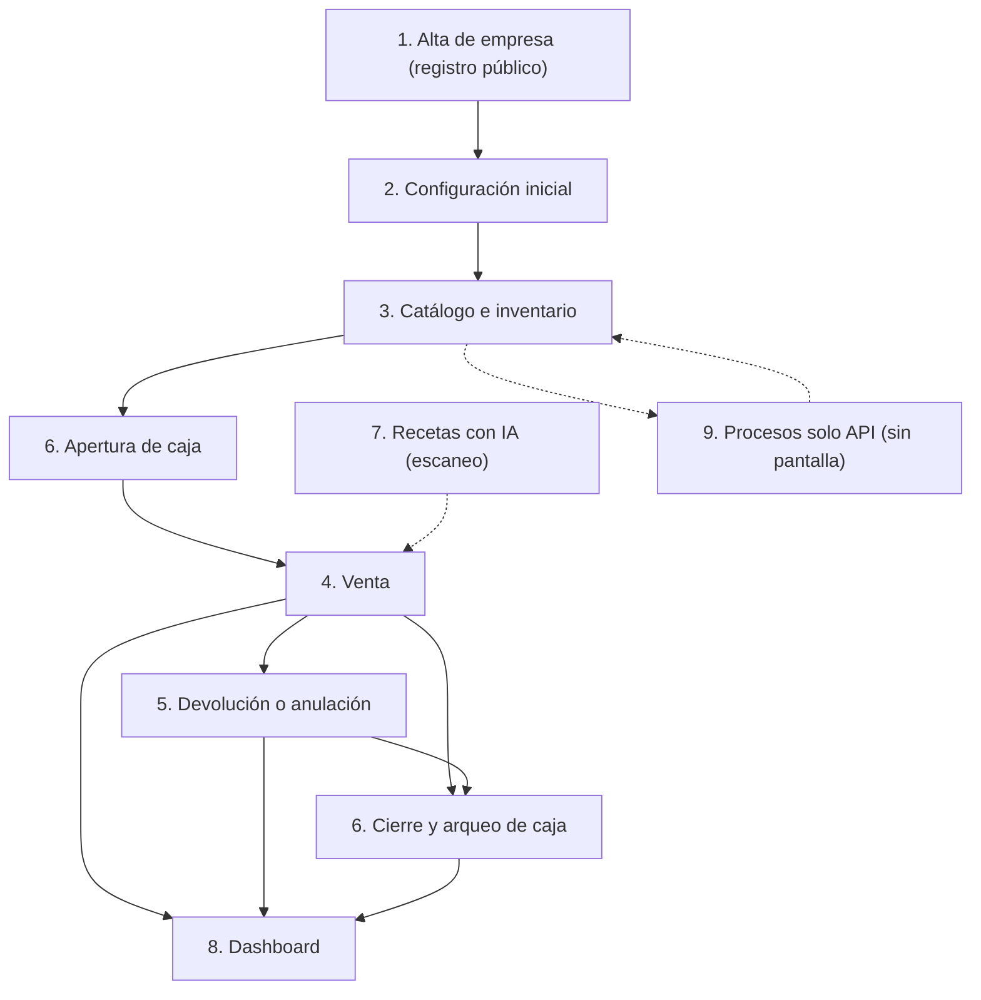

Lectura del mapa: las líneas continuas son el camino de una botica nueva; las punteadas son procesos de apoyo (el escaneo de receta alimenta el carrito; los procesos solo API consumen y mueven el inventario del proceso 3).

**Índice**

| Proceso | Sección |
|---|---|
| 1. Alta de una empresa nueva | 3 |
| 2. Configuración inicial | 4 |
| 3. Catálogo e inventario | 5 |
| 4. Venta (incluye venta en espera) | 6 |
| 5. Devolución y anulación | 7 |
| 6. Caja | 8 |
| 7. Recetas con IA | 9 |
| 8. Dashboard | 10 |
| 9. Procesos que existen solo en la API | 11 |
| Pendientes y «No verificado» | 12 |
| Tabla de cobertura | 13 |
| Fuentes | 14 |

---

## 3. Proceso 1 — Alta de una empresa nueva

**Objetivo.** Que una botica se registre sola y quede dentro del sistema, con su empresa, su sede principal, su administrador y la sesión iniciada.

**Actores.** Visitante sin cuenta (futuro administrador). No necesita permisos (endpoint anónimo, RN-GEN-015).

**Disparador.** El visitante abre `/auth/register` (pantalla «Registrar Empresa») o pulsa **Registrar empresa nueva** en «Iniciar sesión».

**Precondiciones.** Ninguna sesión. El RUC y el usuario elegidos no existen en el sistema (ambos son únicos en toda la plataforma: RN-EMP-005 y RN-CTA-007). Desde la misma IP no se superaron 5 registros por hora (RN-GEN-027).

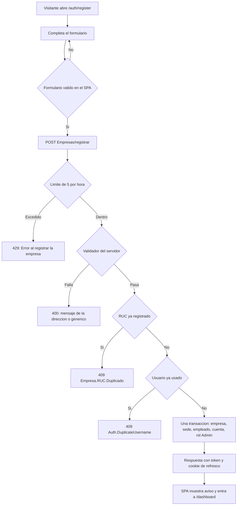

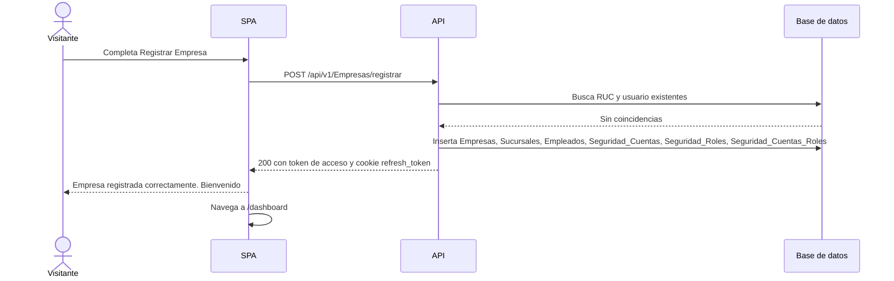

| Paso | Quién | Pantalla y acción | Endpoint y permiso | Reglas | Resultado |
|---|---|---|---|---|---|
| 1 | Visitante | `/auth/register`, «Registrar Empresa»: escribe Nombre de la Empresa, RUC (11 dígitos), Dirección de la sede principal, Nombres, Apellido paterno, Apellido materno (opcional), Correo electrónico, Usuario Administrador y Contraseña | — (validación local) | RN-EMP-002, RN-EMP-003, RN-EMP-006 a RN-EMP-010 | Los errores salen bajo cada campo y no se envía nada |
| 2 | Visitante | Pulsa **Registrar Empresa** (el botón dice «Procesando...») | `POST /api/v1/Empresas/registrar`, anónimo, política `SignUpPolicy` | RN-GEN-015, RN-GEN-027, RN-GEN-010 | La petición llega al servidor |
| 3 | API | Valida el request (nombre ≤ 200, RUC exacto de 11 dígitos, usuario 4 a 50, contraseña ≥ 8, dirección obligatoria ≤ 255, correo válido ≤ 254) | idem | RN-EMP-002 a RN-EMP-010, RN-AUT-026 | Un fallo devuelve 400 con código `RegistrarEmpresaCommand.<Propiedad>` |
| 4 | API | Comprueba que el RUC y el usuario no existan | idem | RN-EMP-005, RN-CTA-007 | Si existen: 409 |
| 5 | API | Crea en una sola transacción: empresa en `TrialActivo` con 30 días de prueba, sede principal «Sede Principal» (licencia vacía), empleado administrador con su correo, cuenta (no obligada a cambiar la clave) y rol `Admin` asignado | idem | RN-EMP-010, RN-EMP-011, RN-EMP-012, RN-GEN-012 | Todo o nada |
| 6 | API | Emite token de acceso y cookie `refresh_token` (7 días, `HttpOnly`) | idem | RN-EMP-013, RN-AUT-010 a RN-AUT-012 | Sesión iniciada |
| 7 | SPA | Muestra el aviso «Empresa registrada correctamente. ¡Bienvenido!» y navega a `/dashboard` | — | — | El administrador ve el Inicio con saludo «Hola, {nombre}» |

**Excepciones**

| Situación | Regla | Mensaje que ve el usuario | Qué hacer |
|---|---|---|---|
| RUC ya registrado (`Empresa.RUC.Duplicado`, 409) | RN-EMP-005 | «Ya existe una empresa registrada con este RUC» (`empresa.notifications.rucDuplicado`) | Revisar el RUC; si es el de tu empresa y nunca la registraste, contactar a soporte |
| Usuario ya usado en cualquier empresa (`Auth.DuplicateUsername`, 409) | RN-CTA-007 | «El usuario ya está en uso. Elige otro.» | Elegir otro usuario |
| Dirección vacía o de más de 255 (`RegistrarEmpresaCommand.DireccionSede`) | RN-EMP-010 | «Ingresa la dirección de la sede principal (máximo 255 caracteres)» | Corregir la dirección (el formulario normalmente lo impide antes) |
| Más de 5 registros por hora desde la misma IP (429) | RN-GEN-027 | Genérico: «Error al registrar la empresa» | Esperar una hora |
| Cualquier otro rechazo del validador o fallo del servidor | RN-GEN-011, RN-GEN-040 | Genérico: «Error al registrar la empresa» | Revisar los datos y reintentar |
| RUC con menos de 11 dígitos o con letra | RN-EMP-003 | «El RUC debe tener exactamente 11 dígitos numéricos» (en el formulario) | Corregir el RUC |

**Postcondiciones (qué queda registrado)**

| Tabla | Qué se crea |
|---|---|
| `Empresas` | Una fila en `TrialActivo`, inicio de prueba = ahora, vencimiento = ahora + 30 días, `ExigirRegistroReceta` apagado (RN-EMP-012) |
| `Sucursales` | La «Sede Principal» con la dirección escrita y el número de licencia vacío (RN-EMP-010) |
| `Empleados` | El administrador con su correo (RN-EMP-011) |
| `Seguridad_Cuentas` | La cuenta con hash BCrypt, sin obligación de cambiar la clave (RN-AUT-031) |
| `Seguridad_Roles` y `Seguridad_Cuentas_Roles` | El rol `Admin` de la empresa («Administrador de la empresa», nivel 0) y su asignación |
| `RefreshTokens` | El token de refresco (solo se guarda su hash SHA-256, RN-AUT-012) |

Todas las filas llevan el `TenantId` de la nueva empresa (RN-GEN-004) y `CreatedBy`/`CreatedAt` (RN-GEN-005). El registro no genera correo de verificación ni pantalla de confirmación. **No hay evento de auditoría de seguridad del registro**: `RegistrarEmpresaCommand` implementa `ICommand<LoginResult>` y no `IAuditableCommand` (`sofia-apis/src/SOFIA.Application/Empresas/Commands/RegistrarEmpresa/RegistrarEmpresaCommand.cs:12`; ver sección 12, brecha 1).

---

## 4. Proceso 2 — Configuración inicial

**Objetivo.** Dejar la empresa lista para vender: datos de la empresa, sucursales, series fiscales, empleados, roles con sus permisos, cuentas de usuario y primer ingreso de cada persona.

**Actores.** El administrador (rol `Admin`, que pasa todos los permisos, RN-GEN-021). Un usuario con rol limitado puede ejecutar solo los pasos cuyo permiso tenga (columna «Endpoint y permiso»). Después, cada empleado con cuenta (primer ingreso).

**Disparador.** El administrador termina el proceso 1 y entra a `/dashboard`.

**Precondiciones.** Empresa en periodo de prueba o activa (RN-EMP-014); existe la sede principal sin licencia (RN-EMP-010) y el rol `Admin` (RN-EMP-011). Una empresa nueva **no** tiene más roles ni series (manual de usuario, capítulo 3 §4.2).

### 4.1 Orden correcto y por qué

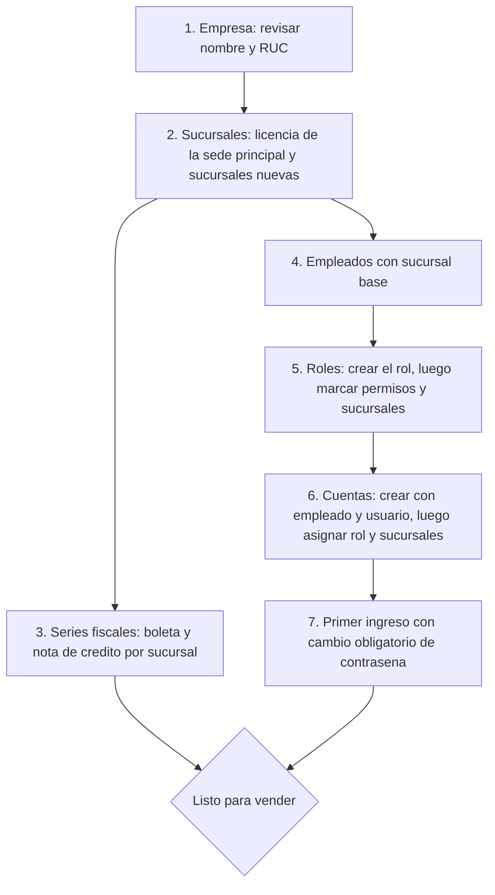

Dependencias duras que impone el sistema: la serie necesita una sucursal existente (RN-SER-002); el empleado necesita una sucursal base existente (RN-EPL-002, RN-EPL-003); la cuenta necesita un empleado sin cuenta (RN-CTA-002, RN-CTA-005, RN-CTA-006); el rol debe existir para asignarlo (RN-CTA-017). Las series y los empleados no dependen entre sí, y los roles no dependen de empleados ni de series.

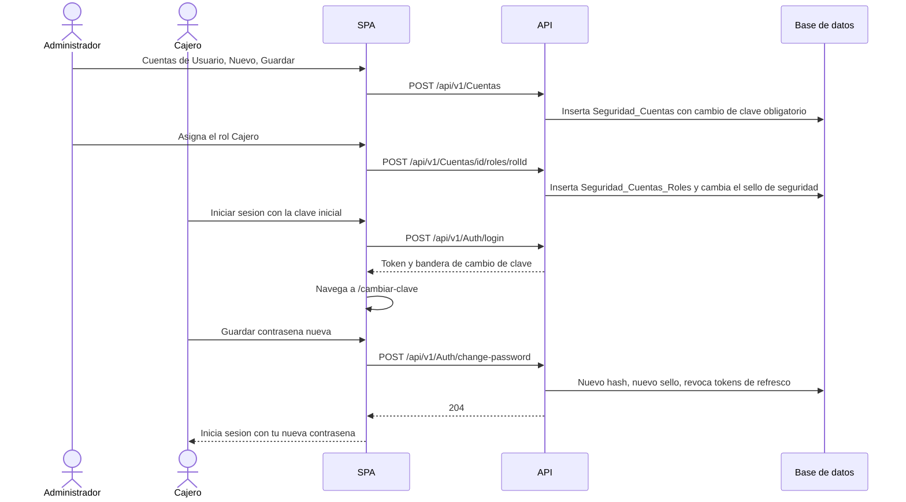

### 4.2 Pasos

| Paso | Quién | Pantalla y acción | Endpoint y permiso | Reglas | Resultado |
|---|---|---|---|---|---|
| 1 | Administrador | `/empresas`, «Empresa»: **Buscar**, abrir la empresa, **Editar** (solo nombre y RUC) y **Guardar** | `PUT /api/v1/Empresas/{id}`, `Empresas:Actualizar` | RN-EMP-004, RN-EMP-005, RN-EMP-017 | Empresa actualizada (auditoría `EMPRESA_ACTUALIZAR`) |
| 2 | Administrador | `/sucursales`, «Sucursales»: abrir «Sede Principal», **Editar**, escribir «Nº de Licencia», **Guardar** | `PUT /api/v1/Sucursales/{id}`, `Sucursales:Actualizar` | RN-SUC-004, RN-SUC-005 | La sede principal queda con licencia; aviso «Sucursal guardada correctamente» |
| 3 | Administrador | `/sucursales/nueva`: Nombre, Nº de Licencia, Dirección Física y Gerente (opcional); **Guardar** (también existe **Carga Masiva** en `/sucursales/carga-masiva`) | `POST /api/v1/Sucursales`, `Sucursales:Crear` | RN-SUC-002 a RN-SUC-007, RN-SUC-012 | Sucursal creada en la empresa del token |
| 4 | Administrador | `/series-fiscales/nueva`, «Series Fiscales»: elige Sucursal, Tipo de Comprobante «Boleta», Prefijo de Serie (`B…`), Correlativo Actual (0), Estado «Activa»; **Guardar**. Repite con «Nota de Crédito» (prefijo `B…` o `F…`) para cada sucursal | `POST /api/v1/SeriesFiscales`, `SeriesFiscales:Crear` | RN-SER-003 a RN-SER-008 | Serie creada (auditoría `SERIE_CREAR`) |
| 5 | Administrador | `/empleados/nueva`, «Empleados»: Nombres, Apellido Paterno, Apellido Materno, **Sucursal Base**, Licencia Profesional, Correo electrónico; **Guardar** | `POST /api/v1/Empleados`, `Empleados:Crear` | RN-EPL-002 a RN-EPL-010 | Empleado creado; aviso «Empleado guardado correctamente» |
| 6 | Administrador | `/roles/nueva`, «Roles & Permisos»: Nombre del Rol, Nivel de Jerarquía (1 o más), Descripción; **Guardar** | `POST /api/v1/Roles`, `Seguridad:Crear` | RN-ROL-002 a RN-ROL-006 | Rol creado (auditoría `ROL_CREAR`); el nombre ya no se puede cambiar |
| 7 | Administrador | Abrir el rol, **Editar**, pestaña **Permisos** (27 módulos, 105 permisos): marcar casillas; pestaña **Sucursales**: marcar sucursales; **Guardar** | `PUT /api/v1/Roles/{id}` (`Seguridad:Actualizar`), `POST /api/v1/Roles/permissions` y `DELETE /api/v1/Roles/permissions/{permisoId}` (`Seguridad:GestionarPermisos`), `PUT /api/v1/Roles/{id}/sucursales` (`Seguridad:GestionarPermisos`); llamadas en `sofia-web-spa/src/app/pages/roles/roles-detail/roles-detail.component.ts:236-237` y `:286-287` | RN-ROL-010 a RN-ROL-017, RN-GEN-022 | Permisos y sucursales del rol guardados; los usuarios conectados ven el cambio al recargar |
| 8 | Administrador | `/cuentas/nueva`, «Cuentas de Usuario»: elige Empleado, escribe Nombre de Usuario y Contraseña (8 a 128); **Guardar** | `POST /api/v1/Cuentas`, `Seguridad:Crear` | RN-CTA-002 a RN-CTA-008 | Cuenta activa, con 0 intentos y **obligada a cambiar la clave**; abre la ficha |
| 9 | Administrador | En la ficha: **Editar**, tarjeta «Roles Asignados», «Agregar rol...», elegir el rol, **Guardar** | `POST /api/v1/Cuentas/{id}/roles/{rolId}` (y `DELETE` para quitar), `Seguridad:AsignarRoles`; llamada en `sofia-web-spa/src/app/pages/seguridad/services/cuenta.service.ts:51` | RN-CTA-014 a RN-CTA-018 | Rol asignado; el sello de seguridad cambia |
| 10 | Administrador | Tarjeta «Sucursales Asignadas», «Agregar sucursal...» (opcional; se aplica al instante) | `POST /api/v1/Cuentas/{id}/sucursales/{sucursalId}`, `Seguridad:Actualizar` | RN-CTA-019, RN-GEN-023 | Sucursal adicional asignada; aviso «Sucursal asignada correctamente» |
| 11 | Empleado | `/auth/login`, «Iniciar sesión»: Usuario y Contraseña inicial; **Ingresar** | `POST /api/v1/Auth/login`, anónimo, `AuthPolicy` | RN-AUT-001 a RN-AUT-011, RN-GEN-019 | Entra a `/cambiar-clave` (modo obligatorio) |
| 12 | Empleado | `/cambiar-clave`, «Cambiar contraseña»: Contraseña actual, Nueva contraseña, Confirmar nueva contraseña; **Guardar** | `POST /api/v1/Auth/change-password`, solo autenticado, `AuthPolicy` | RN-AUT-024 a RN-AUT-030 | Aviso «Contraseña actualizada. Inicia sesión con tu nueva contraseña.»; se cierran todas las sesiones |

Permisos recomendados para un rol de mostrador (19 permisos, según el manual de usuario, capítulo 3 §5.3), con los nombres que ve el administrador en la matriz: Ventas (Leer, Crear, Actualizar, Anular); Sesiones de Caja (Leer, Aperturar caja, Cerrar caja); Devoluciones (Leer, Procesar devolución); Inventario (Leer); DIGEMID (Leer); Medicamentos (Leer); Pacientes (Leer); Aseguradoras (Leer); Recetas Médicas (Leer, Analizar con IA, Crear); Profesionales de Salud (Leer); Empleados (Leer). Sin los permisos de lectura de apoyo el terminal de venta falla en silencio o queda vacío (19f §0.4).

### 4.3 Qué pasa si se salta un paso

| Paso omitido | Consecuencia | Regla | Mensaje que ve el usuario |
|---|---|---|---|
| RUC de la empresa (se puede quitar al editar la empresa) | No se puede cobrar: no se emite la boleta | RN-CMP-002, RN-EMP-004 | «Tu empresa no tiene RUC registrado, por lo que no puede emitir comprobantes. Complétalo en Administración > Empresa para poder cobrar.» (`pos.messages.empresaSinRuc`) |
| Serie de Boleta activa en la sucursal | No se puede cobrar (la venta en espera sí se puede guardar) | RN-CMP-003, RN-VEN-007 | «Esta sucursal no tiene una serie de boletas activa. Configúrala en SUNAT > Series Fiscales para poder cobrar.» (`pos.messages.serieBoletaNoConfigurada`) |
| Serie de Nota de Crédito activa en la sucursal | No se puede procesar ninguna devolución | RN-DEV-007 | «La sucursal no tiene una serie de nota de crédito activa. Configúrala en Series Fiscales.» (`pos.devolucion.errors.serieNcNoConfigurada`) |
| Licencia de la sede principal | Ninguna regla de venta la exige (RN-VEN-007, RN-CMP-002 y RN-CMP-003 piden solo RUC y serie); sí se exige al volver a guardar la sucursal | RN-SUC-004 | «Este campo es obligatorio» al guardar la sucursal sin licencia |
| Caja abierta (proceso 6) | El terminal no muestra catálogo ni carrito | RN-VEN-003 | «Debes aperturar la caja del turno antes de procesar una venta.» |
| Rol en la cuenta | La cuenta puede iniciar sesión pero ningún endpoint con permiso responde (403); el menú solo muestra «Dashboard» | RN-GEN-020, RN-CTA-017 | Sin aviso propio; en el Inicio, «Tu usuario no tiene indicadores disponibles aquí. Usa el menú lateral para ir a tus módulos.» |
| Permisos de apoyo (Medicamentos, Pacientes, Recetas, etc.) | Partes del terminal de venta quedan vacías o fallan | 19f §0.4 | Genéricos de cada consulta, por ejemplo «No se pudo cargar el catálogo de medicamentos. Inténtalo nuevamente.» |
| Correo del empleado | La persona no puede recuperar su contraseña por correo | RN-AUT-034 | La solicitud responde igual que si existiera la cuenta; no llega correo |
| Medicamentos, lotes y stock (proceso 3) | No hay nada que vender | RN-VEN-011 | El catálogo del terminal queda vacío |
| Sucursal sin acceso para el usuario | Solo se opera en las sucursales accesibles | RN-GEN-023, RN-STK-006 | «No tienes permiso para operar el stock de esta sucursal» |

### 4.4 Excepciones de los pasos

| Situación | Regla | Mensaje que ve el usuario | Qué hacer |
|---|---|---|---|
| Licencia de sucursal repetida (`Sucursal.NumeroLicencia.Duplicado`) | RN-SUC-005 | «Ya existe una sucursal con ese número de licencia.» | Escribir la licencia correcta |
| Prefijo repetido para el mismo tipo en la empresa (`SerieFiscal.PrefijoDuplicado`) | RN-SER-007 | «Ya existe otra serie de este tipo de comprobante con ese prefijo.» | Usar otro prefijo (por ejemplo `B002`) |
| Segunda serie activa del mismo tipo en la sucursal (`SerieFiscal.ActivaDuplicada`) | RN-SER-008 | «La sucursal ya tiene una serie activa de este tipo. Desactívala antes de activar otra.» | Desactivar la anterior o guardar la nueva como «Inactiva» |
| Prefijo mal formado | RN-SER-004 | «El prefijo debe tener 4 caracteres en mayúsculas y empezar con la letra que exige el tipo de comprobante.» (en el formulario) | Corregir el prefijo |
| Serie que ya emitió comprobantes: cambiar algo distinto del estado | RN-SER-010 | «La serie ya emitió comprobantes: solo puedes cambiar su estado.» | Cambiar solo el estado |
| Correo o licencia profesional repetidos en la empresa | RN-EPL-008, RN-EPL-010 | «Ya existe un empleado con ese correo electrónico en tu empresa.» / «Ya existe un empleado con esa licencia profesional.» | Usar otro valor |
| Nombre de rol repetido (`Rol.DuplicateName`) | RN-ROL-005 | Genérico: «Error al guardar el rol» | Elegir otro nombre |
| Usuario repetido en todo SOFIA o empleado que ya tiene cuenta | RN-CTA-006, RN-CTA-007 | Genérico: «Error al guardar la cuenta» | Elegir otro usuario o empleado |
| Cambiar los propios roles / asignar el rol Admin sin ser Admin | RN-CTA-015, RN-CTA-016 | «Una cuenta no puede modificar sus propios roles» / «Solo un administrador puede asignar o quitar el rol Admin» | Pedirlo a otro administrador |
| Ampliar los permisos de un rol que uno mismo tiene asignado | RN-ROL-010 | «No se pueden ampliar los permisos de un rol que la propia cuenta tiene asignado» | Pedirlo a un administrador |
| Contraseña actual incorrecta en `/cambiar-clave` | RN-AUT-029 | «La contraseña actual es incorrecta» | Reescribirla |
| Nueva contraseña igual a la actual o menor de 8 | RN-AUT-026, RN-AUT-027 | «La nueva contraseña debe ser distinta de la actual» / «Debe tener al menos 8 caracteres» | Elegir otra |
| 5 intentos fallidos de ingreso | RN-AUT-007 | «Credenciales inválidas. Verifica tu usuario y contraseña.» (igual que cualquier fallo) | Esperar 15 minutos o que el administrador marque **Resetear Intentos Fallidos** |
| Suscripción vencida, suspendida o cancelada | RN-AUT-009, RN-EMP-014 | «La suscripción de tu empresa no está activa o ha vencido. Comunícate con soporte para reactivarla.» | Contactar a soporte (ningún endpoint ni pantalla cambia el estado, RN-EMP-015) |

**Postcondiciones.** Tablas escritas: `Empresas` (nombre y RUC), `Sucursales`, `SUNAT_Series_Fiscales`, `Empleados`, `Seguridad_Roles`, `Seguridad_Permisos_Rol`, `Seguridad_Roles_Sucursales`, `Seguridad_Cuentas`, `Seguridad_Cuentas_Roles`, `Seguridad_CuentasSucursales`, `RefreshTokens` y `Auditoria_Eventos_Seguridad` (eventos `EMPRESA_ACTUALIZAR`, `SERIE_CREAR`, `ROL_CREAR`, `ROL_ACTUALIZAR`, `PERMISO_ASIGNAR`, `PERMISO_REVOCAR`, `ROL_SUCURSALES`, `CUENTA_REGISTRAR`, `ROL_ASIGNAR_CUENTA`, `CUENTA_SUC_ASIGNAR`, `CLAVE_CAMBIAR`). **Crear y editar sucursales y empleados no generan evento de auditoría de seguridad**: sus comandos no implementan `IAuditableCommand` (búsqueda en `sofia-apis/src/SOFIA.Application/**/Commands`; ver sección 12, brecha 2). Al cambiar la contraseña, `Requiere_Cambio_Clave` pasa a falso y se anulan todos los tokens de refresco de la cuenta.

---

## 5. Proceso 3 — Catálogo e inventario

**Objetivo.** Tener medicamentos con precio, unidades de venta, proveedores con costos y stock por lote en cada sucursal, de modo que el terminal de venta pueda ofrecerlos.

**Actores.** Administrador o personal de almacén con los permisos de cada módulo: `UnidadesMedida`, `Laboratorios`, `IngredientesActivos`, `Medicamentos`, `JerarquiasUoM`, `PresentacionesVenta`, `Proveedores` (incluye `RegistrarPrecioProveedor`) e `Inventarios` (lotes y stock).

**Disparador.** La botica va a empezar a vender, recibe mercadería o corrige existencias.

**Precondiciones.** Proceso 2 terminado (al menos una sucursal accesible para quien ingresa el stock, RN-STK-006).

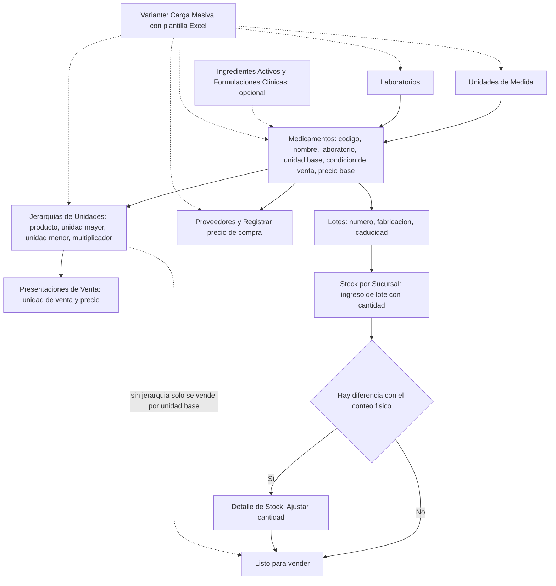

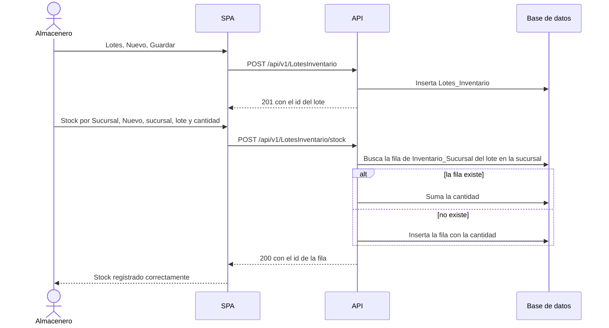

### 5.1 Pasos

| Paso | Quién | Pantalla y acción | Endpoint y permiso | Reglas | Resultado |
|---|---|---|---|---|---|
| 1 | Administrador | `/unidades-medida`, «Unidades de Medida»: **Nuevo**, Código (≤ 10) y Descripción (≤ 50), **Guardar** | `POST /api/v1/UnidadesMedida`, `UnidadesMedida:Crear` | RN-UDM-002 a RN-UDM-007 | Unidad creada |
| 2 | Administrador | `/laboratorios`, «Laboratorios»: Nombre de Compañía (≤ 150) y Código Identificador (opcional) | `POST /api/v1/Laboratorios`, `Laboratorios:Crear` | RN-LAB-002 a RN-LAB-007 | Laboratorio creado; aviso «Laboratorio guardado correctamente» |
| 3 | Administrador | (Opcional) `/ingredientes-activos` y `/formulaciones-clinicas`: ingrediente (DCI, código ATC) y formulación. No intervienen en el cobro; las formulaciones alimentan los equivalentes terapéuticos del escaneo de receta (proceso 7) | `POST /api/v1/IngredientesActivos` (`IngredientesActivos:Crear`), `POST /api/v1/FormulacionesClinicas` (`FormulacionesClinicas:Crear`) | RN-ING-002 a RN-ING-006, RN-REC-027 | Ingrediente y formulación creados |
| 4 | Administrador | `/medicamentos/nueva`, «Medicamentos»: Código Nacional, Nombre Comercial, Laboratorio, Unidad Base, **Condición de Venta** («Venta Libre (OTC)», «Receta Simple», «Receta Retenida», «Estupefaciente») y Precio de Venta Base (S/); **Guardar** | `POST /api/v1/Medicamentos`, `Medicamentos:Crear` | RN-MED-002 a RN-MED-010 | Medicamento creado; la condición de venta decide la exigencia de receta en la venta (RN-VEN-029) |
| 5 | Administrador | `/jerarquias/nueva`, «Jerarquías de Unidades»: Producto, Unidad Mayor, Unidad Menor y Multiplicador (cuántas unidades menores equivalen a una mayor); **Guardar** | `POST /api/v1/JerarquiasUoM`, `JerarquiasUoM:Crear` | RN-JER-002 a RN-JER-010 | Conversión creada (por ejemplo caja a tableta) |
| 6 | Administrador | `/presentaciones-venta/nueva` o, desde el detalle del medicamento, botón «Presentaciones de Venta» y «Agregar presentación»: Producto, **Unidad de Venta** (solo las vendibles según las jerarquías) y Precio de Venta; **Guardar** | `POST /api/v1/PresentacionesVenta`, `PresentacionesVenta:Crear` | RN-PRE-002 a RN-PRE-009, RN-JER-011 | Presentación creada con sus unidades base calculadas por el servidor |
| 7 | Administrador | `/proveedores/nueva`, «Proveedores»: Razón Social, «RUC / Tax ID», Términos Financieros, Calificación ESG, Tasa de Cumplimiento; **Guardar** | `POST /api/v1/Proveedores`, `Proveedores:Crear` | RN-PRV-002 a RN-PRV-009 | Proveedor creado |
| 8 | Comprador | En el detalle del proveedor, tarjeta «Precios de compra», botón «Registrar precio»: Producto, Precio de compra por unidad base (S/), Descuento (%) y vista del costo neto; **Guardar** | `POST /api/v1/Proveedores/precios`, `Proveedores:RegistrarPrecioProveedor` | RN-PRV-018 a RN-PRV-020, RN-VEN-022 | Costo neto guardado con vigencia desde ahora; el precio abierto anterior del mismo proveedor y producto se cierra |
| 9 | Almacenero | `/lotes/nueva`, «Lotes»: Producto, Número de Lote (≤ 100), Fecha de Fabricación (opcional), Fecha de Caducidad; **Guardar** | `POST /api/v1/LotesInventario`, `Inventarios:Crear` | RN-LOT-002 a RN-LOT-010, RN-LOT-016 | Lote creado **sin existencias** |
| 10 | Almacenero | `/stock-por-sucursal/nueva`, «Stock por Sucursal»: Sucursal (solo las permitidas), Lote (se busca por número) y Cantidad Física; **Guardar** | `POST /api/v1/LotesInventario/stock`, `Inventarios:Actualizar` (no se exige `Crear`) | RN-STK-001 a RN-STK-010 | Si el lote ya tenía stock en esa sucursal, la cantidad se **suma**; si no, se crea la fila |
| 11 | Almacenero | `/stock-por-sucursal/:id`, «Detalle de Stock»: **Editar**, cambiar Cantidad Física, **Guardar** | `PUT /api/v1/StockPorSucursal/{id}/ajustar`, `Inventarios:Actualizar` | RN-STK-004, RN-STK-006, RN-STK-011, RN-STK-012 | La cantidad **se fija** al valor nuevo (no suma); auditoría `STOCK_AJUSTAR` |

**Variante por carga masiva.** Disponible en `/unidades-medida`, `/laboratorios`, `/ingredientes-activos`, `/medicamentos`, `/jerarquias`, `/proveedores`, `/sucursales`, `/roles`, `/pacientes`, `/profesionales-salud`, `/aseguradoras` y `/digemid-catalogo` (botón **Carga Masiva**). **No existe** para lotes, stock, presentaciones, series, empleados ni cuentas. Flujo común ([documento 20](../ola-1-fundamentos/20-carga-masiva-y-exportacion.md)): (1) **Descargar plantilla** (`GET /api/v1/<Módulo>/plantilla`); (2) **Subir archivo** `.xlsx` (hasta 5 MB y 5 000 filas; RN-IMP-001 a RN-IMP-005); (3) **Vista previa** (`POST …/previsualizar`) con «N filas válidas» y «N filas con error»; (4) **Guardar válidos (N)** (`POST …/carga-masiva`). Todos exigen `<Módulo>:Crear`. En el guardado las filas duplicadas se omiten sin error y la respuesta solo indica cuántas se guardaron (por ejemplo RN-UDM-016, RN-JER-021). Los medicamentos cargados así quedan **sin precio de venta base** (RN-MED-021): hasta que se les asigne precio, o una presentación con precio, no se pueden vender (RN-VEN-019).

### 5.2 Decisiones y desvíos importantes

- **Sin jerarquía no hay presentaciones**: `PresentacionVenta.Jerarquia.NoResuelta` (RN-PRE-006). La pantalla muestra «Este producto no tiene una Jerarquía de Unidades registrada. Cárgala primero para poder definir presentaciones de venta.» y ofrece «Ir a Jerarquías de Unidades». El medicamento se sigue vendiendo por unidad base.
- **Una conversión que contradice a las existentes se rechaza** (RN-JER-009): el multiplicador debe coincidir con el calculado por el camino de conversiones ya registrado.
- **El stock de un lote vencido sí se puede ingresar** (RN-STK-007), pero no se podrá vender (RN-VEN-013) y el lote ni siquiera se puede crear ya vencido (RN-LOT-006).
- **El stock se ingresa por sucursal**: solo se puede ingresar y ajustar en sucursales accesibles al usuario (RN-STK-006); no existe un «ingreso por compra» (no hay orden de compra ni recepción de proveedor en el sistema; ver sección 12, brecha 3).

### 5.3 Excepciones

| Situación | Regla | Mensaje que ve el usuario | Qué hacer |
|---|---|---|---|
| Código de unidad repetido | RN-UDM-006 | «Ya existe una unidad de medida con ese código.» | Usar otro código |
| Laboratorio con nombre o código repetido | RN-LAB-006, RN-LAB-007 | «Ya existe un laboratorio con ese nombre de compañía.» / «Ya existe un laboratorio con ese código identificador.» | Revisar el existente |
| Código nacional repetido (`Medicamento.CodigoNacional.Duplicado`, 409) | RN-MED-010 | «Ya existe un medicamento con ese código nacional.» | Usar otro código |
| Precio base negativo o vacío | RN-MED-008 | «El precio no puede ser negativo» (también aparece si el campo está vacío) | Informar un precio |
| Conversión repetida entre las mismas unidades | RN-JER-008 | «Este producto ya tiene una conversión entre esas unidades.» | Editar la existente |
| Unidad mayor igual a la menor | RN-JER-004 | «La unidad mayor y la unidad menor no pueden ser la misma» | Elegir unidades distintas |
| Multiplicador cero o negativo | RN-JER-005 | «El multiplicador debe ser mayor que cero» | Corregirlo |
| Presentación repetida para la misma unidad de venta (409) | RN-PRE-005 | «Ya existe una presentación de venta para esa unidad en este producto.» | Editar la existente |
| Proveedor con identificador tributario o razón social repetidos | RN-PRV-007, RN-PRV-008 | «Ya existe un proveedor con ese identificador tributario.» / «Ya existe un proveedor con esa razón social.» | Revisar el existente |
| Precio de compra fuera de rango o descuento fuera de 0 a 100 | RN-PRV-018 | «Debe ser mayor que 0» / «El precio es demasiado alto» / «Debe estar entre 0 y 100» | Corregir |
| Lote con caducidad vencida, fabricación futura o fabricación posterior a la caducidad (al crear) | RN-LOT-006 a RN-LOT-008 | Genérico: «Error al guardar el lote» (el selector de fecha no limita nada) | Informar fechas vigentes |
| Número de lote repetido para el mismo producto (400 `LoteInventario.Duplicate`) | RN-LOT-010 | Genérico: «Error al guardar el lote» (el texto «Ya existe un lote con ese número para el producto seleccionado» solo sale ante un 409) | Usar otro número |
| Cantidad negativa en el ingreso o el ajuste | RN-STK-004 | «La cantidad no puede ser negativa» | Corregir |
| Sucursal fuera del acceso del usuario (403 `Inventario.Sucursal.NoPermitida`) | RN-STK-006 | «No tienes permiso para operar el stock de esta sucursal» | Pedir acceso a la sucursal |
| Otra operación cambió el mismo stock (409 `Concurrency.Conflict`) | RN-STK-011 | «Otra operación modificó estos datos al mismo tiempo. Actualiza la pantalla e inténtalo de nuevo.» | Recargar y repetir |
| Guardar el ingreso sin elegir lote | RN-STK-003 | Según la lectura del código, no ocurre nada visible: hay una excepción de JavaScript y no se envía la petición (19e §2.2; **No verificado** en ejecución) | Elegir un lote de la lista |
| Eliminar un lote con stock o ventas (409 `LoteInventario.InUse`) | RN-LOT-014 | «No se puede eliminar un lote con stock o ventas registradas.» | No eliminar |
| Eliminar un medicamento, unidad, laboratorio, ingrediente o proveedor en uso (409 `*.InUse`) | RN-MED-013, RN-UDM-010, RN-LAB-010, RN-ING-009, RN-PRV-010 | Por ejemplo «No puedes eliminar este medicamento porque tiene lotes, presentaciones u otros registros asociados.» | Retirar primero las dependencias |
| Archivo de carga masiva inválido (no es `.xlsx`, más de 5 000 filas o más de 5 MB) | RN-IMP-001 a RN-IMP-005 | «Error al procesar el archivo» (`carga-masiva.preview-error`) | Corregir el archivo |
| Fila con error en la vista previa | RN-IMP-014 | La fila aparece con su error en la columna «Estado»; solo se envían a guardar las válidas | Corregir el Excel y volver a subirlo |

### 5.4 Postcondiciones

| Qué queda | Tabla |
|---|---|
| Catálogos | `Unidades_Medida`, `Laboratorios`, `Ingredientes_Activos`, `Formulacion_Clinica`, `Medicamentos`, `Jerarquia_UoM`, `Presentaciones_Venta` |
| Proveedores y costos | `Proveedores_Dist`, `Historial_Precios_Prov` (un solo precio vigente por proveedor y producto; los anteriores quedan con fecha de fin) |
| Existencias | `Lotes_Inventario` (el lote), `Inventario_Sucursal` (una fila por lote y sucursal, con `RowVersion`, RN-STK-010, RN-STK-011) |
| Auditoría | Solo el ajuste de stock genera `STOCK_AJUSTAR`; el ingreso por suma, los lotes y todos los catálogos no generan evento (sección 12, brecha 2) |

---

## 6. Proceso 4 — Venta

**Objetivo.** Vender al mostrador: armar el carrito con lotes y presentaciones, identificar al cliente y la receta cuando corresponde, cobrar con uno o varios métodos de pago y emitir la boleta. Incluye el subproceso de **venta en espera**.

**Actores.** Cajero con `Ventas:Crear` (vender y guardar en espera), `Ventas:Actualizar` (retomar y cobrar una venta en espera), `Ventas:Leer` (listar y ver detalle), `POS:AperturarCaja` (abrir caja) y los permisos de apoyo del terminal (19f §0.4: `Medicamentos:Leer`, `Pacientes:Leer`, `Recetas:Leer`, `POS:Leer`, `Recetas:Analizar` y `Recetas:Crear` solo para esas funciones).

**Disparador.** Llega un cliente al mostrador. Se entra por el botón **Nueva Venta POS** de `/pos` («Ventas») hasta `/pos/nueva` («Terminal de Punto de Venta (POS)»). El terminal no tiene opción de menú.

**Precondiciones.**

- El usuario tiene **su propia caja abierta en su sucursal** (proceso 6). Sin ella el terminal solo muestra «Debes aperturar la caja del turno antes de procesar una venta.» (RN-VEN-003 a RN-VEN-005).
- Para cobrar: la empresa tiene RUC (RN-CMP-002) y la sucursal tiene una serie de Boleta activa (RN-CMP-003).
- Hay lotes vendibles en la sucursal del usuario: cantidad mayor que 0, lote no vencido y sin retención en cuarentena (RN-STK-017, RN-VEN-075).
- La sucursal y el empleado de la venta salen del token, no se eligen (RN-VEN-002).

### 6.1 Venta cobrada

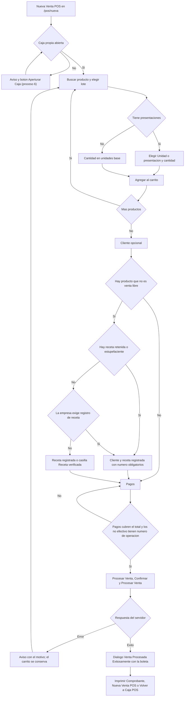

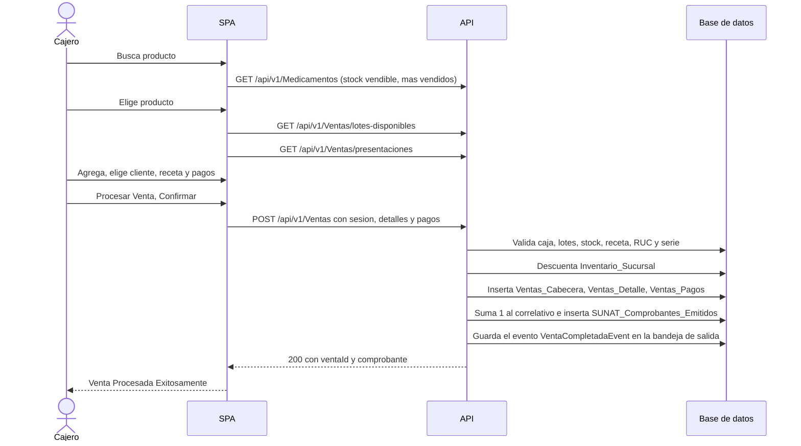

### 6.2 Pasos

| Paso | Quién | Pantalla y acción | Endpoint y permiso | Reglas | Resultado |
|---|---|---|---|---|---|
| 1 | Cajero | `/pos/nueva`: el terminal busca la caja abierta propia al abrir | `GET /api/v1/POS/sesiones` (filtro sucursal, empleado y estado Abierta), `POS:Leer` | RN-VEN-003, RN-CAJ-021 | Terminal habilitado, o tarjeta «Estado de caja» con **Aperturar Caja** (solo con `POS:AperturarCaja`) |
| 2 | Cajero | «Buscar producto...» (por nombre comercial) y chips de condición de venta («Todos», «Venta Libre (OTC)», «Receta Simple», «Receta Retenida», «Estupefaciente»); hasta 12 productos con insignia «Disponible», «Stock bajo» o «Agotado» | `GET /api/v1/Medicamentos`, `Medicamentos:Leer` | RN-MED-014 a RN-MED-017, RN-STK-017 | Tarjetas de producto; sin filtros salen primero los más vendidos de los últimos 30 días |
| 3 | Cajero | Pulsa el producto y luego un lote («Lote:», «Stock Disp:») | `GET /api/v1/Ventas/lotes-disponibles` y `GET /api/v1/Ventas/presentaciones`, ambos `Ventas:Crear` | RN-VEN-075, RN-VEN-076, RN-VEN-001 | Hasta 50 lotes vendibles ordenados por caducidad (no se obliga a vender el que vence primero) |
| 4 | Cajero | Elige «Unidad» o una presentación («Caja x10 (S/ 45.00)»), escribe **Cantidad** y pulsa **Agregar**. El precio es de solo lectura | — (validación local) | RN-VEN-017 a RN-VEN-019, RN-VEN-024 | Línea en «Resumen de Venta · n». Mismo lote y presentación suman a la línea existente. Con la presentación, el servidor calcula las unidades base |
| 5 | Cajero | (Opcional) campo «Buscar paciente por nombre o documento...» | `GET /api/v1/Pacientes`, `Pacientes:Leer` | RN-VEN-025, RN-VEN-026 | Cliente elegido; sin cliente la boleta va a «CLIENTE EVENTUAL» (RN-CMP-005) |
| 6 | Cajero | Receta: con cliente elegido aparece «Receta médica» (primera opción «Sin receta»); enlace «Registrar receta» abre `/recetas-medicas/nueva`; casilla «Receta verificada» solo en empresa flexible con producto de receta simple | `GET /api/v1/Recetas`, `Recetas:Leer` | RN-VEN-028 a RN-VEN-038 | Ver matriz en 6.3 |
| 7 | Cajero | Panel «Método de Pago»: fichas «Efectivo», «Yape / Plin», «Tarjeta Débito/Crédito», «Transferencia»; **Recibido (S/)**; «Nro Operación»; enlace «+ Dividir en varios métodos de pago» y **Agregar Método de Pago** | — (validación local) | RN-VEN-039 a RN-VEN-046 | Totales «Subtotal (Op. Gravada):», «IGV (18%):», «TOTAL A PAGAR:» y «Monto Pendiente:» o «Vuelto a Entregar:» |
| 8 | Cajero | **Procesar Venta** (habilitado solo si el pago cubre el total) y, en el diálogo «Confirmar Procesamiento de Venta», **Confirmar y Procesar Venta** | `POST /api/v1/Ventas`, `Ventas:Crear` | RN-VEN-050, RN-VEN-002 a RN-VEN-021, RN-CMP-001 a RN-CMP-007 | La venta queda `Completada`, el stock se descuenta, se emite la boleta |
| 9 | Cajero | Diálogo «Venta Procesada Exitosamente» («Nº Comprobante:», «Estado SUNAT:» «Pendiente de envío a SUNAT», «Total Pagado:», «Medio de Pago:»): **Imprimir Comprobante**, **Nueva Venta POS** (con `Ventas:Crear`) o **Volver a Caja POS** | — (el comprobante viaja en la respuesta) | RN-CMP-013, RN-CMP-014 | Ticket de 80 mm con vuelto si lo hay; el terminal se limpia |

### 6.3 Reglas de receta según el carrito

| Carrito | Receta registrada elegida | Empresa con «exigir registro de receta» | Qué ocurre |
|---|---|---|---|
| Solo venta libre (OTC) | cualquiera | cualquiera | Se vende sin receta (RN-VEN-029) |
| Receta simple | Ninguna | Encendida | Se bloquea «Procesar Venta»: «Hay productos que requieren una receta registrada: selecciona al cliente y su receta antes de cobrar.» |
| Receta simple | Ninguna | Apagada (valor al registrar la empresa) | Aparece la casilla **Receta verificada** («Confirmas que revisaste la receta física del cliente. Quedará registrado a tu nombre.»); sin marcarla no se puede cobrar. Se guarda quién y cuándo, no el número de la receta de papel (RN-VEN-035) |
| Receta retenida o estupefaciente | Ninguna | cualquiera | Bloqueado: «Hay productos de receta retenida o estupefacientes: selecciona al cliente y una receta registrada que tenga número de receta.» |
| Receta retenida o estupefaciente | Receta sin número | cualquiera | Bloqueado: «La receta seleccionada no tiene número de receta: agrégalo en la receta para vender productos de receta retenida o estupefacientes.» |
| Receta retenida o estupefaciente | Receta con número | cualquiera | Se vende (RN-VEN-032) |

El servidor repite todo (RN-VEN-029 a RN-VEN-034): la receta debe existir, ser del cliente de la venta y tener dispensaciones disponibles (venta libre: sin límite; receta simple: 1 más las repeticiones máximas; retenida o estupefaciente: 1, RN-REC-031). La política de la empresa (`ExigirRegistroReceta`) solo se cambia en base de datos; no hay endpoint ni pantalla (RN-EMP-016). El terminal adjunta la receta elegida a **todas** las líneas (RN-VEN-036).

### 6.4 Subproceso: venta en espera (guardar, retomar y cobrar)

Sirve para atender al siguiente cliente mientras el primero busca el dinero o la receta. La venta en espera **reserva el stock** (se descuenta al guardar), **cuenta como dispensación** de la receta, queda ligada a la caja con que se guardó, y **no** tiene pagos, comprobante, correlativo, ni exige RUC, serie ni «Receta verificada» (RN-VEN-052). No caduca ni se libera sola: solo se cobra o se anula.

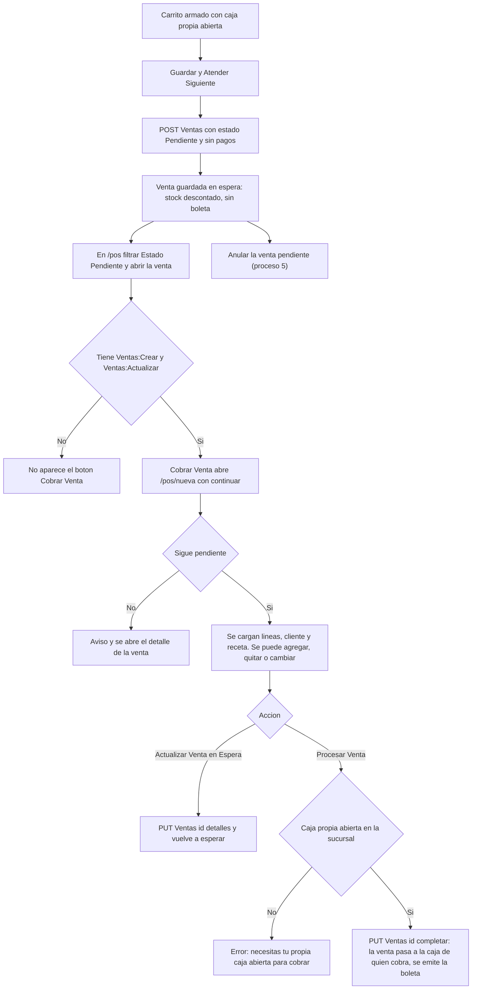

| Paso | Quién | Pantalla y acción | Endpoint y permiso | Reglas | Resultado |
|---|---|---|---|---|---|
| 1 | Cajero | Terminal con carrito: **Guardar y Atender Siguiente** (no pide receta, pagos ni número de operación) | `POST /api/v1/Ventas` con `Estado = Pendiente`, `Ventas:Crear` | RN-VEN-051, RN-VEN-052 | Aviso «Venta guardada en espera. Retómala desde Ventas cuando el cliente vuelva.»; código provisional (8 primeros caracteres del id) |
| 2 | Cualquier usuario de la misma sucursal | `/pos`: filtro «Estado» = «Pendiente», abrir el código | `GET /api/v1/Ventas`, `Ventas:Leer` | RN-VEN-070 a RN-VEN-073, RN-VEN-053 | Detalle con **Cobrar Venta** (si tiene `Ventas:Crear` y `Ventas:Actualizar`) |
| 3 | Cajero | **Cobrar Venta** abre `/pos/nueva?continuar={id}` con el banner «Estás retomando una venta en espera: puedes agregar, quitar o modificar productos antes de cobrar.» | `GET /api/v1/Ventas/{id}` | RN-VEN-053 | Carrito cargado con los precios guardados; las líneas nuevas usan el precio del catálogo |
| 4a | Cajero | **Actualizar Venta en Espera** | `PUT /api/v1/Ventas/{id}/detalles`, `Ventas:Actualizar` | RN-VEN-054, RN-VEN-055, RN-VEN-027 | Se devuelve el stock de las líneas anteriores y se descuentan las nuevas; el cliente queda como el enviado |
| 4b | Cajero | **Procesar Venta** y confirmar | `PUT /api/v1/Ventas/{id}/completar`, `Ventas:Actualizar` | RN-VEN-056, RN-VEN-006, RN-VEN-016, RN-VEN-038 | Se reasigna la venta a **la caja propia abierta de quien cobra**; la venta pasa a `Completada`, se emite la boleta y el código de venta cambia al número de la boleta (RN-VEN-059) |

### 6.5 Excepciones

| Situación | Regla | Mensaje que ve el usuario | Qué hacer |
|---|---|---|---|
| Sin caja abierta | RN-VEN-003 | «Debes aperturar la caja del turno antes de procesar una venta.» | Abrir la caja (proceso 6) |
| La caja indicada es de otro cajero o sucursal (`Venta.Caja.NoPropia`, 403) | RN-VEN-005 | «La caja seleccionada pertenece a otro cajero o sucursal. Recarga la página para usar tu propia caja abierta.» | Recargar |
| Cobrar una venta en espera sin caja propia abierta (`Venta.Caja.SinSesionAbierta`) | RN-VEN-006 | «Necesitas tener tu propia caja abierta en esta sucursal para cobrar la venta.» | Abrir la caja y reintentar |
| Cantidad mayor que la existencia del lote | RN-VEN-014 | «Stock máximo disponible alcanzado ({n} un.).» (en el terminal); si otro cajero agotó el lote, el servidor responde `Venta.Stock`: genérico «Ocurrió un error al procesar la venta.» | Reducir la cantidad o cambiar de lote |
| Lote vencido (`Venta.Lote.Vencido`) | RN-VEN-013 | «Uno de los lotes está vencido y no se puede vender. Retíralo del carrito.» | Quitar la línea |
| Lote en cuarentena `Retenido` (`Venta.Cuarentena`) | RN-VEN-012 | Genérico: «Ocurrió un error al procesar la venta.» (el catálogo no ofrece esos lotes) | No vender el lote |
| Producto sin precio (`Venta.SinPrecio`) | RN-VEN-019 | «Este producto no tiene precio de venta configurado en el catálogo. Pide a un administrador que lo registre.» | Registrar el precio (proceso 3) |
| Falta receta, receta de otro paciente, inexistente, sin número, agotada o sin verificación | RN-VEN-029 a RN-VEN-034 | «Uno de los productos requiere receta médica. Selecciona el cliente y una de sus recetas registradas.» / «La receta médica no pertenece al cliente de la venta.» / «La receta médica seleccionada no existe o fue eliminada.» / «La receta seleccionada no tiene número de receta. Agrégalo en la receta para vender productos de receta retenida o estupefacientes.» / «La receta médica ya fue dispensada el máximo de veces permitido.» / «Marca "Receta verificada" para confirmar que revisaste la receta del cliente antes de cobrar.» | Elegir o registrar la receta; marcar la casilla si corresponde |
| Pago insuficiente o sin pagos (`Venta.Pagos`) | RN-VEN-039, RN-VEN-043 | El botón «Procesar Venta» queda deshabilitado y se ve «Monto Pendiente:»; si llegara al servidor, genérico «Ocurrió un error al procesar la venta.» | Completar el pago |
| Vuelto mayor que el efectivo recibido | RN-VEN-044 | «El vuelto no puede ser mayor que el efectivo recibido. Ajusta los montos de pago.» | Ajustar los montos |
| Pago no efectivo sin número de operación | RN-VEN-042 | «Ingresa el N° de operación para poder cobrar.» (en pantalla) / «Ingresa el número de operación de cada pago que no sea en efectivo.» (servidor) | Escribir el número |
| Empresa sin RUC (`Venta.Empresa.SinRuc`) | RN-CMP-002 | «Tu empresa no tiene RUC registrado, por lo que no puede emitir comprobantes. Complétalo en Administración > Empresa para poder cobrar.» | Editar la empresa (proceso 2) |
| Sucursal sin serie de Boleta activa (`Venta.SerieBoleta.NoConfigurada`) | RN-CMP-003 | «Esta sucursal no tiene una serie de boletas activa. Configúrala en SUNAT > Series Fiscales para poder cobrar.» | Crear o activar la serie |
| Otra operación modificó el stock o la venta (409) | RN-VEN-015, RN-VEN-057 | «Otra operación modificó estos datos al mismo tiempo. Actualiza la pantalla e inténtalo de nuevo.» | Recargar y repetir |
| La venta que se retoma ya no está pendiente | RN-VEN-053 | «Esta venta ya no está en espera; te llevamos a su detalle.» | Revisar el detalle |
| Cualquier otro código no mapeado (incluye pérdida de red) | RN-VEN-050 | «Ocurrió un error al procesar la venta.» | Reintentar; el carrito se conserva |
| Token sin sucursal (`Auth.Sucursal`) | RN-GEN-024 | «No se pudo determinar el contexto de sucursal asignada del usuario.» | Volver a iniciar sesión |

### 6.6 Postcondiciones

| Qué queda | Tabla y detalle |
|---|---|
| La venta | `Ventas_Cabecera`: sucursal y empleado del token, `Sesion_ID` (la caja), cliente (o nulo), total bruto (precios con IGV), estado `Completada` (o `Pendiente`), versión de fila; si hubo confirmación de receta, quién y cuándo (RN-VEN-035) |
| Las líneas | `Ventas_Detalle`: lote, cantidad **en unidades base**, cantidad y presentación si se vendió por presentación, **precio fijado por unidad base**, **costo histórico** del precio de proveedor vigente (0 si no hay) y receta (RN-VEN-017 a RN-VEN-022) |
| Los pagos | `Ventas_Pagos`: método, monto (el efectivo es lo recibido) y número de operación; el vuelto no se guarda, se recalcula (RN-VEN-044) |
| La boleta | `SUNAT_Comprobantes_Emitidos`: tipo boleta, estado `NoEnviado`, base gravada = total ÷ 1,18 e IGV; y `SUNAT_Series_Fiscales.Correlativo_Actual` aumentado en 1 (RN-CMP-004 a RN-CMP-007). Los datos del emisor no se guardan: se leen de la empresa y la sucursal (RN-CMP-011) |
| El stock | `Inventario_Sucursal`: la cantidad física baja en unidades base (en espera también) |
| Evento | `Sistema_Outbox_Eventos`: `VentaCompletadaEvent` (ningún manejador lo consume, RN-VEN-060) |
| Auditoría | **Ninguna**: vender, cobrar y actualizar no generan evento de seguridad (RN-VEN-061); la trazabilidad es `CreatedBy`, `CreatedAt`, `LastModifiedBy`, `LastModifiedAt` |
| No ocurre | Envío a SUNAT, descuentos y cobro de factura (RN-VEN-023, RN-CMP-001, RN-CMP-007) |

---

## 7. Proceso 5 — Devolución y anulación

**Objetivo.** Corregir una venta ya registrada: devolver total o parcialmente lo vendido (con nota de crédito y reembolso), anular una venta cobrada (revierte todo) o anular una venta en espera (libera lo reservado).

**Actores.** Cajero o supervisor con `Ventas:Leer` (ver el detalle), `Devoluciones:ProcesarDevolucion` (devolver) o `Ventas:Anular` (anular). No hay flujo de supervisor ni PIN: «autorizar» es procesar con la propia sesión (RN-DEV-027). Para anular una venta cobrada o devolver hace falta además **tener caja propia abierta** en la sucursal de la venta (proceso 6).

**Disparador.** El cliente pide cambiar o devolver, o el cajero detecta un error. Se parte siempre del detalle de la venta: `/pos` («Ventas») y clic en el código de la venta, que abre `/pos/:id` («Detalle de Venta»). El módulo de devoluciones no tiene pantalla de listado ni de detalle (RN-DEV-032).

**Precondiciones.** Solo se opera sobre ventas de **la sucursal del token**, también para el `Admin` (RN-VEN-062, RN-DEV-004). Los botones dependen del estado de la venta:

| Botón del detalle | Visible cuando |
|---|---|
| **Devolver** | Venta `Completada`, con comprobante, con alguna línea con cantidad devolvible, y permiso `Devoluciones:ProcesarDevolucion` |
| **Anular Venta** | Venta `Completada` o `Pendiente`, **sin devoluciones**, y permiso `Ventas:Anular` |
| **Cobrar Venta** | Venta `Pendiente` con `Ventas:Crear` y `Ventas:Actualizar` (proceso 4) |
| **Reimprimir Comprobante** | La venta tiene comprobante y no está `Anulada` |

### 7.1 Devolución parcial o total con nota de crédito

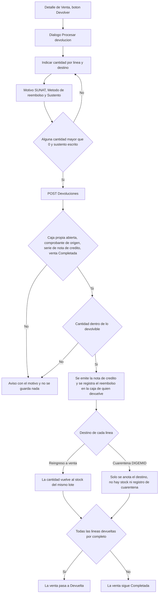

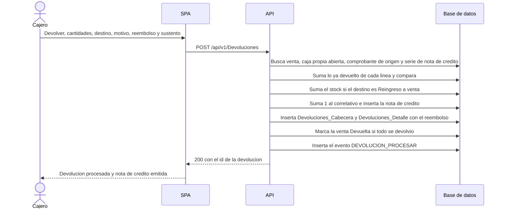

| Paso | Quién | Pantalla y acción | Endpoint y permiso | Reglas | Resultado |
|---|---|---|---|---|---|
| 1 | Cajero | `/pos/:id`: **Devolver** abre «Procesar devolución — {código}». La tabla lista solo líneas con cantidad devolvible: Vendido, Devuelto, Devolvible, **A devolver** (parte en 0) y **Destino** («Reingreso a venta» por defecto o «Cuarentena DIGEMID»). **Devolver todo lo pendiente** llena todas | `GET /api/v1/Ventas/{id}`, `Ventas:Leer` | RN-DEV-012, RN-DEV-023, RN-DEV-024 | Cantidades en **unidades base**, aunque la línea se vendiera por presentación |
| 2 | Cajero | Elige **Motivo SUNAT** («06 — Devolución total» o «07 — Devolución por ítem»; se propone solo según las cantidades), **Método de reembolso** («Efectivo», «Yape / Plin», «Tarjeta Débito/Crédito», «Transferencia») y escribe el **Sustento** (≤ 255). Ve el «Reembolso estimado» | — | RN-DEV-014, RN-DEV-015, RN-DEV-016, RN-DEV-018 | Formulario completo |
| 3 | Cajero | **Procesar devolución** | `POST /api/v1/Devoluciones`, `Devoluciones:ProcesarDevolucion` | RN-DEV-002 a RN-DEV-013 | El servidor valida; sin caja propia abierta ningún otro error llega a verse (RN-DEV-005) |
| 4 | API | Calcula el monto devuelto (cantidad × precio fijado en la venta, redondeo mitad al par) y el monto reembolsado (monto devuelto × proporción que pagó el cliente, descontando cobertura de seguro) | idem | RN-DEV-016, RN-DEV-017 | Importes |
| 5 | API | Emite **una** nota de crédito con la serie de nota de crédito activa de la sucursal; base e IGV sobre el monto devuelto | idem | RN-DEV-020, RN-DEV-021, RN-DEV-022 | Número `{prefijo}-{correlativo de 8 dígitos}`, estado `NoEnviado` |
| 6 | API | Registra el reembolso en la caja de quien procesa y repone stock de las líneas con «Reingreso a venta» | idem | RN-DEV-019, RN-DEV-023 | Si el método es efectivo, resta del arqueo de esa caja (RN-CAJ-014) |
| 7 | SPA | Aviso «Devolución procesada y nota de crédito emitida.»; el detalle se recarga y muestra la columna «Devuelto» y la sección «Devoluciones / Notas de crédito» («Nota de crédito», «Fecha», «Reembolsado (S/)», «Método de reembolso») | `GET /api/v1/Ventas/{id}` | RN-DEV-025, RN-DEV-032 | Venta `Devuelta` (todo devuelto) o `Completada` |

Detalles que conviene tener claros:

- No hay plazo máximo para devolver ni límite de devoluciones por venta: mientras quede cantidad devolvible se puede seguir devolviendo (RN-DEV-008).
- El método de reembolso no se compara con cómo pagó el cliente (RN-DEV-018). El sistema **no mueve dinero**, solo lo registra (RN-DEV-019).
- Con «Cuarentena DIGEMID» la devolución **no repone stock ni crea el registro de cuarentena**: el lote no aparece en «Lotes en cuarentena» del Inicio hasta que alguien lo aísle por la API (proceso 9; RN-DEV-024, RN-CUA-011).
- Devolver **no libera la dispensación** de la receta (RN-DEV-026) y la venta con devoluciones ya no se puede anular (RN-VEN-066).
- La nota de crédito no se imprime ni se muestra como documento: solo se ve su número (RN-DEV-022).

### 7.2 Anulación de una venta cobrada

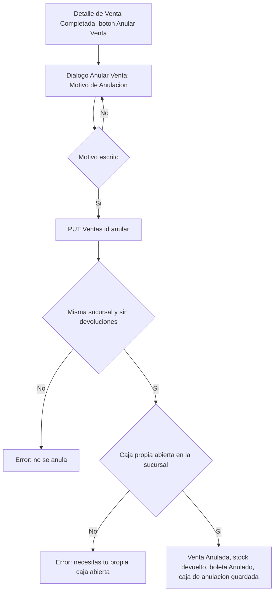

### 7.3 Anulación de una venta en espera

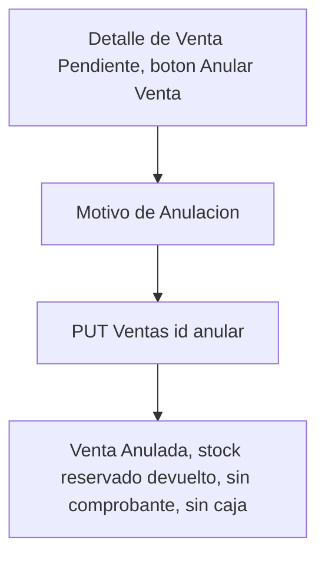

| Paso | Quién | Pantalla y acción | Endpoint y permiso | Reglas | Resultado |
|---|---|---|---|---|---|
| 1 | Cajero o supervisor | `/pos/:id`: **Anular Venta** (solo `Completada` o `Pendiente`, sin devoluciones) abre «Anular Venta»: «Esta acción revierte el stock descontado. Ingresa el motivo de la anulación.» | — | RN-VEN-062, RN-VEN-065, RN-VEN-066 | Diálogo |
| 2 | Cajero | Escribe el **Motivo de Anulación** (obligatorio, ≤ 255) y pulsa **Anular Venta** | `PUT /api/v1/Ventas/{id}/anular` (cuerpo = el motivo como texto JSON), `Ventas:Anular` | RN-VEN-063, RN-VEN-064 | La API exige que la venta exista y sea de la sucursal del token |
| 3 | API | Si la venta está `Completada`, busca la **caja propia abierta** (empleado del token, sucursal de la venta) y la guarda en la venta; si está `Pendiente`, no la necesita | idem | RN-VEN-067 | `Sesion_Anulacion_ID` (solo ventas cobradas) |
| 4 | API | Devuelve a cada fila de stock la cantidad vendida, pasa la boleta o factura a `Anulado`, deja la venta `Anulada` y audita `VENTA_ANULAR` | idem | RN-VEN-068, RN-VEN-069, RN-CMP-012, RN-VEN-061 | Respuesta 204 |
| 5 | SPA | Aviso «Venta anulada correctamente.»; el detalle recargado muestra «Motivo de Anulación:» y ya no ofrece **Reimprimir Comprobante** | `GET /api/v1/Ventas/{id}` | RN-VEN-069 | Fin |

### 7.4 Qué se revierte en cada caso

| Efecto | Devolución | Anulación de venta cobrada | Anulación de venta en espera |
|---|---|---|---|
| Stock | Se **suma** solo con destino «Reingreso a venta» (mismo lote, sucursal de la venta; si la fila ya no existe se omite sin error) | Se **devuelve toda la cantidad vendida** (si la fila ya no existe, se omite) | Se **devuelve** lo reservado |
| Estado de la venta | `Devuelta` si todo se devolvió; si no, sigue `Completada` | `Anulada` | `Anulada` |
| Comprobante | La boleta **no cambia**; se emite una **nota de crédito** nueva | La boleta pasa a `Anulado` (las notas de crédito no se tocan) | No existe comprobante |
| Dinero y caja | Reembolso registrado en la caja de quien devuelve; solo el efectivo resta del arqueo | Los pagos **no se tocan**; el efectivo de la venta se descuenta del arqueo de la caja que anula si se cobró en otra (RN-CAJ-012, casos C y D) | No hay pagos |
| Dispensación de la receta | **No se libera** | Se libera (el conteo ignora las ventas anuladas) | Se libera |
| Reclamo de seguro | No se toca | No se toca | No aplica |
| SUNAT | No se envía nada | No se envía nada (no existe comunicación de baja) | No aplica |
| Auditoría | `DEVOLUCION_PROCESAR` | `VENTA_ANULAR` | `VENTA_ANULAR` |

### 7.5 Excepciones

| Situación | Regla | Mensaje que ve el usuario | Qué hacer |
|---|---|---|---|
| Devolución sin caja propia abierta (`Devolucion.Caja.SinSesionAbierta`) | RN-DEV-005 | «Necesitas una caja abierta para procesar la devolución.» | Abrir la caja (proceso 6) |
| Venta de otra sucursal (`Devolucion.Venta.OtraSucursal`, 403) | RN-DEV-004 | «Solo puedes devolver ventas de tu propia sucursal.» | Entrar con un usuario de esa sucursal |
| Venta sin boleta ni factura (`Devolucion.ComprobanteOrigen.NoEmitido`) | RN-DEV-006 | «La venta no tiene boleta ni factura emitida que acreditar.» | No aplica la devolución (venta en espera: anularla) |
| Sin serie de nota de crédito activa (`Devolucion.SerieNotaCredito.NoConfigurada`) | RN-DEV-007 | «La sucursal no tiene una serie de nota de crédito activa. Configúrala en Series Fiscales.» | Crear o activar la serie (proceso 2) |
| Venta `Anulada` o `Devuelta` (`Devolucion.Venta.EstadoInvalido`) | RN-DEV-008 | «Solo se pueden devolver ventas completadas.» | — |
| Cantidad mayor que lo devolvible (`Devolucion.Cantidad.Excedida`) | RN-DEV-012 | «La cantidad supera lo que queda por devolver en alguna línea. Actualiza la pantalla e inténtalo de nuevo.» | Recargar y ajustar |
| Línea que no pertenece a la venta (`DetalleVenta.NotFound`) | RN-DEV-011 | «Una de las líneas ya no pertenece a la venta.» | Recargar |
| La venta ya no existe (`Venta.NotFound`) | RN-DEV-003 | «La venta ya no existe.» | — |
| Ninguna cantidad mayor que 0 | RN-DEV-009 | «Ingresa al menos una cantidad a devolver.» | Indicar cantidades |
| Sustento vacío | RN-DEV-015 | «El sustento es obligatorio.» | Escribirlo |
| Dos devoluciones o un cobro simultáneos (`Concurrency.Conflict`, 409) | RN-DEV-025, RN-DEV-028 | «Otra operación modificó estos datos al mismo tiempo. Actualiza la pantalla e inténtalo de nuevo.» | Recargar y repetir |
| Cualquier otro error de la devolución | RN-DEV-002 | «Error al procesar la devolución.» | Reintentar |
| Anular una venta con devoluciones (`Venta.Anular.ConDevoluciones`) | RN-VEN-066 | «Esta venta tiene devoluciones registradas y ya no puede anularse. Gestiona los cambios desde Devoluciones.» (el texto remite a «Devoluciones», que no es pantalla: se devuelve desde el mismo detalle) | No anular; devolver lo que falte |
| Anular una venta cobrada sin caja propia abierta (`Venta.Anular.SinSesionAbierta`) | RN-VEN-067 | «Necesitas tener tu propia caja abierta en esta sucursal para anular una venta cobrada.» | Abrir la caja |
| Motivo vacío | RN-VEN-063 | «El motivo es obligatorio.» (en el diálogo) | Escribirlo |
| Motivo de solo espacios, venta de otra sucursal o ya anulada (`Venta.Anular`) | RN-VEN-062, RN-VEN-063, RN-VEN-065 | «Error al anular la venta.» | Revisar el motivo y la sucursal |
| Anulación simultánea con otra operación | RN-VEN-057, RN-VEN-068 | «Otra operación modificó estos datos al mismo tiempo. Actualiza la pantalla e inténtalo de nuevo.» | Recargar y repetir |

### 7.6 Postcondiciones

| Operación | Tablas que cambian |
|---|---|
| Devolución | `Devoluciones_Cabecera` (sesión de caja, método y monto reembolsado, motivo SUNAT, sustento, empleado que autoriza), `Devoluciones_Detalle` (línea, cantidad en unidades base y destino), `SUNAT_Comprobantes_Emitidos` (la nota de crédito), `SUNAT_Series_Fiscales.Correlativo_Actual`, `Inventario_Sucursal` (solo reingreso), `Ventas_Cabecera.Estado` (`Devuelta` si todo) y `Auditoria_Eventos_Seguridad` (`DEVOLUCION_PROCESAR`). Todo en una transacción (RN-DEV-028) |
| Anulación | `Ventas_Cabecera` (`Estado = Anulada`, `Motivo_Anulacion`, `Sesion_Anulacion_ID` si estaba cobrada), `Inventario_Sucursal`, `SUNAT_Comprobantes_Emitidos` (boleta `Anulado`) y `Auditoria_Eventos_Seguridad` (`VENTA_ANULAR`) |

---

## 8. Proceso 6 — Caja

**Objetivo.** Controlar el efectivo de un turno: abrir la caja con un monto inicial, registrar (automáticamente) todo lo que entra y sale del cajón y cerrarla declarando el efectivo contado, para obtener la diferencia de arqueo.

**Actores.** Cajero con `POS:AperturarCaja` y `POS:CerrarCaja` (más `POS:Leer` para ver sus sesiones). Solo el cajero que abrió la sesión **o un usuario con rol `Admin`** puede cerrarla (RN-CAJ-007).

**Disparador.** Inicio y fin del turno. También se abre desde el terminal de venta (botón **Aperturar Caja**) o desde el Inicio (botón **Abrir caja**).

**Precondiciones.** Para abrir: el empleado no tiene otra sesión abierta **en ninguna sucursal** (RN-CAJ-004). La sucursal es la sucursal base del token y el cajero es el empleado del token; no se eligen (RN-CAJ-002).

### 8.1 Estados de la sesión de caja

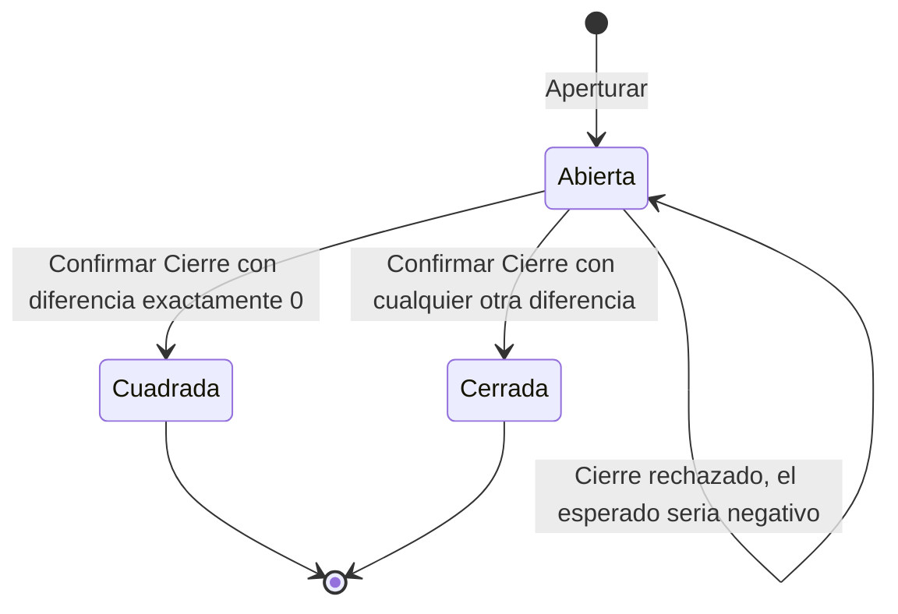

`Cuadrada` y `Cerrada` son estados finales: ninguna operación reabre, edita o elimina una sesión (RN-CAJ-010). No hay cierre automático: el único servicio en segundo plano de la API es el procesador de la bandeja de salida (`sofia-apis/src/SOFIA.Infrastructure/Services/OutboxProcessor.cs`), así que una caja olvidada abierta sigue abierta hasta que su titular o un administrador la cierre.

### 8.2 Apertura y cierre

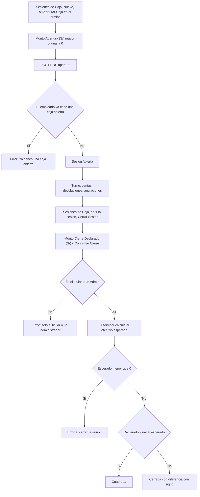

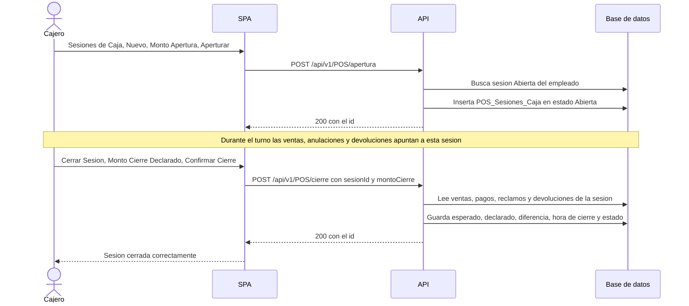

### 8.3 Pasos

| Paso | Quién | Pantalla y acción | Endpoint y permiso | Reglas | Resultado |
|---|---|---|---|---|---|
| 1 | Cajero | `/sesiones-caja` («Sesiones de Caja») › **Nuevo** › `/sesiones-caja/nueva`; o el diálogo «Aperturar Caja» del terminal; o **Abrir caja** del Inicio. Campo «Monto Apertura (S/)» (parte en 0; el cajero aparece bloqueado) y **Aperturar** | `POST /api/v1/POS/apertura`, `POS:AperturarCaja` | RN-CAJ-002 a RN-CAJ-005, RN-CAJ-026 | Sesión `Abierta`; aviso «Sesión aperturada correctamente» (desde el terminal, «Caja aperturada correctamente»); auditoría `CAJA_APERTURAR` |
| 2 | Cajero | Durante el turno: vender, cobrar ventas en espera, anular ventas cobradas y devolver (procesos 4 y 5) | ver procesos 4 y 5 | RN-VEN-004 a RN-VEN-006, RN-VEN-067, RN-DEV-005 | Cada operación queda ligada a la sesión por `Sesion_ID`, `Sesion_Anulacion_ID` o la sesión de la devolución |
| 3 | Cajero | (Opcional) En el Inicio, tarjeta «Caja»: ve «Efectivo esperado» de su caja abierta y el enlace «Ver mi caja» | `GET /api/v1/Dashboard/caja`, `POS:Leer` | RN-DAS-015 | El panel de cierre **no** muestra el esperado; el Inicio sí |
| 4 | Cajero | Cuenta el efectivo del cajón. `/sesiones-caja/:id` («Detalle de Sesión») › **Cerrar Sesión** abre el panel con «Monto Cierre Declarado (S/)» | `GET /api/v1/POS/{id}`, `POS:Leer` | RN-CAJ-009, RN-CAJ-023 | Panel de cierre |
| 5 | Cajero | **Confirmar Cierre** (no hay otra confirmación) | `POST /api/v1/POS/cierre`, `POS:CerrarCaja` | RN-CAJ-007 a RN-CAJ-019 | Sesión `Cuadrada` o `Cerrada`; aviso «Sesión cerrada correctamente»; vuelve a la lista (la pantalla no muestra el resultado del arqueo: se ve al reabrir el detalle) |
| 6 | Cajero o supervisor | Reabrir `/sesiones-caja/:id` | `GET /api/v1/POS/{id}` | RN-CAJ-023 | «Monto Cierre Declarado (S/)», «Monto Cierre Calculado (S/)» (el esperado), «Diferencia Arqueo (S/)» y estado |

### 8.4 Qué mueve el efectivo esperado

**Fórmula (RN-CAJ-011).**

`Efectivo esperado = Monto de apertura + efectivo neto de las ventas que entran − efectivo neto de las ventas de otras cajas anuladas desde esta sesión − reembolsos en efectivo de las devoluciones procesadas desde esta sesión`

- **Efectivo neto de una venta** = suma de los pagos en efectivo − vuelto, donde vuelto = el mayor entre 0 y (suma de todos los pagos − monto a pagar) y monto a pagar = total − cobertura de seguro (RN-CAJ-013). Los pagos con Yape/Plin, tarjeta o transferencia no aportan efectivo.
- **Qué ventas entran** (RN-CAJ-012; las ventas en espera nunca entran):

| Caso | Cobrada en | Estado y dónde se anuló | Entra |
|---|---|---|---|
| A | Esta sesión | `Completada` o `Devuelta` | Con signo + |
| B | Esta sesión | `Anulada` desde esta misma sesión | No entra (neto 0) |
| C | Otra sesión | `Anulada` desde esta sesión | Con signo − (el efectivo salió de este cajón) |
| D | Esta sesión | `Anulada` desde otra sesión | Con signo + (se cobró aquí y aquí sigue contando) |
| E | Esta sesión | `Anulada` sin sesión de anulación (anuladas antes del script `0028`) | No entra |

- **Reembolsos**: solo los de método efectivo, de devoluciones procesadas desde esta sesión, sin importar en qué sesión se cobró la venta (RN-CAJ-014).

**Ejemplo numérico.** Apertura 100,00.

| Operación | Detalle | Aporta |
|---|---|---|
| V1 (caso A) | Venta de 50,00 pagada con 60,00 en efectivo; vuelto 10,00 | + 50,00 |
| V2 (caso A) | Venta de 30,00 pagada con tarjeta | + 0,00 |
| V3 (caso C) | Venta de 20,00 cobrada en efectivo en otra caja y anulada desde esta | − 20,00 |
| V4 (caso D) | Venta de 40,00 en efectivo cobrada aquí y anulada después desde otra caja | + 40,00 |
| Devolución | Reembolso en efectivo de 15,00 procesado desde esta sesión | − 15,00 |

Esperado = 100,00 + (50,00 + 0,00 − 20,00 + 40,00) − 15,00 = **155,00**.

| Monto declarado | Diferencia (declarado − esperado) | Estado | Lectura |
|---|---|---|---|
| 155,00 | 0,00 | `Cuadrada` | Cuadre exacto |
| 150,00 | − 5,00 | `Cerrada` | Faltante |
| 160,00 | + 5,00 | `Cerrada` | Sobrante |

No existe tolerancia: una diferencia de un centavo ya deja la sesión `Cerrada` (RN-CAJ-015). El sistema guarda la diferencia con signo, pero no escribe las palabras «faltante» ni «sobrante». Se guarda también el esperado del momento del cierre; no se recalcula (RN-CAJ-018).

### 8.5 Casos especiales

- **Ventas anuladas desde otra caja.** Cambian el arqueo de la caja que ejecuta la anulación (caso C) o se siguen contando en la caja donde se cobraron (caso D). Lo que ocurra después de cerrar una sesión **no** cambia el valor ya guardado en ella (RN-CAJ-018).
- **Efectivo esperado negativo.** Si el cálculo da menos de 0 (por ejemplo, reembolsos en efectivo o anulaciones de ventas de otras cajas mayores que lo que hay en el cajón), el cierre se rechaza y la sesión **no se puede cerrar** con esta lógica; la pantalla solo dice «Error al cerrar la sesión» (RN-CAJ-016; sección 12, brecha 4).
- **Ventas en espera al cerrar.** No bloquean el cierre ni entran en el arqueo; las puede cobrar luego cualquier usuario de la sucursal con su propia caja abierta y entonces cuentan en esa otra sesión (RN-CAJ-017, RN-VEN-006).
- **Un cajero, una caja.** No puede tener dos sesiones abiertas aunque sean de sucursales distintas; la base lo impone con un índice único filtrado (RN-CAJ-004, RN-CAJ-026).
- **Quién ve las sesiones.** Los usuarios no `Admin` ven las sesiones de todos los cajeros de las sucursales accesibles; el `Admin`, las de toda la empresa (RN-CAJ-020).

### 8.6 Excepciones

| Situación | Regla | Mensaje que ve el usuario | Qué hacer |
|---|---|---|---|
| Ya tiene una caja abierta (`PosSesionCaja.YaAbierta`, 409) | RN-CAJ-004 | «Ya tienes una caja abierta. Ciérrala antes de abrir otra.» | Cerrar la anterior |
| Monto de apertura vacío o negativo | RN-CAJ-003 | «Ingresa un monto válido» (y no se envía) | Corregir el monto |
| Cualquier otro fallo al abrir (por ejemplo token sin empleado) | RN-CAJ-002 | «Error al aperturar la sesión» (desde el terminal: «No se pudo aperturar la caja») | Volver a iniciar sesión |
| Monto declarado vacío o negativo | RN-CAJ-009 | «Ingresa el monto declarado al cierre» (y no se envía) | Corregir el monto |
| Cerrar la caja de otro sin ser `Admin` (`PosSesionCaja.NoPropia`, 403) | RN-CAJ-007 | «Solo el cajero que abrió la caja o un administrador puede cerrarla.» | Pedirlo al titular o a un administrador |
| La sesión ya está `Cerrada` o `Cuadrada` | RN-CAJ-010 | Genérico: «Error al cerrar la sesión» | No hay reapertura |
| Efectivo esperado negativo | RN-CAJ-016 | Genérico: «Error al cerrar la sesión» | Revisar devoluciones y anulaciones; sin solución en pantalla |
| Dos cierres simultáneos (`Concurrency.Conflict`) | RN-CAJ-010 | «Otra operación modificó estos datos al mismo tiempo. Actualiza la pantalla e inténtalo de nuevo.» | Recargar |
| La sesión no existe o es de una sucursal sin acceso | RN-CAJ-008, RN-CAJ-020 | Detalle: «Error al cargar la sesión de caja»; cierre: «Error al cerrar la sesión» | — |
| Falta `POS:Leer` | RN-CAJ-001 | El terminal de venta trata la falla como «sin caja» y muestra «Debes aperturar la caja del turno antes de procesar una venta.» sin ningún aviso de error; al intentar abrir, «Ya tienes una caja abierta. Ciérrala antes de abrir otra.» (19f §3.1) | Dar `POS:Leer` al rol |

### 8.7 Postcondiciones

`POS_Sesiones_Caja`: al abrir, fila `Abierta` con hora de apertura (UTC del servidor) y monto de apertura, con los tres campos del arqueo vacíos; al cerrar, hora de cierre, `Monto_Cierre_Calculado` (esperado), `Monto_Cierre_Declarado`, `Diferencia_Arqueo` con signo y estado `Cuadrada` o `Cerrada`. Eventos `CAJA_APERTURAR` («estado: Abierta; apertura: {monto}») y `CAJA_CERRAR` («cierre desde Abierta; declarado: {monto}») en `Auditoria_Eventos_Seguridad`; el esperado y la diferencia no van en el detalle de auditoría, solo quedan en la sesión (RN-CAJ-019). Las tres columnas que lee el arqueo son `Ventas_Cabecera.Sesion_ID`, `Ventas_Cabecera.Sesion_Anulacion_ID` y `Devoluciones_Cabecera.Sesion_ID` (RN-CAJ-027).

---

## 9. Proceso 7 — Recetas con IA

**Objetivo.** Ayudar al cajero a interpretar una receta en papel: a partir de una foto, listar los medicamentos detectados, validarlos contra el catálogo DIGEMID, ver su stock en la sucursal y sus equivalentes, y poder pasarlos al carrito.

**Estado real (importante).** El escaneo **solo devuelve un resultado en pantalla**: no crea la receta médica, no guarda la imagen ni el texto en ninguna tabla y no asocia ninguna receta a la venta (RN-REC-029). Las tablas `Recetas_Digitalizadas_IA` y `Registro_Privacidad_Presidio` existen en el esquema pero ningún código las usa (**solo esquema**, RN-REC-030). Para que una receta cuente en una venta (productos de receta retenida o estupefacientes, o empresa que exige registro) hay que **registrarla aparte** a mano (paso 5).

**Actores.** Cajero o personal de atención con `Recetas:Analizar` (escanear), `Recetas:Crear` (registrar la receta), `Recetas:Leer` y, en el terminal, los permisos de apoyo del proceso 4.

**Disparador.** El cliente trae una receta y se quiere saber qué medicamentos pide y si hay stock.

**Precondiciones.** Servicio de IA configurado (el análisis llama a Gemini y a Presidio; si fallan, responde 500: RN-REC-021). Límite de 10 análisis por minuto por empresa (RN-GEN-028) y cuerpo de hasta 10 MB (RN-REC-018).

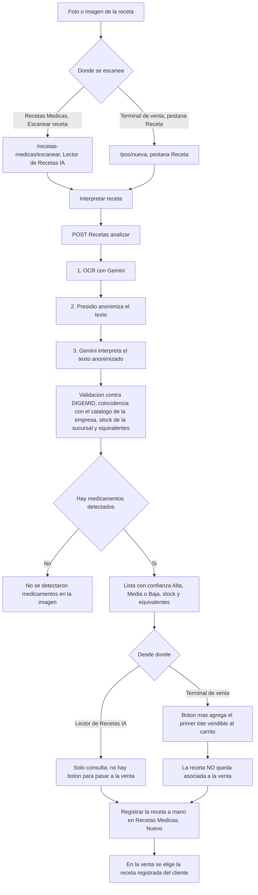

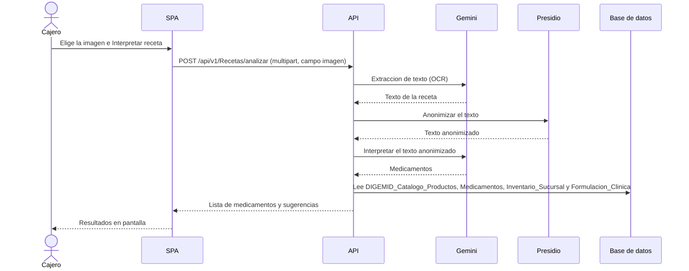

| Paso | Quién | Pantalla y acción | Endpoint y permiso | Reglas | Resultado |
|---|---|---|---|---|---|
| 1 | Cajero | Opción A: `/recetas-medicas` › **Escanear receta** › `/recetas-medicas/escanear` («Lector de Recetas IA»). Opción B: terminal `/pos/nueva`, pestaña «Receta» (solo con `Recetas:Analizar`). **Tomar foto** o **Galería**, o arrastrar la imagen | — | RN-REC-018, RN-REC-019 | Vista previa de la imagen |
| 2 | Cajero | **Interpretar receta** | `POST /api/v1/Recetas/analizar`, `Recetas:Analizar`, política `AiPolicy` | RN-REC-018 a RN-REC-022 | Anillo «Interpretando...» |
| 3 | API | OCR, anonimización, interpretación, validación contra DIGEMID (hasta 5 candidatos por parecido), coincidencia con el catálogo de la empresa, stock de lotes **no vencidos** de la sucursal del token y equivalentes por formulación clínica | idem | RN-REC-021 a RN-REC-028 | Hasta 20 medicamentos y 3 sugerencias por medicamento; confianza = nivel × 0,6 + parecido × 0,4 (RN-REC-025) |
| 4A | Cajero | En el lector: «Medicamentos de la receta (N)» con insignias «DIGEMID», «Cantidad sugerida: N», «Confianza: Alta/Media/Baja», «En stock: N unidades» o «Sin stock», «Equivalentes terapéuticos:» y «Sugerencias IA (N)» | — | RN-REC-025 a RN-REC-028 | Solo consulta |
| 4B | Cajero | En el terminal: botón `+` de cada medicamento con stock | `GET /api/v1/Ventas/lotes-disponibles?productoNombre=…`, `Ventas:Crear` | RN-VEN-075 | Agrega al carrito el **primer lote** vendible (el que vence antes), sin presentación y al precio de catálogo, con la cantidad sugerida acotada a la existencia; los equivalentes no se muestran en el terminal |
| 5 | Cajero | Para que la receta cuente en la venta: `/recetas-medicas/nueva` (también el enlace «Registrar receta» del terminal): Paciente, Médico, fecha de expedición, repeticiones máximas, indicaciones y número de receta; **Guardar** | `POST /api/v1/Recetas`, `Recetas:Crear` | RN-REC-002 a RN-REC-010 | Receta registrada; el número es obligatorio para vender receta retenida o estupefacientes (RN-VEN-032) |
| 6 | Cajero | En la venta, selector «Receta médica» con las recetas registradas del cliente | `GET /api/v1/Recetas`, `Recetas:Leer` | RN-VEN-029 a RN-VEN-033 | Receta adjunta a todas las líneas del carrito (RN-VEN-036) |

### 9.1 Excepciones

| Situación | Regla | Mensaje que ve el usuario | Qué hacer |
|---|---|---|---|
| Más de 10 análisis por minuto (429), imagen mayor de 10 MB (413), fallo de Gemini o Presidio (500), sin permiso (403) o sin red | RN-REC-018, RN-REC-021, RN-GEN-028 | Siempre el mismo: «Error al interpretar la receta. Intenta nuevamente.» (la pantalla no distingue el motivo) | Esperar un minuto, reducir la imagen o reintentar; si persiste, informar la referencia de soporte |
| El botón **Interpretar receta** sin imagen elegida | RN-REC-018 | No hace nada | Elegir una imagen |
| La IA no devuelve JSON válido o no detecta texto | RN-REC-021 | «No se detectaron medicamentos en la imagen. Intenta con una foto más nítida.» | Tomar otra foto |
| Medicamento detectado sin stock en la sucursal (al agregar desde el terminal) | RN-REC-026, RN-VEN-075 | «El medicamento detectado no tiene stock en esta sucursal.» | Ofrecer un equivalente, que se busca a mano en el catálogo |
| Producto sin precio de catálogo (al agregar desde el terminal) | RN-VEN-019 | «Este producto no tiene precio de venta configurado en el catálogo. Pide a un administrador que lo registre.» | Registrar el precio (proceso 3) |
| El medicamento detectado no coincide con el catálogo de la empresa (parecido ≤ 0,4) | RN-REC-024 | El resultado no trae producto: aparece con el nombre DIGEMID o el texto detectado y sin botón `+` (no hay stock que ofrecer) | Buscarlo a mano |
| Registro de la receta: paciente o médico inexistente, fecha futura, número de más de 30 caracteres | RN-REC-004, RN-REC-005, RN-REC-007, RN-REC-010 | «El paciente seleccionado no existe. Vuelve a seleccionarlo.» / «El médico seleccionado no existe. Vuelve a seleccionarlo.» / «La fecha de expedición no puede ser posterior a hoy.» / «El número de receta admite hasta 30 caracteres» | Corregir |

### 9.2 Postcondiciones

El análisis **no escribe nada**: no cambia ninguna tabla y no genera evento de auditoría (RN-REC-029). Lo único que lee son `DIGEMID_Catalogo_Productos`, `Medicamentos`, `Inventario_Sucursal` y `Formulacion_Clinica`. La imagen viaja a un servicio externo (Gemini) y el texto se anonimiza antes del segundo paso (RN-REC-021); la API no guarda la imagen (no hay tabla que la reciba: **No verificado** si algún registro de la infraestructura la conserva). Solo el paso 5 deja datos (`Recetas_Medicas`), y solo el cobro con receta elegida deja el vínculo `Ventas_Detalle.Receta_ID`.

---

## 10. Proceso 8 — Dashboard

**Objetivo.** Dar a cada usuario el resumen del día de lo que su rol puede ver: ventas, caja, inventario y devoluciones.

**Actores.** Cualquier usuario autenticado. Cada bloque exige el permiso `Leer` de su módulo, y el rol `Admin` los ve todos.

**Disparador.** Entrar a `/dashboard` (opción «Dashboard», siempre visible) o pulsar **Actualizar**. No hay recarga automática (RN-DAS-024).

**Precondiciones.** Sesión iniciada sin obligación de cambiar la clave. El SPA envía el parámetro `hoy` (medianoche local del navegador en UTC) a las consultas de ventas, inventario y devoluciones (RN-DAS-002, RN-DAS-004).

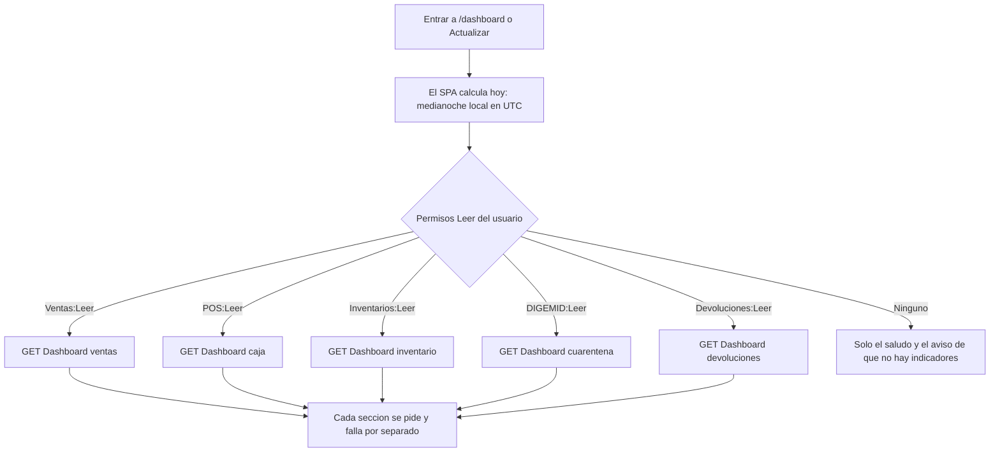

### 10.1 De dónde sale cada indicador

| Bloque e indicador | Endpoint y permiso | Fuente y cálculo | Regla |
|---|---|---|---|
| Ventas: «Vendido hoy», «Ayer» y variación | `GET /api/v1/Dashboard/ventas`, `Ventas:Leer` | `Ventas_Cabecera`: suma del total **bruto** de ventas `Completada` y `Devuelta` (no `Anulada` ni `Pendiente`) en la ventana de hoy `[hoy, hoy + 24 h)`; variación `(hoy − ayer) ÷ ayer` en el SPA | RN-DAS-005, RN-DAS-006 |
| «Comprobantes» y «Ticket promedio» | idem | Número de ventas que cuentan; ticket = vendido ÷ ventas | RN-DAS-007 |
| «Mis ventas de hoy» | idem | Igual que «Vendido hoy» limitado al empleado del token | RN-DAS-008 |
| «Ventas en espera» y «Por cobrar» | idem | Todas las ventas `Pendiente` del alcance, de cualquier fecha | RN-DAS-009 |
| «Cobrado por método de pago» | idem | `Ventas_Pagos` de las ventas que cuentan, por método; al efectivo se le resta el vuelto; no se restan reembolsos | RN-DAS-010 |
| «Ventas por sucursal» | idem | Solo si el alcance tiene más de una sucursal | RN-DAS-011 |
| «Ventas de los últimos 7 días» y «Productos más vendidos en 7 días» | idem | Siete ventanas diarias; los 5 productos con más unidades base | RN-DAS-012, RN-DAS-013 |
| Caja: «Tienes una caja abierta» y «Efectivo esperado» | `GET /api/v1/Dashboard/caja`, `POS:Leer` | La sesión `Abierta` más reciente del empleado, con la fórmula del cierre | RN-DAS-015, RN-CAJ-011 |
| Caja: «Cajas abiertas (n)» | idem | Sesiones `Abierta` de las sucursales del alcance, hasta 50 | RN-DAS-016 |
| Inventario: lotes vencidos, por vencer en 30, 31 a 60 y 61 a 90 días | `GET /api/v1/Dashboard/inventario`, `Inventarios:Leer` | `Inventario_Sucursal` × `Lotes_Inventario`: filas con cantidad > 0 según la caducidad | RN-DAS-017 a RN-DAS-019 |
| «Productos sin stock» y «Productos con stock bajo» | idem | Por sucursal y producto, sobre el stock **vendible**; bajo = 1 a 10 unidades | RN-DAS-020, RN-DAS-021 |
| «Lotes en cuarentena» | `GET /api/v1/Dashboard/cuarentena`, `DIGEMID:Leer` | `DIGEMID_Inventario_Cuarentena` en estado `Retenido`, por sucursal y lote | RN-DAS-022 |
| «Devoluciones de hoy» y «Monto reembolsado» | `GET /api/v1/Dashboard/devoluciones`, `Devoluciones:Leer` | `Devoluciones_Cabecera` de hoy, de cualquier método de reembolso | RN-DAS-023 |

### 10.2 Qué ve cada rol

| Aspecto | Administrador (`Admin`) | Cajero u otro rol |
|---|---|---|
| Alcance de sucursales | Todas las de la empresa (`empresaCompleta`) | Su sucursal base más las asignadas a su cuenta y a sus roles (RN-DAS-003, RN-GEN-023) |
| Total de ventas | Total de la empresa, con la tarjeta «Ventas por sucursal» si hay más de una sucursal («Total empresa») | Total de sus sucursales («Total de tus sucursales») |
| «Mis ventas de hoy» y «Mi caja» | Los suyos | Los suyos |
| Bloques visibles | Todos | Solo los de los módulos cuyo `Leer` tenga el rol; el rol de mostrador del manual (con `Leer` en Ventas, Sesiones de Caja, Inventario, DIGEMID y Devoluciones) ve las cinco secciones |
| Enlaces «Ver ventas de hoy», «Ver mis ventas», «Ver ventas en espera» | Solo con una sola sucursal en el alcance | Idem; abren `/pos` filtrado (por «Completada», lo que deja fuera las ventas `Devuelta` que sí suma «Vendido hoy», RN-DAS-014) |
| Sin ningún permiso de lectura | — | «Tu usuario no tiene indicadores disponibles aquí. Usa el menú lateral para ir a tus módulos.» |
| Caja sin abrir | — | «No tienes una caja abierta» y botón **Abrir caja** (con `POS:AperturarCaja`) |

### 10.3 Excepciones y postcondiciones

| Situación | Regla | Mensaje que ve el usuario | Qué hacer |
|---|---|---|---|
| `hoy` a más de 36 horas de la hora del servidor (reloj mal configurado) | RN-DAS-002 | «No se pudo cargar esta sección.» con **Reintentar** | Corregir la hora del equipo |
| Falla de una sección (403, 500) | RN-DAS-024 | «No se pudo cargar esta sección.» con **Reintentar**; las demás siguen visibles | Reintentar |
| Fallan los permisos del usuario | RN-DAS-001 | «No se pudieron cargar tus permisos.» con **Reintentar** | Reintentar o volver a iniciar sesión |

**Postcondiciones.** El dashboard es de solo lectura: no escribe nada. Los montos son brutos (las devoluciones se muestran aparte, RN-DAS-005), «hoy» depende de la zona horaria del navegador y las cifras de lotes cuentan filas de stock (un lote presente en dos sucursales cuenta dos veces, RN-DAS-017).

---

## 11. Proceso 9 — Procesos que existen solo en la API (sin pantalla)

> **Solo API (sin pantalla).** Los cinco procesos de esta sección tienen endpoints y reglas, pero el SPA no tiene ninguna ruta, opción de menú ni botón para ellos (rutas en `sofia-docs/_inventario/rutas-spa.csv`; módulos listados en `REGLAS-AGENTES.md` §4). Solo se pueden usar con un cliente HTTP autenticado. Sus permisos **sí aparecen** en la matriz de roles (pantalla «Roles & Permisos») y se pueden conceder, pero no abren ninguna pantalla. Ningún script siembra esos permisos: los concede el administrador (RN-TRA-001, RN-DEL-001, RN-MAG-001, RN-SRV-001, RN-CUA-001). Como no hay pantalla, no existe «mensaje que ve el usuario»: la columna de mensajes indica el código de error que devuelve la API (`code`) y su estado HTTP. Sus reglas completas están en [01d](../ola-1-fundamentos/01-reglas-de-negocio/01d-modulos-solo-api.md).

### 11.1 Transferencias entre sucursales

**Objetivo.** Mover stock de una sucursal a otra con despacho y recepción.

**Actores.** Personal de la sucursal de **origen** (crea, despacha, cancela) y de la sucursal de **destino** (recibe), con `Transferencias:Crear`, `Transferencias:Actualizar` (despachar, recibir y cancelar comparten permiso) y `Transferencias:Leer`.

**Disparador.** Una sucursal necesita mercadería de otra. **Precondiciones.** El lote tiene fila de stock en el origen con cantidad suficiente (RN-TRA-007, RN-TRA-008); la sucursal de origen y el emisor salen del token (RN-TRA-002).

```mermaid
stateDiagram-v2
    [*] --> Iniciada: POST Transferencias
    Iniciada --> En_Transito: Despachar, descuenta el stock del origen
    Iniciada --> Cancelada: Cancelar, sin mover stock
    En_Transito --> Completada: Recibir, todo lo listado llega completo
    En_Transito --> Recibida_Parcial: Recibir, alguna linea llega incompleta
    En_Transito --> Cancelada: Cancelar, devuelve el stock al origen
    Completada --> [*]
    Recibida_Parcial --> [*]
    Cancelada --> [*]
```

El estado `Aprobada` existe en la entidad y en la base, pero **ningún endpoint lo alcanza** (RN-TRA-011).

| Paso | Quién | Endpoint y permiso | Reglas | Resultado |
|---|---|---|---|---|
| 1 | Origen | `POST /api/v1/Transferencias`, `Transferencias:Crear` (destino y líneas lote-cantidad) | RN-TRA-002 a RN-TRA-010 | Transferencia `Iniciada`, responde 201; **no descuenta ni reserva stock** |
| 2 | Origen | `PUT /api/v1/Transferencias/{id}/despachar`, `Transferencias:Actualizar` | RN-TRA-012 a RN-TRA-014 | `En_Transito`; se resta la cantidad enviada de cada fila del origen (todo o nada) |
| 3 | Destino | `PUT /api/v1/Transferencias/{id}/recibir`, `Transferencias:Actualizar` (cuerpo: arreglo de lote y cantidad recibida, 0 permitido) | RN-TRA-015 a RN-TRA-020 | `Completada` o `Recibida_Parcial`; solo entra al destino lo recibido |
| 3b | Origen | `PUT /api/v1/Transferencias/{id}/cancelar`, `Transferencias:Actualizar` | RN-TRA-021 a RN-TRA-024 | `Cancelada`; si estaba en tránsito, el origen recupera la cantidad enviada |
| 4 | Origen o destino | `GET /api/v1/Transferencias` y `GET /api/v1/Transferencias/{id}`, `Transferencias:Leer` | RN-TRA-025, RN-TRA-026 | Solo transferencias donde la sucursal del token es origen o destino (también para el `Admin`) |

| Situación | Regla | Código y HTTP | Qué hacer |
|---|---|---|---|
| Origen igual a destino | RN-TRA-004 | `Transferencia.SucursalDestino`, 400 | Elegir otro destino |
| Destino inexistente | RN-TRA-005 | `Transferencia.SucursalDestinoNotFound`, 404 | Corregir |
| Lote sin stock registrado en el origen | RN-TRA-007 | `Transferencia.LoteNotFound`, 404 | Elegir un lote con stock |
| Cantidad mayor que la existente (al crear o al despachar) | RN-TRA-008, RN-TRA-014 | `Transferencia.StockInsuficiente`, 400 | Reducir la cantidad |
| Despachar, recibir o cancelar desde la sucursal equivocada | RN-TRA-012, RN-TRA-015, RN-TRA-021 | `Transferencia.Forbidden`, **400** (no 403) | Usar un usuario de la sucursal correcta; el `Admin` tampoco se salta la comparación |
| Estado que no admite la acción (por ejemplo recibir dos veces) | RN-TRA-013, RN-TRA-016, RN-TRA-022 | `Transferencia.EstadoLogistico`, 400 | — |
| Lote ajeno a la transferencia o cantidad recibida mayor que la enviada | RN-TRA-018 | `Transferencia.Recepcion`, 400 | Corregir la recepción |
| Recibir y cancelar a la vez | RN-TRA-024 | `Concurrency.Conflict`, 409 | Releer y repetir |

**Postcondiciones.** `Transferencias_Cab` (estado, emisor, receptor, fechas, `RowVersion`), `Transferencias_Det` (cantidad enviada y recibida) e `Inventario_Sucursal` de ambas sucursales. **No hay evento de auditoría** y el stock tiene huecos conocidos: la diferencia enviada y no recibida se pierde sin sustento ni merma (RN-TRA-020), y las líneas no listadas en la recepción se ignoran pero pueden dejar la transferencia `Completada` (RN-TRA-019). Se pueden transferir lotes vencidos o retenidos (RN-TRA-007).

### 11.2 Cuarentena y actas de destrucción DIGEMID

**Objetivo.** Aislar lotes sospechosos o devueltos para que no se vendan, y documentar su destrucción con un acta.

**Actores.** Regente o responsable con `DIGEMID:AislarLoteCuarentena`, `DIGEMID:GenerarActaDestruccion` y `DIGEMID:Leer`.

**Disparador.** Una alerta de calidad o una devolución con destino «Cuarentena DIGEMID» (que solo deja el destino anotado, RN-DEV-024). **Precondiciones.** La sucursal y el empleado salen del token (RN-CUA-002); el lote existe en la empresa (RN-CUA-004).

```mermaid
stateDiagram-v2
    [*] --> Retenido: Aislar con estado Retenido
    [*] --> Liberado: Aislar con estado Liberado
    [*] --> Destruido: Aislar con estado Destruido
    [*] --> Devuelto: Aislar con estado Devuelto
    Retenido --> Retenido: No existe operacion para cambiarlo
    Liberado --> [*]
    Destruido --> [*]
    Devuelto --> [*]
```

El estado del registro se elige al crearlo; **no hay endpoint para pasar de un estado a otro ni para eliminar el registro** (RN-CUA-009). Un lote con algún registro `Retenido` queda bloqueado para la venta en toda la empresa y crear después un registro «Liberado» **no** levanta el bloqueo (RN-CUA-007).

```mermaid
stateDiagram-v2
    [*] --> Generada: POST DIGEMID acta-destruccion
    Generada --> [*]: No se edita ni se elimina
```

| Paso | Quién | Endpoint y permiso | Reglas | Resultado |
|---|---|---|---|---|
| 1 | Regente | `POST /api/v1/DIGEMID/cuarentena`, `DIGEMID:AislarLoteCuarentena` (lote, cantidad > 0, motivo ≤ 50, estado, línea de devolución opcional) | RN-CUA-002 a RN-CUA-005 | Registro con fecha UTC; si el estado es `Retenido`, el lote no se vende |
| 2 | Regente | `GET /api/v1/DIGEMID/cuarentena`, `DIGEMID:Leer` | RN-CUA-012 | Registros de las sucursales accesibles |
| 3 | Regente | `POST /api/v1/DIGEMID/acta-destruccion`, `DIGEMID:GenerarActaDestruccion` (número de resolución interna, empresa de residuos, manifiesto opcional, fecha de ejecución, regente, ruta del acta) | RN-CUA-013 a RN-CUA-018 | Solo la cabecera del acta |
| 4 | Regente | `GET /api/v1/DIGEMID/actas`, `DIGEMID:Leer` | RN-CUA-019 | Actas de la empresa |

| Situación | Regla | Código y HTTP |
|---|---|---|
| Lote o línea de devolución inexistente | RN-CUA-004 | `LoteInventario.NotFound` / `DetalleDevolucion.NotFound`, 404 |
| Estado fuera de los cuatro valores, cantidad ≤ 0 o motivo vacío o de más de 50 | RN-CUA-003 | `AislarLoteCuarentenaCommand.<Propiedad>`, 400 |
| Regente inexistente | RN-CUA-014 | `Empleado.NotFound`, 404 |
| Número de resolución repetido en la empresa | RN-CUA-016 | `Db.Duplicado`, 409 |

**Postcondiciones.** `DIGEMID_Inventario_Cuarentena` y `DIGEMID_Actas_Destruccion`. **Brechas:** aislar no mueve stock ni comprueba que haya cantidad que aislar (RN-CUA-004, RN-CUA-008); el acta no lista lotes ni cantidades destruidas y no pasa ningún registro a `Destruido` (la tabla `DIGEMID_Actas_Detalle` no la escribe nadie, RN-CUA-017); solo la venta respeta la cuarentena, no las transferencias, las órdenes magistrales ni las inmunizaciones (RN-CUA-008); ninguna de estas operaciones se audita (RN-CUA-005, RN-CUA-018).

### 11.3 Órdenes magistrales

**Objetivo.** Producir una fórmula magistral: descontar los insumos del stock y crear el lote terminado.

**Actores.** Químico o personal con `Magistrales:IniciarOrdenMagistral`, `Magistrales:CompletarOrdenMagistral` y `Magistrales:Leer`.

**Disparador.** Se recibe una receta magistral o se decide preparar una fórmula. **Precondiciones.** Los insumos tienen fila de stock **en la sucursal del token**, con lote no vencido y cantidad suficiente (RN-MAG-005 a RN-MAG-007). El sistema no comprueba que el empleado sea químico ni que el producto sea magistral (RN-MAG-002, RN-MAG-004).

```mermaid
stateDiagram-v2
    [*] --> Iniciada: POST Magistrales iniciar, descuenta los insumos
    Iniciada --> Completada: POST Magistrales completar, crea el lote y su stock
    Completada --> [*]
```

| Paso | Quién | Endpoint y permiso | Reglas | Resultado |
|---|---|---|---|---|
| 1 | Químico | `POST /api/v1/Magistrales/iniciar`, `Magistrales:IniciarOrdenMagistral` (producto resultante, cantidad a producir, receta opcional, lista de insumos por fila de stock y cantidad) | RN-MAG-002 a RN-MAG-010 | Orden `Iniciada`; cada insumo se resta del stock y se registra su consumo (unidad fija `UND`) |
| 2 | Químico | `POST /api/v1/Magistrales/completar`, `Magistrales:CompletarOrdenMagistral` (id de la orden, número de lote del fabricante ≤ 50, caducidad) | RN-MAG-012 a RN-MAG-017 | Se crea el lote del producto resultante y su stock en la sucursal de la orden con la cantidad declarada al iniciar; orden `Completada` |
| 3 | Cualquiera con permiso de lectura | `GET /api/v1/Magistrales/ordenes` y `GET /api/v1/Magistrales/{id}` | RN-MAG-018, RN-MAG-019 | Listado y detalle de seis campos (sin insumos ni lote generado) |

| Situación | Regla | Código y HTTP |
|---|---|---|
| Producto o receta inexistentes | RN-MAG-004 | `Medicamento.NotFound` / `RecetaMedica.NotFound`, 404 |
| Fila de insumo inexistente o de otra sucursal | RN-MAG-005 | `Inventario.NotFound`, 404 |
| Insumo con lote vencido | RN-MAG-006 | `Magistral.Insumo.LoteVencido`, 400 |
| Stock insuficiente de un insumo | RN-MAG-007 | `Inventario.StockInsuficiente`, 400 |
| Completar una orden de otra sucursal (también el `Admin`) | RN-MAG-013 | `OrdenMagistral.OtraSucursal`, 403 |
| Completar una orden ya completada | RN-MAG-014 | `Orden.Estado`, 400 |
| Número de lote repetido para el producto | RN-MAG-016 | `Db.Duplicado`, 409 |

**Postcondiciones.** `Magistrales_Ordenes_Produccion`, `Magistrales_Consumo_Insumos`, `Lotes_Inventario` e `Inventario_Sucursal`. **Brechas:** no hay cancelación ni devolución de insumos de una orden iniciada y nunca completada (RN-MAG-011); la cuarentena no impide usar un lote como insumo (RN-MAG-008); completar no permite informar la cantidad realmente obtenida (RN-MAG-017); no hay auditoría.

### 11.4 Servicios e inmunizaciones

**Objetivo.** Agendar servicios y dejar el registro clínico de una inmunización con su lote.

**Actores.** Personal con `Servicios:AgendarServicio`, `Servicios:RegistrarInmunizacion`, `Servicios:Leer`, `Servicios:Actualizar` y `Servicios:Eliminar`.

**Disparador.** Un paciente solicita una cita de servicio o se aplica una dosis. **Precondiciones.** Paciente, producto y, si se informa, venta existen en la empresa (RN-SRV-003, RN-SRV-008). El «profesional que administra» puede ser cualquier empleado (RN-SRV-008).

```mermaid
stateDiagram-v2
    [*] --> Programada: POST Servicios agenda, estado por defecto Programada
    Programada --> Programada: PUT servicio no cambia nada
    Programada --> Eliminada: DELETE servicio, borrado logico
    [*] --> Registrada: POST Servicios inmunizacion
    Registrada --> Eliminada: DELETE inmunizacion, borrado logico
    Eliminada --> [*]
```

El estado de la cita es un **texto libre** de hasta 20 caracteres (`Programada` solo es el valor por defecto) y **ninguna operación lo cambia**: la actualización de citas y de inmunizaciones no está implementada y responde 200 sin modificar nada (RN-SRV-004, RN-SRV-017).

| Paso | Quién | Endpoint y permiso | Reglas | Resultado |
|---|---|---|---|---|
| 1 | Personal | `POST /api/v1/Servicios/agenda`, `Servicios:AgendarServicio` (paciente, producto, venta opcional, fecha-hora, estado) | RN-SRV-002 a RN-SRV-005 | Cita; responde 200 con el id. **Con el script de base de datos actual el guardado podría fallar** (RN-SRV-019; no verificado en ejecución) |
| 2 | Personal | `POST /api/v1/Servicios/inmunizacion`, `Servicios:RegistrarInmunizacion` (paciente, profesional, producto, **lote**, vía, sitio anatómico, volumen > 0, modalidad `Corriente` o `Historica`, fecha de administración) | RN-SRV-007 a RN-SRV-013 | Registro clínico; el lote no debe estar vencido **en la fecha de administración** |
| 3 | Personal | `GET /api/v1/Servicios/agenda`, `GET /api/v1/Servicios/inmunizaciones`, `GET …/servicio/{id}`, `GET …/inmunizacion/{id}` | RN-SRV-006, RN-SRV-014, RN-SRV-016 | Listados de cuatro o cinco campos; el detalle solo devuelve el id |
| 4 | Personal | `DELETE /api/v1/Servicios/servicio/{id}` y `DELETE …/inmunizacion/{id}`, `Servicios:Eliminar` | RN-SRV-018 | Borrado lógico sin motivo ni rastro |

| Situación | Regla | Código y HTTP |
|---|---|---|
| Paciente, producto, venta o profesional inexistentes | RN-SRV-003, RN-SRV-008 | `Paciente.NotFound`, `Medicamento.NotFound`, `Venta.NotFound`, `Empleado.NotFound`, 404 |
| Lote inexistente o de otro producto | RN-SRV-009 | `LoteInventario.NotFound`, 404 |
| Lote vencido en la fecha de administración | RN-SRV-009 | `Inmunizacion.Lote.Vencido`, 400 |
| Fecha de administración vacía | RN-SRV-007 | `RegistrarInmunizacionCommand.FechaAdmnFisica`, 400 |

**Postcondiciones.** `Servicios_Agenda` y `Servicios_Clinicos_Inmunizacion`. **Brechas:** registrar una dosis **no descuenta stock ni consulta la cuarentena** (RN-SRV-012); el registro no tiene sucursal ni quién lo registró más que `CreatedBy` y no hay auditoría (RN-SRV-013); no se pueden corregir citas ni dosis (RN-SRV-017).

### 11.5 Delivery

**Objetivo.** Hacer seguimiento del despacho a domicilio de una venta.

**Actores.** Personal con `Delivery:ProgramarDelivery`, `Delivery:Actualizar`, `Delivery:Leer` y `Delivery:Eliminar`.

**Disparador.** Un cliente pide entrega a domicilio. **Precondiciones.** La venta existe, es de una sucursal accesible del usuario y no está `Anulada`; no tiene otro despacho vivo (RN-DEL-003 a RN-DEL-006).

```mermaid
stateDiagram-v2
    [*] --> Preparando: POST Delivery
    Preparando --> En_Camino
    Preparando --> Devuelto
    En_Camino --> Entregado
    En_Camino --> Devuelto
    Entregado --> [*]
    Devuelto --> [*]
```

| Paso | Quién | Endpoint y permiso | Reglas | Resultado |
|---|---|---|---|---|
| 1 | Personal | `POST /api/v1/Delivery`, `Delivery:ProgramarDelivery` (venta, plataforma ≤ 50, dirección ≤ 255, rastreo, repartidor, URL de evidencia) | RN-DEL-002 a RN-DEL-008 | Despacho `Preparando`; responde 200 con el id |
| 2 | Personal | `PUT /api/v1/Delivery/{id}/estado`, `Delivery:Actualizar` (el cuerpo repite el id y trae el nuevo estado) | RN-DEL-009, RN-DEL-010 | Cambio de estado; no valida la sucursal |
| 3 | Personal | `GET /api/v1/Delivery/despachos` y `GET /api/v1/Delivery/{id}` | RN-DEL-014, RN-DEL-015 | El listado muestra el estado; el detalle solo el id |
| 4 | Personal | `DELETE /api/v1/Delivery/{id}`, `Delivery:Eliminar` | RN-DEL-013 | Borrado lógico; libera la venta para programar otro |

| Situación | Regla | Código y HTTP |
|---|---|---|
| Venta inexistente | RN-DEL-003 | `Venta.NotFound`, 404 |
| Sucursal de la venta no accesible | RN-DEL-004 | `Delivery.Venta.SucursalNoPermitida`, 403 |
| Venta anulada | RN-DEL-005 | `Delivery.Venta.Anulada`, 409 |
| Venta que ya tiene despacho | RN-DEL-006 | `Delivery.Venta.YaProgramado`, 409 (o `Db.Duplicado` si son simultáneos) |
| Transición no permitida | RN-DEL-010 | `Delivery.Estado.TransicionInvalida`, 400 |

**Postcondiciones.** `Despachos_Delivery`. El despacho no tiene costo, no se refleja en el comprobante, el arqueo ni el stock, y no cambia si la venta se anula o se devuelve después (RN-DEL-017). **Brechas:** editar los datos del despacho no está implementado (RN-DEL-012) y no hay auditoría.

---

## 12. Pendientes y «No verificado»

### 12.1 Brechas de proceso (el sistema no impide o no registra)

| # | Brecha | Dónde | Efecto |
|---|---|---|---|
| 1 | El registro público de empresas no genera evento de auditoría (`RegistrarEmpresaCommand` implementa `ICommand<LoginResult>`, no `IAuditableCommand`; `RegistrarEmpresaCommand.cs:12`) | Proceso 1 | No queda rastro en `Auditoria_Eventos_Seguridad` del alta de la empresa ni de su administrador |
| 2 | Solo los comandos de seguridad, empresa (edición), series, caja, stock (ingreso y ajuste; el ingreso por suma no genera evento, RN-STK-008), devolución y anulación de venta son `IAuditableCommand`. Crear o editar sucursales, empleados, catálogos, lotes, recetas, proveedores y precios, cobrar ventas, transferencias, cuarentena, magistrales, servicios y delivery **no** generan evento de seguridad (búsqueda de `IAuditableCommand` en `sofia-apis/src/SOFIA.Application/**/Commands`; RN-VEN-061, RN-TRA-010, RN-DEL-008, RN-MAG-010, RN-SRV-013, RN-CUA-005) | Procesos 2 a 5 y 9 | La trazabilidad se limita a `CreatedBy`, `CreatedAt`, `LastModifiedBy` y `LastModifiedAt` |
| 3 | No existe compra ni recepción de proveedor: el stock se ingresa a mano lote por lote (entidades del dominio sin orden de compra; `sofia-docs/_inventario/entidades.csv`). El precio de proveedor solo alimenta el costo histórico de la venta (RN-VEN-022) | Proceso 3 | El costo y el stock no están enlazados a ningún documento de compra; el ajuste de stock no pide motivo (RN-STK-012) |
| 4 | Un efectivo esperado negativo impide cerrar la caja y no hay otra vía de cierre (RN-CAJ-016); tampoco hay cierre automático ni reapertura (RN-CAJ-010). El resultado del arqueo no se muestra al cerrar (se ve al reabrir el detalle) y no se rotula faltante ni sobrante (RN-CAJ-015) | Proceso 6 | Una caja puede quedar abierta indefinidamente |
| 5 | La venta en espera no caduca ni se libera sola y reserva stock y dispensación indefinidamente (RN-VEN-052); cualquier usuario de la sucursal con permisos puede retomarla (RN-VEN-053) | Proceso 4 | Stock inmovilizado si nadie la retoma ni la anula |
| 6 | «Receta verificada» guarda quién y cuándo, pero no el número ni los datos de la receta de papel (RN-VEN-035); la política `ExigirRegistroReceta` solo se cambia en base de datos (RN-EMP-016); la receta elegida se adjunta a todas las líneas aunque sean de venta libre (RN-VEN-036) | Proceso 4 | Sin trazabilidad documental en el modo flexible |
| 7 | Nada obliga a identificar al cliente por monto (RN-VEN-026); la venta nunca emite factura aunque el cliente tenga RUC (RN-CMP-001); ningún comprobante se envía a SUNAT (RN-CMP-007); no hay descuentos (RN-VEN-023); la cobertura de aseguradora existe en la API pero el bloque está oculto en el terminal (19f §3.8) | Proceso 4 | — |
| 8 | No se impone la salida FEFO: el cajero puede elegir cualquier lote vendible (RN-VEN-014, RN-VEN-075) | Proceso 4 | Los lotes que vencen antes pueden quedarse |
| 9 | Devolución sin plazo ni límite (RN-DEV-008), con método de reembolso libre respecto al pago original (RN-DEV-018) y sin supervisor ni PIN (RN-DEV-027); con destino «Cuarentena DIGEMID» no se crea el registro de cuarentena ni se repone stock (RN-DEV-024); no libera la dispensación de la receta (RN-DEV-026); la nota de crédito no se imprime ni se muestra como documento (RN-DEV-022); el permiso `Devoluciones:ProcesarDevolucion` no lo siembra ningún script (RN-DEV-001) | Proceso 5 | — |
| 10 | El mensaje de «Esta venta tiene devoluciones registradas…» remite a una pantalla «Devoluciones» que no existe (19f §8) | Proceso 5 | Texto engañoso |
| 11 | Ningún endpoint ni pantalla cambia el estado de suscripción de la empresa (RN-EMP-015): una empresa nueva nace en `TrialActivo` por 30 días y, al vencer, no puede iniciar sesión (RN-EMP-014) sin intervención en la base de datos | Procesos 1 y 2 | Bloqueo total al vencer la prueba |
| 12 | El escaneo de receta no guarda ni vincula nada (RN-REC-029); las tablas `Recetas_Digitalizadas_IA` y `Registro_Privacidad_Presidio` no se usan (RN-REC-030); el SPA muestra un único mensaje de error aunque la causa sea el límite de 10 por minuto | Proceso 7 | — |
| 13 | Transferencias: la diferencia enviada y no recibida se pierde sin sustento (RN-TRA-020); las líneas no listadas se ignoran y la transferencia puede quedar `Completada` (RN-TRA-019); `Forbidden` responde 400 (RN-TRA-012); se pueden transferir lotes vencidos o retenidos (RN-TRA-007). Los textos del SPA hablan de «sustento obligatorio» que el backend no implementa (RN-TRA-020) | Proceso 9 | Descuadre de inventario entre sucursales |
| 14 | Cuarentena: ningún endpoint libera, destruye o elimina un registro `Retenido` (RN-CUA-009); el acta no lista lotes ni cantidades (RN-CUA-017); solo la venta respeta la cuarentena (RN-CUA-008) | Proceso 9 | Bloqueo permanente de un lote hasta intervenir la base de datos |
| 15 | Magistrales: una orden iniciada y no completada deja el stock descontado sin forma de deshacer (RN-MAG-011); servicios: las citas y dosis no se pueden corregir (RN-SRV-017) y registrar una dosis no descuenta stock (RN-SRV-012); delivery: no se pueden editar los datos del despacho (RN-DEL-012) | Proceso 9 | — |
| 16 | El registro y la recuperación de contraseña no exigen complejidad más allá de 8 caracteres (RN-AUT-026) | Procesos 1 y 2 | — |

### 12.2 No verificado

| # | Qué | Motivo |
|---|---|---|
| 1 | Todo el documento se construyó leyendo código y documentos validados: **no se ejecutó la aplicación ni se llamó a la API**. Solo los procesos 1 y 2 tienen respaldo de recorridos reales hechos en la aplicación (manual de usuario, capítulos 1 a 3). Los procesos 3 a 8 se apoyan en el inventario de pantallas (19c a 19f) y en el catálogo de reglas; todavía no hay capítulos del manual para ventas, caja, devoluciones ni dashboard | Alcance de la tarea |
| 2 | Sintaxis de los 26 diagramas Mermaid: se revisó con un script de lectura (comillas pares, sin paréntesis sin comillas en nodos, sin punto y coma en secuencias) pero **no se renderizaron** | No se puede usar el navegador ni instalar herramientas |
| 3 | Que la API no guarde la imagen de la receta escaneada en ningún almacén fuera de las tablas (RN-REC-029 solo afirma que no se escribe en tablas) | No se auditó la infraestructura de archivos |
| 4 | Que el procesador de la bandeja de salida (`OutboxProcessor`) no ejecute efectos de negocio: RN-VEN-060 dice que ningún manejador consume `VentaCompletadaEvent` | No se abrió el procesador |
| 5 | Si la base redondea o trunca los importes con más de 2 decimales y si el total guardado puede diferir de la suma de líneas (RN-VEN-020) | Requiere ejecutar la API |
| 6 | Comportamiento de «Guardar» en el ingreso de stock sin lote elegido (excepción de JavaScript según la lectura, 19e §2.2) | No se ejecutó |
| 7 | Si el guardado de una cita en `Servicios_Agenda` falla por columnas que el script no crea (RN-SRV-019) | No se ejecutó |
| 8 | Aparición real de los mensajes marcados como «genérico» y de los estados HTTP de los procesos 3 a 9 | Se derivan del código y de los mapas de errores de cada pantalla |
| 9 | Cómo se cambia la sucursal activa del token para operar en otra sede (RN-VEN-071) | Fuera del alcance de los módulos leídos |

### 12.3 En curso (sin commitear)

Ninguno. `git status --short` estaba vacío en `sofia-apis` (`43f5529`) y en `sofia-web-spa` (`eeffbb6`) al empezar.

---

## 13. Tabla de cobertura

### 13.1 Proceso → secciones

| Proceso obligatorio | Sección | Objetivo | Actores | Disparador | Precondiciones | Flujo (`flowchart`) | Secuencia | Pasos | Excepciones | Postcondiciones |
|---|---|---|---|---|---|---|---|---|---|---|
| 1. Alta de empresa | 3 | Sí | Sí | Sí | Sí | Sí | Sí | Sí | Sí | Sí |
| 2. Configuración inicial | 4 | Sí | Sí | Sí | Sí | Sí | Sí | Sí | Sí (4.3 y 4.4, incluye saltar pasos) | Sí |
| 3. Catálogo e inventario | 5 | Sí | Sí | Sí | Sí | Sí | Sí | Sí (incluye variante por carga masiva) | Sí | Sí |
| 4. Venta y venta en espera | 6 | Sí | Sí | Sí | Sí | Sí (6.1 y 6.4) | Sí | Sí (6.2 y 6.4) | Sí | Sí |
| 5. Devolución y anulación | 7 | Sí | Sí | Sí | Sí | Sí (7.1 a 7.3) | Sí | Sí | Sí | Sí (con tabla de lo que se revierte) |
| 6. Caja | 8 | Sí | Sí | Sí | Sí | Sí | Sí | Sí | Sí | Sí (fórmula y ejemplo numérico en 8.4) |
| 7. Recetas con IA | 9 | Sí | Sí | Sí | Sí | Sí | Sí | Sí | Sí | Sí (estado real) |
| 8. Dashboard | 10 | Sí | Sí | Sí | Sí | Sí | No aporta: solo lectura sin camino de escritura | Sí (10.1) | Sí | Sí |
| 9. Solo API (transferencias, cuarentena y actas, magistrales, servicios e inmunizaciones, delivery) | 11 (11.1 a 11.5) | Sí | Sí | Sí | Sí | Diagrama de estados (`stateDiagram-v2`) por proceso | No aporta: sin pantalla | Sí | Sí | Sí |
| Mapa general | 2 | — | — | — | — | Sí | — | — | — | — |

### 13.2 Reglas de negocio citadas

Se extrajeron con un script de lectura todos los IDs `RN-…` citados en este documento y se compararon con las filas de definición de los seis archivos del catálogo (`01a`, `01b`, `01c1`, `01c2`, `01c3`, `01d`). Resultado: **372 IDs citados explícitamente y 475 al expandir los rangos escritos con «a»; 0 no existen en el catálogo** (el catálogo define 789 IDs distintos). Tablas con distinto número de columnas en alguna fila: 0.

| Prefijos | Citados en los procesos |
|---|---|
| `GEN`, `IMP` | 1 a 9 |
| `AUT`, `EMP`, `CTA` | 1 y 2 |
| `SUC`, `SER`, `EPL`, `ROL` | 2 |
| `UDM`, `JER`, `LAB`, `ING`, `MED`, `PRE`, `PRV`, `LOT`, `STK` | 3 |
| `VEN`, `CMP`, `REC` | 4 y 7 |
| `DEV` | 5 |
| `CAJ` | 6 |
| `DAS` | 8 |
| `TRA`, `DEL`, `MAG`, `SRV`, `CUA` | 9 |

No se citan `AUD` (Auditoría, sin pantalla ni proceso de negocio de punta a punta), `FOR`, `PAC`, `PRO`, `ASE` y `DIG` (catálogos de apoyo sin pantalla de proceso propia en esta lista; se mencionan solo por su pantalla donde interviene el flujo).

---

## 14. Fuentes

**Documentos del proyecto (rutas relativas a `sofia-docs`)**

- `_inventario/REGLAS-AGENTES.md`, `_inventario/README.md`, `_inventario/RECONCILIACION.md`
- `_inventario/endpoints.csv`, `_inventario/rutas-spa.csv`, `_inventario/tablas.csv`, `_inventario/scripts-dbup.csv`, `_inventario/codigos-error.csv`, `_inventario/entidades.csv`
- `ola-1-fundamentos/01-reglas-de-negocio/01a-administracion-y-seguridad.md`, `01b-catalogos.md`, `01c1-inventario-y-recetas.md`, `01c2-ventas-y-comprobantes.md`, `01c3-caja-devoluciones-dashboard.md`, `01d-modulos-solo-api.md`
- `ola-1-fundamentos/19-inventario-de-pantallas/19a-acceso-layout-y-compartidos.md`, `19c-catalogos-1.md`, `19d-catalogos-2.md`, `19e-inventario-y-atencion.md`, `19f-punto-de-venta.md` (19b se consultó a través del manual de usuario)
- `ola-1-fundamentos/05-seguridad/05b-matriz-de-permisos.md` (permisos por endpoint, vía `endpoints.csv`)
- `ola-1-fundamentos/06-glosario.md`
- `ola-1-fundamentos/20-carga-masiva-y-exportacion.md` (flujo común de carga masiva)
- `ola-2-funcional/manual-usuario/capitulo-01-primeros-pasos.md`, `capitulo-02-empresa-sucursales-series.md`, `capitulo-03-empleados-roles-cuentas.md`

**Código verificado directamente**

- `sofia-apis/src/SOFIA.Application/Empresas/Commands/RegistrarEmpresa/RegistrarEmpresaCommandHandler.cs` (códigos `Empresa.RUC.Duplicado` y `Auth.DuplicateUsername`, ambos con 409) y `RegistrarEmpresaCommand.cs:12`
- Handlers de `SOFIA.Application/Transferencias`, `Delivery`, `Magistrales`, `DIGEMID` y `Servicios` (códigos de error y estados HTTP de la sección 11)
- Lista de comandos que implementan `IAuditableCommand` (búsqueda en `sofia-apis/src/SOFIA.Application`)
- `sofia-apis/src/SOFIA.Infrastructure/Services/OutboxProcessor.cs` (único servicio en segundo plano, búsqueda de `BackgroundService` e `IHostedService`)
- `sofia-web-spa/src/app/pages/empresa/empresa-register/empresa-register.component.ts:23-25` (mapa de errores del registro), `sofia-web-spa/src/app/pages/roles/roles-detail/roles-detail.component.ts:236-237` y `:286-287`, `sofia-web-spa/src/app/pages/roles/services/rol.service.ts`, `sofia-web-spa/src/app/pages/seguridad/services/cuenta.service.ts`
- `sofia-web-spa/public/i18n/es.json` y los `es.json` de `jerarquias`, `laboratorios`, `unidadesMedida`, `ingredientesActivos`, `proveedores` y `medicamentos` (textos de duplicados y de «en uso» y claves de carga masiva)

**Scripts DbUp mencionados:** `0017` (permiso `Ventas:Anular`), `0019` (`RowVersion`), `0025` (receta flexible), `0028` (`Sesion_Anulacion_ID`).
