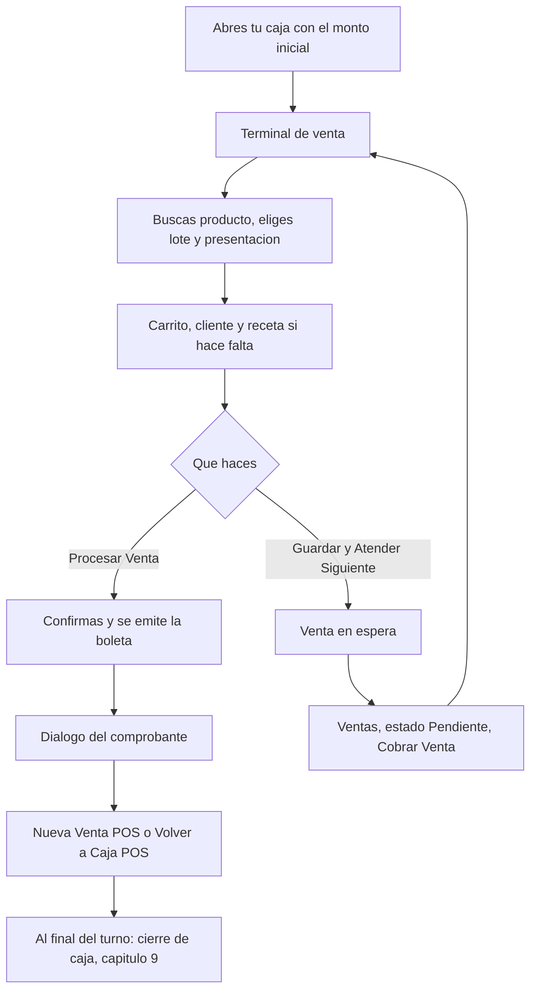

# Capítulo 8 — Caja y nueva venta

| | |
|---|---|
| **Sistema** | SOFIA — Sistema Optimizado Farmacéutico con Inteligencia Artificial |
| **Versión del documento** | 1.0 |
| **Fecha** | 2026-11-02 |
| **Backend** | `sofia-apis`, rama `main`, commit `9c16f35` (más nuevo que la línea base `43f5529`; `git status --short` sin cambios locales al empezar) |
| **Frontend** | `sofia-web-spa`, rama `main`, commit `7070e1a` (más nuevo que la línea base `eeffbb6`; `git status --short` sin cambios locales al empezar) |
| **Método** | Recorrido en la aplicación local más inventario de pantallas |

## 1. Introducción

En este capítulo aprendes a **abrir tu caja y a vender**. Vas a:

- **Abrir tu caja** al empezar el turno, con el efectivo con que arrancas.
- Usar el **terminal de venta**: buscar un producto, elegir su lote y su presentación, ajustar cantidades y quitar líneas.
- Elegir un **cliente** (opcional) y una **receta** cuando el producto la exige.
- **Cobrar** en efectivo (con vuelto), con tarjeta, con Yape / Plin o dividiendo el pago entre varios métodos.
- Entender los **rechazos**: pago insuficiente, falta del número de operación, stock insuficiente, receta sin número o ya agotada.
- Dejar una **venta en espera** y **retomarla** después para cobrarla.
- Ver qué pasa con el **borrador del carrito** si recargas la página.
- Leer el **comprobante** que muestra el sistema al cobrar, **reimprimirlo** y entender el estado «Pendiente de envío a SUNAT».
- Ver qué cambia para un **cajero** frente a un administrador.

Es para el **cajero** y para el **administrador**. El cierre de la caja y el arqueo, la búsqueda y el detalle de ventas, la anulación y la devolución van en el capítulo 9.

**Cuatro ideas que debes tener claras antes de empezar**

- **Sin caja abierta no puedes vender.** El terminal de venta solo aparece cuando tienes **tu propia** caja abierta. La caja abierta por otro cajero no te sirve.
- **Cada cajero tiene una sola caja abierta a la vez**, en cualquier sucursal. Para abrir otra debes cerrar la anterior (capítulo 9).
- **El precio lo pone el catálogo**, no el cajero. En el terminal el campo del precio es de solo lectura y no existen descuentos.
- **El sistema no envía comprobantes a SUNAT.** La boleta se emite y se numera, pero queda siempre «Pendiente de envío a SUNAT» (sección 14).

## 2. Antes de empezar

- Haz los capítulos 1 a 7. Para vender necesitas, como mínimo, una **serie de boleta activa** en la sucursal (capítulo 2), **medicamentos con precio y lotes con stock** (capítulos 5 y 6) y, para vender productos con receta, **pacientes y recetas registradas** (capítulo 7).
- En las pruebas de este capítulo se trabajó en la **Sede Principal** con el cajero `carlos.cajero` (su sucursal base). El administrador `ana.manual` se usó solo para comparar lo que ve cada rol (sección 18).
- **Permisos.** Los nombres son los que ves en la pantalla de permisos de un rol (Administración › Roles & Permisos): primero el módulo y luego la acción.

| Tarea | Módulo | Acción |
|---|---|---|
| Abrir tu caja (desde el terminal o desde Sesiones de Caja) | Sesiones de Caja | `Aperturar caja` (además de `Leer` para ver la lista) |
| Ver la lista de sesiones de caja | Sesiones de Caja | `Leer` |
| Entrar al terminal de venta y cobrar | Ventas | `Leer` y `Crear` |
| Dejar una venta en espera | Ventas | `Crear` |
| Retomar una venta en espera (botón **Cobrar Venta**), cobrarla o actualizarla | Ventas | `Crear` y `Actualizar` (además de `Leer`) |
| Ver la lista y el detalle de ventas (y reimprimir el comprobante) | Ventas | `Leer` |
| Buscar productos en el terminal | Medicamentos | `Leer` |
| Buscar al cliente y sus recetas | Pacientes y Recetas Médicas | `Leer` en cada uno |
| Enlace **Registrar receta** del terminal | Recetas Médicas | `Crear` |
| Pestaña **Receta** del terminal (lector con IA) | Recetas Médicas | `Analizar con IA` |

- Un rol que solo tenga permisos de Ventas y Sesiones de Caja **no puede vender**: el terminal también consulta medicamentos, pacientes y recetas. Si falta uno de esos `Leer`, el terminal muestra el aviso genérico de esa consulta; si falta `Sesiones de Caja › Leer`, el terminal ni siquiera encuentra tu caja y te muestra el aviso de «aperturar la caja» sin ningún mensaje de error (fuente: 19f §0.4 y §3.1; **No verificado en la aplicación**: no se quitaron permisos a un rol).
- El rol «Cajero» del capítulo 3 tiene todo lo necesario: `Ventas` (`Leer`, `Crear`, `Actualizar`, `Anular`), `Sesiones de Caja` (`Leer`, `Aperturar caja`, `Cerrar caja`), `Medicamentos`, `Pacientes` y `Recetas Médicas` (`Leer`; en recetas también `Crear` y `Analizar con IA`).
- Los avisos de la aplicación aparecen abajo al centro con un botón **Cerrar** y desaparecen solos a los pocos segundos. Los textos de este capítulo están copiados tal como se vieron en la pantalla.
- Los importes van en soles (S/) con dos decimales. Las horas son las de tu navegador.

## 3. Cómo se relacionan estas piezas (en lenguaje simple)

| Pieza | Qué es | Para qué la usa SOFIA |
|---|---|---|
| **Sesión de caja** («caja») | Tu turno: se abre con el efectivo con que empiezas y se cierra contando el efectivo (capítulo 9) | Saber en qué cajón cayó cada cobro. La sucursal, tu nombre y la hora los pone el sistema; tú solo escribes el monto de apertura |
| **Caja propia** | La sesión abierta que está a tu nombre, en tu sucursal | Es la única con la que puedes vender. Aunque haya otra caja abierta en la sucursal, no es tuya y no sirve |
| **Venta** | Un carrito con líneas (producto, lote, cantidad, precio), cliente opcional y pagos | Cada línea sale de un **lote** concreto, así el stock baja del lote que vendes |
| **Boleta** | El comprobante que se emite al cobrar. Su número es la serie y un correlativo de 8 dígitos, por ejemplo `B001-00000001` | Es el «código de venta» que ves en la lista de ventas |
| **Venta en espera** | Una venta guardada sin cobrar (estado «Pendiente») | Atender al siguiente cliente y volver después. Ya reserva el stock, pero no tiene pagos ni boleta |
| **Vuelto** | Lo que entregas de más cuando el cliente paga con más efectivo que el total | El vuelto sale **siempre del efectivo**; por eso solo puede haber vuelto si hubo un pago en efectivo |
| **Cliente eventual** | La venta sin cliente: la boleta sale a nombre de «Cliente Eventual (Público General)» | Vender productos de venta libre sin pedir datos |

Por qué el sistema te pide lo que te pide (reglas `RN-VEN`, `RN-CMP` y `RN-CAJ` en lenguaje simple):

- **Caja propia abierta para cobrar** (`RN-VEN-003` a `RN-VEN-005`): el efectivo de una venta debe caer en tu propio cajón, para que el arqueo de tu caja cuadre.
- **Una sola caja abierta por cajero** (`RN-CAJ-004`): evita que un mismo cajero reparta cobros entre dos cajones. Vale para toda la empresa, no solo para una sucursal.
- **El precio sale del catálogo** (`RN-VEN-019`): nadie puede cambiarlo en el mostrador. No hay descuentos (`RN-VEN-023`).
- **Los precios ya incluyen IGV** (`RN-CMP-006`): la pantalla solo **separa** el IGV (18 %) del total para mostrártelo; no se suma encima.
- **El número de operación** (`RN-VEN-042`): todo pago que no sea en efectivo lo exige, para poder rastrearlo después.
- **La suma de los pagos debe cubrir el total** (`RN-VEN-043`), sin tolerancia de centavos, y **el vuelto no puede superar el efectivo recibido** (`RN-VEN-044`).
- **Receta**: la **venta libre** nunca pide receta. La **receta retenida** y el **estupefaciente** siempre piden una receta registrada y con número (`RN-VEN-029`, `RN-VEN-032`). La **receta simple** depende de una política de la empresa llamada «exigir registro de receta» (`RN-VEN-028`): con la política **apagada** basta marcar «Receta verificada»; con la política **encendida** también exige receta registrada. Cada vez que vendes con una receta se cuenta una **dispensación**, y la receta solo admite un número limitado (`RN-REC-031`, `RN-VEN-033`).
- **Cobrar emite la boleta** (`RN-VEN-007`): hace falta que la empresa tenga RUC y que la sucursal tenga una serie de boleta activa. Dejar una venta en espera **no** lo necesita.

**La política «exigir registro de receta»**. No se cambia desde ninguna pantalla (solo en la base de datos) y este capítulo no la cambió. En la empresa de prueba está **apagada**: lo comprobaste en el terminal porque, al vender Amoxicilina (receta simple) sin elegir receta, apareció la casilla «Receta verificada» (sección 11). Cómo se comporta el terminal con la política **encendida**: **No verificado en la aplicación** (no se pudo cambiar la política); lo que dice el inventario de pantallas está en la sección 11.

**Recuerda lo que dice el capítulo 7:** la receta registrada es solo la cabecera (paciente, médico, fecha, repeticiones, número, indicaciones). **No tiene líneas de medicamentos ni cantidades.** Por eso el terminal no comprueba que la receta que eliges corresponda al medicamento que vendes: solo comprueba que exista, que sea del cliente de la venta, que tenga número (en productos controlados) y que no esté agotada.

**El recorrido de una venta, de un vistazo**

Fuente de las reglas: [01c2 — ventas y comprobantes](../../ola-1-fundamentos/01-reglas-de-negocio/01c2-ventas-y-comprobantes.md), [01c3 — caja](../../ola-1-fundamentos/01-reglas-de-negocio/01c3-caja-devoluciones-dashboard.md), [01c1 — recetas](../../ola-1-fundamentos/01-reglas-de-negocio/01c1-inventario-y-recetas.md) y el [glosario](../../ola-1-fundamentos/06-glosario.md).

## 4. Los datos que se crean en este capítulo

Para el capítulo 9 (búsqueda de ventas, detalle, anulación, devolución y cierre con arqueo) se dejan creados, en la caja del cajero `carlos.cajero`, **8 ventas cobradas** y **1 venta en espera**. Todo el 02/11/2026, con la hora del navegador.

**La caja del cajero queda ABIERTA** (Sede Principal, abierta a las 19:17, monto de apertura S/ 100.00). El **efectivo esperado** de esa caja es **S/ 172.70**: apertura 100.00 más el efectivo neto cobrado, 72.70 (es decir, 45.00 + 10.00 + 5.00 + 8.90 + 3.80, ya descontados los vueltos), menos cero reembolsos en efectivo. Es la fórmula de `RN-CAJ-011` (apertura + efectivo cobrado − vuelto − reembolsos en efectivo) y la cifra coincide con la que muestra el Dashboard del cajero («Efectivo esperado S/ 172.70»).

| Comprobante | Total | Qué se vendió | Cliente y receta | Cómo se pagó | Vuelto |
|---|---|---|---|---|---|
| `B001-00000001` | S/ 45.00 | 1 × Caja de Paracetamol (100 unidades), `LOT-PARA-2027` | Sin cliente | Efectivo: recibido S/ 50.00 | S/ 5.00 |
| `B001-00000002` | S/ 4.00 | 10 unidades de Ibuprofeno, `LOT-IBU-2027` | Sin cliente | Tarjeta Débito/Crédito, operación `TARJ-0001` | — |
| `B001-00000003` | S/ 14.40 | 3 × Blíster de Paracetamol (30 unidades), `LOT-PARA-2027` | Luis Paciente Demo, sin receta (venta libre) | **Pago dividido**: Efectivo S/ 10.00 y Yape / Plin S/ 4.40 (`YAPE-0001`) | — |
| `B001-00000004` | S/ 5.00 | 2 unidades de Clonazepam (**receta retenida**), `LOT-CLON-2027` | María Paciente Demo, receta `RR-DEMO-0001` | Efectivo: recibido S/ 5.00 | — |
| `B001-00000005` | S/ 8.90 | **3 líneas**: 4 Paracetamol, 2 Amoxicilina y 5 Omeprazol | Sin cliente, casilla «Receta verificada» | Efectivo: recibido S/ 10.00 | S/ 1.10 |
| `B001-00000006` | S/ 11.00 | 1 × Blíster de Amoxicilina (10 unidades), `LOT-AMOX-2027` | Luis Paciente Demo, receta simple `RS-DEMO-0001` | Transferencia, operación `TRF-0001` | — |
| `B001-00000007` | S/ 3.80 | 1 unidad de Tramadol (**estupefaciente**), `LOT-TRAM-2027` | Luis Paciente Demo, receta `RE-DEMO-0001` | Efectivo: recibido S/ 5.00 | S/ 1.20 |
| `B001-00000008` | S/ 12.00 | 6 unidades de Ibuprofeno y 2 × Blíster de Paracetamol (20 unidades); **fue venta en espera** (sección 15) | Sin cliente | Yape / Plin, operación `YAPE-0002` | — |
| (en espera) `115BF400` | S/ 7.00 | 10 unidades de Ibuprofeno y 6 de Paracetamol | Sin cliente | Sin cobrar | — |

Total cobrado: S/ 104.10. Por método (como lo muestra el Dashboard): efectivo S/ 72.70, Yape / Plin S/ 16.40, tarjeta S/ 4.00 y transferencia S/ 11.00. No se vendió del lote `LOT-PARA-CERCA`.

## 5. Abrir tu caja

Abre tu caja **al empezar el turno**, antes de la primera venta. Hay tres formas de llegar a la apertura; las tres hacen lo mismo (crean tu sesión de caja con el monto que escribas):

- **Desde el terminal de venta**: si no tienes caja abierta, el terminal te muestra un botón **Aperturar Caja** (sección 6). Es la forma más rápida.
- **Desde Sesiones de Caja**: menú lateral › PUNTO DE VENTA › **Sesiones de Caja** y botón **Nuevo** (sección 5.2).
- **Desde el Dashboard**: la tarjeta «Caja» dice «No tienes una caja abierta» y tiene un botón **Abrir caja**. Lleva a la misma pantalla de **Nuevo** (fuente: 19f §0.5; **No verificado en la aplicación** el clic en este botón; sí se comprobó que el botón existe para el cajero).

### 5.1 Abrir la caja desde el terminal (diálogo «Aperturar Caja»)

**Cómo llegar:** menú lateral › PUNTO DE VENTA › **Ventas** y botón **Nueva Venta POS** (arriba a la derecha de la tarjeta de filtros). El terminal no tiene opción propia en el menú; mientras lo usas, el menú resalta «Ventas».

1. En el terminal verás la tarjeta con el texto «Debes aperturar la caja del turno antes de procesar una venta.» y el botón **Aperturar Caja**. Haz clic en **Aperturar Caja**.
2. Se abre el diálogo «Aperturar Caja», con el texto «Ingresa los datos para aperturar la caja de esta sucursal y continuar con la venta.»
3. El campo «Empleado» ya trae tu nombre y no se puede cambiar.
4. En «Monto de Apertura (S/)» escribe el efectivo con que empiezas el turno (por ejemplo `100`). Acepta centavos.
5. Haz clic en **Aperturar Caja** (o en **Cancelar** para salir sin abrir).

| Campo | Qué escribir | Obligatorio | Reglas y mensaje si te equivocas |
|---|---|---|---|
| Empleado | Nada: es tu nombre (comprobado: «Carlos Cajero Demo») | — | Está bloqueado. La sucursal y la hora no se eligen: las pone el sistema |
| Monto de Apertura (S/) | El efectivo inicial del cajón | Sí | Empieza en 0 (cero es válido). Vacío o negativo: «Ingresa un monto válido» (se probó con el campo vacío y con `-5`) y no se envía nada. No hay un máximo en la pantalla |

**Qué pasa al terminar bien.** Aparece el aviso «Caja aperturada correctamente», el diálogo se cierra y el terminal muestra la pantalla de venta (sección 7). Si pulsas **Cancelar**, o cierras el diálogo con Esc o haciendo clic fuera, la caja **no** se abre y el terminal sigue mostrando la tarjeta de aviso.

**Si no ves el botón Aperturar Caja:** te falta el permiso `Sesiones de Caja › Aperturar caja`. La tarjeta solo informa, sin botón (fuente: 19f §3.1; **No verificado en la aplicación**: no se quitaron permisos).

**Errores que puedes ver al abrir la caja**

| Mensaje | Qué significa | Qué hacer |
|---|---|---|
| «Ingresa un monto válido» | El monto está vacío o es negativo | Escribe 0 o un número mayor |
| «Ya tienes una caja abierta. Ciérrala antes de abrir otra.» | Ya tienes una sesión abierta (en cualquier sucursal) | Usa la que tienes, o ciérrala (capítulo 9) antes de abrir otra. Se comprobó desde la pantalla Nuevo de Sesiones de Caja con la caja ya abierta |
| «No se pudo aperturar la caja» | Fallo no previsto al abrir desde el diálogo | Inténtalo de nuevo; si sigue, avisa a soporte (**No verificado en la aplicación**: no se pudo provocar) |
| «Otra operación modificó estos datos al mismo tiempo. Actualiza la pantalla e inténtalo de nuevo.» | Dos operaciones chocaron | Actualiza la pantalla e inténtalo de nuevo (**No verificado en la aplicación**) |

### 5.2 Abrir la caja desde Sesiones de Caja y ver tus sesiones

**Cómo llegar:** menú lateral › PUNTO DE VENTA › **Sesiones de Caja** (`/sesiones-caja`).

La pantalla se titula «Sesiones de Caja», con las migas «Inicio / Punto de Venta / Sesiones de Caja» y una tarjeta «Búsqueda de Sesiones de Caja» («Ingresa los criterios de búsqueda»). Arriba a la derecha de la tarjeta está el botón **Nuevo** (con el permiso `Sesiones de Caja › Aperturar caja`). Los filtros son «Estado» («— Todos —», «Abierta», «Cerrada» o «Cuadrada»), «Apertura desde» y «Apertura hasta», y abajo están **Limpiar** y **Buscar**. Al entrar **no** hay tabla: aparece al hacer clic en **Buscar**.

Con la caja de este capítulo abierta, **Buscar** muestra «Resultados (1)» con estas columnas: «Sucursal», «Cajero», «Apertura», «Cierre», «Monto Apertura» y «Estado»; en la fila: Sede Principal, Carlos Cajero, 02/11/2026 19:17, «—» (aún sin cierre), 100.00 y «Abierta». Bajo la tabla están **Exportar** y el paginador (10, 25 o 50 filas por página). La búsqueda no tiene filtro por sucursal ni por cajero: un usuario que no es administrador ve las sesiones de sus sucursales de **todos** los cajeros (fuente: 19f §1.1).

Para abrir la caja desde aquí:

1. Haz clic en **Nuevo** (`/sesiones-caja/nueva`). Verás el texto «La caja se abrirá a tu nombre, en tu sucursal activa y con la hora actual.», el campo «Cajero» (bloqueado, con tu nombre) y «Monto Apertura (S/)» (empieza en 0).
2. Escribe el monto y haz clic en **Aperturar** (o en **Cancelar** para volver a la lista).

| Campo | Qué escribir | Obligatorio | Reglas y mensaje si te equivocas |
|---|---|---|---|
| Cajero | Nada: es tu nombre | — | Bloqueado |
| Monto Apertura (S/) | El efectivo inicial | Sí | Vacío o negativo: «Ingresa un monto válido» (se probó con `-1`) |

**Qué pasa al terminar.** Con una caja abierta correctamente, el aviso es «Sesión aperturada correctamente» y la pantalla vuelve a la lista de sesiones (fuente: 19f §1.2; **No verificado en la aplicación**: la caja del capítulo se abrió desde el terminal). Si ya tienes una caja abierta, sale «Ya tienes una caja abierta. Ciérrala antes de abrir otra.» y te quedas en la pantalla (comprobado con el monto `50`). El cierre de la caja (**Cerrar Sesión**) y el arqueo se explican en el capítulo 9.

## 6. Qué pasa si intentas vender sin caja

Comprobado con el cajero (sin caja abierta) y con el administrador (que no tiene caja propia).

1. Entra al terminal: menú lateral › PUNTO DE VENTA › **Ventas** › **Nueva Venta POS**.
2. Aparece solo la cabecera «Terminal de Punto de Venta (POS)», con las migas «Inicio / Punto de Venta / Ventas», y una tarjeta con el texto **«Debes aperturar la caja del turno antes de procesar una venta.»** y el botón **Aperturar Caja** (si tienes el permiso).
3. **No se ve nada más**: ni el catálogo, ni el carrito, ni los pagos. No hay forma de vender ni de dejar una venta en espera hasta abrir la caja (sección 5.1).

Tres detalles que conviene saber:

- La caja que cuenta es **la tuya**. Con la caja del cajero abierta, el administrador entró al terminal y vio igualmente «Debes aperturar la caja del turno antes de procesar una venta.», porque la caja abierta no estaba a su nombre.
- Si el terminal no puede consultar tus cajas (por ejemplo, falta el permiso `Sesiones de Caja › Leer`), te muestra **el mismo aviso sin ningún mensaje de error** aunque tengas una caja abierta; al pulsar **Aperturar Caja** recibirías «Ya tienes una caja abierta. Ciérrala antes de abrir otra.» (fuente: 19f §3.1; **No verificado en la aplicación**).
- Si la caja se cierra mientras vendes (por ejemplo, la cierra un administrador), el cobro se rechaza con «Necesitas tener tu propia caja abierta en esta sucursal para cobrar la venta.» (fuente: 19f §3.12; **No verificado en la aplicación**: no se cerró la caja a mitad de una venta).

## 7. El terminal de venta: cómo es la pantalla

**Cómo llegar:** menú lateral › PUNTO DE VENTA › **Ventas** › botón **Nueva Venta POS**. También se llega con **Cobrar Venta** en el detalle de una venta en espera (sección 15) y con el botón **Nueva Venta POS** del comprobante (sección 14).

La pantalla se titula «Terminal de Punto de Venta (POS)», con una flecha para volver a la lista de ventas y las migas «Inicio / Punto de Venta / Ventas». Con tu caja abierta, de arriba abajo ves cuatro zonas:

| Zona | Qué tiene |
|---|---|
| **Búsqueda de productos** | Dos pestañas, «Producto» y «Receta» (la pestaña «Receta» solo existe si tienes `Recetas Médicas › Analizar con IA`, sección 17). En «Producto»: el campo «Buscar producto...», una fila de botones de condición de venta («Todos», «Venta Libre (OTC)», «Receta Simple», «Receta Retenida», «Estupefaciente») y las tarjetas de los productos |
| **Datos del Cliente** | Un buscador de pacientes. Sin cliente dice «Cliente Eventual (Público General)» |
| **Resumen de Venta** | El carrito: las líneas, los totales y los avisos de receta |
| **Método de Pago** | Las fichas «Efectivo», «Yape / Plin», «Tarjeta Débito/Crédito» y «Transferencia», y los botones **Procesar Venta** y **Guardar y Atender Siguiente** |

En una ventana de 1280 px con el menú lateral abierto, las cuatro zonas se ven **una debajo de otra**, en una sola columna. Según el código, si el espacio de trabajo es más ancho que 900 px, el catálogo queda a la izquierda y cliente, carrito y pago a la derecha (**No verificado en la aplicación**: no se probó con otro ancho). Los textos y los pasos son los mismos.

El terminal tiene programado un bloque de **cobertura de seguro** (aseguradoras), pero está **apagado en el código**: no lo verás en ninguna cuenta y no puedes usarlo en ventas (el capítulo 5 ya lo advertía). Por eso no hay aquí pasos para cobrar con seguro.

El terminal **no tiene atajos de teclado**, no muestra los datos de tu caja (hora de apertura, monto inicial o efectivo esperado) y no pide confirmación al quitar líneas. Si necesitas ver tu efectivo esperado, está en el Dashboard (tarjeta «Caja»).

## 8. Buscar un producto y elegir su lote y su presentación

### 8.1 Buscar

1. En «Buscar producto...» escribe parte del **nombre comercial**. La lista se actualiza sola, medio segundo después de dejar de escribir (se probó con `ibu`: solo aparece «Ibuprofeno Demo 400 mg»). El campo busca solo por nombre comercial, no por código.
2. O haz clic en un botón de condición para filtrar: por ejemplo **Receta Retenida** deja solo «Clonazepam Demo 2 mg». **Todos** quita el filtro.
3. Si no hay coincidencias, el terminal dice «No se encontraron medicamentos o lotes disponibles.» (se probó con `zzz`).

Sin texto ni filtro, el terminal muestra primero los **más vendidos**: antes de la primera venta salían en orden alfabético y después de ella «Paracetamol Demo 500 mg» pasó al primer lugar. Muestra como máximo 12 productos y solo los que tienen **stock vendible en tu sucursal**.

Cada **tarjeta de producto** muestra: el nombre; «{laboratorio} · {código}» (por ejemplo «Laboratorio Demo Andino · DEMO-MED-0001»); si no es de venta libre, el icono y el aviso «Requiere receta»; el precio como «S/ 0.50 c/u» (o «Sin precio» si el catálogo no tiene precio); y una insignia de stock: «Disponible» (más de 10 unidades), «Stock bajo» (de 1 a 10) o «Agotado» (0; la tarjeta queda deshabilitada). En la prueba todas las tarjetas decían «Disponible»; «Stock bajo» y «Agotado» **no se vieron** en la aplicación (fuente: 19f §3.2).

El terminal **no avisa si hay stock en otra sucursal** ni permite pedir una transferencia. Si un producto no sale, no hay stock vendible en tu sucursal (capítulo 6).

### 8.2 Elegir el lote

1. Haz clic en la tarjeta del producto. Aparece «Lote:» con una fila por cada lote vendible: el número de lote y «Stock Disp: {cantidad}». Con Paracetamol se vieron «LOT-PARA-CERCA» («Stock Disp: 15») y «LOT-PARA-2027» («Stock Disp: 200»).
2. Haz clic en el lote que vas a vender. **Elige tú el lote correcto**: el terminal **no muestra la fecha de vencimiento** (solo el número y el stock). La lista trae primero el lote que vence antes; si necesitas la fecha, consúltala en Inventario › Lotes (capítulo 6). Los lotes vencidos o en cuarentena no aparecen.

### 8.3 Elegir presentación y cantidad

Al elegir el lote aparece el formulario de agregado, con el nombre del producto y estos campos:

| Campo | Qué escribir | Obligatorio | Reglas y mensaje si te equivocas |
|---|---|---|---|
| Presentación | «Unidad» o una presentación del producto con su precio, por ejemplo «Blíster (S/ 4.80)» o «Caja (S/ 45.00)» | No | Solo aparece si el producto tiene presentaciones de venta (capítulo 5): Paracetamol, Amoxicilina y Clonazepam la tenían; Ibuprofeno, Omeprazol y Tramadol no. «Unidad» vende por unidad base |
| Cantidad | Un número, desde 1 | Sí | Empieza en 1. El máximo es la existencia del lote (con presentación, la existencia dividida entre las unidades de la presentación: en `LOT-PARA-2027`, 200 unidades, la **Caja** permite como máximo 2). Más que la existencia: «Stock máximo disponible alcanzado (200 un.).» (se probó con 3 cajas, 300 unidades). Cero o vacío: «Ingresa una cantidad válida para agregar el producto.» |
| Precio Unitario (S/) (con presentación: «Precio de la Presentación (S/)») | Nada: es solo lectura | — | Sale del catálogo o de la presentación (45 para la Caja). No se puede cambiar. Si el producto no tuviera precio: «Este producto no tiene precio de venta configurado en el catálogo. Pide a un administrador que lo registre.» (**No verificado en la aplicación**: todos los productos de prueba tienen precio) |

Haz clic en **Agregar**. La línea pasa al carrito y el terminal limpia la selección del producto y del lote para que busques el siguiente.

Al elegir otra presentación, la cantidad vuelve a 1 y el precio cambia al de la presentación. El sistema siempre guarda las cantidades **en unidades base**: una Caja de Paracetamol (100 unidades) se ve en el carrito como «1 × Caja» con la cantidad 100.

**Si no ves un producto o no puedes agregarlo:** revisa que tengas `Medicamentos › Leer` y `Ventas › Crear`; si el aviso es «No se pudo cargar el catálogo de medicamentos. Inténtalo nuevamente.», «No se pudieron cargar los lotes disponibles. Inténtalo nuevamente.» o «No se pudieron cargar las presentaciones del producto. Inténtalo nuevamente.», falló la consulta: vuelve a intentarlo (**No verificado en la aplicación**: no se pudo provocar).

## 9. El carrito: cantidades, quitar líneas y totales

El panel «Resumen de Venta · N» (N es el número de líneas) lista cada producto agregado. Cada línea muestra:

- el nombre del producto;
- si se vendió por presentación, «{n} × {presentación}» (por ejemplo «3 × Blíster»);
- «{lote} · S/ {precio} c/u», con el precio **por unidad base** (una Caja de S/ 45.00 sale como «S/ 0.45 c/u»);
- botones **−** y **+** con la cantidad **en unidades base** en medio (una Caja se ve como 100);
- el total de la línea, «S/ 45.00»;
- una **×** para quitar la línea.

| Acción | Qué hace | Comprobado |
|---|---|---|
| **+** | Suma 1 unidad base (en líneas por presentación suma una presentación completa) | Sí, en una línea sin presentación (10 → 11); con presentación: No verificado, dice el inventario |
| **−** | Resta lo mismo. En la cantidad mínima no hace nada y no avisa | Sí, 11 → 10 |
| **+** por encima de la existencia | «Stock máximo disponible alcanzado ({n} un.).» y la cantidad no cambia | No verificado en la aplicación (fuente: 19f §3.3) |
| **×** de una línea | Quita la línea sin pedir confirmación | Sí: al quitar una línea de Omeprazol desapareció también el aviso «Receta verificada» |
| **Vaciar** (arriba a la derecha del panel) | Quita todas las líneas y reinicia los pagos. **No** quita al cliente ni a la receta elegida | Sí: tras **Vaciar**, el cliente y la receta seguían elegidos |

Agregar de nuevo el **mismo lote y la misma presentación** suma a la línea existente; el mismo producto con otro lote, o con y sin presentación, genera líneas separadas (fuente: 19f §3.3; **No verificado en la aplicación**). Con el carrito vacío el panel dice «El carrito está vacío.»

Con al menos una línea aparecen los totales. Los precios **ya incluyen IGV**: el terminal separa el IGV del total para mostrártelo.

| Etiqueta | Qué muestra | Ejemplo (1 × Caja de Paracetamol) |
|---|---|---|
| Subtotal (Op. Gravada): | El total sin IGV (total ÷ 1.18) | S/ 38.14 |
| IGV (18%): | El IGV incluido en el total | S/ 6.86 |
| Monto Pendiente: **o** Vuelto a Entregar: | «Monto Pendiente:» mientras los pagos no cubran el total; si cubren exacto o de más, «Vuelto a Entregar:» (con S/ 0.00 si no hay vuelto) | S/ 45.00 pendiente, y con S/ 50.00 recibidos, «Vuelto a Entregar: S/ 5.00» |
| TOTAL A PAGAR: | Lo que debe pagar el cliente | S/ 45.00 |

En las ocho ventas de este capítulo, «Subtotal» más «IGV» sumó siempre exactamente el «TOTAL A PAGAR». No hay descuentos ni forma de cambiar un precio.

## 10. El cliente (opcional) y la búsqueda de clientes

El cliente es **opcional**: una venta sin cliente se cobra a nombre de «Cliente Eventual (Público General)». Elegir un cliente hace falta solo para **adjuntar una receta**, y por tanto para vender productos de receta retenida o estupefaciente (sección 11).

**Cómo buscar al cliente**

1. En «Datos del Cliente», haz clic en el campo «Buscar paciente por nombre o documento...».
2. Escribe parte del nombre (por ejemplo `Luis`) o el número de documento (por ejemplo `70000002`: si escribes solo dígitos, busca por documento). Espera un instante.
3. Aparece una lista con opciones como «Luis Paciente Demo · DNI 70000001». Haz clic en la tuya.
4. Bajo el campo aparece el documento («DNI 70000001») y el selector «Receta médica».

La lista muestra hasta 20 resultados. Si no hay ninguno, la lista simplemente queda vacía (no hay mensaje «Sin resultados»; fuente: 19f §3.4, **No verificado en la aplicación**). **El terminal no permite registrar pacientes**: si el cliente no existe, el administrador debe registrarlo antes (capítulo 7; el cajero no tiene `Pacientes › Crear`).

**Cómo cambiar o quitar al cliente.** No hay un botón para quitarlo.

- Si **borras todo el texto** del campo, el cliente **sigue elegido** (se comprobó: el documento y la receta siguieron a la vista).
- Si **escribes otra cosa**, el cliente elegido y su receta se descartan (se comprobó: al añadir una letra, el panel volvió a decir «Cliente Eventual (Público General)»). Después puedes borrar la letra.
- El cliente también se descarta al terminar una venta (se comprobó: en la venta siguiente el panel dijo «Cliente Eventual (Público General)»).

## 11. Vender medicamentos con receta

Las tarjetas de los productos que no son de venta libre llevan el aviso «Requiere receta». Qué debes hacer depende de la condición de venta del producto (capítulo 5):

| Producto | Qué exige el terminal | Comprobado con |
|---|---|---|
| Venta Libre (OTC) | Nada | Paracetamol e Ibuprofeno |
| Receta Simple | Con la política «exigir registro de receta» **apagada** (la de la empresa de prueba): o eliges una receta del cliente, o marcas la casilla «Receta verificada» | Amoxicilina y Omeprazol |
| Receta Retenida | Siempre: cliente y una receta registrada **con número de receta** | Clonazepam |
| Estupefaciente | Siempre: cliente y una receta registrada **con número de receta** | Tramadol |

**Elegir la receta.** Después de elegir al cliente (sección 10), el selector «Receta médica» muestra «Sin receta» y una opción por cada receta registrada del cliente, como «30/10/2026 · Dr. Raúl Médico Demo · N.° RS-DEMO-0001» (fecha, médico y número de receta). Luis tiene dos opciones (`RS-DEMO-0001` y `RE-DEMO-0001`) y María una (`RR-DEMO-0001`). Bajo el selector dice: «Receta retenida y estupefacientes siempre exigen una receta registrada con su número.» Con el permiso `Recetas Médicas › Crear` ves además el enlace **Registrar receta**, que abre el registro de recetas en **otra pestaña** del navegador; al volver al terminal, la lista de recetas del cliente se actualiza sola. **La receta elegida se adjunta a todas las líneas del carrito**, incluso a las de venta libre.

### 11.1 Receta simple: con la casilla «Receta verificada»

1. Agrega al carrito un producto de receta simple (por ejemplo Amoxicilina) sin elegir cliente ni receta.
2. En el carrito aparece la casilla **Receta verificada** con el texto «Confirmas que revisaste la receta física del cliente. Quedará registrado a tu nombre.»
3. Mientras no la marques, **Procesar Venta** está deshabilitado (se comprobó).
4. Revisa la receta de papel del cliente y marca la casilla. Cobra con normalidad.

Qué queda registrado: en el detalle de la venta aparece «Verificación de receta» con «Receta verificada por Carlos Cajero el 02/11/2026 19:23» (comprobado en `B001-00000005`). La casilla se desmarca sola cuando el carrito deja de necesitarla (por ejemplo, si quitas el producto de receta o eliges una receta registrada, como se comprobó en `B001-00000006`), no se guarda con el borrador del carrito y **no se pide al dejar una venta en espera**: se pide al cobrar.

### 11.2 Receta simple con receta registrada

Elige al cliente y su receta «Sin receta» → «… N.° RS-DEMO-0001». La casilla «Receta verificada» **desaparece** y puedes cobrar (comprobado en `B001-00000006`: Luis, `RS-DEMO-0001`, transferencia).

### 11.3 Receta retenida y estupefaciente: exigen número de receta

1. Agrega el producto (por ejemplo Clonazepam). En el carrito aparece el icono de documento con el aviso **«Hay productos de receta retenida o estupefacientes: selecciona al cliente y una receta registrada que tenga número de receta.»** y **Procesar Venta** queda deshabilitado (comprobado con Clonazepam y con Tramadol).
2. Elige al cliente y su receta con número (María → «… N.° RR-DEMO-0001» para el Clonazepam; Luis → «… N.° RE-DEMO-0001» para el Tramadol). El aviso desaparece y **Procesar Venta** se habilita.
3. Cobra. Se vendieron así `B001-00000004` (Clonazepam, `RR-DEMO-0001`) y `B001-00000007` (Tramadol, `RE-DEMO-0001`).

El terminal **no tiene un campo para escribir el número de receta**: el número es un dato de la receta registrada (capítulo 7). Si la receta elegida **no tiene número**, el aviso dice «La receta seleccionada no tiene número de receta: agrégalo en la receta para vender productos de receta retenida o estupefacientes.» y no se puede cobrar hasta completar la receta (fuente: 19f §3.5; **No verificado en la aplicación**: las tres recetas de prueba tienen número).

### 11.4 Sin receta

- **Productos de venta libre:** se venden sin cliente ni receta.
- **Receta simple, política apagada:** basta la casilla «Receta verificada» (sección 11.1).
- **Receta retenida o estupefaciente:** no se puede vender. El terminal bloquea el cobro con el aviso de la sección 11.3. (Sí puedes dejar la venta **en espera** sin receta: guardar en espera no pide receta, fuente: 19f §3.11; **No verificado en la aplicación**.)

### 11.5 La receta ya se usó el máximo de veces

Cada venta con una receta cuenta como una dispensación. La receta `RR-DEMO-0001` tiene 0 repeticiones, así que solo admite **1** dispensación. Después de `B001-00000004`, un segundo intento de vender Clonazepam con esa receta (1 unidad, efectivo S/ 2.50) fue rechazado al confirmar con el aviso **«La receta médica ya fue dispensada el máximo de veces permitido.»**; el carrito se conservó y no se creó ninguna venta. En la receta simple, la cuenta es 1 más las repeticiones (`RS-DEMO-0001`, con 2 repeticiones, admite 3). Anular una venta devuelve su dispensación (capítulo 9; `RN-REC-031`, `RN-VEN-033`).

### 11.6 Con la política «exigir registro de receta» encendida

**No verificado en la aplicación** (la política no se puede cambiar desde ninguna pantalla). Según el inventario de pantallas (19f §3.5): al llevar un producto de receta simple sin receta registrada, el carrito mostraría el aviso «Hay productos que requieren una receta registrada: selecciona al cliente y su receta antes de cobrar.» en vez de la casilla «Receta verificada», y no se podría cobrar hasta elegir cliente y receta. Si el terminal aún no conoce la política, o falla la consulta, la trata como encendida (la más estricta).

## 12. Cobrar la venta

El panel «Método de Pago» tiene cuatro fichas: **Efectivo**, **Yape / Plin**, **Tarjeta Débito/Crédito** y **Transferencia**. Empieza con Efectivo marcado y «Recibido (S/)» en 0. Abajo están el enlace **+ Dividir en varios métodos de pago**, el botón **Procesar Venta** y el botón **Guardar y Atender Siguiente** (sección 15).

**Procesar Venta** solo se habilita cuando se cumple **todo** esto: hay al menos una línea; hay caja propia abierta; los pagos cubren el total (o lo superan y el vuelto sale del efectivo); cada pago que no es en efectivo tiene su número de operación; y, si hace falta, la casilla «Receta verificada» está marcada y no hay aviso de receta pendiente. Mientras no se cumpla algo, el botón se ve apagado y **no aparece un mensaje que diga cuál es el motivo** salvo los que se indican abajo.

### 12.1 Cobrar en efectivo, con vuelto

1. Agrega los productos al carrito. Deja la ficha **Efectivo** marcada.
2. En «Recibido (S/)» escribe lo que te entrega el cliente (por ejemplo `50` para un total de S/ 45.00).
3. A la derecha del campo ves «Vuelto: S/ 5.00», y en los totales «Vuelto a Entregar: S/ 5.00». Mientras lo recibido sea menor que el total, los totales dicen «Monto Pendiente:» (con `40` para S/ 45.00 sale «Monto Pendiente: S/ 5.00» y **Procesar Venta** sigue apagado).
4. Haz clic en **Procesar Venta** y confirma (sección 14). Entrega el vuelto al cliente.

| Campo | Qué escribir | Obligatorio | Reglas y mensaje si te equivocas |
|---|---|---|---|
| Recibido (S/) | El efectivo que entrega el cliente | Sí | Número desde 0, con centavos. Debe ser **al menos** el total; si es menos, no se puede cobrar (no hay aviso: ves «Monto Pendiente:» y el botón apagado). Si es más, la diferencia es el vuelto |
| Vuelto: S/ | Nada: se calcula solo | — | Solo lectura |

Comprobado: `B001-00000001` (S/ 45.00, recibido 50.00, vuelto 5.00), `B001-00000005` (S/ 8.90, recibido 10.00, vuelto 1.10) y `B001-00000007` (S/ 3.80, recibido 5.00, vuelto 1.20). Si el cliente paga justo, escribe el total exacto (`B001-00000004`, S/ 5.00).

### 12.2 Cobrar con tarjeta, Yape / Plin o transferencia

1. Haz clic en la ficha del método (por ejemplo **Tarjeta Débito/Crédito**). El campo «Monto (S/)» se rellena solo con el total a pagar.
2. Escribe el número que te da el voucher o la aplicación en «Nro Operación» (marcador «N° operación», hasta 100 caracteres).
3. Haz clic en **Procesar Venta** y confirma.

| Campo | Qué escribir | Obligatorio | Reglas y mensaje si te equivocas |
|---|---|---|---|
| Monto (S/) | El importe cobrado con ese método. Ya viene con el total | Sí | Tiene que cubrir el total. **No se reajusta solo** si luego cambias el carrito: vuelve a pulsar la ficha |
| Nro Operación | El número de operación | Sí | Vacío o solo con espacios: en rojo, «Ingresa el N° de operación para poder cobrar.» y **Procesar Venta** apagado (comprobado con Tarjeta). El sistema no revisa el formato ni exige que sea único |

Un pago que **no es en efectivo** no puede superar el total (no genera vuelto, porque el vuelto sale del efectivo). Comprobado: `B001-00000002` (tarjeta, `TARJ-0001`, S/ 4.00), `B001-00000006` (transferencia, `TRF-0001`, S/ 11.00) y `B001-00000008` (Yape / Plin, `YAPE-0002`, S/ 12.00).

### 12.3 Dividir el pago entre varios métodos

1. Con el carrito armado, haz clic en **+ Dividir en varios métodos de pago**. Cambia la forma de las fichas: ahora cada pago es una fila con una lista de métodos, un monto y, si no es efectivo, un campo «N° operación».
2. En la primera fila deja «Efectivo» y escribe el monto que paga en efectivo (por ejemplo `10`).
3. Haz clic en **Agregar Método de Pago**. Se agrega una fila con el siguiente método disponible (salió «Yape / Plin») y con el **monto que falta** (4.40). Cámbialo si hace falta.
4. Escribe el número de operación del segundo pago. Mientras falte, sale «Ingresa el N° de operación para poder cobrar.» y **Procesar Venta** sigue apagado.
5. Cuando «Monto Pendiente:» llegue a 0 (o los totales digan «Vuelto a Entregar: S/ 0.00»), haz clic en **Procesar Venta** y confirma.

Reglas del pago dividido:

- No puede haber dos filas del mismo método: si eliges un método que ya está en otra fila, las dos se **fusionan** en una (se suman los montos y se conserva el primer número de operación).
- La **×** de cada fila quita ese pago (solo aparece si hay más de uno).
- **Volver a pago simple** deja un único pago en efectivo por el total y **pierde** los demás pagos.
- Si sobra dinero, el vuelto tiene que poder salir del efectivo recibido: «El vuelto no puede ser mayor que el efectivo recibido. Ajusta los montos de pago.» (el terminal ya lo impide apagando el botón; el mensaje del servidor **no se vio**).

Comprobado en `B001-00000003`: S/ 14.40 pagados con Efectivo S/ 10.00 y Yape / Plin S/ 4.40 (`YAPE-0001`). El diálogo de confirmación dijo «Método de Pago: Efectivo, Yape / Plin» y el comprobante listó los dos pagos.

## 13. Rechazos y errores al cobrar

### 13.1 Lo que el terminal te impide antes de cobrar (comprobado)

| Situación | Qué ves | Qué hacer |
|---|---|---|
| **Pago insuficiente** (recibido S/ 40.00 para S/ 45.00) | «Monto Pendiente: S/ 5.00» en los totales y **Procesar Venta** apagado. No hay mensaje de «monto insuficiente» | Corrige «Recibido (S/)» o el método de pago |
| **Falta el número de operación** (tarjeta, Yape / Plin o transferencia) | En rojo: «Ingresa el N° de operación para poder cobrar.» y **Procesar Venta** apagado | Escribe el número |
| **Stock insuficiente** al agregar (3 Cajas de un lote de 200 unidades) | Aviso «Stock máximo disponible alcanzado (200 un.).» y la línea no se agrega | Baja la cantidad o elige otro lote |
| **Cantidad vacía o cero** | Aviso «Ingresa una cantidad válida para agregar el producto.» | Escribe 1 o más |
| **Falta la casilla «Receta verificada»** | **Procesar Venta** apagado | Revisa la receta de papel y marca la casilla |
| **Producto controlado sin receta** | Aviso «Hay productos de receta retenida o estupefacientes: selecciona al cliente y una receta registrada que tenga número de receta.» | Elige cliente y receta (sección 11.3) |

### 13.2 Lo que el servidor puede rechazar al confirmar

Si algo falla al cobrar, el terminal **conserva el carrito y los pagos** y muestra un aviso para que corrijas y reintentes. Se provocó uno:

| Aviso | Qué significa | Qué hacer |
|---|---|---|
| «La receta médica ya fue dispensada el máximo de veces permitido.» (**comprobado**) | La receta ya se usó todas las veces que admite | Usa otra receta o vende sin ese producto (sección 11.5) |

Los demás avisos están tomados del inventario de pantallas (19f §3.12) y **no se pudieron provocar en la aplicación** (**No verificado en la aplicación**):

| Aviso | Qué significa | Qué hacer |
|---|---|---|
| «Uno de los lotes está vencido y no se puede vender. Retíralo del carrito.» | Un lote venció antes de cobrar | Quita esa línea |
| «Uno de los productos requiere receta médica. Selecciona el cliente y una de sus recetas registradas.» | Falta la receta que exige el producto | Elige cliente y receta |
| «La receta médica seleccionada no existe o fue eliminada.» | La receta ya no existe | Elige otra |
| «La receta médica no pertenece al cliente de la venta.» | La receta es de otro paciente | Elige una receta del cliente |
| «La receta seleccionada no tiene número de receta. Agrégalo en la receta para vender productos de receta retenida o estupefacientes.» | La receta no tiene número | Completa la receta (capítulo 7) |
| «Marca "Receta verificada" para confirmar que revisaste la receta del cliente antes de cobrar.» | El servidor exige la verificación (el terminal muestra la casilla si no la mostraba) | Marca la casilla |
| «Ingresa el número de operación de cada pago que no sea en efectivo.» | Falta un número de operación | Escríbelo |
| «El vuelto no puede ser mayor que el efectivo recibido. Ajusta los montos de pago.» | El vuelto no sale del efectivo | Ajusta los montos |
| «Necesitas tener tu propia caja abierta en esta sucursal para cobrar la venta.» | No tienes caja abierta (por ejemplo, la cerraron) | Abre tu caja (sección 5) |
| «La caja seleccionada pertenece a otro cajero o sucursal. Recarga la página para usar tu propia caja abierta.» | El terminal usaba una caja que no es tuya | Recarga la página |
| «Esta sucursal no tiene una serie de boletas activa. Configúrala en SUNAT > Series Fiscales para poder cobrar.» | No hay serie de boleta activa | Avisa al administrador (capítulo 2) |
| «Tu empresa no tiene RUC registrado, por lo que no puede emitir comprobantes. Complétalo en Administración > Empresa para poder cobrar.» | La empresa no tiene RUC | Avisa al administrador (capítulo 2) |
| «Este producto no tiene precio de venta configurado en el catálogo. Pide a un administrador que lo registre.» | Producto sin precio | Avisa al administrador (capítulo 5) |
| «No se pudo determinar el contexto de sucursal asignada del usuario.» | Tu sesión no trae sucursal | Cierra sesión y vuelve a entrar |
| «Otra operación modificó estos datos al mismo tiempo. Actualiza la pantalla e inténtalo de nuevo.» | Dos operaciones chocaron (por ejemplo, dos cajeros cobrando la misma venta en espera) | Actualiza la pantalla |
| «Ocurrió un error al procesar la venta.» | Cualquier fallo que el terminal no traduce, entre ellos **stock insuficiente al cobrar** (otro cajero agotó el lote), lote en cuarentena, lote o presentación inexistentes, pagos insuficientes que llegaron al servidor, o error de red | Revisa el carrito y vuelve a intentarlo; si sigue, avisa a soporte |
| «El monto cubierto por el seguro debe estar entre 0 y el total de la venta.», «Selecciona una aseguradora para aplicar la cobertura del seguro.», «La aseguradora seleccionada no existe o fue eliminada.» | Son del bloque de **aseguradora**, que está oculto en la pantalla: no te aparecerán | — |

**Stock insuficiente al cobrar.** El terminal te impide pedir más que la existencia que cargó al agregar la línea. Pero si otro cajero agota el lote entre que agregaste la línea y cobraste, el servidor rechaza el cobro y, como el terminal no traduce ese caso, ves «Ocurrió un error al procesar la venta.» (fuente: 19f §3.12; **No verificado en la aplicación**: requiere dos cajeros a la vez).

## 14. Confirmar, ver el comprobante y reimprimirlo

### 14.1 El diálogo de confirmación

Al hacer clic en **Procesar Venta** se abre el diálogo «Confirmar Procesamiento de Venta», con el texto «Verifica los detalles antes de registrar la transacción.» Muestra:

| Dato | Qué dice (ejemplo comprobado) |
|---|---|
| Cliente: | El nombre del cliente o «Cliente Eventual (Público General)» |
| Cantidad de Ítems: | «3 producto(s)». Cuenta **líneas** del carrito, no unidades |
| Método de Pago: | Los métodos, separados por coma: «Efectivo, Yape / Plin» |
| Total a Pagar: | «S/ 8.90» |
| Vuelto Entregado: | «S/ 1.10». Solo aparece si hay vuelto |

El diálogo **no** muestra los montos de cada pago ni el detalle de las líneas. Tiene dos botones: **Cancelar** (vuelves al terminal con el carrito intacto; se comprobó) y **Confirmar y Procesar Venta**. Con Esc o haciendo clic fuera del diálogo también se cancela (fuente: 19f §4; **No verificado en la aplicación**). Cuando confirmas, el diálogo se cierra al instante; no se puede pulsar dos veces para cobrar dos veces.

### 14.2 El diálogo del comprobante

Al confirmar, el sistema cobra, descuenta el stock, emite la boleta y abre el diálogo **«Venta Procesada Exitosamente»**. **No hay aviso de éxito aparte**: este diálogo es la confirmación. Dice «Comprobante registrado. Pendiente de envío a SUNAT.» y muestra:

| Dato | Qué dice (ejemplo comprobado) |
|---|---|
| Nº Comprobante: | «Boleta B001-00000001»: el tipo, la serie y un correlativo de 8 dígitos. Cada boleta nueva usa el siguiente número de la serie de tu sucursal |
| Estado SUNAT: | «Pendiente de envío a SUNAT» |
| Total Pagado: | «S/ 45.00» |
| Medio de Pago: | «Efectivo» o, si dividiste el pago, «Efectivo, Yape / Plin» |

Tiene tres botones:

| Botón | Qué hace |
|---|---|
| **Nueva Venta POS** | Cierra el diálogo, limpia el terminal y te deja en el terminal con un carrito vacío para la siguiente venta (comprobado). Solo aparece con el permiso `Ventas › Crear` |
| **Imprimir Comprobante** | Abre el cuadro de impresión de tu navegador con el ticket (sección 14.3) |
| **Volver a Caja POS** | Cierra el diálogo y te lleva a la lista de ventas (comprobado) |

Mientras este diálogo está abierto tras el cobro, solo se cierra con esos botones (fuente: 19f §5; **No verificado en la aplicación**: no se probó Esc ni el clic fuera).

**Qué significa «Pendiente de envío a SUNAT».** SOFIA emite la boleta y la numera, pero **no la envía a SUNAT**: el sistema no tiene esa función. Por eso **toda** boleta queda con el estado «Pendiente de envío a SUNAT», se vea donde se vea (en el diálogo, en el ticket y en el detalle de la venta). No es un error ni algo que debas corregir tú.

### 14.3 El ticket y la reimpresión

**Imprimir Comprobante** imprime un **ticket de 80 mm** de ancho. El ticket no se ve en la pantalla (se copia a un marco oculto y se abre el cuadro de impresión de tu navegador; tú eliges la impresora y confirmas). La impresión **no es automática** y puedes repetirla las veces que quieras. **No se pudo probar en la aplicación** (el cuadro de impresión del navegador no se maneja desde esta prueba); lo que sigue es el contenido del ticket tal como lo arma el sistema (se leyó del propio diálogo):

1. Razón social de la empresa («Botica Manual Demo S.A.C.»), «RUC: 20538291746» y la dirección de la sucursal («Av. Ficticia 123, Miraflores, Lima»).
2. El comprobante («Boleta B001-00000001») y la fecha y hora (`dd/MM/aaaa HH:mm`).
3. Una tabla con «Producto / Lote», «Cant.», «P. Unit.» y «Subtotal». Una línea por presentación sale como «1 × Caja (100)» con el precio de la presentación (45.00); una línea por unidades sale con la cantidad en unidades y el precio por unidad.
4. «Datos del Cliente:» con el nombre o «Cliente Eventual (Público General)»; para un cliente con documento, también «Documento: DNI 70000001».
5. «Subtotal (Op. Gravada):», «IGV (18%):» y «TOTAL A PAGAR:».
6. Una línea por cada pago («Efectivo S/ 50.00», «Yape / Plin S/ 4.40»). Al cobrar, el efectivo sale con el monto **recibido**.
7. «Vuelto:» con el importe, solo si hay vuelto (`B001-00000001`: «Vuelto: S/ 5.00»).
8. «Estado SUNAT: Pendiente de envío a SUNAT» y «Cajero:» con tu nombre.

El ticket **no lleva** código QR, firma digital, enlace de verificación ni leyenda legal de representación impresa.

**Reimprimir una boleta más tarde.** Menú › PUNTO DE VENTA › **Ventas**, haz clic en **Buscar**, abre la venta por su código (enlace de la primera columna) y haz clic en **Reimprimir Comprobante**. El botón aparece si la venta tiene comprobante y no está «Anulada». Se abre el **mismo diálogo** (comprobado con `B001-00000003`) con los datos guardados: **también dice «Venta Procesada Exitosamente»** aunque no se esté procesando nada, y esta vez se puede cerrar con Esc (comprobado). En la reimpresión, el cajero sale con su nombre corto («Carlos Cajero», el de la lista de ventas) y la fecha es la de la venta guardada. El detalle de venta, la búsqueda, la anulación y la devolución se explican en el capítulo 9.

## 15. Dejar una venta en espera y retomarla

Una **venta en espera** sirve cuando el cliente se va un momento y quieres atender al siguiente. Queda guardada con estado «Pendiente».

**Qué reserva y qué no.** Reserva el **stock** (baja del lote al guardarla; se comprobó en Stock por Sucursal: el lote de Paracetamol mostró 40, ya sin las 6 unidades de la venta en espera) y cuenta como dispensación de la receta usada. **No** tiene pagos ni boleta, y no pide la casilla «Receta verificada». Tampoco caduca ni se libera sola: solo se cobra o se anula (capítulo 9). Si se cierra la caja, la venta en espera no entra al arqueo y la puede cobrar más tarde cualquier usuario de la sucursal con su propia caja abierta.

### 15.1 Guardar la venta en espera

1. Arma el carrito como siempre. **No** hace falta elegir pagos, receta ni números de operación.
2. Haz clic en **Guardar y Atender Siguiente**.
3. Aparece el aviso **«Venta guardada en espera. Retómala desde Ventas cuando el cliente vuelva.»** El terminal se limpia y sigue en `/pos/nueva`, listo para la siguiente venta.

El botón queda apagado si el carrito está vacío o si ya se está procesando otra operación.

### 15.2 Retomarla y cobrarla

**Cómo llegar:** menú lateral › PUNTO DE VENTA › **Ventas**.

1. En «Estado» elige **Pendiente** y haz clic en **Buscar**. Verás las ventas en espera (el filtro «Estado» tiene «— Todos —», «Completada», «Anulada», «Devuelta» y «Pendiente»). Al volver a esta pantalla desde otra del programa, el filtro y los resultados siguen puestos (se comprobó); se pierden si recargas el navegador o haces clic en **Limpiar**. **El código de una venta en espera es provisional**: son los 8 primeros caracteres de su identificador (por ejemplo `218F22DA`), porque aún no tiene boleta.
2. Haz clic en el código. Se abre «Detalle de Venta» con el estado «Pendiente», las líneas (con su lote y precio) y la tabla «Pagos Registrados» vacía. Arriba a la derecha están **Cobrar Venta** (con los permisos `Ventas › Crear` y `Ventas › Actualizar`) y **Anular Venta**.
3. Haz clic en **Cobrar Venta**. Te lleva a `/pos/nueva?continuar=<identificador>`: el terminal con la venta cargada. Arriba ves el aviso **«Estás retomando una venta en espera: puedes agregar, quitar o modificar productos antes de cobrar.»**
4. Revisa el carrito. Puedes agregar productos, quitar líneas, cambiar cantidades, elegir cliente y receta, y definir los pagos como en la sección 12. Las líneas guardadas **conservan su precio**; los productos nuevos usan el precio del catálogo. **El efectivo recibido no se conserva**: «Recibido (S/)» empieza en 0.
5. Termina de una de estas dos formas:
   - **Procesar Venta** → confirma → se cobra. Se emite la boleta y se abre el diálogo del comprobante (sección 14). El código de la venta cambia al **número de la boleta** y la venta pasa a **tu** caja abierta.
   - **Actualizar Venta en Espera** (en lugar de «Guardar y Atender Siguiente») → guarda los cambios sin cobrar. Aparece el mismo aviso «Venta guardada en espera. Retómala desde Ventas cuando el cliente vuelva.» y el terminal vuelve a `/pos/nueva` sin `continuar`.

Comprobado con la venta `218F22DA`: S/ 11.60 con 5 unidades de Ibuprofeno y 2 × Blíster de Paracetamol. Se retomó, se sumó 1 unidad de Ibuprofeno (6 unidades, **S/ 12.00**) y se guardó con **Actualizar Venta en Espera**. Se volvió a retomar, se cobró con Yape / Plin (`YAPE-0002`) y salió como la boleta `B001-00000008`. La lista de ventas con el estado «Pendiente» pasó a mostrar solo la otra venta en espera, `115BF400` (S/ 7.00), que **queda sin cobrar** para el capítulo 9.

Cualquier usuario de la sucursal con esos permisos puede retomar la venta, no solo quien la guardó.

**Errores al retomar**

| Mensaje | Qué significa | Qué hacer |
|---|---|---|
| «Esta venta ya no está en espera; te llevamos a su detalle.» (comprobado al abrir `?continuar=` con la venta ya cobrada) | La venta ya se cobró o se anuló | Te lleva a su detalle; no hay nada que retomar |
| «Error al cargar la venta» | No se pudo cargar la venta a retomar | Vuelve a la lista de ventas y ábrela de nuevo (**No verificado en la aplicación**) |
| «Necesitas tener tu propia caja abierta en esta sucursal para cobrar la venta.» | Quien cobra no tiene caja propia abierta | Abre tu caja (sección 5) (**No verificado en la aplicación**) |
| «Otra operación modificó estos datos al mismo tiempo. Actualiza la pantalla e inténtalo de nuevo.» | Dos cajeros cobraron la misma venta a la vez | Actualiza la pantalla (**No verificado en la aplicación**) |

## 16. El borrador del carrito (si recargas la página)

El terminal **guarda solo** la venta que estás armando en el navegador de tu equipo. Si recargas la página o cierras la pestaña por error, el carrito vuelve.

Comprobado: se agregó 1 Caja de Paracetamol, se escribió «Recibido (S/)» `50`, se recargó la página con el navegador y el carrito volvió con la Caja y con el efectivo recibido `50` (los totales dijeron «Vuelto a Entregar: S/ 5.00»).

| Aspecto | Detalle (fuente: 19f §3.9; lo que no se comprobó está marcado) |
|---|---|
| Qué se guarda | Las líneas del carrito, los pagos con sus montos y números de operación, el cliente (solo su identificador) y la receta elegida |
| Qué **no** se guarda | La casilla «Receta verificada» (debes volver a marcarla), el texto de búsqueda, el lote seleccionado, la imagen del lector y la pestaña activa |
| Cuánto dura | 12 horas desde el último cambio. Pasado ese tiempo, el borrador se descarta |
| Cuándo se borra | Al cobrar con éxito (comprobado: la venta siguiente empezó vacía), al quedar el carrito vacío, al cerrar sesión y cuando otro usuario inicia sesión en el mismo navegador (**No verificado en la aplicación**) |
| Dónde queda | En el navegador de **tu equipo**. No viaja a otro equipo ni lo ve otro cajero |
| Venta en espera retomada | Cada venta en espera tiene su propio borrador; solo se recuperan los pagos que no son en efectivo. El efectivo escrito nunca se conserva |
| Existencias | El borrador no vuelve a comprobar el stock de los lotes: las líneas conservan la existencia con que se guardaron. Si el stock cambió, el servidor lo revisa al cobrar |

El borrador es solo una comodidad: **no es una venta guardada**. Para dejar una venta de verdad, usa **Guardar y Atender Siguiente** (sección 15).

## 17. La pestaña «Receta» (lector de recetas con IA)

Si tienes el permiso `Recetas Médicas › Analizar con IA`, la zona de búsqueda del terminal tiene una pestaña **Receta** (con el icono de escáner) junto a **Producto**. Es una ayuda para **agregar al carrito** los medicamentos que indica una foto de receta. **No** asocia ninguna receta registrada a la venta: para eso usas el selector «Receta médica» (sección 11).

La pestaña muestra «Captura o selecciona una imagen para comenzar» y los botones **Tomar foto** y **Galería** (comprobado). Al elegir una imagen aparece **Interpretar receta**; el análisis tarda de 30 a 60 segundos. Cuando termina, el terminal muestra «{n} medicamento(s) detectado(s) en la receta» y una fila por medicamento, con un botón **+** (si hay stock) que agrega al carrito la cantidad sugerida del **primer lote** disponible, a precio de catálogo. Si el análisis falla: «Error al interpretar la receta. Intenta nuevamente.»; si el medicamento no tiene stock: «El medicamento detectado no tiene stock en esta sucursal.»

**No se usó en este capítulo** para no gastar el cupo del servicio de IA (en el capítulo 7 ya se hizo el único análisis real). Todo lo del párrafo anterior, salvo los dos textos de la pestaña vacía, viene del inventario de pantallas (19f §3.6) y queda como **No verificado en la aplicación**.

## 18. Lo que ve un cajero frente a un administrador

Comprobado con `carlos.cajero` (rol «Cajero» del capítulo 3) y con `ana.manual` (rol «Admin»).

| Pantalla | Administrador (`ana.manual`) | Cajero (`carlos.cajero`) |
|---|---|---|
| Menú PUNTO DE VENTA | «Sesiones de Caja» y «Ventas» (además de todos los demás grupos: Administración, Catálogos, etc.) | Las mismas dos opciones. Ve solo las opciones que su rol permite (Dashboard, Empleados, Medicamentos, Aseguradoras, Lotes, Stock por Sucursal, Pacientes, Profesionales de Salud, Recetas Médicas y Catálogo DIGEMID) |
| Terminal de venta | El mismo terminal. Para vender **también necesita su propia caja**: sin caja, ve «Debes aperturar la caja del turno antes de procesar una venta.» aunque haya cajas abiertas de otros | El mismo terminal. **Debe abrir su propia caja** y vender en ella |
| Dashboard, tarjeta «Caja» | «No tienes una caja abierta» con el botón **Abrir caja**, y además «Cajas abiertas (1)» con la tabla Cajero, Sucursal, Abierta desde y el enlace «Ver cajas abiertas». También «Ventas por sucursal» con el total de la empresa | «Tienes una caja abierta», con Sucursal, Abierta desde, Monto de apertura, **Efectivo esperado** y el enlace «Ver mi caja»; y «Mis ventas de hoy» con sus propias ventas |
| Lista de ventas | Ve las ventas de **todos** los empleados de su sucursal (9 filas: 8 cobradas y 1 en espera) | Ve **las mismas** 9 filas. Para ver solo las suyas, filtra por «Empleado» |
| Lista de sesiones de caja | Ve las cajas de la empresa (1 fila: la del cajero) | Ve las de sus sucursales (la misma fila) |
| Detalle de una venta cobrada | **Reimprimir Comprobante**, **Devolver** y **Anular Venta** | Los mismos tres botones, porque el rol «Cajero» tiene `Ventas › Anular` y `Devoluciones › Procesar devolución` |
| Detalle de una venta en espera | **Cobrar Venta** y **Anular Venta** (según el código; no se abrió una venta en espera como administrador) | **Cobrar Venta** y **Anular Venta** (comprobado) |
| Registrar clientes | Puede (capítulo 7) | **No puede**: sin `Pacientes › Crear`; en el terminal el cajero solo busca clientes ya registrados. Sí puede registrar la receta de un cliente (**Registrar receta**) |

Una regla que importa para el capítulo 9: **cerrar la caja de otro cajero es cosa de un administrador**, y para **anular una venta ya cobrada** quien anula necesita **su propia caja abierta** (`RN-CAJ-007` y `RN-VEN-067`; se explica en el capítulo 9).

## 19. Diferencias con la documentación técnica

Lo que la aplicación hace distinto de lo que dicen los documentos, o lo que el inventario de pantallas dejaba como «No verificado» y ahora se comprobó:

| # | Documento y apartado | Qué dice | Qué hace la aplicación |
|---|---|---|---|
| 1 | `19f` §3 («dos columnas: A y B») | El terminal tiene una columna A (búsqueda) y una columna B (cliente, carrito y pago) | En una ventana de 1280 px con el menú lateral abierto, las cuatro zonas se ven **en una sola columna**. El diseño pasa a dos columnas solo si el espacio de trabajo supera los 900 px (regla del código; no se vio) |
| 2 | `19f` §3.3 (Totales) | «Subtotal + IGV» puede diferir un centavo de «TOTAL A PAGAR» (**No verificado**) | No se reprodujo: en las 8 ventas y en los carritos de prueba, «Subtotal» más «IGV» sumó exactamente el total (por ejemplo, 12.20 + 2.20 = 14.40 y 7.54 + 1.36 = 8.90) |
| 3 | `19f` §3.4 (Cliente) | No hay botón para quitar al cliente; vaciar el texto no lo descarta (**No verificado**) | **Confirmado**: al borrar el texto el documento y la receta siguieron elegidos; el cliente se descartó al escribir otra letra |
| 4 | `19f` §3.3 (Vaciar) | **Vaciar** no descarta cliente ni receta | **Confirmado** |
| 5 | `19f` §3.9 (Borrador) | El borrador se restaura al abrir el terminal (**No verificado** en ejecución) | **Confirmado** con una Caja de Paracetamol y el efectivo recibido `50` |
| 6 | `19f` §5.2 («Cajero:» del ticket) | Al cobrar sale el nombre completo del usuario; al reimprimir, el nombre del empleado de la venta | **Confirmado**: al cobrar salió «Carlos Cajero Demo» y al reimprimir «Carlos Cajero» |
| 7 | `19f` §3.7 (pagos) | Al dividir, el segundo pago nace con lo pendiente y no repite método | **Confirmado**: la fila nueva salió como «Yape / Plin» con 4.40 |
| 8 | `19f` §3.10 (`?continuar=`) | Una venta que ya no está pendiente lleva a su detalle con un aviso | **Confirmado**: «Esta venta ya no está en espera; te llevamos a su detalle.» |
| 9 | `19f` §3.5 | Con la política apagada, el carrito pide «Receta verificada» | **Confirmado** (la política de la empresa de prueba está apagada) |

Otros dos puntos que no son diferencias, sino limitaciones del producto que conviene tener presentes: el terminal **no muestra la fecha de vencimiento** del lote (solo el número y el stock), y **no valida que la receta elegida corresponda al medicamento** que se vende (la receta no tiene líneas, capítulo 7).

## 20. Pendientes y «No verificado»

**Pendientes del producto** (no son errores de este manual):

- El envío de boletas a SUNAT no existe: todo comprobante queda «Pendiente de envío a SUNAT».
- El bloque de cobertura de seguro del terminal está oculto en el código.
- El terminal no muestra la fecha de vencimiento del lote ni informa de stock en otras sucursales.
- No hay campo para escribir el número de receta en el terminal (se completa en la receta) ni botón para quitar al cliente elegido.
- Hay textos de cierre y arqueo antiguos en los archivos de textos que ninguna pantalla usa (los trata el capítulo 9).
- La política «exigir registro de receta» no se puede cambiar desde la aplicación (capítulo 7).

**No verificado en la aplicación** (motivo entre paréntesis):

1. Imprimir el ticket con **Imprimir Comprobante** (abre el cuadro de impresión del navegador, que esta prueba no maneja) y la medida y contenido exacto del papel (el contenido se leyó del propio diálogo).
2. Que el diálogo del comprobante recién cobrado solo se cierre con sus botones (no se probó Esc ni el clic fuera) y que Esc o el clic fuera cancelen la confirmación.
3. El comportamiento del terminal con la política «exigir registro de receta» **encendida** (no se puede cambiar desde pantalla).
4. Receta elegida **sin número de receta** (las tres recetas de prueba tienen número), y el rechazo por receta de otro paciente o inexistente.
5. Dejar en espera una venta con producto controlado y sin receta; el botón **Guardar y Atender Siguiente** con el carrito vacío.
6. Insignias de stock «Stock bajo» y «Agotado», búsqueda de clientes sin resultados y el aviso de precio faltante (no hay datos de prueba que las provoquen).
7. El botón **+** del carrito por encima de la existencia, el paso de **+** y **−** en líneas por presentación y sumar el mismo lote y presentación a una línea existente.
8. Qué pasa con permisos faltantes: sin `Sesiones de Caja › Aperturar caja`, sin `Sesiones de Caja › Leer` o sin `Medicamentos`, `Pacientes` o `Recetas Médicas › Leer` (no se quitaron permisos a un rol).
9. Rechazos del servidor distintos de la receta agotada: lote vencido, cuarentena, stock insuficiente por competencia entre cajeros, caja cerrada a mitad de venta, vuelto mayor que el efectivo, serie de boleta o RUC faltantes, conflicto de concurrencia y error de red (no se pudieron provocar sin romper datos de prueba).
10. Venta con la pestaña **Receta** (lector de IA): no se usó para no gastar el cupo; se documenta del inventario.
11. «Error al cargar la venta» al retomar, «Ya tienes una caja abierta…» desde el diálogo del terminal (sí se comprobó desde la pantalla Nuevo de Sesiones de Caja), «Sesión aperturada correctamente» (la caja se abrió por el diálogo) y «No se pudo aperturar la caja».
12. Exportar la lista de sesiones de caja (nombre del archivo y columnas) y el aviso «Error al buscar sesiones de caja»; el clic en **Abrir caja** del Dashboard.
13. Que, al terminar la venta, el borrador se borre también al cerrar sesión o al entrar otro usuario en el mismo navegador.
14. Terminal en dos columnas (ancho mayor que 900 px).
15. Redirección con «No tienes permisos para acceder a esta pantalla.» al escribir `/pos/nueva` sin permiso (se comprobó con otras rutas en el capítulo 7).
16. Enter dentro de «Cantidad» como equivalente de **Agregar**.

**En curso (sin commitear):** ninguno (`git status --short` sin cambios en ambos repos al empezar).

## 21. Tabla de cobertura

(V) = comprobado en la aplicación. «No verificado» = ver sección 20. Los números son los apartados de [19f](../../ola-1-fundamentos/19-inventario-de-pantallas/19f-punto-de-venta.md).

### 21.1 Comportamientos comunes (19f §0)

| Elemento | Apartado |
|---|---|
| §0.1 inventario de archivos | No aplica: es técnico y no lo ve el usuario |
| §0.2 rutas y permisos (`/sesiones-caja`, `/sesiones-caja/nueva`, `/pos`, `/pos/nueva`, `/pos/:id`) | 2, 5, 6, 7 (V; la redirección por falta de permiso: No verificado) |
| §0.3 mapa del flujo | 3 (diagrama) |
| §0.4 permisos de otros módulos que necesita el terminal | 2 (permisos documentados; efectos de faltar uno: No verificado) |
| §0.5 avisos con botón «Cerrar», estado de las búsquedas, menú (no hay opción para el terminal) | 2, 5.2, 7, 15.2 (V) |

### 21.2 Sesiones de caja: lista y apertura (19f §1.1, §1.2)

| Elemento | Apartado |
|---|---|
| Título «Sesiones de Caja», migas, tarjeta «Búsqueda de Sesiones de Caja», subtítulo | 5.2 (V) |
| Filtros «Estado» (con sus cuatro opciones), «Apertura desde», «Apertura hasta»; **Limpiar** y **Buscar** | 5.2 (V: las cuatro opciones del filtro «Estado», la tabla oculta antes de buscar y **Buscar**; **Limpiar** y los selectores de fecha: No verificado) |
| Tabla: «Sucursal», «Cajero», «Apertura», «Cierre», «Monto Apertura», «Estado»; «Resultados (N)»; paginador | 5.2 (V; paginación con más de 10 filas: No verificado) |
| Botón **Nuevo** (permiso `Aperturar caja`), **Exportar** | 5.2 (V que existen; la exportación: No verificado) |
| «Error al buscar sesiones de caja» | 20 (No verificado) |
| `/sesiones-caja/nueva`: texto «La caja se abrirá a tu nombre…», «Cajero», «Monto Apertura (S/)», **Cancelar**, **Aperturar** | 5.2 (V) |
| «Ingresa un monto válido» | 5.1, 5.2 (V) |
| «Ya tienes una caja abierta. Ciérrala antes de abrir otra.» | 5.1, 5.2, 6 (V desde Nuevo) |
| «Sesión aperturada correctamente», «Error al aperturar la sesión» | 5.2 (No verificado) |
| «Otra operación modificó estos datos al mismo tiempo…» (apertura) | 5.1 (No verificado) |
| `/sesiones-caja/:id` (detalle, **Cerrar Sesión**, arqueo) | No aplica: capítulo 9 |

### 21.3 Diálogo de apertura de caja (19f §2)

| Elemento | Apartado |
|---|---|
| Título «Aperturar Caja», subtítulo, «Empleado» (bloqueado), «Monto de Apertura (S/)» | 5.1 (V) |
| **Cancelar** y **Aperturar Caja** | 5.1 (V) |
| «Ingresa un monto válido» (vacío y negativo) | 5.1 (V) |
| «Caja aperturada correctamente» | 5.1 (V) |
| «Ya tienes una caja abierta…», «No se pudo aperturar la caja», «Otra operación…» | 5.1 (los dos últimos: No verificado) |
| Qué pasa al cerrar con Esc o fuera | 5.1 (Esc o clic fuera: No verificado; **Cancelar**: V) |

### 21.4 Terminal de venta (19f §3)

| Elemento | Apartado |
|---|---|
| Título, migas, flecha de volver; zonas de la pantalla | 7 (V) |
| §3.1 estado de caja: aviso «Debes aperturar la caja del turno antes de procesar una venta.», botón **Aperturar Caja**, qué se bloquea | 6 (V) |
| §3.1 fallos de la consulta de caja sin aviso | 2, 6 (No verificado) |
| §3.2 pestañas «Producto» y «Receta»; «Buscar producto...»; botones de condición; orden por más vendidos | 7, 8.1 (V) |
| §3.2 tarjeta de producto (nombre, laboratorio y código, «Requiere receta», precio «c/u», insignias) | 8.1 (V «Disponible»; «Stock bajo», «Agotado», «Sin precio»: No verificado) |
| §3.2 «No se encontraron medicamentos o lotes disponibles.», «No se pudo cargar el catálogo…» | 8.1, 8.3 (V el primero; el segundo: No verificado) |
| §3.2 lotes: «Lote:», «Stock Disp:»; sin fecha de vencimiento | 8.2 (V) |
| §3.2 formulario: «Presentación», «Cantidad», «Precio Unitario (S/)», **Agregar**; precio de solo lectura; conversión a unidades base | 8.3 (V) |
| §3.2 «No se pudieron cargar los lotes… / las presentaciones…» | 8.3 (No verificado) |
| §3.2 Enter en «Cantidad» | 20 (No verificado) |
| §3.3 carrito: líneas, **+**, **−**, **×**, **Vaciar**, «El carrito está vacío.», «Resumen de Venta · N» | 9 (V; **+** por encima de la existencia, paso por presentación y suma de líneas iguales: No verificado) |
| §3.3 totales: «Subtotal (Op. Gravada):», «IGV (18%):», «Monto Pendiente:», «Vuelto a Entregar:», «TOTAL A PAGAR:» | 9, 12 (V) |
| §3.3 validaciones al agregar: stock máximo, precio, cantidad inválida | 8.3, 13.1 (V stock y cantidad; precio: No verificado) |
| §3.4 cliente: buscador, búsqueda por nombre y por documento, «Cliente Eventual (Público General)», cambiar de cliente, sin botón de quitar, no se registra desde el terminal | 10 (V; sin resultados: No verificado) |
| §3.5 selector «Receta médica», «Sin receta», formato de la opción, ayuda, enlace **Registrar receta** | 11 (V el selector y el enlace visible; la recarga al volver a la pestaña: No verificado) |
| §3.5 los siete casos de receta del carrito y la casilla «Receta verificada» | 11.1 a 11.4, 11.6 (V los casos 1, 3, 4, 6 y 7; casos 2 y 5: No verificado) |
| §3.6 pestaña «Receta»: zona de carga, **Tomar foto**, **Galería**, **Interpretar receta**, resultados y errores | 17 (V la pestaña vacía; el resto: No verificado) |
| §3.7 métodos de pago (los cuatro), modo simple, «Recibido (S/)», «Vuelto:», «Monto (S/)», «Nro Operación» | 12.1, 12.2 (V) |
| §3.7 modo dividido: **+ Dividir en varios métodos de pago**, **Agregar Método de Pago**, **Volver a pago simple**, fusión de métodos, **×** | 12.3 (V la división y el agregado; fusión, **×** y **Volver a pago simple**: No verificado) |
| §3.7 «Ingresa el N° de operación para poder cobrar.» y las condiciones de **Procesar Venta** | 12, 13.1 (V) |
| §3.8 bloque de aseguradora oculto | 7, 13.2 (V en el código y la pantalla: no aparece) |
| §3.9 borrador local del carrito | 16 (V al recargar; caducidad y borrado al cerrar sesión: No verificado) |
| §3.10 `?continuar=<id>`: carga, banner, qué se puede cambiar, cobrar y actualizar | 15 (V) |
| §3.10 «Error al cargar la venta», «Esta venta ya no está en espera…» | 15.2 (V el segundo; el primero: No verificado) |
| §3.11 acciones: **Procesar Venta**, **Guardar y Atender Siguiente** / **Actualizar Venta en Espera**, **Vaciar**, **×**, **Agregar**, **Aperturar Caja**, volver | 5.1, 8, 9, 12, 15 (V; la flecha de volver: No verificado) |
| §3.11 «Venta guardada en espera. Retómala desde Ventas cuando el cliente vuelva.» | 15.1 (V) |
| §3.12 mapa de 24 códigos del servidor y mensaje genérico | 13.2 (V «La receta médica ya fue dispensada el máximo de veces permitido.»; el resto: No verificado) |
| §3.12 códigos sin traducción (`Venta.Stock`, `Venta.Cuarentena`, etc.) | 13.2 (No verificado) |
| §3.13 resumen de mensajes | 8, 9, 11, 12, 13, 15, 17 |
| §3.14 llamadas a la API | No aplica: es técnico; los permisos que exigen están en la sección 2 |
| §3.15 observaciones (sin vencimiento, símbolo de moneda, etc.) | 8.2, 9, 19 |

### 21.5 Confirmación y comprobante (19f §4, §5)

| Elemento | Apartado |
|---|---|
| §4 título, subtítulo, «Cliente:», «Cantidad de Ítems:», «Método de Pago:», «Total a Pagar:», «Vuelto Entregado:» | 14.1 (V) |
| §4 **Cancelar** y **Confirmar y Procesar Venta** | 14.1 (V) |
| §5.1 «Venta Procesada Exitosamente», «Comprobante registrado. Pendiente de envío a SUNAT.», «Nº Comprobante:», «Estado SUNAT:», «Total Pagado:», «Medio de Pago:» | 14.2 (V) |
| §5.1 **Nueva Venta POS**, **Imprimir Comprobante**, **Volver a Caja POS** | 14.2 (V **Nueva Venta POS** y **Volver a Caja POS**; **Imprimir Comprobante**: No verificado) |
| §5.1 estados de comprobante («Aceptado por SUNAT», «Rechazado por SUNAT», «Anulado») | 14.2 (No aplica: el sistema solo emite «Pendiente de envío a SUNAT»; los otros no se pueden provocar) |
| §5.2 contenido del ticket | 14.3 (V el contenido leído del diálogo) |
| §5.3 cómo funciona la impresión (iframe, 80 mm) | 14.3 (No verificado la impresión) |
| §5.3 reimpresión desde el detalle de la venta | 14.3 (V) |

## 22. Fuentes

**Documentos consultados**

- [19f — punto de venta](../../ola-1-fundamentos/19-inventario-de-pantallas/19f-punto-de-venta.md) (§0 a §5; §6 y §7 solo para el camino de «Cobrar Venta» y la reimpresión).
- [01c2 — ventas y comprobantes](../../ola-1-fundamentos/01-reglas-de-negocio/01c2-ventas-y-comprobantes.md) (`RN-VEN-003` a `RN-VEN-007`, `RN-VEN-019`, `RN-VEN-023`, `RN-VEN-028`, `RN-VEN-029`, `RN-VEN-032` a `RN-VEN-034`, `RN-VEN-042` a `RN-VEN-045`, `RN-VEN-052`, `RN-VEN-053`, `RN-VEN-059`, `RN-VEN-067`, `RN-CMP-006`).
- [01c3 — caja](../../ola-1-fundamentos/01-reglas-de-negocio/01c3-caja-devoluciones-dashboard.md) (`RN-CAJ-001` a `RN-CAJ-005`, `RN-CAJ-007`, `RN-CAJ-011` a `RN-CAJ-017`).
- [01c1 — recetas](../../ola-1-fundamentos/01-reglas-de-negocio/01c1-inventario-y-recetas.md) (`RN-REC-031`) y el [glosario](../../ola-1-fundamentos/06-glosario.md) («Sesión de caja», «Venta en espera», «Receta verificada», «Vuelto», «Cliente eventual»).
- [Proceso 4, Venta, y proceso 6, Caja](../14-procesos-de-negocio.md), como contexto.
- Capítulos [3](capitulo-03-empleados-roles-cuentas.md) (rol «Cajero»), [5](capitulo-05-productos-y-proveedores.md) (medicamentos y presentaciones), [6](capitulo-06-inventario.md) (lotes) y [7](capitulo-07-pacientes-y-recetas.md) (pacientes y recetas) del manual.
- Textos de la interfaz: `sofia-web-spa/public/i18n/pos/es.json`, `public/i18n/sesiones-caja/es.json`, `public/i18n/es.json` y `public/i18n/dashboard/es.json`.

**Recorridos hechos en la aplicación** (SPA `http://localhost:4200`, API `https://localhost:7300`; cajero `carlos.cajero` y administrador `ana.manual`)

1. Cajero › `/pos/nueva` sin caja: tarjeta «Debes aperturar la caja del turno antes de procesar una venta.» y botón **Aperturar Caja**.
2. Diálogo «Aperturar Caja»: monto vacío, monto `-5`, **Cancelar**, y apertura con `100` («Caja aperturada correctamente»).
3. Sesiones de Caja: **Buscar** (una sesión «Abierta»); **Nuevo** con monto `-1` y con `50` («Ya tienes una caja abierta. Ciérrala antes de abrir otra.»); **Cancelar**.
4. Terminal: búsqueda por texto (`ibu`, `zzz`), botones de condición, tarjetas, lotes, presentaciones, errores de stock y de cantidad; carrito (**+**, **−**, **×**, **Vaciar**).
5. Recarga de la página con el carrito armado (borrador).
6. Cobros: efectivo con vuelto (`B001-00000001`, `-05`, `-07`) y exacto (`-04`); tarjeta con y sin número de operación (`-02`); pago dividido (`-03`); transferencia (`-06`); Yape / Plin (`-08`); pago insuficiente (`Monto Pendiente`); confirmación con **Cancelar** y con **Confirmar y Procesar Venta**; diálogo del comprobante con sus tres botones.
7. Clientes y recetas: búsqueda por nombre y por documento, selector «Receta médica»; receta simple con y sin receta registrada («Receta verificada»); receta retenida (`RR-DEMO-0001`) y estupefaciente (`RE-DEMO-0001`) con y sin receta; receta agotada; cliente que no se puede quitar.
8. Venta en espera: guardar dos ventas; lista de ventas con el estado «Pendiente»; detalle; **Cobrar Venta**; **Actualizar Venta en Espera**; cobro; `?continuar=` con una venta ya cobrada.
9. Detalle de venta cobrada: **Reimprimir Comprobante** (con cierre por Esc) y la verificación de receta de `B001-00000005`.
10. Pestaña **Receta** del terminal (sin analizar ninguna imagen).
11. Dashboard del cajero (efectivo esperado S/ 172.70) y del administrador; Stock por Sucursal (descuento de stock y reserva de la venta en espera).
12. Cierre de sesión del cajero e inicio de sesión del administrador: terminal sin caja propia, lista de ventas, sesiones de caja y detalle de una venta cobrada.

