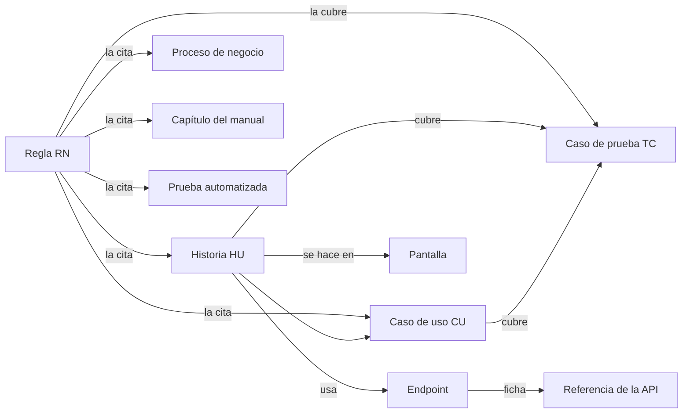

# Matriz de trazabilidad de la documentación de SOFIA

| | |
|---|---|
| **Sistema** | SOFIA — Sistema Optimizado Farmacéutico con Inteligencia Artificial |
| **Versión del documento** | 1.0 |
| **Fecha** | 2026-10-31 |
| **Backend** | `sofia-apis`, rama `main`, commit `34089ec` |
| **Frontend** | `sofia-web-spa`, rama `main`, commit `9ad15f0` |
| **Método** | Cruce por script de los identificadores citados en los documentos publicados |

Esta matriz responde a una pregunta: **de cada regla de negocio, ¿qué historia, caso de uso, caso de prueba, endpoint, pantalla, prueba automatizada, proceso y capítulo del manual la tocan, y qué quedó sin tocar?** No describe el sistema ni repite reglas: solo relaciona los identificadores que ya citan los documentos publicados (`RN-…`, `HU-…`, `CU-…`, `TC-…` y `METHOD /ruta`). No lee el código fuente: lo que afirma cada documento de origen se da por válido (esos documentos pasaron su propia validación) y aquí solo se cruza.

## Contenido

1. Cómo leer la matriz
2. Resumen de cobertura por módulo
3. Matriz principal: una fila por regla
4. Matriz de historias de usuario (y de casos de uso)
5. Matriz de endpoints
6. Huecos
7. Pendientes y «No verificado»
8. Tabla de cobertura
9. Fuentes

## 1. Cómo leer la matriz

### 1.1 Qué se relaciona con qué

El eslabón central es la **historia de usuario**: cada una declara en su tabla de metadatos el módulo, la pantalla, los endpoints, el permiso, las reglas que la sustentan y su estado. Por eso la pantalla y los endpoints de una regla salen de las historias que la citan. Los casos de prueba declaran en su celda «Cubre» qué historias, casos de uso y reglas verifican.

### 1.2 Columnas de la matriz principal (sección 3)

| Columna | Qué contiene | De dónde sale |
|---|---|---|
| Regla | El ID `RN-XXX-nnn` y un título corto (la parte en negrita de la regla, o su primera frase) | Fila de definición de la regla en los seis documentos de [01-reglas-de-negocio](../ola-1-fundamentos/01-reglas-de-negocio/). Solo cuentan las filas de las tablas con encabezado `ID`; las filas del historial de cambios no son definiciones |
| Historias | Historias de usuario que citan la regla | Fila «Reglas» de la tabla de metadatos de cada `HU-…` en [12a](../ola-2-funcional/12-historias-de-usuario/12a-acceso-y-administracion.md), [12b](../ola-2-funcional/12-historias-de-usuario/12b-catalogos-inventario-atencion.md) y [12c](../ola-2-funcional/12-historias-de-usuario/12c-punto-de-venta-y-caja.md) |
| Casos de uso | Casos de uso que citan la regla | Fila «Reglas» de cada `CU-…` en [13a](../ola-2-funcional/13-casos-de-uso/13a-acceso-y-administracion.md), [13b](../ola-2-funcional/13-casos-de-uso/13b-catalogos-inventario-atencion.md) y [13c](../ola-2-funcional/13-casos-de-uso/13c-punto-de-venta-y-caja.md) |
| Casos de prueba | Casos manuales que verifican la regla | Celda «Cubre» de la tabla «Tipo \| Prioridad \| Cubre» de cada `TC-…` en [16a](16-casos-de-prueba/16a-acceso-y-administracion.md), [16b](16-casos-de-prueba/16b-catalogos-inventario-atencion.md) y [16c](16-casos-de-prueba/16c-punto-de-venta-y-caja.md) |
| Endpoints | Endpoints de las historias que citan la regla, escritos sin el prefijo `/api/v1` | Fila «Endpoint(s)» de esas historias, normalizada contra [`endpoints.csv`](../_inventario/endpoints.csv) |
| Pantalla | Rutas del SPA de esas historias (las 2 más citadas y cuántas más hay) | Fila «Pantalla» de esas historias |
| Prueba automatizada | `BE`: estado según la [parte A de pruebas automatizadas](../ola-1-fundamentos/09-pruebas/09a-backend.md) (backend). `SPA`: estado de la pantalla según la [parte B](../ola-1-fundamentos/09-pruebas/09b-spa.md) | Ver 1.4 |
| Proceso | `P1` a `P9`: procesos de [14-procesos-de-negocio](../ola-2-funcional/14-procesos-de-negocio.md) cuyas secciones 3 a 11 citan la regla | Ver la leyenda en 1.5 |
| Manual | Capítulos del [manual de usuario](../ola-2-funcional/manual-usuario/) que citan la regla | Capítulos 1 a 6 y 11, publicados |

### 1.3 Qué significan «—», «Pendiente» y «Solo API»

| Marca | Significado | Dónde aparece |
|---|---|---|
| **—** | El documento de esa columna **no cita** el elemento. No prueba que no exista la cosa en el mundo real: solo que esa fuente no la relaciona. Con `BE` quiere decir «el documento 09a no menciona la regla», no «no hay pruebas» | Todas las columnas |
| **Pendiente** | El elemento pertenece a un módulo cuyo capítulo del manual todavía no existe. El README del manual solo publica los capítulos 1 a 6 y 11; los capítulos 7 a 10 figuran «en preparación». Se marcan `PAC`, `PRO`, `REC`, `VEN`, `CMP`, `CAJ`, `DEV` y `DAS`: los módulos con pantalla que **no** aparecen en la tabla de contenidos de los capítulos 1 a 6 del [README](../README.md). Las reglas transversales (`GEN`) no se marcan «Pendiente»: sin cita muestran «—». Una regla de esos módulos que sí cite alguno de los capítulos publicados muestra el capítulo, no «Pendiente». **Pendiente no es un hueco** | Columna Manual |
| **Solo API** | El elemento no tiene pantalla en el SPA: la regla pertenece a un módulo del documento [01d](../ola-1-fundamentos/01-reglas-de-negocio/01d-modulos-solo-api.md) (Transferencias, Delivery, Magistrales, Servicios e inmunizaciones, Cuarentena y actas DIGEMID, Auditoría), o todas las historias que la citan declaran «Solo API», «Ninguna» o «Sin pantalla» como pantalla. En el manual significa que no se escribirá un capítulo de usuario | Columnas Pantalla y Manual |

### 1.4 Reglas de extracción

- **Rangos.** Los documentos abrevian con «RN-X-001 a RN-X-005» o «RN-X-002 a 006». El script los **expande** (ambos extremos incluidos) en las historias, los casos de uso, los casos de prueba, los procesos, las pruebas automatizadas y el manual. Se encontraron 685 ocurrencias de rango en los documentos revisados, todos del mismo prefijo y en orden ascendente. Con el mismo criterio, el documento de procesos declara 373 IDs explícitos y 475 al expandir; el script obtiene las mismas cifras (ver 8.2). Para decidir si un ID existe solo se miran los IDs escritos (los extremos de cada rango), no los intermedios.
- **Celdas largas.** Una celda con más de 4 elementos muestra el número y los 3 primeros seguidos de «…» (por ejemplo `12: TC-ADM-001, TC-ADM-002, TC-ADM-003…`). En la matriz de historias la celda de casos de prueba muestra además las prioridades: `A` Alta, `M` Media, `B` Baja. El detalle completo está en los documentos de origen.
- **Rutas de endpoints.** Se normalizan: no distingue mayúsculas, se quita el prefijo `/api/v1`, el `?` y el `/` final, y cada `{x}` equivale a `{id}`. Un comodín como `GET /api/v1/dashboard/*` equivale a todos los endpoints con ese prefijo y método. `GET /health` se deja como está.
- **Casos de prueba de un endpoint.** Dos orígenes: los casos que cubren una historia (o caso de uso) que usa el endpoint, y los casos que lo escriben de forma explícita en sus pasos. La matriz de endpoints separa ambos números (`directos`).
- **Prueba automatizada, backend (`BE`).** El documento 09a no trae una tabla «regla → prueba»: solo nombra reglas en su sección 6 (huecos y reglas cubiertas). El script parte cada celda en frases y clasifica la frase donde aparece la regla: `BE Sí` si está en la columna «Lo que sí hay» de la tabla 6.5, en una frase que empieza por «Cubierta» o en la fila «Cubiertas» y la frase «Sí están» de la tabla 6.6; `BE Sin prueba` si la frase dice «Sin prueba:», «no tienen prueba» o «no hay prueba que nombre» (6.5), si es una consulta o una exportación sin prueba (6.4) o si la tabla 6.6 dice «Sin handler ni validador probados»; `BE Parcial` en cualquier otro caso de las tablas 6.5 y 6.6 (hay pruebas unitarias o con mocks, pero el documento declara que falta la integración, la cobertura completa o la prueba por permiso). Si una regla aparece en varias frases, gana la mejor. **Es una clasificación por contexto, no una lectura de las pruebas**: el script no abre los archivos de prueba y el código de pruebas no contiene ningún ID `RN-`.
- **Prueba automatizada, SPA (`SPA`).** El documento 09b no cita reglas. Se cruza por pantalla: la ruta de la historia contra la tabla 3.2 de 09b («Probado», «Parcial» o «Sin pruebas»); si una regla tiene varias pantallas gana la mejor. **Es una señal débil**: que la pantalla tenga un spec no significa que ese spec ejercite la regla. Las rutas que 09b no lista (por ejemplo `/digemid-catalogo/nueva` y `/delivery`, que las historias mencionan pero no existen como ruta) no dan estado.

### 1.5 Leyenda de procesos

| Marca | Proceso (documento 14, secciones 3 a 11) |
|---|---|
| P1 | Alta de una empresa nueva |
| P2 | Configuración inicial |
| P3 | Catálogo e inventario |
| P4 | Venta |
| P5 | Devolución y anulación |
| P6 | Caja |
| P7 | Recetas con IA |
| P8 | Dashboard |
| P9 | Procesos que existen solo en la API (sin pantalla) |

## 2. Resumen de cobertura por módulo

### 2.1 Totales de los inventarios

| Elemento | Total | Fuente |
|---|---|---|
| Reglas de negocio | 789 | Filas de definición de los seis documentos `01` (sin duplicados) |
| Historias de usuario | 192 | `### HU-…` de 12a (50), 12b (66) y 12c (76) |
| Casos de uso | 179 | `### CU-…` de 13a (37), 13b (66) y 13c (76) |
| Casos de prueba | 1244 | `#### TC-…` de 16a (413), 16b (321) y 16c (510). Por prioridad: Alta 444, Media 558, Baja 242. Por tipo: Positivo 505, Concurrencia 59, Negativo 403, Límite 127, Permisos 120, Integración 30 |
| Endpoints | 241 | [`endpoints.csv`](../_inventario/endpoints.csv) (241 fichas en la referencia de la API, 04a a 04e) |
| Historias por estado | Implementada 142, Parcial 30, Solo API 19, Solo API en este catálogo 1 | Fila «Estado» de cada historia (texto antes del primer paréntesis) |

### 2.2 Cobertura de las reglas, por prefijo

Cada celda es «n (porcentaje del total de reglas del prefijo)». «Prueba autom. (BE)» cuenta las reglas con `BE Sí` o `BE Parcial`; «Pantalla con spec (SPA)» cuenta las que tienen `SPA Probado` o `SPA Parcial`. «Capítulo» cuenta las citadas por un capítulo publicado; «Manual pendiente» son las que no lo están y pertenecen a un módulo de los capítulos 7 a 10; «Solo API» son las reglas sin pantalla ni capítulo previsto. Lee las reglas de lectura en 1.3 y 1.4 antes de interpretar `BE` y `SPA`.

| Prefijo | Módulo | Reglas | Historia | Caso de uso | Caso de prueba | Prueba autom. (BE) | Pantalla con spec (SPA) | Proceso | Capítulo | Manual pendiente | Solo API |
|---|---|---|---|---|---|---|---|---|---|---|---|
| GEN | Transversales | 41 | 41 (100.0%) | 27 (65.9%) | 41 (100.0%) | 22 (53.7%) | 28 (68.3%) | 15 (36.6%) | 0 (0.0%) | 0 | 0 |
| AUT | Autenticación y sesión | 39 | 39 (100.0%) | 39 (100.0%) | 39 (100.0%) | 10 (25.6%) | 36 (92.3%) | 21 (53.8%) | 39 (100.0%) | 0 | 0 |
| ROL | Roles y permisos | 23 | 23 (100.0%) | 23 (100.0%) | 23 (100.0%) | 1 (4.3%) | 20 (87.0%) | 13 (56.5%) | 3 (13.0%) | 0 | 0 |
| CTA | Cuentas de usuario | 20 | 20 (100.0%) | 20 (100.0%) | 20 (100.0%) | 3 (15.0%) | 19 (95.0%) | 13 (65.0%) | 3 (15.0%) | 0 | 0 |
| EMP | Empresas y suscripción | 18 | 18 (100.0%) | 18 (100.0%) | 18 (100.0%) | 0 (0.0%) | 16 (88.9%) | 16 (88.9%) | 15 (83.3%) | 0 | 0 |
| SUC | Sucursales | 13 | 13 (100.0%) | 13 (100.0%) | 13 (100.0%) | 0 (0.0%) | 9 (69.2%) | 7 (53.8%) | 0 (0.0%) | 0 | 0 |
| EPL | Empleados | 18 | 18 (100.0%) | 18 (100.0%) | 18 (100.0%) | 0 (0.0%) | 18 (100.0%) | 9 (50.0%) | 4 (22.2%) | 0 | 0 |
| SER | Series fiscales | 14 | 14 (100.0%) | 14 (100.0%) | 14 (100.0%) | 1 (7.1%) | 14 (100.0%) | 8 (57.1%) | 2 (14.3%) | 0 | 0 |
| IMP | Carga masiva y exportación Excel | 17 | 17 (100.0%) | 17 (100.0%) | 17 (100.0%) | 0 (0.0%) | 5 (29.4%) | 6 (35.3%) | 0 (0.0%) | 0 | 0 |
| UDM | Unidades de medida | 17 | 17 (100.0%) | 17 (100.0%) | 17 (100.0%) | 0 (0.0%) | 0 (0.0%) | 8 (47.1%) | 0 (0.0%) | 0 | 0 |
| JER | Jerarquías de unidades | 22 | 22 (100.0%) | 22 (100.0%) | 22 (100.0%) | 0 (0.0%) | 0 (0.0%) | 11 (50.0%) | 0 (0.0%) | 0 | 0 |
| LAB | Laboratorios | 17 | 17 (100.0%) | 17 (100.0%) | 17 (100.0%) | 0 (0.0%) | 12 (70.6%) | 7 (41.2%) | 1 (5.9%) | 0 | 0 |
| ING | Ingredientes activos | 15 | 15 (100.0%) | 15 (100.0%) | 15 (100.0%) | 0 (0.0%) | 9 (60.0%) | 6 (40.0%) | 2 (13.3%) | 0 | 0 |
| MED | Medicamentos | 26 | 26 (100.0%) | 26 (100.0%) | 26 (100.0%) | 0 (0.0%) | 17 (65.4%) | 15 (57.7%) | 0 (0.0%) | 0 | 0 |
| PRE | Presentaciones de venta | 15 | 15 (100.0%) | 15 (100.0%) | 15 (100.0%) | 0 (0.0%) | 15 (100.0%) | 8 (53.3%) | 0 (0.0%) | 0 | 0 |
| FOR | Formulaciones clínicas | 13 | 13 (100.0%) | 13 (100.0%) | 13 (100.0%) | 0 (0.0%) | 0 (0.0%) | 0 (0.0%) | 0 (0.0%) | 0 | 0 |
| PRV | Proveedores | 28 | 28 (100.0%) | 28 (100.0%) | 28 (100.0%) | 0 (0.0%) | 22 (78.6%) | 12 (42.9%) | 5 (17.9%) | 0 | 0 |
| ASE | Aseguradoras | 12 | 12 (100.0%) | 12 (100.0%) | 12 (100.0%) | 0 (0.0%) | 8 (66.7%) | 0 (0.0%) | 0 (0.0%) | 0 | 0 |
| DIG | Catálogo DIGEMID | 13 | 13 (100.0%) | 13 (100.0%) | 13 (100.0%) | 0 (0.0%) | 0 (0.0%) | 0 (0.0%) | 2 (15.4%) | 0 | 0 |
| PAC | Pacientes | 17 | 17 (100.0%) | 17 (100.0%) | 17 (100.0%) | 0 (0.0%) | 10 (58.8%) | 0 (0.0%) | 0 (0.0%) | 17 | 0 |
| PRO | Profesionales de salud | 12 | 12 (100.0%) | 12 (100.0%) | 12 (100.0%) | 0 (0.0%) | 7 (58.3%) | 0 (0.0%) | 0 (0.0%) | 12 | 0 |
| LOT | Lotes de inventario | 19 | 19 (100.0%) | 19 (100.0%) | 19 (100.0%) | 0 (0.0%) | 18 (94.7%) | 11 (57.9%) | 19 (100.0%) | 0 | 0 |
| STK | Stock por sucursal | 18 | 18 (100.0%) | 18 (100.0%) | 18 (100.0%) | 0 (0.0%) | 2 (11.1%) | 13 (72.2%) | 18 (100.0%) | 0 | 0 |
| REC | Recetas médicas | 31 | 31 (100.0%) | 31 (100.0%) | 31 (100.0%) | 0 (0.0%) | 21 (67.7%) | 23 (74.2%) | 1 (3.2%) | 30 | 0 |
| VEN | Ventas | 83 | 83 (100.0%) | 83 (100.0%) | 81 (97.6%) | 18 (21.7%) | 75 (90.4%) | 71 (85.5%) | 38 (45.8%) | 45 | 0 |
| CMP | Comprobantes emitidos | 15 | 15 (100.0%) | 15 (100.0%) | 15 (100.0%) | 3 (20.0%) | 15 (100.0%) | 11 (73.3%) | 4 (26.7%) | 11 | 0 |
| CAJ | Caja | 27 | 27 (100.0%) | 27 (100.0%) | 26 (96.3%) | 4 (14.8%) | 27 (100.0%) | 23 (85.2%) | 3 (11.1%) | 24 | 0 |
| DEV | Devoluciones | 37 | 37 (100.0%) | 37 (100.0%) | 37 (100.0%) | 7 (18.9%) | 35 (94.6%) | 28 (75.7%) | 0 (0.0%) | 37 | 0 |
| DAS | Dashboard | 24 | 24 (100.0%) | 24 (100.0%) | 24 (100.0%) | 0 (0.0%) | 24 (100.0%) | 24 (100.0%) | 24 (100.0%) | 0 | 0 |
| TRA | Transferencias | 30 | 30 (100.0%) | 30 (100.0%) | 30 (100.0%) | 0 (0.0%) | 0 (0.0%) | 26 (86.7%) | 0 (0.0%) | 0 | 30 |
| DEL | Delivery | 18 | 18 (100.0%) | 18 (100.0%) | 18 (100.0%) | 0 (0.0%) | 0 (0.0%) | 15 (83.3%) | 0 (0.0%) | 0 | 18 |
| MAG | Magistrales | 23 | 23 (100.0%) | 23 (100.0%) | 23 (100.0%) | 0 (0.0%) | 0 (0.0%) | 19 (82.6%) | 0 (0.0%) | 0 | 23 |
| SRV | Servicios e inmunizaciones | 21 | 21 (100.0%) | 21 (100.0%) | 21 (100.0%) | 0 (0.0%) | 0 (0.0%) | 18 (85.7%) | 0 (0.0%) | 0 | 21 |
| CUA | Cuarentena y actas DIGEMID | 23 | 23 (100.0%) | 23 (100.0%) | 23 (100.0%) | 0 (0.0%) | 2 (8.7%) | 17 (73.9%) | 0 (0.0%) | 0 | 23 |
| AUD | Auditoría | 10 | 10 (100.0%) | 10 (100.0%) | 10 (100.0%) | 0 (0.0%) | 0 (0.0%) | 0 (0.0%) | 0 (0.0%) | 0 | 10 |
| **Total** | | **789** | **789 (100.0%)** | **775 (98.2%)** | **786 (99.6%)** | **69 (8.7%)** | **484 (61.3%)** | **474 (60.1%)** | **183 (23.2%)** | **176** | **125** |

### 2.3 Lectura rápida

- **Trazabilidad funcional casi completa:** 789 (100.0%) de las reglas tienen historia, 775 (98.2%) caso de uso y 786 (99.6%) caso de prueba. Los huecos son pocos y están explicados en 6.2 y 6.3.
- **Prueba automatizada, el hueco grande:** solo 69 (8.7%) de las reglas figuran en 09a como cubiertas o parciales. Es un hueco de trazabilidad antes que de cobertura (1.4 y 6.4).
- **Proceso y manual:** 474 (60.1%) de las reglas se citan en el documento de procesos y 183 (23.2%) en un capítulo publicado del manual; 176 más esperan a los capítulos 7 a 10 y 125 son de módulos sin pantalla.

## 3. Matriz principal: una fila por regla

Las reglas están agrupadas por documento de reglas y, dentro de cada uno, por módulo en el orden del documento. El ID de cada grupo enlaza al documento donde se define. Las convenciones de las celdas (límite de 4 elementos, rangos, `BE`, `SPA`, «—», «Pendiente», «Solo API») están en la sección 1.

### 3.1 01a — Catálogo de reglas de negocio — Parte A: administración y seguridad (203 reglas)

Documento: [01a-administracion-y-seguridad.md](../ola-1-fundamentos/01-reglas-de-negocio/01a-administracion-y-seguridad.md)

#### GEN — Transversales (41)

| Regla | Historias | Casos de uso | Casos de prueba | Endpoints | Pantalla | Prueba automatizada | Proceso | Manual |
|---|---|---|---|---|---|---|---|---|
| RN-GEN-001 Aislamiento por empresa | 8: HU-ADM-013, HU-ADM-014, HU-ADM-017… | 5: CU-ADM-09, CU-ADM-11, CU-ADM-21… | 22: TC-ADM-102, TC-ADM-112, TC-ADM-123… | 12: `GET /Cuentas`, `GET /Empleados`, `GET /Empresas`… | `/cuentas`, `/empleados` (+5) | BE Sí; SPA Probado | — | — |
| RN-GEN-002 Las filas eliminadas no se leen | HU-ADM-045 | — | TC-ADM-357, TC-ADM-358, TC-ADM-359 | — | Todas | — | — | — |
| RN-GEN-003 Borrado lógico | 10: HU-ADM-020, HU-ADM-026, HU-ADM-032… | 18: CU-ADM-14, CU-ADM-20, CU-ADM-24… | 6: TC-ADM-154, TC-ADM-203, TC-ADM-255… | 9: `DELETE /Cuentas/{id:guid}`, `DELETE /Empleados/{id:guid}`, `DELETE /JerarquiasUoM/{id:guid}`… | `/cuentas/:id`, `/empleados/:id` (+7) | SPA Probado | — | — |
| RN-GEN-004 Empresa asignada automáticamente | HU-ADM-001, HU-ADM-045 | — | TC-ADM-002, TC-ADM-360 | `POST /Empresas/registrar` | `/auth/register` | BE Sí; SPA Probado | P1 | — |
| RN-GEN-005 Quién y cuándo | HU-ADM-045 | — | TC-ADM-360, TC-ADM-362 | — | Todas | — | P1 | — |
| RN-GEN-006 Fechas en UTC | HU-ADM-045 | — | TC-ADM-363 | — | Todas | — | — | — |
| RN-GEN-007 Eventos de dominio a la bandeja de salida | HU-ADM-045 | — | TC-ADM-365, TC-VEN-117 | — | Todas | — | — | — |
| RN-GEN-008 Filtros por rango de fechas en UTC | 5: HU-ADM-045, HU-CAJ-007, HU-INV-018… | CU-CAJ-07, CU-INV-18, CU-OPS-08, CU-VEN-26 | 6: TC-ADM-105, TC-ADM-364, TC-CAJ-048… | 7: `GET /DIGEMID/cuarentena`, `GET /Empleados`, `GET /Pacientes`… | `/pos`, `/recetas-medicas` (+1) | SPA Probado | — | — |
| RN-GEN-009 Paginación acotada | 25: HU-ADM-013, HU-ADM-017, HU-ADM-023… | 25: CU-ADM-09, CU-ADM-11, CU-ADM-17… | 12: TC-ADM-106, TC-ADM-130, TC-ADM-131… | 49: `GET /Cuentas`, `GET /DIGEMID/catalogo`, `GET /DIGEMID/catalogo/{id:guid}`… | `/aseguradoras`, `/cuentas` (+24) | SPA Probado | — | — |
| RN-GEN-010 Limpieza de HTML en la entrada | HU-ADM-049, HU-DEV-005 | CU-ADM-01, CU-DEV-05 | TC-ADM-396, TC-DEV-046 | `GET /health`, `POST /Devoluciones` | `/pos/:id` | SPA Probado | P1 | — |
| RN-GEN-011 Validación previa del request | HU-ADM-049 | — | TC-ADM-010, TC-ADM-403, TC-ADM-413, TC-VEN-095 | `GET /health` | Solo API | — | P1 | — |
| RN-GEN-012 Todo comando es transaccional | HU-ADM-003, HU-ADM-048, HU-ADM-050 | 5: CU-ADM-01, CU-ADM-02, CU-ADM-10… | 6: TC-ADM-003, TC-ADM-030, TC-ADM-385… | `POST /Auditoria/anonimizar`, `POST /Auth/login` | `/auth/login`, `/cuentas/:id` | BE Sí; SPA Probado | P1 | — |
| RN-GEN-013 Auditoría de seguridad automática | 11: HU-ADM-006, HU-ADM-009, HU-ADM-015… | 18: CU-ADM-04, CU-ADM-07, CU-ADM-10… | 17: TC-ADM-049, TC-ADM-076, TC-ADM-114… | 14: `DELETE /Cuentas/{id:guid}`, `GET /Cuentas/{id:guid}`, `GET /Empleados`… | `/cuentas/:id`, `/auth/reset-password` (+6) | BE Sí; SPA Probado | — | — |
| RN-GEN-014 Forma mínima de un evento de auditoría | HU-ADM-009, HU-ADM-048, HU-OPS-022 | CU-OPS-22 | TC-ADM-389, TC-OPS-133 | `POST /Auditoria/anonimizar`, `POST /Auth/reset-password` | `/auth/reset-password` | SPA Probado | — | — |
| RN-GEN-015 Denegación por defecto | HU-ADM-004, HU-ADM-011, HU-ADM-049 | CU-ADM-01 | TC-ADM-041, TC-ADM-095, TC-ADM-097, TC-ADM-402 | `GET /Auth/me`, `GET /health`, `POST /Auth/refresh` | `/auth/login`, `/dashboard` | BE Parcial; SPA Probado | P1 | — |
| RN-GEN-016 Validez del token de acceso | HU-ADM-004 | CU-ADM-08 | TC-ADM-031, TC-ADM-041 | `GET /Auth/me`, `POST /Auth/refresh` | `/auth/login` | SPA Probado | — | — |
| RN-GEN-017 Sello de seguridad | HU-ADM-004, HU-ADM-005, HU-ADM-037 | 7: CU-ADM-03, CU-ADM-04, CU-ADM-07… | 5: TC-ADM-032, TC-ADM-040, TC-ADM-044… | 8: `DELETE /Cuentas/{id:guid}/roles/{rolId:guid}`, `GET /Auth/me`, `GET /Roles`… | `/auth/login`, `/cuentas/:id` | SPA Probado | — | — |
| RN-GEN-018 Empresa vigente en cada petición | HU-ADM-004, HU-ADM-016 | CU-ADM-02, CU-ADM-08 | TC-ADM-032, TC-ADM-034, TC-ADM-041, TC-ADM-125 | `GET /Auth/me`, `POST /Auth/forgot-password`, `POST /Auth/login`, `POST /Auth/refresh` | `/auth/login` | BE Sí; SPA Probado | — | — |
| RN-GEN-019 Cambio de clave obligatorio | HU-ADM-007 | CU-ADM-05, CU-ADM-34 | TC-ADM-059, TC-ADM-061, TC-ADM-064, TC-ADM-288 | `GET /Auth/me`, `POST /Auth/change-password` | `/cambiar-clave` | BE Sí; SPA Probado | P2 | — |
| RN-GEN-020 Autorización por permiso | HU-ADM-010, HU-ADM-011, HU-ADM-030 | CU-ADM-28 | 13: TC-ADM-082, TC-ADM-083, TC-ADM-084… | 5: `DELETE /Roles/permissions/{permisoId:guid}`, `GET /Auth/me`, `GET /Roles/permissions/catalog`… | `/dashboard`, `/roles/:id` | BE Parcial; SPA Probado | P2 | — |
| RN-GEN-021 El rol Admin lo puede todo | HU-ADM-010, HU-ADM-011, HU-ADM-030, HU-DAS-008 | CU-ADM-28, CU-ADM-35, CU-DAS-08 | 5: TC-ADM-082, TC-ADM-094, TC-ADM-246… | 10: `DELETE /Roles/permissions/{permisoId:guid}`, `GET /Auth/me`, `GET /Dashboard/caja`… | `/dashboard`, `/roles/:id` | BE Parcial; SPA Probado | P2 | — |
| RN-GEN-022 Caché de permisos | HU-ADM-010, HU-ADM-011, HU-ADM-030, HU-ADM-032 | CU-ADM-28, CU-ADM-30 | TC-ADM-087, TC-ADM-238, TC-ADM-255, TC-ADM-258 | 6: `DELETE /Roles/permissions/{permisoId:guid}`, `DELETE /Roles/{id:guid}`, `GET /Auth/me`… | `/roles/:id`, `/dashboard` | SPA Probado | P2 | — |
| RN-GEN-023 Sucursales accesibles | 8: HU-ADM-022, HU-ADM-031, HU-ADM-038… | 8: CU-ADM-16, CU-ADM-29, CU-ADM-36… | 12: TC-ADM-169, TC-ADM-170, TC-ADM-172… | 18: `DELETE /Cuentas/{id:guid}/sucursales/{sucursalId:guid}`, `GET /Auth/me`, `GET /Dashboard/caja`… | `/stock-por-sucursal`, `/cuentas/:id` (+4) | SPA Probado | P2, P8 | — |
| RN-GEN-024 Contexto obligatorio del usuario | HU-ADM-018, HU-ADM-021, HU-ADM-050 | CU-ADM-12, CU-ADM-15 | 7: TC-ADM-135, TC-ADM-143, TC-ADM-160… | `GET /Sucursales/plantilla`, `POST /Sucursales`, `POST /Sucursales/carga-masiva`, `POST /Sucursales/previsualizar` | `/sucursales/carga-masiva`, `/sucursales/nueva` | SPA Parcial | P4 | — |
| RN-GEN-025 Límite general | HU-ADM-049 | CU-ADM-08 | TC-ADM-392 | `GET /health` | Solo API | BE Parcial | — | — |
| RN-GEN-026 Límite de credenciales | 5: HU-ADM-002, HU-ADM-006, HU-ADM-008… | CU-ADM-02, CU-ADM-04, CU-ADM-06, CU-ADM-07 | 5: TC-ADM-022, TC-ADM-057, TC-ADM-072… | 5: `GET /health`, `POST /Auth/change-password`, `POST /Auth/forgot-password`… | `/auth/forgot-password`, `/auth/login` (+2) | BE Parcial; SPA Probado | — | — |
| RN-GEN-027 Límite de registro de empresas | HU-ADM-001, HU-ADM-049 | CU-ADM-01 | TC-ADM-011, TC-ADM-394 | `GET /health`, `POST /Empresas/registrar` | `/auth/register` | BE Parcial; SPA Probado | P1 | — |
| RN-GEN-028 Límite de endpoints de IA | HU-INV-020 | CU-INV-20 | TC-INV-102, TC-INV-116 | `POST /Recetas/analizar` | `/recetas-medicas`, `/recetas-medicas/escanear` | BE Parcial; SPA Probado | P7 | — |
| RN-GEN-029 IP real del cliente | HU-ADM-049 | — | TC-ADM-395 | `GET /health` | Solo API | BE Parcial | — | — |
| RN-GEN-030 Cabeceras de seguridad | HU-ADM-049 | — | TC-ADM-397 | `GET /health` | Solo API | BE Sí | — | — |
| RN-GEN-031 HTTPS | HU-ADM-049 | — | TC-ADM-398 | `GET /health` | Solo API | — | — | — |
| RN-GEN-032 Orígenes permitidos (CORS) | HU-ADM-049 | — | TC-ADM-399 | `GET /health` | Solo API | — | — | — |
| RN-GEN-033 Configuración mínima del token | HU-ADM-049 | — | TC-ADM-400 | `GET /health` | Solo API | BE Sí | — | — |
| RN-GEN-034 Estado del servicio | HU-ADM-049 | — | TC-ADM-401 | `GET /health` | Solo API | — | — | — |
| RN-GEN-035 Conflicto de concurrencia | HU-ADM-050, HU-INV-005, HU-INV-006 | CU-INV-05, CU-INV-06 | 5: TC-ADM-037, TC-ADM-405, TC-INV-034… | 5: `GET /LotesInventario`, `GET /StockPorSucursal/{id:guid}`, `GET /Sucursales/permitidas`… | `/stock-por-sucursal/:id`, `/stock-por-sucursal/nueva` | BE Sí; SPA Sin pruebas | — | — |
| RN-GEN-036 Valor único repetido | 7: HU-ADM-018, HU-ADM-019, HU-ADM-024… | CU-ADM-12, CU-ADM-13, CU-ADM-22 | 6: TC-ADM-139, TC-ADM-193, TC-ADM-200… | 10: `GET /Empleados`, `GET /Empleados/{id:guid}`, `GET /Sucursales`… | `/cuentas/nueva`, `/empleados/:id` (+4) | BE Sí; SPA Probado | — | — |
| RN-GEN-037 Valor fuera de rango en base de datos | HU-ADM-018, HU-ADM-019, HU-ADM-050 | CU-ADM-12, CU-ADM-13, CU-ADM-22 | TC-ADM-140, TC-ADM-407 | `GET /Empleados`, `GET /Sucursales/{id:guid}`, `POST /Sucursales`, `PUT /Sucursales/{id:guid}` | `/sucursales/:id`, `/sucursales/nueva` | BE Sí; SPA Parcial | — | — |
| RN-GEN-038 Referencia inexistente o en uso | HU-ADM-018, HU-ADM-019, HU-ADM-050 | CU-ADM-12, CU-ADM-13, CU-ADM-22 | TC-ADM-140, TC-ADM-408 | `GET /Empleados`, `GET /Sucursales/{id:guid}`, `POST /Sucursales`, `PUT /Sucursales/{id:guid}` | `/sucursales/:id`, `/sucursales/nueva` | BE Sí; SPA Parcial | — | — |
| RN-GEN-039 Cuerpo demasiado grande o ilegible | HU-ADM-046, HU-ADM-050, HU-INV-020 | CU-ADM-15, CU-ADM-31, CU-INV-20 | TC-ADM-370, TC-ADM-409, TC-INV-102 | `POST /Recetas/analizar` | `/recetas-medicas`, `/recetas-medicas/escanear` (+2) | BE Sí; SPA Probado | — | — |
| RN-GEN-040 Error inesperado | HU-ADM-002, HU-ADM-050 | — | TC-ADM-023, TC-ADM-073, TC-ADM-081, TC-ADM-411 | `POST /Auth/login` | `/auth/login` | BE Sí; SPA Probado | P1 | — |
| RN-GEN-041 Cuerpo con forma inválida | HU-ADM-029, HU-ADM-050 | — | TC-ADM-231, TC-ADM-410, TC-OPS-036 | `GET /Roles/{id:guid}`, `PUT /Roles/{id:guid}` | `/roles/:id` | SPA Probado | — | — |

#### AUT — Autenticación y sesión (39)

| Regla | Historias | Casos de uso | Casos de prueba | Endpoints | Pantalla | Prueba automatizada | Proceso | Manual |
|---|---|---|---|---|---|---|---|---|
| RN-AUT-001 El usuario es obligatorio y admite hasta 50 caracteres | HU-ADM-002 | CU-ADM-02 | TC-ADM-012, TC-ADM-016, TC-ADM-017 | `POST /Auth/login` | `/auth/login` | SPA Probado | P2 | cap. 1 |
| RN-AUT-002 La contraseña es obligatoria | HU-ADM-002 | CU-ADM-02 | TC-ADM-012, TC-ADM-016 | `POST /Auth/login` | `/auth/login` | SPA Probado | P2 | cap. 1 |
| RN-AUT-003 El usuario debe existir, no estar eliminado y tener la… | HU-ADM-002 | CU-ADM-02 | TC-ADM-012, TC-ADM-013, TC-ADM-019 | `POST /Auth/login` | `/auth/login` | SPA Probado | P2 | cap. 1 |
| RN-AUT-004 Tiempo de respuesta uniforme | HU-ADM-002 | CU-ADM-02 | TC-ADM-012, TC-ADM-019, TC-ADM-024 | `POST /Auth/login` | `/auth/login` | BE Sí; SPA Probado | P2 | cap. 1 |
| RN-AUT-005 Una cuenta bloqueada | HU-ADM-003 | CU-ADM-02, CU-ADM-34 | TC-ADM-019, TC-ADM-025, TC-ADM-027 | `POST /Auth/login` | `/auth/login`, `/cuentas/:id` | SPA Probado | P2 | cap. 1 |
| RN-AUT-006 Una contraseña incorrecta registra un intento fallido en… | HU-ADM-003 | CU-ADM-02 | TC-ADM-018, TC-ADM-025 | `POST /Auth/login` | `/auth/login`, `/cuentas/:id` | SPA Probado | P2 | cap. 1 |
| RN-AUT-007 Bloqueo por intentos | HU-ADM-003 | CU-ADM-02, CU-ADM-34 | TC-ADM-025, TC-ADM-026, TC-ADM-028, TC-ADM-387 | `POST /Auth/login` | `/auth/login`, `/cuentas/:id` | BE Sí; SPA Probado | P2 | cap. 1 |
| RN-AUT-008 La sucursal base del empleado debe pertenecer a la misma… | HU-ADM-002 | CU-ADM-02 | TC-ADM-012, TC-ADM-019 | `POST /Auth/login` | `/auth/login` | SPA Probado | P2 | cap. 1 |
| RN-AUT-009 La empresa de la cuenta debe estar vigente | HU-ADM-002, HU-ADM-016 | CU-ADM-02 | TC-ADM-012, TC-ADM-020, TC-ADM-021 | `POST /Auth/forgot-password`, `POST /Auth/login`, `POST /Auth/refresh` | `/auth/login` | SPA Probado | P2 | cap. 1 |
| RN-AUT-010 Un inicio de sesión correcto pone el contador de… | HU-ADM-002, HU-ADM-003, HU-ADM-007 | CU-ADM-02, CU-ADM-05 | 5: TC-ADM-014, TC-ADM-015, TC-ADM-029… | `GET /Auth/me`, `POST /Auth/change-password`, `POST /Auth/login` | `/auth/login`, `/cambiar-clave` (+1) | SPA Probado | P1, P2 | cap. 1 |
| RN-AUT-011 Contenido del token de acceso | HU-ADM-002 | CU-ADM-02 | TC-ADM-014 | `POST /Auth/login` | `/auth/login` | SPA Probado | P1, P2 | cap. 1 |
| RN-AUT-012 Token de refresco en cookie | HU-ADM-002 | CU-ADM-02 | TC-ADM-014 | `POST /Auth/login` | `/auth/login` | SPA Probado | P1 | cap. 1 |
| RN-AUT-013 Renovar y cerrar sesión exigen la cabecera X-SOFIA-CSRF… | HU-ADM-004, HU-ADM-005 | CU-ADM-03, CU-ADM-08 | TC-ADM-035, TC-ADM-047 | `GET /Auth/me`, `POST /Auth/logout`, `POST /Auth/refresh` | `/auth/login` | SPA Probado | — | cap. 1 |
| RN-AUT-014 Renovar exige la cookie refresh_token | HU-ADM-004 | CU-ADM-08 | TC-ADM-031, TC-ADM-035 | `GET /Auth/me`, `POST /Auth/refresh` | `/auth/login` | SPA Probado | — | cap. 1 |
| RN-AUT-015 El token de refresco debe existir y no estar vencido | HU-ADM-004 | CU-ADM-08 | TC-ADM-031, TC-ADM-033 | `GET /Auth/me`, `POST /Auth/refresh` | `/auth/login` | SPA Probado | — | cap. 1 |
| RN-AUT-016 Detección de robo de sesión | HU-ADM-004 | CU-ADM-08 | TC-ADM-038 | `GET /Auth/me`, `POST /Auth/refresh` | `/auth/login` | BE Sí; SPA Probado | — | cap. 1 |
| RN-AUT-017 Al renovar se vuelve a comprobar que la cuenta exista,… | HU-ADM-004, HU-ADM-016 | CU-ADM-08 | TC-ADM-033, TC-ADM-039 | `GET /Auth/me`, `POST /Auth/forgot-password`, `POST /Auth/login`, `POST /Auth/refresh` | `/auth/login` | SPA Probado | — | cap. 1 |
| RN-AUT-018 Rotación | HU-ADM-004 | CU-ADM-08 | TC-ADM-031, TC-ADM-036 | `GET /Auth/me`, `POST /Auth/refresh` | `/auth/login` | BE Sí; SPA Probado | — | cap. 1 |
| RN-AUT-019 Si dos renovaciones usan el mismo token a la vez, solo… | HU-ADM-004 | CU-ADM-08 | TC-ADM-037 | `GET /Auth/me`, `POST /Auth/refresh` | `/auth/login` | SPA Probado | — | cap. 1 |
| RN-AUT-020 Cierre de sesión anónimo e idempotente | HU-ADM-005 | CU-ADM-03 | TC-ADM-043, TC-ADM-047 | `POST /Auth/logout` | Cabecera › imagen de perfil | BE Sí | — | cap. 1 |
| RN-AUT-021 Cerrar sesión revoca todos los tokens de refresco… | HU-ADM-005 | CU-ADM-03 | TC-ADM-043, TC-ADM-044 | `POST /Auth/logout` | Cabecera › imagen de perfil | — | — | cap. 1 |
| RN-AUT-022 Si una renovación simultánea cambia un token mientras se… | HU-ADM-005 | CU-ADM-03 | TC-ADM-045, TC-ADM-046, TC-ADM-048 | `POST /Auth/logout` | Cabecera › imagen de perfil | — | — | cap. 1 |
| RN-AUT-023 Perfil del usuario | HU-ADM-004, HU-ADM-007, HU-ADM-010 | CU-ADM-08 | 6: TC-ADM-040, TC-ADM-042, TC-ADM-085… | `GET /Auth/me`, `POST /Auth/change-password`, `POST /Auth/refresh` | `/auth/login`, `/cambiar-clave` | SPA Probado | — | cap. 1 |
| RN-AUT-024 La cuenta que cambia su clave es siempre la del token;… | HU-ADM-006 | CU-ADM-04, CU-ADM-05 | TC-ADM-049, TC-ADM-054 | `POST /Auth/change-password` | `/cambiar-clave` | SPA Probado | P2 | cap. 1 |
| RN-AUT-025 La contraseña actual es obligatoria | HU-ADM-006 | CU-ADM-04, CU-ADM-05 | TC-ADM-049, TC-ADM-052 | `POST /Auth/change-password` | `/cambiar-clave` | SPA Probado | P2 | cap. 1 |
| RN-AUT-026 La nueva contraseña es obligatoria y debe tener al menos… | HU-ADM-006 | CU-ADM-01, CU-ADM-04, CU-ADM-05, CU-ADM-33 | TC-ADM-006, TC-ADM-049, TC-ADM-052 | `POST /Auth/change-password` | `/cambiar-clave` | SPA Probado | P1, P2 | cap. 1 |
| RN-AUT-027 La nueva contraseña debe ser distinta de la actual | HU-ADM-006 | CU-ADM-04, CU-ADM-05 | TC-ADM-049, TC-ADM-052 | `POST /Auth/change-password` | `/cambiar-clave` | SPA Probado | P2 | cap. 1 |
| RN-AUT-028 La cuenta debe existir, estar activa y no eliminada | HU-ADM-006 | CU-ADM-04, CU-ADM-05 | TC-ADM-056 | `POST /Auth/change-password` | `/cambiar-clave` | SPA Probado | P2 | cap. 1 |
| RN-AUT-029 La contraseña actual debe coincidir con la guardada | HU-ADM-006 | CU-ADM-04, CU-ADM-05 | TC-ADM-053, TC-ADM-062 | `POST /Auth/change-password` | `/cambiar-clave` | SPA Probado | P2 | cap. 1 |
| RN-AUT-030 Efectos del cambio | HU-ADM-006, HU-ADM-007 | CU-ADM-04, CU-ADM-05 | TC-ADM-049, TC-ADM-050, TC-ADM-055, TC-ADM-060 | `GET /Auth/me`, `POST /Auth/change-password` | `/cambiar-clave` | SPA Probado | P2 | cap. 1 |
| RN-AUT-031 Las contraseñas nunca se guardan en claro | HU-ADM-002, HU-ADM-006, HU-ADM-035 | CU-ADM-01, CU-ADM-04, CU-ADM-07, CU-ADM-33 | 5: TC-ADM-024, TC-ADM-049, TC-ADM-055… | `GET /Empleados`, `POST /Auth/change-password`, `POST /Auth/login`, `POST /Cuentas` | `/auth/login`, `/cambiar-clave` (+1) | SPA Probado | P1 | cap. 1 |
| RN-AUT-032 Para pedir la recuperación, el usuario es obligatorio y… | HU-ADM-008 | CU-ADM-06 | TC-ADM-065, TC-ADM-071 | `POST /Auth/forgot-password` | `/auth/forgot-password` | SPA Probado | — | cap. 1 |
| RN-AUT-033 Respuesta uniforme | HU-ADM-008 | CU-ADM-06 | TC-ADM-065, TC-ADM-067 | `POST /Auth/forgot-password` | `/auth/forgot-password` | SPA Probado | — | cap. 1 |
| RN-AUT-034 Solo se genera un enlace si la cuenta existe, no está… | HU-ADM-008, HU-ADM-016 | CU-ADM-06 | TC-ADM-065, TC-ADM-067, TC-ADM-068, TC-ADM-126 | `POST /Auth/forgot-password`, `POST /Auth/login`, `POST /Auth/refresh` | `/auth/forgot-password`, `/auth/login` | SPA Probado | P2 | cap. 1 |
| RN-AUT-035 Token de recuperación | HU-ADM-008 | CU-ADM-06 | TC-ADM-065, TC-ADM-068, TC-ADM-069 | `POST /Auth/forgot-password` | `/auth/forgot-password` | BE Sí; SPA Probado | — | cap. 1 |
| RN-AUT-036 Correo de recuperación | HU-ADM-008 | CU-ADM-06 | TC-ADM-065, TC-ADM-066, TC-ADM-070 | `POST /Auth/forgot-password` | `/auth/forgot-password` | BE Sí; SPA Probado | — | cap. 1 |
| RN-AUT-037 Para restablecer, son obligatorios el usuario, el token… | HU-ADM-009 | CU-ADM-07 | TC-ADM-075, TC-ADM-077, TC-ADM-078 | `POST /Auth/reset-password` | `/auth/reset-password` | BE Sí; SPA Probado | — | cap. 1 |
| RN-AUT-038 El token debe ser el vigente de esa cuenta | HU-ADM-009 | CU-ADM-07 | TC-ADM-075, TC-ADM-079 | `POST /Auth/reset-password` | `/auth/reset-password` | BE Sí; SPA Probado | — | cap. 1 |
| RN-AUT-039 Efectos del restablecimiento | HU-ADM-003, HU-ADM-009 | CU-ADM-07 | TC-ADM-030, TC-ADM-076 | `POST /Auth/login`, `POST /Auth/reset-password` | `/auth/login`, `/auth/reset-password` (+1) | BE Sí; SPA Probado | — | cap. 1 |

#### ROL — Roles y permisos (23)

| Regla | Historias | Casos de uso | Casos de prueba | Endpoints | Pantalla | Prueba automatizada | Proceso | Manual |
|---|---|---|---|---|---|---|---|---|
| RN-ROL-001 Permisos exigidos | 7: HU-ADM-011, HU-ADM-027, HU-ADM-028… | 7: CU-ADM-25, CU-ADM-26, CU-ADM-27… | 8: TC-ADM-091, TC-ADM-095, TC-ADM-208… | 17: `DELETE /Cuentas/{id:guid}/roles/{rolId:guid}`, `DELETE /Roles/permissions/{permisoId:guid}`, `GET /Auth/me`… | `/roles/:id`, `/cuentas/:id` (+4) | SPA Probado | — | — |
| RN-ROL-002 El nombre del rol es obligatorio y admite hasta 50… | HU-ADM-028 | CU-ADM-26 | TC-ADM-216, TC-ADM-218, TC-ADM-221 | `POST /Roles` | `/roles/nueva` | SPA Probado | P2 | — |
| RN-ROL-003 La descripción es opcional y admite hasta 255 caracteres | HU-ADM-028, HU-ADM-029 | CU-ADM-26, CU-ADM-27 | TC-ADM-216, TC-ADM-220, TC-ADM-222 | `GET /Roles/{id:guid}`, `POST /Roles`, `PUT /Roles/{id:guid}` | `/roles/:id`, `/roles/nueva` | SPA Probado | P2 | — |
| RN-ROL-004 El nivel de jerarquía debe ser mayor o igual a 0; si no… | HU-ADM-028, HU-ADM-029 | CU-ADM-26, CU-ADM-27 | TC-ADM-216, TC-ADM-218, TC-ADM-219, TC-ADM-224 | `GET /Roles/{id:guid}`, `POST /Roles`, `PUT /Roles/{id:guid}` | `/roles/:id`, `/roles/nueva` | SPA Probado | P2 | cap. 3 |
| RN-ROL-005 El nombre del rol es único dentro de la empresa entre… | HU-ADM-028 | CU-ADM-26 | TC-ADM-220 | `POST /Roles` | `/roles/nueva` | SPA Probado | P2 | — |
| RN-ROL-006 El nombre de un rol no se puede cambiar después de crearlo | HU-ADM-029 | CU-ADM-27 | TC-ADM-226, TC-ADM-228, TC-ADM-229 | `GET /Roles/{id:guid}`, `PUT /Roles/{id:guid}` | `/roles/:id` | SPA Probado | P2 | — |
| RN-ROL-007 Toda operación sobre un rol exige que exista en la… | HU-ADM-029, HU-ADM-032, HU-ADM-037 | 5: CU-ADM-27, CU-ADM-28, CU-ADM-29… | 5: TC-ADM-226, TC-ADM-232, TC-ADM-255… | 8: `DELETE /Cuentas/{id:guid}/roles/{rolId:guid}`, `DELETE /Roles/{id:guid}`, `GET /Roles`… | `/roles/:id`, `/cuentas/:id` | SPA Probado | — | — |
| RN-ROL-008 No se puede eliminar un rol que tiene cuentas no… | HU-ADM-032 | CU-ADM-30 | TC-ADM-255, TC-ADM-257 | `DELETE /Roles/{id:guid}` | `/roles/:id` | SPA Probado | — | — |
| RN-ROL-009 Eliminar un rol es un borrado lógico | HU-ADM-028, HU-ADM-029, HU-ADM-032 | CU-ADM-26, CU-ADM-27, CU-ADM-30 | TC-ADM-216, TC-ADM-228, TC-ADM-255, TC-ADM-258 | `DELETE /Roles/{id:guid}`, `GET /Roles/{id:guid}`, `POST /Roles`, `PUT /Roles/{id:guid}` | `/roles/:id`, `/roles/nueva` | SPA Probado | — | — |
| RN-ROL-010 No autopromoción | HU-ADM-030 | CU-ADM-28 | TC-ADM-234, TC-ADM-235 | `DELETE /Roles/permissions/{permisoId:guid}`, `GET /Roles/permissions/catalog`, `GET /Roles/{id:guid}/permissions`, `POST /Roles/permissions` | `/roles/:id` | BE Sí; SPA Probado | P2 | cap. 3 |
| RN-ROL-011 Un permiso | HU-ADM-030 | CU-ADM-28 | TC-ADM-236, TC-ADM-238, TC-ADM-239 | `DELETE /Roles/permissions/{permisoId:guid}`, `GET /Roles/permissions/catalog`, `GET /Roles/{id:guid}/permissions`, `POST /Roles/permissions` | `/roles/:id` | SPA Probado | P2 | — |
| RN-ROL-012 Volver a asignar un permiso que había sido revocado… | HU-ADM-030 | CU-ADM-28 | TC-ADM-238, TC-ADM-241, TC-ADM-242 | `DELETE /Roles/permissions/{permisoId:guid}`, `GET /Roles/permissions/catalog`, `GET /Roles/{id:guid}/permissions`, `POST /Roles/permissions` | `/roles/:id` | SPA Probado | P2 | — |
| RN-ROL-013 Un permiso necesita rol, módulo y acción; módulo y… | HU-ADM-030 | CU-ADM-28 | TC-ADM-096, TC-ADM-243 | `DELETE /Roles/permissions/{permisoId:guid}`, `GET /Roles/permissions/catalog`, `GET /Roles/{id:guid}/permissions`, `POST /Roles/permissions` | `/roles/:id` | SPA Probado | P2 | — |
| RN-ROL-014 Para revocar, el permiso debe existir y no estar ya revocado | HU-ADM-030 | CU-ADM-28 | TC-ADM-234 | `DELETE /Roles/permissions/{permisoId:guid}`, `GET /Roles/permissions/catalog`, `GET /Roles/{id:guid}/permissions`, `POST /Roles/permissions` | `/roles/:id` | SPA Probado | P2 | — |
| RN-ROL-015 Asignar o revocar un permiso invalida de inmediato la… | HU-ADM-010, HU-ADM-030 | CU-ADM-28 | TC-ADM-082, TC-ADM-083, TC-ADM-087, TC-ADM-237 | 5: `DELETE /Roles/permissions/{permisoId:guid}`, `GET /Auth/me`, `GET /Roles/permissions/catalog`… | `/roles/:id` | SPA Probado | P2 | — |
| RN-ROL-016 Catálogo de permisos | HU-ADM-030 | CU-ADM-28 | TC-ADM-238, TC-ADM-239, TC-ADM-244, TC-ADM-246 | `DELETE /Roles/permissions/{permisoId:guid}`, `GET /Roles/permissions/catalog`, `GET /Roles/{id:guid}/permissions`, `POST /Roles/permissions` | `/roles/:id` | SPA Probado | P2 | — |
| RN-ROL-017 Sucursales del rol | HU-ADM-031 | CU-ADM-29 | TC-ADM-249, TC-ADM-250, TC-ADM-251 | `GET /Roles/{id:guid}/sucursales`, `PUT /Roles/{id:guid}/sucursales` | `/roles/:id` | SPA Probado | P2 | — |
| RN-ROL-018 Al consultar las sucursales de un rol se listan todas… | HU-ADM-031 | CU-ADM-29 | TC-ADM-252, TC-ADM-253 | `GET /Roles/{id:guid}/sucursales`, `PUT /Roles/{id:guid}/sucursales` | `/roles/:id` | SPA Probado | — | — |
| RN-ROL-019 El listado de roles filtra por nombre y descripción | HU-ADM-027 | CU-ADM-25 | TC-ADM-208 | `GET /Roles`, `POST /Roles/exportar` | `/roles` | SPA Parcial | — | — |
| RN-ROL-020 Carga masiva (guardado) | HU-ADM-033 | CU-ADM-31 | TC-ADM-260, TC-ADM-261, TC-ADM-265 | `GET /Roles/plantilla`, `POST /Roles/carga-masiva`, `POST /Roles/previsualizar` | `/roles/carga-masiva` | SPA Sin pruebas | — | — |
| RN-ROL-021 Al guardar la carga masiva, las filas cuyo nombre ya… | HU-ADM-033 | CU-ADM-31 | TC-ADM-261, TC-ADM-262 | `GET /Roles/plantilla`, `POST /Roles/carga-masiva`, `POST /Roles/previsualizar` | `/roles/carga-masiva` | SPA Sin pruebas | — | — |
| RN-ROL-022 Carga masiva (vista previa) | HU-ADM-033 | CU-ADM-31 | TC-ADM-264, TC-ADM-266 | `GET /Roles/plantilla`, `POST /Roles/carga-masiva`, `POST /Roles/previsualizar` | `/roles/carga-masiva` | SPA Sin pruebas | — | cap. 3 |
| RN-ROL-023 La exportación a Excel usa los mismos filtros del… | HU-ADM-027 | CU-ADM-25 | TC-ADM-208 | `GET /Roles`, `POST /Roles/exportar` | `/roles` | SPA Parcial | — | — |

#### CTA — Cuentas de usuario (20)

| Regla | Historias | Casos de uso | Casos de prueba | Endpoints | Pantalla | Prueba automatizada | Proceso | Manual |
|---|---|---|---|---|---|---|---|---|
| RN-CTA-001 Permisos exigidos | 7: HU-ADM-011, HU-ADM-034, HU-ADM-035… | 6: CU-ADM-32, CU-ADM-33, CU-ADM-34… | 8: TC-ADM-091, TC-ADM-268, TC-ADM-274… | 15: `DELETE /Cuentas/{id:guid}`, `DELETE /Cuentas/{id:guid}/roles/{rolId:guid}`, `DELETE /Cuentas/{id:guid}/sucursales/{sucursalId:guid}`… | `/cuentas/:id`, `/cuentas` (+2) | SPA Probado | — | — |
| RN-CTA-002 Para crear una cuenta el empleado es obligatorio | HU-ADM-035 | CU-ADM-33 | TC-ADM-274, TC-ADM-276, TC-ADM-277, TC-ADM-283 | `GET /Empleados`, `POST /Cuentas` | `/cuentas/nueva` | SPA Parcial | P2 | — |
| RN-CTA-003 El nombre de usuario es obligatorio y admite hasta 50… | HU-ADM-035 | CU-ADM-33 | TC-ADM-274, TC-ADM-276, TC-ADM-278 | `GET /Empleados`, `POST /Cuentas` | `/cuentas/nueva` | SPA Parcial | P2 | — |
| RN-CTA-004 La contraseña inicial es obligatoria y debe tener al… | HU-ADM-035 | CU-ADM-33 | TC-ADM-274, TC-ADM-276, TC-ADM-279 | `GET /Empleados`, `POST /Cuentas` | `/cuentas/nueva` | SPA Parcial | P2 | cap. 3 |
| RN-CTA-005 El empleado debe existir en la empresa y no estar eliminado | HU-ADM-035 | CU-ADM-33 | TC-ADM-274 | `GET /Empleados`, `POST /Cuentas` | `/cuentas/nueva` | SPA Parcial | P2 | — |
| RN-CTA-006 Un empleado solo puede tener una cuenta no eliminada | HU-ADM-035 | CU-ADM-33 | TC-ADM-281 | `GET /Empleados`, `POST /Cuentas` | `/cuentas/nueva` | SPA Parcial | P2 | — |
| RN-CTA-007 El nombre de usuario es único en todo el sistema, no… | HU-ADM-001, HU-ADM-035 | CU-ADM-01, CU-ADM-33 | 5: TC-ADM-002, TC-ADM-009, TC-ADM-207… | `GET /Empleados`, `POST /Cuentas`, `POST /Empresas/registrar` | `/auth/register`, `/cuentas/nueva` | SPA Probado | P1, P2 | — |
| RN-CTA-008 Valores iniciales | HU-ADM-007, HU-ADM-035 | CU-ADM-05, CU-ADM-33 | TC-ADM-058, TC-ADM-060, TC-ADM-274 | `GET /Auth/me`, `GET /Empleados`, `POST /Auth/change-password`, `POST /Cuentas` | `/cambiar-clave`, `/cuentas/nueva` | SPA Probado | P2 | — |
| RN-CTA-009 Para consultar, editar o eliminar, la cuenta debe… | HU-ADM-036, HU-ADM-039 | CU-ADM-34, CU-ADM-37 | 5: TC-ADM-286, TC-ADM-287, TC-ADM-292… | `DELETE /Cuentas/{id:guid}`, `GET /Cuentas/{id:guid}`, `PUT /Cuentas/{id:guid}` | `/cuentas/:id` | SPA Probado | — | — |
| RN-CTA-010 Cuentas de administrador protegidas | HU-ADM-036, HU-ADM-039 | CU-ADM-34, CU-ADM-37 | TC-ADM-286, TC-ADM-289 | `DELETE /Cuentas/{id:guid}`, `GET /Cuentas/{id:guid}`, `PUT /Cuentas/{id:guid}` | `/cuentas/:id` | BE Sí; SPA Probado | — | — |
| RN-CTA-011 Qué se puede editar | HU-ADM-007, HU-ADM-036 | CU-ADM-05, CU-ADM-34 | TC-ADM-061, TC-ADM-288 | `GET /Auth/me`, `GET /Cuentas/{id:guid}`, `POST /Auth/change-password`, `PUT /Cuentas/{id:guid}` | `/cambiar-clave`, `/cuentas/:id` | SPA Probado | — | — |
| RN-CTA-012 Una cuenta desactivada deja de poder iniciar sesión,… | HU-ADM-002, HU-ADM-036 | CU-ADM-02, CU-ADM-08, CU-ADM-34 | TC-ADM-039, TC-ADM-286, TC-ADM-287 | `GET /Cuentas/{id:guid}`, `POST /Auth/login`, `PUT /Cuentas/{id:guid}` | `/auth/login`, `/cuentas/:id` | SPA Probado | — | cap. 3 |
| RN-CTA-013 Eliminar una cuenta es un borrado lógico | HU-ADM-039 | CU-ADM-37 | TC-ADM-312, TC-ADM-314, TC-ADM-316, TC-ADM-318 | `DELETE /Cuentas/{id:guid}` | `/cuentas/:id` | SPA Probado | — | cap. 3 |
| RN-CTA-014 Para asignar o quitar roles o sucursales, la cuenta debe… | HU-ADM-037, HU-ADM-038 | CU-ADM-35, CU-ADM-36 | 5: TC-ADM-295, TC-ADM-302, TC-ADM-303… | 8: `DELETE /Cuentas/{id:guid}/roles/{rolId:guid}`, `DELETE /Cuentas/{id:guid}/sucursales/{sucursalId:guid}`, `GET /Roles`… | `/cuentas/:id` | SPA Probado | P2 | — |
| RN-CTA-015 Nadie cambia sus propios roles | HU-ADM-037 | CU-ADM-35 | TC-ADM-295, TC-ADM-296 | 5: `DELETE /Cuentas/{id:guid}/roles/{rolId:guid}`, `GET /Roles`, `POST /Cuentas/{id:guid}/roles/{rolId:guid}`… | `/cuentas/:id` | BE Sí; SPA Probado | P2 | — |
| RN-CTA-016 El rol Admin está reservado | HU-ADM-037 | CU-ADM-35 | TC-ADM-295, TC-ADM-296, TC-ADM-299 | 5: `DELETE /Cuentas/{id:guid}/roles/{rolId:guid}`, `GET /Roles`, `POST /Cuentas/{id:guid}/roles/{rolId:guid}`… | `/cuentas/:id` | BE Sí; SPA Probado | P2 | — |
| RN-CTA-017 El rol a asignar debe existir | HU-ADM-037 | CU-ADM-35 | TC-ADM-295, TC-ADM-300, TC-ADM-301 | 5: `DELETE /Cuentas/{id:guid}/roles/{rolId:guid}`, `GET /Roles`, `POST /Cuentas/{id:guid}/roles/{rolId:guid}`… | `/cuentas/:id` | SPA Probado | P2 | — |
| RN-CTA-018 Asignar o quitar un rol cambia el sello de seguridad de… | HU-ADM-004, HU-ADM-037 | CU-ADM-35 | TC-ADM-042, TC-ADM-298 | 7: `DELETE /Cuentas/{id:guid}/roles/{rolId:guid}`, `GET /Auth/me`, `GET /Roles`… | `/auth/login`, `/cuentas/:id` | SPA Probado | P2 | — |
| RN-CTA-019 Sucursales adicionales | HU-ADM-038 | CU-ADM-36 | TC-ADM-305, TC-ADM-306, TC-ADM-309, TC-ADM-311 | `DELETE /Cuentas/{id:guid}/sucursales/{sucursalId:guid}`, `GET /Sucursales`, `POST /Cuentas/{id:guid}/sucursales/{sucursalId:guid}` | `/cuentas/:id` | BE Sin prueba; SPA Probado | P2 | — |
| RN-CTA-020 El listado de cuentas filtra por usuario y por nombre… | HU-ADM-034 | CU-ADM-32 | TC-ADM-268, TC-ADM-270 | `GET /Cuentas` | `/cuentas` | SPA Sin pruebas | — | — |

#### EMP — Empresas y suscripción (18)

| Regla | Historias | Casos de uso | Casos de prueba | Endpoints | Pantalla | Prueba automatizada | Proceso | Manual |
|---|---|---|---|---|---|---|---|---|
| RN-EMP-001 Permisos exigidos | HU-ADM-001, HU-ADM-011, HU-ADM-013, HU-ADM-015 | CU-ADM-09 | TC-ADM-091, TC-ADM-102, TC-ADM-114, TC-ADM-115 | 5: `GET /Auth/me`, `GET /Empresas`, `POST /Empresas/exportar`… | `/auth/register`, `/dashboard` (+2) | SPA Probado | — | cap. 1 |
| RN-EMP-002 El nombre de la empresa es obligatorio y admite hasta… | HU-ADM-001, HU-ADM-015 | CU-ADM-01, CU-ADM-10 | TC-ADM-001, TC-ADM-114, TC-ADM-117, TC-ADM-118 | `POST /Empresas/registrar`, `PUT /Empresas/{id:guid}` | `/auth/register`, `/empresas/:id` | SPA Probado | P1 | cap. 1 |
| RN-EMP-003 RUC al registrar | HU-ADM-001, HU-VEN-016 | CU-ADM-01, CU-VEN-16 | TC-ADM-001, TC-ADM-005, TC-VEN-124 | `POST /Empresas/registrar`, `POST /Ventas`, `PUT /Ventas/{id:guid}/completar` | `/auth/register`, `/pos/nueva` | SPA Probado | P1 | cap. 1 |
| RN-EMP-004 RUC al editar | HU-ADM-015, HU-VEN-016 | CU-ADM-10, CU-VEN-16 | TC-ADM-119, TC-ADM-121, TC-VEN-124 | `POST /Ventas`, `PUT /Empresas/{id:guid}`, `PUT /Ventas/{id:guid}/completar` | `/empresas/:id`, `/pos/nueva` | SPA Probado | P1, P2 | cap. 1, 2 |
| RN-EMP-005 El RUC es único en todo el sistema | HU-ADM-001, HU-ADM-015 | CU-ADM-01, CU-ADM-10 | TC-ADM-001, TC-ADM-008, TC-ADM-120 | `POST /Empresas/registrar`, `PUT /Empresas/{id:guid}` | `/auth/register`, `/empresas/:id` | SPA Probado | P1, P2 | cap. 1 |
| RN-EMP-006 El usuario administrador es obligatorio y debe tener… | HU-ADM-001 | CU-ADM-01 | TC-ADM-001, TC-ADM-004, TC-ADM-005 | `POST /Empresas/registrar` | `/auth/register` | SPA Probado | P1 | cap. 1 |
| RN-EMP-007 La contraseña del administrador es obligatoria y debe… | HU-ADM-001 | CU-ADM-01 | TC-ADM-001, TC-ADM-004, TC-ADM-005, TC-ADM-006 | `POST /Empresas/registrar` | `/auth/register` | SPA Probado | P1 | cap. 1 |
| RN-EMP-008 Los nombres y el apellido paterno del administrador son… | HU-ADM-001 | CU-ADM-01 | TC-ADM-001, TC-ADM-004, TC-ADM-005 | `POST /Empresas/registrar` | `/auth/register` | SPA Probado | P1 | cap. 1 |
| RN-EMP-009 El correo del administrador es obligatorio, de hasta 254… | HU-ADM-001 | CU-ADM-01 | TC-ADM-001, TC-ADM-004, TC-ADM-005 | `POST /Empresas/registrar` | `/auth/register` | SPA Probado | P1 | cap. 1 |
| RN-EMP-010 Sede principal del registro | HU-ADM-001, HU-ADM-019 | CU-ADM-01, CU-ADM-13 | 7: TC-ADM-001, TC-ADM-002, TC-ADM-005… | `GET /Empleados`, `GET /Sucursales/{id:guid}`, `POST /Empresas/registrar`, `PUT /Sucursales/{id:guid}` | `/auth/register`, `/sucursales/:id` | SPA Probado | P1, P2 | cap. 1 |
| RN-EMP-011 Alta completa en una sola transacción | HU-ADM-001 | CU-ADM-01 | TC-ADM-002, TC-ADM-003, TC-ADM-209 | `POST /Empresas/registrar` | `/auth/register` | SPA Probado | P1, P2 | cap. 1 |
| RN-EMP-012 Periodo de prueba | HU-ADM-001, HU-ADM-014 | CU-ADM-01, CU-ADM-09 | TC-ADM-002, TC-ADM-109, TC-ADM-110 | `GET /Empresas/{id:guid}`, `POST /Empresas/registrar` | `/auth/register`, `/empresas/:id` | SPA Probado | P1 | cap. 1 |
| RN-EMP-013 Sesión inmediata tras el registro | HU-ADM-001 | CU-ADM-01 | TC-ADM-001 | `POST /Empresas/registrar` | `/auth/register` | SPA Probado | P1 | cap. 1 |
| RN-EMP-014 Vigencia de la empresa | HU-ADM-014, HU-ADM-016 | CU-ADM-02, CU-ADM-06, CU-ADM-09 | TC-ADM-020, TC-ADM-124, TC-ADM-125 | `GET /Empresas/{id:guid}`, `POST /Auth/forgot-password`, `POST /Auth/login`, `POST /Auth/refresh` | `/auth/login`, `/empresas/:id` | SPA Probado | P2 | cap. 1 |
| RN-EMP-015 Estados y transiciones de la suscripción | HU-ADM-016 | CU-ADM-09 | TC-ADM-111, TC-ADM-124 | `POST /Auth/forgot-password`, `POST /Auth/login`, `POST /Auth/refresh` | `/auth/login` | SPA Probado | P2 | cap. 2 |
| RN-EMP-016 La política «exigir registro de receta» de la empresa… | HU-ADM-014, HU-VEN-009 | CU-ADM-09, CU-VEN-09 | TC-ADM-109, TC-VEN-065 | `GET /Empresas/{id:guid}`, `GET /Ventas/{id:guid}`, `POST /Ventas`, `PUT /Ventas/{id:guid}/completar` | `/empresas/:id`, `/pos/:id` (+1) | SPA Probado | P4 | — |
| RN-EMP-017 Para consultar o editar, la empresa debe existir, no… | HU-ADM-013, HU-ADM-014, HU-ADM-015, HU-ADM-045 | CU-ADM-09, CU-ADM-10 | 7: TC-ADM-102, TC-ADM-103, TC-ADM-109… | `GET /Empresas`, `GET /Empresas/{id:guid}`, `POST /Empresas/exportar`, `PUT /Empresas/{id:guid}` | `/empresas/:id`, `/empresas` | SPA Sin pruebas | P2 | — |
| RN-EMP-018 El listado filtra por nombre | HU-ADM-013 | CU-ADM-09 | TC-ADM-102 | `GET /Empresas`, `POST /Empresas/exportar` | `/empresas` | SPA Sin pruebas | — | — |

#### SUC — Sucursales (13)

| Regla | Historias | Casos de uso | Casos de prueba | Endpoints | Pantalla | Prueba automatizada | Proceso | Manual |
|---|---|---|---|---|---|---|---|---|
| RN-SUC-001 Permisos exigidos | 5: HU-ADM-011, HU-ADM-017, HU-ADM-018… | 6: CU-ADM-11, CU-ADM-12, CU-ADM-13… | 9: TC-ADM-091, TC-ADM-092, TC-ADM-093… | 8: `GET /Auth/me`, `GET /Sucursales`, `GET /Sucursales/permitidas`… | `/dashboard`, `/stock-por-sucursal` (+3) | SPA Probado | — | — |
| RN-SUC-002 El nombre es obligatorio y admite hasta 100 caracteres | HU-ADM-018, HU-ADM-019 | CU-ADM-12, CU-ADM-13 | TC-ADM-135, TC-ADM-136, TC-ADM-137 | `GET /Empleados`, `GET /Sucursales/{id:guid}`, `POST /Sucursales`, `PUT /Sucursales/{id:guid}` | `/sucursales/:id`, `/sucursales/nueva` | SPA Parcial | P2 | — |
| RN-SUC-003 La dirección física es obligatoria y admite hasta 255… | HU-ADM-018, HU-ADM-019 | CU-ADM-12, CU-ADM-13 | TC-ADM-135, TC-ADM-136, TC-ADM-137 | `GET /Empleados`, `GET /Sucursales/{id:guid}`, `POST /Sucursales`, `PUT /Sucursales/{id:guid}` | `/sucursales/:id`, `/sucursales/nueva` | SPA Parcial | P2 | — |
| RN-SUC-004 El número de licencia es obligatorio y admite hasta 50… | HU-ADM-018, HU-ADM-019 | CU-ADM-12, CU-ADM-13 | 5: TC-ADM-135, TC-ADM-136, TC-ADM-137… | `GET /Empleados`, `GET /Sucursales/{id:guid}`, `POST /Sucursales`, `PUT /Sucursales/{id:guid}` | `/sucursales/:id`, `/sucursales/nueva` | SPA Parcial | P2 | — |
| RN-SUC-005 El número de licencia es único dentro de la empresa… | HU-ADM-018, HU-ADM-019 | CU-ADM-12, CU-ADM-13 | TC-ADM-138, TC-ADM-150 | `GET /Empleados`, `GET /Sucursales/{id:guid}`, `POST /Sucursales`, `PUT /Sucursales/{id:guid}` | `/sucursales/:id`, `/sucursales/nueva` | SPA Parcial | P2 | — |
| RN-SUC-006 El gerente es opcional | HU-ADM-018, HU-ADM-019 | CU-ADM-12, CU-ADM-13 | TC-ADM-141, TC-ADM-142, TC-ADM-151 | `GET /Empleados`, `GET /Sucursales/{id:guid}`, `POST /Sucursales`, `PUT /Sucursales/{id:guid}` | `/sucursales/:id`, `/sucursales/nueva` | SPA Parcial | P2 | — |
| RN-SUC-007 Una sucursal nueva pertenece a la empresa del token | HU-ADM-018 | CU-ADM-12 | TC-ADM-135, TC-ADM-143 | `POST /Sucursales` | `/sucursales/nueva` | SPA Parcial | P2 | — |
| RN-SUC-008 Para consultar, editar o eliminar, la sucursal debe… | HU-ADM-019, HU-ADM-020 | CU-ADM-13, CU-ADM-14 | TC-ADM-145, TC-ADM-152, TC-ADM-154, TC-ADM-157 | `DELETE /Sucursales/{id:guid}`, `GET /Empleados`, `GET /Sucursales/{id:guid}`, `PUT /Sucursales/{id:guid}` | `/sucursales/:id` | SPA Parcial | — | — |
| RN-SUC-009 Eliminar una sucursal es un borrado lógico con… | HU-ADM-020 | CU-ADM-14 | TC-ADM-154, TC-ADM-156, TC-ADM-353 | `DELETE /Sucursales/{id:guid}` | `/sucursales/:id` | SPA Parcial | — | — |
| RN-SUC-010 Sucursales permitidas | HU-ADM-022 | CU-ADM-16 | TC-ADM-169, TC-ADM-170, TC-ADM-171 | `GET /Sucursales/permitidas` | `/stock-por-sucursal` | SPA Sin pruebas | — | — |
| RN-SUC-011 El listado filtra por nombre, número de licencia y dirección | HU-ADM-017 | CU-ADM-11 | TC-ADM-127 | `GET /Sucursales`, `POST /Sucursales/exportar` | `/sucursales` | SPA Sin pruebas | — | — |
| RN-SUC-012 Carga masiva (guardado) | HU-ADM-021 | CU-ADM-15 | TC-ADM-160, TC-ADM-163, TC-ADM-165, TC-ADM-167 | `GET /Sucursales/plantilla`, `POST /Sucursales/carga-masiva`, `POST /Sucursales/previsualizar` | `/sucursales/carga-masiva` | SPA Sin pruebas | P2 | — |
| RN-SUC-013 Carga masiva (vista previa) | HU-ADM-021 | CU-ADM-15 | TC-ADM-160, TC-ADM-161, TC-ADM-162 | `GET /Sucursales/plantilla`, `POST /Sucursales/carga-masiva`, `POST /Sucursales/previsualizar` | `/sucursales/carga-masiva` | SPA Sin pruebas | — | — |

#### EPL — Empleados (18)

| Regla | Historias | Casos de uso | Casos de prueba | Endpoints | Pantalla | Prueba automatizada | Proceso | Manual |
|---|---|---|---|---|---|---|---|---|
| RN-EPL-001 Permisos exigidos | HU-ADM-011, HU-ADM-023, HU-ADM-024 | CU-ADM-21, CU-ADM-22, CU-ADM-23, CU-ADM-24 | 8: TC-ADM-091, TC-ADM-092, TC-ADM-093… | 5: `GET /Auth/me`, `GET /Empleados`, `GET /Sucursales`… | `/dashboard`, `/empleados` (+1) | SPA Probado | — | — |
| RN-EPL-002 La sucursal base es obligatoria | HU-ADM-024, HU-ADM-025 | CU-ADM-22, CU-ADM-23 | TC-ADM-182, TC-ADM-183, TC-ADM-186, TC-ADM-195 | `GET /Empleados/{id:guid}`, `GET /Sucursales`, `POST /Empleados`, `PUT /Empleados/{id:guid}` | `/empleados/:id`, `/empleados/nueva` | SPA Parcial | P2 | — |
| RN-EPL-003 La sucursal base debe existir en la empresa y no estar… | HU-ADM-024, HU-ADM-025 | CU-ADM-22, CU-ADM-23 | TC-ADM-182, TC-ADM-183, TC-ADM-186, TC-ADM-195 | `GET /Empleados/{id:guid}`, `GET /Sucursales`, `POST /Empleados`, `PUT /Empleados/{id:guid}` | `/empleados/:id`, `/empleados/nueva` | SPA Parcial | P2 | — |
| RN-EPL-004 Los nombres son obligatorios y admiten hasta 75 caracteres | HU-ADM-024 | CU-ADM-22, CU-ADM-23 | TC-ADM-182, TC-ADM-186, TC-ADM-187 | `GET /Sucursales`, `POST /Empleados` | `/empleados/nueva` | SPA Parcial | P2 | — |
| RN-EPL-005 El apellido paterno es obligatorio y admite hasta 75… | HU-ADM-024 | CU-ADM-22, CU-ADM-23 | TC-ADM-182, TC-ADM-186 | `GET /Sucursales`, `POST /Empleados` | `/empleados/nueva` | SPA Parcial | P2 | — |
| RN-EPL-006 El apellido materno es opcional y admite hasta 75 caracteres | HU-ADM-024 | CU-ADM-22, CU-ADM-23 | TC-ADM-188, TC-ADM-198 | `GET /Sucursales`, `POST /Empleados` | `/empleados/nueva` | SPA Parcial | P2 | — |
| RN-EPL-007 La licencia profesional es opcional y admite hasta 50… | HU-ADM-024 | CU-ADM-22, CU-ADM-23 | TC-ADM-188 | `GET /Sucursales`, `POST /Empleados` | `/empleados/nueva` | SPA Parcial | P2 | — |
| RN-EPL-008 Si se indica, la licencia profesional es única dentro de… | HU-ADM-024, HU-ADM-025 | CU-ADM-22, CU-ADM-23 | TC-ADM-186, TC-ADM-189, TC-ADM-190 | `GET /Empleados/{id:guid}`, `GET /Sucursales`, `POST /Empleados`, `PUT /Empleados/{id:guid}` | `/empleados/:id`, `/empleados/nueva` | SPA Parcial | P2 | cap. 3 |
| RN-EPL-009 El correo es opcional | HU-ADM-008, HU-ADM-024 | CU-ADM-22, CU-ADM-23 | 5: TC-ADM-074, TC-ADM-189, TC-ADM-191… | `GET /Sucursales`, `POST /Auth/forgot-password`, `POST /Empleados` | `/auth/forgot-password`, `/empleados/nueva` | SPA Probado | P2 | — |
| RN-EPL-010 Si se indica, el correo es único dentro de la empresa… | HU-ADM-024, HU-ADM-025 | CU-ADM-22, CU-ADM-23 | TC-ADM-195, TC-ADM-197 | `GET /Empleados/{id:guid}`, `GET /Sucursales`, `POST /Empleados`, `PUT /Empleados/{id:guid}` | `/empleados/:id`, `/empleados/nueva` | SPA Parcial | P2 | — |
| RN-EPL-011 Nadie cambia su propia sucursal base | HU-ADM-025 | CU-ADM-23 | TC-ADM-197, TC-ADM-199, TC-ADM-201 | `GET /Empleados/{id:guid}`, `PUT /Empleados/{id:guid}` | `/empleados/:id` | SPA Parcial | — | cap. 3 |
| RN-EPL-012 Al cambiar la sucursal base de un empleado se cambia el… | HU-ADM-025 | CU-ADM-23 | TC-ADM-198, TC-ADM-201 | `GET /Empleados/{id:guid}`, `PUT /Empleados/{id:guid}` | `/empleados/:id` | SPA Parcial | — | cap. 3 |
| RN-EPL-013 Para consultar, editar o eliminar, el empleado debe… | HU-ADM-025, HU-ADM-026 | CU-ADM-23, CU-ADM-24 | TC-ADM-195, TC-ADM-202, TC-ADM-203, TC-ADM-206 | `DELETE /Empleados/{id:guid}`, `GET /Empleados/{id:guid}`, `PUT /Empleados/{id:guid}` | `/empleados/:id` | SPA Parcial | — | — |
| RN-EPL-014 No se puede eliminar a un empleado que es gerente de una… | HU-ADM-026 | CU-ADM-24 | TC-ADM-203, TC-ADM-204, TC-ADM-205 | `DELETE /Empleados/{id:guid}` | `/empleados/:id` | SPA Parcial | — | — |
| RN-EPL-015 Eliminar un empleado es un borrado lógico | HU-ADM-026 | CU-ADM-24 | TC-ADM-207 | `DELETE /Empleados/{id:guid}` | `/empleados/:id` | SPA Parcial | — | cap. 3 |
| RN-EPL-016 El nombre completo es «nombres + apellido paterno +… | HU-ADM-023 | CU-ADM-21 | TC-ADM-173 | `GET /Empleados`, `POST /Empleados/exportar` | `/empleados` | SPA Parcial | — | — |
| RN-EPL-017 El listado no muestra empleados cuya sucursal base fue… | HU-ADM-023 | CU-ADM-14, CU-ADM-21 | TC-ADM-176, TC-ADM-177 | `GET /Empleados`, `POST /Empleados/exportar` | `/empleados` | SPA Parcial | — | — |
| RN-EPL-018 Un empleado nuevo pertenece a la empresa del token | HU-ADM-024, HU-ADM-025 | CU-ADM-22, CU-ADM-23 | TC-ADM-182, TC-ADM-183, TC-ADM-184, TC-ADM-185 | `GET /Empleados/{id:guid}`, `GET /Sucursales`, `POST /Empleados`, `PUT /Empleados/{id:guid}` | `/empleados/:id`, `/empleados/nueva` | SPA Parcial | — | — |

#### SER — Series fiscales (14)

| Regla | Historias | Casos de uso | Casos de prueba | Endpoints | Pantalla | Prueba automatizada | Proceso | Manual |
|---|---|---|---|---|---|---|---|---|
| RN-SER-001 Permisos exigidos | HU-ADM-011, HU-ADM-040, HU-ADM-041 | CU-ADM-17, CU-ADM-18, CU-ADM-19, CU-ADM-20 | 6: TC-ADM-091, TC-ADM-319, TC-ADM-328… | 5: `GET /Auth/me`, `GET /SeriesFiscales`, `GET /Sucursales`… | `/dashboard`, `/series-fiscales` (+1) | SPA Probado | — | — |
| RN-SER-002 La sucursal es obligatoria y debe existir en la empresa… | HU-ADM-041, HU-ADM-042 | CU-ADM-18, CU-ADM-19 | TC-ADM-328, TC-ADM-329, TC-ADM-341 | `GET /SeriesFiscales/{id:guid}`, `GET /Sucursales`, `POST /SeriesFiscales`, `PUT /SeriesFiscales/{id:guid}` | `/series-fiscales/:id`, `/series-fiscales/nueva` | SPA Probado | P2 | — |
| RN-SER-003 Solo se pueden configurar series de Boleta, Factura,… | HU-ADM-041 | CU-ADM-18, CU-ADM-19 | TC-ADM-328, TC-ADM-330, TC-ADM-331 | `GET /Sucursales`, `POST /SeriesFiscales` | `/series-fiscales/nueva` | SPA Probado | P2 | — |
| RN-SER-004 Prefijo de la serie | HU-ADM-041, HU-ADM-042, HU-DEV-004 | CU-ADM-18, CU-ADM-19, CU-DEV-04 | 7: TC-ADM-328, TC-ADM-330, TC-ADM-331… | 5: `GET /SeriesFiscales/{id:guid}`, `GET /Sucursales`, `POST /Devoluciones`… | `/pos/:id`, `/series-fiscales/:id` (+1) | SPA Probado | P2 | — |
| RN-SER-005 El correlativo actual debe ser un entero mayor o igual a 0 | HU-ADM-041, HU-ADM-044 | CU-ADM-18, CU-ADM-19 | TC-ADM-334, TC-ADM-354, TC-ADM-355 | `GET /Sucursales`, `POST /SeriesFiscales` | `/series-fiscales/nueva` | SPA Probado | P2 | — |
| RN-SER-006 El estado solo puede ser Activa o Inactiva | HU-ADM-041 | CU-ADM-18, CU-ADM-19 | TC-ADM-334, TC-ADM-355 | `GET /Sucursales`, `POST /SeriesFiscales` | `/series-fiscales/nueva` | SPA Probado | P2 | — |
| RN-SER-007 Dentro de la empresa no puede haber dos series no… | HU-ADM-041, HU-ADM-042 | CU-ADM-18, CU-ADM-19 | TC-ADM-328, TC-ADM-335, TC-ADM-341, TC-ADM-342 | `GET /SeriesFiscales/{id:guid}`, `GET /Sucursales`, `POST /SeriesFiscales`, `PUT /SeriesFiscales/{id:guid}` | `/series-fiscales/:id`, `/series-fiscales/nueva` | SPA Probado | P2 | — |
| RN-SER-008 Cada sucursal puede tener como máximo una serie Activa… | HU-ADM-041, HU-ADM-042, HU-VEN-016 | CU-ADM-18, CU-ADM-19, CU-VEN-16 | 6: TC-ADM-328, TC-ADM-336, TC-ADM-337… | 6: `GET /SeriesFiscales/{id:guid}`, `GET /Sucursales`, `POST /SeriesFiscales`… | `/pos/nueva`, `/series-fiscales/:id` (+1) | SPA Probado | P2 | — |
| RN-SER-009 Para consultar, editar o eliminar, la serie debe existir… | HU-ADM-042, HU-ADM-043 | CU-ADM-19, CU-ADM-20 | TC-ADM-345, TC-ADM-346, TC-ADM-349, TC-ADM-350 | `DELETE /SeriesFiscales/{id:guid}`, `GET /SeriesFiscales/{id:guid}`, `PUT /SeriesFiscales/{id:guid}` | `/series-fiscales/:id` | SPA Probado | — | — |
| RN-SER-010 Serie con comprobantes emitidos | HU-ADM-042 | CU-ADM-19 | TC-ADM-345, TC-ADM-346 | `GET /SeriesFiscales/{id:guid}`, `PUT /SeriesFiscales/{id:guid}` | `/series-fiscales/:id` | SPA Probado | P2 | cap. 2 |
| RN-SER-011 No se puede eliminar una serie que ya emitió comprobantes | HU-ADM-043 | CU-ADM-20 | TC-ADM-349, TC-ADM-350 | `DELETE /SeriesFiscales/{id:guid}` | `/series-fiscales/:id` | SPA Probado | — | cap. 2 |
| RN-SER-012 Eliminar una serie sin comprobantes es un borrado lógico | HU-ADM-041, HU-ADM-042, HU-ADM-043 | CU-ADM-18, CU-ADM-19, CU-ADM-20 | TC-ADM-337, TC-ADM-342, TC-ADM-343 | 5: `DELETE /SeriesFiscales/{id:guid}`, `GET /SeriesFiscales/{id:guid}`, `GET /Sucursales`… | `/series-fiscales/:id`, `/series-fiscales/nueva` | SPA Probado | — | — |
| RN-SER-013 Numeración atómica | HU-ADM-044, HU-DEV-004 | CU-ADM-18, CU-DEV-04 | TC-ADM-354, TC-ADM-356, TC-DEV-033 | `POST /Devoluciones` | `/pos/:id` | BE Parcial; SPA Probado | — | — |
| RN-SER-014 El listado no muestra series cuya sucursal fue eliminada | HU-ADM-040 | CU-ADM-14, CU-ADM-17 | TC-ADM-322 | `GET /SeriesFiscales`, `POST /SeriesFiscales/exportar` | `/series-fiscales` | SPA Probado | — | — |

#### IMP — Carga masiva y exportación Excel (17)

| Regla | Historias | Casos de uso | Casos de prueba | Endpoints | Pantalla | Prueba automatizada | Proceso | Manual |
|---|---|---|---|---|---|---|---|---|
| RN-IMP-001 El archivo debe tener extensión .xlsx | HU-ADM-046, HU-CAT-004 | 5: CU-ADM-15, CU-ADM-31, CU-CAT-04… | TC-ADM-368, TC-ADM-369, TC-CAT-025 | `GET /UnidadesMedida/plantilla`, `POST /UnidadesMedida/carga-masiva`, `POST /UnidadesMedida/previsualizar` | `/roles/carga-masiva`, `/sucursales/carga-masiva` (+1) | SPA Sin pruebas | P3 | — |
| RN-IMP-002 El contenido debe ser un libro Excel real | HU-ADM-046, HU-CAT-004 | CU-ADM-15, CU-ADM-31, CU-CAT-04 | TC-ADM-369, TC-CAT-026 | `GET /UnidadesMedida/plantilla`, `POST /UnidadesMedida/carga-masiva`, `POST /UnidadesMedida/previsualizar` | `/roles/carga-masiva`, `/sucursales/carga-masiva` (+1) | SPA Sin pruebas | P3 | — |
| RN-IMP-003 Protección contra archivos bomba | HU-ADM-046, HU-CAT-004 | CU-ADM-15, CU-ADM-31, CU-CAT-04 | TC-ADM-372, TC-CAT-026 | `GET /UnidadesMedida/plantilla`, `POST /UnidadesMedida/carga-masiva`, `POST /UnidadesMedida/previsualizar` | `/roles/carga-masiva`, `/sucursales/carga-masiva` (+1) | SPA Sin pruebas | P3 | — |
| RN-IMP-004 El archivo subido para la vista previa y el cuerpo JSON… | HU-ADM-046, HU-CAT-004 | CU-ADM-15, CU-ADM-31, CU-CAT-04 | TC-ADM-370, TC-CAT-026 | `GET /UnidadesMedida/plantilla`, `POST /UnidadesMedida/carga-masiva`, `POST /UnidadesMedida/previsualizar` | `/roles/carga-masiva`, `/sucursales/carga-masiva` (+1) | SPA Sin pruebas | P3 | — |
| RN-IMP-005 El archivo no puede tener más de 5000 filas con datos | HU-ADM-046, HU-CAT-004 | 5: CU-ADM-15, CU-ADM-31, CU-CAT-04… | TC-ADM-371, TC-CAT-026 | `GET /UnidadesMedida/plantilla`, `POST /UnidadesMedida/carga-masiva`, `POST /UnidadesMedida/previsualizar` | `/roles/carga-masiva`, `/sucursales/carga-masiva` (+1) | SPA Sin pruebas | P3 | — |
| RN-IMP-006 Al guardar, la lista de filas no puede estar vacía ni… | HU-ADM-021, HU-ADM-033, HU-ADM-046, HU-CAT-004 | 5: CU-ADM-15, CU-ADM-31, CU-CAT-04… | 7: TC-ADM-167, TC-ADM-261, TC-ADM-266… | 9: `GET /Roles/plantilla`, `GET /Sucursales/plantilla`, `GET /UnidadesMedida/plantilla`… | `/roles/carga-masiva`, `/sucursales/carga-masiva` (+1) | SPA Sin pruebas | — | — |
| RN-IMP-007 Al guardar, cada fila se vuelve a validar con las reglas… | HU-ADM-021, HU-ADM-033, HU-ADM-046 | CU-ADM-15, CU-ADM-31 | 5: TC-ADM-167, TC-ADM-261, TC-ADM-266… | 6: `GET /Roles/plantilla`, `GET /Sucursales/plantilla`, `POST /Roles/carga-masiva`… | `/roles/carga-masiva`, `/sucursales/carga-masiva` | SPA Sin pruebas | — | — |
| RN-IMP-008 Una exportación no puede superar 10 000 filas | 23: HU-ADM-013, HU-ADM-017, HU-ADM-023… | 22: CU-ADM-09, CU-ADM-11, CU-ADM-17… | 23: TC-ADM-107, TC-ADM-132, TC-ADM-179… | 46: `GET /DIGEMID/catalogo`, `GET /DIGEMID/catalogo/{id:guid}`, `GET /Empleados`… | `/aseguradoras`, `/digemid-catalogo` (+22) | SPA Probado | — | — |
| RN-IMP-009 Los títulos de columna de una exportación los envía el… | 23: HU-ADM-013, HU-ADM-017, HU-ADM-023… | 22: CU-ADM-09, CU-ADM-11, CU-ADM-17… | 21: TC-ADM-107, TC-ADM-132, TC-ADM-179… | 46: `GET /DIGEMID/catalogo`, `GET /DIGEMID/catalogo/{id:guid}`, `GET /Empleados`… | `/aseguradoras`, `/digemid-catalogo` (+22) | SPA Probado | — | — |
| RN-IMP-010 Las etiquetas de celda que envía el cliente para una… | HU-ADM-013, HU-ADM-047, HU-CAJ-008, HU-VEN-028 | CU-ADM-09, CU-CAJ-08, CU-VEN-28 | 5: TC-ADM-107, TC-ADM-380, TC-ADM-383… | `GET /Empresas`, `POST /Empresas/exportar`, `POST /POS/sesiones/exportar`, `POST /Ventas/exportar` | `/empresas`, `/pos` (+1) | SPA Parcial | — | — |
| RN-IMP-011 El formato de fecha que envía el cliente para una… | 8: HU-ADM-040, HU-ADM-047, HU-CAJ-008… | 7: CU-ADM-17, CU-CAJ-08, CU-INV-02… | 9: TC-ADM-325, TC-ADM-326, TC-ADM-384… | 14: `GET /LotesInventario`, `GET /LotesInventario/{id:guid}`, `GET /Pacientes`… | `/lotes`, `/lotes/:id` (+6) | SPA Probado | — | — |
| RN-IMP-012 Lectura del archivo | HU-ADM-021, HU-ADM-046 | CU-ADM-15, CU-ADM-31 | TC-ADM-373 | `GET /Sucursales/plantilla`, `POST /Sucursales/carga-masiva`, `POST /Sucursales/previsualizar` | `/sucursales/carga-masiva`, `/roles/carga-masiva` | SPA Sin pruebas | — | — |
| RN-IMP-013 La vista previa exige adjuntar un archivo no vacío | HU-ADM-033, HU-ADM-046, HU-CAT-004 | CU-ADM-15, CU-ADM-31, CU-CAT-04 | TC-ADM-373, TC-CAT-028 | 6: `GET /Roles/plantilla`, `GET /UnidadesMedida/plantilla`, `POST /Roles/carga-masiva`… | `/roles/carga-masiva`, `/sucursales/carga-masiva` (+1) | SPA Sin pruebas | — | — |
| RN-IMP-014 Resultado de la vista previa | HU-ADM-021, HU-ADM-033, HU-ADM-046, HU-CAT-004 | 5: CU-ADM-15, CU-ADM-31, CU-CAT-04… | 5: TC-ADM-160, TC-ADM-161, TC-ADM-261… | 9: `GET /Roles/plantilla`, `GET /Sucursales/plantilla`, `GET /UnidadesMedida/plantilla`… | `/roles/carga-masiva`, `/sucursales/carga-masiva` (+1) | SPA Sin pruebas | P3 | — |
| RN-IMP-015 Búsqueda por nombre en cargas masivas | 5: HU-ADM-021, HU-ADM-046, HU-CAT-004… | CU-CAT-04, CU-CAT-08, CU-CAT-22 | TC-ADM-376 | 12: `GET /JerarquiasUoM/plantilla`, `GET /Medicamentos/plantilla`, `GET /Sucursales/plantilla`… | `/sucursales/carga-masiva`, `/jerarquias/carga-masiva` (+3) | SPA Sin pruebas | — | — |
| RN-IMP-016 Plantilla | HU-ADM-021, HU-ADM-033, HU-ADM-046, HU-CAT-004 | CU-ADM-15, CU-ADM-31, CU-CAT-04 | TC-ADM-159, TC-ADM-260, TC-ADM-366, TC-ADM-367 | 9: `GET /Roles/plantilla`, `GET /Sucursales/plantilla`, `GET /UnidadesMedida/plantilla`… | `/roles/carga-masiva`, `/sucursales/carga-masiva` (+1) | SPA Sin pruebas | — | — |
| RN-IMP-017 Formato del archivo exportado | 7: HU-ADM-013, HU-ADM-017, HU-ADM-023… | 6: CU-ADM-09, CU-ADM-11, CU-ADM-17… | 11: TC-ADM-107, TC-ADM-108, TC-ADM-132… | 12: `GET /Empleados`, `GET /Empresas`, `GET /Roles`… | `/empleados`, `/empresas` (+4) | SPA Probado | — | — |

### 3.2 01b — Catálogo de reglas de negocio — Parte B: catálogos maestros (207 reglas)

Documento: [01b-catalogos.md](../ola-1-fundamentos/01-reglas-de-negocio/01b-catalogos.md)

#### UDM — Unidades de medida (17)

| Regla | Historias | Casos de uso | Casos de prueba | Endpoints | Pantalla | Prueba automatizada | Proceso | Manual |
|---|---|---|---|---|---|---|---|---|
| RN-UDM-001 Cada operación exige un permiso del módulo UnidadesMedida | HU-CAT-001, HU-CAT-002, HU-CAT-003 | CU-CAT-01, CU-CAT-02, CU-CAT-03 | 5: TC-CAT-001, TC-CAT-002, TC-CAT-007… | 6: `DELETE /UnidadesMedida/{id:guid}`, `GET /UnidadesMedida`, `GET /UnidadesMedida/{id:guid}`… | `/unidades-medida/:id`, `/unidades-medida` (+1) | SPA Sin pruebas | — | — |
| RN-UDM-002 El código de la unidad es obligatorio | HU-CAT-001, HU-CAT-004 | CU-CAT-01, CU-CAT-04 | TC-CAT-001, TC-CAT-003, TC-CAT-011, TC-CAT-027 | 6: `GET /UnidadesMedida/plantilla`, `GET /UnidadesMedida/{id:guid}`, `POST /UnidadesMedida`… | `/unidades-medida/:id`, `/unidades-medida/carga-masiva` (+1) | SPA Sin pruebas | P3 | — |
| RN-UDM-003 El código admite como máximo 10 caracteres | HU-CAT-001, HU-CAT-004 | CU-CAT-01, CU-CAT-04 | TC-CAT-001, TC-CAT-004, TC-CAT-027 | 6: `GET /UnidadesMedida/plantilla`, `GET /UnidadesMedida/{id:guid}`, `POST /UnidadesMedida`… | `/unidades-medida/:id`, `/unidades-medida/carga-masiva` (+1) | SPA Sin pruebas | P3 | — |
| RN-UDM-004 La descripción es obligatoria | HU-CAT-001, HU-CAT-004 | CU-CAT-01, CU-CAT-04 | TC-CAT-001, TC-CAT-003, TC-CAT-011, TC-CAT-027 | 6: `GET /UnidadesMedida/plantilla`, `GET /UnidadesMedida/{id:guid}`, `POST /UnidadesMedida`… | `/unidades-medida/:id`, `/unidades-medida/carga-masiva` (+1) | SPA Sin pruebas | P3 | — |
| RN-UDM-005 La descripción admite como máximo 50 caracteres | HU-CAT-001, HU-CAT-004 | CU-CAT-01, CU-CAT-04 | TC-CAT-001, TC-CAT-004, TC-CAT-007, TC-CAT-027 | 6: `GET /UnidadesMedida/plantilla`, `GET /UnidadesMedida/{id:guid}`, `POST /UnidadesMedida`… | `/unidades-medida/:id`, `/unidades-medida/carga-masiva` (+1) | SPA Sin pruebas | P3 | — |
| RN-UDM-006 No puede haber dos unidades de medida no eliminadas con… | HU-CAT-001, HU-CAT-004 | CU-CAT-01, CU-CAT-04 | 6: TC-CAT-001, TC-CAT-005, TC-CAT-008… | 6: `GET /UnidadesMedida/plantilla`, `GET /UnidadesMedida/{id:guid}`, `POST /UnidadesMedida`… | `/unidades-medida/:id`, `/unidades-medida/carga-masiva` (+1) | SPA Sin pruebas | P3 | — |
| RN-UDM-007 El código de una unidad eliminada queda libre | HU-CAT-001, HU-CAT-003 | CU-CAT-01, CU-CAT-03 | TC-CAT-006 | `DELETE /UnidadesMedida/{id:guid}`, `GET /UnidadesMedida/{id:guid}`, `POST /UnidadesMedida`, `PUT /UnidadesMedida/{id:guid}` | `/unidades-medida/:id`, `/unidades-medida/nueva` | SPA Sin pruebas | P3 | — |
| RN-UDM-008 Al editar, el identificador es obligatorio | HU-CAT-001 | CU-CAT-01 | TC-CAT-010 | `GET /UnidadesMedida/{id:guid}`, `POST /UnidadesMedida`, `PUT /UnidadesMedida/{id:guid}` | `/unidades-medida/:id`, `/unidades-medida/nueva` | SPA Sin pruebas | — | — |
| RN-UDM-009 Editar, eliminar o consultar una unidad que no existe | HU-CAT-001, HU-CAT-003 | CU-CAT-01, CU-CAT-03 | TC-CAT-009, TC-CAT-021 | `DELETE /UnidadesMedida/{id:guid}`, `GET /UnidadesMedida/{id:guid}`, `POST /UnidadesMedida`, `PUT /UnidadesMedida/{id:guid}` | `/unidades-medida/:id`, `/unidades-medida/nueva` | SPA Sin pruebas | — | — |
| RN-UDM-010 No se puede eliminar una unidad de medida mientras la… | HU-CAT-003 | CU-CAT-03 | TC-CAT-022, TC-CAT-023 | `DELETE /UnidadesMedida/{id:guid}` | `/unidades-medida/:id` | SPA Sin pruebas | P3 | — |
| RN-UDM-011 La eliminación es lógica | HU-CAT-003 | CU-CAT-03 | TC-CAT-021 | `DELETE /UnidadesMedida/{id:guid}` | `/unidades-medida/:id` | SPA Sin pruebas | — | — |
| RN-UDM-012 El listado filtra por código y por descripción con… | HU-CAT-002 | CU-CAT-02 | TC-CAT-013, TC-CAT-014 | `GET /UnidadesMedida`, `POST /UnidadesMedida/exportar` | `/unidades-medida` | SPA Sin pruebas | — | — |
| RN-UDM-013 La exportación a Excel usa los mismos filtros del… | HU-CAT-002 | CU-CAT-02 | TC-CAT-016 | `GET /UnidadesMedida`, `POST /UnidadesMedida/exportar` | `/unidades-medida` | SPA Sin pruebas | — | — |
| RN-UDM-014 La plantilla y el archivo de carga masiva tienen dos… | HU-CAT-004 | CU-CAT-04 | TC-CAT-025 | `GET /UnidadesMedida/plantilla`, `POST /UnidadesMedida/carga-masiva`, `POST /UnidadesMedida/previsualizar` | `/unidades-medida/carga-masiva` | SPA Sin pruebas | — | — |
| RN-UDM-015 Vista previa | HU-CAT-004 | CU-CAT-04 | TC-CAT-027, TC-CAT-031 | `GET /UnidadesMedida/plantilla`, `POST /UnidadesMedida/carga-masiva`, `POST /UnidadesMedida/previsualizar` | `/unidades-medida/carga-masiva` | SPA Sin pruebas | — | — |
| RN-UDM-016 La carga masiva guarda solo las filas que pasan los… | HU-CAT-004 | CU-CAT-04 | TC-CAT-029, TC-CAT-031, TC-CAT-032, TC-CAT-033 | `GET /UnidadesMedida/plantilla`, `POST /UnidadesMedida/carga-masiva`, `POST /UnidadesMedida/previsualizar` | `/unidades-medida/carga-masiva` | SPA Sin pruebas | P3 | — |
| RN-UDM-017 En la vista previa es obligatorio adjuntar un archivo no… | HU-CAT-004 | CU-CAT-04 | TC-CAT-032 | `GET /UnidadesMedida/plantilla`, `POST /UnidadesMedida/carga-masiva`, `POST /UnidadesMedida/previsualizar` | `/unidades-medida/carga-masiva` | SPA Sin pruebas | — | — |

#### JER — Jerarquías de unidades (22)

| Regla | Historias | Casos de uso | Casos de prueba | Endpoints | Pantalla | Prueba automatizada | Proceso | Manual |
|---|---|---|---|---|---|---|---|---|
| RN-JER-001 Cada operación exige un permiso del módulo JerarquiasUoM | HU-CAT-005, HU-CAT-006, HU-CAT-007 | CU-CAT-05, CU-CAT-06, CU-CAT-07 | TC-CAT-034, TC-CAT-042, TC-CAT-046 | 6: `DELETE /JerarquiasUoM/{id:guid}`, `GET /JerarquiasUoM`, `GET /JerarquiasUoM/{id:guid}`… | `/jerarquias/:id`, `/jerarquias` (+1) | SPA Sin pruebas | — | — |
| RN-JER-002 El producto es obligatorio | HU-CAT-005, HU-CAT-008 | CU-CAT-05, CU-CAT-08 | TC-CAT-034, TC-CAT-056 | 6: `GET /JerarquiasUoM/plantilla`, `GET /JerarquiasUoM/{id:guid}`, `POST /JerarquiasUoM`… | `/jerarquias/:id`, `/jerarquias/carga-masiva` (+1) | SPA Sin pruebas | P3 | — |
| RN-JER-003 La unidad mayor y la unidad menor son obligatorias | HU-CAT-005, HU-CAT-008 | CU-CAT-05, CU-CAT-08 | TC-CAT-034, TC-CAT-056 | 6: `GET /JerarquiasUoM/plantilla`, `GET /JerarquiasUoM/{id:guid}`, `POST /JerarquiasUoM`… | `/jerarquias/:id`, `/jerarquias/carga-masiva` (+1) | SPA Sin pruebas | P3 | — |
| RN-JER-004 La unidad mayor y la unidad menor no pueden ser la misma | HU-CAT-005, HU-CAT-008 | CU-CAT-05, CU-CAT-08 | TC-CAT-034, TC-CAT-036, TC-CAT-056 | 6: `GET /JerarquiasUoM/plantilla`, `GET /JerarquiasUoM/{id:guid}`, `POST /JerarquiasUoM`… | `/jerarquias/:id`, `/jerarquias/carga-masiva` (+1) | SPA Sin pruebas | P3 | — |
| RN-JER-005 El multiplicador debe ser mayor que cero | HU-CAT-005, HU-CAT-008 | CU-CAT-05, CU-CAT-08 | TC-CAT-034, TC-CAT-037, TC-CAT-056 | 6: `GET /JerarquiasUoM/plantilla`, `GET /JerarquiasUoM/{id:guid}`, `POST /JerarquiasUoM`… | `/jerarquias/:id`, `/jerarquias/carga-masiva` (+1) | SPA Sin pruebas | P3 | — |
| RN-JER-006 El producto indicado debe existir en la empresa | HU-CAT-005 | CU-CAT-05 | TC-CAT-034, TC-CAT-041 | `GET /JerarquiasUoM/{id:guid}`, `POST /JerarquiasUoM`, `PUT /JerarquiasUoM/{id:guid}` | `/jerarquias/:id`, `/jerarquias/nueva` | SPA Sin pruebas | P3 | — |
| RN-JER-007 Las dos unidades indicadas deben existir en la empresa | HU-CAT-005 | CU-CAT-05 | TC-CAT-034, TC-CAT-041 | `GET /JerarquiasUoM/{id:guid}`, `POST /JerarquiasUoM`, `PUT /JerarquiasUoM/{id:guid}` | `/jerarquias/:id`, `/jerarquias/nueva` | SPA Sin pruebas | P3 | — |
| RN-JER-008 Un producto no puede tener dos conversiones no… | HU-CAT-005, HU-CAT-008 | CU-CAT-05, CU-CAT-08 | TC-CAT-038, TC-CAT-058 | 6: `GET /JerarquiasUoM/plantilla`, `GET /JerarquiasUoM/{id:guid}`, `POST /JerarquiasUoM`… | `/jerarquias/:id`, `/jerarquias/carga-masiva` (+1) | SPA Sin pruebas | P3 | — |
| RN-JER-009 Si las conversiones ya registradas del producto permiten… | HU-CAT-005, HU-CAT-008 | CU-CAT-05, CU-CAT-08 | TC-CAT-039, TC-CAT-040, TC-CAT-058 | 6: `GET /JerarquiasUoM/plantilla`, `GET /JerarquiasUoM/{id:guid}`, `POST /JerarquiasUoM`… | `/jerarquias/:id`, `/jerarquias/carga-masiva` (+1) | SPA Sin pruebas | P3 | — |
| RN-JER-010 Cálculo de equivalencias | HU-CAT-005, HU-CAT-009 | CU-CAT-05, CU-CAT-09 | TC-CAT-039, TC-CAT-045, TC-CAT-060 | `GET /JerarquiasUoM/unidades-vendibles`, `GET /JerarquiasUoM/{id:guid}`, `POST /JerarquiasUoM`, `PUT /JerarquiasUoM/{id:guid}` | `/jerarquias/:id`, `/jerarquias/nueva` (+1) | SPA Sin pruebas | P3 | — |
| RN-JER-011 Unidades vendibles de un producto | HU-CAT-009, HU-CAT-024 | CU-CAT-09 | TC-CAT-060, TC-CAT-061, TC-CAT-123 | `GET /JerarquiasUoM/unidades-vendibles`, `GET /PresentacionesVenta/{id:guid}`, `POST /PresentacionesVenta`, `PUT /PresentacionesVenta/{id:guid}` | `/presentaciones-venta/nueva`, `/presentaciones-venta/:id` | SPA Sin pruebas | P3 | — |
| RN-JER-012 Al editar, el identificador es obligatorio; la API lo… | HU-CAT-005 | CU-CAT-05 | TC-CAT-042, TC-CAT-044 | `GET /JerarquiasUoM/{id:guid}`, `POST /JerarquiasUoM`, `PUT /JerarquiasUoM/{id:guid}` | `/jerarquias/:id`, `/jerarquias/nueva` | SPA Sin pruebas | — | — |
| RN-JER-013 Editar, eliminar o consultar una jerarquía inexistente… | HU-CAT-005, HU-CAT-007 | CU-CAT-05, CU-CAT-07 | TC-CAT-043, TC-CAT-051 | `DELETE /JerarquiasUoM/{id:guid}`, `GET /JerarquiasUoM/{id:guid}`, `POST /JerarquiasUoM`, `PUT /JerarquiasUoM/{id:guid}` | `/jerarquias/:id`, `/jerarquias/nueva` | SPA Sin pruebas | — | — |
| RN-JER-014 La eliminación de una jerarquía es lógica y no valida… | HU-CAT-007 | CU-CAT-07 | TC-CAT-052 | `DELETE /JerarquiasUoM/{id:guid}` | `/jerarquias/:id` | SPA Sin pruebas | — | — |
| RN-JER-015 El listado excluye las jerarquías cuyo producto o cuyas… | HU-CAT-006 | CU-CAT-06 | TC-CAT-047, TC-CAT-048, TC-CAT-049 | `GET /JerarquiasUoM`, `POST /JerarquiasUoM/exportar` | `/jerarquias` | SPA Sin pruebas | — | — |
| RN-JER-016 La exportación a Excel aplica los filtros de nombre de… | HU-CAT-006 | CU-CAT-06 | TC-CAT-050, TC-CAT-059 | `GET /JerarquiasUoM`, `POST /JerarquiasUoM/exportar` | `/jerarquias` | SPA Sin pruebas | — | — |
| RN-JER-017 La plantilla de carga masiva tiene cuatro columnas | HU-CAT-008 | CU-CAT-08 | TC-CAT-054 | `GET /JerarquiasUoM/plantilla`, `POST /JerarquiasUoM/carga-masiva`, `POST /JerarquiasUoM/previsualizar` | `/jerarquias/carga-masiva` | SPA Sin pruebas | — | — |
| RN-JER-018 En la carga masiva el producto se identifica por su… | HU-CAT-008 | CU-CAT-08 | TC-CAT-055 | `GET /JerarquiasUoM/plantilla`, `POST /JerarquiasUoM/carga-masiva`, `POST /JerarquiasUoM/previsualizar` | `/jerarquias/carga-masiva` | SPA Sin pruebas | — | — |
| RN-JER-019 En la carga masiva el multiplicador se interpreta con… | HU-CAT-008 | CU-CAT-08 | TC-CAT-056, TC-CAT-057 | `GET /JerarquiasUoM/plantilla`, `POST /JerarquiasUoM/carga-masiva`, `POST /JerarquiasUoM/previsualizar` | `/jerarquias/carga-masiva` | SPA Sin pruebas | — | — |
| RN-JER-020 Longitudes máximas de las filas de carga masiva | HU-CAT-008 | CU-CAT-08 | TC-CAT-054 | `GET /JerarquiasUoM/plantilla`, `POST /JerarquiasUoM/carga-masiva`, `POST /JerarquiasUoM/previsualizar` | `/jerarquias/carga-masiva` | SPA Sin pruebas | — | — |
| RN-JER-021 La vista previa no comprueba duplicados ni consistencia… | HU-CAT-008 | CU-CAT-08 | TC-CAT-058 | `GET /JerarquiasUoM/plantilla`, `POST /JerarquiasUoM/carga-masiva`, `POST /JerarquiasUoM/previsualizar` | `/jerarquias/carga-masiva` | SPA Sin pruebas | P3 | — |
| RN-JER-022 En la vista previa es obligatorio adjuntar un archivo no… | HU-CAT-008 | CU-CAT-08 | TC-CAT-059 | `GET /JerarquiasUoM/plantilla`, `POST /JerarquiasUoM/carga-masiva`, `POST /JerarquiasUoM/previsualizar` | `/jerarquias/carga-masiva` | SPA Sin pruebas | — | — |

#### LAB — Laboratorios (17)

| Regla | Historias | Casos de uso | Casos de prueba | Endpoints | Pantalla | Prueba automatizada | Proceso | Manual |
|---|---|---|---|---|---|---|---|---|
| RN-LAB-001 Cada operación exige un permiso del módulo Laboratorios | HU-CAT-010, HU-CAT-011, HU-CAT-012 | CU-CAT-10, CU-CAT-11, CU-CAT-12 | TC-CAT-062 | 6: `DELETE /Laboratorios/{id:guid}`, `GET /Laboratorios`, `GET /Laboratorios/{id:guid}`… | `/laboratorios/:id`, `/laboratorios` (+1) | SPA Parcial | — | — |
| RN-LAB-002 El nombre de compañía es obligatorio | HU-CAT-010, HU-CAT-013 | CU-CAT-10, CU-CAT-13 | TC-CAT-062, TC-CAT-064, TC-CAT-077 | 6: `GET /Laboratorios/plantilla`, `GET /Laboratorios/{id:guid}`, `POST /Laboratorios`… | `/laboratorios/:id`, `/laboratorios/carga-masiva` (+1) | SPA Parcial | P3 | — |
| RN-LAB-003 El nombre de compañía admite como máximo 150 caracteres | HU-CAT-010, HU-CAT-013 | CU-CAT-10, CU-CAT-13 | TC-CAT-062, TC-CAT-064, TC-CAT-077 | 6: `GET /Laboratorios/plantilla`, `GET /Laboratorios/{id:guid}`, `POST /Laboratorios`… | `/laboratorios/:id`, `/laboratorios/carga-masiva` (+1) | SPA Parcial | P3 | — |
| RN-LAB-004 El código identificador es opcional y admite como máximo… | HU-CAT-010, HU-CAT-013 | CU-CAT-10, CU-CAT-13 | TC-CAT-062, TC-CAT-063, TC-CAT-064 | 6: `GET /Laboratorios/plantilla`, `GET /Laboratorios/{id:guid}`, `POST /Laboratorios`… | `/laboratorios/:id`, `/laboratorios/carga-masiva` (+1) | SPA Parcial | P3 | — |
| RN-LAB-005 Un código identificador vacío o solo con espacios se… | HU-CAT-010 | CU-CAT-10 | TC-CAT-063, TC-CAT-067 | `GET /Laboratorios/{id:guid}`, `POST /Laboratorios`, `PUT /Laboratorios/{id:guid}` | `/laboratorios/:id`, `/laboratorios/nueva` | SPA Parcial | P3 | — |
| RN-LAB-006 No puede haber dos laboratorios no eliminados con el… | HU-CAT-010, HU-CAT-013 | CU-CAT-10, CU-CAT-13 | TC-CAT-065, TC-CAT-077 | 6: `GET /Laboratorios/plantilla`, `GET /Laboratorios/{id:guid}`, `POST /Laboratorios`… | `/laboratorios/:id`, `/laboratorios/carga-masiva` (+1) | SPA Parcial | P3 | — |
| RN-LAB-007 Si se informa código identificador, no puede repetirse… | HU-CAT-010, HU-CAT-013 | CU-CAT-10, CU-CAT-13 | TC-CAT-065, TC-CAT-066, TC-CAT-078 | 6: `GET /Laboratorios/plantilla`, `GET /Laboratorios/{id:guid}`, `POST /Laboratorios`… | `/laboratorios/:id`, `/laboratorios/carga-masiva` (+1) | SPA Parcial | P3 | — |
| RN-LAB-008 Al editar, el identificador es obligatorio; la API lo… | HU-CAT-010 | CU-CAT-10 | TC-CAT-070 | `GET /Laboratorios/{id:guid}`, `POST /Laboratorios`, `PUT /Laboratorios/{id:guid}` | `/laboratorios/:id`, `/laboratorios/nueva` | SPA Parcial | — | — |
| RN-LAB-009 Editar, eliminar o consultar un laboratorio inexistente… | HU-CAT-010, HU-CAT-012 | CU-CAT-10, CU-CAT-12 | TC-CAT-069, TC-CAT-073 | `DELETE /Laboratorios/{id:guid}`, `GET /Laboratorios/{id:guid}`, `POST /Laboratorios`, `PUT /Laboratorios/{id:guid}` | `/laboratorios/:id`, `/laboratorios/nueva` | SPA Parcial | — | — |
| RN-LAB-010 No se puede eliminar un laboratorio que tenga… | HU-CAT-012 | CU-CAT-12 | TC-CAT-074 | `DELETE /Laboratorios/{id:guid}` | `/laboratorios/:id` | SPA Parcial | P3 | — |
| RN-LAB-011 La eliminación es lógica | HU-CAT-010, HU-CAT-012 | CU-CAT-10, CU-CAT-12 | TC-CAT-068, TC-CAT-073 | `DELETE /Laboratorios/{id:guid}`, `GET /Laboratorios/{id:guid}`, `POST /Laboratorios`, `PUT /Laboratorios/{id:guid}` | `/laboratorios/:id`, `/laboratorios/nueva` | SPA Parcial | — | — |
| RN-LAB-012 El listado filtra por nombre de compañía y por código… | HU-CAT-011 | CU-CAT-11 | TC-CAT-071, TC-CAT-072 | `GET /Laboratorios`, `POST /Laboratorios/exportar` | `/laboratorios` | SPA Parcial | — | — |
| RN-LAB-013 La plantilla de carga masiva tiene dos columnas | HU-CAT-013 | CU-CAT-13 | TC-CAT-076 | `GET /Laboratorios/plantilla`, `POST /Laboratorios/carga-masiva`, `POST /Laboratorios/previsualizar` | `/laboratorios/carga-masiva` | SPA Sin pruebas | — | — |
| RN-LAB-014 Vista previa | HU-CAT-013 | CU-CAT-13 | TC-CAT-077 | `GET /Laboratorios/plantilla`, `POST /Laboratorios/carga-masiva`, `POST /Laboratorios/previsualizar` | `/laboratorios/carga-masiva` | SPA Sin pruebas | — | — |
| RN-LAB-015 La vista previa no comprueba que el código identificador… | HU-CAT-013 | CU-CAT-13 | TC-CAT-078 | `GET /Laboratorios/plantilla`, `POST /Laboratorios/carga-masiva`, `POST /Laboratorios/previsualizar` | `/laboratorios/carga-masiva` | SPA Sin pruebas | — | cap. 4 |
| RN-LAB-016 La carga masiva guarda solo las filas válidas y no… | HU-CAT-013 | CU-CAT-13 | TC-CAT-078, TC-CAT-079 | `GET /Laboratorios/plantilla`, `POST /Laboratorios/carga-masiva`, `POST /Laboratorios/previsualizar` | `/laboratorios/carga-masiva` | SPA Sin pruebas | — | — |
| RN-LAB-017 En la vista previa es obligatorio adjuntar un archivo no… | HU-CAT-013 | CU-CAT-13 | TC-CAT-079 | `GET /Laboratorios/plantilla`, `POST /Laboratorios/carga-masiva`, `POST /Laboratorios/previsualizar` | `/laboratorios/carga-masiva` | SPA Sin pruebas | — | — |

#### ING — Ingredientes activos (15)

| Regla | Historias | Casos de uso | Casos de prueba | Endpoints | Pantalla | Prueba automatizada | Proceso | Manual |
|---|---|---|---|---|---|---|---|---|
| RN-ING-001 Cada operación exige un permiso del módulo… | HU-CAT-014, HU-CAT-015, HU-CAT-016 | CU-CAT-14, CU-CAT-15, CU-CAT-16 | TC-CAT-080 | 6: `DELETE /IngredientesActivos/{id:guid}`, `GET /IngredientesActivos`, `GET /IngredientesActivos/{id:guid}`… | `/ingredientes-activos/:id`, `/ingredientes-activos` (+1) | SPA Parcial | — | — |
| RN-ING-002 La denominación DCI es obligatoria | HU-CAT-014, HU-CAT-017 | CU-CAT-14, CU-CAT-17 | TC-CAT-080, TC-CAT-081, TC-CAT-091 | 6: `GET /IngredientesActivos/plantilla`, `GET /IngredientesActivos/{id:guid}`, `POST /IngredientesActivos`… | `/ingredientes-activos/:id`, `/ingredientes-activos/carga-masiva` (+1) | SPA Parcial | P3 | — |
| RN-ING-003 La denominación DCI admite como máximo 255 caracteres | HU-CAT-014, HU-CAT-017 | CU-CAT-14, CU-CAT-17 | TC-CAT-080, TC-CAT-081, TC-CAT-091 | 6: `GET /IngredientesActivos/plantilla`, `GET /IngredientesActivos/{id:guid}`, `POST /IngredientesActivos`… | `/ingredientes-activos/:id`, `/ingredientes-activos/carga-masiva` (+1) | SPA Parcial | P3 | — |
| RN-ING-004 El código ATC es obligatorio | HU-CAT-014, HU-CAT-017 | CU-CAT-14, CU-CAT-17 | TC-CAT-080, TC-CAT-081, TC-CAT-091 | 6: `GET /IngredientesActivos/plantilla`, `GET /IngredientesActivos/{id:guid}`, `POST /IngredientesActivos`… | `/ingredientes-activos/:id`, `/ingredientes-activos/carga-masiva` (+1) | SPA Parcial | P3 | — |
| RN-ING-005 El código ATC admite como máximo 15 caracteres | HU-CAT-014, HU-CAT-017 | CU-CAT-14, CU-CAT-17 | TC-CAT-080, TC-CAT-081, TC-CAT-083, TC-CAT-091 | 6: `GET /IngredientesActivos/plantilla`, `GET /IngredientesActivos/{id:guid}`, `POST /IngredientesActivos`… | `/ingredientes-activos/:id`, `/ingredientes-activos/carga-masiva` (+1) | SPA Parcial | P3 | — |
| RN-ING-006 No puede haber dos ingredientes activos no eliminados… | HU-CAT-014, HU-CAT-017 | CU-CAT-14, CU-CAT-17 | TC-CAT-082, TC-CAT-083, TC-CAT-092 | 6: `GET /IngredientesActivos/plantilla`, `GET /IngredientesActivos/{id:guid}`, `POST /IngredientesActivos`… | `/ingredientes-activos/:id`, `/ingredientes-activos/carga-masiva` (+1) | SPA Parcial | P3 | — |
| RN-ING-007 Al editar, el identificador es obligatorio; la API lo… | HU-CAT-014 | CU-CAT-14 | TC-CAT-084, TC-CAT-085 | `GET /IngredientesActivos/{id:guid}`, `POST /IngredientesActivos`, `PUT /IngredientesActivos/{id:guid}` | `/ingredientes-activos/:id`, `/ingredientes-activos/nueva` | SPA Parcial | — | — |
| RN-ING-008 Editar, eliminar o consultar un ingrediente activo… | HU-CAT-014, HU-CAT-016 | CU-CAT-14, CU-CAT-16 | TC-CAT-085, TC-CAT-090 | `DELETE /IngredientesActivos/{id:guid}`, `GET /IngredientesActivos/{id:guid}`, `POST /IngredientesActivos`, `PUT /IngredientesActivos/{id:guid}` | `/ingredientes-activos/:id`, `/ingredientes-activos/nueva` | SPA Parcial | — | — |
| RN-ING-009 La eliminación es lógica y valida dependencias | HU-CAT-016 | CU-CAT-16 | TC-CAT-088, TC-CAT-089 | `DELETE /IngredientesActivos/{id:guid}` | `/ingredientes-activos/:id` | SPA Parcial | P3 | — |
| RN-ING-010 El listado filtra por denominación DCI y por código ATC | HU-CAT-015 | CU-CAT-15 | TC-CAT-086, TC-CAT-087 | `GET /IngredientesActivos`, `POST /IngredientesActivos/exportar` | `/ingredientes-activos` | SPA Sin pruebas | — | — |
| RN-ING-011 La plantilla de carga masiva tiene dos columnas obligatorias | HU-CAT-017 | CU-CAT-17 | TC-CAT-091 | `GET /IngredientesActivos/plantilla`, `POST /IngredientesActivos/carga-masiva`, `POST /IngredientesActivos/previsualizar` | `/ingredientes-activos/carga-masiva` | SPA Sin pruebas | — | — |
| RN-ING-012 Vista previa | HU-CAT-017 | CU-CAT-17 | TC-CAT-092 | `GET /IngredientesActivos/plantilla`, `POST /IngredientesActivos/carga-masiva`, `POST /IngredientesActivos/previsualizar` | `/ingredientes-activos/carga-masiva` | SPA Sin pruebas | — | cap. 4 |
| RN-ING-013 La vista previa no comprueba la denominación DCI… | HU-CAT-017 | CU-CAT-17 | TC-CAT-093 | `GET /IngredientesActivos/plantilla`, `POST /IngredientesActivos/carga-masiva`, `POST /IngredientesActivos/previsualizar` | `/ingredientes-activos/carga-masiva` | SPA Sin pruebas | — | cap. 4 |
| RN-ING-014 La carga masiva guarda solo las filas que pasan los… | HU-CAT-017 | CU-CAT-17 | TC-CAT-093 | `GET /IngredientesActivos/plantilla`, `POST /IngredientesActivos/carga-masiva`, `POST /IngredientesActivos/previsualizar` | `/ingredientes-activos/carga-masiva` | SPA Sin pruebas | — | — |
| RN-ING-015 En la vista previa es obligatorio adjuntar un archivo no… | HU-CAT-017 | CU-CAT-17 | TC-CAT-093 | `GET /IngredientesActivos/plantilla`, `POST /IngredientesActivos/carga-masiva`, `POST /IngredientesActivos/previsualizar` | `/ingredientes-activos/carga-masiva` | SPA Sin pruebas | — | — |

#### MED — Medicamentos (26)

| Regla | Historias | Casos de uso | Casos de prueba | Endpoints | Pantalla | Prueba automatizada | Proceso | Manual |
|---|---|---|---|---|---|---|---|---|
| RN-MED-001 Cada operación exige un permiso del módulo Medicamentos | HU-CAT-018, HU-CAT-019, HU-CAT-021 | CU-CAT-18, CU-CAT-19, CU-CAT-21 | TC-CAT-094 | 9: `DELETE /Medicamentos/{id:guid}`, `GET /Laboratorios`, `GET /Medicamentos`… | `/medicamentos/:id`, `/medicamentos` (+1) | SPA Probado | — | — |
| RN-MED-002 El código nacional es obligatorio | HU-CAT-018, HU-CAT-022 | CU-CAT-18, CU-CAT-22 | TC-CAT-094, TC-CAT-096 | 7: `GET /Medicamentos/condiciones-venta`, `GET /Medicamentos/plantilla`, `GET /Medicamentos/{id:guid}`… | `/medicamentos/:id`, `/medicamentos/carga-masiva` (+1) | SPA Probado | P3 | — |
| RN-MED-003 El código nacional admite como máximo 50 caracteres y el… | HU-CAT-018, HU-CAT-022 | CU-CAT-18, CU-CAT-22 | TC-CAT-094, TC-CAT-098 | 7: `GET /Medicamentos/condiciones-venta`, `GET /Medicamentos/plantilla`, `GET /Medicamentos/{id:guid}`… | `/medicamentos/:id`, `/medicamentos/carga-masiva` (+1) | SPA Probado | P3 | — |
| RN-MED-004 El nombre comercial es obligatorio | HU-CAT-018, HU-CAT-022 | CU-CAT-18, CU-CAT-22 | TC-CAT-094, TC-CAT-096 | 7: `GET /Medicamentos/condiciones-venta`, `GET /Medicamentos/plantilla`, `GET /Medicamentos/{id:guid}`… | `/medicamentos/:id`, `/medicamentos/carga-masiva` (+1) | SPA Probado | P3 | — |
| RN-MED-005 El laboratorio es obligatorio y debe existir en la empresa | HU-CAT-018 | CU-CAT-18 | TC-CAT-094, TC-CAT-096, TC-CAT-100, TC-CAT-101 | `GET /Medicamentos/condiciones-venta`, `GET /Medicamentos/{id:guid}`, `POST /Medicamentos`, `PUT /Medicamentos/{id:guid}` | `/medicamentos/:id`, `/medicamentos/nueva` | SPA Probado | P3 | — |
| RN-MED-006 La unidad base es obligatoria y debe existir en la empresa | HU-CAT-018 | CU-CAT-18 | TC-CAT-094, TC-CAT-096, TC-CAT-100 | `GET /Medicamentos/condiciones-venta`, `GET /Medicamentos/{id:guid}`, `POST /Medicamentos`, `PUT /Medicamentos/{id:guid}` | `/medicamentos/:id`, `/medicamentos/nueva` | SPA Probado | P3 | — |
| RN-MED-007 La condición de venta debe ser uno de los cuatro valores… | HU-CAT-018, HU-CAT-022 | CU-CAT-18, CU-CAT-22 | TC-CAT-094, TC-CAT-095 | 7: `GET /Medicamentos/condiciones-venta`, `GET /Medicamentos/plantilla`, `GET /Medicamentos/{id:guid}`… | `/medicamentos/:id`, `/medicamentos/carga-masiva` (+1) | SPA Probado | P3 | — |
| RN-MED-008 El precio de venta base no puede ser negativo | HU-CAT-018 | CU-CAT-18 | TC-CAT-094, TC-CAT-097 | `GET /Medicamentos/condiciones-venta`, `GET /Medicamentos/{id:guid}`, `POST /Medicamentos`, `PUT /Medicamentos/{id:guid}` | `/medicamentos/:id`, `/medicamentos/nueva` | SPA Probado | P3 | — |
| RN-MED-009 Al crear o editar por la API el precio de venta base… | HU-CAT-018 | CU-CAT-18 | TC-CAT-101 | `GET /Medicamentos/condiciones-venta`, `GET /Medicamentos/{id:guid}`, `POST /Medicamentos`, `PUT /Medicamentos/{id:guid}` | `/medicamentos/:id`, `/medicamentos/nueva` | SPA Probado | P3 | — |
| RN-MED-010 No puede haber dos medicamentos no eliminados con el… | HU-CAT-018, HU-CAT-022 | CU-CAT-18, CU-CAT-22 | TC-CAT-094, TC-CAT-099, TC-CAT-116 | 7: `GET /Medicamentos/condiciones-venta`, `GET /Medicamentos/plantilla`, `GET /Medicamentos/{id:guid}`… | `/medicamentos/:id`, `/medicamentos/carga-masiva` (+1) | SPA Probado | P3 | — |
| RN-MED-011 Al editar, el identificador es obligatorio; la API lo… | HU-CAT-018 | CU-CAT-18 | TC-CAT-101, TC-CAT-102 | `GET /Medicamentos/condiciones-venta`, `GET /Medicamentos/{id:guid}`, `POST /Medicamentos`, `PUT /Medicamentos/{id:guid}` | `/medicamentos/:id`, `/medicamentos/nueva` | SPA Probado | — | — |
| RN-MED-012 Editar, eliminar o consultar un medicamento inexistente… | HU-CAT-018, HU-CAT-020, HU-CAT-021 | CU-CAT-18, CU-CAT-20, CU-CAT-21 | TC-CAT-102, TC-CAT-109, TC-CAT-110, TC-CAT-113 | 5: `DELETE /Medicamentos/{id:guid}`, `GET /Medicamentos/condiciones-venta`, `GET /Medicamentos/{id:guid}`… | `/medicamentos/:id`, `/medicamentos/nueva` | SPA Probado | — | — |
| RN-MED-013 La eliminación de un medicamento es lógica y valida… | HU-CAT-021 | CU-CAT-21 | TC-CAT-110, TC-CAT-111, TC-CAT-112 | `DELETE /Medicamentos/{id:guid}` | `/medicamentos/:id` | SPA Probado | P3 | — |
| RN-MED-014 El listado excluye los medicamentos cuyo laboratorio o… | HU-CAT-019 | CU-CAT-19 | TC-CAT-103, TC-CAT-104, TC-CAT-105 | 5: `GET /Laboratorios`, `GET /Medicamentos`, `GET /Medicamentos/condiciones-venta`… | `/medicamentos` | SPA Probado | P4 | — |
| RN-MED-015 Stock en el listado | HU-CAT-023 | CU-CAT-23 | TC-CAT-119, TC-CAT-120 | `GET /Medicamentos` | Solo API | — | P4 | — |
| RN-MED-016 Orden «más vendidos» | HU-CAT-023 | CU-CAT-23 | TC-CAT-121 | `GET /Medicamentos` | Solo API | — | P4 | — |
| RN-MED-017 Las opciones que dependen de la sucursal | HU-CAT-023 | CU-CAT-23 | TC-CAT-122 | `GET /Medicamentos` | Solo API | — | P4 | — |
| RN-MED-018 El detalle de un medicamento incluye el stock total y el… | HU-CAT-020 | CU-CAT-20 | TC-CAT-107, TC-CAT-108 | `GET /Medicamentos/{id:guid}` | `/medicamentos/:id` | SPA Probado | — | — |
| RN-MED-019 La lista de condiciones de venta que ofrece la pantalla… | HU-CAT-018, HU-CAT-019 | CU-CAT-18, CU-CAT-19 | TC-CAT-095, TC-CAT-103 | 8: `GET /Laboratorios`, `GET /Medicamentos`, `GET /Medicamentos/condiciones-venta`… | `/medicamentos`, `/medicamentos/:id` (+1) | SPA Probado | — | — |
| RN-MED-020 La exportación a Excel aplica los filtros del listado y… | HU-CAT-019 | CU-CAT-19 | TC-CAT-106 | 5: `GET /Laboratorios`, `GET /Medicamentos`, `GET /Medicamentos/condiciones-venta`… | `/medicamentos` | SPA Probado | — | — |
| RN-MED-021 La plantilla de carga masiva tiene cinco columnas… | HU-CAT-022 | CU-CAT-22 | TC-CAT-114, TC-CAT-117 | `GET /Medicamentos/plantilla`, `POST /Medicamentos/carga-masiva`, `POST /Medicamentos/previsualizar` | `/medicamentos/carga-masiva` | SPA Sin pruebas | P3 | — |
| RN-MED-022 En la carga masiva el laboratorio se identifica por su… | HU-CAT-022 | CU-CAT-22 | TC-CAT-115 | `GET /Medicamentos/plantilla`, `POST /Medicamentos/carga-masiva`, `POST /Medicamentos/previsualizar` | `/medicamentos/carga-masiva` | SPA Sin pruebas | — | — |
| RN-MED-023 En la carga masiva la condición de venta debe coincidir | HU-CAT-022 | CU-CAT-22 | TC-CAT-115 | `GET /Medicamentos/plantilla`, `POST /Medicamentos/carga-masiva`, `POST /Medicamentos/previsualizar` | `/medicamentos/carga-masiva` | SPA Sin pruebas | — | — |
| RN-MED-024 Vista previa | HU-CAT-022 | CU-CAT-22 | TC-CAT-116 | `GET /Medicamentos/plantilla`, `POST /Medicamentos/carga-masiva`, `POST /Medicamentos/previsualizar` | `/medicamentos/carga-masiva` | SPA Sin pruebas | — | — |
| RN-MED-025 Longitudes máximas de las filas de carga masiva | HU-CAT-022 | CU-CAT-22 | TC-CAT-114, TC-CAT-118 | `GET /Medicamentos/plantilla`, `POST /Medicamentos/carga-masiva`, `POST /Medicamentos/previsualizar` | `/medicamentos/carga-masiva` | SPA Sin pruebas | — | — |
| RN-MED-026 En la vista previa es obligatorio adjuntar un archivo no… | HU-CAT-022 | CU-CAT-22 | TC-CAT-118 | `GET /Medicamentos/plantilla`, `POST /Medicamentos/carga-masiva`, `POST /Medicamentos/previsualizar` | `/medicamentos/carga-masiva` | SPA Sin pruebas | — | — |

#### PRE — Presentaciones de venta (15)

| Regla | Historias | Casos de uso | Casos de prueba | Endpoints | Pantalla | Prueba automatizada | Proceso | Manual |
|---|---|---|---|---|---|---|---|---|
| RN-PRE-001 Cada operación exige un permiso del módulo… | 5: HU-CAT-024, HU-CAT-025, HU-CAT-026… | 5: CU-CAT-24, CU-CAT-25, CU-CAT-26… | TC-CAT-123, TC-CAT-133 | 9: `DELETE /PresentacionesVenta/{id:guid}`, `GET /JerarquiasUoM/unidades-vendibles`, `GET /PresentacionesVenta`… | `/presentaciones-venta/:id`, `/medicamentos/:id` (+3) | SPA Probado | — | — |
| RN-PRE-002 El producto es obligatorio y debe existir en la empresa | HU-CAT-024, HU-VEN-004 | CU-CAT-24, CU-CAT-25, CU-VEN-04 | TC-CAT-123, TC-CAT-127, TC-CAT-130 | 6: `GET /JerarquiasUoM/unidades-vendibles`, `GET /PresentacionesVenta/{id:guid}`, `GET /Ventas/presentaciones`… | `/pos/nueva`, `/presentaciones-venta/:id` (+1) | SPA Probado | P3 | — |
| RN-PRE-003 El producto de una presentación no se puede cambiar… | HU-CAT-024, HU-VEN-004 | CU-CAT-24, CU-VEN-04 | TC-CAT-123, TC-CAT-129 | 6: `GET /JerarquiasUoM/unidades-vendibles`, `GET /PresentacionesVenta/{id:guid}`, `GET /Ventas/presentaciones`… | `/pos/nueva`, `/presentaciones-venta/:id` (+1) | SPA Probado | P3 | — |
| RN-PRE-004 La unidad de venta es obligatoria y debe existir en la… | HU-CAT-024, HU-VEN-004 | CU-CAT-24, CU-CAT-25, CU-VEN-04 | TC-CAT-123, TC-CAT-127, TC-CAT-130 | 6: `GET /JerarquiasUoM/unidades-vendibles`, `GET /PresentacionesVenta/{id:guid}`, `GET /Ventas/presentaciones`… | `/pos/nueva`, `/presentaciones-venta/:id` (+1) | SPA Probado | P3 | — |
| RN-PRE-005 Un producto solo puede tener una presentación de venta… | HU-CAT-024, HU-CAT-025, HU-VEN-004 | CU-CAT-24, CU-CAT-25, CU-VEN-04 | 5: TC-CAT-123, TC-CAT-128, TC-CAT-129… | 8: `DELETE /PresentacionesVenta/{id:guid}`, `GET /JerarquiasUoM/unidades-vendibles`, `GET /PresentacionesVenta`… | `/medicamentos/:id`, `/pos/nueva` (+2) | SPA Probado | P3 | — |
| RN-PRE-006 Solo se puede crear o editar una presentación si las… | HU-CAT-024, HU-CAT-025, HU-VEN-004 | CU-CAT-24, CU-CAT-25, CU-VEN-04 | TC-CAT-123, TC-CAT-126 | 8: `DELETE /PresentacionesVenta/{id:guid}`, `GET /JerarquiasUoM/unidades-vendibles`, `GET /PresentacionesVenta`… | `/medicamentos/:id`, `/pos/nueva` (+2) | SPA Probado | P3 | — |
| RN-PRE-007 La cantidad de unidades base de la presentación la… | HU-CAT-024, HU-VEN-004 | CU-CAT-24, CU-CAT-25, CU-VEN-04 | 5: TC-CAT-052, TC-CAT-123, TC-CAT-124… | 6: `GET /JerarquiasUoM/unidades-vendibles`, `GET /PresentacionesVenta/{id:guid}`, `GET /Ventas/presentaciones`… | `/pos/nueva`, `/presentaciones-venta/:id` (+1) | SPA Probado | P3 | — |
| RN-PRE-008 La descripción de la presentación no la escribe el usuario | HU-CAT-024, HU-VEN-004 | CU-CAT-24, CU-VEN-04 | TC-CAT-123, TC-CAT-124 | 6: `GET /JerarquiasUoM/unidades-vendibles`, `GET /PresentacionesVenta/{id:guid}`, `GET /Ventas/presentaciones`… | `/pos/nueva`, `/presentaciones-venta/:id` (+1) | SPA Probado | P3 | — |
| RN-PRE-009 El precio de venta de la presentación no puede ser… | HU-CAT-024, HU-CAT-025, HU-VEN-004 | CU-CAT-24, CU-CAT-25, CU-VEN-04 | TC-CAT-123, TC-CAT-127, TC-CAT-134, TC-CAT-136 | 8: `DELETE /PresentacionesVenta/{id:guid}`, `GET /JerarquiasUoM/unidades-vendibles`, `GET /PresentacionesVenta`… | `/medicamentos/:id`, `/pos/nueva` (+2) | SPA Probado | P3 | — |
| RN-PRE-010 Al editar, el identificador es obligatorio; la API lo… | HU-CAT-024, HU-VEN-004 | CU-CAT-24, CU-VEN-04 | TC-CAT-132 | 6: `GET /JerarquiasUoM/unidades-vendibles`, `GET /PresentacionesVenta/{id:guid}`, `GET /Ventas/presentaciones`… | `/pos/nueva`, `/presentaciones-venta/:id` (+1) | SPA Probado | — | — |
| RN-PRE-011 Editar, eliminar o consultar una presentación… | HU-CAT-024, HU-CAT-027, HU-VEN-004 | CU-CAT-24, CU-CAT-27, CU-VEN-04 | TC-CAT-130, TC-CAT-140 | 7: `DELETE /PresentacionesVenta/{id:guid}`, `GET /JerarquiasUoM/unidades-vendibles`, `GET /PresentacionesVenta/{id:guid}`… | `/presentaciones-venta/:id`, `/pos/nueva` (+1) | SPA Probado | — | — |
| RN-PRE-012 No se puede eliminar una presentación de venta que… | HU-CAT-025, HU-CAT-027, HU-VEN-004 | CU-CAT-25, CU-CAT-27, CU-VEN-04 | TC-CAT-137, TC-CAT-141 | 7: `DELETE /PresentacionesVenta/{id:guid}`, `GET /JerarquiasUoM/unidades-vendibles`, `GET /PresentacionesVenta`… | `/medicamentos/:id`, `/pos/nueva` (+1) | SPA Probado | — | — |
| RN-PRE-013 La eliminación es lógica y responde 204 | HU-CAT-027, HU-VEN-004 | CU-CAT-25, CU-CAT-27, CU-VEN-04 | TC-CAT-140 | `DELETE /PresentacionesVenta/{id:guid}`, `GET /Ventas/presentaciones`, `POST /Ventas` | `/pos/nueva`, `/presentaciones-venta/:id` | SPA Probado | — | — |
| RN-PRE-014 El listado excluye las presentaciones cuyo producto esté… | HU-CAT-026, HU-VEN-004 | CU-CAT-26, CU-VEN-04 | TC-CAT-138, TC-CAT-139 | `GET /PresentacionesVenta`, `GET /Ventas/presentaciones`, `POST /PresentacionesVenta/exportar`, `POST /Ventas` | `/pos/nueva`, `/presentaciones-venta` | SPA Probado | — | — |
| RN-PRE-015 La pantalla solo ofrece como unidades de venta las… | HU-CAT-024, HU-CAT-025, HU-VEN-004 | CU-CAT-24, CU-CAT-25, CU-VEN-04 | TC-CAT-123, TC-CAT-125, TC-CAT-133, TC-CAT-135 | 8: `DELETE /PresentacionesVenta/{id:guid}`, `GET /JerarquiasUoM/unidades-vendibles`, `GET /PresentacionesVenta`… | `/medicamentos/:id`, `/pos/nueva` (+2) | SPA Probado | — | — |

#### FOR — Formulaciones clínicas (13)

| Regla | Historias | Casos de uso | Casos de prueba | Endpoints | Pantalla | Prueba automatizada | Proceso | Manual |
|---|---|---|---|---|---|---|---|---|
| RN-FOR-001 Cada operación exige un permiso del módulo… | HU-CAT-028, HU-CAT-029, HU-CAT-030 | CU-CAT-28, CU-CAT-29, CU-CAT-30, CU-CAT-31 | TC-CAT-142, TC-CAT-152 | 6: `DELETE /FormulacionesClinicas/{id:guid}`, `GET /FormulacionesClinicas`, `GET /FormulacionesClinicas/{id:guid}`… | `/formulaciones-clinicas/:id`, `/formulaciones-clinicas` (+1) | SPA Sin pruebas | — | — |
| RN-FOR-002 El medicamento es obligatorio y debe existir en la empresa | HU-CAT-028 | CU-CAT-28 | TC-CAT-142, TC-CAT-143 | `GET /FormulacionesClinicas/{id:guid}`, `POST /FormulacionesClinicas`, `PUT /FormulacionesClinicas/{id:guid}` | `/formulaciones-clinicas/:id`, `/formulaciones-clinicas/nueva` | SPA Sin pruebas | — | — |
| RN-FOR-003 El medicamento de una formulación no se puede cambiar… | HU-CAT-028 | CU-CAT-28 | TC-CAT-142, TC-CAT-146 | `GET /FormulacionesClinicas/{id:guid}`, `POST /FormulacionesClinicas`, `PUT /FormulacionesClinicas/{id:guid}` | `/formulaciones-clinicas/:id`, `/formulaciones-clinicas/nueva` | SPA Sin pruebas | — | — |
| RN-FOR-004 El ingrediente activo es obligatorio y debe existir en… | HU-CAT-028 | CU-CAT-28 | TC-CAT-142, TC-CAT-143, TC-CAT-146 | `GET /FormulacionesClinicas/{id:guid}`, `POST /FormulacionesClinicas`, `PUT /FormulacionesClinicas/{id:guid}` | `/formulaciones-clinicas/:id`, `/formulaciones-clinicas/nueva` | SPA Sin pruebas | — | — |
| RN-FOR-005 Un medicamento lista cada ingrediente activo una sola vez | HU-CAT-028 | CU-CAT-28 | TC-CAT-142, TC-CAT-145, TC-CAT-146 | `GET /FormulacionesClinicas/{id:guid}`, `POST /FormulacionesClinicas`, `PUT /FormulacionesClinicas/{id:guid}` | `/formulaciones-clinicas/:id`, `/formulaciones-clinicas/nueva` | SPA Sin pruebas | — | — |
| RN-FOR-006 La concentración de dosis debe ser mayor que cero; se… | HU-CAT-028 | CU-CAT-28 | TC-CAT-142, TC-CAT-143 | `GET /FormulacionesClinicas/{id:guid}`, `POST /FormulacionesClinicas`, `PUT /FormulacionesClinicas/{id:guid}` | `/formulaciones-clinicas/:id`, `/formulaciones-clinicas/nueva` | SPA Sin pruebas | — | — |
| RN-FOR-007 La unidad de medida de la dosis es obligatoria y debe… | HU-CAT-028 | CU-CAT-28 | TC-CAT-142, TC-CAT-143 | `GET /FormulacionesClinicas/{id:guid}`, `POST /FormulacionesClinicas`, `PUT /FormulacionesClinicas/{id:guid}` | `/formulaciones-clinicas/:id`, `/formulaciones-clinicas/nueva` | SPA Sin pruebas | — | — |
| RN-FOR-008 El código TE Orange es opcional y admite como máximo 5… | HU-CAT-028 | CU-CAT-28 | TC-CAT-142, TC-CAT-144 | `GET /FormulacionesClinicas/{id:guid}`, `POST /FormulacionesClinicas`, `PUT /FormulacionesClinicas/{id:guid}` | `/formulaciones-clinicas/:id`, `/formulaciones-clinicas/nueva` | SPA Sin pruebas | — | — |
| RN-FOR-009 Al editar, el identificador es obligatorio; la API lo… | HU-CAT-028 | CU-CAT-28 | TC-CAT-148 | `GET /FormulacionesClinicas/{id:guid}`, `POST /FormulacionesClinicas`, `PUT /FormulacionesClinicas/{id:guid}` | `/formulaciones-clinicas/:id`, `/formulaciones-clinicas/nueva` | SPA Sin pruebas | — | — |
| RN-FOR-010 Editar, eliminar o consultar una formulación inexistente… | HU-CAT-028, HU-CAT-030 | CU-CAT-28, CU-CAT-30 | TC-CAT-147, TC-CAT-150 | `DELETE /FormulacionesClinicas/{id:guid}`, `GET /FormulacionesClinicas/{id:guid}`, `POST /FormulacionesClinicas`, `PUT /FormulacionesClinicas/{id:guid}` | `/formulaciones-clinicas/:id`, `/formulaciones-clinicas/nueva` | SPA Sin pruebas | — | — |
| RN-FOR-011 La eliminación es lógica, sin validación de… | HU-CAT-030 | CU-CAT-30 | TC-CAT-150 | `DELETE /FormulacionesClinicas/{id:guid}` | `/formulaciones-clinicas/:id` | SPA Sin pruebas | — | — |
| RN-FOR-012 El listado filtra por nombre de medicamento y por nombre… | HU-CAT-029 | CU-CAT-29 | TC-CAT-149 | `GET /FormulacionesClinicas`, `POST /FormulacionesClinicas/exportar` | `/formulaciones-clinicas` | SPA Sin pruebas | — | — |
| RN-FOR-013 La consulta de formulaciones por medicamento devuelve… | HU-CAT-031 | CU-CAT-31 | TC-CAT-152 | `GET /FormulacionesClinicas/medicamento/{productoId:guid}` | Solo API | — | — | — |

#### PRV — Proveedores (28)

| Regla | Historias | Casos de uso | Casos de prueba | Endpoints | Pantalla | Prueba automatizada | Proceso | Manual |
|---|---|---|---|---|---|---|---|---|
| RN-PRV-001 Cada operación exige un permiso del módulo Proveedores | HU-CAT-032, HU-CAT-033, HU-CAT-034, HU-CAT-036 | CU-CAT-32, CU-CAT-33, CU-CAT-34 | TC-CAT-153, TC-CAT-171 | 8: `DELETE /Proveedores/{id:guid}`, `GET /Medicamentos`, `GET /Proveedores`… | `/proveedores/:id`, `/proveedores` (+1) | SPA Parcial | — | — |
| RN-PRV-002 La razón social es obligatoria | HU-CAT-032, HU-CAT-035 | CU-CAT-32, CU-CAT-35 | TC-CAT-153, TC-CAT-154, TC-CAT-164 | 6: `GET /Proveedores/plantilla`, `GET /Proveedores/{id:guid}`, `POST /Proveedores`… | `/proveedores/:id`, `/proveedores/carga-masiva` (+1) | SPA Parcial | P3 | — |
| RN-PRV-003 El identificador tributario | HU-CAT-032, HU-CAT-035 | CU-CAT-32, CU-CAT-35 | TC-CAT-153, TC-CAT-154, TC-CAT-156, TC-CAT-164 | 6: `GET /Proveedores/plantilla`, `GET /Proveedores/{id:guid}`, `POST /Proveedores`… | `/proveedores/:id`, `/proveedores/carga-masiva` (+1) | SPA Parcial | P3 | cap. 5 |
| RN-PRV-004 Los términos financieros son opcionales y admiten como… | HU-CAT-032, HU-CAT-035 | CU-CAT-32, CU-CAT-35 | TC-CAT-153, TC-CAT-154, TC-CAT-164 | 6: `GET /Proveedores/plantilla`, `GET /Proveedores/{id:guid}`, `POST /Proveedores`… | `/proveedores/:id`, `/proveedores/carga-masiva` (+1) | SPA Parcial | P3 | cap. 5 |
| RN-PRV-005 La calificación ESG es opcional; si se informa debe… | HU-CAT-032, HU-CAT-035 | CU-CAT-32, CU-CAT-35 | TC-CAT-153, TC-CAT-155, TC-CAT-164 | 6: `GET /Proveedores/plantilla`, `GET /Proveedores/{id:guid}`, `POST /Proveedores`… | `/proveedores/:id`, `/proveedores/carga-masiva` (+1) | SPA Parcial | P3 | — |
| RN-PRV-006 La tasa de cumplimiento es obligatoria y debe estar… | HU-CAT-032, HU-CAT-035 | CU-CAT-32, CU-CAT-35 | TC-CAT-153, TC-CAT-155, TC-CAT-164 | 6: `GET /Proveedores/plantilla`, `GET /Proveedores/{id:guid}`, `POST /Proveedores`… | `/proveedores/:id`, `/proveedores/carga-masiva` (+1) | SPA Parcial | P3 | — |
| RN-PRV-007 No puede haber dos proveedores no eliminados con el… | HU-CAT-032, HU-CAT-035 | CU-CAT-32, CU-CAT-35 | TC-CAT-156, TC-CAT-157 | 6: `GET /Proveedores/plantilla`, `GET /Proveedores/{id:guid}`, `POST /Proveedores`… | `/proveedores/:id`, `/proveedores/carga-masiva` (+1) | SPA Parcial | P3 | — |
| RN-PRV-008 No puede haber dos proveedores no eliminados con la… | HU-CAT-032, HU-CAT-035 | CU-CAT-32, CU-CAT-35 | TC-CAT-156, TC-CAT-165 | 6: `GET /Proveedores/plantilla`, `GET /Proveedores/{id:guid}`, `POST /Proveedores`… | `/proveedores/:id`, `/proveedores/carga-masiva` (+1) | SPA Parcial | P3 | — |
| RN-PRV-009 Editar o consultar un proveedor inexistente devuelve «no… | HU-CAT-032, HU-CAT-034 | CU-CAT-32, CU-CAT-34 | TC-CAT-157, TC-CAT-160, TC-CAT-162 | `DELETE /Proveedores/{id:guid}`, `GET /Proveedores/{id:guid}`, `POST /Proveedores`, `PUT /Proveedores/{id:guid}` | `/proveedores/:id`, `/proveedores/nueva` | SPA Parcial | P3 | — |
| RN-PRV-010 La eliminación de un proveedor es lógica y valida… | HU-CAT-034 | CU-CAT-34 | TC-CAT-160, TC-CAT-161 | `DELETE /Proveedores/{id:guid}` | `/proveedores/:id` | SPA Parcial | P3 | — |
| RN-PRV-011 Crear un proveedor responde 200 con el identificador | HU-CAT-032 | CU-CAT-32 | TC-CAT-153 | `GET /Proveedores/{id:guid}`, `POST /Proveedores`, `PUT /Proveedores/{id:guid}` | `/proveedores/:id`, `/proveedores/nueva` | SPA Parcial | — | — |
| RN-PRV-012 El listado filtra por razón social e identificador… | HU-CAT-033 | CU-CAT-33 | TC-CAT-158, TC-CAT-159 | `GET /Proveedores`, `POST /Proveedores/exportar` | `/proveedores` | SPA Sin pruebas | — | — |
| RN-PRV-013 La plantilla de carga masiva tiene cinco columnas | HU-CAT-035 | CU-CAT-35 | TC-CAT-163 | `GET /Proveedores/plantilla`, `POST /Proveedores/carga-masiva`, `POST /Proveedores/previsualizar` | `/proveedores/carga-masiva` | SPA Sin pruebas | — | — |
| RN-PRV-014 Vista previa | HU-CAT-035 | CU-CAT-35 | TC-CAT-164 | `GET /Proveedores/plantilla`, `POST /Proveedores/carga-masiva`, `POST /Proveedores/previsualizar` | `/proveedores/carga-masiva` | SPA Sin pruebas | — | — |
| RN-PRV-015 La vista previa no comprueba la razón social repetida | HU-CAT-035 | CU-CAT-35 | TC-CAT-165 | `GET /Proveedores/plantilla`, `POST /Proveedores/carga-masiva`, `POST /Proveedores/previsualizar` | `/proveedores/carga-masiva` | SPA Sin pruebas | — | — |
| RN-PRV-016 La carga masiva guarda solo las filas que pasan los… | HU-CAT-035 | CU-CAT-35 | TC-CAT-165 | `GET /Proveedores/plantilla`, `POST /Proveedores/carga-masiva`, `POST /Proveedores/previsualizar` | `/proveedores/carga-masiva` | SPA Sin pruebas | — | — |
| RN-PRV-017 En la vista previa es obligatorio adjuntar un archivo no… | HU-CAT-035 | CU-CAT-35 | TC-CAT-165 | `GET /Proveedores/plantilla`, `POST /Proveedores/carga-masiva`, `POST /Proveedores/previsualizar` | `/proveedores/carga-masiva` | SPA Sin pruebas | — | — |
| RN-PRV-018 Registro de precio de proveedor | HU-CAT-036 | CU-CAT-36 | TC-CAT-166, TC-CAT-168, TC-CAT-169 | `GET /Medicamentos`, `POST /Proveedores/precios` | `/proveedores/:id` | SPA Parcial | P3 | cap. 5 |
| RN-PRV-019 Registro de precio | HU-CAT-036 | CU-CAT-36 | TC-CAT-170 | `GET /Medicamentos`, `POST /Proveedores/precios` | `/proveedores/:id` | SPA Parcial | P3 | cap. 5 |
| RN-PRV-020 El registro de precio guarda un registro nuevo en… | HU-CAT-036 | CU-CAT-36 | TC-CAT-166, TC-CAT-167, TC-CAT-173 | `GET /Medicamentos`, `POST /Proveedores/precios` | `/proveedores/:id` | SPA Parcial | P3 | cap. 5 |
| RN-PRV-021 Guards de la entidad HistorialPrecioProveedor | HU-CAT-036 | CU-CAT-36 | TC-CAT-172 | `GET /Medicamentos`, `POST /Proveedores/precios` | `/proveedores/:id` | SPA Parcial | — | — |
| RN-PRV-022 Guard de HistorialPrecioProveedor | HU-CAT-036 | CU-CAT-36 | TC-CAT-172 | `GET /Medicamentos`, `POST /Proveedores/precios` | `/proveedores/:id` | SPA Parcial | — | — |
| RN-PRV-023 Guard de HistorialPrecioProveedor | HU-CAT-036 | CU-CAT-36 | TC-CAT-172 | `GET /Medicamentos`, `POST /Proveedores/precios` | `/proveedores/:id` | SPA Parcial | — | — |
| RN-PRV-024 Guard de HistorialPrecioProveedor | HU-CAT-036 | CU-CAT-36 | TC-CAT-172 | `GET /Medicamentos`, `POST /Proveedores/precios` | `/proveedores/:id` | SPA Parcial | — | — |
| RN-PRV-025 Consulta del historial de precios de un proveedor | HU-CAT-037 | CU-CAT-37 | TC-CAT-174, TC-CAT-175 | `GET /Proveedores/{id:guid}/precios` | `/proveedores/:id` | SPA Parcial | — | — |
| RN-PRV-026 Pantalla del historial | HU-CAT-037 | CU-CAT-37 | TC-CAT-174, TC-CAT-175 | `GET /Proveedores/{id:guid}/precios` | `/proveedores/:id` | SPA Parcial | — | — |
| RN-PRV-027 El diálogo de registro calcula y muestra el costo neto… | HU-CAT-036 | CU-CAT-36 | TC-CAT-166, TC-CAT-168, TC-CAT-169 | `GET /Medicamentos`, `POST /Proveedores/precios` | `/proveedores/:id` | SPA Parcial | — | — |
| RN-PRV-028 El producto del diálogo se busca escribiendo parte del… | HU-CAT-036 | CU-CAT-36 | TC-CAT-166, TC-CAT-169, TC-CAT-171 | `GET /Medicamentos`, `POST /Proveedores/precios` | `/proveedores/:id` | SPA Parcial | — | — |

#### ASE — Aseguradoras (12)

| Regla | Historias | Casos de uso | Casos de prueba | Endpoints | Pantalla | Prueba automatizada | Proceso | Manual |
|---|---|---|---|---|---|---|---|---|
| RN-ASE-001 Cada operación exige un permiso del módulo Seguros | HU-CAT-038, HU-CAT-039, HU-CAT-040 | CU-CAT-38, CU-CAT-39, CU-CAT-40 | TC-CAT-176 | 6: `DELETE /Seguros/{id:guid}`, `GET /Seguros`, `GET /Seguros/{id:guid}`… | `/aseguradoras/:id`, `/aseguradoras` (+1) | SPA Probado | — | — |
| RN-ASE-002 El nombre comercial es obligatorio | HU-CAT-038, HU-CAT-041 | CU-CAT-38, CU-CAT-41 | TC-CAT-176, TC-CAT-177, TC-CAT-187 | 6: `GET /Seguros/plantilla`, `GET /Seguros/{id:guid}`, `POST /Seguros`… | `/aseguradoras/:id`, `/aseguradoras/carga-masiva` (+1) | SPA Probado | — | — |
| RN-ASE-003 El código identificador nacional es obligatorio | HU-CAT-038, HU-CAT-041 | CU-CAT-38, CU-CAT-41 | TC-CAT-176, TC-CAT-177, TC-CAT-187 | 6: `GET /Seguros/plantilla`, `GET /Seguros/{id:guid}`, `POST /Seguros`… | `/aseguradoras/:id`, `/aseguradoras/carga-masiva` (+1) | SPA Probado | — | — |
| RN-ASE-004 No puede haber dos aseguradoras no eliminadas con el… | HU-CAT-038, HU-CAT-041 | CU-CAT-38, CU-CAT-41 | TC-CAT-178, TC-CAT-188 | 6: `GET /Seguros/plantilla`, `GET /Seguros/{id:guid}`, `POST /Seguros`… | `/aseguradoras/:id`, `/aseguradoras/carga-masiva` (+1) | SPA Probado | — | — |
| RN-ASE-005 Editar o consultar una aseguradora inexistente devuelve… | HU-CAT-038, HU-CAT-040 | CU-CAT-38, CU-CAT-40 | TC-CAT-179, TC-CAT-180, TC-CAT-183 | `DELETE /Seguros/{id:guid}`, `GET /Seguros/{id:guid}`, `POST /Seguros`, `PUT /Seguros/{id:guid}` | `/aseguradoras/:id`, `/aseguradoras/nueva` | SPA Probado | — | — |
| RN-ASE-006 La eliminación es lógica y no valida dependencias | HU-CAT-040 | CU-CAT-40 | TC-CAT-183, TC-CAT-184 | `DELETE /Seguros/{id:guid}` | `/aseguradoras/:id` | SPA Probado | — | — |
| RN-ASE-007 Crear una aseguradora responde 200 con el identificador | HU-CAT-038 | CU-CAT-38 | TC-CAT-176 | `GET /Seguros/{id:guid}`, `POST /Seguros`, `PUT /Seguros/{id:guid}` | `/aseguradoras/:id`, `/aseguradoras/nueva` | SPA Probado | — | — |
| RN-ASE-008 El listado filtra por nombre comercial y por código… | HU-CAT-039 | CU-CAT-39 | TC-CAT-181, TC-CAT-182 | `GET /Seguros`, `POST /Seguros/exportar` | `/aseguradoras` | SPA Probado | — | — |
| RN-ASE-009 La plantilla de carga masiva tiene dos columnas obligatorias | HU-CAT-041 | CU-CAT-41 | TC-CAT-186 | `GET /Seguros/plantilla`, `POST /Seguros/carga-masiva`, `POST /Seguros/previsualizar` | `/aseguradoras/carga-masiva` | SPA Sin pruebas | — | — |
| RN-ASE-010 Vista previa | HU-CAT-041 | CU-CAT-41 | TC-CAT-187 | `GET /Seguros/plantilla`, `POST /Seguros/carga-masiva`, `POST /Seguros/previsualizar` | `/aseguradoras/carga-masiva` | SPA Sin pruebas | — | — |
| RN-ASE-011 La carga masiva de aseguradoras no tiene validador ni… | HU-CAT-041 | CU-CAT-41 | TC-CAT-188, TC-CAT-189 | `GET /Seguros/plantilla`, `POST /Seguros/carga-masiva`, `POST /Seguros/previsualizar` | `/aseguradoras/carga-masiva` | SPA Sin pruebas | — | — |
| RN-ASE-012 En la vista previa es obligatorio adjuntar un archivo no… | HU-CAT-041 | CU-CAT-41 | TC-CAT-189 | `GET /Seguros/plantilla`, `POST /Seguros/carga-masiva`, `POST /Seguros/previsualizar` | `/aseguradoras/carga-masiva` | SPA Sin pruebas | — | — |

#### DIG — Catálogo DIGEMID (13)

| Regla | Historias | Casos de uso | Casos de prueba | Endpoints | Pantalla | Prueba automatizada | Proceso | Manual |
|---|---|---|---|---|---|---|---|---|
| RN-DIG-001 Cada operación del catálogo exige un permiso del módulo… | HU-CAT-042, HU-CAT-043, HU-CAT-044 | CU-CAT-42, CU-CAT-44 | TC-CAT-190, TC-CAT-195, TC-CAT-197, TC-CAT-200 | 9: `DELETE /DIGEMID/catalogo/{id:guid}`, `GET /DIGEMID/catalogo`, `GET /DIGEMID/catalogo/plantilla`… | `/digemid-catalogo`, `/digemid-catalogo/:id` (+2) | SPA Sin pruebas | — | — |
| RN-DIG-002 El código de producto | HU-CAT-043, HU-CAT-044 | CU-CAT-43, CU-CAT-44 | TC-CAT-197, TC-CAT-200, TC-CAT-201 | 6: `DELETE /DIGEMID/catalogo/{id:guid}`, `GET /DIGEMID/catalogo/plantilla`, `POST /DIGEMID/catalogo`… | `/digemid-catalogo/carga-masiva`, `/digemid-catalogo/nueva` | SPA Sin pruebas | — | — |
| RN-DIG-003 El nombre del producto | HU-CAT-043, HU-CAT-044 | CU-CAT-43, CU-CAT-44 | TC-CAT-197, TC-CAT-201 | 6: `DELETE /DIGEMID/catalogo/{id:guid}`, `GET /DIGEMID/catalogo/plantilla`, `POST /DIGEMID/catalogo`… | `/digemid-catalogo/carga-masiva`, `/digemid-catalogo/nueva` | SPA Sin pruebas | — | — |
| RN-DIG-004 El estado es obligatorio en la carga masiva y en la base… | HU-CAT-043, HU-CAT-044 | CU-CAT-43, CU-CAT-44 | TC-CAT-197, TC-CAT-199 | 6: `DELETE /DIGEMID/catalogo/{id:guid}`, `GET /DIGEMID/catalogo/plantilla`, `POST /DIGEMID/catalogo`… | `/digemid-catalogo/carga-masiva`, `/digemid-catalogo/nueva` | SPA Sin pruebas | — | — |
| RN-DIG-005 Longitudes máximas | HU-CAT-043, HU-CAT-044 | CU-CAT-43, CU-CAT-44 | TC-CAT-197, TC-CAT-199 | 6: `DELETE /DIGEMID/catalogo/{id:guid}`, `GET /DIGEMID/catalogo/plantilla`, `POST /DIGEMID/catalogo`… | `/digemid-catalogo/carga-masiva`, `/digemid-catalogo/nueva` | SPA Sin pruebas | — | cap. 4 |
| RN-DIG-006 No puede haber dos productos no eliminados con el mismo… | HU-CAT-043, HU-CAT-044 | CU-CAT-43, CU-CAT-44 | TC-CAT-197, TC-CAT-198, TC-CAT-201 | 6: `DELETE /DIGEMID/catalogo/{id:guid}`, `GET /DIGEMID/catalogo/plantilla`, `POST /DIGEMID/catalogo`… | `/digemid-catalogo/carga-masiva`, `/digemid-catalogo/nueva` | SPA Sin pruebas | — | — |
| RN-DIG-007 Editar, eliminar o consultar un producto inexistente | HU-CAT-042, HU-CAT-044 | CU-CAT-42, CU-CAT-44 | TC-CAT-192, TC-CAT-193, TC-CAT-202 | 6: `DELETE /DIGEMID/catalogo/{id:guid}`, `GET /DIGEMID/catalogo`, `GET /DIGEMID/catalogo/{id:guid}`… | `/digemid-catalogo`, `/digemid-catalogo/:id` (+1) | SPA Sin pruebas | — | — |
| RN-DIG-008 La eliminación es lógica, sin validación de… | HU-CAT-044 | CU-CAT-44 | TC-CAT-202 | `DELETE /DIGEMID/catalogo/{id:guid}`, `POST /DIGEMID/catalogo`, `PUT /DIGEMID/catalogo/{id:guid}` | `/digemid-catalogo/nueva` | — | — | — |
| RN-DIG-009 El listado filtra por código y por nombre de producto | HU-CAT-042 | CU-CAT-42 | TC-CAT-190, TC-CAT-191, TC-CAT-194 | `GET /DIGEMID/catalogo`, `GET /DIGEMID/catalogo/{id:guid}`, `POST /DIGEMID/catalogo/exportar` | `/digemid-catalogo`, `/digemid-catalogo/:id` | SPA Sin pruebas | — | cap. 4 |
| RN-DIG-010 La plantilla de carga masiva tiene ocho columnas | HU-CAT-043 | CU-CAT-43 | TC-CAT-196 | `GET /DIGEMID/catalogo/plantilla`, `POST /DIGEMID/catalogo/carga-masiva`, `POST /DIGEMID/catalogo/previsualizar` | `/digemid-catalogo/carga-masiva` | SPA Sin pruebas | — | — |
| RN-DIG-011 Vista previa | HU-CAT-043 | CU-CAT-43 | TC-CAT-197 | `GET /DIGEMID/catalogo/plantilla`, `POST /DIGEMID/catalogo/carga-masiva`, `POST /DIGEMID/catalogo/previsualizar` | `/digemid-catalogo/carga-masiva` | SPA Sin pruebas | — | — |
| RN-DIG-012 La carga masiva guarda solo las filas que pasan los… | HU-CAT-043 | CU-CAT-43 | TC-CAT-198 | `GET /DIGEMID/catalogo/plantilla`, `POST /DIGEMID/catalogo/carga-masiva`, `POST /DIGEMID/catalogo/previsualizar` | `/digemid-catalogo/carga-masiva` | SPA Sin pruebas | — | — |
| RN-DIG-013 En la vista previa es obligatorio adjuntar un archivo no… | HU-CAT-043 | CU-CAT-43 | TC-CAT-199 | `GET /DIGEMID/catalogo/plantilla`, `POST /DIGEMID/catalogo/carga-masiva`, `POST /DIGEMID/catalogo/previsualizar` | `/digemid-catalogo/carga-masiva` | SPA Sin pruebas | — | — |

#### PAC — Pacientes (17)

| Regla | Historias | Casos de uso | Casos de prueba | Endpoints | Pantalla | Prueba automatizada | Proceso | Manual |
|---|---|---|---|---|---|---|---|---|
| RN-PAC-001 Cada operación exige un permiso del módulo Pacientes | HU-INV-009, HU-INV-010, HU-INV-011 | CU-INV-09, CU-INV-10, CU-INV-11 | TC-INV-052 | 6: `DELETE /Pacientes/{id}`, `GET /Pacientes`, `GET /Pacientes/{id}`… | `/pacientes/:id`, `/pacientes` (+1) | SPA Parcial | — | Pendiente |
| RN-PAC-002 El tipo de documento es obligatorio al crear y editar y… | HU-INV-009, HU-INV-012 | CU-INV-09, CU-INV-12 | 5: TC-INV-052, TC-INV-053, TC-INV-055… | 6: `GET /Pacientes/plantilla`, `GET /Pacientes/{id}`, `POST /Pacientes`… | `/pacientes/:id`, `/pacientes/carga-masiva` (+1) | SPA Parcial | — | Pendiente |
| RN-PAC-003 El número de documento es obligatorio | HU-INV-009, HU-INV-012 | CU-INV-09, CU-INV-12 | TC-INV-052, TC-INV-055, TC-INV-056, TC-INV-069 | 6: `GET /Pacientes/plantilla`, `GET /Pacientes/{id}`, `POST /Pacientes`… | `/pacientes/:id`, `/pacientes/carga-masiva` (+1) | SPA Parcial | — | Pendiente |
| RN-PAC-004 El número de documento debe cumplir el formato de su tipo | HU-INV-009, HU-INV-012 | CU-INV-09, CU-INV-12 | 5: TC-INV-052, TC-INV-054, TC-INV-056… | 6: `GET /Pacientes/plantilla`, `GET /Pacientes/{id}`, `POST /Pacientes`… | `/pacientes/:id`, `/pacientes/carga-masiva` (+1) | SPA Parcial | — | Pendiente |
| RN-PAC-005 El nombre y apellidos es obligatorio | HU-INV-009, HU-INV-012 | CU-INV-09, CU-INV-12 | TC-INV-052, TC-INV-055, TC-INV-069 | 6: `GET /Pacientes/plantilla`, `GET /Pacientes/{id}`, `POST /Pacientes`… | `/pacientes/:id`, `/pacientes/carga-masiva` (+1) | SPA Parcial | — | Pendiente |
| RN-PAC-006 La fecha de nacimiento es obligatoria y no puede ser futura | HU-INV-009, HU-INV-012 | CU-INV-09, CU-INV-12 | TC-INV-052, TC-INV-055, TC-INV-058, TC-INV-068 | 6: `GET /Pacientes/plantilla`, `GET /Pacientes/{id}`, `POST /Pacientes`… | `/pacientes/:id`, `/pacientes/carga-masiva` (+1) | SPA Parcial | — | Pendiente |
| RN-PAC-007 El contacto primario es opcional y admite como máximo… | HU-INV-009, HU-INV-012 | CU-INV-09, CU-INV-12 | TC-INV-052, TC-INV-059 | 6: `GET /Pacientes/plantilla`, `GET /Pacientes/{id}`, `POST /Pacientes`… | `/pacientes/:id`, `/pacientes/carga-masiva` (+1) | SPA Parcial | — | Pendiente |
| RN-PAC-008 No puede haber dos pacientes no eliminados con el mismo… | HU-INV-009, HU-INV-012 | CU-INV-09, CU-INV-12 | TC-INV-057, TC-INV-069 | 6: `GET /Pacientes/plantilla`, `GET /Pacientes/{id}`, `POST /Pacientes`… | `/pacientes/:id`, `/pacientes/carga-masiva` (+1) | SPA Parcial | — | Pendiente |
| RN-PAC-009 Editar o consultar un paciente inexistente devuelve… | HU-INV-009, HU-INV-011 | CU-INV-09, CU-INV-11 | TC-INV-061, TC-INV-064, TC-INV-066 | `DELETE /Pacientes/{id}`, `GET /Pacientes/{id}`, `POST /Pacientes`, `PUT /Pacientes/{id}` | `/pacientes/:id`, `/pacientes/nueva` | SPA Parcial | — | Pendiente |
| RN-PAC-010 La eliminación de un paciente es lógica y valida… | HU-INV-011 | CU-INV-11 | TC-INV-064, TC-INV-065 | `DELETE /Pacientes/{id}` | `/pacientes/:id` | SPA Parcial | — | Pendiente |
| RN-PAC-011 El listado filtra por tipo de documento | HU-INV-010 | CU-INV-10 | TC-INV-062, TC-INV-063 | `GET /Pacientes`, `POST /Pacientes/exportar` | `/pacientes` | SPA Sin pruebas | — | Pendiente |
| RN-PAC-012 La plantilla de carga masiva tiene cinco columnas | HU-INV-012 | CU-INV-12 | TC-INV-067 | `GET /Pacientes/plantilla`, `POST /Pacientes/carga-masiva`, `POST /Pacientes/previsualizar` | `/pacientes/carga-masiva` | SPA Sin pruebas | — | Pendiente |
| RN-PAC-013 En la carga masiva el tipo de documento puede escribirse… | HU-INV-012 | CU-INV-12 | TC-INV-067 | `GET /Pacientes/plantilla`, `POST /Pacientes/carga-masiva`, `POST /Pacientes/previsualizar` | `/pacientes/carga-masiva` | SPA Sin pruebas | — | Pendiente |
| RN-PAC-014 En la carga masiva la fecha de nacimiento debe… | HU-INV-012 | CU-INV-12 | TC-INV-068 | `GET /Pacientes/plantilla`, `POST /Pacientes/carga-masiva`, `POST /Pacientes/previsualizar` | `/pacientes/carga-masiva` | SPA Sin pruebas | — | Pendiente |
| RN-PAC-015 Vista previa | HU-INV-012 | CU-INV-12 | TC-INV-069 | `GET /Pacientes/plantilla`, `POST /Pacientes/carga-masiva`, `POST /Pacientes/previsualizar` | `/pacientes/carga-masiva` | SPA Sin pruebas | — | Pendiente |
| RN-PAC-016 Longitudes máximas de las filas de carga masiva | HU-INV-012 | CU-INV-12 | TC-INV-067 | `GET /Pacientes/plantilla`, `POST /Pacientes/carga-masiva`, `POST /Pacientes/previsualizar` | `/pacientes/carga-masiva` | SPA Sin pruebas | — | Pendiente |
| RN-PAC-017 En la vista previa es obligatorio adjuntar un archivo no… | HU-INV-012 | CU-INV-12 | TC-INV-069 | `GET /Pacientes/plantilla`, `POST /Pacientes/carga-masiva`, `POST /Pacientes/previsualizar` | `/pacientes/carga-masiva` | SPA Sin pruebas | — | Pendiente |

#### PRO — Profesionales de salud (12)

| Regla | Historias | Casos de uso | Casos de prueba | Endpoints | Pantalla | Prueba automatizada | Proceso | Manual |
|---|---|---|---|---|---|---|---|---|
| RN-PRO-001 Cada operación exige un permiso del módulo… | HU-INV-013, HU-INV-014, HU-INV-015 | CU-INV-13, CU-INV-14, CU-INV-15 | TC-INV-070 | 6: `DELETE /profesionalessalud/{id:guid}`, `GET /profesionalessalud`, `GET /profesionalessalud/{id:guid}`… | `/profesionales-salud/:id`, `/profesionales-salud` (+1) | SPA Parcial | — | Pendiente |
| RN-PRO-002 El número de registro es obligatorio | HU-INV-013, HU-INV-016 | CU-INV-13, CU-INV-16 | TC-INV-070, TC-INV-071, TC-INV-076 | 6: `GET /profesionalessalud/plantilla`, `GET /profesionalessalud/{id:guid}`, `POST /profesionalessalud`… | `/profesionales-salud/:id`, `/profesionales-salud/carga-masiva` (+1) | SPA Parcial | — | Pendiente |
| RN-PRO-003 El nombre del prescriptor es obligatorio | HU-INV-013, HU-INV-016 | CU-INV-13, CU-INV-16 | TC-INV-070, TC-INV-071, TC-INV-076 | 6: `GET /profesionalessalud/plantilla`, `GET /profesionalessalud/{id:guid}`, `POST /profesionalessalud`… | `/profesionales-salud/:id`, `/profesionales-salud/carga-masiva` (+1) | SPA Parcial | — | Pendiente |
| RN-PRO-004 La dirección de la clínica es opcional y admite como… | HU-INV-013, HU-INV-016 | CU-INV-13, CU-INV-16 | TC-INV-070, TC-INV-071, TC-INV-076 | 6: `GET /profesionalessalud/plantilla`, `GET /profesionalessalud/{id:guid}`, `POST /profesionalessalud`… | `/profesionales-salud/:id`, `/profesionales-salud/carga-masiva` (+1) | SPA Parcial | — | Pendiente |
| RN-PRO-005 No puede haber dos profesionales no eliminados con el… | HU-INV-013, HU-INV-016 | CU-INV-13, CU-INV-16 | TC-INV-071, TC-INV-072, TC-INV-076 | 6: `GET /profesionalessalud/plantilla`, `GET /profesionalessalud/{id:guid}`, `POST /profesionalessalud`… | `/profesionales-salud/:id`, `/profesionales-salud/carga-masiva` (+1) | SPA Parcial | — | Pendiente |
| RN-PRO-006 Editar, eliminar o consultar un profesional inexistente… | HU-INV-013, HU-INV-015 | CU-INV-13, CU-INV-15 | TC-INV-072, TC-INV-074 | `DELETE /profesionalessalud/{id:guid}`, `GET /profesionalessalud/{id:guid}`, `POST /profesionalessalud`, `PUT /profesionalessalud/{id:guid}` | `/profesionales-salud/:id`, `/profesionales-salud/nueva` | SPA Parcial | — | Pendiente |
| RN-PRO-007 La eliminación es lógica y valida dependencias | HU-INV-015 | CU-INV-15 | TC-INV-074, TC-INV-075 | `DELETE /profesionalessalud/{id:guid}` | `/profesionales-salud/:id` | SPA Parcial | — | Pendiente |
| RN-PRO-008 El listado filtra por número de registro y por nombre… | HU-INV-014 | CU-INV-14 | TC-INV-073 | `GET /profesionalessalud`, `POST /profesionalessalud/exportar` | `/profesionales-salud` | SPA Sin pruebas | — | Pendiente |
| RN-PRO-009 La plantilla de carga masiva tiene tres columnas | HU-INV-016 | CU-INV-16 | TC-INV-076 | `GET /profesionalessalud/plantilla`, `POST /profesionalessalud/carga-masiva`, `POST /profesionalessalud/previsualizar` | `/profesionales-salud/carga-masiva` | SPA Sin pruebas | — | Pendiente |
| RN-PRO-010 Vista previa | HU-INV-016 | CU-INV-16 | TC-INV-076 | `GET /profesionalessalud/plantilla`, `POST /profesionalessalud/carga-masiva`, `POST /profesionalessalud/previsualizar` | `/profesionales-salud/carga-masiva` | SPA Sin pruebas | — | Pendiente |
| RN-PRO-011 La carga masiva guarda solo las filas que pasan los… | HU-INV-016 | CU-INV-16 | TC-INV-076 | `GET /profesionalessalud/plantilla`, `POST /profesionalessalud/carga-masiva`, `POST /profesionalessalud/previsualizar` | `/profesionales-salud/carga-masiva` | SPA Sin pruebas | — | Pendiente |
| RN-PRO-012 En la vista previa es obligatorio adjuntar un archivo no… | HU-INV-016 | CU-INV-16 | TC-INV-076 | `GET /profesionalessalud/plantilla`, `POST /profesionalessalud/carga-masiva`, `POST /profesionalessalud/previsualizar` | `/profesionales-salud/carga-masiva` | SPA Sin pruebas | — | Pendiente |

### 3.3 01c1 — Catálogo de reglas de negocio — Parte C1: inventario y recetas (68 reglas)

Documento: [01c1-inventario-y-recetas.md](../ola-1-fundamentos/01-reglas-de-negocio/01c1-inventario-y-recetas.md)

#### LOT — Lotes de inventario (19)

| Regla | Historias | Casos de uso | Casos de prueba | Endpoints | Pantalla | Prueba automatizada | Proceso | Manual |
|---|---|---|---|---|---|---|---|---|
| RN-LOT-001 Cada operación exige un permiso del módulo Inventarios | HU-INV-001, HU-INV-002, HU-INV-003 | CU-INV-01, CU-INV-02, CU-INV-03 | TC-INV-001, TC-INV-019, TC-INV-024, TC-INV-049 | 6: `DELETE /LotesInventario/{id:guid}`, `GET /LotesInventario`, `GET /LotesInventario/{id:guid}`… | `/lotes/:id`, `/lotes` (+1) | SPA Probado | — | cap. 6 |
| RN-LOT-002 Al crear, el producto | HU-INV-001 | CU-INV-01 | TC-INV-001, TC-INV-003 | `GET /LotesInventario/{id:guid}`, `POST /LotesInventario`, `PUT /LotesInventario/{id:guid}` | `/lotes/:id`, `/lotes/nueva` | SPA Probado | P3 | cap. 6 |
| RN-LOT-003 El número de lote del fabricante es obligatorio | HU-INV-001 | CU-INV-01 | TC-INV-001, TC-INV-003 | `GET /LotesInventario/{id:guid}`, `POST /LotesInventario`, `PUT /LotesInventario/{id:guid}` | `/lotes/:id`, `/lotes/nueva` | SPA Probado | P3 | cap. 6 |
| RN-LOT-004 El número de lote admite como máximo 100 caracteres | HU-INV-001, HU-OPS-012 | CU-INV-01, CU-OPS-12 | TC-INV-001, TC-INV-003, TC-OPS-078 | `GET /LotesInventario/{id:guid}`, `POST /LotesInventario`, `POST /Magistrales/completar`, `PUT /LotesInventario/{id:guid}` | `/lotes/:id`, `/lotes/nueva` | SPA Probado | P3 | cap. 6 |
| RN-LOT-005 La fecha de caducidad es obligatoria | HU-INV-001 | CU-INV-01 | TC-INV-001, TC-INV-003 | `GET /LotesInventario/{id:guid}`, `POST /LotesInventario`, `PUT /LotesInventario/{id:guid}` | `/lotes/:id`, `/lotes/nueva` | SPA Probado | P3 | cap. 6 |
| RN-LOT-006 La caducidad no puede estar vencida | HU-DAS-005, HU-INV-001, HU-OPS-012 | CU-DAS-05, CU-INV-01, CU-OPS-12 | 6: TC-DAS-022, TC-INV-004, TC-INV-005… | 5: `GET /Dashboard/inventario`, `GET /LotesInventario/{id:guid}`, `POST /LotesInventario`… | `/dashboard`, `/lotes/:id` (+1) | SPA Probado | P3 | cap. 6 |
| RN-LOT-007 La fecha de fabricación es opcional y, si se informa, no… | HU-INV-001 | CU-INV-01 | TC-INV-002, TC-INV-006 | `GET /LotesInventario/{id:guid}`, `POST /LotesInventario`, `PUT /LotesInventario/{id:guid}` | `/lotes/:id`, `/lotes/nueva` | SPA Probado | P3 | cap. 6 |
| RN-LOT-008 Al crear, la fabricación no puede ser posterior a la… | HU-INV-001 | CU-INV-01 | TC-INV-006, TC-INV-012 | `GET /LotesInventario/{id:guid}`, `POST /LotesInventario`, `PUT /LotesInventario/{id:guid}` | `/lotes/:id`, `/lotes/nueva` | SPA Probado | P3 | cap. 6 |
| RN-LOT-009 Al crear, el producto debe existir en la empresa | HU-INV-001 | CU-INV-01 | TC-INV-009 | `GET /LotesInventario/{id:guid}`, `POST /LotesInventario`, `PUT /LotesInventario/{id:guid}` | `/lotes/:id`, `/lotes/nueva` | SPA Probado | P3 | cap. 6 |
| RN-LOT-010 No puede haber dos lotes no eliminados con el mismo… | HU-INV-001, HU-OPS-012 | CU-INV-01, CU-OPS-12 | TC-INV-007, TC-INV-008, TC-INV-010, TC-OPS-078 | `GET /LotesInventario/{id:guid}`, `POST /LotesInventario`, `POST /Magistrales/completar`, `PUT /LotesInventario/{id:guid}` | `/lotes/:id`, `/lotes/nueva` | SPA Probado | P3 | cap. 6 |
| RN-LOT-011 Al editar, el identificador es obligatorio; la API lo… | HU-INV-001 | CU-INV-01 | TC-INV-014 | `GET /LotesInventario/{id:guid}`, `POST /LotesInventario`, `PUT /LotesInventario/{id:guid}` | `/lotes/:id`, `/lotes/nueva` | SPA Probado | — | cap. 6 |
| RN-LOT-012 El producto de un lote no se puede cambiar | HU-INV-001 | CU-INV-01 | TC-INV-010 | `GET /LotesInventario/{id:guid}`, `POST /LotesInventario`, `PUT /LotesInventario/{id:guid}` | `/lotes/:id`, `/lotes/nueva` | SPA Probado | — | cap. 6 |
| RN-LOT-013 Editar, eliminar o consultar un lote que no existe | HU-INV-001, HU-INV-002, HU-INV-003 | CU-INV-01, CU-INV-02, CU-INV-03 | TC-INV-013, TC-INV-017, TC-INV-020, TC-INV-023 | 6: `DELETE /LotesInventario/{id:guid}`, `GET /LotesInventario`, `GET /LotesInventario/{id:guid}`… | `/lotes/:id`, `/lotes` (+1) | SPA Probado | — | cap. 6 |
| RN-LOT-014 No se puede eliminar un lote que tenga una fila de stock… | HU-INV-003 | CU-INV-03 | TC-INV-021, TC-INV-022 | `DELETE /LotesInventario/{id:guid}` | `/lotes/:id` | SPA Probado | P3 | cap. 6 |
| RN-LOT-015 La eliminación es lógica | HU-INV-003 | CU-INV-03 | TC-INV-008, TC-INV-020 | `DELETE /LotesInventario/{id:guid}` | `/lotes/:id` | SPA Probado | — | cap. 6 |
| RN-LOT-016 Crear un lote responde 201 con el identificador | HU-INV-001 | CU-INV-01 | TC-INV-001 | `GET /LotesInventario/{id:guid}`, `POST /LotesInventario`, `PUT /LotesInventario/{id:guid}` | `/lotes/:id`, `/lotes/nueva` | SPA Probado | P3 | cap. 6 |
| RN-LOT-017 El listado excluye los lotes eliminados y los de un… | HU-INV-002 | CU-INV-02 | TC-INV-015, TC-INV-016 | `GET /LotesInventario`, `GET /LotesInventario/{id:guid}`, `POST /LotesInventario/exportar` | `/lotes`, `/lotes/:id` | SPA Probado | — | cap. 6 |
| RN-LOT-018 Solo API (sin pantalla) | HU-INV-004 | CU-INV-04 | TC-INV-024 | `GET /LotesInventario/producto/{productoId:guid}` | Solo API | — | — | cap. 6 |
| RN-LOT-019 La exportación a Excel usa los mismos filtros del listado | HU-INV-002 | CU-INV-02 | TC-INV-018 | `GET /LotesInventario`, `GET /LotesInventario/{id:guid}`, `POST /LotesInventario/exportar` | `/lotes`, `/lotes/:id` | SPA Probado | — | cap. 6 |

#### STK — Stock por sucursal (18)

| Regla | Historias | Casos de uso | Casos de prueba | Endpoints | Pantalla | Prueba automatizada | Proceso | Manual |
|---|---|---|---|---|---|---|---|---|
| RN-STK-001 Cada operación exige un permiso del módulo Inventarios | HU-INV-005, HU-INV-006, HU-INV-007 | CU-INV-05, CU-INV-06, CU-INV-07 | 5: TC-INV-025, TC-INV-027, TC-INV-037… | 7: `GET /LotesInventario`, `GET /StockPorSucursal`, `GET /StockPorSucursal/{id:guid}`… | `/stock-por-sucursal`, `/stock-por-sucursal/:id` (+1) | SPA Sin pruebas | P3 | cap. 6 |
| RN-STK-002 Al ingresar stock, la sucursal es obligatoria | HU-INV-005 | CU-INV-05 | TC-INV-025, TC-INV-035 | `GET /LotesInventario`, `GET /Sucursales/permitidas`, `POST /LotesInventario/stock` | `/stock-por-sucursal/nueva` | SPA Sin pruebas | P3 | cap. 6 |
| RN-STK-003 Al ingresar stock, el lote es obligatorio | HU-INV-005 | CU-INV-05 | TC-INV-025, TC-INV-035 | `GET /LotesInventario`, `GET /Sucursales/permitidas`, `POST /LotesInventario/stock` | `/stock-por-sucursal/nueva` | SPA Sin pruebas | P3 | cap. 6 |
| RN-STK-004 La cantidad no puede ser negativa | HU-INV-005, HU-INV-006 | CU-INV-05, CU-INV-06 | TC-INV-025, TC-INV-029, TC-INV-038 | 5: `GET /LotesInventario`, `GET /StockPorSucursal/{id:guid}`, `GET /Sucursales/permitidas`… | `/stock-por-sucursal/:id`, `/stock-por-sucursal/nueva` | SPA Sin pruebas | P3 | cap. 6 |
| RN-STK-005 Al ingresar stock, la sucursal debe existir en la empresa | HU-INV-005 | CU-INV-05 | TC-INV-031 | `GET /LotesInventario`, `GET /Sucursales/permitidas`, `POST /LotesInventario/stock` | `/stock-por-sucursal/nueva` | SPA Sin pruebas | P3 | cap. 6 |
| RN-STK-006 Solo se puede ingresar o ajustar stock en sucursales a… | HU-INV-005, HU-INV-006 | CU-INV-05, CU-INV-06 | TC-INV-028, TC-INV-030, TC-INV-040 | 5: `GET /LotesInventario`, `GET /StockPorSucursal/{id:guid}`, `GET /Sucursales/permitidas`… | `/stock-por-sucursal/:id`, `/stock-por-sucursal/nueva` | SPA Sin pruebas | P2, P3 | cap. 6 |
| RN-STK-007 Al ingresar stock, el lote debe existir en la empresa | HU-INV-005 | CU-INV-05 | TC-INV-031, TC-INV-032 | `GET /LotesInventario`, `GET /Sucursales/permitidas`, `POST /LotesInventario/stock` | `/stock-por-sucursal/nueva` | SPA Sin pruebas | P3 | cap. 6 |
| RN-STK-008 Si ya existe stock del mismo lote en esa sucursal, el… | HU-INV-005 | CU-INV-05 | TC-INV-026, TC-INV-036 | `GET /LotesInventario`, `GET /Sucursales/permitidas`, `POST /LotesInventario/stock` | `/stock-por-sucursal/nueva` | SPA Sin pruebas | P3 | cap. 6 |
| RN-STK-009 Si no existe stock de ese lote en esa sucursal, el… | HU-INV-005 | CU-INV-05 | TC-INV-025 | `GET /LotesInventario`, `GET /Sucursales/permitidas`, `POST /LotesInventario/stock` | `/stock-por-sucursal/nueva` | SPA Sin pruebas | P3 | cap. 6 |
| RN-STK-010 Una sucursal tiene como máximo una fila de stock por lote | HU-INV-005 | CU-INV-05 | TC-INV-026, TC-INV-033 | `GET /LotesInventario`, `GET /Sucursales/permitidas`, `POST /LotesInventario/stock` | `/stock-por-sucursal/nueva` | SPA Sin pruebas | P3 | cap. 6 |
| RN-STK-011 Control de concurrencia | HU-DEV-002, HU-INV-005, HU-INV-006 | CU-DEV-02, CU-INV-05, CU-INV-06 | TC-DEV-017, TC-INV-034, TC-INV-041 | 6: `GET /LotesInventario`, `GET /StockPorSucursal/{id:guid}`, `GET /Sucursales/permitidas`… | `/pos/:id`, `/stock-por-sucursal/:id` (+1) | SPA Probado | P3 | cap. 6 |
| RN-STK-012 Ajustar el stock fija la cantidad física al valor indicado | HU-INV-006 | CU-INV-06 | TC-INV-037, TC-INV-042 | `GET /StockPorSucursal/{id:guid}`, `PUT /StockPorSucursal/{id:guid}/ajustar` | `/stock-por-sucursal/:id` | SPA Sin pruebas | P3 | cap. 6 |
| RN-STK-013 Ajustar o consultar un registro de stock que no existe | HU-INV-006 | CU-INV-06 | TC-INV-040, TC-INV-042 | `GET /StockPorSucursal/{id:guid}`, `PUT /StockPorSucursal/{id:guid}/ajustar` | `/stock-por-sucursal/:id` | SPA Sin pruebas | — | cap. 6 |
| RN-STK-014 Alcance por sucursales | HU-INV-007 | CU-INV-07 | TC-INV-040, TC-INV-044, TC-INV-050 | `GET /StockPorSucursal`, `GET /Sucursales/permitidas`, `POST /StockPorSucursal/exportar` | `/stock-por-sucursal` | SPA Sin pruebas | — | cap. 6 |
| RN-STK-015 Filtros del listado | HU-INV-007 | CU-INV-07 | TC-INV-043, TC-INV-045, TC-INV-046 | `GET /StockPorSucursal`, `GET /Sucursales/permitidas`, `POST /StockPorSucursal/exportar` | `/stock-por-sucursal` | SPA Sin pruebas | — | cap. 6 |
| RN-STK-016 La exportación a Excel usa los mismos filtros | HU-INV-007 | CU-INV-07 | TC-INV-048 | `GET /StockPorSucursal`, `GET /Sucursales/permitidas`, `POST /StockPorSucursal/exportar` | `/stock-por-sucursal` | SPA Sin pruebas | — | cap. 6 |
| RN-STK-017 Definición de «stock vendible» | HU-CAT-023, HU-DAS-005, HU-INV-007, HU-INV-021 | CU-CAT-23, CU-DAS-05, CU-INV-07, CU-INV-21 | 7: TC-CAT-107, TC-CAT-119, TC-CAT-120… | 6: `GET /Dashboard/inventario`, `GET /Medicamentos`, `GET /StockPorSucursal`… | `/dashboard`, `/recetas-medicas/escanear` (+1) | SPA Probado | P4 | cap. 6 |
| RN-STK-018 Solo API (sin pantalla) | HU-INV-008 | CU-INV-08 | TC-INV-049, TC-INV-050, TC-INV-051 | `GET /LotesInventario/stock/medicamento/{medicamentoId:guid}` | Solo API | — | — | cap. 6 |

#### REC — Recetas médicas (31)

| Regla | Historias | Casos de uso | Casos de prueba | Endpoints | Pantalla | Prueba automatizada | Proceso | Manual |
|---|---|---|---|---|---|---|---|---|
| RN-REC-001 Cada operación exige un permiso del módulo Recetas | HU-INV-017, HU-INV-018, HU-INV-019, HU-INV-020 | CU-INV-17, CU-INV-18, CU-INV-19, CU-INV-20 | 5: TC-INV-077, TC-INV-089, TC-INV-096… | 7: `DELETE /Recetas/{id}`, `GET /Recetas`, `GET /Recetas/{id}`… | `/recetas-medicas`, `/recetas-medicas/:id` (+2) | SPA Probado | — | Pendiente |
| RN-REC-002 El paciente de la receta es obligatorio | HU-INV-017 | CU-INV-17 | TC-INV-077, TC-INV-078 | `GET /Recetas/{id}`, `POST /Recetas`, `PUT /Recetas/{id}` | `/recetas-medicas/:id`, `/recetas-medicas/nueva` | SPA Probado | P7 | Pendiente |
| RN-REC-003 El médico de la receta es obligatorio | HU-INV-017 | CU-INV-17 | TC-INV-077, TC-INV-078 | `GET /Recetas/{id}`, `POST /Recetas`, `PUT /Recetas/{id}` | `/recetas-medicas/:id`, `/recetas-medicas/nueva` | SPA Probado | P7 | Pendiente |
| RN-REC-004 El paciente debe existir en la empresa | HU-INV-017 | CU-INV-17 | TC-INV-077, TC-INV-084, TC-INV-085 | `GET /Recetas/{id}`, `POST /Recetas`, `PUT /Recetas/{id}` | `/recetas-medicas/:id`, `/recetas-medicas/nueva` | SPA Probado | P7 | Pendiente |
| RN-REC-005 El médico debe existir en la empresa | HU-INV-017 | CU-INV-17 | TC-INV-077, TC-INV-084, TC-INV-085 | `GET /Recetas/{id}`, `POST /Recetas`, `PUT /Recetas/{id}` | `/recetas-medicas/:id`, `/recetas-medicas/nueva` | SPA Probado | P7 | Pendiente |
| RN-REC-006 La fecha de expedición es obligatoria | HU-INV-017 | CU-INV-17 | TC-INV-077, TC-INV-079 | `GET /Recetas/{id}`, `POST /Recetas`, `PUT /Recetas/{id}` | `/recetas-medicas/:id`, `/recetas-medicas/nueva` | SPA Probado | P7 | Pendiente |
| RN-REC-007 La fecha de expedición no puede ser futura | HU-INV-017 | CU-INV-17 | TC-INV-077, TC-INV-079, TC-INV-080 | `GET /Recetas/{id}`, `POST /Recetas`, `PUT /Recetas/{id}` | `/recetas-medicas/:id`, `/recetas-medicas/nueva` | SPA Probado | P7 | Pendiente |
| RN-REC-008 Las repeticiones máximas no pueden ser negativas | HU-INV-017 | CU-INV-17 | TC-INV-077, TC-INV-081 | `GET /Recetas/{id}`, `POST /Recetas`, `PUT /Recetas/{id}` | `/recetas-medicas/:id`, `/recetas-medicas/nueva` | SPA Probado | P7 | Pendiente |
| RN-REC-009 Las indicaciones de uso son opcionales y admiten como… | HU-INV-017 | CU-INV-17 | TC-INV-077, TC-INV-083 | `GET /Recetas/{id}`, `POST /Recetas`, `PUT /Recetas/{id}` | `/recetas-medicas/:id`, `/recetas-medicas/nueva` | SPA Probado | P7 | Pendiente |
| RN-REC-010 El número de receta es opcional y admite como máximo 30… | HU-INV-017 | CU-INV-17 | TC-INV-077, TC-INV-082 | `GET /Recetas/{id}`, `POST /Recetas`, `PUT /Recetas/{id}` | `/recetas-medicas/:id`, `/recetas-medicas/nueva` | SPA Probado | P7 | Pendiente |
| RN-REC-011 Al editar, el identificador es obligatorio; la API lo… | HU-INV-017 | CU-INV-17 | TC-INV-085, TC-INV-087 | `GET /Recetas/{id}`, `POST /Recetas`, `PUT /Recetas/{id}` | `/recetas-medicas/:id`, `/recetas-medicas/nueva` | SPA Probado | — | Pendiente |
| RN-REC-012 Editar, consultar o eliminar una receta que no existe | HU-INV-017, HU-INV-019 | CU-INV-17, CU-INV-19 | TC-INV-086, TC-INV-094, TC-INV-096 | `DELETE /Recetas/{id}`, `GET /Recetas/{id}`, `POST /Recetas`, `PUT /Recetas/{id}` | `/recetas-medicas/:id`, `/recetas-medicas/nueva` | SPA Probado | — | Pendiente |
| RN-REC-013 No se puede eliminar una receta ya usada en una línea de… | HU-INV-019 | CU-INV-19 | TC-INV-095 | `DELETE /Recetas/{id}` | `/recetas-medicas/:id` | SPA Probado | — | Pendiente |
| RN-REC-014 La eliminación es lógica | HU-INV-019 | CU-INV-19 | TC-INV-094 | `DELETE /Recetas/{id}` | `/recetas-medicas/:id` | SPA Probado | — | Pendiente |
| RN-REC-015 Crear y editar responden 200 con el identificador de la… | HU-INV-017 | CU-INV-17 | TC-INV-077 | `GET /Recetas/{id}`, `POST /Recetas`, `PUT /Recetas/{id}` | `/recetas-medicas/:id`, `/recetas-medicas/nueva` | SPA Probado | — | Pendiente |
| RN-REC-016 El listado filtra por paciente, por médico y por fecha… | HU-INV-018 | CU-INV-18 | TC-INV-090, TC-INV-091, TC-INV-093 | `GET /Recetas`, `POST /Recetas/exportar` | `/recetas-medicas` | SPA Probado | — | Pendiente |
| RN-REC-017 La exportación a Excel usa los mismos filtros del… | HU-INV-018 | CU-INV-18 | TC-INV-092 | `GET /Recetas`, `POST /Recetas/exportar` | `/recetas-medicas` | SPA Probado | — | Pendiente |
| RN-REC-018 Análisis con IA — acceso y límites | HU-INV-020 | CU-INV-20 | 5: TC-INV-097, TC-INV-098, TC-INV-099… | `POST /Recetas/analizar` | `/recetas-medicas`, `/recetas-medicas/escanear` | SPA Probado | P7 | Pendiente |
| RN-REC-019 Análisis con IA — formato de la imagen | HU-INV-020 | CU-INV-20 | TC-INV-103 | `POST /Recetas/analizar` | `/recetas-medicas`, `/recetas-medicas/escanear` | BE Sin prueba; SPA Probado | P7 | Pendiente |
| RN-REC-020 Análisis con IA — especialidad de contexto | HU-INV-020 | CU-INV-20 | TC-INV-104 | `POST /Recetas/analizar` | `/recetas-medicas`, `/recetas-medicas/escanear` | SPA Probado | P7 | Pendiente |
| RN-REC-021 Análisis con IA — flujo y qué ocurre si falla | HU-INV-022 | CU-INV-20, CU-INV-22 | 5: TC-INV-098, TC-INV-114, TC-INV-115… | `POST /Recetas/analizar` | `/recetas-medicas/escanear` | BE Sin prueba; SPA Sin pruebas | P7 | Pendiente |
| RN-REC-022 Análisis con IA — límites del resultado | HU-INV-021 | CU-INV-21 | TC-INV-113 | `POST /Recetas/analizar` | `/recetas-medicas/escanear` | BE Sin prueba; SPA Sin pruebas | P7 | Pendiente |
| RN-REC-023 Análisis con IA — validación contra DIGEMID | HU-INV-021 | CU-INV-21 | TC-INV-105, TC-INV-106 | `POST /Recetas/analizar` | `/recetas-medicas/escanear` | BE Sin prueba; SPA Sin pruebas | P7 | cap. 4 |
| RN-REC-024 Análisis con IA — coincidencia con el catálogo de… | HU-INV-021 | CU-INV-21 | TC-INV-105, TC-INV-107 | `POST /Recetas/analizar` | `/recetas-medicas/escanear` | BE Sin prueba; SPA Sin pruebas | P7 | Pendiente |
| RN-REC-025 Análisis con IA — confianza | HU-INV-021 | CU-INV-21 | TC-INV-108, TC-INV-109 | `POST /Recetas/analizar` | `/recetas-medicas/escanear` | SPA Sin pruebas | P7 | Pendiente |
| RN-REC-026 Análisis con IA — stock en la sucursal del usuario | HU-INV-021 | CU-INV-21 | TC-INV-110 | `POST /Recetas/analizar` | `/recetas-medicas/escanear` | BE Sin prueba; SPA Sin pruebas | P7 | Pendiente |
| RN-REC-027 Análisis con IA — equivalentes terapéuticos | HU-INV-021 | CU-INV-21 | TC-INV-111 | `POST /Recetas/analizar` | `/recetas-medicas/escanear` | BE Sin prueba; SPA Sin pruebas | P3, P7 | Pendiente |
| RN-REC-028 Análisis con IA — sugerencias | HU-INV-021 | CU-INV-21 | TC-INV-112 | `POST /Recetas/analizar` | `/recetas-medicas/escanear` | BE Sin prueba; SPA Sin pruebas | P7 | Pendiente |
| RN-REC-029 El análisis no guarda nada | HU-INV-022 | CU-INV-22 | TC-INV-118 | `POST /Recetas/analizar` | `/recetas-medicas/escanear` | SPA Sin pruebas | P7 | Pendiente |
| RN-REC-030 Guards de la entidad RecetaDigitalizadaIA (inalcanzables) | HU-INV-022 | CU-INV-22 | TC-INV-118 | `POST /Recetas/analizar` | `/recetas-medicas/escanear` | SPA Sin pruebas | P7 | Pendiente |
| RN-REC-031 Control de dispensaciones por condición de venta | HU-INV-017, HU-VEN-010 | CU-INV-17, CU-VEN-10 | TC-INV-088, TC-VEN-072 | 5: `GET /Recetas/{id}`, `POST /Recetas`, `POST /Ventas`… | `/pos/nueva`, `/recetas-medicas/:id` (+1) | SPA Probado | P4 | Pendiente |

### 3.4 01c2 — Catálogo de reglas de negocio — Parte C2: ventas y comprobantes (98 reglas)

Documento: [01c2-ventas-y-comprobantes.md](../ola-1-fundamentos/01-reglas-de-negocio/01c2-ventas-y-comprobantes.md)

#### VEN — Ventas (83)

| Regla | Historias | Casos de uso | Casos de prueba | Endpoints | Pantalla | Prueba automatizada | Proceso | Manual |
|---|---|---|---|---|---|---|---|---|
| RN-VEN-001 Cada operación exige un permiso del módulo Ventas | HU-VEN-001, HU-VEN-002, HU-VEN-026, HU-VEN-027 | CU-VEN-01, CU-VEN-02, CU-VEN-26, CU-VEN-27 | 7: TC-VEN-001, TC-VEN-004, TC-VEN-007… | 9: `GET /Empleados`, `GET /Medicamentos`, `GET /Medicamentos/condiciones-venta`… | `/pos`, `/pos/nueva` (+1) | SPA Probado | P4 | cap. 11 |
| RN-VEN-002 La sucursal y el empleado de la venta no se eligen | HU-VEN-001, HU-VEN-015, HU-VEN-022, HU-VEN-023 | CU-VEN-01, CU-VEN-15, CU-VEN-22, CU-VEN-23 | TC-VEN-001, TC-VEN-008, TC-VEN-116 | 5: `GET /POS/sesiones`, `GET /Ventas/configuracion`, `POST /Ventas`… | `/pos/nueva`, `/pos` (+1) | SPA Probado | P4 | cap. 11 |
| RN-VEN-003 Para crear una venta —cobrada o en espera— se necesita… | HU-CAJ-002, HU-VEN-001, HU-VEN-020 | CU-CAJ-02, CU-VEN-01, CU-VEN-20 | 6: TC-CAJ-011, TC-VEN-002, TC-VEN-003… | `GET /POS/sesiones`, `GET /Ventas/configuracion`, `POST /POS/apertura`, `POST /Ventas` | `/pos/nueva`, `/pos` | SPA Probado | P2, P4 | cap. 11 |
| RN-VEN-004 La sesión indicada debe existir | HU-VEN-001, HU-VEN-020 | CU-VEN-01, CU-VEN-20 | TC-VEN-005, TC-VEN-006, TC-VEN-146, TC-VEN-150 | `GET /POS/sesiones`, `GET /Ventas/configuracion`, `POST /Ventas` | `/pos/nueva`, `/pos` | SPA Probado | P4, P6 | cap. 11 |
| RN-VEN-005 La sesión debe ser del propio cajero y de su sucursal | HU-VEN-001 | CU-VEN-01 | TC-VEN-006 | `GET /POS/sesiones`, `GET /Ventas/configuracion` | `/pos`, `/pos/nueva` | SPA Probado | P4, P6 | cap. 11 |
| RN-VEN-006 Cobrar una venta en espera exige que quien cobra tenga… | HU-CAJ-004, HU-VEN-022 | CU-CAJ-04, CU-VEN-22 | TC-VEN-162, TC-VEN-163 | `GET /Dashboard/caja`, `POST /POS/cierre`, `PUT /Ventas/{id:guid}/completar` | `/sesiones-caja/:id` | SPA Parcial | P4, P6 | cap. 11 |
| RN-VEN-007 Para cobrar la empresa debe tener RUC y la sucursal una… | HU-VEN-016, HU-VEN-022 | CU-VEN-16, CU-VEN-22 | 5: TC-VEN-124, TC-VEN-125, TC-VEN-126… | `POST /Ventas`, `PUT /Ventas/{id:guid}/completar` | `/pos/nueva` | SPA Probado | P2, P4 | cap. 11 |
| RN-VEN-008 Toda venta nueva y todo reemplazo de los detalles de una… | HU-VEN-003, HU-VEN-005, HU-VEN-020, HU-VEN-021 | CU-VEN-03, CU-VEN-05, CU-VEN-20, CU-VEN-21 | TC-VEN-033, TC-VEN-042, TC-VEN-167 | `GET /Ventas`, `GET /Ventas/{id:guid}`, `POST /Ventas`, `PUT /Ventas/{id:guid}/detalles` | `/pos/nueva`, `/pos` (+1) | SPA Probado | P4 | cap. 11 |
| RN-VEN-009 Cada línea debe traer un lote | HU-VEN-003, HU-VEN-021 | CU-VEN-03, CU-VEN-21 | TC-VEN-033 | `GET /Ventas`, `GET /Ventas/{id:guid}`, `POST /Ventas`, `PUT /Ventas/{id:guid}/detalles` | `/pos`, `/pos/:id` (+1) | SPA Probado | P4 | cap. 11 |
| RN-VEN-010 La cantidad de cada línea debe ser mayor que 0 | HU-VEN-003, HU-VEN-021 | CU-VEN-03, CU-VEN-21 | TC-VEN-030, TC-VEN-033 | `GET /Ventas`, `GET /Ventas/{id:guid}`, `POST /Ventas`, `PUT /Ventas/{id:guid}/detalles` | `/pos`, `/pos/:id` (+1) | SPA Probado | P4 | cap. 11 |
| RN-VEN-011 El lote debe existir en la empresa y tener una fila de… | HU-VEN-002, HU-VEN-003 | CU-VEN-02, CU-VEN-03 | TC-VEN-021, TC-VEN-033 | `GET /Medicamentos`, `GET /Medicamentos/condiciones-venta`, `GET /Ventas/lotes-disponibles`, `POST /Ventas` | `/pos/nueva` | SPA Probado | P2, P4 | cap. 11 |
| RN-VEN-012 Cuarentena | HU-OPS-007, HU-VEN-002 | CU-OPS-07, CU-VEN-02 | TC-OPS-049, TC-VEN-018 | 5: `GET /Medicamentos`, `GET /Medicamentos/condiciones-venta`, `GET /Ventas/lotes-disponibles`… | `/pos/nueva` | BE Parcial; SPA Probado | P4 | cap. 11 |
| RN-VEN-013 Lote vencido | HU-VEN-002 | CU-VEN-02 | TC-VEN-018, TC-VEN-032 | `GET /Medicamentos`, `GET /Medicamentos/condiciones-venta`, `GET /Ventas/lotes-disponibles` | `/pos/nueva` | SPA Probado | P3, P4 | cap. 11 |
| RN-VEN-014 Stock suficiente | HU-VEN-002, HU-VEN-003, HU-VEN-005 | CU-VEN-02, CU-VEN-03, CU-VEN-05 | TC-VEN-024, TC-VEN-028, TC-VEN-031, TC-VEN-043 | `GET /Medicamentos`, `GET /Medicamentos/condiciones-venta`, `GET /Ventas/lotes-disponibles`, `POST /Ventas` | `/pos/nueva` | BE Parcial; SPA Probado | P4 | cap. 11 |
| RN-VEN-015 Cómo se descuenta el stock | HU-VEN-015, HU-VEN-020 | CU-VEN-15, CU-VEN-20 | TC-VEN-112, TC-VEN-115, TC-VEN-119, TC-VEN-147 | `POST /Ventas` | `/pos/nueva` | BE Parcial; SPA Probado | P4 | cap. 11 |
| RN-VEN-016 Cobrar sin reenviar las líneas no vuelve a revisar el lote | HU-VEN-022 | CU-VEN-22 | TC-VEN-165 | `PUT /Ventas/{id:guid}/completar` | /pos/nueva?continuar={id} — botón «Procesar Venta» | — | P4 | cap. 11 |
| RN-VEN-017 Unidad de la cantidad | HU-VEN-004 | CU-VEN-04 | TC-VEN-035 | `GET /Ventas/presentaciones`, `POST /Ventas` | `/pos/nueva` | SPA Probado | P4 | cap. 11 |
| RN-VEN-018 Presentación de venta | HU-VEN-004 | CU-VEN-04 | TC-VEN-040 | `GET /Ventas/presentaciones`, `POST /Ventas` | `/pos/nueva` | SPA Probado | P4 | cap. 11 |
| RN-VEN-019 De dónde sale el precio | HU-VEN-003, HU-VEN-004 | CU-VEN-03, CU-VEN-04 | 6: TC-VEN-015, TC-VEN-022, TC-VEN-023… | `GET /Ventas/presentaciones`, `POST /Ventas` | `/pos/nueva` | SPA Probado | P3, P4, P7 | cap. 11 |
| RN-VEN-020 Redondeos y precisión | HU-VEN-003, HU-VEN-004 | CU-VEN-03, CU-VEN-04 | TC-VEN-030, TC-VEN-033 | `GET /Ventas/presentaciones`, `POST /Ventas` | `/pos/nueva` | SPA Probado | P4 | cap. 11 |
| RN-VEN-021 Total de la venta | HU-VEN-003, HU-VEN-015 | CU-VEN-03, CU-VEN-15 | TC-VEN-022, TC-VEN-112 | `POST /Ventas` | `/pos/nueva` | SPA Probado | P4 | cap. 11 |
| RN-VEN-022 Costo histórico | HU-VEN-003 | CU-VEN-03 | TC-VEN-033 | `POST /Ventas` | `/pos/nueva` | BE Parcial; SPA Probado | P3, P4 | cap. 11 |
| RN-VEN-023 Descuentos: no existen | HU-VEN-003, HU-VEN-019 | CU-VEN-03, CU-VEN-19 | TC-VEN-034 | `POST /Ventas`, `PUT /Ventas/{id:guid}/completar` | `/pos/nueva` | SPA Probado | P4 | cap. 11 |
| RN-VEN-024 Validaciones del SPA al agregar al carrito | HU-VEN-003, HU-VEN-005 | CU-VEN-03, CU-VEN-05 | 5: TC-VEN-024, TC-VEN-026, TC-VEN-027… | `POST /Ventas` | `/pos/nueva` | SPA Probado | P4 | cap. 11 |
| RN-VEN-025 El cliente es opcional | HU-VEN-007, HU-VEN-021 | CU-VEN-07, CU-VEN-21 | TC-VEN-048, TC-VEN-049 | `GET /Pacientes`, `GET /Ventas`, `GET /Ventas/{id:guid}`, `PUT /Ventas/{id:guid}/detalles` | `/pos`, `/pos/:id` (+1) | SPA Probado | P4 | cap. 11 |
| RN-VEN-026 Cuándo el cliente es indispensable | HU-VEN-007, HU-VEN-008 | CU-VEN-07, CU-VEN-08 | TC-VEN-048, TC-VEN-054 | `GET /Pacientes`, `GET /Recetas`, `POST /Ventas` | `/pos/nueva` | SPA Probado | P4 | cap. 11 |
| RN-VEN-027 Actualizar el cliente de una venta en espera | HU-VEN-007, HU-VEN-021, HU-VEN-022 | CU-VEN-07, CU-VEN-21, CU-VEN-22 | TC-VEN-051, TC-VEN-053 | 5: `GET /Pacientes`, `GET /Ventas`, `GET /Ventas/{id:guid}`… | `/pos`, `/pos/:id` (+1) | SPA Probado | P4 | cap. 11 |
| RN-VEN-028 Política de la empresa ExigirRegistroReceta | HU-VEN-008, HU-VEN-009 | CU-VEN-01, CU-VEN-08, CU-VEN-09 | TC-VEN-009, TC-VEN-057, TC-VEN-065, TC-VEN-070 | `GET /Recetas`, `GET /Ventas/{id:guid}`, `POST /Ventas`, `PUT /Ventas/{id:guid}/completar` | `/pos/nueva`, `/pos/:id` | BE Parcial; SPA Probado | P4 | cap. 11 |
| RN-VEN-029 Matriz de exigencia de receta por línea | HU-VEN-008, HU-VEN-009 | CU-VEN-08, CU-VEN-09 | 6: TC-VEN-054, TC-VEN-055, TC-VEN-057… | `GET /Recetas`, `GET /Ventas/{id:guid}`, `POST /Ventas`, `PUT /Ventas/{id:guid}/completar` | `/pos/nueva`, `/pos/:id` | BE Parcial; SPA Probado | P3, P4, P7 | cap. 11 |
| RN-VEN-030 La receta indicada debe existir | HU-VEN-008 | CU-VEN-08 | TC-VEN-060, TC-VEN-062 | `GET /Recetas`, `POST /Ventas` | `/pos/nueva` | SPA Probado | P4, P7 | cap. 11 |
| RN-VEN-031 Receta de otro paciente | HU-VEN-008 | CU-VEN-08 | TC-VEN-054, TC-VEN-062 | `GET /Recetas`, `POST /Ventas` | `/pos/nueva` | SPA Probado | P4, P7 | cap. 11 |
| RN-VEN-032 Número de receta para controlados | HU-VEN-008 | CU-VEN-08 | TC-VEN-054, TC-VEN-056, TC-VEN-063 | `GET /Recetas`, `POST /Ventas` | `/pos/nueva` | SPA Probado | P4, P7 | cap. 11 |
| RN-VEN-033 Dispensaciones: cómo las cuenta la venta | HU-VEN-010 | CU-VEN-10 | 9: TC-VEN-072, TC-VEN-073, TC-VEN-074… | `POST /Ventas`, `PUT /Ventas/{id:guid}/completar` | `/pos/nueva` | SPA Probado | P4, P7 | cap. 11 |
| RN-VEN-034 Receta verificada: cuándo se exige | HU-VEN-009, HU-VEN-022 | CU-VEN-09, CU-VEN-22 | 6: TC-VEN-065, TC-VEN-067, TC-VEN-069… | `GET /Ventas/{id:guid}`, `POST /Ventas`, `PUT /Ventas/{id:guid}/completar` | `/pos/:id`, `/pos/nueva` | SPA Probado | P4 | cap. 11 |
| RN-VEN-035 Qué se guarda de la verificación | HU-VEN-009, HU-VEN-027 | CU-VEN-09, CU-VEN-27 | 5: TC-VEN-065, TC-VEN-066, TC-VEN-069… | `GET /Ventas/{id:guid}`, `POST /Ventas`, `PUT /Ventas/{id:guid}/completar` | `/pos/:id`, `/pos/nueva` | SPA Probado | P4 | cap. 11 |
| RN-VEN-036 Una receta por venta en el POS | HU-VEN-008, HU-VEN-011 | CU-VEN-08, CU-VEN-11 | TC-VEN-054, TC-VEN-060, TC-VEN-084, TC-VEN-087 | `GET /Recetas`, `GET /Ventas/lotes-disponibles`, `POST /Recetas/analizar`, `POST /Ventas` | `/pos/nueva` | SPA Probado | P4, P7 | cap. 11 |
| RN-VEN-037 Bloqueos del POS por receta antes de cobrar | HU-VEN-008, HU-VEN-009 | CU-VEN-08, CU-VEN-09 | 5: TC-VEN-054, TC-VEN-055, TC-VEN-056… | `GET /Recetas`, `GET /Ventas/{id:guid}`, `POST /Ventas`, `PUT /Ventas/{id:guid}/completar` | `/pos/nueva`, `/pos/:id` | SPA Probado | P4 | cap. 11 |
| RN-VEN-038 Cobrar sin reenviar líneas: se vuelve a juzgar cada… | HU-VEN-022 | CU-VEN-22 | TC-VEN-165, TC-VEN-166 | `PUT /Ventas/{id:guid}/completar` | /pos/nueva?continuar={id} — botón «Procesar Venta» | — | P4 | cap. 11 |
| RN-VEN-039 Al menos un pago para cobrar | HU-VEN-012, HU-VEN-014 | CU-VEN-12, CU-VEN-14 | TC-VEN-104, TC-VEN-111 | `POST /Ventas` | `/pos/nueva` | SPA Probado | P4 | Pendiente |
| RN-VEN-040 Métodos de pago | HU-VEN-013 | CU-VEN-13 | TC-VEN-097, TC-VEN-101, TC-VEN-103 | `POST /Ventas` | `/pos/nueva` | SPA Probado | P4 | Pendiente |
| RN-VEN-041 Monto mínimo y máximo de cada pago | HU-VEN-012, HU-VEN-014 | CU-VEN-12, CU-VEN-14 | TC-VEN-092, TC-VEN-095, TC-VEN-096, TC-VEN-104 | `POST /Ventas` | `/pos/nueva` | SPA Probado | P4 | Pendiente |
| RN-VEN-042 Número de operación obligatorio para todo pago que no… | HU-VEN-013, HU-VEN-014 | CU-VEN-13, CU-VEN-14 | 6: TC-VEN-097, TC-VEN-098, TC-VEN-099… | `POST /Ventas` | `/pos/nueva` | SPA Probado | P4 | Pendiente |
| RN-VEN-043 La suma de los pagos debe cubrir el monto a pagar | HU-VEN-012, HU-VEN-014 | CU-VEN-12, CU-VEN-14 | 5: TC-VEN-088, TC-VEN-089, TC-VEN-090… | `POST /Ventas` | `/pos/nueva` | SPA Probado | P4 | Pendiente |
| RN-VEN-044 Vuelto solo sobre efectivo | HU-CAJ-004, HU-VEN-012, HU-VEN-014 | CU-CAJ-04, CU-VEN-12, CU-VEN-14 | 7: TC-CAJ-028, TC-CAJ-030, TC-VEN-088… | `GET /Dashboard/caja`, `POST /POS/cierre`, `POST /Ventas` | `/pos/nueva`, `/sesiones-caja/:id` | SPA Probado | P4 | Pendiente |
| RN-VEN-045 Pago dividido | HU-VEN-005, HU-VEN-006, HU-VEN-014 | CU-VEN-05, CU-VEN-06, CU-VEN-14 | TC-VEN-044, TC-VEN-045, TC-VEN-110 | `GET /Pacientes/{id}`, `POST /Ventas` | `/pos/nueva` | SPA Probado | P4 | Pendiente |
| RN-VEN-046 Cobrar fija el estado | HU-VEN-012, HU-VEN-022 | CU-VEN-12, CU-VEN-22 | TC-VEN-096, TC-VEN-162 | `POST /Ventas`, `PUT /Ventas/{id:guid}/completar` | `/pos/nueva` | SPA Probado | P4 | Pendiente |
| RN-VEN-047 Cobertura de aseguradora (implementada en la API; sin… | HU-CAJ-004, HU-VEN-019 | CU-CAJ-04, CU-VEN-19 | TC-CAJ-031, TC-VEN-141, TC-VEN-143, TC-VEN-144 | `GET /Dashboard/caja`, `POST /POS/cierre`, `POST /Ventas`, `PUT /Ventas/{id:guid}/completar` | `/pos/nueva`, `/sesiones-caja/:id` | SPA Probado | — | Pendiente |
| RN-VEN-048 Guards y restricciones del reclamo de seguro… | HU-VEN-019 | CU-VEN-19 | TC-VEN-142 | `POST /Ventas`, `PUT /Ventas/{id:guid}/completar` | `/pos/nueva` | SPA Probado | — | Pendiente |
| RN-VEN-049 Estados | HU-VEN-015, HU-VEN-020 | CU-VEN-15, CU-VEN-20 | TC-VEN-112, TC-VEN-146 | `POST /Ventas` | `/pos/nueva` | SPA Probado | — | Pendiente |
| RN-VEN-050 Crear una venta cobrada | HU-VEN-015 | CU-VEN-15 | TC-VEN-112, TC-VEN-115 | `POST /Ventas` | `/pos/nueva` | SPA Probado | P4 | Pendiente |
| RN-VEN-051 El campo Estado del comando | HU-VEN-015, HU-VEN-020 | CU-VEN-15, CU-VEN-20 | TC-VEN-112, TC-VEN-123, TC-VEN-146 | `POST /Ventas` | `/pos/nueva` | SPA Probado | P4 | Pendiente |
| RN-VEN-052 Venta en espera: qué reserva y qué no | HU-VEN-020, HU-VEN-024 | CU-VEN-20, CU-VEN-24 | TC-VEN-147, TC-VEN-148, TC-VEN-152, TC-VEN-181 | `POST /Ventas`, `PUT /Ventas/{id:guid}/anular` | `/pos/:id`, `/pos/nueva` | SPA Probado | P4 | Pendiente |
| RN-VEN-053 Cómo se retoma una venta en espera | HU-VEN-006, HU-VEN-021 | CU-VEN-06, CU-VEN-21 | 5: TC-VEN-045, TC-VEN-047, TC-VEN-153… | `GET /Pacientes/{id}`, `GET /Ventas`, `GET /Ventas/{id:guid}`, `PUT /Ventas/{id:guid}/detalles` | `/pos`, `/pos/:id` (+1) | BE Parcial; SPA Probado | P4 | Pendiente |
| RN-VEN-054 Actualizar los detalles de una venta en espera | HU-VEN-021 | CU-VEN-21 | TC-VEN-157, TC-VEN-158, TC-VEN-159, TC-VEN-161 | `GET /Ventas`, `GET /Ventas/{id:guid}`, `PUT /Ventas/{id:guid}/detalles` | `/pos`, `/pos/:id` | BE Parcial; SPA Probado | P4 | Pendiente |
| RN-VEN-055 Efecto de reemplazar los detalles | HU-VEN-021 | CU-VEN-21 | TC-VEN-155, TC-VEN-158 | `GET /Ventas`, `GET /Ventas/{id:guid}`, `PUT /Ventas/{id:guid}/detalles` | `/pos`, `/pos/:id` | BE Parcial; SPA Probado | P4 | Pendiente |
| RN-VEN-056 Cobrar una venta en espera | HU-VEN-022 | CU-VEN-22 | TC-VEN-162, TC-VEN-164, TC-VEN-169 | `PUT /Ventas/{id:guid}/completar` | /pos/nueva?continuar={id} — botón «Procesar Venta» | BE Parcial | P4 | Pendiente |
| RN-VEN-057 Concurrencia sobre la venta | HU-VEN-015, HU-VEN-022 | CU-VEN-15, CU-VEN-22 | TC-VEN-120, TC-VEN-170 | `POST /Ventas`, `PUT /Ventas/{id:guid}/completar` | `/pos/nueva` | SPA Probado | P4, P5 | Pendiente |
| RN-VEN-058 Moneda y fecha | HU-VEN-015 | CU-VEN-15 | TC-VEN-116 | `POST /Ventas` | `/pos/nueva` | SPA Probado | — | Pendiente |
| RN-VEN-059 Código de venta | HU-VEN-017, HU-VEN-020, HU-VEN-026, HU-VEN-027 | CU-VEN-17, CU-VEN-20, CU-VEN-26, CU-VEN-27 | TC-VEN-128, TC-VEN-132, TC-VEN-148, TC-VEN-196 | 6: `GET /Empleados`, `GET /Pacientes`, `GET /Ventas`… | `/pos/:id`, `/pos/nueva` (+1) | SPA Probado | P4 | Pendiente |
| RN-VEN-060 Evento de dominio | HU-VEN-015, HU-VEN-022 | CU-VEN-15, CU-VEN-22 | TC-VEN-117, TC-VEN-148 | `POST /Ventas`, `PUT /Ventas/{id:guid}/completar` | `/pos/nueva` | SPA Probado | P4 | Pendiente |
| RN-VEN-061 Auditoría | HU-VEN-015, HU-VEN-023 | CU-VEN-15, CU-VEN-23 | TC-VEN-118, TC-VEN-173 | `POST /Ventas`, `PUT /Ventas/{id:guid}/anular` | `/pos/:id`, `/pos/nueva` | SPA Probado | P4, P5 | Pendiente |
| RN-VEN-062 Quién puede anular | HU-VEN-023, HU-VEN-025 | CU-VEN-23, CU-VEN-25 | 5: TC-VEN-172, TC-VEN-177, TC-VEN-180… | `PUT /Ventas/{id:guid}/anular` | `/pos/:id` | BE Sí; SPA Probado | P5 | Pendiente |
| RN-VEN-063 Motivo obligatorio | HU-VEN-023, HU-VEN-025 | CU-VEN-23, CU-VEN-25 | TC-VEN-172, TC-VEN-178, TC-VEN-187, TC-VEN-188 | `PUT /Ventas/{id:guid}/anular` | `/pos/:id` | BE Sí; SPA Probado | P5 | Pendiente |
| RN-VEN-064 La venta debe existir | HU-VEN-023, HU-VEN-025 | CU-VEN-23, CU-VEN-25 | TC-VEN-189 | `PUT /Ventas/{id:guid}/anular` | `/pos/:id` | BE Sí; SPA Probado | P5 | Pendiente |
| RN-VEN-065 Estados que se pueden anular y estados que no | HU-VEN-024, HU-VEN-025 | CU-VEN-24, CU-VEN-25 | TC-VEN-181, TC-VEN-184, TC-VEN-185 | `PUT /Ventas/{id:guid}/anular` | `/pos/:id` | BE Sí; SPA Probado | P5 | Pendiente |
| RN-VEN-066 Ventas con devoluciones: no se anulan | HU-DEV-001, HU-VEN-025 | CU-DEV-01, CU-VEN-25 | TC-DEV-011, TC-VEN-183, TC-VEN-184 | `POST /Devoluciones`, `PUT /Ventas/{id:guid}/anular` | `/pos/:id` | BE Sí; SPA Probado | P5 | Pendiente |
| RN-VEN-067 Caja propia abierta para anular una venta cobrada | HU-CAJ-004, HU-VEN-023, HU-VEN-024 | CU-CAJ-04, CU-VEN-23, CU-VEN-24 | 6: TC-CAJ-029, TC-CAJ-032, TC-VEN-172… | `GET /Dashboard/caja`, `POST /POS/cierre`, `PUT /Ventas/{id:guid}/anular` | `/pos/:id`, `/sesiones-caja/:id` | BE Sí; SPA Probado | P5, P6 | Pendiente |
| RN-VEN-068 Qué se revierte al anular | HU-VEN-023, HU-VEN-024 | CU-VEN-23, CU-VEN-24 | TC-VEN-173, TC-VEN-181 | `PUT /Ventas/{id:guid}/anular` | `/pos/:id` | BE Sí; SPA Probado | P5 | Pendiente |
| RN-VEN-069 Qué queda registrado | HU-VEN-023, HU-VEN-024 | CU-VEN-23, CU-VEN-24 | TC-VEN-173, TC-VEN-174, TC-VEN-181 | `PUT /Ventas/{id:guid}/anular` | `/pos/:id` | BE Sí; SPA Probado | P5 | Pendiente |
| RN-VEN-070 Alcance del listado: la sucursal del token | HU-VEN-026 | CU-VEN-26 | TC-VEN-192 | `GET /Empleados`, `GET /Pacientes`, `GET /Ventas` | `/pos` | BE Sin prueba; SPA Sin pruebas | P4 | Pendiente |
| RN-VEN-071 Cajero y administrador ven lo mismo | HU-VEN-026 | CU-VEN-26 | TC-VEN-193 | `GET /Empleados`, `GET /Pacientes`, `GET /Ventas` | `/pos` | BE Sin prueba; SPA Sin pruebas | P4 | Pendiente |
| RN-VEN-072 Filtros del listado | HU-VEN-026 | CU-VEN-26 | TC-VEN-191, TC-VEN-194, TC-VEN-195 | `GET /Empleados`, `GET /Pacientes`, `GET /Ventas` | `/pos` | BE Sin prueba; SPA Sin pruebas | P4 | Pendiente |
| RN-VEN-073 Orden, paginación y contenido de cada fila | HU-VEN-026 | CU-VEN-26 | TC-VEN-191, TC-VEN-196 | `GET /Empleados`, `GET /Pacientes`, `GET /Ventas` | `/pos` | BE Sin prueba; SPA Sin pruebas | P4 | Pendiente |
| RN-VEN-074 Detalle de una venta | HU-DEV-007, HU-VEN-027 | CU-DEV-07, CU-VEN-27 | TC-DEV-052, TC-VEN-200, TC-VEN-202, TC-VEN-204 | `GET /Ventas/{id:guid}` | `/pos/:id` | BE Sin prueba; SPA Probado | — | Pendiente |
| RN-VEN-075 Lotes disponibles para vender | HU-VEN-002, HU-VEN-011 | CU-VEN-02, CU-VEN-11 | 5: TC-VEN-010, TC-VEN-011, TC-VEN-017… | `GET /Medicamentos`, `GET /Medicamentos/condiciones-venta`, `GET /Ventas/lotes-disponibles`, `POST /Recetas/analizar` | `/pos/nueva` | SPA Probado | P4, P7 | Pendiente |
| RN-VEN-076 Presentaciones de un producto | HU-VEN-004 | CU-VEN-04 | TC-VEN-035 | `GET /Ventas/presentaciones`, `POST /Ventas` | `/pos/nueva` | SPA Probado | P4 | Pendiente |
| RN-VEN-077 Configuración de venta | HU-VEN-001, HU-VEN-008 | CU-VEN-01, CU-VEN-08 | TC-VEN-001, TC-VEN-009, TC-VEN-057 | `GET /POS/sesiones`, `GET /Recetas`, `GET /Ventas/configuracion`, `POST /Ventas` | `/pos/nueva`, `/pos` | SPA Probado | — | Pendiente |
| RN-VEN-078 Exportación a Excel | HU-VEN-028 | CU-VEN-28 | TC-VEN-206 | `POST /Ventas/exportar` | `/pos` | BE Sin prueba; SPA Sin pruebas | — | Pendiente |
| RN-VEN-079 Ventas_Cabecera | HU-VEN-015 | CU-VEN-15 | TC-VEN-121 | `POST /Ventas` | `/pos/nueva` | SPA Probado | — | Pendiente |
| RN-VEN-080 Ventas_Detalle | HU-VEN-003, HU-VEN-015 | CU-VEN-03, CU-VEN-15 | TC-VEN-033, TC-VEN-121 | `POST /Ventas` | `/pos/nueva` | SPA Probado | — | Pendiente |
| RN-VEN-081 Ventas_Pagos | HU-VEN-012, HU-VEN-013, HU-VEN-015 | CU-VEN-12, CU-VEN-13, CU-VEN-15 | TC-VEN-096, TC-VEN-099, TC-VEN-101, TC-VEN-121 | `POST /Ventas` | `/pos/nueva` | SPA Probado | — | Pendiente |
| RN-VEN-082 Índices de rendimiento sin regla de negocio | HU-VEN-015 | CU-VEN-15 | — | `POST /Ventas` | `/pos/nueva` | SPA Probado | — | Pendiente |
| RN-VEN-083 Guards de la entidad Venta y reglas que dependen de otro… | HU-VEN-015 | CU-VEN-15 | — | `POST /Ventas` | `/pos/nueva` | SPA Probado | — | Pendiente |

#### CMP — Comprobantes emitidos (15)

| Regla | Historias | Casos de uso | Casos de prueba | Endpoints | Pantalla | Prueba automatizada | Proceso | Manual |
|---|---|---|---|---|---|---|---|---|
| RN-CMP-001 Cuándo y qué se emite | HU-VEN-017 | CU-VEN-17 | TC-VEN-128, TC-VEN-131, TC-VEN-132 | `GET /Ventas/{id:guid}`, `POST /Ventas`, `PUT /Ventas/{id:guid}/completar` | `/pos/:id`, `/pos/nueva` | SPA Probado | P4 | Pendiente |
| RN-CMP-002 La empresa debe tener RUC | HU-VEN-016 | CU-VEN-16 | TC-VEN-124 | `POST /Ventas`, `PUT /Ventas/{id:guid}/completar` | `/pos/nueva` | SPA Probado | P2, P4 | cap. 2 |
| RN-CMP-003 La sucursal debe tener una serie de boletas activa | HU-VEN-016 | CU-VEN-16 | TC-VEN-125 | `POST /Ventas`, `PUT /Ventas/{id:guid}/completar` | `/pos/nueva` | SPA Probado | P2, P4 | cap. 2 |
| RN-CMP-004 Número del comprobante | HU-VEN-017 | CU-VEN-17 | TC-VEN-128, TC-VEN-134 | `GET /Ventas/{id:guid}`, `POST /Ventas`, `PUT /Ventas/{id:guid}/completar` | `/pos/:id`, `/pos/nueva` | BE Parcial; SPA Probado | P4 | cap. 2 |
| RN-CMP-005 Cliente de la boleta | HU-VEN-007, HU-VEN-017 | CU-VEN-07, CU-VEN-17 | TC-VEN-048, TC-VEN-130, TC-VEN-131 | `GET /Pacientes`, `GET /Ventas/{id:guid}`, `POST /Ventas`, `PUT /Ventas/{id:guid}/completar` | `/pos/nueva`, `/pos/:id` | SPA Probado | P4 | Pendiente |
| RN-CMP-006 Importes de la boleta | HU-VEN-017 | CU-VEN-17 | TC-VEN-129 | `GET /Ventas/{id:guid}`, `POST /Ventas`, `PUT /Ventas/{id:guid}/completar` | `/pos/:id`, `/pos/nueva` | SPA Probado | P4 | Pendiente |
| RN-CMP-007 Estado SUNAT y campos de firma | HU-VEN-017 | CU-VEN-17 | TC-VEN-135 | `GET /Ventas/{id:guid}`, `POST /Ventas`, `PUT /Ventas/{id:guid}/completar` | `/pos/:id`, `/pos/nueva` | SPA Probado | P4 | cap. 11 |
| RN-CMP-008 Guards de la entidad SunatComprobanteEmitido | HU-VEN-017 | CU-VEN-17 | TC-VEN-135 | `GET /Ventas/{id:guid}`, `POST /Ventas`, `PUT /Ventas/{id:guid}/completar` | `/pos/:id`, `/pos/nueva` | SPA Probado | — | Pendiente |
| RN-CMP-009 Un número fiscal se emite una sola vez por serie | HU-VEN-017 | CU-VEN-17 | TC-VEN-134 | `GET /Ventas/{id:guid}`, `POST /Ventas`, `PUT /Ventas/{id:guid}/completar` | `/pos/:id`, `/pos/nueva` | BE Parcial; SPA Probado | — | Pendiente |
| RN-CMP-010 Estructura de SUNAT_Comprobantes_Emitidos | HU-VEN-017 | CU-VEN-17 | TC-VEN-135 | `GET /Ventas/{id:guid}`, `POST /Ventas`, `PUT /Ventas/{id:guid}/completar` | `/pos/:id`, `/pos/nueva` | SPA Probado | — | Pendiente |
| RN-CMP-011 Datos del emisor | HU-VEN-017, HU-VEN-018 | CU-VEN-17, CU-VEN-18 | TC-VEN-133, TC-VEN-138 | `GET /Ventas/{id:guid}`, `POST /Ventas`, `PUT /Ventas/{id:guid}/completar` | `/pos/:id`, `/pos/nueva` | SPA Probado | P4 | Pendiente |
| RN-CMP-012 Anular la venta anula su comprobante | HU-VEN-018, HU-VEN-023 | CU-VEN-18, CU-VEN-23 | 6: TC-VEN-135, TC-VEN-138, TC-VEN-139… | `GET /Ventas/{id:guid}`, `PUT /Ventas/{id:guid}/anular` | `/pos/:id` | BE Sí; SPA Probado | P5 | Pendiente |
| RN-CMP-013 Cómo se lee el comprobante de una venta | HU-VEN-017, HU-VEN-027 | CU-VEN-17, CU-VEN-27 | TC-DEV-036, TC-VEN-200 | `GET /Ventas/{id:guid}`, `POST /Ventas`, `PUT /Ventas/{id:guid}/completar` | `/pos/:id`, `/pos/nueva` | SPA Probado | P4 | Pendiente |
| RN-CMP-014 Impresión y reimpresión | HU-VEN-018 | CU-VEN-18 | TC-VEN-136, TC-VEN-137, TC-VEN-138 | `GET /Ventas/{id:guid}` | `/pos/:id` | SPA Probado | P4 | Pendiente |
| RN-CMP-015 Datos que comparte con la nota de crédito | HU-DEV-004, HU-VEN-017 | CU-DEV-04, CU-VEN-17 | TC-DEV-040 | `GET /Ventas/{id:guid}`, `POST /Devoluciones`, `POST /Ventas`, `PUT /Ventas/{id:guid}/completar` | `/pos/:id`, `/pos/nueva` | SPA Probado | — | Pendiente |

### 3.5 01c3 — Catálogo de reglas de negocio — Parte C3: caja, devoluciones y dashboard (88 reglas)

Documento: [01c3-caja-devoluciones-dashboard.md](../ola-1-fundamentos/01-reglas-de-negocio/01c3-caja-devoluciones-dashboard.md)

#### CAJ — Caja (27)

| Regla | Historias | Casos de uso | Casos de prueba | Endpoints | Pantalla | Prueba automatizada | Proceso | Manual |
|---|---|---|---|---|---|---|---|---|
| RN-CAJ-001 Permisos | HU-CAJ-001, HU-CAJ-003 | CU-CAJ-01, CU-CAJ-03 | TC-CAJ-001, TC-CAJ-008, TC-CAJ-010, TC-CAJ-016 | `GET /POS/{id}`, `POST /POS/apertura`, `POST /POS/cierre` | `/sesiones-caja`, `/sesiones-caja/:id` (+1) | SPA Parcial | P6 | Pendiente |
| RN-CAJ-002 Cajero, sucursal y hora no se eligen | HU-CAJ-001, HU-CAJ-002 | CU-CAJ-01, CU-CAJ-02 | 5: TC-CAJ-001, TC-CAJ-002, TC-CAJ-007… | `POST /POS/apertura` | `/pos/nueva`, `/sesiones-caja` (+1) | SPA Probado | P6 | Pendiente |
| RN-CAJ-003 Monto de apertura | HU-CAJ-001, HU-CAJ-002 | CU-CAJ-01, CU-CAJ-02 | 5: TC-CAJ-001, TC-CAJ-003, TC-CAJ-004… | `POST /POS/apertura` | `/pos/nueva`, `/sesiones-caja` (+1) | SPA Probado | P6 | Pendiente |
| RN-CAJ-004 Una sola caja abierta por cajero | HU-CAJ-001, HU-CAJ-002 | CU-CAJ-01, CU-CAJ-02 | TC-CAJ-005, TC-CAJ-013 | `POST /POS/apertura` | `/pos/nueva`, `/sesiones-caja` (+1) | SPA Probado | P6 | Pendiente |
| RN-CAJ-005 Resultado de la apertura | HU-CAJ-001, HU-CAJ-002 | CU-CAJ-01, CU-CAJ-02 | TC-CAJ-001, TC-CAJ-011 | `POST /POS/apertura` | `/pos/nueva`, `/sesiones-caja` (+1) | SPA Probado | P6 | Pendiente |
| RN-CAJ-006 Guards de la entidad PosSesionCaja | HU-CAJ-001 | CU-CAJ-01 | — | `POST /POS/apertura` | `/sesiones-caja`, `/sesiones-caja/nueva` | SPA Parcial | — | Pendiente |
| RN-CAJ-007 Quién puede cerrar: el titular o un administrador | HU-CAJ-003 | CU-CAJ-03 | TC-CAJ-016, TC-CAJ-022, TC-CAJ-023 | `GET /POS/{id}`, `POST /POS/cierre` | `/sesiones-caja/:id` | SPA Parcial | P6 | Pendiente |
| RN-CAJ-008 La sesión debe existir | HU-CAJ-003, HU-CAJ-005 | CU-CAJ-03, CU-CAJ-05 | TC-CAJ-039 | `GET /POS/{id}`, `POST /POS/cierre` | `/sesiones-caja/:id` | SPA Parcial | P6 | Pendiente |
| RN-CAJ-009 Monto declarado | HU-CAJ-003 | CU-CAJ-03 | TC-CAJ-021 | `GET /POS/{id}`, `POST /POS/cierre` | `/sesiones-caja/:id` | SPA Parcial | P6 | Pendiente |
| RN-CAJ-010 Solo se cierra una sesión Abierta; no hay reapertura | HU-CAJ-003, HU-CAJ-005 | CU-CAJ-03, CU-CAJ-05 | TC-CAJ-019, TC-CAJ-024, TC-CAJ-038, TC-CAJ-040 | `GET /POS/{id}`, `POST /POS/cierre` | `/sesiones-caja/:id` | SPA Parcial | P6 | Pendiente |
| RN-CAJ-011 Efectivo esperado (fórmula) | HU-CAJ-004, HU-DAS-004 | CU-CAJ-03, CU-CAJ-04, CU-DAS-04 | TC-CAJ-028, TC-CAJ-029, TC-DAS-017 | `GET /Dashboard/caja`, `POST /POS/cierre` | `/dashboard`, `/sesiones-caja/:id` | BE Parcial; SPA Probado | P6, P8 | Pendiente |
| RN-CAJ-012 Qué ventas entran en el arqueo y con qué signo | HU-CAJ-004, HU-DAS-004, HU-VEN-023 | CU-CAJ-04, CU-DAS-04, CU-VEN-23 | 8: TC-CAJ-028, TC-CAJ-029, TC-CAJ-032… | `GET /Dashboard/caja`, `POST /POS/cierre`, `PUT /Ventas/{id:guid}/anular` | `/dashboard`, `/pos/:id` (+1) | BE Parcial; SPA Probado | P5, P6 | Pendiente |
| RN-CAJ-013 Efectivo neto de una venta | HU-CAJ-004, HU-DAS-004 | CU-CAJ-04, CU-DAS-04 | TC-CAJ-028, TC-CAJ-030, TC-CAJ-031, TC-DAS-017 | `GET /Dashboard/caja`, `POST /POS/cierre` | `/dashboard`, `/sesiones-caja/:id` | BE Parcial; SPA Probado | P6 | Pendiente |
| RN-CAJ-014 Reembolsos en efectivo | HU-CAJ-004, HU-DAS-004, HU-DEV-003 | CU-CAJ-04, CU-DAS-04, CU-DEV-03 | 6: TC-CAJ-029, TC-CAJ-034, TC-CAJ-035… | `GET /Dashboard/caja`, `POST /Devoluciones`, `POST /POS/cierre` | `/dashboard`, `/pos/:id` (+1) | BE Parcial; SPA Probado | P5, P6 | Pendiente |
| RN-CAJ-015 Resultado del cierre: diferencia y estado | HU-CAJ-003, HU-CAJ-006 | CU-CAJ-03, CU-CAJ-06 | 5: TC-CAJ-016, TC-CAJ-017, TC-CAJ-018… | `GET /POS/{id}`, `POST /POS/cierre` | `/sesiones-caja/:id` | SPA Parcial | P6 | Pendiente |
| RN-CAJ-016 Un efectivo esperado negativo impide cerrar | HU-CAJ-005 | CU-CAJ-05 | TC-CAJ-037 | `POST /POS/cierre` | `/sesiones-caja/:id` | SPA Parcial | P6 | cap. 11 |
| RN-CAJ-017 Ventas en espera al cerrar | HU-CAJ-003, HU-CAJ-004 | CU-CAJ-03, CU-CAJ-04 | TC-CAJ-026, TC-CAJ-033 | `GET /Dashboard/caja`, `GET /POS/{id}`, `POST /POS/cierre` | `/sesiones-caja/:id` | BE Sin prueba; SPA Parcial | P6 | Pendiente |
| RN-CAJ-018 El arqueo es una foto del momento del cierre | HU-CAJ-003, HU-CAJ-004 | CU-CAJ-03, CU-CAJ-04 | TC-CAJ-027 | `GET /Dashboard/caja`, `GET /POS/{id}`, `POST /POS/cierre` | `/sesiones-caja/:id` | BE Sin prueba; SPA Parcial | P6 | Pendiente |
| RN-CAJ-019 Respuesta y auditoría del cierre | HU-CAJ-003 | CU-CAJ-03 | TC-CAJ-019 | `GET /POS/{id}`, `POST /POS/cierre` | `/sesiones-caja/:id` | SPA Parcial | P6 | Pendiente |
| RN-CAJ-020 Alcance del listado y del detalle: las sucursales… | HU-CAJ-006, HU-CAJ-007 | CU-CAJ-06, CU-CAJ-07 | TC-CAJ-045, TC-CAJ-049 | `GET /POS/sesiones`, `GET /POS/{id}` | `/sesiones-caja`, `/sesiones-caja/:id` | BE Sin prueba; SPA Parcial | P6 | cap. 11 |
| RN-CAJ-021 Filtros, orden y paginación del listado | HU-CAJ-007 | CU-CAJ-07 | TC-CAJ-047, TC-CAJ-048, TC-CAJ-052 | `GET /POS/sesiones` | `/sesiones-caja` | BE Sin prueba; SPA Parcial | P4 | Pendiente |
| RN-CAJ-022 Contenido de cada fila y qué muestra la pantalla | HU-CAJ-007 | CU-CAJ-07 | TC-CAJ-047 | `GET /POS/sesiones` | `/sesiones-caja` | BE Sin prueba; SPA Parcial | — | Pendiente |
| RN-CAJ-023 Detalle de una sesión | HU-CAJ-006 | CU-CAJ-06 | TC-CAJ-042, TC-CAJ-043, TC-CAJ-045, TC-CAJ-046 | `GET /POS/{id}` | `/sesiones-caja/:id` | BE Sin prueba; SPA Parcial | P6 | Pendiente |
| RN-CAJ-024 Exportación a Excel | HU-CAJ-008 | CU-CAJ-08 | TC-CAJ-053, TC-CAJ-054 | `POST /POS/sesiones/exportar` | `/sesiones-caja` | BE Sin prueba; SPA Parcial | — | cap. 11 |
| RN-CAJ-025 POS_Sesiones_Caja | HU-CAJ-001, HU-CAJ-005 | CU-CAJ-01, CU-CAJ-05 | TC-CAJ-009 | `POST /POS/apertura`, `POST /POS/cierre` | `/sesiones-caja`, `/sesiones-caja/:id` (+1) | SPA Parcial | — | Pendiente |
| RN-CAJ-026 Una sesión abierta por empleado, también en la base | HU-CAJ-001 | CU-CAJ-01 | TC-CAJ-006, TC-CAJ-009 | `POST /POS/apertura` | `/sesiones-caja`, `/sesiones-caja/nueva` | SPA Parcial | P6 | Pendiente |
| RN-CAJ-027 Quién referencia a una sesión | HU-CAJ-001, HU-CAJ-004 | CU-CAJ-01, CU-CAJ-04 | TC-CAJ-009, TC-CAJ-036 | `GET /Dashboard/caja`, `POST /POS/apertura`, `POST /POS/cierre` | `/sesiones-caja`, `/sesiones-caja/:id` (+1) | SPA Parcial | P6 | Pendiente |

#### DEV — Devoluciones (37)

| Regla | Historias | Casos de uso | Casos de prueba | Endpoints | Pantalla | Prueba automatizada | Proceso | Manual |
|---|---|---|---|---|---|---|---|---|
| RN-DEV-001 Permisos y dónde se usan | HU-DEV-001 | CU-DEV-01 | TC-DEV-001, TC-DEV-009 | `POST /Devoluciones` | `/pos/:id` | SPA Probado | — | Pendiente |
| RN-DEV-002 El que procesa y la sucursal salen del token | HU-DEV-001, HU-DEV-006 | CU-DEV-01, CU-DEV-06 | TC-DEV-001, TC-DEV-003, TC-DEV-047 | `POST /Devoluciones` | `/pos/:id` | SPA Probado | P5 | Pendiente |
| RN-DEV-003 La venta debe existir | HU-DEV-006 | CU-DEV-06 | TC-DEV-047 | `POST /Devoluciones` | `/pos/:id` | SPA Probado | P5 | Pendiente |
| RN-DEV-004 Solo se devuelven ventas de la propia sucursal | HU-DEV-006 | CU-DEV-06 | TC-DEV-047, TC-DEV-050 | `POST /Devoluciones` | `/pos/:id` | SPA Probado | P5 | Pendiente |
| RN-DEV-005 Hace falta tu propia caja abierta | HU-DEV-003, HU-DEV-006 | CU-DEV-03, CU-DEV-06 | TC-DEV-032, TC-DEV-047, TC-DEV-048 | `POST /Devoluciones` | `/pos/:id` | SPA Probado | P5, P6 | Pendiente |
| RN-DEV-006 Debe haber una boleta o factura que acreditar | HU-DEV-004, HU-DEV-006 | CU-DEV-04, CU-DEV-06 | TC-DEV-037, TC-DEV-047, TC-DEV-049 | `POST /Devoluciones` | `/pos/:id` | SPA Probado | P5 | Pendiente |
| RN-DEV-007 Debe haber una serie de nota de crédito activa en la… | HU-DEV-004, HU-DEV-006 | CU-DEV-04, CU-DEV-06 | TC-DEV-038, TC-DEV-047 | `POST /Devoluciones` | `/pos/:id` | SPA Probado | P2, P5 | Pendiente |
| RN-DEV-008 Solo se devuelven ventas Completada; no hay plazo | HU-DEV-006 | CU-DEV-06 | TC-DEV-009, TC-DEV-047, TC-DEV-049, TC-DEV-051 | `POST /Devoluciones` | `/pos/:id` | SPA Probado | P5 | Pendiente |
| RN-DEV-009 Al menos una línea | HU-DEV-001, HU-DEV-002 | CU-DEV-01, CU-DEV-02 | TC-DEV-001, TC-DEV-013, TC-DEV-015 | `POST /Devoluciones` | `/pos/:id` | SPA Probado | P5 | Pendiente |
| RN-DEV-010 Datos de cada línea | HU-DEV-001, HU-DEV-002 | CU-DEV-01, CU-DEV-02 | TC-DEV-001, TC-DEV-015 | `POST /Devoluciones` | `/pos/:id` | SPA Probado | P5 | Pendiente |
| RN-DEV-011 La línea debe pertenecer a la venta | HU-DEV-002 | CU-DEV-02 | TC-DEV-021 | `POST /Devoluciones` | `/pos/:id` | SPA Probado | P5 | Pendiente |
| RN-DEV-012 Cantidad máxima devolvible por línea | HU-DEV-002 | CU-DEV-02 | TC-DEV-013, TC-DEV-014 | `POST /Devoluciones` | `/pos/:id` | SPA Probado | P5 | Pendiente |
| RN-DEV-013 Líneas repetidas | HU-DEV-002 | CU-DEV-02 | TC-DEV-020 | `POST /Devoluciones` | `/pos/:id` | SPA Probado | P5 | Pendiente |
| RN-DEV-014 Motivo SUNAT | HU-DEV-005 | CU-DEV-05 | TC-DEV-042, TC-DEV-045 | `POST /Devoluciones` | `/pos/:id` | SPA Probado | P5 | Pendiente |
| RN-DEV-015 Sustento | HU-DEV-005 | CU-DEV-05 | TC-DEV-043, TC-DEV-044 | `POST /Devoluciones` | `/pos/:id` | SPA Probado | P5 | Pendiente |
| RN-DEV-016 Monto devuelto (el crédito) | HU-DEV-003 | CU-DEV-03 | TC-DEV-023, TC-DEV-028, TC-DEV-029, TC-DEV-030 | `POST /Devoluciones` | `/pos/:id` | SPA Probado | P5 | Pendiente |
| RN-DEV-017 Monto reembolsado al cliente | HU-DEV-003 | CU-DEV-03 | TC-DEV-023, TC-DEV-029 | `POST /Devoluciones` | `/pos/:id` | SPA Probado | P5 | Pendiente |
| RN-DEV-018 Método de reembolso | HU-DEV-003 | CU-DEV-03 | TC-CAJ-034, TC-DEV-024, TC-DEV-025, TC-DEV-026 | `POST /Devoluciones` | `/pos/:id` | SPA Probado | P5 | Pendiente |
| RN-DEV-019 Registro del reembolso y efecto en la caja | HU-DEV-003 | CU-DEV-03 | TC-CAJ-034, TC-DEV-023, TC-DEV-025, TC-DEV-027 | `POST /Devoluciones` | `/pos/:id` | SPA Probado | P5 | Pendiente |
| RN-DEV-020 Una nota de crédito por devolución, emitida al procesarla | HU-DEV-001, HU-DEV-004 | CU-DEV-01, CU-DEV-04 | TC-DEV-001, TC-DEV-033, TC-DEV-039 | `POST /Devoluciones` | `/pos/:id` | BE Parcial; SPA Probado | P5 | Pendiente |
| RN-DEV-021 Importes de la nota de crédito | HU-DEV-004 | CU-DEV-04 | TC-DEV-029, TC-DEV-034 | `POST /Devoluciones` | `/pos/:id` | BE Parcial; SPA Probado | P5 | Pendiente |
| RN-DEV-022 Cliente y vínculos de la nota de crédito | HU-DEV-004, HU-DEV-007 | CU-DEV-04, CU-DEV-07 | TC-DEV-035, TC-DEV-036 | `GET /Ventas/{id:guid}`, `POST /Devoluciones` | `/pos/:id` | BE Parcial; SPA Probado | P5 | Pendiente |
| RN-DEV-023 Destino «Reingreso a venta» (Reingreso_Venta): la… | HU-DEV-002 | CU-DEV-02 | TC-DEV-017, TC-DEV-018 | `POST /Devoluciones` | `/pos/:id` | BE Parcial; SPA Probado | P5 | Pendiente |
| RN-DEV-024 Destino «Cuarentena DIGEMID» (Cuarentena_DIGEMID): solo… | HU-DEV-002, HU-OPS-006 | CU-DEV-02, CU-OPS-06 | TC-DEV-019, TC-OPS-047 | `POST /Devoluciones`, `POST /DIGEMID/cuarentena` | `/pos/:id` | BE Parcial; SPA Probado | P5, P9 | Pendiente |
| RN-DEV-025 Efecto en la venta | HU-DEV-001 | CU-DEV-01 | TC-DEV-001, TC-DEV-002 | `POST /Devoluciones` | `/pos/:id` | BE Parcial; SPA Probado | P5 | Pendiente |
| RN-DEV-026 Efecto en la receta y la dispensación: ninguno | HU-DEV-001, HU-VEN-010 | CU-DEV-01, CU-VEN-10 | TC-DEV-004, TC-VEN-078 | `POST /Devoluciones`, `POST /Ventas`, `PUT /Ventas/{id:guid}/completar` | `/pos/:id`, `/pos/nueva` | SPA Probado | P5 | Pendiente |
| RN-DEV-027 Quién autorizó | HU-DEV-001 | CU-DEV-01 | TC-DEV-003 | `POST /Devoluciones` | `/pos/:id` | SPA Probado | P5 | Pendiente |
| RN-DEV-028 Todo o nada | HU-DEV-001 | CU-DEV-01 | TC-DEV-005, TC-DEV-006, TC-DEV-007, TC-DEV-039 | `POST /Devoluciones` | `/pos/:id` | BE Parcial; SPA Probado | P5 | Pendiente |
| RN-DEV-029 Respuesta y auditoría | HU-DEV-001 | CU-DEV-01 | TC-DEV-008, TC-DEV-010 | `POST /Devoluciones` | `/pos/:id` | SPA Probado | — | Pendiente |
| RN-DEV-030 Listado de devoluciones — Solo API (sin pantalla) | HU-DEV-008 | CU-DEV-08 | TC-DEV-055, TC-DEV-056 | `GET /Devoluciones`, `GET /Devoluciones/{id}` | Solo API | BE Sin prueba | — | Pendiente |
| RN-DEV-031 Detalle de una devolución — Solo API (sin pantalla) | HU-DEV-008 | CU-DEV-08 | TC-DEV-057, TC-DEV-058 | `GET /Devoluciones`, `GET /Devoluciones/{id}` | Solo API | BE Sin prueba | — | Pendiente |
| RN-DEV-032 Dónde ve el usuario las devoluciones | HU-DEV-007, HU-DEV-008 | CU-DEV-07, CU-DEV-08 | TC-DEV-052, TC-DEV-053, TC-DEV-059 | `GET /Devoluciones`, `GET /Devoluciones/{id}`, `GET /Ventas/{id:guid}` | `/pos/:id` | SPA Probado | P5 | Pendiente |
| RN-DEV-033 Guards de DevolucionCabecera | HU-DEV-004, HU-DEV-005 | CU-DEV-04, CU-DEV-05 | TC-DEV-033, TC-DEV-041, TC-DEV-045 | `POST /Devoluciones` | `/pos/:id` | SPA Probado | — | Pendiente |
| RN-DEV-034 Guards de DevolucionDetalle y de Venta.RegistrarDevolucion | HU-DEV-002 | CU-DEV-02 | TC-DEV-041 | `POST /Devoluciones` | `/pos/:id` | SPA Probado | — | Pendiente |
| RN-DEV-035 Devoluciones_Cabecera | HU-DEV-003, HU-DEV-004 | CU-DEV-03, CU-DEV-04 | TC-DEV-031, TC-DEV-041 | `POST /Devoluciones` | `/pos/:id` | SPA Probado | — | Pendiente |
| RN-DEV-036 Devoluciones_Detalle | HU-DEV-003, HU-DEV-004 | CU-DEV-03, CU-DEV-04 | TC-DEV-022, TC-DEV-031, TC-DEV-041 | `POST /Devoluciones` | `/pos/:id` | SPA Probado | — | Pendiente |
| RN-DEV-037 Filas de la nota de crédito en SUNAT_Comprobantes_Emitidos | HU-DEV-004 | CU-DEV-04 | TC-DEV-040 | `POST /Devoluciones` | `/pos/:id` | SPA Probado | — | Pendiente |

#### DAS — Dashboard (24)

| Regla | Historias | Casos de uso | Casos de prueba | Endpoints | Pantalla | Prueba automatizada | Proceso | Manual |
|---|---|---|---|---|---|---|---|---|
| RN-DAS-001 Permisos y secciones visibles | HU-DAS-008 | CU-DAS-08 | TC-DAS-031, TC-DAS-034, TC-DAS-036, TC-DAS-037 | 6: `GET /Auth/me`, `GET /Dashboard/caja`, `GET /Dashboard/cuarentena`… | `/dashboard` | SPA Probado | P8 | cap. 11 |
| RN-DAS-002 Parámetro hoy (ventas, inventario, devoluciones) | HU-DAS-001, HU-DAS-009 | CU-DAS-01, CU-DAS-09 | TC-DAS-001, TC-DAS-007, TC-DAS-043 | 5: `GET /Dashboard/caja`, `GET /Dashboard/cuarentena`, `GET /Dashboard/devoluciones`… | `/dashboard` | SPA Probado | P8 | cap. 11 |
| RN-DAS-003 Alcance por sucursal | HU-DAS-002, HU-DAS-008 | CU-DAS-02, CU-DAS-08 | 6: TC-DAS-010, TC-DAS-012, TC-DAS-033… | 6: `GET /Auth/me`, `GET /Dashboard/caja`, `GET /Dashboard/cuarentena`… | `/dashboard` | SPA Probado | P8 | cap. 11 |
| RN-DAS-004 Día, zona horaria y ventanas | HU-DAS-001 | CU-DAS-01 | TC-DAS-001, TC-DAS-007 | `GET /Dashboard/ventas` | `/dashboard` | SPA Probado | P8 | cap. 11 |
| RN-DAS-005 Qué ventas cuentan en las cifras de ventas | HU-DAS-001 | CU-DAS-01 | TC-DAS-004, TC-DAS-048 | `GET /Dashboard/ventas` | `/dashboard` | SPA Probado | P8 | cap. 11 |
| RN-DAS-006 «Vendido hoy», «Ayer» y variación | HU-DAS-001 | CU-DAS-01 | TC-DAS-001, TC-DAS-002 | `GET /Dashboard/ventas` | `/dashboard` | SPA Probado | P8 | cap. 11 |
| RN-DAS-007 «Comprobantes» y «Ticket promedio» | HU-DAS-001 | CU-DAS-01 | TC-DAS-003 | `GET /Dashboard/ventas` | `/dashboard` | SPA Probado | P8 | cap. 11 |
| RN-DAS-008 «Mis ventas de hoy» | HU-DAS-001 | CU-DAS-01 | TC-DAS-005 | `GET /Dashboard/ventas` | `/dashboard` | SPA Probado | P8 | cap. 11 |
| RN-DAS-009 «Ventas en espera» | HU-DAS-001 | CU-DAS-01 | TC-DAS-006 | `GET /Dashboard/ventas` | `/dashboard` | SPA Probado | P8 | cap. 11 |
| RN-DAS-010 «Cobrado por método de pago» (hoy) | HU-DAS-002 | CU-DAS-02 | TC-DAS-008, TC-DAS-009 | `GET /Dashboard/ventas` | `/dashboard` | SPA Probado | P8 | cap. 11 |
| RN-DAS-011 «Ventas por sucursal» | HU-DAS-002 | CU-DAS-02 | TC-DAS-010, TC-DAS-011 | `GET /Dashboard/ventas` | `/dashboard` | SPA Probado | P8 | cap. 11 |
| RN-DAS-012 Ventas de los últimos 7 días | HU-DAS-003 | CU-DAS-03 | TC-DAS-013 | `GET /Dashboard/ventas` | `/dashboard` | SPA Probado | P8 | cap. 11 |
| RN-DAS-013 Productos más vendidos en 7 días | HU-DAS-003 | CU-DAS-03 | TC-DAS-014, TC-DAS-016 | `GET /Dashboard/ventas` | `/dashboard` | SPA Probado | P8 | cap. 11 |
| RN-DAS-014 Enlaces a los listados (solo SPA) | HU-DAS-010 | CU-DAS-10 | TC-DAS-027, TC-DAS-046, TC-DAS-047 | — | `/dashboard`, `/pos` (+2) | SPA Probado | P8 | cap. 11 |
| RN-DAS-015 «Mi caja» | HU-DAS-004 | CU-DAS-04 | TC-DAS-017, TC-DAS-018, TC-DAS-019 | `GET /Dashboard/caja` | `/dashboard` | SPA Probado | P6, P8 | cap. 11 |
| RN-DAS-016 «Cajas abiertas» | HU-DAS-004, HU-DAS-010 | CU-DAS-04, CU-DAS-10 | TC-DAS-020, TC-DAS-021, TC-DAS-049 | `GET /Dashboard/caja` | `/dashboard`, `/pos` (+2) | SPA Probado | P8 | cap. 11 |
| RN-DAS-017 Filas que se cuentan | HU-DAS-005 | CU-DAS-05 | TC-DAS-022, TC-DAS-024 | `GET /Dashboard/inventario` | `/dashboard` | SPA Probado | P8 | cap. 11 |
| RN-DAS-018 «Lotes vencidos con stock» | HU-DAS-005 | CU-DAS-05 | TC-DAS-022 | `GET /Dashboard/inventario` | `/dashboard` | SPA Probado | P8 | cap. 11 |
| RN-DAS-019 «Lotes que vencen en 30 / 31 a 60 / 61 a 90 días» | HU-DAS-005 | CU-DAS-05 | TC-DAS-023 | `GET /Dashboard/inventario` | `/dashboard` | SPA Probado | P8 | cap. 11 |
| RN-DAS-020 «Productos sin stock» (por sucursal) | HU-DAS-005 | CU-DAS-05 | TC-DAS-025 | `GET /Dashboard/inventario` | `/dashboard` | SPA Probado | P8 | cap. 11 |
| RN-DAS-021 «Productos con stock bajo» (por sucursal) | HU-DAS-005 | CU-DAS-05 | TC-DAS-026 | `GET /Dashboard/inventario` | `/dashboard` | SPA Probado | P8 | cap. 11 |
| RN-DAS-022 «Lotes en cuarentena» | HU-DAS-006 | CU-DAS-06 | TC-DAS-028, TC-DAS-029, TC-DAS-030 | `GET /Dashboard/cuarentena` | `/dashboard` | SPA Probado | P8 | cap. 11 |
| RN-DAS-023 «Devoluciones de hoy» | HU-DAS-007 | CU-DAS-07 | TC-DAS-032, TC-DAS-033, TC-DEV-054 | `GET /Dashboard/devoluciones` | `/dashboard` | SPA Probado | P8 | cap. 11 |
| RN-DAS-024 Carga, errores y actualización | HU-DAS-009 | CU-DAS-09 | TC-DAS-044 | 5: `GET /Dashboard/caja`, `GET /Dashboard/cuarentena`, `GET /Dashboard/devoluciones`… | `/dashboard` | SPA Probado | P8 | cap. 11 |

### 3.6 01d — Catálogo de reglas de negocio — Parte D: módulos que solo tienen API (sin pantalla) (125 reglas)

Documento: [01d-modulos-solo-api.md](../ola-1-fundamentos/01-reglas-de-negocio/01d-modulos-solo-api.md)

#### TRA — Transferencias (30)

| Regla | Historias | Casos de uso | Casos de prueba | Endpoints | Pantalla | Prueba automatizada | Proceso | Manual |
|---|---|---|---|---|---|---|---|---|
| RN-TRA-001 Permisos | HU-OPS-001 | CU-OPS-01 | TC-OPS-001, TC-OPS-002 | `POST /Transferencias` | Solo API | — | P9 | Solo API |
| RN-TRA-002 Origen y emisor no se eligen: salen del token | HU-OPS-001 | CU-OPS-01 | TC-OPS-001, TC-OPS-002 | `POST /Transferencias` | Solo API | — | P9 | Solo API |
| RN-TRA-003 Destino obligatorio | HU-OPS-001 | CU-OPS-01 | TC-OPS-001 | `POST /Transferencias` | Solo API | — | P9 | Solo API |
| RN-TRA-004 Origen y destino deben ser distintos | HU-OPS-001 | CU-OPS-01 | TC-OPS-003 | `POST /Transferencias` | Solo API | — | P9 | Solo API |
| RN-TRA-005 El destino debe existir | HU-OPS-001 | CU-OPS-01 | TC-OPS-004 | `POST /Transferencias` | Solo API | — | P9 | Solo API |
| RN-TRA-006 Al menos una línea, con lote y cantidad | HU-OPS-001 | CU-OPS-01 | TC-OPS-005 | `POST /Transferencias` | Solo API | — | P9 | Solo API |
| RN-TRA-007 El lote debe tener stock registrado en el origen | HU-OPS-001 | CU-OPS-01 | TC-OPS-005 | `POST /Transferencias` | Solo API | — | P9 | Solo API |
| RN-TRA-008 Stock suficiente al crear | HU-OPS-001 | CU-OPS-01 | TC-OPS-006 | `POST /Transferencias` | Solo API | — | P9 | Solo API |
| RN-TRA-009 Un mismo lote en varias líneas | HU-OPS-001 | CU-OPS-01 | TC-OPS-007, TC-OPS-009 | `POST /Transferencias` | Solo API | — | P9 | Solo API |
| RN-TRA-010 Resultado de crear | HU-OPS-001 | CU-OPS-01 | TC-OPS-008, TC-OPS-010 | `POST /Transferencias` | Solo API | — | P9 | Solo API |
| RN-TRA-011 El estado Aprobada no se alcanza por la API | HU-OPS-001 | CU-OPS-01 | TC-OPS-011 | `POST /Transferencias` | Solo API | — | P9 | Solo API |
| RN-TRA-012 Solo el personal del origen despacha | HU-OPS-002 | CU-OPS-02 | TC-OPS-013, TC-OPS-014 | `PUT /Transferencias/{id:guid}/despachar` | Solo API | — | P9 | Solo API |
| RN-TRA-013 Solo se despacha una transferencia Iniciada o Aprobada | HU-OPS-002 | CU-OPS-02 | TC-OPS-013, TC-OPS-015, TC-OPS-016 | `PUT /Transferencias/{id:guid}/despachar` | Solo API | — | P9 | Solo API |
| RN-TRA-014 El despacho descuenta el stock del origen | HU-OPS-002 | CU-OPS-02 | TC-OPS-017, TC-OPS-018, TC-OPS-019 | `PUT /Transferencias/{id:guid}/despachar` | Solo API | — | P9 | Solo API |
| RN-TRA-015 Solo el personal del destino recibe | HU-OPS-003 | CU-OPS-03 | TC-OPS-020, TC-OPS-027 | `PUT /Transferencias/{id:guid}/recibir` | Solo API | — | P9 | Solo API |
| RN-TRA-016 Solo se recibe una transferencia En_Transito | HU-OPS-003 | CU-OPS-03 | TC-OPS-020, TC-OPS-028 | `PUT /Transferencias/{id:guid}/recibir` | Solo API | — | P9 | Solo API |
| RN-TRA-017 Forma de la recepción | HU-OPS-003 | CU-OPS-03 | TC-OPS-021, TC-OPS-022 | `PUT /Transferencias/{id:guid}/recibir` | Solo API | — | P9 | Solo API |
| RN-TRA-018 Reglas por línea recibida | HU-OPS-003 | CU-OPS-03 | TC-OPS-023, TC-OPS-025, TC-OPS-026 | `PUT /Transferencias/{id:guid}/recibir` | Solo API | — | P9 | Solo API |
| RN-TRA-019 Resultado: Completada o Recibida_Parcial según las… | HU-OPS-003 | CU-OPS-03 | TC-OPS-024 | `PUT /Transferencias/{id:guid}/recibir` | Solo API | — | P9 | Solo API |
| RN-TRA-020 Efecto de recibir en el stock: solo entra lo recibido;… | HU-OPS-003 | CU-OPS-03 | TC-OPS-022 | `PUT /Transferencias/{id:guid}/recibir` | Solo API | — | P9 | Solo API |
| RN-TRA-021 Solo el personal del origen cancela | HU-OPS-004 | CU-OPS-04 | TC-OPS-030, TC-OPS-032 | `PUT /Transferencias/{id:guid}/cancelar` | Solo API | — | P9 | Solo API |
| RN-TRA-022 Estados desde los que se cancela | HU-OPS-004 | CU-OPS-04 | TC-OPS-030, TC-OPS-031 | `PUT /Transferencias/{id:guid}/cancelar` | Solo API | — | P9 | Solo API |
| RN-TRA-023 Efecto de cancelar en el stock | HU-OPS-004 | CU-OPS-04 | TC-OPS-033 | `PUT /Transferencias/{id:guid}/cancelar` | Solo API | — | P9 | Solo API |
| RN-TRA-024 Recibir y cancelar a la vez: solo uno se guarda | HU-OPS-003, HU-OPS-004 | CU-OPS-03, CU-OPS-04 | TC-OPS-029, TC-OPS-034 | `PUT /Transferencias/{id:guid}/cancelar`, `PUT /Transferencias/{id:guid}/recibir` | Solo API | — | P9 | Solo API |
| RN-TRA-025 Listado de transferencias | HU-OPS-005 | CU-OPS-05 | TC-OPS-035 | `GET /Transferencias`, `GET /Transferencias/{id:guid}` | Solo API | — | P9 | Solo API |
| RN-TRA-026 Detalle de una transferencia | HU-OPS-005 | CU-OPS-05 | TC-OPS-035 | `GET /Transferencias`, `GET /Transferencias/{id:guid}` | Solo API | — | P9 | Solo API |
| RN-TRA-027 Guards de Transferencia y DetalleTransferencia | HU-OPS-005 | CU-OPS-05 | TC-OPS-035 | `GET /Transferencias`, `GET /Transferencias/{id:guid}` | Solo API | — | — | Solo API |
| RN-TRA-028 Transferencias_Cab | HU-OPS-005 | CU-OPS-05 | TC-OPS-037 | `GET /Transferencias`, `GET /Transferencias/{id:guid}` | Solo API | — | — | Solo API |
| RN-TRA-029 Transferencias_Det | HU-OPS-005 | CU-OPS-05 | TC-OPS-038 | `GET /Transferencias`, `GET /Transferencias/{id:guid}` | Solo API | — | — | Solo API |
| RN-TRA-030 Quién referencia a una transferencia | HU-OPS-005 | CU-OPS-05 | TC-OPS-039 | `GET /Transferencias`, `GET /Transferencias/{id:guid}` | Solo API | — | — | Solo API |

#### DEL — Delivery (18)

| Regla | Historias | Casos de uso | Casos de prueba | Endpoints | Pantalla | Prueba automatizada | Proceso | Manual |
|---|---|---|---|---|---|---|---|---|
| RN-DEL-001 Permisos | HU-OPS-018 | CU-OPS-18 | TC-OPS-112 | `POST /Delivery` | `/delivery` | — | P9 | Solo API |
| RN-DEL-002 El validador de programar está vacío | HU-OPS-018 | CU-OPS-18 | TC-OPS-112 | `POST /Delivery` | `/delivery` | — | P9 | Solo API |
| RN-DEL-003 La venta debe existir | HU-OPS-018 | CU-OPS-18 | TC-OPS-112 | `POST /Delivery` | `/delivery` | — | P9 | Solo API |
| RN-DEL-004 La sucursal de la venta debe ser accesible | HU-OPS-018 | CU-OPS-18 | TC-OPS-113 | `POST /Delivery` | `/delivery` | — | P9 | Solo API |
| RN-DEL-005 No se programa delivery de una venta anulada | HU-OPS-018 | CU-OPS-18 | TC-OPS-114 | `POST /Delivery` | `/delivery` | — | P9 | Solo API |
| RN-DEL-006 Una venta tiene como máximo un despacho vivo | HU-OPS-018 | CU-OPS-18 | TC-OPS-115 | `POST /Delivery` | `/delivery` | — | P9 | Solo API |
| RN-DEL-007 Datos del despacho | HU-OPS-018 | CU-OPS-18 | TC-OPS-116 | `POST /Delivery` | `/delivery` | — | P9 | Solo API |
| RN-DEL-008 Resultado de programar | HU-OPS-018 | CU-OPS-18 | TC-OPS-116 | `POST /Delivery` | `/delivery` | — | P9 | Solo API |
| RN-DEL-009 Cambiar el estado: el cuerpo manda, no la ruta | HU-OPS-019 | CU-OPS-19 | TC-OPS-119, TC-OPS-122, TC-OPS-123 | `PUT /Delivery/{id}/estado` | Solo API | — | P9 | Solo API |
| RN-DEL-010 Transiciones permitidas | HU-OPS-019 | CU-OPS-19 | TC-OPS-120 | `PUT /Delivery/{id}/estado` | Solo API | — | P9 | Solo API |
| RN-DEL-011 Guards de la entidad al cambiar el estado | HU-OPS-019 | CU-OPS-19 | TC-OPS-121, TC-OPS-124 | `PUT /Delivery/{id}/estado` | Solo API | — | — | Solo API |
| RN-DEL-012 Editar los datos de un despacho no está implementado | HU-OPS-020 | CU-OPS-20 | TC-OPS-125 | `DELETE /Delivery/{id}`, `GET /Delivery/despachos`, `GET /Delivery/{id}`, `PUT /Delivery/{id}` | Solo API | — | P9 | Solo API |
| RN-DEL-013 Eliminar un despacho | HU-OPS-020 | CU-OPS-20 | TC-OPS-126 | `DELETE /Delivery/{id}`, `GET /Delivery/despachos`, `GET /Delivery/{id}`, `PUT /Delivery/{id}` | Solo API | — | P9 | Solo API |
| RN-DEL-014 Listado de despachos | HU-OPS-020 | CU-OPS-20 | TC-OPS-127 | `DELETE /Delivery/{id}`, `GET /Delivery/despachos`, `GET /Delivery/{id}`, `PUT /Delivery/{id}` | Solo API | — | P9 | Solo API |
| RN-DEL-015 Detalle de un despacho: solo devuelve el identificador | HU-OPS-020 | CU-OPS-20 | TC-OPS-128 | `DELETE /Delivery/{id}`, `GET /Delivery/despachos`, `GET /Delivery/{id}`, `PUT /Delivery/{id}` | Solo API | — | P9 | Solo API |
| RN-DEL-016 Despachos_Delivery | HU-OPS-018 | CU-OPS-18 | TC-OPS-117 | `POST /Delivery` | `/delivery` | — | — | Solo API |
| RN-DEL-017 Sin relación con el resto del negocio | HU-OPS-018 | CU-OPS-18 | TC-OPS-117 | `POST /Delivery` | `/delivery` | — | P9 | Solo API |
| RN-DEL-018 Quién referencia a un despacho | HU-OPS-018 | CU-OPS-18 | TC-OPS-118 | `POST /Delivery` | `/delivery` | — | — | Solo API |

#### MAG — Magistrales (23)

| Regla | Historias | Casos de uso | Casos de prueba | Endpoints | Pantalla | Prueba automatizada | Proceso | Manual |
|---|---|---|---|---|---|---|---|---|
| RN-MAG-001 Permisos | HU-OPS-011 | CU-OPS-11 | TC-OPS-066 | `POST /Magistrales/iniciar` | Solo API | — | P9 | Solo API |
| RN-MAG-002 Sucursal y químico salen del token | HU-OPS-011 | CU-OPS-11 | TC-OPS-066 | `POST /Magistrales/iniciar` | Solo API | — | P9 | Solo API |
| RN-MAG-003 Datos obligatorios de la orden | HU-OPS-011 | CU-OPS-11 | TC-OPS-066 | `POST /Magistrales/iniciar` | Solo API | — | P9 | Solo API |
| RN-MAG-004 El producto y la receta deben existir | HU-OPS-011 | CU-OPS-11 | TC-OPS-066 | `POST /Magistrales/iniciar` | Solo API | — | P9 | Solo API |
| RN-MAG-005 Cada insumo se indica por su fila de stock, no por el lote | HU-OPS-011 | CU-OPS-11 | TC-OPS-067 | `POST /Magistrales/iniciar` | Solo API | — | P9 | Solo API |
| RN-MAG-006 No se usan insumos con lote vencido | HU-OPS-011 | CU-OPS-11 | TC-OPS-068 | `POST /Magistrales/iniciar` | Solo API | — | P9 | Solo API |
| RN-MAG-007 Stock suficiente por insumo | HU-OPS-011 | CU-OPS-11 | TC-OPS-069 | `POST /Magistrales/iniciar` | Solo API | — | P9 | Solo API |
| RN-MAG-008 La cuarentena no impide usar un lote como insumo | HU-OPS-011 | CU-OPS-11 | TC-OPS-070 | `POST /Magistrales/iniciar` | Solo API | — | P9 | Solo API |
| RN-MAG-009 Efecto de iniciar sobre el stock y el consumo | HU-OPS-011 | CU-OPS-11 | TC-OPS-071 | `POST /Magistrales/iniciar` | Solo API | — | P9 | Solo API |
| RN-MAG-010 Resultado de iniciar la orden | HU-OPS-011 | CU-OPS-11 | TC-OPS-072, TC-OPS-073 | `POST /Magistrales/iniciar` | Solo API | — | P9 | Solo API |
| RN-MAG-011 No se puede deshacer una orden iniciada | HU-OPS-011 | CU-OPS-11 | TC-OPS-074 | `POST /Magistrales/iniciar` | Solo API | — | P9 | Solo API |
| RN-MAG-012 Datos de completar | HU-OPS-012 | CU-OPS-12 | TC-OPS-078, TC-OPS-083 | `POST /Magistrales/completar` | Solo API | — | P9 | Solo API |
| RN-MAG-013 La orden debe existir y ser de la sucursal del token | HU-OPS-012 | CU-OPS-12 | TC-OPS-078, TC-OPS-081, TC-OPS-085 | `POST /Magistrales/completar` | Solo API | — | P9 | Solo API |
| RN-MAG-014 Solo se completa una orden Iniciada | HU-OPS-012 | CU-OPS-12 | TC-OPS-079 | `POST /Magistrales/completar` | Solo API | — | P9 | Solo API |
| RN-MAG-015 La orden debe tener una cantidad válida | HU-OPS-012 | CU-OPS-12 | TC-OPS-080 | `POST /Magistrales/completar` | Solo API | — | P9 | Solo API |
| RN-MAG-016 El lote terminado | HU-OPS-012 | CU-OPS-12 | TC-OPS-082 | `POST /Magistrales/completar` | Solo API | — | P9 | Solo API |
| RN-MAG-017 Stock del lote terminado y cierre de la orden | HU-OPS-012 | CU-OPS-12 | TC-OPS-084 | `POST /Magistrales/completar` | Solo API | — | P9 | Solo API |
| RN-MAG-018 Listado de órdenes | HU-OPS-013 | CU-OPS-13 | TC-OPS-086, TC-OPS-087 | `GET /Magistrales/ordenes`, `GET /Magistrales/{id}` | Solo API | — | P9 | Solo API |
| RN-MAG-019 Detalle de una orden | HU-OPS-013 | CU-OPS-13 | TC-OPS-088, TC-OPS-089 | `GET /Magistrales/ordenes`, `GET /Magistrales/{id}` | Solo API | — | P9 | Solo API |
| RN-MAG-020 Magistrales_Ordenes_Produccion | HU-OPS-011 | CU-OPS-11 | TC-OPS-075 | `POST /Magistrales/iniciar` | Solo API | — | — | Solo API |
| RN-MAG-021 Magistrales_Consumo_Insumos | HU-OPS-011 | CU-OPS-11 | TC-OPS-076 | `POST /Magistrales/iniciar` | Solo API | — | — | Solo API |
| RN-MAG-022 Guards de actualización sin uso | HU-OPS-011 | CU-OPS-11 | TC-OPS-077 | `POST /Magistrales/iniciar` | Solo API | — | — | Solo API |
| RN-MAG-023 Quién referencia a una orden o a un producto | HU-OPS-011 | CU-OPS-11 | TC-OPS-077 | `POST /Magistrales/iniciar` | Solo API | — | — | Solo API |

#### SRV — Servicios e inmunizaciones (21)

| Regla | Historias | Casos de uso | Casos de prueba | Endpoints | Pantalla | Prueba automatizada | Proceso | Manual |
|---|---|---|---|---|---|---|---|---|
| RN-SRV-001 Permisos | HU-OPS-014 | CU-OPS-14 | TC-OPS-090 | `POST /Servicios/agenda` | Solo API | — | P9 | Solo API |
| RN-SRV-002 Agendar no tiene validador | HU-OPS-014 | CU-OPS-14 | TC-OPS-090 | `POST /Servicios/agenda` | Solo API | — | P9 | Solo API |
| RN-SRV-003 Paciente, producto y venta deben existir | HU-OPS-014 | CU-OPS-14 | TC-OPS-091 | `POST /Servicios/agenda` | Solo API | — | P9 | Solo API |
| RN-SRV-004 Estado de la cita y fecha: sin reglas | HU-OPS-014 | CU-OPS-14 | TC-OPS-091 | `POST /Servicios/agenda` | Solo API | — | P9 | Solo API |
| RN-SRV-005 Resultado de agendar | HU-OPS-014 | CU-OPS-14 | TC-OPS-092 | `POST /Servicios/agenda` | Solo API | — | P9 | Solo API |
| RN-SRV-006 Listado de la agenda | HU-OPS-016 | CU-OPS-16 | TC-OPS-105 | `GET /Servicios/agenda`, `GET /Servicios/inmunizacion/{id}`, `GET /Servicios/inmunizaciones`, `GET /Servicios/servicio/{id}` | Solo API | — | P9 | Solo API |
| RN-SRV-007 La fecha de administración es obligatoria | HU-OPS-015 | CU-OPS-15 | TC-OPS-094 | `POST /Servicios/inmunizacion` | Solo API | — | P9 | Solo API |
| RN-SRV-008 Paciente, profesional, producto y venta deben existir | HU-OPS-015 | CU-OPS-15 | TC-OPS-094 | `POST /Servicios/inmunizacion` | Solo API | — | P9 | Solo API |
| RN-SRV-009 El lote debe existir, ser del producto indicado y no… | HU-OPS-015 | CU-OPS-15 | TC-OPS-095 | `POST /Servicios/inmunizacion` | Solo API | — | P9 | Solo API |
| RN-SRV-010 Datos clínicos de la dosis | HU-OPS-015 | CU-OPS-15 | TC-OPS-094, TC-OPS-096 | `POST /Servicios/inmunizacion` | Solo API | — | P9 | Solo API |
| RN-SRV-011 Modalidad de registro | HU-OPS-015 | CU-OPS-15 | TC-OPS-097 | `POST /Servicios/inmunizacion` | Solo API | — | P9 | Solo API |
| RN-SRV-012 Registrar una inmunización no consume stock ni revisa… | HU-OPS-015 | CU-OPS-15 | TC-OPS-098 | `POST /Servicios/inmunizacion` | Solo API | — | P9 | Solo API |
| RN-SRV-013 Resultado de registrar | HU-OPS-015 | CU-OPS-15 | TC-OPS-099, TC-OPS-100, TC-OPS-103 | `POST /Servicios/inmunizacion` | Solo API | — | P9 | Solo API |
| RN-SRV-014 Listado de inmunizaciones | HU-OPS-016 | CU-OPS-16 | TC-OPS-106 | `GET /Servicios/agenda`, `GET /Servicios/inmunizacion/{id}`, `GET /Servicios/inmunizaciones`, `GET /Servicios/servicio/{id}` | Solo API | — | P9 | Solo API |
| RN-SRV-015 Quién referencia al lote, al paciente y al producto | HU-OPS-015 | CU-OPS-15 | TC-OPS-101 | `POST /Servicios/inmunizacion` | Solo API | — | — | Solo API |
| RN-SRV-016 El detalle de una cita o de una inmunización solo… | HU-OPS-016 | CU-OPS-16 | TC-OPS-107 | `GET /Servicios/agenda`, `GET /Servicios/inmunizacion/{id}`, `GET /Servicios/inmunizaciones`, `GET /Servicios/servicio/{id}` | Solo API | — | P9 | Solo API |
| RN-SRV-017 Actualizar una cita o una inmunización no está implementado | HU-OPS-017 | CU-OPS-17 | TC-OPS-108, TC-OPS-109 | `DELETE /Servicios/inmunizacion/{id}`, `DELETE /Servicios/servicio/{id}`, `PUT /Servicios/inmunizacion/{id}`, `PUT /Servicios/servicio/{id}` | Solo API | — | P9 | Solo API |
| RN-SRV-018 Eliminar una cita o una inmunización | HU-OPS-017 | CU-OPS-17 | TC-OPS-110, TC-OPS-111 | `DELETE /Servicios/inmunizacion/{id}`, `DELETE /Servicios/servicio/{id}`, `PUT /Servicios/inmunizacion/{id}`, `PUT /Servicios/servicio/{id}` | Solo API | — | P9 | Solo API |
| RN-SRV-019 Servicios_Agenda: el script de base de datos no coincide… | HU-OPS-014 | CU-OPS-14 | TC-OPS-090, TC-OPS-093 | `POST /Servicios/agenda` | Solo API | — | P9 | Solo API |
| RN-SRV-020 Servicios_Clinicos_Inmunizacion | HU-OPS-015 | CU-OPS-15 | TC-OPS-102, TC-OPS-104 | `POST /Servicios/inmunizacion` | Solo API | — | — | Solo API |
| RN-SRV-021 Guards de actualización sin uso | HU-OPS-014, HU-OPS-017 | CU-OPS-14, CU-OPS-17 | TC-OPS-092, TC-OPS-111 | 5: `DELETE /Servicios/inmunizacion/{id}`, `DELETE /Servicios/servicio/{id}`, `POST /Servicios/agenda`… | Solo API | — | — | Solo API |

#### CUA — Cuarentena y actas DIGEMID (23)

| Regla | Historias | Casos de uso | Casos de prueba | Endpoints | Pantalla | Prueba automatizada | Proceso | Manual |
|---|---|---|---|---|---|---|---|---|
| RN-CUA-001 Permisos | HU-OPS-006 | CU-OPS-06 | TC-OPS-040 | `POST /DIGEMID/cuarentena` | Solo API | — | P9 | Solo API |
| RN-CUA-002 Sucursal y empleado salen del token | HU-OPS-006 | CU-OPS-06 | TC-OPS-040, TC-OPS-046 | `POST /DIGEMID/cuarentena` | Solo API | — | P9 | Solo API |
| RN-CUA-003 Datos obligatorios | HU-OPS-006 | CU-OPS-06 | TC-OPS-040 | `POST /DIGEMID/cuarentena` | Solo API | — | P9 | Solo API |
| RN-CUA-004 El lote y la línea de devolución deben existir | HU-OPS-006 | CU-OPS-06 | TC-OPS-041 | `POST /DIGEMID/cuarentena` | Solo API | — | P9 | Solo API |
| RN-CUA-005 Resultado de aislar | HU-OPS-006 | CU-OPS-06 | TC-OPS-041 | `POST /DIGEMID/cuarentena` | Solo API | — | P9 | Solo API |
| RN-CUA-006 Guards de DigemidInventarioCuarentena | HU-OPS-006 | CU-OPS-06 | TC-OPS-042, TC-OPS-045 | `POST /DIGEMID/cuarentena` | Solo API | — | — | Solo API |
| RN-CUA-007 Un lote con registro Retenido no se vende, en ninguna… | HU-DAS-006, HU-OPS-007 | CU-DAS-06, CU-OPS-07 | TC-DAS-029, TC-OPS-049 | `GET /Dashboard/cuarentena`, `POST /DIGEMID/cuarentena`, `POST /Ventas` | `/dashboard` | SPA Probado | P9 | Solo API |
| RN-CUA-008 Aislar no mueve stock y solo la venta respeta la cuarentena | HU-OPS-007 | CU-OPS-07 | TC-OPS-050, TC-OPS-051 | `POST /DIGEMID/cuarentena`, `POST /Ventas` | Solo API | — | P9 | Solo API |
| RN-CUA-009 No existe forma de liberar, destruir ni devolver un lote… | HU-OPS-007 | CU-OPS-07 | TC-OPS-052, TC-OPS-053 | `POST /DIGEMID/cuarentena`, `POST /Ventas` | Solo API | — | P9 | Solo API |
| RN-CUA-010 Un lote puede tener varios registros | HU-OPS-006 | CU-OPS-06 | TC-OPS-043 | `POST /DIGEMID/cuarentena` | Solo API | — | — | Solo API |
| RN-CUA-011 Devolución con destino «Cuarentena DIGEMID»: comprobado… | HU-DEV-002, HU-OPS-006 | CU-DEV-02, CU-OPS-06 | TC-DEV-019, TC-OPS-044, TC-OPS-047 | `POST /Devoluciones`, `POST /DIGEMID/cuarentena` | `/pos/:id` | SPA Probado | P5 | Solo API |
| RN-CUA-012 Consulta de cuarentena | HU-OPS-008 | CU-OPS-08 | TC-OPS-054, TC-OPS-055, TC-OPS-056 | `GET /DIGEMID/cuarentena` | Solo API | — | P9 | Solo API |
| RN-CUA-013 Generar acta no tiene validador | HU-OPS-009 | CU-OPS-09 | TC-OPS-057 | `POST /DIGEMID/acta-destruccion` | Solo API | — | P9 | Solo API |
| RN-CUA-014 El regente debe existir | HU-OPS-009 | CU-OPS-09 | TC-OPS-057 | `POST /DIGEMID/acta-destruccion` | Solo API | — | P9 | Solo API |
| RN-CUA-015 Datos del acta | HU-OPS-009 | CU-OPS-09 | TC-OPS-058 | `POST /DIGEMID/acta-destruccion` | Solo API | — | P9 | Solo API |
| RN-CUA-016 El número de resolución es único por empresa | HU-OPS-009 | CU-OPS-09 | TC-OPS-059 | `POST /DIGEMID/acta-destruccion` | Solo API | — | P9 | Solo API |
| RN-CUA-017 El acta no incluye los lotes destruidos ni cambia nada más | HU-OPS-009 | CU-OPS-09 | TC-OPS-060 | `POST /DIGEMID/acta-destruccion` | Solo API | — | P9 | Solo API |
| RN-CUA-018 Resultado de generar el acta | HU-OPS-009 | CU-OPS-09 | TC-OPS-061 | `POST /DIGEMID/acta-destruccion` | Solo API | — | P9 | Solo API |
| RN-CUA-019 Consulta de actas | HU-OPS-010 | CU-OPS-10 | TC-OPS-064, TC-OPS-065 | `GET /DIGEMID/actas` | Solo API | — | P9 | Solo API |
| RN-CUA-020 DIGEMID_Inventario_Cuarentena | HU-OPS-006 | CU-OPS-06 | TC-OPS-048 | `POST /DIGEMID/cuarentena` | Solo API | — | — | Solo API |
| RN-CUA-021 DIGEMID_Actas_Destruccion | HU-OPS-009 | CU-OPS-09 | TC-OPS-058, TC-OPS-063 | `POST /DIGEMID/acta-destruccion` | Solo API | — | — | Solo API |
| RN-CUA-022 DIGEMID_Actas_Detalle y DigemidActaDetalle | HU-OPS-009 | CU-OPS-09 | TC-OPS-062 | `POST /DIGEMID/acta-destruccion` | Solo API | — | — | Solo API |
| RN-CUA-023 Quién referencia a la cuarentena | HU-OPS-009 | CU-OPS-09 | TC-OPS-060 | `POST /DIGEMID/acta-destruccion` | Solo API | — | — | Solo API |

#### AUD — Auditoría (10)

| Regla | Historias | Casos de uso | Casos de prueba | Endpoints | Pantalla | Prueba automatizada | Proceso | Manual |
|---|---|---|---|---|---|---|---|---|
| RN-AUD-001 Permiso | HU-OPS-021 | CU-OPS-21 | TC-OPS-129 | `POST /Auditoria/anonimizar` | Solo API | — | — | Solo API |
| RN-AUD-002 Datos del request | HU-OPS-021 | CU-OPS-21 | TC-OPS-129 | `POST /Auditoria/anonimizar` | Solo API | — | — | Solo API |
| RN-AUD-003 Qué responde hoy: 501, sin tocar datos | HU-OPS-021 | CU-OPS-21 | TC-OPS-130 | `POST /Auditoria/anonimizar` | Solo API | — | — | Solo API |
| RN-AUD-004 Orden de evaluación | HU-OPS-021 | CU-OPS-21 | TC-OPS-131 | `POST /Auditoria/anonimizar` | Solo API | — | — | Solo API |
| RN-AUD-005 No existe forma de consultar los eventos | HU-OPS-022 | CU-OPS-22 | TC-OPS-132 | — | Solo API | — | — | Solo API |
| RN-AUD-006 Qué comandos dejan evento (catálogo completo de la tabla… | HU-OPS-022 | CU-OPS-22 | TC-OPS-132, TC-OPS-133 | — | Solo API | — | — | Solo API |
| RN-AUD-007 Contenido de un evento | HU-OPS-022 | CU-OPS-22 | TC-OPS-134 | — | Solo API | — | — | Solo API |
| RN-AUD-008 Guards de AuditoriaEventoSeguridad.Create | HU-OPS-022 | CU-OPS-22 | TC-OPS-135 | — | Solo API | — | — | Solo API |
| RN-AUD-009 Los eventos son de solo agregar | HU-OPS-022 | CU-OPS-22 | TC-OPS-136 | — | Solo API | — | — | Solo API |
| RN-AUD-010 Auditoria_Eventos_Seguridad | HU-OPS-022 | CU-OPS-22 | TC-OPS-137 | — | Solo API | — | — | Solo API |

## 4. Matriz de historias de usuario (y de casos de uso)

### 4.1 Historias de usuario

Una fila por historia. «Casos de uso» son los que la citan en su fila «Historia». «Casos de prueba» muestra el número, las prioridades (`A` Alta, `M` Media, `B` Baja) y los primeros IDs. «Endpoints» y «Pantalla» salen de la tabla de metadatos de la historia. «Estado» es el texto antes del primer paréntesis de su fila «Estado» (Implementada, Parcial, Solo API). «Reglas» agrupa por prefijo las reglas de su fila «Reglas» y colapsa los números consecutivos (`EMP 001-003, 005` son EMP-001, 002, 003 y 005).

#### 4.1.1 12a — Historias de usuario — Parte A: acceso y administración (50 historias)

Documento: [12a-acceso-y-administracion.md](../ola-2-funcional/12-historias-de-usuario/12a-acceso-y-administracion.md)

**3. Registro y acceso** (9)

| Historia | Título | Casos de uso | Casos de prueba | Endpoints | Pantalla | Estado | Reglas |
|---|---|---|---|---|---|---|---|
| [HU-ADM-001](../ola-2-funcional/12-historias-de-usuario/12a-acceso-y-administracion.md#hu-adm-001--registrar-la-empresa-y-su-administrador) | Registrar la empresa y su administrador | CU-ADM-01 | 11 (A5 M4 B2): TC-ADM-001, TC-ADM-002, TC-ADM-003… | `POST /Empresas/registrar` | `/auth/register` | Implementada | EMP 001-003, 005-013; CTA 007; GEN 004, 027 |
| [HU-ADM-002](../ola-2-funcional/12-historias-de-usuario/12a-acceso-y-administracion.md#hu-adm-002--iniciar-sesión) | Iniciar sesión | CU-ADM-02 | 13 (A7 M4 B2): TC-ADM-012, TC-ADM-013, TC-ADM-014… | `POST /Auth/login` | `/auth/login` | Implementada | AUT 001-004, 008-012, 031; CTA 012; GEN 026, 040 |
| [HU-ADM-003](../ola-2-funcional/12-historias-de-usuario/12a-acceso-y-administracion.md#hu-adm-003--bloquear-la-cuenta-tras-intentos-fallidos) | Bloquear la cuenta tras intentos fallidos | CU-ADM-02 | 6 (A4 M2 B0): TC-ADM-025, TC-ADM-026, TC-ADM-027… | `POST /Auth/login` | `/auth/login`, `/cuentas/:id` | Implementada | AUT 005-007, 010, 039; GEN 012 |
| [HU-ADM-004](../ola-2-funcional/12-historias-de-usuario/12a-acceso-y-administracion.md#hu-adm-004--mantener-y-renovar-la-sesión) | Mantener y renovar la sesión | CU-ADM-08 | 13 (A12 M1 B0): TC-ADM-031, TC-ADM-032, TC-ADM-033… | `GET /Auth/me`, `POST /Auth/refresh` | `/auth/login` | Implementada | AUT 013-019, 023; GEN 015-018; CTA 018 |
| [HU-ADM-005](../ola-2-funcional/12-historias-de-usuario/12a-acceso-y-administracion.md#hu-adm-005--cerrar-sesión) | Cerrar sesión | CU-ADM-03 | 6 (A3 M3 B0): TC-ADM-043, TC-ADM-044, TC-ADM-045… | `POST /Auth/logout` | Cabecera › imagen de perfil | Implementada | AUT 013, 020-022; GEN 017 |
| [HU-ADM-006](../ola-2-funcional/12-historias-de-usuario/12a-acceso-y-administracion.md#hu-adm-006--cambiar-mi-contraseña) | Cambiar mi contraseña | CU-ADM-04 | 9 (A4 M2 B3): TC-ADM-049, TC-ADM-050, TC-ADM-051… | `POST /Auth/change-password` | `/cambiar-clave` | Implementada | AUT 024-031; GEN 013, 026 |
| [HU-ADM-007](../ola-2-funcional/12-historias-de-usuario/12a-acceso-y-administracion.md#hu-adm-007--cambiar-la-contraseña-cuando-es-obligatorio) | Cambiar la contraseña cuando es obligatorio | CU-ADM-05 | 7 (A5 M2 B0): TC-ADM-058, TC-ADM-059, TC-ADM-060… | `GET /Auth/me`, `POST /Auth/change-password` | `/cambiar-clave` | Implementada | GEN 019; AUT 010, 023, 030; CTA 008, 011 |
| [HU-ADM-008](../ola-2-funcional/12-historias-de-usuario/12a-acceso-y-administracion.md#hu-adm-008--pedir-el-enlace-para-recuperar-la-contraseña) | Pedir el enlace para recuperar la contraseña | CU-ADM-06 | 10 (A5 M4 B1): TC-ADM-065, TC-ADM-066, TC-ADM-067… | `POST /Auth/forgot-password` | `/auth/forgot-password` | Implementada | AUT 032-036; GEN 026; EPL 009 |
| [HU-ADM-009](../ola-2-funcional/12-historias-de-usuario/12a-acceso-y-administracion.md#hu-adm-009--restablecer-la-contraseña-con-el-enlace) | Restablecer la contraseña con el enlace | CU-ADM-07 | 7 (A3 M2 B2): TC-ADM-075, TC-ADM-076, TC-ADM-077… | `POST /Auth/reset-password` | `/auth/reset-password` | Implementada | AUT 037-039; GEN 013-014, 026 |

**4. Menú, permisos de pantalla y cabecera** (3)

| Historia | Título | Casos de uso | Casos de prueba | Endpoints | Pantalla | Estado | Reglas |
|---|---|---|---|---|---|---|---|
| [HU-ADM-010](../ola-2-funcional/12-historias-de-usuario/12a-acceso-y-administracion.md#hu-adm-010--ver-solo-las-opciones-de-menú-que-mi-rol-permite) | Ver solo las opciones de menú que mi rol permite | — | 9 (A3 M3 B3): TC-ADM-082, TC-ADM-083, TC-ADM-084… | `GET /Auth/me` | Menú lateral de toda la aplicación | Implementada | GEN 020-022; AUT 023; ROL 015 |
| [HU-ADM-011](../ola-2-funcional/12-historias-de-usuario/12a-acceso-y-administracion.md#hu-adm-011--entrar-solo-a-las-pantallas-que-mi-rol-permite) | Entrar solo a las pantallas que mi rol permite | — | 8 (A5 M3 B0): TC-ADM-091, TC-ADM-092, TC-ADM-093… | `GET /Auth/me` | `/dashboard` | Implementada | GEN 015, 020-022; ROL 001; SUC 001; EPL 001; SER 001; EMP 001; CTA 001 |
| [HU-ADM-012](../ola-2-funcional/12-historias-de-usuario/12a-acceso-y-administracion.md#hu-adm-012--cambiar-el-idioma-de-la-interfaz) | Cambiar el idioma de la interfaz | — | 3 (A0 M0 B3): TC-ADM-099, TC-ADM-100, TC-ADM-101 | — | Cabecera › bandera de idioma | Parcial | — |

**5. Empresa y suscripción** (4)

| Historia | Título | Casos de uso | Casos de prueba | Endpoints | Pantalla | Estado | Reglas |
|---|---|---|---|---|---|---|---|
| [HU-ADM-013](../ola-2-funcional/12-historias-de-usuario/12a-acceso-y-administracion.md#hu-adm-013--buscar-mi-empresa-y-exportarla-a-excel) | Buscar mi empresa y exportarla a Excel | CU-ADM-09 | 7 (A1 M4 B2): TC-ADM-102, TC-ADM-103, TC-ADM-104… | `GET /Empresas`, `POST /Empresas/exportar` | `/empresas` | Implementada | EMP 001, 017-018; GEN 001, 009; IMP 008-010, 017 |
| [HU-ADM-014](../ola-2-funcional/12-historias-de-usuario/12a-acceso-y-administracion.md#hu-adm-014--ver-los-datos-y-la-suscripción-de-mi-empresa) | Ver los datos y la suscripción de mi empresa | CU-ADM-09 | 5 (A3 M1 B1): TC-ADM-109, TC-ADM-110, TC-ADM-111… | `GET /Empresas/{id:guid}` | `/empresas/:id` | Parcial | EMP 012, 014, 016-017; GEN 001 |
| [HU-ADM-015](../ola-2-funcional/12-historias-de-usuario/12a-acceso-y-administracion.md#hu-adm-015--editar-el-nombre-y-el-ruc-de-mi-empresa) | Editar el nombre y el RUC de mi empresa | CU-ADM-10 | 10 (A4 M5 B1): TC-ADM-114, TC-ADM-115, TC-ADM-116… | `PUT /Empresas/{id:guid}` | `/empresas/:id` | Implementada | EMP 001-002, 004-005, 017; GEN 013 |
| [HU-ADM-016](../ola-2-funcional/12-historias-de-usuario/12a-acceso-y-administracion.md#hu-adm-016--restringir-el-acceso-cuando-la-suscripción-no-está-vigente) | Restringir el acceso cuando la suscripción no está vigente | CU-ADM-02, CU-ADM-08 | 5 (A4 M1 B0): TC-ADM-020, TC-ADM-039, TC-ADM-124… | `POST /Auth/forgot-password`, `POST /Auth/login`, `POST /Auth/refresh` | `/auth/login` | Parcial | EMP 014-015; AUT 009, 017, 034; GEN 018 |

**6. Sucursales** (6)

| Historia | Título | Casos de uso | Casos de prueba | Endpoints | Pantalla | Estado | Reglas |
|---|---|---|---|---|---|---|---|
| [HU-ADM-017](../ola-2-funcional/12-historias-de-usuario/12a-acceso-y-administracion.md#hu-adm-017--buscar-sucursales-y-exportarlas-a-excel) | Buscar sucursales y exportarlas a Excel | CU-ADM-11 | 8 (A2 M2 B4): TC-ADM-127, TC-ADM-128, TC-ADM-129… | `GET /Sucursales`, `POST /Sucursales/exportar` | `/sucursales` | Implementada | SUC 001, 011; GEN 001, 009; IMP 008-009, 017 |
| [HU-ADM-018](../ola-2-funcional/12-historias-de-usuario/12a-acceso-y-administracion.md#hu-adm-018--crear-una-sucursal) | Crear una sucursal | CU-ADM-12 | 10 (A3 M4 B3): TC-ADM-135, TC-ADM-136, TC-ADM-137… | `POST /Sucursales` | `/sucursales/nueva` | Implementada | SUC 001-007; GEN 024, 036-038 |
| [HU-ADM-019](../ola-2-funcional/12-historias-de-usuario/12a-acceso-y-administracion.md#hu-adm-019--ver-y-editar-una-sucursal) | Ver y editar una sucursal | CU-ADM-13 | 10 (A3 M4 B3): TC-ADM-140, TC-ADM-145, TC-ADM-146… | `GET /Empleados`, `GET /Sucursales/{id:guid}`, `PUT /Sucursales/{id:guid}` | `/sucursales/:id` | Implementada | SUC 002-006, 008; EMP 010; GEN 036-038 |
| [HU-ADM-020](../ola-2-funcional/12-historias-de-usuario/12a-acceso-y-administracion.md#hu-adm-020--eliminar-una-sucursal) | Eliminar una sucursal | CU-ADM-14 | 5 (A3 M0 B2): TC-ADM-154, TC-ADM-155, TC-ADM-156… | `DELETE /Sucursales/{id:guid}` | `/sucursales/:id` | Implementada | SUC 008-009; GEN 003 |
| [HU-ADM-021](../ola-2-funcional/12-historias-de-usuario/12a-acceso-y-administracion.md#hu-adm-021--cargar-sucursales-desde-un-excel) | Cargar sucursales desde un Excel | CU-ADM-15 | 10 (A3 M4 B3): TC-ADM-159, TC-ADM-160, TC-ADM-161… | `GET /Sucursales/plantilla`, `POST /Sucursales/carga-masiva`, `POST /Sucursales/previsualizar` | `/sucursales/carga-masiva` | Implementada | SUC 001, 012-013; IMP 006-007, 012, 014-016; GEN 024 |
| [HU-ADM-022](../ola-2-funcional/12-historias-de-usuario/12a-acceso-y-administracion.md#hu-adm-022--elegir-entre-las-sucursales-a-las-que-tengo-acceso) | Elegir entre las sucursales a las que tengo acceso | CU-ADM-16 | 4 (A4 M0 B0): TC-ADM-169, TC-ADM-170, TC-ADM-171, TC-ADM-172 | `GET /Sucursales/permitidas` | `/stock-por-sucursal` | Implementada | SUC 001, 010; GEN 023 |

**7. Empleados** (4)

| Historia | Título | Casos de uso | Casos de prueba | Endpoints | Pantalla | Estado | Reglas |
|---|---|---|---|---|---|---|---|
| [HU-ADM-023](../ola-2-funcional/12-historias-de-usuario/12a-acceso-y-administracion.md#hu-adm-023--buscar-empleados-y-exportarlos-a-excel) | Buscar empleados y exportarlos a Excel | CU-ADM-21 | 9 (A1 M5 B3): TC-ADM-173, TC-ADM-174, TC-ADM-175… | `GET /Empleados`, `POST /Empleados/exportar` | `/empleados` | Implementada | EPL 001, 016-017; GEN 001, 009; IMP 008-009, 017 |
| [HU-ADM-024](../ola-2-funcional/12-historias-de-usuario/12a-acceso-y-administracion.md#hu-adm-024--registrar-un-empleado) | Registrar un empleado | CU-ADM-22 | 13 (A4 M6 B3): TC-ADM-182, TC-ADM-183, TC-ADM-184… | `GET /Sucursales`, `POST /Empleados` | `/empleados/nueva` | Implementada | EPL 001-010, 018; GEN 036 |
| [HU-ADM-025](../ola-2-funcional/12-historias-de-usuario/12a-acceso-y-administracion.md#hu-adm-025--editar-un-empleado) | Editar un empleado | CU-ADM-23 | 8 (A6 M2 B0): TC-ADM-195, TC-ADM-196, TC-ADM-197… | `GET /Empleados/{id:guid}`, `PUT /Empleados/{id:guid}` | `/empleados/:id` | Implementada | EPL 002-003, 008, 010-013, 018; GEN 036 |
| [HU-ADM-026](../ola-2-funcional/12-historias-de-usuario/12a-acceso-y-administracion.md#hu-adm-026--eliminar-un-empleado) | Eliminar un empleado | CU-ADM-24 | 5 (A3 M1 B1): TC-ADM-203, TC-ADM-204, TC-ADM-205… | `DELETE /Empleados/{id:guid}` | `/empleados/:id` | Parcial | EPL 013-015; GEN 003 |

**8. Roles y permisos** (7)

| Historia | Título | Casos de uso | Casos de prueba | Endpoints | Pantalla | Estado | Reglas |
|---|---|---|---|---|---|---|---|
| [HU-ADM-027](../ola-2-funcional/12-historias-de-usuario/12a-acceso-y-administracion.md#hu-adm-027--buscar-roles-y-exportarlos-a-excel) | Buscar roles y exportarlos a Excel | CU-ADM-25 | 8 (A1 M4 B3): TC-ADM-208, TC-ADM-209, TC-ADM-210… | `GET /Roles`, `POST /Roles/exportar` | `/roles` | Implementada | ROL 001, 019, 023; GEN 001, 009; IMP 008-009, 017 |
| [HU-ADM-028](../ola-2-funcional/12-historias-de-usuario/12a-acceso-y-administracion.md#hu-adm-028--crear-un-rol) | Crear un rol | CU-ADM-26 | 10 (A2 M5 B3): TC-ADM-216, TC-ADM-217, TC-ADM-218… | `POST /Roles` | `/roles/nueva` | Implementada | ROL 001-005, 009; GEN 013, 036 |
| [HU-ADM-029](../ola-2-funcional/12-historias-de-usuario/12a-acceso-y-administracion.md#hu-adm-029--editar-la-descripción-y-el-nivel-de-un-rol) | Editar la descripción y el nivel de un rol | CU-ADM-27 | 8 (A2 M5 B1): TC-ADM-226, TC-ADM-227, TC-ADM-228… | `GET /Roles/{id:guid}`, `PUT /Roles/{id:guid}` | `/roles/:id` | Implementada | ROL 003-004, 006-007, 009; GEN 041 |
| [HU-ADM-030](../ola-2-funcional/12-historias-de-usuario/12a-acceso-y-administracion.md#hu-adm-030--definir-los-permisos-de-un-rol) | Definir los permisos de un rol | CU-ADM-28 | 15 (A6 M7 B2): TC-ADM-234, TC-ADM-235, TC-ADM-236… | `DELETE /Roles/permissions/{permisoId:guid}`, `GET /Roles/permissions/catalog`, `GET /Roles/{id:guid}/permissions`, `POST /Roles/permissions` | `/roles/:id` | Implementada | ROL 001, 010-016; GEN 020-022 |
| [HU-ADM-031](../ola-2-funcional/12-historias-de-usuario/12a-acceso-y-administracion.md#hu-adm-031--definir-las-sucursales-de-un-rol) | Definir las sucursales de un rol | CU-ADM-29 | 6 (A2 M3 B1): TC-ADM-249, TC-ADM-250, TC-ADM-251… | `GET /Roles/{id:guid}/sucursales`, `PUT /Roles/{id:guid}/sucursales` | `/roles/:id` | Implementada | ROL 001, 017-018; GEN 023 |
| [HU-ADM-032](../ola-2-funcional/12-historias-de-usuario/12a-acceso-y-administracion.md#hu-adm-032--eliminar-un-rol) | Eliminar un rol | CU-ADM-30 | 5 (A3 M0 B2): TC-ADM-255, TC-ADM-256, TC-ADM-257… | `DELETE /Roles/{id:guid}` | `/roles/:id` | Implementada | ROL 007-009; GEN 003, 022 |
| [HU-ADM-033](../ola-2-funcional/12-historias-de-usuario/12a-acceso-y-administracion.md#hu-adm-033--cargar-roles-desde-un-excel) | Cargar roles desde un Excel | CU-ADM-31 | 8 (A1 M5 B2): TC-ADM-260, TC-ADM-261, TC-ADM-262… | `GET /Roles/plantilla`, `POST /Roles/carga-masiva`, `POST /Roles/previsualizar` | `/roles/carga-masiva` | Implementada | ROL 001, 020-022; IMP 006-007, 013-014, 016 |

**9. Cuentas de usuario** (6)

| Historia | Título | Casos de uso | Casos de prueba | Endpoints | Pantalla | Estado | Reglas |
|---|---|---|---|---|---|---|---|
| [HU-ADM-034](../ola-2-funcional/12-historias-de-usuario/12a-acceso-y-administracion.md#hu-adm-034--buscar-cuentas-de-usuario) | Buscar cuentas de usuario | CU-ADM-32 | 6 (A0 M3 B3): TC-ADM-268, TC-ADM-269, TC-ADM-270… | `GET /Cuentas` | `/cuentas` | Implementada | CTA 001, 020; GEN 001, 009 |
| [HU-ADM-035](../ola-2-funcional/12-historias-de-usuario/12a-acceso-y-administracion.md#hu-adm-035--crear-la-cuenta-de-un-empleado) | Crear la cuenta de un empleado | CU-ADM-33 | 11 (A3 M7 B1): TC-ADM-274, TC-ADM-275, TC-ADM-276… | `GET /Empleados`, `POST /Cuentas` | `/cuentas/nueva` | Implementada | CTA 001-008; AUT 031; GEN 013, 036 |
| [HU-ADM-036](../ola-2-funcional/12-historias-de-usuario/12a-acceso-y-administracion.md#hu-adm-036--administrar-el-estado-de-una-cuenta) | Administrar el estado de una cuenta | CU-ADM-34 | 10 (A6 M2 B2): TC-ADM-285, TC-ADM-286, TC-ADM-287… | `GET /Cuentas/{id:guid}`, `PUT /Cuentas/{id:guid}` | `/cuentas/:id` | Parcial | CTA 001, 009-012; GEN 013 |
| [HU-ADM-037](../ola-2-funcional/12-historias-de-usuario/12a-acceso-y-administracion.md#hu-adm-037--asignar-o-cambiar-el-rol-de-una-cuenta) | Asignar o cambiar el rol de una cuenta | CU-ADM-35 | 10 (A6 M3 B1): TC-ADM-295, TC-ADM-296, TC-ADM-297… | 5: `DELETE /Cuentas/{id:guid}/roles/{rolId:guid}`, `GET /Roles`, `POST /Cuentas/{id:guid}/roles/{rolId:guid}`… | `/cuentas/:id` | Parcial | CTA 001, 014-018; ROL 001, 007; GEN 017 |
| [HU-ADM-038](../ola-2-funcional/12-historias-de-usuario/12a-acceso-y-administracion.md#hu-adm-038--agregar-y-quitar-sucursales-de-una-cuenta) | Agregar y quitar sucursales de una cuenta | CU-ADM-36 | 7 (A4 M0 B3): TC-ADM-305, TC-ADM-306, TC-ADM-307… | `DELETE /Cuentas/{id:guid}/sucursales/{sucursalId:guid}`, `GET /Sucursales`, `POST /Cuentas/{id:guid}/sucursales/{sucursalId:guid}` | `/cuentas/:id` | Implementada | CTA 001, 014, 019; GEN 023 |
| [HU-ADM-039](../ola-2-funcional/12-historias-de-usuario/12a-acceso-y-administracion.md#hu-adm-039--eliminar-una-cuenta) | Eliminar una cuenta | CU-ADM-37 | 7 (A3 M2 B2): TC-ADM-312, TC-ADM-313, TC-ADM-314… | `DELETE /Cuentas/{id:guid}` | `/cuentas/:id` | Implementada | CTA 001, 009-010, 013; GEN 003, 013 |

**10. Series fiscales** (5)

| Historia | Título | Casos de uso | Casos de prueba | Endpoints | Pantalla | Estado | Reglas |
|---|---|---|---|---|---|---|---|
| [HU-ADM-040](../ola-2-funcional/12-historias-de-usuario/12a-acceso-y-administracion.md#hu-adm-040--buscar-series-fiscales-y-exportarlas-a-excel) | Buscar series fiscales y exportarlas a Excel | CU-ADM-17 | 9 (A1 M3 B5): TC-ADM-319, TC-ADM-320, TC-ADM-321… | `GET /SeriesFiscales`, `POST /SeriesFiscales/exportar` | `/series-fiscales` | Implementada | SER 001, 014; GEN 001, 009; IMP 008-009, 011, 017 |
| [HU-ADM-041](../ola-2-funcional/12-historias-de-usuario/12a-acceso-y-administracion.md#hu-adm-041--crear-una-serie-fiscal) | Crear una serie fiscal | CU-ADM-18 | 13 (A5 M2 B6): TC-ADM-328, TC-ADM-329, TC-ADM-330… | `GET /Sucursales`, `POST /SeriesFiscales` | `/series-fiscales/nueva` | Implementada | SER 001-008, 012; GEN 013 |
| [HU-ADM-042](../ola-2-funcional/12-historias-de-usuario/12a-acceso-y-administracion.md#hu-adm-042--editar-y-desactivar-una-serie-fiscal) | Editar y desactivar una serie fiscal | CU-ADM-19 | 8 (A5 M2 B1): TC-ADM-341, TC-ADM-342, TC-ADM-343… | `GET /SeriesFiscales/{id:guid}`, `PUT /SeriesFiscales/{id:guid}` | `/series-fiscales/:id` | Implementada | SER 002, 004, 007-010, 012 |
| [HU-ADM-043](../ola-2-funcional/12-historias-de-usuario/12a-acceso-y-administracion.md#hu-adm-043--eliminar-una-serie-fiscal) | Eliminar una serie fiscal | CU-ADM-20 | 5 (A4 M0 B1): TC-ADM-349, TC-ADM-350, TC-ADM-351… | `DELETE /SeriesFiscales/{id:guid}` | `/series-fiscales/:id` | Implementada | SER 009, 011-012; GEN 003 |
| [HU-ADM-044](../ola-2-funcional/12-historias-de-usuario/12a-acceso-y-administracion.md#hu-adm-044--numerar-los-comprobantes-sin-repetir-números) | Numerar los comprobantes sin repetir números | CU-ADM-18 | 3 (A3 M0 B0): TC-ADM-354, TC-ADM-355, TC-ADM-356 | — | Solo API | Implementada | SER 005, 013 |

**11. Reglas transversales y de plataforma** (6)

| Historia | Título | Casos de uso | Casos de prueba | Endpoints | Pantalla | Estado | Reglas |
|---|---|---|---|---|---|---|---|
| [HU-ADM-045](../ola-2-funcional/12-historias-de-usuario/12a-acceso-y-administracion.md#hu-adm-045--aislar-los-datos-de-cada-empresa-y-conservar-el-historial) | Aislar los datos de cada empresa y conservar el historial | — | 9 (A5 M3 B1): TC-ADM-357, TC-ADM-358, TC-ADM-359… | — | Todas | Implementada | GEN 001-008; EMP 017 |
| [HU-ADM-046](../ola-2-funcional/12-historias-de-usuario/12a-acceso-y-administracion.md#hu-adm-046--cargar-un-excel-con-la-pantalla-de-carga-masiva) | Cargar un Excel con la pantalla de carga masiva | CU-ADM-15, CU-ADM-31 | 14 (A1 M7 B6): TC-ADM-366, TC-ADM-367, TC-ADM-368… | — | `/roles/carga-masiva`, `/sucursales/carga-masiva` | Implementada | IMP 001-007, 012-016; GEN 039 |
| [HU-ADM-047](../ola-2-funcional/12-historias-de-usuario/12a-acceso-y-administracion.md#hu-adm-047--exportar-una-búsqueda-a-excel) | Exportar una búsqueda a Excel | CU-ADM-17 | 5 (A0 M2 B3): TC-ADM-380, TC-ADM-381, TC-ADM-382… | — | Botón «Exportar» bajo la tabla de cada búsqueda | Implementada | IMP 008-011, 017 |
| [HU-ADM-048](../ola-2-funcional/12-historias-de-usuario/12a-acceso-y-administracion.md#hu-adm-048--dejar-rastro-de-las-acciones-de-seguridad) | Dejar rastro de las acciones de seguridad | — | 7 (A1 M3 B3): TC-ADM-385, TC-ADM-386, TC-ADM-387… | `POST /Auditoria/anonimizar` | Solo API | Solo API | GEN 012-014 |
| [HU-ADM-049](../ola-2-funcional/12-historias-de-usuario/12a-acceso-y-administracion.md#hu-adm-049--proteger-la-api-contra-abuso-y-configuraciones-inseguras) | Proteger la API contra abuso y configuraciones inseguras | — | 12 (A5 M5 B2): TC-ADM-392, TC-ADM-393, TC-ADM-394… | `GET /health` | Solo API | Solo API | GEN 010-011, 015, 025-027, 029-034 |
| [HU-ADM-050](../ola-2-funcional/12-historias-de-usuario/12a-acceso-y-administracion.md#hu-adm-050--recibir-respuestas-de-error-coherentes-de-la-api) | Recibir respuestas de error coherentes de la API | — | 10 (A0 M7 B3): TC-ADM-404, TC-ADM-405, TC-ADM-406… | — | Todas | Parcial | GEN 012, 024, 035-041 |

#### 4.1.2 12b — Historias de usuario — Parte B: catálogos, inventario y atención (66 historias)

Documento: [12b-catalogos-inventario-atencion.md](../ola-2-funcional/12-historias-de-usuario/12b-catalogos-inventario-atencion.md)

**3. Unidades de medida** (4)

| Historia | Título | Casos de uso | Casos de prueba | Endpoints | Pantalla | Estado | Reglas |
|---|---|---|---|---|---|---|---|
| [HU-CAT-001](../ola-2-funcional/12-historias-de-usuario/12b-catalogos-inventario-atencion.md#hu-cat-001--registrar-y-editar-una-unidad-de-medida) | Registrar y editar una unidad de medida | CU-CAT-01 | 11 (A0 M10 B1): TC-CAT-001, TC-CAT-002, TC-CAT-003… | `GET /UnidadesMedida/{id:guid}`, `POST /UnidadesMedida`, `PUT /UnidadesMedida/{id:guid}` | `/unidades-medida/:id`, `/unidades-medida/nueva` | Implementada | UDM 001-009 |
| [HU-CAT-002](../ola-2-funcional/12-historias-de-usuario/12b-catalogos-inventario-atencion.md#hu-cat-002--buscar-consultar-y-exportar-unidades-de-medida) | Buscar, consultar y exportar unidades de medida | CU-CAT-02 | 7 (A0 M3 B4): TC-CAT-012, TC-CAT-013, TC-CAT-014… | `GET /UnidadesMedida`, `POST /UnidadesMedida/exportar` | `/unidades-medida` | Implementada | UDM 001, 012-013; GEN 009; IMP 008-009, 017 |
| [HU-CAT-003](../ola-2-funcional/12-historias-de-usuario/12b-catalogos-inventario-atencion.md#hu-cat-003--eliminar-una-unidad-de-medida) | Eliminar una unidad de medida | CU-CAT-03 | 5 (A1 M4 B0): TC-CAT-020, TC-CAT-021, TC-CAT-022… | `DELETE /UnidadesMedida/{id:guid}` | `/unidades-medida/:id` | Implementada | UDM 001, 007, 009-011; GEN 003 |
| [HU-CAT-004](../ola-2-funcional/12-historias-de-usuario/12b-catalogos-inventario-atencion.md#hu-cat-004--cargar-unidades-de-medida-desde-un-excel) | Cargar unidades de medida desde un Excel | CU-CAT-04 | 6 (A3 M2 B1): TC-CAT-025, TC-CAT-027, TC-CAT-029… | `GET /UnidadesMedida/plantilla`, `POST /UnidadesMedida/carga-masiva`, `POST /UnidadesMedida/previsualizar` | `/unidades-medida/carga-masiva` | Implementada | IMP 001-006, 013-016; UDM 002-006, 014-017 |

**4. Jerarquías de unidades** (5)

| Historia | Título | Casos de uso | Casos de prueba | Endpoints | Pantalla | Estado | Reglas |
|---|---|---|---|---|---|---|---|
| [HU-CAT-005](../ola-2-funcional/12-historias-de-usuario/12b-catalogos-inventario-atencion.md#hu-cat-005--registrar-y-editar-la-conversión-entre-dos-unidades-de-un-producto) | Registrar y editar la conversión entre dos unidades de un producto | CU-CAT-05 | 12 (A3 M8 B1): TC-CAT-034, TC-CAT-035, TC-CAT-036… | `GET /JerarquiasUoM/{id:guid}`, `POST /JerarquiasUoM`, `PUT /JerarquiasUoM/{id:guid}` | `/jerarquias/:id`, `/jerarquias/nueva` | Implementada | JER 001-010, 012-013 |
| [HU-CAT-006](../ola-2-funcional/12-historias-de-usuario/12b-catalogos-inventario-atencion.md#hu-cat-006--buscar-consultar-y-exportar-jerarquías-de-unidades) | Buscar, consultar y exportar jerarquías de unidades | CU-CAT-06 | 5 (A0 M4 B1): TC-CAT-046, TC-CAT-047, TC-CAT-048… | `GET /JerarquiasUoM`, `POST /JerarquiasUoM/exportar` | `/jerarquias` | Implementada | JER 001, 015-016; GEN 009; IMP 008-009 |
| [HU-CAT-007](../ola-2-funcional/12-historias-de-usuario/12b-catalogos-inventario-atencion.md#hu-cat-007--eliminar-una-conversión-de-unidades) | Eliminar una conversión de unidades | CU-CAT-07 | 3 (A1 M1 B1): TC-CAT-051, TC-CAT-052, TC-CAT-053 | `DELETE /JerarquiasUoM/{id:guid}` | `/jerarquias/:id` | Implementada | JER 001, 013-014; GEN 003 |
| [HU-CAT-008](../ola-2-funcional/12-historias-de-usuario/12b-catalogos-inventario-atencion.md#hu-cat-008--cargar-jerarquías-de-unidades-desde-un-excel) | Cargar jerarquías de unidades desde un Excel | CU-CAT-08 | 6 (A3 M2 B1): TC-CAT-054, TC-CAT-055, TC-CAT-056… | `GET /JerarquiasUoM/plantilla`, `POST /JerarquiasUoM/carga-masiva`, `POST /JerarquiasUoM/previsualizar` | `/jerarquias/carga-masiva` | Implementada | JER 002-005, 008-009, 017-022; IMP 015 |
| [HU-CAT-009](../ola-2-funcional/12-historias-de-usuario/12b-catalogos-inventario-atencion.md#hu-cat-009--conocer-en-qué-unidades-se-puede-vender-un-producto) | Conocer en qué unidades se puede vender un producto | CU-CAT-09 | 2 (A1 M1 B0): TC-CAT-060, TC-CAT-061 | `GET /JerarquiasUoM/unidades-vendibles` | `/presentaciones-venta/nueva` | Implementada | JER 010-011 |

**5. Laboratorios** (4)

| Historia | Título | Casos de uso | Casos de prueba | Endpoints | Pantalla | Estado | Reglas |
|---|---|---|---|---|---|---|---|
| [HU-CAT-010](../ola-2-funcional/12-historias-de-usuario/12b-catalogos-inventario-atencion.md#hu-cat-010--registrar-y-editar-un-laboratorio) | Registrar y editar un laboratorio | CU-CAT-10 | 9 (A0 M8 B1): TC-CAT-062, TC-CAT-063, TC-CAT-064… | `GET /Laboratorios/{id:guid}`, `POST /Laboratorios`, `PUT /Laboratorios/{id:guid}` | `/laboratorios/:id`, `/laboratorios/nueva` | Implementada | LAB 001-009, 011 |
| [HU-CAT-011](../ola-2-funcional/12-historias-de-usuario/12b-catalogos-inventario-atencion.md#hu-cat-011--buscar-consultar-y-exportar-laboratorios) | Buscar, consultar y exportar laboratorios | CU-CAT-11 | 2 (A0 M2 B0): TC-CAT-071, TC-CAT-072 | `GET /Laboratorios`, `POST /Laboratorios/exportar` | `/laboratorios` | Implementada | LAB 001, 012; GEN 009; IMP 008-009 |
| [HU-CAT-012](../ola-2-funcional/12-historias-de-usuario/12b-catalogos-inventario-atencion.md#hu-cat-012--eliminar-un-laboratorio) | Eliminar un laboratorio | CU-CAT-12 | 3 (A1 M1 B1): TC-CAT-073, TC-CAT-074, TC-CAT-075 | `DELETE /Laboratorios/{id:guid}` | `/laboratorios/:id` | Implementada | LAB 001, 009-011 |
| [HU-CAT-013](../ola-2-funcional/12-historias-de-usuario/12b-catalogos-inventario-atencion.md#hu-cat-013--cargar-laboratorios-desde-un-excel) | Cargar laboratorios desde un Excel | CU-CAT-13 | 4 (A2 M1 B1): TC-CAT-076, TC-CAT-077, TC-CAT-078, TC-CAT-079 | `GET /Laboratorios/plantilla`, `POST /Laboratorios/carga-masiva`, `POST /Laboratorios/previsualizar` | `/laboratorios/carga-masiva` | Implementada | LAB 002-004, 006-007, 013-017 |

**6. Ingredientes activos** (4)

| Historia | Título | Casos de uso | Casos de prueba | Endpoints | Pantalla | Estado | Reglas |
|---|---|---|---|---|---|---|---|
| [HU-CAT-014](../ola-2-funcional/12-historias-de-usuario/12b-catalogos-inventario-atencion.md#hu-cat-014--registrar-y-editar-un-ingrediente-activo) | Registrar y editar un ingrediente activo | CU-CAT-14 | 6 (A0 M5 B1): TC-CAT-080, TC-CAT-081, TC-CAT-082… | `GET /IngredientesActivos/{id:guid}`, `POST /IngredientesActivos`, `PUT /IngredientesActivos/{id:guid}` | `/ingredientes-activos/:id`, `/ingredientes-activos/nueva` | Implementada | ING 001-008 |
| [HU-CAT-015](../ola-2-funcional/12-historias-de-usuario/12b-catalogos-inventario-atencion.md#hu-cat-015--buscar-consultar-y-exportar-ingredientes-activos) | Buscar, consultar y exportar ingredientes activos | CU-CAT-15 | 2 (A0 M1 B1): TC-CAT-086, TC-CAT-087 | `GET /IngredientesActivos`, `POST /IngredientesActivos/exportar` | `/ingredientes-activos` | Implementada | ING 001, 010; GEN 009; IMP 008-009 |
| [HU-CAT-016](../ola-2-funcional/12-historias-de-usuario/12b-catalogos-inventario-atencion.md#hu-cat-016--eliminar-un-ingrediente-activo) | Eliminar un ingrediente activo | CU-CAT-16 | 3 (A1 M1 B1): TC-CAT-088, TC-CAT-089, TC-CAT-090 | `DELETE /IngredientesActivos/{id:guid}` | `/ingredientes-activos/:id` | Implementada | ING 001, 008-009 |
| [HU-CAT-017](../ola-2-funcional/12-historias-de-usuario/12b-catalogos-inventario-atencion.md#hu-cat-017--cargar-ingredientes-activos-desde-un-excel) | Cargar ingredientes activos desde un Excel | CU-CAT-17 | 3 (A3 M0 B0): TC-CAT-091, TC-CAT-092, TC-CAT-093 | `GET /IngredientesActivos/plantilla`, `POST /IngredientesActivos/carga-masiva`, `POST /IngredientesActivos/previsualizar` | `/ingredientes-activos/carga-masiva` | Implementada | ING 002-006, 011-015 |

**7. Medicamentos** (6)

| Historia | Título | Casos de uso | Casos de prueba | Endpoints | Pantalla | Estado | Reglas |
|---|---|---|---|---|---|---|---|
| [HU-CAT-018](../ola-2-funcional/12-historias-de-usuario/12b-catalogos-inventario-atencion.md#hu-cat-018--registrar-y-editar-un-medicamento) | Registrar y editar un medicamento | CU-CAT-18 | 9 (A1 M6 B2): TC-CAT-094, TC-CAT-095, TC-CAT-096… | `GET /Medicamentos/condiciones-venta`, `GET /Medicamentos/{id:guid}`, `POST /Medicamentos`, `PUT /Medicamentos/{id:guid}` | `/medicamentos/:id`, `/medicamentos/nueva` | Implementada | MED 001-012, 019 |
| [HU-CAT-019](../ola-2-funcional/12-historias-de-usuario/12b-catalogos-inventario-atencion.md#hu-cat-019--buscar-y-exportar-medicamentos) | Buscar y exportar medicamentos | CU-CAT-19 | 4 (A0 M4 B0): TC-CAT-103, TC-CAT-104, TC-CAT-105, TC-CAT-106 | 5: `GET /Laboratorios`, `GET /Medicamentos`, `GET /Medicamentos/condiciones-venta`… | `/medicamentos` | Implementada | MED 001, 014, 019-020; GEN 009; IMP 008-009 |
| [HU-CAT-020](../ola-2-funcional/12-historias-de-usuario/12b-catalogos-inventario-atencion.md#hu-cat-020--consultar-el-detalle-de-un-medicamento-y-su-stock-por-sucursal) | Consultar el detalle de un medicamento y su stock por sucursal | CU-CAT-20 | 3 (A1 M1 B1): TC-CAT-107, TC-CAT-108, TC-CAT-109 | `GET /Medicamentos/{id:guid}` | `/medicamentos/:id` | Implementada | MED 012, 018 |
| [HU-CAT-021](../ola-2-funcional/12-historias-de-usuario/12b-catalogos-inventario-atencion.md#hu-cat-021--eliminar-un-medicamento) | Eliminar un medicamento | CU-CAT-21 | 4 (A2 M1 B1): TC-CAT-110, TC-CAT-111, TC-CAT-112, TC-CAT-113 | `DELETE /Medicamentos/{id:guid}` | `/medicamentos/:id` | Implementada | MED 001, 012-013 |
| [HU-CAT-022](../ola-2-funcional/12-historias-de-usuario/12b-catalogos-inventario-atencion.md#hu-cat-022--cargar-medicamentos-desde-un-excel) | Cargar medicamentos desde un Excel | CU-CAT-22 | 5 (A3 M2 B0): TC-CAT-114, TC-CAT-115, TC-CAT-116… | `GET /Medicamentos/plantilla`, `POST /Medicamentos/carga-masiva`, `POST /Medicamentos/previsualizar` | `/medicamentos/carga-masiva` | Parcial | MED 002-004, 007, 010, 021-026; IMP 015 |
| [HU-CAT-023](../ola-2-funcional/12-historias-de-usuario/12b-catalogos-inventario-atencion.md#hu-cat-023--ofrecer-medicamentos-al-punto-de-venta-con-stock-y-los-más-vendidos) | Ofrecer medicamentos al punto de venta con stock y los más vendidos | CU-CAT-23 | 4 (A2 M2 B0): TC-CAT-119, TC-CAT-120, TC-CAT-121, TC-CAT-122 | `GET /Medicamentos` | Solo API | Solo API en este catálogo | MED 015-017; STK 017 |

**8. Presentaciones de venta** (4)

| Historia | Título | Casos de uso | Casos de prueba | Endpoints | Pantalla | Estado | Reglas |
|---|---|---|---|---|---|---|---|
| [HU-CAT-024](../ola-2-funcional/12-historias-de-usuario/12b-catalogos-inventario-atencion.md#hu-cat-024--registrar-y-editar-una-presentación-de-venta) | Registrar y editar una presentación de venta | CU-CAT-24 | 10 (A4 M5 B1): TC-CAT-123, TC-CAT-124, TC-CAT-125… | `GET /JerarquiasUoM/unidades-vendibles`, `GET /PresentacionesVenta/{id:guid}`, `POST /PresentacionesVenta`, `PUT /PresentacionesVenta/{id:guid}` | `/presentaciones-venta/:id`, `/presentaciones-venta/nueva` | Implementada | PRE 001-011, 015; JER 011 |
| [HU-CAT-025](../ola-2-funcional/12-historias-de-usuario/12b-catalogos-inventario-atencion.md#hu-cat-025--administrar-las-presentaciones-desde-la-ficha-de-un-medicamento) | Administrar las presentaciones desde la ficha de un medicamento | CU-CAT-25 | 5 (A2 M3 B0): TC-CAT-133, TC-CAT-134, TC-CAT-135… | 5: `DELETE /PresentacionesVenta/{id:guid}`, `GET /JerarquiasUoM/unidades-vendibles`, `GET /PresentacionesVenta`… | `/medicamentos/:id` | Implementada | PRE 001, 005-006, 009, 012, 015 |
| [HU-CAT-026](../ola-2-funcional/12-historias-de-usuario/12b-catalogos-inventario-atencion.md#hu-cat-026--buscar-y-exportar-presentaciones-de-venta) | Buscar y exportar presentaciones de venta | CU-CAT-26 | 2 (A0 M2 B0): TC-CAT-138, TC-CAT-139 | `GET /PresentacionesVenta`, `POST /PresentacionesVenta/exportar` | `/presentaciones-venta` | Implementada | PRE 001, 014; GEN 009; IMP 008-009 |
| [HU-CAT-027](../ola-2-funcional/12-historias-de-usuario/12b-catalogos-inventario-atencion.md#hu-cat-027--eliminar-una-presentación-de-venta) | Eliminar una presentación de venta | CU-CAT-27 | 2 (A1 M1 B0): TC-CAT-140, TC-CAT-141 | `DELETE /PresentacionesVenta/{id:guid}` | `/presentaciones-venta/:id` | Implementada | PRE 001, 011-013 |

**9. Formulaciones clínicas** (4)

| Historia | Título | Casos de uso | Casos de prueba | Endpoints | Pantalla | Estado | Reglas |
|---|---|---|---|---|---|---|---|
| [HU-CAT-028](../ola-2-funcional/12-historias-de-usuario/12b-catalogos-inventario-atencion.md#hu-cat-028--registrar-y-editar-una-formulación-clínica) | Registrar y editar una formulación clínica | CU-CAT-28 | 7 (A0 M5 B2): TC-CAT-142, TC-CAT-143, TC-CAT-144… | `GET /FormulacionesClinicas/{id:guid}`, `POST /FormulacionesClinicas`, `PUT /FormulacionesClinicas/{id:guid}` | `/formulaciones-clinicas/:id`, `/formulaciones-clinicas/nueva` | Implementada | FOR 001-010 |
| [HU-CAT-029](../ola-2-funcional/12-historias-de-usuario/12b-catalogos-inventario-atencion.md#hu-cat-029--buscar-y-exportar-formulaciones-clínicas) | Buscar y exportar formulaciones clínicas | CU-CAT-29 | 1 (A0 M1 B0): TC-CAT-149 | `GET /FormulacionesClinicas`, `POST /FormulacionesClinicas/exportar` | `/formulaciones-clinicas` | Implementada | FOR 001, 012; GEN 009; IMP 008-009 |
| [HU-CAT-030](../ola-2-funcional/12-historias-de-usuario/12b-catalogos-inventario-atencion.md#hu-cat-030--eliminar-una-formulación-clínica) | Eliminar una formulación clínica | CU-CAT-30 | 2 (A0 M1 B1): TC-CAT-150, TC-CAT-151 | `DELETE /FormulacionesClinicas/{id:guid}` | `/formulaciones-clinicas/:id` | Implementada | FOR 001, 010-011 |
| [HU-CAT-031](../ola-2-funcional/12-historias-de-usuario/12b-catalogos-inventario-atencion.md#hu-cat-031--consultar-las-formulaciones-de-un-medicamento-solo-api) | Consultar las formulaciones de un medicamento (solo API) | CU-CAT-31 | 1 (A0 M1 B0): TC-CAT-152 | `GET /FormulacionesClinicas/medicamento/{productoId:guid}` | Solo API | Solo API | FOR 013 |

**10. Proveedores y precios de compra** (6)

| Historia | Título | Casos de uso | Casos de prueba | Endpoints | Pantalla | Estado | Reglas |
|---|---|---|---|---|---|---|---|
| [HU-CAT-032](../ola-2-funcional/12-historias-de-usuario/12b-catalogos-inventario-atencion.md#hu-cat-032--registrar-y-editar-un-proveedor) | Registrar y editar un proveedor | CU-CAT-32 | 5 (A0 M5 B0): TC-CAT-153, TC-CAT-154, TC-CAT-155… | `GET /Proveedores/{id:guid}`, `POST /Proveedores`, `PUT /Proveedores/{id:guid}` | `/proveedores/:id`, `/proveedores/nueva` | Implementada | PRV 001-009, 011 |
| [HU-CAT-033](../ola-2-funcional/12-historias-de-usuario/12b-catalogos-inventario-atencion.md#hu-cat-033--buscar-y-exportar-proveedores) | Buscar y exportar proveedores | CU-CAT-33 | 2 (A0 M1 B1): TC-CAT-158, TC-CAT-159 | `GET /Proveedores`, `POST /Proveedores/exportar` | `/proveedores` | Implementada | PRV 001, 012; GEN 009; IMP 008-009 |
| [HU-CAT-034](../ola-2-funcional/12-historias-de-usuario/12b-catalogos-inventario-atencion.md#hu-cat-034--eliminar-un-proveedor) | Eliminar un proveedor | CU-CAT-34 | 3 (A1 M1 B1): TC-CAT-160, TC-CAT-161, TC-CAT-162 | `DELETE /Proveedores/{id:guid}` | `/proveedores/:id` | Implementada | PRV 001, 009-010 |
| [HU-CAT-035](../ola-2-funcional/12-historias-de-usuario/12b-catalogos-inventario-atencion.md#hu-cat-035--cargar-proveedores-desde-un-excel) | Cargar proveedores desde un Excel | CU-CAT-35 | 3 (A2 M0 B1): TC-CAT-163, TC-CAT-164, TC-CAT-165 | `GET /Proveedores/plantilla`, `POST /Proveedores/carga-masiva`, `POST /Proveedores/previsualizar` | `/proveedores/carga-masiva` | Implementada | PRV 002-008, 013-017 |
| [HU-CAT-036](../ola-2-funcional/12-historias-de-usuario/12b-catalogos-inventario-atencion.md#hu-cat-036--registrar-el-precio-de-compra-de-un-producto-con-un-proveedor) | Registrar el precio de compra de un producto con un proveedor | CU-CAT-36 | 8 (A5 M2 B1): TC-CAT-166, TC-CAT-167, TC-CAT-168… | `GET /Medicamentos`, `POST /Proveedores/precios` | `/proveedores/:id` | Parcial | PRV 001, 018-024, 027-028 |
| [HU-CAT-037](../ola-2-funcional/12-historias-de-usuario/12b-catalogos-inventario-atencion.md#hu-cat-037--consultar-el-historial-de-precios-de-compra-de-un-proveedor) | Consultar el historial de precios de compra de un proveedor | CU-CAT-37 | 2 (A0 M1 B1): TC-CAT-174, TC-CAT-175 | `GET /Proveedores/{id:guid}/precios` | `/proveedores/:id` | Implementada | PRV 025-026; GEN 009 |

**11. Aseguradoras** (4)

| Historia | Título | Casos de uso | Casos de prueba | Endpoints | Pantalla | Estado | Reglas |
|---|---|---|---|---|---|---|---|
| [HU-CAT-038](../ola-2-funcional/12-historias-de-usuario/12b-catalogos-inventario-atencion.md#hu-cat-038--registrar-y-editar-una-aseguradora) | Registrar y editar una aseguradora | CU-CAT-38 | 5 (A0 M4 B1): TC-CAT-176, TC-CAT-177, TC-CAT-178… | `GET /Seguros/{id:guid}`, `POST /Seguros`, `PUT /Seguros/{id:guid}` | `/aseguradoras/:id`, `/aseguradoras/nueva` | Parcial | ASE 001-005, 007 |
| [HU-CAT-039](../ola-2-funcional/12-historias-de-usuario/12b-catalogos-inventario-atencion.md#hu-cat-039--buscar-y-exportar-aseguradoras) | Buscar y exportar aseguradoras | CU-CAT-39 | 2 (A0 M2 B0): TC-CAT-181, TC-CAT-182 | `GET /Seguros`, `POST /Seguros/exportar` | `/aseguradoras` | Implementada | ASE 001, 008; GEN 009; IMP 008-009 |
| [HU-CAT-040](../ola-2-funcional/12-historias-de-usuario/12b-catalogos-inventario-atencion.md#hu-cat-040--eliminar-una-aseguradora) | Eliminar una aseguradora | CU-CAT-40 | 3 (A0 M2 B1): TC-CAT-183, TC-CAT-184, TC-CAT-185 | `DELETE /Seguros/{id:guid}` | `/aseguradoras/:id` | Implementada | ASE 001, 005-006 |
| [HU-CAT-041](../ola-2-funcional/12-historias-de-usuario/12b-catalogos-inventario-atencion.md#hu-cat-041--cargar-aseguradoras-desde-un-excel) | Cargar aseguradoras desde un Excel | CU-CAT-41 | 4 (A2 M1 B1): TC-CAT-186, TC-CAT-187, TC-CAT-188, TC-CAT-189 | `GET /Seguros/plantilla`, `POST /Seguros/carga-masiva`, `POST /Seguros/previsualizar` | `/aseguradoras/carga-masiva` | Parcial | ASE 002-004, 009-012 |

**12. Catálogo DIGEMID** (3)

| Historia | Título | Casos de uso | Casos de prueba | Endpoints | Pantalla | Estado | Reglas |
|---|---|---|---|---|---|---|---|
| [HU-CAT-042](../ola-2-funcional/12-historias-de-usuario/12b-catalogos-inventario-atencion.md#hu-cat-042--buscar-ver-y-exportar-el-catálogo-digemid) | Buscar, ver y exportar el catálogo DIGEMID | CU-CAT-42 | 6 (A1 M2 B3): TC-CAT-190, TC-CAT-191, TC-CAT-192… | `GET /DIGEMID/catalogo`, `GET /DIGEMID/catalogo/{id:guid}`, `POST /DIGEMID/catalogo/exportar` | `/digemid-catalogo`, `/digemid-catalogo/:id` | Implementada | DIG 001, 007, 009; GEN 009; IMP 008-009 |
| [HU-CAT-043](../ola-2-funcional/12-historias-de-usuario/12b-catalogos-inventario-atencion.md#hu-cat-043--cargar-el-catálogo-digemid-desde-un-excel) | Cargar el catálogo DIGEMID desde un Excel | CU-CAT-43 | 4 (A3 M0 B1): TC-CAT-196, TC-CAT-197, TC-CAT-198, TC-CAT-199 | `GET /DIGEMID/catalogo/plantilla`, `POST /DIGEMID/catalogo/carga-masiva`, `POST /DIGEMID/catalogo/previsualizar` | `/digemid-catalogo/carga-masiva` | Implementada | DIG 001-006, 010-013 |
| [HU-CAT-044](../ola-2-funcional/12-historias-de-usuario/12b-catalogos-inventario-atencion.md#hu-cat-044--crear-editar-y-eliminar-un-producto-digemid-solo-api) | Crear, editar y eliminar un producto DIGEMID (solo API) | CU-CAT-44 | 3 (A0 M3 B0): TC-CAT-200, TC-CAT-201, TC-CAT-202 | `DELETE /DIGEMID/catalogo/{id:guid}`, `POST /DIGEMID/catalogo`, `PUT /DIGEMID/catalogo/{id:guid}` | `/digemid-catalogo/nueva` | Solo API | DIG 001-008 |

**13. Lotes de inventario** (4)

| Historia | Título | Casos de uso | Casos de prueba | Endpoints | Pantalla | Estado | Reglas |
|---|---|---|---|---|---|---|---|
| [HU-INV-001](../ola-2-funcional/12-historias-de-usuario/12b-catalogos-inventario-atencion.md#hu-inv-001--registrar-y-editar-un-lote) | Registrar y editar un lote | CU-INV-01 | 14 (A5 M7 B2): TC-INV-001, TC-INV-002, TC-INV-003… | `GET /LotesInventario/{id:guid}`, `POST /LotesInventario`, `PUT /LotesInventario/{id:guid}` | `/lotes/:id`, `/lotes/nueva` | Implementada | LOT 001-013, 016 |
| [HU-INV-002](../ola-2-funcional/12-historias-de-usuario/12b-catalogos-inventario-atencion.md#hu-inv-002--buscar-consultar-y-exportar-lotes) | Buscar, consultar y exportar lotes | CU-INV-02 | 4 (A0 M3 B1): TC-INV-015, TC-INV-016, TC-INV-017, TC-INV-018 | `GET /LotesInventario`, `GET /LotesInventario/{id:guid}`, `POST /LotesInventario/exportar` | `/lotes`, `/lotes/:id` | Implementada | LOT 001, 013, 017, 019; GEN 009; IMP 008-009, 011 |
| [HU-INV-003](../ola-2-funcional/12-historias-de-usuario/12b-catalogos-inventario-atencion.md#hu-inv-003--eliminar-un-lote) | Eliminar un lote | CU-INV-03 | 5 (A2 M2 B1): TC-INV-019, TC-INV-020, TC-INV-021… | `DELETE /LotesInventario/{id:guid}` | `/lotes/:id` | Implementada | LOT 001, 013-015; GEN 003 |
| [HU-INV-004](../ola-2-funcional/12-historias-de-usuario/12b-catalogos-inventario-atencion.md#hu-inv-004--consultar-los-lotes-de-un-producto-solo-api) | Consultar los lotes de un producto (solo API) | CU-INV-04 | 1 (A0 M1 B0): TC-INV-024 | `GET /LotesInventario/producto/{productoId:guid}` | Solo API | Solo API | LOT 018 |

**14. Stock por sucursal** (4)

| Historia | Título | Casos de uso | Casos de prueba | Endpoints | Pantalla | Estado | Reglas |
|---|---|---|---|---|---|---|---|
| [HU-INV-005](../ola-2-funcional/12-historias-de-usuario/12b-catalogos-inventario-atencion.md#hu-inv-005--ingresar-stock-de-un-lote-en-una-sucursal) | Ingresar stock de un lote en una sucursal | CU-INV-05 | 11 (A9 M2 B0): TC-INV-025, TC-INV-026, TC-INV-027… | `GET /LotesInventario`, `GET /Sucursales/permitidas`, `POST /LotesInventario/stock` | `/stock-por-sucursal/nueva` | Parcial | STK 001-011; GEN 023, 035 |
| [HU-INV-006](../ola-2-funcional/12-historias-de-usuario/12b-catalogos-inventario-atencion.md#hu-inv-006--ajustar-el-stock-de-un-lote-en-una-sucursal) | Ajustar el stock de un lote en una sucursal | CU-INV-06 | 6 (A5 M1 B0): TC-INV-037, TC-INV-038, TC-INV-039… | `GET /StockPorSucursal/{id:guid}`, `PUT /StockPorSucursal/{id:guid}/ajustar` | `/stock-por-sucursal/:id` | Implementada | STK 001, 004, 006, 011-013; GEN 013, 035 |
| [HU-INV-007](../ola-2-funcional/12-historias-de-usuario/12b-catalogos-inventario-atencion.md#hu-inv-007--consultar-y-exportar-el-stock-por-sucursal) | Consultar y exportar el stock por sucursal | CU-INV-07 | 6 (A2 M3 B1): TC-INV-043, TC-INV-044, TC-INV-045… | `GET /StockPorSucursal`, `GET /Sucursales/permitidas`, `POST /StockPorSucursal/exportar` | `/stock-por-sucursal` | Implementada | STK 001, 014-017; GEN 009, 023; IMP 008-009, 011 |
| [HU-INV-008](../ola-2-funcional/12-historias-de-usuario/12b-catalogos-inventario-atencion.md#hu-inv-008--consultar-el-stock-de-un-medicamento-en-todas-las-sucursales-solo-api) | Consultar el stock de un medicamento en todas las sucursales (solo API) | CU-INV-08 | 3 (A2 M1 B0): TC-INV-049, TC-INV-050, TC-INV-051 | `GET /LotesInventario/stock/medicamento/{medicamentoId:guid}` | Solo API | Solo API | STK 018 |

**15. Pacientes** (4)

| Historia | Título | Casos de uso | Casos de prueba | Endpoints | Pantalla | Estado | Reglas |
|---|---|---|---|---|---|---|---|
| [HU-INV-009](../ola-2-funcional/12-historias-de-usuario/12b-catalogos-inventario-atencion.md#hu-inv-009--registrar-y-editar-un-paciente) | Registrar y editar un paciente | CU-INV-09 | 10 (A0 M9 B1): TC-INV-052, TC-INV-053, TC-INV-054… | `GET /Pacientes/{id}`, `POST /Pacientes`, `PUT /Pacientes/{id}` | `/pacientes/:id`, `/pacientes/nueva` | Implementada | PAC 001-009 |
| [HU-INV-010](../ola-2-funcional/12-historias-de-usuario/12b-catalogos-inventario-atencion.md#hu-inv-010--buscar-consultar-y-exportar-pacientes) | Buscar, consultar y exportar pacientes | CU-INV-10 | 2 (A0 M2 B0): TC-INV-062, TC-INV-063 | `GET /Pacientes`, `POST /Pacientes/exportar` | `/pacientes` | Implementada | PAC 001, 011; GEN 009; IMP 008-009, 011 |
| [HU-INV-011](../ola-2-funcional/12-historias-de-usuario/12b-catalogos-inventario-atencion.md#hu-inv-011--eliminar-un-paciente) | Eliminar un paciente | CU-INV-11 | 3 (A1 M1 B1): TC-INV-064, TC-INV-065, TC-INV-066 | `DELETE /Pacientes/{id}` | `/pacientes/:id` | Implementada | PAC 001, 009-010 |
| [HU-INV-012](../ola-2-funcional/12-historias-de-usuario/12b-catalogos-inventario-atencion.md#hu-inv-012--cargar-pacientes-desde-un-excel) | Cargar pacientes desde un Excel | CU-INV-12 | 3 (A2 M1 B0): TC-INV-067, TC-INV-068, TC-INV-069 | `GET /Pacientes/plantilla`, `POST /Pacientes/carga-masiva`, `POST /Pacientes/previsualizar` | `/pacientes/carga-masiva` | Implementada | PAC 002-008, 012-017 |

**16. Profesionales de salud** (4)

| Historia | Título | Casos de uso | Casos de prueba | Endpoints | Pantalla | Estado | Reglas |
|---|---|---|---|---|---|---|---|
| [HU-INV-013](../ola-2-funcional/12-historias-de-usuario/12b-catalogos-inventario-atencion.md#hu-inv-013--registrar-y-editar-un-profesional-de-salud) | Registrar y editar un profesional de salud | CU-INV-13 | 3 (A0 M3 B0): TC-INV-070, TC-INV-071, TC-INV-072 | `GET /profesionalessalud/{id:guid}`, `POST /profesionalessalud`, `PUT /profesionalessalud/{id:guid}` | `/profesionales-salud/:id`, `/profesionales-salud/nueva` | Implementada | PRO 001-006 |
| [HU-INV-014](../ola-2-funcional/12-historias-de-usuario/12b-catalogos-inventario-atencion.md#hu-inv-014--buscar-y-exportar-profesionales-de-salud) | Buscar y exportar profesionales de salud | CU-INV-14 | 1 (A0 M1 B0): TC-INV-073 | `GET /profesionalessalud`, `POST /profesionalessalud/exportar` | `/profesionales-salud` | Implementada | PRO 001, 008; GEN 009; IMP 008-009 |
| [HU-INV-015](../ola-2-funcional/12-historias-de-usuario/12b-catalogos-inventario-atencion.md#hu-inv-015--eliminar-un-profesional-de-salud) | Eliminar un profesional de salud | CU-INV-15 | 2 (A1 M1 B0): TC-INV-074, TC-INV-075 | `DELETE /profesionalessalud/{id:guid}` | `/profesionales-salud/:id` | Implementada | PRO 001, 006-007 |
| [HU-INV-016](../ola-2-funcional/12-historias-de-usuario/12b-catalogos-inventario-atencion.md#hu-inv-016--cargar-profesionales-de-salud-desde-un-excel) | Cargar profesionales de salud desde un Excel | CU-INV-16 | 1 (A1 M0 B0): TC-INV-076 | `GET /profesionalessalud/plantilla`, `POST /profesionalessalud/carga-masiva`, `POST /profesionalessalud/previsualizar` | `/profesionales-salud/carga-masiva` | Implementada | PRO 002-005, 009-012 |

**17. Recetas médicas y escáner con IA** (6)

| Historia | Título | Casos de uso | Casos de prueba | Endpoints | Pantalla | Estado | Reglas |
|---|---|---|---|---|---|---|---|
| [HU-INV-017](../ola-2-funcional/12-historias-de-usuario/12b-catalogos-inventario-atencion.md#hu-inv-017--registrar-y-editar-una-receta-médica) | Registrar y editar una receta médica | CU-INV-17 | 12 (A6 M5 B1): TC-INV-077, TC-INV-078, TC-INV-079… | `GET /Recetas/{id}`, `POST /Recetas`, `PUT /Recetas/{id}` | `/recetas-medicas/:id`, `/recetas-medicas/nueva` | Implementada | REC 001-012, 015, 031 |
| [HU-INV-018](../ola-2-funcional/12-historias-de-usuario/12b-catalogos-inventario-atencion.md#hu-inv-018--buscar-y-exportar-recetas-médicas) | Buscar y exportar recetas médicas | CU-INV-18 | 5 (A0 M4 B1): TC-INV-089, TC-INV-090, TC-INV-091… | `GET /Recetas`, `POST /Recetas/exportar` | `/recetas-medicas` | Implementada | REC 001, 016-017; GEN 008-009; IMP 008-009, 011 |
| [HU-INV-019](../ola-2-funcional/12-historias-de-usuario/12b-catalogos-inventario-atencion.md#hu-inv-019--eliminar-una-receta-médica) | Eliminar una receta médica | CU-INV-19 | 3 (A1 M2 B0): TC-INV-094, TC-INV-095, TC-INV-096 | `DELETE /Recetas/{id}` | `/recetas-medicas/:id` | Implementada | REC 001, 012-014; GEN 003 |
| [HU-INV-020](../ola-2-funcional/12-historias-de-usuario/12b-catalogos-inventario-atencion.md#hu-inv-020--escanear-una-receta-con-ia) | Escanear una receta con IA | CU-INV-20 | 8 (A2 M4 B2): TC-INV-097, TC-INV-098, TC-INV-099… | `POST /Recetas/analizar` | `/recetas-medicas`, `/recetas-medicas/escanear` | Implementada | REC 001, 018-020; GEN 028, 039 |
| [HU-INV-021](../ola-2-funcional/12-historias-de-usuario/12b-catalogos-inventario-atencion.md#hu-inv-021--interpretar-el-resultado-del-escaneo-digemid-confianza-stock-y-equivalentes) | Interpretar el resultado del escaneo: DIGEMID, confianza, stock y equivalentes | CU-INV-21 | 10 (A4 M5 B1): TC-INV-105, TC-INV-106, TC-INV-107… | `POST /Recetas/analizar` | `/recetas-medicas/escanear` | Implementada | REC 022-028; STK 017 |
| [HU-INV-022](../ola-2-funcional/12-historias-de-usuario/12b-catalogos-inventario-atencion.md#hu-inv-022--proteger-los-datos-del-paciente-y-entender-qué-guarda-el-análisis) | Proteger los datos del paciente y entender qué guarda el análisis | CU-INV-22 | 4 (A3 M1 B0): TC-INV-115, TC-INV-116, TC-INV-117, TC-INV-118 | `POST /Recetas/analizar` | `/recetas-medicas/escanear` | Parcial | REC 021, 029-030 |

#### 4.1.3 12c — Historias de usuario — Parte C: punto de venta, caja, devoluciones, dashboard y módulos solo API (76 historias)

Documento: [12c-punto-de-venta-y-caja.md](../ola-2-funcional/12-historias-de-usuario/12c-punto-de-venta-y-caja.md)

**3. Terminal de venta: caja, productos, carrito y cliente** (7)

| Historia | Título | Casos de uso | Casos de prueba | Endpoints | Pantalla | Estado | Reglas |
|---|---|---|---|---|---|---|---|
| [HU-VEN-001](../ola-2-funcional/12-historias-de-usuario/12c-punto-de-venta-y-caja.md#hu-ven-001--entrar-al-terminal-de-venta-con-la-caja-propia-abierta) | Entrar al terminal de venta con la caja propia abierta | CU-VEN-01 | 9 (A4 M5 B0): TC-VEN-001, TC-VEN-002, TC-VEN-003… | `GET /POS/sesiones`, `GET /Ventas/configuracion` | `/pos`, `/pos/nueva` | Implementada | VEN 001-005, 077 |
| [HU-VEN-002](../ola-2-funcional/12-historias-de-usuario/12c-punto-de-venta-y-caja.md#hu-ven-002--buscar-productos-y-elegir-el-lote) | Buscar productos y elegir el lote | CU-VEN-02 | 12 (A3 M5 B4): TC-VEN-010, TC-VEN-011, TC-VEN-012… | `GET /Medicamentos`, `GET /Medicamentos/condiciones-venta`, `GET /Ventas/lotes-disponibles` | `/pos/nueva` | Implementada | VEN 001, 011-014, 075 |
| [HU-VEN-003](../ola-2-funcional/12-historias-de-usuario/12c-punto-de-venta-y-caja.md#hu-ven-003--agregar-productos-al-carrito) | Agregar productos al carrito | CU-VEN-03 | 13 (A8 M3 B2): TC-VEN-022, TC-VEN-023, TC-VEN-024… | `POST /Ventas` | `/pos/nueva` | Implementada | VEN 008-011, 014, 019-024, 080 |
| [HU-VEN-004](../ola-2-funcional/12-historias-de-usuario/12c-punto-de-venta-y-caja.md#hu-ven-004--vender-por-presentación-caja-blíster) | Vender por presentación (caja, blíster) | CU-VEN-04 | 7 (A2 M4 B1): TC-VEN-035, TC-VEN-036, TC-VEN-037… | `GET /Ventas/presentaciones`, `POST /Ventas` | `/pos/nueva` | Implementada | PRE 001-015; VEN 017-020, 076 |
| [HU-VEN-005](../ola-2-funcional/12-historias-de-usuario/12c-punto-de-venta-y-caja.md#hu-ven-005--ajustar-quitar-y-vaciar-el-carrito) | Ajustar, quitar y vaciar el carrito | CU-VEN-05 | 3 (A0 M2 B1): TC-VEN-042, TC-VEN-043, TC-VEN-044 | — | `/pos/nueva` | Implementada | VEN 008, 014, 024, 045 |
| [HU-VEN-006](../ola-2-funcional/12-historias-de-usuario/12c-punto-de-venta-y-caja.md#hu-ven-006--recuperar-la-venta-en-curso-tras-recargar-borrador-local) | Recuperar la venta en curso tras recargar (borrador local) | CU-VEN-06 | 3 (A0 M2 B1): TC-VEN-045, TC-VEN-046, TC-VEN-047 | `GET /Pacientes/{id}` | `/pos/nueva` | Implementada | VEN 045, 053 |
| [HU-VEN-007](../ola-2-funcional/12-historias-de-usuario/12c-punto-de-venta-y-caja.md#hu-ven-007--elegir-al-cliente-de-la-venta) | Elegir al cliente de la venta | CU-VEN-07 | 6 (A2 M3 B1): TC-VEN-048, TC-VEN-049, TC-VEN-050… | `GET /Pacientes` | `/pos/nueva` | Implementada | VEN 025-027; CMP 005 |

**4. Recetas en la venta** (4)

| Historia | Título | Casos de uso | Casos de prueba | Endpoints | Pantalla | Estado | Reglas |
|---|---|---|---|---|---|---|---|
| [HU-VEN-008](../ola-2-funcional/12-historias-de-usuario/12c-punto-de-venta-y-caja.md#hu-ven-008--vender-productos-que-exigen-receta-registrada) | Vender productos que exigen receta registrada | CU-VEN-08 | 11 (A6 M5 B0): TC-VEN-054, TC-VEN-055, TC-VEN-056… | `GET /Recetas`, `POST /Ventas` | `/pos/nueva` | Implementada | VEN 026, 028-032, 036-037, 077 |
| [HU-VEN-009](../ola-2-funcional/12-historias-de-usuario/12c-punto-de-venta-y-caja.md#hu-ven-009--confirmar-receta-verificada-en-empresas-flexibles) | Confirmar «Receta verificada» en empresas flexibles | CU-VEN-09 | 7 (A4 M2 B1): TC-VEN-065, TC-VEN-066, TC-VEN-067… | `GET /Ventas/{id:guid}`, `POST /Ventas`, `PUT /Ventas/{id:guid}/completar` | `/pos/:id`, `/pos/nueva` | Implementada | VEN 028-029, 034-035, 037; EMP 016 |
| [HU-VEN-010](../ola-2-funcional/12-historias-de-usuario/12c-punto-de-venta-y-caja.md#hu-ven-010--respetar-el-máximo-de-dispensaciones-de-una-receta) | Respetar el máximo de dispensaciones de una receta | CU-VEN-10 | 9 (A6 M3 B0): TC-VEN-072, TC-VEN-073, TC-VEN-074… | `POST /Ventas`, `PUT /Ventas/{id:guid}/completar` | `/pos/nueva` | Implementada | VEN 033; REC 031; DEV 026 |
| [HU-VEN-011](../ola-2-funcional/12-historias-de-usuario/12c-punto-de-venta-y-caja.md#hu-ven-011--agregar-al-carrito-los-medicamentos-de-una-receta-escaneada) | Agregar al carrito los medicamentos de una receta escaneada | CU-VEN-11 | 7 (A1 M4 B2): TC-VEN-081, TC-VEN-082, TC-VEN-083… | `GET /Ventas/lotes-disponibles`, `POST /Recetas/analizar` | `/pos/nueva` | Implementada | VEN 036, 075 |

**5. Pagos, cobro y comprobante** (8)

| Historia | Título | Casos de uso | Casos de prueba | Endpoints | Pantalla | Estado | Reglas |
|---|---|---|---|---|---|---|---|
| [HU-VEN-012](../ola-2-funcional/12-historias-de-usuario/12c-punto-de-venta-y-caja.md#hu-ven-012--cobrar-en-efectivo-y-entregar-el-vuelto) | Cobrar en efectivo y entregar el vuelto | CU-VEN-12 | 9 (A7 M2 B0): TC-VEN-088, TC-VEN-089, TC-VEN-090… | `POST /Ventas` | `/pos/nueva` | Implementada | VEN 039, 041, 043-044, 046, 081 |
| [HU-VEN-013](../ola-2-funcional/12-historias-de-usuario/12c-punto-de-venta-y-caja.md#hu-ven-013--cobrar-con-yape--plin-tarjeta-o-transferencia) | Cobrar con Yape / Plin, tarjeta o transferencia | CU-VEN-13 | 7 (A3 M4 B0): TC-VEN-097, TC-VEN-098, TC-VEN-099… | `POST /Ventas` | `/pos/nueva` | Implementada | VEN 040, 042, 081 |
| [HU-VEN-014](../ola-2-funcional/12-historias-de-usuario/12c-punto-de-venta-y-caja.md#hu-ven-014--dividir-el-pago-en-varios-métodos) | Dividir el pago en varios métodos | CU-VEN-14 | 8 (A3 M5 B0): TC-VEN-104, TC-VEN-105, TC-VEN-106… | `POST /Ventas` | `/pos/nueva` | Implementada | VEN 039, 041-045 |
| [HU-VEN-015](../ola-2-funcional/12-historias-de-usuario/12c-punto-de-venta-y-caja.md#hu-ven-015--confirmar-y-procesar-la-venta) | Confirmar y procesar la venta | CU-VEN-15 | 12 (A6 M2 B4): TC-VEN-112, TC-VEN-113, TC-VEN-114… | `POST /Ventas` | `/pos/nueva` | Implementada | VEN 002, 015, 021, 049-051, 057-058, 060-061, 079-083 |
| [HU-VEN-016](../ola-2-funcional/12-historias-de-usuario/12c-punto-de-venta-y-caja.md#hu-ven-016--cobrar-solo-con-ruc-de-la-empresa-y-serie-de-boleta-activa) | Cobrar solo con RUC de la empresa y serie de boleta activa | CU-VEN-16 | 4 (A2 M2 B0): TC-VEN-124, TC-VEN-125, TC-VEN-126, TC-VEN-127 | `POST /Ventas`, `PUT /Ventas/{id:guid}/completar` | `/pos/nueva` | Implementada | VEN 007; CMP 002-003; EMP 003-004; SER 008 |
| [HU-VEN-017](../ola-2-funcional/12-historias-de-usuario/12c-punto-de-venta-y-caja.md#hu-ven-017--emitir-la-boleta-al-cobrar) | Emitir la boleta al cobrar | CU-VEN-17 | 8 (A4 M4 B0): TC-VEN-128, TC-VEN-129, TC-VEN-130… | `GET /Ventas/{id:guid}`, `POST /Ventas`, `PUT /Ventas/{id:guid}/completar` | `/pos/:id`, `/pos/nueva` | Parcial | VEN 059; CMP 001, 004-011, 013, 015 |
| [HU-VEN-018](../ola-2-funcional/12-historias-de-usuario/12c-punto-de-venta-y-caja.md#hu-ven-018--imprimir-y-reimprimir-el-comprobante) | Imprimir y reimprimir el comprobante | CU-VEN-18 | 4 (A0 M4 B0): TC-VEN-136, TC-VEN-137, TC-VEN-138, TC-VEN-139 | `GET /Ventas/{id:guid}` | `/pos/:id` | Implementada | CMP 011-012, 014 |
| [HU-VEN-019](../ola-2-funcional/12-historias-de-usuario/12c-punto-de-venta-y-caja.md#hu-ven-019--cubrir-parte-de-la-venta-con-una-aseguradora) | Cubrir parte de la venta con una aseguradora | CU-VEN-19 | 6 (A4 M1 B1): TC-VEN-140, TC-VEN-141, TC-VEN-142… | `POST /Ventas`, `PUT /Ventas/{id:guid}/completar` | `/pos/nueva` | Parcial | VEN 023, 047-048 |

**6. Venta en espera** (3)

| Historia | Título | Casos de uso | Casos de prueba | Endpoints | Pantalla | Estado | Reglas |
|---|---|---|---|---|---|---|---|
| [HU-VEN-020](../ola-2-funcional/12-historias-de-usuario/12c-punto-de-venta-y-caja.md#hu-ven-020--guardar-la-venta-en-espera) | Guardar la venta en espera | CU-VEN-20 | 7 (A3 M3 B1): TC-VEN-146, TC-VEN-147, TC-VEN-148… | `POST /Ventas` | `/pos/nueva` | Implementada | VEN 003-004, 008, 015, 049, 051-052, 059 |
| [HU-VEN-021](../ola-2-funcional/12-historias-de-usuario/12c-punto-de-venta-y-caja.md#hu-ven-021--retomar-y-modificar-una-venta-en-espera) | Retomar y modificar una venta en espera | CU-VEN-21 | 10 (A5 M5 B0): TC-VEN-053, TC-VEN-153, TC-VEN-154… | `GET /Ventas`, `GET /Ventas/{id:guid}`, `PUT /Ventas/{id:guid}/detalles` | `/pos`, `/pos/:id` | Implementada | VEN 008-010, 025, 027, 053-055 |
| [HU-VEN-022](../ola-2-funcional/12-historias-de-usuario/12c-punto-de-venta-y-caja.md#hu-ven-022--cobrar-una-venta-en-espera) | Cobrar una venta en espera | CU-VEN-22 | 10 (A6 M4 B0): TC-VEN-162, TC-VEN-163, TC-VEN-164… | `PUT /Ventas/{id:guid}/completar` | /pos/nueva?continuar={id} — botón «Procesar Venta» | Implementada | VEN 002, 006-007, 016, 027, 034, 038, 046, 056-057, 060 |

**7. Anulación de ventas** (3)

| Historia | Título | Casos de uso | Casos de prueba | Endpoints | Pantalla | Estado | Reglas |
|---|---|---|---|---|---|---|---|
| [HU-VEN-023](../ola-2-funcional/12-historias-de-usuario/12c-punto-de-venta-y-caja.md#hu-ven-023--anular-una-venta-cobrada) | Anular una venta cobrada | CU-VEN-23 | 9 (A5 M4 B0): TC-VEN-172, TC-VEN-173, TC-VEN-174… | `PUT /Ventas/{id:guid}/anular` | `/pos/:id` | Implementada | VEN 002, 061-064, 067-069; CMP 012; CAJ 012 |
| [HU-VEN-024](../ola-2-funcional/12-historias-de-usuario/12c-punto-de-venta-y-caja.md#hu-ven-024--anular-una-venta-en-espera) | Anular una venta en espera | CU-VEN-24 | 2 (A1 M1 B0): TC-VEN-181, TC-VEN-182 | `PUT /Ventas/{id:guid}/anular` | `/pos/:id` | Implementada | VEN 052, 065, 067-069 |
| [HU-VEN-025](../ola-2-funcional/12-historias-de-usuario/12c-punto-de-venta-y-caja.md#hu-ven-025--saber-por-qué-una-venta-no-se-puede-anular) | Saber por qué una venta no se puede anular | CU-VEN-25 | 7 (A3 M3 B1): TC-VEN-183, TC-VEN-184, TC-VEN-185… | `PUT /Ventas/{id:guid}/anular` | `/pos/:id` | Implementada | VEN 062-066 |

**8. Consulta de ventas** (3)

| Historia | Título | Casos de uso | Casos de prueba | Endpoints | Pantalla | Estado | Reglas |
|---|---|---|---|---|---|---|---|
| [HU-VEN-026](../ola-2-funcional/12-historias-de-usuario/12c-punto-de-venta-y-caja.md#hu-ven-026--buscar-las-ventas-de-mi-sucursal) | Buscar las ventas de mi sucursal | CU-VEN-26 | 10 (A1 M5 B4): TC-VEN-190, TC-VEN-191, TC-VEN-192… | `GET /Empleados`, `GET /Pacientes`, `GET /Ventas` | `/pos` | Implementada | VEN 001, 059, 070-073; GEN 008-009 |
| [HU-VEN-027](../ola-2-funcional/12-historias-de-usuario/12c-punto-de-venta-y-caja.md#hu-ven-027--ver-el-detalle-de-una-venta) | Ver el detalle de una venta | CU-VEN-27 | 7 (A2 M4 B1): TC-VEN-066, TC-VEN-200, TC-VEN-201… | `GET /Ventas/{id:guid}` | `/pos/:id` | Implementada | VEN 001, 035, 059, 074; CMP 013 |
| [HU-VEN-028](../ola-2-funcional/12-historias-de-usuario/12c-punto-de-venta-y-caja.md#hu-ven-028--exportar-ventas-a-excel) | Exportar ventas a Excel | CU-VEN-28 | 4 (A0 M2 B2): TC-VEN-206, TC-VEN-207, TC-VEN-208, TC-VEN-209 | `POST /Ventas/exportar` | `/pos` | Implementada | VEN 078; IMP 008-011 |

**9. Caja: apertura, cierre y arqueo** (8)

| Historia | Título | Casos de uso | Casos de prueba | Endpoints | Pantalla | Estado | Reglas |
|---|---|---|---|---|---|---|---|
| [HU-CAJ-001](../ola-2-funcional/12-historias-de-usuario/12c-punto-de-venta-y-caja.md#hu-caj-001--abrir-la-caja-del-turno) | Abrir la caja del turno | CU-CAJ-01 | 10 (A4 M5 B1): TC-CAJ-001, TC-CAJ-002, TC-CAJ-003… | `POST /POS/apertura` | `/sesiones-caja`, `/sesiones-caja/nueva` | Implementada | CAJ 001-006, 025-027 |
| [HU-CAJ-002](../ola-2-funcional/12-historias-de-usuario/12c-punto-de-venta-y-caja.md#hu-caj-002--abrir-la-caja-desde-el-terminal-de-venta) | Abrir la caja desde el terminal de venta | CU-CAJ-02 | 5 (A1 M2 B2): TC-CAJ-011, TC-CAJ-012, TC-CAJ-013… | `POST /POS/apertura` | `/pos/nueva` | Implementada | CAJ 002-005; VEN 003 |
| [HU-CAJ-003](../ola-2-funcional/12-historias-de-usuario/12c-punto-de-venta-y-caja.md#hu-caj-003--cerrar-la-caja-y-declarar-el-efectivo-contado) | Cerrar la caja y declarar el efectivo contado | CU-CAJ-03 | 12 (A7 M4 B1): TC-CAJ-016, TC-CAJ-017, TC-CAJ-018… | `GET /POS/{id}`, `POST /POS/cierre` | `/sesiones-caja/:id` | Implementada | CAJ 001, 007-010, 015, 017-019 |
| [HU-CAJ-004](../ola-2-funcional/12-historias-de-usuario/12c-punto-de-venta-y-caja.md#hu-caj-004--calcular-el-efectivo-esperado-arqueo) | Calcular el efectivo esperado (arqueo) | CU-CAJ-04 | 9 (A8 M1 B0): TC-CAJ-028, TC-CAJ-029, TC-CAJ-030… | `GET /Dashboard/caja`, `POST /POS/cierre` | `/sesiones-caja/:id` | Implementada | CAJ 011-014, 017-018, 027; VEN 006, 044, 047, 067 |
| [HU-CAJ-005](../ola-2-funcional/12-historias-de-usuario/12c-punto-de-venta-y-caja.md#hu-caj-005--entender-por-qué-no-se-puede-cerrar-una-caja) | Entender por qué no se puede cerrar una caja | CU-CAJ-05 | 5 (A2 M2 B1): TC-CAJ-037, TC-CAJ-038, TC-CAJ-039… | `POST /POS/cierre` | `/sesiones-caja/:id` | Parcial | CAJ 008, 010, 016, 025 |
| [HU-CAJ-006](../ola-2-funcional/12-historias-de-usuario/12c-punto-de-venta-y-caja.md#hu-caj-006--ver-el-resultado-del-arqueo-de-una-sesión) | Ver el resultado del arqueo de una sesión | CU-CAJ-06 | 5 (A1 M2 B2): TC-CAJ-042, TC-CAJ-043, TC-CAJ-044… | `GET /POS/{id}` | `/sesiones-caja/:id` | Implementada | CAJ 015, 020, 023 |
| [HU-CAJ-007](../ola-2-funcional/12-historias-de-usuario/12c-punto-de-venta-y-caja.md#hu-caj-007--buscar-sesiones-de-caja) | Buscar sesiones de caja | CU-CAJ-07 | 6 (A1 M3 B2): TC-CAJ-047, TC-CAJ-048, TC-CAJ-049… | `GET /POS/sesiones` | `/sesiones-caja` | Parcial | CAJ 020-022; GEN 008-009, 023 |
| [HU-CAJ-008](../ola-2-funcional/12-historias-de-usuario/12c-punto-de-venta-y-caja.md#hu-caj-008--exportar-sesiones-de-caja-a-excel) | Exportar sesiones de caja a Excel | CU-CAJ-08 | 4 (A0 M1 B3): TC-CAJ-053, TC-CAJ-054, TC-CAJ-055, TC-CAJ-056 | `POST /POS/sesiones/exportar` | `/sesiones-caja` | Implementada | CAJ 024; IMP 008-011 |

**10. Devoluciones** (8)

| Historia | Título | Casos de uso | Casos de prueba | Endpoints | Pantalla | Estado | Reglas |
|---|---|---|---|---|---|---|---|
| [HU-DEV-001](../ola-2-funcional/12-historias-de-usuario/12c-punto-de-venta-y-caja.md#hu-dev-001--devolver-parte-o-todo-lo-vendido) | Devolver parte o todo lo vendido | CU-DEV-01 | 12 (A8 M3 B1): TC-DEV-001, TC-DEV-002, TC-DEV-003… | `POST /Devoluciones` | `/pos/:id` | Implementada | DEV 001-002, 009-010, 020, 025-029; VEN 066 |
| [HU-DEV-002](../ola-2-funcional/12-historias-de-usuario/12c-punto-de-venta-y-caja.md#hu-dev-002--elegir-la-cantidad-y-el-destino-de-cada-línea-devuelta) | Elegir la cantidad y el destino de cada línea devuelta | CU-DEV-02 | 10 (A5 M4 B1): TC-DEV-013, TC-DEV-014, TC-DEV-015… | `POST /Devoluciones` | `/pos/:id` | Parcial | DEV 009-013, 023-024, 034; CUA 011; STK 011 |
| [HU-DEV-003](../ola-2-funcional/12-historias-de-usuario/12c-punto-de-venta-y-caja.md#hu-dev-003--reembolsar-al-cliente) | Reembolsar al cliente | CU-DEV-03 | 10 (A6 M4 B0): TC-DEV-023, TC-DEV-024, TC-DEV-025… | `POST /Devoluciones` | `/pos/:id` | Implementada | DEV 005, 016-019, 035-036; CAJ 014 |
| [HU-DEV-004](../ola-2-funcional/12-historias-de-usuario/12c-punto-de-venta-y-caja.md#hu-dev-004--emitir-la-nota-de-crédito-de-la-devolución) | Emitir la nota de crédito de la devolución | CU-DEV-04 | 9 (A4 M5 B0): TC-DEV-033, TC-DEV-034, TC-DEV-035… | `POST /Devoluciones` | `/pos/:id` | Parcial | DEV 006-007, 020-022, 033, 035-037; CMP 015; SER 004, 013 |
| [HU-DEV-005](../ola-2-funcional/12-historias-de-usuario/12c-punto-de-venta-y-caja.md#hu-dev-005--indicar-el-motivo-sunat-y-el-sustento) | Indicar el motivo SUNAT y el sustento | CU-DEV-05 | 5 (A1 M4 B0): TC-DEV-042, TC-DEV-043, TC-DEV-044… | `POST /Devoluciones` | `/pos/:id` | Implementada | DEV 014-015, 033; GEN 010 |
| [HU-DEV-006](../ola-2-funcional/12-historias-de-usuario/12c-punto-de-venta-y-caja.md#hu-dev-006--saber-por-qué-no-se-puede-devolver-una-venta) | Saber por qué no se puede devolver una venta | CU-DEV-06 | 5 (A2 M3 B0): TC-DEV-047, TC-DEV-048, TC-DEV-049… | `POST /Devoluciones` | `/pos/:id` | Implementada | DEV 002-008 |
| [HU-DEV-007](../ola-2-funcional/12-historias-de-usuario/12c-punto-de-venta-y-caja.md#hu-dev-007--ver-las-devoluciones-de-una-venta) | Ver las devoluciones de una venta | CU-DEV-07 | 3 (A0 M2 B1): TC-DEV-052, TC-DEV-053, TC-DEV-054 | `GET /Ventas/{id:guid}` | `/pos/:id` | Parcial | DEV 022, 032; VEN 074 |
| [HU-DEV-008](../ola-2-funcional/12-historias-de-usuario/12c-punto-de-venta-y-caja.md#hu-dev-008--consultar-devoluciones-por-api) | Consultar devoluciones por API | CU-DEV-08 | 5 (A0 M2 B3): TC-DEV-055, TC-DEV-056, TC-DEV-057… | `GET /Devoluciones`, `GET /Devoluciones/{id}` | Solo API | Solo API | DEV 030-032 |

**11. Dashboard (Inicio)** (10)

| Historia | Título | Casos de uso | Casos de prueba | Endpoints | Pantalla | Estado | Reglas |
|---|---|---|---|---|---|---|---|
| [HU-DAS-001](../ola-2-funcional/12-historias-de-usuario/12c-punto-de-venta-y-caja.md#hu-das-001--ver-el-resumen-de-ventas-de-hoy) | Ver el resumen de ventas de hoy | CU-DAS-01 | 7 (A1 M5 B1): TC-DAS-001, TC-DAS-002, TC-DAS-003… | `GET /Dashboard/ventas` | `/dashboard` | Implementada | DAS 002, 004-009 |
| [HU-DAS-002](../ola-2-funcional/12-historias-de-usuario/12c-punto-de-venta-y-caja.md#hu-das-002--ver-lo-cobrado-por-método-de-pago-y-por-sucursal) | Ver lo cobrado por método de pago y por sucursal | CU-DAS-02 | 5 (A1 M2 B2): TC-DAS-008, TC-DAS-009, TC-DAS-010… | `GET /Dashboard/ventas` | `/dashboard` | Implementada | DAS 003, 010-011 |
| [HU-DAS-003](../ola-2-funcional/12-historias-de-usuario/12c-punto-de-venta-y-caja.md#hu-das-003--ver-la-tendencia-de-7-días-y-los-productos-más-vendidos) | Ver la tendencia de 7 días y los productos más vendidos | CU-DAS-03 | 4 (A0 M1 B3): TC-DAS-013, TC-DAS-014, TC-DAS-015, TC-DAS-016 | `GET /Dashboard/ventas` | `/dashboard` | Implementada | DAS 012-013 |
| [HU-DAS-004](../ola-2-funcional/12-historias-de-usuario/12c-punto-de-venta-y-caja.md#hu-das-004--ver-mi-caja-y-las-cajas-abiertas) | Ver mi caja y las cajas abiertas | CU-DAS-04 | 5 (A2 M2 B1): TC-DAS-017, TC-DAS-018, TC-DAS-019… | `GET /Dashboard/caja` | `/dashboard` | Implementada | DAS 015-016; CAJ 011-014 |
| [HU-DAS-005](../ola-2-funcional/12-historias-de-usuario/12c-punto-de-venta-y-caja.md#hu-das-005--ver-las-alertas-de-inventario) | Ver las alertas de inventario | CU-DAS-05 | 6 (A0 M4 B2): TC-DAS-022, TC-DAS-023, TC-DAS-024… | `GET /Dashboard/inventario` | `/dashboard` | Implementada | DAS 017-021; LOT 006; STK 017 |
| [HU-DAS-006](../ola-2-funcional/12-historias-de-usuario/12c-punto-de-venta-y-caja.md#hu-das-006--ver-los-lotes-en-cuarentena) | Ver los lotes en cuarentena | CU-DAS-06 | 4 (A0 M3 B1): TC-DAS-028, TC-DAS-029, TC-DAS-030, TC-DAS-031 | `GET /Dashboard/cuarentena` | `/dashboard` | Implementada | DAS 022; CUA 007 |
| [HU-DAS-007](../ola-2-funcional/12-historias-de-usuario/12c-punto-de-venta-y-caja.md#hu-das-007--ver-las-devoluciones-de-hoy) | Ver las devoluciones de hoy | CU-DAS-07 | 3 (A1 M1 B1): TC-DAS-032, TC-DAS-033, TC-DAS-034 | `GET /Dashboard/devoluciones` | `/dashboard` | Implementada | DAS 023 |
| [HU-DAS-008](../ola-2-funcional/12-historias-de-usuario/12c-punto-de-venta-y-caja.md#hu-das-008--ver-solo-lo-que-mi-rol-y-mis-sucursales-permiten) | Ver solo lo que mi rol y mis sucursales permiten | CU-DAS-08 | 8 (A2 M3 B3): TC-DAS-035, TC-DAS-036, TC-DAS-037… | 6: `GET /Auth/me`, `GET /Dashboard/caja`, `GET /Dashboard/cuarentena`… | `/dashboard` | Implementada | DAS 001, 003; GEN 021, 023 |
| [HU-DAS-009](../ola-2-funcional/12-historias-de-usuario/12c-punto-de-venta-y-caja.md#hu-das-009--actualizar-el-resumen-y-reintentar-una-sección) | Actualizar el resumen y reintentar una sección | CU-DAS-09 | 3 (A0 M2 B1): TC-DAS-043, TC-DAS-044, TC-DAS-045 | 5: `GET /Dashboard/caja`, `GET /Dashboard/cuarentena`, `GET /Dashboard/devoluciones`… | `/dashboard` | Implementada | DAS 002, 024 |
| [HU-DAS-010](../ola-2-funcional/12-historias-de-usuario/12c-punto-de-venta-y-caja.md#hu-das-010--abrir-los-listados-desde-las-tarjetas) | Abrir los listados desde las tarjetas | CU-DAS-10 | 4 (A0 M2 B2): TC-DAS-046, TC-DAS-047, TC-DAS-048, TC-DAS-049 | — | `/dashboard`, `/pos`, `/sesiones-caja` (+1) | Implementada | DAS 014, 016 |

**12. Módulos que solo existen en la API (sin pantalla)** (22)

| Historia | Título | Casos de uso | Casos de prueba | Endpoints | Pantalla | Estado | Reglas |
|---|---|---|---|---|---|---|---|
| [HU-OPS-001](../ola-2-funcional/12-historias-de-usuario/12c-punto-de-venta-y-caja.md#hu-ops-001--crear-una-transferencia-entre-sucursales) | Crear una transferencia entre sucursales | CU-OPS-01 | 12 (A4 M7 B1): TC-OPS-001, TC-OPS-002, TC-OPS-003… | `POST /Transferencias` | Solo API | Solo API | TRA 001-011 |
| [HU-OPS-002](../ola-2-funcional/12-historias-de-usuario/12c-punto-de-venta-y-caja.md#hu-ops-002--despachar-una-transferencia) | Despachar una transferencia | CU-OPS-02 | 7 (A4 M2 B1): TC-OPS-013, TC-OPS-014, TC-OPS-015… | `PUT /Transferencias/{id:guid}/despachar` | Solo API | Solo API | TRA 012-014 |
| [HU-OPS-003](../ola-2-funcional/12-historias-de-usuario/12c-punto-de-venta-y-caja.md#hu-ops-003--recibir-una-transferencia) | Recibir una transferencia | CU-OPS-03 | 10 (A5 M5 B0): TC-OPS-020, TC-OPS-021, TC-OPS-022… | `PUT /Transferencias/{id:guid}/recibir` | Solo API | Solo API | TRA 015-020, 024 |
| [HU-OPS-004](../ola-2-funcional/12-historias-de-usuario/12c-punto-de-venta-y-caja.md#hu-ops-004--cancelar-una-transferencia) | Cancelar una transferencia | CU-OPS-04 | 5 (A2 M2 B1): TC-OPS-030, TC-OPS-031, TC-OPS-032… | `PUT /Transferencias/{id:guid}/cancelar` | Solo API | Solo API | TRA 021-024 |
| [HU-OPS-005](../ola-2-funcional/12-historias-de-usuario/12c-punto-de-venta-y-caja.md#hu-ops-005--consultar-transferencias) | Consultar transferencias | CU-OPS-05 | 5 (A1 M2 B2): TC-OPS-035, TC-OPS-036, TC-OPS-037… | `GET /Transferencias`, `GET /Transferencias/{id:guid}` | Solo API | Solo API | TRA 025-030 |
| [HU-OPS-006](../ola-2-funcional/12-historias-de-usuario/12c-punto-de-venta-y-caja.md#hu-ops-006--aislar-un-lote-en-cuarentena) | Aislar un lote en cuarentena | CU-OPS-06 | 9 (A2 M5 B2): TC-OPS-040, TC-OPS-041, TC-OPS-042… | `POST /DIGEMID/cuarentena` | Solo API | Solo API | CUA 001-006, 010-011, 020; DEV 024 |
| [HU-OPS-007](../ola-2-funcional/12-historias-de-usuario/12c-punto-de-venta-y-caja.md#hu-ops-007--bloquear-la-venta-de-un-lote-retenido-y-sus-límites) | Bloquear la venta de un lote retenido (y sus límites) | CU-OPS-07 | 5 (A3 M2 B0): TC-OPS-049, TC-OPS-050, TC-OPS-051… | `POST /DIGEMID/cuarentena`, `POST /Ventas` | Solo API | Parcial | CUA 007-009; VEN 012 |
| [HU-OPS-008](../ola-2-funcional/12-historias-de-usuario/12c-punto-de-venta-y-caja.md#hu-ops-008--consultar-la-cuarentena) | Consultar la cuarentena | CU-OPS-08 | 3 (A0 M2 B1): TC-OPS-054, TC-OPS-055, TC-OPS-056 | `GET /DIGEMID/cuarentena` | Solo API | Solo API | CUA 012; GEN 008-009, 023 |
| [HU-OPS-009](../ola-2-funcional/12-historias-de-usuario/12c-punto-de-venta-y-caja.md#hu-ops-009--generar-un-acta-de-destrucción) | Generar un acta de destrucción | CU-OPS-09 | 7 (A0 M5 B2): TC-OPS-057, TC-OPS-058, TC-OPS-059… | `POST /DIGEMID/acta-destruccion` | Solo API | Parcial | CUA 013-018, 021-023 |
| [HU-OPS-010](../ola-2-funcional/12-historias-de-usuario/12c-punto-de-venta-y-caja.md#hu-ops-010--consultar-las-actas-de-destrucción) | Consultar las actas de destrucción | CU-OPS-10 | 2 (A0 M1 B1): TC-OPS-064, TC-OPS-065 | `GET /DIGEMID/actas` | Solo API | Solo API | CUA 019 |
| [HU-OPS-011](../ola-2-funcional/12-historias-de-usuario/12c-punto-de-venta-y-caja.md#hu-ops-011--iniciar-una-orden-magistral) | Iniciar una orden magistral | CU-OPS-11 | 12 (A4 M7 B1): TC-OPS-066, TC-OPS-067, TC-OPS-068… | `POST /Magistrales/iniciar` | Solo API | Parcial | MAG 001-011, 020-023 |
| [HU-OPS-012](../ola-2-funcional/12-historias-de-usuario/12c-punto-de-venta-y-caja.md#hu-ops-012--completar-una-orden-magistral) | Completar una orden magistral | CU-OPS-12 | 8 (A3 M3 B2): TC-OPS-078, TC-OPS-079, TC-OPS-080… | `POST /Magistrales/completar` | Solo API | Solo API | MAG 012-017; LOT 004, 006, 010 |
| [HU-OPS-013](../ola-2-funcional/12-historias-de-usuario/12c-punto-de-venta-y-caja.md#hu-ops-013--consultar-órdenes-magistrales) | Consultar órdenes magistrales | CU-OPS-13 | 4 (A0 M3 B1): TC-OPS-086, TC-OPS-087, TC-OPS-088, TC-OPS-089 | `GET /Magistrales/ordenes`, `GET /Magistrales/{id}` | Solo API | Solo API | MAG 018-019 |
| [HU-OPS-014](../ola-2-funcional/12-historias-de-usuario/12c-punto-de-venta-y-caja.md#hu-ops-014--agendar-un-servicio) | Agendar un servicio | CU-OPS-14 | 4 (A0 M3 B1): TC-OPS-090, TC-OPS-091, TC-OPS-092, TC-OPS-093 | `POST /Servicios/agenda` | Solo API | Parcial | SRV 001-005, 019, 021 |
| [HU-OPS-015](../ola-2-funcional/12-historias-de-usuario/12c-punto-de-venta-y-caja.md#hu-ops-015--registrar-una-inmunización) | Registrar una inmunización | CU-OPS-15 | 11 (A2 M6 B3): TC-OPS-094, TC-OPS-095, TC-OPS-096… | `POST /Servicios/inmunizacion` | Solo API | Parcial | SRV 007-013, 015, 020 |
| [HU-OPS-016](../ola-2-funcional/12-historias-de-usuario/12c-punto-de-venta-y-caja.md#hu-ops-016--consultar-la-agenda-y-las-inmunizaciones) | Consultar la agenda y las inmunizaciones | CU-OPS-16 | 3 (A0 M2 B1): TC-OPS-105, TC-OPS-106, TC-OPS-107 | `GET /Servicios/agenda`, `GET /Servicios/inmunizacion/{id}`, `GET /Servicios/inmunizaciones`, `GET /Servicios/servicio/{id}` | Solo API | Parcial | SRV 006, 014, 016 |
| [HU-OPS-017](../ola-2-funcional/12-historias-de-usuario/12c-punto-de-venta-y-caja.md#hu-ops-017--actualizar-o-eliminar-una-cita-o-una-inmunización) | Actualizar o eliminar una cita o una inmunización | CU-OPS-17 | 4 (A0 M2 B2): TC-OPS-108, TC-OPS-109, TC-OPS-110, TC-OPS-111 | `DELETE /Servicios/inmunizacion/{id}`, `DELETE /Servicios/servicio/{id}`, `PUT /Servicios/inmunizacion/{id}`, `PUT /Servicios/servicio/{id}` | Solo API | Parcial | SRV 017-018, 021 |
| [HU-OPS-018](../ola-2-funcional/12-historias-de-usuario/12c-punto-de-venta-y-caja.md#hu-ops-018--programar-un-delivery) | Programar un delivery | CU-OPS-18 | 7 (A1 M5 B1): TC-OPS-112, TC-OPS-113, TC-OPS-114… | `POST /Delivery` | `/delivery` | Solo API | DEL 001-008, 016-018 |
| [HU-OPS-019](../ola-2-funcional/12-historias-de-usuario/12c-punto-de-venta-y-caja.md#hu-ops-019--cambiar-el-estado-de-un-delivery) | Cambiar el estado de un delivery | CU-OPS-19 | 6 (A1 M2 B3): TC-OPS-119, TC-OPS-120, TC-OPS-121… | `PUT /Delivery/{id}/estado` | Solo API | Solo API | DEL 009-011 |
| [HU-OPS-020](../ola-2-funcional/12-historias-de-usuario/12c-punto-de-venta-y-caja.md#hu-ops-020--consultar-actualizar-y-eliminar-despachos-de-delivery) | Consultar, «actualizar» y eliminar despachos de delivery | CU-OPS-20 | 4 (A0 M2 B2): TC-OPS-125, TC-OPS-126, TC-OPS-127, TC-OPS-128 | `DELETE /Delivery/{id}`, `GET /Delivery/despachos`, `GET /Delivery/{id}`, `PUT /Delivery/{id}` | Solo API | Parcial | DEL 012-015 |
| [HU-OPS-021](../ola-2-funcional/12-historias-de-usuario/12c-punto-de-venta-y-caja.md#hu-ops-021--solicitar-la-anonimización-de-datos) | Solicitar la anonimización de datos | CU-OPS-21 | 3 (A0 M2 B1): TC-OPS-129, TC-OPS-130, TC-OPS-131 | `POST /Auditoria/anonimizar` | Solo API | Parcial | AUD 001-004 |
| [HU-OPS-022](../ola-2-funcional/12-historias-de-usuario/12c-punto-de-venta-y-caja.md#hu-ops-022--saber-qué-operaciones-dejan-evento-de-auditoría) | Saber qué operaciones dejan evento de auditoría | CU-OPS-22 | 6 (A0 M2 B4): TC-OPS-132, TC-OPS-133, TC-OPS-134… | — | Solo API | Parcial | AUD 005-010; GEN 013-014 |

### 4.2 Casos de uso

Una fila por caso de uso. «Historias» son las de su fila «Historia». «Casos de prueba» son los que lo citan en su celda «Cubre». «Reglas» es el número de reglas distintas de su fila «Reglas», rangos expandidos.

#### 4.2.1 13a — Casos de uso — Parte A: acceso y administración (37 casos de uso)

Documento: [13a-acceso-y-administracion.md](../ola-2-funcional/13-casos-de-uso/13a-acceso-y-administracion.md)

**2. Acceso y sesión** (8)

| Caso de uso | Título | Historias | Casos de prueba | Endpoints | Pantalla | Reglas |
|---|---|---|---|---|---|---|
| [CU-ADM-01](../ola-2-funcional/13-casos-de-uso/13a-acceso-y-administracion.md#cu-adm-01--registrar-la-empresa-y-su-administrador) | Registrar la empresa y su administrador | HU-ADM-001 | 20 (A9 M9 B2): TC-ADM-001, TC-ADM-002, TC-ADM-003… | `POST /Empresas/registrar` | `/auth/register` | 18 |
| [CU-ADM-02](../ola-2-funcional/13-casos-de-uso/13a-acceso-y-administracion.md#cu-adm-02--iniciar-sesión) | Iniciar sesión | HU-ADM-002, HU-ADM-003, HU-ADM-016 | 24 (A14 M8 B2): TC-ADM-012, TC-ADM-013, TC-ADM-014… | `GET /Auth/me`, `POST /Auth/login` | `/auth/login` | 17 |
| [CU-ADM-03](../ola-2-funcional/13-casos-de-uso/13a-acceso-y-administracion.md#cu-adm-03--cerrar-sesión) | Cerrar sesión | HU-ADM-005 | 7 (A3 M4 B0): TC-ADM-043, TC-ADM-044, TC-ADM-045… | `POST /Auth/logout` | `/auth/login` | 5 |
| [CU-ADM-04](../ola-2-funcional/13-casos-de-uso/13a-acceso-y-administracion.md#cu-adm-04--cambiar-mi-contraseña) | Cambiar mi contraseña | HU-ADM-006 | 9 (A4 M2 B3): TC-ADM-049, TC-ADM-050, TC-ADM-051… | `POST /Auth/change-password` | `/cambiar-clave` | 11 |
| [CU-ADM-05](../ola-2-funcional/13-casos-de-uso/13a-acceso-y-administracion.md#cu-adm-05--cambiar-la-contraseña-cuando-es-obligatorio) | Cambiar la contraseña cuando es obligatorio | HU-ADM-007 | 7 (A6 M1 B0): TC-ADM-058, TC-ADM-059, TC-ADM-060… | `GET /Auth/me`, `POST /Auth/change-password` | `/cambiar-clave` | 11 |
| [CU-ADM-06](../ola-2-funcional/13-casos-de-uso/13a-acceso-y-administracion.md#cu-adm-06--pedir-el-enlace-para-recuperar-la-contraseña) | Pedir el enlace para recuperar la contraseña | HU-ADM-008 | 11 (A5 M5 B1): TC-ADM-065, TC-ADM-066, TC-ADM-067… | `POST /Auth/forgot-password` | `/auth/forgot-password` | 7 |
| [CU-ADM-07](../ola-2-funcional/13-casos-de-uso/13a-acceso-y-administracion.md#cu-adm-07--restablecer-la-contraseña-con-el-enlace) | Restablecer la contraseña con el enlace | HU-ADM-009 | 7 (A3 M2 B2): TC-ADM-075, TC-ADM-076, TC-ADM-077… | `POST /Auth/reset-password` | `/auth/reset-password` | 7 |
| [CU-ADM-08](../ola-2-funcional/13-casos-de-uso/13a-acceso-y-administracion.md#cu-adm-08--renovar-la-sesión) | Renovar la sesión | HU-ADM-004, HU-ADM-016 | 15 (A12 M3 B0): TC-ADM-031, TC-ADM-032, TC-ADM-033… | `POST /Auth/refresh` | `/auth/login` | 13 |

**3. Empresa** (2)

| Caso de uso | Título | Historias | Casos de prueba | Endpoints | Pantalla | Reglas |
|---|---|---|---|---|---|---|
| [CU-ADM-09](../ola-2-funcional/13-casos-de-uso/13a-acceso-y-administracion.md#cu-adm-09--buscar-y-consultar-mi-empresa-y-exportarla-a-excel) | Buscar y consultar mi empresa, y exportarla a Excel | HU-ADM-013, HU-ADM-014 | 17 (A4 M8 B5): TC-ADM-091, TC-ADM-102, TC-ADM-103… | `GET /Empresas`, `GET /Empresas/{id:guid}`, `POST /Empresas/exportar` | `/empresas`, `/empresas/:id` | 13 |
| [CU-ADM-10](../ola-2-funcional/13-casos-de-uso/13a-acceso-y-administracion.md#cu-adm-10--editar-el-nombre-y-el-ruc-de-mi-empresa) | Editar el nombre y el RUC de mi empresa | HU-ADM-015 | 10 (A4 M5 B1): TC-ADM-114, TC-ADM-115, TC-ADM-116… | `PUT /Empresas/{id:guid}` | `/empresas/:id` | 7 |

**4. Sucursales** (6)

| Caso de uso | Título | Historias | Casos de prueba | Endpoints | Pantalla | Reglas |
|---|---|---|---|---|---|---|
| [CU-ADM-11](../ola-2-funcional/13-casos-de-uso/13a-acceso-y-administracion.md#cu-adm-11--buscar-sucursales-y-exportarlas-a-excel) | Buscar sucursales y exportarlas a Excel | HU-ADM-017 | 10 (A2 M4 B4): TC-ADM-127, TC-ADM-128, TC-ADM-129… | `GET /Sucursales`, `POST /Sucursales/exportar` | `/sucursales` | 7 |
| [CU-ADM-12](../ola-2-funcional/13-casos-de-uso/13a-acceso-y-administracion.md#cu-adm-12--crear-una-sucursal) | Crear una sucursal | HU-ADM-018 | 15 (A4 M6 B5): TC-ADM-092, TC-ADM-135, TC-ADM-136… | `GET /Empleados`, `POST /Sucursales` | `/sucursales/nueva` | 11 |
| [CU-ADM-13](../ola-2-funcional/13-casos-de-uso/13a-acceso-y-administracion.md#cu-adm-13--ver-y-editar-una-sucursal) | Ver y editar una sucursal | HU-ADM-019 | 11 (A4 M3 B4): TC-ADM-093, TC-ADM-140, TC-ADM-145… | `GET /Sucursales/{id:guid}`, `PUT /Sucursales/{id:guid}` | `/sucursales/:id` | 11 |
| [CU-ADM-14](../ola-2-funcional/13-casos-de-uso/13a-acceso-y-administracion.md#cu-adm-14--eliminar-una-sucursal) | Eliminar una sucursal | HU-ADM-020 | 6 (A4 M0 B2): TC-ADM-154, TC-ADM-155, TC-ADM-156… | `DELETE /Sucursales/{id:guid}` | `/sucursales/:id` | 6 |
| [CU-ADM-15](../ola-2-funcional/13-casos-de-uso/13a-acceso-y-administracion.md#cu-adm-15--cargar-sucursales-desde-un-excel) | Cargar sucursales desde un Excel | HU-ADM-021, HU-ADM-046 | 26 (A4 M12 B10): TC-ADM-159, TC-ADM-160, TC-ADM-161… | `GET /Sucursales/plantilla`, `POST /Sucursales/carga-masiva`, `POST /Sucursales/previsualizar` | `/sucursales/carga-masiva` | 17 |
| [CU-ADM-16](../ola-2-funcional/13-casos-de-uso/13a-acceso-y-administracion.md#cu-adm-16--ofrecer-solo-las-sucursales-a-las-que-tengo-acceso) | Ofrecer solo las sucursales a las que tengo acceso | HU-ADM-022 | 4 (A4 M0 B0): TC-ADM-169, TC-ADM-170, TC-ADM-171, TC-ADM-172 | `GET /Sucursales/permitidas` | Solo API | 3 |

**5. Series fiscales** (4)

| Caso de uso | Título | Historias | Casos de prueba | Endpoints | Pantalla | Reglas |
|---|---|---|---|---|---|---|
| [CU-ADM-17](../ola-2-funcional/13-casos-de-uso/13a-acceso-y-administracion.md#cu-adm-17--buscar-series-fiscales-y-exportarlas-a-excel) | Buscar series fiscales y exportarlas a Excel | HU-ADM-040, HU-ADM-047 | 13 (A1 M5 B7): TC-ADM-319, TC-ADM-320, TC-ADM-321… | `GET /SeriesFiscales`, `GET /Sucursales`, `POST /SeriesFiscales/exportar` | `/series-fiscales` | 7 |
| [CU-ADM-18](../ola-2-funcional/13-casos-de-uso/13a-acceso-y-administracion.md#cu-adm-18--crear-una-serie-fiscal) | Crear una serie fiscal | HU-ADM-041, HU-ADM-044 | 16 (A8 M2 B6): TC-ADM-328, TC-ADM-329, TC-ADM-330… | `GET /Sucursales`, `POST /SeriesFiscales` | `/series-fiscales/nueva` | 11 |
| [CU-ADM-19](../ola-2-funcional/13-casos-de-uso/13a-acceso-y-administracion.md#cu-adm-19--ver-editar-y-desactivar-una-serie-fiscal) | Ver, editar y desactivar una serie fiscal | HU-ADM-042 | 8 (A5 M2 B1): TC-ADM-341, TC-ADM-342, TC-ADM-343… | `GET /SeriesFiscales/{id:guid}`, `PUT /SeriesFiscales/{id:guid}` | `/series-fiscales/:id` | 12 |
| [CU-ADM-20](../ola-2-funcional/13-casos-de-uso/13a-acceso-y-administracion.md#cu-adm-20--eliminar-una-serie-fiscal) | Eliminar una serie fiscal | HU-ADM-043 | 4 (A3 M0 B1): TC-ADM-349, TC-ADM-350, TC-ADM-351, TC-ADM-352 | `DELETE /SeriesFiscales/{id:guid}` | `/series-fiscales/:id` | 6 |

**6. Empleados** (4)

| Caso de uso | Título | Historias | Casos de prueba | Endpoints | Pantalla | Reglas |
|---|---|---|---|---|---|---|
| [CU-ADM-21](../ola-2-funcional/13-casos-de-uso/13a-acceso-y-administracion.md#cu-adm-21--buscar-empleados-y-exportarlos-a-excel) | Buscar empleados y exportarlos a Excel | HU-ADM-023 | 11 (A1 M7 B3): TC-ADM-173, TC-ADM-174, TC-ADM-175… | `GET /Empleados`, `GET /Sucursales`, `POST /Empleados/exportar` | `/empleados` | 8 |
| [CU-ADM-22](../ola-2-funcional/13-casos-de-uso/13a-acceso-y-administracion.md#cu-adm-22--registrar-un-empleado) | Registrar un empleado | HU-ADM-024 | 14 (A4 M7 B3): TC-ADM-182, TC-ADM-183, TC-ADM-184… | `GET /Sucursales`, `POST /Empleados` | `/empleados/nueva` | 14 |
| [CU-ADM-23](../ola-2-funcional/13-casos-de-uso/13a-acceso-y-administracion.md#cu-adm-23--ver-y-editar-un-empleado) | Ver y editar un empleado | HU-ADM-025 | 8 (A6 M2 B0): TC-ADM-195, TC-ADM-196, TC-ADM-197… | `GET /Empleados/{id:guid}`, `PUT /Empleados/{id:guid}` | `/empleados/:id` | 14 |
| [CU-ADM-24](../ola-2-funcional/13-casos-de-uso/13a-acceso-y-administracion.md#cu-adm-24--eliminar-un-empleado) | Eliminar un empleado | HU-ADM-026 | 6 (A3 M2 B1): TC-ADM-203, TC-ADM-204, TC-ADM-205… | `DELETE /Empleados/{id:guid}` | `/empleados/:id` | 5 |

**7. Roles y permisos** (7)

| Caso de uso | Título | Historias | Casos de prueba | Endpoints | Pantalla | Reglas |
|---|---|---|---|---|---|---|
| [CU-ADM-25](../ola-2-funcional/13-casos-de-uso/13a-acceso-y-administracion.md#cu-adm-25--buscar-roles-y-exportarlos-a-excel) | Buscar roles y exportarlos a Excel | HU-ADM-027 | 9 (A1 M5 B3): TC-ADM-208, TC-ADM-210, TC-ADM-211… | `GET /Roles`, `POST /Roles/exportar` | `/roles` | 8 |
| [CU-ADM-26](../ola-2-funcional/13-casos-de-uso/13a-acceso-y-administracion.md#cu-adm-26--crear-un-rol) | Crear un rol | HU-ADM-028 | 11 (A3 M5 B3): TC-ADM-095, TC-ADM-216, TC-ADM-217… | `POST /Roles` | `/roles/nueva` | 7 |
| [CU-ADM-27](../ola-2-funcional/13-casos-de-uso/13a-acceso-y-administracion.md#cu-adm-27--editar-la-descripción-y-el-nivel-de-un-rol) | Editar la descripción y el nivel de un rol | HU-ADM-029 | 10 (A3 M6 B1): TC-ADM-226, TC-ADM-227, TC-ADM-228… | `GET /Roles/{id:guid}`, `PUT /Roles/{id:guid}` | `/roles/:id` | 7 |
| [CU-ADM-28](../ola-2-funcional/13-casos-de-uso/13a-acceso-y-administracion.md#cu-adm-28--definir-los-permisos-de-un-rol) | Definir los permisos de un rol | HU-ADM-030 | 16 (A7 M7 B2): TC-ADM-087, TC-ADM-234, TC-ADM-235… | `DELETE /Roles/permissions/{permisoId:guid}`, `GET /Roles/permissions/catalog`, `GET /Roles/{id:guid}/permissions`, `POST /Roles/permissions` | `/roles/:id` | 13 |
| [CU-ADM-29](../ola-2-funcional/13-casos-de-uso/13a-acceso-y-administracion.md#cu-adm-29--definir-las-sucursales-de-un-rol) | Definir las sucursales de un rol | HU-ADM-031 | 6 (A2 M3 B1): TC-ADM-249, TC-ADM-250, TC-ADM-251… | `GET /Roles/{id:guid}/sucursales`, `PUT /Roles/{id:guid}/sucursales` | `/roles/:id` | 6 |
| [CU-ADM-30](../ola-2-funcional/13-casos-de-uso/13a-acceso-y-administracion.md#cu-adm-30--eliminar-un-rol) | Eliminar un rol | HU-ADM-032 | 5 (A3 M0 B2): TC-ADM-255, TC-ADM-256, TC-ADM-257… | `DELETE /Roles/{id:guid}` | `/roles/:id` | 7 |
| [CU-ADM-31](../ola-2-funcional/13-casos-de-uso/13a-acceso-y-administracion.md#cu-adm-31--cargar-roles-desde-un-excel) | Cargar roles desde un Excel | HU-ADM-033, HU-ADM-046 | 11 (A2 M6 B3): TC-ADM-260, TC-ADM-261, TC-ADM-262… | `GET /Roles/plantilla`, `POST /Roles/carga-masiva`, `POST /Roles/previsualizar` | `/roles/carga-masiva` | 16 |

**8. Cuentas de usuario** (6)

| Caso de uso | Título | Historias | Casos de prueba | Endpoints | Pantalla | Reglas |
|---|---|---|---|---|---|---|
| [CU-ADM-32](../ola-2-funcional/13-casos-de-uso/13a-acceso-y-administracion.md#cu-adm-32--buscar-cuentas-de-usuario) | Buscar cuentas de usuario | HU-ADM-034 | 6 (A0 M3 B3): TC-ADM-268, TC-ADM-269, TC-ADM-270… | `GET /Cuentas` | `/cuentas` | 4 |
| [CU-ADM-33](../ola-2-funcional/13-casos-de-uso/13a-acceso-y-administracion.md#cu-adm-33--crear-la-cuenta-de-un-empleado) | Crear la cuenta de un empleado | HU-ADM-035 | 11 (A3 M7 B1): TC-ADM-274, TC-ADM-275, TC-ADM-276… | `GET /Empleados`, `POST /Cuentas` | `/cuentas/nueva` | 11 |
| [CU-ADM-34](../ola-2-funcional/13-casos-de-uso/13a-acceso-y-administracion.md#cu-adm-34--administrar-el-estado-de-una-cuenta-activar-desactivar-forzar-el-cambio-de-clave-y-desbloquear) | Administrar el estado de una cuenta: activar, desactivar, forzar el cambio de clave y desbloquear | HU-ADM-036 | 11 (A7 M2 B2): TC-ADM-030, TC-ADM-285, TC-ADM-286… | `GET /Cuentas/{id:guid}`, `PUT /Cuentas/{id:guid}` | `/cuentas/:id` | 10 |
| [CU-ADM-35](../ola-2-funcional/13-casos-de-uso/13a-acceso-y-administracion.md#cu-adm-35--asignar-o-cambiar-el-rol-de-una-cuenta) | Asignar o cambiar el rol de una cuenta | HU-ADM-037 | 11 (A7 M3 B1): TC-ADM-040, TC-ADM-295, TC-ADM-296… | 5: `DELETE /Cuentas/{id:guid}/roles/{rolId:guid}`, `GET /Roles`, `POST /Cuentas/{id:guid}/roles/{rolId:guid}`… | `/cuentas/:id` | 11 |
| [CU-ADM-36](../ola-2-funcional/13-casos-de-uso/13a-acceso-y-administracion.md#cu-adm-36--agregar-y-quitar-sucursales-de-una-cuenta) | Agregar y quitar sucursales de una cuenta | HU-ADM-038 | 8 (A4 M0 B4): TC-ADM-291, TC-ADM-305, TC-ADM-306… | `DELETE /Cuentas/{id:guid}/sucursales/{sucursalId:guid}`, `GET /Sucursales`, `POST /Cuentas/{id:guid}/sucursales/{sucursalId:guid}` | `/cuentas/:id` | 5 |
| [CU-ADM-37](../ola-2-funcional/13-casos-de-uso/13a-acceso-y-administracion.md#cu-adm-37--eliminar-una-cuenta) | Eliminar una cuenta | HU-ADM-039 | 7 (A3 M2 B2): TC-ADM-312, TC-ADM-313, TC-ADM-314… | `DELETE /Cuentas/{id:guid}` | `/cuentas/:id` | 6 |

#### 4.2.2 13b — Casos de uso — Parte B: catálogos, inventario y atención (66 casos de uso)

Documento: [13b-catalogos-inventario-atencion.md](../ola-2-funcional/13-casos-de-uso/13b-catalogos-inventario-atencion.md)

**4. Casos de uso de catálogos (CU-CAT)** (44)

| Caso de uso | Título | Historias | Casos de prueba | Endpoints | Pantalla | Reglas |
|---|---|---|---|---|---|---|
| [CU-CAT-01](../ola-2-funcional/13-casos-de-uso/13b-catalogos-inventario-atencion.md#cu-cat-01--registrar-y-editar-una-unidad-de-medida) | Registrar y editar una unidad de medida | HU-CAT-001 | 12 (A0 M11 B1): TC-CAT-001, TC-CAT-002, TC-CAT-003… | `GET /UnidadesMedida/{id:guid}`, `POST /UnidadesMedida`, `PUT /UnidadesMedida/{id:guid}` | `/unidades-medida/:id`, `/unidades-medida/nueva` | 9 |
| [CU-CAT-02](../ola-2-funcional/13-casos-de-uso/13b-catalogos-inventario-atencion.md#cu-cat-02--buscar-consultar-y-exportar-unidades-de-medida) | Buscar, consultar y exportar unidades de medida | HU-CAT-002 | 8 (A0 M3 B5): TC-CAT-012, TC-CAT-013, TC-CAT-014… | `GET /UnidadesMedida`, `POST /UnidadesMedida/exportar` | `/unidades-medida` | 7 |
| [CU-CAT-03](../ola-2-funcional/13-casos-de-uso/13b-catalogos-inventario-atencion.md#cu-cat-03--eliminar-una-unidad-de-medida) | Eliminar una unidad de medida | HU-CAT-003 | 5 (A1 M4 B0): TC-CAT-020, TC-CAT-021, TC-CAT-022… | `DELETE /UnidadesMedida/{id:guid}` | `/unidades-medida/:id` | 6 |
| [CU-CAT-04](../ola-2-funcional/13-casos-de-uso/13b-catalogos-inventario-atencion.md#cu-cat-04--cargar-unidades-de-medida-desde-un-excel) | Cargar unidades de medida desde un Excel | HU-CAT-004 | 9 (A5 M3 B1): TC-CAT-025, TC-CAT-026, TC-CAT-027… | `GET /UnidadesMedida/plantilla`, `POST /UnidadesMedida/carga-masiva`, `POST /UnidadesMedida/previsualizar` | `/unidades-medida`, `/unidades-medida/carga-masiva` | 19 |
| [CU-CAT-05](../ola-2-funcional/13-casos-de-uso/13b-catalogos-inventario-atencion.md#cu-cat-05--registrar-y-editar-la-conversión-entre-dos-unidades-de-un-producto) | Registrar y editar la conversión entre dos unidades de un producto | HU-CAT-005 | 12 (A3 M8 B1): TC-CAT-034, TC-CAT-035, TC-CAT-036… | 5: `GET /JerarquiasUoM/{id:guid}`, `GET /Medicamentos`, `GET /UnidadesMedida`… | `/jerarquias/:id`, `/jerarquias/nueva` | 12 |
| [CU-CAT-06](../ola-2-funcional/13-casos-de-uso/13b-catalogos-inventario-atencion.md#cu-cat-06--buscar-consultar-y-exportar-jerarquías-de-unidades) | Buscar, consultar y exportar jerarquías de unidades | HU-CAT-006 | 5 (A0 M4 B1): TC-CAT-046, TC-CAT-047, TC-CAT-048… | `GET /JerarquiasUoM`, `POST /JerarquiasUoM/exportar` | `/jerarquias` | 6 |
| [CU-CAT-07](../ola-2-funcional/13-casos-de-uso/13b-catalogos-inventario-atencion.md#cu-cat-07--eliminar-una-conversión-de-unidades) | Eliminar una conversión de unidades | HU-CAT-007 | 3 (A1 M1 B1): TC-CAT-051, TC-CAT-052, TC-CAT-053 | `DELETE /JerarquiasUoM/{id:guid}` | `/jerarquias/:id` | 4 |
| [CU-CAT-08](../ola-2-funcional/13-casos-de-uso/13b-catalogos-inventario-atencion.md#cu-cat-08--cargar-jerarquías-de-unidades-desde-un-excel) | Cargar jerarquías de unidades desde un Excel | HU-CAT-008 | 6 (A3 M2 B1): TC-CAT-054, TC-CAT-055, TC-CAT-056… | `GET /JerarquiasUoM/plantilla`, `POST /JerarquiasUoM/carga-masiva`, `POST /JerarquiasUoM/previsualizar` | `/jerarquias/carga-masiva` | 13 |
| [CU-CAT-09](../ola-2-funcional/13-casos-de-uso/13b-catalogos-inventario-atencion.md#cu-cat-09--conocer-en-qué-unidades-se-puede-vender-un-producto) | Conocer en qué unidades se puede vender un producto | HU-CAT-009 | 2 (A1 M1 B0): TC-CAT-060, TC-CAT-061 | `GET /JerarquiasUoM/unidades-vendibles` | `/presentaciones-venta/nueva` | 2 |
| [CU-CAT-10](../ola-2-funcional/13-casos-de-uso/13b-catalogos-inventario-atencion.md#cu-cat-10--registrar-y-editar-un-laboratorio) | Registrar y editar un laboratorio | HU-CAT-010 | 9 (A0 M8 B1): TC-CAT-062, TC-CAT-063, TC-CAT-064… | `GET /Laboratorios/{id:guid}`, `POST /Laboratorios`, `PUT /Laboratorios/{id:guid}` | `/laboratorios/:id`, `/laboratorios/nueva` | 10 |
| [CU-CAT-11](../ola-2-funcional/13-casos-de-uso/13b-catalogos-inventario-atencion.md#cu-cat-11--buscar-consultar-y-exportar-laboratorios) | Buscar, consultar y exportar laboratorios | HU-CAT-011 | 2 (A0 M2 B0): TC-CAT-071, TC-CAT-072 | `GET /Laboratorios`, `POST /Laboratorios/exportar` | `/laboratorios` | 5 |
| [CU-CAT-12](../ola-2-funcional/13-casos-de-uso/13b-catalogos-inventario-atencion.md#cu-cat-12--eliminar-un-laboratorio) | Eliminar un laboratorio | HU-CAT-012 | 3 (A1 M1 B1): TC-CAT-073, TC-CAT-074, TC-CAT-075 | `DELETE /Laboratorios/{id:guid}` | `/laboratorios/:id` | 5 |
| [CU-CAT-13](../ola-2-funcional/13-casos-de-uso/13b-catalogos-inventario-atencion.md#cu-cat-13--cargar-laboratorios-desde-un-excel) | Cargar laboratorios desde un Excel | HU-CAT-013 | 4 (A2 M1 B1): TC-CAT-076, TC-CAT-077, TC-CAT-078, TC-CAT-079 | `GET /Laboratorios/plantilla`, `POST /Laboratorios/carga-masiva`, `POST /Laboratorios/previsualizar` | `/laboratorios/carga-masiva` | 14 |
| [CU-CAT-14](../ola-2-funcional/13-casos-de-uso/13b-catalogos-inventario-atencion.md#cu-cat-14--registrar-y-editar-un-ingrediente-activo) | Registrar y editar un ingrediente activo | HU-CAT-014 | 6 (A0 M5 B1): TC-CAT-080, TC-CAT-081, TC-CAT-082… | `GET /IngredientesActivos/{id:guid}`, `POST /IngredientesActivos`, `PUT /IngredientesActivos/{id:guid}` | `/ingredientes-activos/:id`, `/ingredientes-activos/nueva` | 8 |
| [CU-CAT-15](../ola-2-funcional/13-casos-de-uso/13b-catalogos-inventario-atencion.md#cu-cat-15--buscar-consultar-y-exportar-ingredientes-activos) | Buscar, consultar y exportar ingredientes activos | HU-CAT-015 | 2 (A0 M1 B1): TC-CAT-086, TC-CAT-087 | `GET /IngredientesActivos`, `POST /IngredientesActivos/exportar` | `/ingredientes-activos` | 5 |
| [CU-CAT-16](../ola-2-funcional/13-casos-de-uso/13b-catalogos-inventario-atencion.md#cu-cat-16--eliminar-un-ingrediente-activo) | Eliminar un ingrediente activo | HU-CAT-016 | 3 (A1 M1 B1): TC-CAT-088, TC-CAT-089, TC-CAT-090 | `DELETE /IngredientesActivos/{id:guid}` | `/ingredientes-activos/:id` | 4 |
| [CU-CAT-17](../ola-2-funcional/13-casos-de-uso/13b-catalogos-inventario-atencion.md#cu-cat-17--cargar-ingredientes-activos-desde-un-excel) | Cargar ingredientes activos desde un Excel | HU-CAT-017 | 3 (A3 M0 B0): TC-CAT-091, TC-CAT-092, TC-CAT-093 | `GET /IngredientesActivos/plantilla`, `POST /IngredientesActivos/carga-masiva`, `POST /IngredientesActivos/previsualizar` | `/ingredientes-activos/carga-masiva` | 14 |
| [CU-CAT-18](../ola-2-funcional/13-casos-de-uso/13b-catalogos-inventario-atencion.md#cu-cat-18--registrar-y-editar-un-medicamento) | Registrar y editar un medicamento | HU-CAT-018 | 9 (A1 M6 B2): TC-CAT-094, TC-CAT-095, TC-CAT-096… | 6: `GET /Laboratorios`, `GET /Medicamentos/condiciones-venta`, `GET /Medicamentos/{id:guid}`… | `/medicamentos/:id`, `/medicamentos/nueva` | 13 |
| [CU-CAT-19](../ola-2-funcional/13-casos-de-uso/13b-catalogos-inventario-atencion.md#cu-cat-19--buscar-y-exportar-medicamentos) | Buscar y exportar medicamentos | HU-CAT-019 | 4 (A0 M4 B0): TC-CAT-103, TC-CAT-104, TC-CAT-105, TC-CAT-106 | 5: `GET /Laboratorios`, `GET /Medicamentos`, `GET /Medicamentos/condiciones-venta`… | `/medicamentos` | 7 |
| [CU-CAT-20](../ola-2-funcional/13-casos-de-uso/13b-catalogos-inventario-atencion.md#cu-cat-20--consultar-el-detalle-de-un-medicamento-y-su-stock-por-sucursal) | Consultar el detalle de un medicamento y su stock por sucursal | HU-CAT-020 | 3 (A1 M1 B1): TC-CAT-107, TC-CAT-108, TC-CAT-109 | `GET /Medicamentos/{id:guid}` | `/medicamentos/:id` | 2 |
| [CU-CAT-21](../ola-2-funcional/13-casos-de-uso/13b-catalogos-inventario-atencion.md#cu-cat-21--eliminar-un-medicamento) | Eliminar un medicamento | HU-CAT-021 | 4 (A2 M1 B1): TC-CAT-110, TC-CAT-111, TC-CAT-112, TC-CAT-113 | `DELETE /Medicamentos/{id:guid}` | `/medicamentos/:id` | 4 |
| [CU-CAT-22](../ola-2-funcional/13-casos-de-uso/13b-catalogos-inventario-atencion.md#cu-cat-22--cargar-medicamentos-desde-un-excel) | Cargar medicamentos desde un Excel | HU-CAT-022 | 5 (A3 M2 B0): TC-CAT-114, TC-CAT-115, TC-CAT-116… | `GET /Medicamentos/plantilla`, `POST /Medicamentos/carga-masiva`, `POST /Medicamentos/previsualizar` | `/medicamentos/carga-masiva` | 12 |
| [CU-CAT-23](../ola-2-funcional/13-casos-de-uso/13b-catalogos-inventario-atencion.md#cu-cat-23--ofrecer-medicamentos-al-punto-de-venta-con-stock-y-los-más-vendidos) | Ofrecer medicamentos al punto de venta con stock y los más vendidos | HU-CAT-023 | 4 (A2 M2 B0): TC-CAT-119, TC-CAT-120, TC-CAT-121, TC-CAT-122 | `GET /Medicamentos` | Solo API | 4 |
| [CU-CAT-24](../ola-2-funcional/13-casos-de-uso/13b-catalogos-inventario-atencion.md#cu-cat-24--registrar-y-editar-una-presentación-de-venta) | Registrar y editar una presentación de venta | HU-CAT-024 | 10 (A4 M5 B1): TC-CAT-123, TC-CAT-124, TC-CAT-125… | 5: `GET /JerarquiasUoM/unidades-vendibles`, `GET /Medicamentos`, `GET /PresentacionesVenta/{id:guid}`… | `/presentaciones-venta/:id`, `/presentaciones-venta/nueva` | 12 |
| [CU-CAT-25](../ola-2-funcional/13-casos-de-uso/13b-catalogos-inventario-atencion.md#cu-cat-25--administrar-las-presentaciones-desde-la-ficha-de-un-medicamento) | Administrar las presentaciones desde la ficha de un medicamento | HU-CAT-025 | 5 (A2 M3 B0): TC-CAT-133, TC-CAT-134, TC-CAT-135… | 5: `DELETE /PresentacionesVenta/{id:guid}`, `GET /JerarquiasUoM/unidades-vendibles`, `GET /PresentacionesVenta`… | `/medicamentos/:id` | 10 |
| [CU-CAT-26](../ola-2-funcional/13-casos-de-uso/13b-catalogos-inventario-atencion.md#cu-cat-26--buscar-y-exportar-presentaciones-de-venta) | Buscar y exportar presentaciones de venta | HU-CAT-026 | 2 (A0 M2 B0): TC-CAT-138, TC-CAT-139 | `GET /PresentacionesVenta`, `POST /PresentacionesVenta/exportar` | `/presentaciones-venta` | 5 |
| [CU-CAT-27](../ola-2-funcional/13-casos-de-uso/13b-catalogos-inventario-atencion.md#cu-cat-27--eliminar-una-presentación-de-venta) | Eliminar una presentación de venta | HU-CAT-027 | 2 (A1 M1 B0): TC-CAT-140, TC-CAT-141 | `DELETE /PresentacionesVenta/{id:guid}` | `/presentaciones-venta/:id` | 5 |
| [CU-CAT-28](../ola-2-funcional/13-casos-de-uso/13b-catalogos-inventario-atencion.md#cu-cat-28--registrar-y-editar-una-formulación-clínica) | Registrar y editar una formulación clínica | HU-CAT-028 | 7 (A0 M5 B2): TC-CAT-142, TC-CAT-143, TC-CAT-144… | `GET /FormulacionesClinicas/{id:guid}`, `POST /FormulacionesClinicas`, `PUT /FormulacionesClinicas/{id:guid}` | `/formulaciones-clinicas/:id`, `/formulaciones-clinicas/nueva` | 10 |
| [CU-CAT-29](../ola-2-funcional/13-casos-de-uso/13b-catalogos-inventario-atencion.md#cu-cat-29--buscar-y-exportar-formulaciones-clínicas) | Buscar y exportar formulaciones clínicas | HU-CAT-029 | 1 (A0 M1 B0): TC-CAT-149 | `GET /FormulacionesClinicas`, `POST /FormulacionesClinicas/exportar` | `/formulaciones-clinicas` | 5 |
| [CU-CAT-30](../ola-2-funcional/13-casos-de-uso/13b-catalogos-inventario-atencion.md#cu-cat-30--eliminar-una-formulación-clínica) | Eliminar una formulación clínica | HU-CAT-030 | 2 (A0 M1 B1): TC-CAT-150, TC-CAT-151 | `DELETE /FormulacionesClinicas/{id:guid}` | `/formulaciones-clinicas/:id` | 4 |
| [CU-CAT-31](../ola-2-funcional/13-casos-de-uso/13b-catalogos-inventario-atencion.md#cu-cat-31--consultar-las-formulaciones-de-un-medicamento-solo-api) | Consultar las formulaciones de un medicamento (solo API) | HU-CAT-031 | 1 (A0 M1 B0): TC-CAT-152 | `GET /FormulacionesClinicas/medicamento/{productoId:guid}` | Solo API | 2 |
| [CU-CAT-32](../ola-2-funcional/13-casos-de-uso/13b-catalogos-inventario-atencion.md#cu-cat-32--registrar-y-editar-un-proveedor) | Registrar y editar un proveedor | HU-CAT-032 | 5 (A0 M5 B0): TC-CAT-153, TC-CAT-154, TC-CAT-155… | `GET /Proveedores/{id:guid}`, `POST /Proveedores`, `PUT /Proveedores/{id:guid}` | `/proveedores/:id`, `/proveedores/nueva` | 10 |
| [CU-CAT-33](../ola-2-funcional/13-casos-de-uso/13b-catalogos-inventario-atencion.md#cu-cat-33--buscar-y-exportar-proveedores) | Buscar y exportar proveedores | HU-CAT-033 | 2 (A0 M1 B1): TC-CAT-158, TC-CAT-159 | `GET /Proveedores`, `POST /Proveedores/exportar` | `/proveedores` | 5 |
| [CU-CAT-34](../ola-2-funcional/13-casos-de-uso/13b-catalogos-inventario-atencion.md#cu-cat-34--eliminar-un-proveedor) | Eliminar un proveedor | HU-CAT-034 | 3 (A1 M1 B1): TC-CAT-160, TC-CAT-161, TC-CAT-162 | `DELETE /Proveedores/{id:guid}` | `/proveedores/:id` | 4 |
| [CU-CAT-35](../ola-2-funcional/13-casos-de-uso/13b-catalogos-inventario-atencion.md#cu-cat-35--cargar-proveedores-desde-un-excel) | Cargar proveedores desde un Excel | HU-CAT-035 | 3 (A2 M0 B1): TC-CAT-163, TC-CAT-164, TC-CAT-165 | `GET /Proveedores/plantilla`, `POST /Proveedores/carga-masiva`, `POST /Proveedores/previsualizar` | `/proveedores/carga-masiva` | 12 |
| [CU-CAT-36](../ola-2-funcional/13-casos-de-uso/13b-catalogos-inventario-atencion.md#cu-cat-36--registrar-el-precio-de-compra-de-un-producto-con-un-proveedor) | Registrar el precio de compra de un producto con un proveedor | HU-CAT-036 | 8 (A5 M2 B1): TC-CAT-166, TC-CAT-167, TC-CAT-168… | `GET /Medicamentos`, `POST /Proveedores/precios` | `/proveedores/:id` | 9 |
| [CU-CAT-37](../ola-2-funcional/13-casos-de-uso/13b-catalogos-inventario-atencion.md#cu-cat-37--consultar-el-historial-de-precios-de-compra-de-un-proveedor) | Consultar el historial de precios de compra de un proveedor | HU-CAT-037 | 2 (A0 M1 B1): TC-CAT-174, TC-CAT-175 | `GET /Proveedores/{id:guid}/precios` | `/proveedores/:id` | 3 |
| [CU-CAT-38](../ola-2-funcional/13-casos-de-uso/13b-catalogos-inventario-atencion.md#cu-cat-38--registrar-y-editar-una-aseguradora) | Registrar y editar una aseguradora | HU-CAT-038 | 5 (A0 M4 B1): TC-CAT-176, TC-CAT-177, TC-CAT-178… | `GET /Seguros/{id:guid}`, `POST /Seguros`, `PUT /Seguros/{id:guid}` | `/aseguradoras/:id`, `/aseguradoras/nueva` | 6 |
| [CU-CAT-39](../ola-2-funcional/13-casos-de-uso/13b-catalogos-inventario-atencion.md#cu-cat-39--buscar-y-exportar-aseguradoras) | Buscar y exportar aseguradoras | HU-CAT-039 | 2 (A0 M2 B0): TC-CAT-181, TC-CAT-182 | `GET /Seguros`, `POST /Seguros/exportar` | `/aseguradoras` | 5 |
| [CU-CAT-40](../ola-2-funcional/13-casos-de-uso/13b-catalogos-inventario-atencion.md#cu-cat-40--eliminar-una-aseguradora) | Eliminar una aseguradora | HU-CAT-040 | 3 (A0 M2 B1): TC-CAT-183, TC-CAT-184, TC-CAT-185 | `DELETE /Seguros/{id:guid}` | `/aseguradoras/:id` | 4 |
| [CU-CAT-41](../ola-2-funcional/13-casos-de-uso/13b-catalogos-inventario-atencion.md#cu-cat-41--cargar-aseguradoras-desde-un-excel) | Cargar aseguradoras desde un Excel | HU-CAT-041 | 4 (A2 M1 B1): TC-CAT-186, TC-CAT-187, TC-CAT-188, TC-CAT-189 | `GET /Seguros/plantilla`, `POST /Seguros/carga-masiva`, `POST /Seguros/previsualizar` | `/aseguradoras/carga-masiva` | 7 |
| [CU-CAT-42](../ola-2-funcional/13-casos-de-uso/13b-catalogos-inventario-atencion.md#cu-cat-42--buscar-ver-y-exportar-el-catálogo-digemid) | Buscar, ver y exportar el catálogo DIGEMID | HU-CAT-042 | 6 (A1 M2 B3): TC-CAT-190, TC-CAT-191, TC-CAT-192… | `GET /DIGEMID/catalogo`, `GET /DIGEMID/catalogo/{id:guid}`, `POST /DIGEMID/catalogo/exportar` | `/digemid-catalogo`, `/digemid-catalogo/:id` | 6 |
| [CU-CAT-43](../ola-2-funcional/13-casos-de-uso/13b-catalogos-inventario-atencion.md#cu-cat-43--cargar-el-catálogo-digemid-desde-un-excel) | Cargar el catálogo DIGEMID desde un Excel | HU-CAT-043 | 4 (A3 M0 B1): TC-CAT-196, TC-CAT-197, TC-CAT-198, TC-CAT-199 | `GET /DIGEMID/catalogo/plantilla`, `POST /DIGEMID/catalogo/carga-masiva`, `POST /DIGEMID/catalogo/previsualizar` | `/digemid-catalogo/carga-masiva` | 9 |
| [CU-CAT-44](../ola-2-funcional/13-casos-de-uso/13b-catalogos-inventario-atencion.md#cu-cat-44--crear-editar-y-eliminar-un-producto-digemid-solo-api) | Crear, editar y eliminar un producto DIGEMID (solo API) | HU-CAT-044 | 3 (A0 M3 B0): TC-CAT-200, TC-CAT-201, TC-CAT-202 | `DELETE /DIGEMID/catalogo/{id:guid}`, `POST /DIGEMID/catalogo`, `PUT /DIGEMID/catalogo/{id:guid}` | `/digemid-catalogo/nueva` | 8 |

**5. Casos de uso de inventario y atención (CU-INV)** (22)

| Caso de uso | Título | Historias | Casos de prueba | Endpoints | Pantalla | Reglas |
|---|---|---|---|---|---|---|
| [CU-INV-01](../ola-2-funcional/13-casos-de-uso/13b-catalogos-inventario-atencion.md#cu-inv-01--registrar-y-editar-un-lote) | Registrar y editar un lote | HU-INV-001 | 14 (A5 M7 B2): TC-INV-001, TC-INV-002, TC-INV-003… | `GET /LotesInventario/{id:guid}`, `POST /LotesInventario`, `PUT /LotesInventario/{id:guid}` | `/lotes/:id`, `/lotes/nueva` | 14 |
| [CU-INV-02](../ola-2-funcional/13-casos-de-uso/13b-catalogos-inventario-atencion.md#cu-inv-02--buscar-consultar-y-exportar-lotes) | Buscar, consultar y exportar lotes | HU-INV-002 | 4 (A0 M3 B1): TC-INV-015, TC-INV-016, TC-INV-017, TC-INV-018 | `GET /LotesInventario`, `GET /LotesInventario/{id:guid}`, `POST /LotesInventario/exportar` | `/lotes`, `/lotes/:id` | 8 |
| [CU-INV-03](../ola-2-funcional/13-casos-de-uso/13b-catalogos-inventario-atencion.md#cu-inv-03--eliminar-un-lote) | Eliminar un lote | HU-INV-003 | 5 (A2 M2 B1): TC-INV-019, TC-INV-020, TC-INV-021… | `DELETE /LotesInventario/{id:guid}` | `/lotes/:id` | 5 |
| [CU-INV-04](../ola-2-funcional/13-casos-de-uso/13b-catalogos-inventario-atencion.md#cu-inv-04--consultar-los-lotes-de-un-producto-solo-api) | Consultar los lotes de un producto (solo API) | HU-INV-004 | 1 (A0 M1 B0): TC-INV-024 | `GET /LotesInventario/producto/{productoId:guid}` | Solo API | 1 |
| [CU-INV-05](../ola-2-funcional/13-casos-de-uso/13b-catalogos-inventario-atencion.md#cu-inv-05--ingresar-stock-de-un-lote-en-una-sucursal) | Ingresar stock de un lote en una sucursal | HU-INV-005 | 12 (A10 M2 B0): TC-INV-025, TC-INV-026, TC-INV-027… | `GET /LotesInventario`, `GET /Sucursales/permitidas`, `POST /LotesInventario/stock` | `/stock-por-sucursal`, `/stock-por-sucursal/nueva` | 13 |
| [CU-INV-06](../ola-2-funcional/13-casos-de-uso/13b-catalogos-inventario-atencion.md#cu-inv-06--ajustar-el-stock-de-un-lote-en-una-sucursal) | Ajustar el stock de un lote en una sucursal | HU-INV-006 | 6 (A5 M1 B0): TC-INV-037, TC-INV-038, TC-INV-039… | `GET /StockPorSucursal/{id:guid}`, `PUT /StockPorSucursal/{id:guid}/ajustar` | `/stock-por-sucursal/:id` | 8 |
| [CU-INV-07](../ola-2-funcional/13-casos-de-uso/13b-catalogos-inventario-atencion.md#cu-inv-07--consultar-y-exportar-el-stock-por-sucursal) | Consultar y exportar el stock por sucursal | HU-INV-007 | 6 (A2 M3 B1): TC-INV-043, TC-INV-044, TC-INV-045… | `GET /StockPorSucursal`, `GET /StockPorSucursal/{id:guid}`, `GET /Sucursales/permitidas`, `POST /StockPorSucursal/exportar` | `/stock-por-sucursal` | 10 |
| [CU-INV-08](../ola-2-funcional/13-casos-de-uso/13b-catalogos-inventario-atencion.md#cu-inv-08--consultar-el-stock-de-un-medicamento-en-todas-las-sucursales-solo-api) | Consultar el stock de un medicamento en todas las sucursales (solo API) | HU-INV-008 | 3 (A2 M1 B0): TC-INV-049, TC-INV-050, TC-INV-051 | `GET /LotesInventario/stock/medicamento/{medicamentoId:guid}` | Solo API | 1 |
| [CU-INV-09](../ola-2-funcional/13-casos-de-uso/13b-catalogos-inventario-atencion.md#cu-inv-09--registrar-y-editar-un-paciente) | Registrar y editar un paciente | HU-INV-009 | 10 (A0 M9 B1): TC-INV-052, TC-INV-053, TC-INV-054… | `GET /Pacientes/{id}`, `POST /Pacientes`, `PUT /Pacientes/{id}` | `/pacientes/:id`, `/pacientes/nueva` | 9 |
| [CU-INV-10](../ola-2-funcional/13-casos-de-uso/13b-catalogos-inventario-atencion.md#cu-inv-10--buscar-consultar-y-exportar-pacientes) | Buscar, consultar y exportar pacientes | HU-INV-010 | 2 (A0 M2 B0): TC-INV-062, TC-INV-063 | `GET /Pacientes`, `POST /Pacientes/exportar` | `/pacientes` | 6 |
| [CU-INV-11](../ola-2-funcional/13-casos-de-uso/13b-catalogos-inventario-atencion.md#cu-inv-11--eliminar-un-paciente) | Eliminar un paciente | HU-INV-011 | 3 (A1 M1 B1): TC-INV-064, TC-INV-065, TC-INV-066 | `DELETE /Pacientes/{id}` | `/pacientes/:id` | 4 |
| [CU-INV-12](../ola-2-funcional/13-casos-de-uso/13b-catalogos-inventario-atencion.md#cu-inv-12--cargar-pacientes-desde-un-excel) | Cargar pacientes desde un Excel | HU-INV-012 | 3 (A2 M1 B0): TC-INV-067, TC-INV-068, TC-INV-069 | `GET /Pacientes/plantilla`, `POST /Pacientes/carga-masiva`, `POST /Pacientes/previsualizar` | `/pacientes/carga-masiva` | 13 |
| [CU-INV-13](../ola-2-funcional/13-casos-de-uso/13b-catalogos-inventario-atencion.md#cu-inv-13--registrar-y-editar-un-profesional-de-salud) | Registrar y editar un profesional de salud | HU-INV-013 | 3 (A0 M3 B0): TC-INV-070, TC-INV-071, TC-INV-072 | `GET /profesionalessalud/{id:guid}`, `POST /profesionalessalud`, `PUT /profesionalessalud/{id:guid}` | `/profesionales-salud/:id`, `/profesionales-salud/nueva` | 6 |
| [CU-INV-14](../ola-2-funcional/13-casos-de-uso/13b-catalogos-inventario-atencion.md#cu-inv-14--buscar-y-exportar-profesionales-de-salud) | Buscar y exportar profesionales de salud | HU-INV-014 | 1 (A0 M1 B0): TC-INV-073 | `GET /profesionalessalud`, `POST /profesionalessalud/exportar` | `/profesionales-salud` | 5 |
| [CU-INV-15](../ola-2-funcional/13-casos-de-uso/13b-catalogos-inventario-atencion.md#cu-inv-15--eliminar-un-profesional-de-salud) | Eliminar un profesional de salud | HU-INV-015 | 2 (A1 M1 B0): TC-INV-074, TC-INV-075 | `DELETE /profesionalessalud/{id:guid}` | `/profesionales-salud/:id` | 4 |
| [CU-INV-16](../ola-2-funcional/13-casos-de-uso/13b-catalogos-inventario-atencion.md#cu-inv-16--cargar-profesionales-de-salud-desde-un-excel) | Cargar profesionales de salud desde un Excel | HU-INV-016 | 1 (A1 M0 B0): TC-INV-076 | `GET /profesionalessalud/plantilla`, `POST /profesionalessalud/carga-masiva`, `POST /profesionalessalud/previsualizar` | `/profesionales-salud/carga-masiva` | 8 |
| [CU-INV-17](../ola-2-funcional/13-casos-de-uso/13b-catalogos-inventario-atencion.md#cu-inv-17--registrar-y-editar-una-receta-médica) | Registrar y editar una receta médica | HU-INV-017 | 12 (A6 M5 B1): TC-INV-077, TC-INV-078, TC-INV-079… | `GET /Recetas/{id}`, `POST /Recetas`, `PUT /Recetas/{id}` | `/recetas-medicas/:id`, `/recetas-medicas/nueva` | 14 |
| [CU-INV-18](../ola-2-funcional/13-casos-de-uso/13b-catalogos-inventario-atencion.md#cu-inv-18--buscar-y-exportar-recetas-médicas) | Buscar y exportar recetas médicas | HU-INV-018 | 5 (A0 M4 B1): TC-INV-089, TC-INV-090, TC-INV-091… | `GET /Recetas`, `POST /Recetas/exportar` | `/recetas-medicas` | 8 |
| [CU-INV-19](../ola-2-funcional/13-casos-de-uso/13b-catalogos-inventario-atencion.md#cu-inv-19--eliminar-una-receta-médica) | Eliminar una receta médica | HU-INV-019 | 3 (A1 M2 B0): TC-INV-094, TC-INV-095, TC-INV-096 | `DELETE /Recetas/{id}` | `/recetas-medicas/:id` | 5 |
| [CU-INV-20](../ola-2-funcional/13-casos-de-uso/13b-catalogos-inventario-atencion.md#cu-inv-20--escanear-una-receta-con-ia) | Escanear una receta con IA | HU-INV-020 | 8 (A2 M4 B2): TC-INV-097, TC-INV-098, TC-INV-099… | `POST /Recetas/analizar` | `/recetas-medicas`, `/recetas-medicas/escanear` | 7 |
| [CU-INV-21](../ola-2-funcional/13-casos-de-uso/13b-catalogos-inventario-atencion.md#cu-inv-21--interpretar-el-resultado-del-escaneo-digemid-confianza-stock-y-equivalentes) | Interpretar el resultado del escaneo: DIGEMID, confianza, stock y equivalentes | HU-INV-021 | 10 (A4 M5 B1): TC-INV-105, TC-INV-106, TC-INV-107… | `POST /Recetas/analizar` | `/recetas-medicas/escanear` | 8 |
| [CU-INV-22](../ola-2-funcional/13-casos-de-uso/13b-catalogos-inventario-atencion.md#cu-inv-22--proteger-los-datos-del-paciente-y-entender-qué-guarda-el-análisis) | Proteger los datos del paciente y entender qué guarda el análisis | HU-INV-022 | 4 (A3 M1 B0): TC-INV-115, TC-INV-116, TC-INV-117, TC-INV-118 | `POST /Recetas/analizar` | `/recetas-medicas/escanear` | 3 |

#### 4.2.3 13c — Casos de uso — Parte C: punto de venta, caja, devoluciones, dashboard y módulos solo API (76 casos de uso)

Documento: [13c-punto-de-venta-y-caja.md](../ola-2-funcional/13-casos-de-uso/13c-punto-de-venta-y-caja.md)

**4. Casos de uso del punto de venta (CU-VEN)** (28)

| Caso de uso | Título | Historias | Casos de prueba | Endpoints | Pantalla | Reglas |
|---|---|---|---|---|---|---|
| [CU-VEN-01](../ola-2-funcional/13-casos-de-uso/13c-punto-de-venta-y-caja.md#cu-ven-01--entrar-al-terminal-de-venta-con-la-caja-propia-abierta) | Entrar al terminal de venta con la caja propia abierta | HU-VEN-001 | 9 (A4 M5 B0): TC-VEN-001, TC-VEN-002, TC-VEN-003… | `GET /Medicamentos/condiciones-venta`, `GET /POS/sesiones`, `GET /Ventas/configuracion` | `/pos`, `/pos/nueva` | 7 |
| [CU-VEN-02](../ola-2-funcional/13-casos-de-uso/13c-punto-de-venta-y-caja.md#cu-ven-02--buscar-productos-y-elegir-el-lote) | Buscar productos y elegir el lote | HU-VEN-002 | 12 (A3 M5 B4): TC-VEN-010, TC-VEN-011, TC-VEN-012… | `GET /Medicamentos`, `GET /Medicamentos/condiciones-venta`, `GET /Ventas/lotes-disponibles` | `/pos/nueva` | 6 |
| [CU-VEN-03](../ola-2-funcional/13-casos-de-uso/13c-punto-de-venta-y-caja.md#cu-ven-03--agregar-productos-al-carrito) | Agregar productos al carrito | HU-VEN-003 | 13 (A8 M3 B2): TC-VEN-022, TC-VEN-023, TC-VEN-024… | `POST /Ventas` | `/pos/nueva` | 12 |
| [CU-VEN-04](../ola-2-funcional/13-casos-de-uso/13c-punto-de-venta-y-caja.md#cu-ven-04--vender-por-presentación-caja-blíster) | Vender por presentación (caja, blíster) | HU-VEN-004 | 7 (A2 M4 B1): TC-VEN-035, TC-VEN-036, TC-VEN-037… | `GET /Ventas/presentaciones`, `POST /Ventas` | `/pos/nueva` | 20 |
| [CU-VEN-05](../ola-2-funcional/13-casos-de-uso/13c-punto-de-venta-y-caja.md#cu-ven-05--ajustar-quitar-y-vaciar-el-carrito) | Ajustar, quitar y vaciar el carrito | HU-VEN-005 | 3 (A0 M2 B1): TC-VEN-042, TC-VEN-043, TC-VEN-044 | — | `/pos/nueva` | 4 |
| [CU-VEN-06](../ola-2-funcional/13-casos-de-uso/13c-punto-de-venta-y-caja.md#cu-ven-06--recuperar-la-venta-en-curso-tras-recargar-borrador-local) | Recuperar la venta en curso tras recargar (borrador local) | HU-VEN-006 | 3 (A0 M2 B1): TC-VEN-045, TC-VEN-046, TC-VEN-047 | `GET /Pacientes/{id}` | `/pos/nueva` | 2 |
| [CU-VEN-07](../ola-2-funcional/13-casos-de-uso/13c-punto-de-venta-y-caja.md#cu-ven-07--elegir-al-cliente-de-la-venta) | Elegir al cliente de la venta | HU-VEN-007 | 6 (A2 M3 B1): TC-VEN-048, TC-VEN-049, TC-VEN-050… | `GET /Pacientes`, `POST /Ventas` | `/pos/nueva` | 4 |
| [CU-VEN-08](../ola-2-funcional/13-casos-de-uso/13c-punto-de-venta-y-caja.md#cu-ven-08--vender-productos-que-exigen-receta-registrada) | Vender productos que exigen receta registrada | HU-VEN-008 | 11 (A6 M5 B0): TC-VEN-054, TC-VEN-055, TC-VEN-056… | `GET /Recetas`, `POST /Ventas` | `/pos/nueva` | 9 |
| [CU-VEN-09](../ola-2-funcional/13-casos-de-uso/13c-punto-de-venta-y-caja.md#cu-ven-09--confirmar-receta-verificada-en-empresas-flexibles) | Confirmar «Receta verificada» en empresas flexibles | HU-VEN-009 | 7 (A4 M2 B1): TC-VEN-065, TC-VEN-066, TC-VEN-067… | `GET /Ventas/{id:guid}`, `POST /Ventas`, `PUT /Ventas/{id:guid}/completar` | `/pos/:id`, `/pos/nueva` | 6 |
| [CU-VEN-10](../ola-2-funcional/13-casos-de-uso/13c-punto-de-venta-y-caja.md#cu-ven-10--respetar-el-máximo-de-dispensaciones-de-una-receta) | Respetar el máximo de dispensaciones de una receta | HU-VEN-010 | 9 (A6 M3 B0): TC-VEN-072, TC-VEN-073, TC-VEN-074… | `POST /Ventas`, `PUT /Ventas/{id:guid}/completar` | `/pos/nueva` | 3 |
| [CU-VEN-11](../ola-2-funcional/13-casos-de-uso/13c-punto-de-venta-y-caja.md#cu-ven-11--agregar-al-carrito-los-medicamentos-de-una-receta-escaneada) | Agregar al carrito los medicamentos de una receta escaneada | HU-VEN-011 | 7 (A1 M4 B2): TC-VEN-081, TC-VEN-082, TC-VEN-083… | `GET /Ventas/lotes-disponibles`, `POST /Recetas/analizar` | `/pos/nueva` | 2 |
| [CU-VEN-12](../ola-2-funcional/13-casos-de-uso/13c-punto-de-venta-y-caja.md#cu-ven-12--cobrar-en-efectivo-y-entregar-el-vuelto) | Cobrar en efectivo y entregar el vuelto | HU-VEN-012 | 9 (A7 M2 B0): TC-VEN-088, TC-VEN-089, TC-VEN-090… | `POST /Ventas` | `/pos/nueva` | 6 |
| [CU-VEN-13](../ola-2-funcional/13-casos-de-uso/13c-punto-de-venta-y-caja.md#cu-ven-13--cobrar-con-yape--plin-tarjeta-o-transferencia) | Cobrar con Yape / Plin, tarjeta o transferencia | HU-VEN-013 | 7 (A3 M4 B0): TC-VEN-097, TC-VEN-098, TC-VEN-099… | `POST /Ventas` | `/pos/nueva` | 3 |
| [CU-VEN-14](../ola-2-funcional/13-casos-de-uso/13c-punto-de-venta-y-caja.md#cu-ven-14--dividir-el-pago-en-varios-métodos) | Dividir el pago en varios métodos | HU-VEN-014 | 8 (A3 M5 B0): TC-VEN-104, TC-VEN-105, TC-VEN-106… | `POST /Ventas` | `/pos/nueva` | 6 |
| [CU-VEN-15](../ola-2-funcional/13-casos-de-uso/13c-punto-de-venta-y-caja.md#cu-ven-15--confirmar-y-procesar-la-venta) | Confirmar y procesar la venta | HU-VEN-015 | 12 (A6 M2 B4): TC-VEN-112, TC-VEN-113, TC-VEN-114… | `POST /Ventas` | `/pos/nueva` | 15 |
| [CU-VEN-16](../ola-2-funcional/13-casos-de-uso/13c-punto-de-venta-y-caja.md#cu-ven-16--cobrar-solo-con-ruc-de-la-empresa-y-serie-de-boleta-activa) | Cobrar solo con RUC de la empresa y serie de boleta activa | HU-VEN-016 | 4 (A2 M2 B0): TC-VEN-124, TC-VEN-125, TC-VEN-126, TC-VEN-127 | `POST /Ventas`, `PUT /Ventas/{id:guid}/completar` | `/pos/nueva` | 6 |
| [CU-VEN-17](../ola-2-funcional/13-casos-de-uso/13c-punto-de-venta-y-caja.md#cu-ven-17--emitir-la-boleta-al-cobrar) | Emitir la boleta al cobrar | HU-VEN-017 | 8 (A4 M4 B0): TC-VEN-128, TC-VEN-129, TC-VEN-130… | `GET /Ventas/{id:guid}`, `POST /Ventas`, `PUT /Ventas/{id:guid}/completar` | `/pos/:id`, `/pos/nueva` | 12 |
| [CU-VEN-18](../ola-2-funcional/13-casos-de-uso/13c-punto-de-venta-y-caja.md#cu-ven-18--imprimir-y-reimprimir-el-comprobante) | Imprimir y reimprimir el comprobante | HU-VEN-018 | 4 (A0 M4 B0): TC-VEN-136, TC-VEN-137, TC-VEN-138, TC-VEN-139 | `GET /Ventas/{id:guid}` | `/pos/:id` | 3 |
| [CU-VEN-19](../ola-2-funcional/13-casos-de-uso/13c-punto-de-venta-y-caja.md#cu-ven-19--cubrir-parte-de-la-venta-con-una-aseguradora) | Cubrir parte de la venta con una aseguradora | HU-VEN-019 | 6 (A4 M1 B1): TC-VEN-140, TC-VEN-141, TC-VEN-142… | `POST /Ventas`, `PUT /Ventas/{id:guid}/completar` | `/pos/nueva` | 3 |
| [CU-VEN-20](../ola-2-funcional/13-casos-de-uso/13c-punto-de-venta-y-caja.md#cu-ven-20--guardar-la-venta-en-espera) | Guardar la venta en espera | HU-VEN-020 | 7 (A3 M3 B1): TC-VEN-146, TC-VEN-147, TC-VEN-148… | `POST /Ventas` | `/pos/nueva` | 8 |
| [CU-VEN-21](../ola-2-funcional/13-casos-de-uso/13c-punto-de-venta-y-caja.md#cu-ven-21--retomar-y-modificar-una-venta-en-espera) | Retomar y modificar una venta en espera | HU-VEN-021 | 10 (A5 M5 B0): TC-VEN-053, TC-VEN-153, TC-VEN-154… | `GET /Ventas`, `GET /Ventas/{id:guid}`, `PUT /Ventas/{id:guid}/detalles` | `/pos`, `/pos/:id` | 8 |
| [CU-VEN-22](../ola-2-funcional/13-casos-de-uso/13c-punto-de-venta-y-caja.md#cu-ven-22--cobrar-una-venta-en-espera) | Cobrar una venta en espera | HU-VEN-022 | 10 (A6 M4 B0): TC-VEN-162, TC-VEN-163, TC-VEN-164… | `PUT /Ventas/{id:guid}/completar` | /pos/nueva?continuar={id} — botón **Procesar Venta | 11 |
| [CU-VEN-23](../ola-2-funcional/13-casos-de-uso/13c-punto-de-venta-y-caja.md#cu-ven-23--anular-una-venta-cobrada) | Anular una venta cobrada | HU-VEN-023 | 9 (A5 M4 B0): TC-VEN-172, TC-VEN-173, TC-VEN-174… | `PUT /Ventas/{id:guid}/anular` | `/pos/:id` | 10 |
| [CU-VEN-24](../ola-2-funcional/13-casos-de-uso/13c-punto-de-venta-y-caja.md#cu-ven-24--anular-una-venta-en-espera) | Anular una venta en espera | HU-VEN-024 | 2 (A1 M1 B0): TC-VEN-181, TC-VEN-182 | `PUT /Ventas/{id:guid}/anular` | `/pos/:id` | 5 |
| [CU-VEN-25](../ola-2-funcional/13-casos-de-uso/13c-punto-de-venta-y-caja.md#cu-ven-25--saber-por-qué-una-venta-no-se-puede-anular) | Saber por qué una venta no se puede anular | HU-VEN-025 | 7 (A3 M3 B1): TC-VEN-183, TC-VEN-184, TC-VEN-185… | `PUT /Ventas/{id:guid}/anular` | `/pos/:id` | 5 |
| [CU-VEN-26](../ola-2-funcional/13-casos-de-uso/13c-punto-de-venta-y-caja.md#cu-ven-26--buscar-las-ventas-de-mi-sucursal) | Buscar las ventas de mi sucursal | HU-VEN-026 | 11 (A1 M6 B4): TC-VEN-153, TC-VEN-190, TC-VEN-191… | `GET /Empleados`, `GET /Pacientes`, `GET /Ventas` | `/pos` | 8 |
| [CU-VEN-27](../ola-2-funcional/13-casos-de-uso/13c-punto-de-venta-y-caja.md#cu-ven-27--ver-el-detalle-de-una-venta) | Ver el detalle de una venta | HU-VEN-027 | 7 (A2 M4 B1): TC-VEN-066, TC-VEN-200, TC-VEN-201… | `GET /Ventas/{id:guid}` | `/pos/:id` | 5 |
| [CU-VEN-28](../ola-2-funcional/13-casos-de-uso/13c-punto-de-venta-y-caja.md#cu-ven-28--exportar-ventas-a-excel) | Exportar ventas a Excel | HU-VEN-028 | 4 (A0 M2 B2): TC-VEN-206, TC-VEN-207, TC-VEN-208, TC-VEN-209 | `POST /Ventas/exportar` | `/pos` | 5 |

**5. Casos de uso de caja (CU-CAJ)** (8)

| Caso de uso | Título | Historias | Casos de prueba | Endpoints | Pantalla | Reglas |
|---|---|---|---|---|---|---|
| [CU-CAJ-01](../ola-2-funcional/13-casos-de-uso/13c-punto-de-venta-y-caja.md#cu-caj-01--abrir-la-caja-del-turno) | Abrir la caja del turno | HU-CAJ-001 | 10 (A4 M5 B1): TC-CAJ-001, TC-CAJ-002, TC-CAJ-003… | `POST /POS/apertura` | `/sesiones-caja`, `/sesiones-caja/nueva` | 9 |
| [CU-CAJ-02](../ola-2-funcional/13-casos-de-uso/13c-punto-de-venta-y-caja.md#cu-caj-02--abrir-la-caja-desde-el-terminal-de-venta) | Abrir la caja desde el terminal de venta | HU-CAJ-002 | 5 (A1 M2 B2): TC-CAJ-011, TC-CAJ-012, TC-CAJ-013… | `POST /POS/apertura` | `/pos/nueva` | 5 |
| [CU-CAJ-03](../ola-2-funcional/13-casos-de-uso/13c-punto-de-venta-y-caja.md#cu-caj-03--cerrar-la-caja-y-declarar-el-efectivo-contado) | Cerrar la caja y declarar el efectivo contado | HU-CAJ-003 | 12 (A7 M4 B1): TC-CAJ-016, TC-CAJ-017, TC-CAJ-018… | `GET /POS/{id}`, `POST /POS/cierre` | `/sesiones-caja/:id` | 10 |
| [CU-CAJ-04](../ola-2-funcional/13-casos-de-uso/13c-punto-de-venta-y-caja.md#cu-caj-04--calcular-el-efectivo-esperado-arqueo) | Calcular el efectivo esperado (arqueo) | HU-CAJ-004 | 9 (A8 M1 B0): TC-CAJ-028, TC-CAJ-029, TC-CAJ-030… | `GET /Dashboard/caja`, `POST /POS/cierre` | Solo API | 11 |
| [CU-CAJ-05](../ola-2-funcional/13-casos-de-uso/13c-punto-de-venta-y-caja.md#cu-caj-05--entender-por-qué-no-se-puede-cerrar-una-caja) | Entender por qué no se puede cerrar una caja | HU-CAJ-005 | 5 (A2 M2 B1): TC-CAJ-037, TC-CAJ-038, TC-CAJ-039… | `POST /POS/cierre` | `/sesiones-caja/:id` | 4 |
| [CU-CAJ-06](../ola-2-funcional/13-casos-de-uso/13c-punto-de-venta-y-caja.md#cu-caj-06--ver-el-resultado-del-arqueo-de-una-sesión) | Ver el resultado del arqueo de una sesión | HU-CAJ-006 | 5 (A1 M2 B2): TC-CAJ-042, TC-CAJ-043, TC-CAJ-044… | `GET /POS/{id}` | `/sesiones-caja/:id` | 3 |
| [CU-CAJ-07](../ola-2-funcional/13-casos-de-uso/13c-punto-de-venta-y-caja.md#cu-caj-07--buscar-sesiones-de-caja) | Buscar sesiones de caja | HU-CAJ-007 | 6 (A1 M3 B2): TC-CAJ-047, TC-CAJ-048, TC-CAJ-049… | `GET /POS/sesiones` | `/sesiones-caja` | 6 |
| [CU-CAJ-08](../ola-2-funcional/13-casos-de-uso/13c-punto-de-venta-y-caja.md#cu-caj-08--exportar-sesiones-de-caja-a-excel) | Exportar sesiones de caja a Excel | HU-CAJ-008 | 4 (A0 M1 B3): TC-CAJ-053, TC-CAJ-054, TC-CAJ-055, TC-CAJ-056 | `POST /POS/sesiones/exportar` | `/sesiones-caja` | 5 |

**6. Casos de uso de devoluciones (CU-DEV)** (8)

| Caso de uso | Título | Historias | Casos de prueba | Endpoints | Pantalla | Reglas |
|---|---|---|---|---|---|---|
| [CU-DEV-01](../ola-2-funcional/13-casos-de-uso/13c-punto-de-venta-y-caja.md#cu-dev-01--devolver-parte-o-todo-lo-vendido) | Devolver parte o todo lo vendido | HU-DEV-001 | 12 (A8 M3 B1): TC-DEV-001, TC-DEV-002, TC-DEV-003… | `POST /Devoluciones` | `/pos/:id` | 11 |
| [CU-DEV-02](../ola-2-funcional/13-casos-de-uso/13c-punto-de-venta-y-caja.md#cu-dev-02--elegir-la-cantidad-y-el-destino-de-cada-línea-devuelta) | Elegir la cantidad y el destino de cada línea devuelta | HU-DEV-002 | 10 (A5 M4 B1): TC-DEV-013, TC-DEV-014, TC-DEV-015… | `POST /Devoluciones` | `/pos/:id` | 10 |
| [CU-DEV-03](../ola-2-funcional/13-casos-de-uso/13c-punto-de-venta-y-caja.md#cu-dev-03--reembolsar-al-cliente) | Reembolsar al cliente | HU-DEV-003 | 10 (A6 M4 B0): TC-DEV-023, TC-DEV-024, TC-DEV-025… | `POST /Devoluciones` | `/pos/:id` | 8 |
| [CU-DEV-04](../ola-2-funcional/13-casos-de-uso/13c-punto-de-venta-y-caja.md#cu-dev-04--emitir-la-nota-de-crédito-de-la-devolución) | Emitir la nota de crédito de la devolución | HU-DEV-004 | 9 (A4 M5 B0): TC-DEV-033, TC-DEV-034, TC-DEV-035… | `POST /Devoluciones` | `/pos/:id` | 12 |
| [CU-DEV-05](../ola-2-funcional/13-casos-de-uso/13c-punto-de-venta-y-caja.md#cu-dev-05--indicar-el-motivo-sunat-y-el-sustento) | Indicar el motivo SUNAT y el sustento | HU-DEV-005 | 5 (A1 M4 B0): TC-DEV-042, TC-DEV-043, TC-DEV-044… | `POST /Devoluciones` | `/pos/:id` | 4 |
| [CU-DEV-06](../ola-2-funcional/13-casos-de-uso/13c-punto-de-venta-y-caja.md#cu-dev-06--saber-por-qué-no-se-puede-devolver-una-venta) | Saber por qué no se puede devolver una venta | HU-DEV-006 | 5 (A2 M3 B0): TC-DEV-047, TC-DEV-048, TC-DEV-049… | `POST /Devoluciones` | `/pos/:id` | 7 |
| [CU-DEV-07](../ola-2-funcional/13-casos-de-uso/13c-punto-de-venta-y-caja.md#cu-dev-07--ver-las-devoluciones-de-una-venta) | Ver las devoluciones de una venta | HU-DEV-007 | 3 (A0 M2 B1): TC-DEV-052, TC-DEV-053, TC-DEV-054 | `GET /Ventas/{id:guid}` | `/pos/:id` | 3 |
| [CU-DEV-08](../ola-2-funcional/13-casos-de-uso/13c-punto-de-venta-y-caja.md#cu-dev-08--consultar-devoluciones-por-api) | Consultar devoluciones por API | HU-DEV-008 | 5 (A0 M2 B3): TC-DEV-055, TC-DEV-056, TC-DEV-057… | `GET /Devoluciones`, `GET /Devoluciones/{id}` | Solo API | 3 |

**7. Casos de uso del dashboard (CU-DAS)** (10)

| Caso de uso | Título | Historias | Casos de prueba | Endpoints | Pantalla | Reglas |
|---|---|---|---|---|---|---|
| [CU-DAS-01](../ola-2-funcional/13-casos-de-uso/13c-punto-de-venta-y-caja.md#cu-das-01--ver-el-resumen-de-ventas-de-hoy) | Ver el resumen de ventas de hoy | HU-DAS-001 | 7 (A1 M5 B1): TC-DAS-001, TC-DAS-002, TC-DAS-003… | `GET /Dashboard/ventas` | `/dashboard` | 7 |
| [CU-DAS-02](../ola-2-funcional/13-casos-de-uso/13c-punto-de-venta-y-caja.md#cu-das-02--ver-lo-cobrado-por-método-de-pago-y-por-sucursal) | Ver lo cobrado por método de pago y por sucursal | HU-DAS-002 | 5 (A1 M2 B2): TC-DAS-008, TC-DAS-009, TC-DAS-010… | `GET /Dashboard/ventas` | `/dashboard` | 3 |
| [CU-DAS-03](../ola-2-funcional/13-casos-de-uso/13c-punto-de-venta-y-caja.md#cu-das-03--ver-la-tendencia-de-7-días-y-los-productos-más-vendidos) | Ver la tendencia de 7 días y los productos más vendidos | HU-DAS-003 | 4 (A0 M1 B3): TC-DAS-013, TC-DAS-014, TC-DAS-015, TC-DAS-016 | `GET /Dashboard/ventas` | `/dashboard` | 2 |
| [CU-DAS-04](../ola-2-funcional/13-casos-de-uso/13c-punto-de-venta-y-caja.md#cu-das-04--ver-mi-caja-y-las-cajas-abiertas) | Ver mi caja y las cajas abiertas | HU-DAS-004 | 5 (A2 M2 B1): TC-DAS-017, TC-DAS-018, TC-DAS-019… | `GET /Dashboard/caja` | `/dashboard` | 6 |
| [CU-DAS-05](../ola-2-funcional/13-casos-de-uso/13c-punto-de-venta-y-caja.md#cu-das-05--ver-las-alertas-de-inventario) | Ver las alertas de inventario | HU-DAS-005 | 6 (A0 M4 B2): TC-DAS-022, TC-DAS-023, TC-DAS-024… | `GET /Dashboard/inventario` | `/dashboard` | 7 |
| [CU-DAS-06](../ola-2-funcional/13-casos-de-uso/13c-punto-de-venta-y-caja.md#cu-das-06--ver-los-lotes-en-cuarentena) | Ver los lotes en cuarentena | HU-DAS-006 | 4 (A0 M3 B1): TC-DAS-028, TC-DAS-029, TC-DAS-030, TC-DAS-031 | `GET /Dashboard/cuarentena` | `/dashboard` | 2 |
| [CU-DAS-07](../ola-2-funcional/13-casos-de-uso/13c-punto-de-venta-y-caja.md#cu-das-07--ver-las-devoluciones-de-hoy) | Ver las devoluciones de hoy | HU-DAS-007 | 3 (A1 M1 B1): TC-DAS-032, TC-DAS-033, TC-DAS-034 | `GET /Dashboard/devoluciones` | `/dashboard` | 1 |
| [CU-DAS-08](../ola-2-funcional/13-casos-de-uso/13c-punto-de-venta-y-caja.md#cu-das-08--ver-solo-lo-que-mi-rol-y-mis-sucursales-permiten) | Ver solo lo que mi rol y mis sucursales permiten | HU-DAS-008 | 8 (A2 M3 B3): TC-DAS-035, TC-DAS-036, TC-DAS-037… | 6: `GET /Auth/me`, `GET /Dashboard/caja`, `GET /Dashboard/cuarentena`… | `/dashboard` | 4 |
| [CU-DAS-09](../ola-2-funcional/13-casos-de-uso/13c-punto-de-venta-y-caja.md#cu-das-09--actualizar-el-resumen-y-reintentar-una-sección) | Actualizar el resumen y reintentar una sección | HU-DAS-009 | 3 (A0 M2 B1): TC-DAS-043, TC-DAS-044, TC-DAS-045 | 5: `GET /Dashboard/caja`, `GET /Dashboard/cuarentena`, `GET /Dashboard/devoluciones`… | `/dashboard` | 2 |
| [CU-DAS-10](../ola-2-funcional/13-casos-de-uso/13c-punto-de-venta-y-caja.md#cu-das-10--abrir-los-listados-desde-las-tarjetas) | Abrir los listados desde las tarjetas | HU-DAS-010 | 4 (A0 M2 B2): TC-DAS-046, TC-DAS-047, TC-DAS-048, TC-DAS-049 | — | `/dashboard`, `/pos`, `/sesiones-caja` (+1) | 2 |

**8. Casos de uso de los módulos que solo existen en la API (CU-OPS)** (22)

| Caso de uso | Título | Historias | Casos de prueba | Endpoints | Pantalla | Reglas |
|---|---|---|---|---|---|---|
| [CU-OPS-01](../ola-2-funcional/13-casos-de-uso/13c-punto-de-venta-y-caja.md#cu-ops-01--crear-una-transferencia-entre-sucursales) | Crear una transferencia entre sucursales | HU-OPS-001 | 12 (A4 M7 B1): TC-OPS-001, TC-OPS-002, TC-OPS-003… | `POST /Transferencias` | Solo API | 11 |
| [CU-OPS-02](../ola-2-funcional/13-casos-de-uso/13c-punto-de-venta-y-caja.md#cu-ops-02--despachar-una-transferencia) | Despachar una transferencia | HU-OPS-002 | 7 (A4 M2 B1): TC-OPS-013, TC-OPS-014, TC-OPS-015… | `PUT /Transferencias/{id:guid}/despachar` | Solo API | 3 |
| [CU-OPS-03](../ola-2-funcional/13-casos-de-uso/13c-punto-de-venta-y-caja.md#cu-ops-03--recibir-una-transferencia) | Recibir una transferencia | HU-OPS-003 | 10 (A5 M5 B0): TC-OPS-020, TC-OPS-021, TC-OPS-022… | `PUT /Transferencias/{id:guid}/recibir` | Solo API | 7 |
| [CU-OPS-04](../ola-2-funcional/13-casos-de-uso/13c-punto-de-venta-y-caja.md#cu-ops-04--cancelar-una-transferencia) | Cancelar una transferencia | HU-OPS-004 | 5 (A2 M2 B1): TC-OPS-030, TC-OPS-031, TC-OPS-032… | `PUT /Transferencias/{id:guid}/cancelar` | Solo API | 4 |
| [CU-OPS-05](../ola-2-funcional/13-casos-de-uso/13c-punto-de-venta-y-caja.md#cu-ops-05--consultar-transferencias) | Consultar transferencias | HU-OPS-005 | 5 (A1 M2 B2): TC-OPS-035, TC-OPS-036, TC-OPS-037… | `GET /Transferencias`, `GET /Transferencias/{id:guid}` | Solo API | 6 |
| [CU-OPS-06](../ola-2-funcional/13-casos-de-uso/13c-punto-de-venta-y-caja.md#cu-ops-06--aislar-un-lote-en-cuarentena) | Aislar un lote en cuarentena | HU-OPS-006 | 9 (A2 M5 B2): TC-OPS-040, TC-OPS-041, TC-OPS-042… | `POST /DIGEMID/cuarentena` | Solo API | 10 |
| [CU-OPS-07](../ola-2-funcional/13-casos-de-uso/13c-punto-de-venta-y-caja.md#cu-ops-07--bloquear-la-venta-de-un-lote-retenido-y-sus-límites) | Bloquear la venta de un lote retenido (y sus límites) | HU-OPS-007 | 5 (A3 M2 B0): TC-OPS-049, TC-OPS-050, TC-OPS-051… | `POST /DIGEMID/cuarentena`, `POST /Ventas` | Solo API | 4 |
| [CU-OPS-08](../ola-2-funcional/13-casos-de-uso/13c-punto-de-venta-y-caja.md#cu-ops-08--consultar-la-cuarentena) | Consultar la cuarentena | HU-OPS-008 | 3 (A0 M2 B1): TC-OPS-054, TC-OPS-055, TC-OPS-056 | `GET /DIGEMID/cuarentena` | Solo API | 4 |
| [CU-OPS-09](../ola-2-funcional/13-casos-de-uso/13c-punto-de-venta-y-caja.md#cu-ops-09--generar-un-acta-de-destrucción) | Generar un acta de destrucción | HU-OPS-009 | 7 (A0 M5 B2): TC-OPS-057, TC-OPS-058, TC-OPS-059… | `POST /DIGEMID/acta-destruccion` | Solo API | 9 |
| [CU-OPS-10](../ola-2-funcional/13-casos-de-uso/13c-punto-de-venta-y-caja.md#cu-ops-10--consultar-las-actas-de-destrucción) | Consultar las actas de destrucción | HU-OPS-010 | 2 (A0 M1 B1): TC-OPS-064, TC-OPS-065 | `GET /DIGEMID/actas` | Solo API | 1 |
| [CU-OPS-11](../ola-2-funcional/13-casos-de-uso/13c-punto-de-venta-y-caja.md#cu-ops-11--iniciar-una-orden-magistral) | Iniciar una orden magistral | HU-OPS-011 | 12 (A4 M7 B1): TC-OPS-066, TC-OPS-067, TC-OPS-068… | `POST /Magistrales/iniciar` | Solo API | 15 |
| [CU-OPS-12](../ola-2-funcional/13-casos-de-uso/13c-punto-de-venta-y-caja.md#cu-ops-12--completar-una-orden-magistral) | Completar una orden magistral | HU-OPS-012 | 8 (A3 M3 B2): TC-OPS-078, TC-OPS-079, TC-OPS-080… | `POST /Magistrales/completar` | Solo API | 9 |
| [CU-OPS-13](../ola-2-funcional/13-casos-de-uso/13c-punto-de-venta-y-caja.md#cu-ops-13--consultar-órdenes-magistrales) | Consultar órdenes magistrales | HU-OPS-013 | 4 (A0 M3 B1): TC-OPS-086, TC-OPS-087, TC-OPS-088, TC-OPS-089 | `GET /Magistrales/ordenes`, `GET /Magistrales/{id}` | Solo API | 2 |
| [CU-OPS-14](../ola-2-funcional/13-casos-de-uso/13c-punto-de-venta-y-caja.md#cu-ops-14--agendar-un-servicio) | Agendar un servicio | HU-OPS-014 | 4 (A0 M3 B1): TC-OPS-090, TC-OPS-091, TC-OPS-092, TC-OPS-093 | `POST /Servicios/agenda` | `/servicios` | 7 |
| [CU-OPS-15](../ola-2-funcional/13-casos-de-uso/13c-punto-de-venta-y-caja.md#cu-ops-15--registrar-una-inmunización) | Registrar una inmunización | HU-OPS-015 | 11 (A2 M6 B3): TC-OPS-094, TC-OPS-095, TC-OPS-096… | `POST /Servicios/inmunizacion` | Solo API | 9 |
| [CU-OPS-16](../ola-2-funcional/13-casos-de-uso/13c-punto-de-venta-y-caja.md#cu-ops-16--consultar-la-agenda-y-las-inmunizaciones) | Consultar la agenda y las inmunizaciones | HU-OPS-016 | 3 (A0 M2 B1): TC-OPS-105, TC-OPS-106, TC-OPS-107 | `GET /Servicios/agenda`, `GET /Servicios/inmunizacion/{id}`, `GET /Servicios/inmunizaciones`, `GET /Servicios/servicio/{id}` | Solo API | 3 |
| [CU-OPS-17](../ola-2-funcional/13-casos-de-uso/13c-punto-de-venta-y-caja.md#cu-ops-17--actualizar-o-eliminar-una-cita-o-una-inmunización) | Actualizar o eliminar una cita o una inmunización | HU-OPS-017 | 4 (A0 M2 B2): TC-OPS-108, TC-OPS-109, TC-OPS-110, TC-OPS-111 | `DELETE /Servicios/inmunizacion/{id}`, `DELETE /Servicios/servicio/{id}`, `PUT /Servicios/inmunizacion/{id}`, `PUT /Servicios/servicio/{id}` | Solo API | 3 |
| [CU-OPS-18](../ola-2-funcional/13-casos-de-uso/13c-punto-de-venta-y-caja.md#cu-ops-18--programar-un-delivery) | Programar un delivery | HU-OPS-018 | 7 (A1 M5 B1): TC-OPS-112, TC-OPS-113, TC-OPS-114… | `POST /Delivery` | `/delivery` | 11 |
| [CU-OPS-19](../ola-2-funcional/13-casos-de-uso/13c-punto-de-venta-y-caja.md#cu-ops-19--cambiar-el-estado-de-un-delivery) | Cambiar el estado de un delivery | HU-OPS-019 | 6 (A1 M2 B3): TC-OPS-119, TC-OPS-120, TC-OPS-121… | `PUT /Delivery/{id}/estado` | Solo API | 3 |
| [CU-OPS-20](../ola-2-funcional/13-casos-de-uso/13c-punto-de-venta-y-caja.md#cu-ops-20--consultar-actualizar-y-eliminar-despachos-de-delivery) | Consultar, «actualizar» y eliminar despachos de delivery | HU-OPS-020 | 4 (A0 M2 B2): TC-OPS-125, TC-OPS-126, TC-OPS-127, TC-OPS-128 | `DELETE /Delivery/{id}`, `GET /Delivery/despachos`, `GET /Delivery/{id}`, `PUT /Delivery/{id}` | Solo API | 4 |
| [CU-OPS-21](../ola-2-funcional/13-casos-de-uso/13c-punto-de-venta-y-caja.md#cu-ops-21--solicitar-la-anonimización-de-datos) | Solicitar la anonimización de datos | HU-OPS-021 | 3 (A0 M2 B1): TC-OPS-129, TC-OPS-130, TC-OPS-131 | `POST /Auditoria/anonimizar` | Solo API | 4 |
| [CU-OPS-22](../ola-2-funcional/13-casos-de-uso/13c-punto-de-venta-y-caja.md#cu-ops-22--saber-qué-operaciones-dejan-evento-de-auditoría) | Saber qué operaciones dejan evento de auditoría | HU-OPS-022 | 6 (A0 M2 B4): TC-OPS-132, TC-OPS-133, TC-OPS-134… | — | Solo API | 8 |

## 5. Matriz de endpoints

Una fila por endpoint de [`endpoints.csv`](../_inventario/endpoints.csv) (241), agrupadas por controlador. «Ficha» enlaza a la entrada del endpoint en la [referencia de la API](../ola-1-fundamentos/04-referencia-api/) (documento y ancla). «Historias» y «Casos de uso» son los que lo citan en su fila de endpoints. «Casos de prueba» suma los que cubren una historia o caso de uso que lo usa y los que lo escriben en sus pasos; entre paréntesis, cuántos lo escriben de forma explícita (`directos`). «Pantalla» son las rutas de las historias que lo usan (las 2 más citadas); si ninguna historia declara pantalla, se muestra «Solo API». Las rutas están normalizadas como se explica en 1.4.

### 5.1 Auditoria (1)

| Endpoint | Ficha | Historias | Casos de uso | Casos de prueba | Pantalla |
|---|---|---|---|---|---|
| `POST /api/v1/Auditoria/anonimizar` | [04a](../ola-1-fundamentos/04-referencia-api/04a-convenciones-y-administracion.md#post-apiv1auditoriaanonimizar) | HU-ADM-048, HU-OPS-021 | CU-OPS-21 | 11 (4 directos): TC-ADM-385, TC-ADM-386, TC-ADM-387… | Solo API |

### 5.2 Auth (7)

| Endpoint | Ficha | Historias | Casos de uso | Casos de prueba | Pantalla |
|---|---|---|---|---|---|
| `POST /api/v1/Auth/login` | [04a](../ola-1-fundamentos/04-referencia-api/04a-convenciones-y-administracion.md#post-apiv1authlogin) | HU-ADM-002, HU-ADM-003, HU-ADM-016 | CU-ADM-02 | 29 (5 directos): TC-ADM-012, TC-ADM-013, TC-ADM-014… | `/auth/login`, `/cuentas/:id` |
| `POST /api/v1/Auth/refresh` | [04a](../ola-1-fundamentos/04-referencia-api/04a-convenciones-y-administracion.md#post-apiv1authrefresh) | HU-ADM-004, HU-ADM-016 | CU-ADM-08 | 22 (7 directos): TC-ADM-020, TC-ADM-031, TC-ADM-032… | `/auth/login` |
| `GET /api/v1/Auth/me` | [04a](../ola-1-fundamentos/04-referencia-api/04a-convenciones-y-administracion.md#get-apiv1authme) | 5: HU-ADM-004, HU-ADM-007, HU-ADM-010… | CU-ADM-02, CU-ADM-05, CU-DAS-08 | 70 (6 directos): TC-ADM-012, TC-ADM-013, TC-ADM-014… | `/dashboard`, `/auth/login` (+1) |
| `POST /api/v1/Auth/logout` | [04a](../ola-1-fundamentos/04-referencia-api/04a-convenciones-y-administracion.md#post-apiv1authlogout) | HU-ADM-005 | CU-ADM-03 | 8 (4 directos): TC-ADM-043, TC-ADM-044, TC-ADM-045… | Cabecera › imagen de perfil |
| `POST /api/v1/Auth/change-password` | [04a](../ola-1-fundamentos/04-referencia-api/04a-convenciones-y-administracion.md#post-apiv1authchange-password) | HU-ADM-006, HU-ADM-007 | CU-ADM-04, CU-ADM-05 | 17 (3 directos): TC-ADM-049, TC-ADM-050, TC-ADM-051… | `/cambiar-clave` |
| `POST /api/v1/Auth/forgot-password` | [04a](../ola-1-fundamentos/04-referencia-api/04a-convenciones-y-administracion.md#post-apiv1authforgot-password) | HU-ADM-008, HU-ADM-016 | CU-ADM-06 | 15 (1 directos): TC-ADM-020, TC-ADM-039, TC-ADM-065… | `/auth/forgot-password`, `/auth/login` |
| `POST /api/v1/Auth/reset-password` | [04a](../ola-1-fundamentos/04-referencia-api/04a-convenciones-y-administracion.md#post-apiv1authreset-password) | HU-ADM-009 | CU-ADM-07 | 7 (1 directos): TC-ADM-075, TC-ADM-076, TC-ADM-077… | `/auth/reset-password` |

### 5.3 Cuentas (9)

| Endpoint | Ficha | Historias | Casos de uso | Casos de prueba | Pantalla |
|---|---|---|---|---|---|
| `GET /api/v1/Cuentas` | [04a](../ola-1-fundamentos/04-referencia-api/04a-convenciones-y-administracion.md#get-apiv1cuentas) | HU-ADM-034 | CU-ADM-32 | 8 (3 directos): TC-ADM-268, TC-ADM-269, TC-ADM-270… | `/cuentas` |
| `GET /api/v1/Cuentas/{id:guid}` | [04a](../ola-1-fundamentos/04-referencia-api/04a-convenciones-y-administracion.md#get-apiv1cuentasid) | HU-ADM-036 | CU-ADM-34 | 11 (0 directos): TC-ADM-030, TC-ADM-285, TC-ADM-286… | `/cuentas/:id` |
| `POST /api/v1/Cuentas` | [04a](../ola-1-fundamentos/04-referencia-api/04a-convenciones-y-administracion.md#post-apiv1cuentas) | HU-ADM-035 | CU-ADM-33 | 18 (9 directos): TC-ADM-274, TC-ADM-275, TC-ADM-276… | `/cuentas/nueva` |
| `PUT /api/v1/Cuentas/{id:guid}` | [04a](../ola-1-fundamentos/04-referencia-api/04a-convenciones-y-administracion.md#put-apiv1cuentasid) | HU-ADM-036 | CU-ADM-34 | 11 (0 directos): TC-ADM-030, TC-ADM-285, TC-ADM-286… | `/cuentas/:id` |
| `DELETE /api/v1/Cuentas/{id:guid}` | [04a](../ola-1-fundamentos/04-referencia-api/04a-convenciones-y-administracion.md#delete-apiv1cuentasid) | HU-ADM-039 | CU-ADM-37 | 7 (0 directos): TC-ADM-312, TC-ADM-313, TC-ADM-314… | `/cuentas/:id` |
| `POST /api/v1/Cuentas/{id:guid}/roles/{rolId:guid}` | [04a](../ola-1-fundamentos/04-referencia-api/04a-convenciones-y-administracion.md#post-apiv1cuentasidrolesrolid) | HU-ADM-037 | CU-ADM-35 | 11 (0 directos): TC-ADM-040, TC-ADM-295, TC-ADM-296… | `/cuentas/:id` |
| `DELETE /api/v1/Cuentas/{id:guid}/roles/{rolId:guid}` | [04a](../ola-1-fundamentos/04-referencia-api/04a-convenciones-y-administracion.md#delete-apiv1cuentasidrolesrolid) | HU-ADM-037 | CU-ADM-35 | 11 (0 directos): TC-ADM-040, TC-ADM-295, TC-ADM-296… | `/cuentas/:id` |
| `POST /api/v1/Cuentas/{id:guid}/sucursales/{sucursalId:guid}` | [04a](../ola-1-fundamentos/04-referencia-api/04a-convenciones-y-administracion.md#post-apiv1cuentasidsucursalessucursalid) | HU-ADM-038 | CU-ADM-36 | 8 (0 directos): TC-ADM-291, TC-ADM-305, TC-ADM-306… | `/cuentas/:id` |
| `DELETE /api/v1/Cuentas/{id:guid}/sucursales/{sucursalId:guid}` | [04a](../ola-1-fundamentos/04-referencia-api/04a-convenciones-y-administracion.md#delete-apiv1cuentasidsucursalessucursalid) | HU-ADM-038 | CU-ADM-36 | 8 (0 directos): TC-ADM-291, TC-ADM-305, TC-ADM-306… | `/cuentas/:id` |

### 5.4 Dashboard (5)

| Endpoint | Ficha | Historias | Casos de uso | Casos de prueba | Pantalla |
|---|---|---|---|---|---|
| `GET /api/v1/Dashboard/ventas` | [04a](../ola-1-fundamentos/04-referencia-api/04a-convenciones-y-administracion.md#get-apiv1dashboardventas) | 5: HU-DAS-001, HU-DAS-002, HU-DAS-003… | 5: CU-DAS-01, CU-DAS-02, CU-DAS-03… | 27 (0 directos): TC-DAS-001, TC-DAS-002, TC-DAS-003… | `/dashboard` |
| `GET /api/v1/Dashboard/caja` | [04a](../ola-1-fundamentos/04-referencia-api/04a-convenciones-y-administracion.md#get-apiv1dashboardcaja) | HU-CAJ-004, HU-DAS-004, HU-DAS-008, HU-DAS-009 | CU-CAJ-04, CU-DAS-04, CU-DAS-08, CU-DAS-09 | 25 (1 directos): TC-CAJ-028, TC-CAJ-029, TC-CAJ-030… | `/dashboard`, `/sesiones-caja/:id` |
| `GET /api/v1/Dashboard/inventario` | [04a](../ola-1-fundamentos/04-referencia-api/04a-convenciones-y-administracion.md#get-apiv1dashboardinventario) | HU-DAS-005, HU-DAS-008, HU-DAS-009 | CU-DAS-05, CU-DAS-08, CU-DAS-09 | 17 (0 directos): TC-DAS-022, TC-DAS-023, TC-DAS-024… | `/dashboard` |
| `GET /api/v1/Dashboard/cuarentena` | [04a](../ola-1-fundamentos/04-referencia-api/04a-convenciones-y-administracion.md#get-apiv1dashboardcuarentena) | HU-DAS-006, HU-DAS-008, HU-DAS-009 | CU-DAS-06, CU-DAS-08, CU-DAS-09 | 15 (1 directos): TC-DAS-028, TC-DAS-029, TC-DAS-030… | `/dashboard` |
| `GET /api/v1/Dashboard/devoluciones` | [04a](../ola-1-fundamentos/04-referencia-api/04a-convenciones-y-administracion.md#get-apiv1dashboarddevoluciones) | HU-DAS-007, HU-DAS-008, HU-DAS-009 | CU-DAS-07, CU-DAS-08, CU-DAS-09 | 14 (0 directos): TC-DAS-032, TC-DAS-033, TC-DAS-034… | `/dashboard` |

### 5.5 Delivery (6)

| Endpoint | Ficha | Historias | Casos de uso | Casos de prueba | Pantalla |
|---|---|---|---|---|---|
| `POST /api/v1/Delivery` | [04d](../ola-1-fundamentos/04-referencia-api/04d-inventario-recetas-operaciones.md#post-apiv1delivery) | HU-OPS-018 | CU-OPS-18 | 7 (6 directos): TC-OPS-112, TC-OPS-113, TC-OPS-114… | `/delivery` |
| `PUT /api/v1/Delivery/{id}/estado` | [04d](../ola-1-fundamentos/04-referencia-api/04d-inventario-recetas-operaciones.md#put-apiv1deliveryidestado) | HU-OPS-019 | CU-OPS-19 | 6 (5 directos): TC-OPS-119, TC-OPS-120, TC-OPS-121… | Solo API |
| `GET /api/v1/Delivery/despachos` | [04d](../ola-1-fundamentos/04-referencia-api/04d-inventario-recetas-operaciones.md#get-apiv1deliverydespachos) | HU-OPS-020 | CU-OPS-20 | 4 (1 directos): TC-OPS-125, TC-OPS-126, TC-OPS-127… | Solo API |
| `GET /api/v1/Delivery/{id}` | [04d](../ola-1-fundamentos/04-referencia-api/04d-inventario-recetas-operaciones.md#get-apiv1deliveryid) | HU-OPS-020 | CU-OPS-20 | 4 (1 directos): TC-OPS-125, TC-OPS-126, TC-OPS-127… | Solo API |
| `PUT /api/v1/Delivery/{id}` | [04d](../ola-1-fundamentos/04-referencia-api/04d-inventario-recetas-operaciones.md#put-apiv1deliveryid) | HU-OPS-020 | CU-OPS-20 | 4 (1 directos): TC-OPS-125, TC-OPS-126, TC-OPS-127… | Solo API |
| `DELETE /api/v1/Delivery/{id}` | [04d](../ola-1-fundamentos/04-referencia-api/04d-inventario-recetas-operaciones.md#delete-apiv1deliveryid) | HU-OPS-020 | CU-OPS-20 | 4 (1 directos): TC-OPS-125, TC-OPS-126, TC-OPS-127… | Solo API |

### 5.6 Devoluciones (3)

| Endpoint | Ficha | Historias | Casos de uso | Casos de prueba | Pantalla |
|---|---|---|---|---|---|
| `POST /api/v1/Devoluciones` | [04e](../ola-1-fundamentos/04-referencia-api/04e-ventas-caja-devoluciones.md#post-apiv1devoluciones) | 6: HU-DEV-001, HU-DEV-002, HU-DEV-003… | 6: CU-DEV-01, CU-DEV-02, CU-DEV-03… | 51 (9 directos): TC-DEV-001, TC-DEV-002, TC-DEV-003… | `/pos/:id` |
| `GET /api/v1/Devoluciones` | [04e](../ola-1-fundamentos/04-referencia-api/04e-ventas-caja-devoluciones.md#get-apiv1devoluciones) | HU-DEV-008 | CU-DEV-08 | 5 (2 directos): TC-DEV-055, TC-DEV-056, TC-DEV-057… | Solo API |
| `GET /api/v1/Devoluciones/{id}` | [04e](../ola-1-fundamentos/04-referencia-api/04e-ventas-caja-devoluciones.md#get-apiv1devolucionesid) | HU-DEV-008 | CU-DEV-08 | 6 (3 directos): TC-DEV-003, TC-DEV-055, TC-DEV-056… | Solo API |

### 5.7 DIGEMID (13)

| Endpoint | Ficha | Historias | Casos de uso | Casos de prueba | Pantalla |
|---|---|---|---|---|---|
| `POST /api/v1/DIGEMID/cuarentena` | [04b](../ola-1-fundamentos/04-referencia-api/04b-catalogos-basicos.md#post-apiv1digemidcuarentena) | HU-OPS-006, HU-OPS-007 | CU-OPS-06, CU-OPS-07 | 14 (7 directos): TC-OPS-040, TC-OPS-041, TC-OPS-042… | Solo API |
| `POST /api/v1/DIGEMID/acta-destruccion` | [04b](../ola-1-fundamentos/04-referencia-api/04b-catalogos-basicos.md#post-apiv1digemidacta-destruccion) | HU-OPS-009 | CU-OPS-09 | 7 (4 directos): TC-OPS-057, TC-OPS-058, TC-OPS-059… | Solo API |
| `GET /api/v1/DIGEMID/cuarentena` | [04b](../ola-1-fundamentos/04-referencia-api/04b-catalogos-basicos.md#get-apiv1digemidcuarentena) | HU-OPS-008 | CU-OPS-08 | 3 (3 directos): TC-OPS-054, TC-OPS-055, TC-OPS-056 | Solo API |
| `GET /api/v1/DIGEMID/actas` | [04b](../ola-1-fundamentos/04-referencia-api/04b-catalogos-basicos.md#get-apiv1digemidactas) | HU-OPS-010 | CU-OPS-10 | 2 (1 directos): TC-OPS-064, TC-OPS-065 | Solo API |
| `GET /api/v1/DIGEMID/catalogo` | [04b](../ola-1-fundamentos/04-referencia-api/04b-catalogos-basicos.md#get-apiv1digemidcatalogo) | HU-CAT-042 | CU-CAT-42 | 6 (0 directos): TC-CAT-190, TC-CAT-191, TC-CAT-192… | `/digemid-catalogo`, `/digemid-catalogo/:id` |
| `GET /api/v1/DIGEMID/catalogo/{id:guid}` | [04b](../ola-1-fundamentos/04-referencia-api/04b-catalogos-basicos.md#get-apiv1digemidcatalogoid) | HU-CAT-042 | CU-CAT-42 | 6 (0 directos): TC-CAT-190, TC-CAT-191, TC-CAT-192… | `/digemid-catalogo`, `/digemid-catalogo/:id` |
| `POST /api/v1/DIGEMID/catalogo` | [04b](../ola-1-fundamentos/04-referencia-api/04b-catalogos-basicos.md#post-apiv1digemidcatalogo) | HU-CAT-044 | CU-CAT-44 | 3 (1 directos): TC-CAT-200, TC-CAT-201, TC-CAT-202 | `/digemid-catalogo/nueva` |
| `PUT /api/v1/DIGEMID/catalogo/{id:guid}` | [04b](../ola-1-fundamentos/04-referencia-api/04b-catalogos-basicos.md#put-apiv1digemidcatalogoid) | HU-CAT-044 | CU-CAT-44 | 3 (0 directos): TC-CAT-200, TC-CAT-201, TC-CAT-202 | `/digemid-catalogo/nueva` |
| `DELETE /api/v1/DIGEMID/catalogo/{id:guid}` | [04b](../ola-1-fundamentos/04-referencia-api/04b-catalogos-basicos.md#delete-apiv1digemidcatalogoid) | HU-CAT-044 | CU-CAT-44 | 3 (0 directos): TC-CAT-200, TC-CAT-201, TC-CAT-202 | `/digemid-catalogo/nueva` |
| `GET /api/v1/DIGEMID/catalogo/plantilla` | [04b](../ola-1-fundamentos/04-referencia-api/04b-catalogos-basicos.md#get-apiv1digemidcatalogoplantilla) | HU-CAT-043 | CU-CAT-43 | 4 (0 directos): TC-CAT-196, TC-CAT-197, TC-CAT-198… | `/digemid-catalogo/carga-masiva` |
| `POST /api/v1/DIGEMID/catalogo/previsualizar` | [04b](../ola-1-fundamentos/04-referencia-api/04b-catalogos-basicos.md#post-apiv1digemidcatalogoprevisualizar) | HU-CAT-043 | CU-CAT-43 | 4 (0 directos): TC-CAT-196, TC-CAT-197, TC-CAT-198… | `/digemid-catalogo/carga-masiva` |
| `POST /api/v1/DIGEMID/catalogo/carga-masiva` | [04b](../ola-1-fundamentos/04-referencia-api/04b-catalogos-basicos.md#post-apiv1digemidcatalogocarga-masiva) | HU-CAT-043 | CU-CAT-43 | 4 (0 directos): TC-CAT-196, TC-CAT-197, TC-CAT-198… | `/digemid-catalogo/carga-masiva` |
| `POST /api/v1/DIGEMID/catalogo/exportar` | [04b](../ola-1-fundamentos/04-referencia-api/04b-catalogos-basicos.md#post-apiv1digemidcatalogoexportar) | HU-CAT-042 | CU-CAT-42 | 6 (0 directos): TC-CAT-190, TC-CAT-191, TC-CAT-192… | `/digemid-catalogo`, `/digemid-catalogo/:id` |

### 5.8 Empleados (6)

| Endpoint | Ficha | Historias | Casos de uso | Casos de prueba | Pantalla |
|---|---|---|---|---|---|
| `GET /api/v1/Empleados` | [04a](../ola-1-fundamentos/04-referencia-api/04a-convenciones-y-administracion.md#get-apiv1empleados) | HU-ADM-019, HU-ADM-023, HU-ADM-035, HU-VEN-026 | CU-ADM-12, CU-ADM-21, CU-ADM-33, CU-VEN-26 | 62 (8 directos): TC-ADM-041, TC-ADM-061, TC-ADM-092… | `/cuentas/nueva`, `/empleados` (+2) |
| `GET /api/v1/Empleados/{id:guid}` | [04a](../ola-1-fundamentos/04-referencia-api/04a-convenciones-y-administracion.md#get-apiv1empleadosid) | HU-ADM-025 | CU-ADM-23 | 8 (0 directos): TC-ADM-195, TC-ADM-196, TC-ADM-197… | `/empleados/:id` |
| `POST /api/v1/Empleados` | [04a](../ola-1-fundamentos/04-referencia-api/04a-convenciones-y-administracion.md#post-apiv1empleados) | HU-ADM-024 | CU-ADM-22 | 14 (2 directos): TC-ADM-182, TC-ADM-183, TC-ADM-184… | `/empleados/nueva` |
| `PUT /api/v1/Empleados/{id:guid}` | [04a](../ola-1-fundamentos/04-referencia-api/04a-convenciones-y-administracion.md#put-apiv1empleadosid) | HU-ADM-025 | CU-ADM-23 | 8 (0 directos): TC-ADM-195, TC-ADM-196, TC-ADM-197… | `/empleados/:id` |
| `DELETE /api/v1/Empleados/{id:guid}` | [04a](../ola-1-fundamentos/04-referencia-api/04a-convenciones-y-administracion.md#delete-apiv1empleadosid) | HU-ADM-026 | CU-ADM-24 | 6 (0 directos): TC-ADM-203, TC-ADM-204, TC-ADM-205… | `/empleados/:id` |
| `POST /api/v1/Empleados/exportar` | [04a](../ola-1-fundamentos/04-referencia-api/04a-convenciones-y-administracion.md#post-apiv1empleadosexportar) | HU-ADM-023 | CU-ADM-21 | 11 (1 directos): TC-ADM-173, TC-ADM-174, TC-ADM-175… | `/empleados` |

### 5.9 Empresas (5)

| Endpoint | Ficha | Historias | Casos de uso | Casos de prueba | Pantalla |
|---|---|---|---|---|---|
| `POST /api/v1/Empresas/registrar` | [04a](../ola-1-fundamentos/04-referencia-api/04a-convenciones-y-administracion.md#post-apiv1empresasregistrar) | HU-ADM-001 | CU-ADM-01 | 21 (5 directos): TC-ADM-001, TC-ADM-002, TC-ADM-003… | `/auth/register` |
| `GET /api/v1/Empresas` | [04a](../ola-1-fundamentos/04-referencia-api/04a-convenciones-y-administracion.md#get-apiv1empresas) | HU-ADM-013 | CU-ADM-09 | 20 (6 directos): TC-ADM-091, TC-ADM-102, TC-ADM-103… | `/empresas` |
| `GET /api/v1/Empresas/{id:guid}` | [04a](../ola-1-fundamentos/04-referencia-api/04a-convenciones-y-administracion.md#get-apiv1empresasid) | HU-ADM-014 | CU-ADM-09 | 18 (0 directos): TC-ADM-091, TC-ADM-102, TC-ADM-103… | `/empresas/:id` |
| `PUT /api/v1/Empresas/{id:guid}` | [04a](../ola-1-fundamentos/04-referencia-api/04a-convenciones-y-administracion.md#put-apiv1empresasid) | HU-ADM-015 | CU-ADM-10 | 10 (0 directos): TC-ADM-114, TC-ADM-115, TC-ADM-116… | `/empresas/:id` |
| `POST /api/v1/Empresas/exportar` | [04a](../ola-1-fundamentos/04-referencia-api/04a-convenciones-y-administracion.md#post-apiv1empresasexportar) | HU-ADM-013 | CU-ADM-09 | 17 (2 directos): TC-ADM-091, TC-ADM-102, TC-ADM-103… | `/empresas` |

### 5.10 FormulacionesClinicas (7)

| Endpoint | Ficha | Historias | Casos de uso | Casos de prueba | Pantalla |
|---|---|---|---|---|---|
| `GET /api/v1/FormulacionesClinicas` | [04c](../ola-1-fundamentos/04-referencia-api/04c-productos-proveedores-personas.md#get-apiv1formulacionesclinicas) | HU-CAT-029 | CU-CAT-29 | 1 (0 directos): TC-CAT-149 | `/formulaciones-clinicas` |
| `GET /api/v1/FormulacionesClinicas/medicamento/{productoId:guid}` | [04c](../ola-1-fundamentos/04-referencia-api/04c-productos-proveedores-personas.md#get-apiv1formulacionesclinicasmedicamentoproductoid) | HU-CAT-031 | CU-CAT-31 | 1 (0 directos): TC-CAT-152 | Solo API |
| `GET /api/v1/FormulacionesClinicas/{id:guid}` | [04c](../ola-1-fundamentos/04-referencia-api/04c-productos-proveedores-personas.md#get-apiv1formulacionesclinicasid) | HU-CAT-028 | CU-CAT-28 | 7 (0 directos): TC-CAT-142, TC-CAT-143, TC-CAT-144… | `/formulaciones-clinicas/:id`, `/formulaciones-clinicas/nueva` |
| `POST /api/v1/FormulacionesClinicas` | [04c](../ola-1-fundamentos/04-referencia-api/04c-productos-proveedores-personas.md#post-apiv1formulacionesclinicas) | HU-CAT-028 | CU-CAT-28 | 7 (0 directos): TC-CAT-142, TC-CAT-143, TC-CAT-144… | `/formulaciones-clinicas/:id`, `/formulaciones-clinicas/nueva` |
| `PUT /api/v1/FormulacionesClinicas/{id:guid}` | [04c](../ola-1-fundamentos/04-referencia-api/04c-productos-proveedores-personas.md#put-apiv1formulacionesclinicasid) | HU-CAT-028 | CU-CAT-28 | 7 (0 directos): TC-CAT-142, TC-CAT-143, TC-CAT-144… | `/formulaciones-clinicas/:id`, `/formulaciones-clinicas/nueva` |
| `DELETE /api/v1/FormulacionesClinicas/{id:guid}` | [04c](../ola-1-fundamentos/04-referencia-api/04c-productos-proveedores-personas.md#delete-apiv1formulacionesclinicasid) | HU-CAT-030 | CU-CAT-30 | 2 (0 directos): TC-CAT-150, TC-CAT-151 | `/formulaciones-clinicas/:id` |
| `POST /api/v1/FormulacionesClinicas/exportar` | [04c](../ola-1-fundamentos/04-referencia-api/04c-productos-proveedores-personas.md#post-apiv1formulacionesclinicasexportar) | HU-CAT-029 | CU-CAT-29 | 1 (0 directos): TC-CAT-149 | `/formulaciones-clinicas` |

### 5.11 IngredientesActivos (9)

| Endpoint | Ficha | Historias | Casos de uso | Casos de prueba | Pantalla |
|---|---|---|---|---|---|
| `GET /api/v1/IngredientesActivos` | [04b](../ola-1-fundamentos/04-referencia-api/04b-catalogos-basicos.md#get-apiv1ingredientesactivos) | HU-CAT-015 | CU-CAT-15 | 2 (0 directos): TC-CAT-086, TC-CAT-087 | `/ingredientes-activos` |
| `GET /api/v1/IngredientesActivos/{id:guid}` | [04b](../ola-1-fundamentos/04-referencia-api/04b-catalogos-basicos.md#get-apiv1ingredientesactivosid) | HU-CAT-014 | CU-CAT-14 | 6 (0 directos): TC-CAT-080, TC-CAT-081, TC-CAT-082… | `/ingredientes-activos/:id`, `/ingredientes-activos/nueva` |
| `POST /api/v1/IngredientesActivos` | [04b](../ola-1-fundamentos/04-referencia-api/04b-catalogos-basicos.md#post-apiv1ingredientesactivos) | HU-CAT-014 | CU-CAT-14 | 6 (0 directos): TC-CAT-080, TC-CAT-081, TC-CAT-082… | `/ingredientes-activos/:id`, `/ingredientes-activos/nueva` |
| `PUT /api/v1/IngredientesActivos/{id:guid}` | [04b](../ola-1-fundamentos/04-referencia-api/04b-catalogos-basicos.md#put-apiv1ingredientesactivosid) | HU-CAT-014 | CU-CAT-14 | 6 (0 directos): TC-CAT-080, TC-CAT-081, TC-CAT-082… | `/ingredientes-activos/:id`, `/ingredientes-activos/nueva` |
| `DELETE /api/v1/IngredientesActivos/{id:guid}` | [04b](../ola-1-fundamentos/04-referencia-api/04b-catalogos-basicos.md#delete-apiv1ingredientesactivosid) | HU-CAT-016 | CU-CAT-16 | 3 (0 directos): TC-CAT-088, TC-CAT-089, TC-CAT-090 | `/ingredientes-activos/:id` |
| `POST /api/v1/IngredientesActivos/exportar` | [04b](../ola-1-fundamentos/04-referencia-api/04b-catalogos-basicos.md#post-apiv1ingredientesactivosexportar) | HU-CAT-015 | CU-CAT-15 | 2 (0 directos): TC-CAT-086, TC-CAT-087 | `/ingredientes-activos` |
| `GET /api/v1/IngredientesActivos/plantilla` | [04b](../ola-1-fundamentos/04-referencia-api/04b-catalogos-basicos.md#get-apiv1ingredientesactivosplantilla) | HU-CAT-017 | CU-CAT-17 | 3 (0 directos): TC-CAT-091, TC-CAT-092, TC-CAT-093 | `/ingredientes-activos/carga-masiva` |
| `POST /api/v1/IngredientesActivos/previsualizar` | [04b](../ola-1-fundamentos/04-referencia-api/04b-catalogos-basicos.md#post-apiv1ingredientesactivosprevisualizar) | HU-CAT-017 | CU-CAT-17 | 3 (0 directos): TC-CAT-091, TC-CAT-092, TC-CAT-093 | `/ingredientes-activos/carga-masiva` |
| `POST /api/v1/IngredientesActivos/carga-masiva` | [04b](../ola-1-fundamentos/04-referencia-api/04b-catalogos-basicos.md#post-apiv1ingredientesactivoscarga-masiva) | HU-CAT-017 | CU-CAT-17 | 3 (0 directos): TC-CAT-091, TC-CAT-092, TC-CAT-093 | `/ingredientes-activos/carga-masiva` |

### 5.12 JerarquiasUoM (10)

| Endpoint | Ficha | Historias | Casos de uso | Casos de prueba | Pantalla |
|---|---|---|---|---|---|
| `GET /api/v1/JerarquiasUoM` | [04b](../ola-1-fundamentos/04-referencia-api/04b-catalogos-basicos.md#get-apiv1jerarquiasuom) | HU-CAT-006 | CU-CAT-06 | 5 (0 directos): TC-CAT-046, TC-CAT-047, TC-CAT-048… | `/jerarquias` |
| `GET /api/v1/JerarquiasUoM/unidades-vendibles` | [04b](../ola-1-fundamentos/04-referencia-api/04b-catalogos-basicos.md#get-apiv1jerarquiasuomunidades-vendibles) | HU-CAT-009, HU-CAT-024, HU-CAT-025 | CU-CAT-09, CU-CAT-24, CU-CAT-25 | 17 (1 directos): TC-CAT-060, TC-CAT-061, TC-CAT-123… | `/presentaciones-venta/nueva`, `/medicamentos/:id` (+1) |
| `GET /api/v1/JerarquiasUoM/{id:guid}` | [04b](../ola-1-fundamentos/04-referencia-api/04b-catalogos-basicos.md#get-apiv1jerarquiasuomid) | HU-CAT-005 | CU-CAT-05 | 12 (0 directos): TC-CAT-034, TC-CAT-035, TC-CAT-036… | `/jerarquias/:id`, `/jerarquias/nueva` |
| `POST /api/v1/JerarquiasUoM` | [04b](../ola-1-fundamentos/04-referencia-api/04b-catalogos-basicos.md#post-apiv1jerarquiasuom) | HU-CAT-005 | CU-CAT-05 | 12 (0 directos): TC-CAT-034, TC-CAT-035, TC-CAT-036… | `/jerarquias/:id`, `/jerarquias/nueva` |
| `PUT /api/v1/JerarquiasUoM/{id:guid}` | [04b](../ola-1-fundamentos/04-referencia-api/04b-catalogos-basicos.md#put-apiv1jerarquiasuomid) | HU-CAT-005 | CU-CAT-05 | 12 (0 directos): TC-CAT-034, TC-CAT-035, TC-CAT-036… | `/jerarquias/:id`, `/jerarquias/nueva` |
| `DELETE /api/v1/JerarquiasUoM/{id:guid}` | [04b](../ola-1-fundamentos/04-referencia-api/04b-catalogos-basicos.md#delete-apiv1jerarquiasuomid) | HU-CAT-007 | CU-CAT-07 | 3 (0 directos): TC-CAT-051, TC-CAT-052, TC-CAT-053 | `/jerarquias/:id` |
| `POST /api/v1/JerarquiasUoM/exportar` | [04b](../ola-1-fundamentos/04-referencia-api/04b-catalogos-basicos.md#post-apiv1jerarquiasuomexportar) | HU-CAT-006 | CU-CAT-06 | 5 (0 directos): TC-CAT-046, TC-CAT-047, TC-CAT-048… | `/jerarquias` |
| `GET /api/v1/JerarquiasUoM/plantilla` | [04b](../ola-1-fundamentos/04-referencia-api/04b-catalogos-basicos.md#get-apiv1jerarquiasuomplantilla) | HU-CAT-008 | CU-CAT-08 | 6 (0 directos): TC-CAT-054, TC-CAT-055, TC-CAT-056… | `/jerarquias/carga-masiva` |
| `POST /api/v1/JerarquiasUoM/previsualizar` | [04b](../ola-1-fundamentos/04-referencia-api/04b-catalogos-basicos.md#post-apiv1jerarquiasuomprevisualizar) | HU-CAT-008 | CU-CAT-08 | 6 (1 directos): TC-CAT-054, TC-CAT-055, TC-CAT-056… | `/jerarquias/carga-masiva` |
| `POST /api/v1/JerarquiasUoM/carga-masiva` | [04b](../ola-1-fundamentos/04-referencia-api/04b-catalogos-basicos.md#post-apiv1jerarquiasuomcarga-masiva) | HU-CAT-008 | CU-CAT-08 | 6 (1 directos): TC-CAT-054, TC-CAT-055, TC-CAT-056… | `/jerarquias/carga-masiva` |

### 5.13 Laboratorios (9)

| Endpoint | Ficha | Historias | Casos de uso | Casos de prueba | Pantalla |
|---|---|---|---|---|---|
| `GET /api/v1/Laboratorios` | [04b](../ola-1-fundamentos/04-referencia-api/04b-catalogos-basicos.md#get-apiv1laboratorios) | HU-CAT-011, HU-CAT-019 | CU-CAT-11, CU-CAT-18, CU-CAT-19 | 15 (0 directos): TC-CAT-071, TC-CAT-072, TC-CAT-094… | `/laboratorios`, `/medicamentos` |
| `GET /api/v1/Laboratorios/{id:guid}` | [04b](../ola-1-fundamentos/04-referencia-api/04b-catalogos-basicos.md#get-apiv1laboratoriosid) | HU-CAT-010 | CU-CAT-10 | 9 (0 directos): TC-CAT-062, TC-CAT-063, TC-CAT-064… | `/laboratorios/:id`, `/laboratorios/nueva` |
| `POST /api/v1/Laboratorios` | [04b](../ola-1-fundamentos/04-referencia-api/04b-catalogos-basicos.md#post-apiv1laboratorios) | HU-CAT-010 | CU-CAT-10 | 9 (0 directos): TC-CAT-062, TC-CAT-063, TC-CAT-064… | `/laboratorios/:id`, `/laboratorios/nueva` |
| `PUT /api/v1/Laboratorios/{id:guid}` | [04b](../ola-1-fundamentos/04-referencia-api/04b-catalogos-basicos.md#put-apiv1laboratoriosid) | HU-CAT-010 | CU-CAT-10 | 9 (0 directos): TC-CAT-062, TC-CAT-063, TC-CAT-064… | `/laboratorios/:id`, `/laboratorios/nueva` |
| `DELETE /api/v1/Laboratorios/{id:guid}` | [04b](../ola-1-fundamentos/04-referencia-api/04b-catalogos-basicos.md#delete-apiv1laboratoriosid) | HU-CAT-012 | CU-CAT-12 | 3 (0 directos): TC-CAT-073, TC-CAT-074, TC-CAT-075 | `/laboratorios/:id` |
| `POST /api/v1/Laboratorios/exportar` | [04b](../ola-1-fundamentos/04-referencia-api/04b-catalogos-basicos.md#post-apiv1laboratoriosexportar) | HU-CAT-011 | CU-CAT-11 | 2 (0 directos): TC-CAT-071, TC-CAT-072 | `/laboratorios` |
| `GET /api/v1/Laboratorios/plantilla` | [04b](../ola-1-fundamentos/04-referencia-api/04b-catalogos-basicos.md#get-apiv1laboratoriosplantilla) | HU-CAT-013 | CU-CAT-13 | 4 (0 directos): TC-CAT-076, TC-CAT-077, TC-CAT-078… | `/laboratorios/carga-masiva` |
| `POST /api/v1/Laboratorios/previsualizar` | [04b](../ola-1-fundamentos/04-referencia-api/04b-catalogos-basicos.md#post-apiv1laboratoriosprevisualizar) | HU-CAT-013 | CU-CAT-13 | 4 (1 directos): TC-CAT-076, TC-CAT-077, TC-CAT-078… | `/laboratorios/carga-masiva` |
| `POST /api/v1/Laboratorios/carga-masiva` | [04b](../ola-1-fundamentos/04-referencia-api/04b-catalogos-basicos.md#post-apiv1laboratorioscarga-masiva) | HU-CAT-013 | CU-CAT-13 | 4 (1 directos): TC-CAT-076, TC-CAT-077, TC-CAT-078… | `/laboratorios/carga-masiva` |

### 5.14 LotesInventario (9)

| Endpoint | Ficha | Historias | Casos de uso | Casos de prueba | Pantalla |
|---|---|---|---|---|---|
| `GET /api/v1/LotesInventario` | [04d](../ola-1-fundamentos/04-referencia-api/04d-inventario-recetas-operaciones.md#get-apiv1lotesinventario) | HU-INV-002, HU-INV-005 | CU-INV-02, CU-INV-05 | 16 (0 directos): TC-INV-015, TC-INV-016, TC-INV-017… | `/lotes`, `/lotes/:id` (+1) |
| `GET /api/v1/LotesInventario/{id:guid}` | [04d](../ola-1-fundamentos/04-referencia-api/04d-inventario-recetas-operaciones.md#get-apiv1lotesinventarioidguid) | HU-INV-001, HU-INV-002 | CU-INV-01, CU-INV-02 | 18 (0 directos): TC-INV-001, TC-INV-002, TC-INV-003… | `/lotes/:id`, `/lotes` (+1) |
| `GET /api/v1/LotesInventario/producto/{productoId:guid}` | [04d](../ola-1-fundamentos/04-referencia-api/04d-inventario-recetas-operaciones.md#get-apiv1lotesinventarioproductoproductoidguid) | HU-INV-004 | CU-INV-04 | 1 (0 directos): TC-INV-024 | Solo API |
| `POST /api/v1/LotesInventario` | [04d](../ola-1-fundamentos/04-referencia-api/04d-inventario-recetas-operaciones.md#post-apiv1lotesinventario) | HU-INV-001 | CU-INV-01 | 14 (0 directos): TC-INV-001, TC-INV-002, TC-INV-003… | `/lotes/:id`, `/lotes/nueva` |
| `PUT /api/v1/LotesInventario/{id:guid}` | [04d](../ola-1-fundamentos/04-referencia-api/04d-inventario-recetas-operaciones.md#put-apiv1lotesinventarioidguid) | HU-INV-001 | CU-INV-01 | 14 (0 directos): TC-INV-001, TC-INV-002, TC-INV-003… | `/lotes/:id`, `/lotes/nueva` |
| `DELETE /api/v1/LotesInventario/{id:guid}` | [04d](../ola-1-fundamentos/04-referencia-api/04d-inventario-recetas-operaciones.md#delete-apiv1lotesinventarioidguid) | HU-INV-003 | CU-INV-03 | 5 (0 directos): TC-INV-019, TC-INV-020, TC-INV-021… | `/lotes/:id` |
| `POST /api/v1/LotesInventario/stock` | [04d](../ola-1-fundamentos/04-referencia-api/04d-inventario-recetas-operaciones.md#post-apiv1lotesinventariostock) | HU-INV-005 | CU-INV-05 | 12 (4 directos): TC-INV-025, TC-INV-026, TC-INV-027… | `/stock-por-sucursal/nueva` |
| `GET /api/v1/LotesInventario/stock/medicamento/{medicamentoId:guid}` | [04d](../ola-1-fundamentos/04-referencia-api/04d-inventario-recetas-operaciones.md#get-apiv1lotesinventariostockmedicamentomedicamentoidguid) | HU-INV-008 | CU-INV-08 | 3 (0 directos): TC-INV-049, TC-INV-050, TC-INV-051 | Solo API |
| `POST /api/v1/LotesInventario/exportar` | [04d](../ola-1-fundamentos/04-referencia-api/04d-inventario-recetas-operaciones.md#post-apiv1lotesinventarioexportar) | HU-INV-002 | CU-INV-02 | 4 (0 directos): TC-INV-015, TC-INV-016, TC-INV-017… | `/lotes`, `/lotes/:id` |

### 5.15 Magistrales (4)

| Endpoint | Ficha | Historias | Casos de uso | Casos de prueba | Pantalla |
|---|---|---|---|---|---|
| `POST /api/v1/Magistrales/iniciar` | [04d](../ola-1-fundamentos/04-referencia-api/04d-inventario-recetas-operaciones.md#post-apiv1magistralesiniciar) | HU-OPS-011 | CU-OPS-11 | 12 (9 directos): TC-OPS-066, TC-OPS-067, TC-OPS-068… | Solo API |
| `POST /api/v1/Magistrales/completar` | [04d](../ola-1-fundamentos/04-referencia-api/04d-inventario-recetas-operaciones.md#post-apiv1magistralescompletar) | HU-OPS-012 | CU-OPS-12 | 8 (6 directos): TC-OPS-078, TC-OPS-079, TC-OPS-080… | Solo API |
| `GET /api/v1/Magistrales/ordenes` | [04d](../ola-1-fundamentos/04-referencia-api/04d-inventario-recetas-operaciones.md#get-apiv1magistralesordenes) | HU-OPS-013 | CU-OPS-13 | 4 (2 directos): TC-OPS-086, TC-OPS-087, TC-OPS-088… | Solo API |
| `GET /api/v1/Magistrales/{id}` | [04d](../ola-1-fundamentos/04-referencia-api/04d-inventario-recetas-operaciones.md#get-apiv1magistralesid) | HU-OPS-013 | CU-OPS-13 | 4 (2 directos): TC-OPS-086, TC-OPS-087, TC-OPS-088… | Solo API |

### 5.16 Medicamentos (10)

| Endpoint | Ficha | Historias | Casos de uso | Casos de prueba | Pantalla |
|---|---|---|---|---|---|
| `GET /api/v1/Medicamentos/condiciones-venta` | [04c](../ola-1-fundamentos/04-referencia-api/04c-productos-proveedores-personas.md#get-apiv1medicamentoscondiciones-venta) | HU-CAT-018, HU-CAT-019, HU-VEN-002 | CU-CAT-18, CU-CAT-19, CU-VEN-01, CU-VEN-02 | 34 (0 directos): TC-CAT-094, TC-CAT-095, TC-CAT-096… | `/medicamentos`, `/medicamentos/:id` (+2) |
| `GET /api/v1/Medicamentos` | [04c](../ola-1-fundamentos/04-referencia-api/04c-productos-proveedores-personas.md#get-apiv1medicamentos) | HU-CAT-019, HU-CAT-023, HU-CAT-036, HU-VEN-002 | 6: CU-CAT-05, CU-CAT-19, CU-CAT-23… | 51 (6 directos): TC-CAT-034, TC-CAT-035, TC-CAT-036… | `/medicamentos`, `/pos/nueva` (+1) |
| `GET /api/v1/Medicamentos/{id:guid}` | [04c](../ola-1-fundamentos/04-referencia-api/04c-productos-proveedores-personas.md#get-apiv1medicamentosid) | HU-CAT-018, HU-CAT-020 | CU-CAT-18, CU-CAT-20 | 12 (0 directos): TC-CAT-094, TC-CAT-095, TC-CAT-096… | `/medicamentos/:id`, `/medicamentos/nueva` |
| `POST /api/v1/Medicamentos` | [04c](../ola-1-fundamentos/04-referencia-api/04c-productos-proveedores-personas.md#post-apiv1medicamentos) | HU-CAT-018 | CU-CAT-18 | 9 (0 directos): TC-CAT-094, TC-CAT-095, TC-CAT-096… | `/medicamentos/:id`, `/medicamentos/nueva` |
| `PUT /api/v1/Medicamentos/{id:guid}` | [04c](../ola-1-fundamentos/04-referencia-api/04c-productos-proveedores-personas.md#put-apiv1medicamentosid) | HU-CAT-018 | CU-CAT-18 | 9 (0 directos): TC-CAT-094, TC-CAT-095, TC-CAT-096… | `/medicamentos/:id`, `/medicamentos/nueva` |
| `DELETE /api/v1/Medicamentos/{id:guid}` | [04c](../ola-1-fundamentos/04-referencia-api/04c-productos-proveedores-personas.md#delete-apiv1medicamentosid) | HU-CAT-021 | CU-CAT-21 | 4 (0 directos): TC-CAT-110, TC-CAT-111, TC-CAT-112… | `/medicamentos/:id` |
| `POST /api/v1/Medicamentos/exportar` | [04c](../ola-1-fundamentos/04-referencia-api/04c-productos-proveedores-personas.md#post-apiv1medicamentosexportar) | HU-CAT-019 | CU-CAT-19 | 4 (0 directos): TC-CAT-103, TC-CAT-104, TC-CAT-105… | `/medicamentos` |
| `GET /api/v1/Medicamentos/plantilla` | [04c](../ola-1-fundamentos/04-referencia-api/04c-productos-proveedores-personas.md#get-apiv1medicamentosplantilla) | HU-CAT-022 | CU-CAT-22 | 5 (0 directos): TC-CAT-114, TC-CAT-115, TC-CAT-116… | `/medicamentos/carga-masiva` |
| `POST /api/v1/Medicamentos/previsualizar` | [04c](../ola-1-fundamentos/04-referencia-api/04c-productos-proveedores-personas.md#post-apiv1medicamentosprevisualizar) | HU-CAT-022 | CU-CAT-22 | 5 (1 directos): TC-CAT-114, TC-CAT-115, TC-CAT-116… | `/medicamentos/carga-masiva` |
| `POST /api/v1/Medicamentos/carga-masiva` | [04c](../ola-1-fundamentos/04-referencia-api/04c-productos-proveedores-personas.md#post-apiv1medicamentoscarga-masiva) | HU-CAT-022 | CU-CAT-22 | 5 (1 directos): TC-CAT-114, TC-CAT-115, TC-CAT-116… | `/medicamentos/carga-masiva` |

### 5.17 Pacientes (9)

| Endpoint | Ficha | Historias | Casos de uso | Casos de prueba | Pantalla |
|---|---|---|---|---|---|
| `POST /api/v1/Pacientes` | [04c](../ola-1-fundamentos/04-referencia-api/04c-productos-proveedores-personas.md#post-apiv1pacientes) | HU-INV-009 | CU-INV-09 | 10 (1 directos): TC-INV-052, TC-INV-053, TC-INV-054… | `/pacientes/:id`, `/pacientes/nueva` |
| `GET /api/v1/Pacientes` | [04c](../ola-1-fundamentos/04-referencia-api/04c-productos-proveedores-personas.md#get-apiv1pacientes) | HU-INV-010, HU-VEN-007, HU-VEN-026 | CU-INV-10, CU-VEN-07, CU-VEN-26 | 19 (0 directos): TC-INV-062, TC-INV-063, TC-VEN-048… | `/pacientes`, `/pos` (+1) |
| `GET /api/v1/Pacientes/{id}` | [04c](../ola-1-fundamentos/04-referencia-api/04c-productos-proveedores-personas.md#get-apiv1pacientesid) | HU-INV-009, HU-VEN-006 | CU-INV-09, CU-VEN-06 | 13 (0 directos): TC-INV-052, TC-INV-053, TC-INV-054… | `/pacientes/:id`, `/pacientes/nueva` (+1) |
| `PUT /api/v1/Pacientes/{id}` | [04c](../ola-1-fundamentos/04-referencia-api/04c-productos-proveedores-personas.md#put-apiv1pacientesid) | HU-INV-009 | CU-INV-09 | 10 (0 directos): TC-INV-052, TC-INV-053, TC-INV-054… | `/pacientes/:id`, `/pacientes/nueva` |
| `DELETE /api/v1/Pacientes/{id}` | [04c](../ola-1-fundamentos/04-referencia-api/04c-productos-proveedores-personas.md#delete-apiv1pacientesid) | HU-INV-011 | CU-INV-11 | 3 (0 directos): TC-INV-064, TC-INV-065, TC-INV-066 | `/pacientes/:id` |
| `POST /api/v1/Pacientes/exportar` | [04c](../ola-1-fundamentos/04-referencia-api/04c-productos-proveedores-personas.md#post-apiv1pacientesexportar) | HU-INV-010 | CU-INV-10 | 2 (0 directos): TC-INV-062, TC-INV-063 | `/pacientes` |
| `GET /api/v1/Pacientes/plantilla` | [04c](../ola-1-fundamentos/04-referencia-api/04c-productos-proveedores-personas.md#get-apiv1pacientesplantilla) | HU-INV-012 | CU-INV-12 | 3 (0 directos): TC-INV-067, TC-INV-068, TC-INV-069 | `/pacientes/carga-masiva` |
| `POST /api/v1/Pacientes/previsualizar` | [04c](../ola-1-fundamentos/04-referencia-api/04c-productos-proveedores-personas.md#post-apiv1pacientesprevisualizar) | HU-INV-012 | CU-INV-12 | 3 (0 directos): TC-INV-067, TC-INV-068, TC-INV-069 | `/pacientes/carga-masiva` |
| `POST /api/v1/Pacientes/carga-masiva` | [04c](../ola-1-fundamentos/04-referencia-api/04c-productos-proveedores-personas.md#post-apiv1pacientescarga-masiva) | HU-INV-012 | CU-INV-12 | 3 (1 directos): TC-INV-067, TC-INV-068, TC-INV-069 | `/pacientes/carga-masiva` |

### 5.18 POS (5)

| Endpoint | Ficha | Historias | Casos de uso | Casos de prueba | Pantalla |
|---|---|---|---|---|---|
| `POST /api/v1/POS/apertura` | [04e](../ola-1-fundamentos/04-referencia-api/04e-ventas-caja-devoluciones.md#post-apiv1posapertura) | HU-CAJ-001, HU-CAJ-002 | CU-CAJ-01, CU-CAJ-02 | 15 (5 directos): TC-CAJ-001, TC-CAJ-002, TC-CAJ-003… | `/pos/nueva`, `/sesiones-caja` (+1) |
| `POST /api/v1/POS/cierre` | [04e](../ola-1-fundamentos/04-referencia-api/04e-ventas-caja-devoluciones.md#post-apiv1poscierre) | HU-CAJ-003, HU-CAJ-004, HU-CAJ-005 | CU-CAJ-03, CU-CAJ-04, CU-CAJ-05 | 26 (4 directos): TC-CAJ-016, TC-CAJ-017, TC-CAJ-018… | `/sesiones-caja/:id` |
| `GET /api/v1/POS/sesiones` | [04e](../ola-1-fundamentos/04-referencia-api/04e-ventas-caja-devoluciones.md#get-apiv1possesiones) | HU-CAJ-007, HU-VEN-001 | CU-CAJ-07, CU-VEN-01 | 16 (3 directos): TC-CAJ-047, TC-CAJ-048, TC-CAJ-049… | `/pos`, `/pos/nueva` (+1) |
| `GET /api/v1/POS/{id}` | [04e](../ola-1-fundamentos/04-referencia-api/04e-ventas-caja-devoluciones.md#get-apiv1posid) | HU-CAJ-003, HU-CAJ-006 | CU-CAJ-03, CU-CAJ-06 | 17 (1 directos): TC-CAJ-016, TC-CAJ-017, TC-CAJ-018… | `/sesiones-caja/:id` |
| `POST /api/v1/POS/sesiones/exportar` | [04e](../ola-1-fundamentos/04-referencia-api/04e-ventas-caja-devoluciones.md#post-apiv1possesionesexportar) | HU-CAJ-008 | CU-CAJ-08 | 4 (2 directos): TC-CAJ-053, TC-CAJ-054, TC-CAJ-055… | `/sesiones-caja` |

### 5.19 PresentacionesVenta (6)

| Endpoint | Ficha | Historias | Casos de uso | Casos de prueba | Pantalla |
|---|---|---|---|---|---|
| `GET /api/v1/PresentacionesVenta` | [04c](../ola-1-fundamentos/04-referencia-api/04c-productos-proveedores-personas.md#get-apiv1presentacionesventa) | HU-CAT-025, HU-CAT-026 | CU-CAT-25, CU-CAT-26 | 7 (0 directos): TC-CAT-133, TC-CAT-134, TC-CAT-135… | `/medicamentos/:id`, `/presentaciones-venta` |
| `GET /api/v1/PresentacionesVenta/{id:guid}` | [04c](../ola-1-fundamentos/04-referencia-api/04c-productos-proveedores-personas.md#get-apiv1presentacionesventaid) | HU-CAT-024 | CU-CAT-24 | 10 (0 directos): TC-CAT-123, TC-CAT-124, TC-CAT-125… | `/presentaciones-venta/:id`, `/presentaciones-venta/nueva` |
| `POST /api/v1/PresentacionesVenta` | [04c](../ola-1-fundamentos/04-referencia-api/04c-productos-proveedores-personas.md#post-apiv1presentacionesventa) | HU-CAT-024, HU-CAT-025 | CU-CAT-24, CU-CAT-25 | 15 (2 directos): TC-CAT-123, TC-CAT-124, TC-CAT-125… | `/medicamentos/:id`, `/presentaciones-venta/:id` (+1) |
| `PUT /api/v1/PresentacionesVenta/{id:guid}` | [04c](../ola-1-fundamentos/04-referencia-api/04c-productos-proveedores-personas.md#put-apiv1presentacionesventaid) | HU-CAT-024, HU-CAT-025 | CU-CAT-24, CU-CAT-25 | 15 (0 directos): TC-CAT-123, TC-CAT-124, TC-CAT-125… | `/medicamentos/:id`, `/presentaciones-venta/:id` (+1) |
| `DELETE /api/v1/PresentacionesVenta/{id:guid}` | [04c](../ola-1-fundamentos/04-referencia-api/04c-productos-proveedores-personas.md#delete-apiv1presentacionesventaid) | HU-CAT-025, HU-CAT-027 | CU-CAT-25, CU-CAT-27 | 7 (0 directos): TC-CAT-133, TC-CAT-134, TC-CAT-135… | `/medicamentos/:id`, `/presentaciones-venta/:id` |
| `POST /api/v1/PresentacionesVenta/exportar` | [04c](../ola-1-fundamentos/04-referencia-api/04c-productos-proveedores-personas.md#post-apiv1presentacionesventaexportar) | HU-CAT-026 | CU-CAT-26 | 2 (0 directos): TC-CAT-138, TC-CAT-139 | `/presentaciones-venta` |

### 5.20 ProfesionalesSalud (9)

| Endpoint | Ficha | Historias | Casos de uso | Casos de prueba | Pantalla |
|---|---|---|---|---|---|
| `GET /api/v1/profesionalessalud` | [04c](../ola-1-fundamentos/04-referencia-api/04c-productos-proveedores-personas.md#get-apiv1profesionalessalud) | HU-INV-014 | CU-INV-14 | 1 (0 directos): TC-INV-073 | `/profesionales-salud` |
| `GET /api/v1/profesionalessalud/{id:guid}` | [04c](../ola-1-fundamentos/04-referencia-api/04c-productos-proveedores-personas.md#get-apiv1profesionalessaludid) | HU-INV-013 | CU-INV-13 | 3 (0 directos): TC-INV-070, TC-INV-071, TC-INV-072 | `/profesionales-salud/:id`, `/profesionales-salud/nueva` |
| `POST /api/v1/profesionalessalud` | [04c](../ola-1-fundamentos/04-referencia-api/04c-productos-proveedores-personas.md#post-apiv1profesionalessalud) | HU-INV-013 | CU-INV-13 | 3 (0 directos): TC-INV-070, TC-INV-071, TC-INV-072 | `/profesionales-salud/:id`, `/profesionales-salud/nueva` |
| `PUT /api/v1/profesionalessalud/{id:guid}` | [04c](../ola-1-fundamentos/04-referencia-api/04c-productos-proveedores-personas.md#put-apiv1profesionalessaludid) | HU-INV-013 | CU-INV-13 | 3 (0 directos): TC-INV-070, TC-INV-071, TC-INV-072 | `/profesionales-salud/:id`, `/profesionales-salud/nueva` |
| `DELETE /api/v1/profesionalessalud/{id:guid}` | [04c](../ola-1-fundamentos/04-referencia-api/04c-productos-proveedores-personas.md#delete-apiv1profesionalessaludid) | HU-INV-015 | CU-INV-15 | 2 (0 directos): TC-INV-074, TC-INV-075 | `/profesionales-salud/:id` |
| `GET /api/v1/profesionalessalud/plantilla` | [04c](../ola-1-fundamentos/04-referencia-api/04c-productos-proveedores-personas.md#get-apiv1profesionalessaludplantilla) | HU-INV-016 | CU-INV-16 | 1 (0 directos): TC-INV-076 | `/profesionales-salud/carga-masiva` |
| `POST /api/v1/profesionalessalud/previsualizar` | [04c](../ola-1-fundamentos/04-referencia-api/04c-productos-proveedores-personas.md#post-apiv1profesionalessaludprevisualizar) | HU-INV-016 | CU-INV-16 | 1 (0 directos): TC-INV-076 | `/profesionales-salud/carga-masiva` |
| `POST /api/v1/profesionalessalud/carga-masiva` | [04c](../ola-1-fundamentos/04-referencia-api/04c-productos-proveedores-personas.md#post-apiv1profesionalessaludcarga-masiva) | HU-INV-016 | CU-INV-16 | 1 (1 directos): TC-INV-076 | `/profesionales-salud/carga-masiva` |
| `POST /api/v1/profesionalessalud/exportar` | [04c](../ola-1-fundamentos/04-referencia-api/04c-productos-proveedores-personas.md#post-apiv1profesionalessaludexportar) | HU-INV-014 | CU-INV-14 | 1 (0 directos): TC-INV-073 | `/profesionales-salud` |

### 5.21 Proveedores (11)

| Endpoint | Ficha | Historias | Casos de uso | Casos de prueba | Pantalla |
|---|---|---|---|---|---|
| `POST /api/v1/Proveedores` | [04c](../ola-1-fundamentos/04-referencia-api/04c-productos-proveedores-personas.md#post-apiv1proveedores) | HU-CAT-032 | CU-CAT-32 | 5 (0 directos): TC-CAT-153, TC-CAT-154, TC-CAT-155… | `/proveedores/:id`, `/proveedores/nueva` |
| `POST /api/v1/Proveedores/precios` | [04c](../ola-1-fundamentos/04-referencia-api/04c-productos-proveedores-personas.md#post-apiv1proveedoresprecios) | HU-CAT-036 | CU-CAT-36 | 8 (2 directos): TC-CAT-166, TC-CAT-167, TC-CAT-168… | `/proveedores/:id` |
| `GET /api/v1/Proveedores` | [04c](../ola-1-fundamentos/04-referencia-api/04c-productos-proveedores-personas.md#get-apiv1proveedores) | HU-CAT-033 | CU-CAT-33 | 2 (0 directos): TC-CAT-158, TC-CAT-159 | `/proveedores` |
| `GET /api/v1/Proveedores/{id:guid}` | [04c](../ola-1-fundamentos/04-referencia-api/04c-productos-proveedores-personas.md#get-apiv1proveedoresid) | HU-CAT-032 | CU-CAT-32 | 5 (0 directos): TC-CAT-153, TC-CAT-154, TC-CAT-155… | `/proveedores/:id`, `/proveedores/nueva` |
| `GET /api/v1/Proveedores/{id:guid}/precios` | [04c](../ola-1-fundamentos/04-referencia-api/04c-productos-proveedores-personas.md#get-apiv1proveedoresidprecios) | HU-CAT-037 | CU-CAT-37 | 2 (0 directos): TC-CAT-174, TC-CAT-175 | `/proveedores/:id` |
| `PUT /api/v1/Proveedores/{id:guid}` | [04c](../ola-1-fundamentos/04-referencia-api/04c-productos-proveedores-personas.md#put-apiv1proveedoresid) | HU-CAT-032 | CU-CAT-32 | 5 (0 directos): TC-CAT-153, TC-CAT-154, TC-CAT-155… | `/proveedores/:id`, `/proveedores/nueva` |
| `DELETE /api/v1/Proveedores/{id:guid}` | [04c](../ola-1-fundamentos/04-referencia-api/04c-productos-proveedores-personas.md#delete-apiv1proveedoresid) | HU-CAT-034 | CU-CAT-34 | 3 (0 directos): TC-CAT-160, TC-CAT-161, TC-CAT-162 | `/proveedores/:id` |
| `POST /api/v1/Proveedores/exportar` | [04c](../ola-1-fundamentos/04-referencia-api/04c-productos-proveedores-personas.md#post-apiv1proveedoresexportar) | HU-CAT-033 | CU-CAT-33 | 2 (0 directos): TC-CAT-158, TC-CAT-159 | `/proveedores` |
| `GET /api/v1/Proveedores/plantilla` | [04c](../ola-1-fundamentos/04-referencia-api/04c-productos-proveedores-personas.md#get-apiv1proveedoresplantilla) | HU-CAT-035 | CU-CAT-35 | 3 (0 directos): TC-CAT-163, TC-CAT-164, TC-CAT-165 | `/proveedores/carga-masiva` |
| `POST /api/v1/Proveedores/previsualizar` | [04c](../ola-1-fundamentos/04-referencia-api/04c-productos-proveedores-personas.md#post-apiv1proveedoresprevisualizar) | HU-CAT-035 | CU-CAT-35 | 3 (0 directos): TC-CAT-163, TC-CAT-164, TC-CAT-165 | `/proveedores/carga-masiva` |
| `POST /api/v1/Proveedores/carga-masiva` | [04c](../ola-1-fundamentos/04-referencia-api/04c-productos-proveedores-personas.md#post-apiv1proveedorescarga-masiva) | HU-CAT-035 | CU-CAT-35 | 3 (0 directos): TC-CAT-163, TC-CAT-164, TC-CAT-165 | `/proveedores/carga-masiva` |

### 5.22 Recetas (7)

| Endpoint | Ficha | Historias | Casos de uso | Casos de prueba | Pantalla |
|---|---|---|---|---|---|
| `POST /api/v1/Recetas` | [04d](../ola-1-fundamentos/04-referencia-api/04d-inventario-recetas-operaciones.md#post-apiv1recetas) | HU-INV-017 | CU-INV-17 | 12 (3 directos): TC-INV-077, TC-INV-078, TC-INV-079… | `/recetas-medicas/:id`, `/recetas-medicas/nueva` |
| `GET /api/v1/Recetas` | [04d](../ola-1-fundamentos/04-referencia-api/04d-inventario-recetas-operaciones.md#get-apiv1recetas) | HU-INV-018, HU-VEN-008 | CU-INV-18, CU-VEN-08 | 16 (1 directos): TC-INV-089, TC-INV-090, TC-INV-091… | `/pos/nueva`, `/recetas-medicas` |
| `GET /api/v1/Recetas/{id}` | [04d](../ola-1-fundamentos/04-referencia-api/04d-inventario-recetas-operaciones.md#get-apiv1recetasid) | HU-INV-017 | CU-INV-17 | 12 (0 directos): TC-INV-077, TC-INV-078, TC-INV-079… | `/recetas-medicas/:id`, `/recetas-medicas/nueva` |
| `POST /api/v1/Recetas/analizar` | [04d](../ola-1-fundamentos/04-referencia-api/04d-inventario-recetas-operaciones.md#post-apiv1recetasanalizar) | HU-INV-020, HU-INV-021, HU-INV-022, HU-VEN-011 | CU-INV-20, CU-INV-21, CU-INV-22, CU-VEN-11 | 29 (5 directos): TC-INV-097, TC-INV-098, TC-INV-099… | `/recetas-medicas/escanear`, `/pos/nueva` (+1) |
| `PUT /api/v1/Recetas/{id}` | [04d](../ola-1-fundamentos/04-referencia-api/04d-inventario-recetas-operaciones.md#put-apiv1recetasid) | HU-INV-017 | CU-INV-17 | 12 (0 directos): TC-INV-077, TC-INV-078, TC-INV-079… | `/recetas-medicas/:id`, `/recetas-medicas/nueva` |
| `DELETE /api/v1/Recetas/{id}` | [04d](../ola-1-fundamentos/04-referencia-api/04d-inventario-recetas-operaciones.md#delete-apiv1recetasid) | HU-INV-019 | CU-INV-19 | 3 (0 directos): TC-INV-094, TC-INV-095, TC-INV-096 | `/recetas-medicas/:id` |
| `POST /api/v1/Recetas/exportar` | [04d](../ola-1-fundamentos/04-referencia-api/04d-inventario-recetas-operaciones.md#post-apiv1recetasexportar) | HU-INV-018 | CU-INV-18 | 5 (0 directos): TC-INV-089, TC-INV-090, TC-INV-091… | `/recetas-medicas` |

### 5.23 Roles (17)

| Endpoint | Ficha | Historias | Casos de uso | Casos de prueba | Pantalla |
|---|---|---|---|---|---|
| `GET /api/v1/Roles` | [04a](../ola-1-fundamentos/04-referencia-api/04a-convenciones-y-administracion.md#get-apiv1roles) | HU-ADM-027, HU-ADM-037 | CU-ADM-25, CU-ADM-35 | 27 (7 directos): TC-ADM-040, TC-ADM-064, TC-ADM-096… | `/cuentas/:id`, `/roles` |
| `GET /api/v1/Roles/{id:guid}` | [04a](../ola-1-fundamentos/04-referencia-api/04a-convenciones-y-administracion.md#get-apiv1rolesid) | HU-ADM-029 | CU-ADM-27 | 10 (0 directos): TC-ADM-226, TC-ADM-227, TC-ADM-228… | `/roles/:id` |
| `POST /api/v1/Roles` | [04a](../ola-1-fundamentos/04-referencia-api/04a-convenciones-y-administracion.md#post-apiv1roles) | HU-ADM-028 | CU-ADM-26 | 12 (4 directos): TC-ADM-095, TC-ADM-216, TC-ADM-217… | `/roles/nueva` |
| `PUT /api/v1/Roles/{id:guid}` | [04a](../ola-1-fundamentos/04-referencia-api/04a-convenciones-y-administracion.md#put-apiv1rolesid) | HU-ADM-029 | CU-ADM-27 | 10 (0 directos): TC-ADM-226, TC-ADM-227, TC-ADM-228… | `/roles/:id` |
| `DELETE /api/v1/Roles/{id:guid}` | [04a](../ola-1-fundamentos/04-referencia-api/04a-convenciones-y-administracion.md#delete-apiv1rolesid) | HU-ADM-032 | CU-ADM-30 | 5 (0 directos): TC-ADM-255, TC-ADM-256, TC-ADM-257… | `/roles/:id` |
| `POST /api/v1/Roles/assign-to-user` | [04a](../ola-1-fundamentos/04-referencia-api/04a-convenciones-y-administracion.md#post-apiv1rolesassign-to-user) | HU-ADM-037 | CU-ADM-35 | 11 (0 directos): TC-ADM-040, TC-ADM-295, TC-ADM-296… | `/cuentas/:id` |
| `POST /api/v1/Roles/remove-from-user` | [04a](../ola-1-fundamentos/04-referencia-api/04a-convenciones-y-administracion.md#post-apiv1rolesremove-from-user) | HU-ADM-037 | CU-ADM-35 | 11 (1 directos): TC-ADM-040, TC-ADM-295, TC-ADM-296… | `/cuentas/:id` |
| `GET /api/v1/Roles/permissions/catalog` | [04a](../ola-1-fundamentos/04-referencia-api/04a-convenciones-y-administracion.md#get-apiv1rolespermissionscatalog) | HU-ADM-030 | CU-ADM-28 | 16 (1 directos): TC-ADM-087, TC-ADM-234, TC-ADM-235… | `/roles/:id` |
| `GET /api/v1/Roles/{id:guid}/permissions` | [04a](../ola-1-fundamentos/04-referencia-api/04a-convenciones-y-administracion.md#get-apiv1rolesidpermissions) | HU-ADM-030 | CU-ADM-28 | 16 (0 directos): TC-ADM-087, TC-ADM-234, TC-ADM-235… | `/roles/:id` |
| `POST /api/v1/Roles/permissions` | [04a](../ola-1-fundamentos/04-referencia-api/04a-convenciones-y-administracion.md#post-apiv1rolespermissions) | HU-ADM-030 | CU-ADM-28 | 17 (4 directos): TC-ADM-087, TC-ADM-233, TC-ADM-234… | `/roles/:id` |
| `DELETE /api/v1/Roles/permissions/{permisoId:guid}` | [04a](../ola-1-fundamentos/04-referencia-api/04a-convenciones-y-administracion.md#delete-apiv1rolespermissionspermisoid) | HU-ADM-030 | CU-ADM-28 | 16 (0 directos): TC-ADM-087, TC-ADM-234, TC-ADM-235… | `/roles/:id` |
| `GET /api/v1/Roles/{id:guid}/sucursales` | [04a](../ola-1-fundamentos/04-referencia-api/04a-convenciones-y-administracion.md#get-apiv1rolesidsucursales) | HU-ADM-031 | CU-ADM-29 | 6 (0 directos): TC-ADM-249, TC-ADM-250, TC-ADM-251… | `/roles/:id` |
| `PUT /api/v1/Roles/{id:guid}/sucursales` | [04a](../ola-1-fundamentos/04-referencia-api/04a-convenciones-y-administracion.md#put-apiv1rolesidsucursales) | HU-ADM-031 | CU-ADM-29 | 6 (0 directos): TC-ADM-249, TC-ADM-250, TC-ADM-251… | `/roles/:id` |
| `POST /api/v1/Roles/exportar` | [04a](../ola-1-fundamentos/04-referencia-api/04a-convenciones-y-administracion.md#post-apiv1rolesexportar) | HU-ADM-027 | CU-ADM-25 | 11 (2 directos): TC-ADM-208, TC-ADM-209, TC-ADM-210… | `/roles` |
| `GET /api/v1/Roles/plantilla` | [04a](../ola-1-fundamentos/04-referencia-api/04a-convenciones-y-administracion.md#get-apiv1rolesplantilla) | HU-ADM-033 | CU-ADM-31 | 11 (0 directos): TC-ADM-260, TC-ADM-261, TC-ADM-262… | `/roles/carga-masiva` |
| `POST /api/v1/Roles/previsualizar` | [04a](../ola-1-fundamentos/04-referencia-api/04a-convenciones-y-administracion.md#post-apiv1rolesprevisualizar) | HU-ADM-033 | CU-ADM-31 | 11 (2 directos): TC-ADM-260, TC-ADM-261, TC-ADM-262… | `/roles/carga-masiva` |
| `POST /api/v1/Roles/carga-masiva` | [04a](../ola-1-fundamentos/04-referencia-api/04a-convenciones-y-administracion.md#post-apiv1rolescarga-masiva) | HU-ADM-033 | CU-ADM-31 | 11 (4 directos): TC-ADM-260, TC-ADM-261, TC-ADM-262… | `/roles/carga-masiva` |

### 5.24 Seguros (9)

| Endpoint | Ficha | Historias | Casos de uso | Casos de prueba | Pantalla |
|---|---|---|---|---|---|
| `POST /api/v1/Seguros` | [04c](../ola-1-fundamentos/04-referencia-api/04c-productos-proveedores-personas.md#post-apiv1seguros) | HU-CAT-038 | CU-CAT-38 | 5 (0 directos): TC-CAT-176, TC-CAT-177, TC-CAT-178… | `/aseguradoras/:id`, `/aseguradoras/nueva` |
| `GET /api/v1/Seguros` | [04c](../ola-1-fundamentos/04-referencia-api/04c-productos-proveedores-personas.md#get-apiv1seguros) | HU-CAT-039 | CU-CAT-39 | 2 (0 directos): TC-CAT-181, TC-CAT-182 | `/aseguradoras` |
| `GET /api/v1/Seguros/{id:guid}` | [04c](../ola-1-fundamentos/04-referencia-api/04c-productos-proveedores-personas.md#get-apiv1segurosid) | HU-CAT-038 | CU-CAT-38 | 5 (0 directos): TC-CAT-176, TC-CAT-177, TC-CAT-178… | `/aseguradoras/:id`, `/aseguradoras/nueva` |
| `PUT /api/v1/Seguros/{id:guid}` | [04c](../ola-1-fundamentos/04-referencia-api/04c-productos-proveedores-personas.md#put-apiv1segurosid) | HU-CAT-038 | CU-CAT-38 | 5 (0 directos): TC-CAT-176, TC-CAT-177, TC-CAT-178… | `/aseguradoras/:id`, `/aseguradoras/nueva` |
| `DELETE /api/v1/Seguros/{id:guid}` | [04c](../ola-1-fundamentos/04-referencia-api/04c-productos-proveedores-personas.md#delete-apiv1segurosid) | HU-CAT-040 | CU-CAT-40 | 3 (0 directos): TC-CAT-183, TC-CAT-184, TC-CAT-185 | `/aseguradoras/:id` |
| `POST /api/v1/Seguros/exportar` | [04c](../ola-1-fundamentos/04-referencia-api/04c-productos-proveedores-personas.md#post-apiv1segurosexportar) | HU-CAT-039 | CU-CAT-39 | 2 (0 directos): TC-CAT-181, TC-CAT-182 | `/aseguradoras` |
| `GET /api/v1/Seguros/plantilla` | [04c](../ola-1-fundamentos/04-referencia-api/04c-productos-proveedores-personas.md#get-apiv1segurosplantilla) | HU-CAT-041 | CU-CAT-41 | 4 (0 directos): TC-CAT-186, TC-CAT-187, TC-CAT-188… | `/aseguradoras/carga-masiva` |
| `POST /api/v1/Seguros/previsualizar` | [04c](../ola-1-fundamentos/04-referencia-api/04c-productos-proveedores-personas.md#post-apiv1segurosprevisualizar) | HU-CAT-041 | CU-CAT-41 | 4 (1 directos): TC-CAT-186, TC-CAT-187, TC-CAT-188… | `/aseguradoras/carga-masiva` |
| `POST /api/v1/Seguros/carga-masiva` | [04c](../ola-1-fundamentos/04-referencia-api/04c-productos-proveedores-personas.md#post-apiv1seguroscarga-masiva) | HU-CAT-041 | CU-CAT-41 | 4 (1 directos): TC-CAT-186, TC-CAT-187, TC-CAT-188… | `/aseguradoras/carga-masiva` |

### 5.25 SeriesFiscales (6)

| Endpoint | Ficha | Historias | Casos de uso | Casos de prueba | Pantalla |
|---|---|---|---|---|---|
| `GET /api/v1/SeriesFiscales` | [04a](../ola-1-fundamentos/04-referencia-api/04a-convenciones-y-administracion.md#get-apiv1seriesfiscales) | HU-ADM-040 | CU-ADM-17 | 13 (0 directos): TC-ADM-319, TC-ADM-320, TC-ADM-321… | `/series-fiscales` |
| `GET /api/v1/SeriesFiscales/{id:guid}` | [04a](../ola-1-fundamentos/04-referencia-api/04a-convenciones-y-administracion.md#get-apiv1seriesfiscalesid) | HU-ADM-042 | CU-ADM-19 | 8 (0 directos): TC-ADM-341, TC-ADM-342, TC-ADM-343… | `/series-fiscales/:id` |
| `POST /api/v1/SeriesFiscales` | [04a](../ola-1-fundamentos/04-referencia-api/04a-convenciones-y-administracion.md#post-apiv1seriesfiscales) | HU-ADM-041 | CU-ADM-18 | 16 (0 directos): TC-ADM-328, TC-ADM-329, TC-ADM-330… | `/series-fiscales/nueva` |
| `PUT /api/v1/SeriesFiscales/{id:guid}` | [04a](../ola-1-fundamentos/04-referencia-api/04a-convenciones-y-administracion.md#put-apiv1seriesfiscalesid) | HU-ADM-042 | CU-ADM-19 | 8 (0 directos): TC-ADM-341, TC-ADM-342, TC-ADM-343… | `/series-fiscales/:id` |
| `DELETE /api/v1/SeriesFiscales/{id:guid}` | [04a](../ola-1-fundamentos/04-referencia-api/04a-convenciones-y-administracion.md#delete-apiv1seriesfiscalesid) | HU-ADM-043 | CU-ADM-20 | 5 (0 directos): TC-ADM-349, TC-ADM-350, TC-ADM-351… | `/series-fiscales/:id` |
| `POST /api/v1/SeriesFiscales/exportar` | [04a](../ola-1-fundamentos/04-referencia-api/04a-convenciones-y-administracion.md#post-apiv1seriesfiscalesexportar) | HU-ADM-040 | CU-ADM-17 | 13 (0 directos): TC-ADM-319, TC-ADM-320, TC-ADM-321… | `/series-fiscales` |

### 5.26 Servicios (10)

| Endpoint | Ficha | Historias | Casos de uso | Casos de prueba | Pantalla |
|---|---|---|---|---|---|
| `POST /api/v1/Servicios/agenda` | [04d](../ola-1-fundamentos/04-referencia-api/04d-inventario-recetas-operaciones.md#post-apiv1serviciosagenda) | HU-OPS-014 | CU-OPS-14 | 4 (4 directos): TC-OPS-090, TC-OPS-091, TC-OPS-092… | Solo API |
| `POST /api/v1/Servicios/inmunizacion` | [04d](../ola-1-fundamentos/04-referencia-api/04d-inventario-recetas-operaciones.md#post-apiv1serviciosinmunizacion) | HU-OPS-015 | CU-OPS-15 | 11 (9 directos): TC-OPS-094, TC-OPS-095, TC-OPS-096… | Solo API |
| `GET /api/v1/Servicios/agenda` | [04d](../ola-1-fundamentos/04-referencia-api/04d-inventario-recetas-operaciones.md#get-apiv1serviciosagenda) | HU-OPS-016 | CU-OPS-16 | 3 (1 directos): TC-OPS-105, TC-OPS-106, TC-OPS-107 | Solo API |
| `GET /api/v1/Servicios/inmunizaciones` | [04d](../ola-1-fundamentos/04-referencia-api/04d-inventario-recetas-operaciones.md#get-apiv1serviciosinmunizaciones) | HU-OPS-016 | CU-OPS-16 | 3 (1 directos): TC-OPS-105, TC-OPS-106, TC-OPS-107 | Solo API |
| `GET /api/v1/Servicios/servicio/{id}` | [04d](../ola-1-fundamentos/04-referencia-api/04d-inventario-recetas-operaciones.md#get-apiv1serviciosservicioid) | HU-OPS-016 | CU-OPS-16 | 3 (1 directos): TC-OPS-105, TC-OPS-106, TC-OPS-107 | Solo API |
| `PUT /api/v1/Servicios/servicio/{id}` | [04d](../ola-1-fundamentos/04-referencia-api/04d-inventario-recetas-operaciones.md#put-apiv1serviciosservicioid) | HU-OPS-017 | CU-OPS-17 | 4 (2 directos): TC-OPS-108, TC-OPS-109, TC-OPS-110… | Solo API |
| `DELETE /api/v1/Servicios/servicio/{id}` | [04d](../ola-1-fundamentos/04-referencia-api/04d-inventario-recetas-operaciones.md#delete-apiv1serviciosservicioid) | HU-OPS-017 | CU-OPS-17 | 4 (0 directos): TC-OPS-108, TC-OPS-109, TC-OPS-110… | Solo API |
| `GET /api/v1/Servicios/inmunizacion/{id}` | [04d](../ola-1-fundamentos/04-referencia-api/04d-inventario-recetas-operaciones.md#get-apiv1serviciosinmunizacionid) | HU-OPS-016 | CU-OPS-16 | 3 (1 directos): TC-OPS-105, TC-OPS-106, TC-OPS-107 | Solo API |
| `PUT /api/v1/Servicios/inmunizacion/{id}` | [04d](../ola-1-fundamentos/04-referencia-api/04d-inventario-recetas-operaciones.md#put-apiv1serviciosinmunizacionid) | HU-OPS-017 | CU-OPS-17 | 4 (0 directos): TC-OPS-108, TC-OPS-109, TC-OPS-110… | Solo API |
| `DELETE /api/v1/Servicios/inmunizacion/{id}` | [04d](../ola-1-fundamentos/04-referencia-api/04d-inventario-recetas-operaciones.md#delete-apiv1serviciosinmunizacionid) | HU-OPS-017 | CU-OPS-17 | 4 (1 directos): TC-OPS-108, TC-OPS-109, TC-OPS-110… | Solo API |

### 5.27 StockPorSucursal (4)

| Endpoint | Ficha | Historias | Casos de uso | Casos de prueba | Pantalla |
|---|---|---|---|---|---|
| `GET /api/v1/StockPorSucursal` | [04d](../ola-1-fundamentos/04-referencia-api/04d-inventario-recetas-operaciones.md#get-apiv1stockporsucursal) | HU-INV-007 | CU-INV-07 | 6 (0 directos): TC-INV-043, TC-INV-044, TC-INV-045… | `/stock-por-sucursal` |
| `GET /api/v1/StockPorSucursal/{id:guid}` | [04d](../ola-1-fundamentos/04-referencia-api/04d-inventario-recetas-operaciones.md#get-apiv1stockporsucursalidguid) | HU-INV-006 | CU-INV-06, CU-INV-07 | 12 (0 directos): TC-INV-037, TC-INV-038, TC-INV-039… | `/stock-por-sucursal/:id` |
| `PUT /api/v1/StockPorSucursal/{id:guid}/ajustar` | [04d](../ola-1-fundamentos/04-referencia-api/04d-inventario-recetas-operaciones.md#put-apiv1stockporsucursalidguidajustar) | HU-INV-006 | CU-INV-06 | 6 (0 directos): TC-INV-037, TC-INV-038, TC-INV-039… | `/stock-por-sucursal/:id` |
| `POST /api/v1/StockPorSucursal/exportar` | [04d](../ola-1-fundamentos/04-referencia-api/04d-inventario-recetas-operaciones.md#post-apiv1stockporsucursalexportar) | HU-INV-007 | CU-INV-07 | 6 (0 directos): TC-INV-043, TC-INV-044, TC-INV-045… | `/stock-por-sucursal` |

### 5.28 Sucursales (10)

| Endpoint | Ficha | Historias | Casos de uso | Casos de prueba | Pantalla |
|---|---|---|---|---|---|
| `GET /api/v1/Sucursales/plantilla` | [04a](../ola-1-fundamentos/04-referencia-api/04a-convenciones-y-administracion.md#get-apiv1sucursalesplantilla) | HU-ADM-021 | CU-ADM-15 | 26 (2 directos): TC-ADM-159, TC-ADM-160, TC-ADM-161… | `/sucursales/carga-masiva` |
| `POST /api/v1/Sucursales/previsualizar` | [04a](../ola-1-fundamentos/04-referencia-api/04a-convenciones-y-administracion.md#post-apiv1sucursalesprevisualizar) | HU-ADM-021 | CU-ADM-15 | 26 (2 directos): TC-ADM-159, TC-ADM-160, TC-ADM-161… | `/sucursales/carga-masiva` |
| `POST /api/v1/Sucursales/carga-masiva` | [04a](../ola-1-fundamentos/04-referencia-api/04a-convenciones-y-administracion.md#post-apiv1sucursalescarga-masiva) | HU-ADM-021 | CU-ADM-15 | 27 (6 directos): TC-ADM-159, TC-ADM-160, TC-ADM-161… | `/sucursales/carga-masiva` |
| `GET /api/v1/Sucursales` | [04a](../ola-1-fundamentos/04-referencia-api/04a-convenciones-y-administracion.md#get-apiv1sucursales) | HU-ADM-017, HU-ADM-024, HU-ADM-038, HU-ADM-041 | 6: CU-ADM-11, CU-ADM-17, CU-ADM-18… | 71 (7 directos): TC-ADM-064, TC-ADM-127, TC-ADM-128… | `/cuentas/:id`, `/empleados/nueva` (+2) |
| `GET /api/v1/Sucursales/permitidas` | [04a](../ola-1-fundamentos/04-referencia-api/04a-convenciones-y-administracion.md#get-apiv1sucursalespermitidas) | HU-ADM-022, HU-INV-005, HU-INV-007 | CU-ADM-16, CU-INV-05, CU-INV-07 | 25 (7 directos): TC-ADM-169, TC-ADM-170, TC-ADM-171… | `/stock-por-sucursal`, `/stock-por-sucursal/nueva` |
| `GET /api/v1/Sucursales/{id:guid}` | [04a](../ola-1-fundamentos/04-referencia-api/04a-convenciones-y-administracion.md#get-apiv1sucursalesid) | HU-ADM-019 | CU-ADM-13 | 12 (0 directos): TC-ADM-093, TC-ADM-140, TC-ADM-145… | `/sucursales/:id` |
| `POST /api/v1/Sucursales/exportar` | [04a](../ola-1-fundamentos/04-referencia-api/04a-convenciones-y-administracion.md#post-apiv1sucursalesexportar) | HU-ADM-017 | CU-ADM-11 | 10 (0 directos): TC-ADM-127, TC-ADM-128, TC-ADM-129… | `/sucursales` |
| `POST /api/v1/Sucursales` | [04a](../ola-1-fundamentos/04-referencia-api/04a-convenciones-y-administracion.md#post-apiv1sucursales) | HU-ADM-018 | CU-ADM-12 | 17 (5 directos): TC-ADM-092, TC-ADM-135, TC-ADM-136… | `/sucursales/nueva` |
| `PUT /api/v1/Sucursales/{id:guid}` | [04a](../ola-1-fundamentos/04-referencia-api/04a-convenciones-y-administracion.md#put-apiv1sucursalesid) | HU-ADM-019 | CU-ADM-13 | 12 (0 directos): TC-ADM-093, TC-ADM-140, TC-ADM-145… | `/sucursales/:id` |
| `DELETE /api/v1/Sucursales/{id:guid}` | [04a](../ola-1-fundamentos/04-referencia-api/04a-convenciones-y-administracion.md#delete-apiv1sucursalesid) | HU-ADM-020 | CU-ADM-14 | 6 (0 directos): TC-ADM-154, TC-ADM-155, TC-ADM-156… | `/sucursales/:id` |

### 5.29 Transferencias (6)

| Endpoint | Ficha | Historias | Casos de uso | Casos de prueba | Pantalla |
|---|---|---|---|---|---|
| `GET /api/v1/Transferencias` | [04d](../ola-1-fundamentos/04-referencia-api/04d-inventario-recetas-operaciones.md#get-apiv1transferencias) | HU-OPS-005 | CU-OPS-05 | 6 (3 directos): TC-OPS-012, TC-OPS-035, TC-OPS-036… | Solo API |
| `GET /api/v1/Transferencias/{id:guid}` | [04d](../ola-1-fundamentos/04-referencia-api/04d-inventario-recetas-operaciones.md#get-apiv1transferenciasidguid) | HU-OPS-005 | CU-OPS-05 | 6 (3 directos): TC-OPS-012, TC-OPS-035, TC-OPS-036… | Solo API |
| `POST /api/v1/Transferencias` | [04d](../ola-1-fundamentos/04-referencia-api/04d-inventario-recetas-operaciones.md#post-apiv1transferencias) | HU-OPS-001 | CU-OPS-01 | 12 (10 directos): TC-OPS-001, TC-OPS-002, TC-OPS-003… | Solo API |
| `PUT /api/v1/Transferencias/{id:guid}/despachar` | [04d](../ola-1-fundamentos/04-referencia-api/04d-inventario-recetas-operaciones.md#put-apiv1transferenciasidguiddespachar) | HU-OPS-002 | CU-OPS-02 | 8 (6 directos): TC-OPS-012, TC-OPS-013, TC-OPS-014… | Solo API |
| `PUT /api/v1/Transferencias/{id:guid}/recibir` | [04d](../ola-1-fundamentos/04-referencia-api/04d-inventario-recetas-operaciones.md#put-apiv1transferenciasidguidrecibir) | HU-OPS-003 | CU-OPS-03 | 10 (4 directos): TC-OPS-020, TC-OPS-021, TC-OPS-022… | Solo API |
| `PUT /api/v1/Transferencias/{id:guid}/cancelar` | [04d](../ola-1-fundamentos/04-referencia-api/04d-inventario-recetas-operaciones.md#put-apiv1transferenciasidguidcancelar) | HU-OPS-004 | CU-OPS-04 | 5 (2 directos): TC-OPS-030, TC-OPS-031, TC-OPS-032… | Solo API |

### 5.30 UnidadesMedida (9)

| Endpoint | Ficha | Historias | Casos de uso | Casos de prueba | Pantalla |
|---|---|---|---|---|---|
| `GET /api/v1/UnidadesMedida` | [04b](../ola-1-fundamentos/04-referencia-api/04b-catalogos-basicos.md#get-apiv1unidadesmedida) | HU-CAT-002, HU-CAT-019 | CU-CAT-02, CU-CAT-05, CU-CAT-18, CU-CAT-19 | 34 (1 directos): TC-CAT-012, TC-CAT-013, TC-CAT-014… | `/medicamentos`, `/unidades-medida` |
| `GET /api/v1/UnidadesMedida/{id:guid}` | [04b](../ola-1-fundamentos/04-referencia-api/04b-catalogos-basicos.md#get-apiv1unidadesmedidaid) | HU-CAT-001 | CU-CAT-01 | 12 (0 directos): TC-CAT-001, TC-CAT-002, TC-CAT-003… | `/unidades-medida/:id`, `/unidades-medida/nueva` |
| `POST /api/v1/UnidadesMedida` | [04b](../ola-1-fundamentos/04-referencia-api/04b-catalogos-basicos.md#post-apiv1unidadesmedida) | HU-CAT-001 | CU-CAT-01 | 12 (1 directos): TC-CAT-001, TC-CAT-002, TC-CAT-003… | `/unidades-medida/:id`, `/unidades-medida/nueva` |
| `PUT /api/v1/UnidadesMedida/{id:guid}` | [04b](../ola-1-fundamentos/04-referencia-api/04b-catalogos-basicos.md#put-apiv1unidadesmedidaid) | HU-CAT-001 | CU-CAT-01 | 12 (0 directos): TC-CAT-001, TC-CAT-002, TC-CAT-003… | `/unidades-medida/:id`, `/unidades-medida/nueva` |
| `DELETE /api/v1/UnidadesMedida/{id:guid}` | [04b](../ola-1-fundamentos/04-referencia-api/04b-catalogos-basicos.md#delete-apiv1unidadesmedidaid) | HU-CAT-003 | CU-CAT-03 | 5 (0 directos): TC-CAT-020, TC-CAT-021, TC-CAT-022… | `/unidades-medida/:id` |
| `GET /api/v1/UnidadesMedida/plantilla` | [04b](../ola-1-fundamentos/04-referencia-api/04b-catalogos-basicos.md#get-apiv1unidadesmedidaplantilla) | HU-CAT-004 | CU-CAT-04 | 9 (0 directos): TC-CAT-025, TC-CAT-026, TC-CAT-027… | `/unidades-medida/carga-masiva` |
| `POST /api/v1/UnidadesMedida/previsualizar` | [04b](../ola-1-fundamentos/04-referencia-api/04b-catalogos-basicos.md#post-apiv1unidadesmedidaprevisualizar) | HU-CAT-004 | CU-CAT-04 | 9 (1 directos): TC-CAT-025, TC-CAT-026, TC-CAT-027… | `/unidades-medida/carga-masiva` |
| `POST /api/v1/UnidadesMedida/carga-masiva` | [04b](../ola-1-fundamentos/04-referencia-api/04b-catalogos-basicos.md#post-apiv1unidadesmedidacarga-masiva) | HU-CAT-004 | CU-CAT-04 | 9 (3 directos): TC-CAT-025, TC-CAT-026, TC-CAT-027… | `/unidades-medida/carga-masiva` |
| `POST /api/v1/UnidadesMedida/exportar` | [04b](../ola-1-fundamentos/04-referencia-api/04b-catalogos-basicos.md#post-apiv1unidadesmedidaexportar) | HU-CAT-002 | CU-CAT-02 | 8 (0 directos): TC-CAT-012, TC-CAT-013, TC-CAT-014… | `/unidades-medida` |

### 5.31 Ventas (10)

| Endpoint | Ficha | Historias | Casos de uso | Casos de prueba | Pantalla |
|---|---|---|---|---|---|
| `GET /api/v1/Ventas` | [04e](../ola-1-fundamentos/04-referencia-api/04e-ventas-caja-devoluciones.md#get-apiv1ventas) | HU-VEN-021, HU-VEN-026 | CU-VEN-21, CU-VEN-26 | 20 (1 directos): TC-VEN-053, TC-VEN-153, TC-VEN-154… | `/pos`, `/pos/:id` |
| `GET /api/v1/Ventas/{id:guid}` | [04e](../ola-1-fundamentos/04-referencia-api/04e-ventas-caja-devoluciones.md#get-apiv1ventasid) | 6: HU-DEV-007, HU-VEN-009, HU-VEN-017… | 6: CU-DEV-07, CU-VEN-09, CU-VEN-17… | 38 (0 directos): TC-DEV-052, TC-DEV-053, TC-DEV-054… | `/pos/:id`, `/pos/nueva` (+1) |
| `POST /api/v1/Ventas` | [04e](../ola-1-fundamentos/04-referencia-api/04e-ventas-caja-devoluciones.md#post-apiv1ventas) | 14: HU-OPS-007, HU-VEN-003, HU-VEN-004… | 15: CU-OPS-07, CU-VEN-03, CU-VEN-04… | 122 (26 directos): TC-CAJ-027, TC-OPS-049, TC-OPS-050… | `/pos/nueva`, `/pos/:id` |
| `GET /api/v1/Ventas/lotes-disponibles` | [04e](../ola-1-fundamentos/04-referencia-api/04e-ventas-caja-devoluciones.md#get-apiv1ventaslotes-disponibles) | HU-VEN-002, HU-VEN-011 | CU-VEN-02, CU-VEN-11 | 19 (1 directos): TC-VEN-010, TC-VEN-011, TC-VEN-012… | `/pos/nueva` |
| `GET /api/v1/Ventas/presentaciones` | [04e](../ola-1-fundamentos/04-referencia-api/04e-ventas-caja-devoluciones.md#get-apiv1ventaspresentaciones) | HU-VEN-004 | CU-VEN-04 | 7 (1 directos): TC-VEN-035, TC-VEN-036, TC-VEN-037… | `/pos/nueva` |
| `GET /api/v1/Ventas/configuracion` | [04e](../ola-1-fundamentos/04-referencia-api/04e-ventas-caja-devoluciones.md#get-apiv1ventasconfiguracion) | HU-VEN-001 | CU-VEN-01 | 9 (1 directos): TC-VEN-001, TC-VEN-002, TC-VEN-003… | `/pos`, `/pos/nueva` |
| `PUT /api/v1/Ventas/{id:guid}/anular` | [04e](../ola-1-fundamentos/04-referencia-api/04e-ventas-caja-devoluciones.md#put-apiv1ventasidanular) | HU-VEN-023, HU-VEN-024, HU-VEN-025 | CU-VEN-23, CU-VEN-24, CU-VEN-25 | 18 (3 directos): TC-VEN-172, TC-VEN-173, TC-VEN-174… | `/pos/:id` |
| `PUT /api/v1/Ventas/{id:guid}/completar` | [04e](../ola-1-fundamentos/04-referencia-api/04e-ventas-caja-devoluciones.md#put-apiv1ventasidcompletar) | 6: HU-VEN-009, HU-VEN-010, HU-VEN-016… | 6: CU-VEN-09, CU-VEN-10, CU-VEN-16… | 44 (4 directos): TC-VEN-065, TC-VEN-066, TC-VEN-067… | `/pos/nueva`, `/pos/:id` |
| `PUT /api/v1/Ventas/{id:guid}/detalles` | [04e](../ola-1-fundamentos/04-referencia-api/04e-ventas-caja-devoluciones.md#put-apiv1ventasiddetalles) | HU-VEN-021 | CU-VEN-21 | 10 (2 directos): TC-VEN-053, TC-VEN-153, TC-VEN-154… | `/pos`, `/pos/:id` |
| `POST /api/v1/Ventas/exportar` | [04e](../ola-1-fundamentos/04-referencia-api/04e-ventas-caja-devoluciones.md#post-apiv1ventasexportar) | HU-VEN-028 | CU-VEN-28 | 4 (1 directos): TC-VEN-206, TC-VEN-207, TC-VEN-208… | `/pos` |

## 6. Huecos

Esta sección es el resultado útil de la matriz: lo que un documento promete o necesita y otro no recoge. Cada hueco da su conteo, la lista y un veredicto de una o dos frases: **esperable** (hay una razón escrita en los propios documentos) o **conviene cubrir**. Los veredictos se apoyan en lo que dicen las secciones de cobertura y de huecos de los documentos de origen ([12](../ola-2-funcional/12-historias-de-usuario/), [13](../ola-2-funcional/13-casos-de-uso/), [16](16-casos-de-prueba/), [09a](../ola-1-fundamentos/09-pruebas/09a-backend.md), [09b](../ola-1-fundamentos/09-pruebas/09b-spa.md) y el [README](../README.md)); no se contrastaron con el código.

### 6.0 Resumen

| Hueco | Conteo | Veredicto |
|---|---|---|
| Reglas sin historia | 0 de 789 | Sin hueco |
| Reglas sin caso de uso (fila «Reglas») | 14 de 789 | Esperable: reglas transversales que el caso de uso cita en sus pasos (6.2) |
| Reglas sin caso de prueba | 3 de 789 | Esperable: los propios casos de prueba explican por qué (6.3) |
| Reglas de dinero, stock, controlados y acceso sin prueba automatizada que las cite como cubiertas | 254 de 297 (24 declaradas sin prueba, 230 no citadas en 09a) | Conviene cubrir y, antes, enlazar pruebas con reglas (6.4) |
| Historias sin caso de prueba | 0 de 192 | Sin hueco |
| Historias sin caso de uso | 7 de 192 | Esperable: transversales o fuera del alcance de 13a (6.6) |
| Casos de uso sin caso de prueba | 0 de 179 | Sin hueco |
| Endpoints sin historia ni caso de prueba | 0 de 241 | Sin hueco |
| Endpoints que ningún caso de prueba escribe de forma explícita | 140 de 241 | Señal débil: todos llegan por una historia con casos (6.7) |
| IDs citados que no existen en su documento de origen | 0 | Sin errores (6.8) |
| Endpoints citados por historias o casos de uso que no están en `endpoints.csv` | 1 | `GET /health`: no es un endpoint de controlador (6.8) |

### 6.1 Reglas sin historia (0)

**Ninguna.** Las 789 reglas aparecen en la fila «Reglas» de al menos una historia, incluso contando solo los IDs escritos (sin expandir rangos). Veredicto: sin hueco.

### 6.2 Reglas sin caso de uso (14)

Son reglas que ningún caso de uso lista en su fila «Reglas». 7 de ellas aparecen, en cambio, dentro de los pasos de algún caso de uso (columna «Citada en los pasos de»); las demás solo se nombran en la tabla de cobertura de 13a. La tabla 12.2 de [13a](../ola-2-funcional/13-casos-de-uso/13a-acceso-y-administracion.md) explica la mayoría.

| Regla | Historias | Citada en los pasos de | Qué dice 13a |
|---|---|---|---|
| RN-GEN-002 Las filas eliminadas no se leen | HU-ADM-045 | CU-ADM-09 | No figura en 12.2 |
| RN-GEN-004 Empresa asignada automáticamente | HU-ADM-001, HU-ADM-045 | CU-ADM-01, CU-ADM-12 | No figura en 12.2 |
| RN-GEN-005 Quién y cuándo | HU-ADM-045 | CU-ADM-01 | No figura en 12.2 |
| RN-GEN-006 Fechas en UTC | HU-ADM-045 | CU-ADM-02 | No figura en 12.2 |
| RN-GEN-007 Eventos de dominio a la bandeja de salida | HU-ADM-045 | — | Mecanismo interno de toda escritura (12.2) |
| RN-GEN-011 Validación previa del request | HU-ADM-049 | CU-ADM-01 | No figura en 12.2 |
| RN-GEN-029 IP real del cliente | HU-ADM-049 | — | Plataforma: IP real del cliente (12.2) |
| RN-GEN-030 Cabeceras de seguridad | HU-ADM-049 | — | Plataforma: cabeceras de seguridad (12.2) |
| RN-GEN-031 HTTPS | HU-ADM-049 | — | Plataforma: HTTPS y HSTS (12.2) |
| RN-GEN-032 Orígenes permitidos (CORS) | HU-ADM-049 | — | Plataforma: CORS (12.2) |
| RN-GEN-033 Configuración mínima del token | HU-ADM-049 | — | Plataforma: arranque con configuración mínima (12.2) |
| RN-GEN-034 Estado del servicio | HU-ADM-049 | — | Plataforma: `GET /health` (12.2) |
| RN-GEN-040 Error inesperado | HU-ADM-002, HU-ADM-050 | CU-ADM-01, CU-OPS-14 | No figura en 12.2 |
| RN-GEN-041 Cuerpo con forma inválida | HU-ADM-029, HU-ADM-050 | CU-ADM-27, CU-OPS-05, CU-OPS-15, CU-VEN-13 | No figura en 12.2 |

Veredicto: **esperable**. Son reglas de plataforma o de comportamiento común (`GEN`) que no son una interacción de usuario; 13a las considera «transversales» y las cita en el paso donde actúan. Si quieres cerrar el hueco formalmente, basta con añadirlas a la fila «Reglas» del caso de uso donde ya se mencionan (no hace falta un caso nuevo). Las 7 que 13a no justifica en 12.2 (RN-GEN-002, RN-GEN-004, RN-GEN-005, RN-GEN-006, RN-GEN-011, RN-GEN-040, RN-GEN-041) están citadas en los pasos de casos de uso de 13a, 13b o 13c.

### 6.3 Reglas sin caso de prueba (3)

| Regla | Historias | Motivo que da 16c (sección 10.4) |
|---|---|---|
| RN-CAJ-006 Guards de la entidad PosSesionCaja | HU-CAJ-001 | Guards de la entidad `PosSesionCaja` que ninguna ruta alcanza (`TC-CAJ-009` revisa las restricciones de la base, no los guards) |
| RN-VEN-082 Índices de rendimiento sin regla de negocio | HU-VEN-015 | Índices de rendimiento de ventas, detalle y pagos: sin efecto visible para el usuario ni resultado comprobable por un tester |
| RN-VEN-083 Guards de la entidad Venta y reglas que dependen de otro… | HU-VEN-015 | Guards de la entidad `Venta` que ninguna ruta alcanza: no producen mensajes (la API o el validador responden antes) |

Veredicto: **esperable**. Son reglas internas (índices y guards de entidad) sin efecto visible. Conviene, como mucho, una prueba automatizada del backend; un tester manual no puede comprobarlas. Nota: 16c (10.4) también lista `RN-GEN-015` como «sin caso propio» porque la cubren los casos de autenticación de 16a; la matriz la encuentra citada por 4 casos.

### 6.4 Reglas de dinero, stock, controlados y acceso sin prueba automatizada

Prefijos revisados: `VEN`, `CAJ`, `DEV` (dinero), `STK`, `LOT` (stock), `REC` (controlados y recetas) y `AUT`, `CTA`, `ROL` (acceso). Aquí **«sin prueba automatizada» significa que la regla no figura como `BE Sí` ni `BE Parcial` en 09a**. Esa condición mezcla dos situaciones que la tabla separa:

- **Declarada sin prueba**: 09a la nombra en su sección 6 como hueco (`BE Sin prueba`).
- **No citada en 09a**: 09a no la menciona. **No prueba que no haya pruebas**: 09a cataloga las pruebas por clase (secciones 3 y 4) pero no las enlaza con IDs de regla, y el código de pruebas tampoco lleva IDs `RN-`. Es un hueco de trazabilidad, no necesariamente de cobertura.

La columna «Con spec de pantalla» es la señal `SPA` (la pantalla de la historia tiene un spec en 09b); no demuestra que la regla se pruebe.

| Prefijo | Reglas | BE Sí | BE Parcial | Declarada sin prueba | No citada en 09a | de estas, con spec de pantalla |
|---|---|---|---|---|---|---|
| VEN | 83 | 8 | 10 | 6 | 59 | 57 |
| CAJ | 27 | 0 | 4 | 7 | 16 | 16 |
| DEV | 37 | 0 | 7 | 2 | 28 | 28 |
| STK | 18 | 0 | 0 | 0 | 18 | 2 |
| LOT | 19 | 0 | 0 | 0 | 19 | 18 |
| REC | 31 | 0 | 0 | 8 | 23 | 20 |
| AUT | 39 | 10 | 0 | 0 | 29 | 27 |
| CTA | 20 | 3 | 0 | 1 | 16 | 15 |
| ROL | 23 | 1 | 0 | 0 | 22 | 19 |
| **Total** | **297** | **22** | **21** | **24** | **230** | **202** |

**Resultado:** 254 de 297 reglas (85.5%) sin prueba automatizada que las cite como cubiertas: 24 declaradas sin prueba y 230 no citadas. Otras 21 figuran como parciales (hay pruebas unitarias o con mocks, no de integración) y 22 como cubiertas.

#### Listas por prefijo

| Prefijo | Cubiertas (BE Sí) | Parciales (BE Parcial) | Declaradas sin prueba | No citadas en 09a |
|---|---|---|---|---|
| VEN | VEN 062-069 | VEN 012, 014-015, 022, 028-029, 053-056 | VEN 070-074, 078 | VEN 001-011, 013, 016-021, 023-027, 030-052, 057-061, 075-077, 079-083 |
| CAJ | — | CAJ 011-014 | CAJ 017-018, 020-024 | CAJ 001-010, 015-016, 019, 025-027 |
| DEV | — | DEV 020-025, 028 | DEV 030-031 | DEV 001-019, 026-027, 029, 032-037 |
| STK | — | — | — | STK 001-018 |
| LOT | — | — | — | LOT 001-019 |
| REC | — | — | REC 019, 021-024, 026-028 | REC 001-018, 020, 025, 029-031 |
| AUT | AUT 004, 007, 016, 018, 020, 035-039 | — | — | AUT 001-003, 005-006, 008-015, 017, 019, 021-034 |
| CTA | CTA 010, 015-016 | — | CTA 019 | CTA 001-009, 011-014, 017-018, 020 |
| ROL | ROL 010 | — | — | ROL 001-009, 011-023 |

#### Veredicto por prefijo

| Prefijo | Veredicto |
|---|---|
| VEN | Conviene cubrir. 09a (6.5) declara sin prueba de integración el descuento de stock (RN-VEN-014, 015), la cuarentena (012), la receta flexible (028, 029) y la venta en espera (053 a 056); las consultas y la exportación (070 a 074, 078) no tienen prueba (6.4). |
| CAJ | Conviene cubrir. 09a (6.5) dice que el arqueo (RN-CAJ-011 a 014) solo tiene pruebas unitarias del cálculo, sin integración con ventas, pagos mixtos, seguro y devoluciones; las ventas en espera al cerrar y el arqueo como foto (017, 018) y las consultas y la exportación (020 a 024) no tienen prueba. |
| DEV | Conviene cubrir. 09a (6.5) dice que el comando de devolución no tiene prueba de integración (nota de crédito contra la serie, reintegro de stock, todo o nada: RN-DEV-020 a 025, 028) y que las dos consultas (030, 031) no tienen prueba. |
| STK | Conviene cubrir y enlazar. 09a catalogó pruebas de inventario (3.11: entidades, validadores, ajuste, registro y concurrencia de stock) pero ninguna cita reglas; 09a (6.5) declara sin integración el ajuste de stock. Mover stock es una operación de dinero. |
| LOT | Conviene enlazar y cubrir. 09a (3.11) cataloga pruebas de lotes pero no cita reglas; 09a (6.1) lista `CreateLoteInventarioCommand` y `UpdateLoteInventarioCommand` sin prueba de handler. |
| REC | Mixto. El análisis con IA (RN-REC-019, 021 a 024, 026 a 028) está declarado «Sin prueba» en 09a (6.5) y depende de un proveedor externo: conviene cubrirlo con dobles; el resto de reglas no se cita en 09a, aunque hay pruebas de handlers (3.21). |
| AUT | Parcialmente esperable. 10 de 39 reglas figuran como cubiertas (bloqueo, tiempo uniforme, rotación de sesión, recuperación de contraseña); 09a (6.6) dice que los validadores de autenticación no tienen prueba propia, aunque su comportamiento se prueba en el handler. Conviene enlazar el resto. |
| CTA | Conviene cubrir la asignación de sucursales a cuentas (RN-CTA-019): 09a (6.6) dice que no hay handler ni validador probado. Las otras no se citan en 09a; conviene enlazarlas. |
| ROL | Conviene cubrir. 09a (6.6) dice que `CreateRol` y `UpdateRol` no tienen prueba de handler ni de validador y que no hay prueba que llame a un endpoint sin permiso y espere 403; solo RN-ROL-010 figura como cubierta. |

### 6.5 Reglas sin evidencia de prueba automatizada, todos los módulos

Mismo criterio que 6.4, aplicado a todos los prefijos. «Ninguna señal» son las reglas que ni 09a menciona como cubiertas o parciales ni tienen una pantalla con spec en 09b.

| Prefijo | Módulo | Reglas | Sin BE Sí/Parcial | Con spec de pantalla | Ninguna señal |
|---|---|---|---|---|---|
| GEN | Transversales | 41 | 19 | 11 | 8 |
| AUT | Autenticación y sesión | 39 | 29 | 27 | 2 |
| ROL | Roles y permisos | 23 | 22 | 19 | 3 |
| CTA | Cuentas de usuario | 20 | 17 | 16 | 1 |
| EMP | Empresas y suscripción | 18 | 18 | 16 | 2 |
| SUC | Sucursales | 13 | 13 | 9 | 4 |
| EPL | Empleados | 18 | 18 | 18 | 0 |
| SER | Series fiscales | 14 | 13 | 13 | 0 |
| IMP | Carga masiva y exportación Excel | 17 | 17 | 5 | 12 |
| UDM | Unidades de medida | 17 | 17 | 0 | 17 |
| JER | Jerarquías de unidades | 22 | 22 | 0 | 22 |
| LAB | Laboratorios | 17 | 17 | 12 | 5 |
| ING | Ingredientes activos | 15 | 15 | 9 | 6 |
| MED | Medicamentos | 26 | 26 | 17 | 9 |
| PRE | Presentaciones de venta | 15 | 15 | 15 | 0 |
| FOR | Formulaciones clínicas | 13 | 13 | 0 | 13 |
| PRV | Proveedores | 28 | 28 | 22 | 6 |
| ASE | Aseguradoras | 12 | 12 | 8 | 4 |
| DIG | Catálogo DIGEMID | 13 | 13 | 0 | 13 |
| PAC | Pacientes | 17 | 17 | 10 | 7 |
| PRO | Profesionales de salud | 12 | 12 | 7 | 5 |
| LOT | Lotes de inventario | 19 | 19 | 18 | 1 |
| STK | Stock por sucursal | 18 | 18 | 2 | 16 |
| REC | Recetas médicas | 31 | 31 | 21 | 10 |
| VEN | Ventas | 83 | 65 | 58 | 7 |
| CMP | Comprobantes emitidos | 15 | 12 | 12 | 0 |
| CAJ | Caja | 27 | 23 | 23 | 0 |
| DEV | Devoluciones | 37 | 30 | 28 | 2 |
| DAS | Dashboard | 24 | 24 | 24 | 0 |
| TRA | Transferencias | 30 | 30 | 0 | 30 |
| DEL | Delivery | 18 | 18 | 0 | 18 |
| MAG | Magistrales | 23 | 23 | 0 | 23 |
| SRV | Servicios e inmunizaciones | 21 | 21 | 0 | 21 |
| CUA | Cuarentena y actas DIGEMID | 23 | 23 | 2 | 21 |
| AUD | Auditoría | 10 | 10 | 0 | 10 |
| **Total** | | **789** | **720** | **422** | **298** |

Lectura de los bloques grandes:

- **Catálogos con pantalla (`UDM`, `JER`, `LAB`, `ING`, `MED`, `PRE`, `PRV`, `PAC`, `PRO`, `ASE`):** 09a (secciones 3.10, 3.12, 3.13, 3.15, 3.17, 3.18, 3.19, 3.20 y 3.27) sí cataloga pruebas unitarias de estos módulos, pero no las enlaza con reglas, y 09a (6.2) lista varios de sus validadores sin prueba. Veredicto: **esperable como trazabilidad, conviene enlazar**; la cobertura real es mayor que la que muestra esta matriz. Excepción: 09a (6.5) dice que el módulo de aseguradoras (`ASE`) no tiene ninguna prueba salvo el procesamiento del seguro dentro de la venta; ahí sí **conviene cubrir**.
- **Módulos «Solo API» (`TRA`, `DEL`, `MAG`, `SRV`, `CUA`, `AUD`):** 09a (6.5 y 6.1) declara que no hay pruebas de despachar, recibir y cancelar transferencias a nivel de handler ni de integración, de actualizar o eliminar servicios, ni de integración de magistrales y de cuarentena, y que tres comandos de Delivery no tienen prueba de handler. Veredicto: **conviene cubrir primero Transferencias y Cuarentena**, porque mueven o retienen stock; el resto es de menor prioridad mientras no tengan pantalla.
- **Pantallas sin spec (09b):** `UDM`, `JER`, `FOR` y `DIG` no tienen ninguna pantalla con spec según 09b (3.2). Veredicto: **conviene cubrir** al menos la creación y la edición, que concentran las validaciones.
- **`IMP` (carga masiva):** 09b (3.1) dice que los 12 envoltorios de carga masiva no tienen spec, pero el componente compartido `CargaMasivaPageComponent` sí lo tiene. Veredicto: **esperable**.

### 6.6 Historias sin caso de prueba y sin caso de uso

**Historias sin caso de prueba: 0 de 192.** Ninguna. Coincide con lo que declaran 16a, 16b y 16c (50 de 50, 66 de 66 y 76 de 76). **Casos de uso sin caso de prueba: 0 de 179.** Veredicto: sin hueco.

**Historias sin caso de uso: 7** (HU-ADM-010, HU-ADM-011, HU-ADM-012, HU-ADM-045, HU-ADM-048, HU-ADM-049, HU-ADM-050).

| Historia | Motivo que da 13a |
|---|---|
| HU-ADM-010 Ver solo las opciones de menú que mi rol permite | Menú por permisos, guard de rutas e idioma de la interfaz: no están en el alcance del encargo; sus reglas visibles aparecen en CU-ADM-09 y en las excepciones de cada caso (13a, 10.2) |
| HU-ADM-011 Entrar solo a las pantallas que mi rol permite | Menú por permisos, guard de rutas e idioma de la interfaz: no están en el alcance del encargo; sus reglas visibles aparecen en CU-ADM-09 y en las excepciones de cada caso (13a, 10.2) |
| HU-ADM-012 Cambiar el idioma de la interfaz | Menú por permisos, guard de rutas e idioma de la interfaz: no están en el alcance del encargo; sus reglas visibles aparecen en CU-ADM-09 y en las excepciones de cada caso (13a, 10.2) |
| HU-ADM-045 Aislar los datos de cada empresa y conservar el historial | Transversal: aislamiento por empresa y borrado lógico (13a, 10.2 y 12.2) |
| HU-ADM-048 Dejar rastro de las acciones de seguridad | Transversal: auditoría; los eventos se citan en los pasos de guardado de cada caso (RN-GEN-013) |
| HU-ADM-049 Proteger la API contra abuso y configuraciones inseguras | Transversal: protección de la API y respuestas de error (13a, 12.2 y tablas de excepciones) |
| HU-ADM-050 Recibir respuestas de error coherentes de la API | Transversal: protección de la API y respuestas de error (13a, 12.2 y tablas de excepciones) |

Veredicto: **esperable**; son historias transversales o de plataforma.

### 6.7 Endpoints

- **Sin historia ni caso de prueba: 0 de 241.** Todos los endpoints de `endpoints.csv` aparecen en la fila de endpoints de alguna historia, y todos tienen al menos un caso de prueba por esa vía.
- **Sin mención explícita en ningún caso de prueba: 140 de 241.** Los casos de prueba suelen describir la acción de la pantalla y no escriben el método y la ruta; por eso este número es alto. Solo es relevante para los endpoints «Solo API», donde el caso de prueba es el único lugar donde alguien llama al endpoint. Cuántos sin mención explícita hay por controlador:

| Controlador | Endpoints | Sin mención explícita | de ellos «Solo API» |
|---|---|---|---|
| Auditoria | 1 | 0 | 0 |
| Auth | 7 | 0 | 0 |
| Cuentas | 9 | 7 | 0 |
| Dashboard | 5 | 3 | 0 |
| Delivery | 6 | 0 | 0 |
| Devoluciones | 3 | 0 | 0 |
| DIGEMID | 13 | 8 | 0 |
| Empleados | 6 | 3 | 0 |
| Empresas | 5 | 2 | 0 |
| FormulacionesClinicas | 7 | 7 | 1 |
| IngredientesActivos | 9 | 9 | 0 |
| JerarquiasUoM | 10 | 7 | 0 |
| Laboratorios | 9 | 7 | 0 |
| LotesInventario | 9 | 8 | 2 |
| Magistrales | 4 | 0 | 0 |
| Medicamentos | 10 | 7 | 0 |
| Pacientes | 9 | 7 | 0 |
| POS | 5 | 0 | 0 |
| PresentacionesVenta | 6 | 5 | 0 |
| ProfesionalesSalud | 9 | 8 | 0 |
| Proveedores | 11 | 10 | 0 |
| Recetas | 7 | 4 | 0 |
| Roles | 17 | 9 | 0 |
| Seguros | 9 | 7 | 0 |
| SeriesFiscales | 6 | 6 | 0 |
| Servicios | 10 | 2 | 2 |
| StockPorSucursal | 4 | 4 | 0 |
| Sucursales | 10 | 4 | 0 |
| Transferencias | 6 | 0 | 0 |
| UnidadesMedida | 9 | 5 | 0 |
| Ventas | 10 | 1 | 0 |

Veredicto: **esperable** para los endpoints con pantalla (el caso de prueba los ejerce desde la interfaz). Para los «Solo API» **conviene** que el caso de prueba escriba método y ruta, o que la ficha de la referencia de la API (columna «Ficha» de la sección 5) lo haga; es un cambio de redacción en los casos, no de contenido. La lista exacta es la de la sección 5 con `(0 directos)`.

### 6.8 IDs citados que no existen en su documento de origen

Se revisaron los 36 documentos de la tabla siguiente, línea por línea: cada `RN-XXX-nnn` contra los seis documentos de reglas, cada `HU-…` contra 12a a 12c, cada `CU-…` contra 13a a 13c y cada `TC-…` contra 16a a 16c. Para los rangos se comprueban los dos extremos.

**Resultado: 0 IDs inexistentes.** No hay nada que listar: ningún documento cita un ID que no esté definido en su documento de origen.

Comprobaciones de control, ejecutadas por el mismo script:

| Comprobación | Resultado |
|---|---|
| Reglas definidas dos veces en los documentos `01` | 0 |
| Rangos «A a B» con prefijos distintos o en orden descendente | 0 |
| Fichas duplicadas en la referencia de la API | 0 |
| Endpoints del CSV sin ficha en la referencia | 0 |
| Fichas de la referencia que no están en el CSV | 0 |
| Rutas distintas del CSV que colisionan al normalizar `{x}` a `{id}` | 0 |
| Control del detector: cita inventada `RN-XXX-999`, `HU-ADM-999`, `CU-ADM-99`, `TC-ADM-999` | detecta los 4 IDs inventados y no marca `TC-ADM-001` |

**Endpoints citados que no están en `endpoints.csv`:** 1.

| Historia o caso de uso | Endpoint citado | Documento | Línea | Qué es |
|---|---|---|---|---|
| HU-ADM-049 | `GET /health` | [12a-acceso-y-administracion.md](../ola-2-funcional/12-historias-de-usuario/12a-acceso-y-administracion.md) | 3266 | Ruta mínima registrada con `MapGet` en `sofia-apis/src/SOFIA.API/Program.cs:137`; no pertenece a ningún controlador, por eso no figura en el inventario |

Revisión de los documentos escaneados:

| Documento | RN escritos | RN tras expandir rangos | HU | CU | TC | Rangos | Inexistentes |
|---|---|---|---|---|---|---|---|
| [01a-administracion-y-seguridad.md](../ola-1-fundamentos/01-reglas-de-negocio/01a-administracion-y-seguridad.md) | 203 | 203 | 0 | 0 | 0 | 9 | 0 |
| [01b-catalogos.md](../ola-1-fundamentos/01-reglas-de-negocio/01b-catalogos.md) | 207 | 207 | 0 | 0 | 0 | 23 | 0 |
| [01c1-inventario-y-recetas.md](../ola-1-fundamentos/01-reglas-de-negocio/01c1-inventario-y-recetas.md) | 87 | 89 | 0 | 0 | 0 | 16 | 0 |
| [01c2-ventas-y-comprobantes.md](../ola-1-fundamentos/01-reglas-de-negocio/01c2-ventas-y-comprobantes.md) | 144 | 161 | 0 | 0 | 0 | 28 | 0 |
| [01c3-caja-devoluciones-dashboard.md](../ola-1-fundamentos/01-reglas-de-negocio/01c3-caja-devoluciones-dashboard.md) | 139 | 140 | 0 | 0 | 0 | 25 | 0 |
| [01d-modulos-solo-api.md](../ola-1-fundamentos/01-reglas-de-negocio/01d-modulos-solo-api.md) | 157 | 157 | 0 | 0 | 0 | 22 | 0 |
| [12a-acceso-y-administracion.md](../ola-2-funcional/12-historias-de-usuario/12a-acceso-y-administracion.md) | 203 | 203 | 50 | 0 | 0 | 40 | 0 |
| [12b-catalogos-inventario-atencion.md](../ola-2-funcional/12-historias-de-usuario/12b-catalogos-inventario-atencion.md) | 294 | 299 | 66 | 0 | 0 | 80 | 0 |
| [12c-punto-de-venta-y-caja.md](../ola-2-funcional/12-historias-de-usuario/12c-punto-de-venta-y-caja.md) | 339 | 352 | 76 | 0 | 0 | 90 | 0 |
| [13a-acceso-y-administracion.md](../ola-2-funcional/13-casos-de-uso/13a-acceso-y-administracion.md) | 203 | 203 | 50 | 37 | 0 | 11 | 0 |
| [13b-catalogos-inventario-atencion.md](../ola-2-funcional/13-casos-de-uso/13b-catalogos-inventario-atencion.md) | 306 | 306 | 66 | 66 | 0 | 66 | 0 |
| [13c-punto-de-venta-y-caja.md](../ola-2-funcional/13-casos-de-uso/13c-punto-de-venta-y-caja.md) | 344 | 359 | 76 | 79 | 0 | 64 | 0 |
| [16a-acceso-y-administracion.md](../ola-3-calidad/16-casos-de-prueba/16a-acceso-y-administracion.md) | 203 | 203 | 50 | 37 | 413 | 0 | 0 |
| [16b-catalogos-inventario-atencion.md](../ola-3-calidad/16-casos-de-prueba/16b-catalogos-inventario-atencion.md) | 285 | 291 | 67 | 66 | 321 | 23 | 0 |
| [16c-punto-de-venta-y-caja.md](../ola-3-calidad/16-casos-de-prueba/16c-punto-de-venta-y-caja.md) | 340 | 340 | 76 | 76 | 510 | 1 | 0 |
| [04a-convenciones-y-administracion.md](../ola-1-fundamentos/04-referencia-api/04a-convenciones-y-administracion.md) | 190 | 218 | 0 | 0 | 0 | 31 | 0 |
| [04b-catalogos-basicos.md](../ola-1-fundamentos/04-referencia-api/04b-catalogos-basicos.md) | 93 | 107 | 0 | 0 | 0 | 11 | 0 |
| [04c-productos-proveedores-personas.md](../ola-1-fundamentos/04-referencia-api/04c-productos-proveedores-personas.md) | 119 | 123 | 0 | 0 | 0 | 16 | 0 |
| [04d-inventario-recetas-operaciones.md](../ola-1-fundamentos/04-referencia-api/04d-inventario-recetas-operaciones.md) | 159 | 171 | 0 | 0 | 0 | 14 | 0 |
| [04e-ventas-caja-devoluciones.md](../ola-1-fundamentos/04-referencia-api/04e-ventas-caja-devoluciones.md) | 122 | 123 | 0 | 0 | 0 | 10 | 0 |
| [14-procesos-de-negocio.md](../ola-2-funcional/14-procesos-de-negocio.md) | 373 | 475 | 0 | 0 | 0 | 60 | 0 |
| [19a-acceso-layout-y-compartidos.md](../ola-1-fundamentos/19-inventario-de-pantallas/19a-acceso-layout-y-compartidos.md) | 0 | 0 | 0 | 0 | 0 | 0 | 0 |
| [19b-administracion.md](../ola-1-fundamentos/19-inventario-de-pantallas/19b-administracion.md) | 34 | 43 | 0 | 0 | 0 | 3 | 0 |
| [19c-catalogos-1.md](../ola-1-fundamentos/19-inventario-de-pantallas/19c-catalogos-1.md) | 20 | 35 | 0 | 0 | 0 | 7 | 0 |
| [19d-catalogos-2.md](../ola-1-fundamentos/19-inventario-de-pantallas/19d-catalogos-2.md) | 30 | 50 | 0 | 0 | 0 | 8 | 0 |
| [19e-inventario-y-atencion.md](../ola-1-fundamentos/19-inventario-de-pantallas/19e-inventario-y-atencion.md) | 25 | 26 | 0 | 0 | 0 | 1 | 0 |
| [19f-punto-de-venta.md](../ola-1-fundamentos/19-inventario-de-pantallas/19f-punto-de-venta.md) | 56 | 71 | 0 | 0 | 0 | 3 | 0 |
| [09a-backend.md](../ola-1-fundamentos/09-pruebas/09a-backend.md) | 65 | 93 | 0 | 0 | 0 | 9 | 0 |
| [09b-spa.md](../ola-1-fundamentos/09-pruebas/09b-spa.md) | 0 | 0 | 0 | 0 | 0 | 0 | 0 |
| [capitulo-01-primeros-pasos.md](../ola-2-funcional/manual-usuario/capitulo-01-primeros-pasos.md) | 6 | 53 | 0 | 0 | 0 | 3 | 0 |
| [capitulo-02-empresa-sucursales-series.md](../ola-2-funcional/manual-usuario/capitulo-02-empresa-sucursales-series.md) | 7 | 7 | 0 | 0 | 0 | 0 | 0 |
| [capitulo-03-empleados-roles-cuentas.md](../ola-2-funcional/manual-usuario/capitulo-03-empleados-roles-cuentas.md) | 10 | 10 | 0 | 0 | 0 | 0 | 0 |
| [capitulo-04-catalogos-basicos.md](../ola-2-funcional/manual-usuario/capitulo-04-catalogos-basicos.md) | 6 | 6 | 0 | 0 | 0 | 0 | 0 |
| [capitulo-05-productos-y-proveedores.md](../ola-2-funcional/manual-usuario/capitulo-05-productos-y-proveedores.md) | 4 | 5 | 0 | 0 | 0 | 1 | 0 |
| [capitulo-06-inventario.md](../ola-2-funcional/manual-usuario/capitulo-06-inventario.md) | 29 | 37 | 0 | 0 | 0 | 8 | 0 |
| [capitulo-11-problemas-frecuentes.md](../ola-2-funcional/manual-usuario/capitulo-11-problemas-frecuentes.md) | 10 | 66 | 0 | 0 | 0 | 2 | 0 |

Las cifras de la tabla son IDs distintos por documento. Un documento de reglas cita también las reglas de otras partes (por ejemplo 01a cita reglas de ventas en su sección de hallazgos); el cruce lo comprueba igual.

### 6.9 Otros huecos observados

- **Casos de prueba que citan una historia pero ningún caso de uso, o al revés:** 36 no citan ningún caso de uso y 6 no citan ninguna historia (TC-CAT-019, TC-CAT-026, TC-CAT-028, TC-CAT-033, TC-CAT-203, TC-INV-036). Ningún caso queda sin las dos cosas (0).
- **Rutas de historias que 09b no lista:** `/digemid-catalogo/nueva` y `/delivery`. Las historias las mencionan para explicar que la ruta no existe, por lo que no es un error de las historias.
- **Reglas sin proceso:** 315 de 789 no se citan en las secciones 3 a 11 del documento de procesos. Por prefijo: GEN 26/41, AUT 18/39, ROL 10/23, CTA 7/20, EMP 2/18, SUC 6/13, EPL 9/18, SER 6/14, IMP 11/17, UDM 9/17, JER 11/22, LAB 10/17, ING 9/15, MED 11/26, PRE 7/15, FOR 13/13, PRV 16/28, ASE 12/12, DIG 13/13, PAC 17/17, PRO 12/12, LOT 8/19, STK 5/18, REC 8/31, VEN 12/83, CMP 4/15, CAJ 4/27, DEV 9/37, TRA 4/30, DEL 3/18, MAG 4/23, SRV 3/21, CUA 6/23, AUD 10/10. Veredicto: **esperable** para `FOR`, `PAC`, `PRO`, `ASE`, `DIG` y `AUD`, que el propio documento 14 (13.2) declara fuera de sus procesos; para el resto, el documento cita las reglas que intervienen en el flujo y no el catálogo completo.
- **Manual de usuario:** 176 reglas son «Pendiente» (módulos de los capítulos 7 a 10, que no existen aún) y 305 reglas de módulos con capítulo publicado no están citadas por ningún capítulo. Por prefijo: GEN 41/41, ROL 20/23, CTA 17/20, EMP 3/18, SUC 13/13, EPL 14/18, SER 12/14, IMP 17/17, UDM 17/17, JER 22/22, LAB 16/17, ING 13/15, MED 26/26, PRE 15/15, FOR 13/13, PRV 23/28, ASE 12/12, DIG 11/13. Veredicto: **conviene revisar**, pero con cuidado: los capítulos explican el comportamiento sin citar el ID, así que «—» aquí no prueba que el comportamiento falte en el manual; ver 7.

## 7. Pendientes y «No verificado»

### 7.1 En curso (sin commitear)

Ninguno. Este documento solo lee archivos de `sofia-docs`. De `sofia-apis` y `sofia-web-spa` se hicieron dos lecturas puntuales de solo lectura: una búsqueda de IDs `RN-…` en el código de pruebas (sin resultados) y la comprobación de `GET /health` en `sofia-apis/src/SOFIA.API/Program.cs:137`. No se ejecutó ningún comando git: los commits `34089ec` y `9ad15f0` de la cabecera los fijó el encargo y no se comprobaron.

### 7.2 No verificado

| # | Asunto | Por qué |
|---|---|---|
| 1 | Que las pruebas automatizadas del backend verifiquen de verdad las reglas marcadas `BE Sí` o `BE Parcial` | La clasificación sale de la frase y la celda donde 09a nombra la regla (1.4); no se abrieron los archivos de prueba. 09a mismo declara (sección 8) que no contrastó cada regla contra el código de la prueba |
| 2 | Que una regla «no citada en 09a» no tenga pruebas | 09a no cita reglas fuera de su sección 6 (93 reglas, 65 escritas); el código de pruebas no lleva IDs `RN-`. Hace falta un mapa pruebas → reglas que hoy no existe |
| 3 | Que los specs de las pantallas (`SPA`) ejerciten las reglas de esa pantalla | 09b no cita reglas; el cruce es por ruta y es una señal débil (1.4) |
| 4 | Qué módulos cubrirán los capítulos 7 a 10 del manual | El README solo dice «en preparación». El conjunto de módulos marcados «Pendiente» (`PAC`, `PRO`, `REC`, `VEN`, `CMP`, `CAJ`, `DEV`, `DAS`) sale de restar los módulos que listan los capítulos 1 a 6 del README; cuando se publiquen los capítulos, hay que volver a pasar el script |
| 5 | Que «—» en la columna Manual sea un hueco del manual | Los capítulos no siempre citan el ID de la regla; pueden describir el comportamiento sin citarlo |
| 6 | Que un caso de prueba ejerza todos los endpoints de su historia | La relación endpoint → caso de prueba por historia atribuye a cada endpoint de la historia todos los casos que la cubren. Por eso se muestra aparte el número de casos que escriben el endpoint (`directos`) |
| 7 | Reglas citadas en el cuerpo de una historia o de un caso de prueba pero no en su fila «Reglas» o «Cubre» | No cuentan en la matriz. Solo se miró el cuerpo de los casos de uso, y solo para explicar el hueco 6.2 |
| 8 | Enlaces y anclas de los documentos de origen | El script solo comprueba IDs. Las anclas de esta matriz (`#hu-adm-001--…`, `#get-apiv1…`) se calcularon con la regla de títulos de GitHub y no se abrieron en un visor |
| 9 | Que los documentos de origen coincidan con el código vigente | Se dan por validados; esta matriz no abre el código |
| 10 | La diferencia de una regla entre las 373 citadas que cuenta el script y las 372 que declara 14 (13.2) | El documento no lista cuáles son; ver 8.2 |

### 7.3 Pendientes

1. Volver a ejecutar los scripts `17-…` cuando se publiquen los capítulos 7 a 10 del manual (las marcas «Pendiente» pasarán a capítulo o a «—») y cada vez que cambie un documento fuente.
2. Mapa pruebas automatizadas → reglas (cierra 6.4 y 6.5): 09a debería citar el ID en cada clase de prueba catalogada, o las pruebas deberían llevar el ID en su nombre.
3. Añadir a la fila «Reglas» de los casos de uso las 14 reglas de 6.2 que hoy solo se citan en sus pasos.
4. Hacer que los casos de prueba de los endpoints «Solo API» escriban método y ruta (6.7).
5. Enlazar esta matriz desde los documentos 12, 13 y 16 y desde el README, para que el camino inverso (de un caso de prueba a sus reglas) tenga un índice a mano.

## 8. Tabla de cobertura

### 8.1 Cobertura de este documento

Comprobación por script **sobre el texto final de este documento**: se extraen los IDs de la primera celda de cada fila de las secciones 3, 4.1, 4.2 y 5 y se comparan con los inventarios.

| Elemento | Inventario | Filas en la matriz | Faltan | Repetidos | Sobran | Dónde |
|---|---|---|---|---|---|---|
| Reglas de negocio | 789 | 789 | 0 | 0 | 0 | Sección 3 |
| Historias de usuario | 192 | 192 | 0 | 0 | 0 | Sección 4.1 |
| Casos de uso | 179 | 179 | 0 | 0 | 0 | Sección 4.2 |
| Endpoints | 241 | 241 | 0 | 0 | 0 | Sección 5 |
| Fichas de la referencia de la API enlazadas | 241 | 241 | 0 | 0 | 0 | Sección 5, columna «Ficha» |
| Casos de prueba | 1244 | — | — | — | — | No tienen fila propia: se cuentan en las columnas «Casos de prueba» de las secciones 3, 4 y 5. 1244 de 1244 citan al menos una historia o un caso de uso, y 1132 citan al menos una regla |

Resultado: **sin diferencias**; todas las reglas, historias, casos de uso y endpoints del inventario aparecen una sola vez en su matriz. Además, 772 de 789 reglas tienen a la vez historia, caso de uso y caso de prueba (sección 2.2).

### 8.2 Contraste con las cifras que declaran los documentos de origen

| Concepto | Lo que declara el documento | Lo que obtiene el script | Coincide |
|---|---|---|---|
| Reglas distintas que define el catálogo | 789 (14, 13.2) | 789 | Sí |
| IDs de reglas escritos en el documento de procesos | 372 (14, 13.2); 373 según el encargo | 373 | No |
| IDs de reglas del documento de procesos al expandir rangos | 475 (14, 13.2) | 475 | Sí |
| Reglas que cita 09a (escritas) | unas 65 (encargo) | 65 | Sí |
| Casos de prueba 16a | 413 (16a, 6.1) | 413 | Sí |
| Casos de prueba 16b | 321 (registro del proyecto) | 321 | Sí |
| Casos de prueba 16c | 510 (16c, 10.5) | 510 | Sí |
| Historias 12a / 12b / 12c | 50 / 66 / 76 | 50 / 66 / 76 | Sí |
| Casos de uso 13a / 13b / 13c | 37 / 66 / 76 | 37 / 66 / 76 | Sí |
| Endpoints de `endpoints.csv` | 241 (README del inventario) | 241 | Sí |
| Fichas `####` de la referencia de la API | 241 (suma de 04a a 04e) | 241 | Sí |

Notas: el documento 14 declara 372 IDs escritos y el script cuenta 373, igual que el encargo; la diferencia es de un ID y el documento no lista cuáles son (No verificado, 7.2). Los 16b declarados en el registro del proyecto (321 casos) coinciden con los 321 del documento.

## 9. Fuentes

Rutas relativas a `sofia-docs`. Todos los documentos se leyeron del disco, completos, por script (solo lectura).

**Reglas de negocio**

- [ola-1-fundamentos/01-reglas-de-negocio/01a-administracion-y-seguridad.md](../ola-1-fundamentos/01-reglas-de-negocio/01a-administracion-y-seguridad.md)
- [ola-1-fundamentos/01-reglas-de-negocio/01b-catalogos.md](../ola-1-fundamentos/01-reglas-de-negocio/01b-catalogos.md)
- [ola-1-fundamentos/01-reglas-de-negocio/01c1-inventario-y-recetas.md](../ola-1-fundamentos/01-reglas-de-negocio/01c1-inventario-y-recetas.md)
- [ola-1-fundamentos/01-reglas-de-negocio/01c2-ventas-y-comprobantes.md](../ola-1-fundamentos/01-reglas-de-negocio/01c2-ventas-y-comprobantes.md)
- [ola-1-fundamentos/01-reglas-de-negocio/01c3-caja-devoluciones-dashboard.md](../ola-1-fundamentos/01-reglas-de-negocio/01c3-caja-devoluciones-dashboard.md)
- [ola-1-fundamentos/01-reglas-de-negocio/01d-modulos-solo-api.md](../ola-1-fundamentos/01-reglas-de-negocio/01d-modulos-solo-api.md)

**Historias de usuario**

- [ola-2-funcional/12-historias-de-usuario/12a-acceso-y-administracion.md](../ola-2-funcional/12-historias-de-usuario/12a-acceso-y-administracion.md)
- [ola-2-funcional/12-historias-de-usuario/12b-catalogos-inventario-atencion.md](../ola-2-funcional/12-historias-de-usuario/12b-catalogos-inventario-atencion.md)
- [ola-2-funcional/12-historias-de-usuario/12c-punto-de-venta-y-caja.md](../ola-2-funcional/12-historias-de-usuario/12c-punto-de-venta-y-caja.md)

**Casos de uso**

- [ola-2-funcional/13-casos-de-uso/13a-acceso-y-administracion.md](../ola-2-funcional/13-casos-de-uso/13a-acceso-y-administracion.md)
- [ola-2-funcional/13-casos-de-uso/13b-catalogos-inventario-atencion.md](../ola-2-funcional/13-casos-de-uso/13b-catalogos-inventario-atencion.md)
- [ola-2-funcional/13-casos-de-uso/13c-punto-de-venta-y-caja.md](../ola-2-funcional/13-casos-de-uso/13c-punto-de-venta-y-caja.md)

**Casos de prueba**

- [ola-3-calidad/16-casos-de-prueba/16a-acceso-y-administracion.md](../ola-3-calidad/16-casos-de-prueba/16a-acceso-y-administracion.md)
- [ola-3-calidad/16-casos-de-prueba/16b-catalogos-inventario-atencion.md](../ola-3-calidad/16-casos-de-prueba/16b-catalogos-inventario-atencion.md)
- [ola-3-calidad/16-casos-de-prueba/16c-punto-de-venta-y-caja.md](../ola-3-calidad/16-casos-de-prueba/16c-punto-de-venta-y-caja.md)

**Referencia de la API**

- [ola-1-fundamentos/04-referencia-api/04a-convenciones-y-administracion.md](../ola-1-fundamentos/04-referencia-api/04a-convenciones-y-administracion.md)
- [ola-1-fundamentos/04-referencia-api/04b-catalogos-basicos.md](../ola-1-fundamentos/04-referencia-api/04b-catalogos-basicos.md)
- [ola-1-fundamentos/04-referencia-api/04c-productos-proveedores-personas.md](../ola-1-fundamentos/04-referencia-api/04c-productos-proveedores-personas.md)
- [ola-1-fundamentos/04-referencia-api/04d-inventario-recetas-operaciones.md](../ola-1-fundamentos/04-referencia-api/04d-inventario-recetas-operaciones.md)
- [ola-1-fundamentos/04-referencia-api/04e-ventas-caja-devoluciones.md](../ola-1-fundamentos/04-referencia-api/04e-ventas-caja-devoluciones.md)

**Otros documentos**

- [ola-2-funcional/14-procesos-de-negocio.md](../ola-2-funcional/14-procesos-de-negocio.md)
- [ola-1-fundamentos/19-inventario-de-pantallas/19a-acceso-layout-y-compartidos.md](../ola-1-fundamentos/19-inventario-de-pantallas/19a-acceso-layout-y-compartidos.md)
- [ola-1-fundamentos/19-inventario-de-pantallas/19b-administracion.md](../ola-1-fundamentos/19-inventario-de-pantallas/19b-administracion.md)
- [ola-1-fundamentos/19-inventario-de-pantallas/19c-catalogos-1.md](../ola-1-fundamentos/19-inventario-de-pantallas/19c-catalogos-1.md)
- [ola-1-fundamentos/19-inventario-de-pantallas/19d-catalogos-2.md](../ola-1-fundamentos/19-inventario-de-pantallas/19d-catalogos-2.md)
- [ola-1-fundamentos/19-inventario-de-pantallas/19e-inventario-y-atencion.md](../ola-1-fundamentos/19-inventario-de-pantallas/19e-inventario-y-atencion.md)
- [ola-1-fundamentos/19-inventario-de-pantallas/19f-punto-de-venta.md](../ola-1-fundamentos/19-inventario-de-pantallas/19f-punto-de-venta.md)
- [ola-1-fundamentos/09-pruebas/09a-backend.md](../ola-1-fundamentos/09-pruebas/09a-backend.md)
- [ola-1-fundamentos/09-pruebas/09b-spa.md](../ola-1-fundamentos/09-pruebas/09b-spa.md)
- [ola-2-funcional/manual-usuario/capitulo-01-primeros-pasos.md](../ola-2-funcional/manual-usuario/capitulo-01-primeros-pasos.md)
- [ola-2-funcional/manual-usuario/capitulo-02-empresa-sucursales-series.md](../ola-2-funcional/manual-usuario/capitulo-02-empresa-sucursales-series.md)
- [ola-2-funcional/manual-usuario/capitulo-03-empleados-roles-cuentas.md](../ola-2-funcional/manual-usuario/capitulo-03-empleados-roles-cuentas.md)
- [ola-2-funcional/manual-usuario/capitulo-04-catalogos-basicos.md](../ola-2-funcional/manual-usuario/capitulo-04-catalogos-basicos.md)
- [ola-2-funcional/manual-usuario/capitulo-05-productos-y-proveedores.md](../ola-2-funcional/manual-usuario/capitulo-05-productos-y-proveedores.md)
- [ola-2-funcional/manual-usuario/capitulo-06-inventario.md](../ola-2-funcional/manual-usuario/capitulo-06-inventario.md)
- [ola-2-funcional/manual-usuario/capitulo-11-problemas-frecuentes.md](../ola-2-funcional/manual-usuario/capitulo-11-problemas-frecuentes.md)

**Inventarios y reglas de trabajo**

- [`_inventario/endpoints.csv`](../_inventario/endpoints.csv) (lista base de endpoints, separada por `;`)
- [`_inventario/pruebas-backend.csv`](../_inventario/pruebas-backend.csv) y [`_inventario/pruebas-spa.csv`](../_inventario/pruebas-spa.csv): se consultaron para contextualizar 09a y 09b; no aportan IDs de reglas (ver 1.4)
- [`_inventario/REGLAS-AGENTES.md`](../_inventario/REGLAS-AGENTES.md), [`README.md`](../README.md) (contenido de los capítulos del manual) y [`REGISTRO.md`](../REGISTRO.md) (cifra de casos de 16b)
- Código (solo lectura): búsqueda de `RN-` en `sofia-apis/src` y `sofia-web-spa/src` (sin resultados) y `sofia-apis/src/SOFIA.API/Program.cs:137`

**Scripts** (en el directorio temporal de la sesión, prefijo `17-`; solo leen `sofia-docs`, escriben únicamente en ese directorio)

| Script | Qué hace |
|---|---|
| `17-lib.js` | Lectura de documentos, extracción de IDs (con rangos), anclas, rutas y casos de prueba |
| `17-model.js` | Construye el modelo: reglas, historias, casos de uso, casos de prueba, endpoints, procesos, manual, 09a y 09b |
| `17-gen-lib.js` | Índices derivados y formato de celdas |
| `17-gen-a.js` | Cabecera, secciones 1 a 3 |
| `17-gen-b.js` | Secciones 4 y 5 |
| `17-gen-c.js` | Secciones 6 a 9 |
| `17-build.js` | Ensambla el documento y calcula la tabla de cobertura de la sección 8 sobre el texto final |
